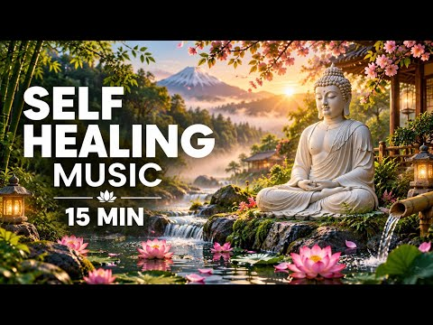
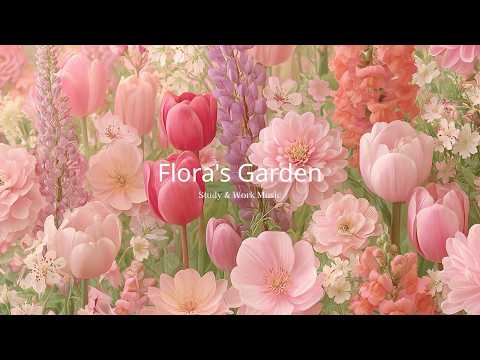
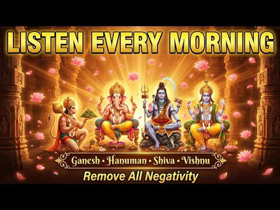
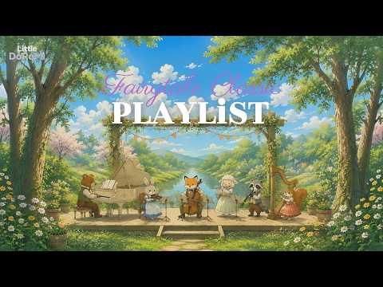
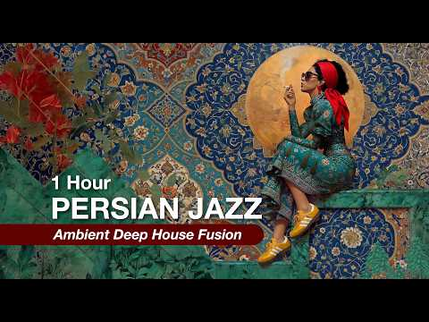
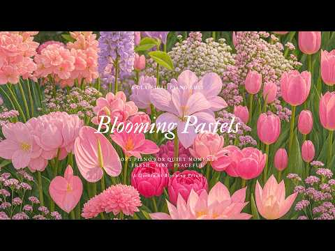
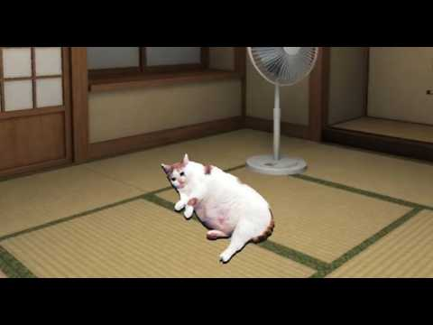
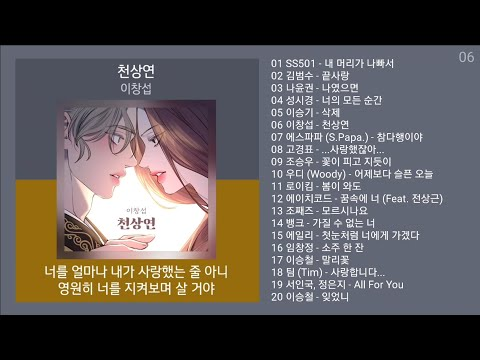
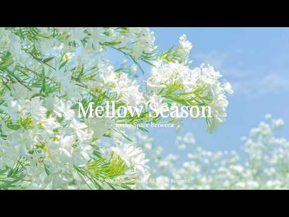

# 음악 — 성공 사례 분석: 사례별 자세히 #561–#600

`analysis.md` 의 9번 (같은 # 번호). 자동 생성 — `tools/success_analysis.py` v1.4.1 (2026-10-19 08:37 UTC). ※ 연구·교육용 — 투자 권유가 아님.

### 561. Relajación Profunda, Claridad Mental 🌿 Reduce El Estrés Y La Ansiedad, Recupera La Calma

- https://www.youtube.com/watch?v=j8hCioy51LU · Healing Soul Music · 구독자 10,700 · 조회수 802,123 (×75.0, 하루 6,471.9) · 좋아요 9,959 (1.2%) · 226.2분 · 2026-06-17 · 주제 묶음 6. 피아노·클래식·연주곡 · 형식 음악 (그 밖 모양 — 한 편짜리 BGM 등) · 폴더 `W_j8hCioy51LU` (웹 승인)
- 썸네일: 
- 설명 앞부분: Relajación profunda y claridad mental con suaves melodías de piano y sonidos de la naturaleza como pájaros y agua ayudan a reducir el estrés, aliviar la ansiedad y recuperar la calma naturalmente. Esta música relajante crea un ambiente tranquilo para restaurar el equilibrio emocional, mejorar la ca…
- 같은 채널 평소 대비 ×327.1 (채널 최근 롱폼 중앙값 2,452회) · 평소 영상: Libera El Estrés Y La Ansiedad 🌿Música Relajante … (2,679회) / Poderosa Relajación Curativa 🌿 Alivia La Ansiedad… (2,226회)
- 대본 없음 (설명) — 음성인식이 끝나면 도입부·흐름이 들어감
- 댓글 132/129: 좋은 점 — 영상 0 · 감사·응원 0 · 더 알고 싶은 것 0 · 아쉬운 점 — 영상 0 · 반박·불만 — 의견 다름 0 · 정치·사회 0 · 경험 공유 0 · 구독·다음 기대 0

### 562. Afro House Mix 2026 🔥 Tribal Afro House Energy ∣ Emotional Melodic Beats #VOL 35

- https://www.youtube.com/watch?v=UIzQAbsrlRk · Jungle Pulse House · 구독자 27,000 · 조회수 2,019,190 (×74.8, 하루 13,384.6) · 좋아요 14,049 (0.7%) · 99.4분 · 2026-05-21 · 주제 묶음 4. 카페·매장·라운지 · 형식 플레이리스트·모음 (여러 곡) · 폴더 `W_UIzQAbsrlRk` (웹 승인)
- 썸네일: 
- 챕터: 0:00 01. Wild Tribal Romance · 4:44 02. Savanna Night Whisper · 9:44 03. Moonlight Afro Dreams · 14:27 04. Fire Inside My Soul · 19:20 05. Sunset Love Rhythm · 24:28 06. Echoes of Your Love · 29:31 07. Sacred Night Groove · 34:44 08. Endless Afro Nights · 39:31 09. Golden Horizon Vibes · 44:50 10. Deep Voodoo Love · 49:52 11. Burning Love Chant · 54:35 12. Desert Soul Connection · 59:56 13. Lost in Your Rhythm · 65:05 14. Tribal Love Frequency · 69:51 15. Heartbeat in the Sand · 74:59 16. Electric Sunset Desire · 79:56 17. Midnight Tribal Fire · 84:27 18. Rhythm of the Ancients · 89:27 19. Deep Jungle Desire · 94:24 20. Ocean Heartbeat
- 설명 앞부분: This mix is designed to create an immersive atmosphere, featuring hypnotic basslines, organic percussion, and uplifting melodic progressions that flow seamlessly together. Perfect for summer parties, sunset sessions, workouts, or late-night drives, this set delivers nonstop energy with a soulful Af…
- 같은 채널 평소 대비 ×1,328.4 (채널 최근 롱폼 중앙값 1,520회) · 평소 영상: Afro House Mix 2026 🌅 Afro Deep & Tribal Grooves … (1,558회) / Afro House Mix 2026 🌅 Best Deep Melodic Afro Hous… (1,482회)
- 대본 없음 (설명) — 음성인식이 끝나면 도입부·흐름이 들어감
- 댓글 279/277: 좋은 점 — 영상 0 · 감사·응원 0 · 더 알고 싶은 것 0 · 아쉬운 점 — 영상 0 · 반박·불만 — 의견 다름 0 · 정치·사회 0 · 경험 공유 0 · 구독·다음 기대 0

### 563. 하츠투하츠 Hearts2Hearts 'RUDE!+Lemon Tang' 2026 한국대중음악상(KM Chart Awards) 260725

- https://www.youtube.com/watch?v=ddGnUiIjrgo · poptforming · 구독자 5,870 · 조회수 437,513 (×74.5, 하루 5,097.7) · 좋아요 11,482 (2.6%) · 6.6분 · 2026-07-25 · 주제 묶음 기타 · 형식 음악 (그 밖 모양 — 한 편짜리 BGM 등) · 폴더 `W_ddGnUiIjrgo` (웹 승인)
- 썸네일: 
- 대본 없음 (없음) — 음성인식이 끝나면 도입부·흐름이 들어감
- 댓글 314/314: 좋은 점 — 영상 2 · 감사·응원 2 · 더 알고 싶은 것 1 · 아쉬운 점 — 영상 0 · 반박·불만 — 의견 다름 0 · 정치·사회 0 · 경험 공유 1 · 구독·다음 기대 0
  - 좋은 점 — 영상 👍124 “스타즈 오늘 둘다 레전드네 ㄷㄷㄷ❤❤❤❤”
  - 좋은 점 — 영상 👍11 “하츠투하츠 KMA 2026 어워즈 청량하고 상큼한 무대 레전드네!!! 칼군무 대박ㅠㅠ라이브 너무 잘하고 청순하고 헤메코 이쁘고 열정적인 퍼포먼스 진짜 너무 멋지다!!!ㅠㅠ완전 최고!!!👍👍하츠투하츠 화이팅!!!❤❤❤”
  - 감사·응원 👍11 “하츠투하츠 KMA 2026 어워즈 청량하고 상큼한 무대 레전드네!!! 칼군무 대박ㅠㅠ라이브 너무 잘하고 청순하고 헤메코 이쁘고 열정적인 퍼포먼스 진짜 너무 멋지다!!!ㅠㅠ완전 최고!!!👍👍하츠투하츠 화이팅!!!❤❤❤”
  - 감사·응원 👍7 “하츠투하츠 파이팅 ! 유하 파이팅 ! 🎀”
  - 더 알고 싶은 것 👍0 “안녕하세요 여러분, 멤버 중에 제일 나이가 많은 분이 누구신지 궁금해서 여쭤봅니다. 🤔”
  - 경험 공유 👍0 “제가 항상 생각하는 건... 하츠투하츠 멤버들이 공연할 때마다 숨이 차지 않을까 하는 거예요.?”

### 564. ENIGMA Style Music 🔥 Whisper of My Angel 🔥 2026

- https://www.youtube.com/watch?v=ELv5bUhS-Qw · VoiceLine Music · 구독자 4,020 · 조회수 299,347 (×74.5, 하루 1,798.0) · 좋아요 3,420 (1.1%) · 5.6분 · 2026-05-05 · 주제 묶음 기타 · 형식 음악 (그 밖 모양 — 한 편짜리 BGM 등) · 폴더 `W_ELv5bUhS-Qw` (웹 승인)
- 썸네일: 
- 설명 앞부분: ENIGMA Style Music 🔥 Whisper of My Angel 🔥 2026 Enter a realm where silence speaks… Whisper of My Angel is a sensual, ethereal soundscape inspired by the timeless spirit of Enigma — blending sacred ambience with deep emotional energy. A distant voice calls through the night… Soft angelic whispers d…
- 같은 채널 평소 대비 ×1,425.5 (채널 최근 롱폼 중앙값 210회) · 평소 영상: Mystic ENIGMA 🔥 Echoes from Another Heaven 🔥 2026 (210회) / ERA Style Music 🔥 The Last Flame Remembers You 🔥 … (211회)
- 대본 없음 (설명) — 음성인식이 끝나면 도입부·흐름이 들어감
- 댓글 95/95: 좋은 점 — 영상 0 · 감사·응원 0 · 더 알고 싶은 것 0 · 아쉬운 점 — 영상 0 · 반박·불만 — 의견 다름 0 · 정치·사회 0 · 경험 공유 0 · 구독·다음 기대 0

### 565. Positive Energy 2026 🌞 Feel Good Deep House Music for Morning Focus ∣ ChillMorning Vibes

- https://www.youtube.com/watch?v=Dg9ePUDm4Vs · ChillMorning Vibes · 구독자 12,300 · 조회수 911,528 (×74.1, 하루 6,423.7) · 좋아요 14,526 (1.6%) · 65.7분 · 2026-05-30 · 주제 묶음 3. 공부·집중·작업 · 형식 플레이리스트·모음 (여러 곡) · 폴더 `W_Dg9ePUDm4Vs` (웹 승인)
- 썸네일: 
- 설명 앞부분: Positive Energy 2026 🌞 Feel Good Deep House Music for Morning Focus ∣ ChillMorning Vibes Positive Energy 2026 🌞 Feel Good Deep House Music for Morning Focus ∣ ChillMorning Vibes Positive Energy 2026 🌞 Feel Good Deep House Music for Morning Focus ∣ ChillMorning Vibes Boost your mood and start your d…
- 같은 채널 평소 대비 ×277.1 (채널 최근 롱폼 중앙값 3,290회) · 평소 영상: Feel the Morning Energy 🌞 Chill House Mix for a C… (3,403회) / Morning Energy Flow 🌿 ∣ Tropical Chillout Music f… (3,176회)
- 대본 없음 (설명) — 음성인식이 끝나면 도입부·흐름이 들어감
- 댓글 331/329: 좋은 점 — 영상 0 · 감사·응원 0 · 더 알고 싶은 것 0 · 아쉬운 점 — 영상 0 · 반박·불만 — 의견 다름 0 · 정치·사회 0 · 경험 공유 0 · 구독·다음 기대 0

### 566. 15 Min Self Healing Music 🌿 Heal From Within & Find Inner Peace

- https://www.youtube.com/watch?v=wi3auWpIaZY · Inner Healing Aura · 구독자 1,240 · 조회수 91,902 (×74.1, 하루 2,201.0) · 좋아요 888 (1.0%) · 16.5분 · 2026-09-07 · 주제 묶음 1. 수면·명상·힐링 · 형식 음악 (그 밖 모양 — 한 편짜리 BGM 등) · 폴더 `W_wi3auWpIaZY` (웹 승인)
- 썸네일: 
- 설명 앞부분: 15 Min Self Healing Music 🌿 Heal From Within & Find Inner Peace Take 15 minutes to slow down, breathe deeply, and reconnect with a sense of calm. This gentle self healing music is created for moments when you need to release mental tension, relax your body, and create a peaceful space within. Let t…
- 같은 채널 평소 대비 ×65.7 (채널 최근 롱폼 중앙값 1,400회) · 평소 영상: 15 Min Inner Child Healing Meditation 🌸 Release E… (1,483회) / 15 Min Somatic Anxiety Reset ∣ Release Stress & S… (1,316회)
- 대본 없음 (설명) — 음성인식이 끝나면 도입부·흐름이 들어감
- 댓글 53/51: 좋은 점 — 영상 0 · 감사·응원 0 · 더 알고 싶은 것 0 · 아쉬운 점 — 영상 0 · 반박·불만 — 의견 다름 0 · 정치·사회 0 · 경험 공유 0 · 구독·다음 기대 0

### 567. Life before Social Media - CHILL BRAZIL ∣ Samba, Luxury Bossa Nova, Work, Study

- https://www.youtube.com/watch?v=NHZXCzKGDQc · Golden Smile · 구독자 6,570 · 조회수 485,842 (×74.0, 하루 3,500.3) · 좋아요 5,702 (1.2%) · 152.4분 · 2026-06-02 · 주제 묶음 3. 공부·집중·작업 · 형식 플레이리스트·모음 (여러 곡) · 폴더 `W_NHZXCzKGDQc` (웹 승인)
- 썸네일: 
- 설명 앞부분: Welcome to GoldenSmile Your tropical escape into the smooth world of Brazilian chill, bossa nova, samba grooves, and laid-back beach rhythms. A place where the breeze sings, the sun glows, and the music moves like waves. Perfect for relaxing, slow dancing in your kitchen, dreaming by the window—or …
- 같은 채널 평소 대비 ×144.6 (채널 최근 롱폼 중앙값 3,359회) · 평소 영상: After The Drinks Kick In - CHILL BRAZIL ∣ Samba, … (3,359회) / Dont Wait For The Change - CHILL BRAZIL ∣ Samba, … (3,350회)
- 대본 없음 (설명) — 음성인식이 끝나면 도입부·흐름이 들어감
- 댓글 55/55: 좋은 점 — 영상 0 · 감사·응원 0 · 더 알고 싶은 것 0 · 아쉬운 점 — 영상 0 · 반박·불만 — 의견 다름 0 · 정치·사회 0 · 경험 공유 0 · 구독·다음 기대 0

### 568. 요즘 이 노래에 빠졌다 🎧 중독성 리듬 락트로트 17곡 2시간 10분 연속듣기 ∣ I’m Addicted to These Songs

- https://www.youtube.com/watch?v=rDvH1El0H3k · 인생은 트로트 · 구독자 9,120 · 조회수 673,679 (×73.9, 하루 15,692.3) · 좋아요 3,943 (0.6%) · 130.3분 · 2026-09-06 · 주제 묶음 9. 가요·발라드·트로트 · 형식 플레이리스트·모음 (여러 곡) · 폴더 `W_rDvH1El0H3k` (웹 승인)
- 썸네일: 
- 설명 앞부분: 레트로 감성이 어우러진 락트로트 플레이리스트입니다. TRACK LIST 총 17곡 2시간10분
- 같은 채널 평소 대비 ×48.1 (채널 최근 롱폼 중앙값 14,007회) · 평소 영상: 시청자 요청으로 만든 힙팝트로트 2탄 🎧 한 곡만 들으려다 끝까지 들었다 ∣ 10곡 1시… (14,007회) / 사랑에 빠졌나 봐 ❤️ 시크한 그녀의 락트로트 댄스 10곡 ∣ 1시간 10분 (15,243회)
- 대본 없음 (설명) — 음성인식이 끝나면 도입부·흐름이 들어감
- 댓글 338/338: 좋은 점 — 영상 2 · 감사·응원 30 · 더 알고 싶은 것 5 · 아쉬운 점 — 영상 6 · 반박·불만 — 의견 다름 0 · 정치·사회 0 · 경험 공유 5 · 구독·다음 기대 2
  - 좋은 점 — 영상 👍6 “처음보는 노래 제목에 선택했는데 진짜 듣기 좋네요 🎉🎉”
  - 좋은 점 — 영상 👍3 “와우 !! 이 영상 너무나도 대박 입니다요 ^^ 슬픈듯 눈물이 나올듯 말듯 경쾌하고 신나며 마음을 쥐락펴락하며 아무튼 넘 좋아요 ^^ 좋은 영상 너무너무 감사합니다 ^^ 이노래를듣고있으면 (이세상 모든것이 다 내것 같아 행복해집니다 ~.^)”
  - 감사·응원 👍10 “매일 출퇴근때~듣고있어요~~^^😊 좋은음악 감사합니다 ^^❤❤❤”
  - 감사·응원 👍9 “노래가 다 좋치만 1번 13번 좋네요 감사합니다”
  - 더 알고 싶은 것 👍2 “어떤곡이 제일좋은지 알려주세요 ㅎㅎㅎ 난 너무 좋아서 몇번을 들었네요 님. 강사합니다~~~^^😂😂😂”
  - 더 알고 싶은 것 👍1 “댓글보니 노래방 걸러링 이야기 만든데 거기에 통화 연결음까지...... 부탁드립니다 너무 좋아요 사랑합니다❤❤❤❤❤❤”
  - 아쉬운 점 — 영상 👍6 “요즘 AI 목소리 넘 좋고 노래 넘 잘해서 중독됨~”
  - 아쉬운 점 — 영상 👍4 “아~노래좋네~~ 계속듣다보니 같은 노랜가? 좀 아쉼네요 같은 리듬이...조금 지루해져요^^”
  - 경험 공유 👍3 “살면서 가장 힘든 것은 힘든 상황보다도 아무에게도 내 마음을 말할 수 없을 때인 것 같습니다. 저도 오랫동안 가족 걱정과 현실적인 문제들을 혼자 감당하며 지냈습니다. 오늘 이 노래를 들으니 굳이 말하지 않아도 제 마음을 알아주는 친구를 만난 기분입니다. 눈물이 나면서…”
  - 경험 공유 👍2 “맑고 듣기는좋으네요 넘좋은데요 감사합니다 이늦은밤 들으니 더욱더 빠져드네요 그런데 듣는사람마다 다르게 들리수도 제가 듣기에는 음과 리듬이 거의 동일?비슷 ㅎ 그리고 굴곡진곳하나없고 감정선 느낌은 없는것같아요 그럼에도 불구하고 듣기조아 자꾸듣게되는 장점은있네요 다 좋은…”
  - 구독·다음 기대 👍3 “노래를 듣고 있자니 지나가다고 구독하고 갑니다. 😄”
  - 구독·다음 기대 👍2 “와~~~ 오전에 듣다가 점심먹으면서도 계속듣고 있네요 이런적이 없었는데... 중독된것같네요 바로 구독❤알림 설정했네요 감사합니다 귀한 음악 들려주셔서 항상 함께하겠습니다^^!”

### 569. दिमाग को शांत करने वाला संगीत ∣ बांसुरी + संतूर + जलतरंग + तानपुरा ∣ Meditation Music

- https://www.youtube.com/watch?v=z6QYtZlFvb4 · Shanti univers by Chandu  · 구독자 713 · 조회수 52,500 (×73.6, 하루 423.1) · 좋아요 0 (0.0%) · 14.6분 · 2026-06-17 · 주제 묶음 1. 수면·명상·힐링 · 형식 음악 (그 밖 모양 — 한 편짜리 BGM 등) · 폴더 `W_z6QYtZlFvb4` (웹 승인)
- 썸네일: 
- 설명 앞부분: स्वागत है! इस विशेष संगीत को आपके मस्तिष्क को गहरे सुकून और शांति की स्थिति में ले जाने के लिए तैयार किया गया है। इसमें भारतीय बांसुरी (Bansuri) की गहरी तान, तानपुरा (Tanpura) की निरंतर गूंज, संतूर (Santoor) की मीठी झंकार और जलतरंग (Jaltarang) की पानी जैसी लहरों का एक जादुई और बेहद स्मूथ मिश्रण है।…
- 같은 채널 평소 대비 ×165.1 (채널 최근 롱폼 중앙값 318회) · 평소 영상: Indian Classical Music 🎶 ∣ Peaceful Flute & Santo… (319회) / Indian Classical Flute Music ∣ Peaceful Bansuri M… (317회)
- 대본 없음 (설명) — 음성인식이 끝나면 도입부·흐름이 들어감
- 댓글 17/17: 좋은 점 — 영상 0 · 감사·응원 0 · 더 알고 싶은 것 0 · 아쉬운 점 — 영상 0 · 반박·불만 — 의견 다름 0 · 정치·사회 0 · 경험 공유 0 · 구독·다음 기대 0

### 570. Ocean Chillout - Sunset Lounge Melodies and Luxury Lounge Vibes for a Peaceful Evening

- https://www.youtube.com/watch?v=hFaOxrQmaQ4 · Afterglow Lounge · 구독자 10,700 · 조회수 785,897 (×73.5, 하루 7,681.0) · 좋아요 9,295 (1.2%) · 125.2분 · 2026-07-09 · 주제 묶음 4. 카페·매장·라운지 · 형식 음악 (그 밖 모양 — 한 편짜리 BGM 등) · 폴더 `W_hFaOxrQmaQ4` (웹 승인)
- 썸네일: 
- 설명 앞부분: Ocean Chillout - Sunset Lounge Melodies and Luxury Lounge Vibes for a Peaceful Evening Experience pure bliss with our ocean chillout and sunset lounge session. Afterglow Lounge brings you luxury lounge melodies perfect for a peaceful evening by the sea. 🌅 Are you watching the sunset while listening…
- 같은 채널 평소 대비 ×199.3 (채널 최근 롱폼 중앙값 3,943회) · 평소 영상: Ocean Chillout & Luxury Lounge Music - Smooth Sun… (3,954회) / Café Del Mar Ibiza Vibe ∣ Ocean Chillout And Luxu… (3,932회)
- 대본 없음 (설명) — 음성인식이 끝나면 도입부·흐름이 들어감
- 댓글 231/231: 좋은 점 — 영상 0 · 감사·응원 0 · 더 알고 싶은 것 0 · 아쉬운 점 — 영상 0 · 반박·불만 — 의견 다름 0 · 정치·사회 0 · 경험 공유 0 · 구독·다음 기대 0

### 571. "सुकून भरी रातें 🌙 ∣ Romantic Hindi LoFi Songs ∣ Relaxing Sleep Music september 24

- https://www.youtube.com/watch?v=DU0Swx5GKB4 · Hindi Tuning · 구독자 25,200 · 조회수 1,845,856 (×73.2, 하루 74,816.4) · 좋아요 5,481 (0.3%) · 104분 · 2026-09-24 · 주제 묶음 1. 수면·명상·힐링 · 형식 음악 (그 밖 모양 — 한 편짜리 BGM 등) · 폴더 `W_DU0Swx5GKB4` (웹 승인)
- 썸네일: 
- 설명 앞부분: अगर आप सुकून, प्यार और हल्की सी यादों में खो जाना चाहते हैं, तो यह Romantic Hindi LoFi म्यूज़िक आपके लिए है। ✨ Perfect for: Study Time 📚 Late Night Relax 🌌 Sleep & Peace 😴 Romantic Mood ❤ हेडफोन लगाइए, आँखें बंद कीजिए और इस सुहानी LoFi दुनिया में खो जाइए। 🌙 Romantic Hindi LoFi Music – Full Chill & …
- 같은 채널 평소 대비 ×256.6 (채널 최근 롱폼 중앙값 7,194회) · 평소 영상: "सुकून भरी रातें 🌙 ∣ Romantic Hindi LoFi Songs ∣ … (7,213회) / "सुकून भरी रातें 🌙 ∣ Romantic Hindi LoFi Songs ∣ … (7,174회)
- 대본 없음 (설명) — 음성인식이 끝나면 도입부·흐름이 들어감
- 댓글 61/61: 좋은 점 — 영상 0 · 감사·응원 0 · 더 알고 싶은 것 0 · 아쉬운 점 — 영상 0 · 반박·불만 — 의견 다름 0 · 정치·사회 0 · 경험 공유 0 · 구독·다음 기대 0

### 572. My Heart And Soul ∣ Romantic Emotional Love Song ∣ Soft Emotion Music

- https://www.youtube.com/watch?v=f2LgAVp301Q · Soft Emotion Music · 구독자 13,700 · 조회수 998,132 (×72.9, 하루 7,642.1) · 좋아요 4,054 (0.4%) · 5.8분 · 2026-06-10 · 주제 묶음 기타 · 형식 한 곡 (뮤직비디오·음원·가사) · 폴더 `W_f2LgAVp301Q` (웹 승인)
- 썸네일: 
- 설명 앞부분: Some people become a part of your life... And some become a part of your soul. "My Heart And Soul" is a deeply emotional romantic duet about unconditional love, devotion, and finding the one person who becomes your strength, your comfort, and your reason to keep going. It's a song for those who hav…
- 같은 채널 평소 대비 ×105.7 (채널 최근 롱폼 중앙값 9,441회) · 평소 영상: A Lifetime With You ∣ Romantic Love Duet Soft Emo… (10,165회) / You’re My Endless Breath ❤️ ∣ Beautiful Romantic … (8,717회)
- 대본 없음 (설명) — 음성인식이 끝나면 도입부·흐름이 들어감
- 댓글 179/179: 좋은 점 — 영상 0 · 감사·응원 1 · 더 알고 싶은 것 0 · 아쉬운 점 — 영상 0 · 반박·불만 — 의견 다름 0 · 정치·사회 0 · 경험 공유 0 · 구독·다음 기대 0
  - 감사·응원 👍2 “❤️ “My Heart And Soul” reaches beyond the ordinary language of a love song. Within its melody lives a quiet desiderata of the heart—that profound hum…”

### 573. Flora's Garden 🌸🌷✨ soft waltz piano for studying, reading & creative work

- https://www.youtube.com/watch?v=J8Qi6W8t0Ek · rumi. · 구독자 12,700 · 조회수 912,484 (×71.8, 하루 6,739.1) · 좋아요 14,055 (1.5%) · 251.5분 · 2026-06-05 · 주제 묶음 3. 공부·집중·작업 · 형식 음악 (그 밖 모양 — 한 편짜리 BGM 등) · 폴더 `W_J8Qi6W8t0Ek` (웹 승인)
- 썸네일: 
- 설명 앞부분: Step into Flora's Garden, where tulips and peonies bloom in endless pastel hues and the air smells like rain on petals. ✨ Let the soft waltz carry you somewhere quiet and unhurried. Perfect for: ✦ Studying & deep focus sessions ✦ Reading, journaling & self-care ✦ Creative work & slow mornings ✦ Rel…
- 같은 채널 평소 대비 ×279.8 (채널 최근 롱폼 중앙값 3,262회) · 평소 영상: Finally, You Are Safe 🧚✨ Soft Magic for Deep Rest… (3,430회) / Reset Your Mind 🌿 Safe Sleep in a Fairy Forest ∣ … (3,093회)
- 대본 없음 (설명) — 음성인식이 끝나면 도입부·흐름이 들어감
- 댓글 467/467: 좋은 점 — 영상 1 · 감사·응원 4 · 더 알고 싶은 것 0 · 아쉬운 점 — 영상 0 · 반박·불만 — 의견 다름 0 · 정치·사회 0 · 경험 공유 0 · 구독·다음 기대 2
  - 좋은 점 — 영상 👍2 “좋은 영상 아름다운 영상미와 함께 감사합니다”
  - 감사·응원 👍3 “햇살이 좋은 날 틀어 놓기 좋은 음악이네요. 너무 예뻐요~ 잘 듣겠습니다. 감사합니다.”
  - 감사·응원 👍2 “좋은 영상 아름다운 영상미와 함께 감사합니다”
  - 구독·다음 기대 👍1 “왈츠너무 좋아요 구독하고 가요”
  - 구독·다음 기대 👍0 “구독하고 가요”

### 574. Lord Heal Me -Inspired By Enya (2026 Ai Music Video)

- https://www.youtube.com/watch?v=Q-JjRkFbFhU · SOUNDIASM · 구독자 10,700 · 조회수 768,538 (×71.8, 하루 5,383.6) · 좋아요 9,206 (1.2%) · 5.2분 · 2026-05-29 · 주제 묶음 14. AI 음악 · 형식 AI 음악 · 폴더 `W_Q-JjRkFbFhU` (웹 승인)
- 썸네일: 
- 설명 앞부분: Immerse yourself in “Lord Heal Me,” a deeply emotional ambient worship song filled with ethereal vocals, cinematic textures, gentle piano, and calming spiritual energy. Inspired by heavenly harmonies and peaceful atmospheric soundscapes, this healing music journey speaks of hope, surrender, divine …
- 같은 채널 평소 대비 ×3,608.2 (채널 최근 롱폼 중앙값 213회) · 평소 영상: Enya - May Your Heart Find Its Way (2026 AI MUSIC… (213회) / The Lost Lamb - Worship Song For Being Found by t… (213회)
- 대본 없음 (설명) — 음성인식이 끝나면 도입부·흐름이 들어감
- 댓글 326/325: 좋은 점 — 영상 0 · 감사·응원 1 · 더 알고 싶은 것 0 · 아쉬운 점 — 영상 0 · 반박·불만 — 의견 다름 0 · 정치·사회 0 · 경험 공유 1 · 구독·다음 기대 0
  - 감사·응원 👍0 “우리나라 돈벌어 어디에 쓰이나요!? 아프리카에 [물좀] 해결해주셨음고맙겠습니다 우리가 여러가지음식을식용합니다만 그중가장중요한게 식수~즉 (물~)아니던가요~ 물만이라도.... 아프리카에 해결해주셨음 고맙겠습니다 저도 나름~ 기도 할겁니다 대한민국5천만 여러분과함께 기도…”
  - 경험 공유 👍0 “우리나라 돈벌어 어디에 쓰이나요!? 아프리카에 [물좀] 해결해주셨음고맙겠습니다 우리가 여러가지음식을식용합니다만 그중가장중요한게 식수~즉 (물~)아니던가요~ 물만이라도.... 아프리카에 해결해주셨음 고맙겠습니다 저도 나름~ 기도 할겁니다 대한민국5천만 여러분과함께 기도…”

### 575. 【星河入夢】 Ancient Chinese Healing Music 🎵 ∣ Qixi Star River 🌌 - Guzheng × Xiao

- https://www.youtube.com/watch?v=pFttQ6MZ9d8 · Tianhe Harmony · 구독자 879 · 조회수 63,020 (×71.7, 하루 701.0) · 좋아요 1,133 (1.8%) · 77.8분 · 2026-07-21 · 주제 묶음 1. 수면·명상·힐링 · 형식 음악 (그 밖 모양 — 한 편짜리 BGM 등) · 폴더 `W_pFttQ6MZ9d8` (웹 승인)
- 썸네일: 
- 챕터: 0:00 Star River Reflection · 11:15 First Xiao Echoes in the Night · 22:40 Silk Ribbon Swaying · 33:10 Guzheng Across the Stone Brid… · 44:25 Deep Night on Magpie Bridge · 55:50 Erhu Starlight Melody · 65:15 Peaceful Water Ripples · 73:40 Fading into the Milky Way
- 설명 앞부분: Experience the deep calm of this ancient Chinese healing music under the Qixi star river. Let the Guzheng and Xiao wash away your stress and bring peace. 🌙 About This Music Find your inner peace under the endless Milky Way. This ancient Chinese healing music is inspired by the Qixi Festival and the…
- 같은 채널 평소 대비 ×152.4 (채널 최근 롱폼 중앙값 414회) · 평소 영상: 【殷墟星火】 ANCIENT CHINESE STUDY MUSIC 📖 ∣ Yin Xu Ora… (417회) / 【長城破曉】 ANCIENT CHINESE HEALING MUSIC 🌅 ∣ Great Wa… (410회)
- 대본 없음 (설명) — 음성인식이 끝나면 도입부·흐름이 들어감
- 댓글 48/48: 좋은 점 — 영상 0 · 감사·응원 1 · 더 알고 싶은 것 0 · 아쉬운 점 — 영상 0 · 반박·불만 — 의견 다름 0 · 정치·사회 0 · 경험 공유 0 · 구독·다음 기대 0
  - 감사·응원 👍0 “세상을 아름답게하는데 일조를하심니다 곱고 아름다운소리로 감사함니다 언제듣어도 고요와 멋이넘침니다🙏”

### 576. 10 Most Powerful Morning Mantras ∣ Remove All Negativity ∣ Ganesh Hanuman Shiva Vishnu Kr…

- https://www.youtube.com/watch?v=rH2JDVys2Os · Adhyatmik Dhwani · 구독자 28,900 · 조회수 2,058,605 (×71.2, 하루 13,970.9) · 좋아요 25,450 (1.2%) · 20.7분 · 2026-05-25 · 주제 묶음 1. 수면·명상·힐링 · 형식 음악 (그 밖 모양 — 한 편짜리 BGM 등) · 폴더 `W_rH2JDVys2Os` (웹 승인)
- 썸네일: 
- 설명 앞부분: 🌅 Start your morning with divine blessings of Ganesh, Hanuman, Shiva & Vishnu — and remove all negativity before your day begins. Play this every morning to: 🐘 Remove obstacles & bring new beginnings (Ganesh Mantra) 🙏 Gain strength, courage & protection (Hanuman Mantra) 🔱 Find peace, liberation & i…
- 같은 채널 평소 대비 ×1,346.8 (채널 최근 롱폼 중앙값 1,528회) · 평소 영상: सफलता और समृद्धि के लिए गणेश मंत्र ∣ ॐ गं गणपतये … (1,659회) / Ganpati Stuti ∣ Vakratunda Mahakaya Ganesh Vandan… (1,398회)
- 대본 없음 (설명) — 음성인식이 끝나면 도입부·흐름이 들어감
- 댓글 1,753/1,753: 좋은 점 — 영상 0 · 감사·응원 0 · 더 알고 싶은 것 0 · 아쉬운 점 — 영상 0 · 반박·불만 — 의견 다름 0 · 정치·사회 0 · 경험 공유 0 · 구독·다음 기대 0

### 577. Playlist ∣ 가을밤에는 남자발라드를 들어요 🍂 ∣ 한국 감성 발라드 모음 🔥

- https://www.youtube.com/watch?v=iaEax89R7fQ · 이짐땡 · 구독자 2,860 · 조회수 203,497 (×71.2, 하루 6,337.6) · 좋아요 516 (0.2%) · 167.7분 · 2026-09-17 · 주제 묶음 9. 가요·발라드·트로트 · 형식 플레이리스트·모음 (여러 곡) · 폴더 `W_iaEax89R7fQ` (웹 승인)
- 썸네일: 
- 챕터: 0:00 성시경-차마 · 4:13 나윤권-기대 · 8:50 박재정-사랑한만큼 · 13:38 윤종신-좋니 · 19:07 신용재-첫 줄 · 23:09 임한별-이별하러가는길 · 28:16 임한별-사랑하지 않아서 그랬어 · 32:00 오왠-오늘 · 35:53 길구봉구-이 별 · 39:52 이적-빨래 · 43:46 임재현-비의랩소디 · 47:41 이클립스-소나기 · 51:35 우디-사막에서꽃을피우듯 · 55:58 임재현-사랑에 연습이 있었다면 · 60:14 장범준-잠이오질않네요 · 64:49 장범준-고백 · 68:19 브아솔-러브발라드 · 73:21 브라운아이즈-점점 · 76:52 양다일-고백 · 80:24 카더가든-가까운듯먼그대여
- 설명 앞부분: 애절한 남자발라드를 듣기에 좋은 계절 찬바람이 코끝을 건드릴땐 이 플리와 함께 하세요 이짐땡 플리와 함께 즐거운 가을 보내세요 ^^ 🩷 TRACK LIST
- 같은 채널 평소 대비 ×19.4 (채널 최근 롱폼 중앙값 10,470회) · 평소 영상: Playlist ∣ 이효리 비켜! 아직 안비켰다악👑 ∣ 2000년대 여자 솔로 플리 🎧 (13,909회) / Playlist ∣ 명곡은 다시 돌아오는거야 🪃 ∣ 숨어 듣는 명곡 숨듣명 플리 🎧 (7,031회)
- 대본 없음 (설명) — 음성인식이 끝나면 도입부·흐름이 들어감
- 댓글 8/8: 좋은 점 — 영상 0 · 감사·응원 0 · 더 알고 싶은 것 0 · 아쉬운 점 — 영상 0 · 반박·불만 — 의견 다름 0 · 정치·사회 0 · 경험 공유 0 · 구독·다음 기대 0

### 578. 모차르트에서 영감을 받은 아침 힐링 클래식 🌿 첼로 & 오보에 ∣ 평온한 산속 일출과 함께하는 휴식 음악

- https://www.youtube.com/watch?v=tr3LEDt_p88 · Korean Rock Ballad · 구독자 4,750 · 조회수 337,472 (×71.0, 하루 2,841.4) · 좋아요 3,468 (1.0%) · 42.2분 · 2026-06-22 · 주제 묶음 6. 피아노·클래식·연주곡 · 형식 음악 (그 밖 모양 — 한 편짜리 BGM 등) · 폴더 `W_tr3LEDt_p88` (웹 승인)
- 썸네일: 
- 설명 앞부분: 평온한 산속 일출과 함께하는 아침 힐링 클래식 음악입니다. 따뜻하고 깊은 첼로 선율과 부드러운 오보에의 조화가 마음을 편안하게 감싸줍니다. 이 음악은 아침 루틴, 명상, 독서, 공부, 휴식, 기도, 스트레스 해소에 잘 어울립니다. 맑은 자연의 공기와 잔잔한 클래식 선율 속에서 평온한 하루를 시작해 보세요. 🎻 첼로 & 오보에 힐링 음악 🌿 자연과 함께하는 클래식 음악 ☀️ 편안한 아침을 위한 휴식 음악
- 같은 채널 평소 대비 ×10.1 (채널 최근 롱폼 중앙값 33,578회) · 평소 영상: 아름다운 가을 아침 클래식 🍂 슈베르트, 브람스, 차이콥스키, 드보르자크, 멘델스존에게 … (33,578회) / 아침 클래식 현악 ∣ 독서·공부·커피와 함께하는 편안한 스트링 오케스트라 (33,833회)
- 대본 없음 (설명) — 음성인식이 끝나면 도입부·흐름이 들어감
- 댓글 83/81: 좋은 점 — 영상 3 · 감사·응원 37 · 더 알고 싶은 것 0 · 아쉬운 점 — 영상 0 · 반박·불만 — 의견 다름 0 · 정치·사회 0 · 경험 공유 2 · 구독·다음 기대 1
  - 좋은 점 — 영상 👍18 “좋은 영상 제공 해주셔서 감사드리고 자주 시청 하겠습니다”
  - 좋은 점 — 영상 👍13 “나는 잘~되고 있어요 항상 기쁨과 축복과 행복이 넘쳐 흘러요 내 영적인 친구를 맞이하는데 이 음악이 도움이 됩니다 내가 불행하다고 느낄때 이 음악은 슬픔이였을텐데 이제는 내 에고를 이해하고 그를 알아차리게 되었어요 그래서 모두 즐겁고 산뜻하고 긍정입니다 감사합니다”
  - 감사·응원 👍115 “내나이어느덧80 고관절수술후 집에서 .우울한하루하루. 이렇게아름다운 선률이. 나를깨웁니다 스콜처름! 덕분에 힘을얻습니다 감사합니다 아이들단톡에도올렸습니다 새벽같이 학원을 오가는딸 며느리. 머리식히라고요”
  - 감사·응원 👍36 “오보에 소리가 이렇게 아름다운지 처음 느끼네요~맑은소리 고운소리 내 마음이 정화 되는거 같고 위로받고 싶은 영롱한 소리 ~감사합니다~~축복합니다~~”
  - 경험 공유 👍13 “나는 잘~되고 있어요 항상 기쁨과 축복과 행복이 넘쳐 흘러요 내 영적인 친구를 맞이하는데 이 음악이 도움이 됩니다 내가 불행하다고 느낄때 이 음악은 슬픔이였을텐데 이제는 내 에고를 이해하고 그를 알아차리게 되었어요 그래서 모두 즐겁고 산뜻하고 긍정입니다 감사합니다”
  - 구독·다음 기대 👍6 “129번째 구독하고갑니다 좋은음악 감사합니다”

### 579. 스튜디오 지브리 풍 클래식🍃 신비로운 정원에서 듣는 음악 ∣ 따뜻한 피아노와 플루트

- https://www.youtube.com/watch?v=KIunwCFWDUE · Little DoReMi · 구독자 4,200 · 조회수 296,044 (×70.5, 하루 2,269.5) · 좋아요 2,722 (0.9%) · 136.3분 · 2026-06-10 · 주제 묶음 6. 피아노·클래식·연주곡 · 형식 음악 (그 밖 모양 — 한 편짜리 BGM 등) · 폴더 `W_KIunwCFWDUE` (웹 승인)
- 썸네일: 
- 설명 앞부분: 지브리처럼 따뜻한 클래식 🎵 향수와 신비로움이 담긴 배경음악 Little Doremi의 지브리 감성 클래식 플레이리스트입니다. 지브리 영화가 주는 그 특별한 느낌, 기억하시나요? 마법 같으면서도 따뜻하고, 신비로우면서도 다정한... 그 감정을 음악으로 재현해봤어요. 따뜻한 피아노, 아련한 플루트, 감정 깊은 현악기들이 아이의 상상력을 자극하고, 마음속 깊은 곳에 무언가를 느끼게 해줍니다. 💛 상상력이 필요한 모든 활동 💛 그림 그리기와 창작 💛 이야기 만들기 💛 조용한 휴식과 명상 💛 감정 표현과 성찰 💛 부모도 함께 즐기는 시간…
- 같은 채널 평소 대비 ×383.2 (채널 최근 롱폼 중앙값 772회) · 평소 영상: 차분하고 편안한 국악 연주곡 🏯 가야금, 거문고, 대금 ∣ 한옥의 정취를 담다 (788회) / 밤하늘의 마법🌙 백색소음 수면음악 ∣ 3시간 연속재생 ∣ 중간광고 없음 (794회)
- 대본 없음 (설명) — 음성인식이 끝나면 도입부·흐름이 들어감
- 댓글 39/38: 좋은 점 — 영상 0 · 감사·응원 2 · 더 알고 싶은 것 0 · 아쉬운 점 — 영상 0 · 반박·불만 — 의견 다름 0 · 정치·사회 0 · 경험 공유 3 · 구독·다음 기대 1
  - 감사·응원 👍10 “미술 교사인데요😊이거틀어놓으면 안떠들고 그림열심히 그려요 감사해요❤”
  - 감사·응원 👍9 “매일 듣고 있어요 좋은 음악 감사해요❤”
  - 경험 공유 👍8 “답글까지 정성 담아 작성해주다니!!😮😮최고에용!!그림체도 음악도 100퍼센트 최고!!숙제 때문에 0프로 였던 제가 이 음악 듣고 100프로까지 충전하고갑니다잉~~!!❤❤”
  - 경험 공유 👍3 “모든 작품이 마음에 드네요 ❤그리고 제가 할일때문에 짜증났는데 이걸 들으니 마음이 정말 편해지네요❤❤”
  - 구독·다음 기대 👍9 “매일 듣고 있어요 좋은 음악 감사해요❤”

### 580. 🎧 Relax & Enjoy Playlist ∣ Best Trending Pop Music Collection 2026 🌙 Top Acoustic Love So…

- https://www.youtube.com/watch?v=vDs2KPkfw8Q · Morning Serenity · 구독자 15,600 · 조회수 1,094,907 (×70.2, 하루 14,716.3) · 좋아요 6,104 (0.6%) · 67.4분 · 2026-08-05 · 주제 묶음 3. 공부·집중·작업 · 형식 커버·직접 부른 노래 · 폴더 `W_vDs2KPkfw8Q` (웹 승인)
- 썸네일: 
- 설명 앞부분: 🎧 **Relax & Enjoy Playlist ∣ Best Trending Pop Music Collection 2026 🌙 Top Acoustic Love Songs 2026 Welcome to the ultimate collection of the **best trending pop music** and **top acoustic love songs of 2026**. This relaxing playlist is filled with soothing acoustic melodies, heartfelt vocals, and …
- 같은 채널 평소 대비 ×26.4 (채널 최근 롱폼 중앙값 41,436회) · 평소 영상: Feel Good & Relax Playlist 🎶 Top Trending Pop Son… (42,818회) / Healing Acoustic Playlist 2026 🌿 Trending Soft Po… (40,054회)
- 대본 없음 (설명) — 음성인식이 끝나면 도입부·흐름이 들어감
- 댓글 126/118: 좋은 점 — 영상 0 · 감사·응원 0 · 더 알고 싶은 것 0 · 아쉬운 점 — 영상 0 · 반박·불만 — 의견 다름 0 · 정치·사회 0 · 경험 공유 0 · 구독·다음 기대 1
  - 구독·다음 기대 👍0 “너무 톻아요😄 구독하고 갑니다.”

### 581. 🎬 듣는 순간 지나온 세월이 생각나 울컥했습니다. 🎼 너무 많은 것들을 책임지며 살아온 당신을 위한 노래 🎙️ 정동원 - "여백" [락카페 버전]

- https://www.youtube.com/watch?v=f9qBfvwQ9Ak · 가슴을 울리는 락카페 · 구독자 10,900 · 조회수 762,998 (×70.0, 하루 5,273.3) · 좋아요 2,957 (0.4%) · 4분 · 2026-05-27 · 주제 묶음 4. 카페·매장·라운지 · 형식 커버·직접 부른 노래 · 폴더 `W_f9qBfvwQ9Ak` (웹 승인)
- 썸네일: 
- 설명 앞부분: 살아오면서 우리는 가족을 위해, 현실을 위해, 내일을 위해 숨 가쁘게 살아왔지만 정작 내 마음은 한 번도 쉬지 못했는지도 모릅니다. “전화기 충전은 잘 하면서 내 삶은 충전하지 못하고 사네” 이 노래의 가사처럼 우리는 늘 바쁜 세상 속에서 내 마음의 여백을 잃고 살아왔습니다. 주름은 세월의 흔적이 아니라 끝까지 버텨낸 인생의 훈장이고, 지친 마음은 열심히 살아온 시간의 증거일지도 모릅니다. “여백”을 들으며 이제는 잠시라도 나 자신을 위해 살아도 괜찮다고 스스로에게 말해주고 싶었습니다. 오늘만큼은 여러분의 마음에도 작은 여백 하나…
- 같은 채널 평소 대비 ×92.9 (채널 최근 롱폼 중앙값 8,214회) · 평소 영상: 아련한 이노래 🍂 후렴부분 듣다가 참았던 눈물이 결국 터져버렸습니다. 🎙️ "그날" - … (8,314회) / 한번 들으면 계속 듣게되는 그노래!! 🌹 매력적인 허스키보이스로 만나보세요.. 🎙️" 백… (8,115회)
- 대본 없음 (설명) — 음성인식이 끝나면 도입부·흐름이 들어감
- 댓글 198/198: 좋은 점 — 영상 2 · 감사·응원 17 · 더 알고 싶은 것 2 · 아쉬운 점 — 영상 2 · 반박·불만 — 의견 다름 0 · 정치·사회 0 · 경험 공유 4 · 구독·다음 기대 2
  - 좋은 점 — 영상 👍3 “노래가가슴에와닿네요❤❤❤”
  - 좋은 점 — 영상 👍2 “저는.이노래을.매일.듣고있습니다.목소리가.너무.듣기좋습니다.하루에한두번.꼭듣고.자거든요.감사합니다”
  - 감사·응원 👍29 “가사의 의미를 음미하면서 들어보니 마치 지금까지 살아온 제모습인것 같아서 마음이 씁쓸함을 느끼네요 가수님의 애절한 허스키 보이스가 더해져서 가슴이 벅차오름니다. 노래감사해요.”
  - 감사·응원 👍22 “울 정동원 가수님의 여백 이네요 허스키하신 음색인데 목소리 좋으시네요 잘부르시네요 멋찌십니다 감사합니다 그좋은 목소리로 독백도 잘부르실것 같읍니다 응원합니다 😂”
  - 더 알고 싶은 것 👍3 “안녕하세요 김종찬 산다는것은 부탁드립니다”
  - 더 알고 싶은 것 👍1 “삶이 주마등처럼 지나가는 군요 멋진노래 잘들었습니다. 서울의달도 부탁드립니다”
  - 아쉬운 점 — 영상 👍3 “반복해서 ᆢ그리고 또 반복해서 듣고 있네요 음률도 가사도 너무 너무 진한 감동을 주네요~~”
  - 아쉬운 점 — 영상 👍3 “목소리가 너무 좋았요~~🎉🎉”
  - 경험 공유 👍31 “나도 머리가 하얀다 나도 늙어가고있다 세월은 못붓잡는다 어찌하오리까. 나도 내 앞가름도 못하고 여기까지 왔다.”
  - 경험 공유 👍4 “하늘에있는엄마 큰오빠 잘계시죠 저도나이 51세입니다 두아이엄마 딸 아들 많이커서 시집장가갈 나이 입니다. 여백 노래잘듣고갑니다🎉”
  - 구독·다음 기대 👍2 “매일 듣는데 힐링을 제대로하고 있고 행복하네요 음악 한곡한곡 선율도 가사도 좋고 정말 행복을 주는 음악이네요”
  - 구독·다음 기대 👍2 “구독합니다🎉”

### 582. Morning Coffee Indie Folk – Warm Acoustic Music for Peaceful Slow Days

- https://www.youtube.com/watch?v=wFy9kud8FHE · Silver Coast · 구독자 28,700 · 조회수 2,006,522 (×69.9, 하루 17,635.7) · 좋아요 0 (0.0%) · 65.3분 · 2026-06-27 · 주제 묶음 4. 카페·매장·라운지 · 형식 플레이리스트·모음 (여러 곡) · 폴더 `W_wFy9kud8FHE` (웹 승인)
- 썸네일: 
- 챕터: 0:00 August River · 4:41 October Country · 9:18 The Firetower · 14:07 The Valley Knows · 18:42 Northern Ember · 25:27 Quiet Harbour · 30:54 Morning Tide · 36:03 Golden Canyons · 41:31 Wildfire Mercy · 47:05 November Kids · 52:55 Northern Rivers · 59:54 Dust And Thunder
- 설명 앞부분: Morning Coffee Indie Folk is a warm acoustic playlist created for peaceful slow days, quiet mornings, and the simple joy of your first cup of coffee. Featuring relaxing indie folk songs, soft acoustic guitars, and cinematic folk textures, this collection brings together comforting melodies that hel…
- 같은 채널 평소 대비 ×36.3 (채널 최근 롱폼 중앙값 55,270회) · 평소 영상: Indie Folk & Coffee Vibes – Gentle Acoustic Songs… (55,270회) / Mountain Coffee Indie Folk – Warm Acoustic Songs … (56,449회)
- 대본 없음 (설명) — 음성인식이 끝나면 도입부·흐름이 들어감
- 댓글 369/363: 좋은 점 — 영상 0 · 감사·응원 0 · 더 알고 싶은 것 0 · 아쉬운 점 — 영상 0 · 반박·불만 — 의견 다름 0 · 정치·사회 0 · 경험 공유 0 · 구독·다음 기대 0

### 583. Paris Night Chanson 🌙 1960s Vintage French Café Music (Romantic Love Songs)

- https://www.youtube.com/watch?v=8LyppqPNDns · AtelierChanson · 구독자 15,600 · 조회수 1,090,433 (×69.9, 하루 6,270.4) · 좋아요 22,460 (2.1%) · 23.9분 · 2026-04-28 · 주제 묶음 4. 카페·매장·라운지 · 형식 음악 (그 밖 모양 — 한 편짜리 BGM 등) · 폴더 `W_8LyppqPNDns` (웹 승인)
- 썸네일: 
- 설명 앞부분: 🎶 Paris Night Chanson 🌙 1960s Vintage French Café Music (Romantic Love Songs) ✨ IMMERSE YOURSELF IN VINTAGE PARIS Step into a timeless world where the spirit of old-world France meets modern tranquility. This collection of authentic French chanson music captures the essence of a vintage Paris café—…
- 같은 채널 평소 대비 ×909.1 (채널 최근 롱폼 중앙값 1,200회) · 평소 영상: 1960s Paris Chanson Love Songs 🌙 Mysterious Femal… (1,219회) / Timeless Paris Café Music ☕ Elegant 1960s French … (1,180회)
- 대본 없음 (설명) — 음성인식이 끝나면 도입부·흐름이 들어감
- 댓글 941/933: 좋은 점 — 영상 0 · 감사·응원 3 · 더 알고 싶은 것 0 · 아쉬운 점 — 영상 0 · 반박·불만 — 의견 다름 0 · 정치·사회 0 · 경험 공유 1 · 구독·다음 기대 0
  - 감사·응원 👍1 “영상과 음악의 완벽한 조합이네요 감사히 잘들었습니다. 오늘 하루는 여기서 머물다가 갑니다”
  - 감사·응원 👍1 “감사합니다.”
  - 경험 공유 👍1 “내가 정말 찾던 낭만적인 음악이에요. 드디어 프랑스인 들도 Ai를 활용하여 이런 프랑스 정서의 음악을 만들 수 있게 됐군요. 축하해요.”

### 584. 옛추억에 눈물나는 노래 '세월' #감성발라드 #감성가요

- https://www.youtube.com/watch?v=zNbEjZxdswM · 고구려TV🍒음악방송 · 구독자 4,140 · 조회수 289,328 (×69.9, 하루 2,767.4) · 좋아요 2,940 (1.0%) · 67.3분 · 2026-07-06 · 주제 묶음 9. 가요·발라드·트로트 · 형식 음악 (그 밖 모양 — 한 편짜리 BGM 등) · 폴더 `W_zNbEjZxdswM` (웹 승인)
- 썸네일: 
- 설명 앞부분: 세월 노래 감상하시고
- 같은 채널 평소 대비 ×915.6 (채널 최근 롱폼 중앙값 316회) · 평소 영상: 어린시절 다슬기 잡이 추억이 서린 노래 (316회) / 힙합 '요즘세상'이 왜이렇게 돌아가지? #고구려tv음악방송 (339회)
- 대본 없음 (설명) — 음성인식이 끝나면 도입부·흐름이 들어감
- 댓글 196/196: 좋은 점 — 영상 1 · 감사·응원 16 · 더 알고 싶은 것 1 · 아쉬운 점 — 영상 4 · 반박·불만 — 의견 다름 1 · 정치·사회 0 · 경험 공유 12 · 구독·다음 기대 0
  - 감사·응원 👍49 “영상을.보니까,아주.먼.옛날에.시골길에.소달구지.사람들.꼭.어릴때.나의.시골길.하고.똑.갇 네요.가난했어도,그때가.좋아읍니다.인심좋고.정이넘치는.웃음이.끓길지않는.항상.넉.넉한.시골민심..그때가.그립습니다..그대채널을.응원함니다”
  - 감사·응원 👍45 “눈물나게 하네요! 그때, 그 시절이 그립습니다. 감사합니다”
  - 더 알고 싶은 것 👍2 “노래 제목 아시는 분! 좀 부탁합니다.”
  - 아쉬운 점 — 영상 👍13 “내고향 김해 생림 먼지 풀푸나고 어쩌다 차한대 지나갈때면 황토흙탕물튈까봐 잽빠르게 피해버린 기억 이제 나이 칠십을 넘기며 아련한 추억속에 훌쩍가버린 시간에 아쉬움과,그리움이 교차하네”
  - 아쉬운 점 — 영상 👍6 “내가가장좋아하던 코스모스가 이제는 보기힘들어서 넘아쉬워요 어쩌다보이는건 옛날 코스모스가 아니고 느낌이 달라요”
  - 반박·불만 — 의견 다름 👍5 “기존 가요는 아니죠?”
  - 경험 공유 👍38 “한숨돌려 아련한. 길 내가 걸온지도 모르고 세월에 밀려 왔네요.”
  - 경험 공유 👍32 “아,제가 초등학교 다닐때 신작로 길에 피든 코스모스 생각나네요”

### 585. playlist l 틀자마자 집중 잘 되는 느좋 노동요 🎧 chill • r&b • vibes ☾

- https://www.youtube.com/watch?v=ese2bIvjZGU · luroom · 구독자 8,190 · 조회수 571,355 (×69.8, 하루 10,221.7) · 좋아요 4,726 (0.8%) · 248.2분 · 2026-08-24 · 주제 묶음 8. 로파이·시티팝·칠 · 형식 플레이리스트·모음 (여러 곡) · 폴더 `W_ese2bIvjZGU` (웹 승인)
- 썸네일: 
- 챕터: 0:00 My Own Line · 3:30 After I Begin · 6:58 Next Beat · 10:13 No Curtain Call · 13:28 Thank You Is Enough · 16:41 The Rookie · 19:41 Not Evidence · 22:24 Unplayed · 26:25 Secondhand Panic · 30:37 No Manual · 34:02 By Touch · 37:56 Less Is Full · 41:21 Replay
- 설명 앞부분: 기분은 가볍게 올라오고, 집중은 자연스럽게 따라오는 느낌. 🎧 just press play stay in luroom 💿Track list / Timeline ❕ Curated by luroom. All visuals are carefully selected and reimagined for the channel. All music is original and created exclusively for luroom. © luroom. All rights reserved.
- 같은 채널 평소 대비 ×71.9 (채널 최근 롱폼 중앙값 7,942회) · 평소 영상: playlist l 틀어두면 시간 순삭되는 느좋 공부 플리 📖 chill • r&b • … (7,942회) / playlist l "타, 가을 타러 가자" 느좋플리 🍂 chill • r&b • vib… (7,935회)
- 대본 없음 (설명) — 음성인식이 끝나면 도입부·흐름이 들어감
- 댓글 175/175: 좋은 점 — 영상 1 · 감사·응원 2 · 더 알고 싶은 것 0 · 아쉬운 점 — 영상 0 · 반박·불만 — 의견 다름 0 · 정치·사회 0 · 경험 공유 0 · 구독·다음 기대 0
  - 좋은 점 — 영상 👍1 “음악이 듣기 좋네요~ 구독중”
  - 감사·응원 👍1 “일할 때 틀어두면 잡생각 싹 사라지고 집중이 너무 잘 돼서, 감사한 마음에 구독과 좋아요 바로 누르고 갑니다 🎧✨”
  - 감사·응원 👍1 “새벽에 작업하면서 듣고 있는데, 노래가 참 좋네요. 🤍🖤 어쩜 이렇게 좋은 노래 선물을 주시는지... ^^ 감사해요.”

### 586. Unlock Brain Power in 3 Minutes ∣ Classical Music for Focused Study

- https://www.youtube.com/watch?v=-zNMRToG5Vw · Classical Mind · 구독자 22,600 · 조회수 1,570,978 (×69.5, 하루 9,983.9) · 좋아요 27,217 (1.7%) · 138.7분 · 2026-05-15 · 주제 묶음 6. 피아노·클래식·연주곡 · 형식 음악 (그 밖 모양 — 한 편짜리 BGM 등) · 폴더 `W_-zNMRToG5Vw` (웹 승인)
- 썸네일: 
- 설명 앞부분: Unlock Brain Power in 3 Minutes ∣ Classical Music for Focused Study We understand that transitioning from chaos to clarity can be a challenge, but your mind is capable of remarkable focus. Let this 3-minute audio experience guide you in harnessing your brain's full potential as you prepare for stud…
- 같은 채널 평소 대비 ×719.6 (채널 최근 롱폼 중앙값 2,183회) · 평소 영상: Classical Music for Focus & Productivity 🧠 ∣ Unlo… (2,183회) / Mozart Effect for Study Focus ∣ Unlock Your Brain… (2,159회)
- 대본 없음 (설명) — 음성인식이 끝나면 도입부·흐름이 들어감
- 댓글 457/451: 좋은 점 — 영상 0 · 감사·응원 0 · 더 알고 싶은 것 0 · 아쉬운 점 — 영상 0 · 반박·불만 — 의견 다름 0 · 정치·사회 0 · 경험 공유 0 · 구독·다음 기대 0

### 587. 1 Hour Persian Jazz Fusion ∣ Deep House Ambient

- https://www.youtube.com/watch?v=pmSiuAWza6o · Persian Twilight · 구독자 13,700 · 조회수 949,869 (×69.3, 하루 5,303.3) · 좋아요 18,225 (1.9%) · 59.8분 · 2026-04-23 · 주제 묶음 7. 재즈·보사노바 · 형식 긴 한 곡·반복 (N시간) · 폴더 `W_pmSiuAWza6o` (웹 승인)
- 썸네일: 
- 설명 앞부분: Immerse yourself in a cinematic fusion of 1 hour Persian Jazz fusion and subtle Deep House ambient textures. This instrumental mix is built around expressive Iranian jazz improvisation and rich harmonic layers, blending traditional Persian elements with modern atmospheric sound design. 🎷 Sound & St…
- 같은 채널 평소 대비 ×214.6 (채널 최근 롱폼 중앙값 4,426회) · 평소 영상: 1 Hour Persian Jazz Organic House Fusion ∣ Irania… (4,448회) / Your Eyes, a Poem (شعر چشمان تو) ∣ Original Persi… (4,403회)
- 대본 없음 (설명) — 음성인식이 끝나면 도입부·흐름이 들어감
- 댓글 1,372/1,369: 좋은 점 — 영상 0 · 감사·응원 0 · 더 알고 싶은 것 0 · 아쉬운 점 — 영상 0 · 반박·불만 — 의견 다름 0 · 정치·사회 0 · 경험 공유 0 · 구독·다음 기대 0

### 588. Музыкальная терапия🌿успокаивает нервную систему и освежает душу #musicforthesoul #pianomu…

- https://www.youtube.com/watch?v=iBs7kGH9KhA · МЕЛОДИЯ ДЛЯ ДУШИ · 구독자 15,600 · 조회수 1,075,136 (×68.9, 하루 6,993.2) · 좋아요 10,319 (1.0%) · 60.2분 · 2026-05-18 · 주제 묶음 6. 피아노·클래식·연주곡 · 형식 음악 (그 밖 모양 — 한 편짜리 BGM 등) · 폴더 `W_iBs7kGH9KhA` (웹 승인)
- 썸네일: 
- 같은 채널 평소 대비 ×416.5 (채널 최근 롱폼 중앙값 2,582회) · 평소 영상: Горное озеро на закате 🏔️ Музыка для медитации и … (2,732회) / Лес в лучах заката ∣ Музыка для медитации и восст… (2,431회)
- 대본 없음 (없음) — 음성인식이 끝나면 도입부·흐름이 들어감
- 댓글 912/902: 좋은 점 — 영상 0 · 감사·응원 0 · 더 알고 싶은 것 0 · 아쉬운 점 — 영상 0 · 반박·불만 — 의견 다름 0 · 정치·사회 0 · 경험 공유 0 · 구독·다음 기대 0

### 589. soft pastel flowers 🌸🌷 relaxing piano for dreamy & peaceful days

- https://www.youtube.com/watch?v=9NxQWqVtHRA · She of the Vale · 구독자 11,700 · 조회수 803,460 (×68.7, 하루 4,621.6) · 좋아요 10,721 (1.3%) · 37.8분 · 2026-04-28 · 주제 묶음 6. 피아노·클래식·연주곡 · 형식 음악 (그 밖 모양 — 한 편짜리 BGM 등) · 폴더 `W_9NxQWqVtHRA` (웹 승인)
- 썸네일: 
- 챕터: 0:00 Still Life - Aki Sora · 1:57 Communion - Maëlle Rousseau · 4:25 Pines and Cones - Maëlle Rous… · 6:41 Homebody - Maëlle Rousseau · 9:22 Soft Marble - Aki Sora · 11:26 A Fresh Start - Aki Sora · 13:49 Time to Time - Aki Sora · 16:18 One More Story - Nils Halberg · 18:54 Repeat
- 설명 앞부분: A gentle world of petals, light, and stillness 🌸 Soft piano drifting through blooming pastels and warm spring air. Relaxing piano music inspired by flower gardens, soft sunlight, and quiet, dreamy days. Let these gentle melodies create a calm, cozy atmosphere like sitting in a blooming garden where…
- 같은 채널 평소 대비 ×122.9 (채널 최근 롱폼 중앙값 6,536회) · 평소 영상: summer petals🌼🍃∣ relaxing piano for morning coffe… (6,560회) / ethereal bloom🦢🌺 ∣ dreamy piano music for peacefu… (6,513회)
- 대본 없음 (설명) — 음성인식이 끝나면 도입부·흐름이 들어감
- 댓글 358/358: 좋은 점 — 영상 1 · 감사·응원 1 · 더 알고 싶은 것 0 · 아쉬운 점 — 영상 0 · 반박·불만 — 의견 다름 0 · 정치·사회 0 · 경험 공유 1 · 구독·다음 기대 0
  - 좋은 점 — 영상 👍8 “너무 아름다운 곡입니다....독서할 때 듣기 좋은 플레이리스트네요 좋은 곡 감사합니다.”
  - 감사·응원 👍8 “너무 아름다운 곡입니다....독서할 때 듣기 좋은 플레이리스트네요 좋은 곡 감사합니다.”
  - 경험 공유 👍4 “나도 저 꽃처럼 인생이 꽃밭이었으면”

### 590. Groove Playlist ∣ ∣ Let your worries melt into the rhythm ∣ Lofi Jazz ☕ Study / Work / Re…

- https://www.youtube.com/watch?v=PjyT13hITqM · DRDR · 구독자 13,800 · 조회수 943,348 (×68.4, 하루 6,126.3) · 좋아요 8,946 (0.9%) · 206.3분 · 2026-05-18 · 주제 묶음 3. 공부·집중·작업 · 형식 플레이리스트·모음 (여러 곡) · 폴더 `W_PjyT13hITqM` (웹 승인)
- 썸네일: 
- 설명 앞부분: Two friends dance freely in a sunlit room filled with warmth and golden light, their movements synchronized with infectious joy. A loyal companion joins in the celebration, surrounded by simple comforts—plants, books, soft furniture—creating an intimate sanctuary where music becomes the language of…
- 같은 채널 평소 대비 ×248.2 (채널 최근 롱폼 중앙값 3,800회) · 평소 영상: Playlist ✨ Follow the Spark, See Where It Leads ∣… (3,913회) / JAZZ POP ∣ Vol.6☀️ Carry a Good Mood Into the Day… (3,688회)
- 대본 없음 (설명) — 음성인식이 끝나면 도입부·흐름이 들어감
- 댓글 218/218: 좋은 점 — 영상 0 · 감사·응원 0 · 더 알고 싶은 것 0 · 아쉬운 점 — 영상 0 · 반박·불만 — 의견 다름 0 · 정치·사회 0 · 경험 공유 0 · 구독·다음 기대 2
  - 구독·다음 기대 👍4 “피드에 떠서 방문했는데 너무 좋아서 구독했어요. 음악 잘 들을게요.😍😍😍”
  - 구독·다음 기대 👍1 “구독하고갑니다”

### 591. ㅤㅤㅤㅤㅤㅤㅤㅤㅤ ㅤㅤㅤㅤㅤㅤ

- https://www.youtube.com/watch?v=UHHSdhBSfgQ · ㅤㅤㅤㅤㅤㅤㅤㅤㅤㅤㅤㅤㅤㅤㅤㅤㅤㅤㅤㅤㅤㅤㅤㅤㅤㅤㅤㅤㅤㅤㅤㅤㅤㅤㅤㅤᵒ · 구독자 22,900 · 조회수 1,565,315 (×68.3, 하루 20,190.8) · 좋아요 54,925 (3.5%) · 93.6분 · 2026-08-02 · 주제 묶음 기타 · 형식 음악 (그 밖 모양 — 한 편짜리 BGM 등) · 폴더 `W_UHHSdhBSfgQ` (웹 승인)
- 썸네일: 
- 설명 앞부분: Lo-fi / Jazz / Lounge
- 같은 채널 평소 대비 ×277.2 (채널 최근 롱폼 중앙값 5,646회) · 평소 영상: ㅤㅤㅤㅤㅤㅤㅤㅤㅤㅤㅤㅤㅤㅤㅤㅤㅤㅤㅤㅤㅤㅤㅤㅤㅤㅤㅤㅤㅤㅤㅤㅤㅤㅤㅤㅤㅤㅤㅤㅤㅤㅤㅤㅤㅤㅤㅤㅤㅤ… (6,057회) / ㅤㅤㅤㅤㅤㅤㅤㅤㅤㅤㅤ (5,236회)
- 대본 없음 (설명) — 음성인식이 끝나면 도입부·흐름이 들어감
- 댓글 956/953: 좋은 점 — 영상 0 · 감사·응원 0 · 더 알고 싶은 것 0 · 아쉬운 점 — 영상 0 · 반박·불만 — 의견 다름 0 · 정치·사회 1 · 경험 공유 0 · 구독·다음 기대 0
  - 정치·사회 👍1 “여기 다 외국인인가봐;;”

### 592. The Most Beautiful And Emotional Cinematic Adagio ∣ Cello & Felt Piano

- https://www.youtube.com/watch?v=6AKklMjtK8M · CLASSICAL SPACE · 구독자 11,200 · 조회수 761,814 (×68.0, 하루 4,900.7) · 좋아요 17,165 (2.2%) · 61.9분 · 2026-05-16 · 주제 묶음 6. 피아노·클래식·연주곡 · 형식 음악 (그 밖 모양 — 한 편짜리 BGM 등) · 폴더 `W_6AKklMjtK8M` (웹 승인)
- 썸네일: 
- 설명 앞부분: A deeply cinematic collection of adagio works for solo cello and felt piano, inspired by the emotional architecture of late Romantic music and the harmonic language of Rachmaninoff. These compositions move through grief, memory, winter, consolation, resignation, and quiet healing — not as dramatic …
- 같은 채널 평소 대비 ×484.8 (채널 최근 롱폼 중앙값 1,572회) · 평소 영상: The Most Beautiful & Profound Cello Adagios ∣ Eve… (1,659회) / Music That Finds the Thing You Have No Words For … (1,484회)
- 대본 없음 (설명) — 음성인식이 끝나면 도입부·흐름이 들어감
- 댓글 981/969: 좋은 점 — 영상 0 · 감사·응원 0 · 더 알고 싶은 것 0 · 아쉬운 점 — 영상 0 · 반박·불만 — 의견 다름 0 · 정치·사회 0 · 경험 공유 0 · 구독·다음 기대 0

### 593. A Peaceful Moment with God 🌿 Relaxing Christian Music ∣ Koto & Shakuhachi Instrumental Hy…

- https://www.youtube.com/watch?v=K6qIazYr7lE · Haven of Faith · 구독자 9,260 · 조회수 629,415 (×68.0, 하루 3,505.2) · 좋아요 10,704 (1.7%) · 29.3분 · 2026-04-22 · 주제 묶음 6. 피아노·클래식·연주곡 · 형식 커버·직접 부른 노래 · 폴더 `W_K6qIazYr7lE` (웹 승인)
- 썸네일: 
- 설명 앞부분: Begin your day in stillness and grace with this collection of instrumental hymn covers, gently carried by the soothing sounds of the koto and shakuhachi flute. Each melody is simple, slow, and reflective—creating space for quiet moments with God. The soft, flowing tones invite you to breathe deeply…
- 같은 채널 평소 대비 ×152.1 (채널 최근 롱폼 중앙값 4,139회) · 평소 영상: Quiet Moments with God 🎷 Relaxing Christian Music… (4,139회) / ’Tis So Sweet to Trust in Jesus: Peaceful Worship… (4,029회)
- 대본 없음 (설명) — 음성인식이 끝나면 도입부·흐름이 들어감
- 댓글 241/240: 좋은 점 — 영상 0 · 감사·응원 4 · 더 알고 싶은 것 0 · 아쉬운 점 — 영상 0 · 반박·불만 — 의견 다름 0 · 정치·사회 1 · 경험 공유 0 · 구독·다음 기대 0
  - 감사·응원 👍5 “동양악기로 연주하니 새롭스럽다 너무 좋아서 놀랐습니다 감사합니다 귀한 음악 만들어주셔서”
  - 감사·응원 👍3 “넘 은혜로운 찬양 감사합니다 ❤”
  - 정치·사회 👍5 “하나님이 계신것을 믿습니다. 부화을 믿습니다. 악을 물리치시는것도 믿습니다. 이재명이라는 악을 물리쳐주세요. 나라를 구렁텅이로 몰아가고 있어요.”

### 594. Playlist 🎤 노래방 발라드 인기차트 & 애창곡

- https://www.youtube.com/watch?v=4ZLxFva_K5I · 필청 · 구독자 2,150 · 조회수 144,582 (×67.2, 하루 980.3) · 좋아요 617 (0.4%) · 165분 · 2026-05-24 · 주제 묶음 9. 가요·발라드·트로트 · 형식 플레이리스트·모음 (여러 곡) · 폴더 `W_4ZLxFva_K5I` (웹 승인)
- 썸네일: 
- 설명 앞부분: 노래방 인기차트 상위권을 차지한 발라드 명곡과 꾸준히 사랑받는 세대 불문 애창곡 플레이리스트입니다. 듣기만 해도 가슴이 먹먹해지는 발라드의 매력에 빠져보세요. 🎧 💬 여러분이 사랑하는 아티스트에게 응원의 댓글을 남겨주세요. 🎧 타임라인 (Timeline)
- 같은 채널 평소 대비 ×15.7 (채널 최근 롱폼 중앙값 9,194회) · 평소 영상: Playlist 💔 실시간으로 깨진 마음 접착제로 붙여주는 위로 곡들 (11,317회) / Playlist 🧗 노래방 고음의 벽을 넘다가 음이탈 나도 감성으로 커버 가능한 곡 (7,072회)
- 대본 없음 (설명) — 음성인식이 끝나면 도입부·흐름이 들어감
- 댓글 20/20: 좋은 점 — 영상 1 · 감사·응원 2 · 더 알고 싶은 것 0 · 아쉬운 점 — 영상 0 · 반박·불만 — 의견 다름 0 · 정치·사회 0 · 경험 공유 0 · 구독·다음 기대 0
  - 좋은 점 — 영상 👍12 “레전드 곡들만 모아놨네 👑 거를 타선이 없다 진짜로!!”
  - 감사·응원 👍11 “감사합니다 🎼”
  - 감사·응원 👍3 “좋은 음악 감사합니다 🐨”

### 595. [KPOP playlist] 마법처럼 빠져드는 케이팝 노동요

- https://www.youtube.com/watch?v=uuZiS5xRAVw · 오이는빼주세요 · 구독자 13,100 · 조회수 868,365 (×66.3, 하루 5,502.4) · 좋아요 2,969 (0.3%) · 59.7분 · 2026-05-14 · 주제 묶음 10. 팝송·K팝·J팝 · 형식 플레이리스트·모음 (여러 곡) · 폴더 `W_uuZiS5xRAVw` (웹 승인)
- 썸네일: 
- 같은 채널 평소 대비 ×62.1 (채널 최근 롱폼 중앙값 13,976회) · 평소 영상: NCT 127 엔시티 127 PLAYLIST 2026 l 엔시티 127 노래모음 (신곡포… (14,795회) / CHUNG HA 청하 PLAYLIST 2026 l 청하 노래모음 (신곡포함) l 𝐂𝐇𝐔𝐍… (13,157회)
- 대본 없음 (없음) — 음성인식이 끝나면 도입부·흐름이 들어감
- 댓글 70/70: 좋은 점 — 영상 0 · 감사·응원 7 · 더 알고 싶은 것 0 · 아쉬운 점 — 영상 0 · 반박·불만 — 의견 다름 0 · 정치·사회 0 · 경험 공유 1 · 구독·다음 기대 0
  - 감사·응원 👍11 “도덕 선플달기 봉사활동하는 5학년 학생입니다 와 진짜 제목처럼 마법같이 빠져들었어요 ㅎㅎ❤ 이런거 올려주셔서 감사합니다!”
  - 감사·응원 👍2 “진짜 오이님 플리는 믿고들어용,,!! 맨날 오이님 플리 들으면서 운동하는데 안힘들고 오히려 즐겨용! 좋은플리 마니 만드러 주셔서 감사해용,,,🥹💕💕”
  - 경험 공유 👍11 “어떻게 내가듣고싶은것만 쏙쏙있지”

### 596. 하늘을 닮은 여름 🌸 여름 감성 피아노 플레이리스트 ∣ BGM ∣ 힐링·작업·집중

- https://www.youtube.com/watch?v=Os2XdhfzZdo · Mellow Season · 구독자 2,870 · 조회수 189,156 (×65.9, 하루 2,002.9) · 좋아요 1,385 (0.7%) · 120.9분 · 2026-07-16 · 주제 묶음 6. 피아노·클래식·연주곡 · 형식 플레이리스트·모음 (여러 곡) · 폴더 `W_Os2XdhfzZdo` (웹 승인)
- 썸네일: 
- 설명 앞부분: 하늘을 닮은 여름 🌸 흰 꽃 사이로 스며드는 바람과 푸른 하늘이 여름을 더욱 맑게 물들입니다. 잠시 서두름을 내려놓고, 계절의 한 장면 속에 머물러 보세요. Welcome to Mellow Season. A quiet place where gentle melodies drift through the seasons. Inspired by soft light, changing leaves, blooming flowers, and the small moments that make everyday life beautiful, Mellow…
- 같은 채널 평소 대비 ×22.7 (채널 최근 롱폼 중앙값 8,348회) · 평소 영상: 여름빛으로 물든 꽃길 🌸 여름 감성 피아노 플레이리스트 ∣ BGM ∣ 집중·작업·공부 (8,744회) / 바다가 쉬어가는 오후 🌊 여름 감성 피아노 플레이리스트 ∣ BGM ∣ 힐링·집중·휴식 (7,951회)
- 대본 없음 (설명) — 음성인식이 끝나면 도입부·흐름이 들어감
- 댓글 31/31: 좋은 점 — 영상 0 · 감사·응원 3 · 더 알고 싶은 것 0 · 아쉬운 점 — 영상 0 · 반박·불만 — 의견 다름 0 · 정치·사회 0 · 경험 공유 0 · 구독·다음 기대 1
  - 감사·응원 👍2 “요즘 실기공부하면서 듣는 음악이에요 대단한 말로 표현은 못하겠지만 너무나 취향이에요 집중도 잘되고 잘 듣고 있습니다 감사합니다”
  - 감사·응원 👍1 “멋진 작품이네요 감사합니다”
  - 구독·다음 기대 👍0 “분위기가 미치네요 구독하고 갑니다~”

### 597. Clear Yourself of Everything That Drains You ∣ Calm Your Mind, Relieve Stress, and Heal Y…

- https://www.youtube.com/watch?v=Ww-tZVjkI9Y · Frequencies of the Soul · 구독자 46,400 · 조회수 3,045,115 (×65.6, 하루 26,100.8) · 좋아요 56,673 (1.9%) · 68.4분 · 2026-06-24 · 주제 묶음 1. 수면·명상·힐링 · 형식 음악 (그 밖 모양 — 한 편짜리 BGM 등) · 폴더 `W_Ww-tZVjkI9Y` (웹 승인)
- 썸네일: 
- 설명 앞부분: Step into the enchanting landscapes of Ireland, where mystical forests, rolling green hills, and ancient natural beauty inspire a deep sense of peace and wonder. This original meditation combines relaxing music with breathtaking visuals influenced by Irish nature, culture, and timeless traditions. …
- 같은 채널 평소 대비 ×24.6 (채널 최근 롱폼 중앙값 124,029회) · 평소 영상: Lemuria. The Memory of Your Soul Is Awakening ∣ C… (124,029회) / Celtic Music for Inner Peace🌿Immerse Yourself in … (114,166회)
- 대본 없음 (설명) — 음성인식이 끝나면 도입부·흐름이 들어감
- 댓글 1,284/1,278: 좋은 점 — 영상 0 · 감사·응원 1 · 더 알고 싶은 것 0 · 아쉬운 점 — 영상 0 · 반박·불만 — 의견 다름 0 · 정치·사회 0 · 경험 공유 0 · 구독·다음 기대 0
  - 감사·응원 👍0 “인간의 마음을 위로 하는건 자연 뿐 & 부드러운 음악,, 감사 감사 🎉🎉🎉”

### 598. Deep Chill Mix 2026 🌌 Emotional House & Soulful Vibes for Study • Focus • Relax

- https://www.youtube.com/watch?v=5FQsa5nWaW0 · Rhythm Flow · 구독자 23,700 · 조회수 1,538,700 (×64.9, 하루 14,662.3) · 좋아요 14,530 (0.9%) · 60.8분 · 2026-07-06 · 주제 묶음 3. 공부·집중·작업 · 형식 정보·해설 (그 밖) · 폴더 `W_5FQsa5nWaW0` (웹 승인)
- 썸네일: 
- 설명 앞부분: Deep Chill Mix 2026 🌌 Emotional House & Soulful Vibes for Study • Focus • Relax Escape into a world of Emotional House and Soulful Vibes, carefully curated to help you study, focus, and relax. Blending smooth melodies, deep basslines, soulful vocals, and uplifting rhythms, this mix creates the perf…
- 같은 채널 평소 대비 ×262.1 (채널 최근 롱폼 중앙값 5,872회) · 평소 영상: Deep House Chill Focus 2026 💫 Melodic House Flow … (5,913회) / Best Deep Chill Mix 2026 🎧 Smooth House & Emotion… (5,830회)
- 대본 없음 (설명) — 음성인식이 끝나면 도입부·흐름이 들어감
- 댓글 323/317: 좋은 점 — 영상 0 · 감사·응원 0 · 더 알고 싶은 것 0 · 아쉬운 점 — 영상 0 · 반박·불만 — 의견 다름 0 · 정치·사회 0 · 경험 공유 0 · 구독·다음 기대 0

### 599. मोहे मोर बनइय्यो राधा ∣ Mohe Mor Banaiyo Radha Apne Vrindavan Ko ∣ Peaceful Radha Krishna…

- https://www.youtube.com/watch?v=CPGQtKem4Cc · Rangilo Gurjar Taal · 구독자 25,000 · 조회수 1,619,371 (×64.8, 하루 13,010.8) · 좋아요 8,188 (0.5%) · 19.4분 · 2026-06-16 · 주제 묶음 1. 수면·명상·힐링 · 형식 음악 (그 밖 모양 — 한 편짜리 BGM 등) · 폴더 `W_CPGQtKem4Cc` (웹 승인)
- 썸네일: 
- 설명 앞부분: मोहे मोर बनइय्यो राधा ∣ Mohe Mor Banaiyo Radha Apne Vrindavan Ko ∣ Peaceful Radha Krishna Bhajan मोहे मोर बनइय्यो राधा ∣ Mohe Mor Banaiyo Radha Apne Vrindavan Ko ∣ Peaceful Radha Krishna Bhajan मोहे मोर बनइय्यो राधा ∣ Mohe Mor Banaiyo Radha Apne Vrindavan Ko ∣ Peaceful Radha Krishna Bhajan मोहे मोर…
- 같은 채널 평소 대비 ×1,409.4 (채널 최근 롱폼 중앙값 1,149회) · 평소 영상: दुनिया का सबसे मीठा भजन ∣ राधे तेरे चरणों की धूल … (1,261회) / दुनिया का सबसे मीठा भजन ∣ राधे तेरे चरणों की धूल … (1,037회)
- 대본 없음 (설명) — 음성인식이 끝나면 도입부·흐름이 들어감
- 댓글 375/375: 좋은 점 — 영상 0 · 감사·응원 0 · 더 알고 싶은 것 0 · 아쉬운 점 — 영상 0 · 반박·불만 — 의견 다름 0 · 정치·사회 0 · 경험 공유 0 · 구독·다음 기대 0

### 600. Too Much on Your Mind? Stay Here for a While ∣ Arabic Oud Ambient Music

- https://www.youtube.com/watch?v=uDCjW-9mE2k · Sahara Echo Music · 구독자 14,100 · 조회수 912,085 (×64.7, 하루 5,303.3) · 좋아요 13,336 (1.5%) · 64.4분 · 2026-04-30 · 주제 묶음 6. 피아노·클래식·연주곡 · 형식 음악 (그 밖 모양 — 한 편짜리 BGM 등) · 폴더 `W_uDCjW-9mE2k` (웹 승인)
- 썸네일: 
- 설명 앞부분: Too much on your mind? Stay here for a while. This calming oud ambient music blends gentle melodies, spacious atmospheric textures, and peaceful desert-inspired ambience to create a quiet place for rest, reflection, and emotional calm. Designed for moments when life feels overwhelming, this immersi…
- 같은 채널 평소 대비 ×288.5 (채널 최근 롱폼 중앙값 3,161회) · 평소 영상: For Quiet Moments ∣ Arabic Oud for Meditation & R… (3,161회) / If You Need a Moment Alone ∣ Desert Oud Ambience (3,232회)
- 대본 없음 (설명) — 음성인식이 끝나면 도입부·흐름이 들어감
- 댓글 442/441: 좋은 점 — 영상 0 · 감사·응원 0 · 더 알고 싶은 것 0 · 아쉬운 점 — 영상 0 · 반박·불만 — 의견 다름 0 · 정치·사회 0 · 경험 공유 0 · 구독·다음 기대 0

