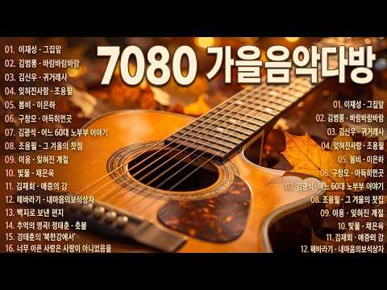
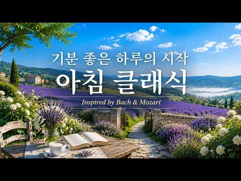

# 음악 — 성공 사례 분석: 사례별 자세히 #561–#600

`analysis.md` 의 9번 (같은 # 번호). 자동 생성 — `tools/success_analysis.py` v1.5.1 (2026-10-23 07:49 UTC). ※ 연구·교육용 — 투자 권유가 아님.

### 561. Lord Heal Me -Inspired By Enya (2026 Ai Music Video)

- https://www.youtube.com/watch?v=Q-JjRkFbFhU · SOUNDIASM · 구독자 10,700 · 조회수 784,099 (×73.3, 하루 5,344.1) · 좋아요 9,293 (1.2%) · 5.2분 · 2026-05-29 · 주제 묶음 14. AI 음악 · 형식 AI 음악 · 폴더 `W_Q-JjRkFbFhU` (웹 승인)
- 썸네일: 
- 설명 앞부분: Immerse yourself in “Lord Heal Me,” a deeply emotional ambient worship song filled with ethereal vocals, cinematic textures, gentle piano, and calming spiritual energy. Inspired by heavenly harmonies and peaceful atmospheric soundscapes, this healing music journey speaks of hope, surrender, divine …
- 같은 채널 평소 대비 ×3,806.3 (채널 최근 롱폼 중앙값 206회) · 평소 영상: When Winter Dreams Begin - Enya inspired (206회) / More Than a Conqueror -Powerful Christian Battle … (201회)
- 대본 없음 (설명) — 음성인식이 끝나면 도입부·흐름이 들어감
- 댓글 326/326: 좋은 점 — 영상 0 · 감사·응원 1 · 더 알고 싶은 것 0 · 아쉬운 점 — 영상 0 · 반박·불만 — 의견 다름 0 · 정치·사회 0 · 경험 공유 1 · 구독·다음 기대 0
  - 감사·응원 👍0 “우리나라 돈벌어 어디에 쓰이나요!? 아프리카에 [물좀] 해결해주셨음고맙겠습니다 우리가 여러가지음식을식용합니다만 그중가장중요한게 식수~즉 (물~)아니던가요~ 물만이라도.... 아프리카에 해결해주셨음 고맙겠습니다 저도 나름~ 기도 할겁니다 대한민국5천만 여러분과함께 기도…”
  - 경험 공유 👍0 “우리나라 돈벌어 어디에 쓰이나요!? 아프리카에 [물좀] 해결해주셨음고맙겠습니다 우리가 여러가지음식을식용합니다만 그중가장중요한게 식수~즉 (물~)아니던가요~ 물만이라도.... 아프리카에 해결해주셨음 고맙겠습니다 저도 나름~ 기도 할겁니다 대한민국5천만 여러분과함께 기도…”

### 562. 10 Most Powerful Morning Mantras ∣ Remove All Negativity ∣ Ganesh Hanuman Shiva Vishnu Kr…

- https://www.youtube.com/watch?v=rH2JDVys2Os · Adhyatmik Dhwani · 구독자 28,900 · 조회수 2,104,441 (×72.8, 하루 13,907.6) · 좋아요 25,624 (1.2%) · 20.7분 · 2026-05-25 · 주제 묶음 1. 수면·명상·힐링 · 형식 음악 (그 밖 모양 — 한 편짜리 BGM 등) · 폴더 `W_rH2JDVys2Os` (웹 승인)
- 썸네일: 
- 설명 앞부분: 🌅 Start your morning with divine blessings of Ganesh, Hanuman, Shiva & Vishnu — and remove all negativity before your day begins. Play this every morning to: 🐘 Remove obstacles & bring new beginnings (Ganesh Mantra) 🙏 Gain strength, courage & protection (Hanuman Mantra) 🔱 Find peace, liberation & i…
- 같은 채널 평소 대비 ×1,726.4 (채널 최근 롱폼 중앙값 1,219회) · 평소 영상: Sankashti Chaturthi Ganesh Morning Mantra ∣ Vakra… (1,331회) / Om Namah Shivaya 108 Times ∣ मन की शांति और सकारा… (1,107회)
- 대본 없음 (설명) — 음성인식이 끝나면 도입부·흐름이 들어감
- 댓글 1,753/1,773: 좋은 점 — 영상 0 · 감사·응원 0 · 더 알고 싶은 것 0 · 아쉬운 점 — 영상 0 · 반박·불만 — 의견 다름 0 · 정치·사회 0 · 경험 공유 0 · 구독·다음 기대 0

### 563. Morning Coffee Indie Folk – Warm Acoustic Music for Peaceful Slow Days

- https://www.youtube.com/watch?v=wFy9kud8FHE · Silver Coast · 구독자 28,700 · 조회수 2,088,799 (×72.8, 하루 17,740.4) · 좋아요 0 (0.0%) · 65.3분 · 2026-06-27 · 주제 묶음 4. 카페·매장·라운지 · 형식 플레이리스트·모음 (여러 곡) · 폴더 `W_wFy9kud8FHE` (웹 승인)
- 썸네일: 
- 챕터: 0:00 August River · 4:41 October Country · 9:18 The Firetower · 14:07 The Valley Knows · 18:42 Northern Ember · 25:27 Quiet Harbour · 30:54 Morning Tide · 36:03 Golden Canyons · 41:31 Wildfire Mercy · 47:05 November Kids · 52:55 Northern Rivers · 59:54 Dust And Thunder
- 설명 앞부분: Morning Coffee Indie Folk is a warm acoustic playlist created for peaceful slow days, quiet mornings, and the simple joy of your first cup of coffee. Featuring relaxing indie folk songs, soft acoustic guitars, and cinematic folk textures, this collection brings together comforting melodies that hel…
- 같은 채널 평소 대비 ×39.2 (채널 최근 롱폼 중앙값 53,347회) · 평소 영상: Coffee & Chill Indie Folk – Soft Acoustic Songs f… (53,347회) / Indie Folk & Coffee Vibes – Gentle Acoustic Songs… (55,270회)
- 대본 없음 (설명) — 음성인식이 끝나면 도입부·흐름이 들어감
- 댓글 369/371: 좋은 점 — 영상 0 · 감사·응원 0 · 더 알고 싶은 것 0 · 아쉬운 점 — 영상 0 · 반박·불만 — 의견 다름 0 · 정치·사회 0 · 경험 공유 0 · 구독·다음 기대 0

### 564. 【星河入夢】 Ancient Chinese Healing Music 🎵 ∣ Qixi Star River 🌌 - Guzheng × Xiao

- https://www.youtube.com/watch?v=pFttQ6MZ9d8 · Tianhe Harmony · 구독자 879 · 조회수 63,710 (×72.5, 하루 678.7) · 좋아요 1,134 (1.8%) · 77.8분 · 2026-07-21 · 주제 묶음 1. 수면·명상·힐링 · 형식 음악 (그 밖 모양 — 한 편짜리 BGM 등) · 폴더 `W_pFttQ6MZ9d8` (웹 승인)
- 썸네일: 
- 챕터: 0:00 Star River Reflection · 11:15 First Xiao Echoes in the Night · 22:40 Silk Ribbon Swaying · 33:10 Guzheng Across the Stone Brid… · 44:25 Deep Night on Magpie Bridge · 55:50 Erhu Starlight Melody · 65:15 Peaceful Water Ripples · 73:40 Fading into the Milky Way
- 설명 앞부분: Experience the deep calm of this ancient Chinese healing music under the Qixi star river. Let the Guzheng and Xiao wash away your stress and bring peace. 🌙 About This Music Find your inner peace under the endless Milky Way. This ancient Chinese healing music is inspired by the Qixi Festival and the…
- 같은 채널 평소 대비 ×155.4 (채널 최근 롱폼 중앙값 410회) · 평소 영상: 【長城破曉】 ANCIENT CHINESE HEALING MUSIC 🌅 ∣ Great Wa… (410회) / 【殷墟星火】 ANCIENT CHINESE STUDY MUSIC 📖 ∣ Yin Xu Ora… (417회)
- 대본 없음 (설명) — 음성인식이 끝나면 도입부·흐름이 들어감
- 댓글 48/48: 좋은 점 — 영상 0 · 감사·응원 1 · 더 알고 싶은 것 0 · 아쉬운 점 — 영상 0 · 반박·불만 — 의견 다름 0 · 정치·사회 0 · 경험 공유 0 · 구독·다음 기대 0
  - 감사·응원 👍0 “세상을 아름답게하는데 일조를하심니다 곱고 아름다운소리로 감사함니다 언제듣어도 고요와 멋이넘침니다🙏”

### 565. Музыкальная терапия🌿успокаивает нервную систему и освежает душу #musicforthesoul #pianomu…

- https://www.youtube.com/watch?v=iBs7kGH9KhA · МЕЛОДИЯ ДЛЯ ДУШИ · 구독자 15,600 · 조회수 1,118,549 (×71.7, 하루 7,092.6) · 좋아요 10,539 (0.9%) · 60.2분 · 2026-05-18 · 주제 묶음 6. 피아노·클래식·연주곡 · 형식 음악 (그 밖 모양 — 한 편짜리 BGM 등) · 폴더 `W_iBs7kGH9KhA` (웹 승인)
- 썸네일: 
- 같은 채널 평소 대비 ×460.1 (채널 최근 롱폼 중앙값 2,431회) · 평소 영상: Лес в лучах заката ∣ Музыка для медитации и восст… (2,431회) / Горное озеро на закате 🏔️ Музыка для медитации и … (2,732회)
- 대본 없음 (없음) — 음성인식이 끝나면 도입부·흐름이 들어감
- 댓글 912/920: 좋은 점 — 영상 0 · 감사·응원 0 · 더 알고 싶은 것 0 · 아쉬운 점 — 영상 0 · 반박·불만 — 의견 다름 0 · 정치·사회 0 · 경험 공유 0 · 구독·다음 기대 0

### 566. Paris Night Chanson 🌙 1960s Vintage French Café Music (Romantic Love Songs)

- https://www.youtube.com/watch?v=8LyppqPNDns · AtelierChanson · 구독자 15,600 · 조회수 1,116,300 (×71.6, 하루 6,276.0) · 좋아요 22,657 (2.0%) · 23.9분 · 2026-04-28 · 주제 묶음 4. 카페·매장·라운지 · 형식 음악 (그 밖 모양 — 한 편짜리 BGM 등) · 폴더 `W_8LyppqPNDns` (웹 승인)
- 썸네일: 
- 설명 앞부분: 🎶 Paris Night Chanson 🌙 1960s Vintage French Café Music (Romantic Love Songs) ✨ IMMERSE YOURSELF IN VINTAGE PARIS Step into a timeless world where the spirit of old-world France meets modern tranquility. This collection of authentic French chanson music captures the essence of a vintage Paris café—…
- 같은 채널 평소 대비 ×915.8 (채널 최근 롱폼 중앙값 1,219회) · 평소 영상: 1960s Paris Chanson Love Songs 🌙 Mysterious Femal… (1,219회) / ☕ Rainy Paris Café ∣ 1960 Vintage French Chanson … (1,237회)
- 대본 없음 (설명) — 음성인식이 끝나면 도입부·흐름이 들어감
- 댓글 941/943: 좋은 점 — 영상 0 · 감사·응원 3 · 더 알고 싶은 것 0 · 아쉬운 점 — 영상 0 · 반박·불만 — 의견 다름 0 · 정치·사회 0 · 경험 공유 1 · 구독·다음 기대 0
  - 감사·응원 👍1 “영상과 음악의 완벽한 조합이네요 감사히 잘들었습니다. 오늘 하루는 여기서 머물다가 갑니다”
  - 감사·응원 👍1 “감사합니다.”
  - 경험 공유 👍1 “내가 정말 찾던 낭만적인 음악이에요. 드디어 프랑스인 들도 Ai를 활용하여 이런 프랑스 정서의 음악을 만들 수 있게 됐군요. 축하해요.”

### 567. 옛추억에 눈물나는 노래 '세월' #감성발라드 #감성가요

- https://www.youtube.com/watch?v=zNbEjZxdswM · 고구려TV🍒음악방송 · 구독자 4,140 · 조회수 295,283 (×71.3, 하루 2,721.2) · 좋아요 2,961 (1.0%) · 67.3분 · 2026-07-06 · 주제 묶음 9. 가요·발라드·트로트 · 형식 음악 (그 밖 모양 — 한 편짜리 BGM 등) · 폴더 `W_zNbEjZxdswM` (웹 승인)
- 썸네일: 
- 설명 앞부분: 세월 노래 감상하시고
- 같은 채널 평소 대비 ×934.4 (채널 최근 롱폼 중앙값 316회) · 평소 영상: 어린시절 다슬기 잡이 추억이 서린 노래 (316회) / 힙합 '요즘세상'이 왜이렇게 돌아가지? #고구려tv음악방송 (339회)
- 대본 없음 (설명) — 음성인식이 끝나면 도입부·흐름이 들어감
- 댓글 196/199: 좋은 점 — 영상 1 · 감사·응원 16 · 더 알고 싶은 것 1 · 아쉬운 점 — 영상 4 · 반박·불만 — 의견 다름 1 · 정치·사회 0 · 경험 공유 12 · 구독·다음 기대 0
  - 감사·응원 👍49 “영상을.보니까,아주.먼.옛날에.시골길에.소달구지.사람들.꼭.어릴때.나의.시골길.하고.똑.갇 네요.가난했어도,그때가.좋아읍니다.인심좋고.정이넘치는.웃음이.끓길지않는.항상.넉.넉한.시골민심..그때가.그립습니다..그대채널을.응원함니다”
  - 감사·응원 👍45 “눈물나게 하네요! 그때, 그 시절이 그립습니다. 감사합니다”
  - 더 알고 싶은 것 👍2 “노래 제목 아시는 분! 좀 부탁합니다.”
  - 아쉬운 점 — 영상 👍13 “내고향 김해 생림 먼지 풀푸나고 어쩌다 차한대 지나갈때면 황토흙탕물튈까봐 잽빠르게 피해버린 기억 이제 나이 칠십을 넘기며 아련한 추억속에 훌쩍가버린 시간에 아쉬움과,그리움이 교차하네”
  - 아쉬운 점 — 영상 👍6 “내가가장좋아하던 코스모스가 이제는 보기힘들어서 넘아쉬워요 어쩌다보이는건 옛날 코스모스가 아니고 느낌이 달라요”
  - 반박·불만 — 의견 다름 👍5 “기존 가요는 아니죠?”
  - 경험 공유 👍38 “한숨돌려 아련한. 길 내가 걸온지도 모르고 세월에 밀려 왔네요.”
  - 경험 공유 👍32 “아,제가 초등학교 다닐때 신작로 길에 피든 코스모스 생각나네요”

### 568. ㅤㅤㅤㅤㅤㅤㅤㅤㅤ ㅤㅤㅤㅤㅤㅤ

- https://www.youtube.com/watch?v=UHHSdhBSfgQ · ㅤㅤㅤㅤㅤㅤㅤㅤㅤㅤㅤㅤㅤㅤㅤㅤㅤㅤㅤㅤㅤㅤㅤㅤㅤㅤㅤㅤㅤㅤㅤㅤㅤㅤㅤㅤᵒ · 구독자 22,900 · 조회수 1,621,765 (×70.8, 하루 19,900.9) · 좋아요 55,762 (3.4%) · 93.6분 · 2026-08-02 · 주제 묶음 기타 · 형식 음악 (그 밖 모양 — 한 편짜리 BGM 등) · 폴더 `W_UHHSdhBSfgQ` (웹 승인)
- 썸네일: 
- 설명 앞부분: Lo-fi / Jazz / Lounge
- 같은 채널 평소 대비 ×287.2 (채널 최근 롱폼 중앙값 5,646회) · 평소 영상: ㅤㅤㅤㅤㅤㅤㅤㅤㅤㅤㅤㅤㅤㅤㅤㅤㅤㅤㅤㅤㅤㅤㅤㅤㅤㅤㅤㅤㅤㅤㅤㅤㅤㅤㅤㅤㅤㅤㅤㅤㅤㅤㅤㅤㅤㅤㅤㅤㅤ… (6,057회) / ㅤㅤㅤㅤㅤㅤㅤㅤㅤㅤㅤ (5,236회)
- 대본 없음 (설명) — 음성인식이 끝나면 도입부·흐름이 들어감
- 댓글 956/966: 좋은 점 — 영상 0 · 감사·응원 0 · 더 알고 싶은 것 0 · 아쉬운 점 — 영상 0 · 반박·불만 — 의견 다름 0 · 정치·사회 1 · 경험 공유 0 · 구독·다음 기대 0
  - 정치·사회 👍1 “여기 다 외국인인가봐;;”

### 569. Groove Playlist ∣ ∣ Let your worries melt into the rhythm ∣ Lofi Jazz ☕ Study / Work / Re…

- https://www.youtube.com/watch?v=PjyT13hITqM · DRDR · 구독자 13,800 · 조회수 964,773 (×69.9, 하루 6,108.1) · 좋아요 9,036 (0.9%) · 206.3분 · 2026-05-18 · 주제 묶음 3. 공부·집중·작업 · 형식 플레이리스트·모음 (여러 곡) · 폴더 `W_PjyT13hITqM` (웹 승인)
- 썸네일: 
- 설명 앞부분: Two friends dance freely in a sunlit room filled with warmth and golden light, their movements synchronized with infectious joy. A loyal companion joins in the celebration, surrounded by simple comforts—plants, books, soft furniture—creating an intimate sanctuary where music becomes the language of…
- 같은 채널 평소 대비 ×261.9 (채널 최근 롱폼 중앙값 3,684회) · 평소 영상: JAZZ POP ∣ Vol.6☀️ Carry a Good Mood Into the Day… (3,688회) / JAZZ POP ☀️ One Easy Thing at a Time ∣ Work & Stu… (3,679회)
- 대본 없음 (설명) — 음성인식이 끝나면 도입부·흐름이 들어감
- 댓글 218/218: 좋은 점 — 영상 0 · 감사·응원 0 · 더 알고 싶은 것 0 · 아쉬운 점 — 영상 0 · 반박·불만 — 의견 다름 0 · 정치·사회 0 · 경험 공유 0 · 구독·다음 기대 2
  - 구독·다음 기대 👍4 “피드에 떠서 방문했는데 너무 좋아서 구독했어요. 음악 잘 들을게요.😍😍😍”
  - 구독·다음 기대 👍1 “구독하고갑니다”

### 570. The Most Beautiful And Emotional Cinematic Adagio ∣ Cello & Felt Piano

- https://www.youtube.com/watch?v=6AKklMjtK8M · CLASSICAL SPACE · 구독자 11,200 · 조회수 782,668 (×69.9, 하루 4,909.6) · 좋아요 17,499 (2.2%) · 61.9분 · 2026-05-16 · 주제 묶음 6. 피아노·클래식·연주곡 · 형식 음악 (그 밖 모양 — 한 편짜리 BGM 등) · 폴더 `W_6AKklMjtK8M` (웹 승인)
- 썸네일: 
- 설명 앞부분: A deeply cinematic collection of adagio works for solo cello and felt piano, inspired by the emotional architecture of late Romantic music and the harmonic language of Rachmaninoff. These compositions move through grief, memory, winter, consolation, resignation, and quiet healing — not as dramatic …
- 같은 채널 평소 대비 ×532.6 (채널 최근 롱폼 중앙값 1,470회) · 평소 영상: Music That Finds the Thing You Have No Words For … (1,484회) / Music for Everything You Felt But Could Never Say… (1,455회)
- 대본 없음 (설명) — 음성인식이 끝나면 도입부·흐름이 들어감
- 댓글 981/994: 좋은 점 — 영상 0 · 감사·응원 0 · 더 알고 싶은 것 0 · 아쉬운 점 — 영상 0 · 반박·불만 — 의견 다름 0 · 정치·사회 0 · 경험 공유 0 · 구독·다음 기대 0

### 571. soft pastel flowers 🌸🌷 relaxing piano for dreamy & peaceful days

- https://www.youtube.com/watch?v=9NxQWqVtHRA · She of the Vale · 구독자 11,700 · 조회수 814,012 (×69.6, 하루 4,577.8) · 좋아요 10,783 (1.3%) · 37.8분 · 2026-04-28 · 주제 묶음 6. 피아노·클래식·연주곡 · 형식 음악 (그 밖 모양 — 한 편짜리 BGM 등) · 폴더 `W_9NxQWqVtHRA` (웹 승인)
- 썸네일: 
- 챕터: 0:00 Still Life - Aki Sora · 1:57 Communion - Maëlle Rousseau · 4:25 Pines and Cones - Maëlle Rous… · 6:41 Homebody - Maëlle Rousseau · 9:22 Soft Marble - Aki Sora · 11:26 A Fresh Start - Aki Sora · 13:49 Time to Time - Aki Sora · 16:18 One More Story - Nils Halberg · 18:54 Repeat
- 설명 앞부분: A gentle world of petals, light, and stillness 🌸 Soft piano drifting through blooming pastels and warm spring air. Relaxing piano music inspired by flower gardens, soft sunlight, and quiet, dreamy days. Let these gentle melodies create a calm, cozy atmosphere like sitting in a blooming garden where…
- 같은 채널 평소 대비 ×124.5 (채널 최근 롱폼 중앙값 6,536회) · 평소 영상: summer petals🌼🍃∣ relaxing piano for morning coffe… (6,560회) / ethereal bloom🦢🌺 ∣ dreamy piano music for peacefu… (6,513회)
- 대본 없음 (설명) — 음성인식이 끝나면 도입부·흐름이 들어감
- 댓글 358/360: 좋은 점 — 영상 1 · 감사·응원 1 · 더 알고 싶은 것 0 · 아쉬운 점 — 영상 0 · 반박·불만 — 의견 다름 0 · 정치·사회 0 · 경험 공유 1 · 구독·다음 기대 0
  - 좋은 점 — 영상 👍8 “너무 아름다운 곡입니다....독서할 때 듣기 좋은 플레이리스트네요 좋은 곡 감사합니다.”
  - 감사·응원 👍8 “너무 아름다운 곡입니다....독서할 때 듣기 좋은 플레이리스트네요 좋은 곡 감사합니다.”
  - 경험 공유 👍4 “나도 저 꽃처럼 인생이 꽃밭이었으면”

### 572. 공부할 때 듣는 판타지 음악 ∣ playlist

- https://www.youtube.com/watch?v=d8sLNlVAuxE · Flow Trigger. · 구독자 6,540 · 조회수 452,500 (×69.2, 하루 6,940.1) · 좋아요 3,307 (0.7%) · 130.3분 · 2026-08-19 · 주제 묶음 3. 공부·집중·작업 · 형식 플레이리스트·모음 (여러 곡) · 폴더 `W_d8sLNlVAuxE` (웹 승인)
- 썸네일: 
- 챕터: 0:00 푸른 정적 (Blue Stillness) · 3:13 천년의 하늘 (Thousand-Year Sky) · 6:37 흰 잔상 (White Afterimage) · 9:43 바람의 층 (Layers of Wind) · 12:42 낮에 뜬 별 (Daylight Star) · 15:47 마법의 잔향 (Magic Afterglow) · 19:15 먼 종소리 (Distant Bells) · 22:36 하늘의 수심 (Sky Depths) · 26:03 loop
- 설명 앞부분: 공부, 독서, 업무, 작업에 어울리는 판타지 음악입니다! 🎵 아티스트 채널(ARTIST CHANNEL) ▼ YouTube Music ▼ Apple Music ▼ Spotify ▼ FLO 🎵 DAW: Logic Pro 🎹 Master Keyboard: Arturia KeyLab Essential MK3 61 🔈 Audio Interface: Focusrite Scarlett Solo 4th 🎧 Headphones: Audio Technica ATH-M50x, Bowers & Wilkins Px7 S2e I use a combinat…
- 같은 채널 평소 대비 ×27.9 (채널 최근 롱폼 중앙값 16,229회) · 평소 영상: 가장 빛나던 사람이, 가장 먼 별이 되었다. ∣ playlist (16,229회) / 판타지 세계로 이끄는 초대장 ∣ Fantasy Study Music ∣ Frieren 🌿 (17,520회)
- 대본 없음 (설명) — 음성인식이 끝나면 도입부·흐름이 들어감
- 댓글 58/60: 좋은 점 — 영상 0 · 감사·응원 3 · 더 알고 싶은 것 2 · 아쉬운 점 — 영상 1 · 반박·불만 — 의견 다름 0 · 정치·사회 0 · 경험 공유 0 · 구독·다음 기대 0
  - 감사·응원 👍13 “한달이 정말 정신없이 지나갔네요. 이 음악이 올라왔을때 8월의 태양이라는 책을 읽고 있었는데 까먹고 댓글을 안 달았지 뭐에요,,😢 책 읽으면서 듣기 참 좋은 음악이었어요! 이번 음악도 잘 들었습니다🐳 화이팅!! 프로필 바꾸셨네요!! 간결하고 멋있는 것 같아요😁”
  - 감사·응원 👍1 “플리들 항상 감사히 듣고 있습니다! 판타지하면 역시 중세시대 풍 술집인데 왁자지껄함 속에 주인공들끼리 도란도란 느낌으로 하나 만들어 주실 수 있나요!! 행복한 하루 보내시길 바랍니다❤”
  - 더 알고 싶은 것 👍1 “너무 잘 듣고있습니당 “푸른정적”부분 스포티파이에 올려주실수있나용?!?!”
  - 더 알고 싶은 것 👍1 “플리들 항상 감사히 듣고 있습니다! 판타지하면 역시 중세시대 풍 술집인데 왁자지껄함 속에 주인공들끼리 도란도란 느낌으로 하나 만들어 주실 수 있나요!! 행복한 하루 보내시길 바랍니다❤”
  - 아쉬운 점 — 영상 👍0 “광고가 너무 많이 나와요”

### 573. Deepest Sleep Healing - Release Melatonin, Calm Anxiety & Sleep Fast ( 3 Hours No Ads )

- https://www.youtube.com/watch?v=J64B8xhHEbs · Deep Sleep Harmony · 구독자 12,800 · 조회수 879,717 (×68.7, 하루 7,102.8) · 좋아요 6,682 (0.8%) · 225.4분 · 2026-06-21 · 주제 묶음 1. 수면·명상·힐링 · 형식 긴 한 곡·반복 (N시간) · 폴더 `W_J64B8xhHEbs` (웹 승인)
- 썸네일: 
- 챕터: 0:00 Part 1: Entering the Dreamsca… · 60:00 Part 2: Deep Melatonin Releas… · 120:00 Part 3: Whispering Nature & C…
- 설명 앞부분: ✨ Welcome to your sanctuary of deep rest and healing. If you are struggling to quiet your mind, battling anxiety, or simply looking for a peaceful escape from the chaos of daily life, you have found the right place. This 3-hour premium sleep music session is carefully crafted to help you release me…
- 같은 채널 평소 대비 ×460.8 (채널 최근 롱폼 중앙값 1,909회) · 평소 영상: Instant Calmness for Your Mind 🍃 Soothing Piano M… (1,909회) / Soft Vibes, No Stress 🌿 Beautiful Relaxing Music … (2,088회)
- 대본 없음 (설명) — 음성인식이 끝나면 도입부·흐름이 들어감
- 댓글 232/235: 좋은 점 — 영상 0 · 감사·응원 0 · 더 알고 싶은 것 0 · 아쉬운 점 — 영상 0 · 반박·불만 — 의견 다름 0 · 정치·사회 0 · 경험 공유 0 · 구독·다음 기대 0

### 574. Deep Chill Mix 2026 🌌 Emotional House & Soulful Vibes for Study • Focus • Relax

- https://www.youtube.com/watch?v=5FQsa5nWaW0 · Rhythm Flow · 구독자 23,700 · 조회수 1,620,785 (×68.4, 하루 14,882.0) · 좋아요 15,123 (0.9%) · 60.8분 · 2026-07-06 · 주제 묶음 3. 공부·집중·작업 · 형식 정보·해설 (그 밖) · 폴더 `W_5FQsa5nWaW0` (웹 승인)
- 썸네일: 
- 설명 앞부분: Deep Chill Mix 2026 🌌 Emotional House & Soulful Vibes for Study • Focus • Relax Escape into a world of Emotional House and Soulful Vibes, carefully curated to help you study, focus, and relax. Blending smooth melodies, deep basslines, soulful vocals, and uplifting rhythms, this mix creates the perf…
- 같은 채널 평소 대비 ×283.0 (채널 최근 롱폼 중앙값 5,728회) · 평소 영상: Deep Chill Mix 2026 🎶 Dreamy Deep House & Emotion… (5,728회) / Best Deep Chill Mix 2026 🎧 Smooth House & Emotion… (5,830회)
- 대본 없음 (설명) — 음성인식이 끝나면 도입부·흐름이 들어감
- 댓글 323/328: 좋은 점 — 영상 0 · 감사·응원 0 · 더 알고 싶은 것 0 · 아쉬운 점 — 영상 0 · 반박·불만 — 의견 다름 0 · 정치·사회 0 · 경험 공유 0 · 구독·다음 기대 0

### 575. a quiet playlist for a quiet heart (calm/relax piano)

- https://www.youtube.com/watch?v=BBz7-F9mdUE · Little Thing · 구독자 30,600 · 조회수 2,083,818 (×68.1, 하루 13,717.5) · 좋아요 18,508 (0.9%) · 89.5분 · 2026-05-24 · 주제 묶음 6. 피아노·클래식·연주곡 · 형식 플레이리스트·모음 (여러 곡) · 폴더 `W_BBz7-F9mdUE` (웹 승인)
- 썸네일: 
- 설명 앞부분: Hi there, have a nice day 🍃 I hope my music can help you relax and focus more on every little thing in your life ❤ For the best experience, this music is gently enjoyed at around 40–50% volume. 🎧 a quiet playlist for a quiet heart (calm/relax piano) a quiet playlist for a quiet heart (calm/relax pi…
- 같은 채널 평소 대비 ×188.0 (채널 최근 롱폼 중앙값 11,086회) · 평소 영상: a playlist for a dreamy autumn 🍂 ✨ (11,086회) / a quiet playlist for a quiet morning 🍁 (autumn ve… (11,104회)
- 대본 없음 (설명) — 음성인식이 끝나면 도입부·흐름이 들어감
- 댓글 314/318: 좋은 점 — 영상 0 · 감사·응원 0 · 더 알고 싶은 것 0 · 아쉬운 점 — 영상 0 · 반박·불만 — 의견 다름 0 · 정치·사회 0 · 경험 공유 0 · 구독·다음 기대 0

### 576. Clear Yourself of Everything That Drains You ∣ Calm Your Mind, Relieve Stress, and Heal Y…

- https://www.youtube.com/watch?v=Ww-tZVjkI9Y · Frequencies of the Soul · 구독자 46,400 · 조회수 3,156,662 (×68.0, 하루 26,167.4) · 좋아요 57,903 (1.8%) · 68.4분 · 2026-06-24 · 주제 묶음 1. 수면·명상·힐링 · 형식 음악 (그 밖 모양 — 한 편짜리 BGM 등) · 폴더 `W_Ww-tZVjkI9Y` (웹 승인)
- 썸네일: 
- 설명 앞부분: Step into the enchanting landscapes of Ireland, where mystical forests, rolling green hills, and ancient natural beauty inspire a deep sense of peace and wonder. This original meditation combines relaxing music with breathtaking visuals influenced by Irish nature, culture, and timeless traditions. …
- 같은 채널 평소 대비 ×25.5 (채널 최근 롱폼 중앙값 124,029회) · 평소 영상: Lemuria. The Memory of Your Soul Is Awakening ∣ C… (124,029회) / Celtic Music for Inner Peace🌿Immerse Yourself in … (114,166회)
- 대본 없음 (설명) — 음성인식이 끝나면 도입부·흐름이 들어감
- 댓글 1,284/1,296: 좋은 점 — 영상 0 · 감사·응원 1 · 더 알고 싶은 것 0 · 아쉬운 점 — 영상 0 · 반박·불만 — 의견 다름 0 · 정치·사회 0 · 경험 공유 0 · 구독·다음 기대 0
  - 감사·응원 👍0 “인간의 마음을 위로 하는건 자연 뿐 & 부드러운 음악,, 감사 감사 🎉🎉🎉”

### 577. Too Much on Your Mind? Stay Here for a While ∣ Arabic Oud Ambient Music

- https://www.youtube.com/watch?v=uDCjW-9mE2k · Sahara Echo Music · 구독자 14,100 · 조회수 957,987 (×67.9, 하루 5,444.7) · 좋아요 13,529 (1.4%) · 64.4분 · 2026-04-30 · 주제 묶음 6. 피아노·클래식·연주곡 · 형식 음악 (그 밖 모양 — 한 편짜리 BGM 등) · 폴더 `W_uDCjW-9mE2k` (웹 승인)
- 썸네일: 
- 설명 앞부분: Too much on your mind? Stay here for a while. This calming oud ambient music blends gentle melodies, spacious atmospheric textures, and peaceful desert-inspired ambience to create a quiet place for rest, reflection, and emotional calm. Designed for moments when life feels overwhelming, this immersi…
- 같은 채널 평소 대비 ×336.3 (채널 최근 롱폼 중앙값 2,848회) · 평소 영상: For Quiet Moments ∣ Arabic Oud for Meditation & R… (3,161회) / Some Journeys Begin With One Beat ∣ Desert Pulse … (2,536회)
- 대본 없음 (설명) — 음성인식이 끝나면 도입부·흐름이 들어감
- 댓글 442/446: 좋은 점 — 영상 0 · 감사·응원 0 · 더 알고 싶은 것 0 · 아쉬운 점 — 영상 0 · 반박·불만 — 의견 다름 0 · 정치·사회 0 · 경험 공유 0 · 구독·다음 기대 0

### 578. Put This On and Calm Your Brain... (No Ads)🌧️ Soft Piano Music ∣ The Soothing Sound of Ra…

- https://www.youtube.com/watch?v=vhJgRiH31bQ · Cozy Attic Nights · 구독자 5,880 · 조회수 399,150 (×67.9, 하루 3,204.1) · 좋아요 2,393 (0.6%) · 716.8분 · 2026-06-20 · 주제 묶음 6. 피아노·클래식·연주곡 · 형식 음악 (그 밖 모양 — 한 편짜리 BGM 등) · 폴더 `W_vhJgRiH31bQ` (웹 승인)
- 썸네일: 
- 설명 앞부분: Put This On and Calm Your Brain... (No Ads)🌧️ Soft Piano Music ∣ The Soothing Sound of Rain 🌧️ Heavy rain falls softly outside the attic window while warm fireplace light fills the room with a peaceful glow. Paired with gentle sleep piano music, this cozy rainy night ambience is designed to help yo…
- 같은 채널 평소 대비 ×392.9 (채널 최근 롱폼 중앙값 1,016회) · 평소 영상: Relaxing Piano Music with Rain Sounds by a Crackl… (1,016회) / 6 Hours Relaxing Sleep Music with Rain on Window … (992회)
- 대본 없음 (설명) — 음성인식이 끝나면 도입부·흐름이 들어감
- 댓글 182/186: 좋은 점 — 영상 0 · 감사·응원 0 · 더 알고 싶은 것 0 · 아쉬운 점 — 영상 0 · 반박·불만 — 의견 다름 0 · 정치·사회 0 · 경험 공유 0 · 구독·다음 기대 0

### 579. 😊 아침부터 기분 좋게 행복해지는 노래 모음 🎧 가볍게 흥얼거리는 기분 좋게 행복한 노래 모음

- https://www.youtube.com/watch?v=r0jtXc1Y-jE · 행복 · 구독자 7,010 · 조회수 475,790 (×67.9, 하루 7,623.7) · 좋아요 1,665 (0.4%) · 116.4분 · 2026-08-21 · 주제 묶음 14. AI 음악 · 형식 AI 음악 · 폴더 `W_r0jtXc1Y-jE` (웹 승인)
- 썸네일: 
- 챕터: 0:00 비가 그친 자리 (After the Rain) · 4:34 늦은 오후, 붉게 물드는 창가 (Late Aftern… · 8:26 늦은 오후, 붉게 물드는 창가 (Late Aftern… · 11:49 담벼락에 걸린 노을 (Sunset on the All… · 15:55 붉은 노을빛 바닷가 (Sunset Ocean Walk) · 19:10 세월을 담은 따스한 손 (Hands Holding W… · 23:16 아침은 답을 묻지 않아 · 25:55 주말 아침의 초록빛 햇살 (Morning Sun in… · 29:05 비가 그친 자리 (After the Rain) · 33:39 늦은 오후, 붉게 물드는 창가 (Late Aftern… · 37:32 늦은 오후, 붉게 물드는 창가 (Late Aftern… · 40:54 담벼락에 걸린 노을 (Sunset on the All… · 45:01 붉은 노을빛 바닷가 (Sunset Ocean Walk) · 48:15 세월을 담은 따스한 손 (Hands Holding W… · 52:22 아침은 답을 묻지 않아 · 55:00 주말 아침의 초록빛 햇살 (Morning Sun in… · 58:10 비가 그친 자리 (After the Rain) · 62:45 늦은 오후, 붉게 물드는 창가 (Late Aftern… · 66:37 늦은 오후, 붉게 물드는 창가 (Late Aftern… · 69:59 담벼락에 걸린 노을 (Sunset on the All…
- 설명 앞부분: 노래가 마음에 드셨다면 😊 2. 🎧 노래를 계속 이어서 듣고 싶으실 때는 연속 재생을 켜주시면 더 편하게 감상하실 수 있어요 📱 휴대폰 영상 터치 → 오른쪽 상단 톱니바퀴 → 더보기 → 연속 재생 체크 💻 컴퓨터 영상에서 마우스 우클릭 → 연속 재생 클릭 ※ 새 영상마다 다시 설정해주셔야 적용됩니다 오늘도 건강하고 즐거운 하루 보내세요 😊 화이팅! 💪 마음의 피로를 비워내고 하루를 기분 좋게 시작할 수 있는 따스한 행복채널의 노래 모음입니다. ☀️🎶 커피 한 잔의 여유, 주말의 드라이브, 그리고 조용한 휴식 시간에 편안하게 함께해…
- 같은 채널 평소 대비 ×125.4 (채널 최근 롱폼 중앙값 3,795회) · 평소 영상: 아침부터 행복해지는 🌿 마음이 편안해지는 하루의 쉼표 ☕ 기분 좋게 스며드는 노래 10곡… (4,864회) / 같이 들어요 🎧기분 전환 노래 모음ㅣ세월을 견뎌온 당신을 위한 노래 모음 (2,684회)
- 대본 없음 (설명) — 음성인식이 끝나면 도입부·흐름이 들어감
- 댓글 152/158: 좋은 점 — 영상 2 · 감사·응원 22 · 더 알고 싶은 것 1 · 아쉬운 점 — 영상 1 · 반박·불만 — 의견 다름 0 · 정치·사회 0 · 경험 공유 1 · 구독·다음 기대 3
  - 좋은 점 — 영상 👍2 “정말 아침에 듣기 좋은 노래들입니다.”
  - 좋은 점 — 영상 👍1 “아침에 일어나 집정리하구 커피타 옥상올라가 하늘보며 커피한잔하기 딱좋은 잔잔한음악 ❤❤ 자주들어와 들어야겠어요 맘이 편하구 잠잘때도 듣기 좋은것 같아요 ❤ 생각정리 할때 듣기도 좋겠어요”
  - 감사·응원 👍9 “노래 넘 잘 들었어요 감동 ㆍ감사합니다”
  - 감사·응원 👍7 “노래 너무좋다. 세상이 맑아지는 느낌 . 그분좋아지는 노래 고맙습니다❤”
  - 더 알고 싶은 것 👍2 “노래 제목이 궁금합니다”
  - 아쉬운 점 — 영상 👍4 “😂🎉목소리가 너무 이뻐요”
  - 경험 공유 👍1 “방금 음식하다가 윤연히 들었는데 저도 몰래 흥이 났어 흥얼거리게되네요 옛 어린시절도 생각이 많이 나네요 연속 으로 듣고 싶네요”
  - 구독·다음 기대 👍3 “좋은 노래 잘 듣고 구독하고 갑니다”
  - 구독·다음 기대 👍3 “새벽에 듣는 노래 좋네요.구독합니다. ❤❤❤”

### 580. Heartbroken Lofi Songs 💔 ∣ Slowed + Reverb ∣ Late Night Study & Focus Mood 🎧

- https://www.youtube.com/watch?v=Koo5Xgqn_zE · Stylish Official 9.0 · 구독자 15,000 · 조회수 1,017,056 (×67.8, 하루 17,464.4) · 좋아요 5,536 (0.5%) · 8분 · 2026-08-26 · 주제 묶음 3. 공부·집중·작업 · 형식 음악 (그 밖 모양 — 한 편짜리 BGM 등) · 폴더 `W_Koo5Xgqn_zE` (웹 승인)
- 썸네일: 
- 설명 앞부분: Welcome to the world of soothing lofi music, where stress fades away and peace takes over. This mind-relaxing lofi mix is perfect for creating a calm atmosphere, helping you focus, relax, and unwind. Deep Focus & Studying 📖 Relaxing & Meditation 🧘‍♂ Chilling After a Long Day 🌅 Peaceful Sleep & Stre…
- 같은 채널 평소 대비 ×2,523.7 (채널 최근 롱폼 중앙값 403회) · 평소 영상: Heartbroken Lofi Songs 💔 ∣ Slowed + Reverb ∣ Late… (423회) / Heartbroken Lofi Songs 💔 ∣ Slowed + Reverb ∣ Late… (383회)
- 대본 없음 (설명) — 음성인식이 끝나면 도입부·흐름이 들어감
- 댓글 99/107: 좋은 점 — 영상 0 · 감사·응원 0 · 더 알고 싶은 것 0 · 아쉬운 점 — 영상 0 · 반박·불만 — 의견 다름 0 · 정치·사회 0 · 경험 공유 0 · 구독·다음 기대 0

### 581. 𝐂𝐡𝐚𝐭𝐩𝐚𝐭𝐢 𝐇𝐨𝐧𝐞𝐲 𝐬𝐢𝐧𝐠𝐡 𝐩𝐥𝐚𝐲𝐥𝐢𝐬𝐭 𝐜𝐮𝐳 𝐲𝐨𝐮 𝐫𝐞𝐚𝐥𝐥𝐲 𝐧𝐞𝐞𝐝 𝐭𝐡𝐢𝐬. 𝐛𝐲 𝐫𝐢𝐞_𝐟𝐲𝐩.

- https://www.youtube.com/watch?v=eXNfz_Rs-KQ · 𝐫𝐢𝐞  · 구독자 28,900 · 조회수 1,947,039 (×67.4, 하루 12,666.0) · 좋아요 22,189 (1.1%) · 14.8분 · 2026-05-22 · 주제 묶음 기타 · 형식 플레이리스트·모음 (여러 곡) · 폴더 `W_eXNfz_Rs-KQ` (웹 승인)
- 썸네일: 
- 챕터: 0:00 Brown rang · 1:18 Love dose · 2:43 Desi kalakaar · 4:59 chaar botal vodka · 6:43 payal · 7:38 blue eyes · 8:30 Dope shope · 10:05 Dil chori · 11:02 Get up jawani · 12:16 Angreji beat · 13:26 chhote chhote peg · 14:03 first kiss
- 같은 채널 평소 대비 ×1,054.2 (채널 최근 롱폼 중앙값 1,847회) · 평소 영상: 𝐒𝐨𝐟𝐭 𝐃𝐞𝐬𝐢 𝐩𝐥𝐚𝐲𝐥𝐢𝐬𝐭 𝐜𝐮𝐳 𝐲𝐨𝐮 𝐥𝐨𝐯𝐞 𝐛𝐞𝐢𝐧𝐠 𝐚 𝐃𝐞𝐬𝐢. 𝐫𝐢𝐞… (1,847회) / 𝐏𝐨𝐯: 𝐲𝐨𝐮 𝐥𝐨𝐯𝐞 𝐝𝐚𝐧𝐜𝐢𝐧𝐠 𝐚𝐥𝐨𝐧𝐞 𝐚𝐭 𝐦𝐢𝐝𝐧𝐢𝐠𝐡𝐭 🪷. 𝐏𝐥𝐚𝐲𝐥𝐢… (2,698회)
- 대본 없음 (없음) — 음성인식이 끝나면 도입부·흐름이 들어감
- 댓글 211/218: 좋은 점 — 영상 0 · 감사·응원 0 · 더 알고 싶은 것 0 · 아쉬운 점 — 영상 0 · 반박·불만 — 의견 다름 0 · 정치·사회 0 · 경험 공유 0 · 구독·다음 기대 0

### 582. Playlist 🎤 노래방 발라드 인기차트 & 애창곡

- https://www.youtube.com/watch?v=4ZLxFva_K5I · 필청 · 구독자 2,150 · 조회수 144,814 (×67.4, 하루 956.2) · 좋아요 617 (0.4%) · 165분 · 2026-05-24 · 주제 묶음 9. 가요·발라드·트로트 · 형식 플레이리스트·모음 (여러 곡) · 폴더 `W_4ZLxFva_K5I` (웹 승인)
- 썸네일: 
- 설명 앞부분: 노래방 인기차트 상위권을 차지한 발라드 명곡과 꾸준히 사랑받는 세대 불문 애창곡 플레이리스트입니다. 듣기만 해도 가슴이 먹먹해지는 발라드의 매력에 빠져보세요. 🎧 💬 여러분이 사랑하는 아티스트에게 응원의 댓글을 남겨주세요. 🎧 타임라인 (Timeline)
- 같은 채널 평소 대비 ×15.8 (채널 최근 롱폼 중앙값 9,194회) · 평소 영상: Playlist 💔 실시간으로 깨진 마음 접착제로 붙여주는 위로 곡들 (11,317회) / Playlist 🧗 노래방 고음의 벽을 넘다가 음이탈 나도 감성으로 커버 가능한 곡 (7,072회)
- 대본 없음 (설명) — 음성인식이 끝나면 도입부·흐름이 들어감
- 댓글 20/20: 좋은 점 — 영상 1 · 감사·응원 2 · 더 알고 싶은 것 0 · 아쉬운 점 — 영상 0 · 반박·불만 — 의견 다름 0 · 정치·사회 0 · 경험 공유 0 · 구독·다음 기대 0
  - 좋은 점 — 영상 👍12 “레전드 곡들만 모아놨네 👑 거를 타선이 없다 진짜로!!”
  - 감사·응원 👍11 “감사합니다 🎼”
  - 감사·응원 👍3 “좋은 음악 감사합니다 🐨”

### 583. [KPOP playlist] 마법처럼 빠져드는 케이팝 노동요

- https://www.youtube.com/watch?v=uuZiS5xRAVw · 오이는빼주세요 · 구독자 13,100 · 조회수 880,412 (×67.2, 하루 5,441.9) · 좋아요 2,987 (0.3%) · 59.7분 · 2026-05-14 · 주제 묶음 10. 팝송·K팝·J팝 · 형식 플레이리스트·모음 (여러 곡) · 폴더 `W_uuZiS5xRAVw` (웹 승인)
- 썸네일: 
- 같은 채널 평소 대비 ×75.2 (채널 최근 롱폼 중앙값 11,701회) · 평소 영상: N.Flying (엔플라잉) PLAYLIST 2026 UPDATED l 엔플라잉 노래모음… (11,701회) / CHUNG HA 청하 PLAYLIST 2026 l 청하 노래모음 (신곡포함) l 𝐂𝐇𝐔𝐍… (13,157회)
- 대본 없음 (없음) — 음성인식이 끝나면 도입부·흐름이 들어감
- 댓글 70/70: 좋은 점 — 영상 0 · 감사·응원 7 · 더 알고 싶은 것 0 · 아쉬운 점 — 영상 0 · 반박·불만 — 의견 다름 0 · 정치·사회 0 · 경험 공유 1 · 구독·다음 기대 0
  - 감사·응원 👍11 “도덕 선플달기 봉사활동하는 5학년 학생입니다 와 진짜 제목처럼 마법같이 빠져들었어요 ㅎㅎ❤ 이런거 올려주셔서 감사합니다!”
  - 감사·응원 👍2 “진짜 오이님 플리는 믿고들어용,,!! 맨날 오이님 플리 들으면서 운동하는데 안힘들고 오히려 즐겨용! 좋은플리 마니 만드러 주셔서 감사해용,,,🥹💕💕”
  - 경험 공유 👍11 “어떻게 내가듣고싶은것만 쏙쏙있지”

### 584. Chinese Night Music: Soft Guzheng & Erhu ∣ Sleep Like Ancient China

- https://www.youtube.com/watch?v=rw5yQGIQuwE · Lotus Echo 莲之回响 · 구독자 16,500 · 조회수 1,107,952 (×67.2, 하루 6,168.4) · 좋아요 18,151 (1.6%) · 240.2분 · 2026-04-26 · 주제 묶음 1. 수면·명상·힐링 · 형식 음악 (그 밖 모양 — 한 편짜리 BGM 등) · 폴더 `W_rw5yQGIQuwE` (웹 승인)
- 썸네일: 
- 설명 앞부분: Hey… welcome. As the night settles in, this music is here to create a quiet and peaceful space for rest. Chinese Night Music: Soft Guzheng & Erhu blends gentle traditional melodies into a calm atmosphere inspired by the stillness of ancient times. The soft strings of the guzheng flow slowly, while …
- 같은 채널 평소 대비 ×280.5 (채널 최근 롱폼 중앙값 3,950회) · 평소 영상: Chinese Moonlight Music: Gentle Pipa & Soothing M… (3,950회) / Chinese Moonlight Music: Gentle Guqin & Soothing … (3,919회)
- 대본 없음 (설명) — 음성인식이 끝나면 도입부·흐름이 들어감
- 댓글 378/384: 좋은 점 — 영상 0 · 감사·응원 2 · 더 알고 싶은 것 0 · 아쉬운 점 — 영상 0 · 반박·불만 — 의견 다름 0 · 정치·사회 0 · 경험 공유 0 · 구독·다음 기대 0
  - 감사·응원 👍5 “그윽한 밤의풍경과 아름다운 연주음악 감사합니다 중국풍개인적좋아합니다”

### 585. 7080 추억의 노래 광고없음🎶 7080노래모음 주옥같은노래 ✨7080 추억의 노래 한국인이 가장 좋아하는 💘50대 이상이 사랑한 7080 추억의 팝송

- https://www.youtube.com/watch?v=3tshpfOljYs · 7080 감성 선율 · 구독자 7,460 · 조회수 495,153 (×66.4, 하루 11,664.2) · 좋아요 1,316 (0.3%) · 118.6분 · 2026-09-10 · 주제 묶음 9. 가요·발라드·트로트 · 형식 플레이리스트·모음 (여러 곡) · 폴더 `W_3tshpfOljYs` (웹 승인)
- 썸네일: 
- 설명 앞부분: 이 영상은 1970–80년대 감성을 담은 명곡들을 모아 따뜻한 멜로디와 함께 추억을 되살리는 플레이리스트입니다. 🎧 7080 한국 발라드 모음 🌙 감성 · 추억 · 힐링 📀 제작 도구 Adobe CC 📢 안내 모든 음악은 정식 라이센스를 통해 사용되며, 편안한 시간 보내시길 바랍니다. 시청해주셔서 진심으로 감사합니다. 음악이 마음에 드셨다면 여러분의 작은 응원이 큰 힘이 됩니다.
- 같은 채널 평소 대비 ×21.4 (채널 최근 롱폼 중앙값 23,133회) · 평소 영상: 50대이상이 들으면 기분좋아지는 7080노래모음🍂🍂그집앞/잊혀진 사랑/돌아와요 부산항에.… (23,133회) / 중년들이 사랑하는 노래 🎶🎶 광고 없는 7080 좋은노래 40곡 모음 - 추억으로 떠나는… (22,613회)
- 대본 없음 (설명) — 음성인식이 끝나면 도입부·흐름이 들어감
- 댓글 63/67: 좋은 점 — 영상 1 · 감사·응원 3 · 더 알고 싶은 것 5 · 아쉬운 점 — 영상 1 · 반박·불만 — 의견 다름 0 · 정치·사회 0 · 경험 공유 2 · 구독·다음 기대 0
  - 좋은 점 — 영상 👍1 “특별한 날에 듣기 좋은 곡들이에요. 추천합니다!”
  - 감사·응원 👍1 “노래부른 가수님들 누구셔요 ? 너무 정성것 부르시네요ᆢ 잘 듣고 갑니다ᆢ고맙습니다ᆢ~~”
  - 감사·응원 👍0 “이런 노래들 듣는 게 진짜 힐링이에요. 감사합니다!”
  - 더 알고 싶은 것 👍6 “옛날 친구들과 모닥불옆에서 기타치며 노래하던 추억이 새록새록 살아나네요ㆍ그친구들 내여친은 어디서 무엇하는지 궁금하네요ㆍ캐나다 이민가고 연락이 ~뚝~~ㅠㅠ”
  - 더 알고 싶은 것 👍1 “아련한 추억, 음악다방, 지직거리는 LP판을 통해 듣던 그노래, 그시절이 그립습니다 좋은음악 많이 만들어주세요❤❤”
  - 아쉬운 점 — 영상 👍15 “희나리 부르시는분이 누구인가요? 목소리가 너무 예뻐서요”
  - 경험 공유 👍4 “이 음악들 듣고 있으면 저도 50대가 된 기분이에요! 😂”
  - 경험 공유 👍1 “50대 이상이 사랑한 노래라니, 저도 그 시기에 자라서 더욱 공감 가네요. 💘”

### 586. 하늘을 닮은 여름 🌸 여름 감성 피아노 플레이리스트 ∣ BGM ∣ 힐링·작업·집중

- https://www.youtube.com/watch?v=Os2XdhfzZdo · Mellow Season · 구독자 2,870 · 조회수 189,931 (×66.2, 하루 1,930.0) · 좋아요 1,385 (0.7%) · 120.9분 · 2026-07-16 · 주제 묶음 6. 피아노·클래식·연주곡 · 형식 플레이리스트·모음 (여러 곡) · 폴더 `W_Os2XdhfzZdo` (웹 승인)
- 썸네일: 
- 설명 앞부분: 하늘을 닮은 여름 🌸 흰 꽃 사이로 스며드는 바람과 푸른 하늘이 여름을 더욱 맑게 물들입니다. 잠시 서두름을 내려놓고, 계절의 한 장면 속에 머물러 보세요. Welcome to Mellow Season. A quiet place where gentle melodies drift through the seasons. Inspired by soft light, changing leaves, blooming flowers, and the small moments that make everyday life beautiful, Mellow…
- 같은 채널 평소 대비 ×23.9 (채널 최근 롱폼 중앙값 7,951회) · 평소 영상: 바다가 쉬어가는 오후 🌊 여름 감성 피아노 플레이리스트 ∣ BGM ∣ 힐링·집중·휴식 (7,951회) / 선선한 바람과 함께 🌼 가을 감성 피아노 플레이리스트 ∣ BGM ∣ 집중·작업·휴식 (7,353회)
- 대본 없음 (설명) — 음성인식이 끝나면 도입부·흐름이 들어감
- 댓글 31/31: 좋은 점 — 영상 0 · 감사·응원 3 · 더 알고 싶은 것 0 · 아쉬운 점 — 영상 0 · 반박·불만 — 의견 다름 0 · 정치·사회 0 · 경험 공유 0 · 구독·다음 기대 1
  - 감사·응원 👍2 “요즘 실기공부하면서 듣는 음악이에요 대단한 말로 표현은 못하겠지만 너무나 취향이에요 집중도 잘되고 잘 듣고 있습니다 감사합니다”
  - 감사·응원 👍1 “멋진 작품이네요 감사합니다”
  - 구독·다음 기대 👍0 “분위기가 미치네요 구독하고 갑니다~”

### 587. [Playlist] "아침에 듣기 좋은 산뜻한 클래식 왈츠" ∣ Summer Palace Waltz 🌿

- https://www.youtube.com/watch?v=D2WezFoeswI · okply · 구독자 15,500 · 조회수 1,023,553 (×66.0, 하루 6,439.4) · 좋아요 13,225 (1.3%) · 148.9분 · 2026-05-17 · 주제 묶음 6. 피아노·클래식·연주곡 · 형식 플레이리스트·모음 (여러 곡) · 폴더 `W_D2WezFoeswI` (웹 승인)
- 썸네일: 
- 설명 앞부분: 햇살이 가득 들어오는 여름 궁전, 창문 너머로 불어오는 시원한 바람, 그리고 가볍게 춤추듯 흐르는 아침 왈츠. 현악4중주와 플룻, 차임벨이 함께 만드는 산뜻하고 기분 좋은 클래식 플레이리스트입니다. 아침에 커피를 마실 때, 공부하거나 일할 때, 기분 좋은 하루를 시작하고 싶을 때 편안하게 들어보세요. This playlist was created with AI-assisted music and visual production. Enjoy a bright and refreshing classical waltz for your mor…
- 같은 채널 평소 대비 ×129.8 (채널 최근 롱폼 중앙값 7,884회) · 평소 영상: [Playlist] 틀자마자 화사해지는 클래식 음악 🌷 현악·플루트·하프 앙상블 ∣ Be… (7,884회) / [Playlist] Summer Festival 🌊 ∣ 여름 해변의 클래식 앙상블 (8,375회)
- 대본 없음 (설명) — 음성인식이 끝나면 도입부·흐름이 들어감
- 댓글 578/586: 좋은 점 — 영상 4 · 감사·응원 100 · 더 알고 싶은 것 7 · 아쉬운 점 — 영상 3 · 반박·불만 — 의견 다름 0 · 정치·사회 1 · 경험 공유 9 · 구독·다음 기대 7
  - 좋은 점 — 영상 👍4 “정말 아침에 듣기 좋은 음악이에요 왈츠가 이렇게 좋은지 몰랐어요😊”
  - 좋은 점 — 영상 👍2 “딸래미 아침 깨우는 음악으로 사용해요^^ 아이도 기분 좋게 일어나요^^ 밝고 산뜻한 분위기 듣기 좋아요❤”
  - 감사·응원 👍115 “아침 시간에 이런 느낌의 곡들이 모아진 클래식을 찾고 있었는데 드디어 찾은 것 같아 너무 기쁩니다 이제 아침 마다 거실에 틀어두고 구름위를 걷는듯한 아침이 되겠습니다 좋은 음악 선물에 감사합니다!! 🎉”
  - 감사·응원 👍62 “최고에요! 제 브이로그 배경음악으로 클래식을 많이 쓰는데, 혹시 출처표시하고 bgm으로 쓸 수 있을까요? 안되더라두 괜찮으니 편하게 알려주세요! 좋은 음악 감사합니다! :)”
  - 더 알고 싶은 것 👍68 “8주된 뱃속의 아기를 와이프와 보내고 상심이 큰 어제와 오늘이었습니다. 와이프에게 어떻게 하면 힘이 될 수 있을까 하다 우연히 듣게 되었는데, 마치 고즈넉한 숲 속 궁전에서 여유로운 하루를 맞이하는 느낌을 주는 노래 같아 하루 종일 듣고 있습니다. 힘 내볼게요. 앞으…”
  - 더 알고 싶은 것 👍62 “최고에요! 제 브이로그 배경음악으로 클래식을 많이 쓰는데, 혹시 출처표시하고 bgm으로 쓸 수 있을까요? 안되더라두 괜찮으니 편하게 알려주세요! 좋은 음악 감사합니다! :)”
  - 아쉬운 점 — 영상 👍5 “아ᆢ 넘 좋은데 광고가 있네요. 운동할때 쭉 들으려했는데😂”
  - 아쉬운 점 — 영상 👍4 “너무 좋네요 집에서 듣고있어요 광고가 포함된걸까요?”
  - 경험 공유 👍8 “아직 돌 안 된 아이가 있는데 아침마다 아이를 위해 틀어주고 있습니다. 근데 듣다보니 저도 기분이 좋더라고요. 좋은 하루를 보낼 것 만 같은 느낌!”
  - 경험 공유 👍8 “저도 이 왈츠곡들 다 너무 좋아요. 기분좋은 곡들이 신나게 합니다”
  - 구독·다음 기대 👍7 “새들이 와서 지저귀는거 같아요 넘 좋아서 구독합니다”
  - 구독·다음 기대 👍6 “한곡듣자마자 구독했어요🙈 좋은 음악 감사합니다✨🤍”

### 588. 3小時宅家Lofi音樂合集｜累了，你只想宅在家裡｜超長版為一個人獨處而生的放鬆音樂，適合发呆或什么都不做

- https://www.youtube.com/watch?v=kiClDrAsuqE · SeaU Lofi · 구독자 14,200 · 조회수 936,332 (×65.9, 하루 5,956.2) · 좋아요 6,002 (0.6%) · 191.8분 · 2026-05-19 · 주제 묶음 8. 로파이·시티팝·칠 · 형식 음악 (그 밖 모양 — 한 편짜리 BGM 등) · 폴더 `W_kiClDrAsuqE` (웹 승인)
- 썸네일: 
- 설명 앞부분: 這是一套適合深夜、獨處、放空、學習、發呆時循環播放的 3 小時 Lofi 音樂合集。 ✨ 超長版 Lofi ✨ Chill / Jazzhop / Piano LoFi Late at night, when everything finally quiets down, this Lofi mix is here to keep you company. A relaxing 3-hour collection made for staying at home, slowing your thoughts, and enjoying peaceful moments alone. Perf…
- 같은 채널 평소 대비 ×68.7 (채널 최근 롱폼 중앙값 13,624회) · 평소 영상: 1小时宅家Lofi音樂精選｜你回到家的那一刻，秒放鬆｜為宅家提供的超放鬆的音樂，都市人的靈魂休息處 (13,624회) / 1小時宅家Lofi音樂精選｜下班後，你只想回到自己的世界｜為獨處時光準備的放鬆音樂，適合發呆、耍廢… (13,680회)
- 대본 없음 (설명) — 음성인식이 끝나면 도입부·흐름이 들어감
- 댓글 238/242: 좋은 점 — 영상 0 · 감사·응원 1 · 더 알고 싶은 것 0 · 아쉬운 점 — 영상 0 · 반박·불만 — 의견 다름 0 · 정치·사회 0 · 경험 공유 0 · 구독·다음 기대 1
  - 감사·응원 👍1 “최고짱 멋진 음악선물 감사합니다.”
  - 구독·다음 기대 👍1 “반가워요~음악이 울림이 있네요~음악친구해요,구독누르고 가요^^”

### 589. Richard Clayderman Tribute 🎹 ∣ Timeless Romantic Piano Music

- https://www.youtube.com/watch?v=ZwlhZLzFxtk · SONELIUM · 구독자 7,370 · 조회수 484,369 (×65.7, 하루 6,496.3) · 좋아요 5,609 (1.2%) · 29.4분 · 2026-08-09 · 주제 묶음 6. 피아노·클래식·연주곡 · 형식 음악 (그 밖 모양 — 한 편짜리 BGM 등) · 폴더 `W_ZwlhZLzFxtk` (웹 승인)
- 썸네일: 
- 설명 앞부분: Richard Clayderman Tribute 🎹 ∣ Timeless Romantic Piano Music 🎹 A Tribute to the Music of Richard Clayderman A celebration of timeless romantic piano music, inspired by the elegance, warmth, and emotion that have made Richard Clayderman’s music loved around the world. This collection features origin…
- 같은 채널 평소 대비 ×1,238.8 (채널 최근 롱폼 중앙값 391회) · 평소 영상: JOE DASSIN — Souvenirs de Paris ∣ Romantic French… (391회) / Piano & Cello Dialogues ∣ Epic Cinematic Cello & … (387회)
- 대본 없음 (설명) — 음성인식이 끝나면 도입부·흐름이 들어감
- 댓글 178/179: 좋은 점 — 영상 0 · 감사·응원 0 · 더 알고 싶은 것 0 · 아쉬운 점 — 영상 0 · 반박·불만 — 의견 다름 0 · 정치·사회 0 · 경험 공유 0 · 구독·다음 기대 0

### 590. 샹송이 이렇게 까지 좋은줄 몰랐습니다. 아랑드롱이 사랑하던 멜로디가 아름다운 그 음악 ∣ Songs That Take You Back to the70s

- https://www.youtube.com/watch?v=MHgCWNV-eKY · Yesterday SOUND · 구독자 6,060 · 조회수 394,894 (×65.2, 하루 2,469.2) · 좋아요 4,790 (1.2%) · 43.9분 · 2026-05-16 · 주제 묶음 기타 · 형식 음악 (그 밖 모양 — 한 편짜리 BGM 등) · 폴더 `W_MHgCWNV-eKY` (웹 승인)
- 썸네일: 
- 챕터: 0:00 Pétales sous Pluie · 4:40 Larmes Ventées · 9:13 Vent d'ardoise · 13:25 Pluie Trèfle Lointain · 17:22 Pluie de Deuil · 22:44 Pluie Prédawn · 26:43 Cricket Nylon Sadness · 31:08 Brouillard Prédawn · 35:33 Goutte Solitude · 39:41 Chanson Lointaine Birdcall
- 설명 앞부분: 프랑스 샹송을 영어로 번역하여 다시 부른 음악 모음입니다. 원곡의 서정적인 감성은 그대로 간직한 채, 영어 가사로 부드럽게 흘러나오는 멜로디가 조용한 새벽과 비 내리는 창가의 분위기를 함께 떠올리게 합니다. 편안하고 고요하게, 마음을 천천히 가라앉히고 싶을 때 들어보세요. ☕ 이런 순간에 어울려요 비 오는 날 창가에서의 사색 혼자 조용히 추억에 잠기고 싶을 때 잔잔한 카페나 와인 한 잔의 무드 책을 읽거나 글을 쓸 때 늦은 밤, 마음을 가라앉히고 싶을 때 🎧 가만히 흘려두기만 해도 공간의 공기가 달라지는 음악입니다. 🎵 타임라인 …
- 같은 채널 평소 대비 ×783.5 (채널 최근 롱폼 중앙값 504회) · 평소 영상: 가을속 아련한 멜로디의 샹송 ∣ 서늘한 바람이 불어오는 가을 계절의 아련함을 더하는 멜로… (504회) / 첫 곡부터 빠져들게 되는 샹송 ∣ 뜨겁게 찬란했던 그 시절의 음악 ∣ 마음을 쉬게 만드는… (515회)
- 대본 없음 (설명) — 음성인식이 끝나면 도입부·흐름이 들어감
- 댓글 203/207: 좋은 점 — 영상 6 · 감사·응원 32 · 더 알고 싶은 것 5 · 아쉬운 점 — 영상 3 · 반박·불만 — 의견 다름 1 · 정치·사회 1 · 경험 공유 5 · 구독·다음 기대 2
  - 좋은 점 — 영상 👍26 “비오는날 듣기좋은 샹송 음악에 취하고 음색에취해봅니다~~ 그리운남편이 보고 싶네요 5개월전에 하늘천국에 먼저 떠나버린 그대여~~ 짙은음악선율이 눈물을 훔치게하네요~~”
  - 좋은 점 — 영상 👍26 “한국 가요와 정서적으로 통하는 샹송 이네요 감성 과 공감이 가슴에 요동 칩니다”
  - 감사·응원 👍82 “바닷가에서아내와함께것다가이음악에빠져버렸다 밀려 온 밀물의 물거품을 발 베게 삼고 누군가 심어 놓은 가지,수박,상치,들깨 잎 이 춤을 춘다 아기 강아지도 꼬리 흔든다. 작은 부두 배에 앉은 까치는 낭만 까치가 되어 어딘가를 쳐다 보고 바닷가 바위에 또 한 마리 귀욤 냥…”
  - 감사·응원 👍27 “회색빛 하늘과 비내리는 오늘.. 바람에 속삭이는 나뭇잎들과 인사하며 달리는 도로위에서 듣는 이 샹송이 넘 감미롭고 힐링이 되네요 넘 감사 합니다”
  - 더 알고 싶은 것 👍10 “궁금합니다. 소절과 소절 사이 가수의 들숨 소리를 구현할 수 있는지요? 정말 궁금해서 묻습니다.”
  - 더 알고 싶은 것 👍4 “구독했어요 좋은 음악 부탁드려요 😊”
  - 아쉬운 점 — 영상 👍3 “들숨은~~ 콧소리에 아랫배 깊숙히 에서 올라오는 호흡과~~ 기계음(바이브레이션) 의 합작음 이라 생각되네요~동네가수”
  - 아쉬운 점 — 영상 👍1 “너무 중간중간 광고가 많아 감상에 너무 방해가 되어 듣기가 좀 어렵네요.”
  - 반박·불만 — 의견 다름 👍10 “샹숑 아닌데요!”
  - 정치·사회 👍1 “일을행하는 여호와 그것을 지어성취하시는 여호와 그이름을 여호와라 하는자가 이같이 이르노라 너는 내게 부르짖으라 내가 네게 응답하겠고 네가 알지못하는 크고 비밀한일을 네게 보이리라 말씀하신주님 아버지하나님 존경하는 도널드트럼프미국대통령님께서 국정운영하는 미국에 시총3조…”
  - 경험 공유 👍3 “마음이 차분해지는 낭만 가득한 음율.. 우산 쓴 여인이 내가 되어봅니다...”
  - 경험 공유 👍1 “일을행하는 여호와 그것을 지어성취하시는 여호와 그이름을 여호와라 하는자가 이같이 이르노라 너는 내게 부르짖으라 내가 네게 응답하겠고 네가 알지못하는 크고 비밀한일을 네게 보이리라 말씀하신주님 아버지하나님 존경하는 도널드트럼프미국대통령님께서 국정운영하는 미국에 시총3조…”
  - 구독·다음 기대 👍4 “구독했어요 좋은 음악 부탁드려요 😊”
  - 구독·다음 기대 👍3 “완죤!! 좋아요 들으면서 비까지 내리길 기다려져요”

### 591. मोहे मोर बनइय्यो राधा ∣ Mohe Mor Banaiyo Radha Apne Vrindavan Ko ∣ Peaceful Radha Krishna…

- https://www.youtube.com/watch?v=CPGQtKem4Cc · Rangilo Gurjar Taal · 구독자 25,000 · 조회수 1,627,137 (×65.1, 하루 12,669.5) · 좋아요 8,199 (0.5%) · 19.4분 · 2026-06-16 · 주제 묶음 1. 수면·명상·힐링 · 형식 음악 (그 밖 모양 — 한 편짜리 BGM 등) · 폴더 `W_CPGQtKem4Cc` (웹 승인)
- 썸네일: 
- 설명 앞부분: मोहे मोर बनइय्यो राधा ∣ Mohe Mor Banaiyo Radha Apne Vrindavan Ko ∣ Peaceful Radha Krishna Bhajan मोहे मोर बनइय्यो राधा ∣ Mohe Mor Banaiyo Radha Apne Vrindavan Ko ∣ Peaceful Radha Krishna Bhajan मोहे मोर बनइय्यो राधा ∣ Mohe Mor Banaiyo Radha Apne Vrindavan Ko ∣ Peaceful Radha Krishna Bhajan मोहे मोर…
- 같은 채널 평소 대비 ×1,299.6 (채널 최근 롱폼 중앙값 1,252회) · 평소 영상: ओ फिरकी वाली तू कल फिर आना/O Firki Wali/Instagram… (1,252회) / दुनिया का सबसे मीठा भजन ∣ राधे तेरे चरणों की धूल … (1,261회)
- 대본 없음 (설명) — 음성인식이 끝나면 도입부·흐름이 들어감
- 댓글 375/375: 좋은 점 — 영상 0 · 감사·응원 0 · 더 알고 싶은 것 0 · 아쉬운 점 — 영상 0 · 반박·불만 — 의견 다름 0 · 정치·사회 0 · 경험 공유 0 · 구독·다음 기대 0

### 592. 모든 일이 잘 풀리는 아침을 여는 음악 ∣ 막혔던 일이 시원하게 풀리는 기분

- https://www.youtube.com/watch?v=6MQT5DkZTEU · LazyFlow · 구독자 10,700 · 조회수 696,296 (×65.1, 하루 4,062.2) · 좋아요 5,169 (0.7%) · 90.4분 · 2026-05-04 · 주제 묶음 5. 운동·드라이브·신나는 · 형식 플레이리스트·모음 (여러 곡) · 폴더 `W_6MQT5DkZTEU` (웹 승인)
- 썸네일: 
- 챕터: 0:00 Unhappy And Still Yours · 3:53 Hello Sunshine · 7:18 Golden Room · 10:31 Play It Again · 13:42 It All Adds Up · 17:01 Every Single Day · 22:02 Just Like That · 25:27 The Sky This Morning · 28:53 But It's a Good One · 32:30 Familiar and Good · 37:21 Blue Above Me · 41:13 Good Vibes Only · 45:12 Repeat
- 설명 앞부분: 기분 좋은 에너지가 가득한 아침을 위한 팝송 플레이리스트입니다. 오늘 하루, 당신이 머무는 모든 공간에 특별한 행운과 좋은 소식이 가득하시길 바랍니다. 🎵 Tracklist 🌤️ lazyflow는 매일 아침 7시, 당신의 하루가 마법처럼 잘 풀리길 바라는 마음을 담아 직접 제작한 감성 팝송 플레이리스트를 배달합니다. 오늘도 이 음악과 함께 당신의 모든 순간이 특별한 행운과 좋은 소식으로 가득하시길 바랍니다.
- 같은 채널 평소 대비 ×129.5 (채널 최근 롱폼 중앙값 5,377회) · 평소 영상: 모든 일이 잘 풀리는 아침을 여는 음악 ∣ 당신의 특별한 하루를 위한 마법 같은 아침 배달 (5,377회) / 모든 일이 잘 풀리는 아침을 여는 음악 ∣ 행운과 좋은 소식을 부르는 팝송 모음 (5,622회)
- 대본 없음 (설명) — 음성인식이 끝나면 도입부·흐름이 들어감
- 댓글 167/175: 좋은 점 — 영상 1 · 감사·응원 24 · 더 알고 싶은 것 2 · 아쉬운 점 — 영상 1 · 반박·불만 — 의견 다름 0 · 정치·사회 0 · 경험 공유 4 · 구독·다음 기대 0
  - 좋은 점 — 영상 👍15 “음악 좋기만 한데요😅 이런 듣기 좋은 음악을 공짜로 들을 수 있는데, Ai니 머니 하는 댓글보다는 감사하는 마음을 갖는게 내 행복에 더 도움이 될거같습니다❤”
  - 감사·응원 👍15 “음악 좋기만 한데요😅 이런 듣기 좋은 음악을 공짜로 들을 수 있는데, Ai니 머니 하는 댓글보다는 감사하는 마음을 갖는게 내 행복에 더 도움이 될거같습니다❤”
  - 감사·응원 👍9 “언제나 항상 늘. 모든 일이 모든면에서 다 잘된다 술술잘풀리고 다잘된다 평안 건강 함에 감사합니다 🙏🙏🙏🙏🙏🙏🙏🙏🎉🎉🎉🎉🎉🎉🎉”
  - 더 알고 싶은 것 👍1 “너무 피곤해 누워 폰하다 듣고 일어났어요❤ 첫번째 곡 너무 제취향인데 곡을 검색해보니 나오진 않네요-.- 알 수 있을까요?”
  - 아쉬운 점 — 영상 👍0 “광고가 너무 많이 떠요”
  - 경험 공유 👍7 “앞으로 내가 하는 모든 일이 잘 풀리길 기도하면서 이 플리로 시원하게 시작해봅니다!! 감사합니다!!”
  - 경험 공유 👍2 “저도 가족들과함께 좋은 음악들으며 좋은기운을 받고 갑니다.”

### 593. 생각보다 좋게 풀리는 날 🎵마음에 초록빛을 채우는 힐링 피아노 ∣ 스트레스 해소 · 편안한 휴식 · 카페음악 ∣ Relaxing Piano

- https://www.youtube.com/watch?v=QC3xgG-dZJg · Romua 로무아 · 구독자 3,370 · 조회수 218,650 (×64.9, 하루 1,787.1) · 좋아요 997 (0.5%) · 180.7분 · 2026-06-22 · 주제 묶음 6. 피아노·클래식·연주곡 · 형식 플레이리스트·모음 (여러 곡) · 폴더 `W_QC3xgG-dZJg` (웹 승인)
- 썸네일: 
- 설명 앞부분: ⌜ 단순하게 살아갈수록, 좋은 것들이 선명해지니까 ⌟ 여름 장마가 시작된 걸까요 비가 머물다 가기를 반복합니다 🌧 조용한 호숫가에 앉아 차분히 내리는 비와 함께 오늘 하루를 시작해봅니다 복잡한 마음은 잠시 내려놓고 나뭇잎 끝에 매달린 투명한 빗방울을 가만히 바라봅니다 비가 내린 뒤 더욱 선명해진 초록빛 잎들처럼 마음도 한결 싱그러워져요 비와 함께 진하게 다가오는 흙과 풀 냄새에 머릿속도 시원하게 맑아집니다 그저 단순해짐으로써 우리는 더 많은 것을 얻기보다 이미 곁에 있던 소중한 것들을 발견하게 됩니다 바쁘게 지나칠 때는 보이지 않…
- 같은 채널 평소 대비 ×32.1 (채널 최근 롱폼 중앙값 6,812회) · 평소 영상: 모든게 다 괜찮아지는 날 🎵마음을 편안하게 하는 힐링 피아노 ∣ 스트레스 해소 · 편안한… (6,976회) / 그날의 여름빛 🎵마음을 환히 비추는 힐링 피아노 ∣ 스트레스 해소 · 편안한 휴식 · 카… (6,649회)
- 대본 없음 (설명) — 음성인식이 끝나면 도입부·흐름이 들어감
- 댓글 33/33: 좋은 점 — 영상 0 · 감사·응원 7 · 더 알고 싶은 것 0 · 아쉬운 점 — 영상 0 · 반박·불만 — 의견 다름 0 · 정치·사회 0 · 경험 공유 0 · 구독·다음 기대 0
  - 감사·응원 👍5 “비 오는 날 창밖을 보며 듣기 너무 좋네요. 덕분에 복잡했던 마음이 한결 차분해집니다. 감사합니다. 🌿”
  - 감사·응원 👍3 “감사합니다 날마다 좋은날입니다🤍”

### 594. मन को शांत करने वाली धुन ∣ राजयोग ध्यान की सहज विधि ∣ Brahmakumaris Meditation Music 2026

- https://www.youtube.com/watch?v=ux3QNU3AaII · Bhakti Naad · 구독자 771 · 조회수 49,879 (×64.7, 하루 424.9) · 좋아요 549 (1.1%) · 6.8분 · 2026-06-27 · 주제 묶음 1. 수면·명상·힐링 · 형식 음악 (그 밖 모양 — 한 편짜리 BGM 등) · 폴더 `W_ux3QNU3AaII` (웹 승인)
- 썸네일: 
- 설명 앞부분: ब्रह्माकुमारीज़ के आत्म-ज्ञान और राजयोग के आधार पर तैयार किया गया यह बेहद शांत, गहरा और दिल को छू लेने वाला ध्यान गीत (Meditating Geet) है। इस पावन धुन में सितार, सरोद और संतूर की दिव्य लहरें आपके मन को सीधे परमात्मा (शिव बाबा) से जोड़ने में मदद करेंगी। आत्मा की शक्तियों का पुनः जागरण (Self-Transfo…
- 같은 채널 평소 대비 ×48.3 (채널 최근 롱폼 중앙값 1,032회) · 평소 영상: बाबा से रूहानी मिलन - शिव बाबा की गोद का सच्चा अन… (1,069회) / बाबा... मैं सिर्फ तुम्हारा हूँ ∣ Deep Rajyoga Med… (996회)
- 대본 없음 (설명) — 음성인식이 끝나면 도입부·흐름이 들어감
- 댓글 27/27: 좋은 점 — 영상 0 · 감사·응원 0 · 더 알고 싶은 것 0 · 아쉬운 점 — 영상 0 · 반박·불만 — 의견 다름 0 · 정치·사회 0 · 경험 공유 0 · 구독·다음 기대 0

### 595. Hyperfocus ∣ Lock In for 2 Hours ∣ Deep Work Study With Me (Pomodoro 50/10)

- https://www.youtube.com/watch?v=Rk0yG_dT0iI · Work With Paul · 구독자 18,000 · 조회수 1,164,276 (×64.7, 하루 16,380.8) · 좋아요 5,010 (0.4%) · 111.4분 · 2026-08-13 · 주제 묶음 3. 공부·집중·작업 · 형식 긴 한 곡·반복 (N시간) · 폴더 `W_Rk0yG_dT0iI` (웹 승인)
- 썸네일: 
- 챕터: 0:00 Intro · 0:40 Work Session 1 (50 min) · 50:40 Break (10 min) · 60:40 Work Session 2 (50 min) · 110:40 Outro
- 설명 앞부분: 2 hours of deep, distraction-free work — designed to help you enter a focused flow state. 🎧 Welcome to Hyperfocus Music: a carefully crafted 50/10 Pomodoro session designed for deep work, productivity, and uninterrupted focus. No lyrics. No distractions. Just immersive focus music to help you conce…
- 같은 채널 평소 대비 ×8.5 (채널 최근 롱폼 중앙값 137,184회) · 평소 영상: Hyperfocus Music ∣ 120 Min Deep Work Pomodoro (25… (137,184회) / Hyperfocus Synthwave ∣ Flow State ∣ 2 Hour Deep W… (161,535회)
- 대본 없음 (설명) — 음성인식이 끝나면 도입부·흐름이 들어감
- 댓글 138/141: 좋은 점 — 영상 0 · 감사·응원 0 · 더 알고 싶은 것 0 · 아쉬운 점 — 영상 0 · 반박·불만 — 의견 다름 0 · 정치·사회 0 · 경험 공유 0 · 구독·다음 기대 0

### 596. Amélie ☕️ A Slow Weekend in Paris ∣ Piano Music for Relaxing, Reading, Study & Work ∣ Coz…

- https://www.youtube.com/watch?v=oToDtW7Gaas · Peter Pan's Library · 구독자 5,950 · 조회수 384,788 (×64.7, 하루 6,961.1) · 좋아요 7,245 (1.9%) · 61.4분 · 2026-08-29 · 주제 묶음 3. 공부·집중·작업 · 형식 음악 (그 밖 모양 — 한 편짜리 BGM 등) · 폴더 `W_oToDtW7Gaas` (웹 승인)
- 썸네일: 
- 설명 앞부분: A piano music collection inspired by Amélie, created for reading, studying, writing, quiet work, and cozy days. Amélie is a story about a young woman who notices the little things others often miss — a stranger’s forgotten treasure, a quiet café, a familiar street, and the small opportunities we ha…
- 같은 채널 평소 대비 ×34.4 (채널 최근 롱폼 중앙값 11,175회) · 평소 영상: Howl’s Moving Castle ♫ Learning to Love ∣ Ghibli … (11,175회) / The Birth of Peter Rabbit 🐇 When Imagination Beco… (16,175회)
- 대본 없음 (설명) — 음성인식이 끝나면 도입부·흐름이 들어감
- 댓글 213/216: 좋은 점 — 영상 1 · 감사·응원 4 · 더 알고 싶은 것 1 · 아쉬운 점 — 영상 0 · 반박·불만 — 의견 다름 0 · 정치·사회 0 · 경험 공유 1 · 구독·다음 기대 0
  - 좋은 점 — 영상 👍0 “채널에 떠서 들어와 봅니다. 멋진 영상이네요. 잘 감상하고 갑니다. 알람 올때 마다 클릭 하고 싶은 좋은 영상이네요”
  - 감사·응원 👍1 “고맙습니다 ☁️☁️🙆‍♂️”
  - 감사·응원 👍0 “행복한 새벽을 맞이하게 하는 상큼한 음악입니다 감사해요✍”
  - 더 알고 싶은 것 👍10 “💖 따뜻한 분위기와 감성적인 피아노 연주가 어우러져서 듣는 내내 행복했습니다. 일상 속 작은 휴식이 필요할 때마다 다시 찾아 듣고 싶어요. 앞으로도 이런 힐링 음악 많이 올려주세요!”
  - 경험 공유 👍2 “좋아하는 그림스타일 좋아하는 집 내가 원하는 삶 ㅎㅎ”

### 597. 바흐와 모차르트의 감성을 담은 아침 클래식 🌿 하루를 여는 평화로운 힐링 연주

- https://www.youtube.com/watch?v=9_HXWyP1MsE · Korean Rock Ballad · 구독자 4,750 · 조회수 306,524 (×64.5, 하루 3,082.2) · 좋아요 2,291 (0.8%) · 40.3분 · 2026-07-15 · 주제 묶음 6. 피아노·클래식·연주곡 · 형식 플레이리스트·모음 (여러 곡) · 폴더 `W_9_HXWyP1MsE` (웹 승인)
- 썸네일: 
- 설명 앞부분: 바흐와 모차르트의 감성에서 영감을 받아 새롭게 완성한 클래식 힐링 음악입니다. 부드러운 선율과 따뜻한 오케스트라 사운드가 평화로운 아침을 만들어 드립니다. 하루를 시작하는 시간, 공부, 독서, 업무, 휴식, 명상과 함께 편안한 클래식을 즐겨 보세요. 🌿 Inspired by the timeless elegance of Bach & Mozart. 편안한 하루를 위한 클래식 플레이리스트입니다.
- 같은 채널 평소 대비 ×11.1 (채널 최근 롱폼 중앙값 27,624회) · 평소 영상: 아름다운 가을 아침 클래식 🍂 슈베르트, 브람스, 차이콥스키, 드보르자크, 멘델스존에게 … (33,578회) / 아침 클래식 현악 ∣ 독서·공부·커피와 함께하는 편안한 스트링 오케스트라 (33,833회)
- 대본 없음 (설명) — 음성인식이 끝나면 도입부·흐름이 들어감
- 댓글 40/42: 좋은 점 — 영상 0 · 감사·응원 12 · 더 알고 싶은 것 0 · 아쉬운 점 — 영상 1 · 반박·불만 — 의견 다름 0 · 정치·사회 0 · 경험 공유 1 · 구독·다음 기대 1
  - 감사·응원 👍24 “좋은아침에 고운소리 들으니 행복이 찾아오네요 고맙습니다 이고운 소리를 듣는 모든분들도 이더위를 잘이겨 내고 건강하길 바래요”
  - 감사·응원 👍9 “음악과 영상이 참 평화롭네요. 행복한 음악 선물 감사합니다.”
  - 아쉬운 점 — 영상 👍5 “음악은좋은데 광고가너무 많아 ㅠ”
  - 구독·다음 기대 👍0 “모짜르트를 좋아하는 한사람으로 잘 듣고 구독합니다 🧋🍇”

### 598. 2000년대 발라드 명곡 30곡 💿 그 시절 우리가 사랑했던 노래｜SG워너비·김동률·씨야·티아라·양파 ✔ 싸이월드 BGM

- https://www.youtube.com/watch?v=IZ6NgLQjStY · 추억음악다방 · 구독자 3,430 · 조회수 221,294 (×64.5, 하루 2,318.4) · 좋아요 1,506 (0.7%) · 117.8분 · 2026-07-19 · 주제 묶음 9. 가요·발라드·트로트 · 형식 플레이리스트·모음 (여러 곡) · 폴더 `W_IZ6NgLQjStY` (웹 승인)
- 썸네일: 
- 설명 앞부분: 2000년대 발라드 명곡 29곡 💿 그 시절 우리가 사랑했던 노래들을 한자리에 담았습니다. SG워너비, 김동률, 씨야, 티아라, 다비치, 양파, 이승철, 김범수, 더 크로스, SS501 등 첫 소절만 들어도 그때의 사랑과 이별, 학창 시절과 싸이월드 감성이 떠오르는 추억의 명곡 플레이리스트입니다. MP3 플레이어에 좋아하는 노래를 가득 담아 다니던 시절, 폴더폰 문자 한 통을 기다리며 밤을 지새우던 순간, 싸이월드 미니홈피 BGM으로 차마 말하지 못한 마음을 대신 전했던 날들… 시간이 오래 흘렀어도 그 시절의 노래를 다시 듣는 순…
- 같은 채널 평소 대비 ×57.6 (채널 최근 롱폼 중앙값 3,839회) · 평소 영상: 싸이월드 감성 2000년대 명곡 모음 💿 텅 빈 거리에서 🎧 다시 듣는 그 시절 발라드 (5,771회) / SG워너비 - Timeless (가사/Lyrics) 💔 이 노래, 듣는 순간 울컥한다｜2… (1,907회)
- 대본 없음 (설명) — 음성인식이 끝나면 도입부·흐름이 들어감
- 댓글 17/18: 좋은 점 — 영상 0 · 감사·응원 1 · 더 알고 싶은 것 1 · 아쉬운 점 — 영상 0 · 반박·불만 — 의견 다름 0 · 정치·사회 0 · 경험 공유 0 · 구독·다음 기대 0
  - 감사·응원 👍0 “중간중간에 드라마 대사 같은게 들리는데 검토 한번만 해주심 감사할 거 같아용ㅠ”
  - 더 알고 싶은 것 👍0 “비 오는 날 가장 듣고 싶은 옛날 노래가 있다면 어떤 곡인가요? 여러분만의 추천곡을 알려주세요.”

### 599. Ludovico Einaudi – 6 Piano Pieces ∣ Relaxing Music for Study & Sleep [30 Min]

- https://www.youtube.com/watch?v=nFJCWUpe2w4 · Yurii Salukha · 구독자 5,880 · 조회수 379,148 (×64.5, 하루 4,707.1) · 좋아요 3,121 (0.8%) · 29.7분 · 2026-08-03 · 주제 묶음 1. 수면·명상·힐링 · 형식 음악 (그 밖 모양 — 한 편짜리 BGM 등) · 폴더 `W_nFJCWUpe2w4` (웹 승인)
- 썸네일: 
- 챕터: 0:00 Una Mattina · 3:30 Nuvole Bianche · 8:45 I Giorni · 14:43 Primavera · 19:09 Giorni Dispari · 24:04 Experience
- 설명 앞부분: Ludovico Einaudi – 6 Piano Pieces ∣ Relaxing Music for Study & Sleep (30 Min) Enjoy 30 minutes of relaxing piano music featuring 6 beautiful piano pieces by Ludovico Einaudi, arranged and performed by Yurii Salukha. This peaceful piano collection is perfect for studying, working, reading, focusing,…
- 같은 채널 평소 대비 ×288.8 (채널 최근 롱폼 중앙값 1,313회) · 평소 영상: Ludovico Einaudi – Fly ∣ Relaxing Piano Music fro… (1,313회) / The Most Relaxing Classical Piano Music (1,286회)
- 대본 없음 (설명) — 음성인식이 끝나면 도입부·흐름이 들어감
- 댓글 54/54: 좋은 점 — 영상 0 · 감사·응원 0 · 더 알고 싶은 것 0 · 아쉬운 점 — 영상 0 · 반박·불만 — 의견 다름 0 · 정치·사회 0 · 경험 공유 0 · 구독·다음 기대 0

### 600. Spiritual Temple Music ∣ 30 Minutes Stress Relief & Inner Peace ∣ Indian Flute, Tabla & S…

- https://www.youtube.com/watch?v=NF4gjQzGetw · Shashwat Swar · 구독자 15,300 · 조회수 986,411 (×64.5, 하루 6,720.5) · 좋아요 9,184 (0.9%) · 34.2분 · 2026-05-29 · 주제 묶음 6. 피아노·클래식·연주곡 · 형식 음악 (그 밖 모양 — 한 편짜리 BGM 등) · 폴더 `W_NF4gjQzGetw` (웹 승인)
- 썸네일: 
- 설명 앞부분: Experience the divine sound of Indian meditation music with this peaceful 30 minutes instrumental journey. Temple Vibes combines soothing flute melodies, calming sitar harmonies, and gentle tabla rhythms to create a deeply relaxing spiritual atmosphere. Perfect for meditation, yoga, healing, stress…
- 같은 채널 평소 대비 ×82.8 (채널 최근 롱폼 중앙값 11,914회) · 평소 영상: Escape Stress with Temple Rhythms ∣ 30 Minutes Re… (13,317회) / Instrumental Relaxing Music ∣ 30 Minutes Indian M… (10,512회)
- 대본 없음 (설명) — 음성인식이 끝나면 도입부·흐름이 들어감
- 댓글 146/149: 좋은 점 — 영상 0 · 감사·응원 0 · 더 알고 싶은 것 0 · 아쉬운 점 — 영상 0 · 반박·불만 — 의견 다름 0 · 정치·사회 0 · 경험 공유 0 · 구독·다음 기대 0

