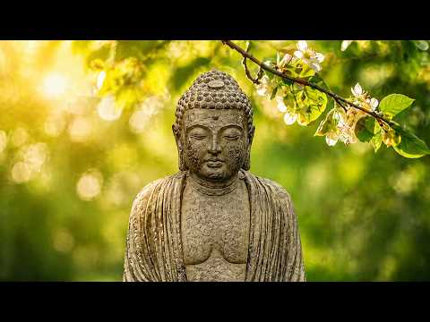

# 음악 — 성공 사례 분석: 사례별 자세히 #561–#600

`analysis.md` 의 9번 (같은 # 번호). 자동 생성 — `tools/success_analysis.py` v1.5.1 (2026-10-24 07:42 UTC). ※ 연구·교육용 — 투자 권유가 아님.

### 561. Morning Coffee Indie Folk – Warm Acoustic Music for Peaceful Slow Days

- https://www.youtube.com/watch?v=wFy9kud8FHE · Silver Coast · 구독자 29,600 · 조회수 2,088,799 (×70.6, 하루 17,591.8) · 좋아요 0 (0.0%) · 65.3분 · 2026-06-27 · 주제 묶음 4. 카페·매장·라운지 · 형식 플레이리스트·모음 (여러 곡) · 폴더 `W_wFy9kud8FHE` (웹 승인)
- 썸네일: 
- 챕터: 0:00 August River · 4:41 October Country · 9:18 The Firetower · 14:07 The Valley Knows · 18:42 Northern Ember · 25:27 Quiet Harbour · 30:54 Morning Tide · 36:03 Golden Canyons · 41:31 Wildfire Mercy · 47:05 November Kids · 52:55 Northern Rivers · 59:54 Dust And Thunder
- 설명 앞부분: Morning Coffee Indie Folk is a warm acoustic playlist created for peaceful slow days, quiet mornings, and the simple joy of your first cup of coffee. Featuring relaxing indie folk songs, soft acoustic guitars, and cinematic folk textures, this collection brings together comforting melodies that hel…
- 같은 채널 평소 대비 ×39.2 (채널 최근 롱폼 중앙값 53,347회) · 평소 영상: Coffee & Chill Indie Folk – Soft Acoustic Songs f… (53,347회) / Indie Folk & Coffee Vibes – Gentle Acoustic Songs… (55,270회)
- 대본 없음 (설명) — 음성인식이 끝나면 도입부·흐름이 들어감
- 댓글 369/371: 좋은 점 — 영상 0 · 감사·응원 0 · 더 알고 싶은 것 0 · 아쉬운 점 — 영상 0 · 반박·불만 — 의견 다름 0 · 정치·사회 0 · 경험 공유 0 · 구독·다음 기대 0

### 562. 싸이월드 감성 발라드 💿 그 시절 MP3에 꼭 있던 노래 ∣ 2000년대 발라드 명곡 모음 🎧 SG워너비, 씨야, 다비치, 티아라, SS501

- https://www.youtube.com/watch?v=5T42ApT_D-o · 그때 그 가락 · 구독자 3,100 · 조회수 217,874 (×70.3, 하루 6,715.0) · 좋아요 4,481 (2.1%) · 105.1분 · 2026-09-21 · 주제 묶음 9. 가요·발라드·트로트 · 형식 플레이리스트·모음 (여러 곡) · 폴더 `W_5T42ApT_D-o` (웹 승인)
- 썸네일: 
- 챕터: 0:00 양파 – 사랑...그게 뭔데 · 3:41 SG 워너비 × 티아라 × 옥주현 - 페이지 원 · 6:42 다비치 & 티아라 - 우리 사랑했잖아 · 10:12 티아라, 초신성 - TTL (Time To Love) · 13:30 티아라, 샤넌, 건지 - 낮과 밤 · 16:54 SG워너비 - 한여름날의 꿈 (ft. 옥주현) · 21:09 엠투엠 - 세글자 · 25:02 SG워너비 - 사랑했어요 (ft. 데니 안) · 28:50 김동률 - 감사 · 33:36 씨야, 다비치, 티아라 - 원더우먼 · 37:14 김동률 - 다시 사랑한다 말할까 · 42:01 씨야 - 여인의 향기 · 45:48 양파 & 이보람 - 알아요 · 49:21 SG 워너비 - 아리랑 · 53:52 SS501 - 파인드 · 57:02 김동률 - 기억의 습작 · 62:07 김범수 - 슬픔보다 더 슬픈 이야기 · 67:37 씨야 - 결혼할까요 · 71:53 블랙펄, 제아 - 미운 사랑 · 75:47 김동률 - 기적 (Duet With 이소은)
- 설명 앞부분: 그 시절, MP3 플레이어에 꼭 저장해 두었던 노래가 있었습니다. 싸이월드 미니홈피를 열어 오늘의 기분과 어울리는 BGM을 고르고, 이어폰을 꽂은 채 같은 노래를 몇 번이고 반복해서 듣던 밤. 누군가를 좋아하기 시작했을 때도, 사랑이 끝나 혼자 돌아오던 길에도, 쉽게 잠들지 못했던 새벽에도 늘 우리 곁에는 이런 노래들이 있었습니다. 🎧 싸이월드 감성 발라드 — 그 시절 MP3에 꼭 있던 노래 이번 플레이리스트에는 SG워너비, 씨야, 다비치, 티아라, 양파, 김동률, 김범수, SS501, 엠투엠, 블랙펄, 더 크로스, 유해준 등 그…
- 같은 채널 평소 대비 ×3.8 (채널 최근 롱폼 중앙값 57,988회) · 평소 영상: 2000년대 발라드 감성 🎧 듣는 순간 그 시절로 돌아가는 드라마 OST 명곡 24곡 ∣… (57,988회) / 2000년대 추억의 발라드 명곡 🎧 그 시절 우리가 사랑했던 노래들 ∣ SG워너비·씨야·… (70,136회)
- 대본 없음 (설명) — 음성인식이 끝나면 도입부·흐름이 들어감
- 댓글 16/17: 좋은 점 — 영상 0 · 감사·응원 0 · 더 알고 싶은 것 1 · 아쉬운 점 — 영상 0 · 반박·불만 — 의견 다름 0 · 정치·사회 0 · 경험 공유 0 · 구독·다음 기대 0
  - 더 알고 싶은 것 👍1 “여러분은 노래를 들으면서 옛날 생각을 많이 하는 편인가요? 아니면 음악은 음악으로 즐기는 편인가요? 여러분의 생각이 궁금합니다.”

### 563. Groove Playlist ∣ ∣ Let your worries melt into the rhythm ∣ Lofi Jazz ☕ Study / Work / Re…

- https://www.youtube.com/watch?v=PjyT13hITqM · DRDR · 구독자 13,800 · 조회수 964,773 (×69.9, 하루 6,069.8) · 좋아요 9,036 (0.9%) · 206.3분 · 2026-05-18 · 주제 묶음 3. 공부·집중·작업 · 형식 플레이리스트·모음 (여러 곡) · 폴더 `W_PjyT13hITqM` (웹 승인)
- 썸네일: 
- 설명 앞부분: Two friends dance freely in a sunlit room filled with warmth and golden light, their movements synchronized with infectious joy. A loyal companion joins in the celebration, surrounded by simple comforts—plants, books, soft furniture—creating an intimate sanctuary where music becomes the language of…
- 같은 채널 평소 대비 ×262.2 (채널 최근 롱폼 중앙값 3,679회) · 평소 영상: JAZZ POP ☀️ One Easy Thing at a Time ∣ Work & Stu… (3,679회) / JAZZ POP ∣ Vol.6☀️ Carry a Good Mood Into the Day… (3,688회)
- 대본 없음 (설명) — 음성인식이 끝나면 도입부·흐름이 들어감
- 댓글 218/218: 좋은 점 — 영상 0 · 감사·응원 0 · 더 알고 싶은 것 0 · 아쉬운 점 — 영상 0 · 반박·불만 — 의견 다름 0 · 정치·사회 0 · 경험 공유 0 · 구독·다음 기대 2
  - 구독·다음 기대 👍4 “피드에 떠서 방문했는데 너무 좋아서 구독했어요. 음악 잘 들을게요.😍😍😍”
  - 구독·다음 기대 👍1 “구독하고갑니다”

### 564. The Most Beautiful And Emotional Cinematic Adagio ∣ Cello & Felt Piano

- https://www.youtube.com/watch?v=6AKklMjtK8M · CLASSICAL SPACE · 구독자 11,200 · 조회수 782,668 (×69.9, 하루 4,879.1) · 좋아요 17,499 (2.2%) · 61.9분 · 2026-05-16 · 주제 묶음 6. 피아노·클래식·연주곡 · 형식 음악 (그 밖 모양 — 한 편짜리 BGM 등) · 폴더 `W_6AKklMjtK8M` (웹 승인)
- 썸네일: 
- 설명 앞부분: A deeply cinematic collection of adagio works for solo cello and felt piano, inspired by the emotional architecture of late Romantic music and the harmonic language of Rachmaninoff. These compositions move through grief, memory, winter, consolation, resignation, and quiet healing — not as dramatic …
- 같은 채널 평소 대비 ×537.9 (채널 최근 롱폼 중앙값 1,455회) · 평소 영상: Music for Everything You Felt But Could Never Say… (1,455회) / The Most Profound Classical Adagios ∣ Where the A… (1,442회)
- 대본 없음 (설명) — 음성인식이 끝나면 도입부·흐름이 들어감
- 댓글 981/994: 좋은 점 — 영상 0 · 감사·응원 0 · 더 알고 싶은 것 0 · 아쉬운 점 — 영상 0 · 반박·불만 — 의견 다름 0 · 정치·사회 0 · 경험 공유 0 · 구독·다음 기대 0

### 565. soft pastel flowers 🌸🌷 relaxing piano for dreamy & peaceful days

- https://www.youtube.com/watch?v=9NxQWqVtHRA · She of the Vale · 구독자 11,900 · 조회수 814,012 (×68.4, 하루 4,552.4) · 좋아요 10,783 (1.3%) · 37.8분 · 2026-04-28 · 주제 묶음 6. 피아노·클래식·연주곡 · 형식 음악 (그 밖 모양 — 한 편짜리 BGM 등) · 폴더 `W_9NxQWqVtHRA` (웹 승인)
- 썸네일: 
- 챕터: 0:00 Still Life - Aki Sora · 1:57 Communion - Maëlle Rousseau · 4:25 Pines and Cones - Maëlle Rous… · 6:41 Homebody - Maëlle Rousseau · 9:22 Soft Marble - Aki Sora · 11:26 A Fresh Start - Aki Sora · 13:49 Time to Time - Aki Sora · 16:18 One More Story - Nils Halberg · 18:54 Repeat
- 설명 앞부분: A gentle world of petals, light, and stillness 🌸 Soft piano drifting through blooming pastels and warm spring air. Relaxing piano music inspired by flower gardens, soft sunlight, and quiet, dreamy days. Let these gentle melodies create a calm, cozy atmosphere like sitting in a blooming garden where…
- 같은 채널 평소 대비 ×124.5 (채널 최근 롱폼 중앙값 6,536회) · 평소 영상: summer petals🌼🍃∣ relaxing piano for morning coffe… (6,560회) / ethereal bloom🦢🌺 ∣ dreamy piano music for peacefu… (6,513회)
- 대본 없음 (설명) — 음성인식이 끝나면 도입부·흐름이 들어감
- 댓글 358/360: 좋은 점 — 영상 1 · 감사·응원 1 · 더 알고 싶은 것 0 · 아쉬운 점 — 영상 0 · 반박·불만 — 의견 다름 0 · 정치·사회 0 · 경험 공유 1 · 구독·다음 기대 0
  - 좋은 점 — 영상 👍8 “너무 아름다운 곡입니다....독서할 때 듣기 좋은 플레이리스트네요 좋은 곡 감사합니다.”
  - 감사·응원 👍8 “너무 아름다운 곡입니다....독서할 때 듣기 좋은 플레이리스트네요 좋은 곡 감사합니다.”
  - 경험 공유 👍4 “나도 저 꽃처럼 인생이 꽃밭이었으면”

### 566. Deep Chill Mix 2026 🌌 Emotional House & Soulful Vibes for Study • Focus • Relax

- https://www.youtube.com/watch?v=5FQsa5nWaW0 · Rhythm Flow · 구독자 23,700 · 조회수 1,620,785 (×68.4, 하루 14,747.3) · 좋아요 15,123 (0.9%) · 60.8분 · 2026-07-06 · 주제 묶음 3. 공부·집중·작업 · 형식 정보·해설 (그 밖) · 폴더 `W_5FQsa5nWaW0` (웹 승인)
- 썸네일: 
- 설명 앞부분: Deep Chill Mix 2026 🌌 Emotional House & Soulful Vibes for Study • Focus • Relax Escape into a world of Emotional House and Soulful Vibes, carefully curated to help you study, focus, and relax. Blending smooth melodies, deep basslines, soulful vocals, and uplifting rhythms, this mix creates the perf…
- 같은 채널 평소 대비 ×290.7 (채널 최근 롱폼 중앙값 5,575회) · 평소 영상: Deep Chill Mix 2026 🎶 Dreamy Deep House & Emotion… (5,728회) / Best Deep Chill Mix 2026 🎧 Chill House & Deep Emo… (5,422회)
- 대본 없음 (설명) — 음성인식이 끝나면 도입부·흐름이 들어감
- 댓글 323/328: 좋은 점 — 영상 0 · 감사·응원 0 · 더 알고 싶은 것 0 · 아쉬운 점 — 영상 0 · 반박·불만 — 의견 다름 0 · 정치·사회 0 · 경험 공유 0 · 구독·다음 기대 0

### 567. Clear Yourself of Everything That Drains You ∣ Calm Your Mind, Relieve Stress, and Heal Y…

- https://www.youtube.com/watch?v=Ww-tZVjkI9Y · Frequencies of the Soul · 구독자 46,400 · 조회수 3,156,662 (×68.0, 하루 25,953.3) · 좋아요 57,903 (1.8%) · 68.4분 · 2026-06-24 · 주제 묶음 1. 수면·명상·힐링 · 형식 음악 (그 밖 모양 — 한 편짜리 BGM 등) · 폴더 `W_Ww-tZVjkI9Y` (웹 승인)
- 썸네일: 
- 설명 앞부분: Step into the enchanting landscapes of Ireland, where mystical forests, rolling green hills, and ancient natural beauty inspire a deep sense of peace and wonder. This original meditation combines relaxing music with breathtaking visuals influenced by Irish nature, culture, and timeless traditions. …
- 같은 채널 평소 대비 ×25.5 (채널 최근 롱폼 중앙값 124,029회) · 평소 영상: Lemuria. The Memory of Your Soul Is Awakening ∣ C… (124,029회) / Celtic Music for Inner Peace🌿Immerse Yourself in … (114,166회)
- 대본 없음 (설명) — 음성인식이 끝나면 도입부·흐름이 들어감
- 댓글 1,284/1,296: 좋은 점 — 영상 0 · 감사·응원 1 · 더 알고 싶은 것 0 · 아쉬운 점 — 영상 0 · 반박·불만 — 의견 다름 0 · 정치·사회 0 · 경험 공유 0 · 구독·다음 기대 0
  - 감사·응원 👍0 “인간의 마음을 위로 하는건 자연 뿐 & 부드러운 음악,, 감사 감사 🎉🎉🎉”

### 568. a quiet playlist for a quiet heart (calm/relax piano)

- https://www.youtube.com/watch?v=BBz7-F9mdUE · Little Thing · 구독자 30,700 · 조회수 2,083,818 (×67.9, 하루 13,628.3) · 좋아요 18,508 (0.9%) · 89.5분 · 2026-05-24 · 주제 묶음 6. 피아노·클래식·연주곡 · 형식 플레이리스트·모음 (여러 곡) · 폴더 `W_BBz7-F9mdUE` (웹 승인)
- 썸네일: 
- 설명 앞부분: Hi there, have a nice day 🍃 I hope my music can help you relax and focus more on every little thing in your life ❤ For the best experience, this music is gently enjoyed at around 40–50% volume. 🎧 a quiet playlist for a quiet heart (calm/relax piano) a quiet playlist for a quiet heart (calm/relax pi…
- 같은 채널 평소 대비 ×188.0 (채널 최근 롱폼 중앙값 11,086회) · 평소 영상: a playlist for a dreamy autumn 🍂 ✨ (11,086회) / a quiet playlist for a quiet morning 🍁 (autumn ve… (11,104회)
- 대본 없음 (설명) — 음성인식이 끝나면 도입부·흐름이 들어감
- 댓글 314/318: 좋은 점 — 영상 0 · 감사·응원 0 · 더 알고 싶은 것 0 · 아쉬운 점 — 영상 0 · 반박·불만 — 의견 다름 0 · 정치·사회 0 · 경험 공유 0 · 구독·다음 기대 0

### 569. Put This On and Calm Your Brain... (No Ads)🌧️ Soft Piano Music ∣ The Soothing Sound of Ra…

- https://www.youtube.com/watch?v=vhJgRiH31bQ · Cozy Attic Nights · 구독자 5,880 · 조회수 399,150 (×67.9, 하루 3,178.7) · 좋아요 2,393 (0.6%) · 716.8분 · 2026-06-20 · 주제 묶음 6. 피아노·클래식·연주곡 · 형식 음악 (그 밖 모양 — 한 편짜리 BGM 등) · 폴더 `W_vhJgRiH31bQ` (웹 승인)
- 썸네일: 
- 설명 앞부분: Put This On and Calm Your Brain... (No Ads)🌧️ Soft Piano Music ∣ The Soothing Sound of Rain 🌧️ Heavy rain falls softly outside the attic window while warm fireplace light fills the room with a peaceful glow. Paired with gentle sleep piano music, this cozy rainy night ambience is designed to help yo…
- 같은 채널 평소 대비 ×397.6 (채널 최근 롱폼 중앙값 1,004회) · 평소 영상: Relaxing Piano Music with Rain Sounds by a Crackl… (1,016회) / 6 Hours Relaxing Sleep Music with Rain on Window … (992회)
- 대본 없음 (설명) — 음성인식이 끝나면 도입부·흐름이 들어감
- 댓글 182/186: 좋은 점 — 영상 0 · 감사·응원 0 · 더 알고 싶은 것 0 · 아쉬운 점 — 영상 0 · 반박·불만 — 의견 다름 0 · 정치·사회 0 · 경험 공유 0 · 구독·다음 기대 0

### 570. Playlist 🎤 노래방 발라드 인기차트 & 애창곡

- https://www.youtube.com/watch?v=4ZLxFva_K5I · 필청 · 구독자 2,140 · 조회수 144,814 (×67.7, 하루 949.9) · 좋아요 617 (0.4%) · 165분 · 2026-05-24 · 주제 묶음 9. 가요·발라드·트로트 · 형식 플레이리스트·모음 (여러 곡) · 폴더 `W_4ZLxFva_K5I` (웹 승인)
- 썸네일: 
- 설명 앞부분: 노래방 인기차트 상위권을 차지한 발라드 명곡과 꾸준히 사랑받는 세대 불문 애창곡 플레이리스트입니다. 듣기만 해도 가슴이 먹먹해지는 발라드의 매력에 빠져보세요. 🎧 💬 여러분이 사랑하는 아티스트에게 응원의 댓글을 남겨주세요. 🎧 타임라인 (Timeline)
- 같은 채널 평소 대비 ×15.8 (채널 최근 롱폼 중앙값 9,194회) · 평소 영상: Playlist 💔 실시간으로 깨진 마음 접착제로 붙여주는 위로 곡들 (11,317회) / Playlist 🧗 노래방 고음의 벽을 넘다가 음이탈 나도 감성으로 커버 가능한 곡 (7,072회)
- 대본 없음 (설명) — 음성인식이 끝나면 도입부·흐름이 들어감
- 댓글 20/20: 좋은 점 — 영상 1 · 감사·응원 2 · 더 알고 싶은 것 0 · 아쉬운 점 — 영상 0 · 반박·불만 — 의견 다름 0 · 정치·사회 0 · 경험 공유 0 · 구독·다음 기대 0
  - 좋은 점 — 영상 👍12 “레전드 곡들만 모아놨네 👑 거를 타선이 없다 진짜로!!”
  - 감사·응원 👍11 “감사합니다 🎼”
  - 감사·응원 👍3 “좋은 음악 감사합니다 🐨”

### 571. 𝐂𝐡𝐚𝐭𝐩𝐚𝐭𝐢 𝐇𝐨𝐧𝐞𝐲 𝐬𝐢𝐧𝐠𝐡 𝐩𝐥𝐚𝐲𝐥𝐢𝐬𝐭 𝐜𝐮𝐳 𝐲𝐨𝐮 𝐫𝐞𝐚𝐥𝐥𝐲 𝐧𝐞𝐞𝐝 𝐭𝐡𝐢𝐬. 𝐛𝐲 𝐫𝐢𝐞_𝐟𝐲𝐩.

- https://www.youtube.com/watch?v=eXNfz_Rs-KQ · 𝐫𝐢𝐞  · 구독자 29,100 · 조회수 1,947,039 (×66.9, 하루 12,584.6) · 좋아요 22,189 (1.1%) · 14.8분 · 2026-05-22 · 주제 묶음 기타 · 형식 플레이리스트·모음 (여러 곡) · 폴더 `W_eXNfz_Rs-KQ` (웹 승인)
- 썸네일: 
- 챕터: 0:00 Brown rang · 1:18 Love dose · 2:43 Desi kalakaar · 4:59 chaar botal vodka · 6:43 payal · 7:38 blue eyes · 8:30 Dope shope · 10:05 Dil chori · 11:02 Get up jawani · 12:16 Angreji beat · 13:26 chhote chhote peg · 14:03 first kiss
- 같은 채널 평소 대비 ×1,465.0 (채널 최근 롱폼 중앙값 1,329회) · 평소 영상: 𝐒𝐨𝐟𝐭 𝐃𝐞𝐬𝐢 𝐩𝐥𝐚𝐲𝐥𝐢𝐬𝐭 𝐜𝐮𝐳 𝐲𝐨𝐮 𝐥𝐨𝐯𝐞 𝐛𝐞𝐢𝐧𝐠 𝐚 𝐃𝐞𝐬𝐢. 𝐫𝐢𝐞… (1,847회) / 𝐂𝐇𝐀𝐓𝐏𝐀𝐓𝐄 𝐒𝐎𝐍𝐆𝐒 𝐓𝐇𝐀𝐓 𝐇𝐈𝐓𝐒 𝐃𝐈𝐅𝐅𝐄𝐑𝐄𝐍𝐓 𝐀𝐓 𝟑𝐀𝐌 😭💅. 𝐁𝐲 … (811회)
- 대본 없음 (없음) — 음성인식이 끝나면 도입부·흐름이 들어감
- 댓글 211/218: 좋은 점 — 영상 0 · 감사·응원 0 · 더 알고 싶은 것 0 · 아쉬운 점 — 영상 0 · 반박·불만 — 의견 다름 0 · 정치·사회 0 · 경험 공유 0 · 구독·다음 기대 0

### 572. The Most Beautiful Rachmaninoff-Inspired Adagios ∣ Quiet Cello & Felt Piano for the Soul

- https://www.youtube.com/watch?v=ZdzITqD4vlM · Adagio Melancholia · 구독자 9,930 · 조회수 661,981 (×66.7, 하루 8,852.5) · 좋아요 11,609 (1.8%) · 61.6분 · 2026-08-10 · 주제 묶음 6. 피아노·클래식·연주곡 · 형식 음악 (그 밖 모양 — 한 편짜리 BGM 등) · 폴더 `W_ZdzITqD4vlM` (웹 승인)
- 썸네일: 
- 설명 앞부분: The Most Beautiful Rachmaninoff-Inspired Adagios ∣ Quiet Cello & Felt Piano for the Soul Immerse yourself in the quiet beauty of Rachmaninoff-inspired adagios, featuring the warm and expressive sound of cello and felt piano. This relaxing classical music collection is created for peaceful moments, …
- 같은 채널 평소 대비 ×74.8 (채널 최근 롱폼 중앙값 8,854회) · 평소 영상: The Most Beautiful Rachmaninoff-Inspired Adagios … (8,854회) / The Most Beautiful Rachmaninoff-Inspired Adagios … (9,139회)
- 대본 없음 (설명) — 음성인식이 끝나면 도입부·흐름이 들어감
- 댓글 1,106/1,158: 좋은 점 — 영상 0 · 감사·응원 0 · 더 알고 싶은 것 0 · 아쉬운 점 — 영상 0 · 반박·불만 — 의견 다름 0 · 정치·사회 0 · 경험 공유 0 · 구독·다음 기대 0

### 573. Spiritual Temple Music ∣ 30 Minutes Stress Relief & Inner Peace ∣ Indian Flute, Tabla & S…

- https://www.youtube.com/watch?v=NF4gjQzGetw · Shashwat Swar · 구독자 15,500 · 조회수 1,031,450 (×66.5, 하루 6,980.0) · 좋아요 9,339 (0.9%) · 34.2분 · 2026-05-29 · 주제 묶음 6. 피아노·클래식·연주곡 · 형식 음악 (그 밖 모양 — 한 편짜리 BGM 등) · 폴더 `W_NF4gjQzGetw` (웹 승인)
- 썸네일: 
- 설명 앞부분: Experience the divine sound of Indian meditation music with this peaceful 30 minutes instrumental journey. Temple Vibes combines soothing flute melodies, calming sitar harmonies, and gentle tabla rhythms to create a deeply relaxing spiritual atmosphere. Perfect for meditation, yoga, healing, stress…
- 같은 채널 평소 대비 ×86.6 (채널 최근 롱폼 중앙값 11,914회) · 평소 영상: Escape Stress with Temple Rhythms ∣ 30 Minutes Re… (13,317회) / Instrumental Relaxing Music ∣ 30 Minutes Indian M… (10,512회)
- 대본 없음 (설명) — 음성인식이 끝나면 도입부·흐름이 들어감
- 댓글 146/150: 좋은 점 — 영상 0 · 감사·응원 0 · 더 알고 싶은 것 0 · 아쉬운 점 — 영상 0 · 반박·불만 — 의견 다름 0 · 정치·사회 0 · 경험 공유 0 · 구독·다음 기대 0

### 574. Too Much on Your Mind? Stay Here for a While ∣ Arabic Oud Ambient Music

- https://www.youtube.com/watch?v=uDCjW-9mE2k · Sahara Echo Music · 구독자 14,400 · 조회수 957,987 (×66.5, 하루 5,414.0) · 좋아요 13,529 (1.4%) · 64.4분 · 2026-04-30 · 주제 묶음 6. 피아노·클래식·연주곡 · 형식 음악 (그 밖 모양 — 한 편짜리 BGM 등) · 폴더 `W_uDCjW-9mE2k` (웹 승인)
- 썸네일: 
- 설명 앞부분: Too much on your mind? Stay here for a while. This calming oud ambient music blends gentle melodies, spacious atmospheric textures, and peaceful desert-inspired ambience to create a quiet place for rest, reflection, and emotional calm. Designed for moments when life feels overwhelming, this immersi…
- 같은 채널 평소 대비 ×336.3 (채널 최근 롱폼 중앙값 2,848회) · 평소 영상: For Quiet Moments ∣ Arabic Oud for Meditation & R… (3,161회) / Some Journeys Begin With One Beat ∣ Desert Pulse … (2,536회)
- 대본 없음 (설명) — 음성인식이 끝나면 도입부·흐름이 들어감
- 댓글 442/446: 좋은 점 — 영상 0 · 감사·응원 0 · 더 알고 싶은 것 0 · 아쉬운 점 — 영상 0 · 반박·불만 — 의견 다름 0 · 정치·사회 0 · 경험 공유 0 · 구독·다음 기대 0

### 575. 😊 아침부터 기분 좋게 행복해지는 노래 모음 🎧 가볍게 흥얼거리는 기분 좋게 행복한 노래 모음

- https://www.youtube.com/watch?v=r0jtXc1Y-jE · 행복 · 구독자 7,160 · 조회수 475,790 (×66.5, 하루 7,504.1) · 좋아요 1,665 (0.4%) · 116.4분 · 2026-08-21 · 주제 묶음 14. AI 음악 · 형식 AI 음악 · 폴더 `W_r0jtXc1Y-jE` (웹 승인)
- 썸네일: 
- 챕터: 0:00 비가 그친 자리 (After the Rain) · 4:34 늦은 오후, 붉게 물드는 창가 (Late Aftern… · 8:26 늦은 오후, 붉게 물드는 창가 (Late Aftern… · 11:49 담벼락에 걸린 노을 (Sunset on the All… · 15:55 붉은 노을빛 바닷가 (Sunset Ocean Walk) · 19:10 세월을 담은 따스한 손 (Hands Holding W… · 23:16 아침은 답을 묻지 않아 · 25:55 주말 아침의 초록빛 햇살 (Morning Sun in… · 29:05 비가 그친 자리 (After the Rain) · 33:39 늦은 오후, 붉게 물드는 창가 (Late Aftern… · 37:32 늦은 오후, 붉게 물드는 창가 (Late Aftern… · 40:54 담벼락에 걸린 노을 (Sunset on the All… · 45:01 붉은 노을빛 바닷가 (Sunset Ocean Walk) · 48:15 세월을 담은 따스한 손 (Hands Holding W… · 52:22 아침은 답을 묻지 않아 · 55:00 주말 아침의 초록빛 햇살 (Morning Sun in… · 58:10 비가 그친 자리 (After the Rain) · 62:45 늦은 오후, 붉게 물드는 창가 (Late Aftern… · 66:37 늦은 오후, 붉게 물드는 창가 (Late Aftern… · 69:59 담벼락에 걸린 노을 (Sunset on the All…
- 설명 앞부분: 노래가 마음에 드셨다면 😊 2. 🎧 노래를 계속 이어서 듣고 싶으실 때는 연속 재생을 켜주시면 더 편하게 감상하실 수 있어요 📱 휴대폰 영상 터치 → 오른쪽 상단 톱니바퀴 → 더보기 → 연속 재생 체크 💻 컴퓨터 영상에서 마우스 우클릭 → 연속 재생 클릭 ※ 새 영상마다 다시 설정해주셔야 적용됩니다 오늘도 건강하고 즐거운 하루 보내세요 😊 화이팅! 💪 마음의 피로를 비워내고 하루를 기분 좋게 시작할 수 있는 따스한 행복채널의 노래 모음입니다. ☀️🎶 커피 한 잔의 여유, 주말의 드라이브, 그리고 조용한 휴식 시간에 편안하게 함께해…
- 같은 채널 평소 대비 ×128.9 (채널 최근 롱폼 중앙값 3,692회) · 평소 영상: 아침부터 행복해지는 🌿 마음이 편안해지는 하루의 쉼표 ☕ 기분 좋게 스며드는 노래 10곡… (4,864회) / 같이 들어요 🎧기분 전환 노래 모음ㅣ세월을 견뎌온 당신을 위한 노래 모음 (2,684회)
- 대본 없음 (설명) — 음성인식이 끝나면 도입부·흐름이 들어감
- 댓글 152/158: 좋은 점 — 영상 2 · 감사·응원 22 · 더 알고 싶은 것 1 · 아쉬운 점 — 영상 1 · 반박·불만 — 의견 다름 0 · 정치·사회 0 · 경험 공유 1 · 구독·다음 기대 3
  - 좋은 점 — 영상 👍2 “정말 아침에 듣기 좋은 노래들입니다.”
  - 좋은 점 — 영상 👍1 “아침에 일어나 집정리하구 커피타 옥상올라가 하늘보며 커피한잔하기 딱좋은 잔잔한음악 ❤❤ 자주들어와 들어야겠어요 맘이 편하구 잠잘때도 듣기 좋은것 같아요 ❤ 생각정리 할때 듣기도 좋겠어요”
  - 감사·응원 👍9 “노래 넘 잘 들었어요 감동 ㆍ감사합니다”
  - 감사·응원 👍7 “노래 너무좋다. 세상이 맑아지는 느낌 . 그분좋아지는 노래 고맙습니다❤”
  - 더 알고 싶은 것 👍2 “노래 제목이 궁금합니다”
  - 아쉬운 점 — 영상 👍4 “😂🎉목소리가 너무 이뻐요”
  - 경험 공유 👍1 “방금 음식하다가 윤연히 들었는데 저도 몰래 흥이 났어 흥얼거리게되네요 옛 어린시절도 생각이 많이 나네요 연속 으로 듣고 싶네요”
  - 구독·다음 기대 👍3 “좋은 노래 잘 듣고 구독하고 갑니다”
  - 구독·다음 기대 👍3 “새벽에 듣는 노래 좋네요.구독합니다. ❤❤❤”

### 576. 하늘을 닮은 여름 🌸 여름 감성 피아노 플레이리스트 ∣ BGM ∣ 힐링·작업·집중

- https://www.youtube.com/watch?v=Os2XdhfzZdo · Mellow Season · 구독자 2,860 · 조회수 189,931 (×66.4, 하루 1,910.7) · 좋아요 1,385 (0.7%) · 120.9분 · 2026-07-16 · 주제 묶음 6. 피아노·클래식·연주곡 · 형식 플레이리스트·모음 (여러 곡) · 폴더 `W_Os2XdhfzZdo` (웹 승인)
- 썸네일: 
- 설명 앞부분: 하늘을 닮은 여름 🌸 흰 꽃 사이로 스며드는 바람과 푸른 하늘이 여름을 더욱 맑게 물들입니다. 잠시 서두름을 내려놓고, 계절의 한 장면 속에 머물러 보세요. Welcome to Mellow Season. A quiet place where gentle melodies drift through the seasons. Inspired by soft light, changing leaves, blooming flowers, and the small moments that make everyday life beautiful, Mellow…
- 같은 채널 평소 대비 ×23.9 (채널 최근 롱폼 중앙값 7,951회) · 평소 영상: 바다가 쉬어가는 오후 🌊 여름 감성 피아노 플레이리스트 ∣ BGM ∣ 힐링·집중·휴식 (7,951회) / 선선한 바람과 함께 🌼 가을 감성 피아노 플레이리스트 ∣ BGM ∣ 집중·작업·휴식 (7,353회)
- 대본 없음 (설명) — 음성인식이 끝나면 도입부·흐름이 들어감
- 댓글 31/31: 좋은 점 — 영상 0 · 감사·응원 3 · 더 알고 싶은 것 0 · 아쉬운 점 — 영상 0 · 반박·불만 — 의견 다름 0 · 정치·사회 0 · 경험 공유 0 · 구독·다음 기대 1
  - 감사·응원 👍2 “요즘 실기공부하면서 듣는 음악이에요 대단한 말로 표현은 못하겠지만 너무나 취향이에요 집중도 잘되고 잘 듣고 있습니다 감사합니다”
  - 감사·응원 👍1 “멋진 작품이네요 감사합니다”
  - 구독·다음 기대 👍0 “분위기가 미치네요 구독하고 갑니다~”

### 577. 3小時宅家Lofi音樂合集｜累了，你只想宅在家裡｜超長版為一個人獨處而生的放鬆音樂，適合发呆或什么都不做

- https://www.youtube.com/watch?v=kiClDrAsuqE · SeaU Lofi · 구독자 14,200 · 조회수 936,332 (×65.9, 하루 5,918.8) · 좋아요 6,002 (0.6%) · 191.8분 · 2026-05-19 · 주제 묶음 8. 로파이·시티팝·칠 · 형식 음악 (그 밖 모양 — 한 편짜리 BGM 등) · 폴더 `W_kiClDrAsuqE` (웹 승인)
- 썸네일: 
- 설명 앞부분: 這是一套適合深夜、獨處、放空、學習、發呆時循環播放的 3 小時 Lofi 音樂合集。 ✨ 超長版 Lofi ✨ Chill / Jazzhop / Piano LoFi Late at night, when everything finally quiets down, this Lofi mix is here to keep you company. A relaxing 3-hour collection made for staying at home, slowing your thoughts, and enjoying peaceful moments alone. Perf…
- 같은 채널 평소 대비 ×68.7 (채널 최근 롱폼 중앙값 13,624회) · 평소 영상: 1小时宅家Lofi音樂精選｜你回到家的那一刻，秒放鬆｜為宅家提供的超放鬆的音樂，都市人的靈魂休息處 (13,624회) / 1小時宅家Lofi音樂精選｜下班後，你只想回到自己的世界｜為獨處時光準備的放鬆音樂，適合發呆、耍廢… (13,680회)
- 대본 없음 (설명) — 음성인식이 끝나면 도입부·흐름이 들어감
- 댓글 238/242: 좋은 점 — 영상 0 · 감사·응원 1 · 더 알고 싶은 것 0 · 아쉬운 점 — 영상 0 · 반박·불만 — 의견 다름 0 · 정치·사회 0 · 경험 공유 0 · 구독·다음 기대 1
  - 감사·응원 👍1 “최고짱 멋진 음악선물 감사합니다.”
  - 구독·다음 기대 👍1 “반가워요~음악이 울림이 있네요~음악친구해요,구독누르고 가요^^”

### 578. मन को शांत करने वाली धुन ∣ राजयोग ध्यान की सहज विधि ∣ Brahmakumaris Meditation Music 2026

- https://www.youtube.com/watch?v=ux3QNU3AaII · Bhakti Naad · 구독자 771 · 조회수 50,360 (×65.3, 하루 425.4) · 좋아요 549 (1.1%) · 6.8분 · 2026-06-27 · 주제 묶음 1. 수면·명상·힐링 · 형식 음악 (그 밖 모양 — 한 편짜리 BGM 등) · 폴더 `W_ux3QNU3AaII` (웹 승인)
- 썸네일: 
- 설명 앞부분: ब्रह्माकुमारीज़ के आत्म-ज्ञान और राजयोग के आधार पर तैयार किया गया यह बेहद शांत, गहरा और दिल को छू लेने वाला ध्यान गीत (Meditating Geet) है। इस पावन धुन में सितार, सरोद और संतूर की दिव्य लहरें आपके मन को सीधे परमात्मा (शिव बाबा) से जोड़ने में मदद करेंगी। आत्मा की शक्तियों का पुनः जागरण (Self-Transfo…
- 같은 채널 평소 대비 ×48.8 (채널 최근 롱폼 중앙값 1,032회) · 평소 영상: बाबा से रूहानी मिलन - शिव बाबा की गोद का सच्चा अन… (1,069회) / बाबा... मैं सिर्फ तुम्हारा हूँ ∣ Deep Rajyoga Med… (996회)
- 대본 없음 (설명) — 음성인식이 끝나면 도입부·흐름이 들어감
- 댓글 27/27: 좋은 점 — 영상 0 · 감사·응원 0 · 더 알고 싶은 것 0 · 아쉬운 점 — 영상 0 · 반박·불만 — 의견 다름 0 · 정치·사회 0 · 경험 공유 0 · 구독·다음 기대 0

### 579. [Playlist] "아침에 듣기 좋은 산뜻한 클래식 왈츠" ∣ Summer Palace Waltz 🌿

- https://www.youtube.com/watch?v=D2WezFoeswI · okply · 구독자 15,700 · 조회수 1,023,553 (×65.2, 하루 6,399.4) · 좋아요 13,225 (1.3%) · 148.9분 · 2026-05-17 · 주제 묶음 6. 피아노·클래식·연주곡 · 형식 플레이리스트·모음 (여러 곡) · 폴더 `W_D2WezFoeswI` (웹 승인)
- 썸네일: 
- 설명 앞부분: 햇살이 가득 들어오는 여름 궁전, 창문 너머로 불어오는 시원한 바람, 그리고 가볍게 춤추듯 흐르는 아침 왈츠. 현악4중주와 플룻, 차임벨이 함께 만드는 산뜻하고 기분 좋은 클래식 플레이리스트입니다. 아침에 커피를 마실 때, 공부하거나 일할 때, 기분 좋은 하루를 시작하고 싶을 때 편안하게 들어보세요. This playlist was created with AI-assisted music and visual production. Enjoy a bright and refreshing classical waltz for your mor…
- 같은 채널 평소 대비 ×129.8 (채널 최근 롱폼 중앙값 7,884회) · 평소 영상: [Playlist] 틀자마자 화사해지는 클래식 음악 🌷 현악·플루트·하프 앙상블 ∣ Be… (7,884회) / [Playlist] Summer Festival 🌊 ∣ 여름 해변의 클래식 앙상블 (8,375회)
- 대본 없음 (설명) — 음성인식이 끝나면 도입부·흐름이 들어감
- 댓글 578/586: 좋은 점 — 영상 4 · 감사·응원 100 · 더 알고 싶은 것 7 · 아쉬운 점 — 영상 3 · 반박·불만 — 의견 다름 0 · 정치·사회 1 · 경험 공유 9 · 구독·다음 기대 7
  - 좋은 점 — 영상 👍4 “정말 아침에 듣기 좋은 음악이에요 왈츠가 이렇게 좋은지 몰랐어요😊”
  - 좋은 점 — 영상 👍2 “딸래미 아침 깨우는 음악으로 사용해요^^ 아이도 기분 좋게 일어나요^^ 밝고 산뜻한 분위기 듣기 좋아요❤”
  - 감사·응원 👍115 “아침 시간에 이런 느낌의 곡들이 모아진 클래식을 찾고 있었는데 드디어 찾은 것 같아 너무 기쁩니다 이제 아침 마다 거실에 틀어두고 구름위를 걷는듯한 아침이 되겠습니다 좋은 음악 선물에 감사합니다!! 🎉”
  - 감사·응원 👍62 “최고에요! 제 브이로그 배경음악으로 클래식을 많이 쓰는데, 혹시 출처표시하고 bgm으로 쓸 수 있을까요? 안되더라두 괜찮으니 편하게 알려주세요! 좋은 음악 감사합니다! :)”
  - 더 알고 싶은 것 👍68 “8주된 뱃속의 아기를 와이프와 보내고 상심이 큰 어제와 오늘이었습니다. 와이프에게 어떻게 하면 힘이 될 수 있을까 하다 우연히 듣게 되었는데, 마치 고즈넉한 숲 속 궁전에서 여유로운 하루를 맞이하는 느낌을 주는 노래 같아 하루 종일 듣고 있습니다. 힘 내볼게요. 앞으…”
  - 더 알고 싶은 것 👍62 “최고에요! 제 브이로그 배경음악으로 클래식을 많이 쓰는데, 혹시 출처표시하고 bgm으로 쓸 수 있을까요? 안되더라두 괜찮으니 편하게 알려주세요! 좋은 음악 감사합니다! :)”
  - 아쉬운 점 — 영상 👍5 “아ᆢ 넘 좋은데 광고가 있네요. 운동할때 쭉 들으려했는데😂”
  - 아쉬운 점 — 영상 👍4 “너무 좋네요 집에서 듣고있어요 광고가 포함된걸까요?”
  - 경험 공유 👍8 “아직 돌 안 된 아이가 있는데 아침마다 아이를 위해 틀어주고 있습니다. 근데 듣다보니 저도 기분이 좋더라고요. 좋은 하루를 보낼 것 만 같은 느낌!”
  - 경험 공유 👍8 “저도 이 왈츠곡들 다 너무 좋아요. 기분좋은 곡들이 신나게 합니다”
  - 구독·다음 기대 👍7 “새들이 와서 지저귀는거 같아요 넘 좋아서 구독합니다”
  - 구독·다음 기대 👍6 “한곡듣자마자 구독했어요🙈 좋은 음악 감사합니다✨🤍”

### 580. Deepest Sleep Healing - Release Melatonin, Calm Anxiety & Sleep Fast ( 3 Hours No Ads )

- https://www.youtube.com/watch?v=J64B8xhHEbs · Deep Sleep Harmony · 구독자 13,500 · 조회수 879,717 (×65.2, 하루 7,046.2) · 좋아요 6,682 (0.8%) · 225.4분 · 2026-06-21 · 주제 묶음 1. 수면·명상·힐링 · 형식 긴 한 곡·반복 (N시간) · 폴더 `W_J64B8xhHEbs` (웹 승인)
- 썸네일: 
- 챕터: 0:00 Part 1: Entering the Dreamsca… · 60:00 Part 2: Deep Melatonin Releas… · 120:00 Part 3: Whispering Nature & C…
- 설명 앞부분: ✨ Welcome to your sanctuary of deep rest and healing. If you are struggling to quiet your mind, battling anxiety, or simply looking for a peaceful escape from the chaos of daily life, you have found the right place. This 3-hour premium sleep music session is carefully crafted to help you release me…
- 같은 채널 평소 대비 ×460.8 (채널 최근 롱폼 중앙값 1,909회) · 평소 영상: Instant Calmness for Your Mind 🍃 Soothing Piano M… (1,909회) / Soft Vibes, No Stress 🌿 Beautiful Relaxing Music … (2,088회)
- 대본 없음 (설명) — 음성인식이 끝나면 도입부·흐름이 들어감
- 댓글 232/235: 좋은 점 — 영상 0 · 감사·응원 0 · 더 알고 싶은 것 0 · 아쉬운 점 — 영상 0 · 반박·불만 — 의견 다름 0 · 정치·사회 0 · 경험 공유 0 · 구독·다음 기대 0

### 581. मोहे मोर बनइय्यो राधा ∣ Mohe Mor Banaiyo Radha Apne Vrindavan Ko ∣ Peaceful Radha Krishna…

- https://www.youtube.com/watch?v=CPGQtKem4Cc · Rangilo Gurjar Taal · 구독자 25,000 · 조회수 1,627,137 (×65.1, 하루 12,572.0) · 좋아요 8,199 (0.5%) · 19.4분 · 2026-06-16 · 주제 묶음 1. 수면·명상·힐링 · 형식 음악 (그 밖 모양 — 한 편짜리 BGM 등) · 폴더 `W_CPGQtKem4Cc` (웹 승인)
- 썸네일: 
- 설명 앞부분: मोहे मोर बनइय्यो राधा ∣ Mohe Mor Banaiyo Radha Apne Vrindavan Ko ∣ Peaceful Radha Krishna Bhajan मोहे मोर बनइय्यो राधा ∣ Mohe Mor Banaiyo Radha Apne Vrindavan Ko ∣ Peaceful Radha Krishna Bhajan मोहे मोर बनइय्यो राधा ∣ Mohe Mor Banaiyo Radha Apne Vrindavan Ko ∣ Peaceful Radha Krishna Bhajan मोहे मोर…
- 같은 채널 평소 대비 ×1,299.6 (채널 최근 롱폼 중앙값 1,252회) · 평소 영상: ओ फिरकी वाली तू कल फिर आना/O Firki Wali/Instagram… (1,252회) / दुनिया का सबसे मीठा भजन ∣ राधे तेरे चरणों की धूल … (1,261회)
- 대본 없음 (설명) — 음성인식이 끝나면 도입부·흐름이 들어감
- 댓글 375/375: 좋은 점 — 영상 0 · 감사·응원 0 · 더 알고 싶은 것 0 · 아쉬운 점 — 영상 0 · 반박·불만 — 의견 다름 0 · 정치·사회 0 · 경험 공유 0 · 구독·다음 기대 0

### 582. 샹송이 이렇게 까지 좋은줄 몰랐습니다. 아랑드롱이 사랑하던 멜로디가 아름다운 그 음악 ∣ Songs That Take You Back to the70s

- https://www.youtube.com/watch?v=MHgCWNV-eKY · Yesterday SOUND · 구독자 6,090 · 조회수 394,894 (×64.8, 하루 2,453.9) · 좋아요 4,790 (1.2%) · 43.9분 · 2026-05-16 · 주제 묶음 기타 · 형식 음악 (그 밖 모양 — 한 편짜리 BGM 등) · 폴더 `W_MHgCWNV-eKY` (웹 승인)
- 썸네일: 
- 챕터: 0:00 Pétales sous Pluie · 4:40 Larmes Ventées · 9:13 Vent d'ardoise · 13:25 Pluie Trèfle Lointain · 17:22 Pluie de Deuil · 22:44 Pluie Prédawn · 26:43 Cricket Nylon Sadness · 31:08 Brouillard Prédawn · 35:33 Goutte Solitude · 39:41 Chanson Lointaine Birdcall
- 설명 앞부분: 프랑스 샹송을 영어로 번역하여 다시 부른 음악 모음입니다. 원곡의 서정적인 감성은 그대로 간직한 채, 영어 가사로 부드럽게 흘러나오는 멜로디가 조용한 새벽과 비 내리는 창가의 분위기를 함께 떠올리게 합니다. 편안하고 고요하게, 마음을 천천히 가라앉히고 싶을 때 들어보세요. ☕ 이런 순간에 어울려요 비 오는 날 창가에서의 사색 혼자 조용히 추억에 잠기고 싶을 때 잔잔한 카페나 와인 한 잔의 무드 책을 읽거나 글을 쓸 때 늦은 밤, 마음을 가라앉히고 싶을 때 🎧 가만히 흘려두기만 해도 공간의 공기가 달라지는 음악입니다. 🎵 타임라인 …
- 같은 채널 평소 대비 ×783.5 (채널 최근 롱폼 중앙값 504회) · 평소 영상: 가을속 아련한 멜로디의 샹송 ∣ 서늘한 바람이 불어오는 가을 계절의 아련함을 더하는 멜로… (504회) / 첫 곡부터 빠져들게 되는 샹송 ∣ 뜨겁게 찬란했던 그 시절의 음악 ∣ 마음을 쉬게 만드는… (515회)
- 대본 없음 (설명) — 음성인식이 끝나면 도입부·흐름이 들어감
- 댓글 203/207: 좋은 점 — 영상 6 · 감사·응원 32 · 더 알고 싶은 것 5 · 아쉬운 점 — 영상 3 · 반박·불만 — 의견 다름 1 · 정치·사회 1 · 경험 공유 5 · 구독·다음 기대 2
  - 좋은 점 — 영상 👍26 “비오는날 듣기좋은 샹송 음악에 취하고 음색에취해봅니다~~ 그리운남편이 보고 싶네요 5개월전에 하늘천국에 먼저 떠나버린 그대여~~ 짙은음악선율이 눈물을 훔치게하네요~~”
  - 좋은 점 — 영상 👍26 “한국 가요와 정서적으로 통하는 샹송 이네요 감성 과 공감이 가슴에 요동 칩니다”
  - 감사·응원 👍82 “바닷가에서아내와함께것다가이음악에빠져버렸다 밀려 온 밀물의 물거품을 발 베게 삼고 누군가 심어 놓은 가지,수박,상치,들깨 잎 이 춤을 춘다 아기 강아지도 꼬리 흔든다. 작은 부두 배에 앉은 까치는 낭만 까치가 되어 어딘가를 쳐다 보고 바닷가 바위에 또 한 마리 귀욤 냥…”
  - 감사·응원 👍27 “회색빛 하늘과 비내리는 오늘.. 바람에 속삭이는 나뭇잎들과 인사하며 달리는 도로위에서 듣는 이 샹송이 넘 감미롭고 힐링이 되네요 넘 감사 합니다”
  - 더 알고 싶은 것 👍10 “궁금합니다. 소절과 소절 사이 가수의 들숨 소리를 구현할 수 있는지요? 정말 궁금해서 묻습니다.”
  - 더 알고 싶은 것 👍4 “구독했어요 좋은 음악 부탁드려요 😊”
  - 아쉬운 점 — 영상 👍3 “들숨은~~ 콧소리에 아랫배 깊숙히 에서 올라오는 호흡과~~ 기계음(바이브레이션) 의 합작음 이라 생각되네요~동네가수”
  - 아쉬운 점 — 영상 👍1 “너무 중간중간 광고가 많아 감상에 너무 방해가 되어 듣기가 좀 어렵네요.”
  - 반박·불만 — 의견 다름 👍10 “샹숑 아닌데요!”
  - 정치·사회 👍1 “일을행하는 여호와 그것을 지어성취하시는 여호와 그이름을 여호와라 하는자가 이같이 이르노라 너는 내게 부르짖으라 내가 네게 응답하겠고 네가 알지못하는 크고 비밀한일을 네게 보이리라 말씀하신주님 아버지하나님 존경하는 도널드트럼프미국대통령님께서 국정운영하는 미국에 시총3조…”
  - 경험 공유 👍3 “마음이 차분해지는 낭만 가득한 음율.. 우산 쓴 여인이 내가 되어봅니다...”
  - 경험 공유 👍1 “일을행하는 여호와 그것을 지어성취하시는 여호와 그이름을 여호와라 하는자가 이같이 이르노라 너는 내게 부르짖으라 내가 네게 응답하겠고 네가 알지못하는 크고 비밀한일을 네게 보이리라 말씀하신주님 아버지하나님 존경하는 도널드트럼프미국대통령님께서 국정운영하는 미국에 시총3조…”
  - 구독·다음 기대 👍4 “구독했어요 좋은 음악 부탁드려요 😊”
  - 구독·다음 기대 👍3 “완죤!! 좋아요 들으면서 비까지 내리길 기다려져요”

### 583. 생각보다 좋게 풀리는 날 🎵마음에 초록빛을 채우는 힐링 피아노 ∣ 스트레스 해소 · 편안한 휴식 · 카페음악 ∣ Relaxing Piano

- https://www.youtube.com/watch?v=QC3xgG-dZJg · Romua 로무아 · 구독자 3,410 · 조회수 218,650 (×64.1, 하루 1,772.7) · 좋아요 997 (0.5%) · 180.7분 · 2026-06-22 · 주제 묶음 6. 피아노·클래식·연주곡 · 형식 플레이리스트·모음 (여러 곡) · 폴더 `W_QC3xgG-dZJg` (웹 승인)
- 썸네일: 
- 설명 앞부분: ⌜ 단순하게 살아갈수록, 좋은 것들이 선명해지니까 ⌟ 여름 장마가 시작된 걸까요 비가 머물다 가기를 반복합니다 🌧 조용한 호숫가에 앉아 차분히 내리는 비와 함께 오늘 하루를 시작해봅니다 복잡한 마음은 잠시 내려놓고 나뭇잎 끝에 매달린 투명한 빗방울을 가만히 바라봅니다 비가 내린 뒤 더욱 선명해진 초록빛 잎들처럼 마음도 한결 싱그러워져요 비와 함께 진하게 다가오는 흙과 풀 냄새에 머릿속도 시원하게 맑아집니다 그저 단순해짐으로써 우리는 더 많은 것을 얻기보다 이미 곁에 있던 소중한 것들을 발견하게 됩니다 바쁘게 지나칠 때는 보이지 않…
- 같은 채널 평소 대비 ×32.1 (채널 최근 롱폼 중앙값 6,812회) · 평소 영상: 모든게 다 괜찮아지는 날 🎵마음을 편안하게 하는 힐링 피아노 ∣ 스트레스 해소 · 편안한… (6,976회) / 그날의 여름빛 🎵마음을 환히 비추는 힐링 피아노 ∣ 스트레스 해소 · 편안한 휴식 · 카… (6,649회)
- 대본 없음 (설명) — 음성인식이 끝나면 도입부·흐름이 들어감
- 댓글 33/33: 좋은 점 — 영상 0 · 감사·응원 7 · 더 알고 싶은 것 0 · 아쉬운 점 — 영상 0 · 반박·불만 — 의견 다름 0 · 정치·사회 0 · 경험 공유 0 · 구독·다음 기대 0
  - 감사·응원 👍5 “비 오는 날 창밖을 보며 듣기 너무 좋네요. 덕분에 복잡했던 마음이 한결 차분해집니다. 감사합니다. 🌿”
  - 감사·응원 👍3 “감사합니다 날마다 좋은날입니다🤍”

### 584. 2000년대 발라드 명곡 30곡 💿 그 시절 우리가 사랑했던 노래｜SG워너비·김동률·씨야·티아라·양파 ✔ 싸이월드 BGM

- https://www.youtube.com/watch?v=IZ6NgLQjStY · 추억음악다방 · 구독자 3,460 · 조회수 221,294 (×64.0, 하루 2,294.5) · 좋아요 1,506 (0.7%) · 117.8분 · 2026-07-19 · 주제 묶음 9. 가요·발라드·트로트 · 형식 플레이리스트·모음 (여러 곡) · 폴더 `W_IZ6NgLQjStY` (웹 승인)
- 썸네일: 
- 설명 앞부분: 2000년대 발라드 명곡 29곡 💿 그 시절 우리가 사랑했던 노래들을 한자리에 담았습니다. SG워너비, 김동률, 씨야, 티아라, 다비치, 양파, 이승철, 김범수, 더 크로스, SS501 등 첫 소절만 들어도 그때의 사랑과 이별, 학창 시절과 싸이월드 감성이 떠오르는 추억의 명곡 플레이리스트입니다. MP3 플레이어에 좋아하는 노래를 가득 담아 다니던 시절, 폴더폰 문자 한 통을 기다리며 밤을 지새우던 순간, 싸이월드 미니홈피 BGM으로 차마 말하지 못한 마음을 대신 전했던 날들… 시간이 오래 흘렀어도 그 시절의 노래를 다시 듣는 순…
- 같은 채널 평소 대비 ×57.6 (채널 최근 롱폼 중앙값 3,839회) · 평소 영상: 싸이월드 감성 2000년대 명곡 모음 💿 텅 빈 거리에서 🎧 다시 듣는 그 시절 발라드 (5,771회) / SG워너비 - Timeless (가사/Lyrics) 💔 이 노래, 듣는 순간 울컥한다｜2… (1,907회)
- 대본 없음 (설명) — 음성인식이 끝나면 도입부·흐름이 들어감
- 댓글 17/18: 좋은 점 — 영상 0 · 감사·응원 1 · 더 알고 싶은 것 1 · 아쉬운 점 — 영상 0 · 반박·불만 — 의견 다름 0 · 정치·사회 0 · 경험 공유 0 · 구독·다음 기대 0
  - 감사·응원 👍0 “중간중간에 드라마 대사 같은게 들리는데 검토 한번만 해주심 감사할 거 같아용ㅠ”
  - 더 알고 싶은 것 👍0 “비 오는 날 가장 듣고 싶은 옛날 노래가 있다면 어떤 곡인가요? 여러분만의 추천곡을 알려주세요.”

### 585. 모든 일이 잘 풀리는 아침을 여는 음악 ∣ 막혔던 일이 시원하게 풀리는 기분

- https://www.youtube.com/watch?v=6MQT5DkZTEU · LazyFlow · 구독자 10,900 · 조회수 696,296 (×63.9, 하루 4,038.7) · 좋아요 5,169 (0.7%) · 90.4분 · 2026-05-04 · 주제 묶음 5. 운동·드라이브·신나는 · 형식 플레이리스트·모음 (여러 곡) · 폴더 `W_6MQT5DkZTEU` (웹 승인)
- 썸네일: 
- 챕터: 0:00 Unhappy And Still Yours · 3:53 Hello Sunshine · 7:18 Golden Room · 10:31 Play It Again · 13:42 It All Adds Up · 17:01 Every Single Day · 22:02 Just Like That · 25:27 The Sky This Morning · 28:53 But It's a Good One · 32:30 Familiar and Good · 37:21 Blue Above Me · 41:13 Good Vibes Only · 45:12 Repeat
- 설명 앞부분: 기분 좋은 에너지가 가득한 아침을 위한 팝송 플레이리스트입니다. 오늘 하루, 당신이 머무는 모든 공간에 특별한 행운과 좋은 소식이 가득하시길 바랍니다. 🎵 Tracklist 🌤️ lazyflow는 매일 아침 7시, 당신의 하루가 마법처럼 잘 풀리길 바라는 마음을 담아 직접 제작한 감성 팝송 플레이리스트를 배달합니다. 오늘도 이 음악과 함께 당신의 모든 순간이 특별한 행운과 좋은 소식으로 가득하시길 바랍니다.
- 같은 채널 평소 대비 ×133.3 (채널 최근 롱폼 중앙값 5,225회) · 평소 영상: 모든 일이 잘 풀리는 아침을 여는 음악 ∣ 당신의 특별한 하루를 위한 마법 같은 아침 배달 (5,377회) / 모든 일이 잘 풀리는 아침을 여는 음악 ∣ 가을의 정취 속에서 나만의 중심을 잡는 아침 (5,073회)
- 대본 없음 (설명) — 음성인식이 끝나면 도입부·흐름이 들어감
- 댓글 167/175: 좋은 점 — 영상 1 · 감사·응원 24 · 더 알고 싶은 것 2 · 아쉬운 점 — 영상 1 · 반박·불만 — 의견 다름 0 · 정치·사회 0 · 경험 공유 4 · 구독·다음 기대 0
  - 좋은 점 — 영상 👍15 “음악 좋기만 한데요😅 이런 듣기 좋은 음악을 공짜로 들을 수 있는데, Ai니 머니 하는 댓글보다는 감사하는 마음을 갖는게 내 행복에 더 도움이 될거같습니다❤”
  - 감사·응원 👍15 “음악 좋기만 한데요😅 이런 듣기 좋은 음악을 공짜로 들을 수 있는데, Ai니 머니 하는 댓글보다는 감사하는 마음을 갖는게 내 행복에 더 도움이 될거같습니다❤”
  - 감사·응원 👍9 “언제나 항상 늘. 모든 일이 모든면에서 다 잘된다 술술잘풀리고 다잘된다 평안 건강 함에 감사합니다 🙏🙏🙏🙏🙏🙏🙏🙏🎉🎉🎉🎉🎉🎉🎉”
  - 더 알고 싶은 것 👍1 “너무 피곤해 누워 폰하다 듣고 일어났어요❤ 첫번째 곡 너무 제취향인데 곡을 검색해보니 나오진 않네요-.- 알 수 있을까요?”
  - 아쉬운 점 — 영상 👍0 “광고가 너무 많이 떠요”
  - 경험 공유 👍7 “앞으로 내가 하는 모든 일이 잘 풀리길 기도하면서 이 플리로 시원하게 시작해봅니다!! 감사합니다!!”
  - 경험 공유 👍2 “저도 가족들과함께 좋은 음악들으며 좋은기운을 받고 갑니다.”

### 586. 🌙 Relaxing Gospel R&B Worship Music 2026 – Peaceful Midnight Prayer Songs For Sleep & Hea…

- https://www.youtube.com/watch?v=SKYFRvhTL4A · Sacred worship Flow · 구독자 13,200 · 조회수 843,264 (×63.9, 하루 5,286.0) · 좋아요 8,464 (1.0%) · 61.2분 · 2026-05-17 · 주제 묶음 1. 수면·명상·힐링 · 형식 음악 (그 밖 모양 — 한 편짜리 BGM 등) · 폴더 `W_SKYFRvhTL4A` (웹 승인)
- 썸네일: 
- 설명 앞부분: If you’re searching for peaceful Gospel R&B music with smooth worship vibes, soulful melodies, relaxing late-night Christian music, and emotional spiritual songs, this mix is made for you. ✨ This Gospel R&B worship experience combines slow R&B rhythms, heavenly harmonies, deep worship lyrics, calmi…
- 같은 채널 평소 대비 ×1,847.2 (채널 최근 롱폼 중앙값 456회) · 평소 영상: ✨ Worship R&B Morning Glory 🙏 Peaceful Gospel Mus… (463회) / ☁️ Soft Worship R&B ∣ Peaceful Gospel Songs for R… (463회)
- 대본 없음 (설명) — 음성인식이 끝나면 도입부·흐름이 들어감
- 댓글 355/356: 좋은 점 — 영상 0 · 감사·응원 0 · 더 알고 싶은 것 0 · 아쉬운 점 — 영상 0 · 반박·불만 — 의견 다름 0 · 정치·사회 0 · 경험 공유 0 · 구독·다음 기대 1
  - 구독·다음 기대 👍2 “목소리부터 애절함이 묻어나네요.~잘 듣고 구독하고 갑니다.~~”

### 587. [KPOP playlist] 마법처럼 빠져드는 케이팝 노동요

- https://www.youtube.com/watch?v=uuZiS5xRAVw · 오이는빼주세요 · 구독자 13,800 · 조회수 880,412 (×63.8, 하루 5,408.7) · 좋아요 2,987 (0.3%) · 59.7분 · 2026-05-14 · 주제 묶음 10. 팝송·K팝·J팝 · 형식 플레이리스트·모음 (여러 곡) · 폴더 `W_uuZiS5xRAVw` (웹 승인)
- 썸네일: 
- 같은 채널 평소 대비 ×75.2 (채널 최근 롱폼 중앙값 11,701회) · 평소 영상: N.Flying (엔플라잉) PLAYLIST 2026 UPDATED l 엔플라잉 노래모음… (11,701회) / CHUNG HA 청하 PLAYLIST 2026 l 청하 노래모음 (신곡포함) l 𝐂𝐇𝐔𝐍… (13,157회)
- 대본 없음 (없음) — 음성인식이 끝나면 도입부·흐름이 들어감
- 댓글 70/70: 좋은 점 — 영상 0 · 감사·응원 7 · 더 알고 싶은 것 0 · 아쉬운 점 — 영상 0 · 반박·불만 — 의견 다름 0 · 정치·사회 0 · 경험 공유 1 · 구독·다음 기대 0
  - 감사·응원 👍11 “도덕 선플달기 봉사활동하는 5학년 학생입니다 와 진짜 제목처럼 마법같이 빠져들었어요 ㅎㅎ❤ 이런거 올려주셔서 감사합니다!”
  - 감사·응원 👍2 “진짜 오이님 플리는 믿고들어용,,!! 맨날 오이님 플리 들으면서 운동하는데 안힘들고 오히려 즐겨용! 좋은플리 마니 만드러 주셔서 감사해용,,,🥹💕💕”
  - 경험 공유 👍11 “어떻게 내가듣고싶은것만 쏙쏙있지”

### 588. Your Productive Office Playlist 🤍 Soft Acoustic Covers to Stay Focused

- https://www.youtube.com/watch?v=h2cVkEu99eI · Afterhours Acoustics · 구독자 15,800 · 조회수 1,007,628 (×63.8, 하루 9,563.5) · 좋아요 2,220 (0.2%) · 116.7분 · 2026-07-10 · 주제 묶음 3. 공부·집중·작업 · 형식 플레이리스트·모음 (여러 곡) · 폴더 `W_h2cVkEu99eI` (웹 승인)
- 썸네일: 
- 설명 앞부분: Need a playlist that helps you stay productive without feeling overwhelmed? Welcome to your new favorite acoustic productivity playlist—a carefully selected collection of relaxing acoustic covers designed to help you work smarter, stay focused, and create a calm office atmosphere. Whether you're wo…
- 같은 채널 평소 대비 ×391.1 (채널 최근 롱폼 중앙값 2,576회) · 평소 영상: Your Productive Acoustic Playlist 🎧 Soft Covers f… (2,657회) / Best Acoustic Covers 2026 🌿 Soft Songs You'll Kee… (2,496회)
- 대본 없음 (설명) — 음성인식이 끝나면 도입부·흐름이 들어감
- 댓글 54/54: 좋은 점 — 영상 0 · 감사·응원 0 · 더 알고 싶은 것 0 · 아쉬운 점 — 영상 0 · 반박·불만 — 의견 다름 0 · 정치·사회 0 · 경험 공유 0 · 구독·다음 기대 0

### 589. 【異世界ケルト】路地裏で流れる安らぎのファンタジーBGM｜静かな街のかすかな余韻 [睡眠用BGM・リラックス用BGM・作業用BGM]

- https://www.youtube.com/watch?v=w2XZiZpAYZg · Roran Baron · 구독자 8,840 · 조회수 562,665 (×63.6, 하루 3,301.4) · 좋아요 8,494 (1.5%) · 182.9분 · 2026-05-06 · 주제 묶음 기타 · 형식 정보·해설 (그 밖) · 폴더 `W_w2XZiZpAYZg` (웹 승인)
- 썸네일: 
- 챕터: 0:00 Track1 · 2:58 Track2 · 5:58 Track3 · 8:56 Track4 · 11:49 Track5 · 15:08 Track6 · 17:58 Track7 · 21:02 Track8 · 23:27 Track9 · 26:40 Track10 · 29:23 Track11 · 32:43 Track12 · 35:21 Repeat
- 설명 앞부분: このチャンネルの音楽は、JRPGのような懐かしく幻想的な世界観に、ケルト楽器のやさしい響きを重ねた、独自の「JケルトBGM」をイメージして制作しています。 ロランの世界の壁紙（PC・スマホ用）をコミュニティ投稿からダウンロード頂けます。
- 같은 채널 평소 대비 ×54.6 (채널 최근 롱폼 중앙값 10,305회) · 평소 영상: 【異世界ケルト】湖畔の丘に流れるやさしいファンタジーBGM｜懐かしい響きとあたたかな余韻 [睡眠用… (10,305회) / 【異世界ケルト】大樹の灯りが揺れる幻想的なファンタジーBGM｜安らぎの旋律と夜空の響き [睡眠用B… (10,358회)
- 대본 없음 (설명) — 음성인식이 끝나면 도입부·흐름이 들어감
- 댓글 261/261: 좋은 점 — 영상 1 · 감사·응원 2 · 더 알고 싶은 것 2 · 아쉬운 점 — 영상 0 · 반박·불만 — 의견 다름 0 · 정치·사회 0 · 경험 공유 0 · 구독·다음 기대 0
  - 좋은 점 — 영상 👍2 “집중력에 도움되는 음악 좋습니다. 그런데 이미지의 바람,파티클,캐릭터의 눈 깜박임 등은 어떻게 구현하신 건지 궁금합니다.”
  - 감사·응원 👍3 “이건 그러니까, 모험을 동경했지만 검에 재능이 없던 마을의 소녀가, 작은 재능을 찾고 조금씩 자신의 꿈에게 다가가기 위해 희망을 품는 모습을 응원하는 자연의 멜로디 같아요. 각자의 열정으로 장작을 패고, 철을 연단하고, 우유를 짜고, 재봉을 하는 마을의 평화로움부터 …”
  - 감사·응원 👍1 “Track 1 bgm이 너무 제 취향입니다!! 혹시 이 음악만 따로 구매하거나 다운로드 할 수 있는 방법이 있을까요?? 방법을 찾아주시면 정말 감사드리겠습니다!”
  - 더 알고 싶은 것 👍2 “집중력에 도움되는 음악 좋습니다. 그런데 이미지의 바람,파티클,캐릭터의 눈 깜박임 등은 어떻게 구현하신 건지 궁금합니다.”
  - 더 알고 싶은 것 👍1 “Track 1 bgm이 너무 제 취향입니다!! 혹시 이 음악만 따로 구매하거나 다운로드 할 수 있는 방법이 있을까요?? 방법을 찾아주시면 정말 감사드리겠습니다!”

### 590. Gentle Rain Outside, Warm Piano Inside (No Ads) 🌧️ Helps You Sleep, Relieves Insomnia and…

- https://www.youtube.com/watch?v=G9iosi2cIh4 · Cozy Attic Nights · 구독자 5,880 · 조회수 373,588 (×63.5, 하루 3,204.8) · 좋아요 1,802 (0.5%) · 717.9분 · 2026-06-29 · 주제 묶음 1. 수면·명상·힐링 · 형식 음악 (그 밖 모양 — 한 편짜리 BGM 등) · 폴더 `W_G9iosi2cIh4` (웹 승인)
- 썸네일: 
- 설명 앞부분: Gentle Rain Outside, Warm Piano Inside (No Ads) 🌧️ Helps You Sleep, Relieves Insomnia and Stress 🌧️ Heavy rain falls softly outside the attic window while warm fireplace light fills the room with a peaceful glow. Paired with gentle sleep piano music, this cozy rainy night ambience is designed to he…
- 같은 채널 평소 대비 ×372.1 (채널 최근 롱폼 중앙값 1,004회) · 평소 영상: Relaxing Piano Music with Rain Sounds by a Crackl… (1,016회) / 6 Hours Relaxing Sleep Music with Rain on Window … (992회)
- 대본 없음 (설명) — 음성인식이 끝나면 도입부·흐름이 들어감
- 댓글 178/194: 좋은 점 — 영상 0 · 감사·응원 0 · 더 알고 싶은 것 0 · 아쉬운 점 — 영상 0 · 반박·불만 — 의견 다름 0 · 정치·사회 0 · 경험 공유 0 · 구독·다음 기대 0

### 591. Heartbroken Lofi Songs 💔 ∣ Slowed + Reverb ∣ Late Night Study & Focus Mood 🎧

- https://www.youtube.com/watch?v=Koo5Xgqn_zE · Stylish Official 9.0 · 구독자 16,200 · 조회수 1,017,056 (×62.8, 하루 17,171.0) · 좋아요 5,536 (0.5%) · 8분 · 2026-08-26 · 주제 묶음 3. 공부·집중·작업 · 형식 음악 (그 밖 모양 — 한 편짜리 BGM 등) · 폴더 `W_Koo5Xgqn_zE` (웹 승인)
- 썸네일: 
- 설명 앞부분: Welcome to the world of soothing lofi music, where stress fades away and peace takes over. This mind-relaxing lofi mix is perfect for creating a calm atmosphere, helping you focus, relax, and unwind. Deep Focus & Studying 📖 Relaxing & Meditation 🧘‍♂ Chilling After a Long Day 🌅 Peaceful Sleep & Stre…
- 같은 채널 평소 대비 ×2,655.5 (채널 최근 롱폼 중앙값 383회) · 평소 영상: Heartbroken Lofi Songs 💔 ∣ Slowed + Reverb ∣ Late… (383회) / Heartbroken Lofi Songs 💔 ∣ Slowed + Reverb ∣ Late… (378회)
- 대본 없음 (설명) — 음성인식이 끝나면 도입부·흐름이 들어감
- 댓글 99/107: 좋은 점 — 영상 0 · 감사·응원 0 · 더 알고 싶은 것 0 · 아쉬운 점 — 영상 0 · 반박·불만 — 의견 다름 0 · 정치·사회 0 · 경험 공유 0 · 구독·다음 기대 0

### 592. Amélie ☕️ A Slow Weekend in Paris ∣ Piano Music for Relaxing, Reading, Study & Work ∣ Coz…

- https://www.youtube.com/watch?v=oToDtW7Gaas · Peter Pan's Library · 구독자 6,130 · 조회수 384,788 (×62.8, 하루 6,838.0) · 좋아요 7,245 (1.9%) · 61.4분 · 2026-08-29 · 주제 묶음 3. 공부·집중·작업 · 형식 음악 (그 밖 모양 — 한 편짜리 BGM 등) · 폴더 `W_oToDtW7Gaas` (웹 승인)
- 썸네일: 
- 설명 앞부분: A piano music collection inspired by Amélie, created for reading, studying, writing, quiet work, and cozy days. Amélie is a story about a young woman who notices the little things others often miss — a stranger’s forgotten treasure, a quiet café, a familiar street, and the small opportunities we ha…
- 같은 채널 평소 대비 ×40.8 (채널 최근 롱폼 중앙값 9,428회) · 평소 영상: Howl’s Moving Castle ♫ Learning to Love ∣ Ghibli … (11,175회) / Audrey Hepburn ☔ Dance in the Rain ∣ Relaxing Pia… (7,682회)
- 대본 없음 (설명) — 음성인식이 끝나면 도입부·흐름이 들어감
- 댓글 213/216: 좋은 점 — 영상 1 · 감사·응원 4 · 더 알고 싶은 것 1 · 아쉬운 점 — 영상 0 · 반박·불만 — 의견 다름 0 · 정치·사회 0 · 경험 공유 1 · 구독·다음 기대 0
  - 좋은 점 — 영상 👍0 “채널에 떠서 들어와 봅니다. 멋진 영상이네요. 잘 감상하고 갑니다. 알람 올때 마다 클릭 하고 싶은 좋은 영상이네요”
  - 감사·응원 👍1 “고맙습니다 ☁️☁️🙆‍♂️”
  - 감사·응원 👍0 “행복한 새벽을 맞이하게 하는 상큼한 음악입니다 감사해요✍”
  - 더 알고 싶은 것 👍10 “💖 따뜻한 분위기와 감성적인 피아노 연주가 어우러져서 듣는 내내 행복했습니다. 일상 속 작은 휴식이 필요할 때마다 다시 찾아 듣고 싶어요. 앞으로도 이런 힐링 음악 많이 올려주세요!”
  - 경험 공유 👍2 “좋아하는 그림스타일 좋아하는 집 내가 원하는 삶 ㅎㅎ”

### 593. 행운이 찾아오는 아침 🎵마음에 건강한 에너지를 채우는 힐링 피아노 ∣ 스트레스 해소 · 편안한 휴식 · 카페음악 ∣ Relaxing Piano

- https://www.youtube.com/watch?v=Xp2bSO5r5Os · Romua 로무아 · 구독자 3,410 · 조회수 213,841 (×62.7, 하루 1,557.0) · 좋아요 1,021 (0.5%) · 180분 · 2026-06-08 · 주제 묶음 6. 피아노·클래식·연주곡 · 형식 플레이리스트·모음 (여러 곡) · 폴더 `W_Xp2bSO5r5Os` (웹 승인)
- 썸네일: 
- 설명 앞부분: ⌜ 좋은 일은 생각보다 조용히 찾아온다 ⌟ 새벽 안개가 숲 사이를 천천히 지나가고 이른 아침의 마음에는 맑은 바람이 통하는 길이 열립니다 우리는 종종 특별한 순간만을 기다리지만 삶을 바꾸는 것은 어느 평범한 아침의 산뜻한 공기, 마음을 스치는 평온, 그리고 이유 없이 가벼워진 발걸음일 때가 많아요 계절이 바뀌는 소리를 들은 사람은 없습니다 하지만 어느 날 문득 창밖을 바라보며 다음 계절이 왔음을 알게 되지요 좋은 일도 그렇게 찾아옵니다 자신을 드러내지 않은 채 조용히 우리 곁에 앉아 삶의 풍경을 조금씩 바꾸어 갑니다 오늘은 이 음…
- 같은 채널 평소 대비 ×31.4 (채널 최근 롱폼 중앙값 6,812회) · 평소 영상: 모든게 다 괜찮아지는 날 🎵마음을 편안하게 하는 힐링 피아노 ∣ 스트레스 해소 · 편안한… (6,976회) / 그날의 여름빛 🎵마음을 환히 비추는 힐링 피아노 ∣ 스트레스 해소 · 편안한 휴식 · 카… (6,649회)
- 대본 없음 (설명) — 음성인식이 끝나면 도입부·흐름이 들어감
- 댓글 37/37: 좋은 점 — 영상 0 · 감사·응원 7 · 더 알고 싶은 것 0 · 아쉬운 점 — 영상 0 · 반박·불만 — 의견 다름 0 · 정치·사회 0 · 경험 공유 0 · 구독·다음 기대 0
  - 감사·응원 👍8 “오늘도 나에게 행운이 온다 모든이들에게 행운이가길 바랍니다 감사합니다😄😄”
  - 감사·응원 👍1 “오늘도 힐링됩니다 감사합니다”

### 594. 바흐와 모차르트의 감성을 담은 아침 클래식 🌿 하루를 여는 평화로운 힐링 연주

- https://www.youtube.com/watch?v=9_HXWyP1MsE · Korean Rock Ballad · 구독자 4,910 · 조회수 306,524 (×62.4, 하루 3,051.6) · 좋아요 2,291 (0.8%) · 40.3분 · 2026-07-15 · 주제 묶음 6. 피아노·클래식·연주곡 · 형식 플레이리스트·모음 (여러 곡) · 폴더 `W_9_HXWyP1MsE` (웹 승인)
- 썸네일: 
- 설명 앞부분: 바흐와 모차르트의 감성에서 영감을 받아 새롭게 완성한 클래식 힐링 음악입니다. 부드러운 선율과 따뜻한 오케스트라 사운드가 평화로운 아침을 만들어 드립니다. 하루를 시작하는 시간, 공부, 독서, 업무, 휴식, 명상과 함께 편안한 클래식을 즐겨 보세요. 🌿 Inspired by the timeless elegance of Bach & Mozart. 편안한 하루를 위한 클래식 플레이리스트입니다.
- 같은 채널 평소 대비 ×11.1 (채널 최근 롱폼 중앙값 27,624회) · 평소 영상: 아름다운 가을 아침 클래식 🍂 슈베르트, 브람스, 차이콥스키, 드보르자크, 멘델스존에게 … (33,578회) / 아침 클래식 현악 ∣ 독서·공부·커피와 함께하는 편안한 스트링 오케스트라 (33,833회)
- 대본 없음 (설명) — 음성인식이 끝나면 도입부·흐름이 들어감
- 댓글 40/42: 좋은 점 — 영상 0 · 감사·응원 12 · 더 알고 싶은 것 0 · 아쉬운 점 — 영상 1 · 반박·불만 — 의견 다름 0 · 정치·사회 0 · 경험 공유 1 · 구독·다음 기대 1
  - 감사·응원 👍24 “좋은아침에 고운소리 들으니 행복이 찾아오네요 고맙습니다 이고운 소리를 듣는 모든분들도 이더위를 잘이겨 내고 건강하길 바래요”
  - 감사·응원 👍9 “음악과 영상이 참 평화롭네요. 행복한 음악 선물 감사합니다.”
  - 아쉬운 점 — 영상 👍5 “음악은좋은데 광고가너무 많아 ㅠ”
  - 구독·다음 기대 👍0 “모짜르트를 좋아하는 한사람으로 잘 듣고 구독합니다 🧋🍇”

### 595. Ludovico Einaudi – 6 Piano Pieces ∣ Relaxing Music for Study & Sleep [30 Min]

- https://www.youtube.com/watch?v=nFJCWUpe2w4 · Yurii Salukha · 구독자 6,080 · 조회수 379,148 (×62.4, 하루 4,649.6) · 좋아요 3,121 (0.8%) · 29.7분 · 2026-08-03 · 주제 묶음 1. 수면·명상·힐링 · 형식 음악 (그 밖 모양 — 한 편짜리 BGM 등) · 폴더 `W_nFJCWUpe2w4` (웹 승인)
- 썸네일: 
- 챕터: 0:00 Una Mattina · 3:30 Nuvole Bianche · 8:45 I Giorni · 14:43 Primavera · 19:09 Giorni Dispari · 24:04 Experience
- 설명 앞부분: Ludovico Einaudi – 6 Piano Pieces ∣ Relaxing Music for Study & Sleep (30 Min) Enjoy 30 minutes of relaxing piano music featuring 6 beautiful piano pieces by Ludovico Einaudi, arranged and performed by Yurii Salukha. This peaceful piano collection is perfect for studying, working, reading, focusing,…
- 같은 채널 평소 대비 ×288.8 (채널 최근 롱폼 중앙값 1,313회) · 평소 영상: Ludovico Einaudi – Fly ∣ Relaxing Piano Music fro… (1,313회) / The Most Relaxing Classical Piano Music (1,286회)
- 대본 없음 (설명) — 음성인식이 끝나면 도입부·흐름이 들어감
- 댓글 54/54: 좋은 점 — 영상 0 · 감사·응원 0 · 더 알고 싶은 것 0 · 아쉬운 점 — 영상 0 · 반박·불만 — 의견 다름 0 · 정치·사회 0 · 경험 공유 0 · 구독·다음 기대 0

### 596. Dark Jazz & Late Night Trip-Hop // Atmospheric Music for Late Drives

- https://www.youtube.com/watch?v=pGuvWU_1j-o · Jazz Haze · 구독자 33,500 · 조회수 2,087,151 (×62.3, 하루 12,749.4) · 좋아요 47,575 (2.3%) · 94.2분 · 2026-05-13 · 주제 묶음 5. 운동·드라이브·신나는 · 형식 음악 (그 밖 모양 — 한 편짜리 BGM 등) · 폴더 `W_pGuvWU_1j-o` (웹 승인)
- 썸네일: 
- 같은 채널 평소 대비 ×898.9 (채널 최근 롱폼 중앙값 2,322회) · 평소 영상: Dark Jazz & Cinematic Trip-Hop // Ruby Moon Desir… (2,322회) / Dark Jazz & Cinematic Trip-Hop // Music for Drivi… (2,303회)
- 대본 없음 (없음) — 음성인식이 끝나면 도입부·흐름이 들어감
- 댓글 480/488: 좋은 점 — 영상 1 · 감사·응원 0 · 더 알고 싶은 것 0 · 아쉬운 점 — 영상 0 · 반박·불만 — 의견 다름 0 · 정치·사회 0 · 경험 공유 0 · 구독·다음 기대 0

### 597. the best classical music for deep concentration ∣ string quartet for focus & study

- https://www.youtube.com/watch?v=Px1HC9ExXOk · FocusSpace · 구독자 8,990 · 조회수 559,782 (×62.3, 하루 6,030.8) · 좋아요 15,959 (2.9%) · 64.6분 · 2026-07-23 · 주제 묶음 6. 피아노·클래식·연주곡 · 형식 음악 (그 밖 모양 — 한 편짜리 BGM 등) · 폴더 `W_Px1HC9ExXOk` (웹 승인)
- 썸네일: 
- 챕터: 0:00 The Gallery of Silent Minds · 1:46 Discipline in Stillness · 3:33 Hall of Quiet Ambition · 6:31 The Scholar’s Resolve · 8:43 Measured Thought · 10:29 Vellum and Stone · 13:30 The Unbroken Page · 14:56 Counterpoint of Clarity · 16:23 A Chamber for Thought · 17:44 The Patient Ascent · 19:19 Architecture of Reason · 21:41 The Midnight Thesis · 24:32 The Weight of Insight · 26:53 Ancient Silence · 29:31 After the Last Candle · 32:17 Repeat
- 설명 앞부분: This original FocusSpace collection was carefully selected, arranged, edited, and shaped into a continuous listening experience for sustained concentration. Classical string quartet music for deep concentration, studying, reading, writing, and focused work. A collection of original instrumental pie…
- 같은 채널 평소 대비 ×96.9 (채널 최근 롱폼 중앙값 5,775회) · 평소 영상: the best classical music for deep concentration ∣… (5,775회) / the best classical music for deep focus ∣ The Geo… (5,830회)
- 대본 없음 (설명) — 음성인식이 끝나면 도입부·흐름이 들어감
- 댓글 444/452: 좋은 점 — 영상 0 · 감사·응원 0 · 더 알고 싶은 것 0 · 아쉬운 점 — 영상 0 · 반박·불만 — 의견 다름 0 · 정치·사회 0 · 경험 공유 0 · 구독·다음 기대 0

### 598. Dolce Vita 🇮🇹 Luxury Italian Lounge Music ∣ Elegant Café Jazz, Piano & Mediterranean Vibes

- https://www.youtube.com/watch?v=oiG7xIAgCFw · ITALIAN MAFIA LOFI · 구독자 14,600 · 조회수 902,113 (×61.8, 하루 8,612.5) · 좋아요 13,836 (1.5%) · 86.5분 · 2026-07-11 · 주제 묶음 4. 카페·매장·라운지 · 형식 플레이리스트·모음 (여러 곡) · 폴더 `W_oiG7xIAgCFw` (웹 승인)
- 썸네일: 
- 설명 앞부분: Escape into the timeless elegance of La Dolce Vita with this relaxing Italian lounge playlist inspired by charming cafés, sunlit piazzas and the effortless beauty of Mediterranean living. Featuring warm acoustic piano, expressive nylon guitar, delicate mandolin, soft accordion, brushed jazz drums, …
- 같은 채널 평소 대비 ×948.6 (채널 최근 롱폼 중앙값 951회) · 평소 영상: Italian Autumn Jazz 🇮🇹🍂 ∣ Autumn in Italy • Vinta… (961회) / Sicilian Summer 🇮🇹 ∣ Vintage Italian Music • Medi… (941회)
- 대본 없음 (설명) — 음성인식이 끝나면 도입부·흐름이 들어감
- 댓글 346/356: 좋은 점 — 영상 0 · 감사·응원 0 · 더 알고 싶은 것 0 · 아쉬운 점 — 영상 0 · 반박·불만 — 의견 다름 0 · 정치·사회 0 · 경험 공유 0 · 구독·다음 기대 0

### 599. [𝙋𝙡𝙖𝙮𝙡𝙞𝙨𝙩] 세종대왕이 경복궁에서 야근하며 듣던 가야금 재즈

- https://www.youtube.com/watch?v=q3oC3zdfyw4 · 조선재즈 · 구독자 10,200 · 조회수 620,039 (×60.8, 하루 4,627.7) · 좋아요 22,740 (3.7%) · 180.7분 · 2026-06-12 · 주제 묶음 7. 재즈·보사노바 · 형식 플레이리스트·모음 (여러 곡) · 폴더 `W_q3oC3zdfyw4` (웹 승인)
- 썸네일: 
- 설명 앞부분: 세종대왕도 야근은 힘들었을 겁니다. 경복궁 깊은 밤, 촛불 아래 가야금이 흐릅니다. 조선의 밤과 재즈가 만났습니다:)
- 같은 채널 평소 대비 ×126.9 (채널 최근 롱폼 중앙값 4,886회) · 평소 영상: [𝙋𝙡𝙖𝙮𝙡𝙞𝙨𝙩] 세종대왕이 코딩하며 들었던 가야금 재즈 (5,126회) / [𝙋𝙡𝙖𝙮𝙡𝙞𝙨𝙩] 꺼먹살이도 하루 종일 엿들은 가야금 재즈 (4,647회)
- 대본 없음 (설명) — 음성인식이 끝나면 도입부·흐름이 들어감
- 댓글 468/475: 좋은 점 — 영상 2 · 감사·응원 8 · 더 알고 싶은 것 6 · 아쉬운 점 — 영상 2 · 반박·불만 — 의견 다름 4 · 정치·사회 1 · 경험 공유 10 · 구독·다음 기대 5
  - 좋은 점 — 영상 👍0 “생활안복 자주 입는데, 한복입고 어디 놀러갈때 듣기 좋아요. 굿뜨 뭐랄까 혼자 마패를 들고 암행어사 하러 가는 기분이랑 연모하는 사내 담벼락에 훔쳐보러 가는 기분”
  - 좋은 점 — 영상 👍0 “너무좋아요 나도만들고싶네요 많이배우고갑니다❤❤❤❤❤❤❤”
  - 감사·응원 👍5 “와.... 가야금 너무 좋아하는데 이런 귀한 플리를 올려주시다니 감사합니다....”
  - 감사·응원 👍4 “오 좋아요... 제작 감사함당 잘 들을게요”
  - 더 알고 싶은 것 👍3 “구독 좋아요 알림설정합니다. 한국의 미를 잃지 않는 퓨전음악 많이 부탁드립니다. 덕분에 출근길이 즐거워요.”
  - 더 알고 싶은 것 👍1 “집현전 학자들 편도 부탁합니다. 엄지척!”
  - 아쉬운 점 — 영상 👍6 “ㅋㅋㅋㅋㅋㅋㅋ 고얀 AI 같으니라고”
  - 아쉬운 점 — 영상 👍3 “구간반복해서 들을 수 있게 해주세요”
  - 반박·불만 — 의견 다름 👍4 “와 재즈 좋아하는데 가야금과 재즈가 이렇게 잘 어울리다니. 가야금의 선율이 그루비해서 깜짝 놀랐습니다. AI 작곡이란데서 한번 더 놀람.. 말도안됨 😂”
  - 반박·불만 — 의견 다름 👍1 “절대음감이라 AI 음악이 맞으실 수도ㅋㅋㅋ 근데 저렇게 누워 계실 분이 아닌데 두 눈 부릅 뜨고 계셔야 하지 않을까요?”
  - 정치·사회 👍0 “전하 .. 요즘 나라가 말이 아닙니다 이걸 어찌해야 된답니까 ...”
  - 경험 공유 👍9 “클래식 공부를 어릴때 부터 하면서 재즈도 같이 조금 했었는데 살면서 들은 재즈 중에 제일 좋습니다….”
  - 경험 공유 👍3 “세종대왕도 야근하는데 내가 뭐라고”
  - 구독·다음 기대 👍3 “구독 좋아요 알림설정합니다. 한국의 미를 잃지 않는 퓨전음악 많이 부탁드립니다. 덕분에 출근길이 즐거워요.”
  - 구독·다음 기대 👍1 “가능하구나 재즈라는 것이!!!! 감탄하고 구독하고 갑니다~!”

### 600. 15 Minute Meditation Music • Raise Your Vibration • Relax Mind & Body

- https://www.youtube.com/watch?v=e8EVg-NJCng · Soul Waves - Relaxing Music · 구독자 2,620 · 조회수 159,097 (×60.7, 하루 904.9) · 좋아요 342 (0.2%) · 15.4분 · 2026-05-01 · 주제 묶음 1. 수면·명상·힐링 · 형식 음악 (그 밖 모양 — 한 편짜리 BGM 등) · 폴더 `W_e8EVg-NJCng` (웹 승인)
- 썸네일: 
- 설명 앞부분: Enjoy this free 15 minute Meditation Music by Soul Waves - Relaxing Music! Practice meditation for anxiety relief to improve focus, stay in the present moment and let go of anxious feelings. Meditation for Anxiety is Proven Way to Calm Your Mind. Music for Meditation 15 minutes ∣ Relax mind body, P…
- 같은 채널 평소 대비 ×180.5 (채널 최근 롱폼 중앙값 882회) · 평소 영상: Deep Healing Meditation Music • Release Stress, A… (894회) / 15 Minute Deep Meditation Music for Positive Ener… (869회)
- 대본 없음 (설명) — 음성인식이 끝나면 도입부·흐름이 들어감
- 댓글 16/16: 좋은 점 — 영상 0 · 감사·응원 0 · 더 알고 싶은 것 0 · 아쉬운 점 — 영상 0 · 반박·불만 — 의견 다름 0 · 정치·사회 0 · 경험 공유 0 · 구독·다음 기대 0

