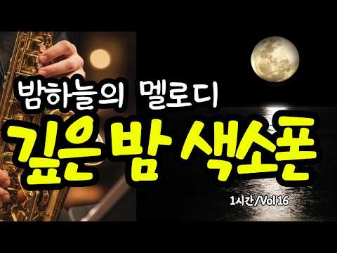

# 음악 — 성공 사례 분석: 사례별 자세히 #601–#640

`analysis.md` 의 9번 (같은 # 번호). 자동 생성 — `tools/success_analysis.py` v1.4.1 (2026-10-20 07:59 UTC). ※ 연구·교육용 — 투자 권유가 아님.

### 601. 샹송이 이렇게 까지 좋은줄 몰랐습니다. 아랑드롱이 사랑하던 멜로디가 아름다운 그 음악 ∣ Songs That Take You Back to the70s

- https://www.youtube.com/watch?v=MHgCWNV-eKY · Yesterday SOUND · 구독자 6,060 · 조회수 390,031 (×64.4, 하루 2,485.3) · 좋아요 4,771 (1.2%) · 43.9분 · 2026-05-16 · 주제 묶음 기타 · 형식 음악 (그 밖 모양 — 한 편짜리 BGM 등) · 폴더 `W_MHgCWNV-eKY` (웹 승인)
- 썸네일: 
- 챕터: 0:00 Pétales sous Pluie · 4:40 Larmes Ventées · 9:13 Vent d'ardoise · 13:25 Pluie Trèfle Lointain · 17:22 Pluie de Deuil · 22:44 Pluie Prédawn · 26:43 Cricket Nylon Sadness · 31:08 Brouillard Prédawn · 35:33 Goutte Solitude · 39:41 Chanson Lointaine Birdcall
- 설명 앞부분: 프랑스 샹송을 영어로 번역하여 다시 부른 음악 모음입니다. 원곡의 서정적인 감성은 그대로 간직한 채, 영어 가사로 부드럽게 흘러나오는 멜로디가 조용한 새벽과 비 내리는 창가의 분위기를 함께 떠올리게 합니다. 편안하고 고요하게, 마음을 천천히 가라앉히고 싶을 때 들어보세요. ☕ 이런 순간에 어울려요 비 오는 날 창가에서의 사색 혼자 조용히 추억에 잠기고 싶을 때 잔잔한 카페나 와인 한 잔의 무드 책을 읽거나 글을 쓸 때 늦은 밤, 마음을 가라앉히고 싶을 때 🎧 가만히 흘려두기만 해도 공간의 공기가 달라지는 음악입니다. 🎵 타임라인 …
- 같은 채널 평소 대비 ×765.5 (채널 최근 롱폼 중앙값 510회) · 평소 영상: 첫 곡부터 빠져들게 되는 샹송 ∣ 뜨겁게 찬란했던 그 시절의 음악 ∣ 마음을 쉬게 만드는… (515회) / 가을속 아련한 멜로디의 샹송 ∣ 서늘한 바람이 불어오는 가을 계절의 아련함을 더하는 멜로… (504회)
- 대본 없음 (설명) — 음성인식이 끝나면 도입부·흐름이 들어감
- 댓글 203/203: 좋은 점 — 영상 6 · 감사·응원 32 · 더 알고 싶은 것 5 · 아쉬운 점 — 영상 3 · 반박·불만 — 의견 다름 1 · 정치·사회 1 · 경험 공유 5 · 구독·다음 기대 2
  - 좋은 점 — 영상 👍26 “비오는날 듣기좋은 샹송 음악에 취하고 음색에취해봅니다~~ 그리운남편이 보고 싶네요 5개월전에 하늘천국에 먼저 떠나버린 그대여~~ 짙은음악선율이 눈물을 훔치게하네요~~”
  - 좋은 점 — 영상 👍26 “한국 가요와 정서적으로 통하는 샹송 이네요 감성 과 공감이 가슴에 요동 칩니다”
  - 감사·응원 👍82 “바닷가에서아내와함께것다가이음악에빠져버렸다 밀려 온 밀물의 물거품을 발 베게 삼고 누군가 심어 놓은 가지,수박,상치,들깨 잎 이 춤을 춘다 아기 강아지도 꼬리 흔든다. 작은 부두 배에 앉은 까치는 낭만 까치가 되어 어딘가를 쳐다 보고 바닷가 바위에 또 한 마리 귀욤 냥…”
  - 감사·응원 👍27 “회색빛 하늘과 비내리는 오늘.. 바람에 속삭이는 나뭇잎들과 인사하며 달리는 도로위에서 듣는 이 샹송이 넘 감미롭고 힐링이 되네요 넘 감사 합니다”
  - 더 알고 싶은 것 👍10 “궁금합니다. 소절과 소절 사이 가수의 들숨 소리를 구현할 수 있는지요? 정말 궁금해서 묻습니다.”
  - 더 알고 싶은 것 👍4 “구독했어요 좋은 음악 부탁드려요 😊”
  - 아쉬운 점 — 영상 👍3 “들숨은~~ 콧소리에 아랫배 깊숙히 에서 올라오는 호흡과~~ 기계음(바이브레이션) 의 합작음 이라 생각되네요~동네가수”
  - 아쉬운 점 — 영상 👍1 “너무 중간중간 광고가 많아 감상에 너무 방해가 되어 듣기가 좀 어렵네요.”
  - 반박·불만 — 의견 다름 👍10 “샹숑 아닌데요!”
  - 정치·사회 👍1 “일을행하는 여호와 그것을 지어성취하시는 여호와 그이름을 여호와라 하는자가 이같이 이르노라 너는 내게 부르짖으라 내가 네게 응답하겠고 네가 알지못하는 크고 비밀한일을 네게 보이리라 말씀하신주님 아버지하나님 존경하는 도널드트럼프미국대통령님께서 국정운영하는 미국에 시총3조…”
  - 경험 공유 👍3 “마음이 차분해지는 낭만 가득한 음율.. 우산 쓴 여인이 내가 되어봅니다...”
  - 경험 공유 👍1 “일을행하는 여호와 그것을 지어성취하시는 여호와 그이름을 여호와라 하는자가 이같이 이르노라 너는 내게 부르짖으라 내가 네게 응답하겠고 네가 알지못하는 크고 비밀한일을 네게 보이리라 말씀하신주님 아버지하나님 존경하는 도널드트럼프미국대통령님께서 국정운영하는 미국에 시총3조…”
  - 구독·다음 기대 👍4 “구독했어요 좋은 음악 부탁드려요 😊”
  - 구독·다음 기대 👍3 “완죤!! 좋아요 들으면서 비까지 내리길 기다려져요”

### 602. 3小時宅家Lofi音樂合集｜累了，你只想宅在家裡｜超長版為一個人獨處而生的放鬆音樂，適合发呆或什么都不做

- https://www.youtube.com/watch?v=kiClDrAsuqE · SeaU Lofi · 구독자 14,200 · 조회수 910,162 (×64.1, 하루 5,902.1) · 좋아요 5,929 (0.7%) · 191.8분 · 2026-05-19 · 주제 묶음 8. 로파이·시티팝·칠 · 형식 음악 (그 밖 모양 — 한 편짜리 BGM 등) · 폴더 `W_kiClDrAsuqE` (웹 승인)
- 썸네일: 
- 설명 앞부분: 這是一套適合深夜、獨處、放空、學習、發呆時循環播放的 3 小時 Lofi 音樂合集。 ✨ 超長版 Lofi ✨ Chill / Jazzhop / Piano LoFi Late at night, when everything finally quiets down, this Lofi mix is here to keep you company. A relaxing 3-hour collection made for staying at home, slowing your thoughts, and enjoying peaceful moments alone. Perf…
- 같은 채널 평소 대비 ×66.7 (채널 최근 롱폼 중앙값 13,652회) · 평소 영상: 1小時宅家Lofi音樂精選｜下班後，你只想回到自己的世界｜為獨處時光準備的放鬆音樂，適合發呆、耍廢… (13,680회) / 1小时宅家Lofi音樂精選｜你回到家的那一刻，秒放鬆｜為宅家提供的超放鬆的音樂，都市人的靈魂休息處 (13,624회)
- 대본 없음 (설명) — 음성인식이 끝나면 도입부·흐름이 들어감
- 댓글 238/237: 좋은 점 — 영상 0 · 감사·응원 1 · 더 알고 싶은 것 0 · 아쉬운 점 — 영상 0 · 반박·불만 — 의견 다름 0 · 정치·사회 0 · 경험 공유 0 · 구독·다음 기대 1
  - 감사·응원 👍1 “최고짱 멋진 음악선물 감사합니다.”
  - 구독·다음 기대 👍1 “반가워요~음악이 울림이 있네요~음악친구해요,구독누르고 가요^^”

### 603. Richard Clayderman Tribute 🎹 ∣ Timeless Romantic Piano Music

- https://www.youtube.com/watch?v=ZwlhZLzFxtk · SONELIUM · 구독자 7,370 · 조회수 471,725 (×64.0, 하루 6,591.3) · 좋아요 5,521 (1.2%) · 29.4분 · 2026-08-09 · 주제 묶음 6. 피아노·클래식·연주곡 · 형식 음악 (그 밖 모양 — 한 편짜리 BGM 등) · 폴더 `W_ZwlhZLzFxtk` (웹 승인)
- 썸네일: 
- 설명 앞부분: Richard Clayderman Tribute 🎹 ∣ Timeless Romantic Piano Music 🎹 A Tribute to the Music of Richard Clayderman A celebration of timeless romantic piano music, inspired by the elegance, warmth, and emotion that have made Richard Clayderman’s music loved around the world. This collection features origin…
- 같은 채널 평소 대비 ×1,218.9 (채널 최근 롱폼 중앙값 387회) · 평소 영상: Piano & Cello Dialogues ∣ Epic Cinematic Cello & … (387회) / SONELIUM — Violin Concerto № 1 ∣ Classical × Tech… (387회)
- 대본 없음 (설명) — 음성인식이 끝나면 도입부·흐름이 들어감
- 댓글 178/179: 좋은 점 — 영상 0 · 감사·응원 0 · 더 알고 싶은 것 0 · 아쉬운 점 — 영상 0 · 반박·불만 — 의견 다름 0 · 정치·사회 0 · 경험 공유 0 · 구독·다음 기대 0

### 604. मन को शांत करने वाली धुन ∣ राजयोग ध्यान की सहज विधि ∣ Brahmakumaris Meditation Music 2026

- https://www.youtube.com/watch?v=ux3QNU3AaII · Bhakti Naad · 구독자 771 · 조회수 49,293 (×63.9, 하루 430.9) · 좋아요 546 (1.1%) · 6.8분 · 2026-06-27 · 주제 묶음 1. 수면·명상·힐링 · 형식 음악 (그 밖 모양 — 한 편짜리 BGM 등) · 폴더 `W_ux3QNU3AaII` (웹 승인)
- 썸네일: 
- 설명 앞부분: ब्रह्माकुमारीज़ के आत्म-ज्ञान और राजयोग के आधार पर तैयार किया गया यह बेहद शांत, गहरा और दिल को छू लेने वाला ध्यान गीत (Meditating Geet) है। इस पावन धुन में सितार, सरोद और संतूर की दिव्य लहरें आपके मन को सीधे परमात्मा (शिव बाबा) से जोड़ने में मदद करेंगी। आत्मा की शक्तियों का पुनः जागरण (Self-Transfo…
- 같은 채널 평소 대비 ×46.1 (채널 최근 롱폼 중앙값 1,069회) · 평소 영상: बाबा से रूहानी मिलन - शिव बाबा की गोद का सच्चा अन… (1,069회) / बाबा... मैं सिर्फ तुम्हारा हूँ ∣ Deep Rajyoga Med… (996회)
- 대본 없음 (설명) — 음성인식이 끝나면 도입부·흐름이 들어감
- 댓글 27/27: 좋은 점 — 영상 0 · 감사·응원 0 · 더 알고 싶은 것 0 · 아쉬운 점 — 영상 0 · 반박·불만 — 의견 다름 0 · 정치·사회 0 · 경험 공유 0 · 구독·다음 기대 0

### 605. Amélie ☕️ A Slow Weekend in Paris ∣ Piano Music for Relaxing, Reading, Study & Work ∣ Coz…

- https://www.youtube.com/watch?v=oToDtW7Gaas · Peter Pan's Library · 구독자 5,950 · 조회수 380,237 (×63.9, 하루 7,272.5) · 좋아요 7,208 (1.9%) · 61.4분 · 2026-08-29 · 주제 묶음 3. 공부·집중·작업 · 형식 음악 (그 밖 모양 — 한 편짜리 BGM 등) · 폴더 `W_oToDtW7Gaas` (웹 승인)
- 썸네일: 
- 설명 앞부분: A piano music collection inspired by Amélie, created for reading, studying, writing, quiet work, and cozy days. Amélie is a story about a young woman who notices the little things others often miss — a stranger’s forgotten treasure, a quiet café, a familiar street, and the small opportunities we ha…
- 같은 채널 평소 대비 ×34.0 (채널 최근 롱폼 중앙값 11,175회) · 평소 영상: Howl’s Moving Castle ♫ Learning to Love ∣ Ghibli … (11,175회) / The Birth of Peter Rabbit 🐇 When Imagination Beco… (16,175회)
- 대본 없음 (설명) — 음성인식이 끝나면 도입부·흐름이 들어감
- 댓글 213/213: 좋은 점 — 영상 1 · 감사·응원 4 · 더 알고 싶은 것 1 · 아쉬운 점 — 영상 0 · 반박·불만 — 의견 다름 0 · 정치·사회 0 · 경험 공유 1 · 구독·다음 기대 0
  - 좋은 점 — 영상 👍0 “채널에 떠서 들어와 봅니다. 멋진 영상이네요. 잘 감상하고 갑니다. 알람 올때 마다 클릭 하고 싶은 좋은 영상이네요”
  - 감사·응원 👍1 “고맙습니다 ☁️☁️🙆‍♂️”
  - 감사·응원 👍0 “행복한 새벽을 맞이하게 하는 상큼한 음악입니다 감사해요✍”
  - 더 알고 싶은 것 👍10 “💖 따뜻한 분위기와 감성적인 피아노 연주가 어우러져서 듣는 내내 행복했습니다. 일상 속 작은 휴식이 필요할 때마다 다시 찾아 듣고 싶어요. 앞으로도 이런 힐링 음악 많이 올려주세요!”
  - 경험 공유 👍2 “좋아하는 그림스타일 좋아하는 집 내가 원하는 삶 ㅎㅎ”

### 606. Put This On and Calm Your Brain... (No Ads)🌧️ Soft Piano Music ∣ The Soothing Sound of Ra…

- https://www.youtube.com/watch?v=vhJgRiH31bQ · Cozy Attic Nights · 구독자 5,880 · 조회수 375,779 (×63.9, 하루 3,090.7) · 좋아요 2,323 (0.6%) · 716.8분 · 2026-06-20 · 주제 묶음 6. 피아노·클래식·연주곡 · 형식 음악 (그 밖 모양 — 한 편짜리 BGM 등) · 폴더 `W_vhJgRiH31bQ` (웹 승인)
- 썸네일: 
- 설명 앞부분: Put This On and Calm Your Brain... (No Ads)🌧️ Soft Piano Music ∣ The Soothing Sound of Rain 🌧️ Heavy rain falls softly outside the attic window while warm fireplace light fills the room with a peaceful glow. Paired with gentle sleep piano music, this cozy rainy night ambience is designed to help yo…
- 같은 채널 평소 대비 ×358.1 (채널 최근 롱폼 중앙값 1,050회) · 평소 영상: Gentle Rain, Soft Piano & Warm Fireplace Ambience… (1,083회) / Relaxing Piano Music with Rain Sounds by a Crackl… (1,016회)
- 대본 없음 (설명) — 음성인식이 끝나면 도입부·흐름이 들어감
- 댓글 182/181: 좋은 점 — 영상 0 · 감사·응원 0 · 더 알고 싶은 것 0 · 아쉬운 점 — 영상 0 · 반박·불만 — 의견 다름 0 · 정치·사회 0 · 경험 공유 0 · 구독·다음 기대 0

### 607. 공부할 때 듣는 판타지 음악 ∣ playlist

- https://www.youtube.com/watch?v=d8sLNlVAuxE · Flow Trigger. · 구독자 6,540 · 조회수 417,052 (×63.8, 하루 6,704.1) · 좋아요 3,074 (0.7%) · 130.3분 · 2026-08-19 · 주제 묶음 3. 공부·집중·작업 · 형식 플레이리스트·모음 (여러 곡) · 폴더 `W_d8sLNlVAuxE` (웹 승인)
- 썸네일: 
- 챕터: 0:00 푸른 정적 (Blue Stillness) · 3:13 천년의 하늘 (Thousand-Year Sky) · 6:37 흰 잔상 (White Afterimage) · 9:43 바람의 층 (Layers of Wind) · 12:42 낮에 뜬 별 (Daylight Star) · 15:47 마법의 잔향 (Magic Afterglow) · 19:15 먼 종소리 (Distant Bells) · 22:36 하늘의 수심 (Sky Depths) · 26:03 loop
- 설명 앞부분: 공부, 독서, 업무, 작업에 어울리는 판타지 음악입니다! 🎵 아티스트 채널(ARTIST CHANNEL) ▼ YouTube Music ▼ Apple Music ▼ Spotify ▼ FLO 🎵 DAW: Logic Pro 🎹 Master Keyboard: Arturia KeyLab Essential MK3 61 🔈 Audio Interface: Focusrite Scarlett Solo 4th 🎧 Headphones: Audio Technica ATH-M50x, Bowers & Wilkins Px7 S2e I use a combinat…
- 같은 채널 평소 대비 ×25.7 (채널 최근 롱폼 중앙값 16,229회) · 평소 영상: 가장 빛나던 사람이, 가장 먼 별이 되었다. ∣ playlist (16,229회) / 판타지 세계로 이끄는 초대장 ∣ Fantasy Study Music ∣ Frieren 🌿 (17,520회)
- 대본 없음 (설명) — 음성인식이 끝나면 도입부·흐름이 들어감
- 댓글 58/54: 좋은 점 — 영상 0 · 감사·응원 3 · 더 알고 싶은 것 2 · 아쉬운 점 — 영상 1 · 반박·불만 — 의견 다름 0 · 정치·사회 0 · 경험 공유 0 · 구독·다음 기대 0
  - 감사·응원 👍13 “한달이 정말 정신없이 지나갔네요. 이 음악이 올라왔을때 8월의 태양이라는 책을 읽고 있었는데 까먹고 댓글을 안 달았지 뭐에요,,😢 책 읽으면서 듣기 참 좋은 음악이었어요! 이번 음악도 잘 들었습니다🐳 화이팅!! 프로필 바꾸셨네요!! 간결하고 멋있는 것 같아요😁”
  - 감사·응원 👍1 “플리들 항상 감사히 듣고 있습니다! 판타지하면 역시 중세시대 풍 술집인데 왁자지껄함 속에 주인공들끼리 도란도란 느낌으로 하나 만들어 주실 수 있나요!! 행복한 하루 보내시길 바랍니다❤”
  - 더 알고 싶은 것 👍1 “너무 잘 듣고있습니당 “푸른정적”부분 스포티파이에 올려주실수있나용?!?!”
  - 더 알고 싶은 것 👍1 “플리들 항상 감사히 듣고 있습니다! 판타지하면 역시 중세시대 풍 술집인데 왁자지껄함 속에 주인공들끼리 도란도란 느낌으로 하나 만들어 주실 수 있나요!! 행복한 하루 보내시길 바랍니다❤”
  - 아쉬운 점 — 영상 👍0 “광고가 너무 많이 나와요”

### 608. 생각보다 좋게 풀리는 날 🎵마음에 초록빛을 채우는 힐링 피아노 ∣ 스트레스 해소 · 편안한 휴식 · 카페음악 ∣ Relaxing Piano

- https://www.youtube.com/watch?v=QC3xgG-dZJg · Romua 로무아 · 구독자 3,370 · 조회수 214,789 (×63.7, 하루 1,799.6) · 좋아요 994 (0.5%) · 180.7분 · 2026-06-22 · 주제 묶음 6. 피아노·클래식·연주곡 · 형식 플레이리스트·모음 (여러 곡) · 폴더 `W_QC3xgG-dZJg` (웹 승인)
- 썸네일: 
- 설명 앞부분: ⌜ 단순하게 살아갈수록, 좋은 것들이 선명해지니까 ⌟ 여름 장마가 시작된 걸까요 비가 머물다 가기를 반복합니다 🌧 조용한 호숫가에 앉아 차분히 내리는 비와 함께 오늘 하루를 시작해봅니다 복잡한 마음은 잠시 내려놓고 나뭇잎 끝에 매달린 투명한 빗방울을 가만히 바라봅니다 비가 내린 뒤 더욱 선명해진 초록빛 잎들처럼 마음도 한결 싱그러워져요 비와 함께 진하게 다가오는 흙과 풀 냄새에 머릿속도 시원하게 맑아집니다 그저 단순해짐으로써 우리는 더 많은 것을 얻기보다 이미 곁에 있던 소중한 것들을 발견하게 됩니다 바쁘게 지나칠 때는 보이지 않…
- 같은 채널 평소 대비 ×30.8 (채널 최근 롱폼 중앙값 6,976회) · 평소 영상: 모든게 다 괜찮아지는 날 🎵마음을 편안하게 하는 힐링 피아노 ∣ 스트레스 해소 · 편안한… (6,976회) / 빨간 기차를 타고 떠났을 뿐인데 🎵마음에 행복을 주는 힐링 피아노 ∣ 스트레스 해소 · … (7,181회)
- 대본 없음 (설명) — 음성인식이 끝나면 도입부·흐름이 들어감
- 댓글 33/33: 좋은 점 — 영상 0 · 감사·응원 7 · 더 알고 싶은 것 0 · 아쉬운 점 — 영상 0 · 반박·불만 — 의견 다름 0 · 정치·사회 0 · 경험 공유 0 · 구독·다음 기대 0
  - 감사·응원 👍5 “비 오는 날 창밖을 보며 듣기 너무 좋네요. 덕분에 복잡했던 마음이 한결 차분해집니다. 감사합니다. 🌿”
  - 감사·응원 👍3 “감사합니다 날마다 좋은날입니다🤍”

### 609. [𝐏𝐥𝐚𝐲𝐥𝐢𝐬𝐭] 불교는 날 판단하지 않아 ∣ 불교 재즈 Playlist

- https://www.youtube.com/watch?v=M4sdkiasFdA · nuehaus · 구독자 6,090 · 조회수 386,300 (×63.4, 하루 2,165.7) · 좋아요 19,157 (5.0%) · 395.4분 · 2026-04-24 · 주제 묶음 7. 재즈·보사노바 · 형식 플레이리스트·모음 (여러 곡) · 폴더 `W_M4sdkiasFdA` (웹 승인)
- 썸네일: 
- 챕터: 0:00 Bardo · 3:16 Lotus · 7:09 Void · 10:47 Moksha · 14:32 Metta · 18:11 Impermanence · 21:29 Sangha · 25:47 Koan · 27:59 Sesshin · 32:39 Cheong · 35:27 Musang · 37:42 Samadhi · 40:17 Sutra · 45:32 Refuge
- 설명 앞부분: "자기 자신이 바로 자신의 등불이다." 석가모니 🐰모든 곡은 nuehaus가 직접 작사·작곡하며, AI를 활용하여 제작되었습니다. All tracks written and composed by nuehaus, produced with AI assistance. Visuals may include AI-generated images, external sources, or a combination of both. Lyrics & Music by nuehaus ∣ AI-Assisted Production © 2026 nuehaus. A…
- 같은 채널 평소 대비 ×115.6 (채널 최근 롱폼 중앙값 3,341회) · 평소 영상: [𝐏𝐥𝐚𝐲𝐥𝐢𝐬𝐭] 알앤비에~서 누가 돌아왔~게? ∣ 도입부터 느좋 감성🎧 ∣ Neo S… (3,341회) / 𝙋𝙡𝙖𝙮𝙡𝙞𝙨𝙩 사랑은 구원일까, 탐닉일까 ∣ Late Night Neo Soul · R… (2,978회)
- 대본 없음 (설명) — 음성인식이 끝나면 도입부·흐름이 들어감
- 댓글 322/322: 좋은 점 — 영상 1 · 감사·응원 5 · 더 알고 싶은 것 10 · 아쉬운 점 — 영상 0 · 반박·불만 — 의견 다름 1 · 정치·사회 0 · 경험 공유 9 · 구독·다음 기대 1
  - 좋은 점 — 영상 👍1 “와레전드로집중처잘됨”
  - 감사·응원 👍5 “방금 힘들게 울었습니다 사는게 귀찮아졌습니다 왜이렇게 칠칠맞은 지도 모르겠고 제가 못미더웠습니다 근데 이런거 하나 안뜨던 알고리즘이 이걸 앞에 둬서 딱 들어갔더니 첫번째 댓글이 스스로 수련해서 진리를 찾아라 답은 내맘속에 있다 이거네요 그치 지금 스스로를 수련하는거지…”
  - 감사·응원 👍5 “자기자신도 신이다. 종종 와서 듣겠습니다 감사합니다”
  - 더 알고 싶은 것 👍20 “궁금해서 들어왓는데 이쫀득한 스캣출발 뭐여....”
  - 더 알고 싶은 것 👍5 “와 뭐지 궁금해서 눌렀는데 너무너무 좋네요”
  - 반박·불만 — 의견 다름 👍5 “왜 이유없이 기분이 좋아지는 거짘ㅋㅋㅋㅋㅋㅋㅋㅋㅋㅋㅋ어이없엌ㅋㅋㅋㅋㅋㅋㅋㅋㅋ”
  - 경험 공유 👍9 “불자 10년차인데 이런 불교 재즈 어떻게 만드는지 프롬포트 알려줘잉 ㅠㅠ 저도 만들고싶어요 부디 자비를 🍀”
  - 경험 공유 👍6 “내가 천주교여서 좋다 불교재즈도 듣고 불교랑 사이가 좋아서 너무 다행…♡”
  - 구독·다음 기대 👍0 “냅다 구독하고 갑니다”

### 610. 모든 일이 잘 풀리는 아침을 여는 음악 ∣ 막혔던 일이 시원하게 풀리는 기분

- https://www.youtube.com/watch?v=6MQT5DkZTEU · LazyFlow · 구독자 10,700 · 조회수 672,407 (×62.8, 하루 3,992.5) · 좋아요 5,111 (0.8%) · 90.4분 · 2026-05-04 · 주제 묶음 5. 운동·드라이브·신나는 · 형식 플레이리스트·모음 (여러 곡) · 폴더 `W_6MQT5DkZTEU` (웹 승인)
- 썸네일: 
- 챕터: 0:00 Unhappy And Still Yours · 3:53 Hello Sunshine · 7:18 Golden Room · 10:31 Play It Again · 13:42 It All Adds Up · 17:01 Every Single Day · 22:02 Just Like That · 25:27 The Sky This Morning · 28:53 But It's a Good One · 32:30 Familiar and Good · 37:21 Blue Above Me · 41:13 Good Vibes Only · 45:12 Repeat
- 설명 앞부분: 기분 좋은 에너지가 가득한 아침을 위한 팝송 플레이리스트입니다. 오늘 하루, 당신이 머무는 모든 공간에 특별한 행운과 좋은 소식이 가득하시길 바랍니다. 🎵 Tracklist 🌤️ lazyflow는 매일 아침 7시, 당신의 하루가 마법처럼 잘 풀리길 바라는 마음을 담아 직접 제작한 감성 팝송 플레이리스트를 배달합니다. 오늘도 이 음악과 함께 당신의 모든 순간이 특별한 행운과 좋은 소식으로 가득하시길 바랍니다.
- 같은 채널 평소 대비 ×119.1 (채널 최근 롱폼 중앙값 5,648회) · 평소 영상: 모든 일이 잘 풀리는 아침을 여는 음악 ∣ 준비된 당신에게 찾아올 가장 완벽한 가을의 기회 (5,674회) / 모든 일이 잘 풀리는 아침을 여는 음악 ∣ 행운과 좋은 소식을 부르는 팝송 모음 (5,622회)
- 대본 없음 (설명) — 음성인식이 끝나면 도입부·흐름이 들어감
- 댓글 167/168: 좋은 점 — 영상 1 · 감사·응원 24 · 더 알고 싶은 것 2 · 아쉬운 점 — 영상 1 · 반박·불만 — 의견 다름 0 · 정치·사회 0 · 경험 공유 4 · 구독·다음 기대 0
  - 좋은 점 — 영상 👍15 “음악 좋기만 한데요😅 이런 듣기 좋은 음악을 공짜로 들을 수 있는데, Ai니 머니 하는 댓글보다는 감사하는 마음을 갖는게 내 행복에 더 도움이 될거같습니다❤”
  - 감사·응원 👍15 “음악 좋기만 한데요😅 이런 듣기 좋은 음악을 공짜로 들을 수 있는데, Ai니 머니 하는 댓글보다는 감사하는 마음을 갖는게 내 행복에 더 도움이 될거같습니다❤”
  - 감사·응원 👍9 “언제나 항상 늘. 모든 일이 모든면에서 다 잘된다 술술잘풀리고 다잘된다 평안 건강 함에 감사합니다 🙏🙏🙏🙏🙏🙏🙏🙏🎉🎉🎉🎉🎉🎉🎉”
  - 더 알고 싶은 것 👍1 “너무 피곤해 누워 폰하다 듣고 일어났어요❤ 첫번째 곡 너무 제취향인데 곡을 검색해보니 나오진 않네요-.- 알 수 있을까요?”
  - 아쉬운 점 — 영상 👍0 “광고가 너무 많이 떠요”
  - 경험 공유 👍7 “앞으로 내가 하는 모든 일이 잘 풀리길 기도하면서 이 플리로 시원하게 시작해봅니다!! 감사합니다!!”
  - 경험 공유 👍2 “저도 가족들과함께 좋은 음악들으며 좋은기운을 받고 갑니다.”

### 611. Hyperfocus ∣ Lock In for 2 Hours ∣ Deep Work Study With Me (Pomodoro 50/10)

- https://www.youtube.com/watch?v=Rk0yG_dT0iI · Work With Paul · 구독자 18,000 · 조회수 1,130,358 (×62.8, 하루 16,602.7) · 좋아요 4,887 (0.4%) · 111.4분 · 2026-08-13 · 주제 묶음 3. 공부·집중·작업 · 형식 긴 한 곡·반복 (N시간) · 폴더 `W_Rk0yG_dT0iI` (웹 승인)
- 썸네일: 
- 챕터: 0:00 Intro · 0:40 Work Session 1 (50 min) · 50:40 Break (10 min) · 60:40 Work Session 2 (50 min) · 110:40 Outro
- 설명 앞부분: 2 hours of deep, distraction-free work — designed to help you enter a focused flow state. 🎧 Welcome to Hyperfocus Music: a carefully crafted 50/10 Pomodoro session designed for deep work, productivity, and uninterrupted focus. No lyrics. No distractions. Just immersive focus music to help you conce…
- 같은 채널 평소 대비 ×7.6 (채널 최근 롱폼 중앙값 149,360회) · 평소 영상: Hyperfocus Synthwave ∣ Flow State ∣ 2 Hour Deep W… (161,535회) / Hyperfocus Music ∣ 120 Min Deep Work Pomodoro (25… (137,184회)
- 대본 없음 (설명) — 음성인식이 끝나면 도입부·흐름이 들어감
- 댓글 138/138: 좋은 점 — 영상 0 · 감사·응원 0 · 더 알고 싶은 것 0 · 아쉬운 점 — 영상 0 · 반박·불만 — 의견 다름 0 · 정치·사회 0 · 경험 공유 0 · 구독·다음 기대 0

### 612. 🌙 Relaxing Gospel R&B Worship Music 2026 – Peaceful Midnight Prayer Songs For Sleep & Hea…

- https://www.youtube.com/watch?v=SKYFRvhTL4A · Sacred worship Flow · 구독자 13,200 · 조회수 827,976 (×62.7, 하루 5,323.2) · 좋아요 8,371 (1.0%) · 61.2분 · 2026-05-17 · 주제 묶음 1. 수면·명상·힐링 · 형식 음악 (그 밖 모양 — 한 편짜리 BGM 등) · 폴더 `W_SKYFRvhTL4A` (웹 승인)
- 썸네일: 
- 설명 앞부분: If you’re searching for peaceful Gospel R&B music with smooth worship vibes, soulful melodies, relaxing late-night Christian music, and emotional spiritual songs, this mix is made for you. ✨ This Gospel R&B worship experience combines slow R&B rhythms, heavenly harmonies, deep worship lyrics, calmi…
- 같은 채널 평소 대비 ×1,788.3 (채널 최근 롱폼 중앙값 463회) · 평소 영상: ✨ Worship R&B Morning Glory 🙏 Peaceful Gospel Mus… (463회) / ☁️ Soft Worship R&B ∣ Peaceful Gospel Songs for R… (463회)
- 대본 없음 (설명) — 음성인식이 끝나면 도입부·흐름이 들어감
- 댓글 355/353: 좋은 점 — 영상 0 · 감사·응원 0 · 더 알고 싶은 것 0 · 아쉬운 점 — 영상 0 · 반박·불만 — 의견 다름 0 · 정치·사회 0 · 경험 공유 0 · 구독·다음 기대 1
  - 구독·다음 기대 👍2 “목소리부터 애절함이 묻어나네요.~잘 듣고 구독하고 갑니다.~~”

### 613. Ludovico Einaudi – 6 Piano Pieces ∣ Relaxing Music for Study & Sleep [30 Min]

- https://www.youtube.com/watch?v=nFJCWUpe2w4 · Yurii Salukha · 구독자 5,880 · 조회수 367,859 (×62.6, 하루 4,743.1) · 좋아요 3,053 (0.8%) · 29.7분 · 2026-08-03 · 주제 묶음 1. 수면·명상·힐링 · 형식 음악 (그 밖 모양 — 한 편짜리 BGM 등) · 폴더 `W_nFJCWUpe2w4` (웹 승인)
- 썸네일: 
- 챕터: 0:00 Una Mattina · 3:30 Nuvole Bianche · 8:45 I Giorni · 14:43 Primavera · 19:09 Giorni Dispari · 24:04 Experience
- 설명 앞부분: Ludovico Einaudi – 6 Piano Pieces ∣ Relaxing Music for Study & Sleep (30 Min) Enjoy 30 minutes of relaxing piano music featuring 6 beautiful piano pieces by Ludovico Einaudi, arranged and performed by Yurii Salukha. This peaceful piano collection is perfect for studying, working, reading, focusing,…
- 같은 채널 평소 대비 ×280.2 (채널 최근 롱폼 중앙값 1,313회) · 평소 영상: Ludovico Einaudi – Fly ∣ Relaxing Piano Music fro… (1,313회) / The Most Relaxing Classical Piano Music (1,234회)
- 대본 없음 (설명) — 음성인식이 끝나면 도입부·흐름이 들어감
- 댓글 54/54: 좋은 점 — 영상 0 · 감사·응원 0 · 더 알고 싶은 것 0 · 아쉬운 점 — 영상 0 · 반박·불만 — 의견 다름 0 · 정치·사회 0 · 경험 공유 0 · 구독·다음 기대 0

### 614. Dark Jazz & Late Night Trip-Hop // Atmospheric Music for Late Drives

- https://www.youtube.com/watch?v=pGuvWU_1j-o · Jazz Haze · 구독자 32,900 · 조회수 2,043,693 (×62.1, 하루 12,795.6) · 좋아요 47,062 (2.3%) · 94.2분 · 2026-05-13 · 주제 묶음 5. 운동·드라이브·신나는 · 형식 음악 (그 밖 모양 — 한 편짜리 BGM 등) · 폴더 `W_pGuvWU_1j-o` (웹 승인)
- 썸네일: 
- 같은 채널 평소 대비 ×825.4 (채널 최근 롱폼 중앙값 2,476회) · 평소 영상: Dark Jazz & Cinematic Trip-Hop // Music for Lonel… (2,476회) / Dark Jazz & Cinematic Trip-Hop // Music for Drivi… (2,485회)
- 대본 없음 (없음) — 음성인식이 끝나면 도입부·흐름이 들어감
- 댓글 480/481: 좋은 점 — 영상 1 · 감사·응원 0 · 더 알고 싶은 것 0 · 아쉬운 점 — 영상 0 · 반박·불만 — 의견 다름 0 · 정치·사회 0 · 경험 공유 0 · 구독·다음 기대 0

### 615. 𝐏𝐥𝐚𝐲𝐥𝐢𝐬𝐭 너도 나 좋아했으면 좋겠다

- https://www.youtube.com/watch?v=4mAxMsNJAMI · .happy · 구독자 228 · 조회수 14,140 (×62.0, 하루 112.4) · 좋아요 97 (0.7%) · 18.4분 · 2026-06-16 · 주제 묶음 3. 공부·집중·작업 · 형식 플레이리스트·모음 (여러 곡) · 폴더 `W_4mAxMsNJAMI` (웹 승인)
- 썸네일: 
- 설명 앞부분: 이 채널은 수익 창출을 하지 않습니다
- 같은 채널 평소 대비 ×3.1 (채널 최근 롱폼 중앙값 4,593회) · 평소 영상: 𝐏𝐥𝐚𝐲𝐥𝐢𝐬𝐭 가장 예쁜 사람 (4,593회) / 𝐏𝐥𝐚𝐲𝐥𝐢𝐬𝐭 누군가를 좋아한다는 것은 (4,213회)
- 대본 없음 (설명) — 음성인식이 끝나면 도입부·흐름이 들어감
- 댓글 2/2: 좋은 점 — 영상 0 · 감사·응원 0 · 더 알고 싶은 것 0 · 아쉬운 점 — 영상 0 · 반박·불만 — 의견 다름 0 · 정치·사회 0 · 경험 공유 0 · 구독·다음 기대 0

### 616. 바흐와 모차르트의 감성을 담은 아침 클래식 🌿 하루를 여는 평화로운 힐링 연주

- https://www.youtube.com/watch?v=9_HXWyP1MsE · Korean Rock Ballad · 구독자 4,750 · 조회수 293,992 (×61.9, 하루 3,047.9) · 좋아요 2,271 (0.8%) · 40.3분 · 2026-07-15 · 주제 묶음 6. 피아노·클래식·연주곡 · 형식 플레이리스트·모음 (여러 곡) · 폴더 `W_9_HXWyP1MsE` (웹 승인)
- 썸네일: 
- 설명 앞부분: 바흐와 모차르트의 감성에서 영감을 받아 새롭게 완성한 클래식 힐링 음악입니다. 부드러운 선율과 따뜻한 오케스트라 사운드가 평화로운 아침을 만들어 드립니다. 하루를 시작하는 시간, 공부, 독서, 업무, 휴식, 명상과 함께 편안한 클래식을 즐겨 보세요. 🌿 Inspired by the timeless elegance of Bach & Mozart. 편안한 하루를 위한 클래식 플레이리스트입니다.
- 같은 채널 평소 대비 ×8.8 (채널 최근 롱폼 중앙값 33,578회) · 평소 영상: 아름다운 가을 아침 클래식 🍂 슈베르트, 브람스, 차이콥스키, 드보르자크, 멘델스존에게 … (33,578회) / 아침 클래식 현악 ∣ 독서·공부·커피와 함께하는 편안한 스트링 오케스트라 (33,833회)
- 대본 없음 (설명) — 음성인식이 끝나면 도입부·흐름이 들어감
- 댓글 40/42: 좋은 점 — 영상 0 · 감사·응원 12 · 더 알고 싶은 것 0 · 아쉬운 점 — 영상 1 · 반박·불만 — 의견 다름 0 · 정치·사회 0 · 경험 공유 1 · 구독·다음 기대 1
  - 감사·응원 👍24 “좋은아침에 고운소리 들으니 행복이 찾아오네요 고맙습니다 이고운 소리를 듣는 모든분들도 이더위를 잘이겨 내고 건강하길 바래요”
  - 감사·응원 👍9 “음악과 영상이 참 평화롭네요. 행복한 음악 선물 감사합니다.”
  - 아쉬운 점 — 영상 👍5 “음악은좋은데 광고가너무 많아 ㅠ”
  - 구독·다음 기대 👍0 “모짜르트를 좋아하는 한사람으로 잘 듣고 구독합니다 🧋🍇”

### 617. 빈예서 신곡 공개! 듣자마자 눈물 터졌다… “나훈아의 감성이 그대로” 😭🎵

- https://www.youtube.com/watch?v=noMxR6lohxM · 서울 뮤직 · 구독자 1,160 · 조회수 71,540 (×61.7, 하루 5,868.0) · 좋아요 412 (0.6%) · 6.9분 · 2026-10-08 · 주제 묶음 기타 · 형식 한 곡 (뮤직비디오·음원·가사) · 폴더 `W_noMxR6lohxM` (웹 승인)
- 썸네일: 
- 설명 앞부분: 🎵✨ 빈예서 신곡 〈눈물이 먼저 대답했어요〉 공개! ✨🎵 💔 한 소절이 시작되는 순간, 가슴 깊이 숨겨두었던 감정이 터져 나옵니다. 😭 애절한 목소리와 따뜻한 멜로디가 어우러져 듣는 순간 눈시울을 적시는 감성 트로트. 🎤 사랑, 그리움, 추억 그리고 전하지 못했던 마음을 한 곡에 담았습니다. 🌹 잔잔하게 시작해 후렴으로 갈수록 깊어지는 감정선이 이 노래의 매력입니다. 💫 마지막까지 들으면 더욱 오래 마음에 남는 특별한 감동을 느낄 수 있습니다. ❤️ 오늘 하루, 잠시 모든 것을 내려놓고 이 노래와 함께 따뜻한 시간을 보내세요. 💬…
- 같은 채널 평소 대비 ×84.4 (채널 최근 롱폼 중앙값 848회) · 평소 영상: 🎵 김태연 신곡｜지갑 속 낡은 사진… 사랑이 남아 있기에 아픔도 남았다 💔😭 (864회) / 🎵💔 나훈아 아들·딸의 눈물의 듀엣… 부모님께 바친 노래에 나훈아도 끝내 오열 😭🎤❤️ (884회)
- 대본 없음 (설명) — 음성인식이 끝나면 도입부·흐름이 들어감
- 댓글 19/30: 좋은 점 — 영상 0 · 감사·응원 4 · 더 알고 싶은 것 0 · 아쉬운 점 — 영상 0 · 반박·불만 — 의견 다름 1 · 정치·사회 0 · 경험 공유 0 · 구독·다음 기대 0
  - 감사·응원 👍2 “ㅂ이푼빈예서화이팅🎉🎉🎉”
  - 감사·응원 👍1 “예서양 노래 넘 심금을울립니다 넘 잔잔하고 부드럽고 예술적인 감정담아 응원합니다”
  - 반박·불만 — 의견 다름 👍2 “예서노래가. 아닌데”

### 618. Dolce Vita 🇮🇹 Luxury Italian Lounge Music ∣ Elegant Café Jazz, Piano & Mediterranean Vibes

- https://www.youtube.com/watch?v=oiG7xIAgCFw · ITALIAN MAFIA LOFI · 구독자 14,300 · 조회수 876,710 (×61.3, 하루 8,701.2) · 좋아요 13,599 (1.6%) · 86.5분 · 2026-07-11 · 주제 묶음 4. 카페·매장·라운지 · 형식 플레이리스트·모음 (여러 곡) · 폴더 `W_oiG7xIAgCFw` (웹 승인)
- 썸네일: 
- 설명 앞부분: Escape into the timeless elegance of La Dolce Vita with this relaxing Italian lounge playlist inspired by charming cafés, sunlit piazzas and the effortless beauty of Mediterranean living. Featuring warm acoustic piano, expressive nylon guitar, delicate mandolin, soft accordion, brushed jazz drums, …
- 같은 채널 평소 대비 ×865.9 (채널 최근 롱폼 중앙값 1,012회) · 평소 영상: Amore e Ombra 🇮🇹 ∣ Romantic Italian Music for Los… (1,064회) / Italian Autumn Jazz 🇮🇹🍂 ∣ Autumn in Italy • Vinta… (961회)
- 대본 없음 (설명) — 음성인식이 끝나면 도입부·흐름이 들어감
- 댓글 346/347: 좋은 점 — 영상 0 · 감사·응원 0 · 더 알고 싶은 것 0 · 아쉬운 점 — 영상 0 · 반박·불만 — 의견 다름 0 · 정치·사회 0 · 경험 공유 0 · 구독·다음 기대 0

### 619. 행운이 찾아오는 아침 🎵마음에 건강한 에너지를 채우는 힐링 피아노 ∣ 스트레스 해소 · 편안한 휴식 · 카페음악 ∣ Relaxing Piano

- https://www.youtube.com/watch?v=Xp2bSO5r5Os · Romua 로무아 · 구독자 3,370 · 조회수 206,554 (×61.3, 하루 1,548.9) · 좋아요 1,012 (0.5%) · 180분 · 2026-06-08 · 주제 묶음 6. 피아노·클래식·연주곡 · 형식 플레이리스트·모음 (여러 곡) · 폴더 `W_Xp2bSO5r5Os` (웹 승인)
- 썸네일: 
- 설명 앞부분: ⌜ 좋은 일은 생각보다 조용히 찾아온다 ⌟ 새벽 안개가 숲 사이를 천천히 지나가고 이른 아침의 마음에는 맑은 바람이 통하는 길이 열립니다 우리는 종종 특별한 순간만을 기다리지만 삶을 바꾸는 것은 어느 평범한 아침의 산뜻한 공기, 마음을 스치는 평온, 그리고 이유 없이 가벼워진 발걸음일 때가 많아요 계절이 바뀌는 소리를 들은 사람은 없습니다 하지만 어느 날 문득 창밖을 바라보며 다음 계절이 왔음을 알게 되지요 좋은 일도 그렇게 찾아옵니다 자신을 드러내지 않은 채 조용히 우리 곁에 앉아 삶의 풍경을 조금씩 바꾸어 갑니다 오늘은 이 음…
- 같은 채널 평소 대비 ×29.6 (채널 최근 롱폼 중앙값 6,976회) · 평소 영상: 모든게 다 괜찮아지는 날 🎵마음을 편안하게 하는 힐링 피아노 ∣ 스트레스 해소 · 편안한… (6,976회) / 빨간 기차를 타고 떠났을 뿐인데 🎵마음에 행복을 주는 힐링 피아노 ∣ 스트레스 해소 · … (7,181회)
- 대본 없음 (설명) — 음성인식이 끝나면 도입부·흐름이 들어감
- 댓글 37/37: 좋은 점 — 영상 0 · 감사·응원 7 · 더 알고 싶은 것 0 · 아쉬운 점 — 영상 0 · 반박·불만 — 의견 다름 0 · 정치·사회 0 · 경험 공유 0 · 구독·다음 기대 0
  - 감사·응원 👍8 “오늘도 나에게 행운이 온다 모든이들에게 행운이가길 바랍니다 감사합니다😄😄”
  - 감사·응원 👍1 “오늘도 힐링됩니다 감사합니다”

### 620. 7080 추억의 노래 광고없음🎶 7080노래모음 주옥같은노래 ✨7080 추억의 노래 한국인이 가장 좋아하는 💘50대 이상이 사랑한 7080 추억의 팝송

- https://www.youtube.com/watch?v=3tshpfOljYs · 7080 감성 선율 · 구독자 7,460 · 조회수 455,374 (×61.0, 하루 11,540.8) · 좋아요 1,214 (0.3%) · 118.6분 · 2026-09-10 · 주제 묶음 9. 가요·발라드·트로트 · 형식 플레이리스트·모음 (여러 곡) · 폴더 `W_3tshpfOljYs` (웹 승인)
- 썸네일: 
- 설명 앞부분: 이 영상은 1970–80년대 감성을 담은 명곡들을 모아 따뜻한 멜로디와 함께 추억을 되살리는 플레이리스트입니다. 🎧 7080 한국 발라드 모음 🌙 감성 · 추억 · 힐링 📀 제작 도구 Adobe CC 📢 안내 모든 음악은 정식 라이센스를 통해 사용되며, 편안한 시간 보내시길 바랍니다. 시청해주셔서 진심으로 감사합니다. 음악이 마음에 드셨다면 여러분의 작은 응원이 큰 힘이 됩니다.
- 같은 채널 평소 대비 ×15.6 (채널 최근 롱폼 중앙값 29,199회) · 평소 영상: 50대이상이 들으면 정말 좋아할 노래 추천곡✨중년들이 사랑하는 겨울 노래 모음💕박인희/배… (29,199회) / 7080 추억의 노래 광고없음🎶 7080노래모음 주옥같은노래 ✨7080 추억의 노래 한국… (33,493회)
- 대본 없음 (설명) — 음성인식이 끝나면 도입부·흐름이 들어감
- 댓글 63/66: 좋은 점 — 영상 1 · 감사·응원 3 · 더 알고 싶은 것 5 · 아쉬운 점 — 영상 1 · 반박·불만 — 의견 다름 0 · 정치·사회 0 · 경험 공유 2 · 구독·다음 기대 0
  - 좋은 점 — 영상 👍1 “특별한 날에 듣기 좋은 곡들이에요. 추천합니다!”
  - 감사·응원 👍1 “노래부른 가수님들 누구셔요 ? 너무 정성것 부르시네요ᆢ 잘 듣고 갑니다ᆢ고맙습니다ᆢ~~”
  - 감사·응원 👍0 “이런 노래들 듣는 게 진짜 힐링이에요. 감사합니다!”
  - 더 알고 싶은 것 👍6 “옛날 친구들과 모닥불옆에서 기타치며 노래하던 추억이 새록새록 살아나네요ㆍ그친구들 내여친은 어디서 무엇하는지 궁금하네요ㆍ캐나다 이민가고 연락이 ~뚝~~ㅠㅠ”
  - 더 알고 싶은 것 👍1 “아련한 추억, 음악다방, 지직거리는 LP판을 통해 듣던 그노래, 그시절이 그립습니다 좋은음악 많이 만들어주세요❤❤”
  - 아쉬운 점 — 영상 👍15 “희나리 부르시는분이 누구인가요? 목소리가 너무 예뻐서요”
  - 경험 공유 👍4 “이 음악들 듣고 있으면 저도 50대가 된 기분이에요! 😂”
  - 경험 공유 👍1 “50대 이상이 사랑한 노래라니, 저도 그 시기에 자라서 더욱 공감 가네요. 💘”

### 621. 우연히 들었는데..너무 좋은 찬양 🌱 희망의 봄 찬양모음 BEST 🌸 클래식 기타 찬양 연속듣기

- https://www.youtube.com/watch?v=s1AkO_dWLp8 · 🎵 찬양의 시간속에 · 구독자 9,860 · 조회수 599,113 (×60.8, 하루 3,357.2) · 좋아요 9,568 (1.6%) · 65.7분 · 2026-04-24 · 주제 묶음 6. 피아노·클래식·연주곡 · 형식 연주 (직접 연주하는 영상) · 폴더 `W_s1AkO_dWLp8` (웹 승인)
- 썸네일: 
- 챕터: 0:00 ❶ 다시 피어나는 새싹처럼 · 3:59 ❷ 다시 피어날 너에게 · 8:21 ❸ 주님의 손을 잡아요 · 12:13 ❹ 다시 피어나리라 · 16:30 ❺ 주님의 봄 · 20:23 ❻ 봄 햇살 아래서 · 24:23 ❼ 아름다운 윤슬처럼 · 28:28 ❽ 은혜의 꽃잎이 내릴 때 · 32:43 ❶~❽ 재생 (한번 더 은혜받기)
- 설명 앞부분: 우연히 들었는데.. 너무 좋은 찬양 🌱 희망의 봄 찬양모음 BEST 🌸 클래식 기타 찬양 연속듣기 "추운 겨울이 지나고 따뜻한 봄바람이 불어오듯, 주님의 은혜가 우리의 지친 마음에 소생의 꽃을 피우길 기도합니다." 🌱 [희망의 봄] 클래식 기타 찬양 BEST 🌸 연속듣기 "우연히 들었는데, 너무 좋아서 잊지 못할 찬양..." 봄의 숨결처럼 따뜻하고, 새싹처럼 소중한 주님의 사랑을 클래식 기타의 아름다운 선율로 담았습니다. 지친 마음에 위로와 소망이 필요한 모든 분들께 이 찬양들이 작은 벚꽃잎처럼 내려앉길 소망합니다. 오늘 하루도 …
- 같은 채널 평소 대비 ×359.4 (채널 최근 롱폼 중앙값 1,667회) · 평소 영상: 7월에 듣는... 은혜로운 찬양 🌱 아름다운 여름 찬양모음 BEST｜잔잔한 기타 찬양 1… (1,667회) / 은혜의 강가에 머물다... 조용히 틀어두는 은혜로운 찬양 한곡 연속듣기 🌱 희망의 찬양모… (1,656회)
- 대본 없음 (설명) — 음성인식이 끝나면 도입부·흐름이 들어감
- 댓글 796/796: 좋은 점 — 영상 0 · 감사·응원 159 · 더 알고 싶은 것 12 · 아쉬운 점 — 영상 5 · 반박·불만 — 의견 다름 0 · 정치·사회 0 · 경험 공유 26 · 구독·다음 기대 1
  - 감사·응원 👍94 “노래 듣는거 부르는것 을 넘 좋아하는데 ㅡ트롯 발라드 만 듣다가 주님을 만나서 찬송가 를 접하면서 제 마음의 위로와 자신감 행복함이 넘침 니다 ~ 정말 하나님께 감사드리고 고맙습니다 ~ 끝까지 저의 가족 지켜주시고 도와주십시요 ~ 아멘 사랑합니다”
  - 감사·응원 👍53 “새벽4시기도하면서 듣게된찬양 영혼을울리네요 71세의 나이에 주님의 봄이 왔음을 알게해주는 소망의 찬양 감사합니다~~❤”
  - 더 알고 싶은 것 👍3 “너무 감사합니다. 찬양하시는분 이름을 알수있을까요?”
  - 더 알고 싶은 것 👍2 “누가 작사 하시고 누가 작곡하셨는지 정말 궁금합니다 너무나 아름다운 노래 인데요”
  - 아쉬운 점 — 영상 👍5 “목소리가 너무나 아름다워요❤”
  - 아쉬운 점 — 영상 👍3 “다른사람 에게는 보낼수가 없어서. 아쉽네요 🎉”
  - 경험 공유 👍5 “아무것도 내가 할수있는게 없는데 그져 막막함에 무너져 우연히 찬양 듣고있는 눈물만 나네~”
  - 경험 공유 👍5 “제가 여기 있사옵니다 저를 기억하소서 아멘”
  - 구독·다음 기대 👍1 “정말 우연히 찬양듣게 되었는데. 너무 좋네요 좋아요 구독. 꾸욱 놀렀습니다 좋은 찬양 올려주셔서 감사합니다 매일 듣게 될거 같습니다 찬양을 통해 주님을 깊이 만나서 이찬양을 듣고있는 모든 이들이 막혀있는 모든 결박들이 풀리고. 고통받고있는 모든병마들이. 치유되기를 찬…”

### 622. 15 Minute Meditation Music • Raise Your Vibration • Relax Mind & Body

- https://www.youtube.com/watch?v=e8EVg-NJCng · Soul Waves - Relaxing Music · 구독자 2,620 · 조회수 158,899 (×60.6, 하루 924.7) · 좋아요 340 (0.2%) · 15.4분 · 2026-05-01 · 주제 묶음 1. 수면·명상·힐링 · 형식 음악 (그 밖 모양 — 한 편짜리 BGM 등) · 폴더 `W_e8EVg-NJCng` (웹 승인)
- 썸네일: 
- 설명 앞부분: Enjoy this free 15 minute Meditation Music by Soul Waves - Relaxing Music! Practice meditation for anxiety relief to improve focus, stay in the present moment and let go of anxious feelings. Meditation for Anxiety is Proven Way to Calm Your Mind. Music for Meditation 15 minutes ∣ Relax mind body, P…
- 같은 채널 평소 대비 ×180.3 (채널 최근 롱폼 중앙값 882회) · 평소 영상: Deep Healing Meditation Music • Release Stress, A… (894회) / 15 Minute Deep Meditation Music for Positive Ener… (869회)
- 대본 없음 (설명) — 음성인식이 끝나면 도입부·흐름이 들어감
- 댓글 16/16: 좋은 점 — 영상 0 · 감사·응원 0 · 더 알고 싶은 것 0 · 아쉬운 점 — 영상 0 · 반박·불만 — 의견 다름 0 · 정치·사회 0 · 경험 공유 0 · 구독·다음 기대 0

### 623. Spiritual Temple Music ∣ 30 Minutes Stress Relief & Inner Peace ∣ Indian Flute, Tabla & S…

- https://www.youtube.com/watch?v=NF4gjQzGetw · Shashwat Swar · 구독자 15,300 · 조회수 927,489 (×60.6, 하루 6,450.6) · 좋아요 8,981 (1.0%) · 34.2분 · 2026-05-29 · 주제 묶음 6. 피아노·클래식·연주곡 · 형식 음악 (그 밖 모양 — 한 편짜리 BGM 등) · 폴더 `W_NF4gjQzGetw` (웹 승인)
- 썸네일: 
- 설명 앞부분: Experience the divine sound of Indian meditation music with this peaceful 30 minutes instrumental journey. Temple Vibes combines soothing flute melodies, calming sitar harmonies, and gentle tabla rhythms to create a deeply relaxing spiritual atmosphere. Perfect for meditation, yoga, healing, stress…
- 같은 채널 평소 대비 ×77.8 (채널 최근 롱폼 중앙값 11,914회) · 평소 영상: Escape Stress with Temple Rhythms ∣ 30 Minutes Re… (13,317회) / Instrumental Relaxing Music ∣ 30 Minutes Indian M… (10,512회)
- 대본 없음 (설명) — 음성인식이 끝나면 도입부·흐름이 들어감
- 댓글 146/145: 좋은 점 — 영상 0 · 감사·응원 0 · 더 알고 싶은 것 0 · 아쉬운 점 — 영상 0 · 반박·불만 — 의견 다름 0 · 정치·사회 0 · 경험 공유 0 · 구독·다음 기대 0

### 624. 2000년대 발라드 명곡 30곡 💿 그 시절 우리가 사랑했던 노래｜SG워너비·김동률·씨야·티아라·양파 ✔ 싸이월드 BGM

- https://www.youtube.com/watch?v=IZ6NgLQjStY · 추억음악다방 · 구독자 3,430 · 조회수 207,609 (×60.5, 하루 2,245.4) · 좋아요 1,493 (0.7%) · 117.8분 · 2026-07-19 · 주제 묶음 9. 가요·발라드·트로트 · 형식 플레이리스트·모음 (여러 곡) · 폴더 `W_IZ6NgLQjStY` (웹 승인)
- 썸네일: 
- 설명 앞부분: 2000년대 발라드 명곡 29곡 💿 그 시절 우리가 사랑했던 노래들을 한자리에 담았습니다. SG워너비, 김동률, 씨야, 티아라, 다비치, 양파, 이승철, 김범수, 더 크로스, SS501 등 첫 소절만 들어도 그때의 사랑과 이별, 학창 시절과 싸이월드 감성이 떠오르는 추억의 명곡 플레이리스트입니다. MP3 플레이어에 좋아하는 노래를 가득 담아 다니던 시절, 폴더폰 문자 한 통을 기다리며 밤을 지새우던 순간, 싸이월드 미니홈피 BGM으로 차마 말하지 못한 마음을 대신 전했던 날들… 시간이 오래 흘렀어도 그 시절의 노래를 다시 듣는 순…
- 같은 채널 평소 대비 ×54.1 (채널 최근 롱폼 중앙값 3,839회) · 평소 영상: 싸이월드 감성 2000년대 명곡 모음 💿 텅 빈 거리에서 🎧 다시 듣는 그 시절 발라드 (5,771회) / SG워너비 - Timeless (가사/Lyrics) 💔 이 노래, 듣는 순간 울컥한다｜2… (1,907회)
- 대본 없음 (설명) — 음성인식이 끝나면 도입부·흐름이 들어감
- 댓글 17/17: 좋은 점 — 영상 0 · 감사·응원 1 · 더 알고 싶은 것 1 · 아쉬운 점 — 영상 0 · 반박·불만 — 의견 다름 0 · 정치·사회 0 · 경험 공유 0 · 구독·다음 기대 0
  - 감사·응원 👍0 “중간중간에 드라마 대사 같은게 들리는데 검토 한번만 해주심 감사할 거 같아용ㅠ”
  - 더 알고 싶은 것 👍0 “비 오는 날 가장 듣고 싶은 옛날 노래가 있다면 어떤 곡인가요? 여러분만의 추천곡을 알려주세요.”

### 625. The Knight Who Chose Peace ⚔️ ∣ Relaxing Fantasy Music

- https://www.youtube.com/watch?v=u8xCmb7KbA0 · Melody of the Wanderer · 구독자 14,000 · 조회수 846,232 (×60.5, 하루 5,309.0) · 좋아요 15,421 (1.8%) · 74.5분 · 2026-05-13 · 주제 묶음 기타 · 형식 음악 (그 밖 모양 — 한 편짜리 BGM 등) · 폴더 `W_u8xCmb7KbA0` (웹 승인)
- 썸네일: 
- 설명 앞부분: Download free Illustration pack and Live walpaper for support: Once a warrior forged by endless battles, the Peaceful Knight now walks a quieter path, watching over the kingdom in silence beneath the fading light. 🌙⚔ 🎶 Medieval Fantasy Study & Peaceful Music for Deep Focus Melody of the Wanderer — …
- 같은 채널 평소 대비 ×174.0 (채널 최근 롱폼 중앙값 4,864회) · 평소 영상: The Wizard Beyond the Silent Forest 🌲 ∣ Relaxing … (4,864회) / The Young King Who Found His True Path 🌿 ∣ Relaxi… (5,071회)
- 대본 없음 (설명) — 음성인식이 끝나면 도입부·흐름이 들어감
- 댓글 516/518: 좋은 점 — 영상 0 · 감사·응원 0 · 더 알고 싶은 것 0 · 아쉬운 점 — 영상 0 · 반박·불만 — 의견 다름 0 · 정치·사회 0 · 경험 공유 0 · 구독·다음 기대 0

### 626. 달빛 아래 흐르는 색소폰 🌙 밤하늘의 멜로디 ∣ 숙면 음악 1시간 Vol.16

- https://www.youtube.com/watch?v=7cZOU-bDgx8 · 고향 가는 나그네  · 구독자 2,670 · 조회수 160,890 (×60.3, 하루 898.8) · 좋아요 1,733 (1.1%) · 61.4분 · 2026-04-24 · 주제 묶음 1. 수면·명상·힐링 · 형식 긴 한 곡·반복 (N시간) · 폴더 `W_7cZOU-bDgx8` (웹 승인)
- 썸네일: 
- 설명 앞부분: 조용한 밤하늘 아래, 달빛과 함께 흐르는 감성 색소폰 연주입니다. 구름 사이로 비치는 둥근 달처럼 잔잔하게 퍼지는 선율이 마음을 편안하게 하고 깊은 휴식으로 이끌어줍니다. 이 음악은 수면, 힐링, 명상, 휴식을 위해 제작된 1시간 연주입니다. 하루의 끝에서 조용히 흐르는 색소폰 멜로디와 함께 편안한 밤 시간을 보내시길 바랍니다. 🎷 본 콘텐츠는 AI를 활용하여 제작된 음악입니다. 부드럽고 감성적인 색소폰 사운드를 중심으로 누구나 부담 없이 들을 수 있도록 구성했습니다. 🎧 추천 상황 잠들기 전 밤에 조용히 듣고 싶을 때 스트레스 …
- 같은 채널 평소 대비 ×48.7 (채널 최근 롱폼 중앙값 3,301회) · 평소 영상: [감성 색소폰] 깊은 밤 색소폰 1시간 Vol.13 🌙 조용히 흐르는 힐링 색소폰 (수면… (3,572회) / 석양의 색소폰 Vol.46 ∣ 깊어가는 밤, 마음을 쉬게 하는 음악 ∣ 2시간 (3,030회)
- 대본 없음 (설명) — 음성인식이 끝나면 도입부·흐름이 들어감
- 댓글 77/77: 좋은 점 — 영상 1 · 감사·응원 9 · 더 알고 싶은 것 4 · 아쉬운 점 — 영상 0 · 반박·불만 — 의견 다름 0 · 정치·사회 0 · 경험 공유 0 · 구독·다음 기대 3
  - 감사·응원 👍3 “어머니와 저녁 식사 에 몸보신으로 장어를 먹고 침대에 누워서 음악 감상중입니다. 행복이 따로 없네요.고맙고 감사합니다. 영상이 너무 좋아 내일 아침에 큰 티브 화면으로 옮겨서 시청하면서 남편과 커피 한잔 해야겠네요. 덕분에 따뜻한 밤 보냅니다.”
  - 감사·응원 👍2 “와우, 멋지십니다! 영상도 고운 음색, 힘찬 박수로 응원합니다! 🎉😅”
  - 더 알고 싶은 것 👍19 “넘 멋찌 십니다 제목 알고 싶어요”
  - 더 알고 싶은 것 👍3 “첫번째곡 제목 알고 싶어요 악보를 구하고도 싶구요~~ㅠㅠ 넘좋아서 불어보고 싶어서요”
  - 구독·다음 기대 👍1 “좋와요 ❤구독누르며 ❤전에도 좋은곡많이들었습니다 오늘올리셨기에 댓글올립니다. 건행하시고. 또뵙겠습니다 ❤❤❤❤”
  - 구독·다음 기대 👍0 “연주.. 너무 좋아요. 구독하고 자주 올게요🎉😂🎉😂”

### 627. 【異世界ケルト】路地裏で流れる安らぎのファンタジーBGM｜静かな街のかすかな余韻 [睡眠用BGM・リラックス用BGM・作業用BGM]

- https://www.youtube.com/watch?v=w2XZiZpAYZg · Roran Baron · 구독자 8,840 · 조회수 532,241 (×60.2, 하루 3,197.7) · 좋아요 8,266 (1.6%) · 182.9분 · 2026-05-06 · 주제 묶음 기타 · 형식 정보·해설 (그 밖) · 폴더 `W_w2XZiZpAYZg` (웹 승인)
- 썸네일: 
- 챕터: 0:00 Track1 · 2:58 Track2 · 5:58 Track3 · 8:56 Track4 · 11:49 Track5 · 15:08 Track6 · 17:58 Track7 · 21:02 Track8 · 23:27 Track9 · 26:40 Track10 · 29:23 Track11 · 32:43 Track12 · 35:21 Repeat
- 설명 앞부분: このチャンネルの音楽は、JRPGのような懐かしく幻想的な世界観に、ケルト楽器のやさしい響きを重ねた、独自の「JケルトBGM」をイメージして制作しています。 ロランの世界の壁紙（PC・スマホ用）をコミュニティ投稿からダウンロード頂けます。
- 같은 채널 평소 대비 ×51.5 (채널 최근 롱폼 중앙값 10,332회) · 평소 영상: 【異世界ケルト】大樹の灯りが揺れる幻想的なファンタジーBGM｜安らぎの旋律と夜空の響き [睡眠用B… (10,358회) / 【異世界ケルト】湖畔の丘に流れるやさしいファンタジーBGM｜懐かしい響きとあたたかな余韻 [睡眠用… (10,305회)
- 대본 없음 (설명) — 음성인식이 끝나면 도입부·흐름이 들어감
- 댓글 261/261: 좋은 점 — 영상 1 · 감사·응원 2 · 더 알고 싶은 것 2 · 아쉬운 점 — 영상 0 · 반박·불만 — 의견 다름 0 · 정치·사회 0 · 경험 공유 0 · 구독·다음 기대 0
  - 좋은 점 — 영상 👍2 “집중력에 도움되는 음악 좋습니다. 그런데 이미지의 바람,파티클,캐릭터의 눈 깜박임 등은 어떻게 구현하신 건지 궁금합니다.”
  - 감사·응원 👍3 “이건 그러니까, 모험을 동경했지만 검에 재능이 없던 마을의 소녀가, 작은 재능을 찾고 조금씩 자신의 꿈에게 다가가기 위해 희망을 품는 모습을 응원하는 자연의 멜로디 같아요. 각자의 열정으로 장작을 패고, 철을 연단하고, 우유를 짜고, 재봉을 하는 마을의 평화로움부터 …”
  - 감사·응원 👍1 “Track 1 bgm이 너무 제 취향입니다!! 혹시 이 음악만 따로 구매하거나 다운로드 할 수 있는 방법이 있을까요?? 방법을 찾아주시면 정말 감사드리겠습니다!”
  - 더 알고 싶은 것 👍2 “집중력에 도움되는 음악 좋습니다. 그런데 이미지의 바람,파티클,캐릭터의 눈 깜박임 등은 어떻게 구현하신 건지 궁금합니다.”
  - 더 알고 싶은 것 👍1 “Track 1 bgm이 너무 제 취향입니다!! 혹시 이 음악만 따로 구매하거나 다운로드 할 수 있는 방법이 있을까요?? 방법을 찾아주시면 정말 감사드리겠습니다!”

### 628. 【作業用BGM】ちいかわ Instrumental Jazz 2時間 ∣ 深夜のジャズラウンジ ∣ ひとりごつ, 島のうた, マジカルシンドローム +more【人魚の島のひみつ】

- https://www.youtube.com/watch?v=CJEgDVcFy80 · GINZA Midnight · 구독자 22,000 · 조회수 1,320,189 (×60.0, 하루 24,004.9) · 좋아요 22,339 (1.7%) · 126.6분 · 2026-08-26 · 주제 묶음 6. 피아노·클래식·연주곡 · 형식 음악 (그 밖 모양 — 한 편짜리 BGM 등) · 폴더 `W_CJEgDVcFy80` (웹 승인)
- 썸네일: 
- 챕터: 0:00 ひとりごつ (Hitorigotsu) · 2:43 くつずれ (Kutsuzure) · 6:01 机さする (Tsukue Sasuru) · 9:59 島のうた セイレーンver. (Shima no Uta … · 12:30 マジカルシンドローム (Magical Syndrome) · 15:06 今日の日はさようなら (Kyou no Hi wa Say… · 18:05 Repeat
- 설명 앞부분: 🎵 Playlist ▪︎ 本動画はYouTubeのコンテンツIDシステムにより、収益は原盤権・著作権の権利者へ自動的に還元される仕組みとなっております。 ▪︎ Produce / Music Direction : GINZA Midnight ▪︎ Selection & Arrangement Design : GINZA Midnight ▪︎ Sound Edit / Mix : GINZA Midnight ▪︎ Artwork & Design : GINZA Midnight
- 같은 채널 평소 대비 ×50.9 (채널 최근 롱폼 중앙값 25,958회) · 평소 영상: 【作業用BGM】藤井風 アルバム『Prema』極上のピアノインスト集 ∣ 深夜のジャズラウンジ (27,467회) / 真・運命 (English Ver.) - 曽野舜太&山中柔太朗 (M!LK) ∣ Midnigh… (24,450회)
- 대본 없음 (설명) — 음성인식이 끝나면 도입부·흐름이 들어감
- 댓글 324/330: 좋은 점 — 영상 0 · 감사·응원 1 · 더 알고 싶은 것 1 · 아쉬운 점 — 영상 0 · 반박·불만 — 의견 다름 1 · 정치·사회 0 · 경험 공유 1 · 구독·다음 기대 0
  - 감사·응원 👍0 “이 노래 듣고 술 자격증 땄어요 감사합니다”
  - 더 알고 싶은 것 👍0 “크리스마스 버전도 만들어주세요”
  - 반박·불만 — 의견 다름 👍0 “너무 좋아서 말도 안나옴”
  - 경험 공유 👍0 “내가 어쩌다가 요기까지 왔을까...”

### 629. [𝙋𝙡𝙖𝙮𝙡𝙞𝙨𝙩] 세종대왕이 경복궁에서 야근하며 듣던 가야금 재즈

- https://www.youtube.com/watch?v=q3oC3zdfyw4 · 조선재즈 · 구독자 9,970 · 조회수 597,548 (×59.9, 하루 4,596.7) · 좋아요 22,376 (3.7%) · 180.7분 · 2026-06-12 · 주제 묶음 7. 재즈·보사노바 · 형식 플레이리스트·모음 (여러 곡) · 폴더 `W_q3oC3zdfyw4` (웹 승인)
- 썸네일: 
- 설명 앞부분: 세종대왕도 야근은 힘들었을 겁니다. 경복궁 깊은 밤, 촛불 아래 가야금이 흐릅니다. 조선의 밤과 재즈가 만났습니다:)
- 같은 채널 평소 대비 ×116.6 (채널 최근 롱폼 중앙값 5,126회) · 평소 영상: [𝙋𝙡𝙖𝙮𝙡𝙞𝙨𝙩] 세종대왕이 코딩하며 들었던 가야금 재즈 (5,126회) / [𝙋𝙡𝙖𝙮𝙡𝙞𝙨𝙩] 퇴근 궁녀 (퇴사할게여) ∣ 느좋 조선 가야금 재즈 (5,233회)
- 대본 없음 (설명) — 음성인식이 끝나면 도입부·흐름이 들어감
- 댓글 468/472: 좋은 점 — 영상 2 · 감사·응원 8 · 더 알고 싶은 것 6 · 아쉬운 점 — 영상 2 · 반박·불만 — 의견 다름 4 · 정치·사회 1 · 경험 공유 10 · 구독·다음 기대 5
  - 좋은 점 — 영상 👍0 “생활안복 자주 입는데, 한복입고 어디 놀러갈때 듣기 좋아요. 굿뜨 뭐랄까 혼자 마패를 들고 암행어사 하러 가는 기분이랑 연모하는 사내 담벼락에 훔쳐보러 가는 기분”
  - 좋은 점 — 영상 👍0 “너무좋아요 나도만들고싶네요 많이배우고갑니다❤❤❤❤❤❤❤”
  - 감사·응원 👍5 “와.... 가야금 너무 좋아하는데 이런 귀한 플리를 올려주시다니 감사합니다....”
  - 감사·응원 👍4 “오 좋아요... 제작 감사함당 잘 들을게요”
  - 더 알고 싶은 것 👍3 “구독 좋아요 알림설정합니다. 한국의 미를 잃지 않는 퓨전음악 많이 부탁드립니다. 덕분에 출근길이 즐거워요.”
  - 더 알고 싶은 것 👍1 “집현전 학자들 편도 부탁합니다. 엄지척!”
  - 아쉬운 점 — 영상 👍6 “ㅋㅋㅋㅋㅋㅋㅋ 고얀 AI 같으니라고”
  - 아쉬운 점 — 영상 👍3 “구간반복해서 들을 수 있게 해주세요”
  - 반박·불만 — 의견 다름 👍4 “와 재즈 좋아하는데 가야금과 재즈가 이렇게 잘 어울리다니. 가야금의 선율이 그루비해서 깜짝 놀랐습니다. AI 작곡이란데서 한번 더 놀람.. 말도안됨 😂”
  - 반박·불만 — 의견 다름 👍1 “절대음감이라 AI 음악이 맞으실 수도ㅋㅋㅋ 근데 저렇게 누워 계실 분이 아닌데 두 눈 부릅 뜨고 계셔야 하지 않을까요?”
  - 정치·사회 👍0 “전하 .. 요즘 나라가 말이 아닙니다 이걸 어찌해야 된답니까 ...”
  - 경험 공유 👍9 “클래식 공부를 어릴때 부터 하면서 재즈도 같이 조금 했었는데 살면서 들은 재즈 중에 제일 좋습니다….”
  - 경험 공유 👍3 “세종대왕도 야근하는데 내가 뭐라고”
  - 구독·다음 기대 👍3 “구독 좋아요 알림설정합니다. 한국의 미를 잃지 않는 퓨전음악 많이 부탁드립니다. 덕분에 출근길이 즐거워요.”
  - 구독·다음 기대 👍1 “가능하구나 재즈라는 것이!!!! 감탄하고 구독하고 갑니다~!”

### 630. Your Productive Office Playlist 🤍 Soft Acoustic Covers to Stay Focused

- https://www.youtube.com/watch?v=h2cVkEu99eI · Afterhours Acoustics · 구독자 15,400 · 조회수 921,309 (×59.8, 하루 9,088.2) · 좋아요 2,053 (0.2%) · 116.7분 · 2026-07-10 · 주제 묶음 3. 공부·집중·작업 · 형식 플레이리스트·모음 (여러 곡) · 폴더 `W_h2cVkEu99eI` (웹 승인)
- 썸네일: 
- 설명 앞부분: Need a playlist that helps you stay productive without feeling overwhelmed? Welcome to your new favorite acoustic productivity playlist—a carefully selected collection of relaxing acoustic covers designed to help you work smarter, stay focused, and create a calm office atmosphere. Whether you're wo…
- 같은 채널 평소 대비 ×326.6 (채널 최근 롱폼 중앙값 2,821회) · 평소 영상: Soft Office Acoustic 🌿 ∣ Relaxing Guitar Music fo… (2,822회) / Soft Acoustic Covers 2026 🌿 Popular Songs You'll … (2,820회)
- 대본 없음 (설명) — 음성인식이 끝나면 도입부·흐름이 들어감
- 댓글 54/53: 좋은 점 — 영상 0 · 감사·응원 0 · 더 알고 싶은 것 0 · 아쉬운 점 — 영상 0 · 반박·불만 — 의견 다름 0 · 정치·사회 0 · 경험 공유 0 · 구독·다음 기대 0

### 631. [스페인 감성] "Frente a Tu Casa ∣ 그집앞 - 이재성" Korean OldPop 한국명곡

- https://www.youtube.com/watch?v=IXEpsuBWbg8 · 스페인 감성 한국 올드송 · 구독자 1,420 · 조회수 84,599 (×59.6, 하루 1,235.5) · 좋아요 600 (0.7%) · 4.5분 · 2026-08-12 · 주제 묶음 12. 커버·노래 부르기 · 형식 음악 (그 밖 모양 — 한 편짜리 BGM 등) · 폴더 `W_IXEpsuBWbg8` (웹 승인)
- 썸네일: 
- 설명 앞부분: 안녕하세요!! "스페인 감성 한국 올드송"입니다. 한국의 좋은 노래들을 Música Española (무시카 에스파뇰라)로 리메이크해서 불러 드리겠습니다. kpop의 멋진 멜로디와 깊은 감성을 스페인의 감성과 만나 깊이를 더했습니다. 이 채널에서 만들어지는 음악들은 AI를 도구로 이용해 직접 구상하고 제작되는 노력의 결과물입니다. 더 좋은 음악을 제공할 수 있도록 항상 노력하겠습니다. ¡Hola! Bienvenidos a "Canciones Clásicas Coreanas con Alma Española". En este cana…
- 같은 채널 평소 대비 ×2.3 (채널 최근 롱폼 중앙값 36,882회) · 평소 영상: [스페인 감성] "El Yugo ∣ 멍에 - 김수희" Korean OldPop 한국명곡 (36,882회) / [스페인 감성] 와!! 스페인어로 "보릿고개"가 된다고? "El Paso de la Ce… (29,013회)
- 대본 없음 (설명) — 음성인식이 끝나면 도입부·흐름이 들어감
- 댓글 14/14: 좋은 점 — 영상 0 · 감사·응원 1 · 더 알고 싶은 것 0 · 아쉬운 점 — 영상 0 · 반박·불만 — 의견 다름 0 · 정치·사회 0 · 경험 공유 1 · 구독·다음 기대 0
  - 감사·응원 👍6 “영상을 보니까 제가 1987년도에 이태리 밀라노에서 프랑스를 거쳐 바르셀로나까지 기차를 타고 가서 거기에서 스페인 쇼를 본 기억이 생생합니다. 좋습니다 응원합니다 ❤🎉🎉”
  - 경험 공유 👍6 “영상을 보니까 제가 1987년도에 이태리 밀라노에서 프랑스를 거쳐 바르셀로나까지 기차를 타고 가서 거기에서 스페인 쇼를 본 기억이 생생합니다. 좋습니다 응원합니다 ❤🎉🎉”

### 632. The Most Beautiful Rachmaninoff-Inspired Adagios ∣ Quiet Cello & Felt Piano for the Soul

- https://www.youtube.com/watch?v=ZdzITqD4vlM · Adagio Melancholia · 구독자 9,930 · 조회수 591,463 (×59.6, 하루 8,355.0) · 좋아요 10,885 (1.8%) · 61.6분 · 2026-08-10 · 주제 묶음 6. 피아노·클래식·연주곡 · 형식 음악 (그 밖 모양 — 한 편짜리 BGM 등) · 폴더 `W_ZdzITqD4vlM` (웹 승인)
- 썸네일: 
- 설명 앞부분: The Most Beautiful Rachmaninoff-Inspired Adagios ∣ Quiet Cello & Felt Piano for the Soul Immerse yourself in the quiet beauty of Rachmaninoff-inspired adagios, featuring the warm and expressive sound of cello and felt piano. This relaxing classical music collection is created for peaceful moments, …
- 같은 채널 평소 대비 ×65.7 (채널 최근 롱폼 중앙값 8,996회) · 평소 영상: The Most Beautiful Rachmaninoff-Inspired Adagios … (9,139회) / The Most Beautiful Rachmaninoff-Inspired Adagios … (8,854회)
- 대본 없음 (설명) — 음성인식이 끝나면 도입부·흐름이 들어감
- 댓글 1,106/1,095: 좋은 점 — 영상 0 · 감사·응원 0 · 더 알고 싶은 것 0 · 아쉬운 점 — 영상 0 · 반박·불만 — 의견 다름 0 · 정치·사회 0 · 경험 공유 0 · 구독·다음 기대 0

### 633. Bollywood+ Bhojpuri mix songs playlist (💗⚡💃🏻) ∣ @songplaylisthere

- https://www.youtube.com/watch?v=sLPyIfOvPRQ · xthetic._.vibes🎀 · 구독자 36,500 · 조회수 2,159,016 (×59.1, 하루 13,495.0) · 좋아요 24,463 (1.1%) · 16.9분 · 2026-05-13 · 주제 묶음 기타 · 형식 플레이리스트·모음 (여러 곡) · 폴더 `W_sLPyIfOvPRQ` (웹 승인)
- 썸네일: 
- 설명 앞부분: Disclaimer: This video is made for entertainment purposes only. All songs used in this playlist belong to their respective owners. No copyright infringement intended. hastag: Hellow mere pyare dosto I hope you like my video plss do like and subscribe my channel for more songs playlist 💃🏻✨😀 lots of …
- 대본 없음 (설명) — 음성인식이 끝나면 도입부·흐름이 들어감
- 댓글 319/319: 좋은 점 — 영상 0 · 감사·응원 0 · 더 알고 싶은 것 0 · 아쉬운 점 — 영상 0 · 반박·불만 — 의견 다름 0 · 정치·사회 0 · 경험 공유 0 · 구독·다음 기대 0

### 634. the best classical music for deep concentration ∣ string quartet for focus & study

- https://www.youtube.com/watch?v=Px1HC9ExXOk · FocusSpace · 구독자 8,990 · 조회수 531,174 (×59.1, 하루 5,979.5) · 좋아요 15,376 (2.9%) · 64.6분 · 2026-07-23 · 주제 묶음 6. 피아노·클래식·연주곡 · 형식 음악 (그 밖 모양 — 한 편짜리 BGM 등) · 폴더 `W_Px1HC9ExXOk` (웹 승인)
- 썸네일: 
- 챕터: 0:00 The Gallery of Silent Minds · 1:46 Discipline in Stillness · 3:33 Hall of Quiet Ambition · 6:31 The Scholar’s Resolve · 8:43 Measured Thought · 10:29 Vellum and Stone · 13:30 The Unbroken Page · 14:56 Counterpoint of Clarity · 16:23 A Chamber for Thought · 17:44 The Patient Ascent · 19:19 Architecture of Reason · 21:41 The Midnight Thesis · 24:32 The Weight of Insight · 26:53 Ancient Silence · 29:31 After the Last Candle · 32:17 Repeat
- 설명 앞부분: This original FocusSpace collection was carefully selected, arranged, edited, and shaped into a continuous listening experience for sustained concentration. Classical string quartet music for deep concentration, studying, reading, writing, and focused work. A collection of original instrumental pie…
- 같은 채널 평소 대비 ×91.5 (채널 최근 롱폼 중앙값 5,802회) · 평소 영상: the best classical music for deep focus ∣ The Geo… (5,830회) / the best classical music for deep concentration ∣… (5,775회)
- 대본 없음 (설명) — 음성인식이 끝나면 도입부·흐름이 들어감
- 댓글 444/443: 좋은 점 — 영상 0 · 감사·응원 0 · 더 알고 싶은 것 0 · 아쉬운 점 — 영상 0 · 반박·불만 — 의견 다름 0 · 정치·사회 0 · 경험 공유 0 · 구독·다음 기대 0

### 635. [COVER] 한오백년 _ 어버이날을 맞이하여...

- https://www.youtube.com/watch?v=W40yM35SfWc · 감성메아리 · 구독자 5,320 · 조회수 313,812 (×59.0, 하루 1,867.4) · 좋아요 1,773 (0.6%) · 4.8분 · 2026-05-05 · 주제 묶음 12. 커버·노래 부르기 · 형식 AI 음악 · 폴더 `W_W40yM35SfWc` (웹 승인)
- 썸네일: 
- 설명 앞부분: 커버해 보았습니다 당신의 오늘 하루에 따뜻한 위로와 여유로운 쉼표를 선물할 수 있으면 좋겠습니다 🎤 Vocal by AI
- 같은 채널 평소 대비 ×592.1 (채널 최근 롱폼 중앙값 530회) · 평소 영상: 단 한 번만 내 손 마디마디 온기를 채워주오🌧️/이승의 인연이 여기가 끝이로구나/손 한번… (530회) / "정통 트로트"로 가슴을 적셔주는 노래들😭 /14곡 노래모음 ▶️ (558회)
- 대본 없음 (설명) — 음성인식이 끝나면 도입부·흐름이 들어감
- 댓글 58/58: 좋은 점 — 영상 0 · 감사·응원 8 · 더 알고 싶은 것 2 · 아쉬운 점 — 영상 1 · 반박·불만 — 의견 다름 0 · 정치·사회 0 · 경험 공유 2 · 구독·다음 기대 1
  - 감사·응원 👍15 “한오백년 노래가락이 너무 슬퍼요 우리 어머니 가족들 보고 싶어요 노래 감사합니다”
  - 감사·응원 👍14 “감성메아리님 안녕하세요 흐린 날씨로 시작을 하는 월요일 님의 멋진 노래 한오백년 감상하며 구독 좋아요 엄지 세워 힘차게 응원합니다 한주도 즐겁고 행복하게 보내시고 건강하세요.❤💞❤💞❤”
  - 더 알고 싶은 것 👍3 “가수도 ai 인가요? 아니면 진짜 사람인가요? 사람이라면 가수를 알고 싶네요.”
  - 더 알고 싶은 것 👍1 “다음으로 '천년 바위' 부탁합니다,꾸벅”
  - 아쉬운 점 — 영상 👍3 “사람 목소리 인가요? AI목소리인가요?”
  - 경험 공유 👍1 “한오백년 잘넘가네 나도한수하는데 많이 듲고 한수배울께요”

### 636. Fresh Mind Relaxing 💗 ∣ Slowed + Reverb Lofi Mix for Calm, Focus & Peaceful Vibes #sleepm…

- https://www.youtube.com/watch?v=ACcuQVFbfnI · Vansh Lofi · 구독자 29,200 · 조회수 1,716,916 (×58.8, 하루 13,704.3) · 좋아요 7,952 (0.5%) · 16분 · 2026-06-17 · 주제 묶음 1. 수면·명상·힐링 · 형식 음악 (그 밖 모양 — 한 편짜리 BGM 등) · 폴더 `W_ACcuQVFbfnI` (웹 승인)
- 썸네일: 
- 설명 앞부분: Fresh Mind Relaxing 💗 ∣ Slowed + Reverb Lofi Mix for Calm, Focus & Peaceful Vibes Welcome to the world of soothing lofi music, where stress fades away, and peace takes over. This 2025 mind-relaxing lofi mix is perfect for: Deep Focus & Studying 📖 Relaxing & Meditation 🧘‍♂ Chilling After a Long Day …
- 대본 없음 (설명) — 음성인식이 끝나면 도입부·흐름이 들어감
- 댓글 88/88: 좋은 점 — 영상 0 · 감사·응원 0 · 더 알고 싶은 것 0 · 아쉬운 점 — 영상 0 · 반박·불만 — 의견 다름 0 · 정치·사회 0 · 경험 공유 0 · 구독·다음 기대 0

### 637. 나는 어디로 가나 - (국악 발라드)

- https://www.youtube.com/watch?v=hd_rjKroAqM · Rok Bi · 구독자 8,520 · 조회수 497,404 (×58.4, 하루 3,109.6) · 좋아요 2,515 (0.5%) · 5분 · 2026-05-13 · 주제 묶음 9. 가요·발라드·트로트 · 형식 AI 음악 · 폴더 `W_hd_rjKroAqM` (웹 승인)
- 썸네일: 
- 설명 앞부분: "아티스트 Rok Bi의 공식 유튜브 채널, **'록비 감성음악'*입니다." [ 🎵 록비 감성음악 재생목록 ] 🎵 곡 정보 (Credits) 살다 보면 내가 가는 길이 맞는지 의문이 들 때가 있습니다. 이 노래가 여러분의 지친 마음을 잠시 쉬게 하는 이정표가 되었으면 좋겠습니다. 곡을 듣고 느껴지는 여러분의 마음을 댓글로 자유롭게 남겨주세요. [🎧 YouTube Music]에서도 감상 가능합니다. 작사: 록비 (Rok Bi)&AI 작곡: 록비 & Suno AI 보컬: Rokbi Vocals, Powered by AI 기획/제작: …
- 같은 채널 평소 대비 ×53.9 (채널 최근 롱폼 중앙값 9,236회) · 평소 영상: 백년해로 인생의 길에서 함께한 우리의 노래 ∣ 록비 감성음악 ∣ 1시간 풀영상 (11,239회) / 인생의 길목에서 만난 노래 ∣ 울 엄니 흰머리되어 가슴 시린 1시간 연속듣기 (7,233회)
- 대본 없음 (설명) — 음성인식이 끝나면 도입부·흐름이 들어감
- 댓글 203/205: 좋은 점 — 영상 4 · 감사·응원 36 · 더 알고 싶은 것 1 · 아쉬운 점 — 영상 0 · 반박·불만 — 의견 다름 0 · 정치·사회 0 · 경험 공유 7 · 구독·다음 기대 0
  - 좋은 점 — 영상 👍3 “나이가 들어갈 수록 왜 감성노래, 인생노래 가 마음에 와닿는지....^^;; 나이가 들었다는 반증이겠죠? ^^ 뭉클한 노래, 동영상 잘 듣고 갑니다.”
  - 좋은 점 — 영상 👍1 “22년도 코로나로 어머님을 떠나보내고 절절히 가슴에 와닿아요 오늘도 이자식은 소리죽여 웁니다”
  - 감사·응원 👍14 “노래가 너무 절절하네요,좋은 노래 들려줘서 고마워요.응원합니다.🎉🎉🎉❤❤❤😊😊😊”
  - 감사·응원 👍13 “구독 좋아요로 응원합니다 최고입니다 늘 행복하세요❤❤❤🎉🎉”
  - 더 알고 싶은 것 👍6 “오늘도 록비님의음으로 하루시작합니다 항암잘견디고 좋은음만들어주세요”
  - 경험 공유 👍6 “어쩜 내인생 내삶과 똑같나 눈물이 나도모르게 고인다”
  - 경험 공유 👍2 “머리속은 숯덩이처럼 소음으로 뒤범벅되고 죽고싶도록 이번삶 싫다 이명소리 26년째 어디로 가야하나😢😢😢😢😢”

### 638. 途中広告なし[BGM]癒しの森カフェで何も考えない朝☕Gentle Morning Piano Jazz｜心地よく一日を始めるカフェ音楽

- https://www.youtube.com/watch?v=qDJ8LG4noFk · Aurora Tune · 구독자 19,200 · 조회수 1,119,741 (×58.3, 하루 6,533.9) · 좋아요 0 (0.0%) · 92.5분 · 2026-05-01 · 주제 묶음 6. 피아노·클래식·연주곡 · 형식 음악 (그 밖 모양 — 한 편짜리 BGM 등) · 폴더 `W_qDJ8LG4noFk` (웹 승인)
- 썸네일: 
- 설명 앞부분: 心がやわらかくほどけていくような、癒しのカフェで聴くピアノジャズBGMです。 ▼おすすめ動画(Recommended videos) 動画の映像と音はAIと人の感性を重ねて、心を込めて制作しています。 A soothing piano jazz piece, like the kind you’d hear in a cozy cafe, gently helping your mind unwind. Calm, mellow tones bring a slow and comfortable start to your day. In the midst of busy days, f…
- 같은 채널 평소 대비 ×17.0 (채널 최근 롱폼 중앙값 65,796회) · 평소 영상: 途中広告なし[BGM]心落ち着く朝❄️冬の始まりに聴きたいピアノ&ギター｜Relaxing Pia… (70,720회) / 途中広告なし[BGM]新しい一日の始まりに聴きたい音楽☀️New Year Morning Sun… (70,930회)
- 대본 없음 (설명) — 음성인식이 끝나면 도입부·흐름이 들어감
- 댓글 116/116: 좋은 점 — 영상 0 · 감사·응원 0 · 더 알고 싶은 것 0 · 아쉬운 점 — 영상 0 · 반박·불만 — 의견 다름 0 · 정치·사회 0 · 경험 공유 0 · 구독·다음 기대 0

### 639. SAXOPHONE LOVE SONGS ❤️ Best Romantic Saxophone Music ∣ Beautiful Love Songs Collection

- https://www.youtube.com/watch?v=QpBzIwJPEoo · Sax Chill Vibes · 구독자 27,700 · 조회수 1,611,613 (×58.2, 하루 23,960.9) · 좋아요 11,684 (0.7%) · 57.6분 · 2026-08-14 · 주제 묶음 6. 피아노·클래식·연주곡 · 형식 음악 (그 밖 모양 — 한 편짜리 BGM 등) · 폴더 `W_QpBzIwJPEoo` (웹 승인)
- 썸네일: 
- 설명 앞부분: Saxophone Love Songs – A beautiful collection of romantic saxophone music featuring timeless love songs and unforgettable melodies. 🎷❤ Relax and enjoy these smooth saxophone covers of classic favorites such as Wonderful Tonight, Nothing’s Gonna Change My Love for You, Can’t Help Falling in Love, Fo…
- 대본 없음 (설명) — 음성인식이 끝나면 도입부·흐름이 들어감
- 댓글 225/227: 좋은 점 — 영상 0 · 감사·응원 0 · 더 알고 싶은 것 0 · 아쉬운 점 — 영상 0 · 반박·불만 — 의견 다름 0 · 정치·사회 0 · 경험 공유 0 · 구독·다음 기대 0

### 640. Sade Morning Coffee ☕ Vol.3 ∣ Luxury ChillMix ∣ Soulful Jazz & Relaxing Coffee Shop Music…

- https://www.youtube.com/watch?v=mp4oA2JflBQ · Setsukin · 구독자 43,100 · 조회수 2,489,355 (×57.8, 하루 15,283.9) · 좋아요 47,848 (1.9%) · 114.5분 · 2026-05-10 · 주제 묶음 4. 카페·매장·라운지 · 형식 음악 (그 밖 모양 — 한 편짜리 BGM 등) · 폴더 `W_mp4oA2JflBQ` (웹 승인)
- 썸네일: 
- 챕터: 0:00 It's Only Love That Gets You … · 3:30 I Couldn't Love You More · 7:09 Like a Tattoo · 10:36 The Sweetest Gift · 12:49 Your Love Is King · 16:22 Maureen · 20:28 Give It Up · 23:54 Kiss of Life · 29:34 By Your Side · 33:58 The Sweetest Taboo · 38:18 Love Is Stronger Than Pride · 42:30 Never As Good As the First Ti… · 46:19 Frankie's First Affair · 50:43 The Big Unknown · 54:19 Smooth Operator · 59:19 The Safest Place · 61:43 No Ordinary Love · 68:57 Mermaid · 72:58 Still In Love with You · 77:17 Hang On to Your Love
- 설명 앞부분: 🎧 Want the FULL mix? This video is a preview. The complete uncut version — plus every mix I've ever made — is on Patreon. ⭐ $3/month — Early access + full tracklists + behind-the-scenes 🎵 $7/month — Full-length DJ mixes in WAV quality (recommended) 👑 $15/month — Your name in the credits + VIP statu…
- 같은 채널 평소 대비 ×164.2 (채널 최근 롱폼 중앙값 15,160회) · 평소 영상: Stevie Wonder ✨ Late Night Coffee ☕ Vol.3 ∣ Relax… (16,564회) / 1987 Coffee & Books☕📚Vol.4 ∣ Pages of Love & Midn… (13,757회)
- 대본 없음 (설명) — 음성인식이 끝나면 도입부·흐름이 들어감
- 댓글 780/783: 좋은 점 — 영상 0 · 감사·응원 0 · 더 알고 싶은 것 0 · 아쉬운 점 — 영상 0 · 반박·불만 — 의견 다름 0 · 정치·사회 0 · 경험 공유 0 · 구독·다음 기대 0

