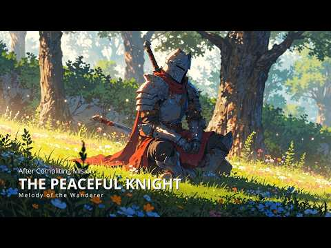
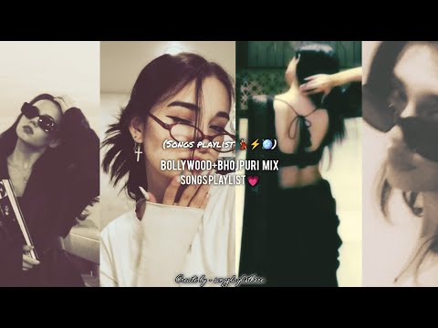
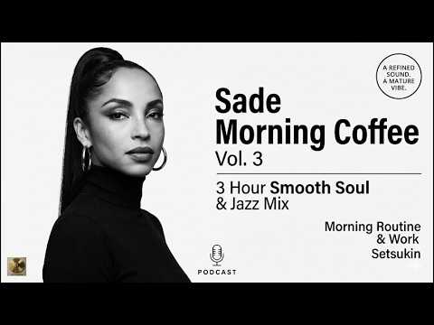
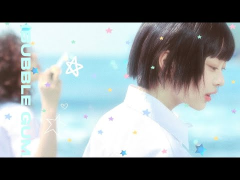
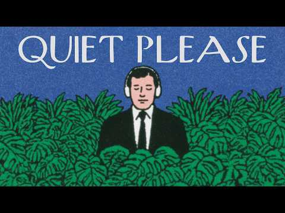
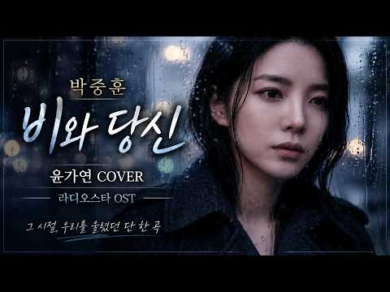

# 음악 — 성공 사례 분석: 사례별 자세히 #601–#640

`analysis.md` 의 9번 (같은 # 번호). 자동 생성 — `tools/success_analysis.py` v1.5.1 (2026-10-24 07:42 UTC). ※ 연구·교육용 — 투자 권유가 아님.

### 601. a playlist to make your brain shut up

- https://www.youtube.com/watch?v=xIX_A2PRoW0 · HIGHWIND · 구독자 40,200 · 조회수 2,436,856 (×60.6, 하루 35,875.8) · 좋아요 36,782 (1.5%) · 62.1분 · 2026-08-17 · 주제 묶음 1. 수면·명상·힐링 · 형식 연주 (직접 연주하는 영상) · 폴더 `W_xIX_A2PRoW0` (웹 승인)
- 썸네일: 
- 설명 앞부분: don't give up.☁ reupload Please consider liking & subscribing if you liked this video as I will be making more! covers and songs by me, made in FL Studio with a MIDI Keyboard by Yamaha. 🚫No AI was used to make this🚫 tags (ignore) ethereal music,end of the world playlist,relaxing music,music to fall…
- 같은 채널 평소 대비 ×166.1 (채널 최근 롱폼 중앙값 14,675회) · 평소 영상: Music To Escape Everything For A Moment (15,506회) / music to help you keep going (13,844회)
- 대본 없음 (설명) — 음성인식이 끝나면 도입부·흐름이 들어감
- 댓글 811/848: 좋은 점 — 영상 0 · 감사·응원 1 · 더 알고 싶은 것 0 · 아쉬운 점 — 영상 0 · 반박·불만 — 의견 다름 0 · 정치·사회 0 · 경험 공유 0 · 구독·다음 기대 0

### 602. Richard Clayderman Tribute 🎹 ∣ Timeless Romantic Piano Music

- https://www.youtube.com/watch?v=ZwlhZLzFxtk · SONELIUM · 구독자 8,050 · 조회수 484,369 (×60.2, 하루 6,410.8) · 좋아요 5,609 (1.2%) · 29.4분 · 2026-08-09 · 주제 묶음 6. 피아노·클래식·연주곡 · 형식 음악 (그 밖 모양 — 한 편짜리 BGM 등) · 폴더 `W_ZwlhZLzFxtk` (웹 승인)
- 썸네일: 
- 설명 앞부분: Richard Clayderman Tribute 🎹 ∣ Timeless Romantic Piano Music 🎹 A Tribute to the Music of Richard Clayderman A celebration of timeless romantic piano music, inspired by the elegance, warmth, and emotion that have made Richard Clayderman’s music loved around the world. This collection features origin…
- 같은 채널 평소 대비 ×1,245.2 (채널 최근 롱폼 중앙값 389회) · 평소 영상: JOE DASSIN — Souvenirs de Paris ∣ Romantic French… (391회) / Piano & Cello Dialogues ∣ Epic Cinematic Cello & … (387회)
- 대본 없음 (설명) — 음성인식이 끝나면 도입부·흐름이 들어감
- 댓글 178/179: 좋은 점 — 영상 0 · 감사·응원 0 · 더 알고 싶은 것 0 · 아쉬운 점 — 영상 0 · 반박·불만 — 의견 다름 0 · 정치·사회 0 · 경험 공유 0 · 구독·다음 기대 0

### 603. 7080 추억의 노래 광고없음🎶 7080노래모음 주옥같은노래 ✨7080 추억의 노래 한국인이 가장 좋아하는 💘50대 이상이 사랑한 7080 추억의 팝송

- https://www.youtube.com/watch?v=3tshpfOljYs · 7080 감성 선율 · 구독자 8,270 · 조회수 495,153 (×59.9, 하루 11,397.1) · 좋아요 1,316 (0.3%) · 118.6분 · 2026-09-10 · 주제 묶음 9. 가요·발라드·트로트 · 형식 플레이리스트·모음 (여러 곡) · 폴더 `W_3tshpfOljYs` (웹 승인)
- 썸네일: 
- 설명 앞부분: 이 영상은 1970–80년대 감성을 담은 명곡들을 모아 따뜻한 멜로디와 함께 추억을 되살리는 플레이리스트입니다. 🎧 7080 한국 발라드 모음 🌙 감성 · 추억 · 힐링 📀 제작 도구 Adobe CC 📢 안내 모든 음악은 정식 라이센스를 통해 사용되며, 편안한 시간 보내시길 바랍니다. 시청해주셔서 진심으로 감사합니다. 음악이 마음에 드셨다면 여러분의 작은 응원이 큰 힘이 됩니다.
- 같은 채널 평소 대비 ×21.4 (채널 최근 롱폼 중앙값 23,133회) · 평소 영상: 50대이상이 들으면 기분좋아지는 7080노래모음🍂🍂그집앞/잊혀진 사랑/돌아와요 부산항에.… (23,133회) / 중년들이 사랑하는 노래 🎶🎶 광고 없는 7080 좋은노래 40곡 모음 - 추억으로 떠나는… (22,613회)
- 대본 없음 (설명) — 음성인식이 끝나면 도입부·흐름이 들어감
- 댓글 63/67: 좋은 점 — 영상 1 · 감사·응원 3 · 더 알고 싶은 것 5 · 아쉬운 점 — 영상 1 · 반박·불만 — 의견 다름 0 · 정치·사회 0 · 경험 공유 2 · 구독·다음 기대 0
  - 좋은 점 — 영상 👍1 “특별한 날에 듣기 좋은 곡들이에요. 추천합니다!”
  - 감사·응원 👍1 “노래부른 가수님들 누구셔요 ? 너무 정성것 부르시네요ᆢ 잘 듣고 갑니다ᆢ고맙습니다ᆢ~~”
  - 감사·응원 👍0 “이런 노래들 듣는 게 진짜 힐링이에요. 감사합니다!”
  - 더 알고 싶은 것 👍6 “옛날 친구들과 모닥불옆에서 기타치며 노래하던 추억이 새록새록 살아나네요ㆍ그친구들 내여친은 어디서 무엇하는지 궁금하네요ㆍ캐나다 이민가고 연락이 ~뚝~~ㅠㅠ”
  - 더 알고 싶은 것 👍1 “아련한 추억, 음악다방, 지직거리는 LP판을 통해 듣던 그노래, 그시절이 그립습니다 좋은음악 많이 만들어주세요❤❤”
  - 아쉬운 점 — 영상 👍15 “희나리 부르시는분이 누구인가요? 목소리가 너무 예뻐서요”
  - 경험 공유 👍4 “이 음악들 듣고 있으면 저도 50대가 된 기분이에요! 😂”
  - 경험 공유 👍1 “50대 이상이 사랑한 노래라니, 저도 그 시기에 자라서 더욱 공감 가네요. 💘”

### 604. Hyperfocus ∣ Lock In for 2 Hours ∣ Deep Work Study With Me (Pomodoro 50/10)

- https://www.youtube.com/watch?v=Rk0yG_dT0iI · Work With Paul · 구독자 19,500 · 조회수 1,164,276 (×59.7, 하루 16,154.7) · 좋아요 5,010 (0.4%) · 111.4분 · 2026-08-13 · 주제 묶음 3. 공부·집중·작업 · 형식 긴 한 곡·반복 (N시간) · 폴더 `W_Rk0yG_dT0iI` (웹 승인)
- 썸네일: 
- 챕터: 0:00 Intro · 0:40 Work Session 1 (50 min) · 50:40 Break (10 min) · 60:40 Work Session 2 (50 min) · 110:40 Outro
- 설명 앞부분: 2 hours of deep, distraction-free work — designed to help you enter a focused flow state. 🎧 Welcome to Hyperfocus Music: a carefully crafted 50/10 Pomodoro session designed for deep work, productivity, and uninterrupted focus. No lyrics. No distractions. Just immersive focus music to help you conce…
- 같은 채널 평소 대비 ×8.5 (채널 최근 롱폼 중앙값 137,184회) · 평소 영상: Hyperfocus Music ∣ 120 Min Deep Work Pomodoro (25… (137,184회) / Hyperfocus Synthwave ∣ Flow State ∣ 2 Hour Deep W… (161,535회)
- 대본 없음 (설명) — 음성인식이 끝나면 도입부·흐름이 들어감
- 댓글 138/141: 좋은 점 — 영상 0 · 감사·응원 0 · 더 알고 싶은 것 0 · 아쉬운 점 — 영상 0 · 반박·불만 — 의견 다름 0 · 정치·사회 0 · 경험 공유 0 · 구독·다음 기대 0

### 605. The Knight Who Chose Peace ⚔️ ∣ Relaxing Fantasy Music

- https://www.youtube.com/watch?v=u8xCmb7KbA0 · Melody of the Wanderer · 구독자 14,500 · 조회수 861,860 (×59.4, 하루 5,275.1) · 좋아요 15,583 (1.8%) · 74.5분 · 2026-05-13 · 주제 묶음 기타 · 형식 음악 (그 밖 모양 — 한 편짜리 BGM 등) · 폴더 `W_u8xCmb7KbA0` (웹 승인)
- 썸네일: 
- 설명 앞부분: Download free Illustration pack and Live walpaper for support: Once a warrior forged by endless battles, the Peaceful Knight now walks a quieter path, watching over the kingdom in silence beneath the fading light. 🌙⚔ 🎶 Medieval Fantasy Study & Peaceful Music for Deep Focus Melody of the Wanderer — …
- 같은 채널 평소 대비 ×177.2 (채널 최근 롱폼 중앙값 4,864회) · 평소 영상: The Wizard Beyond the Silent Forest 🌲 ∣ Relaxing … (4,864회) / The Young King Who Found His True Path 🌿 ∣ Relaxi… (5,071회)
- 대본 없음 (설명) — 음성인식이 끝나면 도입부·흐름이 들어감
- 댓글 516/525: 좋은 점 — 영상 0 · 감사·응원 0 · 더 알고 싶은 것 0 · 아쉬운 점 — 영상 0 · 반박·불만 — 의견 다름 0 · 정치·사회 0 · 경험 공유 0 · 구독·다음 기대 0

### 606. SAXOPHONE LOVE SONGS ❤️ Best Romantic Saxophone Music ∣ Beautiful Love Songs Collection

- https://www.youtube.com/watch?v=QpBzIwJPEoo · Sax Chill Vibes · 구독자 28,700 · 조회수 1,699,913 (×59.2, 하루 23,859.2) · 좋아요 12,191 (0.7%) · 57.6분 · 2026-08-14 · 주제 묶음 6. 피아노·클래식·연주곡 · 형식 음악 (그 밖 모양 — 한 편짜리 BGM 등) · 폴더 `W_QpBzIwJPEoo` (웹 승인)
- 썸네일: 
- 설명 앞부분: Saxophone Love Songs – A beautiful collection of romantic saxophone music featuring timeless love songs and unforgettable melodies. 🎷❤ Relax and enjoy these smooth saxophone covers of classic favorites such as Wonderful Tonight, Nothing’s Gonna Change My Love for You, Can’t Help Falling in Love, Fo…
- 같은 채널 평소 대비 ×21.0 (채널 최근 롱폼 중앙값 80,794회) · 평소 영상: Take Me to Your Heart - Beautiful Saxophone (80,794회) / Best Romantic Saxophone Love Songs ♫ Beautiful Sa… (559,135회)
- 대본 없음 (설명) — 음성인식이 끝나면 도입부·흐름이 들어감
- 댓글 225/235: 좋은 점 — 영상 0 · 감사·응원 0 · 더 알고 싶은 것 0 · 아쉬운 점 — 영상 0 · 반박·불만 — 의견 다름 0 · 정치·사회 0 · 경험 공유 0 · 구독·다음 기대 0

### 607. Bollywood+ Bhojpuri mix songs playlist (💗⚡💃🏻) ∣ @songplaylisthere

- https://www.youtube.com/watch?v=sLPyIfOvPRQ · xthetic._.vibes🎀 · 구독자 37,000 · 조회수 2,185,790 (×59.1, 하루 13,330.1) · 좋아요 24,666 (1.1%) · 16.9분 · 2026-05-13 · 주제 묶음 기타 · 형식 플레이리스트·모음 (여러 곡) · 폴더 `W_sLPyIfOvPRQ` (웹 승인)
- 썸네일: 
- 설명 앞부분: Disclaimer: This video is made for entertainment purposes only. All songs used in this playlist belong to their respective owners. No copyright infringement intended. hastag: Hellow mere pyare dosto I hope you like my video plss do like and subscribe my channel for more songs playlist 💃🏻✨😀 lots of …
- 대본 없음 (설명) — 음성인식이 끝나면 도입부·흐름이 들어감
- 댓글 319/320: 좋은 점 — 영상 0 · 감사·응원 0 · 더 알고 싶은 것 0 · 아쉬운 점 — 영상 0 · 반박·불만 — 의견 다름 0 · 정치·사회 0 · 경험 공유 0 · 구독·다음 기대 0

### 608. 나는 어디로 가나 - (국악 발라드)

- https://www.youtube.com/watch?v=hd_rjKroAqM · Rok Bi · 구독자 8,600 · 조회수 505,032 (×58.7, 하루 3,080.5) · 좋아요 2,536 (0.5%) · 5분 · 2026-05-13 · 주제 묶음 9. 가요·발라드·트로트 · 형식 AI 음악 · 폴더 `W_hd_rjKroAqM` (웹 승인)
- 썸네일: 
- 설명 앞부분: "아티스트 Rok Bi의 공식 유튜브 채널, **'록비 감성음악'*입니다." [ 🎵 록비 감성음악 재생목록 ] 🎵 곡 정보 (Credits) 살다 보면 내가 가는 길이 맞는지 의문이 들 때가 있습니다. 이 노래가 여러분의 지친 마음을 잠시 쉬게 하는 이정표가 되었으면 좋겠습니다. 곡을 듣고 느껴지는 여러분의 마음을 댓글로 자유롭게 남겨주세요. [🎧 YouTube Music]에서도 감상 가능합니다. 작사: 록비 (Rok Bi)&AI 작곡: 록비 & Suno AI 보컬: Rokbi Vocals, Powered by AI 기획/제작: …
- 같은 채널 평소 대비 ×69.8 (채널 최근 롱폼 중앙값 7,233회) · 평소 영상: 인생의 길목에서 만난 노래 ∣ 울 엄니 흰머리되어 가슴 시린 1시간 연속듣기 (7,233회) / 나는 어디로 가야 하나 - 눈물로 부르는 인생노래 ∣ 여성보컬 5회 연속듣기ㅣ인생노래 국… (6,356회)
- 대본 없음 (설명) — 음성인식이 끝나면 도입부·흐름이 들어감
- 댓글 203/205: 좋은 점 — 영상 4 · 감사·응원 36 · 더 알고 싶은 것 1 · 아쉬운 점 — 영상 0 · 반박·불만 — 의견 다름 0 · 정치·사회 0 · 경험 공유 7 · 구독·다음 기대 0
  - 좋은 점 — 영상 👍3 “나이가 들어갈 수록 왜 감성노래, 인생노래 가 마음에 와닿는지....^^;; 나이가 들었다는 반증이겠죠? ^^ 뭉클한 노래, 동영상 잘 듣고 갑니다.”
  - 좋은 점 — 영상 👍1 “22년도 코로나로 어머님을 떠나보내고 절절히 가슴에 와닿아요 오늘도 이자식은 소리죽여 웁니다”
  - 감사·응원 👍14 “노래가 너무 절절하네요,좋은 노래 들려줘서 고마워요.응원합니다.🎉🎉🎉❤❤❤😊😊😊”
  - 감사·응원 👍13 “구독 좋아요로 응원합니다 최고입니다 늘 행복하세요❤❤❤🎉🎉”
  - 더 알고 싶은 것 👍6 “오늘도 록비님의음으로 하루시작합니다 항암잘견디고 좋은음만들어주세요”
  - 경험 공유 👍6 “어쩜 내인생 내삶과 똑같나 눈물이 나도모르게 고인다”
  - 경험 공유 👍2 “머리속은 숯덩이처럼 소음으로 뒤범벅되고 죽고싶도록 이번삶 싫다 이명소리 26년째 어디로 가야하나😢😢😢😢😢”

### 609. 𝐏𝐥𝐚𝐲𝐥𝐢𝐬𝐭 너도 나 좋아했으면 좋겠다

- https://www.youtube.com/watch?v=4mAxMsNJAMI · .happy · 구독자 241 · 조회수 14,145 (×58.7, 하루 109.0) · 좋아요 97 (0.7%) · 18.4분 · 2026-06-16 · 주제 묶음 3. 공부·집중·작업 · 형식 플레이리스트·모음 (여러 곡) · 폴더 `W_4mAxMsNJAMI` (웹 승인)
- 썸네일: 
- 설명 앞부분: 이 채널은 수익 창출을 하지 않습니다
- 같은 채널 평소 대비 ×2.7 (채널 최근 롱폼 중앙값 5,165회) · 평소 영상: 𝐏𝐥𝐚𝐲𝐥𝐢𝐬𝐭 이 플리 들으면 썸 이루어진ㄷㅐ (5,737회) / 𝐏𝐥𝐚𝐲𝐥𝐢𝐬𝐭 가장 예쁜 사람 (4,593회)
- 대본 없음 (설명) — 음성인식이 끝나면 도입부·흐름이 들어감
- 댓글 2/2: 좋은 점 — 영상 0 · 감사·응원 0 · 더 알고 싶은 것 0 · 아쉬운 점 — 영상 0 · 반박·불만 — 의견 다름 0 · 정치·사회 0 · 경험 공유 0 · 구독·다음 기대 0

### 610. KUMAMICHI（熊道） — Japanese Zen Music Along the Bear’s Path

- https://www.youtube.com/watch?v=vFJuk4U-V7Q · Aether Journey · 구독자 34,200 · 조회수 2,007,149 (×58.7, 하루 35,195.2) · 좋아요 16,627 (0.8%) · 347분 · 2026-08-28 · 주제 묶음 1. 수면·명상·힐링 · 형식 음악 (그 밖 모양 — 한 편짜리 BGM 등) · 폴더 `W_vFJuk4U-V7Q` (웹 승인)
- 썸네일: 
- 설명 앞부분: KUMAMICHI 熊道 — “The Bear’s Path.” Across a quiet landscape wrapped in muted earth tones, a lone samurai walks calmly beside a great black bear, their footsteps moving together beneath a vast and silent sky. Neither speaks. Neither hurries. They simply continue along the same path. Kumamichi is Japa…
- 같은 채널 평소 대비 ×532.0 (채널 최근 롱폼 중앙값 3,772회) · 평소 영상: ITACHI TO ARUKU（鼬と歩く） — Japanese Zen Music of Wal… (3,777회) / CHŪKŌ（忠行） — Japanese Zen Music of Faithful Steps (3,768회)
- 대본 없음 (설명) — 음성인식이 끝나면 도입부·흐름이 들어감
- 댓글 235/253: 좋은 점 — 영상 0 · 감사·응원 0 · 더 알고 싶은 것 0 · 아쉬운 점 — 영상 0 · 반박·불만 — 의견 다름 0 · 정치·사회 0 · 경험 공유 0 · 구독·다음 기대 0

### 611. Fresh Mind Relaxing 💗 ∣ Slowed + Reverb Lofi Mix for Calm, Focus & Peaceful Vibes #sleepm…

- https://www.youtube.com/watch?v=ACcuQVFbfnI · Vansh Lofi · 구독자 29,500 · 조회수 1,729,908 (×58.6, 하루 13,382.1) · 좋아요 7,975 (0.5%) · 16분 · 2026-06-17 · 주제 묶음 1. 수면·명상·힐링 · 형식 음악 (그 밖 모양 — 한 편짜리 BGM 등) · 폴더 `W_ACcuQVFbfnI` (웹 승인)
- 썸네일: 
- 설명 앞부분: Fresh Mind Relaxing 💗 ∣ Slowed + Reverb Lofi Mix for Calm, Focus & Peaceful Vibes Welcome to the world of soothing lofi music, where stress fades away, and peace takes over. This 2025 mind-relaxing lofi mix is perfect for: Deep Focus & Studying 📖 Relaxing & Meditation 🧘‍♂ Chilling After a Long Day …
- 대본 없음 (설명) — 음성인식이 끝나면 도입부·흐름이 들어감
- 댓글 88/88: 좋은 점 — 영상 0 · 감사·응원 0 · 더 알고 싶은 것 0 · 아쉬운 점 — 영상 0 · 반박·불만 — 의견 다름 0 · 정치·사회 0 · 경험 공유 0 · 구독·다음 기대 0

### 612. 【作業用BGM】ちいかわ Instrumental Jazz 2時間 ∣ 深夜のジャズラウンジ ∣ ひとりごつ, 島のうた, マジカルシンドローム +more【人魚の島のひみつ】

- https://www.youtube.com/watch?v=CJEgDVcFy80 · GINZA Midnight · 구독자 23,100 · 조회수 1,353,905 (×58.6, 하루 22,953.7) · 좋아요 22,747 (1.7%) · 126.6분 · 2026-08-26 · 주제 묶음 6. 피아노·클래식·연주곡 · 형식 음악 (그 밖 모양 — 한 편짜리 BGM 등) · 폴더 `W_CJEgDVcFy80` (웹 승인)
- 썸네일: 
- 챕터: 0:00 ひとりごつ (Hitorigotsu) · 2:43 くつずれ (Kutsuzure) · 6:01 机さする (Tsukue Sasuru) · 9:59 島のうた セイレーンver. (Shima no Uta … · 12:30 マジカルシンドローム (Magical Syndrome) · 15:06 今日の日はさようなら (Kyou no Hi wa Say… · 18:05 Repeat
- 설명 앞부분: 🎵 Playlist ▪︎ 本動画はYouTubeのコンテンツIDシステムにより、収益は原盤権・著作権の権利者へ自動的に還元される仕組みとなっております。 ▪︎ Produce / Music Direction : GINZA Midnight ▪︎ Selection & Arrangement Design : GINZA Midnight ▪︎ Sound Edit / Mix : GINZA Midnight ▪︎ Artwork & Design : GINZA Midnight
- 같은 채널 평소 대비 ×49.3 (채널 최근 롱폼 중앙값 27,467회) · 평소 영상: 【作業用BGM】藤井風 アルバム『Prema』極上のピアノインスト集 ∣ 深夜のジャズラウンジ (27,467회) / 真・運命 (English Ver.) - 曽野舜太&山中柔太朗 (M!LK) ∣ Midnigh… (24,450회)
- 대본 없음 (설명) — 음성인식이 끝나면 도입부·흐름이 들어감
- 댓글 324/331: 좋은 점 — 영상 0 · 감사·응원 1 · 더 알고 싶은 것 1 · 아쉬운 점 — 영상 0 · 반박·불만 — 의견 다름 1 · 정치·사회 0 · 경험 공유 1 · 구독·다음 기대 0
  - 감사·응원 👍0 “이 노래 듣고 술 자격증 땄어요 감사합니다”
  - 더 알고 싶은 것 👍0 “크리스마스 버전도 만들어주세요”
  - 반박·불만 — 의견 다름 👍0 “너무 좋아서 말도 안나옴”
  - 경험 공유 👍0 “내가 어쩌다가 요기까지 왔을까...”

### 613. 途中広告なし[BGM]癒しの森カフェで何も考えない朝☕Gentle Morning Piano Jazz｜心地よく一日を始めるカフェ音楽

- https://www.youtube.com/watch?v=qDJ8LG4noFk · Aurora Tune · 구독자 19,400 · 조회수 1,135,208 (×58.5, 하루 6,473.5) · 좋아요 0 (0.0%) · 92.5분 · 2026-05-01 · 주제 묶음 6. 피아노·클래식·연주곡 · 형식 음악 (그 밖 모양 — 한 편짜리 BGM 등) · 폴더 `W_qDJ8LG4noFk` (웹 승인)
- 썸네일: 
- 설명 앞부분: 心がやわらかくほどけていくような、癒しのカフェで聴くピアノジャズBGMです。 ▼おすすめ動画(Recommended videos) 動画の映像と音はAIと人の感性を重ねて、心を込めて制作しています。 A soothing piano jazz piece, like the kind you’d hear in a cozy cafe, gently helping your mind unwind. Calm, mellow tones bring a slow and comfortable start to your day. In the midst of busy days, f…
- 같은 채널 평소 대비 ×18.6 (채널 최근 롱폼 중앙값 60,872회) · 평소 영상: 途中広告なし[BGM]今を大切にする夜🌙Quiet Piano Music for Calm Ni… (60,872회) / [BEST BGM]途中広告なし🌿今日がうまくいく、小さな幸せを見つける朝｜Gentle Pian… (54,976회)
- 대본 없음 (설명) — 음성인식이 끝나면 도입부·흐름이 들어감
- 댓글 116/116: 좋은 점 — 영상 0 · 감사·응원 0 · 더 알고 싶은 것 0 · 아쉬운 점 — 영상 0 · 반박·불만 — 의견 다름 0 · 정치·사회 0 · 경험 공유 0 · 구독·다음 기대 0

### 614. 빈예서 신곡 공개! 듣자마자 눈물 터졌다… “나훈아의 감성이 그대로” 😭🎵

- https://www.youtube.com/watch?v=noMxR6lohxM · 서울 뮤직 · 구독자 1,510 · 조회수 88,316 (×58.5, 하루 5,458.6) · 좋아요 484 (0.5%) · 6.9분 · 2026-10-08 · 주제 묶음 기타 · 형식 한 곡 (뮤직비디오·음원·가사) · 폴더 `W_noMxR6lohxM` (웹 승인)
- 썸네일: 
- 설명 앞부분: 🎵✨ 빈예서 신곡 〈눈물이 먼저 대답했어요〉 공개! ✨🎵 💔 한 소절이 시작되는 순간, 가슴 깊이 숨겨두었던 감정이 터져 나옵니다. 😭 애절한 목소리와 따뜻한 멜로디가 어우러져 듣는 순간 눈시울을 적시는 감성 트로트. 🎤 사랑, 그리움, 추억 그리고 전하지 못했던 마음을 한 곡에 담았습니다. 🌹 잔잔하게 시작해 후렴으로 갈수록 깊어지는 감정선이 이 노래의 매력입니다. 💫 마지막까지 들으면 더욱 오래 마음에 남는 특별한 감동을 느낄 수 있습니다. ❤️ 오늘 하루, 잠시 모든 것을 내려놓고 이 노래와 함께 따뜻한 시간을 보내세요. 💬…
- 같은 채널 평소 대비 ×104.1 (채널 최근 롱폼 중앙값 848회) · 평소 영상: 🎵 김태연 신곡｜지갑 속 낡은 사진… 사랑이 남아 있기에 아픔도 남았다 💔😭 (864회) / 🎵💔 나훈아 아들·딸의 눈물의 듀엣… 부모님께 바친 노래에 나훈아도 끝내 오열 😭🎤❤️ (884회)
- 대본 없음 (설명) — 음성인식이 끝나면 도입부·흐름이 들어감
- 댓글 19/35: 좋은 점 — 영상 0 · 감사·응원 4 · 더 알고 싶은 것 0 · 아쉬운 점 — 영상 0 · 반박·불만 — 의견 다름 1 · 정치·사회 0 · 경험 공유 0 · 구독·다음 기대 0
  - 감사·응원 👍2 “ㅂ이푼빈예서화이팅🎉🎉🎉”
  - 감사·응원 👍1 “예서양 노래 넘 심금을울립니다 넘 잔잔하고 부드럽고 예술적인 감정담아 응원합니다”
  - 반박·불만 — 의견 다름 👍2 “예서노래가. 아닌데”

### 615. [COVER] 한오백년 _ 어버이날을 맞이하여...

- https://www.youtube.com/watch?v=W40yM35SfWc · 감성메아리 · 구독자 5,410 · 조회수 313,812 (×58.0, 하루 1,824.1) · 좋아요 1,773 (0.6%) · 4.8분 · 2026-05-05 · 주제 묶음 12. 커버·노래 부르기 · 형식 AI 음악 · 폴더 `W_W40yM35SfWc` (웹 승인)
- 썸네일: 
- 설명 앞부분: 커버해 보았습니다 당신의 오늘 하루에 따뜻한 위로와 여유로운 쉼표를 선물할 수 있으면 좋겠습니다 🎤 Vocal by AI
- 같은 채널 평소 대비 ×592.1 (채널 최근 롱폼 중앙값 530회) · 평소 영상: 단 한 번만 내 손 마디마디 온기를 채워주오🌧️/이승의 인연이 여기가 끝이로구나/손 한번… (530회) / "정통 트로트"로 가슴을 적셔주는 노래들😭 /14곡 노래모음 ▶️ (558회)
- 대본 없음 (설명) — 음성인식이 끝나면 도입부·흐름이 들어감
- 댓글 58/58: 좋은 점 — 영상 0 · 감사·응원 8 · 더 알고 싶은 것 2 · 아쉬운 점 — 영상 1 · 반박·불만 — 의견 다름 0 · 정치·사회 0 · 경험 공유 2 · 구독·다음 기대 1
  - 감사·응원 👍15 “한오백년 노래가락이 너무 슬퍼요 우리 어머니 가족들 보고 싶어요 노래 감사합니다”
  - 감사·응원 👍14 “감성메아리님 안녕하세요 흐린 날씨로 시작을 하는 월요일 님의 멋진 노래 한오백년 감상하며 구독 좋아요 엄지 세워 힘차게 응원합니다 한주도 즐겁고 행복하게 보내시고 건강하세요.❤💞❤💞❤”
  - 더 알고 싶은 것 👍3 “가수도 ai 인가요? 아니면 진짜 사람인가요? 사람이라면 가수를 알고 싶네요.”
  - 더 알고 싶은 것 👍1 “다음으로 '천년 바위' 부탁합니다,꾸벅”
  - 아쉬운 점 — 영상 👍3 “사람 목소리 인가요? AI목소리인가요?”
  - 경험 공유 👍1 “한오백년 잘넘가네 나도한수하는데 많이 듲고 한수배울께요”

### 616. Sade Morning Coffee ☕ Vol.3 ∣ Luxury ChillMix ∣ Soulful Jazz & Relaxing Coffee Shop Music…

- https://www.youtube.com/watch?v=mp4oA2JflBQ · Setsukin · 구독자 43,900 · 조회수 2,545,292 (×58.0, 하루 15,253.9) · 좋아요 48,197 (1.9%) · 114.5분 · 2026-05-10 · 주제 묶음 4. 카페·매장·라운지 · 형식 음악 (그 밖 모양 — 한 편짜리 BGM 등) · 폴더 `W_mp4oA2JflBQ` (웹 승인)
- 썸네일: 
- 챕터: 0:00 It's Only Love That Gets You … · 3:30 I Couldn't Love You More · 7:09 Like a Tattoo · 10:36 The Sweetest Gift · 12:49 Your Love Is King · 16:22 Maureen · 20:28 Give It Up · 23:54 Kiss of Life · 29:34 By Your Side · 33:58 The Sweetest Taboo · 38:18 Love Is Stronger Than Pride · 42:30 Never As Good As the First Ti… · 46:19 Frankie's First Affair · 50:43 The Big Unknown · 54:19 Smooth Operator · 59:19 The Safest Place · 61:43 No Ordinary Love · 68:57 Mermaid · 72:58 Still In Love with You · 77:17 Hang On to Your Love
- 설명 앞부분: 🎧 Want the FULL mix? This video is a preview. The complete uncut version — plus every mix I've ever made — is on Patreon. ⭐ $3/month — Early access + full tracklists + behind-the-scenes 🎵 $7/month — Full-length DJ mixes in WAV quality (recommended) 👑 $15/month — Your name in the credits + VIP statu…
- 같은 채널 평소 대비 ×185.0 (채널 최근 롱폼 중앙값 13,757회) · 평소 영상: 1987 Coffee & Books☕📚Vol.4 ∣ Pages of Love & Midn… (13,757회) / 80s Pop Hits DJ Mix 🎶 Madonna, TOTO, Nena, Tears … (13,752회)
- 대본 없음 (설명) — 음성인식이 끝나면 도입부·흐름이 들어감
- 댓글 780/789: 좋은 점 — 영상 0 · 감사·응원 0 · 더 알고 싶은 것 0 · 아쉬운 점 — 영상 0 · 반박·불만 — 의견 다름 0 · 정치·사회 0 · 경험 공유 0 · 구독·다음 기대 0

### 617. [중간광고없음] 🌿 잠시, 아무 생각도 하지 말아요. ∣ 숲속에서 듣는 잔잔한 피아노 ∣ BGM ∣ 휴식, 힐링, 독서

- https://www.youtube.com/watch?v=ebDKy0szHC8 · Riae & Piano · 구독자 12,600 · 조회수 730,290 (×58.0, 하루 7,276.6) · 좋아요 3,636 (0.5%) · 181.3분 · 2026-07-15 · 주제 묶음 6. 피아노·클래식·연주곡 · 형식 음악 (그 밖 모양 — 한 편짜리 BGM 등) · 폴더 `W_ebDKy0szHC8` (웹 승인)
- 썸네일: 
- 설명 앞부분: 잠시 모든 생각을 내려놓고, 창밖 가득 펼쳐진 숲과 잔잔한 피아노 선율 속에서 마음을 쉬어가세요. 독서와 공부, 휴식, 그리고 혼자만의 조용한 시간을 더욱 평온하게 만들어 줄 힐링 플레이리스트입니다. Take a break from every thought and let the peaceful forest view and gentle piano melodies calm your mind. A relaxing playlist for reading, studying, working, or simply enjoying a quiet m…
- 같은 채널 평소 대비 ×47.6 (채널 최근 롱폼 중앙값 15,352회) · 평소 영상: [중간광고없음] ☁️🍃 잠시 쉬어가도 괜찮아, 넌 잘하고 있어 ∣ 위로의 피아노 ∣ BG… (15,639회) / [중간광고없음] ☁️🍃 잠깐 멈춰봐, 좋은 날은 다시 올거야 ∣ 희망과 위로의 피아노 ∣… (15,066회)
- 대본 없음 (설명) — 음성인식이 끝나면 도입부·흐름이 들어감
- 댓글 191/203: 좋은 점 — 영상 0 · 감사·응원 15 · 더 알고 싶은 것 0 · 아쉬운 점 — 영상 2 · 반박·불만 — 의견 다름 0 · 정치·사회 0 · 경험 공유 2 · 구독·다음 기대 2
  - 감사·응원 👍6 “드디어 찾았습니다. 완전 저의 스타일 피아노 연주 입니다. 잘 만들어 주어서 감사합니다. 슬픔을 슬픔으로 흘러가게 해 주는 피아노 선율에 저의 마음도 같이 흘러가는 시간이 됩니다.”
  - 감사·응원 👍3 “감사합니다❤”
  - 아쉬운 점 — 영상 👍10 “생각이 많아지고 뭔가 심신의 안정을 원할때.멍때리며 머릿속의 안개를 걷어내고 싶을때 들어요.무엇보다 중간광고가 없어서 좋아요”
  - 아쉬운 점 — 영상 👍1 “"몇 번을 반복해서 들어도 질리지 않는 곡이에요. 편곡 센스가 남다르신 것 같아요. 구독 좋아요로 응원할게요~"”
  - 경험 공유 👍2 “아기 낮잠음악으로 최고에요. 같이 듣는 저도 너무 힐링됩니다.오늘 하루도 평온함을 선물해주셔서 감사합니다.”
  - 구독·다음 기대 👍2 “구독하고갑니다.좋아요”
  - 구독·다음 기대 👍1 “잔잔한 음악 많이 들어봤지만, 이 영상에 정착했어요. 가장 마음이 편해요. 다이어리 매일 쓰는데 매일 듣고있어요”

### 618. 처음부터 신나서 환장하는! ❤️ 신나는 트로트리믹스 고속도로메들리 ∣ 최신트로트 ∣ 트로트메들리 ∣ 감성트로트

- https://www.youtube.com/watch?v=zt45-jow7lo · 다솜이의 트로트책방 · 구독자 7,810 · 조회수 452,370 (×57.9, 하루 2,670.4) · 좋아요 3,357 (0.7%) · 71.2분 · 2026-05-07 · 주제 묶음 5. 운동·드라이브·신나는 · 형식 플레이리스트·모음 (여러 곡) · 폴더 `W_zt45-jow7lo` (웹 승인)
- 썸네일: 
- 챕터: 0:00 단심가 · 3:39 찜했어요 · 7:04 하늘만큼 땅만큼 · 10:29 두근두근 내사랑 · 14:05 사랑의 신호등 · 18:09 꽃보다 그대요 · 21:50 사랑 충전 완료 · 24:56 사랑보따리 · 28:23 천번을 물어도 · 32:00 꽃신 신고 갈게요 · 35:35 반복재생
- 설명 앞부분: 오늘도 찾아온 최신트로트 EDM리믹스 디스코메들리 😘 이번주도 고생 많으신 여러분! 신나는 트로트메들리로 다솜 트로트책방에서 힐링하고 가셨으면 좋겠어요 👍 여러분의 쉼터가 되길 바라는 마음이에요 💕 즐겁게 들어주시고 남겨주시는 따뜻한 댓글 한마디에 저도 너무너무 힘이 납니다 😘😘 항상 감사드립니다 😁 EDM트로트 리믹스 BEST 모음 애절한 감성트로트 더 들어보기 신나는 트로트 더 들어보기 계속 신나는 EDM 리믹스 메들리 더 들어보기 다솜이 싱글 들어보기 💖노래 순서💖
- 같은 채널 평소 대비 ×47.3 (채널 최근 롱폼 중앙값 9,573회) · 평소 영상: 이 맛이지~!! 최고로 신나는 트로트리믹스 모음 7번째!! 고속도로메들리 ∣ 최신트로트 … (9,518회) / 들을수록 빠져든다! 신나는 댄스트로트 고속도로메들리 ∣ 최신트롯 ∣ 감성트로트 (8,305회)
- 대본 없음 (설명) — 음성인식이 끝나면 도입부·흐름이 들어감
- 댓글 139/143: 좋은 점 — 영상 0 · 감사·응원 5 · 더 알고 싶은 것 2 · 아쉬운 점 — 영상 1 · 반박·불만 — 의견 다름 0 · 정치·사회 1 · 경험 공유 0 · 구독·다음 기대 3
  - 감사·응원 👍5 “음악이신나좋아요화이팅🎉🎉🎉❤❤❤”
  - 감사·응원 👍2 “화이팅”
  - 더 알고 싶은 것 👍1 “구독. 망치로박고갑니다. 기분전환 최곱니다. cd 구입되나요???”
  - 아쉬운 점 — 영상 👍6 “신나요 잘듣고 있어요 낚시배 하는데 살수 있나요 ?”
  - 정치·사회 👍0 “영어이나라대한민국미국영어이나라본한국말억양토늘회화영어들어나가금그들영어와저너꼭알어두고미국말영어러시아촌칙급이길느한국어이북말조선족톤극사기느어대”
  - 구독·다음 기대 👍2 “첫노래 트로트가사제목이 어떻게되나요 가수 가사제목 궁금하내요 구독하고갑니다 댓글달아주시면 감사하겠습니다 너무신납니다”
  - 구독·다음 기대 👍2 “구독합니다. 신나네요”

### 619. Paganini (Vivaldi x Beethoven) House Music Mix – Hypnotic Violin for Deep Focus

- https://www.youtube.com/watch?v=Q9TSg4bKjcs · Velvet Frequencies · 구독자 5,600 · 조회수 323,282 (×57.7, 하루 1,976.7) · 좋아요 5,299 (1.6%) · 7분 · 2026-05-13 · 주제 묶음 6. 피아노·클래식·연주곡 · 형식 음악 (그 밖 모양 — 한 편짜리 BGM 등) · 폴더 `W_Q9TSg4bKjcs` (웹 승인)
- 썸네일: 
- 설명 앞부분: This is a hypnotic cinematic house music experience designed for deep focus, immersive flow, and emotional late-night energy. Inspired by the virtuosic violin intensity of Paganini, the flowing melodic elegance of Vivaldi, and the powerful harmonic emotion of Beethoven, this mix blends deep house g…
- 같은 채널 평소 대비 ×339.4 (채널 최근 롱폼 중앙값 952회) · 평소 영상: Beethoven (Vivaldi x Mozart) Violin House Music M… (958회) / Bach (Mozart × Beethoven) Violin House Music Mix … (947회)
- 대본 없음 (설명) — 음성인식이 끝나면 도입부·흐름이 들어감
- 댓글 212/214: 좋은 점 — 영상 0 · 감사·응원 0 · 더 알고 싶은 것 0 · 아쉬운 점 — 영상 0 · 반박·불만 — 의견 다름 0 · 정치·사회 0 · 경험 공유 0 · 구독·다음 기대 0

### 620. 𝐏𝐥𝐚𝐲𝐥𝐢𝐬𝐭 ∣ 초여름 별사탕 𖤐ˊ˗

- https://www.youtube.com/watch?v=aW-TYu5rwAY · Horu · 구독자 3,550 · 조회수 204,346 (×57.6, 하루 1,161.5) · 좋아요 0 (0.0%) · 19.8분 · 2026-05-01 · 주제 묶음 기타 · 형식 플레이리스트·모음 (여러 곡) · 폴더 `W_aW-TYu5rwAY` (웹 승인)
- 썸네일: 
- 챕터: 0:00 NewJeans - Bubble Gum · 3:16 KiiiKiii - Dancing Alone · 6:32 STAYC - LOVE · 9:36 Billlie - 기억사탕 · 12:38 Yerin Baek - 지켜줄게 · 16:19 여자친구 - Mermaid
- 같은 채널 평소 대비 ×6.1 (채널 최근 롱폼 중앙값 33,229회) · 평소 영상: 𝐏𝐥𝐚𝐲𝐥𝐢𝐬𝐭 ∣ 가을 새벽향 𓂃 🍂 (33,229회) / [𝐏𝐥𝐚𝐲𝐥𝐢𝐬𝐭] 프루티거 에어로 여돌 플리 𓂃◌𓈒𓐍𓇼 (24,746회)
- 대본 없음 (없음) — 음성인식이 끝나면 도입부·흐름이 들어감
- 댓글 42/42: 좋은 점 — 영상 2 · 감사·응원 1 · 더 알고 싶은 것 2 · 아쉬운 점 — 영상 0 · 반박·불만 — 의견 다름 0 · 정치·사회 0 · 경험 공유 0 · 구독·다음 기대 0
  - 좋은 점 — 영상 👍23 “안녕하세요!오산중학교에다니는 3학년학생입니다.기술시간에 선플달기를 하고있는데 요즘 점점여름이 다가오는시기여서 그런지 이영상이 알고리즘에 떴더라고요!시원한 여름플리너무 잘만들어주셔서 잘들을것같아요!모두 시원한여름보내시고 앞으로더 좋은영상 많이 만들어주세요💕”
  - 좋은 점 — 영상 👍10 “기억사탕 있는거 레전드”
  - 감사·응원 👍1 “감사합니다ㅠㅠ”
  - 더 알고 싶은 것 👍23 “안녕하세요!오산중학교에다니는 3학년학생입니다.기술시간에 선플달기를 하고있는데 요즘 점점여름이 다가오는시기여서 그런지 이영상이 알고리즘에 떴더라고요!시원한 여름플리너무 잘만들어주셔서 잘들을것같아요!모두 시원한여름보내시고 앞으로더 좋은영상 많이 만들어주세요💕”
  - 더 알고 싶은 것 👍2 “자주 올려주세요...”

### 621. Elevate yourself - Bhagavad Gita ∣ Dark Trip-Hop X Downtempo Ambient X Raga Fusion ∣ SUR …

- https://www.youtube.com/watch?v=vrn7QzaHsbk · SUR-SPIRITUAL · 구독자 7,910 · 조회수 450,764 (×57.0, 하루 15,651.6) · 좋아요 5,712 (1.3%) · 5.3분 · 2026-09-25 · 주제 묶음 6. 피아노·클래식·연주곡 · 형식 음악 (그 밖 모양 — 한 편짜리 BGM 등) · 폴더 `W_vrn7QzaHsbk` (웹 승인)
- 썸네일: 
- 설명 앞부분: The vocal narrative reflects the journey of overcoming the deep void and darkness within the mind (bheetar ka andhakar). It serves as a reminder that there is no external savior; you must rescue yourself from the abyss (svayam hi svayam ka tu kar le uddhar). It is a powerful, heavy anthem for spiri…
- 같은 채널 평소 대비 ×154.8 (채널 최근 롱폼 중앙값 2,912회) · 평소 영상: Har Har Mahadev Shambho ∣ Powerful Shiva Song ∣ S… (2,912회) / Rakt Se Bana Itihas (रक्त से बना इतिहास) ∣ Jai Bh… (3,154회)
- 대본 없음 (설명) — 음성인식이 끝나면 도입부·흐름이 들어감
- 댓글 97/98: 좋은 점 — 영상 0 · 감사·응원 0 · 더 알고 싶은 것 0 · 아쉬운 점 — 영상 0 · 반박·불만 — 의견 다름 0 · 정치·사회 0 · 경험 공유 0 · 구독·다음 기대 0

### 622. [MIXSET] 늙크크의 여름 HipHop & R&B

- https://www.youtube.com/watch?v=_o3psN6OCTk · 떵신 tteongshin · 구독자 8,150 · 조회수 461,902 (×56.7, 하루 4,627.3) · 좋아요 9,674 (2.1%) · 22.1분 · 2026-07-16 · 주제 묶음 11. 힙합·R&B·EDM · 형식 정보·해설 (그 밖) · 폴더 `W__o3psN6OCTk` (웹 승인)
- 썸네일: 
- 설명 앞부분: 2026년 여름을 맞아 2010년대 중반 여름을 대표했던 HipHop & R&B 곡들을 모아 믹셋으로 완성했습니다. 🎧 Tracklist Enjoy! ☀ [SoundCloud]
- 대본 없음 (설명) — 음성인식이 끝나면 도입부·흐름이 들어감
- 댓글 204/204: 좋은 점 — 영상 0 · 감사·응원 5 · 더 알고 싶은 것 5 · 아쉬운 점 — 영상 2 · 반박·불만 — 의견 다름 0 · 정치·사회 0 · 경험 공유 13 · 구독·다음 기대 2
  - 감사·응원 👍4 “내가늙크크라서너무좋다이런노래들이난좋다감사합니다구독햇어요🫰🏻🫰🏻🫰🏻”
  - 감사·응원 👍2 “와... 20대 추억 돋는 아침 출근길입니다!!! 감사해요😊”
  - 더 알고 싶은 것 👍8 “진짜 곡 넘어가는거 예술임… 더만들어주세요제발”
  - 더 알고 싶은 것 👍7 “믹셋 계속 만들어주세요..🥺❤️”
  - 아쉬운 점 — 영상 👍2 “도파민 중독자인 저에게는 이런 플리가 필요했어요 좀 지루하다 싶으면 다른 곡😍”
  - 경험 공유 👍15 “내가 늙크크가 되었다는게 믿기지않아.. 분명 나 엊그제 20살이었던것 같은데.......................................”
  - 경험 공유 👍10 “지나가는 97년생인데.. 분명 영크크라 생각했는데 다 내가 좋아하는 노래라니... 나 언제 늙크크 된거지 ㅠㅜ 무튼 플리 개조아여❤”
  - 구독·다음 기대 👍2 “와.. 우연히 듣고 바로 구독합니다. 잘 부탁드려요!”
  - 구독·다음 기대 👍2 “구독하고 갈게여”

### 623. ✨💖요즘 폼 미친(positive) 최신 아이돌 노래 모음 ∣ 신나는 ∣ 최신곡 ∣ 여돌 ∣ 남돌 ∣ 아이돌 플레이리스트 [ K-POP Playlist ]

- https://www.youtube.com/watch?v=eLiTRGAnmyk · 띠잉뮤직 · 구독자 20,900 · 조회수 1,178,569 (×56.4, 하루 7,796.0) · 좋아요 5,581 (0.5%) · 121.8분 · 2026-05-26 · 주제 묶음 10. 팝송·K팝·J팝 · 형식 플레이리스트·모음 (여러 곡) · 폴더 `W_eLiTRGAnmyk` (웹 승인)
- 썸네일: 
- 챕터: 0:00 르세라핌 · 2:55 하츠투하츠 · 6:23 큐티 스트릿 · 10:32 넥스지 · 13:30 아이오아이 · 16:45 츄 · 19:54 투어스 · 22:45 에스파 · 25:19 키키 · 28:24 투바투 · 31:24 엔믹스 · 34:27 있지 · 37:40 네이즈 · 40:29 비비 · 44:04 메이딘 · 46:39 킥플립 · 49:21 언차일드 · 51:21 피프티피프티 · 54:19 투어스 · 57:06 키스오브라이프
- 설명 앞부분: 🎵PlayList🎵 LE SSERAFIM - BOOMPALA Hearts2Hearts - STYLE CUTIE STREET - 귀엽기만 하면 안 되나요? NEXZ - HYPEMAN I.O.I - 갑자기 (Suddenly) CHUU - Teeny Tiny Heart TWS - 너의 모든 가능성이 되어 줄게 aespa - WDA KiiiKiii - UNDERDOGS TXT - Love Language NMIXX - Heavy Serenade ITZY - Motto NAZE - People Talk BIBI - BUMPA MADEIN …
- 같은 채널 평소 대비 ×99.5 (채널 최근 롱폼 중앙값 11,847회) · 평소 영상: 💎 쌈뽕하게 신나는 여자 아이돌 걸그룹 노래 모음 [ Girl Group Playlist… (12,732회) / 💖 느낌 좋은 최신 걸그룹 노래모음 여자 아이돌 플레이리스트 [ Girl Group Pl… (10,962회)
- 대본 없음 (설명) — 음성인식이 끝나면 도입부·흐름이 들어감
- 댓글 162/162: 좋은 점 — 영상 2 · 감사·응원 6 · 더 알고 싶은 것 2 · 아쉬운 점 — 영상 0 · 반박·불만 — 의견 다름 0 · 정치·사회 0 · 경험 공유 1 · 구독·다음 기대 0
  - 좋은 점 — 영상 👍5 “큐스토가 케이팝으로 분류됐어 이거옳지 맞아 ㅋㅋ 좋다 듣기 편하넵 운동하기딱이답 기분좋아짐 ❤”
  - 감사·응원 👍10 “김채원 피지컬 뭐지..? 내 눈이 이상해진건가? 뭐가됐든 압도적 감사”
  - 감사·응원 👍2 “채원이가 전설을 또 남겨놨구나..... 화이팅”
  - 더 알고 싶은 것 👍15 “뮤비좋은데 라이브 가능한가요?”
  - 더 알고 싶은 것 👍1 “남돌 여돌은 구분해서 만들어주세요”

### 624. A Regular Day on the Journey ∣ Medieval Fantasy Music for Deep Focus and Inner Calm

- https://www.youtube.com/watch?v=TACRmufLfko · Tales of Velmora · 구독자 18,000 · 조회수 1,007,617 (×56.0, 하루 5,799.2) · 좋아요 10,684 (1.1%) · 129.7분 · 2026-05-03 · 주제 묶음 3. 공부·집중·작업 · 형식 음악 (그 밖 모양 — 한 편짜리 BGM 등) · 폴더 `W_TACRmufLfko` (웹 승인)
- 썸네일: 
- 설명 앞부분: The windmill was on the map. Not as a destination just as a landmark. A thing to pass on the way to somewhere else. They had passed dozens like it. Would pass dozens more. But she slowed down when she saw it. Not because it was remarkable. Not because it marked anything important. Just because the …
- 같은 채널 평소 대비 ×179.9 (채널 최근 롱폼 중앙값 5,600회) · 평소 영상: Let's Enjoy the Quiet Night ∣ Medieval Fantasy Mu… (5,600회) / Right on Time for the Blooms ∣ Medieval Fantasy M… (5,808회)
- 대본 없음 (설명) — 음성인식이 끝나면 도입부·흐름이 들어감
- 댓글 374/374: 좋은 점 — 영상 0 · 감사·응원 1 · 더 알고 싶은 것 0 · 아쉬운 점 — 영상 1 · 반박·불만 — 의견 다름 0 · 정치·사회 0 · 경험 공유 2 · 구독·다음 기대 0
  - 감사·응원 👍0 “고맙소”
  - 아쉬운 점 — 영상 👍0 “우연히 영상에 쓸 음악을 찾다가 해당 채널에 들리게 되었는데 음악이 너무 좋아요! 혹시 해당 채널의 음악들은 출처를 남긴다거나 해서 ASMR 애니메이션 영상등의 배경음으로 활용해도 괜찮은 부분일까요 ?!”

### 625. 숲속에 내리는 잔잔한 빗소리 🌧️ 명상, 깊은 수면, 편안한 소리

- https://www.youtube.com/watch?v=4Xl4kMOmGY8 · 숲 속 빗소리 · 구독자 1,800 · 조회수 100,554 (×55.9, 하루 1,214.7) · 좋아요 702 (0.7%) · 187.7분 · 2026-08-02 · 주제 묶음 2. 자연 소리·백색소음 · 형식 자연 소리·백색소음 (음악 낱말 없는 제목) · 폴더 `W_4Xl4kMOmGY8` (웹 승인)
- 썸네일: 
- 설명 앞부분: 숲속에 내리는 잔잔한 빗소리 🌧️ 명상, 깊은 수면, 편안한 소리 고요한 숲속에 내리는 부드러운 빗소리와 함께 몸과 마음의 긴장을 풀어보세요. 숲속에 부드럽게 내리는 빗소리와 나뭇잎 사이로 스치는 잔잔한 바람, 멀리서 들려오는 자연스러운 천둥소리와 함께 깊은 평온함을 느껴보세요. 이 편안한 자연의 분위기는 숙면을 돕고, 스트레스를 줄이며, 공부하거나 일할 때 집중력을 유지하는 데 도움을 줄 수 있습니다. 이 채널에서는 깊은 수면, 명상, 휴식과 마음의 안정을 위한 자연스럽고 몰입감 있는 사운드 풍경을 제작합니다. 숲속의 빗소리가 …
- 같은 채널 평소 대비 ×59.1 (채널 최근 롱폼 중앙값 1,701회) · 평소 영상: 거센 빗소리로 5분 만에 깊은 잠에 빠져보세요 (99% 효과) 🌧️ 긴장을 풀고 스트레스… (1,701회) / 숲속에 내리는 잔잔한 빗소리 🌧️ 자연스럽게 깊은 숙면으로 이끄는 편안한 빗소리 ∣ 마음… (1,676회)
- 대본 없음 (설명) — 음성인식이 끝나면 도입부·흐름이 들어감
- 댓글 41/41: 좋은 점 — 영상 0 · 감사·응원 0 · 더 알고 싶은 것 0 · 아쉬운 점 — 영상 0 · 반박·불만 — 의견 다름 0 · 정치·사회 0 · 경험 공유 0 · 구독·다음 기대 0

### 626. background music.

- https://www.youtube.com/watch?v=gOwbMN0JswA · quiet please. · 구독자 35,400 · 조회수 1,971,506 (×55.7, 하루 11,425.2) · 좋아요 24,684 (1.2%) · 60분 · 2026-05-04 · 주제 묶음 8. 로파이·시티팝·칠 · 형식 음악 (그 밖 모양 — 한 편짜리 BGM 등) · 폴더 `W_gOwbMN0JswA` (웹 승인)
- 썸네일: 
- 같은 채널 평소 대비 ×11.9 (채널 최근 롱폼 중앙값 165,953회) · 평소 영상: background music. (165,953회) / shiba lofi. (229,164회)
- 대본 없음 (없음) — 음성인식이 끝나면 도입부·흐름이 들어감
- 댓글 205/206: 좋은 점 — 영상 0 · 감사·응원 0 · 더 알고 싶은 것 1 · 아쉬운 점 — 영상 0 · 반박·불만 — 의견 다름 0 · 정치·사회 0 · 경험 공유 0 · 구독·다음 기대 0
  - 더 알고 싶은 것 👍1 “첫 번째 곡 제목 알고 싶어요!”

### 627. Dopamine Boost Music ∣ Flute, Sitar & Tabla for Positive Energy, Focus & Deep Relaxation

- https://www.youtube.com/watch?v=kY7GcKagdjI · CLASSICAL FUSION  · 구독자 19,200 · 조회수 1,068,394 (×55.6, 하루 8,199.5) · 좋아요 21,942 (2.1%) · 27.8분 · 2026-06-16 · 주제 묶음 3. 공부·집중·작업 · 형식 음악 (그 밖 모양 — 한 편짜리 BGM 등) · 폴더 `W_kY7GcKagdjI` (웹 승인)
- 썸네일: 
- 설명 앞부분: Welcome to a deeply relaxing journey of Dopamine Boost Music featuring the soothing sounds of flute, sitar, and tabla. This calming Indian instrumental music is designed to help reduce stress, improve focus, elevate mood, and create a peaceful atmosphere for meditation, study, yoga, sleep, and mind…
- 같은 채널 평소 대비 ×270.8 (채널 최근 롱폼 중앙값 3,946회) · 평소 영상: Find Your Inner Peace ∣ Peaceful Flute & Sitar Mu… (4,463회) / Cortisol Reset Music ∣ Flute, Tabla & Sitar for D… (3,428회)
- 대본 없음 (설명) — 음성인식이 끝나면 도입부·흐름이 들어감
- 댓글 717/722: 좋은 점 — 영상 0 · 감사·응원 0 · 더 알고 싶은 것 0 · 아쉬운 점 — 영상 0 · 반박·불만 — 의견 다름 0 · 정치·사회 0 · 경험 공유 0 · 구독·다음 기대 0

### 628. 90년대 2000년대 락발라드 명곡 모음 🎧 남자라면 한 번쯤 울컥했던 추억의 감성 노래 ∣ 버즈, 김경호, 최재훈, 플라워, 야다, 임재범, 더크로스

- https://www.youtube.com/watch?v=oB4-QrY7Vcc · 발라드 홈 / BALLAD HOME · 구독자 10,300 · 조회수 572,986 (×55.6, 하루 5,766.6) · 좋아요 2,411 (0.4%) · 187.4분 · 2026-07-16 · 주제 묶음 9. 가요·발라드·트로트 · 형식 플레이리스트·모음 (여러 곡) · 폴더 `W_oB4-QrY7Vcc` (웹 승인)
- 썸네일: 
- 설명 앞부분: 90년대 2000년대 락발라드 명곡 모음 🎧 남자라면 한 번쯤 울컥했던 추억의 감성 노래 ∣ 버즈, 김경호, 최재훈, 플라워, 야다, 임재범, 더크로스 가슴을 울리는 남자 보컬, 추억을 떠올리게 하는 감성 멜로디, 그리고 드라이브할 때 듣기 좋은 락발라드 메가히트곡들을 고음질로 감상해보세요. 임재범, 부활, M.C the MAX, 김경호, 버즈, 이승철, 더 크로스, 최재훈, 뱅크 등 한 시대를 뜨겁게 울렸던 레전드 감성곡들을 한 자리에서 만나보실 수 있습니다. 🎧 이어폰 또는 헤드폰으로 들으면 더욱 깊은 감성을 느낄 수 있습니다…
- 같은 채널 평소 대비 ×60.7 (채널 최근 롱폼 중앙값 9,437회) · 평소 영상: 90년대 2000년대 락발라드 명곡 노래모음 🎧 듣다 보면 어느새 그때로 돌아가는 플레이… (9,527회) / 90년대 2000년대 락발라드 명곡 모음 🎧 남자라면 한 번쯤 울컥했던 추억의 감성 노래… (9,347회)
- 대본 없음 (설명) — 음성인식이 끝나면 도입부·흐름이 들어감
- 댓글 79/81: 좋은 점 — 영상 1 · 감사·응원 11 · 더 알고 싶은 것 1 · 아쉬운 점 — 영상 1 · 반박·불만 — 의견 다름 0 · 정치·사회 0 · 경험 공유 3 · 구독·다음 기대 0
  - 감사·응원 👍12 “아이들 다 재우고 방에 홀로 앉아 헤드폰으로 듣는 락발라드는 40대 아재를 소년으로 만들어 버리네요....좋은 플리 감사합니다.”
  - 감사·응원 👍3 “여자도 한 번쯤 울컥했을..또 울컥할 ㅠㅠㅠㅠ 정말 고맙습니다😍😍😍😍😍😍😍😍😍😍😍😍😍😍😍😍😍😍”
  - 더 알고 싶은 것 👍17 “2번째 노래 제목 좀 부탁드립니다. 너무 좋아요”
  - 경험 공유 👍2 “제가 좋아했던 즐겨부르던 노래들로 구성되어 있네요. 정말 고맙습니다. 잘 들을게요.”
  - 경험 공유 👍1 “노래 선곡이 너무너무 좋습니다... 제가 좋아하는 노래만 딱 골라서~~ 감사합니다.”

### 629. 비와 당신 (라디오스타 OST) - 가연이와 함께 듣는 비 오는 감성

- https://www.youtube.com/watch?v=WmHI_XkpO2E · GAYEON YOON · 구독자 30,300 · 조회수 1,666,704 (×55.0, 하루 15,012.8) · 좋아요 2,632 (0.2%) · 4.3분 · 2026-07-05 · 주제 묶음 12. 커버·노래 부르기 · 형식 커버·직접 부른 노래 · 폴더 `W_WmHI_XkpO2E` (웹 승인)
- 썸네일: 
- 설명 앞부분: 박중훈의 〈비와 당신〉을 윤가연의 목소리로 다시 불러보았습니다. 영화 〈라디오 스타〉 OST로 많은 사람들에게 익숙한 이 곡은 비 오는 날 문득 떠오르는 추억과, 지나간 사람에 대한 그리움을 담고 있는 감성적인 명곡입니다. 담담하게 시작되지만 마음속 깊은 곳을 천천히 적시는 멜로디, 그리고 시간이 지나도 쉽게 잊히지 않는 아련한 분위기가 오래 남는 노래입니다. 이번 윤가연 COVER에서는 원곡이 가진 쓸쓸하고 따뜻한 감성을 살리면서도, 비 내리는 날 조용히 혼자 듣고 싶은 느낌으로 차분하게 표현해보았습니다. 오늘처럼 마음이 조금 …
- 같은 채널 평소 대비 ×68.1 (채널 최근 롱폼 중앙값 24,468회) · 평소 영상: 사랑아 - 더원 ∣ 내 남자의 여자 OST, 다시 듣는 명곡 #윤가연 COVER (24,708회) / 기도 - 정일영 ∣ 가을동화 OST, 듣기만하면 떠오르는 감동 #윤가연 COVER (24,228회)
- 대본 없음 (설명) — 음성인식이 끝나면 도입부·흐름이 들어감
- 댓글 237/248: 좋은 점 — 영상 1 · 감사·응원 19 · 더 알고 싶은 것 2 · 아쉬운 점 — 영상 4 · 반박·불만 — 의견 다름 1 · 정치·사회 0 · 경험 공유 7 · 구독·다음 기대 3
  - 좋은 점 — 영상 👍3 “듣기좋은목소리 잘듣고있습니다”
  - 감사·응원 👍9 “와~요청했는데 이렇게 올려주시다니!! 고맙습니다~^^”
  - 감사·응원 👍8 “요즘 유튜브에 커버곡이 많이 올라오는데 어쨌든 저에게는 원탑입니다. 정말 감사합니다.”
  - 더 알고 싶은 것 👍2 “해후가 빠진거 같아요 나훈아 노래도 1곡밖에 없는데 좀 더 올려주시면 감사하겠습니다”
  - 더 알고 싶은 것 👍1 “'수노'에서 이제 기존 곡 커버가 안되던데 어찌 하셨는지? 대단 ㅋㅋ 비법 좀 부탁드립니다^^”
  - 아쉬운 점 — 영상 👍8 “AI 목소리가 이가을 만천하에 감동을 선사합니다.”
  - 아쉬운 점 — 영상 👍3 “무한반복으로 듣고 있는중..커버곡중 단연 압도적으로 최고입니다(이곡은 소향이나 소화할까 아무나 못 부를듯)”
  - 반박·불만 — 의견 다름 👍1 “윤가연님! 가사를 틀렸어요! '사무치던지' 아니고 '사무친 건지' 입니다.”
  - 경험 공유 👍3 “제가 좋아하는 노래인데, 이제까지 들어본 것중 제일 잘 부르시네요. 목소리도 너무 좋고 노래를 너무 잘 하시네요. 앞으로 아주 자주 들을 것 같아요. 꼭 대성하세요.”
  - 구독·다음 기대 👍4 “가연님 정말 멋져요. 비와 당신 너무 좋아요. 마음의 감동이 깊게 남습니다. 가연님~ 사랑합니다. 적극적으로 구독합니다.”
  - 구독·다음 기대 👍3 “목소리 걷멋이들어가면 듣기거북합니다 원곡 있는그대로불러주세요 가연님부른 전곡은아니여도 거의좋아요 누르고 매일듣고있어요 몆몆곡은 좀그러네요 이곡도 넘잘부르셧습니다”

### 630. PAMPATANGGAL STRESS 🌴NON-STOP PINOY DUB REGGAE 2026 ∣ Relaxing Reggae Hits Para sa Pagod …

- https://www.youtube.com/watch?v=m4vweFMrdzw · Evo Reggae Mix · 구독자 19,000 · 조회수 1,043,200 (×54.9, 하루 8,029.3) · 좋아요 5,976 (0.6%) · 74.8분 · 2026-06-16 · 주제 묶음 기타 · 형식 정보·해설 (그 밖) · 폴더 `W_m4vweFMrdzw` (웹 승인)
- 썸네일: 
- 설명 앞부분: 🌴 Welcome sa Evo Reggae Mix! 🌴 Kung pagod ka sa trabaho, problema, o gusto mo lang mag-relax, para sa'yo ang non-stop Pinoy Dub Reggae mix na ito. Puno ng chill vibes, positive energy, at relaxing reggae rhythm na pampatanggal ng stress habang nagpapahinga, bumibiyahe, nagtatrabaho, o nagkakape. 🎶 …
- 같은 채널 평소 대비 ×161.3 (채널 최근 롱폼 중앙값 6,467회) · 평소 영상: REGGAE PARA SA PAGOD 🌴 Non Stop Pinoy Dub Reggae … (6,467회) / MGA REGGAE NA HINDI NAKAKASAWA 🌴 Non-Stop Pinoy D… (6,356회)
- 대본 없음 (설명) — 음성인식이 끝나면 도입부·흐름이 들어감
- 댓글 429/430: 좋은 점 — 영상 0 · 감사·응원 0 · 더 알고 싶은 것 0 · 아쉬운 점 — 영상 0 · 반박·불만 — 의견 다름 0 · 정치·사회 0 · 경험 공유 0 · 구독·다음 기대 0

### 631. 🎧 Samz Vai: The Ultimate Sad & Emotional Hits 💔 ∣ Bengali Lofi Mashup Playlist

- https://www.youtube.com/watch?v=kizXE5FXIFc · Bangla Lofi 3.0 · 구독자 39,000 · 조회수 2,128,712 (×54.6, 하루 23,193.9) · 좋아요 0 (0.0%) · 26.9분 · 2026-07-24 · 주제 묶음 8. 로파이·시티팝·칠 · 형식 플레이리스트·모음 (여러 곡) · 폴더 `W_kizXE5FXIFc` (웹 승인)
- 썸네일: 
- 설명 앞부분: 🎧 Samz Vai: The Ultimate Sad & Emotional Hits 💔 ∣ Bengali Lofi Mashup Playlist Use Headphone For Better Experience 🎧 ❤️ Like ∣ 💬 Comment ∣ 🔔 Subscribe for more Bangla Lofi 3.0 Hashtags keywords 👇 utshorgo, উৎসর্গ, oviman, অভিমান, ojanay, অজানায়, avijog, অভিযোগ, bangla gaan, bangla song, bangla song…
- 같은 채널 평소 대비 ×65.8 (채널 최근 롱폼 중앙값 32,369회) · 평소 영상: 🥀 Best Bengali Sad & Romantic Songs 2026 💔 ∣ Hear… (32,369회) / Chere Jeyona (Oviman) - Lyrics ∣ Tanveer Evan ∣ S… (42,767회)
- 대본 없음 (설명) — 음성인식이 끝나면 도입부·흐름이 들어감
- 댓글 239/253: 좋은 점 — 영상 0 · 감사·응원 0 · 더 알고 싶은 것 0 · 아쉬운 점 — 영상 0 · 반박·불만 — 의견 다름 0 · 정치·사회 0 · 경험 공유 0 · 구독·다음 기대 0

### 632. (중간 광고 없음) 𝐏𝐥𝐚𝐲𝐥𝐢𝐬𝐭 ∣ 그때의 우린 왜 그리 서툴렀을까 ｜ 밤에 듣는 시린 첫사랑 발라드 플레이리스트 🎧 #발라드 #이별노래 #플레이리스트 #잔…

- https://www.youtube.com/watch?v=O-wm0ZSF2KU · SonaWave · 구독자 12,400 · 조회수 675,056 (×54.4, 하루 4,355.6) · 좋아요 5,504 (0.8%) · 125.1분 · 2026-05-22 · 주제 묶음 9. 가요·발라드·트로트 · 형식 플레이리스트·모음 (여러 곡) · 폴더 `W_O-wm0ZSF2KU` (웹 승인)
- 썸네일: 
- 챕터: 0:00 01. 그늘 · 2:59 02. 서투른 걸음 · 5:58 03. 눈 먼지 · 9:17 04. Stay · 12:04 05. 가로등 · 15:12 06. 골목길 · 18:21 07. 새벽비 · 21:11 08. 서투른 · 24:24 09. 서툰 밤 · 28:11 10. 숨소리 · 31:16 11. 시선 · 35:12 12. 안녕 · 38:42 13. 첫눈 · 41:40 Repeat
- 설명 앞부분: 골목길을 채우던 가로등 불빛이 유난히 길게 그림자를 늘리던 밤. 아무런 예고도 없이 찾아온 바람에 너의 얇은 셔츠 깃이 흔들렸고, 나는 그저 주머니 속 손만 만지작거렸지. 마음의 속도를 맞추는 법을 몰라서 너의 한 걸음에 나의 두 걸음을 얹으며 그렇게 멀어져 가던 뒷모습. 잘 지내냐는 흔한 인사조차 바람에 날려 보낼 만큼 오랜 시간이 흘렀지만, 어느 잔잔한 밤, 문득 스쳐 가는 온기 속에서 여전히 머물러 있는 그날의 우리를 만납니다. 🎵 Tracklist & Timeline ✨Producer & Visual Director ∣ S…
- 같은 채널 평소 대비 ×143.5 (채널 최근 롱폼 중앙값 4,703회) · 평소 영상: 우리가 사랑했던 그 밤... ∣ 𝐏𝐥𝐚𝐲𝐥𝐢𝐬𝐭 🎧 중간광고 X #kballad #kpop (4,703회) / 다 잊은 줄 알았는데.... ∣ 𝐏𝐥𝐚𝐲𝐥𝐢𝐬𝐭 🎧 중간광고 X (4,872회)
- 대본 없음 (설명) — 음성인식이 끝나면 도입부·흐름이 들어감
- 댓글 674/682: 좋은 점 — 영상 3 · 감사·응원 25 · 더 알고 싶은 것 17 · 아쉬운 점 — 영상 11 · 반박·불만 — 의견 다름 6 · 정치·사회 0 · 경험 공유 56 · 구독·다음 기대 4
  - 감사·응원 👍229 “78년생 ..97학번입니다. 삐삐치고 손편지 쓰던 시절이 그립네요. 내 대학교 시절. 내 청춘과 함께했던 그녀에게 감사합니다. 우리는 서툴렀지만 서로에게 좋은 추억과 기억과 시간을 주었네요. 어디서든 항상 잘 살고 있을 그녀에게 다시한번 감사합니다.”
  - 감사·응원 👍50 “81년생 닭띠들 잘살고 있나?? ㅎ대학첫사랑도생각나고.. 지금은 얼굴엔 주름과 나이만먹어가네 가끔은 그시절이 그립다 친구들아 힘내자”
  - 더 알고 싶은 것 👍4 “가로등하고 골목길좀 따로올려주시면 감사하겠습니다^^;”
  - 더 알고 싶은 것 👍3 “1,2,3번 노래 따로 올려 주실수 있나요?”
  - 아쉬운 점 — 영상 👍23 “청춘은 서툴기에 그 자체로 빛난다. 완벽하다면 너무 지루할테니까..”
  - 아쉬운 점 — 영상 👍5 “3:00 서투른걸음 아주 좋네요 운동하면서 무한반복중입니다 좋은 ai 음악 감사합니다😊”
  - 반박·불만 — 의견 다름 👍6 “사진 예뻐요 😊실존인물은 아니죠? ㅎㅎ”
  - 반박·불만 — 의견 다름 👍1 “79. 98학번 우린 인생에 많은걸 포기한세대인데 왜이리 지금이 뒤돌아보니 어색하냐 이럴려고 견딘게 아닌데 이제는 한국아니 른곳에가서 살고싶구나”
  - 경험 공유 👍10 “서투르게 고백했고 그걸 받아줬던 네가 내 첫사랑이었어.. 처음볼때부터 사랑에 빠져서 사귀고 싶었는데 쟈기는 좋은 사람이 아니라며 망설였었지.. 진짜 미안하다.. 내가 너무 부족했어.. 너란 사람을 온전히 사랑하기에 많이 부족했어... 벌써 20년이 더 지났지만.. 가…”
  - 경험 공유 👍7 “2008년 학교복학해서 학교에 적응이 안될쯤 먼저 다가와서 말걸어주고 그렇게 이쁜 사랑을 했었는데 가끔 그때가 너무 그립다 어느덧 40이 넘었구나 한번쯤은 잘살고 있는지 궁금하네 그때도 지금도 행복했으면 좋겠다”
  - 구독·다음 기대 👍0 “진짜 노래 너무좋아요. 음원발매 간절히 기다려요ㅠ”
  - 구독·다음 기대 👍0 “와 사진때문에 바로 구독했습니다.. 진짜 이런 여친있었으면.. 26.6.18 목 2143”

### 633. Krishna Mantra ∣ Pregnancy Music ∣ Music for pregnant women ∣ Be Listener Music

- https://www.youtube.com/watch?v=TuMDXAiXlf0 · Be Listener Music · 구독자 18,900 · 조회수 1,028,299 (×54.4, 하루 7,408.5) · 좋아요 7,466 (0.7%) · 12.4분 · 2026-06-07 · 주제 묶음 기타 · 형식 음악 (그 밖 모양 — 한 편짜리 BGM 등) · 폴더 `W_TuMDXAiXlf0` (웹 승인)
- 썸네일: 
- 설명 앞부분: Krishna Mantra ∣ Pregnancy Music ∣ Music for pregnant women ∣ Be Listener Music Pregnancy का समय एक माँ और उसके गर्भ में पल रहे बच्चे के लिए बहुत ही पवित्र और भावनात्मक यात्रा होती है। इस वीडियो में प्रस्तुत Krishna Mantra Pregnancy Music गर्भवती महिलाओं के मन को शांत करने, सकारात्मक ऊर्जा महसूस कर…
- 같은 채널 평소 대비 ×101.1 (채널 최근 롱폼 중앙값 10,168회) · 평소 영상: गर्भवती माँ सोने से पहले सुनें शिव लोरी ∣ Pregnan… (10,168회) / Aigiri Nandini ∣ महिषासुर मर्दिनी स्तोत्र ∣ Garbh… (11,788회)
- 대본 없음 (설명) — 음성인식이 끝나면 도입부·흐름이 들어감
- 댓글 384/391: 좋은 점 — 영상 0 · 감사·응원 0 · 더 알고 싶은 것 0 · 아쉬운 점 — 영상 0 · 반박·불만 — 의견 다름 0 · 정치·사회 0 · 경험 공유 0 · 구독·다음 기대 0

### 634. Heals You While You Sleep (No Ads) • Increases Deep Sleep • Say Goodbye To Insomnia

- https://www.youtube.com/watch?v=f68XXr9BDYw · Serene Dreams Night · 구독자 16,800 · 조회수 910,235 (×54.2, 하루 11,291.5) · 좋아요 8,224 (0.9%) · 226.8분 · 2026-08-04 · 주제 묶음 1. 수면·명상·힐링 · 형식 음악 (그 밖 모양 — 한 편짜리 BGM 등) · 폴더 `W_f68XXr9BDYw` (웹 승인)
- 썸네일: 
- 설명 앞부분: Heals You While You Sleep (No Ads) • Increases Deep Sleep • Say Goodbye To Insomnia Video made by: Serene Dreams Night 🌙 A Deep Rest Journey into Serene Dreams Night Immerse yourself in a world where calming melodies meet the quiet magic of the night. Let gentle music, soft nature sounds, and dream…
- 같은 채널 평소 대비 ×436.4 (채널 최근 롱폼 중앙값 2,086회) · 평소 영상: Fall Asleep INSTANTLY (No Ads) • Melatonin Releas… (2,086회) / 99% Soothing Deep Sleep • Healing of Stress Anxie… (2,108회)
- 대본 없음 (설명) — 음성인식이 끝나면 도입부·흐름이 들어감
- 댓글 311/312: 좋은 점 — 영상 0 · 감사·응원 0 · 더 알고 싶은 것 0 · 아쉬운 점 — 영상 0 · 반박·불만 — 의견 다름 0 · 정치·사회 0 · 경험 공유 0 · 구독·다음 기대 0

### 635. The Little Forest Concert Vol.2 ∣ Cozy String Quartet for Reading & Relaxing ∣ No Mid-Rol…

- https://www.youtube.com/watch?v=0DvSj6DAKDM · 그루잠 Gurujam · 구독자 28,600 · 조회수 1,547,310 (×54.1, 하루 11,354.0) · 좋아요 35,690 (2.3%) · 45.1분 · 2026-06-10 · 주제 묶음 3. 공부·집중·작업 · 형식 음악 (그 밖 모양 — 한 편짜리 BGM 등) · 폴더 `W_0DvSj6DAKDM` (웹 승인)
- 썸네일: 
- 챕터: 0:00 A Tiny Concert Begins · 1:28 Morning Seats in the Forest · 3:31 A Waltz for Woodland Friends · 5:24 The Squirrel’s Quiet Applause · 6:54 Sunlight on the String Quartet · 8:08 Cello by the Mossy Path · 10:02 Waltzing Through Green Shadows · 11:36 The Little Meadow Ensemble · 13:48 Quiet Pizzicato Footsteps · 15:23 Afternoon Strings in the Woods · 17:13 Golden Light Between Trees · 19:21 A Calm Bowing Circle · 20:58 Goodbye from the Forest Stage · 22:32 Replay
- 설명 앞부분: A cozy string quartet playlist inspired by a small concert in the forest. Gentle classical background music for reading, studying, relaxing, and quiet mornings. 작은 숲속 연주회를 떠올리며 만든 따뜻한 현악 4중주 BGM입니다. 독서, 공부, 아침 작업, 카페 분위기, 조용한 휴식 시간에 편하게 틀어두기 좋은 음악입니다. This playlist is designed to stay calm and comf…
- 같은 채널 평소 대비 ×259.2 (채널 최근 롱폼 중앙값 5,970회) · 평소 영상: Where the Afternoon Falls Asleep ∣ Peaceful Chamb… (5,970회) / A Day in the Forest After the Rain ∣ Peaceful Sol… (8,359회)
- 대본 없음 (설명) — 음성인식이 끝나면 도입부·흐름이 들어감
- 댓글 364/378: 좋은 점 — 영상 1 · 감사·응원 4 · 더 알고 싶은 것 2 · 아쉬운 점 — 영상 0 · 반박·불만 — 의견 다름 0 · 정치·사회 0 · 경험 공유 1 · 구독·다음 기대 0
  - 좋은 점 — 영상 👍1 “현악기 선율이 너무 듣기 좋습니다. 옹기종기 앉아있는 귀여운 친구들 오와열을 맞춰 집중하는 모습이 자연속 연주회를 보는것만 같네요. 눈과 귀.. 다 호강하고 갑니다 ^^”
  - 감사·응원 👍4 “음악이 내가 좋아하는 스타일이에요 그림도 넘 예뻐서 동화속에 들어간 느낌이랄까 행복한 시간이 되는것 같아서 감사합니다.”
  - 감사·응원 👍4 “평화롭네요 감사합니다”
  - 더 알고 싶은 것 👍2 “안녕하세요~ 혹시 이 음악을 행사 진행 중에 사용하기 위해 다운로드할 수 있을까요? 감사합니다🙏🏼너무 좋아합니다❤️‍🔥”
  - 경험 공유 👍4 “음악이 내가 좋아하는 스타일이에요 그림도 넘 예뻐서 동화속에 들어간 느낌이랄까 행복한 시간이 되는것 같아서 감사합니다.”

### 636. 첫 곡부터 너무 좋다 🍂 하루종일 듣게 되는 가을 올드팝 ∣ Vol.228 ∣ 7080 추억의 팝송 ∣ Autumn Oldies ∣ Coffee · Study …

- https://www.youtube.com/watch?v=naLL7CGOC-8 · moka melody · 구독자 14,900 · 조회수 804,147 (×54.0, 하루 12,300.4) · 좋아요 3,982 (0.5%) · 367.3분 · 2026-08-19 · 주제 묶음 4. 카페·매장·라운지 · 형식 음악 (그 밖 모양 — 한 편짜리 BGM 등) · 폴더 `W_naLL7CGOC-8` (웹 승인)
- 썸네일: 
- 챕터: 0:00 Where the Blue Sea Remembers … · 4:52 The Best Part of My Day 하루 중 … · 8:44 All the Years With You 너와 함께 … · 13:07 Under the Golden Tree 황금빛 나무 … · 17:15 Somewhere Past the City Light… · 21:53 Walking Home With You 너와 함께 걷… · 25:11 Blue Sky Kind of Day 파란 하늘이 아… · 29:38 Somewhere Along the Years 지나온… · 33:23 You Became My Day 어느새 나의 하루가 … · 37:56 Worth Every Mile 함께한 모든 길이 좋았… · 42:04 At the End of the Day 하루가 저물어… · 46:17 Nothing Special Today 오늘도 평범해… · 51:10 Warm Yesterday 따뜻했던 지난날 · 54:53 Repeat
- 설명 앞부분: 🎧 Old pop music for reading, studying, working, and deep focus This vintage old pop playlist is perfect as background music for coffee time, book reading, writing, study sessions, and work-from-home hours. Many listeners play this music while working quietly, studying for long hours, relaxing in th…
- 같은 채널 평소 대비 ×44.4 (채널 최근 롱폼 중앙값 18,131회) · 평소 영상: 9월, 첫 곡부터 참 좋다🍂 요즘 자꾸 이런 노래가 듣고 싶다｜Vol.238｜ 7080 … (18,131회) / 9월, 추석 첫 곡부터 너무 좋다🍂 가을 햇살 아래 그 시절 노래｜Vol.252｜7080… (17,987회)
- 대본 없음 (설명) — 음성인식이 끝나면 도입부·흐름이 들어감
- 댓글 301/301: 좋은 점 — 영상 5 · 감사·응원 57 · 더 알고 싶은 것 5 · 아쉬운 점 — 영상 2 · 반박·불만 — 의견 다름 0 · 정치·사회 0 · 경험 공유 9 · 구독·다음 기대 4
  - 좋은 점 — 영상 👍6 “안녕하세요. 아름다운 가을 풍경과 함께 잠시 머물러 봅니다. 🍂 오늘처럼 하늘이 흐리고 다소 어두운 날씨에는, 따뜻한 커피 한 잔과 이런 음악이 더욱 마음에 와닿는 것 같습니다. 감미롭고 부드러운 남성 보컬의 아름다운 선율이 잔잔히 흐르며, 복잡했던 마음까지 편안하게…”
  - 좋은 점 — 영상 👍6 “모카멜로디님 좋은아침입니다~🙂 은행 나무길을 보고 있자니 제몸이 빨려들어가 저 길을 걷고 있네요.제 마음이 그래서일까요 오늘은 저길이 쓸쓸해 보입니다. 생각이 많은 오늘입니다. 정리가 잘되면 좋겠어요. 오늘도 화이팅입니다~☕️❤”
  - 감사·응원 👍21 “아~~가을입니다 멋집니다 고맙습니다~”
  - 감사·응원 👍15 “이런 좋은 노래는 70세의 사람을 20대의 나이로 시공간을 옮겨서 그 시절의 추억 속으로 잠기게하는 능력이 있는가 봐요. 감사합니다”
  - 더 알고 싶은 것 👍2 “아티스 이름을 알고 싶은데요 너무듣기 좋아요”
  - 더 알고 싶은 것 👍1 “어제 알고리즘 떠서 우연히 듣게 됬네요 오늘도 일어나자마자 듣고있네요 음악이 감미롭네요 구독 합니다 첫번째곡 두번째곡 가수와 노래제목 부탁드립니다”
  - 아쉬운 점 — 영상 👍3 “지금 병원...지루한 항암시간 너무나 좋은 곡들이 많은 위로가 됩니다 선곡 너무 좋으네요”
  - 아쉬운 점 — 영상 👍1 “가사가 안 나와 아쉽네요~~^^”
  - 경험 공유 👍11 “오늘 우리 사랑하는 손자 돌입니다. 우리 집에서 손님들 초대해서 돌잔차를 하려고 준비중이예요. 이제 거의 준비를 마치고 손자에개 편지를 쓰는데 이 음악이 마음을 차분하게 하면서 딸을 키우던 지난날들이 떠오르네요.. 그 딸이 벌써 커서 아이를 낳았으니 기쁘고 감동스럽네…”
  - 경험 공유 👍5 “오래된 팝송을 듣다 보면 악기 몇 개만으로도 마음을 움직이는 곡들이 참 많다는 생각이 듭니다. 저도 그런 담백한 분위기를 살려 음악을 만들어 보니 옛 음악의 매력을 새삼 알게 되네요.”
  - 구독·다음 기대 👍1 “첫소절 듣고 구독합니다 감사합니다~~”
  - 구독·다음 기대 👍1 “잘듣고 가요, 따뜻하고 평온한 가을 보내시길 바랍니다! 구독합니다”

### 637. 1990~2026 한국 감성 발라드 명곡 100 🎵 마음을 울리는 인기 노래 모음 하루 종일 들어도 좋은 발라드 ❤️❤️

- https://www.youtube.com/watch?v=l3FyvUQUgSA · 바람의 발라드 · 구독자 21,200 · 조회수 1,137,189 (×53.6, 하루 8,586.1) · 좋아요 2,216 (0.2%) · 130.5분 · 2026-06-13 · 주제 묶음 9. 가요·발라드·트로트 · 형식 플레이리스트·모음 (여러 곡) · 폴더 `W_l3FyvUQUgSA` (웹 승인)
- 썸네일: 
- 설명 앞부분: 📜 창작자 메시지 ∣ 작곡가의 진심을 담아 여러분의 따뜻한 관심과 소중한 피드백에 진심으로 감사드립니다. 여러분의 응원은 매일 저에게 음악 작업에 대한 큰 동기와 영감이 됩니다. 🎶 제가 만든 음악과 영상을 즐기셨다면, 친구들과 공유해 주시면 더 많은 분들과 감성을 나눌 수 있습니다. 정기적으로 업로드되는 영상과 새로운 감성 음악, 창작 콘텐츠로 여러분을 찾아뵙겠습니다. 함께하는 이 공간이 여러분의 하루에 작은 위로와 즐거움이 되길 바랍니다. 💜 사용된 크리에이티브 툴 Adobe Premiere Pro CC Adobe After …
- 같은 채널 평소 대비 ×701.5 (채널 최근 롱폼 중앙값 1,621회) · 평소 영상: 🍂 가을의 순간을 채워주는 발라드 BEST100 💛 따뜻하고 잔잔한 감성 노래모음 (1,680회) / 일하는 동안 함께 듣는 발라드 🌿 집중과 휴식을 위한 감성 노래💿 한국 발라드 명곡 BE… (1,562회)
- 대본 없음 (설명) — 음성인식이 끝나면 도입부·흐름이 들어감
- 댓글 121/123: 좋은 점 — 영상 1 · 감사·응원 4 · 더 알고 싶은 것 10 · 아쉬운 점 — 영상 0 · 반박·불만 — 의견 다름 2 · 정치·사회 0 · 경험 공유 5 · 구독·다음 기대 0
  - 좋은 점 — 영상 👍29 “55:17 노래가 그냥 개레전드임.. ai였다는게 더충격”
  - 감사·응원 👍1 “덕분에 힐링하며 하루 보낼수 있었네요~ 감사해요^^”
  - 감사·응원 👍1 “시청 해주셔서 감사합니다! 내 비디오가 재미있다면 구독, 좋아요 및 공유를 잊지 마세요! 좋은 하루 되세요! 💖💖”
  - 더 알고 싶은 것 👍30 “55분에 시작하는 노래 가수와 제목좀 알려주세요ㅜㅜ”
  - 더 알고 싶은 것 👍19 “1시 9분 가수좀 알 수 있을까요?? 노래제목좀 부탁드려요 🙏”
  - 반박·불만 — 의견 다름 👍1 “53분노래는 AI가아닙니다 핑크란마”

### 638. Evergreen ghazal ∣ कभी फुर्सत मिले तो बैठ कर ये सोचता हूँ मैं ∣ Emotional Hindi Ghazal #j…

- https://www.youtube.com/watch?v=CiqRihLd68Q · SOUL VIBES INDIA  · 구독자 30,000 · 조회수 1,595,763 (×53.2, 하루 15,081.8) · 좋아요 13,590 (0.9%) · 5.3분 · 2026-07-10 · 주제 묶음 기타 · 형식 음악 (그 밖 모양 — 한 편짜리 BGM 등) · 폴더 `W_CiqRihLd68Q` (웹 승인)
- 썸네일: 
- 설명 앞부분: ❤️ अगर यह ग़ज़ल आपके दिल को छू जाए तो वीडियो को Like करें, Comment करें और SOUL VIBES INDIA को Subscribe करना न भूलें। ✍️ Lyrics & composed by_ Satyendra Kumarh 🎵 Channel: SOUL VIBES INDIA Insta 👇 © Copyright Notice Lyrics © 2026 Satyendra Kumar. All Rights Reserved. Audio & Video © 2026 SOUL VIBES…
- 같은 채널 평소 대비 ×29.0 (채널 최근 롱폼 중앙값 55,110회) · 평소 영상: Umra Koi Bhi Ho ∣ Heart Touching Ghazal ∣ jagjeet… (55,110회) / Soulful Sufi ghazal ∣ हवा के रुख पे जो अपना दिया … (53,468회)
- 대본 없음 (설명) — 음성인식이 끝나면 도입부·흐름이 들어감
- 댓글 298/299: 좋은 점 — 영상 0 · 감사·응원 0 · 더 알고 싶은 것 0 · 아쉬운 점 — 영상 0 · 반박·불만 — 의견 다름 0 · 정치·사회 0 · 경험 공유 0 · 구독·다음 기대 0

### 639. 여자력 상승하는 플리

- https://www.youtube.com/watch?v=KSeIkQ_dpsg · 무한우주에순간의빛일지라도 · 구독자 3,370 · 조회수 179,229 (×53.2, 하루 3,535.5) · 좋아요 5,690 (3.2%) · 15.4분 · 2026-09-03 · 주제 묶음 기타 · 형식 플레이리스트·모음 (여러 곡) · 폴더 `W_KSeIkQ_dpsg` (웹 승인)
- 썸네일: 
- 챕터: 0:00 [Gwen Stefani] Luxurious · 4:25 [Yellow Claw] Love & war · 6:22 [kali Uchis] Moonlight · 9:29 [Mariah Carey] Obsessed · 13:33 [Kairo Keyz & Thiago Sub] flo…
- 설명 앞부분: 해당 영상은 수익창출을 목적으로 업로드된 영상이 아니며 어떠한 수익도 발생하지 않습니다.
- 같은 채널 평소 대비 ×10.6 (채널 최근 롱폼 중앙값 16,857회) · 평소 영상: 오래된 사랑 이야기 (20,030회) / 그대는 나의 여름이 되세요 (13,684회)
- 대본 없음 (설명) — 음성인식이 끝나면 도입부·흐름이 들어감
- 댓글 12/13: 좋은 점 — 영상 0 · 감사·응원 1 · 더 알고 싶은 것 1 · 아쉬운 점 — 영상 0 · 반박·불만 — 의견 다름 0 · 정치·사회 0 · 경험 공유 1 · 구독·다음 기대 0
  - 감사·응원 👍2 “와 미친 내 플리랑 개비슷해요 내가 원하던 화장 플리는 이거 ㅜㅠㅠㅠ감사핮이다😢”
  - 더 알고 싶은 것 👍2 “마지막 곡 같은 플리 만들어주시면안돼요????ㅠㅠㅠㅠㅠㅠㅠㅠ ㅠㅠㅠㅠㅠㅠ”
  - 경험 공유 👍2 “와 미친 내 플리랑 개비슷해요 내가 원하던 화장 플리는 이거 ㅜㅠㅠㅠ감사핮이다😢”

### 640. If You Can’t Sleep, Play This 🌙 Instant Deep Sleep Music & Anxiety Relief ( Very Effectiv…

- https://www.youtube.com/watch?v=PFn7jFxLbhE · Deep Sleep Harmony · 구독자 13,500 · 조회수 717,764 (×53.2, 하루 9,477.6) · 좋아요 4,982 (0.7%) · 181.2분 · 2026-08-09 · 주제 묶음 1. 수면·명상·힐링 · 형식 긴 한 곡·반복 (N시간) · 폴더 `W_PFn7jFxLbhE` (웹 승인)
- 썸네일: 
- 챕터: 0:00 Soft Piano & Gentle Night Sou… · 30:00 Black Screen Transition (Pitc… · 180:00 Gentle Fade Out & Peaceful Wa…
- 설명 앞부분: 🌙 Welcome to your quiet sanctuary for the night. If your mind is heavy, your thoughts are racing, or you simply need a gentle space to unwind after a long day, you are in the right place. Wrap yourself in your favorite blanket, let your shoulders drop, and let this peaceful soundscape wash away all…
- 같은 채널 평소 대비 ×376.0 (채널 최근 롱폼 중앙값 1,909회) · 평소 영상: Instant Calmness for Your Mind 🍃 Soothing Piano M… (1,909회) / Soft Vibes, No Stress 🌿 Beautiful Relaxing Music … (2,088회)
- 대본 없음 (설명) — 음성인식이 끝나면 도입부·흐름이 들어감
- 댓글 237/239: 좋은 점 — 영상 0 · 감사·응원 0 · 더 알고 싶은 것 0 · 아쉬운 점 — 영상 0 · 반박·불만 — 의견 다름 0 · 정치·사회 0 · 경험 공유 0 · 구독·다음 기대 0

