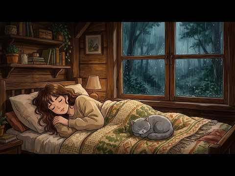

# 음악 — 성공 사례 분석: 사례별 자세히 #641–#680

`analysis.md` 의 9번 (같은 # 번호). 자동 생성 — `tools/success_analysis.py` v1.4.1 (2026-10-19 08:37 UTC). ※ 연구·교육용 — 투자 권유가 아님.

### 641. [스페인 감성] "Frente a Tu Casa ∣ 그집앞 - 이재성" Korean OldPop 한국명곡

- https://www.youtube.com/watch?v=IXEpsuBWbg8 · 스페인 감성 한국 올드송 · 구독자 1,420 · 조회수 81,363 (×57.3, 하루 1,205.4) · 좋아요 587 (0.7%) · 4.5분 · 2026-08-12 · 주제 묶음 12. 커버·노래 부르기 · 형식 음악 (그 밖 모양 — 한 편짜리 BGM 등) · 폴더 `W_IXEpsuBWbg8` (웹 승인)
- 썸네일: 
- 설명 앞부분: 안녕하세요!! "스페인 감성 한국 올드송"입니다. 한국의 좋은 노래들을 Música Española (무시카 에스파뇰라)로 리메이크해서 불러 드리겠습니다. kpop의 멋진 멜로디와 깊은 감성을 스페인의 감성과 만나 깊이를 더했습니다. 이 채널에서 만들어지는 음악들은 AI를 도구로 이용해 직접 구상하고 제작되는 노력의 결과물입니다. 더 좋은 음악을 제공할 수 있도록 항상 노력하겠습니다. ¡Hola! Bienvenidos a "Canciones Clásicas Coreanas con Alma Española". En este cana…
- 같은 채널 평소 대비 ×2.4 (채널 최근 롱폼 중앙값 34,593회) · 평소 영상: [스페인 감성] "El Yugo ∣ 멍에 - 김수희" Korean OldPop 한국명곡 (34,593회) / [스페인 감성] 와!! 스페인어로 "보릿고개"가 된다고? "El Paso de la Ce… (29,013회)
- 대본 없음 (설명) — 음성인식이 끝나면 도입부·흐름이 들어감
- 댓글 14/14: 좋은 점 — 영상 0 · 감사·응원 1 · 더 알고 싶은 것 0 · 아쉬운 점 — 영상 0 · 반박·불만 — 의견 다름 0 · 정치·사회 0 · 경험 공유 1 · 구독·다음 기대 0
  - 감사·응원 👍6 “영상을 보니까 제가 1987년도에 이태리 밀라노에서 프랑스를 거쳐 바르셀로나까지 기차를 타고 가서 거기에서 스페인 쇼를 본 기억이 생생합니다. 좋습니다 응원합니다 ❤🎉🎉”
  - 경험 공유 👍6 “영상을 보니까 제가 1987년도에 이태리 밀라노에서 프랑스를 거쳐 바르셀로나까지 기차를 타고 가서 거기에서 스페인 쇼를 본 기억이 생생합니다. 좋습니다 응원합니다 ❤🎉🎉”

### 642. 나는 어디로 가나 - (국악 발라드)

- https://www.youtube.com/watch?v=hd_rjKroAqM · Rok Bi · 구독자 8,520 · 조회수 487,675 (×57.2, 하루 3,067.4) · 좋아요 2,486 (0.5%) · 5분 · 2026-05-13 · 주제 묶음 9. 가요·발라드·트로트 · 형식 AI 음악 · 폴더 `W_hd_rjKroAqM` (웹 승인)
- 썸네일: 
- 설명 앞부분: "아티스트 Rok Bi의 공식 유튜브 채널, **'록비 감성음악'*입니다." [ 🎵 록비 감성음악 재생목록 ] 🎵 곡 정보 (Credits) 살다 보면 내가 가는 길이 맞는지 의문이 들 때가 있습니다. 이 노래가 여러분의 지친 마음을 잠시 쉬게 하는 이정표가 되었으면 좋겠습니다. 곡을 듣고 느껴지는 여러분의 마음을 댓글로 자유롭게 남겨주세요. [🎧 YouTube Music]에서도 감상 가능합니다. 작사: 록비 (Rok Bi)&AI 작곡: 록비 & Suno AI 보컬: Rokbi Vocals, Powered by AI 기획/제작: …
- 같은 채널 평소 대비 ×43.4 (채널 최근 롱폼 중앙값 11,239회) · 평소 영상: 백년해로 인생의 길에서 함께한 우리의 노래 ∣ 록비 감성음악 ∣ 1시간 풀영상 (11,239회) / 인생의 길목에서 다시 만난 명곡 10곡 ∣ 록비 감성음악 (12,923회)
- 대본 없음 (설명) — 음성인식이 끝나면 도입부·흐름이 들어감
- 댓글 203/203: 좋은 점 — 영상 4 · 감사·응원 36 · 더 알고 싶은 것 1 · 아쉬운 점 — 영상 0 · 반박·불만 — 의견 다름 0 · 정치·사회 0 · 경험 공유 7 · 구독·다음 기대 0
  - 좋은 점 — 영상 👍3 “나이가 들어갈 수록 왜 감성노래, 인생노래 가 마음에 와닿는지....^^;; 나이가 들었다는 반증이겠죠? ^^ 뭉클한 노래, 동영상 잘 듣고 갑니다.”
  - 좋은 점 — 영상 👍1 “22년도 코로나로 어머님을 떠나보내고 절절히 가슴에 와닿아요 오늘도 이자식은 소리죽여 웁니다”
  - 감사·응원 👍14 “노래가 너무 절절하네요,좋은 노래 들려줘서 고마워요.응원합니다.🎉🎉🎉❤❤❤😊😊😊”
  - 감사·응원 👍13 “구독 좋아요로 응원합니다 최고입니다 늘 행복하세요❤❤❤🎉🎉”
  - 더 알고 싶은 것 👍6 “오늘도 록비님의음으로 하루시작합니다 항암잘견디고 좋은음만들어주세요”
  - 경험 공유 👍6 “어쩜 내인생 내삶과 똑같나 눈물이 나도모르게 고인다”
  - 경험 공유 👍2 “머리속은 숯덩이처럼 소음으로 뒤범벅되고 죽고싶도록 이번삶 싫다 이명소리 26년째 어디로 가야하나😢😢😢😢😢”

### 643. 途中広告なし[BGM]癒しの森カフェで何も考えない朝☕Gentle Morning Piano Jazz｜心地よく一日を始めるカフェ音楽

- https://www.youtube.com/watch?v=qDJ8LG4noFk · Aurora Tune · 구독자 19,200 · 조회수 1,098,538 (×57.2, 하루 6,446.8) · 좋아요 0 (0.0%) · 92.5분 · 2026-05-01 · 주제 묶음 6. 피아노·클래식·연주곡 · 형식 음악 (그 밖 모양 — 한 편짜리 BGM 등) · 폴더 `W_qDJ8LG4noFk` (웹 승인)
- 썸네일: 
- 설명 앞부분: 心がやわらかくほどけていくような、癒しのカフェで聴くピアノジャズBGMです。 ▼おすすめ動画(Recommended videos) 動画の映像と音はAIと人の感性を重ねて、心を込めて制作しています。 A soothing piano jazz piece, like the kind you’d hear in a cozy cafe, gently helping your mind unwind. Calm, mellow tones bring a slow and comfortable start to your day. In the midst of busy days, f…
- 같은 채널 평소 대비 ×16.7 (채널 최근 롱폼 중앙값 65,796회) · 평소 영상: 途中広告なし[BGM]心落ち着く朝❄️冬の始まりに聴きたいピアノ&ギター｜Relaxing Pia… (70,720회) / 途中広告なし[BGM]新しい一日の始まりに聴きたい音楽☀️New Year Morning Sun… (70,930회)
- 대본 없음 (설명) — 음성인식이 끝나면 도입부·흐름이 들어감
- 댓글 116/115: 좋은 점 — 영상 0 · 감사·응원 0 · 더 알고 싶은 것 0 · 아쉬운 점 — 영상 0 · 반박·불만 — 의견 다름 0 · 정치·사회 0 · 경험 공유 0 · 구독·다음 기대 0

### 644. Rainy Day in the Treehouse:Cooking Beef Stew Bread Bowl & Berry Tea ∣ Instrumental Piano …

- https://www.youtube.com/watch?v=_Mugeu0ne3M · Ghibli - ASMR Relax · 구독자 4,820 · 조회수 274,394 (×56.9, 하루 1,550.0) · 좋아요 1,743 (0.6%) · 6.5분 · 2026-04-25 · 주제 묶음 6. 피아노·클래식·연주곡 · 형식 음악 (그 밖 모양 — 한 편짜리 BGM 등) · 폴더 `W__Mugeu0ne3M` (웹 승인)
- 썸네일: 
- 설명 앞부분: Rainy Day in the Treehouse:Cooking Beef Stew Bread Bowl & Berry Tea ∣ Instrumental Piano Relax🌧️🏡 Spend a peaceful rainy day in a cozy treehouse deep in the forest 🌧️🏡 Watch as a warm, comforting meal comes together — a rich beef stew served in a rustic bread bowl, paired with a soothing cup of ber…
- 같은 채널 평소 대비 ×976.5 (채널 최근 롱폼 중앙값 281회) · 평소 영상: NO ADS🌧️Rainy Day Cozy Fall Ambience🍂 Gentle Rain… (281회) / [No Ads] Peaceful Fall Porch Ambience 🎃 Rain & So… (278회)
- 대본 없음 (설명) — 음성인식이 끝나면 도입부·흐름이 들어감
- 댓글 71/71: 좋은 점 — 영상 0 · 감사·응원 0 · 더 알고 싶은 것 0 · 아쉬운 점 — 영상 0 · 반박·불만 — 의견 다름 0 · 정치·사회 0 · 경험 공유 0 · 구독·다음 기대 0

### 645. [𝙋𝙡𝙖𝙮𝙡𝙞𝙨𝙩] 세종대왕이 경복궁에서 야근하며 듣던 가야금 재즈

- https://www.youtube.com/watch?v=q3oC3zdfyw4 · 조선재즈 · 구독자 9,970 · 조회수 566,223 (×56.8, 하루 4,388.6) · 좋아요 21,737 (3.8%) · 180.7분 · 2026-06-12 · 주제 묶음 7. 재즈·보사노바 · 형식 플레이리스트·모음 (여러 곡) · 폴더 `W_q3oC3zdfyw4` (웹 승인)
- 썸네일: 
- 설명 앞부분: 세종대왕도 야근은 힘들었을 겁니다. 경복궁 깊은 밤, 촛불 아래 가야금이 흐릅니다. 조선의 밤과 재즈가 만났습니다:)
- 같은 채널 평소 대비 ×110.5 (채널 최근 롱폼 중앙값 5,126회) · 평소 영상: [𝙋𝙡𝙖𝙮𝙡𝙞𝙨𝙩] 세종대왕이 코딩하며 들었던 가야금 재즈 (5,126회) / [𝙋𝙡𝙖𝙮𝙡𝙞𝙨𝙩] 퇴근 궁녀 (퇴사할게여) ∣ 느좋 조선 가야금 재즈 (5,233회)
- 대본 없음 (설명) — 음성인식이 끝나면 도입부·흐름이 들어감
- 댓글 468/468: 좋은 점 — 영상 2 · 감사·응원 8 · 더 알고 싶은 것 6 · 아쉬운 점 — 영상 2 · 반박·불만 — 의견 다름 4 · 정치·사회 1 · 경험 공유 10 · 구독·다음 기대 5
  - 좋은 점 — 영상 👍0 “생활안복 자주 입는데, 한복입고 어디 놀러갈때 듣기 좋아요. 굿뜨 뭐랄까 혼자 마패를 들고 암행어사 하러 가는 기분이랑 연모하는 사내 담벼락에 훔쳐보러 가는 기분”
  - 좋은 점 — 영상 👍0 “너무좋아요 나도만들고싶네요 많이배우고갑니다❤❤❤❤❤❤❤”
  - 감사·응원 👍5 “와.... 가야금 너무 좋아하는데 이런 귀한 플리를 올려주시다니 감사합니다....”
  - 감사·응원 👍4 “오 좋아요... 제작 감사함당 잘 들을게요”
  - 더 알고 싶은 것 👍3 “구독 좋아요 알림설정합니다. 한국의 미를 잃지 않는 퓨전음악 많이 부탁드립니다. 덕분에 출근길이 즐거워요.”
  - 더 알고 싶은 것 👍1 “집현전 학자들 편도 부탁합니다. 엄지척!”
  - 아쉬운 점 — 영상 👍6 “ㅋㅋㅋㅋㅋㅋㅋ 고얀 AI 같으니라고”
  - 아쉬운 점 — 영상 👍3 “구간반복해서 들을 수 있게 해주세요”
  - 반박·불만 — 의견 다름 👍4 “와 재즈 좋아하는데 가야금과 재즈가 이렇게 잘 어울리다니. 가야금의 선율이 그루비해서 깜짝 놀랐습니다. AI 작곡이란데서 한번 더 놀람.. 말도안됨 😂”
  - 반박·불만 — 의견 다름 👍1 “절대음감이라 AI 음악이 맞으실 수도ㅋㅋㅋ 근데 저렇게 누워 계실 분이 아닌데 두 눈 부릅 뜨고 계셔야 하지 않을까요?”
  - 정치·사회 👍0 “전하 .. 요즘 나라가 말이 아닙니다 이걸 어찌해야 된답니까 ...”
  - 경험 공유 👍9 “클래식 공부를 어릴때 부터 하면서 재즈도 같이 조금 했었는데 살면서 들은 재즈 중에 제일 좋습니다….”
  - 경험 공유 👍3 “세종대왕도 야근하는데 내가 뭐라고”
  - 구독·다음 기대 👍3 “구독 좋아요 알림설정합니다. 한국의 미를 잃지 않는 퓨전음악 많이 부탁드립니다. 덕분에 출근길이 즐거워요.”
  - 구독·다음 기대 👍1 “가능하구나 재즈라는 것이!!!! 감탄하고 구독하고 갑니다~!”

### 646. Paganini (Vivaldi x Beethoven) House Music Mix – Hypnotic Violin for Deep Focus

- https://www.youtube.com/watch?v=Q9TSg4bKjcs · Velvet Frequencies · 구독자 5,600 · 조회수 317,380 (×56.7, 하루 2,001.4) · 좋아요 5,242 (1.7%) · 7분 · 2026-05-13 · 주제 묶음 6. 피아노·클래식·연주곡 · 형식 음악 (그 밖 모양 — 한 편짜리 BGM 등) · 폴더 `W_Q9TSg4bKjcs` (웹 승인)
- 썸네일: 
- 설명 앞부분: This is a hypnotic cinematic house music experience designed for deep focus, immersive flow, and emotional late-night energy. Inspired by the virtuosic violin intensity of Paganini, the flowing melodic elegance of Vivaldi, and the powerful harmonic emotion of Beethoven, this mix blends deep house g…
- 같은 채널 평소 대비 ×320.6 (채널 최근 롱폼 중앙값 990회) · 평소 영상: Vivaldi (Beethoven x Mozart) Violin House Music M… (1,022회) / Beethoven (Vivaldi x Mozart) Violin House Music M… (958회)
- 대본 없음 (설명) — 음성인식이 끝나면 도입부·흐름이 들어감
- 댓글 212/212: 좋은 점 — 영상 0 · 감사·응원 0 · 더 알고 싶은 것 0 · 아쉬운 점 — 영상 0 · 반박·불만 — 의견 다름 0 · 정치·사회 0 · 경험 공유 0 · 구독·다음 기대 0

### 647. ✨💖요즘 폼 미친(positive) 최신 아이돌 노래 모음 ∣ 신나는 ∣ 최신곡 ∣ 여돌 ∣ 남돌 ∣ 아이돌 플레이리스트 [ K-POP Playlist ]

- https://www.youtube.com/watch?v=eLiTRGAnmyk · 띠잉뮤직 · 구독자 20,900 · 조회수 1,178,099 (×56.4, 하루 8,057.3) · 좋아요 5,581 (0.5%) · 121.8분 · 2026-05-26 · 주제 묶음 10. 팝송·K팝·J팝 · 형식 플레이리스트·모음 (여러 곡) · 폴더 `W_eLiTRGAnmyk` (웹 승인)
- 썸네일: 
- 챕터: 0:00 르세라핌 · 2:55 하츠투하츠 · 6:23 큐티 스트릿 · 10:32 넥스지 · 13:30 아이오아이 · 16:45 츄 · 19:54 투어스 · 22:45 에스파 · 25:19 키키 · 28:24 투바투 · 31:24 엔믹스 · 34:27 있지 · 37:40 네이즈 · 40:29 비비 · 44:04 메이딘 · 46:39 킥플립 · 49:21 언차일드 · 51:21 피프티피프티 · 54:19 투어스 · 57:06 키스오브라이프
- 설명 앞부분: 🎵PlayList🎵 LE SSERAFIM - BOOMPALA Hearts2Hearts - STYLE CUTIE STREET - 귀엽기만 하면 안 되나요? NEXZ - HYPEMAN I.O.I - 갑자기 (Suddenly) CHUU - Teeny Tiny Heart TWS - 너의 모든 가능성이 되어 줄게 aespa - WDA KiiiKiii - UNDERDOGS TXT - Love Language NMIXX - Heavy Serenade ITZY - Motto NAZE - People Talk BIBI - BUMPA MADEIN …
- 같은 채널 평소 대비 ×99.4 (채널 최근 롱폼 중앙값 11,847회) · 평소 영상: 💎 쌈뽕하게 신나는 여자 아이돌 걸그룹 노래 모음 [ Girl Group Playlist… (12,732회) / 💖 느낌 좋은 최신 걸그룹 노래모음 여자 아이돌 플레이리스트 [ Girl Group Pl… (10,962회)
- 대본 없음 (설명) — 음성인식이 끝나면 도입부·흐름이 들어감
- 댓글 162/162: 좋은 점 — 영상 2 · 감사·응원 6 · 더 알고 싶은 것 2 · 아쉬운 점 — 영상 0 · 반박·불만 — 의견 다름 0 · 정치·사회 0 · 경험 공유 1 · 구독·다음 기대 0
  - 좋은 점 — 영상 👍5 “큐스토가 케이팝으로 분류됐어 이거옳지 맞아 ㅋㅋ 좋다 듣기 편하넵 운동하기딱이답 기분좋아짐 ❤”
  - 감사·응원 👍10 “김채원 피지컬 뭐지..? 내 눈이 이상해진건가? 뭐가됐든 압도적 감사”
  - 감사·응원 👍2 “채원이가 전설을 또 남겨놨구나..... 화이팅”
  - 더 알고 싶은 것 👍15 “뮤비좋은데 라이브 가능한가요?”
  - 더 알고 싶은 것 👍1 “남돌 여돌은 구분해서 만들어주세요”

### 648. 2000년대 발라드 명곡 30곡 💿 그 시절 우리가 사랑했던 노래｜SG워너비·김동률·씨야·티아라·양파 ✔ 싸이월드 BGM

- https://www.youtube.com/watch?v=IZ6NgLQjStY · 추억음악다방 · 구독자 3,430 · 조회수 193,245 (×56.3, 하루 2,112.3) · 좋아요 1,473 (0.8%) · 117.8분 · 2026-07-19 · 주제 묶음 9. 가요·발라드·트로트 · 형식 플레이리스트·모음 (여러 곡) · 폴더 `W_IZ6NgLQjStY` (웹 승인)
- 썸네일: 
- 설명 앞부분: 2000년대 발라드 명곡 29곡 💿 그 시절 우리가 사랑했던 노래들을 한자리에 담았습니다. SG워너비, 김동률, 씨야, 티아라, 다비치, 양파, 이승철, 김범수, 더 크로스, SS501 등 첫 소절만 들어도 그때의 사랑과 이별, 학창 시절과 싸이월드 감성이 떠오르는 추억의 명곡 플레이리스트입니다. MP3 플레이어에 좋아하는 노래를 가득 담아 다니던 시절, 폴더폰 문자 한 통을 기다리며 밤을 지새우던 순간, 싸이월드 미니홈피 BGM으로 차마 말하지 못한 마음을 대신 전했던 날들… 시간이 오래 흘렀어도 그 시절의 노래를 다시 듣는 순…
- 같은 채널 평소 대비 ×50.3 (채널 최근 롱폼 중앙값 3,839회) · 평소 영상: 싸이월드 감성 2000년대 명곡 모음 💿 텅 빈 거리에서 🎧 다시 듣는 그 시절 발라드 (5,771회) / SG워너비 - Timeless (가사/Lyrics) 💔 이 노래, 듣는 순간 울컥한다｜2… (1,907회)
- 대본 없음 (설명) — 음성인식이 끝나면 도입부·흐름이 들어감
- 댓글 17/17: 좋은 점 — 영상 0 · 감사·응원 1 · 더 알고 싶은 것 1 · 아쉬운 점 — 영상 0 · 반박·불만 — 의견 다름 0 · 정치·사회 0 · 경험 공유 0 · 구독·다음 기대 0
  - 감사·응원 👍0 “중간중간에 드라마 대사 같은게 들리는데 검토 한번만 해주심 감사할 거 같아용ㅠ”
  - 더 알고 싶은 것 👍0 “비 오는 날 가장 듣고 싶은 옛날 노래가 있다면 어떤 곡인가요? 여러분만의 추천곡을 알려주세요.”

### 649. 처음부터 신나서 환장하는! ❤️ 신나는 트로트리믹스 고속도로메들리 ∣ 최신트로트 ∣ 트로트메들리 ∣ 감성트로트

- https://www.youtube.com/watch?v=zt45-jow7lo · 다솜이의 트로트책방 · 구독자 7,710 · 조회수 433,625 (×56.2, 하루 2,636.9) · 좋아요 3,308 (0.8%) · 71.2분 · 2026-05-07 · 주제 묶음 5. 운동·드라이브·신나는 · 형식 플레이리스트·모음 (여러 곡) · 폴더 `W_zt45-jow7lo` (웹 승인)
- 썸네일: 
- 챕터: 0:00 단심가 · 3:39 찜했어요 · 7:04 하늘만큼 땅만큼 · 10:29 두근두근 내사랑 · 14:05 사랑의 신호등 · 18:09 꽃보다 그대요 · 21:50 사랑 충전 완료 · 24:56 사랑보따리 · 28:23 천번을 물어도 · 32:00 꽃신 신고 갈게요 · 35:35 반복재생
- 설명 앞부분: 오늘도 찾아온 최신트로트 EDM리믹스 디스코메들리 😘 이번주도 고생 많으신 여러분! 신나는 트로트메들리로 다솜 트로트책방에서 힐링하고 가셨으면 좋겠어요 👍 여러분의 쉼터가 되길 바라는 마음이에요 💕 즐겁게 들어주시고 남겨주시는 따뜻한 댓글 한마디에 저도 너무너무 힘이 납니다 😘😘 항상 감사드립니다 😁 EDM트로트 리믹스 BEST 모음 애절한 감성트로트 더 들어보기 신나는 트로트 더 들어보기 계속 신나는 EDM 리믹스 메들리 더 들어보기 다솜이 싱글 들어보기 💖노래 순서💖
- 같은 채널 평소 대비 ×45.3 (채널 최근 롱폼 중앙값 9,573회) · 평소 영상: 이 맛이지~!! 최고로 신나는 트로트리믹스 모음 7번째!! 고속도로메들리 ∣ 최신트로트 … (9,518회) / 들을수록 빠져든다! 신나는 댄스트로트 고속도로메들리 ∣ 최신트롯 ∣ 감성트로트 (8,305회)
- 대본 없음 (설명) — 음성인식이 끝나면 도입부·흐름이 들어감
- 댓글 139/139: 좋은 점 — 영상 0 · 감사·응원 5 · 더 알고 싶은 것 2 · 아쉬운 점 — 영상 1 · 반박·불만 — 의견 다름 0 · 정치·사회 1 · 경험 공유 0 · 구독·다음 기대 3
  - 감사·응원 👍5 “음악이신나좋아요화이팅🎉🎉🎉❤❤❤”
  - 감사·응원 👍2 “화이팅”
  - 더 알고 싶은 것 👍1 “구독. 망치로박고갑니다. 기분전환 최곱니다. cd 구입되나요???”
  - 아쉬운 점 — 영상 👍6 “신나요 잘듣고 있어요 낚시배 하는데 살수 있나요 ?”
  - 정치·사회 👍0 “영어이나라대한민국미국영어이나라본한국말억양토늘회화영어들어나가금그들영어와저너꼭알어두고미국말영어러시아촌칙급이길느한국어이북말조선족톤극사기느어대”
  - 구독·다음 기대 👍2 “첫노래 트로트가사제목이 어떻게되나요 가수 가사제목 궁금하내요 구독하고갑니다 댓글달아주시면 감사하겠습니다 너무신납니다”
  - 구독·다음 기대 👍2 “구독합니다. 신나네요”

### 650. [중간광고없음] 🌿 잠시, 아무 생각도 하지 말아요. ∣ 숲속에서 듣는 잔잔한 피아노 ∣ BGM ∣ 휴식, 힐링, 독서

- https://www.youtube.com/watch?v=ebDKy0szHC8 · Riae & Piano · 구독자 12,400 · 조회수 695,335 (×56.1, 하루 7,288.6) · 좋아요 3,525 (0.5%) · 181.3분 · 2026-07-15 · 주제 묶음 6. 피아노·클래식·연주곡 · 형식 음악 (그 밖 모양 — 한 편짜리 BGM 등) · 폴더 `W_ebDKy0szHC8` (웹 승인)
- 썸네일: 
- 설명 앞부분: 잠시 모든 생각을 내려놓고, 창밖 가득 펼쳐진 숲과 잔잔한 피아노 선율 속에서 마음을 쉬어가세요. 독서와 공부, 휴식, 그리고 혼자만의 조용한 시간을 더욱 평온하게 만들어 줄 힐링 플레이리스트입니다. Take a break from every thought and let the peaceful forest view and gentle piano melodies calm your mind. A relaxing playlist for reading, studying, working, or simply enjoying a quiet m…
- 같은 채널 평소 대비 ×44.2 (채널 최근 롱폼 중앙값 15,738회) · 평소 영상: [중간광고없음] ☁️🌿 점점 좋아지고 있어 ∣ 비 그친 숲에서 듣는 희망의 피아노 ∣ B… (15,838회) / [중간광고없음] ☁️🍃 잠시 쉬어가도 괜찮아, 넌 잘하고 있어 ∣ 위로의 피아노 ∣ BG… (15,639회)
- 대본 없음 (설명) — 음성인식이 끝나면 도입부·흐름이 들어감
- 댓글 191/191: 좋은 점 — 영상 0 · 감사·응원 15 · 더 알고 싶은 것 0 · 아쉬운 점 — 영상 2 · 반박·불만 — 의견 다름 0 · 정치·사회 0 · 경험 공유 2 · 구독·다음 기대 2
  - 감사·응원 👍6 “드디어 찾았습니다. 완전 저의 스타일 피아노 연주 입니다. 잘 만들어 주어서 감사합니다. 슬픔을 슬픔으로 흘러가게 해 주는 피아노 선율에 저의 마음도 같이 흘러가는 시간이 됩니다.”
  - 감사·응원 👍3 “감사합니다❤”
  - 아쉬운 점 — 영상 👍10 “생각이 많아지고 뭔가 심신의 안정을 원할때.멍때리며 머릿속의 안개를 걷어내고 싶을때 들어요.무엇보다 중간광고가 없어서 좋아요”
  - 아쉬운 점 — 영상 👍1 “"몇 번을 반복해서 들어도 질리지 않는 곡이에요. 편곡 센스가 남다르신 것 같아요. 구독 좋아요로 응원할게요~"”
  - 경험 공유 👍2 “아기 낮잠음악으로 최고에요. 같이 듣는 저도 너무 힐링됩니다.오늘 하루도 평온함을 선물해주셔서 감사합니다.”
  - 구독·다음 기대 👍2 “구독하고갑니다.좋아요”
  - 구독·다음 기대 👍1 “잔잔한 음악 많이 들어봤지만, 이 영상에 정착했어요. 가장 마음이 편해요. 다이어리 매일 쓰는데 매일 듣고있어요”

### 651. 바흐와 모차르트의 감성을 담은 아침 클래식 🌿 하루를 여는 평화로운 힐링 연주

- https://www.youtube.com/watch?v=9_HXWyP1MsE · Korean Rock Ballad · 구독자 4,750 · 조회수 264,664 (×55.7, 하루 2,771.8) · 좋아요 2,214 (0.8%) · 40.3분 · 2026-07-15 · 주제 묶음 6. 피아노·클래식·연주곡 · 형식 플레이리스트·모음 (여러 곡) · 폴더 `W_9_HXWyP1MsE` (웹 승인)
- 썸네일: 
- 설명 앞부분: 바흐와 모차르트의 감성에서 영감을 받아 새롭게 완성한 클래식 힐링 음악입니다. 부드러운 선율과 따뜻한 오케스트라 사운드가 평화로운 아침을 만들어 드립니다. 하루를 시작하는 시간, 공부, 독서, 업무, 휴식, 명상과 함께 편안한 클래식을 즐겨 보세요. 🌿 Inspired by the timeless elegance of Bach & Mozart. 편안한 하루를 위한 클래식 플레이리스트입니다.
- 같은 채널 평소 대비 ×7.9 (채널 최근 롱폼 중앙값 33,578회) · 평소 영상: 아름다운 가을 아침 클래식 🍂 슈베르트, 브람스, 차이콥스키, 드보르자크, 멘델스존에게 … (33,578회) / 아침 클래식 현악 ∣ 독서·공부·커피와 함께하는 편안한 스트링 오케스트라 (33,833회)
- 대본 없음 (설명) — 음성인식이 끝나면 도입부·흐름이 들어감
- 댓글 40/39: 좋은 점 — 영상 0 · 감사·응원 12 · 더 알고 싶은 것 0 · 아쉬운 점 — 영상 1 · 반박·불만 — 의견 다름 0 · 정치·사회 0 · 경험 공유 1 · 구독·다음 기대 1
  - 감사·응원 👍24 “좋은아침에 고운소리 들으니 행복이 찾아오네요 고맙습니다 이고운 소리를 듣는 모든분들도 이더위를 잘이겨 내고 건강하길 바래요”
  - 감사·응원 👍9 “음악과 영상이 참 평화롭네요. 행복한 음악 선물 감사합니다.”
  - 아쉬운 점 — 영상 👍5 “음악은좋은데 광고가너무 많아 ㅠ”
  - 구독·다음 기대 👍0 “모짜르트를 좋아하는 한사람으로 잘 듣고 구독합니다 🧋🍇”

### 652. 숲속에 내리는 잔잔한 빗소리 🌧️ 명상, 깊은 수면, 편안한 소리

- https://www.youtube.com/watch?v=4Xl4kMOmGY8 · 숲 속 빗소리 · 구독자 1,800 · 조회수 100,192 (×55.7, 하루 1,287.5) · 좋아요 702 (0.7%) · 187.7분 · 2026-08-02 · 주제 묶음 2. 자연 소리·백색소음 · 형식 자연 소리·백색소음 (음악 낱말 없는 제목) · 폴더 `W_4Xl4kMOmGY8` (웹 승인)
- 썸네일: 
- 설명 앞부분: 숲속에 내리는 잔잔한 빗소리 🌧️ 명상, 깊은 수면, 편안한 소리 고요한 숲속에 내리는 부드러운 빗소리와 함께 몸과 마음의 긴장을 풀어보세요. 숲속에 부드럽게 내리는 빗소리와 나뭇잎 사이로 스치는 잔잔한 바람, 멀리서 들려오는 자연스러운 천둥소리와 함께 깊은 평온함을 느껴보세요. 이 편안한 자연의 분위기는 숙면을 돕고, 스트레스를 줄이며, 공부하거나 일할 때 집중력을 유지하는 데 도움을 줄 수 있습니다. 이 채널에서는 깊은 수면, 명상, 휴식과 마음의 안정을 위한 자연스럽고 몰입감 있는 사운드 풍경을 제작합니다. 숲속의 빗소리가 …
- 같은 채널 평소 대비 ×49.4 (채널 최근 롱폼 중앙값 2,027회) · 평소 영상: 숲속에 내리는 잔잔한 빗소리 🌧️ 쌓인 피로를 녹이고 빠른 입면과 깊은 숙면을 돕는 힐링… (2,031회) / 숲속에 내리는 잔잔한 빗소리 🌧️ 불면증과 이명치료효과를 위한 백색소음 ∣ 빗소리에 푹 … (2,023회)
- 대본 없음 (설명) — 음성인식이 끝나면 도입부·흐름이 들어감
- 댓글 41/41: 좋은 점 — 영상 0 · 감사·응원 0 · 더 알고 싶은 것 0 · 아쉬운 점 — 영상 0 · 반박·불만 — 의견 다름 0 · 정치·사회 0 · 경험 공유 0 · 구독·다음 기대 0

### 653. [MIXSET] 늙크크의 여름 HipHop & R&B

- https://www.youtube.com/watch?v=_o3psN6OCTk · 떵신 tteongshin · 구독자 8,140 · 조회수 452,483 (×55.6, 하루 4,770.0) · 좋아요 9,603 (2.1%) · 22.1분 · 2026-07-16 · 주제 묶음 11. 힙합·R&B·EDM · 형식 정보·해설 (그 밖) · 폴더 `W__o3psN6OCTk` (웹 승인)
- 썸네일: 
- 설명 앞부분: 2026년 여름을 맞아 2010년대 중반 여름을 대표했던 HipHop & R&B 곡들을 모아 믹셋으로 완성했습니다. 🎧 Tracklist Enjoy! ☀ [SoundCloud]
- 대본 없음 (설명) — 음성인식이 끝나면 도입부·흐름이 들어감
- 댓글 204/204: 좋은 점 — 영상 0 · 감사·응원 5 · 더 알고 싶은 것 5 · 아쉬운 점 — 영상 2 · 반박·불만 — 의견 다름 0 · 정치·사회 0 · 경험 공유 13 · 구독·다음 기대 2
  - 감사·응원 👍4 “내가늙크크라서너무좋다이런노래들이난좋다감사합니다구독햇어요🫰🏻🫰🏻🫰🏻”
  - 감사·응원 👍2 “와... 20대 추억 돋는 아침 출근길입니다!!! 감사해요😊”
  - 더 알고 싶은 것 👍8 “진짜 곡 넘어가는거 예술임… 더만들어주세요제발”
  - 더 알고 싶은 것 👍7 “믹셋 계속 만들어주세요..🥺❤️”
  - 아쉬운 점 — 영상 👍2 “도파민 중독자인 저에게는 이런 플리가 필요했어요 좀 지루하다 싶으면 다른 곡😍”
  - 경험 공유 👍15 “내가 늙크크가 되었다는게 믿기지않아.. 분명 나 엊그제 20살이었던것 같은데.......................................”
  - 경험 공유 👍10 “지나가는 97년생인데.. 분명 영크크라 생각했는데 다 내가 좋아하는 노래라니... 나 언제 늙크크 된거지 ㅠㅜ 무튼 플리 개조아여❤”
  - 구독·다음 기대 👍2 “와.. 우연히 듣고 바로 구독합니다. 잘 부탁드려요!”
  - 구독·다음 기대 👍2 “구독하고 갈게여”

### 654. Sade Morning Coffee ☕ Vol.3 ∣ Luxury ChillMix ∣ Soulful Jazz & Relaxing Coffee Shop Music…

- https://www.youtube.com/watch?v=mp4oA2JflBQ · Setsukin · 구독자 43,100 · 조회수 2,395,761 (×55.6, 하루 14,797.7) · 좋아요 47,147 (2.0%) · 114.5분 · 2026-05-10 · 주제 묶음 4. 카페·매장·라운지 · 형식 음악 (그 밖 모양 — 한 편짜리 BGM 등) · 폴더 `W_mp4oA2JflBQ` (웹 승인)
- 썸네일: 
- 챕터: 0:00 It's Only Love That Gets You … · 3:30 I Couldn't Love You More · 7:09 Like a Tattoo · 10:36 The Sweetest Gift · 12:49 Your Love Is King · 16:22 Maureen · 20:28 Give It Up · 23:54 Kiss of Life · 29:34 By Your Side · 33:58 The Sweetest Taboo · 38:18 Love Is Stronger Than Pride · 42:30 Never As Good As the First Ti… · 46:19 Frankie's First Affair · 50:43 The Big Unknown · 54:19 Smooth Operator · 59:19 The Safest Place · 61:43 No Ordinary Love · 68:57 Mermaid · 72:58 Still In Love with You · 77:17 Hang On to Your Love
- 설명 앞부분: 🎧 Want the FULL mix? This video is a preview. The complete uncut version — plus every mix I've ever made — is on Patreon. ⭐ $3/month — Early access + full tracklists + behind-the-scenes 🎵 $7/month — Full-length DJ mixes in WAV quality (recommended) 👑 $15/month — Your name in the credits + VIP statu…
- 같은 채널 평소 대비 ×158.0 (채널 최근 롱폼 중앙값 15,160회) · 평소 영상: Stevie Wonder ✨ Late Night Coffee ☕ Vol.3 ∣ Relax… (16,564회) / 1987 Coffee & Books☕📚Vol.4 ∣ Pages of Love & Midn… (13,757회)
- 대본 없음 (설명) — 음성인식이 끝나면 도입부·흐름이 들어감
- 댓글 780/778: 좋은 점 — 영상 0 · 감사·응원 0 · 더 알고 싶은 것 0 · 아쉬운 점 — 영상 0 · 반박·불만 — 의견 다름 0 · 정치·사회 0 · 경험 공유 0 · 구독·다음 기대 0

### 655. 첫 곡부터 너무 좋다 🍂 하루종일 듣게 되는 가을 올드팝 ∣ Vol.228 ∣ 7080 추억의 팝송 ∣ Autumn Oldies ∣ Coffee · Study …

- https://www.youtube.com/watch?v=naLL7CGOC-8 · moka melody · 구독자 14,600 · 조회수 804,147 (×55.1, 하루 13,310.4) · 좋아요 3,982 (0.5%) · 367.3분 · 2026-08-19 · 주제 묶음 4. 카페·매장·라운지 · 형식 음악 (그 밖 모양 — 한 편짜리 BGM 등) · 폴더 `W_naLL7CGOC-8` (웹 승인)
- 썸네일: 
- 챕터: 0:00 Where the Blue Sea Remembers … · 4:52 The Best Part of My Day 하루 중 … · 8:44 All the Years With You 너와 함께 … · 13:07 Under the Golden Tree 황금빛 나무 … · 17:15 Somewhere Past the City Light… · 21:53 Walking Home With You 너와 함께 걷… · 25:11 Blue Sky Kind of Day 파란 하늘이 아… · 29:38 Somewhere Along the Years 지나온… · 33:23 You Became My Day 어느새 나의 하루가 … · 37:56 Worth Every Mile 함께한 모든 길이 좋았… · 42:04 At the End of the Day 하루가 저물어… · 46:17 Nothing Special Today 오늘도 평범해… · 51:10 Warm Yesterday 따뜻했던 지난날 · 54:53 Repeat
- 설명 앞부분: 🎧 Old pop music for reading, studying, working, and deep focus This vintage old pop playlist is perfect as background music for coffee time, book reading, writing, study sessions, and work-from-home hours. Many listeners play this music while working quietly, studying for long hours, relaxing in th…
- 같은 채널 평소 대비 ×44.4 (채널 최근 롱폼 중앙값 18,131회) · 평소 영상: 9월, 첫 곡부터 참 좋다🍂 요즘 자꾸 이런 노래가 듣고 싶다｜Vol.238｜ 7080 … (18,131회) / 9월, 추석 첫 곡부터 너무 좋다🍂 가을 햇살 아래 그 시절 노래｜Vol.252｜7080… (17,987회)
- 대본 없음 (설명) — 음성인식이 끝나면 도입부·흐름이 들어감
- 댓글 301/301: 좋은 점 — 영상 5 · 감사·응원 57 · 더 알고 싶은 것 5 · 아쉬운 점 — 영상 2 · 반박·불만 — 의견 다름 0 · 정치·사회 0 · 경험 공유 9 · 구독·다음 기대 4
  - 좋은 점 — 영상 👍6 “안녕하세요. 아름다운 가을 풍경과 함께 잠시 머물러 봅니다. 🍂 오늘처럼 하늘이 흐리고 다소 어두운 날씨에는, 따뜻한 커피 한 잔과 이런 음악이 더욱 마음에 와닿는 것 같습니다. 감미롭고 부드러운 남성 보컬의 아름다운 선율이 잔잔히 흐르며, 복잡했던 마음까지 편안하게…”
  - 좋은 점 — 영상 👍6 “모카멜로디님 좋은아침입니다~🙂 은행 나무길을 보고 있자니 제몸이 빨려들어가 저 길을 걷고 있네요.제 마음이 그래서일까요 오늘은 저길이 쓸쓸해 보입니다. 생각이 많은 오늘입니다. 정리가 잘되면 좋겠어요. 오늘도 화이팅입니다~☕️❤”
  - 감사·응원 👍21 “아~~가을입니다 멋집니다 고맙습니다~”
  - 감사·응원 👍15 “이런 좋은 노래는 70세의 사람을 20대의 나이로 시공간을 옮겨서 그 시절의 추억 속으로 잠기게하는 능력이 있는가 봐요. 감사합니다”
  - 더 알고 싶은 것 👍2 “아티스 이름을 알고 싶은데요 너무듣기 좋아요”
  - 더 알고 싶은 것 👍1 “어제 알고리즘 떠서 우연히 듣게 됬네요 오늘도 일어나자마자 듣고있네요 음악이 감미롭네요 구독 합니다 첫번째곡 두번째곡 가수와 노래제목 부탁드립니다”
  - 아쉬운 점 — 영상 👍3 “지금 병원...지루한 항암시간 너무나 좋은 곡들이 많은 위로가 됩니다 선곡 너무 좋으네요”
  - 아쉬운 점 — 영상 👍1 “가사가 안 나와 아쉽네요~~^^”
  - 경험 공유 👍11 “오늘 우리 사랑하는 손자 돌입니다. 우리 집에서 손님들 초대해서 돌잔차를 하려고 준비중이예요. 이제 거의 준비를 마치고 손자에개 편지를 쓰는데 이 음악이 마음을 차분하게 하면서 딸을 키우던 지난날들이 떠오르네요.. 그 딸이 벌써 커서 아이를 낳았으니 기쁘고 감동스럽네…”
  - 경험 공유 👍5 “오래된 팝송을 듣다 보면 악기 몇 개만으로도 마음을 움직이는 곡들이 참 많다는 생각이 듭니다. 저도 그런 담백한 분위기를 살려 음악을 만들어 보니 옛 음악의 매력을 새삼 알게 되네요.”
  - 구독·다음 기대 👍1 “첫소절 듣고 구독합니다 감사합니다~~”
  - 구독·다음 기대 👍1 “잘듣고 가요, 따뜻하고 평온한 가을 보내시길 바랍니다! 구독합니다”

### 656. Heals You While You Sleep (No Ads) • Increases Deep Sleep • Say Goodbye To Insomnia

- https://www.youtube.com/watch?v=f68XXr9BDYw · Serene Dreams Night · 구독자 16,600 · 조회수 908,548 (×54.7, 하루 12,009.7) · 좋아요 8,224 (0.9%) · 226.8분 · 2026-08-04 · 주제 묶음 1. 수면·명상·힐링 · 형식 음악 (그 밖 모양 — 한 편짜리 BGM 등) · 폴더 `W_f68XXr9BDYw` (웹 승인)
- 썸네일: 
- 설명 앞부분: Heals You While You Sleep (No Ads) • Increases Deep Sleep • Say Goodbye To Insomnia Video made by: Serene Dreams Night 🌙 A Deep Rest Journey into Serene Dreams Night Immerse yourself in a world where calming melodies meet the quiet magic of the night. Let gentle music, soft nature sounds, and dream…
- 같은 채널 평소 대비 ×427.9 (채널 최근 롱폼 중앙값 2,124회) · 평소 영상: Fall Asleep INSTANTLY (No Ads) • Melatonin Releas… (2,139회) / 99% Soothing Deep Sleep • Healing of Stress Anxie… (2,108회)
- 대본 없음 (설명) — 음성인식이 끝나면 도입부·흐름이 들어감
- 댓글 311/312: 좋은 점 — 영상 0 · 감사·응원 0 · 더 알고 싶은 것 0 · 아쉬운 점 — 영상 0 · 반박·불만 — 의견 다름 0 · 정치·사회 0 · 경험 공유 0 · 구독·다음 기대 0

### 657. 𝐏𝐥𝐚𝐲𝐥𝐢𝐬𝐭 ∣ 교토의 작은 카페, 말차향 재즈 🍵🎧 抹茶オーツラテ

- https://www.youtube.com/watch?v=vLX3-MrBXFk · 아오링고 잡화점 AORINGGO · 구독자 10,500 · 조회수 574,452 (×54.7, 하루 9,352.1) · 좋아요 4,118 (0.7%) · 292.4분 · 2026-08-18 · 주제 묶음 4. 카페·매장·라운지 · 형식 플레이리스트·모음 (여러 곡) · 폴더 `W_vLX3-MrBXFk` (웹 승인)
- 썸네일: 
- 챕터: 0:00 Matcha Oat Latte Afternoon · 2:44 A Small Café · 5:47 Soft Green Latte · 8:24 Matcha Oat & Slow Jazz · 11:02 Oat Milk in the Afternoon · 13:36 Matcha Oat by the Window · 16:00 Velvet Green Latte · 18:40 A Quiet Oat Latte · 21:04 Sweet & Bitter Green · 23:29 Late Summer Oat Latte · 26:08 A Quiet Corner · 28:48 The Green Latte Hour · 31:12 Soft Light & Oat Milk · 33:34 Little Café Jazz · 35:59 After the Last Sip · 38:35 Green Lights at Dusk · 41:41 repeat 🔁
- 설명 앞부분: 📓 8월 말. 오후의 작은 카페. 여행을 하다 보면 계획에 없던 곳에서 오래 머물게 되는 순간이 있다. 그날도 특별히 정해둔 목적지는 없었다. 아침부터 이곳저곳을 돌아다니다가, 점심을 먹고 다시 골목을 걷고 있었다. 8월 말의 햇살은 여전히 뜨거웠다. 바람은 조금 선선해졌지만, 한낮의 더위는 쉽게 가시지 않았다. 골목 모퉁이에서 작은 카페 하나를 발견했다. 크지 않은 유리창 너머로 나무 테이블 몇 개가 보였고, 문 옆에는 초록색 메뉴판이 조용히 놓여 있었다. 잠시 쉬어갈까. 별다른 이유 없이 문을 열고 들어갔다. 카페 안은 바깥보…
- 같은 채널 평소 대비 ×26.6 (채널 최근 롱폼 중앙값 21,626회) · 평소 영상: 𝐏𝐥𝐚𝐲𝐥𝐢𝐬𝐭 ∣쌉싸름한 루꼴라향 재즈, 가을을 맞이하자 🌿🎧 ルッコラジャズ (21,626회) / 𝐏𝐥𝐚𝐲𝐥𝐢𝐬𝐭 ∣ 도쿄의 낡은 다방, 커피향 재즈 ☕🎧 ドリップコーヒー (20,684회)
- 대본 없음 (설명) — 음성인식이 끝나면 도입부·흐름이 들어감
- 댓글 114/114: 좋은 점 — 영상 2 · 감사·응원 7 · 더 알고 싶은 것 1 · 아쉬운 점 — 영상 0 · 반박·불만 — 의견 다름 0 · 정치·사회 0 · 경험 공유 5 · 구독·다음 기대 2
  - 좋은 점 — 영상 👍0 “안녕하세요. 선생님이 만드시는 음악을 정말 좋아하고 존경합니다. 음악이 정말 너무 좋습니다. 저도 선생님처럼 좋은 음악을 만들어보고 싶어서 한 달 넘게 고민하고 여러 가지 방법으로 만들어봤지만, 아직 마음에 드는 결과를 얻지 못하고 있습니다. 그리고 예전에 선생님 채…”
  - 감사·응원 👍4 “현재 취업준비하면서 이력서 쓸 때마다 항상 카페에서 아오링고 잡화점 노래 틀어놓고 해요! 마음이 너무 편안해지고 저만의 공간에 있는 느낌이라 집중이 잘됩니다 ㅠㅠ 썸네일 그림 볼때마다 마음이 몽글해지구용 항상 감사합니다~~~”
  - 감사·응원 👍1 “그림과 글과 음악이 잘 어울리는 편안한 느낌이 정말 좋네요^0^ 감사합니다!”
  - 더 알고 싶은 것 👍0 “안녕하세요. 선생님이 만드시는 음악을 정말 좋아하고 존경합니다. 음악이 정말 너무 좋습니다. 저도 선생님처럼 좋은 음악을 만들어보고 싶어서 한 달 넘게 고민하고 여러 가지 방법으로 만들어봤지만, 아직 마음에 드는 결과를 얻지 못하고 있습니다. 그리고 예전에 선생님 채…”
  - 경험 공유 👍4 “너무 이뻐요!감삼다! 그림 조금씩 움직이는 것도 짱 귀엽고 음악도 좋고 사랑해요💞💞💞 다음에는 레밍턴 케이크를 해주실 수 있나요?? 아실지 모르지만 제가 유일하게 좋아하는 케이크에요!🤎🤎 안해주셔도 돼요! 이미 너무 좋아여 지금 지상낙원이란 말이 딱 들어맞는 순간? …”
  - 경험 공유 👍0 “나도 그림 그려서 이렇게 많은 사람들이랑 나누고 싶네요. 사진과 다른 인간미 넘치는 손맛이 음악까지 느긋하게 만드는데요.”
  - 구독·다음 기대 👍3 “그림도 아기자기하고 음악도 너무 좋아용^^ 좋아요 구독하고 자주 놀러 올게용*^^*”

### 658. Dopamine Boost Music ∣ Flute, Sitar & Tabla for Positive Energy, Focus & Deep Relaxation

- https://www.youtube.com/watch?v=kY7GcKagdjI · CLASSICAL FUSION  · 구독자 19,000 · 조회수 1,035,955 (×54.5, 하루 8,265.2) · 좋아요 21,737 (2.1%) · 27.8분 · 2026-06-16 · 주제 묶음 3. 공부·집중·작업 · 형식 음악 (그 밖 모양 — 한 편짜리 BGM 등) · 폴더 `W_kY7GcKagdjI` (웹 승인)
- 썸네일: 
- 설명 앞부분: Welcome to a deeply relaxing journey of Dopamine Boost Music featuring the soothing sounds of flute, sitar, and tabla. This calming Indian instrumental music is designed to help reduce stress, improve focus, elevate mood, and create a peaceful atmosphere for meditation, study, yoga, sleep, and mind…
- 같은 채널 평소 대비 ×194.4 (채널 최근 롱폼 중앙값 5,329회) · 평소 영상: Reset Your Mind ∣ Peaceful Flute & Sitar Music fo… (5,329회) / Relaxing Music ∣ Peaceful Flute & Sitar Music for… (4,937회)
- 대본 없음 (설명) — 음성인식이 끝나면 도입부·흐름이 들어감
- 댓글 717/713: 좋은 점 — 영상 0 · 감사·응원 0 · 더 알고 싶은 것 0 · 아쉬운 점 — 영상 0 · 반박·불만 — 의견 다름 0 · 정치·사회 0 · 경험 공유 0 · 구독·다음 기대 0

### 659. SAXOPHONE LOVE SONGS ❤️ Best Romantic Saxophone Music ∣ Beautiful Love Songs Collection

- https://www.youtube.com/watch?v=QpBzIwJPEoo · Sax Chill Vibes · 구독자 27,700 · 조회수 1,508,141 (×54.5, 하루 22,751.9) · 좋아요 10,948 (0.7%) · 57.6분 · 2026-08-14 · 주제 묶음 6. 피아노·클래식·연주곡 · 형식 음악 (그 밖 모양 — 한 편짜리 BGM 등) · 폴더 `W_QpBzIwJPEoo` (웹 승인)
- 썸네일: 
- 설명 앞부분: Saxophone Love Songs – A beautiful collection of romantic saxophone music featuring timeless love songs and unforgettable melodies. 🎷❤ Relax and enjoy these smooth saxophone covers of classic favorites such as Wonderful Tonight, Nothing’s Gonna Change My Love for You, Can’t Help Falling in Love, Fo…
- 대본 없음 (설명) — 음성인식이 끝나면 도입부·흐름이 들어감
- 댓글 225/209: 좋은 점 — 영상 0 · 감사·응원 0 · 더 알고 싶은 것 0 · 아쉬운 점 — 영상 0 · 반박·불만 — 의견 다름 0 · 정치·사회 0 · 경험 공유 0 · 구독·다음 기대 0

### 660. a playlist to make your brain shut up

- https://www.youtube.com/watch?v=xIX_A2PRoW0 · HIGHWIND · 구독자 40,200 · 조회수 2,188,541 (×54.4, 하루 34,758.8) · 좋아요 33,685 (1.5%) · 62.1분 · 2026-08-17 · 주제 묶음 1. 수면·명상·힐링 · 형식 연주 (직접 연주하는 영상) · 폴더 `W_xIX_A2PRoW0` (웹 승인)
- 썸네일: 
- 설명 앞부분: don't give up.☁ reupload Please consider liking & subscribing if you liked this video as I will be making more! covers and songs by me, made in FL Studio with a MIDI Keyboard by Yamaha. 🚫No AI was used to make this🚫 tags (ignore) ethereal music,end of the world playlist,relaxing music,music to fall…
- 같은 채널 평소 대비 ×138.9 (채널 최근 롱폼 중앙값 15,757회) · 평소 영상: everything is going to be ok. (16,008회) / Music To Escape Everything For A Moment (15,506회)
- 대본 없음 (설명) — 음성인식이 끝나면 도입부·흐름이 들어감
- 댓글 811/782: 좋은 점 — 영상 0 · 감사·응원 1 · 더 알고 싶은 것 0 · 아쉬운 점 — 영상 0 · 반박·불만 — 의견 다름 0 · 정치·사회 0 · 경험 공유 0 · 구독·다음 기대 0

### 661. background music.

- https://www.youtube.com/watch?v=gOwbMN0JswA · quiet please. · 구독자 34,900 · 조회수 1,895,273 (×54.3, 하루 11,308.5) · 좋아요 24,306 (1.3%) · 60분 · 2026-05-04 · 주제 묶음 8. 로파이·시티팝·칠 · 형식 음악 (그 밖 모양 — 한 편짜리 BGM 등) · 폴더 `W_gOwbMN0JswA` (웹 승인)
- 썸네일: 
- 같은 채널 평소 대비 ×11.4 (채널 최근 롱폼 중앙값 165,953회) · 평소 영상: background music. (165,953회) / shiba lofi. (229,164회)
- 대본 없음 (없음) — 음성인식이 끝나면 도입부·흐름이 들어감
- 댓글 205/203: 좋은 점 — 영상 0 · 감사·응원 0 · 더 알고 싶은 것 1 · 아쉬운 점 — 영상 0 · 반박·불만 — 의견 다름 0 · 정치·사회 0 · 경험 공유 0 · 구독·다음 기대 0
  - 더 알고 싶은 것 👍1 “첫 번째 곡 제목 알고 싶어요!”

### 662. PAMPATANGGAL STRESS 🌴NON-STOP PINOY DUB REGGAE 2026 ∣ Relaxing Reggae Hits Para sa Pagod …

- https://www.youtube.com/watch?v=m4vweFMrdzw · Evo Reggae Mix · 구독자 19,000 · 조회수 1,031,900 (×54.3, 하루 8,257.6) · 좋아요 5,958 (0.6%) · 74.8분 · 2026-06-16 · 주제 묶음 기타 · 형식 정보·해설 (그 밖) · 폴더 `W_m4vweFMrdzw` (웹 승인)
- 썸네일: 
- 설명 앞부분: 🌴 Welcome sa Evo Reggae Mix! 🌴 Kung pagod ka sa trabaho, problema, o gusto mo lang mag-relax, para sa'yo ang non-stop Pinoy Dub Reggae mix na ito. Puno ng chill vibes, positive energy, at relaxing reggae rhythm na pampatanggal ng stress habang nagpapahinga, bumibiyahe, nagtatrabaho, o nagkakape. 🎶 …
- 같은 채널 평소 대비 ×155.0 (채널 최근 롱폼 중앙값 6,657회) · 평소 영상: PAMPA-GOOD VIBES TO 🌴 Pinoy Dub Reggae Nonstop 20… (6,657회) / REGGAE PARA SA PAGOD 🌴 Non Stop Pinoy Dub Reggae … (6,467회)
- 대본 없음 (설명) — 음성인식이 끝나면 도입부·흐름이 들어감
- 댓글 429/429: 좋은 점 — 영상 0 · 감사·응원 0 · 더 알고 싶은 것 0 · 아쉬운 점 — 영상 0 · 반박·불만 — 의견 다름 0 · 정치·사회 0 · 경험 공유 0 · 구독·다음 기대 0

### 663. I’M COVERED NOT BROKEN ∣ R&B Gospel Soul Song (Healing, Strength, Testimony)

- https://www.youtube.com/watch?v=H2lPB-NdhcM · JESUS HEALS PRAYER AND MUSIC CHANNEL · 구독자 18,000 · 조회수 975,513 (×54.2, 하루 5,526.2) · 좋아요 0 (0.0%) · 4.2분 · 2026-04-25 · 주제 묶음 1. 수면·명상·힐링 · 형식 음악 (그 밖 모양 — 한 편짜리 BGM 등) · 폴더 `W_H2lPB-NdhcM` (웹 승인)
- 썸네일: 
- 설명 앞부분: I’M COVERED NOT BROKEN ∣ R&B Gospel Soul Song (Healing, Strength, Testimony) “I’m Covered Not Broken” is a powerful R&B gospel soul song about healing, restoration, and divine protection. If you love gospel R&B, Christian soul music, healing songs, testimony music, and worship soul, this song will …
- 같은 채널 평소 대비 ×861.0 (채널 최근 롱폼 중앙값 1,133회) · 평소 영상: I DON’T CRY LIKE I USED TO ∣ R&B Gospel Soul Song… (1,143회) / PEACE OVER ME, NOT PANIC ∣ R&B Gospel Soul Music … (1,123회)
- 대본 없음 (설명) — 음성인식이 끝나면 도입부·흐름이 들어감
- 댓글 580/580: 좋은 점 — 영상 0 · 감사·응원 0 · 더 알고 싶은 것 0 · 아쉬운 점 — 영상 0 · 반박·불만 — 의견 다름 0 · 정치·사회 0 · 경험 공유 0 · 구독·다음 기대 0

### 664. 7080 추억의 노래 광고없음🎶 7080노래모음 주옥같은노래 ✨7080 추억의 노래 한국인이 가장 좋아하는 💘50대 이상이 사랑한 7080 추억의 팝송

- https://www.youtube.com/watch?v=3tshpfOljYs · 7080 감성 선율 · 구독자 7,460 · 조회수 402,352 (×53.9, 하루 10,454.9) · 좋아요 1,093 (0.3%) · 118.6분 · 2026-09-10 · 주제 묶음 9. 가요·발라드·트로트 · 형식 플레이리스트·모음 (여러 곡) · 폴더 `W_3tshpfOljYs` (웹 승인)
- 썸네일: 
- 설명 앞부분: 이 영상은 1970–80년대 감성을 담은 명곡들을 모아 따뜻한 멜로디와 함께 추억을 되살리는 플레이리스트입니다. 🎧 7080 한국 발라드 모음 🌙 감성 · 추억 · 힐링 📀 제작 도구 Adobe CC 📢 안내 모든 음악은 정식 라이센스를 통해 사용되며, 편안한 시간 보내시길 바랍니다. 시청해주셔서 진심으로 감사합니다. 음악이 마음에 드셨다면 여러분의 작은 응원이 큰 힘이 됩니다.
- 같은 채널 평소 대비 ×13.8 (채널 최근 롱폼 중앙값 29,199회) · 평소 영상: 50대이상이 들으면 정말 좋아할 노래 추천곡✨중년들이 사랑하는 겨울 노래 모음💕박인희/배… (29,199회) / 7080 추억의 노래 광고없음🎶 7080노래모음 주옥같은노래 ✨7080 추억의 노래 한국… (33,493회)
- 대본 없음 (설명) — 음성인식이 끝나면 도입부·흐름이 들어감
- 댓글 63/63: 좋은 점 — 영상 1 · 감사·응원 3 · 더 알고 싶은 것 5 · 아쉬운 점 — 영상 1 · 반박·불만 — 의견 다름 0 · 정치·사회 0 · 경험 공유 2 · 구독·다음 기대 0
  - 좋은 점 — 영상 👍1 “특별한 날에 듣기 좋은 곡들이에요. 추천합니다!”
  - 감사·응원 👍1 “노래부른 가수님들 누구셔요 ? 너무 정성것 부르시네요ᆢ 잘 듣고 갑니다ᆢ고맙습니다ᆢ~~”
  - 감사·응원 👍0 “이런 노래들 듣는 게 진짜 힐링이에요. 감사합니다!”
  - 더 알고 싶은 것 👍6 “옛날 친구들과 모닥불옆에서 기타치며 노래하던 추억이 새록새록 살아나네요ㆍ그친구들 내여친은 어디서 무엇하는지 궁금하네요ㆍ캐나다 이민가고 연락이 ~뚝~~ㅠㅠ”
  - 더 알고 싶은 것 👍1 “아련한 추억, 음악다방, 지직거리는 LP판을 통해 듣던 그노래, 그시절이 그립습니다 좋은음악 많이 만들어주세요❤❤”
  - 아쉬운 점 — 영상 👍15 “희나리 부르시는분이 누구인가요? 목소리가 너무 예뻐서요”
  - 경험 공유 👍4 “이 음악들 듣고 있으면 저도 50대가 된 기분이에요! 😂”
  - 경험 공유 👍1 “50대 이상이 사랑한 노래라니, 저도 그 시기에 자라서 더욱 공감 가네요. 💘”

### 665. A Regular Day on the Journey ∣ Medieval Fantasy Music for Deep Focus and Inner Calm

- https://www.youtube.com/watch?v=TACRmufLfko · Tales of Velmora · 구독자 17,700 · 조회수 948,354 (×53.6, 하루 5,618.5) · 좋아요 10,432 (1.1%) · 129.7분 · 2026-05-03 · 주제 묶음 3. 공부·집중·작업 · 형식 음악 (그 밖 모양 — 한 편짜리 BGM 등) · 폴더 `W_TACRmufLfko` (웹 승인)
- 썸네일: 
- 설명 앞부분: The windmill was on the map. Not as a destination just as a landmark. A thing to pass on the way to somewhere else. They had passed dozens like it. Would pass dozens more. But she slowed down when she saw it. Not because it was remarkable. Not because it marked anything important. Just because the …
- 같은 채널 평소 대비 ×166.3 (채널 최근 롱폼 중앙값 5,704회) · 평소 영상: Right on Time for the Blooms ∣ Medieval Fantasy M… (5,808회) / Let's Enjoy the Quiet Night ∣ Medieval Fantasy Mu… (5,600회)
- 대본 없음 (설명) — 음성인식이 끝나면 도입부·흐름이 들어감
- 댓글 374/371: 좋은 점 — 영상 0 · 감사·응원 1 · 더 알고 싶은 것 0 · 아쉬운 점 — 영상 1 · 반박·불만 — 의견 다름 0 · 정치·사회 0 · 경험 공유 2 · 구독·다음 기대 0
  - 감사·응원 👍0 “고맙소”
  - 아쉬운 점 — 영상 👍0 “우연히 영상에 쓸 음악을 찾다가 해당 채널에 들리게 되었는데 음악이 너무 좋아요! 혹시 해당 채널의 음악들은 출처를 남긴다거나 해서 ASMR 애니메이션 영상등의 배경음으로 활용해도 괜찮은 부분일까요 ?!”

### 666. 50대이상이 들으면 정말 좋아할 노래 추천곡✨중년들이 사랑하는 겨울 노래 모음💕박인희/배따라기/여진/휘버스/정태춘/유익종/양하영/김현식/이은하/우순실 /이진관/…

- https://www.youtube.com/watch?v=TTkoF883bC8 · KTrot Melody · 구독자 10,100 · 조회수 540,043 (×53.5, 하루 6,709.9) · 좋아요 1,816 (0.3%) · 126분 · 2026-07-30 · 주제 묶음 9. 가요·발라드·트로트 · 형식 플레이리스트·모음 (여러 곡) · 폴더 `W_TTkoF883bC8` (웹 승인)
- 썸네일: 
- 설명 앞부분: 50대이상이 들으면 정말 좋아할 노래 추천곡✨중년들이 사랑하는 겨울 노래 모음💕박인희/배따라기/여진/휘버스/정태춘/유익종/양하영/김현식/이은하/우순실 /이진관/이장희/임수정 🎶 7080 발라드 명곡 모음 ∣ 추억을 부르는 감성 음악 🎶 7080 시대의 감성을 그대로 담은 발라드 명곡들을 한자리에서 만나보세요. 따뜻한 멜로디와 깊은 가사가 어우러진 이 음악들은 세대를 초월해 지금까지도 많은 사랑을 받고 있습니다. 이 플레이리스트는 1970~80년대의 대표적인 발라드 음악을 중심으로 구성되어 있으며, 조용한 밤이나 감성적인 순간에 듣…
- 대본 없음 (설명) — 음성인식이 끝나면 도입부·흐름이 들어감
- 댓글 103/103: 좋은 점 — 영상 3 · 감사·응원 4 · 더 알고 싶은 것 1 · 아쉬운 점 — 영상 2 · 반박·불만 — 의견 다름 0 · 정치·사회 0 · 경험 공유 4 · 구독·다음 기대 0
  - 좋은 점 — 영상 👍8 “이 노래들을 듣고 있으면 젊었던 그 시절의 겨울이 생각납니다. ❄ 김현식, 유익종, 박인희… 이름만 들어도 그때의 추억이 하나둘 떠오르네요. 세월이 흘러도 좋은 노래는 마음속에서 늙지 않는 것 같습니다. 오늘도 좋은 음악 들으며 잠시 추억에 젖어봅니다. 🎶☕”
  - 좋은 점 — 영상 👍5 “60대 이상 어르신분들이 듣기 좋은 노래네요..지나가다 잠시 들러보아여”
  - 감사·응원 👍2 “오늘 이 음악을 들으면서 오래전 사랑했던 사람이 생각났습니다. 그 시절에는 서로의 손을 잡고 걷는 것만으로도 세상을 다 가진 것처럼 행복했는데, 시간이 흐르면서 우리는 서로 다른 길을 걷게 되었습니다. 이제는 연락조차 닿지 않는 사람이지만, 가끔 이렇게 익숙한 멜로디…”
  - 더 알고 싶은 것 👍2 “요즘 처음 듣는 노래와 예전에 수없이 들었던 노래 중 어떤 음악이 더 오래 마음에 남는다고 생각하시나요?”
  - 아쉬운 점 — 영상 👍5 “ai목소리와 ai작곡인거 같네”
  - 아쉬운 점 — 영상 👍4 “AI같은데”
  - 경험 공유 👍22 “내가 벌써 중년이라니~~맘은 청년인데!!!”
  - 경험 공유 👍2 “멜로디와 가사가 매칭이 제대로 안된 노래가 종종 있네요 1시간 정도 즈음에 나온 김연숙의 그날은 제가 알던 노래가 아니네요 듣기가 좀 그랬어요 제기억에는 "언덕위에 손잡고 거닐던 기억도 아스라히~ 이렇게 시작했던거 같은데 다른노래인가 순간 착각했음 그다음곡 바다의 연…”

### 667. 비와 당신 (라디오스타 OST) - 가연이와 함께 듣는 비 오는 감성

- https://www.youtube.com/watch?v=WmHI_XkpO2E · GAYEON YOON · 구독자 28,600 · 조회수 1,528,538 (×53.5, 하루 14,412.4) · 좋아요 2,470 (0.2%) · 4.3분 · 2026-07-05 · 주제 묶음 12. 커버·노래 부르기 · 형식 커버·직접 부른 노래 · 폴더 `W_WmHI_XkpO2E` (웹 승인)
- 썸네일: 
- 설명 앞부분: 박중훈의 〈비와 당신〉을 윤가연의 목소리로 다시 불러보았습니다. 영화 〈라디오 스타〉 OST로 많은 사람들에게 익숙한 이 곡은 비 오는 날 문득 떠오르는 추억과, 지나간 사람에 대한 그리움을 담고 있는 감성적인 명곡입니다. 담담하게 시작되지만 마음속 깊은 곳을 천천히 적시는 멜로디, 그리고 시간이 지나도 쉽게 잊히지 않는 아련한 분위기가 오래 남는 노래입니다. 이번 윤가연 COVER에서는 원곡이 가진 쓸쓸하고 따뜻한 감성을 살리면서도, 비 내리는 날 조용히 혼자 듣고 싶은 느낌으로 차분하게 표현해보았습니다. 오늘처럼 마음이 조금 …
- 같은 채널 평소 대비 ×53.2 (채널 최근 롱폼 중앙값 28,753회) · 평소 영상: 우리의 사랑이 필요한거죠 - 변진섭 ∣ 지친 마음에 건네는 따뜻한 위로 #윤가연 COVER (28,753회) / 떠나지마 - 전원석 ∣ 내 맘도 몰라주고 어떻게 나를 사랑해… 윤가연 COVER (29,341회)
- 대본 없음 (설명) — 음성인식이 끝나면 도입부·흐름이 들어감
- 댓글 237/237: 좋은 점 — 영상 1 · 감사·응원 19 · 더 알고 싶은 것 2 · 아쉬운 점 — 영상 4 · 반박·불만 — 의견 다름 1 · 정치·사회 0 · 경험 공유 7 · 구독·다음 기대 3
  - 좋은 점 — 영상 👍3 “듣기좋은목소리 잘듣고있습니다”
  - 감사·응원 👍9 “와~요청했는데 이렇게 올려주시다니!! 고맙습니다~^^”
  - 감사·응원 👍8 “요즘 유튜브에 커버곡이 많이 올라오는데 어쨌든 저에게는 원탑입니다. 정말 감사합니다.”
  - 더 알고 싶은 것 👍2 “해후가 빠진거 같아요 나훈아 노래도 1곡밖에 없는데 좀 더 올려주시면 감사하겠습니다”
  - 더 알고 싶은 것 👍1 “'수노'에서 이제 기존 곡 커버가 안되던데 어찌 하셨는지? 대단 ㅋㅋ 비법 좀 부탁드립니다^^”
  - 아쉬운 점 — 영상 👍8 “AI 목소리가 이가을 만천하에 감동을 선사합니다.”
  - 아쉬운 점 — 영상 👍3 “무한반복으로 듣고 있는중..커버곡중 단연 압도적으로 최고입니다(이곡은 소향이나 소화할까 아무나 못 부를듯)”
  - 반박·불만 — 의견 다름 👍1 “윤가연님! 가사를 틀렸어요! '사무치던지' 아니고 '사무친 건지' 입니다.”
  - 경험 공유 👍3 “제가 좋아하는 노래인데, 이제까지 들어본 것중 제일 잘 부르시네요. 목소리도 너무 좋고 노래를 너무 잘 하시네요. 앞으로 아주 자주 들을 것 같아요. 꼭 대성하세요.”
  - 구독·다음 기대 👍4 “가연님 정말 멋져요. 비와 당신 너무 좋아요. 마음의 감동이 깊게 남습니다. 가연님~ 사랑합니다. 적극적으로 구독합니다.”
  - 구독·다음 기대 👍3 “목소리 걷멋이들어가면 듣기거북합니다 원곡 있는그대로불러주세요 가연님부른 전곡은아니여도 거의좋아요 누르고 매일듣고있어요 몆몆곡은 좀그러네요 이곡도 넘잘부르셧습니다”

### 668. KUMAMICHI（熊道） — Japanese Zen Music Along the Bear’s Path

- https://www.youtube.com/watch?v=vFJuk4U-V7Q · Aether Journey · 구독자 34,200 · 조회수 1,824,386 (×53.3, 하루 35,038.6) · 좋아요 15,562 (0.9%) · 347분 · 2026-08-28 · 주제 묶음 1. 수면·명상·힐링 · 형식 음악 (그 밖 모양 — 한 편짜리 BGM 등) · 폴더 `W_vFJuk4U-V7Q` (웹 승인)
- 썸네일: 
- 설명 앞부분: KUMAMICHI 熊道 — “The Bear’s Path.” Across a quiet landscape wrapped in muted earth tones, a lone samurai walks calmly beside a great black bear, their footsteps moving together beneath a vast and silent sky. Neither speaks. Neither hurries. They simply continue along the same path. Kumamichi is Japa…
- 같은 채널 평소 대비 ×483.6 (채널 최근 롱폼 중앙값 3,772회) · 평소 영상: ITACHI TO ARUKU（鼬と歩く） — Japanese Zen Music of Wal… (3,777회) / CHŪKŌ（忠行） — Japanese Zen Music of Faithful Steps (3,768회)
- 대본 없음 (설명) — 음성인식이 끝나면 도입부·흐름이 들어감
- 댓글 235/231: 좋은 점 — 영상 0 · 감사·응원 0 · 더 알고 싶은 것 0 · 아쉬운 점 — 영상 0 · 반박·불만 — 의견 다름 0 · 정치·사회 0 · 경험 공유 0 · 구독·다음 기대 0

### 669. If You Can’t Sleep, Play This 🌙 Instant Deep Sleep Music & Anxiety Relief ( Very Effectiv…

- https://www.youtube.com/watch?v=PFn7jFxLbhE · Deep Sleep Harmony · 구독자 12,800 · 조회수 681,819 (×53.3, 하루 9,634.1) · 좋아요 4,793 (0.7%) · 181.2분 · 2026-08-09 · 주제 묶음 1. 수면·명상·힐링 · 형식 긴 한 곡·반복 (N시간) · 폴더 `W_PFn7jFxLbhE` (웹 승인)
- 썸네일: 
- 챕터: 0:00 Soft Piano & Gentle Night Sou… · 30:00 Black Screen Transition (Pitc… · 180:00 Gentle Fade Out & Peaceful Wa…
- 설명 앞부분: 🌙 Welcome to your quiet sanctuary for the night. If your mind is heavy, your thoughts are racing, or you simply need a gentle space to unwind after a long day, you are in the right place. Wrap yourself in your favorite blanket, let your shoulders drop, and let this peaceful soundscape wash away all…
- 같은 채널 평소 대비 ×341.2 (채널 최근 롱폼 중앙값 1,998회) · 평소 영상: Soft Vibes, No Stress 🌿 Beautiful Relaxing Music … (2,088회) / Instant Calmness for Your Mind 🍃 Soothing Piano M… (1,909회)
- 대본 없음 (설명) — 음성인식이 끝나면 도입부·흐름이 들어감
- 댓글 237/237: 좋은 점 — 영상 0 · 감사·응원 0 · 더 알고 싶은 것 0 · 아쉬운 점 — 영상 0 · 반박·불만 — 의견 다름 0 · 정치·사회 0 · 경험 공유 0 · 구독·다음 기대 0

### 670. Krishna Mantra ∣ Pregnancy Music ∣ Music for pregnant women ∣ Be Listener Music

- https://www.youtube.com/watch?v=TuMDXAiXlf0 · Be Listener Music · 구독자 18,500 · 조회수 984,087 (×53.2, 하루 7,352.8) · 좋아요 7,316 (0.7%) · 12.4분 · 2026-06-07 · 주제 묶음 기타 · 형식 음악 (그 밖 모양 — 한 편짜리 BGM 등) · 폴더 `W_TuMDXAiXlf0` (웹 승인)
- 썸네일: 
- 설명 앞부분: Krishna Mantra ∣ Pregnancy Music ∣ Music for pregnant women ∣ Be Listener Music Pregnancy का समय एक माँ और उसके गर्भ में पल रहे बच्चे के लिए बहुत ही पवित्र और भावनात्मक यात्रा होती है। इस वीडियो में प्रस्तुत Krishna Mantra Pregnancy Music गर्भवती महिलाओं के मन को शांत करने, सकारात्मक ऊर्जा महसूस कर…
- 같은 채널 평소 대비 ×78.2 (채널 최근 롱폼 중앙값 12,586회) · 평소 영상: गर्भवती माँ के हर भय और बच्चे के हर संकट को हरें … (13,385회) / Aigiri Nandini ∣ महिषासुर मर्दिनी स्तोत्र ∣ Garbh… (11,788회)
- 대본 없음 (설명) — 음성인식이 끝나면 도입부·흐름이 들어감
- 댓글 384/384: 좋은 점 — 영상 0 · 감사·응원 0 · 더 알고 싶은 것 0 · 아쉬운 점 — 영상 0 · 반박·불만 — 의견 다름 0 · 정치·사회 0 · 경험 공유 0 · 구독·다음 기대 0

### 671. The Little Forest Concert Vol.2 ∣ Cozy String Quartet for Reading & Relaxing ∣ No Mid-Rol…

- https://www.youtube.com/watch?v=0DvSj6DAKDM · 그루잠 Gurujam · 구독자 27,400 · 조회수 1,453,914 (×53.1, 하루 11,071.7) · 좋아요 34,658 (2.4%) · 45.1분 · 2026-06-10 · 주제 묶음 3. 공부·집중·작업 · 형식 음악 (그 밖 모양 — 한 편짜리 BGM 등) · 폴더 `W_0DvSj6DAKDM` (웹 승인)
- 썸네일: 
- 챕터: 0:00 A Tiny Concert Begins · 1:28 Morning Seats in the Forest · 3:31 A Waltz for Woodland Friends · 5:24 The Squirrel’s Quiet Applause · 6:54 Sunlight on the String Quartet · 8:08 Cello by the Mossy Path · 10:02 Waltzing Through Green Shadows · 11:36 The Little Meadow Ensemble · 13:48 Quiet Pizzicato Footsteps · 15:23 Afternoon Strings in the Woods · 17:13 Golden Light Between Trees · 19:21 A Calm Bowing Circle · 20:58 Goodbye from the Forest Stage · 22:32 Replay
- 설명 앞부분: A cozy string quartet playlist inspired by a small concert in the forest. Gentle classical background music for reading, studying, relaxing, and quiet mornings. 작은 숲속 연주회를 떠올리며 만든 따뜻한 현악 4중주 BGM입니다. 독서, 공부, 아침 작업, 카페 분위기, 조용한 휴식 시간에 편하게 틀어두기 좋은 음악입니다. This playlist is designed to stay calm and comf…
- 같은 채널 평소 대비 ×173.9 (채널 최근 롱폼 중앙값 8,359회) · 평소 영상: A Day in the Forest After the Rain ∣ Peaceful Sol… (8,359회) / Cozy Fall Morning Music 🍂 ∣ Village Folk & Classi… (10,758회)
- 대본 없음 (설명) — 음성인식이 끝나면 도입부·흐름이 들어감
- 댓글 364/364: 좋은 점 — 영상 1 · 감사·응원 4 · 더 알고 싶은 것 2 · 아쉬운 점 — 영상 0 · 반박·불만 — 의견 다름 0 · 정치·사회 0 · 경험 공유 1 · 구독·다음 기대 0
  - 좋은 점 — 영상 👍1 “현악기 선율이 너무 듣기 좋습니다. 옹기종기 앉아있는 귀여운 친구들 오와열을 맞춰 집중하는 모습이 자연속 연주회를 보는것만 같네요. 눈과 귀.. 다 호강하고 갑니다 ^^”
  - 감사·응원 👍4 “음악이 내가 좋아하는 스타일이에요 그림도 넘 예뻐서 동화속에 들어간 느낌이랄까 행복한 시간이 되는것 같아서 감사합니다.”
  - 감사·응원 👍4 “평화롭네요 감사합니다”
  - 더 알고 싶은 것 👍2 “안녕하세요~ 혹시 이 음악을 행사 진행 중에 사용하기 위해 다운로드할 수 있을까요? 감사합니다🙏🏼너무 좋아합니다❤️‍🔥”
  - 경험 공유 👍4 “음악이 내가 좋아하는 스타일이에요 그림도 넘 예뻐서 동화속에 들어간 느낌이랄까 행복한 시간이 되는것 같아서 감사합니다.”

### 672. 그 집 앞 (스페인어 버전 뮤직비디오) ∣ 이재성 원곡 라틴팝 리메이크 ∣ 한국어/스페인어 가사 자막 ∣ A Korean Old Pop Song in Spani…

- https://www.youtube.com/watch?v=T1fdlthH7Fw · J.K.M · 구독자 37,500 · 조회수 1,984,740 (×52.9, 하루 13,052.6) · 좋아요 21,566 (1.1%) · 4.2분 · 2026-05-20 · 주제 묶음 10. 팝송·K팝·J팝 · 형식 커버·직접 부른 노래 · 폴더 `W_T1fdlthH7Fw` (웹 승인)
- 썸네일: 
- 설명 앞부분: 이번 작품은 이재성 작사·작곡, 이재성 원곡의 명곡 「그 집 앞」을 스페인어 감성의 라틴 팝 스타일로 리메이크한 뮤직비디오입니다. 또한, 본 영상은 음악의 감성과 몰입감을 보다 효과적으로 전달하기 위해 AI 보조 영상 연출 및 립싱크 기술을 활용하여 제작되었습니다. 전체적인 기획·연출·편집은 채널 운영자 J.K.M이 직접 진행하였습니다. 🎵 원곡 : 이재성 (이재성 작사, 작곡) 🎤 피처링 보컬 : 남미 출신 보컬리스트 Arianny 🎵 스페인어 번안 및 리메이크 : J.K.M 🤖 음악 및 영상 제작 : AI 보조 기술 활용 끝까…
- 대본 없음 (설명) — 음성인식이 끝나면 도입부·흐름이 들어감
- 댓글 1,077/1,077: 좋은 점 — 영상 29 · 감사·응원 40 · 더 알고 싶은 것 26 · 아쉬운 점 — 영상 5 · 반박·불만 — 의견 다름 4 · 정치·사회 8 · 경험 공유 22 · 구독·다음 기대 11
  - 좋은 점 — 영상 👍39 “와우.. 솔직히 원곡보다 뭔가 더 귀에 쏙쏙 박히면서 느낌이 더 좋네요.”
  - 좋은 점 — 영상 👍8 “원곡보다 더 나은거 아닙니까? 뭔가 가슴에 와닿는 보이스 가 정말 매력적이네요..”
  - 감사·응원 👍119 “이러케 세계를 다 먹어야되요 화이팅 드립니다~!”
  - 감사·응원 👍23 “그 집 앞 은 한글로 불렀네ㅋㅋ 골든에 영원히 깨질 수 없는 처럼 ㅋㅋ 감사합니다”
  - 더 알고 싶은 것 👍4 “구독 누르고 갑니다 영상 올려주셔서 감사합니다 많이 올려 주세요 ~~!!!!😊😊😊”
  - 더 알고 싶은 것 👍3 “이게 정확히 스페니쉬 언어라면 진짜 한국 80풍하고 진짜 잘 어울리네요 더 좋은거 같아요 그리고 아마도 트롯트풍도 진짜 스페니쉬가 잘 어울릴꺼 같아요 제발 다양한 80노래도 해주시고 트롯트도 많이 번안으로 만들어주세요”
  - 아쉬운 점 — 영상 👍2 “너무 좋다 노래가 목소리가 너무좋네”
  - 아쉬운 점 — 영상 👍1 “노래는 잘 하는데 감정이 우리 감정이 아니라서 아쉽네요. 슬픈 노래인데”
  - 반박·불만 — 의견 다름 👍5 “중독성 장난아닙니다”
  - 반박·불만 — 의견 다름 👍2 “이곡이 슬픈곡은 아닌데 눈물방울이 흘러 내리는 이유는 무얼까요? 이상하네요 그저 건강하시길 진심으로 바랍니다 🙏🏼 사랑합니다 화이팅하세요 응원합니다 영원히 함께...”
  - 정치·사회 👍23 “이재성..가장 뛰어난 싱어송라이터였는데.. 고독한DJ라는..노래불렀다가....전두환정권에서.방송금지당해..최전성기..87년에...갑자기TV에서.사라졌고.. 라디오에서도 이재성 노래를 10년동안 들을수 없었음.”
  - 정치·사회 👍1 “편집자님 할일이 하나 더 생겻네요. AI 가수와 가장 비슷한 외모와 가창력을 지닌 외국인 가수를 찾는 일입니다. 두 가수가 겨루는 모습을 보여주면 바둑애서 알파고와 겨룬 이세돌고수의 장면과 대조를 이룰 겁니다. 어려울 거라 생각하지만 기대해 봅니다. 이곳에서 아는 가…”
  - 경험 공유 👍548 “몇년전에 한국가요를 외국어버전으로 번역해서 영상으로 제작한 유튜브가 있었습니다. 3개국 외국어로 제작해서 한국가요를 알리고자 하는 영상이었는데 하루아침에 모든영상이 없어진일이 일어났지요. 계속 이어졌으면 지금의 K-Pop 붐이 한층 더 올라가지 않았을까 싶은 생각이 …”
  - 경험 공유 👍20 “내가 좋아하는 노래 스페인어로 들으니 최고다 진짜 고급진 노래네 ❤❤❤”
  - 구독·다음 기대 👍8 “제가 한때 굉장히 좋아했던... 너무나 닮아서 구독박고 갑니다.”
  - 구독·다음 기대 👍6 “775좋와요 그집앞구독누르며 ㅡ기가막혀 ㅡ따봉 영상도. 멋져 👍 ❤❤❤❤❤🎉건강하세요”

### 673. 카페음악 ∣ 최고 다방 음악❤️ 카페에서 듣기 좋은 노래 ❤️ 50대-60대가 좋아하는 중년가요 ∣ 아침 카페 ∣ 여름에 듣기 좋은 카페 음악 ✨

- https://www.youtube.com/watch?v=_h8CNlmPkjo · Korean Cafe Music · 구독자 3,280 · 조회수 173,594 (×52.9, 하루 1,218.3) · 좋아요 3,824 (2.2%) · 10.8분 · 2026-05-29 · 주제 묶음 4. 카페·매장·라운지 · 형식 플레이리스트·모음 (여러 곡) · 폴더 `W__h8CNlmPkjo` (웹 승인)
- 썸네일: 
- 설명 앞부분: Korean cafe music 에서 준비한 감성 가득한 카페 음악 플레이리스트입니다. 50대와 60대가 사랑하는 중년가요와 추억의 명곡들을 엄선하여 오래된 음악다방의 따뜻한 분위기를 담은 감성 카페 음악으로 구성하였습니다. 부드럽게 흐르는 멜로디와 마음을 편안하게 해주는 감미로운 선율은 지나간 추억과 아름다운 순간들을 자연스럽게 떠올리게 하며, 여유로운 아침 카페의 분위기와 여름의 시원한 감성을 동시에 전해줍니다. 커피 한 잔과 함께 조용히 듣기 좋은 음악으로, 휴식 시간, 독서, 드라이브, 업무 또는 하루를 시작하는 아침 시간…
- 같은 채널 평소 대비 ×2,893.2 (채널 최근 롱폼 중앙값 60회) · 평소 영상: 🎵💛 주말에 듣는 추억의 카페음악｜가을 감성을 담은 옛 노래｜마음을 따뜻하게 해주는 힐링… (61회) / 🌿☕ 중년을 위한 월요일 가을 카페음악｜상쾌한 아침과 함께 듣는 감성 힐링 음악｜기분 좋… (59회)
- 대본 없음 (설명) — 음성인식이 끝나면 도입부·흐름이 들어감
- 댓글 22/22: 좋은 점 — 영상 0 · 감사·응원 8 · 더 알고 싶은 것 0 · 아쉬운 점 — 영상 0 · 반박·불만 — 의견 다름 0 · 정치·사회 0 · 경험 공유 0 · 구독·다음 기대 0
  - 감사·응원 👍4 “카페음악 10년이 지났는데 오랜만에 들으니 음악 좋으네 감사합니다🎉❤”
  - 감사·응원 👍3 “감사합니다 응원합니다 👏 사랑합니다 💕”

### 674. (중간 광고 없음) 𝐏𝐥𝐚𝐲𝐥𝐢𝐬𝐭 ∣ 그때의 우린 왜 그리 서툴렀을까 ｜ 밤에 듣는 시린 첫사랑 발라드 플레이리스트 🎧 #발라드 #이별노래 #플레이리스트 #잔…

- https://www.youtube.com/watch?v=O-wm0ZSF2KU · SonaWave · 구독자 12,300 · 조회수 649,643 (×52.8, 하루 4,330.2) · 좋아요 5,448 (0.8%) · 125.1분 · 2026-05-22 · 주제 묶음 9. 가요·발라드·트로트 · 형식 플레이리스트·모음 (여러 곡) · 폴더 `W_O-wm0ZSF2KU` (웹 승인)
- 썸네일: 
- 챕터: 0:00 01. 그늘 · 2:59 02. 서투른 걸음 · 5:58 03. 눈 먼지 · 9:17 04. Stay · 12:04 05. 가로등 · 15:12 06. 골목길 · 18:21 07. 새벽비 · 21:11 08. 서투른 · 24:24 09. 서툰 밤 · 28:11 10. 숨소리 · 31:16 11. 시선 · 35:12 12. 안녕 · 38:42 13. 첫눈 · 41:40 Repeat
- 설명 앞부분: 골목길을 채우던 가로등 불빛이 유난히 길게 그림자를 늘리던 밤. 아무런 예고도 없이 찾아온 바람에 너의 얇은 셔츠 깃이 흔들렸고, 나는 그저 주머니 속 손만 만지작거렸지. 마음의 속도를 맞추는 법을 몰라서 너의 한 걸음에 나의 두 걸음을 얹으며 그렇게 멀어져 가던 뒷모습. 잘 지내냐는 흔한 인사조차 바람에 날려 보낼 만큼 오랜 시간이 흘렀지만, 어느 잔잔한 밤, 문득 스쳐 가는 온기 속에서 여전히 머물러 있는 그날의 우리를 만납니다. 🎵 Tracklist & Timeline ✨Producer & Visual Director ∣ S…
- 같은 채널 평소 대비 ×135.7 (채널 최근 롱폼 중앙값 4,788회) · 평소 영상: 다 잊은 줄 알았는데.... ∣ 𝐏𝐥𝐚𝐲𝐥𝐢𝐬𝐭 🎧 중간광고 X (4,872회) / 우리가 사랑했던 그 밤... ∣ 𝐏𝐥𝐚𝐲𝐥𝐢𝐬𝐭 🎧 중간광고 X #kballad #kpop (4,703회)
- 대본 없음 (설명) — 음성인식이 끝나면 도입부·흐름이 들어감
- 댓글 674/674: 좋은 점 — 영상 3 · 감사·응원 25 · 더 알고 싶은 것 17 · 아쉬운 점 — 영상 11 · 반박·불만 — 의견 다름 6 · 정치·사회 0 · 경험 공유 56 · 구독·다음 기대 4
  - 감사·응원 👍229 “78년생 ..97학번입니다. 삐삐치고 손편지 쓰던 시절이 그립네요. 내 대학교 시절. 내 청춘과 함께했던 그녀에게 감사합니다. 우리는 서툴렀지만 서로에게 좋은 추억과 기억과 시간을 주었네요. 어디서든 항상 잘 살고 있을 그녀에게 다시한번 감사합니다.”
  - 감사·응원 👍50 “81년생 닭띠들 잘살고 있나?? ㅎ대학첫사랑도생각나고.. 지금은 얼굴엔 주름과 나이만먹어가네 가끔은 그시절이 그립다 친구들아 힘내자”
  - 더 알고 싶은 것 👍4 “가로등하고 골목길좀 따로올려주시면 감사하겠습니다^^;”
  - 더 알고 싶은 것 👍3 “1,2,3번 노래 따로 올려 주실수 있나요?”
  - 아쉬운 점 — 영상 👍23 “청춘은 서툴기에 그 자체로 빛난다. 완벽하다면 너무 지루할테니까..”
  - 아쉬운 점 — 영상 👍5 “3:00 서투른걸음 아주 좋네요 운동하면서 무한반복중입니다 좋은 ai 음악 감사합니다😊”
  - 반박·불만 — 의견 다름 👍6 “사진 예뻐요 😊실존인물은 아니죠? ㅎㅎ”
  - 반박·불만 — 의견 다름 👍1 “79. 98학번 우린 인생에 많은걸 포기한세대인데 왜이리 지금이 뒤돌아보니 어색하냐 이럴려고 견딘게 아닌데 이제는 한국아니 른곳에가서 살고싶구나”
  - 경험 공유 👍10 “서투르게 고백했고 그걸 받아줬던 네가 내 첫사랑이었어.. 처음볼때부터 사랑에 빠져서 사귀고 싶었는데 쟈기는 좋은 사람이 아니라며 망설였었지.. 진짜 미안하다.. 내가 너무 부족했어.. 너란 사람을 온전히 사랑하기에 많이 부족했어... 벌써 20년이 더 지났지만.. 가…”
  - 경험 공유 👍7 “2008년 학교복학해서 학교에 적응이 안될쯤 먼저 다가와서 말걸어주고 그렇게 이쁜 사랑을 했었는데 가끔 그때가 너무 그립다 어느덧 40이 넘었구나 한번쯤은 잘살고 있는지 궁금하네 그때도 지금도 행복했으면 좋겠다”
  - 구독·다음 기대 👍0 “진짜 노래 너무좋아요. 음원발매 간절히 기다려요ㅠ”
  - 구독·다음 기대 👍0 “와 사진때문에 바로 구독했습니다.. 진짜 이런 여친있었으면.. 26.6.18 목 2143”

### 675. 빈예서 신곡 공개! 듣자마자 눈물 터졌다… “나훈아의 감성이 그대로” 😭🎵

- https://www.youtube.com/watch?v=noMxR6lohxM · 서울 뮤직 · 구독자 1,160 · 조회수 61,256 (×52.8, 하루 5,460.5) · 좋아요 351 (0.6%) · 6.9분 · 2026-10-08 · 주제 묶음 기타 · 형식 한 곡 (뮤직비디오·음원·가사) · 폴더 `W_noMxR6lohxM` (웹 승인)
- 썸네일: 
- 설명 앞부분: 🎵✨ 빈예서 신곡 〈눈물이 먼저 대답했어요〉 공개! ✨🎵 💔 한 소절이 시작되는 순간, 가슴 깊이 숨겨두었던 감정이 터져 나옵니다. 😭 애절한 목소리와 따뜻한 멜로디가 어우러져 듣는 순간 눈시울을 적시는 감성 트로트. 🎤 사랑, 그리움, 추억 그리고 전하지 못했던 마음을 한 곡에 담았습니다. 🌹 잔잔하게 시작해 후렴으로 갈수록 깊어지는 감정선이 이 노래의 매력입니다. 💫 마지막까지 들으면 더욱 오래 마음에 남는 특별한 감동을 느낄 수 있습니다. ❤️ 오늘 하루, 잠시 모든 것을 내려놓고 이 노래와 함께 따뜻한 시간을 보내세요. 💬…
- 같은 채널 평소 대비 ×72.2 (채널 최근 롱폼 중앙값 848회) · 평소 영상: 🎵 김태연 신곡｜지갑 속 낡은 사진… 사랑이 남아 있기에 아픔도 남았다 💔😭 (864회) / 🎵💔 나훈아 아들·딸의 눈물의 듀엣… 부모님께 바친 노래에 나훈아도 끝내 오열 😭🎤❤️ (884회)
- 대본 없음 (설명) — 음성인식이 끝나면 도입부·흐름이 들어감
- 댓글 19/24: 좋은 점 — 영상 0 · 감사·응원 4 · 더 알고 싶은 것 0 · 아쉬운 점 — 영상 0 · 반박·불만 — 의견 다름 1 · 정치·사회 0 · 경험 공유 0 · 구독·다음 기대 0
  - 감사·응원 👍2 “ㅂ이푼빈예서화이팅🎉🎉🎉”
  - 감사·응원 👍1 “예서양 노래 넘 심금을울립니다 넘 잔잔하고 부드럽고 예술적인 감정담아 응원합니다”
  - 반박·불만 — 의견 다름 👍2 “예서노래가. 아닌데”

### 676. Chinese Zen Music🎵: Bamboo flute, erhu & Guzheng ∣ Relaxing music @ZenFlute-o5f2h

- https://www.youtube.com/watch?v=yGbaHLXUZWY · ZenFlute · 구독자 32,700 · 조회수 1,721,711 (×52.6, 하루 9,732.6) · 좋아요 30,489 (1.8%) · 91.4분 · 2026-04-25 · 주제 묶음 6. 피아노·클래식·연주곡 · 형식 음악 (그 밖 모양 — 한 편짜리 BGM 등) · 폴더 `W_yGbaHLXUZWY` (웹 승인)
- 썸네일: 
- 설명 앞부분: Welcome to Channel " Zen Flute " 🌙Let the soothing sounds of Bamboo Flute and Guzheng transport you to a world of peace and relaxation. This 1-hour instrumental music is specially designed to help with deep sleep, stress relief, and meditation. 🎶 🎧 Why Listen? ❤ Promotes deep relaxation & stress re…
- 같은 채널 평소 대비 ×247.8 (채널 최근 롱폼 중앙값 6,948회) · 평소 영상: Chinese Zen Music: Bamboo flute, Erhu & Guzheng ∣… (6,972회) / Chinese Zen Music: Bamboo flute, Erhu & Guzheng ∣… (6,923회)
- 대본 없음 (설명) — 음성인식이 끝나면 도입부·흐름이 들어감
- 댓글 1,271/1,257: 좋은 점 — 영상 0 · 감사·응원 0 · 더 알고 싶은 것 0 · 아쉬운 점 — 영상 0 · 반박·불만 — 의견 다름 0 · 정치·사회 0 · 경험 공유 0 · 구독·다음 기대 0

### 677. [Playlist] 초록빛 향기 머무는 여름날과 어울리는 음악 ∣ 잔잔한 감성팝 카페음악 ∣ Healing lo-fi pop ballad cafe music ∣…

- https://www.youtube.com/watch?v=l3rA0WjsaNM · 낡은 레코드 · 구독자 8,870 · 조회수 465,685 (×52.5, 하루 3,118.8) · 좋아요 2,259 (0.5%) · 77.9분 · 2026-05-23 · 주제 묶음 1. 수면·명상·힐링 · 형식 플레이리스트·모음 (여러 곡) · 폴더 `W_l3rA0WjsaNM` (웹 승인)
- 썸네일: 
- 설명 앞부분: [Playlist] 초록빛 향기 머무는 여름날과 어울리는 음악 ∣ 잔잔한 감성팝 카페음악 ∣ Healing lo-fi pop ballad cafe music ∣ 여름 플레이리스트 📻 따뜻한 노란 조명이 비추는 겨울 카페, 창밖으로는 조용히 눈이 내려 얇은 눈송이들이 밤공기 위에 고요함을 덮어 씌우는 시간 오늘 낡은 레코드가 전하는 음악은 천천히 흐르는 발라드 · 팝 · 어쿠스틱 선율로 겨울 저녁의 숨결을 닮은 잔잔한 플레이리스트입니다. ✨🌙 창가 자리에 앉아 서두르지 않고 떨어지는 눈을 바라보며, 두 손에는 아직 따뜻함이 남아 있…
- 같은 채널 평소 대비 ×45.7 (채널 최근 롱폼 중앙값 10,188회) · 평소 영상: [Playlist] 비 오는 날 혼자 조용히 듣고 싶은 음악 ∣ 잔잔한 감성팝 카페음악 … (10,188회) / [Playlist] 포근한 가을빛 아래 쉬어가기 좋은 음악 ∣ 잔잔한 감성팝 카페음악 🎧… (10,365회)
- 대본 없음 (설명) — 음성인식이 끝나면 도입부·흐름이 들어감
- 댓글 71/71: 좋은 점 — 영상 0 · 감사·응원 7 · 더 알고 싶은 것 6 · 아쉬운 점 — 영상 2 · 반박·불만 — 의견 다름 1 · 정치·사회 0 · 경험 공유 0 · 구독·다음 기대 1
  - 감사·응원 👍1 “너무 좋아요!^^ 힐링되는 음악에 지친 기분마저 업되는 듯!~~~~~~ 창을 내려놔도 음악이 잔잔히 들리니 너무 너무 좋네요~~~ 감사합니다^^”
  - 감사·응원 👍1 “하루종일 삶의 무의미함과 사회의 부조리함에 대해 생각하다가 이 플리 듣고 "그래 신은 불완벽하고 무능하지만 그건 신의 문제다" 라고 생각을 결론 지었습니다 저는 가서 물이나 마시고 잠이나 자야겠습니다 감미로운 플리 감사합니다”
  - 더 알고 싶은 것 👍12 “혹시 배경 어딘지 정보알수있을까요?”
  - 더 알고 싶은 것 👍3 “하루종일 듣고 있어요~^^ 첫번째 곡 제목 알 수 있을까요?”
  - 아쉬운 점 — 영상 👍6 “끝까지 들어봐야겠지만 중간 광고가 없었음 좋겠네요.도입부 음악도 화면 이미지도 참 좋네요~~~”
  - 아쉬운 점 — 영상 👍0 “중간 중간에 광고가 들어가서 음악을 감상하는데 방해가 되네요.”
  - 구독·다음 기대 👍0 “우와~~~듣는순간 오장육부가 힐링되는 곡입니다. 바로 구독 좋아요 알림설정 완료!”

### 678. 90년대 2000년대 락발라드 명곡 모음 🎧 남자라면 한 번쯤 울컥했던 추억의 감성 노래 ∣ 버즈, 김경호, 최재훈, 플라워, 야다, 임재범, 더크로스

- https://www.youtube.com/watch?v=oB4-QrY7Vcc · 발라드 홈 / BALLAD HOME · 구독자 10,200 · 조회수 534,579 (×52.4, 하루 5,662.9) · 좋아요 2,307 (0.4%) · 187.4분 · 2026-07-16 · 주제 묶음 9. 가요·발라드·트로트 · 형식 플레이리스트·모음 (여러 곡) · 폴더 `W_oB4-QrY7Vcc` (웹 승인)
- 썸네일: 
- 설명 앞부분: 90년대 2000년대 락발라드 명곡 모음 🎧 남자라면 한 번쯤 울컥했던 추억의 감성 노래 ∣ 버즈, 김경호, 최재훈, 플라워, 야다, 임재범, 더크로스 가슴을 울리는 남자 보컬, 추억을 떠올리게 하는 감성 멜로디, 그리고 드라이브할 때 듣기 좋은 락발라드 메가히트곡들을 고음질로 감상해보세요. 임재범, 부활, M.C the MAX, 김경호, 버즈, 이승철, 더 크로스, 최재훈, 뱅크 등 한 시대를 뜨겁게 울렸던 레전드 감성곡들을 한 자리에서 만나보실 수 있습니다. 🎧 이어폰 또는 헤드폰으로 들으면 더욱 깊은 감성을 느낄 수 있습니다…
- 같은 채널 평소 대비 ×52.9 (채널 최근 롱폼 중앙값 10,104회) · 평소 영상: 90~2000년대 락발라드 명곡 BEST 50 🎧 남자라면 한 번쯤 울컥했던 추억의 감성… (10,682회) / 90년대 2000년대 락발라드 명곡 노래모음 🎧 듣다 보면 어느새 그때로 돌아가는 플레이… (9,527회)
- 대본 없음 (설명) — 음성인식이 끝나면 도입부·흐름이 들어감
- 댓글 79/76: 좋은 점 — 영상 1 · 감사·응원 11 · 더 알고 싶은 것 1 · 아쉬운 점 — 영상 1 · 반박·불만 — 의견 다름 0 · 정치·사회 0 · 경험 공유 3 · 구독·다음 기대 0
  - 감사·응원 👍12 “아이들 다 재우고 방에 홀로 앉아 헤드폰으로 듣는 락발라드는 40대 아재를 소년으로 만들어 버리네요....좋은 플리 감사합니다.”
  - 감사·응원 👍3 “여자도 한 번쯤 울컥했을..또 울컥할 ㅠㅠㅠㅠ 정말 고맙습니다😍😍😍😍😍😍😍😍😍😍😍😍😍😍😍😍😍😍”
  - 더 알고 싶은 것 👍17 “2번째 노래 제목 좀 부탁드립니다. 너무 좋아요”
  - 경험 공유 👍2 “제가 좋아했던 즐겨부르던 노래들로 구성되어 있네요. 정말 고맙습니다. 잘 들을게요.”
  - 경험 공유 👍1 “노래 선곡이 너무너무 좋습니다... 제가 좋아하는 노래만 딱 골라서~~ 감사합니다.”

### 679. HEAVEN-GIVEN VOICE ∣ Sad Love Songs ∣ soft rock ballad ∣ 슬픈노래 • 올드팝송 • 감성발라드 • 7080팝송 . 슬…

- https://www.youtube.com/watch?v=ySdeFYT0ohc · Woori Sound · 구독자 13,000 · 조회수 679,304 (×52.2, 하루 4,312.0) · 좋아요 9,835 (1.5%) · 127.9분 · 2026-05-14 · 주제 묶음 9. 가요·발라드·트로트 · 형식 플레이리스트·모음 (여러 곡) · 폴더 `W_ySdeFYT0ohc` (웹 승인)
- 썸네일: 
- 챕터: 0:00 Bus Glass · 4:34 Docklight · 9:43 Rain Letter · 14:27 Mothlight Home · 18:34 August Viaduct · 23:21 Stillwater · 28:49 Median Snow · 33:02 Riverside Hotel · 37:06 City Walk Caffeine · 41:40 Aisle Seven Sparks · 46:07 Stranger, Stay · 49:56 Blue Motel · 55:13 Exit Wounds and Roses · 59:15 One Umbrella Story
- 설명 앞부분: Original Music Content by Woori Sound. 본 영상은 Woori Sound 에서 직접 기획, 구성, 편집한 오리지널 음악 콘텐츠입니다. 작별 뒤에도 사랑을 마음에 안고 살아가는 사람들을 위한 늦은 밤 상심 플레이리스트입니다. Bus Glass부터 One Umbrella Story까지, 이 노래들은 비 내리는 거리, 항구의 불빛, 잠들지 못하는 호텔, 차가운 역, 텅 빈 도로, 도시의 밤길, 그리고 사랑보다 기억이 더 오래 남는 조용한 장소들을 지나갑니다. 이 플레이리스트는 이별, 그리움, 이루어질 수 없…
- 같은 채널 평소 대비 ×94.2 (채널 최근 롱폼 중앙값 7,208회) · 평소 영상: I Miss You ∣ Emotional Soft Rock Ballad · Sad Lov… (7,109회) / Wound ∣ sad ballads songs - retro pop folk ballad… (6,796회)
- 대본 없음 (설명) — 음성인식이 끝나면 도입부·흐름이 들어감
- 댓글 567/565: 좋은 점 — 영상 5 · 감사·응원 34 · 더 알고 싶은 것 3 · 아쉬운 점 — 영상 6 · 반박·불만 — 의견 다름 2 · 정치·사회 0 · 경험 공유 9 · 구독·다음 기대 1
  - 좋은 점 — 영상 👍6 “너무 좋네요~~ 듣기좋은 음악들으면서 행복한시간을.”
  - 좋은 점 — 영상 👍5 “와~~우!! 깜 놀 했어욤!😮 완죤 사람 인 줄 .. 너무 너무 듣기 좋아욤! 목소리며 멜로디가 듣기좋아 꿀 잠을 잤네용! 저장 해 놓았으니 자~쥬우 자~쥬우~ 잘 들을게용! 감사합니다.! 🎉❤”
  - 감사·응원 👍27 “밤새도록 비가 내리고 오늘도 종일 비 올 예정이라 합니다. 이렇게 비 오는 날 찾아 듣는 음악에 딱 맞춤입니다. 취향저격 👍 좋은 음악 감사합니다 😊”
  - 감사·응원 👍12 “감사합니다 이 아름다운 노래를 주셔서 너무나도 감사합니다 천상의 노래 맞습니다❤❤❤”
  - 더 알고 싶은 것 👍12 “노래 듣다가 나도모르게 구독 좋아요 누르게됨 좋은음 많이 올려 주시길~~58년생 할배입니다 ^^”
  - 더 알고 싶은 것 👍3 “반복 해서 듣고 있어요. 마음에 평안을 가져다 주는 멋있고 아름다운 곡이네요.~~^^ 감사합니다. 좋은 곡 많이 부탁드립니다.❤”
  - 아쉬운 점 — 영상 👍23 “AI목소리든 아니든 지친 영혼을 달래주면 그뿐. 감상잘했습니다 ^^”
  - 아쉬운 점 — 영상 👍3 “목소리가 너무 좋고 멋있어요❤좋아요❤❤❤”
  - 반박·불만 — 의견 다름 👍2 “와우. 음악에 빠지네요. 목소리 호소력이 장난 아닙니다.”
  - 경험 공유 👍13 “내가좋아하는 톤. 너무좋아요”
  - 경험 공유 👍12 “노래 듣다가 나도모르게 구독 좋아요 누르게됨 좋은음 많이 올려 주시길~~58년생 할배입니다 ^^”
  - 구독·다음 기대 👍6 “어머나...놀랍다 이런 현실이... 잘듣고 구독하고 가요”

### 680. 첫 곡부터 감성 미쳐버린🎧8090 레전드 플레이리스트

- https://www.youtube.com/watch?v=i4uJ7c6b9gw · Ceci Pop · 구독자 29,500 · 조회수 1,538,468 (×52.1, 하루 11,366.1) · 좋아요 12,679 (0.8%) · 112.8분 · 2026-06-06 · 주제 묶음 9. 가요·발라드·트로트 · 형식 플레이리스트·모음 (여러 곡) · 폴더 `W_i4uJ7c6b9gw` (웹 승인)
- 썸네일: 
- 챕터: 0:00 늦은 안녕 (Second story) · 4:28 다시 만날 그 날 · 7:14 그대를 불러요 · 10:22 숨겨진 마음 · 13:21 가지마 · 17:15 라디오에서 · 20:22 You and me · 23:34 이 밤이 지나면 · 27:06 오늘도 취하네 · 30:18 Moon light Drive · 34:06 기억 속 멜로디 · 37:36 Replay
- 설명 앞부분: 🌿 추억을 불러오는 바람이 코끝을 스치는 초여름입니다. 그 시절 함께 듣던 노래들, 마음 한편에 고이 남아 있던 기억들도 음악을 따라 다시 찾아오곤 하죠. 오늘은 잠시 바쁜 하루를 내려놓고, 노래와 함께 쉬어가세요🎧✨ 💿Track List: ✨쎄씨팝은 80-90년대 한국 감성을 현대적인 사운드로 다시 만든 뉴트로 시티팝 플레이리스트입니다. 모든 음악은 쎄씨팝만의 감성으로 AI 제작 도구를 활용해 직접 기획·제작한 오리지널 콘텐츠입니다. 댓글로 듣고 싶은 감성(봄, 밤, 첫사랑, 이별 등)을 남겨주세요.
- 같은 채널 평소 대비 ×101.9 (채널 최근 롱폼 중앙값 15,100회) · 평소 영상: 첫 곡부터 가을 감성 터진다🍂8090 레전드 플레이리스트 (15,100회) / 그냥 틀었는데 감성 미쳤네🎧첫 곡부터 빠져드는 8090 레전드 (15,650회)
- 대본 없음 (설명) — 음성인식이 끝나면 도입부·흐름이 들어감
- 댓글 1,362/1,362: 좋은 점 — 영상 13 · 감사·응원 86 · 더 알고 싶은 것 25 · 아쉬운 점 — 영상 15 · 반박·불만 — 의견 다름 4 · 정치·사회 2 · 경험 공유 56 · 구독·다음 기대 18
  - 좋은 점 — 영상 👍18 “8090레전드라고 해서 있었던 곡들인줄 알고 찾아 헤맸네요., AI곡들인데 가사,멜로디 다 더무 좋아요!”
  - 좋은 점 — 영상 👍7 “제 감성과 잘맞는 노래들이 많아요 아쉬운건 따로만 듣고 싶은 노래가 있는데 어캐할지 ㅎ 전 숨겨진 마음이란 노래가 와닿네요 너무 좋네요”
  - 감사·응원 👍43 “음악은 참 신기해요.. 세월은 흐르고 풍경은 바뀌고 우리의 모습도 변했는데 음악하나로 그시절로 돌아간것같은 기분이 들어요.. 잊고살았던 내 젊은날.. 남루했지만 젊음이라는 이름으로 찬란했었던 그시절을 추억할 수 있게 해주셔서 감사드립니다❤”
  - 감사·응원 👍23 “20대도 그립지만 오늘이 나의 제일 젊은날 ... 즐기고 감사해야지”
  - 더 알고 싶은 것 👍8 “울적할때 이 노래 들으면서 드라이브하면 정말 좋을것 같아요 노래 스타일 너무 좋아요♡♡ 좋은 노래 많이 올려주세요!ㅎ”
  - 더 알고 싶은 것 👍6 “와 노래 좋네요!! "한번만 더" 듣고 울컥하고 감동받았네요 혹시 최근 리스트 곡들도 곡별로 올려주실수 있을까요?? 잘 듣고 있습니다~”
  - 아쉬운 점 — 영상 👍6 “감성 어쩔 지금 무한반복 듣고 있습니다”
  - 아쉬운 점 — 영상 👍5 “첫곡 듣는순간... 이거다 했습니다.. 눈물이 나더군요... 오랜만에 감성이... 첫곡 무한반복중입니다~”
  - 반박·불만 — 의견 다름 👍14 “참 세월 야속하네요 올해 49 참 20대때는 아무 걱정없고 철없이 살면서 근심 걱정 안하구 살았는데 사는게 너무 힘들다 보니 왜이리 멍하니 눈물만 자주 나구 울음 포인트가 아닌데 참 돌아가신 아버지한테 기도 합니다 잘 버틸수있게 해달라구”
  - 반박·불만 — 의견 다름 👍5 “말도 안되네요 이노래 뭐지?하고 검색했는데 하도 안나와서 알아보니 자작곡... 넘 멋집니다. 음원으로 저장하고 싶을만큼 대단하네요.”
  - 정치·사회 👍5 “대학 입학하자마자 전두환 군부정권ㅡ"FM라디오 2시의 데이트 김기덕입니다" 들으면서 데모하다가 도서관가서 중간고사 준비하고ㅡ그 와중에 이대, 숙대, 서울여대 축제가서 데이트하고 졸업하고 외국계은행 들어가니 노태우 6.29 항복선언ㅡㅡ그리고 벌써 60대가 되었으니 세월…”
  - 경험 공유 👍61 “저도 79 양띠에요 그리운 20대입니당 20대의 딸을 보며 그 시절 제 모습을 떠올려보네요”
  - 경험 공유 👍47 “강남역 뉴욕제과 앞….그냥 기다리면 친구가 늦더라도 베시시 웃으며 미안하다고 핑계를 대는 이야기를 들어도 별다르게 화나지도 않고 와서ㅜ만났으니 얼른 밥 먹고 영화보자고 팔장끼고 걸어가던 강남역 거리들…이제 난 삶의 절반을 살고, 남은 시간이 얼마일지 모르지만 그 시간…”
  - 구독·다음 기대 👍17 “첨들어봤는데 넘좋아서 바로 구독했어요. 50대 주부~😊”
  - 구독·다음 기대 👍15 “79년생 그시절 제가 그리운 노래입니다^^ 구독 좋아요 알림 설정 꾸욱 하고 나갑니다~ㅎ”

