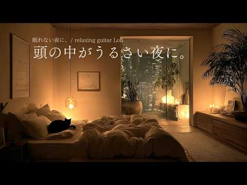

# 음악 — 성공 사례 분석: 사례별 자세히 #641–#680

`analysis.md` 의 9번 (같은 # 번호). 자동 생성 — `tools/success_analysis.py` v1.4.1 (2026-10-18 08:09 UTC). ※ 연구·교육용 — 투자 권유가 아님.

### 641. The Most Beautiful Rachmaninoff-Inspired Adagios ∣ Quiet Cello & Felt Piano for the Soul

- https://www.youtube.com/watch?v=ZdzITqD4vlM · Adagio Melancholia · 구독자 9,930 · 조회수 591,463 (×59.6, 하루 8,597.1) · 좋아요 10,885 (1.8%) · 61.6분 · 2026-08-10 · 주제 묶음 6. 피아노·클래식·연주곡 · 형식 음악 (그 밖 모양 — 한 편짜리 BGM 등) · 폴더 `W_ZdzITqD4vlM` (웹 승인)
- 썸네일: 
- 설명 앞부분: The Most Beautiful Rachmaninoff-Inspired Adagios ∣ Quiet Cello & Felt Piano for the Soul Immerse yourself in the quiet beauty of Rachmaninoff-inspired adagios, featuring the warm and expressive sound of cello and felt piano. This relaxing classical music collection is created for peaceful moments, …
- 대본 없음 (설명) — 음성인식이 끝나면 도입부·흐름이 들어감
- 댓글 0/1,095 (다 받지 못함): 좋은 점 — 영상 0 · 감사·응원 0 · 더 알고 싶은 것 0 · 아쉬운 점 — 영상 0 · 반박·불만 — 의견 다름 0 · 정치·사회 0 · 경험 공유 0 · 구독·다음 기대 0

### 642. 행운이 찾아오는 아침 🎵마음에 건강한 에너지를 채우는 힐링 피아노 ∣ 스트레스 해소 · 편안한 휴식 · 카페음악 ∣ Relaxing Piano

- https://www.youtube.com/watch?v=Xp2bSO5r5Os · Romua 로무아 · 구독자 3,370 · 조회수 199,902 (×59.3, 하루 1,521.8) · 좋아요 1,003 (0.5%) · 180분 · 2026-06-08 · 주제 묶음 6. 피아노·클래식·연주곡 · 형식 플레이리스트·모음 (여러 곡) · 폴더 `W_Xp2bSO5r5Os` (웹 승인)
- 썸네일: 
- 설명 앞부분: ⌜ 좋은 일은 생각보다 조용히 찾아온다 ⌟ 새벽 안개가 숲 사이를 천천히 지나가고 이른 아침의 마음에는 맑은 바람이 통하는 길이 열립니다 우리는 종종 특별한 순간만을 기다리지만 삶을 바꾸는 것은 어느 평범한 아침의 산뜻한 공기, 마음을 스치는 평온, 그리고 이유 없이 가벼워진 발걸음일 때가 많아요 계절이 바뀌는 소리를 들은 사람은 없습니다 하지만 어느 날 문득 창밖을 바라보며 다음 계절이 왔음을 알게 되지요 좋은 일도 그렇게 찾아옵니다 자신을 드러내지 않은 채 조용히 우리 곁에 앉아 삶의 풍경을 조금씩 바꾸어 갑니다 오늘은 이 음…
- 같은 채널 평소 대비 ×28.2 (채널 최근 롱폼 중앙값 7,078회) · 평소 영상: 빨간 기차를 타고 떠났을 뿐인데 🎵마음에 행복을 주는 힐링 피아노 ∣ 스트레스 해소 · … (7,181회) / 모든게 다 괜찮아지는 날 🎵마음을 편안하게 하는 힐링 피아노 ∣ 스트레스 해소 · 편안한… (6,976회)
- 대본 없음 (설명) — 음성인식이 끝나면 도입부·흐름이 들어감
- 댓글 37/37: 좋은 점 — 영상 0 · 감사·응원 7 · 더 알고 싶은 것 0 · 아쉬운 점 — 영상 0 · 반박·불만 — 의견 다름 0 · 정치·사회 0 · 경험 공유 0 · 구독·다음 기대 0
  - 감사·응원 👍8 “오늘도 나에게 행운이 온다 모든이들에게 행운이가길 바랍니다 감사합니다😄😄”
  - 감사·응원 👍1 “오늘도 힐링됩니다 감사합니다”

### 643. 모든 일이 잘 풀리는 아침을 여는 음악 ∣ 막혔던 일이 시원하게 풀리는 기분

- https://www.youtube.com/watch?v=6MQT5DkZTEU · LazyFlow · 구독자 10,700 · 조회수 632,787 (×59.1, 하루 3,802.3) · 좋아요 5,013 (0.8%) · 90.4분 · 2026-05-04 · 주제 묶음 5. 운동·드라이브·신나는 · 형식 플레이리스트·모음 (여러 곡) · 폴더 `W_6MQT5DkZTEU` (웹 승인)
- 썸네일: 
- 챕터: 0:00 Unhappy And Still Yours · 3:53 Hello Sunshine · 7:18 Golden Room · 10:31 Play It Again · 13:42 It All Adds Up · 17:01 Every Single Day · 22:02 Just Like That · 25:27 The Sky This Morning · 28:53 But It's a Good One · 32:30 Familiar and Good · 37:21 Blue Above Me · 41:13 Good Vibes Only · 45:12 Repeat
- 설명 앞부분: 기분 좋은 에너지가 가득한 아침을 위한 팝송 플레이리스트입니다. 오늘 하루, 당신이 머무는 모든 공간에 특별한 행운과 좋은 소식이 가득하시길 바랍니다. 🎵 Tracklist 🌤️ lazyflow는 매일 아침 7시, 당신의 하루가 마법처럼 잘 풀리길 바라는 마음을 담아 직접 제작한 감성 팝송 플레이리스트를 배달합니다. 오늘도 이 음악과 함께 당신의 모든 순간이 특별한 행운과 좋은 소식으로 가득하시길 바랍니다.
- 같은 채널 평소 대비 ×111.5 (채널 최근 롱폼 중앙값 5,676회) · 평소 영상: 모든 일이 잘 풀리는 아침을 여는 음악 ∣ 오늘 하루, 모든 순간이 특별해지는 음악 (5,677회) / 모든 일이 잘 풀리는 아침을 여는 음악 ∣ 준비된 당신에게 찾아올 가장 완벽한 가을의 기회 (5,674회)
- 대본 없음 (설명) — 음성인식이 끝나면 도입부·흐름이 들어감
- 댓글 167/167: 좋은 점 — 영상 1 · 감사·응원 24 · 더 알고 싶은 것 2 · 아쉬운 점 — 영상 1 · 반박·불만 — 의견 다름 0 · 정치·사회 0 · 경험 공유 4 · 구독·다음 기대 0
  - 좋은 점 — 영상 👍15 “음악 좋기만 한데요😅 이런 듣기 좋은 음악을 공짜로 들을 수 있는데, Ai니 머니 하는 댓글보다는 감사하는 마음을 갖는게 내 행복에 더 도움이 될거같습니다❤”
  - 감사·응원 👍15 “음악 좋기만 한데요😅 이런 듣기 좋은 음악을 공짜로 들을 수 있는데, Ai니 머니 하는 댓글보다는 감사하는 마음을 갖는게 내 행복에 더 도움이 될거같습니다❤”
  - 감사·응원 👍9 “언제나 항상 늘. 모든 일이 모든면에서 다 잘된다 술술잘풀리고 다잘된다 평안 건강 함에 감사합니다 🙏🙏🙏🙏🙏🙏🙏🙏🎉🎉🎉🎉🎉🎉🎉”
  - 더 알고 싶은 것 👍1 “너무 피곤해 누워 폰하다 듣고 일어났어요❤ 첫번째 곡 너무 제취향인데 곡을 검색해보니 나오진 않네요-.- 알 수 있을까요?”
  - 아쉬운 점 — 영상 👍0 “광고가 너무 많이 떠요”
  - 경험 공유 👍7 “앞으로 내가 하는 모든 일이 잘 풀리길 기도하면서 이 플리로 시원하게 시작해봅니다!! 감사합니다!!”
  - 경험 공유 👍2 “저도 가족들과함께 좋은 음악들으며 좋은기운을 받고 갑니다.”

### 644. the best classical music for deep concentration ∣ string quartet for focus & study

- https://www.youtube.com/watch?v=Px1HC9ExXOk · FocusSpace · 구독자 8,990 · 조회수 531,174 (×59.1, 하루 6,116.7) · 좋아요 15,376 (2.9%) · 64.6분 · 2026-07-23 · 주제 묶음 6. 피아노·클래식·연주곡 · 형식 음악 (그 밖 모양 — 한 편짜리 BGM 등) · 폴더 `W_Px1HC9ExXOk` (웹 승인)
- 썸네일: 
- 챕터: 0:00 The Gallery of Silent Minds · 1:46 Discipline in Stillness · 3:33 Hall of Quiet Ambition · 6:31 The Scholar’s Resolve · 8:43 Measured Thought · 10:29 Vellum and Stone · 13:30 The Unbroken Page · 14:56 Counterpoint of Clarity · 16:23 A Chamber for Thought · 17:44 The Patient Ascent · 19:19 Architecture of Reason · 21:41 The Midnight Thesis · 24:32 The Weight of Insight · 26:53 Ancient Silence · 29:31 After the Last Candle · 32:17 Repeat
- 설명 앞부분: This original FocusSpace collection was carefully selected, arranged, edited, and shaped into a continuous listening experience for sustained concentration. Classical string quartet music for deep concentration, studying, reading, writing, and focused work. A collection of original instrumental pie…
- 대본 없음 (설명) — 음성인식이 끝나면 도입부·흐름이 들어감
- 댓글 0/443 (다 받지 못함): 좋은 점 — 영상 0 · 감사·응원 0 · 더 알고 싶은 것 0 · 아쉬운 점 — 영상 0 · 반박·불만 — 의견 다름 0 · 정치·사회 0 · 경험 공유 0 · 구독·다음 기대 0

### 645. [COVER] 한오백년 _ 어버이날을 맞이하여...

- https://www.youtube.com/watch?v=W40yM35SfWc · 감성메아리 · 구독자 5,320 · 조회수 313,812 (×59.0, 하루 1,889.8) · 좋아요 1,773 (0.6%) · 4.8분 · 2026-05-05 · 주제 묶음 12. 커버·노래 부르기 · 형식 AI 음악 · 폴더 `W_W40yM35SfWc` (웹 승인)
- 썸네일: 
- 설명 앞부분: 커버해 보았습니다 당신의 오늘 하루에 따뜻한 위로와 여유로운 쉼표를 선물할 수 있으면 좋겠습니다 🎤 Vocal by AI
- 같은 채널 평소 대비 ×592.1 (채널 최근 롱폼 중앙값 530회) · 평소 영상: 단 한 번만 내 손 마디마디 온기를 채워주오🌧️/이승의 인연이 여기가 끝이로구나/손 한번… (530회) / "정통 트로트"로 가슴을 적셔주는 노래들😭 /14곡 노래모음 ▶️ (558회)
- 대본 없음 (설명) — 음성인식이 끝나면 도입부·흐름이 들어감
- 댓글 58/58: 좋은 점 — 영상 0 · 감사·응원 8 · 더 알고 싶은 것 2 · 아쉬운 점 — 영상 1 · 반박·불만 — 의견 다름 0 · 정치·사회 0 · 경험 공유 2 · 구독·다음 기대 1
  - 감사·응원 👍15 “한오백년 노래가락이 너무 슬퍼요 우리 어머니 가족들 보고 싶어요 노래 감사합니다”
  - 감사·응원 👍14 “감성메아리님 안녕하세요 흐린 날씨로 시작을 하는 월요일 님의 멋진 노래 한오백년 감상하며 구독 좋아요 엄지 세워 힘차게 응원합니다 한주도 즐겁고 행복하게 보내시고 건강하세요.❤💞❤💞❤”
  - 더 알고 싶은 것 👍3 “가수도 ai 인가요? 아니면 진짜 사람인가요? 사람이라면 가수를 알고 싶네요.”
  - 더 알고 싶은 것 👍1 “다음으로 '천년 바위' 부탁합니다,꾸벅”
  - 아쉬운 점 — 영상 👍3 “사람 목소리 인가요? AI목소리인가요?”
  - 경험 공유 👍1 “한오백년 잘넘가네 나도한수하는데 많이 듲고 한수배울께요”

### 646. The Knight Who Chose Peace ⚔️ ∣ Relaxing Fantasy Music

- https://www.youtube.com/watch?v=u8xCmb7KbA0 · Melody of the Wanderer · 구독자 14,000 · 조회수 824,385 (×58.9, 하루 5,237.4) · 좋아요 15,185 (1.8%) · 74.5분 · 2026-05-13 · 주제 묶음 기타 · 형식 음악 (그 밖 모양 — 한 편짜리 BGM 등) · 폴더 `W_u8xCmb7KbA0` (웹 승인)
- 썸네일: 
- 설명 앞부분: Download free Illustration pack and Live walpaper for support: Once a warrior forged by endless battles, the Peaceful Knight now walks a quieter path, watching over the kingdom in silence beneath the fading light. 🌙⚔ 🎶 Medieval Fantasy Study & Peaceful Music for Deep Focus Melody of the Wanderer — …
- 대본 없음 (설명) — 음성인식이 끝나면 도입부·흐름이 들어감
- 댓글 0/505 (다 받지 못함): 좋은 점 — 영상 0 · 감사·응원 0 · 더 알고 싶은 것 0 · 아쉬운 점 — 영상 0 · 반박·불만 — 의견 다름 0 · 정치·사회 0 · 경험 공유 0 · 구독·다음 기대 0

### 647. Dolce Vita 🇮🇹 Luxury Italian Lounge Music ∣ Elegant Café Jazz, Piano & Mediterranean Vibes

- https://www.youtube.com/watch?v=oiG7xIAgCFw · ITALIAN MAFIA LOFI · 구독자 14,300 · 조회수 840,674 (×58.8, 하루 8,512.0) · 좋아요 13,228 (1.6%) · 86.5분 · 2026-07-11 · 주제 묶음 4. 카페·매장·라운지 · 형식 플레이리스트·모음 (여러 곡) · 폴더 `W_oiG7xIAgCFw` (웹 승인)
- 썸네일: 
- 설명 앞부분: Escape into the timeless elegance of La Dolce Vita with this relaxing Italian lounge playlist inspired by charming cafés, sunlit piazzas and the effortless beauty of Mediterranean living. Featuring warm acoustic piano, expressive nylon guitar, delicate mandolin, soft accordion, brushed jazz drums, …
- 대본 없음 (설명) — 음성인식이 끝나면 도입부·흐름이 들어감
- 댓글 0/338 (다 받지 못함): 좋은 점 — 영상 0 · 감사·응원 0 · 더 알고 싶은 것 0 · 아쉬운 점 — 영상 0 · 반박·불만 — 의견 다름 0 · 정치·사회 0 · 경험 공유 0 · 구독·다음 기대 0

### 648. Fresh Mind Relaxing 💗 ∣ Slowed + Reverb Lofi Mix for Calm, Focus & Peaceful Vibes #sleepm…

- https://www.youtube.com/watch?v=ACcuQVFbfnI · Vansh Lofi · 구독자 29,200 · 조회수 1,703,045 (×58.3, 하루 13,813.4) · 좋아요 7,936 (0.5%) · 16분 · 2026-06-17 · 주제 묶음 1. 수면·명상·힐링 · 형식 음악 (그 밖 모양 — 한 편짜리 BGM 등) · 폴더 `W_ACcuQVFbfnI` (웹 승인)
- 썸네일: 
- 설명 앞부분: Fresh Mind Relaxing 💗 ∣ Slowed + Reverb Lofi Mix for Calm, Focus & Peaceful Vibes Welcome to the world of soothing lofi music, where stress fades away, and peace takes over. This 2025 mind-relaxing lofi mix is perfect for: Deep Focus & Studying 📖 Relaxing & Meditation 🧘‍♂ Chilling After a Long Day …
- 대본 없음 (설명) — 음성인식이 끝나면 도입부·흐름이 들어감
- 댓글 0/88 (다 받지 못함): 좋은 점 — 영상 0 · 감사·응원 0 · 더 알고 싶은 것 0 · 아쉬운 점 — 영상 0 · 반박·불만 — 의견 다름 0 · 정치·사회 0 · 경험 공유 0 · 구독·다음 기대 0

### 649. Bollywood+ Bhojpuri mix songs playlist (💗⚡💃🏻) ∣ @songplaylisthere

- https://www.youtube.com/watch?v=sLPyIfOvPRQ · xthetic._.vibes🎀 · 구독자 36,500 · 조회수 2,121,872 (×58.1, 하루 13,430.1) · 좋아요 24,165 (1.1%) · 16.9분 · 2026-05-13 · 주제 묶음 기타 · 형식 플레이리스트·모음 (여러 곡) · 폴더 `W_sLPyIfOvPRQ` (웹 승인)
- 썸네일: 
- 설명 앞부분: Disclaimer: This video is made for entertainment purposes only. All songs used in this playlist belong to their respective owners. No copyright infringement intended. hastag: Hellow mere pyare dosto I hope you like my video plss do like and subscribe my channel for more songs playlist 💃🏻✨😀 lots of …
- 대본 없음 (설명) — 음성인식이 끝나면 도입부·흐름이 들어감
- 댓글 0/313 (다 받지 못함): 좋은 점 — 영상 0 · 감사·응원 0 · 더 알고 싶은 것 0 · 아쉬운 점 — 영상 0 · 반박·불만 — 의견 다름 0 · 정치·사회 0 · 경험 공유 0 · 구독·다음 기대 0

### 650. 【作業用BGM】ちいかわ Instrumental Jazz 2時間 ∣ 深夜のジャズラウンジ ∣ ひとりごつ, 島のうた, マジカルシンドローム +more【人魚の島のひみつ】

- https://www.youtube.com/watch?v=CJEgDVcFy80 · GINZA Midnight · 구독자 22,000 · 조회수 1,269,581 (×57.7, 하루 23,952.9) · 좋아요 21,704 (1.7%) · 126.6분 · 2026-08-26 · 주제 묶음 6. 피아노·클래식·연주곡 · 형식 음악 (그 밖 모양 — 한 편짜리 BGM 등) · 폴더 `W_CJEgDVcFy80` (웹 승인)
- 썸네일: 
- 챕터: 0:00 ひとりごつ (Hitorigotsu) · 2:43 くつずれ (Kutsuzure) · 6:01 机さする (Tsukue Sasuru) · 9:59 島のうた セイレーンver. (Shima no Uta … · 12:30 マジカルシンドローム (Magical Syndrome) · 15:06 今日の日はさようなら (Kyou no Hi wa Say… · 18:05 Repeat
- 설명 앞부분: 🎵 Playlist ▪︎ 本動画はYouTubeのコンテンツIDシステムにより、収益は原盤権・著作権の権利者へ自動的に還元される仕組みとなっております。 ▪︎ Produce / Music Direction : GINZA Midnight ▪︎ Selection & Arrangement Design : GINZA Midnight ▪︎ Sound Edit / Mix : GINZA Midnight ▪︎ Artwork & Design : GINZA Midnight
- 대본 없음 (설명) — 음성인식이 끝나면 도입부·흐름이 들어감
- 댓글 0/312 (다 받지 못함): 좋은 점 — 영상 0 · 감사·응원 0 · 더 알고 싶은 것 0 · 아쉬운 점 — 영상 0 · 반박·불만 — 의견 다름 0 · 정치·사회 0 · 경험 공유 0 · 구독·다음 기대 0

### 651. 【眠れない夜のBGM】頭の中がうるさい夜に。考えすぎて眠れない夜のギターLofi｜睡眠・リラックス・深夜BGM ∣ soften tonight. relaxing guitar

- https://www.youtube.com/watch?v=IZRmwcM2974 · gentle night music · 구독자 14,000 · 조회수 806,371 (×57.6, 하루 4,612.1) · 좋아요 6,609 (0.8%) · 125.2분 · 2026-04-26 · 주제 묶음 6. 피아노·클래식·연주곡 · 형식 음악 (그 밖 모양 — 한 편짜리 BGM 등) · 폴더 `W_IZRmwcM2974` (웹 승인)
- 썸네일: 
- 설명 앞부분: soften tonight. 🌙 For the nights when thoughts come without warning. May this music make your night a little softer. You don't have to quiet your mind. Just let the music sit with you. soften tonight. 🎸 🎸 Lo-fi Guitar｜Relaxing Night Music 眠れない夜 / 考えすぎる夜 / 睡眠用BGM / 夜の癒し / healing music 💤 こんな夜におすすめ /…
- 대본 없음 (설명) — 음성인식이 끝나면 도입부·흐름이 들어감
- 댓글 0/174 (다 받지 못함): 좋은 점 — 영상 0 · 감사·응원 0 · 더 알고 싶은 것 0 · 아쉬운 점 — 영상 0 · 반박·불만 — 의견 다름 0 · 정치·사회 0 · 경험 공유 0 · 구독·다음 기대 0

### 652. 𝐏𝐥𝐚𝐲𝐥𝐢𝐬𝐭 ∣ 초여름 별사탕 𖤐ˊ˗

- https://www.youtube.com/watch?v=aW-TYu5rwAY · Horu · 구독자 3,550 · 조회수 204,181 (×57.5, 하루 1,201.4) · 좋아요 0 (0.0%) · 19.8분 · 2026-05-01 · 주제 묶음 기타 · 형식 플레이리스트·모음 (여러 곡) · 폴더 `W_aW-TYu5rwAY` (웹 승인)
- 썸네일: 
- 챕터: 0:00 NewJeans - Bubble Gum · 3:16 KiiiKiii - Dancing Alone · 6:32 STAYC - LOVE · 9:36 Billlie - 기억사탕 · 12:38 Yerin Baek - 지켜줄게 · 16:19 여자친구 - Mermaid
- 대본 없음 (없음) — 음성인식이 끝나면 도입부·흐름이 들어감
- 댓글 0/42 (다 받지 못함): 좋은 점 — 영상 0 · 감사·응원 0 · 더 알고 싶은 것 0 · 아쉬운 점 — 영상 0 · 반박·불만 — 의견 다름 0 · 정치·사회 0 · 경험 공유 0 · 구독·다음 기대 0

### 653. Gentle Rain Outside, Warm Piano Inside (No Ads) 🌧️ Helps You Sleep, Relieves Insomnia and…

- https://www.youtube.com/watch?v=G9iosi2cIh4 · Cozy Attic Nights · 구독자 5,880 · 조회수 338,157 (×57.5, 하루 3,057.8) · 좋아요 1,664 (0.5%) · 717.9분 · 2026-06-29 · 주제 묶음 1. 수면·명상·힐링 · 형식 음악 (그 밖 모양 — 한 편짜리 BGM 등) · 폴더 `W_G9iosi2cIh4` (웹 승인)
- 썸네일: 
- 설명 앞부분: Gentle Rain Outside, Warm Piano Inside (No Ads) 🌧️ Helps You Sleep, Relieves Insomnia and Stress 🌧️ Heavy rain falls softly outside the attic window while warm fireplace light fills the room with a peaceful glow. Paired with gentle sleep piano music, this cozy rainy night ambience is designed to he…
- 대본 없음 (설명) — 음성인식이 끝나면 도입부·흐름이 들어감
- 댓글 0/178 (다 받지 못함): 좋은 점 — 영상 0 · 감사·응원 0 · 더 알고 싶은 것 0 · 아쉬운 점 — 영상 0 · 반박·불만 — 의견 다름 0 · 정치·사회 0 · 경험 공유 0 · 구독·다음 기대 0

### 654. [스페인 감성] "Frente a Tu Casa ∣ 그집앞 - 이재성" Korean OldPop 한국명곡

- https://www.youtube.com/watch?v=IXEpsuBWbg8 · 스페인 감성 한국 올드송 · 구독자 1,420 · 조회수 81,363 (×57.3, 하루 1,223.9) · 좋아요 587 (0.7%) · 4.5분 · 2026-08-12 · 주제 묶음 12. 커버·노래 부르기 · 형식 음악 (그 밖 모양 — 한 편짜리 BGM 등) · 폴더 `W_IXEpsuBWbg8` (웹 승인)
- 썸네일: 
- 설명 앞부분: 안녕하세요!! "스페인 감성 한국 올드송"입니다. 한국의 좋은 노래들을 Música Española (무시카 에스파뇰라)로 리메이크해서 불러 드리겠습니다. kpop의 멋진 멜로디와 깊은 감성을 스페인의 감성과 만나 깊이를 더했습니다. 이 채널에서 만들어지는 음악들은 AI를 도구로 이용해 직접 구상하고 제작되는 노력의 결과물입니다. 더 좋은 음악을 제공할 수 있도록 항상 노력하겠습니다. ¡Hola! Bienvenidos a "Canciones Clásicas Coreanas con Alma Española". En este cana…
- 대본 없음 (설명) — 음성인식이 끝나면 도입부·흐름이 들어감
- 댓글 14/14: 좋은 점 — 영상 0 · 감사·응원 1 · 더 알고 싶은 것 0 · 아쉬운 점 — 영상 0 · 반박·불만 — 의견 다름 0 · 정치·사회 0 · 경험 공유 1 · 구독·다음 기대 0
  - 감사·응원 👍6 “영상을 보니까 제가 1987년도에 이태리 밀라노에서 프랑스를 거쳐 바르셀로나까지 기차를 타고 가서 거기에서 스페인 쇼를 본 기억이 생생합니다. 좋습니다 응원합니다 ❤🎉🎉”
  - 경험 공유 👍6 “영상을 보니까 제가 1987년도에 이태리 밀라노에서 프랑스를 거쳐 바르셀로나까지 기차를 타고 가서 거기에서 스페인 쇼를 본 기억이 생생합니다. 좋습니다 응원합니다 ❤🎉🎉”

### 655. 나는 어디로 가나 - (국악 발라드)

- https://www.youtube.com/watch?v=hd_rjKroAqM · Rok Bi · 구독자 8,520 · 조회수 487,675 (×57.2, 하루 3,087.2) · 좋아요 2,486 (0.5%) · 5분 · 2026-05-13 · 주제 묶음 9. 가요·발라드·트로트 · 형식 AI 음악 · 폴더 `W_hd_rjKroAqM` (웹 승인)
- 썸네일: 
- 설명 앞부분: "아티스트 Rok Bi의 공식 유튜브 채널, **'록비 감성음악'*입니다." [ 🎵 록비 감성음악 재생목록 ] 🎵 곡 정보 (Credits) 살다 보면 내가 가는 길이 맞는지 의문이 들 때가 있습니다. 이 노래가 여러분의 지친 마음을 잠시 쉬게 하는 이정표가 되었으면 좋겠습니다. 곡을 듣고 느껴지는 여러분의 마음을 댓글로 자유롭게 남겨주세요. [🎧 YouTube Music]에서도 감상 가능합니다. 작사: 록비 (Rok Bi)&AI 작곡: 록비 & Suno AI 보컬: Rokbi Vocals, Powered by AI 기획/제작: …
- 같은 채널 평소 대비 ×43.4 (채널 최근 롱폼 중앙값 11,239회) · 평소 영상: 백년해로 인생의 길에서 함께한 우리의 노래 ∣ 록비 감성음악 ∣ 1시간 풀영상 (11,239회) / 인생의 길목에서 다시 만난 명곡 10곡 ∣ 록비 감성음악 (12,923회)
- 대본 없음 (설명) — 음성인식이 끝나면 도입부·흐름이 들어감
- 댓글 203/203: 좋은 점 — 영상 4 · 감사·응원 36 · 더 알고 싶은 것 1 · 아쉬운 점 — 영상 0 · 반박·불만 — 의견 다름 0 · 정치·사회 0 · 경험 공유 7 · 구독·다음 기대 0
  - 좋은 점 — 영상 👍3 “나이가 들어갈 수록 왜 감성노래, 인생노래 가 마음에 와닿는지....^^;; 나이가 들었다는 반증이겠죠? ^^ 뭉클한 노래, 동영상 잘 듣고 갑니다.”
  - 좋은 점 — 영상 👍1 “22년도 코로나로 어머님을 떠나보내고 절절히 가슴에 와닿아요 오늘도 이자식은 소리죽여 웁니다”
  - 감사·응원 👍14 “노래가 너무 절절하네요,좋은 노래 들려줘서 고마워요.응원합니다.🎉🎉🎉❤❤❤😊😊😊”
  - 감사·응원 👍13 “구독 좋아요로 응원합니다 최고입니다 늘 행복하세요❤❤❤🎉🎉”
  - 더 알고 싶은 것 👍6 “오늘도 록비님의음으로 하루시작합니다 항암잘견디고 좋은음만들어주세요”
  - 경험 공유 👍6 “어쩜 내인생 내삶과 똑같나 눈물이 나도모르게 고인다”
  - 경험 공유 👍2 “머리속은 숯덩이처럼 소음으로 뒤범벅되고 죽고싶도록 이번삶 싫다 이명소리 26년째 어디로 가야하나😢😢😢😢😢”

### 656. 途中広告なし[BGM]癒しの森カフェで何も考えない朝☕Gentle Morning Piano Jazz｜心地よく一日を始めるカフェ音楽

- https://www.youtube.com/watch?v=qDJ8LG4noFk · Aurora Tune · 구독자 19,200 · 조회수 1,098,538 (×57.2, 하루 6,485.6) · 좋아요 0 (0.0%) · 92.5분 · 2026-05-01 · 주제 묶음 6. 피아노·클래식·연주곡 · 형식 음악 (그 밖 모양 — 한 편짜리 BGM 등) · 폴더 `W_qDJ8LG4noFk` (웹 승인)
- 썸네일: 
- 설명 앞부분: 心がやわらかくほどけていくような、癒しのカフェで聴くピアノジャズBGMです。 ▼おすすめ動画(Recommended videos) 動画の映像と音はAIと人の感性を重ねて、心を込めて制作しています。 A soothing piano jazz piece, like the kind you’d hear in a cozy cafe, gently helping your mind unwind. Calm, mellow tones bring a slow and comfortable start to your day. In the midst of busy days, f…
- 대본 없음 (설명) — 음성인식이 끝나면 도입부·흐름이 들어감
- 댓글 0/115 (다 받지 못함): 좋은 점 — 영상 0 · 감사·응원 0 · 더 알고 싶은 것 0 · 아쉬운 점 — 영상 0 · 반박·불만 — 의견 다름 0 · 정치·사회 0 · 경험 공유 0 · 구독·다음 기대 0

### 657. Rainy Day in the Treehouse:Cooking Beef Stew Bread Bowl & Berry Tea ∣ Instrumental Piano …

- https://www.youtube.com/watch?v=_Mugeu0ne3M · Ghibli - ASMR Relax · 구독자 4,820 · 조회수 274,394 (×56.9, 하루 1,559.0) · 좋아요 1,743 (0.6%) · 6.5분 · 2026-04-25 · 주제 묶음 6. 피아노·클래식·연주곡 · 형식 음악 (그 밖 모양 — 한 편짜리 BGM 등) · 폴더 `W__Mugeu0ne3M` (웹 승인)
- 썸네일: 
- 설명 앞부분: Rainy Day in the Treehouse:Cooking Beef Stew Bread Bowl & Berry Tea ∣ Instrumental Piano Relax🌧️🏡 Spend a peaceful rainy day in a cozy treehouse deep in the forest 🌧️🏡 Watch as a warm, comforting meal comes together — a rich beef stew served in a rustic bread bowl, paired with a soothing cup of ber…
- 대본 없음 (설명) — 음성인식이 끝나면 도입부·흐름이 들어감
- 댓글 0/71 (다 받지 못함): 좋은 점 — 영상 0 · 감사·응원 0 · 더 알고 싶은 것 0 · 아쉬운 점 — 영상 0 · 반박·불만 — 의견 다름 0 · 정치·사회 0 · 경험 공유 0 · 구독·다음 기대 0

### 658. [𝙋𝙡𝙖𝙮𝙡𝙞𝙨𝙩] 세종대왕이 경복궁에서 야근하며 듣던 가야금 재즈

- https://www.youtube.com/watch?v=q3oC3zdfyw4 · 조선재즈 · 구독자 9,970 · 조회수 566,223 (×56.8, 하루 4,423.5) · 좋아요 21,737 (3.8%) · 180.7분 · 2026-06-12 · 주제 묶음 7. 재즈·보사노바 · 형식 플레이리스트·모음 (여러 곡) · 폴더 `W_q3oC3zdfyw4` (웹 승인)
- 썸네일: 
- 설명 앞부분: 세종대왕도 야근은 힘들었을 겁니다. 경복궁 깊은 밤, 촛불 아래 가야금이 흐릅니다. 조선의 밤과 재즈가 만났습니다:)
- 같은 채널 평소 대비 ×110.5 (채널 최근 롱폼 중앙값 5,126회) · 평소 영상: [𝙋𝙡𝙖𝙮𝙡𝙞𝙨𝙩] 세종대왕이 코딩하며 들었던 가야금 재즈 (5,126회) / [𝙋𝙡𝙖𝙮𝙡𝙞𝙨𝙩] 퇴근 궁녀 (퇴사할게여) ∣ 느좋 조선 가야금 재즈 (5,233회)
- 대본 없음 (설명) — 음성인식이 끝나면 도입부·흐름이 들어감
- 댓글 468/468: 좋은 점 — 영상 2 · 감사·응원 8 · 더 알고 싶은 것 6 · 아쉬운 점 — 영상 2 · 반박·불만 — 의견 다름 4 · 정치·사회 1 · 경험 공유 10 · 구독·다음 기대 5
  - 좋은 점 — 영상 👍0 “생활안복 자주 입는데, 한복입고 어디 놀러갈때 듣기 좋아요. 굿뜨 뭐랄까 혼자 마패를 들고 암행어사 하러 가는 기분이랑 연모하는 사내 담벼락에 훔쳐보러 가는 기분”
  - 좋은 점 — 영상 👍0 “너무좋아요 나도만들고싶네요 많이배우고갑니다❤❤❤❤❤❤❤”
  - 감사·응원 👍5 “와.... 가야금 너무 좋아하는데 이런 귀한 플리를 올려주시다니 감사합니다....”
  - 감사·응원 👍4 “오 좋아요... 제작 감사함당 잘 들을게요”
  - 더 알고 싶은 것 👍3 “구독 좋아요 알림설정합니다. 한국의 미를 잃지 않는 퓨전음악 많이 부탁드립니다. 덕분에 출근길이 즐거워요.”
  - 더 알고 싶은 것 👍1 “집현전 학자들 편도 부탁합니다. 엄지척!”
  - 아쉬운 점 — 영상 👍6 “ㅋㅋㅋㅋㅋㅋㅋ 고얀 AI 같으니라고”
  - 아쉬운 점 — 영상 👍3 “구간반복해서 들을 수 있게 해주세요”
  - 반박·불만 — 의견 다름 👍4 “와 재즈 좋아하는데 가야금과 재즈가 이렇게 잘 어울리다니. 가야금의 선율이 그루비해서 깜짝 놀랐습니다. AI 작곡이란데서 한번 더 놀람.. 말도안됨 😂”
  - 반박·불만 — 의견 다름 👍1 “절대음감이라 AI 음악이 맞으실 수도ㅋㅋㅋ 근데 저렇게 누워 계실 분이 아닌데 두 눈 부릅 뜨고 계셔야 하지 않을까요?”
  - 정치·사회 👍0 “전하 .. 요즘 나라가 말이 아닙니다 이걸 어찌해야 된답니까 ...”
  - 경험 공유 👍9 “클래식 공부를 어릴때 부터 하면서 재즈도 같이 조금 했었는데 살면서 들은 재즈 중에 제일 좋습니다….”
  - 경험 공유 👍3 “세종대왕도 야근하는데 내가 뭐라고”
  - 구독·다음 기대 👍3 “구독 좋아요 알림설정합니다. 한국의 미를 잃지 않는 퓨전음악 많이 부탁드립니다. 덕분에 출근길이 즐거워요.”
  - 구독·다음 기대 👍1 “가능하구나 재즈라는 것이!!!! 감탄하고 구독하고 갑니다~!”

### 659. Paganini (Vivaldi x Beethoven) House Music Mix – Hypnotic Violin for Deep Focus

- https://www.youtube.com/watch?v=Q9TSg4bKjcs · Velvet Frequencies · 구독자 5,600 · 조회수 317,380 (×56.7, 하루 2,014.3) · 좋아요 5,242 (1.7%) · 7분 · 2026-05-13 · 주제 묶음 6. 피아노·클래식·연주곡 · 형식 음악 (그 밖 모양 — 한 편짜리 BGM 등) · 폴더 `W_Q9TSg4bKjcs` (웹 승인)
- 썸네일: 
- 설명 앞부분: This is a hypnotic cinematic house music experience designed for deep focus, immersive flow, and emotional late-night energy. Inspired by the virtuosic violin intensity of Paganini, the flowing melodic elegance of Vivaldi, and the powerful harmonic emotion of Beethoven, this mix blends deep house g…
- 대본 없음 (설명) — 음성인식이 끝나면 도입부·흐름이 들어감
- 댓글 0/212 (다 받지 못함): 좋은 점 — 영상 0 · 감사·응원 0 · 더 알고 싶은 것 0 · 아쉬운 점 — 영상 0 · 반박·불만 — 의견 다름 0 · 정치·사회 0 · 경험 공유 0 · 구독·다음 기대 0

### 660. ✨💖요즘 폼 미친(positive) 최신 아이돌 노래 모음 ∣ 신나는 ∣ 최신곡 ∣ 여돌 ∣ 남돌 ∣ 아이돌 플레이리스트 [ K-POP Playlist ]

- https://www.youtube.com/watch?v=eLiTRGAnmyk · 띠잉뮤직 · 구독자 20,900 · 조회수 1,178,099 (×56.4, 하루 8,113.9) · 좋아요 5,581 (0.5%) · 121.8분 · 2026-05-26 · 주제 묶음 10. 팝송·K팝·J팝 · 형식 플레이리스트·모음 (여러 곡) · 폴더 `W_eLiTRGAnmyk` (웹 승인)
- 썸네일: 
- 챕터: 0:00 르세라핌 · 2:55 하츠투하츠 · 6:23 큐티 스트릿 · 10:32 넥스지 · 13:30 아이오아이 · 16:45 츄 · 19:54 투어스 · 22:45 에스파 · 25:19 키키 · 28:24 투바투 · 31:24 엔믹스 · 34:27 있지 · 37:40 네이즈 · 40:29 비비 · 44:04 메이딘 · 46:39 킥플립 · 49:21 언차일드 · 51:21 피프티피프티 · 54:19 투어스 · 57:06 키스오브라이프
- 설명 앞부분: 🎵PlayList🎵 LE SSERAFIM - BOOMPALA Hearts2Hearts - STYLE CUTIE STREET - 귀엽기만 하면 안 되나요? NEXZ - HYPEMAN I.O.I - 갑자기 (Suddenly) CHUU - Teeny Tiny Heart TWS - 너의 모든 가능성이 되어 줄게 aespa - WDA KiiiKiii - UNDERDOGS TXT - Love Language NMIXX - Heavy Serenade ITZY - Motto NAZE - People Talk BIBI - BUMPA MADEIN …
- 대본 없음 (설명) — 음성인식이 끝나면 도입부·흐름이 들어감
- 댓글 0/162 (다 받지 못함): 좋은 점 — 영상 0 · 감사·응원 0 · 더 알고 싶은 것 0 · 아쉬운 점 — 영상 0 · 반박·불만 — 의견 다름 0 · 정치·사회 0 · 경험 공유 0 · 구독·다음 기대 0

### 661. 2000년대 발라드 명곡 30곡 💿 그 시절 우리가 사랑했던 노래｜SG워너비·김동률·씨야·티아라·양파 ✔ 싸이월드 BGM

- https://www.youtube.com/watch?v=IZ6NgLQjStY · 추억음악다방 · 구독자 3,430 · 조회수 193,245 (×56.3, 하루 2,136.1) · 좋아요 1,473 (0.8%) · 117.8분 · 2026-07-19 · 주제 묶음 9. 가요·발라드·트로트 · 형식 플레이리스트·모음 (여러 곡) · 폴더 `W_IZ6NgLQjStY` (웹 승인)
- 썸네일: 
- 설명 앞부분: 2000년대 발라드 명곡 29곡 💿 그 시절 우리가 사랑했던 노래들을 한자리에 담았습니다. SG워너비, 김동률, 씨야, 티아라, 다비치, 양파, 이승철, 김범수, 더 크로스, SS501 등 첫 소절만 들어도 그때의 사랑과 이별, 학창 시절과 싸이월드 감성이 떠오르는 추억의 명곡 플레이리스트입니다. MP3 플레이어에 좋아하는 노래를 가득 담아 다니던 시절, 폴더폰 문자 한 통을 기다리며 밤을 지새우던 순간, 싸이월드 미니홈피 BGM으로 차마 말하지 못한 마음을 대신 전했던 날들… 시간이 오래 흘렀어도 그 시절의 노래를 다시 듣는 순…
- 같은 채널 평소 대비 ×50.3 (채널 최근 롱폼 중앙값 3,839회) · 평소 영상: 싸이월드 감성 2000년대 명곡 모음 💿 텅 빈 거리에서 🎧 다시 듣는 그 시절 발라드 (5,771회) / SG워너비 - Timeless (가사/Lyrics) 💔 이 노래, 듣는 순간 울컥한다｜2… (1,907회)
- 대본 없음 (설명) — 음성인식이 끝나면 도입부·흐름이 들어감
- 댓글 17/17: 좋은 점 — 영상 0 · 감사·응원 1 · 더 알고 싶은 것 1 · 아쉬운 점 — 영상 0 · 반박·불만 — 의견 다름 0 · 정치·사회 0 · 경험 공유 0 · 구독·다음 기대 0
  - 감사·응원 👍0 “중간중간에 드라마 대사 같은게 들리는데 검토 한번만 해주심 감사할 거 같아용ㅠ”
  - 더 알고 싶은 것 👍0 “비 오는 날 가장 듣고 싶은 옛날 노래가 있다면 어떤 곡인가요? 여러분만의 추천곡을 알려주세요.”

### 662. 처음부터 신나서 환장하는! ❤️ 신나는 트로트리믹스 고속도로메들리 ∣ 최신트로트 ∣ 트로트메들리 ∣ 감성트로트

- https://www.youtube.com/watch?v=zt45-jow7lo · 다솜이의 트로트책방 · 구독자 7,710 · 조회수 433,625 (×56.2, 하루 2,653.4) · 좋아요 3,308 (0.8%) · 71.2분 · 2026-05-07 · 주제 묶음 5. 운동·드라이브·신나는 · 형식 플레이리스트·모음 (여러 곡) · 폴더 `W_zt45-jow7lo` (웹 승인)
- 썸네일: 
- 챕터: 0:00 단심가 · 3:39 찜했어요 · 7:04 하늘만큼 땅만큼 · 10:29 두근두근 내사랑 · 14:05 사랑의 신호등 · 18:09 꽃보다 그대요 · 21:50 사랑 충전 완료 · 24:56 사랑보따리 · 28:23 천번을 물어도 · 32:00 꽃신 신고 갈게요 · 35:35 반복재생
- 설명 앞부분: 오늘도 찾아온 최신트로트 EDM리믹스 디스코메들리 😘 이번주도 고생 많으신 여러분! 신나는 트로트메들리로 다솜 트로트책방에서 힐링하고 가셨으면 좋겠어요 👍 여러분의 쉼터가 되길 바라는 마음이에요 💕 즐겁게 들어주시고 남겨주시는 따뜻한 댓글 한마디에 저도 너무너무 힘이 납니다 😘😘 항상 감사드립니다 😁 EDM트로트 리믹스 BEST 모음 애절한 감성트로트 더 들어보기 신나는 트로트 더 들어보기 계속 신나는 EDM 리믹스 메들리 더 들어보기 다솜이 싱글 들어보기 💖노래 순서💖
- 같은 채널 평소 대비 ×45.3 (채널 최근 롱폼 중앙값 9,573회) · 평소 영상: 이 맛이지~!! 최고로 신나는 트로트리믹스 모음 7번째!! 고속도로메들리 ∣ 최신트로트 … (9,518회) / 들을수록 빠져든다! 신나는 댄스트로트 고속도로메들리 ∣ 최신트롯 ∣ 감성트로트 (8,305회)
- 대본 없음 (설명) — 음성인식이 끝나면 도입부·흐름이 들어감
- 댓글 139/139: 좋은 점 — 영상 0 · 감사·응원 5 · 더 알고 싶은 것 2 · 아쉬운 점 — 영상 1 · 반박·불만 — 의견 다름 0 · 정치·사회 1 · 경험 공유 0 · 구독·다음 기대 3
  - 감사·응원 👍5 “음악이신나좋아요화이팅🎉🎉🎉❤❤❤”
  - 감사·응원 👍2 “화이팅”
  - 더 알고 싶은 것 👍1 “구독. 망치로박고갑니다. 기분전환 최곱니다. cd 구입되나요???”
  - 아쉬운 점 — 영상 👍6 “신나요 잘듣고 있어요 낚시배 하는데 살수 있나요 ?”
  - 정치·사회 👍0 “영어이나라대한민국미국영어이나라본한국말억양토늘회화영어들어나가금그들영어와저너꼭알어두고미국말영어러시아촌칙급이길느한국어이북말조선족톤극사기느어대”
  - 구독·다음 기대 👍2 “첫노래 트로트가사제목이 어떻게되나요 가수 가사제목 궁금하내요 구독하고갑니다 댓글달아주시면 감사하겠습니다 너무신납니다”
  - 구독·다음 기대 👍2 “구독합니다. 신나네요”

### 663. [중간광고없음] 🌿 잠시, 아무 생각도 하지 말아요. ∣ 숲속에서 듣는 잔잔한 피아노 ∣ BGM ∣ 휴식, 힐링, 독서

- https://www.youtube.com/watch?v=ebDKy0szHC8 · Riae & Piano · 구독자 12,400 · 조회수 695,335 (×56.1, 하루 7,367.3) · 좋아요 3,525 (0.5%) · 181.3분 · 2026-07-15 · 주제 묶음 6. 피아노·클래식·연주곡 · 형식 음악 (그 밖 모양 — 한 편짜리 BGM 등) · 폴더 `W_ebDKy0szHC8` (웹 승인)
- 썸네일: 
- 설명 앞부분: 잠시 모든 생각을 내려놓고, 창밖 가득 펼쳐진 숲과 잔잔한 피아노 선율 속에서 마음을 쉬어가세요. 독서와 공부, 휴식, 그리고 혼자만의 조용한 시간을 더욱 평온하게 만들어 줄 힐링 플레이리스트입니다. Take a break from every thought and let the peaceful forest view and gentle piano melodies calm your mind. A relaxing playlist for reading, studying, working, or simply enjoying a quiet m…
- 같은 채널 평소 대비 ×43.9 (채널 최근 롱폼 중앙값 15,838회) · 평소 영상: [중간광고없음] ☁️🌿 점점 좋아지고 있어 ∣ 비 그친 숲에서 듣는 희망의 피아노 ∣ B… (15,838회) / [중간광고없음] ☁️🍃 잠시 쉬어가도 괜찮아, 넌 잘하고 있어 ∣ 위로의 피아노 ∣ BG… (15,639회)
- 대본 없음 (설명) — 음성인식이 끝나면 도입부·흐름이 들어감
- 댓글 191/191: 좋은 점 — 영상 0 · 감사·응원 15 · 더 알고 싶은 것 0 · 아쉬운 점 — 영상 2 · 반박·불만 — 의견 다름 0 · 정치·사회 0 · 경험 공유 2 · 구독·다음 기대 2
  - 감사·응원 👍6 “드디어 찾았습니다. 완전 저의 스타일 피아노 연주 입니다. 잘 만들어 주어서 감사합니다. 슬픔을 슬픔으로 흘러가게 해 주는 피아노 선율에 저의 마음도 같이 흘러가는 시간이 됩니다.”
  - 감사·응원 👍3 “감사합니다❤”
  - 아쉬운 점 — 영상 👍10 “생각이 많아지고 뭔가 심신의 안정을 원할때.멍때리며 머릿속의 안개를 걷어내고 싶을때 들어요.무엇보다 중간광고가 없어서 좋아요”
  - 아쉬운 점 — 영상 👍1 “"몇 번을 반복해서 들어도 질리지 않는 곡이에요. 편곡 센스가 남다르신 것 같아요. 구독 좋아요로 응원할게요~"”
  - 경험 공유 👍2 “아기 낮잠음악으로 최고에요. 같이 듣는 저도 너무 힐링됩니다.오늘 하루도 평온함을 선물해주셔서 감사합니다.”
  - 구독·다음 기대 👍2 “구독하고갑니다.좋아요”
  - 구독·다음 기대 👍1 “잔잔한 음악 많이 들어봤지만, 이 영상에 정착했어요. 가장 마음이 편해요. 다이어리 매일 쓰는데 매일 듣고있어요”

### 664. 바흐와 모차르트의 감성을 담은 아침 클래식 🌿 하루를 여는 평화로운 힐링 연주

- https://www.youtube.com/watch?v=9_HXWyP1MsE · Korean Rock Ballad · 구독자 4,750 · 조회수 264,664 (×55.7, 하루 2,801.7) · 좋아요 2,214 (0.8%) · 40.3분 · 2026-07-15 · 주제 묶음 6. 피아노·클래식·연주곡 · 형식 플레이리스트·모음 (여러 곡) · 폴더 `W_9_HXWyP1MsE` (웹 승인)
- 썸네일: 
- 설명 앞부분: 바흐와 모차르트의 감성에서 영감을 받아 새롭게 완성한 클래식 힐링 음악입니다. 부드러운 선율과 따뜻한 오케스트라 사운드가 평화로운 아침을 만들어 드립니다. 하루를 시작하는 시간, 공부, 독서, 업무, 휴식, 명상과 함께 편안한 클래식을 즐겨 보세요. 🌿 Inspired by the timeless elegance of Bach & Mozart. 편안한 하루를 위한 클래식 플레이리스트입니다.
- 대본 없음 (설명) — 음성인식이 끝나면 도입부·흐름이 들어감
- 댓글 0/39 (다 받지 못함): 좋은 점 — 영상 0 · 감사·응원 0 · 더 알고 싶은 것 0 · 아쉬운 점 — 영상 0 · 반박·불만 — 의견 다름 0 · 정치·사회 0 · 경험 공유 0 · 구독·다음 기대 0

### 665. 숲속에 내리는 잔잔한 빗소리 🌧️ 명상, 깊은 수면, 편안한 소리

- https://www.youtube.com/watch?v=4Xl4kMOmGY8 · 숲 속 빗소리 · 구독자 1,800 · 조회수 100,192 (×55.7, 하루 1,304.6) · 좋아요 702 (0.7%) · 187.7분 · 2026-08-02 · 주제 묶음 2. 자연 소리·백색소음 · 형식 자연 소리·백색소음 (음악 낱말 없는 제목) · 폴더 `W_4Xl4kMOmGY8` (웹 승인)
- 썸네일: 
- 설명 앞부분: 숲속에 내리는 잔잔한 빗소리 🌧️ 명상, 깊은 수면, 편안한 소리 고요한 숲속에 내리는 부드러운 빗소리와 함께 몸과 마음의 긴장을 풀어보세요. 숲속에 부드럽게 내리는 빗소리와 나뭇잎 사이로 스치는 잔잔한 바람, 멀리서 들려오는 자연스러운 천둥소리와 함께 깊은 평온함을 느껴보세요. 이 편안한 자연의 분위기는 숙면을 돕고, 스트레스를 줄이며, 공부하거나 일할 때 집중력을 유지하는 데 도움을 줄 수 있습니다. 이 채널에서는 깊은 수면, 명상, 휴식과 마음의 안정을 위한 자연스럽고 몰입감 있는 사운드 풍경을 제작합니다. 숲속의 빗소리가 …
- 같은 채널 평소 대비 ×49.4 (채널 최근 롱폼 중앙값 2,027회) · 평소 영상: 숲속에 내리는 잔잔한 빗소리 🌧️ 쌓인 피로를 녹이고 빠른 입면과 깊은 숙면을 돕는 힐링… (2,031회) / 숲속에 내리는 잔잔한 빗소리 🌧️ 불면증과 이명치료효과를 위한 백색소음 ∣ 빗소리에 푹 … (2,023회)
- 대본 없음 (설명) — 음성인식이 끝나면 도입부·흐름이 들어감
- 댓글 41/41: 좋은 점 — 영상 0 · 감사·응원 0 · 더 알고 싶은 것 0 · 아쉬운 점 — 영상 0 · 반박·불만 — 의견 다름 0 · 정치·사회 0 · 경험 공유 0 · 구독·다음 기대 0

### 666. [MIXSET] 늙크크의 여름 HipHop & R&B

- https://www.youtube.com/watch?v=_o3psN6OCTk · 떵신 tteongshin · 구독자 8,140 · 조회수 452,483 (×55.6, 하루 4,821.9) · 좋아요 9,603 (2.1%) · 22.1분 · 2026-07-16 · 주제 묶음 11. 힙합·R&B·EDM · 형식 정보·해설 (그 밖) · 폴더 `W__o3psN6OCTk` (웹 승인)
- 썸네일: 
- 설명 앞부분: 2026년 여름을 맞아 2010년대 중반 여름을 대표했던 HipHop & R&B 곡들을 모아 믹셋으로 완성했습니다. 🎧 Tracklist Enjoy! ☀ [SoundCloud]
- 대본 없음 (설명) — 음성인식이 끝나면 도입부·흐름이 들어감
- 댓글 204/204: 좋은 점 — 영상 0 · 감사·응원 5 · 더 알고 싶은 것 5 · 아쉬운 점 — 영상 2 · 반박·불만 — 의견 다름 0 · 정치·사회 0 · 경험 공유 13 · 구독·다음 기대 2
  - 감사·응원 👍4 “내가늙크크라서너무좋다이런노래들이난좋다감사합니다구독햇어요🫰🏻🫰🏻🫰🏻”
  - 감사·응원 👍2 “와... 20대 추억 돋는 아침 출근길입니다!!! 감사해요😊”
  - 더 알고 싶은 것 👍8 “진짜 곡 넘어가는거 예술임… 더만들어주세요제발”
  - 더 알고 싶은 것 👍7 “믹셋 계속 만들어주세요..🥺❤️”
  - 아쉬운 점 — 영상 👍2 “도파민 중독자인 저에게는 이런 플리가 필요했어요 좀 지루하다 싶으면 다른 곡😍”
  - 경험 공유 👍15 “내가 늙크크가 되었다는게 믿기지않아.. 분명 나 엊그제 20살이었던것 같은데.......................................”
  - 경험 공유 👍10 “지나가는 97년생인데.. 분명 영크크라 생각했는데 다 내가 좋아하는 노래라니... 나 언제 늙크크 된거지 ㅠㅜ 무튼 플리 개조아여❤”
  - 구독·다음 기대 👍2 “와.. 우연히 듣고 바로 구독합니다. 잘 부탁드려요!”
  - 구독·다음 기대 👍2 “구독하고 갈게여”

### 667. Sade Morning Coffee ☕ Vol.3 ∣ Luxury ChillMix ∣ Soulful Jazz & Relaxing Coffee Shop Music…

- https://www.youtube.com/watch?v=mp4oA2JflBQ · Setsukin · 구독자 43,100 · 조회수 2,395,761 (×55.6, 하루 14,891.5) · 좋아요 47,147 (2.0%) · 114.5분 · 2026-05-10 · 주제 묶음 4. 카페·매장·라운지 · 형식 음악 (그 밖 모양 — 한 편짜리 BGM 등) · 폴더 `W_mp4oA2JflBQ` (웹 승인)
- 썸네일: 
- 챕터: 0:00 It's Only Love That Gets You … · 3:30 I Couldn't Love You More · 7:09 Like a Tattoo · 10:36 The Sweetest Gift · 12:49 Your Love Is King · 16:22 Maureen · 20:28 Give It Up · 23:54 Kiss of Life · 29:34 By Your Side · 33:58 The Sweetest Taboo · 38:18 Love Is Stronger Than Pride · 42:30 Never As Good As the First Ti… · 46:19 Frankie's First Affair · 50:43 The Big Unknown · 54:19 Smooth Operator · 59:19 The Safest Place · 61:43 No Ordinary Love · 68:57 Mermaid · 72:58 Still In Love with You · 77:17 Hang On to Your Love
- 설명 앞부분: 🎧 Want the FULL mix? This video is a preview. The complete uncut version — plus every mix I've ever made — is on Patreon. ⭐ $3/month — Early access + full tracklists + behind-the-scenes 🎵 $7/month — Full-length DJ mixes in WAV quality (recommended) 👑 $15/month — Your name in the credits + VIP statu…
- 대본 없음 (설명) — 음성인식이 끝나면 도입부·흐름이 들어감
- 댓글 0/778 (다 받지 못함): 좋은 점 — 영상 0 · 감사·응원 0 · 더 알고 싶은 것 0 · 아쉬운 점 — 영상 0 · 반박·불만 — 의견 다름 0 · 정치·사회 0 · 경험 공유 0 · 구독·다음 기대 0

### 668. 첫 곡부터 너무 좋다 🍂 하루종일 듣게 되는 가을 올드팝 ∣ Vol.228 ∣ 7080 추억의 팝송 ∣ Autumn Oldies ∣ Coffee · Study …

- https://www.youtube.com/watch?v=naLL7CGOC-8 · moka melody · 구독자 14,600 · 조회수 804,147 (×55.1, 하루 13,539.0) · 좋아요 3,982 (0.5%) · 367.3분 · 2026-08-19 · 주제 묶음 4. 카페·매장·라운지 · 형식 음악 (그 밖 모양 — 한 편짜리 BGM 등) · 폴더 `W_naLL7CGOC-8` (웹 승인)
- 썸네일: 
- 챕터: 0:00 Where the Blue Sea Remembers … · 4:52 The Best Part of My Day 하루 중 … · 8:44 All the Years With You 너와 함께 … · 13:07 Under the Golden Tree 황금빛 나무 … · 17:15 Somewhere Past the City Light… · 21:53 Walking Home With You 너와 함께 걷… · 25:11 Blue Sky Kind of Day 파란 하늘이 아… · 29:38 Somewhere Along the Years 지나온… · 33:23 You Became My Day 어느새 나의 하루가 … · 37:56 Worth Every Mile 함께한 모든 길이 좋았… · 42:04 At the End of the Day 하루가 저물어… · 46:17 Nothing Special Today 오늘도 평범해… · 51:10 Warm Yesterday 따뜻했던 지난날 · 54:53 Repeat
- 설명 앞부분: 🎧 Old pop music for reading, studying, working, and deep focus This vintage old pop playlist is perfect as background music for coffee time, book reading, writing, study sessions, and work-from-home hours. Many listeners play this music while working quietly, studying for long hours, relaxing in th…
- 같은 채널 평소 대비 ×42.2 (채널 최근 롱폼 중앙값 19,055회) · 평소 영상: 9월, 첫 곡부터 너무 좋다🍂 가을엔 이런 노래가 참 좋더라｜Vol.237｜ 7080 추… (19,979회) / 9월, 첫 곡부터 참 좋다🍂 요즘 자꾸 이런 노래가 듣고 싶다｜Vol.238｜ 7080 … (18,131회)
- 대본 없음 (설명) — 음성인식이 끝나면 도입부·흐름이 들어감
- 댓글 301/301: 좋은 점 — 영상 5 · 감사·응원 57 · 더 알고 싶은 것 5 · 아쉬운 점 — 영상 2 · 반박·불만 — 의견 다름 0 · 정치·사회 0 · 경험 공유 9 · 구독·다음 기대 4
  - 좋은 점 — 영상 👍6 “안녕하세요. 아름다운 가을 풍경과 함께 잠시 머물러 봅니다. 🍂 오늘처럼 하늘이 흐리고 다소 어두운 날씨에는, 따뜻한 커피 한 잔과 이런 음악이 더욱 마음에 와닿는 것 같습니다. 감미롭고 부드러운 남성 보컬의 아름다운 선율이 잔잔히 흐르며, 복잡했던 마음까지 편안하게…”
  - 좋은 점 — 영상 👍6 “모카멜로디님 좋은아침입니다~🙂 은행 나무길을 보고 있자니 제몸이 빨려들어가 저 길을 걷고 있네요.제 마음이 그래서일까요 오늘은 저길이 쓸쓸해 보입니다. 생각이 많은 오늘입니다. 정리가 잘되면 좋겠어요. 오늘도 화이팅입니다~☕️❤”
  - 감사·응원 👍21 “아~~가을입니다 멋집니다 고맙습니다~”
  - 감사·응원 👍15 “이런 좋은 노래는 70세의 사람을 20대의 나이로 시공간을 옮겨서 그 시절의 추억 속으로 잠기게하는 능력이 있는가 봐요. 감사합니다”
  - 더 알고 싶은 것 👍2 “아티스 이름을 알고 싶은데요 너무듣기 좋아요”
  - 더 알고 싶은 것 👍1 “어제 알고리즘 떠서 우연히 듣게 됬네요 오늘도 일어나자마자 듣고있네요 음악이 감미롭네요 구독 합니다 첫번째곡 두번째곡 가수와 노래제목 부탁드립니다”
  - 아쉬운 점 — 영상 👍3 “지금 병원...지루한 항암시간 너무나 좋은 곡들이 많은 위로가 됩니다 선곡 너무 좋으네요”
  - 아쉬운 점 — 영상 👍1 “가사가 안 나와 아쉽네요~~^^”
  - 경험 공유 👍11 “오늘 우리 사랑하는 손자 돌입니다. 우리 집에서 손님들 초대해서 돌잔차를 하려고 준비중이예요. 이제 거의 준비를 마치고 손자에개 편지를 쓰는데 이 음악이 마음을 차분하게 하면서 딸을 키우던 지난날들이 떠오르네요.. 그 딸이 벌써 커서 아이를 낳았으니 기쁘고 감동스럽네…”
  - 경험 공유 👍5 “오래된 팝송을 듣다 보면 악기 몇 개만으로도 마음을 움직이는 곡들이 참 많다는 생각이 듭니다. 저도 그런 담백한 분위기를 살려 음악을 만들어 보니 옛 음악의 매력을 새삼 알게 되네요.”
  - 구독·다음 기대 👍1 “첫소절 듣고 구독합니다 감사합니다~~”
  - 구독·다음 기대 👍1 “잘듣고 가요, 따뜻하고 평온한 가을 보내시길 바랍니다! 구독합니다”

### 669. Heals You While You Sleep (No Ads) • Increases Deep Sleep • Say Goodbye To Insomnia

- https://www.youtube.com/watch?v=f68XXr9BDYw · Serene Dreams Night · 구독자 16,600 · 조회수 908,548 (×54.7, 하루 12,173.8) · 좋아요 8,224 (0.9%) · 226.8분 · 2026-08-04 · 주제 묶음 1. 수면·명상·힐링 · 형식 음악 (그 밖 모양 — 한 편짜리 BGM 등) · 폴더 `W_f68XXr9BDYw` (웹 승인)
- 썸네일: 
- 설명 앞부분: Heals You While You Sleep (No Ads) • Increases Deep Sleep • Say Goodbye To Insomnia Video made by: Serene Dreams Night 🌙 A Deep Rest Journey into Serene Dreams Night Immerse yourself in a world where calming melodies meet the quiet magic of the night. Let gentle music, soft nature sounds, and dream…
- 대본 없음 (설명) — 음성인식이 끝나면 도입부·흐름이 들어감
- 댓글 0/312 (다 받지 못함): 좋은 점 — 영상 0 · 감사·응원 0 · 더 알고 싶은 것 0 · 아쉬운 점 — 영상 0 · 반박·불만 — 의견 다름 0 · 정치·사회 0 · 경험 공유 0 · 구독·다음 기대 0

### 670. 𝐏𝐥𝐚𝐲𝐥𝐢𝐬𝐭 ∣ 교토의 작은 카페, 말차향 재즈 🍵🎧 抹茶オーツラテ

- https://www.youtube.com/watch?v=vLX3-MrBXFk · 아오링고 잡화점 AORINGGO · 구독자 10,500 · 조회수 574,452 (×54.7, 하루 9,510.0) · 좋아요 4,118 (0.7%) · 292.4분 · 2026-08-18 · 주제 묶음 4. 카페·매장·라운지 · 형식 플레이리스트·모음 (여러 곡) · 폴더 `W_vLX3-MrBXFk` (웹 승인)
- 썸네일: 
- 챕터: 0:00 Matcha Oat Latte Afternoon · 2:44 A Small Café · 5:47 Soft Green Latte · 8:24 Matcha Oat & Slow Jazz · 11:02 Oat Milk in the Afternoon · 13:36 Matcha Oat by the Window · 16:00 Velvet Green Latte · 18:40 A Quiet Oat Latte · 21:04 Sweet & Bitter Green · 23:29 Late Summer Oat Latte · 26:08 A Quiet Corner · 28:48 The Green Latte Hour · 31:12 Soft Light & Oat Milk · 33:34 Little Café Jazz · 35:59 After the Last Sip · 38:35 Green Lights at Dusk · 41:41 repeat 🔁
- 설명 앞부분: 📓 8월 말. 오후의 작은 카페. 여행을 하다 보면 계획에 없던 곳에서 오래 머물게 되는 순간이 있다. 그날도 특별히 정해둔 목적지는 없었다. 아침부터 이곳저곳을 돌아다니다가, 점심을 먹고 다시 골목을 걷고 있었다. 8월 말의 햇살은 여전히 뜨거웠다. 바람은 조금 선선해졌지만, 한낮의 더위는 쉽게 가시지 않았다. 골목 모퉁이에서 작은 카페 하나를 발견했다. 크지 않은 유리창 너머로 나무 테이블 몇 개가 보였고, 문 옆에는 초록색 메뉴판이 조용히 놓여 있었다. 잠시 쉬어갈까. 별다른 이유 없이 문을 열고 들어갔다. 카페 안은 바깥보…
- 같은 채널 평소 대비 ×24.8 (채널 최근 롱폼 중앙값 23,160회) · 평소 영상: 𝐏𝐥𝐚𝐲𝐥𝐢𝐬𝐭 ∣ 벳푸의 작은 찻집, 레몬블랙티 재즈 🍋🎧 レモン紅茶ジャズ (24,694회) / 𝐏𝐥𝐚𝐲𝐥𝐢𝐬𝐭 ∣쌉싸름한 루꼴라향 재즈, 가을을 맞이하자 🌿🎧 ルッコラジャズ (21,626회)
- 대본 없음 (설명) — 음성인식이 끝나면 도입부·흐름이 들어감
- 댓글 114/114: 좋은 점 — 영상 2 · 감사·응원 7 · 더 알고 싶은 것 1 · 아쉬운 점 — 영상 0 · 반박·불만 — 의견 다름 0 · 정치·사회 0 · 경험 공유 5 · 구독·다음 기대 2
  - 좋은 점 — 영상 👍0 “안녕하세요. 선생님이 만드시는 음악을 정말 좋아하고 존경합니다. 음악이 정말 너무 좋습니다. 저도 선생님처럼 좋은 음악을 만들어보고 싶어서 한 달 넘게 고민하고 여러 가지 방법으로 만들어봤지만, 아직 마음에 드는 결과를 얻지 못하고 있습니다. 그리고 예전에 선생님 채…”
  - 감사·응원 👍4 “현재 취업준비하면서 이력서 쓸 때마다 항상 카페에서 아오링고 잡화점 노래 틀어놓고 해요! 마음이 너무 편안해지고 저만의 공간에 있는 느낌이라 집중이 잘됩니다 ㅠㅠ 썸네일 그림 볼때마다 마음이 몽글해지구용 항상 감사합니다~~~”
  - 감사·응원 👍1 “그림과 글과 음악이 잘 어울리는 편안한 느낌이 정말 좋네요^0^ 감사합니다!”
  - 더 알고 싶은 것 👍0 “안녕하세요. 선생님이 만드시는 음악을 정말 좋아하고 존경합니다. 음악이 정말 너무 좋습니다. 저도 선생님처럼 좋은 음악을 만들어보고 싶어서 한 달 넘게 고민하고 여러 가지 방법으로 만들어봤지만, 아직 마음에 드는 결과를 얻지 못하고 있습니다. 그리고 예전에 선생님 채…”
  - 경험 공유 👍4 “너무 이뻐요!감삼다! 그림 조금씩 움직이는 것도 짱 귀엽고 음악도 좋고 사랑해요💞💞💞 다음에는 레밍턴 케이크를 해주실 수 있나요?? 아실지 모르지만 제가 유일하게 좋아하는 케이크에요!🤎🤎 안해주셔도 돼요! 이미 너무 좋아여 지금 지상낙원이란 말이 딱 들어맞는 순간? …”
  - 경험 공유 👍0 “나도 그림 그려서 이렇게 많은 사람들이랑 나누고 싶네요. 사진과 다른 인간미 넘치는 손맛이 음악까지 느긋하게 만드는데요.”
  - 구독·다음 기대 👍3 “그림도 아기자기하고 음악도 너무 좋아용^^ 좋아요 구독하고 자주 놀러 올게용*^^*”

### 671. Dopamine Boost Music ∣ Flute, Sitar & Tabla for Positive Energy, Focus & Deep Relaxation

- https://www.youtube.com/watch?v=kY7GcKagdjI · CLASSICAL FUSION  · 구독자 19,000 · 조회수 1,035,955 (×54.5, 하루 8,333.1) · 좋아요 21,737 (2.1%) · 27.8분 · 2026-06-16 · 주제 묶음 3. 공부·집중·작업 · 형식 음악 (그 밖 모양 — 한 편짜리 BGM 등) · 폴더 `W_kY7GcKagdjI` (웹 승인)
- 썸네일: 
- 설명 앞부분: Welcome to a deeply relaxing journey of Dopamine Boost Music featuring the soothing sounds of flute, sitar, and tabla. This calming Indian instrumental music is designed to help reduce stress, improve focus, elevate mood, and create a peaceful atmosphere for meditation, study, yoga, sleep, and mind…
- 대본 없음 (설명) — 음성인식이 끝나면 도입부·흐름이 들어감
- 댓글 0/713 (다 받지 못함): 좋은 점 — 영상 0 · 감사·응원 0 · 더 알고 싶은 것 0 · 아쉬운 점 — 영상 0 · 반박·불만 — 의견 다름 0 · 정치·사회 0 · 경험 공유 0 · 구독·다음 기대 0

### 672. SAXOPHONE LOVE SONGS ❤️ Best Romantic Saxophone Music ∣ Beautiful Love Songs Collection

- https://www.youtube.com/watch?v=QpBzIwJPEoo · Sax Chill Vibes · 구독자 27,700 · 조회수 1,508,141 (×54.5, 하루 23,107.4) · 좋아요 10,948 (0.7%) · 57.6분 · 2026-08-14 · 주제 묶음 6. 피아노·클래식·연주곡 · 형식 음악 (그 밖 모양 — 한 편짜리 BGM 등) · 폴더 `W_QpBzIwJPEoo` (웹 승인)
- 썸네일: 
- 설명 앞부분: Saxophone Love Songs – A beautiful collection of romantic saxophone music featuring timeless love songs and unforgettable melodies. 🎷❤ Relax and enjoy these smooth saxophone covers of classic favorites such as Wonderful Tonight, Nothing’s Gonna Change My Love for You, Can’t Help Falling in Love, Fo…
- 대본 없음 (설명) — 음성인식이 끝나면 도입부·흐름이 들어감
- 댓글 0/209 (다 받지 못함): 좋은 점 — 영상 0 · 감사·응원 0 · 더 알고 싶은 것 0 · 아쉬운 점 — 영상 0 · 반박·불만 — 의견 다름 0 · 정치·사회 0 · 경험 공유 0 · 구독·다음 기대 0

### 673. a playlist to make your brain shut up

- https://www.youtube.com/watch?v=xIX_A2PRoW0 · HIGHWIND · 구독자 40,200 · 조회수 2,188,541 (×54.4, 하루 35,331.2) · 좋아요 33,685 (1.5%) · 62.1분 · 2026-08-17 · 주제 묶음 1. 수면·명상·힐링 · 형식 연주 (직접 연주하는 영상) · 폴더 `W_xIX_A2PRoW0` (웹 승인)
- 썸네일: 
- 설명 앞부분: don't give up.☁ reupload Please consider liking & subscribing if you liked this video as I will be making more! covers and songs by me, made in FL Studio with a MIDI Keyboard by Yamaha. 🚫No AI was used to make this🚫 tags (ignore) ethereal music,end of the world playlist,relaxing music,music to fall…
- 대본 없음 (설명) — 음성인식이 끝나면 도입부·흐름이 들어감
- 댓글 0/782 (다 받지 못함): 좋은 점 — 영상 0 · 감사·응원 0 · 더 알고 싶은 것 0 · 아쉬운 점 — 영상 0 · 반박·불만 — 의견 다름 0 · 정치·사회 0 · 경험 공유 0 · 구독·다음 기대 0

### 674. background music.

- https://www.youtube.com/watch?v=gOwbMN0JswA · quiet please. · 구독자 34,900 · 조회수 1,895,273 (×54.3, 하루 11,377.8) · 좋아요 24,306 (1.3%) · 60분 · 2026-05-04 · 주제 묶음 8. 로파이·시티팝·칠 · 형식 음악 (그 밖 모양 — 한 편짜리 BGM 등) · 폴더 `W_gOwbMN0JswA` (웹 승인)
- 썸네일: 
- 대본 없음 (없음) — 음성인식이 끝나면 도입부·흐름이 들어감
- 댓글 0/203 (다 받지 못함): 좋은 점 — 영상 0 · 감사·응원 0 · 더 알고 싶은 것 0 · 아쉬운 점 — 영상 0 · 반박·불만 — 의견 다름 0 · 정치·사회 0 · 경험 공유 0 · 구독·다음 기대 0

### 675. PAMPATANGGAL STRESS 🌴NON-STOP PINOY DUB REGGAE 2026 ∣ Relaxing Reggae Hits Para sa Pagod …

- https://www.youtube.com/watch?v=m4vweFMrdzw · Evo Reggae Mix · 구독자 19,000 · 조회수 1,031,900 (×54.3, 하루 8,325.6) · 좋아요 5,958 (0.6%) · 74.8분 · 2026-06-16 · 주제 묶음 기타 · 형식 정보·해설 (그 밖) · 폴더 `W_m4vweFMrdzw` (웹 승인)
- 썸네일: 
- 설명 앞부분: 🌴 Welcome sa Evo Reggae Mix! 🌴 Kung pagod ka sa trabaho, problema, o gusto mo lang mag-relax, para sa'yo ang non-stop Pinoy Dub Reggae mix na ito. Puno ng chill vibes, positive energy, at relaxing reggae rhythm na pampatanggal ng stress habang nagpapahinga, bumibiyahe, nagtatrabaho, o nagkakape. 🎶 …
- 대본 없음 (설명) — 음성인식이 끝나면 도입부·흐름이 들어감
- 댓글 0/429 (다 받지 못함): 좋은 점 — 영상 0 · 감사·응원 0 · 더 알고 싶은 것 0 · 아쉬운 점 — 영상 0 · 반박·불만 — 의견 다름 0 · 정치·사회 0 · 경험 공유 0 · 구독·다음 기대 0

### 676. I’M COVERED NOT BROKEN ∣ R&B Gospel Soul Song (Healing, Strength, Testimony)

- https://www.youtube.com/watch?v=H2lPB-NdhcM · JESUS HEALS PRAYER AND MUSIC CHANNEL · 구독자 18,000 · 조회수 975,513 (×54.2, 하루 5,558.3) · 좋아요 0 (0.0%) · 4.2분 · 2026-04-25 · 주제 묶음 1. 수면·명상·힐링 · 형식 음악 (그 밖 모양 — 한 편짜리 BGM 등) · 폴더 `W_H2lPB-NdhcM` (웹 승인)
- 썸네일: 
- 설명 앞부분: I’M COVERED NOT BROKEN ∣ R&B Gospel Soul Song (Healing, Strength, Testimony) “I’m Covered Not Broken” is a powerful R&B gospel soul song about healing, restoration, and divine protection. If you love gospel R&B, Christian soul music, healing songs, testimony music, and worship soul, this song will …
- 대본 없음 (설명) — 음성인식이 끝나면 도입부·흐름이 들어감
- 댓글 0/580 (다 받지 못함): 좋은 점 — 영상 0 · 감사·응원 0 · 더 알고 싶은 것 0 · 아쉬운 점 — 영상 0 · 반박·불만 — 의견 다름 0 · 정치·사회 0 · 경험 공유 0 · 구독·다음 기대 0

### 677. 7080 추억의 노래 광고없음🎶 7080노래모음 주옥같은노래 ✨7080 추억의 노래 한국인이 가장 좋아하는 💘50대 이상이 사랑한 7080 추억의 팝송

- https://www.youtube.com/watch?v=3tshpfOljYs · 7080 감성 선율 · 구독자 7,460 · 조회수 402,352 (×53.9, 하루 10,739.6) · 좋아요 1,093 (0.3%) · 118.6분 · 2026-09-10 · 주제 묶음 9. 가요·발라드·트로트 · 형식 플레이리스트·모음 (여러 곡) · 폴더 `W_3tshpfOljYs` (웹 승인)
- 썸네일: 
- 설명 앞부분: 이 영상은 1970–80년대 감성을 담은 명곡들을 모아 따뜻한 멜로디와 함께 추억을 되살리는 플레이리스트입니다. 🎧 7080 한국 발라드 모음 🌙 감성 · 추억 · 힐링 📀 제작 도구 Adobe CC 📢 안내 모든 음악은 정식 라이센스를 통해 사용되며, 편안한 시간 보내시길 바랍니다. 시청해주셔서 진심으로 감사합니다. 음악이 마음에 드셨다면 여러분의 작은 응원이 큰 힘이 됩니다.
- 같은 채널 평소 대비 ×12.8 (채널 최근 롱폼 중앙값 31,346회) · 평소 영상: 7080 추억의 노래 광고없음🎶 7080노래모음 주옥같은노래 ✨7080 추억의 노래 한국… (33,493회) / 50대이상이 들으면 정말 좋아할 노래 추천곡✨중년들이 사랑하는 겨울 노래 모음💕박인희/배… (29,199회)
- 대본 없음 (설명) — 음성인식이 끝나면 도입부·흐름이 들어감
- 댓글 63/63: 좋은 점 — 영상 1 · 감사·응원 3 · 더 알고 싶은 것 5 · 아쉬운 점 — 영상 1 · 반박·불만 — 의견 다름 0 · 정치·사회 0 · 경험 공유 2 · 구독·다음 기대 0
  - 좋은 점 — 영상 👍1 “특별한 날에 듣기 좋은 곡들이에요. 추천합니다!”
  - 감사·응원 👍1 “노래부른 가수님들 누구셔요 ? 너무 정성것 부르시네요ᆢ 잘 듣고 갑니다ᆢ고맙습니다ᆢ~~”
  - 감사·응원 👍0 “이런 노래들 듣는 게 진짜 힐링이에요. 감사합니다!”
  - 더 알고 싶은 것 👍6 “옛날 친구들과 모닥불옆에서 기타치며 노래하던 추억이 새록새록 살아나네요ㆍ그친구들 내여친은 어디서 무엇하는지 궁금하네요ㆍ캐나다 이민가고 연락이 ~뚝~~ㅠㅠ”
  - 더 알고 싶은 것 👍1 “아련한 추억, 음악다방, 지직거리는 LP판을 통해 듣던 그노래, 그시절이 그립습니다 좋은음악 많이 만들어주세요❤❤”
  - 아쉬운 점 — 영상 👍15 “희나리 부르시는분이 누구인가요? 목소리가 너무 예뻐서요”
  - 경험 공유 👍4 “이 음악들 듣고 있으면 저도 50대가 된 기분이에요! 😂”
  - 경험 공유 👍1 “50대 이상이 사랑한 노래라니, 저도 그 시기에 자라서 더욱 공감 가네요. 💘”

### 678. A Regular Day on the Journey ∣ Medieval Fantasy Music for Deep Focus and Inner Calm

- https://www.youtube.com/watch?v=TACRmufLfko · Tales of Velmora · 구독자 17,700 · 조회수 948,354 (×53.6, 하루 5,652.7) · 좋아요 10,432 (1.1%) · 129.7분 · 2026-05-03 · 주제 묶음 3. 공부·집중·작업 · 형식 음악 (그 밖 모양 — 한 편짜리 BGM 등) · 폴더 `W_TACRmufLfko` (웹 승인)
- 썸네일: 
- 설명 앞부분: The windmill was on the map. Not as a destination just as a landmark. A thing to pass on the way to somewhere else. They had passed dozens like it. Would pass dozens more. But she slowed down when she saw it. Not because it was remarkable. Not because it marked anything important. Just because the …
- 대본 없음 (설명) — 음성인식이 끝나면 도입부·흐름이 들어감
- 댓글 0/371 (다 받지 못함): 좋은 점 — 영상 0 · 감사·응원 0 · 더 알고 싶은 것 0 · 아쉬운 점 — 영상 0 · 반박·불만 — 의견 다름 0 · 정치·사회 0 · 경험 공유 0 · 구독·다음 기대 0

### 679. 50대이상이 들으면 정말 좋아할 노래 추천곡✨중년들이 사랑하는 겨울 노래 모음💕박인희/배따라기/여진/휘버스/정태춘/유익종/양하영/김현식/이은하/우순실 /이진관/…

- https://www.youtube.com/watch?v=TTkoF883bC8 · KTrot Melody · 구독자 10,100 · 조회수 540,043 (×53.5, 하루 6,796.0) · 좋아요 1,816 (0.3%) · 126분 · 2026-07-30 · 주제 묶음 9. 가요·발라드·트로트 · 형식 플레이리스트·모음 (여러 곡) · 폴더 `W_TTkoF883bC8` (웹 승인)
- 썸네일: 
- 설명 앞부분: 50대이상이 들으면 정말 좋아할 노래 추천곡✨중년들이 사랑하는 겨울 노래 모음💕박인희/배따라기/여진/휘버스/정태춘/유익종/양하영/김현식/이은하/우순실 /이진관/이장희/임수정 🎶 7080 발라드 명곡 모음 ∣ 추억을 부르는 감성 음악 🎶 7080 시대의 감성을 그대로 담은 발라드 명곡들을 한자리에서 만나보세요. 따뜻한 멜로디와 깊은 가사가 어우러진 이 음악들은 세대를 초월해 지금까지도 많은 사랑을 받고 있습니다. 이 플레이리스트는 1970~80년대의 대표적인 발라드 음악을 중심으로 구성되어 있으며, 조용한 밤이나 감성적인 순간에 듣…
- 대본 없음 (설명) — 음성인식이 끝나면 도입부·흐름이 들어감
- 댓글 103/103: 좋은 점 — 영상 3 · 감사·응원 4 · 더 알고 싶은 것 1 · 아쉬운 점 — 영상 2 · 반박·불만 — 의견 다름 0 · 정치·사회 0 · 경험 공유 4 · 구독·다음 기대 0
  - 좋은 점 — 영상 👍8 “이 노래들을 듣고 있으면 젊었던 그 시절의 겨울이 생각납니다. ❄ 김현식, 유익종, 박인희… 이름만 들어도 그때의 추억이 하나둘 떠오르네요. 세월이 흘러도 좋은 노래는 마음속에서 늙지 않는 것 같습니다. 오늘도 좋은 음악 들으며 잠시 추억에 젖어봅니다. 🎶☕”
  - 좋은 점 — 영상 👍5 “60대 이상 어르신분들이 듣기 좋은 노래네요..지나가다 잠시 들러보아여”
  - 감사·응원 👍2 “오늘 이 음악을 들으면서 오래전 사랑했던 사람이 생각났습니다. 그 시절에는 서로의 손을 잡고 걷는 것만으로도 세상을 다 가진 것처럼 행복했는데, 시간이 흐르면서 우리는 서로 다른 길을 걷게 되었습니다. 이제는 연락조차 닿지 않는 사람이지만, 가끔 이렇게 익숙한 멜로디…”
  - 더 알고 싶은 것 👍2 “요즘 처음 듣는 노래와 예전에 수없이 들었던 노래 중 어떤 음악이 더 오래 마음에 남는다고 생각하시나요?”
  - 아쉬운 점 — 영상 👍5 “ai목소리와 ai작곡인거 같네”
  - 아쉬운 점 — 영상 👍4 “AI같은데”
  - 경험 공유 👍22 “내가 벌써 중년이라니~~맘은 청년인데!!!”
  - 경험 공유 👍2 “멜로디와 가사가 매칭이 제대로 안된 노래가 종종 있네요 1시간 정도 즈음에 나온 김연숙의 그날은 제가 알던 노래가 아니네요 듣기가 좀 그랬어요 제기억에는 "언덕위에 손잡고 거닐던 기억도 아스라히~ 이렇게 시작했던거 같은데 다른노래인가 순간 착각했음 그다음곡 바다의 연…”

### 680. 비와 당신 (라디오스타 OST) - 가연이와 함께 듣는 비 오는 감성

- https://www.youtube.com/watch?v=WmHI_XkpO2E · GAYEON YOON · 구독자 28,600 · 조회수 1,528,538 (×53.5, 하루 14,552.3) · 좋아요 2,470 (0.2%) · 4.3분 · 2026-07-05 · 주제 묶음 12. 커버·노래 부르기 · 형식 커버·직접 부른 노래 · 폴더 `W_WmHI_XkpO2E` (웹 승인)
- 썸네일: 
- 설명 앞부분: 박중훈의 〈비와 당신〉을 윤가연의 목소리로 다시 불러보았습니다. 영화 〈라디오 스타〉 OST로 많은 사람들에게 익숙한 이 곡은 비 오는 날 문득 떠오르는 추억과, 지나간 사람에 대한 그리움을 담고 있는 감성적인 명곡입니다. 담담하게 시작되지만 마음속 깊은 곳을 천천히 적시는 멜로디, 그리고 시간이 지나도 쉽게 잊히지 않는 아련한 분위기가 오래 남는 노래입니다. 이번 윤가연 COVER에서는 원곡이 가진 쓸쓸하고 따뜻한 감성을 살리면서도, 비 내리는 날 조용히 혼자 듣고 싶은 느낌으로 차분하게 표현해보았습니다. 오늘처럼 마음이 조금 …
- 같은 채널 평소 대비 ×53.2 (채널 최근 롱폼 중앙값 28,753회) · 평소 영상: 우리의 사랑이 필요한거죠 - 변진섭 ∣ 지친 마음에 건네는 따뜻한 위로 #윤가연 COVER (28,753회) / 떠나지마 - 전원석 ∣ 내 맘도 몰라주고 어떻게 나를 사랑해… 윤가연 COVER (29,341회)
- 대본 없음 (설명) — 음성인식이 끝나면 도입부·흐름이 들어감
- 댓글 237/237: 좋은 점 — 영상 1 · 감사·응원 19 · 더 알고 싶은 것 2 · 아쉬운 점 — 영상 4 · 반박·불만 — 의견 다름 1 · 정치·사회 0 · 경험 공유 7 · 구독·다음 기대 3
  - 좋은 점 — 영상 👍3 “듣기좋은목소리 잘듣고있습니다”
  - 감사·응원 👍9 “와~요청했는데 이렇게 올려주시다니!! 고맙습니다~^^”
  - 감사·응원 👍8 “요즘 유튜브에 커버곡이 많이 올라오는데 어쨌든 저에게는 원탑입니다. 정말 감사합니다.”
  - 더 알고 싶은 것 👍2 “해후가 빠진거 같아요 나훈아 노래도 1곡밖에 없는데 좀 더 올려주시면 감사하겠습니다”
  - 더 알고 싶은 것 👍1 “'수노'에서 이제 기존 곡 커버가 안되던데 어찌 하셨는지? 대단 ㅋㅋ 비법 좀 부탁드립니다^^”
  - 아쉬운 점 — 영상 👍8 “AI 목소리가 이가을 만천하에 감동을 선사합니다.”
  - 아쉬운 점 — 영상 👍3 “무한반복으로 듣고 있는중..커버곡중 단연 압도적으로 최고입니다(이곡은 소향이나 소화할까 아무나 못 부를듯)”
  - 반박·불만 — 의견 다름 👍1 “윤가연님! 가사를 틀렸어요! '사무치던지' 아니고 '사무친 건지' 입니다.”
  - 경험 공유 👍3 “제가 좋아하는 노래인데, 이제까지 들어본 것중 제일 잘 부르시네요. 목소리도 너무 좋고 노래를 너무 잘 하시네요. 앞으로 아주 자주 들을 것 같아요. 꼭 대성하세요.”
  - 구독·다음 기대 👍4 “가연님 정말 멋져요. 비와 당신 너무 좋아요. 마음의 감동이 깊게 남습니다. 가연님~ 사랑합니다. 적극적으로 구독합니다.”
  - 구독·다음 기대 👍3 “목소리 걷멋이들어가면 듣기거북합니다 원곡 있는그대로불러주세요 가연님부른 전곡은아니여도 거의좋아요 누르고 매일듣고있어요 몆몆곡은 좀그러네요 이곡도 넘잘부르셧습니다”

