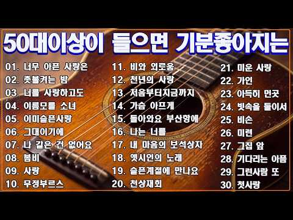

# 음악 — 성공 사례 분석: 사례별 자세히 #641–#680

`analysis.md` 의 9번 (같은 # 번호). 자동 생성 — `tools/success_analysis.py` v1.5.1 (2026-10-24 07:42 UTC). ※ 연구·교육용 — 투자 권유가 아님.

### 641. 카페음악 ∣ 최고 다방 음악❤️ 카페에서 듣기 좋은 노래 ❤️ 50대-60대가 좋아하는 중년가요 ∣ 아침 카페 ∣ 여름에 듣기 좋은 카페 음악 ✨

- https://www.youtube.com/watch?v=_h8CNlmPkjo · Korean Cafe Music · 구독자 3,280 · 조회수 174,316 (×53.1, 하루 1,182.2) · 좋아요 3,849 (2.2%) · 10.8분 · 2026-05-29 · 주제 묶음 4. 카페·매장·라운지 · 형식 플레이리스트·모음 (여러 곡) · 폴더 `W__h8CNlmPkjo` (웹 승인)
- 썸네일: 
- 설명 앞부분: Korean cafe music 에서 준비한 감성 가득한 카페 음악 플레이리스트입니다. 50대와 60대가 사랑하는 중년가요와 추억의 명곡들을 엄선하여 오래된 음악다방의 따뜻한 분위기를 담은 감성 카페 음악으로 구성하였습니다. 부드럽게 흐르는 멜로디와 마음을 편안하게 해주는 감미로운 선율은 지나간 추억과 아름다운 순간들을 자연스럽게 떠올리게 하며, 여유로운 아침 카페의 분위기와 여름의 시원한 감성을 동시에 전해줍니다. 커피 한 잔과 함께 조용히 듣기 좋은 음악으로, 휴식 시간, 독서, 드라이브, 업무 또는 하루를 시작하는 아침 시간…
- 같은 채널 평소 대비 ×3,169.4 (채널 최근 롱폼 중앙값 55회) · 평소 영상: 🍁🎶 미사리 2026 가을비 카페음악｜조용히 마음을 적시는 감성 노래｜비 오는 날 듣기 … (55회) / 🌿☕ 중년을 위한 월요일 가을 카페음악｜상쾌한 아침과 함께 듣는 감성 힐링 음악｜기분 좋… (59회)
- 대본 없음 (설명) — 음성인식이 끝나면 도입부·흐름이 들어감
- 댓글 22/22: 좋은 점 — 영상 0 · 감사·응원 8 · 더 알고 싶은 것 0 · 아쉬운 점 — 영상 0 · 반박·불만 — 의견 다름 0 · 정치·사회 0 · 경험 공유 0 · 구독·다음 기대 0
  - 감사·응원 👍4 “카페음악 10년이 지났는데 오랜만에 들으니 음악 좋으네 감사합니다🎉❤”
  - 감사·응원 👍3 “감사합니다 응원합니다 👏 사랑합니다 💕”

### 642. 첫 곡부터 감성 미쳐버린🎧8090 레전드 플레이리스트

- https://www.youtube.com/watch?v=i4uJ7c6b9gw · Ceci Pop · 구독자 30,000 · 조회수 1,587,504 (×52.9, 하루 11,313.7) · 좋아요 12,750 (0.8%) · 112.8분 · 2026-06-06 · 주제 묶음 9. 가요·발라드·트로트 · 형식 플레이리스트·모음 (여러 곡) · 폴더 `W_i4uJ7c6b9gw` (웹 승인)
- 썸네일: 
- 챕터: 0:00 늦은 안녕 (Second story) · 4:28 다시 만날 그 날 · 7:14 그대를 불러요 · 10:22 숨겨진 마음 · 13:21 가지마 · 17:15 라디오에서 · 20:22 You and me · 23:34 이 밤이 지나면 · 27:06 오늘도 취하네 · 30:18 Moon light Drive · 34:06 기억 속 멜로디 · 37:36 Replay
- 설명 앞부분: 🌿 추억을 불러오는 바람이 코끝을 스치는 초여름입니다. 그 시절 함께 듣던 노래들, 마음 한편에 고이 남아 있던 기억들도 음악을 따라 다시 찾아오곤 하죠. 오늘은 잠시 바쁜 하루를 내려놓고, 노래와 함께 쉬어가세요🎧✨ 💿Track List: ✨쎄씨팝은 80-90년대 한국 감성을 현대적인 사운드로 다시 만든 뉴트로 시티팝 플레이리스트입니다. 모든 음악은 쎄씨팝만의 감성으로 AI 제작 도구를 활용해 직접 기획·제작한 오리지널 콘텐츠입니다. 댓글로 듣고 싶은 감성(봄, 밤, 첫사랑, 이별 등)을 남겨주세요.
- 같은 채널 평소 대비 ×107.3 (채널 최근 롱폼 중앙값 14,790회) · 평소 영상: 첫 곡부터 가을 감성 터진다🍂8090 레전드 플레이리스트 (15,100회) / 우연히 틀었는데 너무 좋네🎧 8090 감성 플레이리스트 (14,480회)
- 대본 없음 (설명) — 음성인식이 끝나면 도입부·흐름이 들어감
- 댓글 1,362/1,367: 좋은 점 — 영상 13 · 감사·응원 86 · 더 알고 싶은 것 25 · 아쉬운 점 — 영상 15 · 반박·불만 — 의견 다름 4 · 정치·사회 2 · 경험 공유 56 · 구독·다음 기대 18
  - 좋은 점 — 영상 👍18 “8090레전드라고 해서 있었던 곡들인줄 알고 찾아 헤맸네요., AI곡들인데 가사,멜로디 다 더무 좋아요!”
  - 좋은 점 — 영상 👍7 “제 감성과 잘맞는 노래들이 많아요 아쉬운건 따로만 듣고 싶은 노래가 있는데 어캐할지 ㅎ 전 숨겨진 마음이란 노래가 와닿네요 너무 좋네요”
  - 감사·응원 👍43 “음악은 참 신기해요.. 세월은 흐르고 풍경은 바뀌고 우리의 모습도 변했는데 음악하나로 그시절로 돌아간것같은 기분이 들어요.. 잊고살았던 내 젊은날.. 남루했지만 젊음이라는 이름으로 찬란했었던 그시절을 추억할 수 있게 해주셔서 감사드립니다❤”
  - 감사·응원 👍23 “20대도 그립지만 오늘이 나의 제일 젊은날 ... 즐기고 감사해야지”
  - 더 알고 싶은 것 👍8 “울적할때 이 노래 들으면서 드라이브하면 정말 좋을것 같아요 노래 스타일 너무 좋아요♡♡ 좋은 노래 많이 올려주세요!ㅎ”
  - 더 알고 싶은 것 👍6 “와 노래 좋네요!! "한번만 더" 듣고 울컥하고 감동받았네요 혹시 최근 리스트 곡들도 곡별로 올려주실수 있을까요?? 잘 듣고 있습니다~”
  - 아쉬운 점 — 영상 👍6 “감성 어쩔 지금 무한반복 듣고 있습니다”
  - 아쉬운 점 — 영상 👍5 “첫곡 듣는순간... 이거다 했습니다.. 눈물이 나더군요... 오랜만에 감성이... 첫곡 무한반복중입니다~”
  - 반박·불만 — 의견 다름 👍14 “참 세월 야속하네요 올해 49 참 20대때는 아무 걱정없고 철없이 살면서 근심 걱정 안하구 살았는데 사는게 너무 힘들다 보니 왜이리 멍하니 눈물만 자주 나구 울음 포인트가 아닌데 참 돌아가신 아버지한테 기도 합니다 잘 버틸수있게 해달라구”
  - 반박·불만 — 의견 다름 👍5 “말도 안되네요 이노래 뭐지?하고 검색했는데 하도 안나와서 알아보니 자작곡... 넘 멋집니다. 음원으로 저장하고 싶을만큼 대단하네요.”
  - 정치·사회 👍5 “대학 입학하자마자 전두환 군부정권ㅡ"FM라디오 2시의 데이트 김기덕입니다" 들으면서 데모하다가 도서관가서 중간고사 준비하고ㅡ그 와중에 이대, 숙대, 서울여대 축제가서 데이트하고 졸업하고 외국계은행 들어가니 노태우 6.29 항복선언ㅡㅡ그리고 벌써 60대가 되었으니 세월…”
  - 경험 공유 👍61 “저도 79 양띠에요 그리운 20대입니당 20대의 딸을 보며 그 시절 제 모습을 떠올려보네요”
  - 경험 공유 👍47 “강남역 뉴욕제과 앞….그냥 기다리면 친구가 늦더라도 베시시 웃으며 미안하다고 핑계를 대는 이야기를 들어도 별다르게 화나지도 않고 와서ㅜ만났으니 얼른 밥 먹고 영화보자고 팔장끼고 걸어가던 강남역 거리들…이제 난 삶의 절반을 살고, 남은 시간이 얼마일지 모르지만 그 시간…”
  - 구독·다음 기대 👍17 “첨들어봤는데 넘좋아서 바로 구독했어요. 50대 주부~😊”
  - 구독·다음 기대 👍15 “79년생 그시절 제가 그리운 노래입니다^^ 구독 좋아요 알림 설정 꾸욱 하고 나갑니다~ㅎ”

### 643. 50대이상이 들으면 정말 좋아할 노래 추천곡✨중년들이 사랑하는 겨울 노래 모음💕박인희/배따라기/여진/휘버스/정태춘/유익종/양하영/김현식/이은하/우순실 /이진관/…

- https://www.youtube.com/watch?v=TTkoF883bC8 · KTrot Melody · 구독자 11,400 · 조회수 601,547 (×52.8, 하루 7,040.1) · 좋아요 1,944 (0.3%) · 126분 · 2026-07-30 · 주제 묶음 9. 가요·발라드·트로트 · 형식 플레이리스트·모음 (여러 곡) · 폴더 `W_TTkoF883bC8` (웹 승인)
- 썸네일: 
- 설명 앞부분: 50대이상이 들으면 정말 좋아할 노래 추천곡✨중년들이 사랑하는 겨울 노래 모음💕박인희/배따라기/여진/휘버스/정태춘/유익종/양하영/김현식/이은하/우순실 /이진관/이장희/임수정 🎶 7080 발라드 명곡 모음 ∣ 추억을 부르는 감성 음악 🎶 7080 시대의 감성을 그대로 담은 발라드 명곡들을 한자리에서 만나보세요. 따뜻한 멜로디와 깊은 가사가 어우러진 이 음악들은 세대를 초월해 지금까지도 많은 사랑을 받고 있습니다. 이 플레이리스트는 1970~80년대의 대표적인 발라드 음악을 중심으로 구성되어 있으며, 조용한 밤이나 감성적인 순간에 듣…
- 대본 없음 (설명) — 음성인식이 끝나면 도입부·흐름이 들어감
- 댓글 103/109: 좋은 점 — 영상 3 · 감사·응원 4 · 더 알고 싶은 것 1 · 아쉬운 점 — 영상 2 · 반박·불만 — 의견 다름 0 · 정치·사회 0 · 경험 공유 4 · 구독·다음 기대 0
  - 좋은 점 — 영상 👍8 “이 노래들을 듣고 있으면 젊었던 그 시절의 겨울이 생각납니다. ❄ 김현식, 유익종, 박인희… 이름만 들어도 그때의 추억이 하나둘 떠오르네요. 세월이 흘러도 좋은 노래는 마음속에서 늙지 않는 것 같습니다. 오늘도 좋은 음악 들으며 잠시 추억에 젖어봅니다. 🎶☕”
  - 좋은 점 — 영상 👍5 “60대 이상 어르신분들이 듣기 좋은 노래네요..지나가다 잠시 들러보아여”
  - 감사·응원 👍2 “오늘 이 음악을 들으면서 오래전 사랑했던 사람이 생각났습니다. 그 시절에는 서로의 손을 잡고 걷는 것만으로도 세상을 다 가진 것처럼 행복했는데, 시간이 흐르면서 우리는 서로 다른 길을 걷게 되었습니다. 이제는 연락조차 닿지 않는 사람이지만, 가끔 이렇게 익숙한 멜로디…”
  - 더 알고 싶은 것 👍2 “요즘 처음 듣는 노래와 예전에 수없이 들었던 노래 중 어떤 음악이 더 오래 마음에 남는다고 생각하시나요?”
  - 아쉬운 점 — 영상 👍5 “ai목소리와 ai작곡인거 같네”
  - 아쉬운 점 — 영상 👍4 “AI같은데”
  - 경험 공유 👍22 “내가 벌써 중년이라니~~맘은 청년인데!!!”
  - 경험 공유 👍2 “멜로디와 가사가 매칭이 제대로 안된 노래가 종종 있네요 1시간 정도 즈음에 나온 김연숙의 그날은 제가 알던 노래가 아니네요 듣기가 좀 그랬어요 제기억에는 "언덕위에 손잡고 거닐던 기억도 아스라히~ 이렇게 시작했던거 같은데 다른노래인가 순간 착각했음 그다음곡 바다의 연…”

### 644. HEAVEN-GIVEN VOICE ∣ Sad Love Songs ∣ soft rock ballad ∣ 슬픈노래 • 올드팝송 • 감성발라드 • 7080팝송 . 슬…

- https://www.youtube.com/watch?v=ySdeFYT0ohc · Woori Sound · 구독자 13,200 · 조회수 696,526 (×52.8, 하루 4,286.4) · 좋아요 9,906 (1.4%) · 127.9분 · 2026-05-14 · 주제 묶음 9. 가요·발라드·트로트 · 형식 플레이리스트·모음 (여러 곡) · 폴더 `W_ySdeFYT0ohc` (웹 승인)
- 썸네일: 
- 챕터: 0:00 Bus Glass · 4:34 Docklight · 9:43 Rain Letter · 14:27 Mothlight Home · 18:34 August Viaduct · 23:21 Stillwater · 28:49 Median Snow · 33:02 Riverside Hotel · 37:06 City Walk Caffeine · 41:40 Aisle Seven Sparks · 46:07 Stranger, Stay · 49:56 Blue Motel · 55:13 Exit Wounds and Roses · 59:15 One Umbrella Story
- 설명 앞부분: Original Music Content by Woori Sound. 본 영상은 Woori Sound 에서 직접 기획, 구성, 편집한 오리지널 음악 콘텐츠입니다. 작별 뒤에도 사랑을 마음에 안고 살아가는 사람들을 위한 늦은 밤 상심 플레이리스트입니다. Bus Glass부터 One Umbrella Story까지, 이 노래들은 비 내리는 거리, 항구의 불빛, 잠들지 못하는 호텔, 차가운 역, 텅 빈 도로, 도시의 밤길, 그리고 사랑보다 기억이 더 오래 남는 조용한 장소들을 지나갑니다. 이 플레이리스트는 이별, 그리움, 이루어질 수 없…
- 같은 채널 평소 대비 ×96.6 (채널 최근 롱폼 중앙값 7,208회) · 평소 영상: I Miss You ∣ Emotional Soft Rock Ballad · Sad Lov… (7,109회) / When the flowers bloom again ∣ Soft rock ballad •… (7,321회)
- 대본 없음 (설명) — 음성인식이 끝나면 도입부·흐름이 들어감
- 댓글 567/575: 좋은 점 — 영상 5 · 감사·응원 34 · 더 알고 싶은 것 3 · 아쉬운 점 — 영상 6 · 반박·불만 — 의견 다름 2 · 정치·사회 0 · 경험 공유 9 · 구독·다음 기대 1
  - 좋은 점 — 영상 👍6 “너무 좋네요~~ 듣기좋은 음악들으면서 행복한시간을.”
  - 좋은 점 — 영상 👍5 “와~~우!! 깜 놀 했어욤!😮 완죤 사람 인 줄 .. 너무 너무 듣기 좋아욤! 목소리며 멜로디가 듣기좋아 꿀 잠을 잤네용! 저장 해 놓았으니 자~쥬우 자~쥬우~ 잘 들을게용! 감사합니다.! 🎉❤”
  - 감사·응원 👍27 “밤새도록 비가 내리고 오늘도 종일 비 올 예정이라 합니다. 이렇게 비 오는 날 찾아 듣는 음악에 딱 맞춤입니다. 취향저격 👍 좋은 음악 감사합니다 😊”
  - 감사·응원 👍12 “감사합니다 이 아름다운 노래를 주셔서 너무나도 감사합니다 천상의 노래 맞습니다❤❤❤”
  - 더 알고 싶은 것 👍12 “노래 듣다가 나도모르게 구독 좋아요 누르게됨 좋은음 많이 올려 주시길~~58년생 할배입니다 ^^”
  - 더 알고 싶은 것 👍3 “반복 해서 듣고 있어요. 마음에 평안을 가져다 주는 멋있고 아름다운 곡이네요.~~^^ 감사합니다. 좋은 곡 많이 부탁드립니다.❤”
  - 아쉬운 점 — 영상 👍23 “AI목소리든 아니든 지친 영혼을 달래주면 그뿐. 감상잘했습니다 ^^”
  - 아쉬운 점 — 영상 👍3 “목소리가 너무 좋고 멋있어요❤좋아요❤❤❤”
  - 반박·불만 — 의견 다름 👍2 “와우. 음악에 빠지네요. 목소리 호소력이 장난 아닙니다.”
  - 경험 공유 👍13 “내가좋아하는 톤. 너무좋아요”
  - 경험 공유 👍12 “노래 듣다가 나도모르게 구독 좋아요 누르게됨 좋은음 많이 올려 주시길~~58년생 할배입니다 ^^”
  - 구독·다음 기대 👍6 “어머나...놀랍다 이런 현실이... 잘듣고 구독하고 가요”

### 645. 그 집 앞 (스페인어 버전 뮤직비디오) ∣ 이재성 원곡 라틴팝 리메이크 ∣ 한국어/스페인어 가사 자막 ∣ A Korean Old Pop Song in Spani…

- https://www.youtube.com/watch?v=T1fdlthH7Fw · J.K.M · 구독자 38,200 · 조회수 2,012,590 (×52.7, 하루 12,817.5) · 좋아요 21,621 (1.1%) · 4.2분 · 2026-05-20 · 주제 묶음 10. 팝송·K팝·J팝 · 형식 커버·직접 부른 노래 · 폴더 `W_T1fdlthH7Fw` (웹 승인)
- 썸네일: 
- 설명 앞부분: 이번 작품은 이재성 작사·작곡, 이재성 원곡의 명곡 「그 집 앞」을 스페인어 감성의 라틴 팝 스타일로 리메이크한 뮤직비디오입니다. 또한, 본 영상은 음악의 감성과 몰입감을 보다 효과적으로 전달하기 위해 AI 보조 영상 연출 및 립싱크 기술을 활용하여 제작되었습니다. 전체적인 기획·연출·편집은 채널 운영자 J.K.M이 직접 진행하였습니다. 🎵 원곡 : 이재성 (이재성 작사, 작곡) 🎤 피처링 보컬 : 남미 출신 보컬리스트 Arianny 🎵 스페인어 번안 및 리메이크 : J.K.M 🤖 음악 및 영상 제작 : AI 보조 기술 활용 끝까…
- 대본 없음 (설명) — 음성인식이 끝나면 도입부·흐름이 들어감
- 댓글 1,077/1,078: 좋은 점 — 영상 29 · 감사·응원 40 · 더 알고 싶은 것 26 · 아쉬운 점 — 영상 5 · 반박·불만 — 의견 다름 4 · 정치·사회 8 · 경험 공유 22 · 구독·다음 기대 11
  - 좋은 점 — 영상 👍39 “와우.. 솔직히 원곡보다 뭔가 더 귀에 쏙쏙 박히면서 느낌이 더 좋네요.”
  - 좋은 점 — 영상 👍8 “원곡보다 더 나은거 아닙니까? 뭔가 가슴에 와닿는 보이스 가 정말 매력적이네요..”
  - 감사·응원 👍119 “이러케 세계를 다 먹어야되요 화이팅 드립니다~!”
  - 감사·응원 👍23 “그 집 앞 은 한글로 불렀네ㅋㅋ 골든에 영원히 깨질 수 없는 처럼 ㅋㅋ 감사합니다”
  - 더 알고 싶은 것 👍4 “구독 누르고 갑니다 영상 올려주셔서 감사합니다 많이 올려 주세요 ~~!!!!😊😊😊”
  - 더 알고 싶은 것 👍3 “이게 정확히 스페니쉬 언어라면 진짜 한국 80풍하고 진짜 잘 어울리네요 더 좋은거 같아요 그리고 아마도 트롯트풍도 진짜 스페니쉬가 잘 어울릴꺼 같아요 제발 다양한 80노래도 해주시고 트롯트도 많이 번안으로 만들어주세요”
  - 아쉬운 점 — 영상 👍2 “너무 좋다 노래가 목소리가 너무좋네”
  - 아쉬운 점 — 영상 👍1 “노래는 잘 하는데 감정이 우리 감정이 아니라서 아쉽네요. 슬픈 노래인데”
  - 반박·불만 — 의견 다름 👍5 “중독성 장난아닙니다”
  - 반박·불만 — 의견 다름 👍2 “이곡이 슬픈곡은 아닌데 눈물방울이 흘러 내리는 이유는 무얼까요? 이상하네요 그저 건강하시길 진심으로 바랍니다 🙏🏼 사랑합니다 화이팅하세요 응원합니다 영원히 함께...”
  - 정치·사회 👍23 “이재성..가장 뛰어난 싱어송라이터였는데.. 고독한DJ라는..노래불렀다가....전두환정권에서.방송금지당해..최전성기..87년에...갑자기TV에서.사라졌고.. 라디오에서도 이재성 노래를 10년동안 들을수 없었음.”
  - 정치·사회 👍1 “편집자님 할일이 하나 더 생겻네요. AI 가수와 가장 비슷한 외모와 가창력을 지닌 외국인 가수를 찾는 일입니다. 두 가수가 겨루는 모습을 보여주면 바둑애서 알파고와 겨룬 이세돌고수의 장면과 대조를 이룰 겁니다. 어려울 거라 생각하지만 기대해 봅니다. 이곳에서 아는 가…”
  - 경험 공유 👍548 “몇년전에 한국가요를 외국어버전으로 번역해서 영상으로 제작한 유튜브가 있었습니다. 3개국 외국어로 제작해서 한국가요를 알리고자 하는 영상이었는데 하루아침에 모든영상이 없어진일이 일어났지요. 계속 이어졌으면 지금의 K-Pop 붐이 한층 더 올라가지 않았을까 싶은 생각이 …”
  - 경험 공유 👍20 “내가 좋아하는 노래 스페인어로 들으니 최고다 진짜 고급진 노래네 ❤❤❤”
  - 구독·다음 기대 👍8 “제가 한때 굉장히 좋아했던... 너무나 닮아서 구독박고 갑니다.”
  - 구독·다음 기대 👍6 “775좋와요 그집앞구독누르며 ㅡ기가막혀 ㅡ따봉 영상도. 멋져 👍 ❤❤❤❤❤🎉건강하세요”

### 646. [Playlist] 초록빛 향기 머무는 여름날과 어울리는 음악 ∣ 잔잔한 감성팝 카페음악 ∣ Healing lo-fi pop ballad cafe music ∣…

- https://www.youtube.com/watch?v=l3rA0WjsaNM · 낡은 레코드 · 구독자 8,930 · 조회수 468,280 (×52.4, 하루 3,035.3) · 좋아요 2,264 (0.5%) · 77.9분 · 2026-05-23 · 주제 묶음 1. 수면·명상·힐링 · 형식 플레이리스트·모음 (여러 곡) · 폴더 `W_l3rA0WjsaNM` (웹 승인)
- 썸네일: 
- 설명 앞부분: [Playlist] 초록빛 향기 머무는 여름날과 어울리는 음악 ∣ 잔잔한 감성팝 카페음악 ∣ Healing lo-fi pop ballad cafe music ∣ 여름 플레이리스트 📻 따뜻한 노란 조명이 비추는 겨울 카페, 창밖으로는 조용히 눈이 내려 얇은 눈송이들이 밤공기 위에 고요함을 덮어 씌우는 시간 오늘 낡은 레코드가 전하는 음악은 천천히 흐르는 발라드 · 팝 · 어쿠스틱 선율로 겨울 저녁의 숨결을 닮은 잔잔한 플레이리스트입니다. ✨🌙 창가 자리에 앉아 서두르지 않고 떨어지는 눈을 바라보며, 두 손에는 아직 따뜻함이 남아 있…
- 같은 채널 평소 대비 ×49.5 (채널 최근 롱폼 중앙값 9,462회) · 평소 영상: [Playlist] 가을날의 잔잔한 설렘을 담은 음악 ∣ 잔잔한 감성팝 카페음악 🎧 ∣ … (9,564회) / [Playlist] 선선한 공기 속 기분 좋아지는 음악 ∣ 잔잔한 감성팝 카페음악 🎧 ∣… (9,359회)
- 대본 없음 (설명) — 음성인식이 끝나면 도입부·흐름이 들어감
- 댓글 71/71: 좋은 점 — 영상 0 · 감사·응원 7 · 더 알고 싶은 것 6 · 아쉬운 점 — 영상 2 · 반박·불만 — 의견 다름 1 · 정치·사회 0 · 경험 공유 0 · 구독·다음 기대 1
  - 감사·응원 👍1 “너무 좋아요!^^ 힐링되는 음악에 지친 기분마저 업되는 듯!~~~~~~ 창을 내려놔도 음악이 잔잔히 들리니 너무 너무 좋네요~~~ 감사합니다^^”
  - 감사·응원 👍1 “하루종일 삶의 무의미함과 사회의 부조리함에 대해 생각하다가 이 플리 듣고 "그래 신은 불완벽하고 무능하지만 그건 신의 문제다" 라고 생각을 결론 지었습니다 저는 가서 물이나 마시고 잠이나 자야겠습니다 감미로운 플리 감사합니다”
  - 더 알고 싶은 것 👍12 “혹시 배경 어딘지 정보알수있을까요?”
  - 더 알고 싶은 것 👍3 “하루종일 듣고 있어요~^^ 첫번째 곡 제목 알 수 있을까요?”
  - 아쉬운 점 — 영상 👍6 “끝까지 들어봐야겠지만 중간 광고가 없었음 좋겠네요.도입부 음악도 화면 이미지도 참 좋네요~~~”
  - 아쉬운 점 — 영상 👍0 “중간 중간에 광고가 들어가서 음악을 감상하는데 방해가 되네요.”
  - 구독·다음 기대 👍0 “우와~~~듣는순간 오장육부가 힐링되는 곡입니다. 바로 구독 좋아요 알림설정 완료!”

### 647. LiL Baby - Work For Money ( Official Music Video)

- https://www.youtube.com/watch?v=3FclEMAiJ6Q · Vibes World Records · 구독자 225 · 조회수 11,763 (×52.3, 하루 228.5) · 좋아요 162 (1.4%) · 7분 · 2026-09-02 · 주제 묶음 기타 · 형식 한 곡 (뮤직비디오·음원·가사) · 폴더 `W_3FclEMAiJ6Q` (웹 승인)
- 썸네일: 
- 설명 앞부분: “WORK FOR MONEY” is an emotional, high-energy motivational trap anthem about grinding through the struggle, chasing success, and building a better life from nothing. When nobody believes in you, you have two choices: give up or work harder. This song is for everybody who stayed focused through the …
- 같은 채널 평소 대비 ×7.3 (채널 최근 롱폼 중앙값 1,614회) · 평소 영상: Love Me -Lil Baby (Official Music Video) (1,680회) / I Built This Money -Lil Baby (Official Music Vide… (1,547회)
- 대본 없음 (설명) — 음성인식이 끝나면 도입부·흐름이 들어감
- 댓글 3/3: 좋은 점 — 영상 0 · 감사·응원 0 · 더 알고 싶은 것 0 · 아쉬운 점 — 영상 0 · 반박·불만 — 의견 다름 0 · 정치·사회 0 · 경험 공유 0 · 구독·다음 기대 0

### 648. [스페인 감성] "Frente a Tu Casa ∣ 그집앞 - 이재성" Korean OldPop 한국명곡

- https://www.youtube.com/watch?v=IXEpsuBWbg8 · 스페인 감성 한국 올드송 · 구독자 1,680 · 조회수 86,758 (×51.6, 하루 1,197.3) · 좋아요 609 (0.7%) · 4.5분 · 2026-08-12 · 주제 묶음 12. 커버·노래 부르기 · 형식 음악 (그 밖 모양 — 한 편짜리 BGM 등) · 폴더 `W_IXEpsuBWbg8` (웹 승인)
- 썸네일: 
- 설명 앞부분: 안녕하세요!! "스페인 감성 한국 올드송"입니다. 한국의 좋은 노래들을 Música Española (무시카 에스파뇰라)로 리메이크해서 불러 드리겠습니다. kpop의 멋진 멜로디와 깊은 감성을 스페인의 감성과 만나 깊이를 더했습니다. 이 채널에서 만들어지는 음악들은 AI를 도구로 이용해 직접 구상하고 제작되는 노력의 결과물입니다. 더 좋은 음악을 제공할 수 있도록 항상 노력하겠습니다. ¡Hola! Bienvenidos a "Canciones Clásicas Coreanas con Alma Española". En este cana…
- 같은 채널 평소 대비 ×2.3 (채널 최근 롱폼 중앙값 38,202회) · 평소 영상: [스페인 감성] "El Yugo ∣ 멍에 - 김수희" Korean OldPop 한국명곡 (38,202회) / [스페인 감성] 와!! 스페인어로 "보릿고개"가 된다고? "El Paso de la Ce… (29,013회)
- 대본 없음 (설명) — 음성인식이 끝나면 도입부·흐름이 들어감
- 댓글 14/15: 좋은 점 — 영상 0 · 감사·응원 1 · 더 알고 싶은 것 0 · 아쉬운 점 — 영상 0 · 반박·불만 — 의견 다름 0 · 정치·사회 0 · 경험 공유 1 · 구독·다음 기대 0
  - 감사·응원 👍6 “영상을 보니까 제가 1987년도에 이태리 밀라노에서 프랑스를 거쳐 바르셀로나까지 기차를 타고 가서 거기에서 스페인 쇼를 본 기억이 생생합니다. 좋습니다 응원합니다 ❤🎉🎉”
  - 경험 공유 👍6 “영상을 보니까 제가 1987년도에 이태리 밀라노에서 프랑스를 거쳐 바르셀로나까지 기차를 타고 가서 거기에서 스페인 쇼를 본 기억이 생생합니다. 좋습니다 응원합니다 ❤🎉🎉”

### 649. 💚 초여름맛 메론소다 ☆・. ‘ . ꒰ 가사없는 집중 음악 ꒱

- https://www.youtube.com/watch?v=FkmrHoP4xSk · 둥실  ︵☆ · 구독자 1,190 · 조회수 61,291 (×51.5, 하루 367.1) · 좋아요 1,753 (2.9%) · 171.3분 · 2026-05-10 · 주제 묶음 3. 공부·집중·작업 · 형식 한 곡 (뮤직비디오·음원·가사) · 폴더 `W_FkmrHoP4xSk` (웹 승인)
- 썸네일: 
- 설명 앞부분: 고시생인 제가 공부할 때 들을 플리를 만들 목적으로 운영 중인 곳입니다 (*´∪`) 폭닥하고 말랑한 음악들을 통해 함께 공부하며 힐링해요 🎶💖 오늘도 애쓰고 있는 당신께, 이 음악들이 여러분의 마음을 담뿍 채워주기를 바라며,,🎶 Thank you for being here. All copyrights are owned by 둥실
- 같은 채널 평소 대비 ×176.6 (채널 최근 롱폼 중앙값 347회) · 평소 영상: 𝑷𝒍𝒂𝒚𝒍𝒊𝒔𝒕 ∣ 믿고 기다린다면 . . ! ‧₊˚ 🍅 ⋅ ☆ (350회) / # . 브리치즈 파스타 𓂃 (344회)
- 대본 없음 (설명) — 음성인식이 끝나면 도입부·흐름이 들어감
- 댓글 60/60: 좋은 점 — 영상 1 · 감사·응원 13 · 더 알고 싶은 것 5 · 아쉬운 점 — 영상 0 · 반박·불만 — 의견 다름 0 · 정치·사회 0 · 경험 공유 2 · 구독·다음 기대 0
  - 좋은 점 — 영상 👍0 “공부할때듣기 좋아요!!!!”
  - 감사·응원 👍63 “너무 감사합니다! 중1인데 중학교 와서 맨널 놀아요ㅋㅋ 동생이랑 레고 조립하면서 들었어용~😋”
  - 감사·응원 👍10 “기분이 그럭저럭이었는데, 썸네일에 보이는 초록초록한 메론소다에, 청량하고 시원하면서도 도로롱 유리구슬 흘러가듯 음악이 나와서 즐겁게 들으면서 공부 시작합니다! 감사합니다”
  - 더 알고 싶은 것 👍2 “모든 영상 정말정말 잘 보고 있어요…! 유튭보면서 첨 댓글 달아보네요,,, 그만큼 넘 좋구 1시간이 훅훅 갑니다! 앞으로도 다 잘 들을테니 마니 올려주세요!”
  - 더 알고 싶은 것 👍0 “이런 템포 곡 너무 좋아요 앞으로도 많이 부탁드려요,,,💖”
  - 경험 공유 👍1 “시원한 에어컨바람 맞으며 뜨듯한 털옷 잠옷입고 집에서 게임하는 내 무릎위에 우리집강아지 엎드려서 자던.. 행복했던 그때가 그립읍니다. 전역만 하게 해다오..”

### 650. 7080 감성 포크송 ∣ 듣기 좋은 통기타 포크 15곡

- https://www.youtube.com/watch?v=Hpsm6Kn5TM4 · ***7080가요산책*** · 구독자 4,800 · 조회수 247,101 (×51.5, 하루 2,703.4) · 좋아요 2,275 (0.9%) · 64.5분 · 2026-07-24 · 주제 묶음 9. 가요·발라드·트로트 · 형식 AI 음악 · 폴더 `W_Hpsm6Kn5TM4` (웹 승인)
- 썸네일: 
- 챕터: 0:00 노을빛 산책길 · 4:19 기타 소리 · 8:38 강물은 흐르는데 · 13:17 그해 여름 · 17:31 돌다리에서 · 22:05 마음이 쉬어가네 · 26:08 들꽃 향기 · 30:13 별이 흐르는 강 · 34:34 작은 시냇가 · 39:10 오솔길 · 43:34 작은 창가에 핀꽃 · 47:45 초록빛 오후 · 51:18 고향 가는길 · 55:46 노을은 내친구 · 60:01 햇살이 누워있네
- 설명 앞부분: 🌿 들으면 마음이 편해지는 7080 감성 포크송 15곡 바쁜 하루를 잠시 내려놓고, 통기타 선율과 따뜻한 멜로디가 함께하는 7080 감성 포크를 만나보세요. 강가를 따라 걷는 산책길, 노을이 물드는 시골 풍경, 바람이 머무는 오솔길처럼 편안하고 따뜻한 이야기를 담은 창작 포크송 15곡입니다 7080 가요산책은 70~80년대의 따뜻한 감성을 담은 창작 포크와 감성 가요를 전하는 채널입니다. 오늘도 이 음악이 여러분의 하루에 작은 위로와 편안한 쉼이 되기를 바랍니다. 🎵 Time Track ※ 본 영상의 음악과 이미지는 AI를 활용하…
- 같은 채널 평소 대비 ×25.2 (채널 최근 롱폼 중앙값 9,820회) · 평소 영상: 그 시절, 우리의 노래｜통기타와 하모니카로 다시 만나는 7080 포크송 10곡｜추억의 대… (9,830회) / 외롭거나 허전할 때 듣는 7080 포크송｜그 시절 청춘으로 돌아가는 추억의 노래 10곡 (9,810회)
- 대본 없음 (설명) — 음성인식이 끝나면 도입부·흐름이 들어감
- 댓글 105/106: 좋은 점 — 영상 1 · 감사·응원 5 · 더 알고 싶은 것 2 · 아쉬운 점 — 영상 1 · 반박·불만 — 의견 다름 0 · 정치·사회 0 · 경험 공유 1 · 구독·다음 기대 0
  - 감사·응원 👍11 “통기타 선율이 잃었던 감성을 깨우네요...요즘 이런 노래가 듣고싶었는데....감사해요^^”
  - 감사·응원 👍2 “목소리가 풋풋함 좋은 노래에 빠져듭니다 ❤❤❤❤ 항상🎉🎉 응원합니다 👍”
  - 더 알고 싶은 것 👍2 “가사올려주세요.”
  - 더 알고 싶은 것 👍2 “노래제목,가수이름 부탁해요..요즘 워낙 가짜가 많아서요”
  - 아쉬운 점 — 영상 👍45 “요즘 유튜브나 여러 플랫폼에서는 AI 기술을 활용해 특정 가수의 창법이나 음색을 학습시킨 커버 곡들이 정말 많이 쏟아지고 있네요. 특히 전통적인 록 발라드나 트로트 메들리 같은 영상 중에는 사람이 직접 부른 것처럼 정교하게 만들어졌지만, 실제로는 AI 목소리 모델을 …”
  - 경험 공유 👍1 “오랫동안 가족을 위해 살다 보니 어느 순간 제가 좋아했던 것이 무엇인지조차 잊어버렸습니다. 늘 누군가의 엄마, 아빠, 남편, 아내로 살았지만 오늘 이 음악을 들으며 잠시 예전의 제 모습을 떠올렸네요. 우리도 가끔은 자신을 위해 살아도 괜찮다고 생각합니다. 이 글을 읽…”

### 651. 2 Hour Sitar for Clean Your Brain Instantly ∣ Indian Classical Music for Brain Focus

- https://www.youtube.com/watch?v=PVGFHGLRjK4 · Sacred Mind Healing · 구독자 8,290 · 조회수 425,014 (×51.3, 하루 2,391.1) · 좋아요 5,198 (1.2%) · 120.4분 · 2026-04-29 · 주제 묶음 6. 피아노·클래식·연주곡 · 형식 긴 한 곡·반복 (N시간) · 폴더 `W_PVGFHGLRjK4` (웹 승인)
- 썸네일: 
- 설명 앞부분: Experience deep mental clarity and focus with this 2 hour Indian classical sitar meditation music. This music is designed to help you: Clear mental fog Improve concentration Reduce overthinking Enter deep focus state Relax your nervous system Featuring traditional Indian instruments such as sitar, …
- 같은 채널 평소 대비 ×311.1 (채널 최근 롱폼 중앙값 1,366회) · 평소 영상: Indian Sitar Music for Calm Reflection ∣ Quiet th… (1,366회) / Sleep in Peace ∣ Gentle Healing ∣ Indian Instrume… (1,395회)
- 대본 없음 (설명) — 음성인식이 끝나면 도입부·흐름이 들어감
- 댓글 206/208: 좋은 점 — 영상 0 · 감사·응원 0 · 더 알고 싶은 것 0 · 아쉬운 점 — 영상 0 · 반박·불만 — 의견 다름 0 · 정치·사회 0 · 경험 공유 0 · 구독·다음 기대 0

### 652. Piano Sleep Music with Relaxing Rain 🎶 Calm Your Mind, Relieve Anxiety and Deep Sleep Ins…

- https://www.youtube.com/watch?v=pFL8mgVoxnc · Piano Rain Retreat · 구독자 30,300 · 조회수 1,546,228 (×51.0, 하루 16,740.9) · 좋아요 10,280 (0.7%) · 203.6분 · 2026-07-23 · 주제 묶음 1. 수면·명상·힐링 · 형식 음악 (그 밖 모양 — 한 편짜리 BGM 등) · 폴더 `W_pFL8mgVoxnc` (웹 승인)
- 썸네일: 
- 설명 앞부분: Piano Sleep Music with Relaxing Rain 🎶 Calm Your Mind, Relieve Anxiety and Deep Sleep Instantly Welcome to the Piano Rain Retreat Channel! Are you seeking a relaxing space to relieve stress, improve your sleep, and calm your mind? Join us and discover the peaceful atmosphere created by the gentle s…
- 같은 채널 평소 대비 ×111.2 (채널 최근 롱폼 중앙값 13,906회) · 평소 영상: Fall Asleep Instantly with Calm Rain Sounds 🎶 Pea… (14,022회) / Soft Rain & Healing Piano for Deep Sleep – Peacef… (13,791회)
- 대본 없음 (설명) — 음성인식이 끝나면 도입부·흐름이 들어감
- 댓글 327/329: 좋은 점 — 영상 0 · 감사·응원 0 · 더 알고 싶은 것 0 · 아쉬운 점 — 영상 0 · 반박·불만 — 의견 다름 0 · 정치·사회 0 · 경험 공유 0 · 구독·다음 기대 0

### 653. Fall Asleep In 3 Minutes 😴 Mozart For Babies 💤 Extra Relaxing Baby Sleep Music ∣ Dark Scr…

- https://www.youtube.com/watch?v=P87LUaYiD34 · Mother & Baby Sounds · 구독자 18,700 · 조회수 953,690 (×51.0, 하루 15,959.1) · 좋아요 6,971 (0.7%) · 150.1분 · 2026-08-25 · 주제 묶음 1. 수면·명상·힐링 · 형식 음악 (그 밖 모양 — 한 편짜리 BGM 등) · 폴더 `W_P87LUaYiD34` (웹 승인)
- 썸네일: 
- 설명 앞부분: Mozart Brahms lullaby 🌙 Extra Relaxing Baby Sleep Music 💤 Dark Screen Soft Mozart lullabies with a gentle music box tone to help your little one fall asleep in minutes and stay asleep all night. This extra relaxing baby sleep music with a dark screen is perfect for bedtime, nap time, and peaceful n…
- 같은 채널 평소 대비 ×25.4 (채널 최근 롱폼 중앙값 37,530회) · 평소 영상: AMAZING BABY SLEEP MUSIC FOR BABY TO SLEEP FAST! … (37,961회) / The Best Sleep Music for Babies ✨ Fall Asleep in … (37,098회)
- 대본 없음 (설명) — 음성인식이 끝나면 도입부·흐름이 들어감
- 댓글 0/0: 좋은 점 — 영상 0 · 감사·응원 0 · 더 알고 싶은 것 0 · 아쉬운 점 — 영상 0 · 반박·불만 — 의견 다름 0 · 정치·사회 0 · 경험 공유 0 · 구독·다음 기대 0

### 654. 2026년 6월 여돌 노래모음 ∣ 🔥 KPOP PLAYLIST

- https://www.youtube.com/watch?v=a_19lS2wwOw · 달플리 𝑷𝒍𝒂𝒚𝒍𝒊𝒔𝒕  · 구독자 12,200 · 조회수 621,154 (×50.9, 하루 4,306.5) · 좋아요 2,842 (0.5%) · 64.9분 · 2026-06-02 · 주제 묶음 10. 팝송·K팝·J팝 · 형식 플레이리스트·모음 (여러 곡) · 폴더 `W_a_19lS2wwOw` (웹 승인)
- 썸네일: 
- 같은 채널 평소 대비 ×46.4 (채널 최근 롱폼 중앙값 13,386회) · 평소 영상: 튜이드 노래모음 ∣ 신곡포함 ∣ TUIDE Playlist (14,775회) / 2026년 7월 인기차트 노래모음 ∣ KPOP PLAYLIST (11,997회)
- 대본 없음 (없음) — 음성인식이 끝나면 도입부·흐름이 들어감
- 댓글 53/53: 좋은 점 — 영상 0 · 감사·응원 1 · 더 알고 싶은 것 0 · 아쉬운 점 — 영상 0 · 반박·불만 — 의견 다름 0 · 정치·사회 0 · 경험 공유 0 · 구독·다음 기대 0
  - 감사·응원 👍12 “오늘도 감사합니다. 좋은 플리 ❤️❤️❤️”

### 655. (No Ads) Relaxing Music For Deep Sleep • Anxiety Relief, Melatonin Release • Stop Overthi…

- https://www.youtube.com/watch?v=UhQANX3rKzA · Bedtime Calm Sounds · 구독자 12,600 · 조회수 639,890 (×50.8, 하루 3,959.0) · 좋아요 1,466 (0.2%) · 94.3분 · 2026-05-15 · 주제 묶음 1. 수면·명상·힐링 · 형식 음악 (그 밖 모양 — 한 편짜리 BGM 등) · 폴더 `W_UhQANX3rKzA` (웹 승인)
- 썸네일: 
- 설명 앞부분: (No Ads) Relaxing Music For Deep Sleep • Anxiety Relief, Melatonin Release • Stop Overthinking Slow down. Breathe. Let the night carry you gently into rest. If your mind keeps racing or your body feels tense, this is your quiet space to release the day. This video is carefully crafted to create a s…
- 같은 채널 평소 대비 ×98.3 (채널 최근 롱폼 중앙값 6,511회) · 평소 영상: DEEP SLEEP in 3 Minutes • Eliminate Stress & Anxi… (6,548회) / (No Piano) Fall Into Sleep Instantly • Relaxing M… (6,474회)
- 대본 없음 (설명) — 음성인식이 끝나면 도입부·흐름이 들어감
- 댓글 68/70: 좋은 점 — 영상 0 · 감사·응원 0 · 더 알고 싶은 것 0 · 아쉬운 점 — 영상 0 · 반박·불만 — 의견 다름 0 · 정치·사회 0 · 경험 공유 0 · 구독·다음 기대 0

### 656. 22 Beautiful Serenity Adagios That Will Touch Your Soul ∣ Rachmaninoff Style Classical Mu…

- https://www.youtube.com/watch?v=-kXB3QJb1Vs · Silent Adagio · 구독자 11,900 · 조회수 604,206 (×50.8, 하루 3,877.6) · 좋아요 9,932 (1.6%) · 120분 · 2026-05-21 · 주제 묶음 6. 피아노·클래식·연주곡 · 형식 플레이리스트·모음 (여러 곡) · 폴더 `W_-kXB3QJb1Vs` (웹 승인)
- 썸네일: 
- 설명 앞부분: 22 Beautiful Serenity Adagios That Will Touch Your Soul ∣ Rachmaninoff Style Classical Music Welcome to Silent Adagio. just the piano, the cello, and you. I put together this adagio session for the quiet moments—the late-night study sessions, the rainy afternoons with a book, and those hours of dee…
- 대본 없음 (설명) — 음성인식이 끝나면 도입부·흐름이 들어감
- 댓글 297/297: 좋은 점 — 영상 0 · 감사·응원 0 · 더 알고 싶은 것 0 · 아쉬운 점 — 영상 0 · 반박·불만 — 의견 다름 0 · 정치·사회 0 · 경험 공유 0 · 구독·다음 기대 0

### 657. 50대이상이 들으면 기분좋아지는 7080노래모음, 베스트 7080노래모음, 광고 없는 7080 좋은노래 모음

- https://www.youtube.com/watch?v=L0rtQ0ZFr7o · VibeTune · 구독자 11,500 · 조회수 583,400 (×50.7, 하루 3,548.6) · 좋아요 3,447 (0.6%) · 72.7분 · 2026-05-12 · 주제 묶음 9. 가요·발라드·트로트 · 형식 플레이리스트·모음 (여러 곡) · 폴더 `W_L0rtQ0ZFr7o` (웹 승인)
- 썸네일: 
- 설명 앞부분: 01 - 이재성 - 그집앞 02 - 김범룡 - 바람바람바람 03 - 김신우(Kim Shin Woo) - 귀거래사 04 - 잊혀진 사랑 - 조용필 05 - 봄비 - 이은하 06 - 구창모 - 아득히먼곳 07 - 김광석 - 어느 60대 노부부 이야기 08 - 조용필 - 그 겨울의 찻집 09 - 이용 – 잊혀진 계절 10 - 빗물 - 채은옥 11 - 해바라기 - 내마음의보석상자 12 - 김재희 - 애증의 강 13 - 백지로 보낸 편지 14 - 추억의 명곡.!! 정태춘- 촛불 15 - 정태춘의 '북한강에서'
- 같은 채널 평소 대비 ×483.1 (채널 최근 롱폼 중앙값 1,208회) · 평소 영상: 50대이상이 들으면 기분좋아지는 7080노래모음, 베스트 7080노래모음, 광고 없는 7… (1,236회) / 잔잔한 트로트 15곡 가사포함 1시간듣기 #장윤정 #임영웅 #진미령 #최백호 #송가인 #… (1,179회)
- 대본 없음 (설명) — 음성인식이 끝나면 도입부·흐름이 들어감
- 댓글 85/85: 좋은 점 — 영상 0 · 감사·응원 6 · 더 알고 싶은 것 0 · 아쉬운 점 — 영상 1 · 반박·불만 — 의견 다름 0 · 정치·사회 0 · 경험 공유 1 · 구독·다음 기대 0
  - 감사·응원 👍28 “저두 오랜만에 들으니 옛생각 납니다 명곡은 언제 들어도 명곡 옛추억에 푹빠진느킴 정말 줗아요 마음이 많이 우울했는데 중년들의 마음을 그대로 전해주는 느킴. 정말감사합니다 ❤❤❤❤😅😅😅”
  - 감사·응원 👍1 “아침 들으니 기분 업이됩니다 오랜만어듣기도하구요 옛날 생각도 나고 젊어지는생각이 듭니다 그옛날를 회상하면 듣고있습니다 감사합니다 ❤❤❤”
  - 아쉬운 점 — 영상 👍1 “그집앞은 원곡자 이재성씨가 아니라서 아쉽네요 ;;;”
  - 경험 공유 👍5 “이런 노래를 들으니 내가 언제 이렇게 나이가 들었나 서글퍼 지네요”

### 658. Ithaca

- https://www.youtube.com/watch?v=8DVfI_Muv_A · Ludwig Göransson - Topic · 구독자 43,300 · 조회수 2,193,981 (×50.7, 하루 21,960.9) · 좋아요 20,009 (0.9%) · 5.7분 · 2026-07-16 · 주제 묶음 13. OST·사운드트랙 · 형식 음악 (그 밖 모양 — 한 편짜리 BGM 등) · 폴더 `W_8DVfI_Muv_A` (웹 승인)
- 썸네일: 
- 설명 앞부분: Provided to YouTube by Back Lot Music Ithaca · Ludwig Göransson The Odyssey (Original Motion Picture Soundtrack) ℗ 2026 Back Lot Music, a division of Universal Studios Music LLLP Released on: 2026-07-17 Main Artist: Ludwig Göransson Producer: Ludwig Göransson Composer: Ludwig Göransson Auto-generat…
- 같은 채널 평소 대비 ×4.5 (채널 최근 롱폼 중앙값 486,422회) · 평소 영상: Circe (525,582회) / Welcome Home Stranger (447,261회)
- 대본 없음 (설명) — 음성인식이 끝나면 도입부·흐름이 들어감
- 댓글 0/798: 좋은 점 — 영상 0 · 감사·응원 0 · 더 알고 싶은 것 0 · 아쉬운 점 — 영상 0 · 반박·불만 — 의견 다름 0 · 정치·사회 0 · 경험 공유 0 · 구독·다음 기대 0

### 659. 😴 Baby Sleep Music That Works in 3 Minutes! 💤 Newborn Sleep Lullaby ∣ Dark Screen NoAd

- https://www.youtube.com/watch?v=22SPWR7nyfM · Mother & Baby Sounds · 구독자 18,700 · 조회수 947,034 (×50.6, 하루 7,658.0) · 좋아요 5,691 (0.6%) · 122.7분 · 2026-06-22 · 주제 묶음 1. 수면·명상·힐링 · 형식 음악 (그 밖 모양 — 한 편짜리 BGM 등) · 폴더 `W_22SPWR7nyfM` (웹 승인)
- 썸네일: 
- 설명 앞부분: 😴 Baby Sleep Music That Works in 3 Minutes! 💤 Newborn Sleep Lullaby ∣ Dark Screen No Ads Help your baby drift into a peaceful, deep sleep with this soothing newborn sleep lullaby designed to calm fussy babies and create the perfect bedtime environment. Featuring gentle baby sleep music, relaxing me…
- 같은 채널 평소 대비 ×25.2 (채널 최근 롱폼 중앙값 37,530회) · 평소 영상: AMAZING BABY SLEEP MUSIC FOR BABY TO SLEEP FAST! … (37,961회) / The Best Sleep Music for Babies ✨ Fall Asleep in … (37,098회)
- 대본 없음 (설명) — 음성인식이 끝나면 도입부·흐름이 들어감
- 댓글 0/0: 좋은 점 — 영상 0 · 감사·응원 0 · 더 알고 싶은 것 0 · 아쉬운 점 — 영상 0 · 반박·불만 — 의견 다름 0 · 정치·사회 0 · 경험 공유 0 · 구독·다음 기대 0

### 660. [감동음악]🎵듣는 순간 가슴이 먹먹해진다… 김호중 × 이애숙 《나의 조국은》 감동 실황 ∣ 천상의 목소리 김호중…

- https://www.youtube.com/watch?v=FAMrq6SXxys · 🎧 Sound Rest · 구독자 2,710 · 조회수 137,245 (×50.6, 하루 826.9) · 좋아요 3,987 (2.9%) · 4.5분 · 2026-05-11 · 주제 묶음 1. 수면·명상·힐링 · 형식 음악 (그 밖 모양 — 한 편짜리 BGM 등) · 폴더 `W_FAMrq6SXxys` (웹 승인)
- 썸네일: 
- 설명 앞부분: 김희갑 작곡의 명곡 《나의 조국은》 그리고 깊은 감성과 울림을 전하는 김호중, 이애숙의 아름다운 듀엣. 한 소절 한 소절마다 조국에 대한 사랑과 그리움, 그리고 살아온 세월의 감정이 고스란히 담겨 있다. 김호중의 웅장하면서도 따뜻한 보이스와 이애숙의 섬세하고 깊은 감성이 만나 가슴 벅찬 감동의 무대를 완성했다. 🇰🇷 오늘 이 노래를 통해 우리 마음속 ‘나의 조국’을 다시 떠올려보길 바란다. 🎧 이어폰으로 들으면 더욱 깊은 감동을 느낄 수 있다. Kim Hee-gap's masterpiece "My Fatherland." 🎹🎧 An…
- 같은 채널 평소 대비 ×468.4 (채널 최근 롱폼 중앙값 293회) · 평소 영상: 🎶내 인생 마지막 사랑 ❤️긴 세월 돌아서 만난 내 인생의 마지막 사랑... (가슴 먹먹… (316회) / [인생음악]🎼🎶「고생 많았다, 내 인생아」부모의 기대와 회사의 시계 사이에서 살아온 당신… (270회)
- 대본 없음 (설명) — 음성인식이 끝나면 도입부·흐름이 들어감
- 댓글 612/614: 좋은 점 — 영상 5 · 감사·응원 105 · 더 알고 싶은 것 4 · 아쉬운 점 — 영상 1 · 반박·불만 — 의견 다름 1 · 정치·사회 1 · 경험 공유 6 · 구독·다음 기대 1
  - 좋은 점 — 영상 👍60 “힐링음악님 요즘 세로운 영상 찾아 올리시는 라 수고가 많으시죠? 덕분에 이렇게 좋은 영상을 보네요 고맙습니다🙏 (어디로 부터 그대는 왔는가) 전 이 가사가 유난히 좋더라구요^^”
  - 좋은 점 — 영상 👍52 “기다리고. 있었답니다 여성가수님은 혹시 손에손잡고 부르시던 맴버인가요? ,"나의조국은" 노래도 첨듣는 노래 역시 김호중 의 목소리. 넘 웅장합니다 좋은영상. 감사합니다”
  - 감사·응원 👍178 “처음 듣는 노래. 이런 때도 있었내요. 영상 올려주시니 감사드립니다. 김호중님 의 새로운 또 다른 모습을 봅니다. 김호중 을 기다립니다 ~💜”
  - 감사·응원 👍162 “김호중 가수님의 꼭꼭 숨어있던 귀한 영상을 보석처럼 만나다니 고맙습니다 ❤🎉”
  - 더 알고 싶은 것 👍88 “김호중 테너의 활동 영상 발굴해서 많이 많이 올려주세요. 이미 완성된 테너 김호중 감동입니다.”
  - 더 알고 싶은 것 👍88 “기다렸습니다 김호중 테너님 공연 많이올려주시면 좋겠 습니다 영상감사합니다 🎉🎉🎉”
  - 아쉬운 점 — 영상 👍51 “오늘 김호중 가수의 노래를 이것저것 찾아 듣고 있는데 이 노래를 듣게 되네요. 김호중 테너의 목소리가 너무 듣기 좋습니다. 이애숙님과 두 분 함께 부르는 노래가 완전 멋지네요. 올려주셔서 감사합니다 ~”
  - 반박·불만 — 의견 다름 👍45 “너무잘한다 이런인재를 순간의 실수에 너무오래 가둬놓네 엄청난죄 지은 사람들도 다풀어주고 아예법의재제도 안하면서 국보급 가수한태는 왜그리 독한지 참어이없는 사법부다”
  - 정치·사회 👍85 “이런노래들으니 이나라가 얼마나 귀한지 모르겠습니다 망하는나라 한순간 우리가 모두 힘내어 지켜야 합니다”
  - 경험 공유 👍137 “멋진 영상 감동입니다. 내가 응원하는 김호중 테너 가수님 언제나 빛나네요.”
  - 경험 공유 👍122 “테너 김호중. 님은 주요국가행사에 많이 참여했었죠 평창 동계 올림픽 개회식 때도 애국가로 감동을 주던 그모습 생생합니다 범접불가한 테너 김호중 응원합니다”
  - 구독·다음 기대 👍105 “김호중님의 무대가 기다려집니다”

### 661. 🎵 내려놓아라 ∣ 신나는 불교 EDM 트로트 ∣ 근심 걱정 다 내려놔라

- https://www.youtube.com/watch?v=-y3mLSiAcU0 · 극락가요 · 구독자 393 · 조회수 19,877 (×50.6, 하루 153.0) · 좋아요 111 (0.6%) · 4.5분 · 2026-06-16 · 주제 묶음 5. 운동·드라이브·신나는 · 형식 음악 (그 밖 모양 — 한 편짜리 BGM 등) · 폴더 `W_-y3mLSiAcU0` (웹 승인)
- 썸네일: 
- 설명 앞부분: 🙏 내려놓아라 🌸 ※ 본 콘텐츠는 AI 기반 음악 및 영상 제작 도구를 활용하여 제작되었습니다. 붙잡을수록 괴롭고, 내려놓을수록 가벼워지는 마음. "내려놓아라"는 불교의 가르침을 신나는 EDM 트로트 리듬에 담아낸 힐링 음악입니다. 욕심도, 미움도, 지나간 상처도 잠시 내려놓고 쿵짝쿵짝 장구 소리와 신나는 클럽 비트에 맞춰 함께 웃고 노래하며 마음을 쉬어가세요. 🌸 마음을 비우면 꽃이 핀다 🌸 미워했던 사람도 결국 인연 🌸 오늘 숨 쉬고 있다는 것만으로도 복 힘든 하루를 보내고 있다면, 이 노래가 작은 위로가 되길 바랍니다. 🙏 …
- 같은 채널 평소 대비 ×13.5 (채널 최근 롱폼 중앙값 1,476회) · 평소 영상: 🎵 괜찮아요 ∣ 근심 걱정 날려버려 ∣ 신나는 불교 뽕짝 EDM (1,935회) / 진흙 속에서 다시 피어나는 나🎵번뇌 속에서 피어나다 (Lotus Rising) (1,017회)
- 대본 없음 (설명) — 음성인식이 끝나면 도입부·흐름이 들어감
- 댓글 7/7: 좋은 점 — 영상 0 · 감사·응원 2 · 더 알고 싶은 것 0 · 아쉬운 점 — 영상 0 · 반박·불만 — 의견 다름 0 · 정치·사회 0 · 경험 공유 0 · 구독·다음 기대 0
  - 감사·응원 👍0 “권력을 내려 놓아라 욕심을 내지말자 부처님 말씀을 새겨 듣겠습니다 노래 감사합니다 관세음보살 기도 🙏 🌸 합니다 근심걱정 이 노래 듣고 내려 놓으세요”
  - 감사·응원 👍0 “아쌋둥실둥실좋아좋아.감사합니다😅❤”

### 662. Deep work focus music for productivity ~ Ambient study music for concentration and calm m…

- https://www.youtube.com/watch?v=Bk-0NZHRPFA · Work Mode Audio · 구독자 11,500 · 조회수 576,731 (×50.1, 하루 4,169.7) · 좋아요 6,576 (1.1%) · 91분 · 2026-06-08 · 주제 묶음 3. 공부·집중·작업 · 형식 음악 (그 밖 모양 — 한 편짜리 BGM 등) · 폴더 `W_Bk-0NZHRPFA` (웹 승인)
- 썸네일: 
- 설명 앞부분: Deep work focus music for productivity ~ Ambient study music for concentration and calm mind Welcome to your sanctuary for peak productivity. 🌊 Are you struggling to maintain your flow state today? How do you usually set up your workspace for a deep work session? We invite you to immerse yourself i…
- 같은 채널 평소 대비 ×112.9 (채널 최근 롱폼 중앙값 5,110회) · 평소 영상: Deep Work Music - Ambient Focus Music For Studyin… (5,110회) / Oceanfront Focus Music ~ Ambient Study Music And … (5,147회)
- 대본 없음 (설명) — 음성인식이 끝나면 도입부·흐름이 들어감
- 댓글 254/258: 좋은 점 — 영상 1 · 감사·응원 0 · 더 알고 싶은 것 0 · 아쉬운 점 — 영상 0 · 반박·불만 — 의견 다름 0 · 정치·사회 0 · 경험 공유 1 · 구독·다음 기대 0
  - 좋은 점 — 영상 👍1 “오늘 처음 이곳에 방문하게 되었어요 요즘 ai영상 ai 음악등 ai가만들은 창작물에대해 지겨운 생각을 가지고있었어요 하지만 당신의 체널의 음악은 제가 매우 듣기 좋아하는 스타일의 음악입니다!!”
  - 경험 공유 👍1 “오늘 처음 이곳에 방문하게 되었어요 요즘 ai영상 ai 음악등 ai가만들은 창작물에대해 지겨운 생각을 가지고있었어요 하지만 당신의 체널의 음악은 제가 매우 듣기 좋아하는 스타일의 음악입니다!!”

### 663. Beautiful September Autumn Forest 4K 🍁 Peaceful Nature Sounds, Healing Music & Deep Relax…

- https://www.youtube.com/watch?v=RJma4cwfqIY · Nature's Haven Sounds · 구독자 2,730 · 조회수 136,093 (×49.9, 하루 3,169.0) · 좋아요 481 (0.4%) · 154.8분 · 2026-09-11 · 주제 묶음 1. 수면·명상·힐링 · 형식 음악 (그 밖 모양 — 한 편짜리 BGM 등) · 폴더 `W_RJma4cwfqIY` (웹 승인)
- 썸네일: 
- 설명 앞부분: Beautiful September Autumn Forest 4K 🍁 Peaceful Nature Sounds, Healing Music & Deep Relaxation Welcome to Nature's Haven Sounds — a peaceful sanctuary where relaxing piano melodies and the soothing beauty of nature come together to calm your mind, heal your soul, and bring lasting inner peace. 🌿🎹 O…
- 같은 채널 평소 대비 ×36.7 (채널 최근 롱폼 중앙값 3,708회) · 평소 영상: September 4K 🍂 Autumn Begins 🍂 Golden Forests, Qu… (4,016회) / 4k Autumn Forest Escape 🍁 Peaceful Relaxing Music… (3,399회)
- 대본 없음 (설명) — 음성인식이 끝나면 도입부·흐름이 들어감
- 댓글 49/50: 좋은 점 — 영상 0 · 감사·응원 0 · 더 알고 싶은 것 0 · 아쉬운 점 — 영상 0 · 반박·불만 — 의견 다름 0 · 정치·사회 0 · 경험 공유 0 · 구독·다음 기대 0

### 664. 𝙋𝙇𝘼𝙔𝙇𝙄𝙎𝙏 찻집 리틀 포레스트

- https://www.youtube.com/watch?v=9NAEMS-BJT0 · off frame · 구독자 3,450 · 조회수 170,876 (×49.5, 하루 1,316.1) · 좋아요 7,244 (4.2%) · 78.8분 · 2026-06-16 · 주제 묶음 6. 피아노·클래식·연주곡 · 형식 플레이리스트·모음 (여러 곡) · 폴더 `W_9NAEMS-BJT0` (웹 승인)
- 썸네일: 
- 설명 앞부분: 『 페퍼민트 언덕 너머 사과숲 ☘︎ 리틀 포레스트 영업 중 ~ 』 ☀︎ 무더운 여름엔 리틀 포레스트로⸝⋆ 오늘도 열려있답니다 ☀︎ 홍차 ⭑ 3,000 라벤더 ⭑ 3,500 로즈마리 ⭑ 3,500 히비스커스 ⭑ 3,500 레몬밤 ⭑ 3,500 청귤 유자티 ⭑ 4,000 수박 민트티 ⭑ 4,000 매실차 ⭑ 4,000 (𝒔𝒆𝒂𝒔𝒐𝒏𝒂𝒍) 커피 ⭑ 2,500 미니 핫케이크 ⭑ 4,000 딸기 케이크 ⭑ 5,500 초콜릿 파르페 ⭑ 7,500 ⇣ 사과숲으로 오는 방법 ⇣ ­※ 플리의 스토리 구성은 off frame, 이미지는 닌텐도 게임…
- 같은 채널 평소 대비 ×82.8 (채널 최근 롱폼 중앙값 2,063회) · 평소 영상: 𝙋𝙇𝘼𝙔𝙇𝙄𝙎𝙏 고민상담소 (2,135회) / 𝙋𝙇𝘼𝙔𝙇𝙄𝙎𝙏 Morning Wand House (1,991회)
- 대본 없음 (설명) — 음성인식이 끝나면 도입부·흐름이 들어감
- 댓글 129/133: 좋은 점 — 영상 1 · 감사·응원 4 · 더 알고 싶은 것 5 · 아쉬운 점 — 영상 2 · 반박·불만 — 의견 다름 0 · 정치·사회 0 · 경험 공유 5 · 구독·다음 기대 2
  - 좋은 점 — 영상 👍1 “ㅎ ㅏ.. 찻집 시리즈로 더 내주시면 안될까요?! 작업하는데 너무 듣기 좋아서 무한반복으로 하루종일 듣는 중 .. ❤️🔥”
  - 감사·응원 👍1 “진짜 너무 좋아요ㅠㅠ 없어지면 안돼 너무 소중해... 감사합니다”
  - 더 알고 싶은 것 👍2 “버블티는 없을까용..🥺 흑당버블티도 있으면 좋겠당 저두 추천해주세요 시험공부 중이예요!”
  - 더 알고 싶은 것 👍2 “기말 1주일 남은 저도 추천해주실 수 있나요 🥲”
  - 아쉬운 점 — 영상 👍1 “ㅎ ㅏ.. 찻집 시리즈로 더 내주시면 안될까요?! 작업하는데 너무 듣기 좋아서 무한반복으로 하루종일 듣는 중 .. ❤️🔥”
  - 아쉬운 점 — 영상 👍0 “진지하게 첫번째 곡이 너무 좋은데, 첫번째 곡 무한반복 영상 올려주실 순 없나요? ㅜㅜㅜ 비슷한 깔의 음악을 이곳저곳 찾아다녀도 결국 여기로 오게 됩니다... 너무 좋아요ㅠㅠ”
  - 경험 공유 👍2 “기말 1주일 남은 저도 추천해주실 수 있나요 🥲”
  - 경험 공유 👍1 “사장님 저도 메뉴 하나만 추천해주세요 !!!”
  - 구독·다음 기대 👍2 “3초듣고 구독박았습니다. 더 주세요.”
  - 구독·다음 기대 👍0 “노래 넘 귀여워요 구독했어요><”

### 665. Lightning — Romantic Ambient Pop & 80s Synth Ballad ∣ Thomas J. Cole

- https://www.youtube.com/watch?v=2x_gLGrUdoY · Thomas J. Cole · 구독자 4,040 · 조회수 198,954 (×49.2, 하루 6,455.2) · 좋아요 2,754 (1.4%) · 5분 · 2026-09-23 · 주제 묶음 12. 커버·노래 부르기 · 형식 음악 (그 밖 모양 — 한 편짜리 BGM 등) · 폴더 `W_2x_gLGrUdoY` (웹 승인)
- 썸네일: 
- 설명 앞부분: “Lightning” is a passionate confession of love, capturing the overwhelming power of a real emotional connection that strikes without warning. It speaks about that precise instant when feelings turn into an undeniable force, filling the quietest night with warmth, electricity, and profound clarity. …
- 같은 채널 평소 대비 ×84.0 (채널 최근 롱폼 중앙값 2,369회) · 평소 영상: Thomas J. Cole – Because I Love You (2,369회) / My True Story — Emotional Cinematic Love Song ∣ 8… (2,470회)
- 대본 없음 (설명) — 음성인식이 끝나면 도입부·흐름이 들어감
- 댓글 94/97: 좋은 점 — 영상 0 · 감사·응원 1 · 더 알고 싶은 것 0 · 아쉬운 점 — 영상 0 · 반박·불만 — 의견 다름 0 · 정치·사회 0 · 경험 공유 0 · 구독·다음 기대 0
  - 감사·응원 👍2 “가을날 행복의 영감을 주는 음악입니다. 끔과 희망이 있고 미래에 대한 희망을 노래하게 합니다. 오랜만에 좋은 음악 감사합니다.”

### 666. 💖 최고의 트로트 명곡 30곡 ∣ 중장년 애창곡 ∣ 운전·카페·휴식 음악 ∣ 안동역에서 미운사랑 홍시 진또배기

- https://www.youtube.com/watch?v=Tbtq8pWkeEk · 달빛머문 새벽세시 · 구독자 1,050 · 조회수 50,949 (×48.5, 하루 1,765.9) · 좋아요 228 (0.4%) · 98.2분 · 2026-09-25 · 주제 묶음 9. 가요·발라드·트로트 · 형식 플레이리스트·모음 (여러 곡) · 폴더 `W_Tbtq8pWkeEk` (웹 승인)
- 썸네일: 
- 설명 앞부분: 🎵대한민국이 사랑하는 트로트 명곡 30곡을 한 번에 감상하세요. 운전, 작업, 휴식, 산책, 카페에서 듣기 좋은 인기 트로트 모음입니다.
- 대본 없음 (설명) — 음성인식이 끝나면 도입부·흐름이 들어감
- 댓글 6/6: 좋은 점 — 영상 0 · 감사·응원 0 · 더 알고 싶은 것 0 · 아쉬운 점 — 영상 0 · 반박·불만 — 의견 다름 0 · 정치·사회 0 · 경험 공유 0 · 구독·다음 기대 0

### 667. Romantic Era Adagios (Cello, Violin & Piano) — Most Beautiful Adagios of All Time ∣ Relax…

- https://www.youtube.com/watch?v=Dd3djaUS3Fw · Classical Adagios · 구독자 13,100 · 조회수 635,479 (×48.5, 하루 4,021.3) · 좋아요 9,957 (1.6%) · 256.8분 · 2026-05-19 · 주제 묶음 6. 피아노·클래식·연주곡 · 형식 플레이리스트·모음 (여러 곡) · 폴더 `W_Dd3djaUS3Fw` (웹 승인)
- 썸네일: 
- 설명 앞부분: Romantic Era Adagios (Cello, Violin & Piano). Immerse yourself in the timeless beauty of the world’s most emotional adagios. From haunting strings to breathtaking orchestral harmonies, this collection features some of the most beautiful slow classical pieces ever composed. Perfect for relaxation, s…
- 같은 채널 평소 대비 ×1,445.9 (채널 최근 롱폼 중앙값 440회) · 평소 영상: Beethoven Style Calm Adagio ∣ Relaxing Cello, Pia… (440회) / Calm Music 🎻 The Most Beautiful Chopin-Inspired C… (439회)
- 대본 없음 (설명) — 음성인식이 끝나면 도입부·흐름이 들어감
- 댓글 187/187: 좋은 점 — 영상 0 · 감사·응원 0 · 더 알고 싶은 것 0 · 아쉬운 점 — 영상 0 · 반박·불만 — 의견 다름 0 · 정치·사회 0 · 경험 공유 0 · 구독·다음 기대 0

### 668. 9 Adagios in Romantic Style ∣ AI Music ∣ Cello & Piano

- https://www.youtube.com/watch?v=N4UaovHvFPE · Vesper Classics · 구독자 16,400 · 조회수 790,814 (×48.2, 하루 4,601.4) · 좋아요 12,353 (1.6%) · 28분 · 2026-05-05 · 주제 묶음 14. AI 음악 · 형식 AI 음악 · 폴더 `W_N4UaovHvFPE` (웹 승인)
- 썸네일: 
- 챕터: 0:00 Dust on the Window Pane · 2:29 A Quiet Departure · 5:03 The Last Candle · 7:57 Dreaming in Sepia · 11:01 A Garden in Winter · 14:00 The Porcelain Hour · 16:50 Fading Watercolour · 19:49 An Old Photograph · 22:38 Waiting for No One · 25:13 The Unfinished Waltz
- 설명 앞부분: Welcome to Vesper Classics Step into a world of quiet beauty and emotional depth This collection is a heartfelt tribute to the timeless voice of the cello and the intimate soul of the piano. These slow, breathing compositions are crafted to wrap you in warmth and stillness — perfect for releasing t…
- 같은 채널 평소 대비 ×1,245.4 (채널 최근 롱폼 중앙값 635회) · 평소 영상: Adagio ∣ Cello & Piano ∣ An Emotional Performance… (635회) / The Most Beautiful Adagios ∣ Quiet Cello & Felt P… (615회)
- 대본 없음 (설명) — 음성인식이 끝나면 도입부·흐름이 들어감
- 댓글 421/421: 좋은 점 — 영상 0 · 감사·응원 1 · 더 알고 싶은 것 0 · 아쉬운 점 — 영상 0 · 반박·불만 — 의견 다름 0 · 정치·사회 0 · 경험 공유 0 · 구독·다음 기대 0
  - 감사·응원 👍1 “음악 도 아름답지만 답 을 주신 댓글 이 더 빛나고 마음 이 느껴지네요 예쁜맘 아르답고 다정하고 따뜻한 댓글 감사합니다 ~~^^”

### 669. ᴘʟᴀʏʟɪsᴛ ∣ 🌊푸른 바다처럼 시원한 7월 여돌 뮤직비디오 플리 ∣ 여름 청량 최신 걸그룹 인기곡 뮤비 모음 ∣ 4K 초고화질

- https://www.youtube.com/watch?v=2EbdnZvOSwc · 마쁠(MA-PLE·KPOP) · 구독자 25,000 · 조회수 1,201,306 (×48.0, 하루 12,652.6) · 좋아요 3,829 (0.3%) · 127.2분 · 2026-07-21 · 주제 묶음 10. 팝송·K팝·J팝 · 형식 플레이리스트·모음 (여러 곡) · 폴더 `W_2EbdnZvOSwc` (웹 승인)
- 썸네일: 
- 챕터: 0:00 RESCENE - Pretty Girl · 3:32 I.O.I - 갑자기 (Suddenly) · 6:47 BABYMONSTER - I LIKE IT · 10:13 aespa - LEMONADE · 13:21 QWER - Our Voyage · 16:30 STAYC - 2 L0VE · 19:29 H1-KEY(하이키) - 여름이었다 · 22:41 IVE - BLACKHOLE · 25:59 Hearts2Hearts - Lemon Tang · 28:42 최예나 (YENA) - 캐치 캐치 (Catch Cat… · 31:46 BABYMONSTER - SUGAR HONEY ICE… · 34:44 RESCENE - Deja Vu · 37:48 NMIXX - Heavy Serenade · 40:58 최유정 (CHOI YOOJUNG) - 비장의 무기 (… · 43:25 DAVICHI - 타임캡슐 · 47:35 IVE - BANG BANG · 50:32 izna - METRONOME · 53:43 BLACKPINK - 뛰어 (JUMP) · 56:46 MEOVV - In my hands · 59:09 Billlie - WORK
- 설명 앞부분: 재생하는 순간 이곳이 여름휴가지! 더위까지 잊게 만드는 시원한 K-POP 플레이리스트🍋🌴 🌊 푸른 바다처럼 시원한 청량감과 심장을 울리는 강렬한 비트가 만나는 여름 여돌 플리☀ 상큼한 청량감부터 HOT한 쇠맛 사운드까지, 한 번에 즐기는 여름 텐션🎧💫 런닝, 라이딩, 쇠질, 운동할 때 텐션 업💪 드라이브, 공부, 일할 때, 노동요로도 찰떡💡 매장 BGM으로도 부담 없이 어울리는 여름 감성 선곡🎶 청량한 무드와 강렬한 에너지의 완벽한 조합⚡ 4K 초고화질로 즐기는 K-POP 걸그룹 뮤직비디오 모음 오늘도 재생 버튼 하나로 여름 텐션…
- 같은 채널 평소 대비 ×7.4 (채널 최근 롱폼 중앙값 163,433회) · 평소 영상: K-Pop Playlist ∣ 듣는 순간 심장 먼저 뛰는 걸그룹 뮤직비디오 노래 모음 ∣… (163,433회) / KPOP Playlist ∣ 느좋 여돌 뮤비 플리(리믹스포함) ∣ 아직도 고퀄 플리 찾아… (198,428회)
- 대본 없음 (설명) — 음성인식이 끝나면 도입부·흐름이 들어감
- 댓글 84/85: 좋은 점 — 영상 0 · 감사·응원 5 · 더 알고 싶은 것 0 · 아쉬운 점 — 영상 3 · 반박·불만 — 의견 다름 0 · 정치·사회 0 · 경험 공유 0 · 구독·다음 기대 0
  - 감사·응원 👍6 “이 여름 마쁠님 덕분에 시원하며 기분 좋은 음악 들 수 있어 좋네요 언제나 응원 합니다 항상 행운이 가득하길 바랍니다”
  - 감사·응원 👍3 “혹시 영상 21:9로 만들어주실순 없나요?....차에서 보고싶은데요...암튼 잘듣고있어요~감사합니다~!!”
  - 아쉬운 점 — 영상 👍64 “광고가 계속 나와요😢😢”
  - 아쉬운 점 — 영상 👍9 “화질, 음질, 플리구성 다 좋은 믿고듣는 마쁠! 06:47, 13:21 특히 화질 미쳤음ㅋㅋ”

### 670. 【Playlist】Shamisen Rock You’ll Want to Replay ∣ Female Vocals ∣ Anime Songs / J-POP / Wor…

- https://www.youtube.com/watch?v=skyHiOHKUJI · Geisha Girl · 구독자 15,500 · 조회수 738,448 (×47.6, 하루 4,369.8) · 좋아요 10,070 (1.4%) · 111.1분 · 2026-05-08 · 주제 묶음 10. 팝송·K팝·J팝 · 형식 플레이리스트·모음 (여러 곡) · 폴더 `W_skyHiOHKUJI` (웹 승인)
- 썸네일: 
- 챕터: 0:00 東雲色の剣 · 5:05 運命のDetermination · 10:00 オリガミ · 15:07 兆し · 19:09 挑発 · 23:18 くちびるほどけ · 28:18 未完成 · 33:20 澄指 · 37:57 皮肉 · 42:39 月影解いて · 46:27 飾りのままじゃいられない · 50:53 GOLD
- 설명 앞부분: 🌸Soulful Sounds of Japan🎶 This channel brings you Japanese-style BGM, blending traditional Japanese music with modern sounds. Perfect for relaxation, studying, meditation, working, gaming, and more! 🎸 Japanese Rock & Metal 🎻 Gagaku × Modern Music 🌙 Chill, Jazz, and Lo-Fi with a Japanese Touch Shari…
- 같은 채널 평소 대비 ×63.1 (채널 최근 롱폼 중앙값 11,706회) · 평소 영상: 【Playlist】Addictive Dark Japanese Rock ∣ Bewitchi… (11,706회) / 【Playlist】Addictive Japanese Anime-Style Songs wi… (11,680회)
- 대본 없음 (설명) — 음성인식이 끝나면 도입부·흐름이 들어감
- 댓글 193/194: 좋은 점 — 영상 0 · 감사·응원 1 · 더 알고 싶은 것 1 · 아쉬운 점 — 영상 0 · 반박·불만 — 의견 다름 0 · 정치·사회 0 · 경험 공유 0 · 구독·다음 기대 1
  - 감사·응원 👍1 “オリガミ 이 곡이 마음에 드네요. 감사합니다.”
  - 더 알고 싶은 것 👍2 “Have you considered making a remix? The song is fantastic, and a remix would likely make it even more popular. 부탁드립니다 🎁”
  - 구독·다음 기대 👍3 “未完成 ほんまに まじで すごすぎる😲 정말 팬이 되었습니다.❤❤”

### 671. Bamboo Water + Tibetan Zen Sounds ∣ Cleanse Aura & Space ∣ Removes All Negative Energy

- https://www.youtube.com/watch?v=oA7EmuZ7JCU · Serene Vibes · 구독자 15,700 · 조회수 743,366 (×47.4, 하루 4,510.2) · 좋아요 14,682 (2.0%) · 184.3분 · 2026-05-12 · 주제 묶음 1. 수면·명상·힐링 · 형식 음악 (그 밖 모양 — 한 편짜리 BGM 등) · 폴더 `W_oA7EmuZ7JCU` (웹 승인)
- 썸네일: 
- 설명 앞부분: Bamboo Water + Tibetan Zen Sounds ∣ Cleanse Aura & Space ∣ Removes All Negative Energy Bamboo Water + Tibetan Zen Sounds ∣ Cleanse Aura & Space ∣ Removes All Negative Energy Bamboo Water + Tibetan Zen Sounds ∣ Cleanse Aura & Space ∣ Removes All Negative Energy Bamboo Water and Tibetan Zen Sounds cr…
- 같은 채널 평소 대비 ×70.4 (채널 최근 롱폼 중앙값 10,561회) · 평소 영상: Tibetan Healing Meditation ∣ Deep Sleep, Emotiona… (10,561회) / Tibetan Zen Sounds for Physical and Mental Healin… (10,667회)
- 대본 없음 (설명) — 음성인식이 끝나면 도입부·흐름이 들어감
- 댓글 204/204: 좋은 점 — 영상 0 · 감사·응원 1 · 더 알고 싶은 것 0 · 아쉬운 점 — 영상 0 · 반박·불만 — 의견 다름 0 · 정치·사회 0 · 경험 공유 0 · 구독·다음 기대 0
  - 감사·응원 👍1 “멋진 영상이네요 감사합니다”

### 672. Heartbreaking 💔 Lofi Mashup 🎧 Slowed + Reverb Songs ∣ Study, Focus & Late Night Vibes 2026

- https://www.youtube.com/watch?v=3k0BBE7e6TA · Z B Official Studio · 구독자 22,700 · 조회수 1,072,771 (×47.3, 하루 13,913.4) · 좋아요 3,504 (0.3%) · 8분 · 2026-08-08 · 주제 묶음 3. 공부·집중·작업 · 형식 음악 (그 밖 모양 — 한 편짜리 BGM 등) · 폴더 `W_3k0BBE7e6TA` (웹 승인)
- 썸네일: 
- 설명 앞부분: Welcome 🙏to world of soothing lofi music, where stress fades away, and peace takes over. This 2026 mind-relaxing lofi mix is perfect for: Deep Focus & Studying 📖 Relaxing & Meditation 🧘‍♂ Chilling After a Long Day 🌅 Peaceful Sleep & Stress Relief 😴 Let these calm beats and chill vibes take you on a…
- 같은 채널 평소 대비 ×3,136.8 (채널 최근 롱폼 중앙값 342회) · 평소 영상: Heartbreaking 💔 Lofi Mashup 🎧 Slowed + Reverb Son… (350회) / Heartbreaking 💔 Lofi Mashup 🎧 Slowed + Reverb Son… (334회)
- 대본 없음 (설명) — 음성인식이 끝나면 도입부·흐름이 들어감
- 댓글 75/78: 좋은 점 — 영상 0 · 감사·응원 0 · 더 알고 싶은 것 0 · 아쉬운 점 — 영상 0 · 반박·불만 — 의견 다름 0 · 정치·사회 0 · 경험 공유 0 · 구독·다음 기대 0

### 673. 조용히 틀어뒀는데 끝까지 듣게 되는 노래 ㅣ오늘 고생한 당신을 위한 편안한 올드팝 라디오 ㅣ 7080 감성 카페음악

- https://www.youtube.com/watch?v=ej-ck75-Nps · Plain Pop · 구독자 4,250 · 조회수 200,683 (×47.2, 하루 1,317.1) · 좋아요 2,772 (1.4%) · 85.2분 · 2026-05-24 · 주제 묶음 9. 가요·발라드·트로트 · 형식 음악 (그 밖 모양 — 한 편짜리 BGM 등) · 폴더 `W_ej-ck75-Nps` (웹 승인)
- 썸네일: 
- 챕터: 0:00 A Letter Home ∣ 집으로 부치는 편지 · 2:54 The Old Church on the Hill ∣ … · 6:44 Yesterday's Rain ∣ 어제의 비 · 10:53 The Quiet After Everyone Left… · 14:28 The Old Piano in the Hall ∣ 복… · 18:01 The Old Friend at the Corner … · 21:15 Everything My Hands Have Lear… · 24:43 Rain on the Rooftop ∣ 옥상에 내리는… · 28:25 Starry Night Memory ∣ 별빛 가득한 … · 31:18 Letters Unsent ∣ 부치지 못한 편지들 · 34:17 Moonlight Tears ∣ 달빛 아래 흘린 눈물 · 37:26 Evening Harbor ∣ 저녁 무렵의 항구 · 40:15 The Old Wooden Bridge ∣ 낡은 나무…
- 설명 앞부분: 🎵 Plain Pop ∣ 7080 올드팝 라디오 🌸나이가 들수록 유독 더 그리워지는 멜로디들이 있죠. 🌸세월의 흐름 속에 묻어두었던 소중한 기억들이 이 노래 한 곡을 통해 다시금 따뜻하게 피어오르길 바랍니다 🌸70년대, 80년대 그 시절 우리가 좋아했던 팝송의 감성을 현대적인 음향 기술로 담백하게 재해석했습니다. 🌸영롱하게 울리는 옥구슬 소리가 여러분의 마음 한구석에 작은 울림이 되었으면 합니다. 🌸여러분의 젊은 날은 어떤 모습이었나요? 오늘 이 음악과 함께 소중했던 그때로 잠시 여행을 떠나보시는 건 어떨까요?" 🎵 Time Tr…
- 같은 채널 평소 대비 ×45.0 (채널 최근 롱폼 중앙값 4,460회) · 평소 영상: 푸른 바다, 아름다운 수국과 함께하는 추억의 노래 l 아침에 커피 한잔과 함께 듣는 편안… (4,460회) / 듣다 보니 옛 사랑이 그리워...가슴을 적시는 노래 ㅣ아침부터 듣기 좋은 올드팝 라디오 … (4,395회)
- 대본 없음 (설명) — 음성인식이 끝나면 도입부·흐름이 들어감
- 댓글 156/156: 좋은 점 — 영상 1 · 감사·응원 33 · 더 알고 싶은 것 0 · 아쉬운 점 — 영상 1 · 반박·불만 — 의견 다름 0 · 정치·사회 0 · 경험 공유 6 · 구독·다음 기대 1
  - 좋은 점 — 영상 👍2 “참으로 마음을 추수리는데 도움되는 음악 임니다 감사히 듣고 있씀니다”
  - 감사·응원 👍23 “참좋다!세상이 어수선하고 엉망인데 그나마 들으니 할링이되네요 감사 감사~”
  - 감사·응원 👍19 “넘 감사합니다. 맘이 많이 가라앉고 진정이 되네요. 음악 너무 좋아요. 이런곡을 작곡하신분들은 아마도 천재가 아닐지..?”
  - 경험 공유 👍2 “내가 많이 사랑하는 나무님도 이노래 듣고 힐링되기를 바랍니다..따스한품을 내어주니 매미가되어 노래해줄께요..이밤도 잘자요~~^^♡♡♡”
  - 구독·다음 기대 👍13 “맑고 깊은 보컬의 선율이 마음 깊숙이 스며듭니다. 오래 머물게 되네요. 구독합니다.”

### 674. "सुकून भरी रातें 🌙 ∣ Romantic Hindi LoFi Songs ∣ Relaxing Sleep Music May 15

- https://www.youtube.com/watch?v=YtyLIn9mrcw · Hindi Tuning · 구독자 25,200 · 조회수 1,177,897 (×46.7, 하루 7,280.0) · 좋아요 5,733 (0.5%) · 110분 · 2026-05-15 · 주제 묶음 1. 수면·명상·힐링 · 형식 음악 (그 밖 모양 — 한 편짜리 BGM 등) · 폴더 `W_YtyLIn9mrcw` (웹 승인)
- 썸네일: 
- 설명 앞부분: अगर आप सुकून, प्यार और हल्की सी यादों में खो जाना चाहते हैं, तो यह Romantic Hindi LoFi म्यूज़िक आपके लिए है। ✨ Perfect for: Study Time 📚 Late Night Relax 🌌 Sleep & Peace 😴 Romantic Mood ❤ हेडफोन लगाइए, आँखें बंद कीजिए और इस सुहानी LoFi दुनिया में खो जाइए। 🌙 Romantic Hindi LoFi Music – Full Chill & …
- 같은 채널 평소 대비 ×158.5 (채널 최근 롱폼 중앙값 7,430회) · 평소 영상: "सुकून भरी रातें 🌙 ∣ Romantic Hindi LoFi Songs ∣ … (7,648회) / "सुकून भरी रातें 🌙 ∣ Romantic Hindi LoFi Songs ∣ … (7,213회)
- 대본 없음 (설명) — 음성인식이 끝나면 도입부·흐름이 들어감
- 댓글 160/160: 좋은 점 — 영상 0 · 감사·응원 0 · 더 알고 싶은 것 0 · 아쉬운 점 — 영상 0 · 반박·불만 — 의견 다름 0 · 정치·사회 0 · 경험 공유 0 · 구독·다음 기대 0

### 675. Cinematic Piano Meets Melodic Techno 🌌 ∣ Neo Classic Pulse Vol.02 ∣ 1 Hour Journey

- https://www.youtube.com/watch?v=gSn_K5j9uB8 · Neo Classic Pulse · 구독자 4,820 · 조회수 224,808 (×46.6, 하루 2,620.3) · 좋아요 5,697 (2.5%) · 45.2분 · 2026-07-30 · 주제 묶음 6. 피아노·클래식·연주곡 · 형식 긴 한 곡·반복 (N시간) · 폴더 `W_gSn_K5j9uB8` (웹 승인)
- 썸네일: 
- 설명 앞부분: What happens when cinematic piano, orchestral emotion and melodic techno become one continuous journey? Neo Classic Pulse Vol.02 is a one-hour instrumental experience built around expressive grand piano, warm cello, elegant violin lines, evolving orchestral harmony and restrained electronic rhythm.…
- 같은 채널 평소 대비 ×75.5 (채널 최근 롱폼 중앙값 2,980회) · 평소 영상: PIANO × TECHNO ∣ BEYOND THE AFTERGLOW ∣ Emotional… (3,086회) / PIANO × TECHNO ∣ CLEAR HORIZON ∣ Emotional Piano … (2,873회)
- 대본 없음 (설명) — 음성인식이 끝나면 도입부·흐름이 들어감
- 댓글 166/167: 좋은 점 — 영상 0 · 감사·응원 0 · 더 알고 싶은 것 0 · 아쉬운 점 — 영상 0 · 반박·불만 — 의견 다름 0 · 정치·사회 0 · 경험 공유 0 · 구독·다음 기대 0

### 676. 카페음악 ☕ 5월의 카페에서 잔잔하게 듣기 좋은 음악 🌿 7080 카페음악모음 🎶 중년을 위한 감성 카페 명곡 모음

- https://www.youtube.com/watch?v=5-b-PY1I2ss · Cozy Cafe Music · 구독자 3,870 · 조회수 180,351 (×46.6, 하루 1,046.1) · 좋아요 4,175 (2.3%) · 12.8분 · 2026-05-04 · 주제 묶음 9. 가요·발라드·트로트 · 형식 플레이리스트·모음 (여러 곡) · 폴더 `W_5-b-PY1I2ss` (웹 승인)
- 썸네일: 
- 설명 앞부분: Cozy Cafe Music에서 준비한 5월 감성 가득한 7080 카페 음악 플레이리스트입니다. 따뜻한 봄 햇살이 머무는 카페 분위기 속에서 듣기 좋은 잔잔한 명곡들로 구성되어, 중년 세대 시청자분들께 깊은 공감과 편안함을 선사합니다. 부드러운 멜로디와 감성적인 선율이 어우러져 아침의 여유로운 시작, 오후의 휴식, 그리고 감성적인 저녁까지 하루 종일 부담 없이 즐길 수 있는 힐링 음악입니다. ☕🌿🎶 이 영상에 수록된 음악은 Cozy Cafe Music 채널 제작팀이 직접 엄선하고 정성껏 선곡 및 편집하여 완성한 플레이리스트입니다.…
- 같은 채널 평소 대비 ×87.6 (채널 최근 롱폼 중앙값 2,060회) · 평소 영상: 🎶🌿 한 주의 시작을 위한 최고의 카페음악｜업무와 공부에 집중하는 시간｜마음을 편안하게 … (4,006회) / 🍁☕ 가을 카페에서 듣는 서정적인 음악｜잊지 못할 추억과 사랑의 노래｜하루 종일 듣기 좋… (6,013회)
- 대본 없음 (설명) — 음성인식이 끝나면 도입부·흐름이 들어감
- 댓글 19/19: 좋은 점 — 영상 2 · 감사·응원 4 · 더 알고 싶은 것 0 · 아쉬운 점 — 영상 0 · 반박·불만 — 의견 다름 0 · 정치·사회 0 · 경험 공유 0 · 구독·다음 기대 0
  - 좋은 점 — 영상 👍1 “너무너무 듣기좋아요 자주 뵈어요~~^”
  - 좋은 점 — 영상 👍0 “너무너무 듣기좋아요”
  - 감사·응원 👍2 “좋은노래불러 주셔서 감사해요 🎉좋아요 ^^”
  - 감사·응원 👍0 “참 아름다운 노래와 감미로운 목소리 주님이 주신 은혜입니다. 멀리 스페인에서 듣고 있어요 감사합니다. ❤”

### 677. 𝙋𝙡𝙖𝙮𝙡𝙞𝙨𝙩 ∣ 상큼하게 톡 터지는 딸기 에이드와 느린 독서 *'~*-⋆._.-*~⋆ ∣ 카페 플리 ∣ 𝘚𝘱𝘢𝘳𝘬𝘭𝘪𝘯𝘨 𝘊𝘢𝘧𝘦 𝘗𝘪𝘢𝘯𝘰 🍓

- https://www.youtube.com/watch?v=L1E4rkvGo-Y · BlueDot Diary · 구독자 6,610 · 조회수 307,665 (×46.5, 하루 2,632.5) · 좋아요 6,232 (2.0%) · 123.4분 · 2026-06-29 · 주제 묶음 3. 공부·집중·작업 · 형식 플레이리스트·모음 (여러 곡) · 폴더 `W_L1E4rkvGo-Y` (웹 승인)
- 썸네일: 
- 챕터: 0:00 Strawberry Syndrome · 1:33 Fizzing Sunlight · 4:43 Sparkling Cozy · 7:27 Bubbles On My Page · 9:38 Ice, Berry, Fizz · 11:15 Lukewarm Morning Syrup · 12:55 Fizzy Strawberry Clouds · 14:01 Strawberry Ade Sentences · 15:10 Slowly, L'été · 17:04 White Sheets And Red Letters · 19:07 Pillow-side Matinee · 20:34 ~loop
- 설명 앞부분: Artist: Blue Dot Diary 바쁘게 일상을 지내다 보면, 온 몸을 감싸 안아주던 하얗고 포근한 호텔식 침구가 문득 그리워질 때가 있어요. 바스락거리는 이불 속에 누워 투명한 잔 속에서 둥둥 떠다니는 딸기를 멍하니 바라보는 시간. 오늘은 그 기분 좋은 나른함과 청량함을 이 공간에 가득 채워두었습니다. 햇살이 스며드는 하얀 리넨 위에서 에이드 한 잔을 곁들이듯, 언제든 온전히 나만을 위한 휴식을 즐겨보세요. ⓒ 2026 Blue Dot Diary. All rights reserved. Unauthorized use is …
- 같은 채널 평소 대비 ×111.5 (채널 최근 롱폼 중앙값 2,760회) · 평소 영상: 𝙋𝙡𝙖𝙮𝙡𝙞𝙨𝙩 ∣ 오래된 아이팟의 다정한 위로🎧 ∣ 𝘕𝘰𝘴𝘵𝘢𝘭𝘨𝘪𝘤 𝘕𝘦𝘸𝘢𝘨𝘦 & … (2,777회) / 𝙋𝙡𝙖𝙮𝙡𝙞𝙨𝙩 ∣ 그 여름의 파도 조각⛵ ∣ 카페 플리 ∣ 𝘔𝘪𝘯𝘪𝘮𝘢𝘭𝘪𝘴𝘵 𝘕𝘶-𝘑… (2,743회)
- 대본 없음 (설명) — 음성인식이 끝나면 도입부·흐름이 들어감
- 댓글 75/75: 좋은 점 — 영상 0 · 감사·응원 1 · 더 알고 싶은 것 1 · 아쉬운 점 — 영상 0 · 반박·불만 — 의견 다름 0 · 정치·사회 0 · 경험 공유 0 · 구독·다음 기대 0
  - 감사·응원 👍5 “집중도 잘되고 기분도 좋아져용.. 좋은 플레이리스트 감사합니다❤”
  - 더 알고 싶은 것 👍3 “어떻게 이런 노래가 있을수 있죠???<좋은노래>최고최고🎉🎉🎉❤”

### 678. [playlist] 상큼 달콤 행복의 피아노 음악🍋 아이의 정서발달을 위한 멜로디🎹 행복해지는 마법같은 영유아 여름 음악🍀Happy Summer for baby…

- https://www.youtube.com/watch?v=PxIbP-Lv3EQ · 베베집 bebe zip · 구독자 8,430 · 조회수 392,069 (×46.5, 하루 3,397.4) · 좋아요 2,403 (0.6%) · 91분 · 2026-06-30 · 주제 묶음 6. 피아노·클래식·연주곡 · 형식 플레이리스트·모음 (여러 곡) · 폴더 `W_PxIbP-Lv3EQ` (웹 승인)
- 썸네일: 
- 설명 앞부분: 이번 플레이리스트는 아이들의 행복한 여름을 위해 특별히 제작되었습니다. 🏠 집과 같은 편안함을 드리는 베베집 bebe.zip 👶🏻 우리 아이를 위한 특별한 멜로디 🌈 음악으로 채우는 행복한 성장 시간 저희 베베집은 편안한 음악 감상을 위해 ©2025. bebe.zip All rights reserved.
- 같은 채널 평소 대비 ×49.5 (채널 최근 롱폼 중앙값 7,917회) · 평소 영상: [어린이집에서 틀어주는] 9월 영유아 활동음악🌰 오감발달 구황작물 놀이 어린이집/유치원 … (7,917회) / [여름 과일 동요집2] 알록달록 통통 튀는 여름 과일 동요집🍋 유치원·어린이집 활동 음악… (7,998회)
- 대본 없음 (설명) — 음성인식이 끝나면 도입부·흐름이 들어감
- 댓글 0/0: 좋은 점 — 영상 0 · 감사·응원 0 · 더 알고 싶은 것 0 · 아쉬운 점 — 영상 0 · 반박·불만 — 의견 다름 0 · 정치·사회 0 · 경험 공유 0 · 구독·다음 기대 0

### 679. “사는 게 힘들수록, 그 시절 노래가 더 그립습니다…”｜가슴 저리는 7080 추억의 명곡모음｜슬로우 블루스 락발라드

- https://www.youtube.com/watch?v=uS61Sf1rAsQ · 추억의 멜로디 · 구독자 4,580 · 조회수 212,653 (×46.4, 하루 2,895.4) · 좋아요 3,862 (1.8%) · 85.9분 · 2026-08-11 · 주제 묶음 9. 가요·발라드·트로트 · 형식 커버·직접 부른 노래 · 폴더 `W_uS61Sf1rAsQ` (웹 승인)
- 썸네일: 
- 설명 앞부분: 사는 게 힘들수록, 이상하게도 우리는 다시 그 시절 노래를 찾게 됩니다. 젊은 날의 사랑, 말하지 못했던 이별, 가슴 한편에 오래 남아 있는 사람, 그리고 세월이 지나서야 더 깊게 느껴지는 인생의 무게까지… 이번 앨범은 한국인이 오래 사랑해온 추억의 명곡들을 깊고 허스키한 남자 보컬과 슬로우 블루스 락발라드 감성으로 다시 담아낸 연속듣기 모음입니다. 화려하게 부르기보다, 가슴속 깊은 곳에서 천천히 꺼내듯 부르는 목소리. 조용히 들을수록 더 먹먹해지고, 혼자 듣다 보면 어느새 오래전 기억이 떠오르는 노래들입니다. 사랑을 위하여, 사…
- 같은 채널 평소 대비 ×24.1 (채널 최근 롱폼 중앙값 8,815회) · 평소 영상: 잊으려 할수록 더 그리운 노래들…🥀 강태윤 슬로우 록 발라드 ∣ 단언컨대 최고의 곡만 담… (8,815회) / 가을 사랑 🍁 세월이 흘러도 잊지 못할 노래들… ∣ 강태윤 슬로우 록 발라드 · 추억의 … (8,739회)
- 대본 없음 (설명) — 음성인식이 끝나면 도입부·흐름이 들어감
- 댓글 84/88: 좋은 점 — 영상 1 · 감사·응원 9 · 더 알고 싶은 것 1 · 아쉬운 점 — 영상 1 · 반박·불만 — 의견 다름 0 · 정치·사회 0 · 경험 공유 5 · 구독·다음 기대 0
  - 좋은 점 — 영상 👍7 “멋지게 잘불러요. 듣기좋아요”
  - 감사·응원 👍20 “여전히잘듣고있읍니다 더운날씨에건강조심하시고 늘그목소리간직하시고 늘고맙고감사합니다 우리집사람여전히계속듣고있읍니다 목소리엄청좋타고요”
  - 감사·응원 👍6 “마음에 닿아서 기분전환이되요 감사해요”
  - 더 알고 싶은 것 👍0 “답글 잘 보았네요 제가 올해 65세이고 손주까지 보았지만 젊은시절 집사람 하고 연애하고 신혼 초 그때 그시절 많이 듣던곡들이라 몇번을 들어도 실증이 날수가 없는 곡들이네요 낮에 안양천 자전거 도로를 달리며 항상 듣고 있네요 좋은곡들 앞으로도 많이 부탁합니다 항상 건강…”
  - 아쉬운 점 — 영상 👍1 “한참 듣고 있는데 광고가 ㅠ짜증”
  - 경험 공유 👍20 “여전히잘듣고있읍니다 더운날씨에건강조심하시고 늘그목소리간직하시고 늘고맙고감사합니다 우리집사람여전히계속듣고있읍니다 목소리엄청좋타고요”
  - 경험 공유 👍5 “나도 남자인데 또한 나도 노래 한다고 하던사람인데 .... 어디서 숨어있다가 이제 내가 노래를 듣게 만들어 주었지 나는 이미 80세가 되었는데 도 너무 빠진다 유튜브 로 목소리 를 듣게 하지말고 .... 내마음 뜻대로 되지는 않겠지만 지금 내나이에 너무좋아 유튜브 가…”

### 680. Heartbreaking 💔 lofi mashup 🎶 slowed + reverb songs ∣ study, focus & late night vibes

- https://www.youtube.com/watch?v=lXbnhKzEQl8 · Click Bollywood Lovers Songs · 구독자 27,800 · 조회수 1,281,980 (×46.1, 하루 16,601.5) · 좋아요 4,611 (0.4%) · 8.1분 · 2026-08-08 · 주제 묶음 3. 공부·집중·작업 · 형식 음악 (그 밖 모양 — 한 편짜리 BGM 등) · 폴더 `W_lXbnhKzEQl8` (웹 승인)
- 썸네일: 
- 설명 앞부분: Welcome 🙏to world of soothing lofi music, where stress fades away, and peace takes over. This 2025 mind-relaxing lofi mix is perfect for: Deep Focus & Studying 📖 Relaxing & Meditation 🧘‍♂ Chilling After a Long Day 🌅 Peaceful Sleep & Stress Relief 😴 Let these calm beats and chill vibes take you on a…
- 같은 채널 평소 대비 ×10,683.2 (채널 최근 롱폼 중앙값 120회) · 평소 영상: Heartbreaking 💔 lofi mashup 🎶 slowed + reverb son… (120회) / Heartbreaking 💔 lofi mashup 🎶 slowed + reverb son… (120회)
- 대본 없음 (설명) — 음성인식이 끝나면 도입부·흐름이 들어감
- 댓글 73/80: 좋은 점 — 영상 0 · 감사·응원 0 · 더 알고 싶은 것 0 · 아쉬운 점 — 영상 0 · 반박·불만 — 의견 다름 0 · 정치·사회 0 · 경험 공유 0 · 구독·다음 기대 0

