# 음악 — 성공 사례 분석: 사례별 자세히 #681–#720

`analysis.md` 의 9번 (같은 # 번호). 자동 생성 — `tools/success_analysis.py` v1.4.1 (2026-10-19 08:37 UTC). ※ 연구·교육용 — 투자 권유가 아님.

### 681. 22 Beautiful Serenity Adagios That Will Touch Your Soul ∣ Rachmaninoff Style Classical Mu…

- https://www.youtube.com/watch?v=-kXB3QJb1Vs · Silent Adagio · 구독자 11,400 · 조회수 591,982 (×51.9, 하루 3,924.1) · 좋아요 9,854 (1.7%) · 120분 · 2026-05-21 · 주제 묶음 6. 피아노·클래식·연주곡 · 형식 플레이리스트·모음 (여러 곡) · 폴더 `W_-kXB3QJb1Vs` (웹 승인)
- 썸네일: 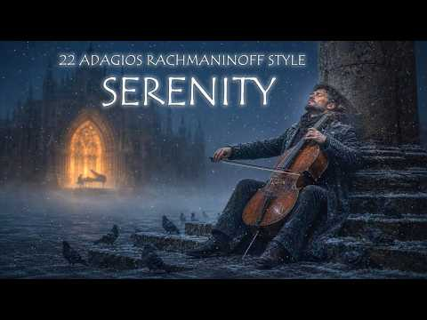
- 설명 앞부분: 22 Beautiful Serenity Adagios That Will Touch Your Soul ∣ Rachmaninoff Style Classical Music Welcome to Silent Adagio. just the piano, the cello, and you. I put together this adagio session for the quiet moments—the late-night study sessions, the rainy afternoons with a book, and those hours of dee…
- 대본 없음 (설명) — 음성인식이 끝나면 도입부·흐름이 들어감
- 댓글 297/297: 좋은 점 — 영상 0 · 감사·응원 0 · 더 알고 싶은 것 0 · 아쉬운 점 — 영상 0 · 반박·불만 — 의견 다름 0 · 정치·사회 0 · 경험 공유 0 · 구독·다음 기대 0

### 682. Evergreen ghazal ∣ कभी फुर्सत मिले तो बैठ कर ये सोचता हूँ मैं ∣ Emotional Hindi Ghazal #j…

- https://www.youtube.com/watch?v=CiqRihLd68Q · SOUL VIBES INDIA  · 구독자 30,000 · 조회수 1,555,898 (×51.9, 하루 15,428.5) · 좋아요 13,402 (0.9%) · 5.3분 · 2026-07-10 · 주제 묶음 기타 · 형식 음악 (그 밖 모양 — 한 편짜리 BGM 등) · 폴더 `W_CiqRihLd68Q` (웹 승인)
- 썸네일: 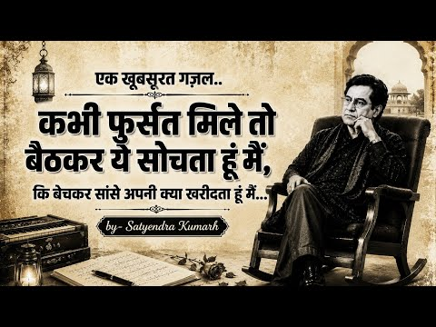
- 설명 앞부분: ❤️ अगर यह ग़ज़ल आपके दिल को छू जाए तो वीडियो को Like करें, Comment करें और SOUL VIBES INDIA को Subscribe करना न भूलें। ✍️ Lyrics & composed by_ Satyendra Kumarh 🎵 Channel: SOUL VIBES INDIA Insta 👇 © Copyright Notice Lyrics © 2026 Satyendra Kumar. All Rights Reserved. Audio & Video © 2026 SOUL VIBES…
- 같은 채널 평소 대비 ×24.3 (채널 최근 롱폼 중앙값 64,125회) · 평소 영상: बड़ी ख़ामोश लगती है ये दुनिया मुस्कुराने पे ∣ Hea… (73,140회) / Heart Touching Ghazals 2026 - Top 3 Superhit Coll… (73,753회)
- 대본 없음 (설명) — 음성인식이 끝나면 도입부·흐름이 들어감
- 댓글 298/297: 좋은 점 — 영상 0 · 감사·응원 0 · 더 알고 싶은 것 0 · 아쉬운 점 — 영상 0 · 반박·불만 — 의견 다름 0 · 정치·사회 0 · 경험 공유 0 · 구독·다음 기대 0

### 683. 🎧 Samz Vai: The Ultimate Sad & Emotional Hits 💔 ∣ Bengali Lofi Mashup Playlist

- https://www.youtube.com/watch?v=kizXE5FXIFc · Bangla Lofi 3.0 · 구독자 39,000 · 조회수 2,018,319 (×51.8, 하루 23,247.7) · 좋아요 0 (0.0%) · 26.9분 · 2026-07-24 · 주제 묶음 8. 로파이·시티팝·칠 · 형식 플레이리스트·모음 (여러 곡) · 폴더 `W_kizXE5FXIFc` (웹 승인)
- 썸네일: 
- 설명 앞부분: 🎧 Samz Vai: The Ultimate Sad & Emotional Hits 💔 ∣ Bengali Lofi Mashup Playlist Use Headphone For Better Experience 🎧 ❤️ Like ∣ 💬 Comment ∣ 🔔 Subscribe for more Bangla Lofi 3.0 Hashtags keywords 👇 utshorgo, উৎসর্গ, oviman, অভিমান, ojanay, অজানায়, avijog, অভিযোগ, bangla gaan, bangla song, bangla song…
- 같은 채널 평소 대비 ×72.8 (채널 최근 롱폼 중앙값 27,724회) · 평소 영상: 🥀 Best Bengali Sad & Romantic Songs 2026 💔 ∣ Hear… (32,369회) / 💔🥀 Bengali Sad Songs Playlist 2026 ∣ Lofi Mashuq … (23,080회)
- 대본 없음 (설명) — 음성인식이 끝나면 도입부·흐름이 들어감
- 댓글 239/237: 좋은 점 — 영상 0 · 감사·응원 0 · 더 알고 싶은 것 0 · 아쉬운 점 — 영상 0 · 반박·불만 — 의견 다름 0 · 정치·사회 0 · 경험 공유 0 · 구독·다음 기대 0

### 684. 2026년 6월 여돌 노래모음 ∣ 🔥 KPOP PLAYLIST

- https://www.youtube.com/watch?v=a_19lS2wwOw · 달플리 𝑷𝒍𝒂𝒚𝒍𝒊𝒔𝒕  · 구독자 12,000 · 조회수 616,786 (×51.4, 하루 4,428.5) · 좋아요 2,841 (0.5%) · 64.9분 · 2026-06-02 · 주제 묶음 10. 팝송·K팝·J팝 · 형식 플레이리스트·모음 (여러 곡) · 폴더 `W_a_19lS2wwOw` (웹 승인)
- 썸네일: 
- 같은 채널 평소 대비 ×34.4 (채널 최근 롱폼 중앙값 17,932회) · 평소 영상: 지수 노래모음 ∣ 신곡포함 ∣ JISOO Playlist (18,088회) / 보이넥스트도어 노래모음 ∣ BOYNEXTDOOR Playlist 🎧 (17,775회)
- 대본 없음 (없음) — 음성인식이 끝나면 도입부·흐름이 들어감
- 댓글 53/53: 좋은 점 — 영상 0 · 감사·응원 1 · 더 알고 싶은 것 0 · 아쉬운 점 — 영상 0 · 반박·불만 — 의견 다름 0 · 정치·사회 0 · 경험 공유 0 · 구독·다음 기대 0
  - 감사·응원 👍12 “오늘도 감사합니다. 좋은 플리 ❤️❤️❤️”

### 685. 💚 초여름맛 메론소다 ☆・. ‘ . ꒰ 가사없는 집중 음악 ꒱

- https://www.youtube.com/watch?v=FkmrHoP4xSk · 둥실  ︵☆ · 구독자 1,190 · 조회수 60,965 (×51.2, 하루 376.3) · 좋아요 1,750 (2.9%) · 171.3분 · 2026-05-10 · 주제 묶음 3. 공부·집중·작업 · 형식 한 곡 (뮤직비디오·음원·가사) · 폴더 `W_FkmrHoP4xSk` (웹 승인)
- 썸네일: 
- 설명 앞부분: 고시생인 제가 공부할 때 들을 플리를 만들 목적으로 운영 중인 곳입니다 (*´∪`) 폭닥하고 말랑한 음악들을 통해 함께 공부하며 힐링해요 🎶💖 오늘도 애쓰고 있는 당신께, 이 음악들이 여러분의 마음을 담뿍 채워주기를 바라며,,🎶 Thank you for being here. All copyrights are owned by 둥실
- 같은 채널 평소 대비 ×172.0 (채널 최근 롱폼 중앙값 354회) · 평소 영상: 🌿 ₊ 나랑 같이 놀자 ✦ °. • (359회) / 𝑷𝒍𝒂𝒚𝒍𝒊𝒔𝒕 ∣ 믿고 기다린다면 . . ! ‧₊˚ 🍅 ⋅ ☆ (350회)
- 대본 없음 (설명) — 음성인식이 끝나면 도입부·흐름이 들어감
- 댓글 60/60: 좋은 점 — 영상 1 · 감사·응원 13 · 더 알고 싶은 것 5 · 아쉬운 점 — 영상 0 · 반박·불만 — 의견 다름 0 · 정치·사회 0 · 경험 공유 2 · 구독·다음 기대 0
  - 좋은 점 — 영상 👍0 “공부할때듣기 좋아요!!!!”
  - 감사·응원 👍63 “너무 감사합니다! 중1인데 중학교 와서 맨널 놀아요ㅋㅋ 동생이랑 레고 조립하면서 들었어용~😋”
  - 감사·응원 👍10 “기분이 그럭저럭이었는데, 썸네일에 보이는 초록초록한 메론소다에, 청량하고 시원하면서도 도로롱 유리구슬 흘러가듯 음악이 나와서 즐겁게 들으면서 공부 시작합니다! 감사합니다”
  - 더 알고 싶은 것 👍2 “모든 영상 정말정말 잘 보고 있어요…! 유튭보면서 첨 댓글 달아보네요,,, 그만큼 넘 좋구 1시간이 훅훅 갑니다! 앞으로도 다 잘 들을테니 마니 올려주세요!”
  - 더 알고 싶은 것 👍0 “이런 템포 곡 너무 좋아요 앞으로도 많이 부탁드려요,,,💖”
  - 경험 공유 👍1 “시원한 에어컨바람 맞으며 뜨듯한 털옷 잠옷입고 집에서 게임하는 내 무릎위에 우리집강아지 엎드려서 자던.. 행복했던 그때가 그립읍니다. 전역만 하게 해다오..”

### 686. [Masterpiece Series] Handel Passacaglia – The Eternal Bond - 5 Variations Songs of Solace

- https://www.youtube.com/watch?v=PF-v0MEo2AU · WilliamPoeticSolace | 시적인위로 · 구독자 40,600 · 조회수 2,074,120 (×51.1, 하루 11,701.3) · 좋아요 34,992 (1.7%) · 17.8분 · 2026-04-25 · 주제 묶음 1. 수면·명상·힐링 · 형식 음악 (그 밖 모양 — 한 편짜리 BGM 등) · 폴더 `W_PF-v0MEo2AU` (웹 승인)
- 썸네일: 
- 챕터: 0:00 Track 1: A delicate tenor-led… · 4:09 Track 2: A sorrowful mezzo-so… · 8:27 Track 3: A majestic chamber o… · 11:47 Track 4: A celestial quartet … · 15:31 Track 5: A crystalline digita…
- 설명 앞부분: Handel’s timeless Passacaglia, later reimagined by Halvorsen, is reborn here in five deeply expressive variations. This arrangement blends Baroque structure with Romantic intensity, offering a journey through elegance, tension, and quiet transcendence. As one of William’s most cherished works, this…
- 같은 채널 평소 대비 ×173.8 (채널 최근 롱폼 중앙값 11,936회) · 평소 영상: Ukraine Romance - Dark Eyebrows Hazel Eyes : Song… (11,936회) / Geordie + Paganini Sonata No.12 & Counterpoint: 4… (12,179회)
- 대본 없음 (설명) — 음성인식이 끝나면 도입부·흐름이 들어감
- 댓글 3,222/3,205: 좋은 점 — 영상 9 · 감사·응원 442 · 더 알고 싶은 것 36 · 아쉬운 점 — 영상 13 · 반박·불만 — 의견 다름 9 · 정치·사회 5 · 경험 공유 137 · 구독·다음 기대 8
  - 좋은 점 — 영상 👍2 “오 마이 갓 !! 이렇게 아름다울수가 ! 캐나다 토론토에 살고 있습니다 좋은영상 올려 주셔서 감사 합니다. 여러분~~ 사랑해요❤”
  - 좋은 점 — 영상 👍1 “아 다시 또 들어도 감동이고 아픈 사연들 많아 가슴이 아리네요 아들내외랑 좋은 시간 보내고 헤어진후 산책길 아파트단지내 한바퀴하면서 듣는데 ., 정말 울림이 큽니다 가사도 넘 좋아요 길고 고단한 방황 끝내고 싶어요 가슴 아픈 일도 던져 버리고 .., 전트랙 다 넘 마…”
  - 감사·응원 👍576 “3기 진행성 위암 항암중입니다! 내 삶이 얼마나 될지 모르겠지만, 그저 부모님보다 먼저 죽으면 안되겠다는 생각에 살기 위해 애쓰고 있습니다 좋은 음악 감사합니다! 다들 건강하시고, 오늘도 살아 있음에 우리 주님께 감사 드립니다!”
  - 감사·응원 👍486 “헨델의 많은곡을 들어봤으나 슬픔과 감정을 몰입하는 파사칼리아의 곡이 있는줄을 몰랐습니다. 계속 들어도 절제가 안되네요. 올려주신분께 감사하고 많은분들에 공유합니다.”
  - 더 알고 싶은 것 👍945 “너무나 꿈같은 아들을 먼저 보냈습니다 33세의 꽃같은 나이에 바람이 되어 빛되어 제 주변에 맴 도는것 같습니다 세상의 어떤말도 표현 되어지지 않는 비 현실감.. 저의 모든것이었던 아들의 목소리를 더 이상 들을수 없는지 오늘이 51일째... 통곡의 울음조차 낼 수 없습…”
  - 더 알고 싶은 것 👍20 “불면으로 힘들어하는 50대입니다. 수면제 10년째중이구요. 이 음악으로 마음의 평안을 얻습니다. 유투브에 저장해서 비행기에서도 무한반복이구요. 요즘 체력적으로 힘든치료 받고 온 날 해당음악 귀에 꽂고 누웠다 주말 낮에 잠깐씩 자는 기적이 생기네요. 첫번때 남자테너 목…”
  - 아쉬운 점 — 영상 👍20 “불면으로 힘들어하는 50대입니다. 수면제 10년째중이구요. 이 음악으로 마음의 평안을 얻습니다. 유투브에 저장해서 비행기에서도 무한반복이구요. 요즘 체력적으로 힘든치료 받고 온 날 해당음악 귀에 꽂고 누웠다 주말 낮에 잠깐씩 자는 기적이 생기네요. 첫번때 남자테너 목…”
  - 아쉬운 점 — 영상 👍3 “이곳은 모든 그리움과 아쉬움이 너무 진하게 맘을 울려서 위로보단 슬픔을 발산시키는 것같은 사연들이 많네요~모두의 그리움과 슬픔에 위로의 토닥임이라도 얻고 싶네요.힘내시고 잘이겨내세요.”
  - 반박·불만 — 의견 다름 👍8 “저는 3주전에 50년지기 단짝친구를 어이없이 갑작스럽게 잃었습니다 제헌절 아침에 양재천에 홀로 앉아 이 음악 들으며 눈물짓고 있습니다 친구야 미안해 나 어떻게 살아? 90살까지 함께 잘 살기로 했잖아 너는 어디가면 옛날같이 다시 만나? 네가 이리 갈줄 몰랐어 어떡하니…”
  - 반박·불만 — 의견 다름 👍2 “다들~ 죽는게 아닙니다 좋은음악에 슬픈얘기 하지말고 지금 살아있는데 감사하시는건 어떤지요? 내가 누구가 아니라 다른누구를 사랑하세요 그러면 이 세상이 행복합니다”
  - 정치·사회 👍2 “얼마전. 하늘나라가신. 엄마가 생각나네요. 넘슬프고 아름다운선율에😢 주신음악 감사합니다”
  - 정치·사회 👍1 “작년에 하늘나라가신 울엄마..부디 다시환생하시어 부잣집에서 부귀영화누리시길 막내이가 기도합니다.”
  - 경험 공유 👍436 “엄마가 담도암과 폐에 전이 소견을 보여서 세번에 조직 검사를 했으나 악성종양이 나오지 않았지만 폐에는 전이 소견이 보여서 다시 또 검사를 해야 한다고 합니다. 엄마는 세번에 시술로 많이 힘들어 하시고 지켜보는 자식으로서 마음이 너무 아프네요. 엄마 앞에서는 울지 못하…”
  - 경험 공유 👍320 “이 음악 뭔가요. 시작부터 그냥 눈물이 .... 내가 지금 많이 힘들었나봐요. 감사합니다. 울고나면 괴로움도 눈물과함께 내게서 떠나가기를.”
  - 구독·다음 기대 👍2 “어찌할 수 없는 아픔과 슬픔으로 가득했었는데...듣자마자 바로 구독눌렀어요. 아름다움에 위로의 눈물이 나네요.”
  - 구독·다음 기대 👍1 “매일 듣고 있습니다 슬픔이라하기에 감미롭게 스며드는 평안이 영혼을 깃털처럼 공중으로 부양시켜주는듯 오묘합니다, 남성인듯 여성인듯 감성을 자극하는 음성은 이세상의것이 아닌듯 온몸의 세포들이 물결치듯 희열을 느끼게 합니다 들려주셔서 감사합니다”

### 687. 😴 Baby Sleep Music That Works in 3 Minutes! 💤 Newborn Sleep Lullaby ∣ Dark Screen NoAd

- https://www.youtube.com/watch?v=22SPWR7nyfM · Mother & Baby Sounds · 구독자 17,700 · 조회수 897,751 (×50.7, 하루 7,562.9) · 좋아요 5,448 (0.6%) · 122.7분 · 2026-06-22 · 주제 묶음 1. 수면·명상·힐링 · 형식 음악 (그 밖 모양 — 한 편짜리 BGM 등) · 폴더 `W_22SPWR7nyfM` (웹 승인)
- 썸네일: 
- 설명 앞부분: 😴 Baby Sleep Music That Works in 3 Minutes! 💤 Newborn Sleep Lullaby ∣ Dark Screen No Ads Help your baby drift into a peaceful, deep sleep with this soothing newborn sleep lullaby designed to calm fussy babies and create the perfect bedtime environment. Featuring gentle baby sleep music, relaxing me…
- 같은 채널 평소 대비 ×23.9 (채널 최근 롱폼 중앙값 37,530회) · 평소 영상: AMAZING BABY SLEEP MUSIC FOR BABY TO SLEEP FAST! … (37,961회) / The Best Sleep Music for Babies ✨ Fall Asleep in … (37,098회)
- 대본 없음 (설명) — 음성인식이 끝나면 도입부·흐름이 들어감
- 댓글 0/0: 좋은 점 — 영상 0 · 감사·응원 0 · 더 알고 싶은 것 0 · 아쉬운 점 — 영상 0 · 반박·불만 — 의견 다름 0 · 정치·사회 0 · 경험 공유 0 · 구독·다음 기대 0

### 688. 🎵 내려놓아라 ∣ 신나는 불교 EDM 트로트 ∣ 근심 걱정 다 내려놔라

- https://www.youtube.com/watch?v=-y3mLSiAcU0 · 극락가요 · 구독자 393 · 조회수 19,877 (×50.6, 하루 159.1) · 좋아요 111 (0.6%) · 4.5분 · 2026-06-16 · 주제 묶음 5. 운동·드라이브·신나는 · 형식 음악 (그 밖 모양 — 한 편짜리 BGM 등) · 폴더 `W_-y3mLSiAcU0` (웹 승인)
- 썸네일: 
- 설명 앞부분: 🙏 내려놓아라 🌸 ※ 본 콘텐츠는 AI 기반 음악 및 영상 제작 도구를 활용하여 제작되었습니다. 붙잡을수록 괴롭고, 내려놓을수록 가벼워지는 마음. "내려놓아라"는 불교의 가르침을 신나는 EDM 트로트 리듬에 담아낸 힐링 음악입니다. 욕심도, 미움도, 지나간 상처도 잠시 내려놓고 쿵짝쿵짝 장구 소리와 신나는 클럽 비트에 맞춰 함께 웃고 노래하며 마음을 쉬어가세요. 🌸 마음을 비우면 꽃이 핀다 🌸 미워했던 사람도 결국 인연 🌸 오늘 숨 쉬고 있다는 것만으로도 복 힘든 하루를 보내고 있다면, 이 노래가 작은 위로가 되길 바랍니다. 🙏 …
- 같은 채널 평소 대비 ×13.5 (채널 최근 롱폼 중앙값 1,476회) · 평소 영상: 🎵 괜찮아요 ∣ 근심 걱정 날려버려 ∣ 신나는 불교 뽕짝 EDM (1,935회) / 진흙 속에서 다시 피어나는 나🎵번뇌 속에서 피어나다 (Lotus Rising) (1,017회)
- 대본 없음 (설명) — 음성인식이 끝나면 도입부·흐름이 들어감
- 댓글 7/7: 좋은 점 — 영상 0 · 감사·응원 2 · 더 알고 싶은 것 0 · 아쉬운 점 — 영상 0 · 반박·불만 — 의견 다름 0 · 정치·사회 0 · 경험 공유 0 · 구독·다음 기대 0
  - 감사·응원 👍0 “권력을 내려 놓아라 욕심을 내지말자 부처님 말씀을 새겨 듣겠습니다 노래 감사합니다 관세음보살 기도 🙏 🌸 합니다 근심걱정 이 노래 듣고 내려 놓으세요”
  - 감사·응원 👍0 “아쌋둥실둥실좋아좋아.감사합니다😅❤”

### 689. 7080 감성 포크송 ∣ 듣기 좋은 통기타 포크 15곡

- https://www.youtube.com/watch?v=Hpsm6Kn5TM4 · ***7080가요산책*** · 구독자 4,730 · 조회수 238,909 (×50.5, 하루 2,763.8) · 좋아요 2,244 (0.9%) · 64.5분 · 2026-07-24 · 주제 묶음 9. 가요·발라드·트로트 · 형식 AI 음악 · 폴더 `W_Hpsm6Kn5TM4` (웹 승인)
- 썸네일: 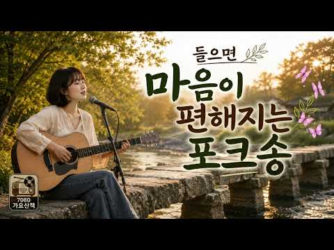
- 챕터: 0:00 노을빛 산책길 · 4:19 기타 소리 · 8:38 강물은 흐르는데 · 13:17 그해 여름 · 17:31 돌다리에서 · 22:05 마음이 쉬어가네 · 26:08 들꽃 향기 · 30:13 별이 흐르는 강 · 34:34 작은 시냇가 · 39:10 오솔길 · 43:34 작은 창가에 핀꽃 · 47:45 초록빛 오후 · 51:18 고향 가는길 · 55:46 노을은 내친구 · 60:01 햇살이 누워있네
- 설명 앞부분: 🌿 들으면 마음이 편해지는 7080 감성 포크송 15곡 바쁜 하루를 잠시 내려놓고, 통기타 선율과 따뜻한 멜로디가 함께하는 7080 감성 포크를 만나보세요. 강가를 따라 걷는 산책길, 노을이 물드는 시골 풍경, 바람이 머무는 오솔길처럼 편안하고 따뜻한 이야기를 담은 창작 포크송 15곡입니다 7080 가요산책은 70~80년대의 따뜻한 감성을 담은 창작 포크와 감성 가요를 전하는 채널입니다. 오늘도 이 음악이 여러분의 하루에 작은 위로와 편안한 쉼이 되기를 바랍니다. 🎵 Time Track ※ 본 영상의 음악과 이미지는 AI를 활용하…
- 같은 채널 평소 대비 ×24.3 (채널 최근 롱폼 중앙값 9,851회) · 평소 영상: 듣는 순간 마음이 편해지는 7080 포크송｜그 시절 추억의 통기타 노래 20곡｜가을 감성… (9,851회) / 그 시절, 우리의 노래｜통기타와 하모니카로 다시 만나는 7080 포크송 10곡｜추억의 대… (9,830회)
- 대본 없음 (설명) — 음성인식이 끝나면 도입부·흐름이 들어감
- 댓글 105/105: 좋은 점 — 영상 1 · 감사·응원 5 · 더 알고 싶은 것 2 · 아쉬운 점 — 영상 1 · 반박·불만 — 의견 다름 0 · 정치·사회 0 · 경험 공유 1 · 구독·다음 기대 0
  - 감사·응원 👍11 “통기타 선율이 잃었던 감성을 깨우네요...요즘 이런 노래가 듣고싶었는데....감사해요^^”
  - 감사·응원 👍2 “목소리가 풋풋함 좋은 노래에 빠져듭니다 ❤❤❤❤ 항상🎉🎉 응원합니다 👍”
  - 더 알고 싶은 것 👍2 “가사올려주세요.”
  - 더 알고 싶은 것 👍2 “노래제목,가수이름 부탁해요..요즘 워낙 가짜가 많아서요”
  - 아쉬운 점 — 영상 👍45 “요즘 유튜브나 여러 플랫폼에서는 AI 기술을 활용해 특정 가수의 창법이나 음색을 학습시킨 커버 곡들이 정말 많이 쏟아지고 있네요. 특히 전통적인 록 발라드나 트로트 메들리 같은 영상 중에는 사람이 직접 부른 것처럼 정교하게 만들어졌지만, 실제로는 AI 목소리 모델을 …”
  - 경험 공유 👍1 “오랫동안 가족을 위해 살다 보니 어느 순간 제가 좋아했던 것이 무엇인지조차 잊어버렸습니다. 늘 누군가의 엄마, 아빠, 남편, 아내로 살았지만 오늘 이 음악을 들으며 잠시 예전의 제 모습을 떠올렸네요. 우리도 가끔은 자신을 위해 살아도 괜찮다고 생각합니다. 이 글을 읽…”

### 690. 1990~2026 한국 감성 발라드 명곡 100 🎵 마음을 울리는 인기 노래 모음 하루 종일 들어도 좋은 발라드 ❤️❤️

- https://www.youtube.com/watch?v=l3FyvUQUgSA · 바람의 발라드 · 구독자 21,000 · 조회수 1,060,770 (×50.5, 하루 8,320.8) · 좋아요 2,108 (0.2%) · 130.5분 · 2026-06-13 · 주제 묶음 9. 가요·발라드·트로트 · 형식 플레이리스트·모음 (여러 곡) · 폴더 `W_l3FyvUQUgSA` (웹 승인)
- 썸네일: 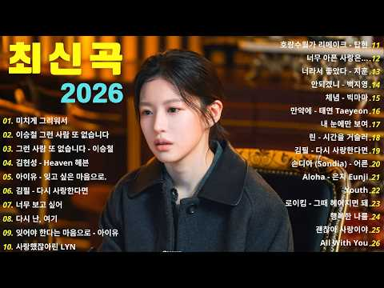
- 설명 앞부분: 📜 창작자 메시지 ∣ 작곡가의 진심을 담아 여러분의 따뜻한 관심과 소중한 피드백에 진심으로 감사드립니다. 여러분의 응원은 매일 저에게 음악 작업에 대한 큰 동기와 영감이 됩니다. 🎶 제가 만든 음악과 영상을 즐기셨다면, 친구들과 공유해 주시면 더 많은 분들과 감성을 나눌 수 있습니다. 정기적으로 업로드되는 영상과 새로운 감성 음악, 창작 콘텐츠로 여러분을 찾아뵙겠습니다. 함께하는 이 공간이 여러분의 하루에 작은 위로와 즐거움이 되길 바랍니다. 💜 사용된 크리에이티브 툴 Adobe Premiere Pro CC Adobe After …
- 같은 채널 평소 대비 ×547.4 (채널 최근 롱폼 중앙값 1,938회) · 평소 영상: 날씨가 쌀쌀해질수록 더 듣고 싶은 발라드 BEST100 💕 하루 종일 함께하는 감성 노래 (1,938회) / 지친 하루 끝에 만나는 한국의 가을 🍂 힐링이 필요한 당신을 위한 영상💿 한국 발라드 히… (1,941회)
- 대본 없음 (설명) — 음성인식이 끝나면 도입부·흐름이 들어감
- 댓글 121/121: 좋은 점 — 영상 1 · 감사·응원 4 · 더 알고 싶은 것 10 · 아쉬운 점 — 영상 0 · 반박·불만 — 의견 다름 2 · 정치·사회 0 · 경험 공유 5 · 구독·다음 기대 0
  - 좋은 점 — 영상 👍29 “55:17 노래가 그냥 개레전드임.. ai였다는게 더충격”
  - 감사·응원 👍1 “덕분에 힐링하며 하루 보낼수 있었네요~ 감사해요^^”
  - 감사·응원 👍1 “시청 해주셔서 감사합니다! 내 비디오가 재미있다면 구독, 좋아요 및 공유를 잊지 마세요! 좋은 하루 되세요! 💖💖”
  - 더 알고 싶은 것 👍30 “55분에 시작하는 노래 가수와 제목좀 알려주세요ㅜㅜ”
  - 더 알고 싶은 것 👍19 “1시 9분 가수좀 알 수 있을까요?? 노래제목좀 부탁드려요 🙏”
  - 반박·불만 — 의견 다름 👍1 “53분노래는 AI가아닙니다 핑크란마”

### 691. Piano Sleep Music with Relaxing Rain 🎶 Calm Your Mind, Relieve Anxiety and Deep Sleep Ins…

- https://www.youtube.com/watch?v=pFL8mgVoxnc · Piano Rain Retreat · 구독자 29,900 · 조회수 1,509,359 (×50.5, 하루 17,269.3) · 좋아요 10,134 (0.7%) · 203.6분 · 2026-07-23 · 주제 묶음 1. 수면·명상·힐링 · 형식 음악 (그 밖 모양 — 한 편짜리 BGM 등) · 폴더 `W_pFL8mgVoxnc` (웹 승인)
- 썸네일: 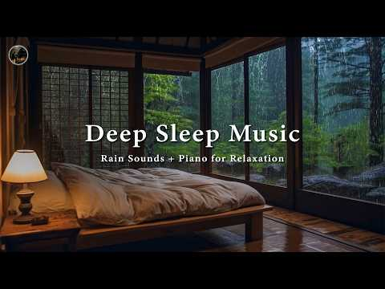
- 설명 앞부분: Piano Sleep Music with Relaxing Rain 🎶 Calm Your Mind, Relieve Anxiety and Deep Sleep Instantly Welcome to the Piano Rain Retreat Channel! Are you seeking a relaxing space to relieve stress, improve your sleep, and calm your mind? Join us and discover the peaceful atmosphere created by the gentle s…
- 같은 채널 평소 대비 ×108.5 (채널 최근 롱폼 중앙값 13,906회) · 평소 영상: Fall Asleep Instantly with Calm Rain Sounds 🎶 Pea… (14,022회) / Soft Rain & Healing Piano for Deep Sleep – Peacef… (13,791회)
- 대본 없음 (설명) — 음성인식이 끝나면 도입부·흐름이 들어감
- 댓글 327/326: 좋은 점 — 영상 0 · 감사·응원 0 · 더 알고 싶은 것 0 · 아쉬운 점 — 영상 0 · 반박·불만 — 의견 다름 0 · 정치·사회 0 · 경험 공유 0 · 구독·다음 기대 0

### 692. Elevate yourself - Bhagavad Gita ∣ Dark Trip-Hop X Downtempo Ambient X Raga Fusion ∣ SUR …

- https://www.youtube.com/watch?v=vrn7QzaHsbk · SUR-SPIRITUAL · 구독자 7,910 · 조회수 398,879 (×50.4, 하루 16,732.4) · 좋아요 5,262 (1.3%) · 5.3분 · 2026-09-25 · 주제 묶음 6. 피아노·클래식·연주곡 · 형식 음악 (그 밖 모양 — 한 편짜리 BGM 등) · 폴더 `W_vrn7QzaHsbk` (웹 승인)
- 썸네일: 
- 설명 앞부분: The vocal narrative reflects the journey of overcoming the deep void and darkness within the mind (bheetar ka andhakar). It serves as a reminder that there is no external savior; you must rescue yourself from the abyss (svayam hi svayam ka tu kar le uddhar). It is a powerful, heavy anthem for spiri…
- 같은 채널 평소 대비 ×137.0 (채널 최근 롱폼 중앙값 2,912회) · 평소 영상: Har Har Mahadev Shambho ∣ Powerful Shiva Song ∣ S… (2,912회) / Rakt Se Bana Itihas (रक्त से बना इतिहास) ∣ Jai Bh… (3,154회)
- 대본 없음 (설명) — 음성인식이 끝나면 도입부·흐름이 들어감
- 댓글 97/97: 좋은 점 — 영상 0 · 감사·응원 0 · 더 알고 싶은 것 0 · 아쉬운 점 — 영상 0 · 반박·불만 — 의견 다름 0 · 정치·사회 0 · 경험 공유 0 · 구독·다음 기대 0

### 693. 2 Hour Sitar for Clean Your Brain Instantly ∣ Indian Classical Music for Brain Focus

- https://www.youtube.com/watch?v=PVGFHGLRjK4 · Sacred Mind Healing · 구독자 8,290 · 조회수 417,540 (×50.4, 하루 2,416.5) · 좋아요 5,155 (1.2%) · 120.4분 · 2026-04-29 · 주제 묶음 6. 피아노·클래식·연주곡 · 형식 긴 한 곡·반복 (N시간) · 폴더 `W_PVGFHGLRjK4` (웹 승인)
- 썸네일: 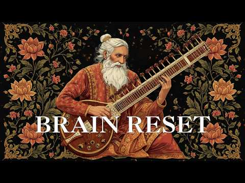
- 설명 앞부분: Experience deep mental clarity and focus with this 2 hour Indian classical sitar meditation music. This music is designed to help you: Clear mental fog Improve concentration Reduce overthinking Enter deep focus state Relax your nervous system Featuring traditional Indian instruments such as sitar, …
- 같은 채널 평소 대비 ×299.3 (채널 최근 롱폼 중앙값 1,395회) · 평소 영상: Sleep in Peace ∣ Gentle Healing ∣ Indian Instrume… (1,395회) / Indian Sitar Music for Calm Reflection ∣ Quiet th… (1,366회)
- 대본 없음 (설명) — 음성인식이 끝나면 도입부·흐름이 들어감
- 댓글 206/206: 좋은 점 — 영상 0 · 감사·응원 0 · 더 알고 싶은 것 0 · 아쉬운 점 — 영상 0 · 반박·불만 — 의견 다름 0 · 정치·사회 0 · 경험 공유 0 · 구독·다음 기대 0

### 694. (No Ads) Relaxing Music For Deep Sleep • Anxiety Relief, Melatonin Release • Stop Overthi…

- https://www.youtube.com/watch?v=UhQANX3rKzA · Bedtime Calm Sounds · 구독자 12,200 · 조회수 609,824 (×50.0, 하루 3,892.5) · 좋아요 1,409 (0.2%) · 94.3분 · 2026-05-15 · 주제 묶음 1. 수면·명상·힐링 · 형식 음악 (그 밖 모양 — 한 편짜리 BGM 등) · 폴더 `W_UhQANX3rKzA` (웹 승인)
- 썸네일: 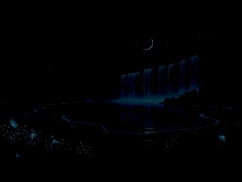
- 설명 앞부분: (No Ads) Relaxing Music For Deep Sleep • Anxiety Relief, Melatonin Release • Stop Overthinking Slow down. Breathe. Let the night carry you gently into rest. If your mind keeps racing or your body feels tense, this is your quiet space to release the day. This video is carefully crafted to create a s…
- 같은 채널 평소 대비 ×97.0 (채널 최근 롱폼 중앙값 6,287회) · 평소 영상: (No Ads) 99% Fall Asleep In 3 Minutes • Eliminate… (6,287회) / (No Piano) Fall Into Sleep Instantly • Relaxing M… (6,474회)
- 대본 없음 (설명) — 음성인식이 끝나면 도입부·흐름이 들어감
- 댓글 68/69: 좋은 점 — 영상 0 · 감사·응원 0 · 더 알고 싶은 것 0 · 아쉬운 점 — 영상 0 · 반박·불만 — 의견 다름 0 · 정치·사회 0 · 경험 공유 0 · 구독·다음 기대 0

### 695. 50대이상이 들으면 기분좋아지는 7080노래모음, 베스트 7080노래모음, 광고 없는 7080 좋은노래 모음

- https://www.youtube.com/watch?v=L0rtQ0ZFr7o · VibeTune · 구독자 11,400 · 조회수 565,084 (×49.6, 하루 3,544.1) · 좋아요 3,382 (0.6%) · 72.7분 · 2026-05-12 · 주제 묶음 9. 가요·발라드·트로트 · 형식 플레이리스트·모음 (여러 곡) · 폴더 `W_L0rtQ0ZFr7o` (웹 승인)
- 썸네일: 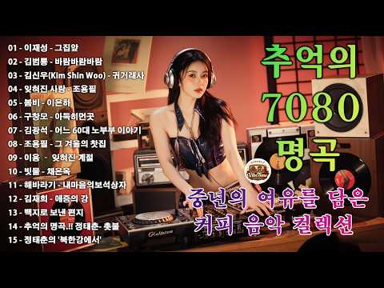
- 설명 앞부분: 01 - 이재성 - 그집앞 02 - 김범룡 - 바람바람바람 03 - 김신우(Kim Shin Woo) - 귀거래사 04 - 잊혀진 사랑 - 조용필 05 - 봄비 - 이은하 06 - 구창모 - 아득히먼곳 07 - 김광석 - 어느 60대 노부부 이야기 08 - 조용필 - 그 겨울의 찻집 09 - 이용 – 잊혀진 계절 10 - 빗물 - 채은옥 11 - 해바라기 - 내마음의보석상자 12 - 김재희 - 애증의 강 13 - 백지로 보낸 편지 14 - 추억의 명곡.!! 정태춘- 촛불 15 - 정태춘의 '북한강에서'
- 같은 채널 평소 대비 ×453.9 (채널 최근 롱폼 중앙값 1,245회) · 평소 영상: 7080 추억 카페음악집 ✨ 중년을 위한 여유로운 멜로디✨🎙🎶잊혀진 사랑/귀거래사/봄비/… (1,245회) / 잔잔한 트로트 15곡 가사포함 1시간듣기 #장윤정 #임영웅 #진미령 #최백호 #송가인 #… (1,249회)
- 대본 없음 (설명) — 음성인식이 끝나면 도입부·흐름이 들어감
- 댓글 85/85: 좋은 점 — 영상 0 · 감사·응원 6 · 더 알고 싶은 것 0 · 아쉬운 점 — 영상 1 · 반박·불만 — 의견 다름 0 · 정치·사회 0 · 경험 공유 1 · 구독·다음 기대 0
  - 감사·응원 👍28 “저두 오랜만에 들으니 옛생각 납니다 명곡은 언제 들어도 명곡 옛추억에 푹빠진느킴 정말 줗아요 마음이 많이 우울했는데 중년들의 마음을 그대로 전해주는 느킴. 정말감사합니다 ❤❤❤❤😅😅😅”
  - 감사·응원 👍1 “아침 들으니 기분 업이됩니다 오랜만어듣기도하구요 옛날 생각도 나고 젊어지는생각이 듭니다 그옛날를 회상하면 듣고있습니다 감사합니다 ❤❤❤”
  - 아쉬운 점 — 영상 👍1 “그집앞은 원곡자 이재성씨가 아니라서 아쉽네요 ;;;”
  - 경험 공유 👍5 “이런 노래를 들으니 내가 언제 이렇게 나이가 들었나 서글퍼 지네요”

### 696. [감동음악]🎵듣는 순간 가슴이 먹먹해진다… 김호중 × 이애숙 《나의 조국은》 감동 실황 ∣ 천상의 목소리 김호중…

- https://www.youtube.com/watch?v=FAMrq6SXxys · 🎧 Sound Rest · 구독자 2,710 · 조회수 133,995 (×49.4, 하루 832.2) · 좋아요 3,967 (3.0%) · 4.5분 · 2026-05-11 · 주제 묶음 1. 수면·명상·힐링 · 형식 음악 (그 밖 모양 — 한 편짜리 BGM 등) · 폴더 `W_FAMrq6SXxys` (웹 승인)
- 썸네일: 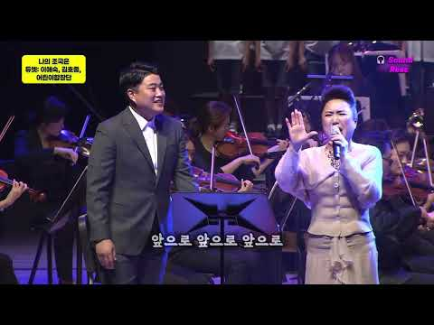
- 설명 앞부분: 김희갑 작곡의 명곡 《나의 조국은》 그리고 깊은 감성과 울림을 전하는 김호중, 이애숙의 아름다운 듀엣. 한 소절 한 소절마다 조국에 대한 사랑과 그리움, 그리고 살아온 세월의 감정이 고스란히 담겨 있다. 김호중의 웅장하면서도 따뜻한 보이스와 이애숙의 섬세하고 깊은 감성이 만나 가슴 벅찬 감동의 무대를 완성했다. 🇰🇷 오늘 이 노래를 통해 우리 마음속 ‘나의 조국’을 다시 떠올려보길 바란다. 🎧 이어폰으로 들으면 더욱 깊은 감동을 느낄 수 있다. Kim Hee-gap's masterpiece "My Fatherland." 🎹🎧 An…
- 같은 채널 평소 대비 ×457.3 (채널 최근 롱폼 중앙값 293회) · 평소 영상: 🎶내 인생 마지막 사랑 ❤️긴 세월 돌아서 만난 내 인생의 마지막 사랑... (가슴 먹먹… (316회) / [인생음악]🎼🎶「고생 많았다, 내 인생아」부모의 기대와 회사의 시계 사이에서 살아온 당신… (270회)
- 대본 없음 (설명) — 음성인식이 끝나면 도입부·흐름이 들어감
- 댓글 612/612: 좋은 점 — 영상 5 · 감사·응원 105 · 더 알고 싶은 것 4 · 아쉬운 점 — 영상 1 · 반박·불만 — 의견 다름 1 · 정치·사회 1 · 경험 공유 6 · 구독·다음 기대 1
  - 좋은 점 — 영상 👍60 “힐링음악님 요즘 세로운 영상 찾아 올리시는 라 수고가 많으시죠? 덕분에 이렇게 좋은 영상을 보네요 고맙습니다🙏 (어디로 부터 그대는 왔는가) 전 이 가사가 유난히 좋더라구요^^”
  - 좋은 점 — 영상 👍52 “기다리고. 있었답니다 여성가수님은 혹시 손에손잡고 부르시던 맴버인가요? ,"나의조국은" 노래도 첨듣는 노래 역시 김호중 의 목소리. 넘 웅장합니다 좋은영상. 감사합니다”
  - 감사·응원 👍178 “처음 듣는 노래. 이런 때도 있었내요. 영상 올려주시니 감사드립니다. 김호중님 의 새로운 또 다른 모습을 봅니다. 김호중 을 기다립니다 ~💜”
  - 감사·응원 👍162 “김호중 가수님의 꼭꼭 숨어있던 귀한 영상을 보석처럼 만나다니 고맙습니다 ❤🎉”
  - 더 알고 싶은 것 👍88 “김호중 테너의 활동 영상 발굴해서 많이 많이 올려주세요. 이미 완성된 테너 김호중 감동입니다.”
  - 더 알고 싶은 것 👍88 “기다렸습니다 김호중 테너님 공연 많이올려주시면 좋겠 습니다 영상감사합니다 🎉🎉🎉”
  - 아쉬운 점 — 영상 👍51 “오늘 김호중 가수의 노래를 이것저것 찾아 듣고 있는데 이 노래를 듣게 되네요. 김호중 테너의 목소리가 너무 듣기 좋습니다. 이애숙님과 두 분 함께 부르는 노래가 완전 멋지네요. 올려주셔서 감사합니다 ~”
  - 반박·불만 — 의견 다름 👍45 “너무잘한다 이런인재를 순간의 실수에 너무오래 가둬놓네 엄청난죄 지은 사람들도 다풀어주고 아예법의재제도 안하면서 국보급 가수한태는 왜그리 독한지 참어이없는 사법부다”
  - 정치·사회 👍85 “이런노래들으니 이나라가 얼마나 귀한지 모르겠습니다 망하는나라 한순간 우리가 모두 힘내어 지켜야 합니다”
  - 경험 공유 👍137 “멋진 영상 감동입니다. 내가 응원하는 김호중 테너 가수님 언제나 빛나네요.”
  - 경험 공유 👍122 “테너 김호중. 님은 주요국가행사에 많이 참여했었죠 평창 동계 올림픽 개회식 때도 애국가로 감동을 주던 그모습 생생합니다 범접불가한 테너 김호중 응원합니다”
  - 구독·다음 기대 👍105 “김호중님의 무대가 기다려집니다”

### 697. Ithaca

- https://www.youtube.com/watch?v=8DVfI_Muv_A · Ludwig Göransson - Topic · 구독자 43,300 · 조회수 2,140,254 (×49.4, 하루 22,542.5) · 좋아요 19,781 (0.9%) · 5.7분 · 2026-07-16 · 주제 묶음 13. OST·사운드트랙 · 형식 음악 (그 밖 모양 — 한 편짜리 BGM 등) · 폴더 `W_8DVfI_Muv_A` (웹 승인)
- 썸네일: 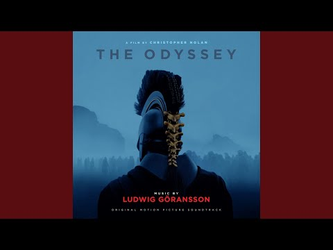
- 설명 앞부분: Provided to YouTube by Back Lot Music Ithaca · Ludwig Göransson The Odyssey (Original Motion Picture Soundtrack) ℗ 2026 Back Lot Music, a division of Universal Studios Music LLLP Released on: 2026-07-17 Main Artist: Ludwig Göransson Producer: Ludwig Göransson Composer: Ludwig Göransson Auto-generat…
- 같은 채널 평소 대비 ×4.4 (채널 최근 롱폼 중앙값 486,422회) · 평소 영상: Circe (525,582회) / Welcome Home Stranger (447,261회)
- 대본 없음 (설명) — 음성인식이 끝나면 도입부·흐름이 들어감
- 댓글 0/792: 좋은 점 — 영상 0 · 감사·응원 0 · 더 알고 싶은 것 0 · 아쉬운 점 — 영상 0 · 반박·불만 — 의견 다름 0 · 정치·사회 0 · 경험 공유 0 · 구독·다음 기대 0

### 698. 𝙋𝙇𝘼𝙔𝙇𝙄𝙎𝙏 찻집 리틀 포레스트

- https://www.youtube.com/watch?v=9NAEMS-BJT0 · off frame · 구독자 3,300 · 조회수 163,132 (×49.4, 하루 1,306.4) · 좋아요 7,094 (4.3%) · 78.8분 · 2026-06-16 · 주제 묶음 6. 피아노·클래식·연주곡 · 형식 플레이리스트·모음 (여러 곡) · 폴더 `W_9NAEMS-BJT0` (웹 승인)
- 썸네일: 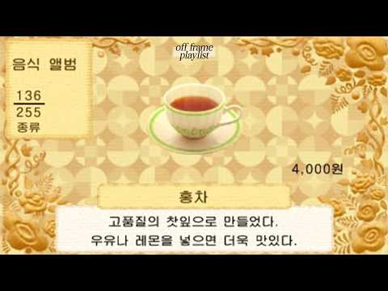
- 설명 앞부분: 『 페퍼민트 언덕 너머 사과숲 ☘︎ 리틀 포레스트 영업 중 ~ 』 ☀︎ 무더운 여름엔 리틀 포레스트로⸝⋆ 오늘도 열려있답니다 ☀︎ 홍차 ⭑ 3,000 라벤더 ⭑ 3,500 로즈마리 ⭑ 3,500 히비스커스 ⭑ 3,500 레몬밤 ⭑ 3,500 청귤 유자티 ⭑ 4,000 수박 민트티 ⭑ 4,000 매실차 ⭑ 4,000 (𝒔𝒆𝒂𝒔𝒐𝒏𝒂𝒍) 커피 ⭑ 2,500 미니 핫케이크 ⭑ 4,000 딸기 케이크 ⭑ 5,500 초콜릿 파르페 ⭑ 7,500 ⇣ 사과숲으로 오는 방법 ⇣ ­※ 플리의 스토리 구성은 off frame, 이미지는 닌텐도 게임…
- 같은 채널 평소 대비 ×81.9 (채널 최근 롱폼 중앙값 1,991회) · 평소 영상: 𝙋𝙇𝘼𝙔𝙇𝙄𝙎𝙏 Morning Wand House (1,991회) / 𝙋𝙇𝘼𝙔𝙇𝙄𝙎𝙏 떠나자! 윈도우 세계로 (1,926회)
- 대본 없음 (설명) — 음성인식이 끝나면 도입부·흐름이 들어감
- 댓글 129/129: 좋은 점 — 영상 1 · 감사·응원 4 · 더 알고 싶은 것 5 · 아쉬운 점 — 영상 2 · 반박·불만 — 의견 다름 0 · 정치·사회 0 · 경험 공유 5 · 구독·다음 기대 2
  - 좋은 점 — 영상 👍1 “ㅎ ㅏ.. 찻집 시리즈로 더 내주시면 안될까요?! 작업하는데 너무 듣기 좋아서 무한반복으로 하루종일 듣는 중 .. ❤️🔥”
  - 감사·응원 👍1 “진짜 너무 좋아요ㅠㅠ 없어지면 안돼 너무 소중해... 감사합니다”
  - 더 알고 싶은 것 👍2 “버블티는 없을까용..🥺 흑당버블티도 있으면 좋겠당 저두 추천해주세요 시험공부 중이예요!”
  - 더 알고 싶은 것 👍2 “기말 1주일 남은 저도 추천해주실 수 있나요 🥲”
  - 아쉬운 점 — 영상 👍1 “ㅎ ㅏ.. 찻집 시리즈로 더 내주시면 안될까요?! 작업하는데 너무 듣기 좋아서 무한반복으로 하루종일 듣는 중 .. ❤️🔥”
  - 아쉬운 점 — 영상 👍0 “진지하게 첫번째 곡이 너무 좋은데, 첫번째 곡 무한반복 영상 올려주실 순 없나요? ㅜㅜㅜ 비슷한 깔의 음악을 이곳저곳 찾아다녀도 결국 여기로 오게 됩니다... 너무 좋아요ㅠㅠ”
  - 경험 공유 👍2 “기말 1주일 남은 저도 추천해주실 수 있나요 🥲”
  - 경험 공유 👍1 “사장님 저도 메뉴 하나만 추천해주세요 !!!”
  - 구독·다음 기대 👍2 “3초듣고 구독박았습니다. 더 주세요.”
  - 구독·다음 기대 👍0 “노래 넘 귀여워요 구독했어요><”

### 699. Morning Coffee & Relaxing Italian Music ∣ Mediterranean Vibes, Ocean Sounds & Dreamy View…

- https://www.youtube.com/watch?v=Uu_fZV9xXRM · Onda di Relax · 구독자 25,900 · 조회수 1,261,879 (×48.7, 하루 7,167.0) · 좋아요 5,596 (0.4%) · 141.2분 · 2026-04-26 · 주제 묶음 4. 카페·매장·라운지 · 형식 음악 (그 밖 모양 — 한 편짜리 BGM 등) · 폴더 `W_Uu_fZV9xXRM` (웹 승인)
- 썸네일: 
- 설명 앞부분: Morning Coffee & Relaxing Italian Music ∣ Mediterranean Vibes, Ocean Sounds & Dreamy Views 🌅🌊☀ Welcome to "Onda di Relax" – Your Escape to the Mediterranean! Immerse yourself in the soothing sounds of Mediterranean instrumental music, paired with breathtaking views of Italy’s coastlines, villages, …
- 같은 채널 평소 대비 ×474.0 (채널 최근 롱폼 중앙값 2,662회) · 평소 영상: Morning in Italy 🎶 Mediterranean Music & Italian … (2,662회) / Autumn in Italy & Mediterranean Music 🍂 Romatic S… (2,733회)
- 대본 없음 (설명) — 음성인식이 끝나면 도입부·흐름이 들어감
- 댓글 141/141: 좋은 점 — 영상 0 · 감사·응원 1 · 더 알고 싶은 것 0 · 아쉬운 점 — 영상 0 · 반박·불만 — 의견 다름 0 · 정치·사회 0 · 경험 공유 0 · 구독·다음 기대 0
  - 감사·응원 👍1 “아침부터 기분좋은 음악 감사합니다~”

### 700. Beautiful September Autumn Forest 4K 🍁 Peaceful Nature Sounds, Healing Music & Deep Relax…

- https://www.youtube.com/watch?v=RJma4cwfqIY · Nature's Haven Sounds · 구독자 2,730 · 조회수 132,230 (×48.4, 하루 3,481.2) · 좋아요 475 (0.4%) · 154.8분 · 2026-09-11 · 주제 묶음 1. 수면·명상·힐링 · 형식 음악 (그 밖 모양 — 한 편짜리 BGM 등) · 폴더 `W_RJma4cwfqIY` (웹 승인)
- 썸네일: 
- 설명 앞부분: Beautiful September Autumn Forest 4K 🍁 Peaceful Nature Sounds, Healing Music & Deep Relaxation Welcome to Nature's Haven Sounds — a peaceful sanctuary where relaxing piano melodies and the soothing beauty of nature come together to calm your mind, heal your soul, and bring lasting inner peace. 🌿🎹 O…
- 같은 채널 평소 대비 ×32.1 (채널 최근 롱폼 중앙값 4,114회) · 평소 영상: 4K Autumn Forest Serenity 🍂 Peaceful Music for Re… (4,213회) / September 4K 🍂 Autumn Begins 🍂 Golden Forests, Qu… (4,016회)
- 대본 없음 (설명) — 음성인식이 끝나면 도입부·흐름이 들어감
- 댓글 49/49: 좋은 점 — 영상 0 · 감사·응원 0 · 더 알고 싶은 것 0 · 아쉬운 점 — 영상 0 · 반박·불만 — 의견 다름 0 · 정치·사회 0 · 경험 공유 0 · 구독·다음 기대 0

### 701. 여자력 상승하는 플리

- https://www.youtube.com/watch?v=KSeIkQ_dpsg · 무한우주에순간의빛일지라도 · 구독자 3,250 · 조회수 156,311 (×48.1, 하루 3,417.9) · 좋아요 5,089 (3.3%) · 15.4분 · 2026-09-03 · 주제 묶음 기타 · 형식 플레이리스트·모음 (여러 곡) · 폴더 `W_KSeIkQ_dpsg` (웹 승인)
- 썸네일: 
- 챕터: 0:00 [Gwen Stefani] Luxurious · 4:25 [Yellow Claw] Love & war · 6:22 [kali Uchis] Moonlight · 9:29 [Mariah Carey] Obsessed · 13:33 [Kairo Keyz & Thiago Sub] flo…
- 설명 앞부분: 해당 영상은 수익창출을 목적으로 업로드된 영상이 아니며 어떠한 수익도 발생하지 않습니다.
- 같은 채널 평소 대비 ×9.3 (채널 최근 롱폼 중앙값 16,857회) · 평소 영상: 오래된 사랑 이야기 (20,030회) / 그대는 나의 여름이 되세요 (13,684회)
- 대본 없음 (설명) — 음성인식이 끝나면 도입부·흐름이 들어감
- 댓글 12/12: 좋은 점 — 영상 0 · 감사·응원 1 · 더 알고 싶은 것 1 · 아쉬운 점 — 영상 0 · 반박·불만 — 의견 다름 0 · 정치·사회 0 · 경험 공유 1 · 구독·다음 기대 0
  - 감사·응원 👍2 “와 미친 내 플리랑 개비슷해요 내가 원하던 화장 플리는 이거 ㅜㅠㅠㅠ감사핮이다😢”
  - 더 알고 싶은 것 👍2 “마지막 곡 같은 플리 만들어주시면안돼요????ㅠㅠㅠㅠㅠㅠㅠㅠ ㅠㅠㅠㅠㅠㅠ”
  - 경험 공유 👍2 “와 미친 내 플리랑 개비슷해요 내가 원하던 화장 플리는 이거 ㅜㅠㅠㅠ감사핮이다😢”

### 702. Heartbreaking 💔 Lofi Mashup 🎧 Slowed + Reverb Songs ∣ Study, Focus & Late Night Vibes 2026

- https://www.youtube.com/watch?v=3k0BBE7e6TA · Z B Official Studio · 구독자 21,200 · 조회수 1,018,821 (×48.1, 하루 14,122.4) · 좋아요 3,332 (0.3%) · 8분 · 2026-08-08 · 주제 묶음 3. 공부·집중·작업 · 형식 음악 (그 밖 모양 — 한 편짜리 BGM 등) · 폴더 `W_3k0BBE7e6TA` (웹 승인)
- 썸네일: 
- 설명 앞부분: Welcome 🙏to world of soothing lofi music, where stress fades away, and peace takes over. This 2026 mind-relaxing lofi mix is perfect for: Deep Focus & Studying 📖 Relaxing & Meditation 🧘‍♂ Chilling After a Long Day 🌅 Peaceful Sleep & Stress Relief 😴 Let these calm beats and chill vibes take you on a…
- 같은 채널 평소 대비 ×4,141.5 (채널 최근 롱폼 중앙값 246회) · 평소 영상: Heartbreaking 💔 Lofi Mashup 🎧 Slowed + Reverb Son… (246회) / Heartbreaking 💔 Lofi Mashup 🎧 Slowed + Reverb Son… (246회)
- 대본 없음 (설명) — 음성인식이 끝나면 도입부·흐름이 들어감
- 댓글 75/73: 좋은 점 — 영상 0 · 감사·응원 0 · 더 알고 싶은 것 0 · 아쉬운 점 — 영상 0 · 반박·불만 — 의견 다름 0 · 정치·사회 0 · 경험 공유 0 · 구독·다음 기대 0

### 703. 𝗽𝗹𝗮𝘆𝗹𝗶𝘀𝘁🎧"이번 주말은 집이 아니라 오션뷰 카페입니다" ∣ 여유를 200% 충전하는 주말 아침 플레이리스트 ☕🌊velvetvoice

- https://www.youtube.com/watch?v=ayGgFCSVB30 · velvetvoice · 구독자 7,010 · 조회수 336,862 (×48.0, 하루 1,898.6) · 좋아요 3,860 (1.1%) · 53.9분 · 2026-04-24 · 주제 묶음 4. 카페·매장·라운지 · 형식 플레이리스트·모음 (여러 곡) · 폴더 `W_ayGgFCSVB30` (웹 승인)
- 썸네일: 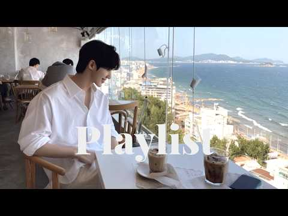
- 챕터: 0:00 Nothing More to Say · 2:54 You Already Know · 5:15 Same Room, Same Light · 8:20 Stay a Little Longer · 11:43 Petal Drift · 14:26 Azure Waltz · 16:47 Green Heartbeat · 20:21 Maybe It Meant Something · 23:50 Waiting for Your Reply · 26:56 Repeat
- 설명 앞부분: 이번 주말만큼은 여러분의 공간이 오션뷰 카페처럼 평온하고 눈부시길 바랍니다. 🌿✨ 오늘 velvetvoice가 준비한 플레이리스트는 이번 한 주 동안 여러분께 가장 많은 사랑을 받았던 곡들만 엄선한 [주간 베스트]입니다. 푸른 바다처럼, 여러분의 아침을 더 시원하고 여유롭게 채워줄 곡들로 가득 채웠습니다. 복잡한 생각은 잠시 접어두고, 커피 한 잔과 함께 파도 소리를 닮은 선율들에 푹 빠져보세요. 이번 주말, 이 음악들이 여러분의 시간을 가장 완벽하게 충전해 주길 바랍니다. I hope your space will be as ca…
- 같은 채널 평소 대비 ×58.1 (채널 최근 롱폼 중앙값 5,798회) · 평소 영상: 𝗽𝗹𝗮𝘆l𝗶𝘀𝘁 첫 소절부터 이렇게 달달하게 쳐다보면 어떡해? 🧡 ∣ 몽글몽글한 온기로 … (5,798회) / 𝗽𝗹𝗮𝘆l𝗶𝘀𝘁🎧"여름이 끝나가는 소리가 들릴 때" ∣ 선선해진 바람 타고 흐르는 감성 … (7,136회)
- 대본 없음 (설명) — 음성인식이 끝나면 도입부·흐름이 들어감
- 댓글 250/250: 좋은 점 — 영상 0 · 감사·응원 5 · 더 알고 싶은 것 3 · 아쉬운 점 — 영상 1 · 반박·불만 — 의견 다름 1 · 정치·사회 0 · 경험 공유 5 · 구독·다음 기대 2
  - 감사·응원 👍8 “아.이어폰끼고 이거들으니 아픈기억이 싹 살아지는것만 같아요.그런데 이노래를듣고 자을자는 저희 부모님은 이노래가 맘에 쏙들어서 5일을 넘게들어요.부모님에게 취향저격 당했나봐요! 좋은노래 100은 듣고가요.부모님에 웃음을 돼찾아주어서 감사해요.다른 노래도 기대할께요! 좋…”
  - 감사·응원 👍5 “진짜 오션뷰 캠핑장에서 해질녘부터 불멍 중 내내 듣습니다. 파도소리와 어울리는 좋은노래. 잘 듣고갑니다 고맙습니다”
  - 더 알고 싶은 것 👍3 “노래 한국어로 번역해주세요.. 가사 뜻 알고싶어요”
  - 더 알고 싶은 것 👍2 “26:56부터 나오는 노래 제목, 가수 궁금해요~~ 너무 좋네요”
  - 아쉬운 점 — 영상 👍1 “이번 앨범 4~5개월째 듣고 있어요. 타이틀곡 무한 반복해서 듣다가 수록곡들도 모두 좋아졌어요.”
  - 경험 공유 👍8 “아.이어폰끼고 이거들으니 아픈기억이 싹 살아지는것만 같아요.그런데 이노래를듣고 자을자는 저희 부모님은 이노래가 맘에 쏙들어서 5일을 넘게들어요.부모님에게 취향저격 당했나봐요! 좋은노래 100은 듣고가요.부모님에 웃음을 돼찾아주어서 감사해요.다른 노래도 기대할께요! 좋…”
  - 구독·다음 기대 👍3 “기분이 좋아지는 노래입니다🥰 전곡이 다멋져요 예쁜카페분위기도최고예요 매일듣고있어요🤗”
  - 구독·다음 기대 👍1 “8월 스위스여행때 기차타고 경치보면서 이어폰으로 혼자 들었어요 아직까지도 매일 듣고있어요 중독이예요”

### 704. 9 Adagios in Romantic Style ∣ AI Music ∣ Cello & Piano

- https://www.youtube.com/watch?v=N4UaovHvFPE · Vesper Classics · 구독자 16,400 · 조회수 785,138 (×47.9, 하루 4,704.2) · 좋아요 12,329 (1.6%) · 28분 · 2026-05-05 · 주제 묶음 14. AI 음악 · 형식 AI 음악 · 폴더 `W_N4UaovHvFPE` (웹 승인)
- 썸네일: 
- 챕터: 0:00 Dust on the Window Pane · 2:29 A Quiet Departure · 5:03 The Last Candle · 7:57 Dreaming in Sepia · 11:01 A Garden in Winter · 14:00 The Porcelain Hour · 16:50 Fading Watercolour · 19:49 An Old Photograph · 22:38 Waiting for No One · 25:13 The Unfinished Waltz
- 설명 앞부분: Welcome to Vesper Classics Step into a world of quiet beauty and emotional depth This collection is a heartfelt tribute to the timeless voice of the cello and the intimate soul of the piano. These slow, breathing compositions are crafted to wrap you in warmth and stillness — perfect for releasing t…
- 같은 채널 평소 대비 ×1,195.0 (채널 최근 롱폼 중앙값 657회) · 평소 영상: The Most Beautiful And Emotional Adagio ∣ Cello &… (657회) / 10 Beautiful Classical Adagios ∣ Rachmaninoff Sty… (665회)
- 대본 없음 (설명) — 음성인식이 끝나면 도입부·흐름이 들어감
- 댓글 421/421: 좋은 점 — 영상 0 · 감사·응원 1 · 더 알고 싶은 것 0 · 아쉬운 점 — 영상 0 · 반박·불만 — 의견 다름 0 · 정치·사회 0 · 경험 공유 0 · 구독·다음 기대 0
  - 감사·응원 👍1 “음악 도 아름답지만 답 을 주신 댓글 이 더 빛나고 마음 이 느껴지네요 예쁜맘 아르답고 다정하고 따뜻한 댓글 감사합니다 ~~^^”

### 705. [KPOP playlist] 난리도 아닌 감다살 케이팝 노동요

- https://www.youtube.com/watch?v=AnsLD0Klc6s · 오이는빼주세요 · 구독자 13,100 · 조회수 621,620 (×47.5, 하루 4,788.4) · 좋아요 1,976 (0.3%) · 59.1분 · 2026-06-11 · 주제 묶음 10. 팝송·K팝·J팝 · 형식 플레이리스트·모음 (여러 곡) · 폴더 `W_AnsLD0Klc6s` (웹 승인)
- 썸네일: 
- 같은 채널 평소 대비 ×44.5 (채널 최근 롱폼 중앙값 13,976회) · 평소 영상: NCT 127 엔시티 127 PLAYLIST 2026 l 엔시티 127 노래모음 (신곡포… (14,795회) / CHUNG HA 청하 PLAYLIST 2026 l 청하 노래모음 (신곡포함) l 𝐂𝐇𝐔𝐍… (13,157회)
- 대본 없음 (없음) — 음성인식이 끝나면 도입부·흐름이 들어감
- 댓글 47/47: 좋은 점 — 영상 0 · 감사·응원 4 · 더 알고 싶은 것 2 · 아쉬운 점 — 영상 0 · 반박·불만 — 의견 다름 0 · 정치·사회 0 · 경험 공유 0 · 구독·다음 기대 0
  - 감사·응원 👍5 “에투메 진짜 감다살....넣어주셔서 감사해요..ㅠㅠ”
  - 감사·응원 👍3 “플리짜실때bpm도 고려해주셨으면 좋겠어요ㅠㅠ 빠른템포음악나오다가 확템포느린곡 나오니까 무드가 죽네용ㅠㅠ 플리감사해요 잘듣고갑니당”
  - 더 알고 싶은 것 👍41 “혹시 투어스 노래 모음 만들어 주실수 있나여..?”
  - 더 알고 싶은 것 👍2 “혹시 베이비몬스터 플리 만들어주실수 있나요..? 수록곡 모읍집 하나만 만들어주시면 감사하겠습니다ㅠㅠ 너무 즐겨 듣는 플리 항상 만들어주셔서 감사합니다!!!🫶🏻”

### 706. Romantic Era Adagios (Cello, Violin & Piano) — Most Beautiful Adagios of All Time ∣ Relax…

- https://www.youtube.com/watch?v=Dd3djaUS3Fw · Classical Adagios · 구독자 13,100 · 조회수 620,759 (×47.4, 하루 4,055.5) · 좋아요 9,840 (1.6%) · 256.8분 · 2026-05-19 · 주제 묶음 6. 피아노·클래식·연주곡 · 형식 플레이리스트·모음 (여러 곡) · 폴더 `W_Dd3djaUS3Fw` (웹 승인)
- 썸네일: 
- 설명 앞부분: Romantic Era Adagios (Cello, Violin & Piano). Immerse yourself in the timeless beauty of the world’s most emotional adagios. From haunting strings to breathtaking orchestral harmonies, this collection features some of the most beautiful slow classical pieces ever composed. Perfect for relaxation, s…
- 같은 채널 평소 대비 ×1,412.4 (채널 최근 롱폼 중앙값 440회) · 평소 영상: Beethoven Style Calm Adagio ∣ Relaxing Cello, Pia… (440회) / Calm Music 🎻 The Most Beautiful Chopin-Inspired C… (439회)
- 대본 없음 (설명) — 음성인식이 끝나면 도입부·흐름이 들어감
- 댓글 187/187: 좋은 점 — 영상 0 · 감사·응원 0 · 더 알고 싶은 것 0 · 아쉬운 점 — 영상 0 · 반박·불만 — 의견 다름 0 · 정치·사회 0 · 경험 공유 0 · 구독·다음 기대 0

### 707. 【Playlist】Shamisen Rock You’ll Want to Replay ∣ Female Vocals ∣ Anime Songs / J-POP / Wor…

- https://www.youtube.com/watch?v=skyHiOHKUJI · Geisha Girl · 구독자 15,200 · 조회수 716,370 (×47.1, 하루 4,367.4) · 좋아요 9,934 (1.4%) · 111.1분 · 2026-05-08 · 주제 묶음 10. 팝송·K팝·J팝 · 형식 플레이리스트·모음 (여러 곡) · 폴더 `W_skyHiOHKUJI` (웹 승인)
- 썸네일: 
- 챕터: 0:00 東雲色の剣 · 5:05 運命のDetermination · 10:00 オリガミ · 15:07 兆し · 19:09 挑発 · 23:18 くちびるほどけ · 28:18 未完成 · 33:20 澄指 · 37:57 皮肉 · 42:39 月影解いて · 46:27 飾りのままじゃいられない · 50:53 GOLD
- 설명 앞부분: 🌸Soulful Sounds of Japan🎶 This channel brings you Japanese-style BGM, blending traditional Japanese music with modern sounds. Perfect for relaxation, studying, meditation, working, gaming, and more! 🎸 Japanese Rock & Metal 🎻 Gagaku × Modern Music 🌙 Chill, Jazz, and Lo-Fi with a Japanese Touch Shari…
- 같은 채널 평소 대비 ×60.6 (채널 최근 롱폼 중앙값 11,816회) · 평소 영상: 【Playlist】Shamisen Rock You’ll Love After One Lis… (11,925회) / 【Playlist】Addictive Dark Japanese Rock ∣ Bewitchi… (11,706회)
- 대본 없음 (설명) — 음성인식이 끝나면 도입부·흐름이 들어감
- 댓글 193/190: 좋은 점 — 영상 0 · 감사·응원 1 · 더 알고 싶은 것 1 · 아쉬운 점 — 영상 0 · 반박·불만 — 의견 다름 0 · 정치·사회 0 · 경험 공유 0 · 구독·다음 기대 1
  - 감사·응원 👍1 “オリガミ 이 곡이 마음에 드네요. 감사합니다.”
  - 더 알고 싶은 것 👍2 “Have you considered making a remix? The song is fantastic, and a remix would likely make it even more popular. 부탁드립니다 🎁”
  - 구독·다음 기대 👍3 “未完成 ほんまに まじで すごすぎる😲 정말 팬이 되었습니다.❤❤”

### 708. Deep work focus music for productivity ~ Ambient study music for concentration and calm m…

- https://www.youtube.com/watch?v=Bk-0NZHRPFA · Work Mode Audio · 구독자 11,100 · 조회수 522,168 (×47.0, 하루 3,915.6) · 좋아요 6,358 (1.2%) · 91분 · 2026-06-08 · 주제 묶음 3. 공부·집중·작업 · 형식 음악 (그 밖 모양 — 한 편짜리 BGM 등) · 폴더 `W_Bk-0NZHRPFA` (웹 승인)
- 썸네일: 
- 설명 앞부분: Deep work focus music for productivity ~ Ambient study music for concentration and calm mind Welcome to your sanctuary for peak productivity. 🌊 Are you struggling to maintain your flow state today? How do you usually set up your workspace for a deep work session? We invite you to immerse yourself i…
- 같은 채널 평소 대비 ×99.9 (채널 최근 롱폼 중앙값 5,225회) · 평소 영상: Focus Music ∣ Deep Work Ambient Soundscapes For I… (5,225회) / Oceanfront Focus Music ~ Ambient Study Music And … (5,147회)
- 대본 없음 (설명) — 음성인식이 끝나면 도입부·흐름이 들어감
- 댓글 254/254: 좋은 점 — 영상 1 · 감사·응원 0 · 더 알고 싶은 것 0 · 아쉬운 점 — 영상 0 · 반박·불만 — 의견 다름 0 · 정치·사회 0 · 경험 공유 1 · 구독·다음 기대 0
  - 좋은 점 — 영상 👍1 “오늘 처음 이곳에 방문하게 되었어요 요즘 ai영상 ai 음악등 ai가만들은 창작물에대해 지겨운 생각을 가지고있었어요 하지만 당신의 체널의 음악은 제가 매우 듣기 좋아하는 스타일의 음악입니다!!”
  - 경험 공유 👍1 “오늘 처음 이곳에 방문하게 되었어요 요즘 ai영상 ai 음악등 ai가만들은 창작물에대해 지겨운 생각을 가지고있었어요 하지만 당신의 체널의 음악은 제가 매우 듣기 좋아하는 스타일의 음악입니다!!”

### 709. Bamboo Water + Tibetan Zen Sounds ∣ Cleanse Aura & Space ∣ Removes All Negative Energy

- https://www.youtube.com/watch?v=oA7EmuZ7JCU · Serene Vibes · 구독자 15,700 · 조회수 737,542 (×47.0, 하루 4,613.7) · 좋아요 14,609 (2.0%) · 184.3분 · 2026-05-12 · 주제 묶음 1. 수면·명상·힐링 · 형식 음악 (그 밖 모양 — 한 편짜리 BGM 등) · 폴더 `W_oA7EmuZ7JCU` (웹 승인)
- 썸네일: 
- 설명 앞부분: Bamboo Water + Tibetan Zen Sounds ∣ Cleanse Aura & Space ∣ Removes All Negative Energy Bamboo Water + Tibetan Zen Sounds ∣ Cleanse Aura & Space ∣ Removes All Negative Energy Bamboo Water + Tibetan Zen Sounds ∣ Cleanse Aura & Space ∣ Removes All Negative Energy Bamboo Water and Tibetan Zen Sounds cr…
- 같은 채널 평소 대비 ×79.0 (채널 최근 롱폼 중앙값 9,340회) · 평소 영상: Stop Overthinking • Tibetan Zen Sounds For Deep R… (9,340회) / Tibetan Healing Meditation ∣ Deep Sleep, Emotiona… (10,561회)
- 대본 없음 (설명) — 음성인식이 끝나면 도입부·흐름이 들어감
- 댓글 204/204: 좋은 점 — 영상 0 · 감사·응원 1 · 더 알고 싶은 것 0 · 아쉬운 점 — 영상 0 · 반박·불만 — 의견 다름 0 · 정치·사회 0 · 경험 공유 0 · 구독·다음 기대 0
  - 감사·응원 👍1 “멋진 영상이네요 감사합니다”

### 710. “사는 게 힘들수록, 그 시절 노래가 더 그립습니다…”｜가슴 저리는 7080 추억의 명곡모음｜슬로우 블루스 락발라드

- https://www.youtube.com/watch?v=uS61Sf1rAsQ · 추억의 멜로디 · 구독자 4,300 · 조회수 201,550 (×46.9, 하루 2,943.0) · 좋아요 3,830 (1.9%) · 85.9분 · 2026-08-11 · 주제 묶음 9. 가요·발라드·트로트 · 형식 커버·직접 부른 노래 · 폴더 `W_uS61Sf1rAsQ` (웹 승인)
- 썸네일: 
- 설명 앞부분: 사는 게 힘들수록, 이상하게도 우리는 다시 그 시절 노래를 찾게 됩니다. 젊은 날의 사랑, 말하지 못했던 이별, 가슴 한편에 오래 남아 있는 사람, 그리고 세월이 지나서야 더 깊게 느껴지는 인생의 무게까지… 이번 앨범은 한국인이 오래 사랑해온 추억의 명곡들을 깊고 허스키한 남자 보컬과 슬로우 블루스 락발라드 감성으로 다시 담아낸 연속듣기 모음입니다. 화려하게 부르기보다, 가슴속 깊은 곳에서 천천히 꺼내듯 부르는 목소리. 조용히 들을수록 더 먹먹해지고, 혼자 듣다 보면 어느새 오래전 기억이 떠오르는 노래들입니다. 사랑을 위하여, 사…
- 같은 채널 평소 대비 ×18.4 (채널 최근 롱폼 중앙값 10,952회) · 평소 영상: 비 오는 밤이면 더 그리운 노래…🥀 #추억의명곡 ∣ 강태윤 슬로우 록발라드 명곡 모음 (11,924회) / 살다 보니 이런 노래가 좋다…🥀 강태윤 슬로우 록 발라드 ∣ 추억의 명곡 모음 (9,979회)
- 대본 없음 (설명) — 음성인식이 끝나면 도입부·흐름이 들어감
- 댓글 84/84: 좋은 점 — 영상 1 · 감사·응원 9 · 더 알고 싶은 것 1 · 아쉬운 점 — 영상 1 · 반박·불만 — 의견 다름 0 · 정치·사회 0 · 경험 공유 5 · 구독·다음 기대 0
  - 좋은 점 — 영상 👍7 “멋지게 잘불러요. 듣기좋아요”
  - 감사·응원 👍20 “여전히잘듣고있읍니다 더운날씨에건강조심하시고 늘그목소리간직하시고 늘고맙고감사합니다 우리집사람여전히계속듣고있읍니다 목소리엄청좋타고요”
  - 감사·응원 👍6 “마음에 닿아서 기분전환이되요 감사해요”
  - 더 알고 싶은 것 👍0 “답글 잘 보았네요 제가 올해 65세이고 손주까지 보았지만 젊은시절 집사람 하고 연애하고 신혼 초 그때 그시절 많이 듣던곡들이라 몇번을 들어도 실증이 날수가 없는 곡들이네요 낮에 안양천 자전거 도로를 달리며 항상 듣고 있네요 좋은곡들 앞으로도 많이 부탁합니다 항상 건강…”
  - 아쉬운 점 — 영상 👍1 “한참 듣고 있는데 광고가 ㅠ짜증”
  - 경험 공유 👍20 “여전히잘듣고있읍니다 더운날씨에건강조심하시고 늘그목소리간직하시고 늘고맙고감사합니다 우리집사람여전히계속듣고있읍니다 목소리엄청좋타고요”
  - 경험 공유 👍5 “나도 남자인데 또한 나도 노래 한다고 하던사람인데 .... 어디서 숨어있다가 이제 내가 노래를 듣게 만들어 주었지 나는 이미 80세가 되었는데 도 너무 빠진다 유튜브 로 목소리 를 듣게 하지말고 .... 내마음 뜻대로 되지는 않겠지만 지금 내나이에 너무좋아 유튜브 가…”

### 711. ᴘʟᴀʏʟɪsᴛ ∣ 🌊푸른 바다처럼 시원한 7월 여돌 뮤직비디오 플리 ∣ 여름 청량 최신 걸그룹 인기곡 뮤비 모음 ∣ 4K 초고화질

- https://www.youtube.com/watch?v=2EbdnZvOSwc · 마쁠(MA-PLE·KPOP) · 구독자 24,800 · 조회수 1,162,112 (×46.9, 하루 12,914.6) · 좋아요 3,754 (0.3%) · 127.2분 · 2026-07-21 · 주제 묶음 10. 팝송·K팝·J팝 · 형식 플레이리스트·모음 (여러 곡) · 폴더 `W_2EbdnZvOSwc` (웹 승인)
- 썸네일: 
- 챕터: 0:00 RESCENE - Pretty Girl · 3:32 I.O.I - 갑자기 (Suddenly) · 6:47 BABYMONSTER - I LIKE IT · 10:13 aespa - LEMONADE · 13:21 QWER - Our Voyage · 16:30 STAYC - 2 L0VE · 19:29 H1-KEY(하이키) - 여름이었다 · 22:41 IVE - BLACKHOLE · 25:59 Hearts2Hearts - Lemon Tang · 28:42 최예나 (YENA) - 캐치 캐치 (Catch Cat… · 31:46 BABYMONSTER - SUGAR HONEY ICE… · 34:44 RESCENE - Deja Vu · 37:48 NMIXX - Heavy Serenade · 40:58 최유정 (CHOI YOOJUNG) - 비장의 무기 (… · 43:25 DAVICHI - 타임캡슐 · 47:35 IVE - BANG BANG · 50:32 izna - METRONOME · 53:43 BLACKPINK - 뛰어 (JUMP) · 56:46 MEOVV - In my hands · 59:09 Billlie - WORK
- 설명 앞부분: 재생하는 순간 이곳이 여름휴가지! 더위까지 잊게 만드는 시원한 K-POP 플레이리스트🍋🌴 🌊 푸른 바다처럼 시원한 청량감과 심장을 울리는 강렬한 비트가 만나는 여름 여돌 플리☀ 상큼한 청량감부터 HOT한 쇠맛 사운드까지, 한 번에 즐기는 여름 텐션🎧💫 런닝, 라이딩, 쇠질, 운동할 때 텐션 업💪 드라이브, 공부, 일할 때, 노동요로도 찰떡💡 매장 BGM으로도 부담 없이 어울리는 여름 감성 선곡🎶 청량한 무드와 강렬한 에너지의 완벽한 조합⚡ 4K 초고화질로 즐기는 K-POP 걸그룹 뮤직비디오 모음 오늘도 재생 버튼 하나로 여름 텐션…
- 같은 채널 평소 대비 ×7.1 (채널 최근 롱폼 중앙값 163,433회) · 평소 영상: K-Pop Playlist ∣ 듣는 순간 심장 먼저 뛰는 걸그룹 뮤직비디오 노래 모음 ∣… (163,433회) / KPOP Playlist ∣ 느좋 여돌 뮤비 플리(리믹스포함) ∣ 아직도 고퀄 플리 찾아… (198,428회)
- 대본 없음 (설명) — 음성인식이 끝나면 도입부·흐름이 들어감
- 댓글 84/84: 좋은 점 — 영상 0 · 감사·응원 5 · 더 알고 싶은 것 0 · 아쉬운 점 — 영상 3 · 반박·불만 — 의견 다름 0 · 정치·사회 0 · 경험 공유 0 · 구독·다음 기대 0
  - 감사·응원 👍6 “이 여름 마쁠님 덕분에 시원하며 기분 좋은 음악 들 수 있어 좋네요 언제나 응원 합니다 항상 행운이 가득하길 바랍니다”
  - 감사·응원 👍3 “혹시 영상 21:9로 만들어주실순 없나요?....차에서 보고싶은데요...암튼 잘듣고있어요~감사합니다~!!”
  - 아쉬운 점 — 영상 👍64 “광고가 계속 나와요😢😢”
  - 아쉬운 점 — 영상 👍9 “화질, 음질, 플리구성 다 좋은 믿고듣는 마쁠! 06:47, 13:21 특히 화질 미쳤음ㅋㅋ”

### 712. Fall Asleep In 3 Minutes 😴 Mozart For Babies 💤 Extra Relaxing Baby Sleep Music ∣ Dark Scr…

- https://www.youtube.com/watch?v=P87LUaYiD34 · Mother & Baby Sounds · 구독자 17,700 · 조회수 826,868 (×46.7, 하루 15,089.6) · 좋아요 6,031 (0.7%) · 150.1분 · 2026-08-25 · 주제 묶음 1. 수면·명상·힐링 · 형식 음악 (그 밖 모양 — 한 편짜리 BGM 등) · 폴더 `W_P87LUaYiD34` (웹 승인)
- 썸네일: 
- 설명 앞부분: Mozart Brahms lullaby 🌙 Extra Relaxing Baby Sleep Music 💤 Dark Screen Soft Mozart lullabies with a gentle music box tone to help your little one fall asleep in minutes and stay asleep all night. This extra relaxing baby sleep music with a dark screen is perfect for bedtime, nap time, and peaceful n…
- 같은 채널 평소 대비 ×22.0 (채널 최근 롱폼 중앙값 37,530회) · 평소 영상: AMAZING BABY SLEEP MUSIC FOR BABY TO SLEEP FAST! … (37,961회) / The Best Sleep Music for Babies ✨ Fall Asleep in … (37,098회)
- 대본 없음 (설명) — 음성인식이 끝나면 도입부·흐름이 들어감
- 댓글 0/0: 좋은 점 — 영상 0 · 감사·응원 0 · 더 알고 싶은 것 0 · 아쉬운 점 — 영상 0 · 반박·불만 — 의견 다름 0 · 정치·사회 0 · 경험 공유 0 · 구독·다음 기대 0

### 713. 조용히 틀어뒀는데 끝까지 듣게 되는 노래 ㅣ오늘 고생한 당신을 위한 편안한 올드팝 라디오 ㅣ 7080 감성 카페음악

- https://www.youtube.com/watch?v=ej-ck75-Nps · Plain Pop · 구독자 4,250 · 조회수 198,488 (×46.7, 하루 1,346.6) · 좋아요 2,761 (1.4%) · 85.2분 · 2026-05-24 · 주제 묶음 9. 가요·발라드·트로트 · 형식 음악 (그 밖 모양 — 한 편짜리 BGM 등) · 폴더 `W_ej-ck75-Nps` (웹 승인)
- 썸네일: 
- 챕터: 0:00 A Letter Home ∣ 집으로 부치는 편지 · 2:54 The Old Church on the Hill ∣ … · 6:44 Yesterday's Rain ∣ 어제의 비 · 10:53 The Quiet After Everyone Left… · 14:28 The Old Piano in the Hall ∣ 복… · 18:01 The Old Friend at the Corner … · 21:15 Everything My Hands Have Lear… · 24:43 Rain on the Rooftop ∣ 옥상에 내리는… · 28:25 Starry Night Memory ∣ 별빛 가득한 … · 31:18 Letters Unsent ∣ 부치지 못한 편지들 · 34:17 Moonlight Tears ∣ 달빛 아래 흘린 눈물 · 37:26 Evening Harbor ∣ 저녁 무렵의 항구 · 40:15 The Old Wooden Bridge ∣ 낡은 나무…
- 설명 앞부분: 🎵 Plain Pop ∣ 7080 올드팝 라디오 🌸나이가 들수록 유독 더 그리워지는 멜로디들이 있죠. 🌸세월의 흐름 속에 묻어두었던 소중한 기억들이 이 노래 한 곡을 통해 다시금 따뜻하게 피어오르길 바랍니다 🌸70년대, 80년대 그 시절 우리가 좋아했던 팝송의 감성을 현대적인 음향 기술로 담백하게 재해석했습니다. 🌸영롱하게 울리는 옥구슬 소리가 여러분의 마음 한구석에 작은 울림이 되었으면 합니다. 🌸여러분의 젊은 날은 어떤 모습이었나요? 오늘 이 음악과 함께 소중했던 그때로 잠시 여행을 떠나보시는 건 어떨까요?" 🎵 Time Tr…
- 같은 채널 평소 대비 ×44.5 (채널 최근 롱폼 중앙값 4,460회) · 평소 영상: 푸른 바다, 아름다운 수국과 함께하는 추억의 노래 l 아침에 커피 한잔과 함께 듣는 편안… (4,460회) / 듣다 보니 옛 사랑이 그리워...가슴을 적시는 노래 ㅣ아침부터 듣기 좋은 올드팝 라디오 … (4,395회)
- 대본 없음 (설명) — 음성인식이 끝나면 도입부·흐름이 들어감
- 댓글 156/156: 좋은 점 — 영상 1 · 감사·응원 33 · 더 알고 싶은 것 0 · 아쉬운 점 — 영상 1 · 반박·불만 — 의견 다름 0 · 정치·사회 0 · 경험 공유 6 · 구독·다음 기대 1
  - 좋은 점 — 영상 👍2 “참으로 마음을 추수리는데 도움되는 음악 임니다 감사히 듣고 있씀니다”
  - 감사·응원 👍23 “참좋다!세상이 어수선하고 엉망인데 그나마 들으니 할링이되네요 감사 감사~”
  - 감사·응원 👍19 “넘 감사합니다. 맘이 많이 가라앉고 진정이 되네요. 음악 너무 좋아요. 이런곡을 작곡하신분들은 아마도 천재가 아닐지..?”
  - 경험 공유 👍2 “내가 많이 사랑하는 나무님도 이노래 듣고 힐링되기를 바랍니다..따스한품을 내어주니 매미가되어 노래해줄께요..이밤도 잘자요~~^^♡♡♡”
  - 구독·다음 기대 👍13 “맑고 깊은 보컬의 선율이 마음 깊숙이 스며듭니다. 오래 머물게 되네요. 구독합니다.”

### 714. 카페음악 ☕ 5월의 카페에서 잔잔하게 듣기 좋은 음악 🌿 7080 카페음악모음 🎶 중년을 위한 감성 카페 명곡 모음

- https://www.youtube.com/watch?v=5-b-PY1I2ss · Cozy Cafe Music · 구독자 3,870 · 조회수 180,351 (×46.6, 하루 1,077.1) · 좋아요 4,175 (2.3%) · 12.8분 · 2026-05-04 · 주제 묶음 9. 가요·발라드·트로트 · 형식 플레이리스트·모음 (여러 곡) · 폴더 `W_5-b-PY1I2ss` (웹 승인)
- 썸네일: 
- 설명 앞부분: Cozy Cafe Music에서 준비한 5월 감성 가득한 7080 카페 음악 플레이리스트입니다. 따뜻한 봄 햇살이 머무는 카페 분위기 속에서 듣기 좋은 잔잔한 명곡들로 구성되어, 중년 세대 시청자분들께 깊은 공감과 편안함을 선사합니다. 부드러운 멜로디와 감성적인 선율이 어우러져 아침의 여유로운 시작, 오후의 휴식, 그리고 감성적인 저녁까지 하루 종일 부담 없이 즐길 수 있는 힐링 음악입니다. ☕🌿🎶 이 영상에 수록된 음악은 Cozy Cafe Music 채널 제작팀이 직접 엄선하고 정성껏 선곡 및 편집하여 완성한 플레이리스트입니다.…
- 같은 채널 평소 대비 ×22.0 (채널 최근 롱폼 중앙값 8,213회) · 평소 영상: 🌅☕ 가을 아침에 듣기 좋은 카페음악｜커피 한 잔의 여유와 달콤한 감성 음악｜2026 미… (8,213회) / 🌿☕ 가을의 여유를 담은 카페음악｜중년을 위한 잔잔하고 편안한 음악｜조용한 휴식 시간 (9,287회)
- 대본 없음 (설명) — 음성인식이 끝나면 도입부·흐름이 들어감
- 댓글 19/19: 좋은 점 — 영상 2 · 감사·응원 4 · 더 알고 싶은 것 0 · 아쉬운 점 — 영상 0 · 반박·불만 — 의견 다름 0 · 정치·사회 0 · 경험 공유 0 · 구독·다음 기대 0
  - 좋은 점 — 영상 👍1 “너무너무 듣기좋아요 자주 뵈어요~~^”
  - 좋은 점 — 영상 👍0 “너무너무 듣기좋아요”
  - 감사·응원 👍2 “좋은노래불러 주셔서 감사해요 🎉좋아요 ^^”
  - 감사·응원 👍0 “참 아름다운 노래와 감미로운 목소리 주님이 주신 은혜입니다. 멀리 스페인에서 듣고 있어요 감사합니다. ❤”

### 715. 업장을 소멸하고 복을 부르는 천수경 노래 ∣ 힐링 불교 음악

- https://www.youtube.com/watch?v=AT2MDa7WctU · 진서연의 세월한곡 · 구독자 9,450 · 조회수 440,067 (×46.6, 하루 2,494.7) · 좋아요 4,066 (0.9%) · 14.1분 · 2026-04-25 · 주제 묶음 1. 수면·명상·힐링 · 형식 음악 (그 밖 모양 — 한 편짜리 BGM 등) · 폴더 `W_AT2MDa7WctU` (웹 승인)
- 썸네일: 
- 챕터: 0:00 마음의 등불 천수경 · 4:37 만사형통 천수경 · 9:40 천수의 아리랑
- 설명 앞부분: 부처님의 자비로우신 천수경 말씀을 정겨운 트로트 가락에 담았습니다. 고단한 일상 속에서 지친 마음을 위로받고, 모든 업장을 씻어내어 하시는 일마다 만사형통하시길 지극한 마음으로 기원합니다. 🎧 타임라인 (Timestamp)
- 같은 채널 평소 대비 ×1,264.6 (채널 최근 롱폼 중앙값 348회) · 평소 영상: 야! 인생아!｜진서연의 세월한곡｜오늘도 웃으며 살아보자 (348회) / 세월아, 우리 친구하자 🌸 나이 들어도 내 마음은 청춘 ∣ 진서연의 세월한곡 ∣ 감성 트… (343회)
- 대본 없음 (설명) — 음성인식이 끝나면 도입부·흐름이 들어감
- 댓글 391/391: 좋은 점 — 영상 3 · 감사·응원 90 · 더 알고 싶은 것 2 · 아쉬운 점 — 영상 0 · 반박·불만 — 의견 다름 0 · 정치·사회 1 · 경험 공유 13 · 구독·다음 기대 0
  - 좋은 점 — 영상 👍7 “목소리 맑고 청량해서 귀에쏙 들어오네요 관세음보살님께감사핲니다 서원합니다”
  - 좋은 점 — 영상 👍2 “저체온증이와서 고생중인데 몸이따뜻하게해주소서 딸 미용실자격증도 올해안에 꼭따게해주시옵소서 일이술술풀리고 나쁜액운물리쳐주시고 이제는 행운만가득들어오게해주시고 로또1등에도 당첨되어서 돈고생에서 벗어나게해주시옵소서 비나이다 관세음보살님 천수경불교노래 마음에와닿아서 듣고 또…”
  - 감사·응원 👍12 “나무괸세음보살 관세음보살 관세음보살 감사합니다 .🎉🎉🎉”
  - 감사·응원 👍11 “고맙습니다 필승”
  - 더 알고 싶은 것 👍6 “빚을 갚을때까지 건강하게 부탁드립니다”
  - 더 알고 싶은 것 👍1 “4월부터 신랑회사입사 기다리는데 조카며느리만 둘이 입사시키고 자리가 아직 비질않아 취업을 못하고 있습니다 기다리기 너무힘들어요. 제차례는 언제 오나요? 빠른시일내에 자리나오게 해 주셔서 취업할수있게 도와주세요.기다리는게 너무 힘이 듭니다”
  - 정치·사회 👍2 “식민지 일중러미 노예 물질문명 전쟁 인면수심 정치 기득권 亡 분노의 함성 몸 건너!!!!!!!!X? 한민족 단군조선 천손 정신문명 평화 권선징악 인권 지구촌 興 자신의 화두 맘 발견!!!!!!!!X? 파병을 반대한다 미국 자본주의 한국 인본주의 생명 이재명 얼 트럼프…”
  - 경험 공유 👍15 “우리아들 96년 음 10월11일생 하는일 제발 잘풀리고 금전에 허덕이지않고 살앗으면합니다 우리아들 안정된 생활하는거보는게 소원 입니다 관세음보살 님비나이다 울 신랑 60년생 음3월29일생 다친지 8년째 여태 혼자 간병하고잇네요 아무쪼록 무병장수하고 수명장수하게 비나이…”
  - 경험 공유 👍5 “부처님 저희자녀들 모두건강주셰요”

### 716. "सुकून भरी रातें 🌙 ∣ Romantic Hindi LoFi Songs ∣ Relaxing Sleep Music May 15

- https://www.youtube.com/watch?v=YtyLIn9mrcw · Hindi Tuning · 구독자 25,200 · 조회수 1,164,083 (×46.2, 하루 7,422.2) · 좋아요 5,710 (0.5%) · 110분 · 2026-05-15 · 주제 묶음 1. 수면·명상·힐링 · 형식 음악 (그 밖 모양 — 한 편짜리 BGM 등) · 폴더 `W_YtyLIn9mrcw` (웹 승인)
- 썸네일: 
- 설명 앞부분: अगर आप सुकून, प्यार और हल्की सी यादों में खो जाना चाहते हैं, तो यह Romantic Hindi LoFi म्यूज़िक आपके लिए है। ✨ Perfect for: Study Time 📚 Late Night Relax 🌌 Sleep & Peace 😴 Romantic Mood ❤ हेडफोन लगाइए, आँखें बंद कीजिए और इस सुहानी LoFi दुनिया में खो जाइए। 🌙 Romantic Hindi LoFi Music – Full Chill & …
- 같은 채널 평소 대비 ×161.4 (채널 최근 롱폼 중앙값 7,213회) · 평소 영상: "सुकून भरी रातें 🌙 ∣ Romantic Hindi LoFi Songs ∣ … (7,213회) / "सुकून भरी रातें 🌙 ∣ Romantic Hindi LoFi Songs ∣ … (7,174회)
- 대본 없음 (설명) — 음성인식이 끝나면 도입부·흐름이 들어감
- 댓글 160/158: 좋은 점 — 영상 0 · 감사·응원 0 · 더 알고 싶은 것 0 · 아쉬운 점 — 영상 0 · 반박·불만 — 의견 다름 0 · 정치·사회 0 · 경험 공유 0 · 구독·다음 기대 0

### 717. LiL Baby - Work For Money ( Official Music Video)

- https://www.youtube.com/watch?v=3FclEMAiJ6Q · Vibes World Records · 구독자 225 · 조회수 10,375 (×46.1, 하루 223.0) · 좋아요 147 (1.4%) · 7분 · 2026-09-02 · 주제 묶음 기타 · 형식 한 곡 (뮤직비디오·음원·가사) · 폴더 `W_3FclEMAiJ6Q` (웹 승인)
- 썸네일: 
- 설명 앞부분: “WORK FOR MONEY” is an emotional, high-energy motivational trap anthem about grinding through the struggle, chasing success, and building a better life from nothing. When nobody believes in you, you have two choices: give up or work harder. This song is for everybody who stayed focused through the …
- 같은 채널 평소 대비 ×6.1 (채널 최근 롱폼 중앙값 1,707회) · 평소 영상: Lil Baby _Still outside (Official Music Video) (1,734회) / Love Me -Lil Baby (Official Music Video) (1,680회)
- 대본 없음 (설명) — 음성인식이 끝나면 도입부·흐름이 들어감
- 댓글 3/3: 좋은 점 — 영상 0 · 감사·응원 0 · 더 알고 싶은 것 0 · 아쉬운 점 — 영상 0 · 반박·불만 — 의견 다름 0 · 정치·사회 0 · 경험 공유 0 · 구독·다음 기대 0

### 718. Lightning — Romantic Ambient Pop & 80s Synth Ballad ∣ Thomas J. Cole

- https://www.youtube.com/watch?v=2x_gLGrUdoY · Thomas J. Cole · 구독자 4,040 · 조회수 186,137 (×46.1, 하루 7,198.0) · 좋아요 2,685 (1.4%) · 5분 · 2026-09-23 · 주제 묶음 12. 커버·노래 부르기 · 형식 음악 (그 밖 모양 — 한 편짜리 BGM 등) · 폴더 `W_2x_gLGrUdoY` (웹 승인)
- 썸네일: 
- 설명 앞부분: “Lightning” is a passionate confession of love, capturing the overwhelming power of a real emotional connection that strikes without warning. It speaks about that precise instant when feelings turn into an undeniable force, filling the quietest night with warmth, electricity, and profound clarity. …
- 같은 채널 평소 대비 ×76.9 (채널 최근 롱폼 중앙값 2,420회) · 평소 영상: My True Story — Emotional Cinematic Love Song ∣ 8… (2,470회) / Thomas J. Cole – Because I Love You (2,369회)
- 대본 없음 (설명) — 음성인식이 끝나면 도입부·흐름이 들어감
- 댓글 94/94: 좋은 점 — 영상 0 · 감사·응원 1 · 더 알고 싶은 것 0 · 아쉬운 점 — 영상 0 · 반박·불만 — 의견 다름 0 · 정치·사회 0 · 경험 공유 0 · 구독·다음 기대 0
  - 감사·응원 👍2 “가을날 행복의 영감을 주는 음악입니다. 끔과 희망이 있고 미래에 대한 희망을 노래하게 합니다. 오랜만에 좋은 음악 감사합니다.”

### 719. Cinematic Piano Meets Melodic Techno 🌌 ∣ Neo Classic Pulse Vol.02 ∣ 1 Hour Journey

- https://www.youtube.com/watch?v=gSn_K5j9uB8 · Neo Classic Pulse · 구독자 4,720 · 조회수 216,952 (×46.0, 하루 2,684.0) · 좋아요 5,585 (2.6%) · 45.2분 · 2026-07-30 · 주제 묶음 6. 피아노·클래식·연주곡 · 형식 긴 한 곡·반복 (N시간) · 폴더 `W_gSn_K5j9uB8` (웹 승인)
- 썸네일: 
- 설명 앞부분: What happens when cinematic piano, orchestral emotion and melodic techno become one continuous journey? Neo Classic Pulse Vol.02 is a one-hour instrumental experience built around expressive grand piano, warm cello, elegant violin lines, evolving orchestral harmony and restrained electronic rhythm.…
- 같은 채널 평소 대비 ×67.5 (채널 최근 롱폼 중앙값 3,214회) · 평소 영상: If Beethoven Lived In 2126 ⚡ ∣ Future Classical S… (3,343회) / PIANO × TECHNO ∣ BEYOND THE AFTERGLOW ∣ Emotional… (3,086회)
- 대본 없음 (설명) — 음성인식이 끝나면 도입부·흐름이 들어감
- 댓글 166/164: 좋은 점 — 영상 0 · 감사·응원 0 · 더 알고 싶은 것 0 · 아쉬운 점 — 영상 0 · 반박·불만 — 의견 다름 0 · 정치·사회 0 · 경험 공유 0 · 구독·다음 기대 0

### 720. 途中広告なし【カフェBGM】ひとり静かな喫茶店｜のんびり過ごす午後の時間｜作業用・読書・リラックス｜Cafe Music・Coffee Shop Ambience

- https://www.youtube.com/watch?v=QgtDgADXHS4 · Kokoro Music Room · 구독자 21,100 · 조회수 968,888 (×45.9, 하루 8,350.6) · 좋아요 5,123 (0.5%) · 120.9분 · 2026-06-25 · 주제 묶음 2. 자연 소리·백색소음 · 형식 음악 (그 밖 모양 — 한 편짜리 BGM 등) · 폴더 `W_QgtDgADXHS4` (웹 승인)
- 썸네일: 
- 설명 앞부분: ひとり時間を心地よく彩るカフェBGMをお届けします☕🌿 🎧 おすすめのカフェBGMはこちら 🌻 夏カフェBGMシリーズはこちら Step into a cozy retro coffee shop. Enjoy a quiet moment with coffee and gentle music. Perfect for reading, studying, working, or relaxing.☕ 📖 Perfect background music for reading and studying ☕ Ideal for tea time 🌙 Great for unwinding…
- 같은 채널 평소 대비 ×46.5 (채널 최근 롱폼 중앙값 20,819회) · 평소 영상: 途中広告なし【カフェBGM】秋空と高原カフェ｜澄んだ空と秋風を感じながらゆっくり過ごす癒し時間｜作… (20,819회) / 途中広告なし【カフェBGM】心ゆるむレトロカフェ｜懐かしい喫茶店でゆっくり過ごす癒し時間｜作業用・… (20,406회)
- 대본 없음 (설명) — 음성인식이 끝나면 도입부·흐름이 들어감
- 댓글 166/166: 좋은 점 — 영상 0 · 감사·응원 0 · 더 알고 싶은 것 0 · 아쉬운 점 — 영상 0 · 반박·불만 — 의견 다름 0 · 정치·사회 0 · 경험 공유 0 · 구독·다음 기대 0

