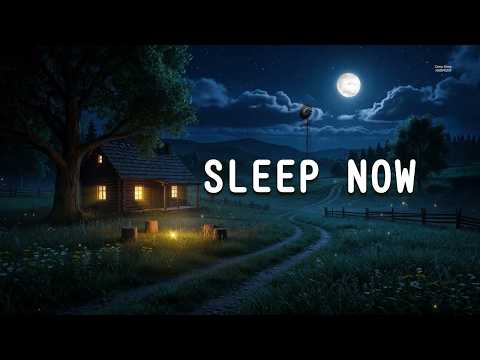
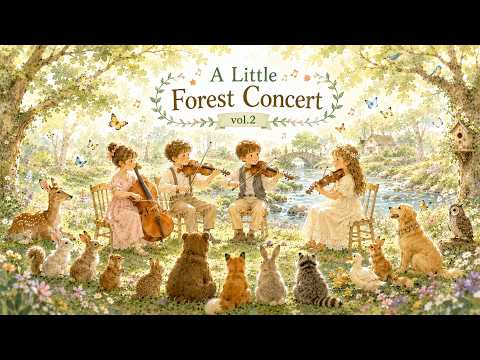

# 음악 — 성공 사례 분석: 사례별 자세히 #681–#720

`analysis.md` 의 9번 (같은 # 번호). 자동 생성 — `tools/success_analysis.py` v1.4.1 (2026-10-18 08:09 UTC). ※ 연구·교육용 — 투자 권유가 아님.

### 681. KUMAMICHI（熊道） — Japanese Zen Music Along the Bear’s Path

- https://www.youtube.com/watch?v=vFJuk4U-V7Q · Aether Journey · 구독자 34,200 · 조회수 1,824,386 (×53.3, 하루 35,738.7) · 좋아요 15,562 (0.9%) · 347분 · 2026-08-28 · 주제 묶음 1. 수면·명상·힐링 · 형식 음악 (그 밖 모양 — 한 편짜리 BGM 등) · 폴더 `W_vFJuk4U-V7Q` (웹 승인)
- 썸네일: 
- 설명 앞부분: KUMAMICHI 熊道 — “The Bear’s Path.” Across a quiet landscape wrapped in muted earth tones, a lone samurai walks calmly beside a great black bear, their footsteps moving together beneath a vast and silent sky. Neither speaks. Neither hurries. They simply continue along the same path. Kumamichi is Japa…
- 대본 없음 (설명) — 음성인식이 끝나면 도입부·흐름이 들어감
- 댓글 0/231 (다 받지 못함): 좋은 점 — 영상 0 · 감사·응원 0 · 더 알고 싶은 것 0 · 아쉬운 점 — 영상 0 · 반박·불만 — 의견 다름 0 · 정치·사회 0 · 경험 공유 0 · 구독·다음 기대 0

### 682. If You Can’t Sleep, Play This 🌙 Instant Deep Sleep Music & Anxiety Relief ( Very Effectiv…

- https://www.youtube.com/watch?v=PFn7jFxLbhE · Deep Sleep Harmony · 구독자 12,800 · 조회수 681,819 (×53.3, 하루 9,774.9) · 좋아요 4,793 (0.7%) · 181.2분 · 2026-08-09 · 주제 묶음 1. 수면·명상·힐링 · 형식 긴 한 곡·반복 (N시간) · 폴더 `W_PFn7jFxLbhE` (웹 승인)
- 썸네일: 
- 챕터: 0:00 Soft Piano & Gentle Night Sou… · 30:00 Black Screen Transition (Pitc… · 180:00 Gentle Fade Out & Peaceful Wa…
- 설명 앞부분: 🌙 Welcome to your quiet sanctuary for the night. If your mind is heavy, your thoughts are racing, or you simply need a gentle space to unwind after a long day, you are in the right place. Wrap yourself in your favorite blanket, let your shoulders drop, and let this peaceful soundscape wash away all…
- 대본 없음 (설명) — 음성인식이 끝나면 도입부·흐름이 들어감
- 댓글 0/237 (다 받지 못함): 좋은 점 — 영상 0 · 감사·응원 0 · 더 알고 싶은 것 0 · 아쉬운 점 — 영상 0 · 반박·불만 — 의견 다름 0 · 정치·사회 0 · 경험 공유 0 · 구독·다음 기대 0

### 683. Krishna Mantra ∣ Pregnancy Music ∣ Music for pregnant women ∣ Be Listener Music

- https://www.youtube.com/watch?v=TuMDXAiXlf0 · Be Listener Music · 구독자 18,500 · 조회수 984,087 (×53.2, 하루 7,409.3) · 좋아요 7,316 (0.7%) · 12.4분 · 2026-06-07 · 주제 묶음 기타 · 형식 음악 (그 밖 모양 — 한 편짜리 BGM 등) · 폴더 `W_TuMDXAiXlf0` (웹 승인)
- 썸네일: 
- 설명 앞부분: Krishna Mantra ∣ Pregnancy Music ∣ Music for pregnant women ∣ Be Listener Music Pregnancy का समय एक माँ और उसके गर्भ में पल रहे बच्चे के लिए बहुत ही पवित्र और भावनात्मक यात्रा होती है। इस वीडियो में प्रस्तुत Krishna Mantra Pregnancy Music गर्भवती महिलाओं के मन को शांत करने, सकारात्मक ऊर्जा महसूस कर…
- 대본 없음 (설명) — 음성인식이 끝나면 도입부·흐름이 들어감
- 댓글 0/384 (다 받지 못함): 좋은 점 — 영상 0 · 감사·응원 0 · 더 알고 싶은 것 0 · 아쉬운 점 — 영상 0 · 반박·불만 — 의견 다름 0 · 정치·사회 0 · 경험 공유 0 · 구독·다음 기대 0

### 684. The Little Forest Concert Vol.2 ∣ Cozy String Quartet for Reading & Relaxing ∣ No Mid-Rol…

- https://www.youtube.com/watch?v=0DvSj6DAKDM · 그루잠 Gurujam · 구독자 27,400 · 조회수 1,453,914 (×53.1, 하루 11,158.4) · 좋아요 34,658 (2.4%) · 45.1분 · 2026-06-10 · 주제 묶음 3. 공부·집중·작업 · 형식 음악 (그 밖 모양 — 한 편짜리 BGM 등) · 폴더 `W_0DvSj6DAKDM` (웹 승인)
- 썸네일: 
- 챕터: 0:00 A Tiny Concert Begins · 1:28 Morning Seats in the Forest · 3:31 A Waltz for Woodland Friends · 5:24 The Squirrel’s Quiet Applause · 6:54 Sunlight on the String Quartet · 8:08 Cello by the Mossy Path · 10:02 Waltzing Through Green Shadows · 11:36 The Little Meadow Ensemble · 13:48 Quiet Pizzicato Footsteps · 15:23 Afternoon Strings in the Woods · 17:13 Golden Light Between Trees · 19:21 A Calm Bowing Circle · 20:58 Goodbye from the Forest Stage · 22:32 Replay
- 설명 앞부분: A cozy string quartet playlist inspired by a small concert in the forest. Gentle classical background music for reading, studying, relaxing, and quiet mornings. 작은 숲속 연주회를 떠올리며 만든 따뜻한 현악 4중주 BGM입니다. 독서, 공부, 아침 작업, 카페 분위기, 조용한 휴식 시간에 편하게 틀어두기 좋은 음악입니다. This playlist is designed to stay calm and comf…
- 같은 채널 평소 대비 ×173.9 (채널 최근 롱폼 중앙값 8,359회) · 평소 영상: A Day in the Forest After the Rain ∣ Peaceful Sol… (8,359회) / Cozy Fall Morning Music 🍂 ∣ Village Folk & Classi… (10,758회)
- 대본 없음 (설명) — 음성인식이 끝나면 도입부·흐름이 들어감
- 댓글 364/364: 좋은 점 — 영상 1 · 감사·응원 4 · 더 알고 싶은 것 2 · 아쉬운 점 — 영상 0 · 반박·불만 — 의견 다름 0 · 정치·사회 0 · 경험 공유 1 · 구독·다음 기대 0
  - 좋은 점 — 영상 👍1 “현악기 선율이 너무 듣기 좋습니다. 옹기종기 앉아있는 귀여운 친구들 오와열을 맞춰 집중하는 모습이 자연속 연주회를 보는것만 같네요. 눈과 귀.. 다 호강하고 갑니다 ^^”
  - 감사·응원 👍4 “음악이 내가 좋아하는 스타일이에요 그림도 넘 예뻐서 동화속에 들어간 느낌이랄까 행복한 시간이 되는것 같아서 감사합니다.”
  - 감사·응원 👍4 “평화롭네요 감사합니다”
  - 더 알고 싶은 것 👍2 “안녕하세요~ 혹시 이 음악을 행사 진행 중에 사용하기 위해 다운로드할 수 있을까요? 감사합니다🙏🏼너무 좋아합니다❤️‍🔥”
  - 경험 공유 👍4 “음악이 내가 좋아하는 스타일이에요 그림도 넘 예뻐서 동화속에 들어간 느낌이랄까 행복한 시간이 되는것 같아서 감사합니다.”

### 685. 그 집 앞 (스페인어 버전 뮤직비디오) ∣ 이재성 원곡 라틴팝 리메이크 ∣ 한국어/스페인어 가사 자막 ∣ A Korean Old Pop Song in Spani…

- https://www.youtube.com/watch?v=T1fdlthH7Fw · J.K.M · 구독자 37,500 · 조회수 1,984,740 (×52.9, 하루 13,140.7) · 좋아요 21,566 (1.1%) · 4.2분 · 2026-05-20 · 주제 묶음 10. 팝송·K팝·J팝 · 형식 커버·직접 부른 노래 · 폴더 `W_T1fdlthH7Fw` (웹 승인)
- 썸네일: 
- 설명 앞부분: 이번 작품은 이재성 작사·작곡, 이재성 원곡의 명곡 「그 집 앞」을 스페인어 감성의 라틴 팝 스타일로 리메이크한 뮤직비디오입니다. 또한, 본 영상은 음악의 감성과 몰입감을 보다 효과적으로 전달하기 위해 AI 보조 영상 연출 및 립싱크 기술을 활용하여 제작되었습니다. 전체적인 기획·연출·편집은 채널 운영자 J.K.M이 직접 진행하였습니다. 🎵 원곡 : 이재성 (이재성 작사, 작곡) 🎤 피처링 보컬 : 남미 출신 보컬리스트 Arianny 🎵 스페인어 번안 및 리메이크 : J.K.M 🤖 음악 및 영상 제작 : AI 보조 기술 활용 끝까…
- 대본 없음 (설명) — 음성인식이 끝나면 도입부·흐름이 들어감
- 댓글 1,077/1,077: 좋은 점 — 영상 29 · 감사·응원 40 · 더 알고 싶은 것 26 · 아쉬운 점 — 영상 5 · 반박·불만 — 의견 다름 4 · 정치·사회 8 · 경험 공유 22 · 구독·다음 기대 11
  - 좋은 점 — 영상 👍39 “와우.. 솔직히 원곡보다 뭔가 더 귀에 쏙쏙 박히면서 느낌이 더 좋네요.”
  - 좋은 점 — 영상 👍8 “원곡보다 더 나은거 아닙니까? 뭔가 가슴에 와닿는 보이스 가 정말 매력적이네요..”
  - 감사·응원 👍119 “이러케 세계를 다 먹어야되요 화이팅 드립니다~!”
  - 감사·응원 👍23 “그 집 앞 은 한글로 불렀네ㅋㅋ 골든에 영원히 깨질 수 없는 처럼 ㅋㅋ 감사합니다”
  - 더 알고 싶은 것 👍4 “구독 누르고 갑니다 영상 올려주셔서 감사합니다 많이 올려 주세요 ~~!!!!😊😊😊”
  - 더 알고 싶은 것 👍3 “이게 정확히 스페니쉬 언어라면 진짜 한국 80풍하고 진짜 잘 어울리네요 더 좋은거 같아요 그리고 아마도 트롯트풍도 진짜 스페니쉬가 잘 어울릴꺼 같아요 제발 다양한 80노래도 해주시고 트롯트도 많이 번안으로 만들어주세요”
  - 아쉬운 점 — 영상 👍2 “너무 좋다 노래가 목소리가 너무좋네”
  - 아쉬운 점 — 영상 👍1 “노래는 잘 하는데 감정이 우리 감정이 아니라서 아쉽네요. 슬픈 노래인데”
  - 반박·불만 — 의견 다름 👍5 “중독성 장난아닙니다”
  - 반박·불만 — 의견 다름 👍2 “이곡이 슬픈곡은 아닌데 눈물방울이 흘러 내리는 이유는 무얼까요? 이상하네요 그저 건강하시길 진심으로 바랍니다 🙏🏼 사랑합니다 화이팅하세요 응원합니다 영원히 함께...”
  - 정치·사회 👍23 “이재성..가장 뛰어난 싱어송라이터였는데.. 고독한DJ라는..노래불렀다가....전두환정권에서.방송금지당해..최전성기..87년에...갑자기TV에서.사라졌고.. 라디오에서도 이재성 노래를 10년동안 들을수 없었음.”
  - 정치·사회 👍1 “편집자님 할일이 하나 더 생겻네요. AI 가수와 가장 비슷한 외모와 가창력을 지닌 외국인 가수를 찾는 일입니다. 두 가수가 겨루는 모습을 보여주면 바둑애서 알파고와 겨룬 이세돌고수의 장면과 대조를 이룰 겁니다. 어려울 거라 생각하지만 기대해 봅니다. 이곳에서 아는 가…”
  - 경험 공유 👍548 “몇년전에 한국가요를 외국어버전으로 번역해서 영상으로 제작한 유튜브가 있었습니다. 3개국 외국어로 제작해서 한국가요를 알리고자 하는 영상이었는데 하루아침에 모든영상이 없어진일이 일어났지요. 계속 이어졌으면 지금의 K-Pop 붐이 한층 더 올라가지 않았을까 싶은 생각이 …”
  - 경험 공유 👍20 “내가 좋아하는 노래 스페인어로 들으니 최고다 진짜 고급진 노래네 ❤❤❤”
  - 구독·다음 기대 👍8 “제가 한때 굉장히 좋아했던... 너무나 닮아서 구독박고 갑니다.”
  - 구독·다음 기대 👍6 “775좋와요 그집앞구독누르며 ㅡ기가막혀 ㅡ따봉 영상도. 멋져 👍 ❤❤❤❤❤🎉건강하세요”

### 686. 카페음악 ∣ 최고 다방 음악❤️ 카페에서 듣기 좋은 노래 ❤️ 50대-60대가 좋아하는 중년가요 ∣ 아침 카페 ∣ 여름에 듣기 좋은 카페 음악 ✨

- https://www.youtube.com/watch?v=_h8CNlmPkjo · Korean Cafe Music · 구독자 3,280 · 조회수 173,594 (×52.9, 하루 1,227.1) · 좋아요 3,824 (2.2%) · 10.8분 · 2026-05-29 · 주제 묶음 4. 카페·매장·라운지 · 형식 플레이리스트·모음 (여러 곡) · 폴더 `W__h8CNlmPkjo` (웹 승인)
- 썸네일: 
- 설명 앞부분: Korean cafe music 에서 준비한 감성 가득한 카페 음악 플레이리스트입니다. 50대와 60대가 사랑하는 중년가요와 추억의 명곡들을 엄선하여 오래된 음악다방의 따뜻한 분위기를 담은 감성 카페 음악으로 구성하였습니다. 부드럽게 흐르는 멜로디와 마음을 편안하게 해주는 감미로운 선율은 지나간 추억과 아름다운 순간들을 자연스럽게 떠올리게 하며, 여유로운 아침 카페의 분위기와 여름의 시원한 감성을 동시에 전해줍니다. 커피 한 잔과 함께 조용히 듣기 좋은 음악으로, 휴식 시간, 독서, 드라이브, 업무 또는 하루를 시작하는 아침 시간…
- 같은 채널 평소 대비 ×2,845.8 (채널 최근 롱폼 중앙값 61회) · 평소 영상: 🎵💛 주말에 듣는 추억의 카페음악｜가을 감성을 담은 옛 노래｜마음을 따뜻하게 해주는 힐링… (61회) / 🌿🎶 하루 종일 듣고 싶은 카페음악｜일·공부·휴식에 어울리는 편안한 음악｜마음을 치유하는… (62회)
- 대본 없음 (설명) — 음성인식이 끝나면 도입부·흐름이 들어감
- 댓글 22/22: 좋은 점 — 영상 0 · 감사·응원 8 · 더 알고 싶은 것 0 · 아쉬운 점 — 영상 0 · 반박·불만 — 의견 다름 0 · 정치·사회 0 · 경험 공유 0 · 구독·다음 기대 0
  - 감사·응원 👍4 “카페음악 10년이 지났는데 오랜만에 들으니 음악 좋으네 감사합니다🎉❤”
  - 감사·응원 👍3 “감사합니다 응원합니다 👏 사랑합니다 💕”

### 687. (중간 광고 없음) 𝐏𝐥𝐚𝐲𝐥𝐢𝐬𝐭 ∣ 그때의 우린 왜 그리 서툴렀을까 ｜ 밤에 듣는 시린 첫사랑 발라드 플레이리스트 🎧 #발라드 #이별노래 #플레이리스트 #잔…

- https://www.youtube.com/watch?v=O-wm0ZSF2KU · SonaWave · 구독자 12,300 · 조회수 649,643 (×52.8, 하루 4,359.8) · 좋아요 5,448 (0.8%) · 125.1분 · 2026-05-22 · 주제 묶음 9. 가요·발라드·트로트 · 형식 플레이리스트·모음 (여러 곡) · 폴더 `W_O-wm0ZSF2KU` (웹 승인)
- 썸네일: 
- 챕터: 0:00 01. 그늘 · 2:59 02. 서투른 걸음 · 5:58 03. 눈 먼지 · 9:17 04. Stay · 12:04 05. 가로등 · 15:12 06. 골목길 · 18:21 07. 새벽비 · 21:11 08. 서투른 · 24:24 09. 서툰 밤 · 28:11 10. 숨소리 · 31:16 11. 시선 · 35:12 12. 안녕 · 38:42 13. 첫눈 · 41:40 Repeat
- 설명 앞부분: 골목길을 채우던 가로등 불빛이 유난히 길게 그림자를 늘리던 밤. 아무런 예고도 없이 찾아온 바람에 너의 얇은 셔츠 깃이 흔들렸고, 나는 그저 주머니 속 손만 만지작거렸지. 마음의 속도를 맞추는 법을 몰라서 너의 한 걸음에 나의 두 걸음을 얹으며 그렇게 멀어져 가던 뒷모습. 잘 지내냐는 흔한 인사조차 바람에 날려 보낼 만큼 오랜 시간이 흘렀지만, 어느 잔잔한 밤, 문득 스쳐 가는 온기 속에서 여전히 머물러 있는 그날의 우리를 만납니다. 🎵 Tracklist & Timeline ✨Producer & Visual Director ∣ S…
- 같은 채널 평소 대비 ×133.3 (채널 최근 롱폼 중앙값 4,872회) · 평소 영상: 다 잊은 줄 알았는데.... ∣ 𝐏𝐥𝐚𝐲𝐥𝐢𝐬𝐭 🎧 중간광고 X (4,872회) / 다시 만날 수 있을까... ∣ ℙ𝕝𝕒𝕪𝕝𝕚𝕤𝕥 #kballad #kpop 🎧 중간광고 X (4,907회)
- 대본 없음 (설명) — 음성인식이 끝나면 도입부·흐름이 들어감
- 댓글 674/674: 좋은 점 — 영상 3 · 감사·응원 25 · 더 알고 싶은 것 17 · 아쉬운 점 — 영상 11 · 반박·불만 — 의견 다름 6 · 정치·사회 0 · 경험 공유 56 · 구독·다음 기대 4
  - 감사·응원 👍229 “78년생 ..97학번입니다. 삐삐치고 손편지 쓰던 시절이 그립네요. 내 대학교 시절. 내 청춘과 함께했던 그녀에게 감사합니다. 우리는 서툴렀지만 서로에게 좋은 추억과 기억과 시간을 주었네요. 어디서든 항상 잘 살고 있을 그녀에게 다시한번 감사합니다.”
  - 감사·응원 👍50 “81년생 닭띠들 잘살고 있나?? ㅎ대학첫사랑도생각나고.. 지금은 얼굴엔 주름과 나이만먹어가네 가끔은 그시절이 그립다 친구들아 힘내자”
  - 더 알고 싶은 것 👍4 “가로등하고 골목길좀 따로올려주시면 감사하겠습니다^^;”
  - 더 알고 싶은 것 👍3 “1,2,3번 노래 따로 올려 주실수 있나요?”
  - 아쉬운 점 — 영상 👍23 “청춘은 서툴기에 그 자체로 빛난다. 완벽하다면 너무 지루할테니까..”
  - 아쉬운 점 — 영상 👍5 “3:00 서투른걸음 아주 좋네요 운동하면서 무한반복중입니다 좋은 ai 음악 감사합니다😊”
  - 반박·불만 — 의견 다름 👍6 “사진 예뻐요 😊실존인물은 아니죠? ㅎㅎ”
  - 반박·불만 — 의견 다름 👍1 “79. 98학번 우린 인생에 많은걸 포기한세대인데 왜이리 지금이 뒤돌아보니 어색하냐 이럴려고 견딘게 아닌데 이제는 한국아니 른곳에가서 살고싶구나”
  - 경험 공유 👍10 “서투르게 고백했고 그걸 받아줬던 네가 내 첫사랑이었어.. 처음볼때부터 사랑에 빠져서 사귀고 싶었는데 쟈기는 좋은 사람이 아니라며 망설였었지.. 진짜 미안하다.. 내가 너무 부족했어.. 너란 사람을 온전히 사랑하기에 많이 부족했어... 벌써 20년이 더 지났지만.. 가…”
  - 경험 공유 👍7 “2008년 학교복학해서 학교에 적응이 안될쯤 먼저 다가와서 말걸어주고 그렇게 이쁜 사랑을 했었는데 가끔 그때가 너무 그립다 어느덧 40이 넘었구나 한번쯤은 잘살고 있는지 궁금하네 그때도 지금도 행복했으면 좋겠다”
  - 구독·다음 기대 👍0 “진짜 노래 너무좋아요. 음원발매 간절히 기다려요ㅠ”
  - 구독·다음 기대 👍0 “와 사진때문에 바로 구독했습니다.. 진짜 이런 여친있었으면.. 26.6.18 목 2143”

### 688. 빈예서 신곡 공개! 듣자마자 눈물 터졌다… “나훈아의 감성이 그대로” 😭🎵

- https://www.youtube.com/watch?v=noMxR6lohxM · 서울 뮤직 · 구독자 1,160 · 조회수 61,256 (×52.8, 하루 6,006.6) · 좋아요 351 (0.6%) · 6.9분 · 2026-10-08 · 주제 묶음 기타 · 형식 한 곡 (뮤직비디오·음원·가사) · 폴더 `W_noMxR6lohxM` (웹 승인)
- 썸네일: 
- 설명 앞부분: 🎵✨ 빈예서 신곡 〈눈물이 먼저 대답했어요〉 공개! ✨🎵 💔 한 소절이 시작되는 순간, 가슴 깊이 숨겨두었던 감정이 터져 나옵니다. 😭 애절한 목소리와 따뜻한 멜로디가 어우러져 듣는 순간 눈시울을 적시는 감성 트로트. 🎤 사랑, 그리움, 추억 그리고 전하지 못했던 마음을 한 곡에 담았습니다. 🌹 잔잔하게 시작해 후렴으로 갈수록 깊어지는 감정선이 이 노래의 매력입니다. 💫 마지막까지 들으면 더욱 오래 마음에 남는 특별한 감동을 느낄 수 있습니다. ❤️ 오늘 하루, 잠시 모든 것을 내려놓고 이 노래와 함께 따뜻한 시간을 보내세요. 💬…
- 같은 채널 평소 대비 ×72.2 (채널 최근 롱폼 중앙값 848회) · 평소 영상: 🎵 김태연 신곡｜지갑 속 낡은 사진… 사랑이 남아 있기에 아픔도 남았다 💔😭 (864회) / 🎵💔 나훈아 아들·딸의 눈물의 듀엣… 부모님께 바친 노래에 나훈아도 끝내 오열 😭🎤❤️ (884회)
- 대본 없음 (설명) — 음성인식이 끝나면 도입부·흐름이 들어감
- 댓글 19/24: 좋은 점 — 영상 0 · 감사·응원 4 · 더 알고 싶은 것 0 · 아쉬운 점 — 영상 0 · 반박·불만 — 의견 다름 1 · 정치·사회 0 · 경험 공유 0 · 구독·다음 기대 0
  - 감사·응원 👍2 “ㅂ이푼빈예서화이팅🎉🎉🎉”
  - 감사·응원 👍1 “예서양 노래 넘 심금을울립니다 넘 잔잔하고 부드럽고 예술적인 감정담아 응원합니다”
  - 반박·불만 — 의견 다름 👍2 “예서노래가. 아닌데”

### 689. Chinese Zen Music🎵: Bamboo flute, erhu & Guzheng ∣ Relaxing music @ZenFlute-o5f2h

- https://www.youtube.com/watch?v=yGbaHLXUZWY · ZenFlute · 구독자 32,700 · 조회수 1,721,711 (×52.6, 하루 9,789.0) · 좋아요 30,489 (1.8%) · 91.4분 · 2026-04-25 · 주제 묶음 6. 피아노·클래식·연주곡 · 형식 음악 (그 밖 모양 — 한 편짜리 BGM 등) · 폴더 `W_yGbaHLXUZWY` (웹 승인)
- 썸네일: 
- 설명 앞부분: Welcome to Channel " Zen Flute " 🌙Let the soothing sounds of Bamboo Flute and Guzheng transport you to a world of peace and relaxation. This 1-hour instrumental music is specially designed to help with deep sleep, stress relief, and meditation. 🎶 🎧 Why Listen? ❤ Promotes deep relaxation & stress re…
- 대본 없음 (설명) — 음성인식이 끝나면 도입부·흐름이 들어감
- 댓글 0/1,257 (다 받지 못함): 좋은 점 — 영상 0 · 감사·응원 0 · 더 알고 싶은 것 0 · 아쉬운 점 — 영상 0 · 반박·불만 — 의견 다름 0 · 정치·사회 0 · 경험 공유 0 · 구독·다음 기대 0

### 690. [Playlist] 초록빛 향기 머무는 여름날과 어울리는 음악 ∣ 잔잔한 감성팝 카페음악 ∣ Healing lo-fi pop ballad cafe music ∣…

- https://www.youtube.com/watch?v=l3rA0WjsaNM · 낡은 레코드 · 구독자 8,870 · 조회수 465,685 (×52.5, 하루 3,140.2) · 좋아요 2,259 (0.5%) · 77.9분 · 2026-05-23 · 주제 묶음 1. 수면·명상·힐링 · 형식 플레이리스트·모음 (여러 곡) · 폴더 `W_l3rA0WjsaNM` (웹 승인)
- 썸네일: 
- 설명 앞부분: [Playlist] 초록빛 향기 머무는 여름날과 어울리는 음악 ∣ 잔잔한 감성팝 카페음악 ∣ Healing lo-fi pop ballad cafe music ∣ 여름 플레이리스트 📻 따뜻한 노란 조명이 비추는 겨울 카페, 창밖으로는 조용히 눈이 내려 얇은 눈송이들이 밤공기 위에 고요함을 덮어 씌우는 시간 오늘 낡은 레코드가 전하는 음악은 천천히 흐르는 발라드 · 팝 · 어쿠스틱 선율로 겨울 저녁의 숨결을 닮은 잔잔한 플레이리스트입니다. ✨🌙 창가 자리에 앉아 서두르지 않고 떨어지는 눈을 바라보며, 두 손에는 아직 따뜻함이 남아 있…
- 같은 채널 평소 대비 ×46.4 (채널 최근 롱폼 중앙값 10,032회) · 평소 영상: [Playlist] 비 오는 날 혼자 조용히 듣고 싶은 음악 ∣ 잔잔한 감성팝 카페음악 … (10,188회) / [Playlist] 맑은 가을 하늘 아래 듣기 좋은 음악 ∣ 잔잔한 감성팝 카페음악 🎧 … (9,877회)
- 대본 없음 (설명) — 음성인식이 끝나면 도입부·흐름이 들어감
- 댓글 71/71: 좋은 점 — 영상 0 · 감사·응원 7 · 더 알고 싶은 것 6 · 아쉬운 점 — 영상 2 · 반박·불만 — 의견 다름 1 · 정치·사회 0 · 경험 공유 0 · 구독·다음 기대 1
  - 감사·응원 👍1 “너무 좋아요!^^ 힐링되는 음악에 지친 기분마저 업되는 듯!~~~~~~ 창을 내려놔도 음악이 잔잔히 들리니 너무 너무 좋네요~~~ 감사합니다^^”
  - 감사·응원 👍1 “하루종일 삶의 무의미함과 사회의 부조리함에 대해 생각하다가 이 플리 듣고 "그래 신은 불완벽하고 무능하지만 그건 신의 문제다" 라고 생각을 결론 지었습니다 저는 가서 물이나 마시고 잠이나 자야겠습니다 감미로운 플리 감사합니다”
  - 더 알고 싶은 것 👍12 “혹시 배경 어딘지 정보알수있을까요?”
  - 더 알고 싶은 것 👍3 “하루종일 듣고 있어요~^^ 첫번째 곡 제목 알 수 있을까요?”
  - 아쉬운 점 — 영상 👍6 “끝까지 들어봐야겠지만 중간 광고가 없었음 좋겠네요.도입부 음악도 화면 이미지도 참 좋네요~~~”
  - 아쉬운 점 — 영상 👍0 “중간 중간에 광고가 들어가서 음악을 감상하는데 방해가 되네요.”
  - 구독·다음 기대 👍0 “우와~~~듣는순간 오장육부가 힐링되는 곡입니다. 바로 구독 좋아요 알림설정 완료!”

### 691. 90년대 2000년대 락발라드 명곡 모음 🎧 남자라면 한 번쯤 울컥했던 추억의 감성 노래 ∣ 버즈, 김경호, 최재훈, 플라워, 야다, 임재범, 더크로스

- https://www.youtube.com/watch?v=oB4-QrY7Vcc · 발라드 홈 / BALLAD HOME · 구독자 10,200 · 조회수 534,579 (×52.4, 하루 5,724.7) · 좋아요 2,307 (0.4%) · 187.4분 · 2026-07-16 · 주제 묶음 9. 가요·발라드·트로트 · 형식 플레이리스트·모음 (여러 곡) · 폴더 `W_oB4-QrY7Vcc` (웹 승인)
- 썸네일: 
- 설명 앞부분: 90년대 2000년대 락발라드 명곡 모음 🎧 남자라면 한 번쯤 울컥했던 추억의 감성 노래 ∣ 버즈, 김경호, 최재훈, 플라워, 야다, 임재범, 더크로스 가슴을 울리는 남자 보컬, 추억을 떠올리게 하는 감성 멜로디, 그리고 드라이브할 때 듣기 좋은 락발라드 메가히트곡들을 고음질로 감상해보세요. 임재범, 부활, M.C the MAX, 김경호, 버즈, 이승철, 더 크로스, 최재훈, 뱅크 등 한 시대를 뜨겁게 울렸던 레전드 감성곡들을 한 자리에서 만나보실 수 있습니다. 🎧 이어폰 또는 헤드폰으로 들으면 더욱 깊은 감성을 느낄 수 있습니다…
- 대본 없음 (설명) — 음성인식이 끝나면 도입부·흐름이 들어감
- 댓글 0/76 (다 받지 못함): 좋은 점 — 영상 0 · 감사·응원 0 · 더 알고 싶은 것 0 · 아쉬운 점 — 영상 0 · 반박·불만 — 의견 다름 0 · 정치·사회 0 · 경험 공유 0 · 구독·다음 기대 0

### 692. HEAVEN-GIVEN VOICE ∣ Sad Love Songs ∣ soft rock ballad ∣ 슬픈노래 • 올드팝송 • 감성발라드 • 7080팝송 . 슬…

- https://www.youtube.com/watch?v=ySdeFYT0ohc · Woori Sound · 구독자 13,000 · 조회수 679,304 (×52.2, 하루 4,340.1) · 좋아요 9,835 (1.5%) · 127.9분 · 2026-05-14 · 주제 묶음 9. 가요·발라드·트로트 · 형식 플레이리스트·모음 (여러 곡) · 폴더 `W_ySdeFYT0ohc` (웹 승인)
- 썸네일: 
- 챕터: 0:00 Bus Glass · 4:34 Docklight · 9:43 Rain Letter · 14:27 Mothlight Home · 18:34 August Viaduct · 23:21 Stillwater · 28:49 Median Snow · 33:02 Riverside Hotel · 37:06 City Walk Caffeine · 41:40 Aisle Seven Sparks · 46:07 Stranger, Stay · 49:56 Blue Motel · 55:13 Exit Wounds and Roses · 59:15 One Umbrella Story
- 설명 앞부분: Original Music Content by Woori Sound. 본 영상은 Woori Sound 에서 직접 기획, 구성, 편집한 오리지널 음악 콘텐츠입니다. 작별 뒤에도 사랑을 마음에 안고 살아가는 사람들을 위한 늦은 밤 상심 플레이리스트입니다. Bus Glass부터 One Umbrella Story까지, 이 노래들은 비 내리는 거리, 항구의 불빛, 잠들지 못하는 호텔, 차가운 역, 텅 빈 도로, 도시의 밤길, 그리고 사랑보다 기억이 더 오래 남는 조용한 장소들을 지나갑니다. 이 플레이리스트는 이별, 그리움, 이루어질 수 없…
- 대본 없음 (설명) — 음성인식이 끝나면 도입부·흐름이 들어감
- 댓글 0/565 (다 받지 못함): 좋은 점 — 영상 0 · 감사·응원 0 · 더 알고 싶은 것 0 · 아쉬운 점 — 영상 0 · 반박·불만 — 의견 다름 0 · 정치·사회 0 · 경험 공유 0 · 구독·다음 기대 0

### 693. 첫 곡부터 감성 미쳐버린🎧8090 레전드 플레이리스트

- https://www.youtube.com/watch?v=i4uJ7c6b9gw · Ceci Pop · 구독자 29,500 · 조회수 1,538,468 (×52.1, 하루 11,452.4) · 좋아요 12,679 (0.8%) · 112.8분 · 2026-06-06 · 주제 묶음 9. 가요·발라드·트로트 · 형식 플레이리스트·모음 (여러 곡) · 폴더 `W_i4uJ7c6b9gw` (웹 승인)
- 썸네일: 
- 챕터: 0:00 늦은 안녕 (Second story) · 4:28 다시 만날 그 날 · 7:14 그대를 불러요 · 10:22 숨겨진 마음 · 13:21 가지마 · 17:15 라디오에서 · 20:22 You and me · 23:34 이 밤이 지나면 · 27:06 오늘도 취하네 · 30:18 Moon light Drive · 34:06 기억 속 멜로디 · 37:36 Replay
- 설명 앞부분: 🌿 추억을 불러오는 바람이 코끝을 스치는 초여름입니다. 그 시절 함께 듣던 노래들, 마음 한편에 고이 남아 있던 기억들도 음악을 따라 다시 찾아오곤 하죠. 오늘은 잠시 바쁜 하루를 내려놓고, 노래와 함께 쉬어가세요🎧✨ 💿Track List: ✨쎄씨팝은 80-90년대 한국 감성을 현대적인 사운드로 다시 만든 뉴트로 시티팝 플레이리스트입니다. 모든 음악은 쎄씨팝만의 감성으로 AI 제작 도구를 활용해 직접 기획·제작한 오리지널 콘텐츠입니다. 댓글로 듣고 싶은 감성(봄, 밤, 첫사랑, 이별 등)을 남겨주세요.
- 같은 채널 평소 대비 ×101.9 (채널 최근 롱폼 중앙값 15,100회) · 평소 영상: 첫 곡부터 가을 감성 터진다🍂8090 레전드 플레이리스트 (15,100회) / 그냥 틀었는데 감성 미쳤네🎧첫 곡부터 빠져드는 8090 레전드 (15,650회)
- 대본 없음 (설명) — 음성인식이 끝나면 도입부·흐름이 들어감
- 댓글 1,362/1,362: 좋은 점 — 영상 13 · 감사·응원 86 · 더 알고 싶은 것 25 · 아쉬운 점 — 영상 15 · 반박·불만 — 의견 다름 4 · 정치·사회 2 · 경험 공유 56 · 구독·다음 기대 18
  - 좋은 점 — 영상 👍18 “8090레전드라고 해서 있었던 곡들인줄 알고 찾아 헤맸네요., AI곡들인데 가사,멜로디 다 더무 좋아요!”
  - 좋은 점 — 영상 👍7 “제 감성과 잘맞는 노래들이 많아요 아쉬운건 따로만 듣고 싶은 노래가 있는데 어캐할지 ㅎ 전 숨겨진 마음이란 노래가 와닿네요 너무 좋네요”
  - 감사·응원 👍43 “음악은 참 신기해요.. 세월은 흐르고 풍경은 바뀌고 우리의 모습도 변했는데 음악하나로 그시절로 돌아간것같은 기분이 들어요.. 잊고살았던 내 젊은날.. 남루했지만 젊음이라는 이름으로 찬란했었던 그시절을 추억할 수 있게 해주셔서 감사드립니다❤”
  - 감사·응원 👍23 “20대도 그립지만 오늘이 나의 제일 젊은날 ... 즐기고 감사해야지”
  - 더 알고 싶은 것 👍8 “울적할때 이 노래 들으면서 드라이브하면 정말 좋을것 같아요 노래 스타일 너무 좋아요♡♡ 좋은 노래 많이 올려주세요!ㅎ”
  - 더 알고 싶은 것 👍6 “와 노래 좋네요!! "한번만 더" 듣고 울컥하고 감동받았네요 혹시 최근 리스트 곡들도 곡별로 올려주실수 있을까요?? 잘 듣고 있습니다~”
  - 아쉬운 점 — 영상 👍6 “감성 어쩔 지금 무한반복 듣고 있습니다”
  - 아쉬운 점 — 영상 👍5 “첫곡 듣는순간... 이거다 했습니다.. 눈물이 나더군요... 오랜만에 감성이... 첫곡 무한반복중입니다~”
  - 반박·불만 — 의견 다름 👍14 “참 세월 야속하네요 올해 49 참 20대때는 아무 걱정없고 철없이 살면서 근심 걱정 안하구 살았는데 사는게 너무 힘들다 보니 왜이리 멍하니 눈물만 자주 나구 울음 포인트가 아닌데 참 돌아가신 아버지한테 기도 합니다 잘 버틸수있게 해달라구”
  - 반박·불만 — 의견 다름 👍5 “말도 안되네요 이노래 뭐지?하고 검색했는데 하도 안나와서 알아보니 자작곡... 넘 멋집니다. 음원으로 저장하고 싶을만큼 대단하네요.”
  - 정치·사회 👍5 “대학 입학하자마자 전두환 군부정권ㅡ"FM라디오 2시의 데이트 김기덕입니다" 들으면서 데모하다가 도서관가서 중간고사 준비하고ㅡ그 와중에 이대, 숙대, 서울여대 축제가서 데이트하고 졸업하고 외국계은행 들어가니 노태우 6.29 항복선언ㅡㅡ그리고 벌써 60대가 되었으니 세월…”
  - 경험 공유 👍61 “저도 79 양띠에요 그리운 20대입니당 20대의 딸을 보며 그 시절 제 모습을 떠올려보네요”
  - 경험 공유 👍47 “강남역 뉴욕제과 앞….그냥 기다리면 친구가 늦더라도 베시시 웃으며 미안하다고 핑계를 대는 이야기를 들어도 별다르게 화나지도 않고 와서ㅜ만났으니 얼른 밥 먹고 영화보자고 팔장끼고 걸어가던 강남역 거리들…이제 난 삶의 절반을 살고, 남은 시간이 얼마일지 모르지만 그 시간…”
  - 구독·다음 기대 👍17 “첨들어봤는데 넘좋아서 바로 구독했어요. 50대 주부~😊”
  - 구독·다음 기대 👍15 “79년생 그시절 제가 그리운 노래입니다^^ 구독 좋아요 알림 설정 꾸욱 하고 나갑니다~ㅎ”

### 694. 22 Beautiful Serenity Adagios That Will Touch Your Soul ∣ Rachmaninoff Style Classical Mu…

- https://www.youtube.com/watch?v=-kXB3QJb1Vs · Silent Adagio · 구독자 11,400 · 조회수 591,982 (×51.9, 하루 3,950.8) · 좋아요 9,854 (1.7%) · 120분 · 2026-05-21 · 주제 묶음 6. 피아노·클래식·연주곡 · 형식 플레이리스트·모음 (여러 곡) · 폴더 `W_-kXB3QJb1Vs` (웹 승인)
- 썸네일: 
- 설명 앞부분: 22 Beautiful Serenity Adagios That Will Touch Your Soul ∣ Rachmaninoff Style Classical Music Welcome to Silent Adagio. just the piano, the cello, and you. I put together this adagio session for the quiet moments—the late-night study sessions, the rainy afternoons with a book, and those hours of dee…
- 대본 없음 (설명) — 음성인식이 끝나면 도입부·흐름이 들어감
- 댓글 0/297 (다 받지 못함): 좋은 점 — 영상 0 · 감사·응원 0 · 더 알고 싶은 것 0 · 아쉬운 점 — 영상 0 · 반박·불만 — 의견 다름 0 · 정치·사회 0 · 경험 공유 0 · 구독·다음 기대 0

### 695. Evergreen ghazal ∣ कभी फुर्सत मिले तो बैठ कर ये सोचता हूँ मैं ∣ Emotional Hindi Ghazal #j…

- https://www.youtube.com/watch?v=CiqRihLd68Q · SOUL VIBES INDIA  · 구독자 30,000 · 조회수 1,555,898 (×51.9, 하루 15,586.1) · 좋아요 13,402 (0.9%) · 5.3분 · 2026-07-10 · 주제 묶음 기타 · 형식 음악 (그 밖 모양 — 한 편짜리 BGM 등) · 폴더 `W_CiqRihLd68Q` (웹 승인)
- 썸네일: 
- 설명 앞부분: ❤️ अगर यह ग़ज़ल आपके दिल को छू जाए तो वीडियो को Like करें, Comment करें और SOUL VIBES INDIA को Subscribe करना न भूलें। ✍️ Lyrics & composed by_ Satyendra Kumarh 🎵 Channel: SOUL VIBES INDIA Insta 👇 © Copyright Notice Lyrics © 2026 Satyendra Kumar. All Rights Reserved. Audio & Video © 2026 SOUL VIBES…
- 대본 없음 (설명) — 음성인식이 끝나면 도입부·흐름이 들어감
- 댓글 0/297 (다 받지 못함): 좋은 점 — 영상 0 · 감사·응원 0 · 더 알고 싶은 것 0 · 아쉬운 점 — 영상 0 · 반박·불만 — 의견 다름 0 · 정치·사회 0 · 경험 공유 0 · 구독·다음 기대 0

### 696. 🎧 Samz Vai: The Ultimate Sad & Emotional Hits 💔 ∣ Bengali Lofi Mashup Playlist

- https://www.youtube.com/watch?v=kizXE5FXIFc · Bangla Lofi 3.0 · 구독자 39,000 · 조회수 2,018,319 (×51.8, 하루 23,524.1) · 좋아요 0 (0.0%) · 26.9분 · 2026-07-24 · 주제 묶음 8. 로파이·시티팝·칠 · 형식 플레이리스트·모음 (여러 곡) · 폴더 `W_kizXE5FXIFc` (웹 승인)
- 썸네일: 
- 설명 앞부분: 🎧 Samz Vai: The Ultimate Sad & Emotional Hits 💔 ∣ Bengali Lofi Mashup Playlist Use Headphone For Better Experience 🎧 ❤️ Like ∣ 💬 Comment ∣ 🔔 Subscribe for more Bangla Lofi 3.0 Hashtags keywords 👇 utshorgo, উৎসর্গ, oviman, অভিমান, ojanay, অজানায়, avijog, অভিযোগ, bangla gaan, bangla song, bangla song…
- 대본 없음 (설명) — 음성인식이 끝나면 도입부·흐름이 들어감
- 댓글 0/237 (다 받지 못함): 좋은 점 — 영상 0 · 감사·응원 0 · 더 알고 싶은 것 0 · 아쉬운 점 — 영상 0 · 반박·불만 — 의견 다름 0 · 정치·사회 0 · 경험 공유 0 · 구독·다음 기대 0

### 697. 2026년 6월 여돌 노래모음 ∣ 🔥 KPOP PLAYLIST

- https://www.youtube.com/watch?v=a_19lS2wwOw · 달플리 𝑷𝒍𝒂𝒚𝒍𝒊𝒔𝒕  · 구독자 12,000 · 조회수 616,786 (×51.4, 하루 4,461.2) · 좋아요 2,841 (0.5%) · 64.9분 · 2026-06-02 · 주제 묶음 10. 팝송·K팝·J팝 · 형식 플레이리스트·모음 (여러 곡) · 폴더 `W_a_19lS2wwOw` (웹 승인)
- 썸네일: 
- 같은 채널 평소 대비 ×34.4 (채널 최근 롱폼 중앙값 17,932회) · 평소 영상: 지수 노래모음 ∣ 신곡포함 ∣ JISOO Playlist (18,088회) / 보이넥스트도어 노래모음 ∣ BOYNEXTDOOR Playlist 🎧 (17,775회)
- 대본 없음 (없음) — 음성인식이 끝나면 도입부·흐름이 들어감
- 댓글 53/53: 좋은 점 — 영상 0 · 감사·응원 1 · 더 알고 싶은 것 0 · 아쉬운 점 — 영상 0 · 반박·불만 — 의견 다름 0 · 정치·사회 0 · 경험 공유 0 · 구독·다음 기대 0
  - 감사·응원 👍12 “오늘도 감사합니다. 좋은 플리 ❤️❤️❤️”

### 698. 💚 초여름맛 메론소다 ☆・. ‘ . ꒰ 가사없는 집중 음악 ꒱

- https://www.youtube.com/watch?v=FkmrHoP4xSk · 둥실  ︵☆ · 구독자 1,190 · 조회수 60,965 (×51.2, 하루 378.7) · 좋아요 1,750 (2.9%) · 171.3분 · 2026-05-10 · 주제 묶음 3. 공부·집중·작업 · 형식 한 곡 (뮤직비디오·음원·가사) · 폴더 `W_FkmrHoP4xSk` (웹 승인)
- 썸네일: 
- 설명 앞부분: 고시생인 제가 공부할 때 들을 플리를 만들 목적으로 운영 중인 곳입니다 (*´∪`) 폭닥하고 말랑한 음악들을 통해 함께 공부하며 힐링해요 🎶💖 오늘도 애쓰고 있는 당신께, 이 음악들이 여러분의 마음을 담뿍 채워주기를 바라며,,🎶 Thank you for being here. All copyrights are owned by 둥실
- 같은 채널 평소 대비 ×172.0 (채널 최근 롱폼 중앙값 354회) · 평소 영상: 🌿 ₊ 나랑 같이 놀자 ✦ °. • (359회) / 𝑷𝒍𝒂𝒚𝒍𝒊𝒔𝒕 ∣ 믿고 기다린다면 . . ! ‧₊˚ 🍅 ⋅ ☆ (350회)
- 대본 없음 (설명) — 음성인식이 끝나면 도입부·흐름이 들어감
- 댓글 60/60: 좋은 점 — 영상 1 · 감사·응원 13 · 더 알고 싶은 것 5 · 아쉬운 점 — 영상 0 · 반박·불만 — 의견 다름 0 · 정치·사회 0 · 경험 공유 2 · 구독·다음 기대 0
  - 좋은 점 — 영상 👍0 “공부할때듣기 좋아요!!!!”
  - 감사·응원 👍63 “너무 감사합니다! 중1인데 중학교 와서 맨널 놀아요ㅋㅋ 동생이랑 레고 조립하면서 들었어용~😋”
  - 감사·응원 👍10 “기분이 그럭저럭이었는데, 썸네일에 보이는 초록초록한 메론소다에, 청량하고 시원하면서도 도로롱 유리구슬 흘러가듯 음악이 나와서 즐겁게 들으면서 공부 시작합니다! 감사합니다”
  - 더 알고 싶은 것 👍2 “모든 영상 정말정말 잘 보고 있어요…! 유튭보면서 첨 댓글 달아보네요,,, 그만큼 넘 좋구 1시간이 훅훅 갑니다! 앞으로도 다 잘 들을테니 마니 올려주세요!”
  - 더 알고 싶은 것 👍0 “이런 템포 곡 너무 좋아요 앞으로도 많이 부탁드려요,,,💖”
  - 경험 공유 👍1 “시원한 에어컨바람 맞으며 뜨듯한 털옷 잠옷입고 집에서 게임하는 내 무릎위에 우리집강아지 엎드려서 자던.. 행복했던 그때가 그립읍니다. 전역만 하게 해다오..”

### 699. [Masterpiece Series] Handel Passacaglia – The Eternal Bond - 5 Variations Songs of Solace

- https://www.youtube.com/watch?v=PF-v0MEo2AU · WilliamPoeticSolace | 시적인위로 · 구독자 40,600 · 조회수 2,074,120 (×51.1, 하루 11,769.0) · 좋아요 34,992 (1.7%) · 17.8분 · 2026-04-25 · 주제 묶음 1. 수면·명상·힐링 · 형식 음악 (그 밖 모양 — 한 편짜리 BGM 등) · 폴더 `W_PF-v0MEo2AU` (웹 승인)
- 썸네일: 
- 챕터: 0:00 Track 1: A delicate tenor-led… · 4:09 Track 2: A sorrowful mezzo-so… · 8:27 Track 3: A majestic chamber o… · 11:47 Track 4: A celestial quartet … · 15:31 Track 5: A crystalline digita…
- 설명 앞부분: Handel’s timeless Passacaglia, later reimagined by Halvorsen, is reborn here in five deeply expressive variations. This arrangement blends Baroque structure with Romantic intensity, offering a journey through elegance, tension, and quiet transcendence. As one of William’s most cherished works, this…
- 대본 없음 (설명) — 음성인식이 끝나면 도입부·흐름이 들어감
- 댓글 0/3,205 (다 받지 못함): 좋은 점 — 영상 0 · 감사·응원 0 · 더 알고 싶은 것 0 · 아쉬운 점 — 영상 0 · 반박·불만 — 의견 다름 0 · 정치·사회 0 · 경험 공유 0 · 구독·다음 기대 0

### 700. 😴 Baby Sleep Music That Works in 3 Minutes! 💤 Newborn Sleep Lullaby ∣ Dark Screen NoAd

- https://www.youtube.com/watch?v=22SPWR7nyfM · Mother & Baby Sounds · 구독자 17,700 · 조회수 897,751 (×50.7, 하루 7,628.5) · 좋아요 5,448 (0.6%) · 122.7분 · 2026-06-22 · 주제 묶음 1. 수면·명상·힐링 · 형식 음악 (그 밖 모양 — 한 편짜리 BGM 등) · 폴더 `W_22SPWR7nyfM` (웹 승인)
- 썸네일: 
- 설명 앞부분: 😴 Baby Sleep Music That Works in 3 Minutes! 💤 Newborn Sleep Lullaby ∣ Dark Screen No Ads Help your baby drift into a peaceful, deep sleep with this soothing newborn sleep lullaby designed to calm fussy babies and create the perfect bedtime environment. Featuring gentle baby sleep music, relaxing me…
- 대본 없음 (설명) — 음성인식이 끝나면 도입부·흐름이 들어감
- 댓글 0/0 (다 받지 못함): 좋은 점 — 영상 0 · 감사·응원 0 · 더 알고 싶은 것 0 · 아쉬운 점 — 영상 0 · 반박·불만 — 의견 다름 0 · 정치·사회 0 · 경험 공유 0 · 구독·다음 기대 0

### 701. 🎵 내려놓아라 ∣ 신나는 불교 EDM 트로트 ∣ 근심 걱정 다 내려놔라

- https://www.youtube.com/watch?v=-y3mLSiAcU0 · 극락가요 · 구독자 393 · 조회수 19,877 (×50.6, 하루 160.4) · 좋아요 111 (0.6%) · 4.5분 · 2026-06-16 · 주제 묶음 5. 운동·드라이브·신나는 · 형식 음악 (그 밖 모양 — 한 편짜리 BGM 등) · 폴더 `W_-y3mLSiAcU0` (웹 승인)
- 썸네일: 
- 설명 앞부분: 🙏 내려놓아라 🌸 ※ 본 콘텐츠는 AI 기반 음악 및 영상 제작 도구를 활용하여 제작되었습니다. 붙잡을수록 괴롭고, 내려놓을수록 가벼워지는 마음. "내려놓아라"는 불교의 가르침을 신나는 EDM 트로트 리듬에 담아낸 힐링 음악입니다. 욕심도, 미움도, 지나간 상처도 잠시 내려놓고 쿵짝쿵짝 장구 소리와 신나는 클럽 비트에 맞춰 함께 웃고 노래하며 마음을 쉬어가세요. 🌸 마음을 비우면 꽃이 핀다 🌸 미워했던 사람도 결국 인연 🌸 오늘 숨 쉬고 있다는 것만으로도 복 힘든 하루를 보내고 있다면, 이 노래가 작은 위로가 되길 바랍니다. 🙏 …
- 같은 채널 평소 대비 ×13.5 (채널 최근 롱폼 중앙값 1,476회) · 평소 영상: 🎵 괜찮아요 ∣ 근심 걱정 날려버려 ∣ 신나는 불교 뽕짝 EDM (1,935회) / 진흙 속에서 다시 피어나는 나🎵번뇌 속에서 피어나다 (Lotus Rising) (1,017회)
- 대본 없음 (설명) — 음성인식이 끝나면 도입부·흐름이 들어감
- 댓글 7/7: 좋은 점 — 영상 0 · 감사·응원 2 · 더 알고 싶은 것 0 · 아쉬운 점 — 영상 0 · 반박·불만 — 의견 다름 0 · 정치·사회 0 · 경험 공유 0 · 구독·다음 기대 0
  - 감사·응원 👍0 “권력을 내려 놓아라 욕심을 내지말자 부처님 말씀을 새겨 듣겠습니다 노래 감사합니다 관세음보살 기도 🙏 🌸 합니다 근심걱정 이 노래 듣고 내려 놓으세요”
  - 감사·응원 👍0 “아쌋둥실둥실좋아좋아.감사합니다😅❤”

### 702. 7080 감성 포크송 ∣ 듣기 좋은 통기타 포크 15곡

- https://www.youtube.com/watch?v=Hpsm6Kn5TM4 · ***7080가요산책*** · 구독자 4,730 · 조회수 238,909 (×50.5, 하루 2,796.8) · 좋아요 2,244 (0.9%) · 64.5분 · 2026-07-24 · 주제 묶음 9. 가요·발라드·트로트 · 형식 AI 음악 · 폴더 `W_Hpsm6Kn5TM4` (웹 승인)
- 썸네일: 
- 챕터: 0:00 노을빛 산책길 · 4:19 기타 소리 · 8:38 강물은 흐르는데 · 13:17 그해 여름 · 17:31 돌다리에서 · 22:05 마음이 쉬어가네 · 26:08 들꽃 향기 · 30:13 별이 흐르는 강 · 34:34 작은 시냇가 · 39:10 오솔길 · 43:34 작은 창가에 핀꽃 · 47:45 초록빛 오후 · 51:18 고향 가는길 · 55:46 노을은 내친구 · 60:01 햇살이 누워있네
- 설명 앞부분: 🌿 들으면 마음이 편해지는 7080 감성 포크송 15곡 바쁜 하루를 잠시 내려놓고, 통기타 선율과 따뜻한 멜로디가 함께하는 7080 감성 포크를 만나보세요. 강가를 따라 걷는 산책길, 노을이 물드는 시골 풍경, 바람이 머무는 오솔길처럼 편안하고 따뜻한 이야기를 담은 창작 포크송 15곡입니다 7080 가요산책은 70~80년대의 따뜻한 감성을 담은 창작 포크와 감성 가요를 전하는 채널입니다. 오늘도 이 음악이 여러분의 하루에 작은 위로와 편안한 쉼이 되기를 바랍니다. 🎵 Time Track ※ 본 영상의 음악과 이미지는 AI를 활용하…
- 같은 채널 평소 대비 ×24.2 (채널 최근 롱폼 중앙값 9,860회) · 평소 영상: 첫 곡부터 그리움에 눈물 터지는 7080 포크송 ∣ 가을에 들으니 더 생각나는 그 시절 … (9,890회) / 그 시절, 우리의 노래｜통기타와 하모니카로 다시 만나는 7080 포크송 10곡｜추억의 대… (9,830회)
- 대본 없음 (설명) — 음성인식이 끝나면 도입부·흐름이 들어감
- 댓글 105/105: 좋은 점 — 영상 1 · 감사·응원 5 · 더 알고 싶은 것 2 · 아쉬운 점 — 영상 1 · 반박·불만 — 의견 다름 0 · 정치·사회 0 · 경험 공유 1 · 구독·다음 기대 0
  - 감사·응원 👍11 “통기타 선율이 잃었던 감성을 깨우네요...요즘 이런 노래가 듣고싶었는데....감사해요^^”
  - 감사·응원 👍2 “목소리가 풋풋함 좋은 노래에 빠져듭니다 ❤❤❤❤ 항상🎉🎉 응원합니다 👍”
  - 더 알고 싶은 것 👍2 “가사올려주세요.”
  - 더 알고 싶은 것 👍2 “노래제목,가수이름 부탁해요..요즘 워낙 가짜가 많아서요”
  - 아쉬운 점 — 영상 👍45 “요즘 유튜브나 여러 플랫폼에서는 AI 기술을 활용해 특정 가수의 창법이나 음색을 학습시킨 커버 곡들이 정말 많이 쏟아지고 있네요. 특히 전통적인 록 발라드나 트로트 메들리 같은 영상 중에는 사람이 직접 부른 것처럼 정교하게 만들어졌지만, 실제로는 AI 목소리 모델을 …”
  - 경험 공유 👍1 “오랫동안 가족을 위해 살다 보니 어느 순간 제가 좋아했던 것이 무엇인지조차 잊어버렸습니다. 늘 누군가의 엄마, 아빠, 남편, 아내로 살았지만 오늘 이 음악을 들으며 잠시 예전의 제 모습을 떠올렸네요. 우리도 가끔은 자신을 위해 살아도 괜찮다고 생각합니다. 이 글을 읽…”

### 703. 1990~2026 한국 감성 발라드 명곡 100 🎵 마음을 울리는 인기 노래 모음 하루 종일 들어도 좋은 발라드 ❤️❤️

- https://www.youtube.com/watch?v=l3FyvUQUgSA · 바람의 발라드 · 구독자 21,000 · 조회수 1,060,770 (×50.5, 하루 8,387.9) · 좋아요 2,108 (0.2%) · 130.5분 · 2026-06-13 · 주제 묶음 9. 가요·발라드·트로트 · 형식 플레이리스트·모음 (여러 곡) · 폴더 `W_l3FyvUQUgSA` (웹 승인)
- 썸네일: 
- 설명 앞부분: 📜 창작자 메시지 ∣ 작곡가의 진심을 담아 여러분의 따뜻한 관심과 소중한 피드백에 진심으로 감사드립니다. 여러분의 응원은 매일 저에게 음악 작업에 대한 큰 동기와 영감이 됩니다. 🎶 제가 만든 음악과 영상을 즐기셨다면, 친구들과 공유해 주시면 더 많은 분들과 감성을 나눌 수 있습니다. 정기적으로 업로드되는 영상과 새로운 감성 음악, 창작 콘텐츠로 여러분을 찾아뵙겠습니다. 함께하는 이 공간이 여러분의 하루에 작은 위로와 즐거움이 되길 바랍니다. 💜 사용된 크리에이티브 툴 Adobe Premiere Pro CC Adobe After …
- 같은 채널 평소 대비 ×546.9 (채널 최근 롱폼 중앙값 1,940회) · 평소 영상: 지친 하루 끝에 만나는 한국의 가을 🍂 힐링이 필요한 당신을 위한 영상💿 한국 발라드 히… (1,941회) / 날씨가 쌀쌀해질수록 더 듣고 싶은 발라드 BEST100 💕 하루 종일 함께하는 감성 노래 (1,938회)
- 대본 없음 (설명) — 음성인식이 끝나면 도입부·흐름이 들어감
- 댓글 121/121: 좋은 점 — 영상 1 · 감사·응원 4 · 더 알고 싶은 것 10 · 아쉬운 점 — 영상 0 · 반박·불만 — 의견 다름 2 · 정치·사회 0 · 경험 공유 5 · 구독·다음 기대 0
  - 좋은 점 — 영상 👍29 “55:17 노래가 그냥 개레전드임.. ai였다는게 더충격”
  - 감사·응원 👍1 “덕분에 힐링하며 하루 보낼수 있었네요~ 감사해요^^”
  - 감사·응원 👍1 “시청 해주셔서 감사합니다! 내 비디오가 재미있다면 구독, 좋아요 및 공유를 잊지 마세요! 좋은 하루 되세요! 💖💖”
  - 더 알고 싶은 것 👍30 “55분에 시작하는 노래 가수와 제목좀 알려주세요ㅜㅜ”
  - 더 알고 싶은 것 👍19 “1시 9분 가수좀 알 수 있을까요?? 노래제목좀 부탁드려요 🙏”
  - 반박·불만 — 의견 다름 👍1 “53분노래는 AI가아닙니다 핑크란마”

### 704. Piano Sleep Music with Relaxing Rain 🎶 Calm Your Mind, Relieve Anxiety and Deep Sleep Ins…

- https://www.youtube.com/watch?v=pFL8mgVoxnc · Piano Rain Retreat · 구독자 29,900 · 조회수 1,509,359 (×50.5, 하루 17,473.2) · 좋아요 10,134 (0.7%) · 203.6분 · 2026-07-23 · 주제 묶음 1. 수면·명상·힐링 · 형식 음악 (그 밖 모양 — 한 편짜리 BGM 등) · 폴더 `W_pFL8mgVoxnc` (웹 승인)
- 썸네일: 
- 설명 앞부분: Piano Sleep Music with Relaxing Rain 🎶 Calm Your Mind, Relieve Anxiety and Deep Sleep Instantly Welcome to the Piano Rain Retreat Channel! Are you seeking a relaxing space to relieve stress, improve your sleep, and calm your mind? Join us and discover the peaceful atmosphere created by the gentle s…
- 대본 없음 (설명) — 음성인식이 끝나면 도입부·흐름이 들어감
- 댓글 0/326 (다 받지 못함): 좋은 점 — 영상 0 · 감사·응원 0 · 더 알고 싶은 것 0 · 아쉬운 점 — 영상 0 · 반박·불만 — 의견 다름 0 · 정치·사회 0 · 경험 공유 0 · 구독·다음 기대 0

### 705. 2 Hour Sitar for Clean Your Brain Instantly ∣ Indian Classical Music for Brain Focus

- https://www.youtube.com/watch?v=PVGFHGLRjK4 · Sacred Mind Healing · 구독자 8,290 · 조회수 417,540 (×50.4, 하루 2,430.8) · 좋아요 5,155 (1.2%) · 120.4분 · 2026-04-29 · 주제 묶음 6. 피아노·클래식·연주곡 · 형식 긴 한 곡·반복 (N시간) · 폴더 `W_PVGFHGLRjK4` (웹 승인)
- 썸네일: 
- 설명 앞부분: Experience deep mental clarity and focus with this 2 hour Indian classical sitar meditation music. This music is designed to help you: Clear mental fog Improve concentration Reduce overthinking Enter deep focus state Relax your nervous system Featuring traditional Indian instruments such as sitar, …
- 대본 없음 (설명) — 음성인식이 끝나면 도입부·흐름이 들어감
- 댓글 0/206 (다 받지 못함): 좋은 점 — 영상 0 · 감사·응원 0 · 더 알고 싶은 것 0 · 아쉬운 점 — 영상 0 · 반박·불만 — 의견 다름 0 · 정치·사회 0 · 경험 공유 0 · 구독·다음 기대 0

### 706. (No Ads) Relaxing Music For Deep Sleep • Anxiety Relief, Melatonin Release • Stop Overthi…

- https://www.youtube.com/watch?v=UhQANX3rKzA · Bedtime Calm Sounds · 구독자 12,200 · 조회수 609,824 (×50.0, 하루 3,918.0) · 좋아요 1,409 (0.2%) · 94.3분 · 2026-05-15 · 주제 묶음 1. 수면·명상·힐링 · 형식 음악 (그 밖 모양 — 한 편짜리 BGM 등) · 폴더 `W_UhQANX3rKzA` (웹 승인)
- 썸네일: 
- 설명 앞부분: (No Ads) Relaxing Music For Deep Sleep • Anxiety Relief, Melatonin Release • Stop Overthinking Slow down. Breathe. Let the night carry you gently into rest. If your mind keeps racing or your body feels tense, this is your quiet space to release the day. This video is carefully crafted to create a s…
- 대본 없음 (설명) — 음성인식이 끝나면 도입부·흐름이 들어감
- 댓글 0/69 (다 받지 못함): 좋은 점 — 영상 0 · 감사·응원 0 · 더 알고 싶은 것 0 · 아쉬운 점 — 영상 0 · 반박·불만 — 의견 다름 0 · 정치·사회 0 · 경험 공유 0 · 구독·다음 기대 0

### 707. 50대이상이 들으면 기분좋아지는 7080노래모음, 베스트 7080노래모음, 광고 없는 7080 좋은노래 모음

- https://www.youtube.com/watch?v=L0rtQ0ZFr7o · VibeTune · 구독자 11,400 · 조회수 565,084 (×49.6, 하루 3,566.9) · 좋아요 3,382 (0.6%) · 72.7분 · 2026-05-12 · 주제 묶음 9. 가요·발라드·트로트 · 형식 플레이리스트·모음 (여러 곡) · 폴더 `W_L0rtQ0ZFr7o` (웹 승인)
- 썸네일: 
- 설명 앞부분: 01 - 이재성 - 그집앞 02 - 김범룡 - 바람바람바람 03 - 김신우(Kim Shin Woo) - 귀거래사 04 - 잊혀진 사랑 - 조용필 05 - 봄비 - 이은하 06 - 구창모 - 아득히먼곳 07 - 김광석 - 어느 60대 노부부 이야기 08 - 조용필 - 그 겨울의 찻집 09 - 이용 – 잊혀진 계절 10 - 빗물 - 채은옥 11 - 해바라기 - 내마음의보석상자 12 - 김재희 - 애증의 강 13 - 백지로 보낸 편지 14 - 추억의 명곡.!! 정태춘- 촛불 15 - 정태춘의 '북한강에서'
- 같은 채널 평소 대비 ×453.9 (채널 최근 롱폼 중앙값 1,245회) · 평소 영상: 7080 추억 카페음악집 ✨ 중년을 위한 여유로운 멜로디✨🎙🎶잊혀진 사랑/귀거래사/봄비/… (1,245회) / 잔잔한 트로트 15곡 가사포함 1시간듣기 #장윤정 #임영웅 #진미령 #최백호 #송가인 #… (1,249회)
- 대본 없음 (설명) — 음성인식이 끝나면 도입부·흐름이 들어감
- 댓글 85/85: 좋은 점 — 영상 0 · 감사·응원 6 · 더 알고 싶은 것 0 · 아쉬운 점 — 영상 1 · 반박·불만 — 의견 다름 0 · 정치·사회 0 · 경험 공유 1 · 구독·다음 기대 0
  - 감사·응원 👍28 “저두 오랜만에 들으니 옛생각 납니다 명곡은 언제 들어도 명곡 옛추억에 푹빠진느킴 정말 줗아요 마음이 많이 우울했는데 중년들의 마음을 그대로 전해주는 느킴. 정말감사합니다 ❤❤❤❤😅😅😅”
  - 감사·응원 👍1 “아침 들으니 기분 업이됩니다 오랜만어듣기도하구요 옛날 생각도 나고 젊어지는생각이 듭니다 그옛날를 회상하면 듣고있습니다 감사합니다 ❤❤❤”
  - 아쉬운 점 — 영상 👍1 “그집앞은 원곡자 이재성씨가 아니라서 아쉽네요 ;;;”
  - 경험 공유 👍5 “이런 노래를 들으니 내가 언제 이렇게 나이가 들었나 서글퍼 지네요”

### 708. [감동음악]🎵듣는 순간 가슴이 먹먹해진다… 김호중 × 이애숙 《나의 조국은》 감동 실황 ∣ 천상의 목소리 김호중…

- https://www.youtube.com/watch?v=FAMrq6SXxys · 🎧 Sound Rest · 구독자 2,710 · 조회수 133,995 (×49.4, 하루 837.5) · 좋아요 3,967 (3.0%) · 4.5분 · 2026-05-11 · 주제 묶음 1. 수면·명상·힐링 · 형식 음악 (그 밖 모양 — 한 편짜리 BGM 등) · 폴더 `W_FAMrq6SXxys` (웹 승인)
- 썸네일: 
- 설명 앞부분: 김희갑 작곡의 명곡 《나의 조국은》 그리고 깊은 감성과 울림을 전하는 김호중, 이애숙의 아름다운 듀엣. 한 소절 한 소절마다 조국에 대한 사랑과 그리움, 그리고 살아온 세월의 감정이 고스란히 담겨 있다. 김호중의 웅장하면서도 따뜻한 보이스와 이애숙의 섬세하고 깊은 감성이 만나 가슴 벅찬 감동의 무대를 완성했다. 🇰🇷 오늘 이 노래를 통해 우리 마음속 ‘나의 조국’을 다시 떠올려보길 바란다. 🎧 이어폰으로 들으면 더욱 깊은 감동을 느낄 수 있다. Kim Hee-gap's masterpiece "My Fatherland." 🎹🎧 An…
- 같은 채널 평소 대비 ×457.3 (채널 최근 롱폼 중앙값 293회) · 평소 영상: 🎶내 인생 마지막 사랑 ❤️긴 세월 돌아서 만난 내 인생의 마지막 사랑... (가슴 먹먹… (316회) / [인생음악]🎼🎶「고생 많았다, 내 인생아」부모의 기대와 회사의 시계 사이에서 살아온 당신… (270회)
- 대본 없음 (설명) — 음성인식이 끝나면 도입부·흐름이 들어감
- 댓글 612/612: 좋은 점 — 영상 5 · 감사·응원 105 · 더 알고 싶은 것 4 · 아쉬운 점 — 영상 1 · 반박·불만 — 의견 다름 1 · 정치·사회 1 · 경험 공유 6 · 구독·다음 기대 1
  - 좋은 점 — 영상 👍60 “힐링음악님 요즘 세로운 영상 찾아 올리시는 라 수고가 많으시죠? 덕분에 이렇게 좋은 영상을 보네요 고맙습니다🙏 (어디로 부터 그대는 왔는가) 전 이 가사가 유난히 좋더라구요^^”
  - 좋은 점 — 영상 👍52 “기다리고. 있었답니다 여성가수님은 혹시 손에손잡고 부르시던 맴버인가요? ,"나의조국은" 노래도 첨듣는 노래 역시 김호중 의 목소리. 넘 웅장합니다 좋은영상. 감사합니다”
  - 감사·응원 👍178 “처음 듣는 노래. 이런 때도 있었내요. 영상 올려주시니 감사드립니다. 김호중님 의 새로운 또 다른 모습을 봅니다. 김호중 을 기다립니다 ~💜”
  - 감사·응원 👍162 “김호중 가수님의 꼭꼭 숨어있던 귀한 영상을 보석처럼 만나다니 고맙습니다 ❤🎉”
  - 더 알고 싶은 것 👍88 “김호중 테너의 활동 영상 발굴해서 많이 많이 올려주세요. 이미 완성된 테너 김호중 감동입니다.”
  - 더 알고 싶은 것 👍88 “기다렸습니다 김호중 테너님 공연 많이올려주시면 좋겠 습니다 영상감사합니다 🎉🎉🎉”
  - 아쉬운 점 — 영상 👍51 “오늘 김호중 가수의 노래를 이것저것 찾아 듣고 있는데 이 노래를 듣게 되네요. 김호중 테너의 목소리가 너무 듣기 좋습니다. 이애숙님과 두 분 함께 부르는 노래가 완전 멋지네요. 올려주셔서 감사합니다 ~”
  - 반박·불만 — 의견 다름 👍45 “너무잘한다 이런인재를 순간의 실수에 너무오래 가둬놓네 엄청난죄 지은 사람들도 다풀어주고 아예법의재제도 안하면서 국보급 가수한태는 왜그리 독한지 참어이없는 사법부다”
  - 정치·사회 👍85 “이런노래들으니 이나라가 얼마나 귀한지 모르겠습니다 망하는나라 한순간 우리가 모두 힘내어 지켜야 합니다”
  - 경험 공유 👍137 “멋진 영상 감동입니다. 내가 응원하는 김호중 테너 가수님 언제나 빛나네요.”
  - 경험 공유 👍122 “테너 김호중. 님은 주요국가행사에 많이 참여했었죠 평창 동계 올림픽 개회식 때도 애국가로 감동을 주던 그모습 생생합니다 범접불가한 테너 김호중 응원합니다”
  - 구독·다음 기대 👍105 “김호중님의 무대가 기다려집니다”

### 709. Ithaca

- https://www.youtube.com/watch?v=8DVfI_Muv_A · Ludwig Göransson - Topic · 구독자 43,300 · 조회수 2,140,254 (×49.4, 하루 22,787.3) · 좋아요 19,781 (0.9%) · 5.7분 · 2026-07-16 · 주제 묶음 13. OST·사운드트랙 · 형식 음악 (그 밖 모양 — 한 편짜리 BGM 등) · 폴더 `W_8DVfI_Muv_A` (웹 승인)
- 썸네일: 
- 설명 앞부분: Provided to YouTube by Back Lot Music Ithaca · Ludwig Göransson The Odyssey (Original Motion Picture Soundtrack) ℗ 2026 Back Lot Music, a division of Universal Studios Music LLLP Released on: 2026-07-17 Main Artist: Ludwig Göransson Producer: Ludwig Göransson Composer: Ludwig Göransson Auto-generat…
- 대본 없음 (설명) — 음성인식이 끝나면 도입부·흐름이 들어감
- 댓글 0/792 (다 받지 못함): 좋은 점 — 영상 0 · 감사·응원 0 · 더 알고 싶은 것 0 · 아쉬운 점 — 영상 0 · 반박·불만 — 의견 다름 0 · 정치·사회 0 · 경험 공유 0 · 구독·다음 기대 0

### 710. 𝙋𝙇𝘼𝙔𝙇𝙄𝙎𝙏 찻집 리틀 포레스트

- https://www.youtube.com/watch?v=9NAEMS-BJT0 · off frame · 구독자 3,300 · 조회수 163,132 (×49.4, 하루 1,317.1) · 좋아요 7,094 (4.3%) · 78.8분 · 2026-06-16 · 주제 묶음 6. 피아노·클래식·연주곡 · 형식 플레이리스트·모음 (여러 곡) · 폴더 `W_9NAEMS-BJT0` (웹 승인)
- 썸네일: 
- 설명 앞부분: 『 페퍼민트 언덕 너머 사과숲 ☘︎ 리틀 포레스트 영업 중 ~ 』 ☀︎ 무더운 여름엔 리틀 포레스트로⸝⋆ 오늘도 열려있답니다 ☀︎ 홍차 ⭑ 3,000 라벤더 ⭑ 3,500 로즈마리 ⭑ 3,500 히비스커스 ⭑ 3,500 레몬밤 ⭑ 3,500 청귤 유자티 ⭑ 4,000 수박 민트티 ⭑ 4,000 매실차 ⭑ 4,000 (𝒔𝒆𝒂𝒔𝒐𝒏𝒂𝒍) 커피 ⭑ 2,500 미니 핫케이크 ⭑ 4,000 딸기 케이크 ⭑ 5,500 초콜릿 파르페 ⭑ 7,500 ⇣ 사과숲으로 오는 방법 ⇣ ­※ 플리의 스토리 구성은 off frame, 이미지는 닌텐도 게임…
- 같은 채널 평소 대비 ×81.9 (채널 최근 롱폼 중앙값 1,991회) · 평소 영상: 𝙋𝙇𝘼𝙔𝙇𝙄𝙎𝙏 Morning Wand House (1,991회) / 𝙋𝙇𝘼𝙔𝙇𝙄𝙎𝙏 떠나자! 윈도우 세계로 (1,926회)
- 대본 없음 (설명) — 음성인식이 끝나면 도입부·흐름이 들어감
- 댓글 129/129: 좋은 점 — 영상 1 · 감사·응원 4 · 더 알고 싶은 것 5 · 아쉬운 점 — 영상 2 · 반박·불만 — 의견 다름 0 · 정치·사회 0 · 경험 공유 5 · 구독·다음 기대 2
  - 좋은 점 — 영상 👍1 “ㅎ ㅏ.. 찻집 시리즈로 더 내주시면 안될까요?! 작업하는데 너무 듣기 좋아서 무한반복으로 하루종일 듣는 중 .. ❤️🔥”
  - 감사·응원 👍1 “진짜 너무 좋아요ㅠㅠ 없어지면 안돼 너무 소중해... 감사합니다”
  - 더 알고 싶은 것 👍2 “버블티는 없을까용..🥺 흑당버블티도 있으면 좋겠당 저두 추천해주세요 시험공부 중이예요!”
  - 더 알고 싶은 것 👍2 “기말 1주일 남은 저도 추천해주실 수 있나요 🥲”
  - 아쉬운 점 — 영상 👍1 “ㅎ ㅏ.. 찻집 시리즈로 더 내주시면 안될까요?! 작업하는데 너무 듣기 좋아서 무한반복으로 하루종일 듣는 중 .. ❤️🔥”
  - 아쉬운 점 — 영상 👍0 “진지하게 첫번째 곡이 너무 좋은데, 첫번째 곡 무한반복 영상 올려주실 순 없나요? ㅜㅜㅜ 비슷한 깔의 음악을 이곳저곳 찾아다녀도 결국 여기로 오게 됩니다... 너무 좋아요ㅠㅠ”
  - 경험 공유 👍2 “기말 1주일 남은 저도 추천해주실 수 있나요 🥲”
  - 경험 공유 👍1 “사장님 저도 메뉴 하나만 추천해주세요 !!!”
  - 구독·다음 기대 👍2 “3초듣고 구독박았습니다. 더 주세요.”
  - 구독·다음 기대 👍0 “노래 넘 귀여워요 구독했어요><”

### 711. Elevate yourself - Bhagavad Gita ∣ Dark Trip-Hop X Downtempo Ambient X Raga Fusion ∣ SUR …

- https://www.youtube.com/watch?v=vrn7QzaHsbk · SUR-SPIRITUAL · 구독자 7,910 · 조회수 385,431 (×48.7, 하루 16,890.9) · 좋아요 5,149 (1.3%) · 5.3분 · 2026-09-25 · 주제 묶음 6. 피아노·클래식·연주곡 · 형식 음악 (그 밖 모양 — 한 편짜리 BGM 등) · 폴더 `W_vrn7QzaHsbk` (웹 승인)
- 썸네일: 
- 설명 앞부분: The vocal narrative reflects the journey of overcoming the deep void and darkness within the mind (bheetar ka andhakar). It serves as a reminder that there is no external savior; you must rescue yourself from the abyss (svayam hi svayam ka tu kar le uddhar). It is a powerful, heavy anthem for spiri…
- 대본 없음 (설명) — 음성인식이 끝나면 도입부·흐름이 들어감
- 댓글 0/93 (다 받지 못함): 좋은 점 — 영상 0 · 감사·응원 0 · 더 알고 싶은 것 0 · 아쉬운 점 — 영상 0 · 반박·불만 — 의견 다름 0 · 정치·사회 0 · 경험 공유 0 · 구독·다음 기대 0

### 712. Morning Coffee & Relaxing Italian Music ∣ Mediterranean Vibes, Ocean Sounds & Dreamy View…

- https://www.youtube.com/watch?v=Uu_fZV9xXRM · Onda di Relax · 구독자 25,900 · 조회수 1,261,879 (×48.7, 하루 7,208.8) · 좋아요 5,596 (0.4%) · 141.2분 · 2026-04-26 · 주제 묶음 4. 카페·매장·라운지 · 형식 음악 (그 밖 모양 — 한 편짜리 BGM 등) · 폴더 `W_Uu_fZV9xXRM` (웹 승인)
- 썸네일: 
- 설명 앞부분: Morning Coffee & Relaxing Italian Music ∣ Mediterranean Vibes, Ocean Sounds & Dreamy Views 🌅🌊☀ Welcome to "Onda di Relax" – Your Escape to the Mediterranean! Immerse yourself in the soothing sounds of Mediterranean instrumental music, paired with breathtaking views of Italy’s coastlines, villages, …
- 대본 없음 (설명) — 음성인식이 끝나면 도입부·흐름이 들어감
- 댓글 0/141 (다 받지 못함): 좋은 점 — 영상 0 · 감사·응원 0 · 더 알고 싶은 것 0 · 아쉬운 점 — 영상 0 · 반박·불만 — 의견 다름 0 · 정치·사회 0 · 경험 공유 0 · 구독·다음 기대 0

### 713. Beautiful September Autumn Forest 4K 🍁 Peaceful Nature Sounds, Healing Music & Deep Relax…

- https://www.youtube.com/watch?v=RJma4cwfqIY · Nature's Haven Sounds · 구독자 2,730 · 조회수 132,230 (×48.4, 하루 3,577.2) · 좋아요 475 (0.4%) · 154.8분 · 2026-09-11 · 주제 묶음 1. 수면·명상·힐링 · 형식 음악 (그 밖 모양 — 한 편짜리 BGM 등) · 폴더 `W_RJma4cwfqIY` (웹 승인)
- 썸네일: 
- 설명 앞부분: Beautiful September Autumn Forest 4K 🍁 Peaceful Nature Sounds, Healing Music & Deep Relaxation Welcome to Nature's Haven Sounds — a peaceful sanctuary where relaxing piano melodies and the soothing beauty of nature come together to calm your mind, heal your soul, and bring lasting inner peace. 🌿🎹 O…
- 대본 없음 (설명) — 음성인식이 끝나면 도입부·흐름이 들어감
- 댓글 0/49 (다 받지 못함): 좋은 점 — 영상 0 · 감사·응원 0 · 더 알고 싶은 것 0 · 아쉬운 점 — 영상 0 · 반박·불만 — 의견 다름 0 · 정치·사회 0 · 경험 공유 0 · 구독·다음 기대 0

### 714. 여자력 상승하는 플리

- https://www.youtube.com/watch?v=KSeIkQ_dpsg · 무한우주에순간의빛일지라도 · 구독자 3,250 · 조회수 156,311 (×48.1, 하루 3,495.8) · 좋아요 5,089 (3.3%) · 15.4분 · 2026-09-03 · 주제 묶음 기타 · 형식 플레이리스트·모음 (여러 곡) · 폴더 `W_KSeIkQ_dpsg` (웹 승인)
- 썸네일: 
- 챕터: 0:00 [Gwen Stefani] Luxurious · 4:25 [Yellow Claw] Love & war · 6:22 [kali Uchis] Moonlight · 9:29 [Mariah Carey] Obsessed · 13:33 [Kairo Keyz & Thiago Sub] flo…
- 설명 앞부분: 해당 영상은 수익창출을 목적으로 업로드된 영상이 아니며 어떠한 수익도 발생하지 않습니다.
- 같은 채널 평소 대비 ×9.3 (채널 최근 롱폼 중앙값 16,857회) · 평소 영상: 오래된 사랑 이야기 (20,030회) / 그대는 나의 여름이 되세요 (13,684회)
- 대본 없음 (설명) — 음성인식이 끝나면 도입부·흐름이 들어감
- 댓글 12/12: 좋은 점 — 영상 0 · 감사·응원 1 · 더 알고 싶은 것 1 · 아쉬운 점 — 영상 0 · 반박·불만 — 의견 다름 0 · 정치·사회 0 · 경험 공유 1 · 구독·다음 기대 0
  - 감사·응원 👍2 “와 미친 내 플리랑 개비슷해요 내가 원하던 화장 플리는 이거 ㅜㅠㅠㅠ감사핮이다😢”
  - 더 알고 싶은 것 👍2 “마지막 곡 같은 플리 만들어주시면안돼요????ㅠㅠㅠㅠㅠㅠㅠㅠ ㅠㅠㅠㅠㅠㅠ”
  - 경험 공유 👍2 “와 미친 내 플리랑 개비슷해요 내가 원하던 화장 플리는 이거 ㅜㅠㅠㅠ감사핮이다😢”

### 715. Heartbreaking 💔 Lofi Mashup 🎧 Slowed + Reverb Songs ∣ Study, Focus & Late Night Vibes 2026

- https://www.youtube.com/watch?v=3k0BBE7e6TA · Z B Official Studio · 구독자 21,200 · 조회수 1,018,821 (×48.1, 하루 14,324.9) · 좋아요 3,332 (0.3%) · 8분 · 2026-08-08 · 주제 묶음 3. 공부·집중·작업 · 형식 음악 (그 밖 모양 — 한 편짜리 BGM 등) · 폴더 `W_3k0BBE7e6TA` (웹 승인)
- 썸네일: 
- 설명 앞부분: Welcome 🙏to world of soothing lofi music, where stress fades away, and peace takes over. This 2026 mind-relaxing lofi mix is perfect for: Deep Focus & Studying 📖 Relaxing & Meditation 🧘‍♂ Chilling After a Long Day 🌅 Peaceful Sleep & Stress Relief 😴 Let these calm beats and chill vibes take you on a…
- 대본 없음 (설명) — 음성인식이 끝나면 도입부·흐름이 들어감
- 댓글 0/73 (다 받지 못함): 좋은 점 — 영상 0 · 감사·응원 0 · 더 알고 싶은 것 0 · 아쉬운 점 — 영상 0 · 반박·불만 — 의견 다름 0 · 정치·사회 0 · 경험 공유 0 · 구독·다음 기대 0

### 716. 𝗽𝗹𝗮𝘆𝗹𝗶𝘀𝘁🎧"이번 주말은 집이 아니라 오션뷰 카페입니다" ∣ 여유를 200% 충전하는 주말 아침 플레이리스트 ☕🌊velvetvoice

- https://www.youtube.com/watch?v=ayGgFCSVB30 · velvetvoice · 구독자 7,010 · 조회수 336,862 (×48.0, 하루 1,909.6) · 좋아요 3,860 (1.1%) · 53.9분 · 2026-04-24 · 주제 묶음 4. 카페·매장·라운지 · 형식 플레이리스트·모음 (여러 곡) · 폴더 `W_ayGgFCSVB30` (웹 승인)
- 썸네일: 
- 챕터: 0:00 Nothing More to Say · 2:54 You Already Know · 5:15 Same Room, Same Light · 8:20 Stay a Little Longer · 11:43 Petal Drift · 14:26 Azure Waltz · 16:47 Green Heartbeat · 20:21 Maybe It Meant Something · 23:50 Waiting for Your Reply · 26:56 Repeat
- 설명 앞부분: 이번 주말만큼은 여러분의 공간이 오션뷰 카페처럼 평온하고 눈부시길 바랍니다. 🌿✨ 오늘 velvetvoice가 준비한 플레이리스트는 이번 한 주 동안 여러분께 가장 많은 사랑을 받았던 곡들만 엄선한 [주간 베스트]입니다. 푸른 바다처럼, 여러분의 아침을 더 시원하고 여유롭게 채워줄 곡들로 가득 채웠습니다. 복잡한 생각은 잠시 접어두고, 커피 한 잔과 함께 파도 소리를 닮은 선율들에 푹 빠져보세요. 이번 주말, 이 음악들이 여러분의 시간을 가장 완벽하게 충전해 주길 바랍니다. I hope your space will be as ca…
- 대본 없음 (설명) — 음성인식이 끝나면 도입부·흐름이 들어감
- 댓글 0/250 (다 받지 못함): 좋은 점 — 영상 0 · 감사·응원 0 · 더 알고 싶은 것 0 · 아쉬운 점 — 영상 0 · 반박·불만 — 의견 다름 0 · 정치·사회 0 · 경험 공유 0 · 구독·다음 기대 0

### 717. 9 Adagios in Romantic Style ∣ AI Music ∣ Cello & Piano

- https://www.youtube.com/watch?v=N4UaovHvFPE · Vesper Classics · 구독자 16,400 · 조회수 785,138 (×47.9, 하루 4,733.1) · 좋아요 12,329 (1.6%) · 28분 · 2026-05-05 · 주제 묶음 14. AI 음악 · 형식 AI 음악 · 폴더 `W_N4UaovHvFPE` (웹 승인)
- 썸네일: 
- 챕터: 0:00 Dust on the Window Pane · 2:29 A Quiet Departure · 5:03 The Last Candle · 7:57 Dreaming in Sepia · 11:01 A Garden in Winter · 14:00 The Porcelain Hour · 16:50 Fading Watercolour · 19:49 An Old Photograph · 22:38 Waiting for No One · 25:13 The Unfinished Waltz
- 설명 앞부분: Welcome to Vesper Classics Step into a world of quiet beauty and emotional depth This collection is a heartfelt tribute to the timeless voice of the cello and the intimate soul of the piano. These slow, breathing compositions are crafted to wrap you in warmth and stillness — perfect for releasing t…
- 대본 없음 (설명) — 음성인식이 끝나면 도입부·흐름이 들어감
- 댓글 0/421 (다 받지 못함): 좋은 점 — 영상 0 · 감사·응원 0 · 더 알고 싶은 것 0 · 아쉬운 점 — 영상 0 · 반박·불만 — 의견 다름 0 · 정치·사회 0 · 경험 공유 0 · 구독·다음 기대 0

### 718. 회복과 감사의 찬송가10곡ㅣ지친 몸과 마음을 위한 회복과 치유의 찬송모음 ∣ 찬송가 연속듣기 ∣ HYMN ∣ 광고없이 찬양듣기 ∣ 찬송가 연속듣기

- https://www.youtube.com/watch?v=OOg0_7qXHIQ · HOLY NOTE · 구독자 20,300 · 조회수 968,142 (×47.7, 하루 5,394.6) · 좋아요 12,482 (1.3%) · 136분 · 2026-04-21 · 주제 묶음 15. CCM·찬양·국악·동요 · 형식 플레이리스트·모음 (여러 곡) · 폴더 `W_OOg0_7qXHIQ` (웹 승인)
- 썸네일: 
- 챕터: 0:00 384. 나의 갈 길 다 가도록 · 3:04 310. 아 하나님의 은혜로 · 6:39 370. 주 안에 있는 나에게 · 11:12 314. 내 구주 예수를 · 13:45 369. 죄 짐 맡은 우리 구주 · 16:47 413. 내 평생에 가는 길 · 21:24 445. 태산을 넘어 험곡에 가도 · 24:28 380. 나의 생명 되신 주 · 27:25 542. 구주 예수 의지함이 · 29:54 391. 오 놀라운 구세주 · 33:59 반복
- 설명 앞부분: 하늘 위에서 듣는 찬송가 어떠신가요? 비행 중 촬영한 영상입니다^^ 하늘보다 높으신 하나님을 찬양하며 거저 받은 은혜를 묵상하며 오늘도 하나님 앞에 무릎으로 나아가기를 소망합니다 그분의 사랑을, 그분의 은혜를 다시 한번 깊이 묵상하는 시간이 되길 바랍니다. 🙏 이 찬송을 들으며 어떤 은혜를 받으셨나요? 댓글로 나눠주시면 함께 감사드리겠습니다.^^ ⓒ 2026 HOLY NOTE. All rights reserved.
- 같은 채널 평소 대비 ×14.2 (채널 최근 롱폼 중앙값 68,371회) · 평소 영상: [새찬송가] 한국인이사랑하는찬송가 l 지친 마음을 위로하는 치유의 찬송가 연속재생 ∣ 내… (68,371회) / 회복과 감사의 찬송가 연속듣기ㅣ지친 몸과 마음을 위한 회복과 치유의 보혈 찬송모음 ∣ 찬… (67,790회)
- 대본 없음 (설명) — 음성인식이 끝나면 도입부·흐름이 들어감
- 댓글 479/479: 좋은 점 — 영상 3 · 감사·응원 196 · 더 알고 싶은 것 6 · 아쉬운 점 — 영상 2 · 반박·불만 — 의견 다름 1 · 정치·사회 2 · 경험 공유 20 · 구독·다음 기대 2
  - 좋은 점 — 영상 👍11 “감사합니다 고맙습니다 좋은영상 볼수있게해주셔서요.주님괴롭고힘듬니다.도와주세요.”
  - 감사·응원 👍131 “순수한 마음으로 바꾸어 평안함 주시니감사합니다 아멘 아멘 입니다”
  - 감사·응원 👍94 “내 어릴적에 찬송가는 노소구분없이 찬양했지요. 지금은 교회에서 ccm을 주로하니 이제 6십중반인 저는 집에서 나홀로 찬송가를 부릅니다. 때때로 그때가 그립기도 합니다... 은혜로운찬양 감사합니다^^”
  - 더 알고 싶은 것 👍24 “이 찬양 큰위로가 됩니다 감사합니다, 혹시 찬양사역자분 누구신지. 알고싶네요,”
  - 더 알고 싶은 것 👍6 “승리우찬송가도 올려주시면감사요^^”
  - 아쉬운 점 — 영상 👍24 “찬송가사들은 눈물나게 아름다고 곡조 또한 멋지고 또 부르시는 분들의 목소리가 너무너무 은혜스럽습니다. 그런데 "예수님생각" 의 사이트에서 부르시는 분들의 목소리와 흡사한데 같은 팀인데 사이트 이름만 다르게 사용하나요? 저는 하루에 거의 서너군데에 "예수님생각" 사이트…”
  - 아쉬운 점 — 영상 👍2 “중간광고가 없으니 정말 좋아요. 그래서 자주 자주 들을것 같아요 좋은 찬양 감사합니다 .”
  - 반박·불만 — 의견 다름 👍0 “몸에 마귀 넣고 666받게 하고 정신병원에 보내고 목소리 뺏고 이러시는 하나님 당신이 뭤때문에 이러는지 모르겠 습니다. 계속 이러는 이유를 모르겠고 여기서 이런 몸으로 일하라는 것인지 뭐하나 해주는것은 싫고 선교사 까지 바라는분 당신에게 믿음이 없는데 서로 우리는 못…”
  - 정치·사회 👍11 “우리나라가 하나님 보시기에 정의롭고 의가 살아있었음 참 좋겠습니다”
  - 정치·사회 👍0 “이 나라 교회가 주님보다 세상을 사랑하고 타헙하는 타락의 죄를 범하고 있습니다. 이 나라 교회 그리고 주님을 믿는 우리 모두가 회개하고 주님께 용서를 구하길 원합니다. 주여 용서해주시고 이 나라 교회가 다시 회복되어 주님을 경외하고 주님 만을 사랑하며 오직 하늘의 의…”
  - 경험 공유 👍65 “입윈해 계신 우리 엄마 편한마음 갖게해 주시옵소서 아멘”
  - 경험 공유 👍38 “오늘목사님신방받습니다 하나님동행하시여은혜로운 신방되게도와주소서. 제가 폐암중입니다 위로되게 하시오며 암 세포가 사라지는기적을. 주시기를 간절히 기도드립니다”
  - 구독·다음 기대 👍7 “찬양이 너무 은혜가 됩니다~매일매일 듣고 또 듣고 있습니다~ 기쁨도 감사도 넘쳐 납니다~감사합니다~^^”
  - 구독·다음 기대 👍2 “좋아요 ❤ 구독합니다 알람설정까지 그리고 후원합니다 응원합니다 ❤ 최고입니다 👍”

### 719. [KPOP playlist] 난리도 아닌 감다살 케이팝 노동요

- https://www.youtube.com/watch?v=AnsLD0Klc6s · 오이는빼주세요 · 구독자 13,100 · 조회수 621,620 (×47.5, 하루 4,826.3) · 좋아요 1,976 (0.3%) · 59.1분 · 2026-06-11 · 주제 묶음 10. 팝송·K팝·J팝 · 형식 플레이리스트·모음 (여러 곡) · 폴더 `W_AnsLD0Klc6s` (웹 승인)
- 썸네일: 
- 같은 채널 평소 대비 ×42.0 (채널 최근 롱폼 중앙값 14,795회) · 평소 영상: NCT 127 엔시티 127 PLAYLIST 2026 l 엔시티 127 노래모음 (신곡포… (14,795회) / CHUNG HA 청하 PLAYLIST 2026 l 청하 노래모음 (신곡포함) l 𝐂𝐇𝐔𝐍… (13,157회)
- 대본 없음 (없음) — 음성인식이 끝나면 도입부·흐름이 들어감
- 댓글 47/47: 좋은 점 — 영상 0 · 감사·응원 4 · 더 알고 싶은 것 2 · 아쉬운 점 — 영상 0 · 반박·불만 — 의견 다름 0 · 정치·사회 0 · 경험 공유 0 · 구독·다음 기대 0
  - 감사·응원 👍5 “에투메 진짜 감다살....넣어주셔서 감사해요..ㅠㅠ”
  - 감사·응원 👍3 “플리짜실때bpm도 고려해주셨으면 좋겠어요ㅠㅠ 빠른템포음악나오다가 확템포느린곡 나오니까 무드가 죽네용ㅠㅠ 플리감사해요 잘듣고갑니당”
  - 더 알고 싶은 것 👍41 “혹시 투어스 노래 모음 만들어 주실수 있나여..?”
  - 더 알고 싶은 것 👍2 “혹시 베이비몬스터 플리 만들어주실수 있나요..? 수록곡 모읍집 하나만 만들어주시면 감사하겠습니다ㅠㅠ 너무 즐겨 듣는 플리 항상 만들어주셔서 감사합니다!!!🫶🏻”

### 720. Romantic Era Adagios (Cello, Violin & Piano) — Most Beautiful Adagios of All Time ∣ Relax…

- https://www.youtube.com/watch?v=Dd3djaUS3Fw · Classical Adagios · 구독자 13,100 · 조회수 620,759 (×47.4, 하루 4,082.7) · 좋아요 9,840 (1.6%) · 256.8분 · 2026-05-19 · 주제 묶음 6. 피아노·클래식·연주곡 · 형식 플레이리스트·모음 (여러 곡) · 폴더 `W_Dd3djaUS3Fw` (웹 승인)
- 썸네일: 
- 설명 앞부분: Romantic Era Adagios (Cello, Violin & Piano). Immerse yourself in the timeless beauty of the world’s most emotional adagios. From haunting strings to breathtaking orchestral harmonies, this collection features some of the most beautiful slow classical pieces ever composed. Perfect for relaxation, s…
- 대본 없음 (설명) — 음성인식이 끝나면 도입부·흐름이 들어감
- 댓글 0/187 (다 받지 못함): 좋은 점 — 영상 0 · 감사·응원 0 · 더 알고 싶은 것 0 · 아쉬운 점 — 영상 0 · 반박·불만 — 의견 다름 0 · 정치·사회 0 · 경험 공유 0 · 구독·다음 기대 0

