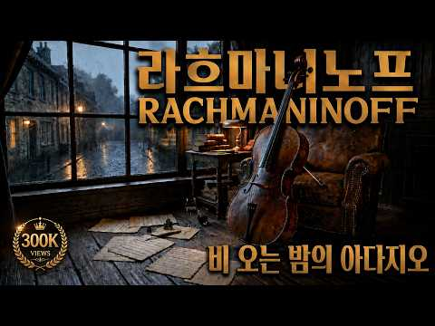
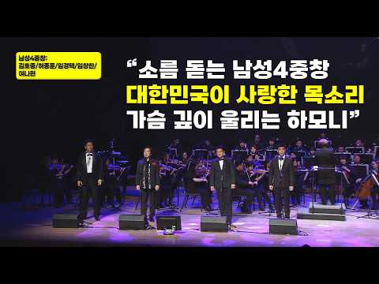
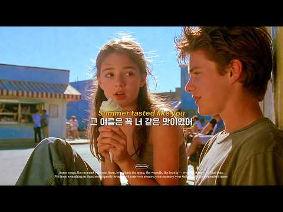
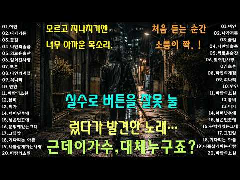
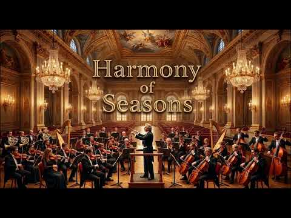
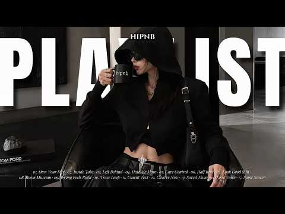
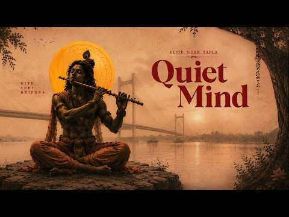
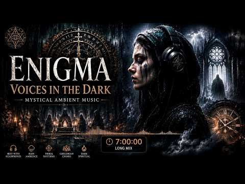

# 음악 — 성공 사례 분석: 사례별 자세히 #681–#720

`analysis.md` 의 9번 (같은 # 번호). 자동 생성 — `tools/success_analysis.py` v1.5.1 (2026-10-24 07:42 UTC). ※ 연구·교육용 — 투자 권유가 아님.

### 681. 途中広告なし【カフェBGM】ひとり静かな喫茶店｜のんびり過ごす午後の時間｜作業用・読書・リラックス｜Cafe Music・Coffee Shop Ambience

- https://www.youtube.com/watch?v=QgtDgADXHS4 · Kokoro Music Room · 구독자 21,800 · 조회수 1,000,775 (×45.9, 하루 8,271.7) · 좋아요 5,224 (0.5%) · 120.9분 · 2026-06-25 · 주제 묶음 2. 자연 소리·백색소음 · 형식 음악 (그 밖 모양 — 한 편짜리 BGM 등) · 폴더 `W_QgtDgADXHS4` (웹 승인)
- 썸네일: 
- 설명 앞부분: ひとり時間を心地よく彩るカフェBGMをお届けします☕🌿 🎧 おすすめのカフェBGMはこちら 🌻 夏カフェBGMシリーズはこちら Step into a cozy retro coffee shop. Enjoy a quiet moment with coffee and gentle music. Perfect for reading, studying, working, or relaxing.☕ 📖 Perfect background music for reading and studying ☕ Ideal for tea time 🌙 Great for unwinding…
- 같은 채널 평소 대비 ×50.8 (채널 최근 롱폼 중앙값 19,686회) · 평소 영상: 途中広告なし【カフェBGM】深呼吸する森カフェ｜色づく木々を眺めながらのんびり過ごす癒しのカフェB… (20,089회) / 途中広告なし【カフェBGM】秋色銀杏と純喫茶｜色づく銀杏を眺めながらゆっくり過ごす癒しのカフェBG… (19,283회)
- 대본 없음 (설명) — 음성인식이 끝나면 도입부·흐름이 들어감
- 댓글 166/166: 좋은 점 — 영상 0 · 감사·응원 0 · 더 알고 싶은 것 0 · 아쉬운 점 — 영상 0 · 반박·불만 — 의견 다름 0 · 정치·사회 0 · 경험 공유 0 · 구독·다음 기대 0

### 682. [KPOP playlist] 난리도 아닌 감다살 케이팝 노동요

- https://www.youtube.com/watch?v=AnsLD0Klc6s · 오이는빼주세요 · 구독자 13,800 · 조회수 626,064 (×45.4, 하루 4,645.1) · 좋아요 1,982 (0.3%) · 59.1분 · 2026-06-11 · 주제 묶음 10. 팝송·K팝·J팝 · 형식 플레이리스트·모음 (여러 곡) · 폴더 `W_AnsLD0Klc6s` (웹 승인)
- 썸네일: 
- 같은 채널 평소 대비 ×53.5 (채널 최근 롱폼 중앙값 11,701회) · 평소 영상: N.Flying (엔플라잉) PLAYLIST 2026 UPDATED l 엔플라잉 노래모음… (11,701회) / CHUNG HA 청하 PLAYLIST 2026 l 청하 노래모음 (신곡포함) l 𝐂𝐇𝐔𝐍… (13,157회)
- 대본 없음 (없음) — 음성인식이 끝나면 도입부·흐름이 들어감
- 댓글 47/47: 좋은 점 — 영상 0 · 감사·응원 4 · 더 알고 싶은 것 2 · 아쉬운 점 — 영상 0 · 반박·불만 — 의견 다름 0 · 정치·사회 0 · 경험 공유 0 · 구독·다음 기대 0
  - 감사·응원 👍5 “에투메 진짜 감다살....넣어주셔서 감사해요..ㅠㅠ”
  - 감사·응원 👍3 “플리짜실때bpm도 고려해주셨으면 좋겠어요ㅠㅠ 빠른템포음악나오다가 확템포느린곡 나오니까 무드가 죽네용ㅠㅠ 플리감사해요 잘듣고갑니당”
  - 더 알고 싶은 것 👍41 “혹시 투어스 노래 모음 만들어 주실수 있나여..?”
  - 더 알고 싶은 것 👍2 “혹시 베이비몬스터 플리 만들어주실수 있나요..? 수록곡 모읍집 하나만 만들어주시면 감사하겠습니다ㅠㅠ 너무 즐겨 듣는 플리 항상 만들어주셔서 감사합니다!!!🫶🏻”

### 683. Deep Work Music ~ Midnight City Ambience for Deep Focus ~ Calm Study & Peak Productivity

- https://www.youtube.com/watch?v=czMO-L42nnc · Focus Room · 구독자 25,800 · 조회수 1,170,024 (×45.4, 하루 7,187.8) · 좋아요 17,941 (1.5%) · 132.4분 · 2026-05-14 · 주제 묶음 2. 자연 소리·백색소음 · 형식 음악 (그 밖 모양 — 한 편짜리 BGM 등) · 폴더 `W_czMO-L42nnc` (웹 승인)
- 썸네일: 
- 설명 앞부분: Welcome to Focus Room where deep focus becomes your daily environment. This ambient focus mix is crafted for people who take their work seriously. Minimal, controlled sound design removes distractions and guides your mind into a powerful flow state the mental zone where real work gets done. Feature…
- 같은 채널 평소 대비 ×135.4 (채널 최근 롱폼 중앙값 8,641회) · 평소 영상: Deep Work Music ~ Blue Hour Ambience for Deep Foc… (8,730회) / Deep Work Music ~ Enter the Flow State with Calm … (8,552회)
- 대본 없음 (설명) — 음성인식이 끝나면 도입부·흐름이 들어감
- 댓글 112/117: 좋은 점 — 영상 0 · 감사·응원 0 · 더 알고 싶은 것 0 · 아쉬운 점 — 영상 0 · 반박·불만 — 의견 다름 0 · 정치·사회 0 · 경험 공유 0 · 구독·다음 기대 0

### 684. Craig David – INSOMNIA 🌙 ∣ Deep Bass EDM Remix ∣ Feel The Night, Feel The Bass 🔥

- https://www.youtube.com/watch?v=hymSZZ0mX5U · musik story🎧 · 구독자 12,000 · 조회수 543,842 (×45.3, 하루 7,427.2) · 좋아요 5,794 (1.1%) · 4분 · 2026-08-12 · 주제 묶음 11. 힙합·R&B·EDM · 형식 음악 (그 밖 모양 — 한 편짜리 BGM 등) · 폴더 `W_hymSZZ0mX5U` (웹 승인)
- 썸네일: 
- 설명 앞부분: When the night gets quiet, the music gets louder. Experience “Insomnia” by Craig David in a fresh EDM Remix atmosphere, blending the emotional character of the song with deep bass, modern electronic beats, and a smooth late-night vibe. This version is made for those moments when you’re still awake,…
- 같은 채널 평소 대비 ×53.6 (채널 최근 롱폼 중앙값 10,147회) · 평소 영상: MY HEART WILL GO ON ❤️ ∣ Céline Dion ∣ Deep Bass … (12,045회) / MACARENA 🔥 ∣ Breakbeat Mix Cover ∣ Deep Bass ∣ Fe… (8,249회)
- 대본 없음 (설명) — 음성인식이 끝나면 도입부·흐름이 들어감
- 댓글 76/78: 좋은 점 — 영상 0 · 감사·응원 0 · 더 알고 싶은 것 0 · 아쉬운 점 — 영상 0 · 반박·불만 — 의견 다름 0 · 정치·사회 0 · 경험 공유 0 · 구독·다음 기대 0

### 685. ㅤㅤㅤ

- https://www.youtube.com/watch?v=8k5vqajrHVw · ㅤㅤㅤㅤㅤㅤㅤㅤㅤㅤㅤㅤㅤㅤㅤㅤㅤㅤㅤㅤㅤㅤㅤㅤㅤㅤㅤㅤㅤㅤㅤㅤㅤㅤㅤㅤㅤㅤㅤㅤㅤㅤㅤㅤㅤㅤᴀ · 구독자 38,800 · 조회수 1,756,066 (×45.3, 하루 25,136.1) · 좋아요 110,402 (6.3%) · 120.7분 · 2026-08-15 · 주제 묶음 1. 수면·명상·힐링 · 형식 음악 (그 밖 모양 — 한 편짜리 BGM 등) · 폴더 `W_8k5vqajrHVw` (웹 승인)
- 썸네일: 
- 설명 앞부분: ㅤㅤㅤ🎧 Get the tracks from my videos: → t.me/chillofi7 New music is added regularly.
- 같은 채널 평소 대비 ×324.5 (채널 최근 롱폼 중앙값 5,412회) · 평소 영상: ㅤㅤㅤ (5,524회) / ㅤㅤㅤ (5,300회)
- 대본 없음 (설명) — 음성인식이 끝나면 도입부·흐름이 들어감
- 댓글 4,300/4,313: 좋은 점 — 영상 0 · 감사·응원 3 · 더 알고 싶은 것 1 · 아쉬운 점 — 영상 0 · 반박·불만 — 의견 다름 1 · 정치·사회 1 · 경험 공유 4 · 구독·다음 기대 0
  - 감사·응원 👍0 “선곡 센스가 정말 대단하십니다. 첫 곡부터 마지막 곡까지 흐름이 완벽해서 듣는 내내 귀가 즐거웠네요. 지친 일상 속에서 큰 위로가 되는 플레이리스트를 만들어 주셔서 진심으로 감사드립니다!”
  - 감사·응원 👍0 “지구의 자전이 멈추면 우리 모두는 우주 밖으로 튕겨 나간다던데. 고맙다 고양이.”
  - 더 알고 싶은 것 👍0 “진짜 안궁금한데 그냥 들어옴”
  - 반박·불만 — 의견 다름 👍1 “"그래도 지구는 돈다" 라고? 헛소리하지 마라 지구를 돌려주시는건 킹갓 냥이님이시다”
  - 정치·사회 👍0 “고양이는 지구의 대통령이구나”
  - 경험 공유 👍0 “한국인중에선 내가 처음인가”
  - 경험 공유 👍0 “내가 찾던 것💙🤍🖤💚🩵 최고의 밤이야.”

### 686. Beautiful girl and inspiring piano music that help you love life

- https://www.youtube.com/watch?v=6oZwrM-i8XU · Benjamin Elie · 구독자 295 · 조회수 13,349 (×45.2, 하루 364.5) · 좋아요 47 (0.4%) · 4.8분 · 2026-09-17 · 주제 묶음 6. 피아노·클래식·연주곡 · 형식 음악 (그 밖 모양 — 한 편짜리 BGM 등) · 폴더 `W_6oZwrM-i8XU` (웹 승인)
- 썸네일: 
- 설명 앞부분: Beautiful girl and inspiring piano music that help you love life
- 같은 채널 평소 대비 ×2.2 (채널 최근 롱폼 중앙값 6,045회) · 평소 영상: Girl piano performance captivates many young men (7,209회) / Gentle, Relaxing piano music and stunning golden … (4,881회)
- 대본 없음 (설명) — 음성인식이 끝나면 도입부·흐름이 들어감
- 댓글 4/4: 좋은 점 — 영상 0 · 감사·응원 0 · 더 알고 싶은 것 0 · 아쉬운 점 — 영상 0 · 반박·불만 — 의견 다름 0 · 정치·사회 0 · 경험 공유 0 · 구독·다음 기대 0

### 687. 마음도 휴식이 필요해요 BGM (플루트 연주) 🎵 조용한 숲과 호수의 휴식

- https://www.youtube.com/watch?v=pzBSdxT3Bp4 · 느린풍경이야기 · 구독자 1,060 · 조회수 47,926 (×45.2, 하루 313.8) · 좋아요 497 (1.0%) · 39.6분 · 2026-05-24 · 주제 묶음 6. 피아노·클래식·연주곡 · 형식 연주 (직접 연주하는 영상) · 폴더 `W_pzBSdxT3Bp4` (웹 승인)
- 썸네일: 
- 챕터: 0:00 Flute Melody 01 - Morning Dew · 2:43 Flute Melody 02 - Gentle Bree… · 5:30 Flute Melody 03 - Forest Path · 8:28 Flute Melody 04 - Quiet Stream · 11:31 Flute Melody 05 - Green Meadow · 14:36 Flute Melody 06 - Soft Sunlig… · 17:00 Flute Melody 07 - Whispering … · 20:05 Flute Melody 08 - Peaceful Jo… · 22:45 Flute Melody 09 - Clear Sky · 25:32 Flute Melody 10 - Mountain Wi… · 27:50 Flute Melody 11 - Calm Waters · 30:46 Flute Melody 12 - Silent Vall… · 33:44 Flute Melody 13 - Evening Glow · 36:48 Flute Melody 14 - Starlit Dre…
- 설명 앞부분: 마음도 휴식이 필요해요. 새벽 안개가 머무는 호수, 숲속에 스며드는 바람, 그리고 조용히 울려 퍼지는 플루트 선율. 바쁜 하루 속에서 잠시 멈추고, 천천히 호흡하며 마음의 여유를 찾아보세요. 플루트의 맑고 부드러운 음색이 지친 마음을 편안하게 감싸주는 휴식과 명상을 위한 BGM입니다. 🎵 추천 감상 시간 휴식할 때 명상할 때 독서할 때 공부할 때 자기 전 조용한 새벽과 밤 오늘 하루도 수고하셨습니다. 잠시 마음을 쉬게 해주세요. [ Music Production ] 작사 : 느린풍경 작곡 : ai 작곡 /보컬 : ai 아바타 영상…
- 같은 채널 평소 대비 ×879.4 (채널 최근 롱폼 중앙값 54회) · 평소 영상: 런던 19세기 석양 터너의 빛의예술 BGM (비주얼 포에트리) ∣ 황금빛 노을이 물든 런… (59회) / 베네치아 상쾌한 오후 생동감 넘치는 바로크 클래식 (Vivaldi Style) [Play… (50회)
- 대본 없음 (설명) — 음성인식이 끝나면 도입부·흐름이 들어감
- 댓글 21/21: 좋은 점 — 영상 0 · 감사·응원 4 · 더 알고 싶은 것 0 · 아쉬운 점 — 영상 0 · 반박·불만 — 의견 다름 0 · 정치·사회 0 · 경험 공유 1 · 구독·다음 기대 1
  - 감사·응원 👍8 “내가.가장좋아하는.플루트.연주곡.너무.너무.좋와요.저장해서.시간.날때마다.들을검니다.음악.좋아요..❤이채널을.응원함니다🎉🎉🎉”
  - 감사·응원 👍5 “출근길 마음이 어지럽고 부정이 밀려왔는데 평온하고 따스한 음악에 마음을 내려놓고 쉬고갑니다.감사합니다.그리고 우리 길냥이들 오늘도 그저 안녕하기만을 기도합니다.^^❤❤”
  - 경험 공유 👍8 “내가.가장좋아하는.플루트.연주곡.너무.너무.좋와요.저장해서.시간.날때마다.들을검니다.음악.좋아요..❤이채널을.응원함니다🎉🎉🎉”
  - 구독·다음 기대 👍3 “출근하기 싫어서 갈등을 느끼고 우울할 때 마음을 편안하게 해 주는 플릇소리에 감사드리면서 구독과 좋아요 누르고 갑니다 ㆍ 알림설정두요”

### 688. 비 오는 밤의 라흐마니노프 ∣ 깊고 잔잔한 아다지오 1시간

- https://www.youtube.com/watch?v=HNgBqMnvUcU · Minimal Classic · 구독자 7,940 · 조회수 358,301 (×45.1, 하루 2,423.1) · 좋아요 4,948 (1.4%) · 60.2분 · 2026-05-29 · 주제 묶음 1. 수면·명상·힐링 · 형식 긴 한 곡·반복 (N시간) · 폴더 `W_HNgBqMnvUcU` (웹 승인)
- 썸네일: 
- 설명 앞부분: 🎵 라흐마니노프 Rachmaninoff 플레이리스트 모음 비 오는 밤의 라흐마니노프. 깊고 잔잔한 아다지오 10곡을 1시간 동안 감상하세요. 수면 · 공부 · 명상 · 휴식을 위한 미니멀 클래식 음악입니다. ⏱️ 화면에 1시간 카운트다운 타이머가 함께 흐릅니다. 🎬 영상 시작 전 작곡가 소개 라흐마니노프 (Sergei Rachmaninoff, 1873–1943) 피아노의 마지막 낭만주의자 러시아에서 태어나 혁명을 피해 망명한 작곡가. 70년의 생애 동안 고향을 그리워하며 피아노를 위한 음악을 썼습니다. 그의 손은 건반 12도를 넘…
- 같은 채널 평소 대비 ×44.1 (채널 최근 롱폼 중앙값 8,130회) · 평소 영상: 메마른 여름을 적시는 아다지오 ∣ 라흐마니노프 첼로가 전하는 깊은 위로 (10,031회) / 그리운 시절이 생각날 때 ∣ 가을바다에 밀려오는 클래식 선율 ∣ 가을에 듣기 좋은 클래식… (6,230회)
- 대본 없음 (설명) — 음성인식이 끝나면 도입부·흐름이 들어감
- 댓글 341/342: 좋은 점 — 영상 5 · 감사·응원 43 · 더 알고 싶은 것 1 · 아쉬운 점 — 영상 2 · 반박·불만 — 의견 다름 3 · 정치·사회 0 · 경험 공유 32 · 구독·다음 기대 0
  - 좋은 점 — 영상 👍13 “감사합니다! 요즘 주로 저녁에 썬셋 을 보며 걸을때 듣습니다! 한국을 떠나 있어서 외로울때가 있어요 많은 도움이 되요! 감사합니다!”
  - 감사·응원 👍54 “깊은밤 늦게까지 음악을 들으며 시집을 읽다가 댓글을 썼어요 고즈넉한 깊은밤 음악을 들으니 더 마음에와 닫네요 좋은음악 감사합니다❤😊”
  - 감사·응원 👍36 “이렇게 슬픈 음악이 있네요 가슴뛰는 그리움이 사무쳐서 가끔만 들어야겠어요 저는 너무 여리거든욫 감사합니다 🎉”
  - 더 알고 싶은 것 👍1 “첼로가맞나요? 첼로는 사람 의 목소리와 많이 닮은 악기라 들어본 적이 있어요.. 그래서인지 항상혼자인 제어깨를 토닥토닥 해 주는것같아 자주듣게 되어요 슬프지만 힘이나는연주 인듯 요ㅜ”
  - 아쉬운 점 — 영상 👍1 “음악에 몰입하고 있는데 헉... 광고가 두독취소하고 이젠... 경제적 보상을 원하면 후원계좌 올리시면 되는데.... 이젠 그만...”
  - 경험 공유 👍540 “엄마를묻고서 밥도못먹고 토만하고 설사를하고 그렇게2주가지나고,, 시간이지날수록 보고픈엄마 사무치도록 그리운엄마 그리고 엄마와함께한추억을 핸폰갤러리에서 다시꺼내봅니다 곧다시 만날날엔 엄마를꼭다시 안아주며 사랑한다고 보고싶었노라고 우리엄마를 꼭안을거예요❤”
  - 경험 공유 👍328 “그동안 잊고지낸 다시 만나고 싶은거 나 자신이내요..죽어라 일해서 가족이 풍족해지면 그게 보람인줄만 알고 살았는데..이젠 내가 너무 불쌍해 미치겠어요..나를위해 옷하나 신발하나 가방하나 사본적 없이 그녕 가족에게 다 퍼주며 살았는데..이젠 나는 그래도 되는사람이 되버…”

### 689. 듣다 보면 끝까지 듣게 되는 명품 보컬 ∣ 7080 슬로우 레게・레트로 락발라드・Love Song・Vintage Ballad・감성 BGM

- https://www.youtube.com/watch?v=V9FOduIEv6w · afterparis · 구독자 7,510 · 조회수 338,351 (×45.0, 하루 2,983.6) · 좋아요 2,992 (0.9%) · 82.8분 · 2026-07-02 · 주제 묶음 9. 가요·발라드·트로트 · 형식 음악 (그 밖 모양 — 한 편짜리 BGM 등) · 폴더 `W_V9FOduIEv6w` (웹 승인)
- 썸네일: 
- 챕터: 0:00 The Streetlamp Stayed Until D… · 4:24 Coffee Gone Cold, Memories St… · 8:47 My Shadow Knows This Song · 12:42 Rain Fell After Everyone Left · 16:40 A Slow Dance for Empty Chairs · 20:27 The Vinyl Turned Without a Wo… · 24:05 When the Harbor Forgot My Name · 28:35 Midnight Borrowed My Smile · 33:30 One Window Still Glows · 37:39 The Breeze Carried Yesterday … · 41:24 Repeat
- 설명 앞부분: 어느 날 우연히 라디오를 켰는데, 처음 듣는 목소리인데도 이상하게 오래전부터 알고 있었던 것처럼 편안하게 들릴 때가 있습니다. 이번 플레이리스트는 그런 순간을 담았습니다. 깊고 중후한 보컬, 따뜻한 아날로그 사운드, 그리고 천천히 흐르는 슬로우 레게 리듬이 조용히 하루를 마무리할 수 있도록 함께합니다. 오늘은 아무 생각 없이 좋은 목소리 하나만 믿고 끝까지 들어보세요. 어쩌면 마지막 곡이 끝날 때쯤, 조금은 편안한 마음이 되어 있을지도 모릅니다. One day, you turn on an old radio by chance, an…
- 같은 채널 평소 대비 ×25.8 (채널 최근 롱폼 중앙값 13,093회) · 평소 영상: 어느새 9월, 듣는 순간 마음을 흔드는 깊고 중후한 목소리 ∣ 7080 슬로우 레게 · … (13,148회) / 이제 10월, 괜히 오래 듣게 되는 깊고 중후한 저음 ∣ 7080 슬로우 레게 · 레트로… (13,038회)
- 대본 없음 (설명) — 음성인식이 끝나면 도입부·흐름이 들어감
- 댓글 183/186: 좋은 점 — 영상 2 · 감사·응원 8 · 더 알고 싶은 것 3 · 아쉬운 점 — 영상 2 · 반박·불만 — 의견 다름 0 · 정치·사회 0 · 경험 공유 2 · 구독·다음 기대 1
  - 좋은 점 — 영상 👍9 “억지로 목소리를 만들지 않고 있는 그대로라 너무 듣기 좋습니다 ~~”
  - 좋은 점 — 영상 👍5 “AI 거의 확실합니다. ai가 중요한게 아니라 우리의 감성을 만져주면 되는거라 생각되네요, 넘 듣기 좋아요,”
  - 감사·응원 👍5 “마음이편해진는드해진내요좋아요그리곻그에날아버지가브르덕드여주시노래가새각이나내요감사함사해요🎉🎉🎉🎉😅😅😅😅😅😅”
  - 감사·응원 👍4 “기분이 좋아지는 음악 감사합니다~”
  - 더 알고 싶은 것 👍13 “가수가 어떻게 되나요?”
  - 더 알고 싶은 것 👍0 “repeat 구간 없는 영상으로 올려주셔요.”
  - 아쉬운 점 — 영상 👍1 “이 Ai 저음 좋으네요 다른 Ai목소리 너무찢어져서 거부감만”
  - 아쉬운 점 — 영상 👍0 “Ai음성같은데요”
  - 구독·다음 기대 👍1 “넘 좋아 구독합니다 ㅎㅎ”

### 690. 𝑃𝑙𝑎𝑦𝑙𝑖𝑠𝑡 느좋 도우인 플리

- https://www.youtube.com/watch?v=muaiYrT3glM · 진구달려  · 구독자 6,350 · 조회수 285,632 (×45.0, 하루 3,482.8) · 좋아요 5,171 (1.8%) · 14.7분 · 2026-08-03 · 주제 묶음 기타 · 형식 플레이리스트·모음 (여러 곡) · 폴더 `W_muaiYrT3glM` (웹 승인)
- 썸네일: 
- 같은 채널 평소 대비 ×5.7 (채널 최근 롱폼 중앙값 50,310회) · 평소 영상: ℙ𝕝𝕒𝕪𝕝𝕚𝕤𝕥 틱톡 도우인 노래들 (52,891회) / 𝓟𝓵𝓪𝔂𝓵𝓲𝓼𝓽 도우인 감성 노래들 (47,729회)
- 대본 없음 (없음) — 음성인식이 끝나면 도입부·흐름이 들어감
- 댓글 52/55: 좋은 점 — 영상 0 · 감사·응원 0 · 더 알고 싶은 것 1 · 아쉬운 점 — 영상 0 · 반박·불만 — 의견 다름 0 · 정치·사회 1 · 경험 공유 2 · 구독·다음 기대 0
  - 경험 공유 👍75 “와 아버지 드디어 제가 찾고싶었던 노랠 찾았습니다”

### 691. 🎵듣는 순간 소름… 김호중·허종훈·임경택·임창한 남성4중창 레전드 공연 ∣ 김호중의 폭발적 테너… ‘오 나의 태양’부터 ‘나의 조국은’까지 전율의 4중창

- https://www.youtube.com/watch?v=ypW1MoCFDA8 · 🎧 Sound Rest · 구독자 2,710 · 조회수 121,818 (×45.0, 하루 797.3) · 좋아요 2,781 (2.3%) · 13.9분 · 2026-05-24 · 주제 묶음 6. 피아노·클래식·연주곡 · 형식 정보·해설 (그 밖) · 폴더 `W_ypW1MoCFDA8` (웹 승인)
- 썸네일: 
- 설명 앞부분: 대한민국이 사랑하는 테너 김호중. 그리고 허종훈, 임경택, 임창한이 함께 만든 감동의 남성4중창 무대. 세계적인 명곡 ‘O Sole Mio(오 나의 태양)’와 ‘Torna a Surriento(돌아오라 소렌토로)’의 뜨거운 감성, 그리고 가슴 깊이 울려 퍼지는 ‘나의 조국은’까지… 한 사람의 목소리를 넘어 네 명의 하모니가 만들어낸 전율의 순간을 담았다. 음악은 언어를 넘어 마음을 움직인다. 오늘 이 무대가 여러분의 가슴에도 오래 남길 바란다. Korea's beloved tenor, Kim Ho-joong. And the tou…
- 같은 채널 평소 대비 ×415.8 (채널 최근 롱폼 중앙값 293회) · 평소 영상: 🎶내 인생 마지막 사랑 ❤️긴 세월 돌아서 만난 내 인생의 마지막 사랑... (가슴 먹먹… (316회) / [인생음악]🎼🎶「고생 많았다, 내 인생아」부모의 기대와 회사의 시계 사이에서 살아온 당신… (270회)
- 대본 없음 (설명) — 음성인식이 끝나면 도입부·흐름이 들어감
- 댓글 182/184: 좋은 점 — 영상 2 · 감사·응원 22 · 더 알고 싶은 것 0 · 아쉬운 점 — 영상 2 · 반박·불만 — 의견 다름 0 · 정치·사회 0 · 경험 공유 1 · 구독·다음 기대 1
  - 좋은 점 — 영상 👍48 “좋은영상 감사합니다”
  - 좋은 점 — 영상 👍2 “달라 달라 너무 듣기 좋다. 타고난 목소리에 노력하는 천재 어서 다리 회복하고 당신의 노래 실컷 듣고 싶다”
  - 감사·응원 👍122 “김호중 테너 힘내세요 Vincero”
  - 감사·응원 👍109 “멋지고 아름다운영상 올려주셔서 너무 감사합니다 자주 들으며 우리가수님 기다립니다”
  - 아쉬운 점 — 영상 👍33 “역시나 보이스칼라가 독보적입니다.언제들어도 너무 감동입니다. 영상편집이 정성이 많이 들어간게 보이네요,보는 내내 웃게 되네요.👏👏👏👏👏👏👏👍👍👍김호중 테너 너무보고싶네요.무대에 서신 모습 빨리 보고싶어요”
  - 아쉬운 점 — 영상 👍15 “나의 조국이. 최고네요. 가사를 자막에 넣었으면. ~~~~~. ㅎㅎ 아쉬움 ㅋㅋ. 70대. 할머니가. 계속듣기 1시간 이네여. 감사함댜.”
  - 구독·다음 기대 👍3 “우리가수님 무대가 그립습니다 가수님 건강하기만 기대합니다 많이보고싶다 많이^^”

### 692. 𝐏𝐥𝐚𝐲𝐥𝐢𝐬𝐭 ∣ 교토의 작은 카페, 말차향 재즈 🍵🎧 抹茶オーツラテ

- https://www.youtube.com/watch?v=vLX3-MrBXFk · 아오링고 잡화점 AORINGGO · 구독자 13,900 · 조회수 623,190 (×44.8, 하루 9,387.4) · 좋아요 4,417 (0.7%) · 292.4분 · 2026-08-18 · 주제 묶음 4. 카페·매장·라운지 · 형식 플레이리스트·모음 (여러 곡) · 폴더 `W_vLX3-MrBXFk` (웹 승인)
- 썸네일: 
- 챕터: 0:00 Matcha Oat Latte Afternoon · 2:44 A Small Café · 5:47 Soft Green Latte · 8:24 Matcha Oat & Slow Jazz · 11:02 Oat Milk in the Afternoon · 13:36 Matcha Oat by the Window · 16:00 Velvet Green Latte · 18:40 A Quiet Oat Latte · 21:04 Sweet & Bitter Green · 23:29 Late Summer Oat Latte · 26:08 A Quiet Corner · 28:48 The Green Latte Hour · 31:12 Soft Light & Oat Milk · 33:34 Little Café Jazz · 35:59 After the Last Sip · 38:35 Green Lights at Dusk · 41:41 repeat 🔁
- 설명 앞부분: 📓 8월 말. 오후의 작은 카페. 여행을 하다 보면 계획에 없던 곳에서 오래 머물게 되는 순간이 있다. 그날도 특별히 정해둔 목적지는 없었다. 아침부터 이곳저곳을 돌아다니다가, 점심을 먹고 다시 골목을 걷고 있었다. 8월 말의 햇살은 여전히 뜨거웠다. 바람은 조금 선선해졌지만, 한낮의 더위는 쉽게 가시지 않았다. 골목 모퉁이에서 작은 카페 하나를 발견했다. 크지 않은 유리창 너머로 나무 테이블 몇 개가 보였고, 문 옆에는 초록색 메뉴판이 조용히 놓여 있었다. 잠시 쉬어갈까. 별다른 이유 없이 문을 열고 들어갔다. 카페 안은 바깥보…
- 같은 채널 평소 대비 ×29.5 (채널 최근 롱폼 중앙값 21,155회) · 평소 영상: 𝐏𝐥𝐚𝐲𝐥𝐢𝐬𝐭 ∣쌉싸름한 루꼴라향 재즈, 가을을 맞이하자 🌿🎧 ルッコラジャズ (21,626회) / 𝐏𝐥𝐚𝐲𝐥𝐢𝐬𝐭 ∣ 도쿄의 낡은 다방, 커피향 재즈 ☕🎧 ドリップコーヒー (20,684회)
- 대본 없음 (설명) — 음성인식이 끝나면 도입부·흐름이 들어감
- 댓글 114/123: 좋은 점 — 영상 2 · 감사·응원 7 · 더 알고 싶은 것 1 · 아쉬운 점 — 영상 0 · 반박·불만 — 의견 다름 0 · 정치·사회 0 · 경험 공유 5 · 구독·다음 기대 2
  - 좋은 점 — 영상 👍0 “안녕하세요. 선생님이 만드시는 음악을 정말 좋아하고 존경합니다. 음악이 정말 너무 좋습니다. 저도 선생님처럼 좋은 음악을 만들어보고 싶어서 한 달 넘게 고민하고 여러 가지 방법으로 만들어봤지만, 아직 마음에 드는 결과를 얻지 못하고 있습니다. 그리고 예전에 선생님 채…”
  - 감사·응원 👍4 “현재 취업준비하면서 이력서 쓸 때마다 항상 카페에서 아오링고 잡화점 노래 틀어놓고 해요! 마음이 너무 편안해지고 저만의 공간에 있는 느낌이라 집중이 잘됩니다 ㅠㅠ 썸네일 그림 볼때마다 마음이 몽글해지구용 항상 감사합니다~~~”
  - 감사·응원 👍1 “그림과 글과 음악이 잘 어울리는 편안한 느낌이 정말 좋네요^0^ 감사합니다!”
  - 더 알고 싶은 것 👍0 “안녕하세요. 선생님이 만드시는 음악을 정말 좋아하고 존경합니다. 음악이 정말 너무 좋습니다. 저도 선생님처럼 좋은 음악을 만들어보고 싶어서 한 달 넘게 고민하고 여러 가지 방법으로 만들어봤지만, 아직 마음에 드는 결과를 얻지 못하고 있습니다. 그리고 예전에 선생님 채…”
  - 경험 공유 👍4 “너무 이뻐요!감삼다! 그림 조금씩 움직이는 것도 짱 귀엽고 음악도 좋고 사랑해요💞💞💞 다음에는 레밍턴 케이크를 해주실 수 있나요?? 아실지 모르지만 제가 유일하게 좋아하는 케이크에요!🤎🤎 안해주셔도 돼요! 이미 너무 좋아여 지금 지상낙원이란 말이 딱 들어맞는 순간? …”
  - 경험 공유 👍0 “나도 그림 그려서 이렇게 많은 사람들이랑 나누고 싶네요. 사진과 다른 인간미 넘치는 손맛이 음악까지 느긋하게 만드는데요.”
  - 구독·다음 기대 👍3 “그림도 아기자기하고 음악도 너무 좋아용^^ 좋아요 구독하고 자주 놀러 올게용*^^*”

### 693. 마음이 편안해지는 명품 아침 클래식 ㅣ듣기만 해도 행복해지는 클래식 명곡

- https://www.youtube.com/watch?v=jhz1rDyH7gc · Aria classic | 아리아클래식 · 구독자 2,600 · 조회수 116,468 (×44.8, 하루 1,233.2) · 좋아요 1,060 (0.9%) · 59.4분 · 2026-07-21 · 주제 묶음 6. 피아노·클래식·연주곡 · 형식 연주 (직접 연주하는 영상) · 폴더 `W_jhz1rDyH7gc` (웹 승인)
- 썸네일: 
- 설명 앞부분: 평화로운 아침을 위한 클래식 명곡 모음ㅣ힐링 음악ㅣ휴식 BGM 포근한 아침 햇살이 하루를 깨우는 시간, 오랫동안 사랑받아온 아름다운 클래식 명곡들이 평온하고 따뜻한 하루의 시작을 함께합니다. 잠시 마음의 여유를 되찾고, 아름다운 선율과 함께 평화로운 아침을 맞이해 보세요...^^ ☀ ☕ 아침 커피와 함께 📖 독서와 공부 🌿 휴식과 명상 💼 업무와 집중 A peaceful collection of timeless classical masterpieces for a beautiful morning. Let these beloved c…
- 같은 채널 평소 대비 ×21.0 (채널 최근 롱폼 중앙값 5,558회) · 평소 영상: 마음의 편해져요, 아침 명품 클래식🍂 ∣ 듣기만 해도 행복해지는 클래식 명곡 (5,558회) / 쇼팽이 선물한 봄, 낭만과 사랑의 클래식 앙상블 ∣ Spring in Paris (3,172회)
- 대본 없음 (설명) — 음성인식이 끝나면 도입부·흐름이 들어감
- 댓글 18/18: 좋은 점 — 영상 0 · 감사·응원 3 · 더 알고 싶은 것 1 · 아쉬운 점 — 영상 0 · 반박·불만 — 의견 다름 0 · 정치·사회 0 · 경험 공유 0 · 구독·다음 기대 0
  - 감사·응원 👍4 “제목을 올려주시면 감사하겠습니다”
  - 감사·응원 👍0 “감사합니다”
  - 더 알고 싶은 것 👍4 “제목을 올려주시면 감사하겠습니다”

### 694. 𝘱𝘭𝘢𝘺𝘭𝘪𝘴𝘵 듣자마자 행복해질거야🍦☀️ 요즘 감성 노래 모음 ∣ 하루 종일 듣기 좋은 팝송 플레이리스트

- https://www.youtube.com/watch?v=4zc4GyIQPco · seroma room · 구독자 16,700 · 조회수 747,282 (×44.8, 하루 5,524.0) · 좋아요 2,896 (0.4%) · 599.4분 · 2026-06-11 · 주제 묶음 10. 팝송·K팝·J팝 · 형식 플레이리스트·모음 (여러 곡) · 폴더 `W_4zc4GyIQPco` (웹 승인)
- 썸네일: 
- 챕터: 0:00 We Talked Through the Whole C… · 3:06 Clouds Over the Ice Cream Sta… · 6:05 You Made Summer Taste Better · 9:12 The Cone Didn't Last Long · 12:01 Summer Served Cold · 14:37 Between Two Bites · 17:32 One Scoop No Hurry · 20:36 Strawberry for You, Vanilla f… · 23:51 Pink Scoop Afternoon · 26:22 Cherry Skies Ice Cream · 29:26 Your Ice Cream Was Melting Fi… · 32:18 The Table Outside the Shop · 34:56 The Sun Felt Like Vanilla · 37:51 The Heat Stayed Outside · 40:51 You Looked Better Than the Ic… · 44:03 You Picked the Better Flavor · 47:08 We Forgot About the Weather
- 설명 앞부분: 듣는 순간 기분이 좋아지고, 괜히 웃음이 나는 팝송들을 담았습니다 🍦☀ 일할 때, 공부할 때, 산책할 때, 멍 때릴 때 하루 종일 편하게 틀어두기 좋은 플레이리스트입니다. This playlist is filled with pop songs that instantly lift your mood and put a smile on your face 🍦☀ Perfect to keep on in the background while working, studying, taking a walk, or simply zoning out. A p…
- 같은 채널 평소 대비 ×80.0 (채널 최근 롱폼 중앙값 9,341회) · 평소 영상: 𝘱𝘭𝘢𝘺𝘭𝘪𝘴𝘵 틀자마자 기분 좋아지는 여름 팝송 🫧☀️ 하루종일 듣기 좋은 요즘 플레이… (9,341회) / 𝘱𝘭𝘢𝘺𝘭𝘪𝘴𝘵 오늘은 웃을 일이 좀 많을 것 같아 ☀️ 하루종일 듣기 좋은 노래 모음 … (9,638회)
- 대본 없음 (설명) — 음성인식이 끝나면 도입부·흐름이 들어감
- 댓글 62/63: 좋은 점 — 영상 1 · 감사·응원 7 · 더 알고 싶은 것 0 · 아쉬운 점 — 영상 2 · 반박·불만 — 의견 다름 0 · 정치·사회 0 · 경험 공유 0 · 구독·다음 기대 1
  - 좋은 점 — 영상 👍1 “ㅎ 귀여운 영상이 몽글몽글해지네요..!! 좋은 영상 감사해요! 🤍🤍”
  - 감사·응원 👍244 “이 노래를 듣는 모든 분이 진짜 행복해졌으면 좋겠어 로또 1등 당첨 된 느낌으로요 진짜 행복해지길 불행은 길고 행복은 짧아도 짧더라도 느낄 수 있는 그 행복에 감사하자구요”
  - 감사·응원 👍29 “주말 출근길이라 우울했는데 첫곡부터 행복해지네요. 가끔 삶이 힘들고 버거울때도 있지만 또 그만큼 행복하고 감사한 일도 있으니까요. 지금 이순간은 잠시 버거운 터널을 지나가는 길이라 생각하려합니다. 여기 오시는 모든 분들의 삶에 행복과 행운, 온갖 좋은 일들이 깃들기를…”
  - 아쉬운 점 — 영상 👍0 “왜 ai같냐ㅑ 근데노래가 넘 좋음 ❤🎉 진짜 좋은노래만 해놨디ㅏㅏ”
  - 아쉬운 점 — 영상 👍0 “광고가 없었다면 완벽했을겁니다”
  - 구독·다음 기대 👍1 “유튜브 프리미엄처럼 볼 수 있어서 좋아요 구독하고갑니다 자주올게요”

### 695. 여인 – 우리 가슴속 깊이 박혀 있던 그 노래, 듣는 순간 그 시절로 돌아갑니다, 이어폰 필수… 👉 첫 소절부터 심장 무너지는 노래

- https://www.youtube.com/watch?v=yQSP0R8pDqg · 혼자 듣는 노래 · 구독자 8,220 · 조회수 366,559 (×44.6, 하루 3,176.3) · 좋아요 3,666 (1.0%) · 109.5분 · 2026-06-30 · 주제 묶음 기타 · 형식 음악 (그 밖 모양 — 한 편짜리 BGM 등) · 폴더 `W_yQSP0R8pDqg` (웹 승인)
- 썸네일: 
- 설명 앞부분: 여인 – 우리 가슴속 깊이 박혀 있던 그 노래, 듣는 순간 그 시절로 돌아갑니다, 이어폰 필수… 👉 첫 소절부터 심장 무너지는 노래 여인 – 우리 가슴속 깊이 박혀 있던 그 노래, 듣는 순간 그 시절로 돌아갑니다, 이어폰 필수… 👉 첫 소절부터 심장 무너지는 노래 여인 – 우리 가슴속 깊이 박혀 있던 그 노래, 듣는 순간 그 시절로 돌아갑니다, 이어폰 필수… 👉 첫 소절부터 심장 무너지는 노래 01.여인 02.나가거든 03.꽃길 04.나만의슬픔 05.외로운술잔 06.잊혀진사랑 07.초혼 08.타인의계절 09.희나리 10.연인 11…
- 같은 채널 평소 대비 ×61.5 (채널 최근 롱폼 중앙값 5,962회) · 평소 영상: 나만의슬픔, 아름다운강산, 촛불켜는밤🎸🔥99%가 끝까지 듣는 전설의 발라드… 듣는 순간 … (6,011회) / 그대눈물까지도, 나만의슬픔, 나만의슬픔, 묻어버린아픔– 우리 가슴속 깊이 박혀 있던 그 … (5,914회)
- 대본 없음 (설명) — 음성인식이 끝나면 도입부·흐름이 들어감
- 댓글 104/104: 좋은 점 — 영상 2 · 감사·응원 6 · 더 알고 싶은 것 1 · 아쉬운 점 — 영상 3 · 반박·불만 — 의견 다름 0 · 정치·사회 0 · 경험 공유 1 · 구독·다음 기대 0
  - 좋은 점 — 영상 👍6 “가수님이 AI인가요? 너무듣기좋네요 완전빠져드는목소리,감탄사가 저절로나오는 목소리,응원합니다~~^^”
  - 좋은 점 — 영상 👍3 “이밤에듣기좋으네요~~”
  - 감사·응원 👍15 “이젠 추억으로만 남아있는 다이아몬드 처럼 빛나던 시절. 되돌아 보며 미소 짓게 하는 주옥같은 노래들. 감사합니다. ❤❤❤”
  - 감사·응원 👍13 “Ai이건 사람이건 노래자체를 즐기면된다. 다른개소리들 하지말고 고맙게 감상들하라. ❤❤❤🎉🎉🎉”
  - 더 알고 싶은 것 👍1 “🇰🇷 한국어 안녕하세요. 귀 채널에서 명곡부활단이 제작한 음원을 무단으로 다운로드하여 롱폼 콘텐츠에 사용하고 있는 것을 확인했습니다. 명곡부활단의 음원은 어떠한 형태로도 무단 사용 및 재사용할 수 없습니다. 현재 사용하고 있는 명곡부활단의 모든 음원을 즉시 삭제해 주…”
  - 아쉬운 점 — 영상 👍3 “AI같은데 아닌가”
  - 아쉬운 점 — 영상 👍1 “AI 음성 이제 식상하다”
  - 경험 공유 👍1 “저도 죽을뻔 😢”

### 696. Harmony Of Seasons ∣ DVE ∣ Ultimate Classical Piano Collection ∣ Wolfgang Mozart ∣ Frédér…

- https://www.youtube.com/watch?v=P4H9CSSCuQg · DVE · 구독자 2,360 · 조회수 104,470 (×44.3, 하루 1,970.4) · 좋아요 3,317 (3.2%) · 15.8분 · 2026-09-01 · 주제 묶음 6. 피아노·클래식·연주곡 · 형식 음악 (그 밖 모양 — 한 편짜리 BGM 등) · 폴더 `W_P4H9CSSCuQg` (웹 승인)
- 썸네일: 
- 설명 앞부분: Harmony of Seasons by DVE ∣ Classical Piano & Relaxing Instrumental Music Experience the timeless beauty of classical piano music, relaxing instrumental music, peaceful piano melodies, and elegant classical compositions with “Harmony of Seasons” by DVE, featured on the album “Ultimate Classical Pia…
- 같은 채널 평소 대비 ×2,429.5 (채널 최근 롱폼 중앙값 43회) · 평소 영상: Aubade in F Major, Op. 3 by DVE ∣ Elegant Classic… (43회) / Moonlight Upon the Ivory Keys by DVE ∣ Elegant Cl… (38회)
- 대본 없음 (설명) — 음성인식이 끝나면 도입부·흐름이 들어감
- 댓글 180/183: 좋은 점 — 영상 0 · 감사·응원 0 · 더 알고 싶은 것 0 · 아쉬운 점 — 영상 0 · 반박·불만 — 의견 다름 0 · 정치·사회 0 · 경험 공유 0 · 구독·다음 기대 0

### 697. TIME ALONE WITH GOD - Soaking worship instrumental ∣ Prayer and Devotional ∣ ONLY JESUS

- https://www.youtube.com/watch?v=uqC91GqvvQg · Calm Divine Flow · 구독자 21,700 · 조회수 947,551 (×43.7, 하루 10,324.3) · 좋아요 10,549 (1.1%) · 67.1분 · 2026-07-24 · 주제 묶음 6. 피아노·클래식·연주곡 · 형식 음악 (그 밖 모양 — 한 편짜리 BGM 등) · 폴더 `W_uqC91GqvvQg` (웹 승인)
- 썸네일: 
- 설명 앞부분: TIME ALONE WITH GOD - Soaking worship instrumental ∣ Prayer and Devotional ∣ ONLY JESUS Welcome to Calm Divine Flow — a sacred space to refresh your soul and dwell in God’s presence. We create gentle worship instrumentals, soaking prayer music, and heavenly atmospheres for deep meditation, prayer, …
- 같은 채널 평소 대비 ×56.4 (채널 최근 롱폼 중앙값 16,813회) · 평소 영상: I SURRENDER - Soaking Worship Instrumental Presen… (16,813회) / JESUS,CALM MY HEART - Soaking Worship Instrumenta… (16,580회)
- 대본 없음 (설명) — 음성인식이 끝나면 도입부·흐름이 들어감
- 댓글 515/537: 좋은 점 — 영상 0 · 감사·응원 0 · 더 알고 싶은 것 0 · 아쉬운 점 — 영상 0 · 반박·불만 — 의견 다름 0 · 정치·사회 0 · 경험 공유 0 · 구독·다음 기대 0

### 698. [Playlist] 기분 좋아지는 산뜻한 유럽 아침 앙상블 ∣ Morning Classical Ensemble

- https://www.youtube.com/watch?v=fdPFoR4XjNQ · okply · 구독자 15,700 · 조회수 683,010 (×43.5, 하루 4,142.9) · 좋아요 10,385 (1.5%) · 80.8분 · 2026-05-12 · 주제 묶음 6. 피아노·클래식·연주곡 · 형식 플레이리스트·모음 (여러 곡) · 폴더 `W_fdPFoR4XjNQ` (웹 승인)
- 썸네일: 
- 설명 앞부분: 따뜻한 아침 햇살이 궁전 정원 위로 천천히 내려앉는 시간, 가볍고 산뜻한 앙상블 선율로 하루를 시작해보세요. 이 플레이리스트는 유럽의 평화로운 아침 풍경을 떠올리게 하는 밝고 우아한 클래식 앙상블 음악들로 구성했습니다. 무겁고 어려운 클래식보다는 카페, 독서, 산책, 아침 루틴, 작업 시간에 자연스럽게 어울리는 편안하고 기분 좋은 선율을 담았습니다. 오늘의 시작이 조금 더 부드럽고 아름답게 흘러가길 바랍니다. OKPLY와 함께하는 산뜻한 유럽의 아침. A refreshing classical ensemble playlist for…
- 같은 채널 평소 대비 ×86.6 (채널 최근 롱폼 중앙값 7,884회) · 평소 영상: [Playlist] 틀자마자 화사해지는 클래식 음악 🌷 현악·플루트·하프 앙상블 ∣ Be… (7,884회) / [Playlist] Summer Festival 🌊 ∣ 여름 해변의 클래식 앙상블 (8,375회)
- 대본 없음 (설명) — 음성인식이 끝나면 도입부·흐름이 들어감
- 댓글 325/332: 좋은 점 — 영상 1 · 감사·응원 20 · 더 알고 싶은 것 3 · 아쉬운 점 — 영상 1 · 반박·불만 — 의견 다름 0 · 정치·사회 0 · 경험 공유 7 · 구독·다음 기대 3
  - 좋은 점 — 영상 👍7 “최고의 라이트 클라식 뮤직, 전부 듣기 좋으네요 ^^/*”
  - 감사·응원 👍35 “14:00곡과 어울릴것 같아 좋은 시 퍼옵니다. 음악은 핸폰도 좋은데 차에서 들으니 더 좋아요. 좋은곡 감사합니다. 들길에 서서 ​- 신석정 ​푸른 산이 흰 구름을 지니고 살듯 내 머리 위에는 항상 푸른 하늘이 있다. ​하늘을 향하고 삼[蔘]처럼 자라나는 해바라기처럼…”
  - 감사·응원 👍16 “제가 찾던 분위기와 악기 .. 이 조합을 찾기 엄청 힘들었는데 드디어 이곳에서 찾았네요!! 매일이 행복합니다. 기분이가 참 밝아지고 좋아집니다. 반복해서 들을때마다 새롭게 느껴지는 기분인건.. 들을때마다 악기 소리 하나하나 오늘은 플룻, 오늘은 바이올린 .. 매력에 …”
  - 더 알고 싶은 것 👍6 “죄송하지만 7분 30초에 나오는 이 곡의 제목이 무엇인지 알려주실 수 있을까요?”
  - 더 알고 싶은 것 👍6 “안녕하세요 ! 1시간 8분 부터 시작되는 음악이 너무 좋아서 그런데 제목을 알 수 있을까요??”
  - 아쉬운 점 — 영상 👍16 “제가 찾던 분위기와 악기 .. 이 조합을 찾기 엄청 힘들었는데 드디어 이곳에서 찾았네요!! 매일이 행복합니다. 기분이가 참 밝아지고 좋아집니다. 반복해서 들을때마다 새롭게 느껴지는 기분인건.. 들을때마다 악기 소리 하나하나 오늘은 플룻, 오늘은 바이올린 .. 매력에 …”
  - 경험 공유 👍246 “애기 유치원 등원 중에 들었는데 음악이 너무 경쾌해서 저도 모르게 어린이보호 구역에서 과속해버렸습니다.”
  - 경험 공유 👍16 “제가 찾던 분위기와 악기 .. 이 조합을 찾기 엄청 힘들었는데 드디어 이곳에서 찾았네요!! 매일이 행복합니다. 기분이가 참 밝아지고 좋아집니다. 반복해서 들을때마다 새롭게 느껴지는 기분인건.. 들을때마다 악기 소리 하나하나 오늘은 플룻, 오늘은 바이올린 .. 매력에 …”
  - 구독·다음 기대 👍8 “곡 하나하나 악기 연주 소리 하나하나 정말 귀가 호강하네요..👍✨️ 구독하고 갑니다^_^ 아가랑 들어야지~~👶💕🌿”
  - 구독·다음 기대 👍2 “감사합니다 구독했어요😊”

### 699. 유어아너 허남준이 말아주는 나쁜남자 PLAYLIST 🖤 ㅣ A Dark Bad Boy Playlist Inspired by Heo Nam jun

- https://www.youtube.com/watch?v=0YV2RKwLls0 · 허남준 팬페이지 허남준독 ㅣHeo Nam Jun Dok  · 구독자 5,050 · 조회수 219,012 (×43.4, 하루 1,534.8) · 좋아요 4,007 (1.8%) · 18.4분 · 2026-06-03 · 주제 묶음 10. 팝송·K팝·J팝 · 형식 플레이리스트·모음 (여러 곡) · 폴더 `W_0YV2RKwLls0` (웹 승인)
- 썸네일: 
- 챕터: 0:00 1. Neon Bleeding (03:52) · 3:52 2. Sweet Venom (02:14) · 6:06 3. Pray For My Sins (03:09) · 9:15 4. Chained to the Dark (04:10) · 13:25 5. Beautiful Monster (03:59)
- 설명 앞부분: 드라마 유어 아너 속에서 거칠고 치명적인 매력으로 눈길을 사로잡았던 허남준. '진짜 나쁜 남자'에게서만 느껴지는 어둡고 위태로운 섹시함, 그리고 지독한 집착의 무드... 그 치명적인 서사에 완벽하게 몰입하게 만드는 다크 팝 플레이리스트입니다. 무쌍 북부 대공의 정석, 차세계의 눈빛에 갇혀 헤어나올 수 없는 밤을 위한 음악들. 이어폰을 꽂고 볼륨을 높여 감상해 보세요. Playlist Tracks (타임라인)
- 대본 없음 (설명) — 음성인식이 끝나면 도입부·흐름이 들어감
- 댓글 493/494: 좋은 점 — 영상 1 · 감사·응원 11 · 더 알고 싶은 것 3 · 아쉬운 점 — 영상 4 · 반박·불만 — 의견 다름 0 · 정치·사회 0 · 경험 공유 5 · 구독·다음 기대 3
  - 감사·응원 👍37 “노래가 하나같이 어울려서 아침부터 입꼬리 올리고 신나서 출근합니다!감사해요~주인장님❤”
  - 감사·응원 👍22 “부모님께 감사드려야 하실듯 진짜 체형은 타고나는거라”
  - 더 알고 싶은 것 👍11 “구독 받고 갑니다. 영상 많이 올려주세요”
  - 더 알고 싶은 것 👍3 “Please make more of these! I absolutely love your work. I’m a huge fan of Han Nam-jun. He has this quiet charisma that shines through his expressions…”
  - 아쉬운 점 — 영상 👍15 “음악 너무 좋은데요 완전촬떡입니다. ㅎ 더 멋있어 멋있어 요새 이영상보느라 잠을 못자여 무한반복입니다❤”
  - 아쉬운 점 — 영상 👍3 “썸네일 무엇~♡ 유어아너 모음집 중 최고입니다. 영상이랑 음악이 너무 찰떡이에요. 일하면서 무한반복으로 틀어 보고 있어요!”
  - 경험 공유 👍11 “졸라 멋있네~! 꽃미남만 좋아하던 내가 날티나는 뱀파이어상을 좋아할줄 몰랐다네ㅋㅋㅋㅋ 뱀파이어 역할한번 해줘요~~플리즈~~ㅋㅋㅋ😅”
  - 경험 공유 👍6 “연기 완전 미친거 아니가 내가 몰입이되서 조카 넘어진것도 모르고 계속보고 눈빛 감정선하고 한번바라”
  - 구독·다음 기대 👍48 “구독박고 갑니다 태어나서 이렇게 섹시한 남자 첨이에요 허남준땜시 잠이 안와요 매일 유투브로 찾아봐도 질리지 않아요 ㅋ”
  - 구독·다음 기대 👍4 “조연부터 찬찬히 그리고 힘든날도 있었겠지만.더 단단해지는 허남준님.쉬지않고 일 했던만큼 그 전부터 잘 되시길 많이 빌었어요.그리고 건강이 우선이니 늘 건강하시고 더 좋은 작품으로 멋진 남진씨가 더 높이 올라 정상에 오르시길 늘 기원할께요.가족 모두 건강하시고 늘 편안…”

### 700. The Last Dance Before Dawn ∣ Dark Neoclassical music

- https://www.youtube.com/watch?v=wy2IX-zmEXo · Kingdom of Dark Strings · 구독자 13,900 · 조회수 602,887 (×43.4, 하루 3,784.2) · 좋아요 25,633 (4.2%) · 107.1분 · 2026-05-18 · 주제 묶음 6. 피아노·클래식·연주곡 · 형식 음악 (그 밖 모양 — 한 편짜리 BGM 등) · 폴더 `W_wy2IX-zmEXo` (웹 승인)
- 썸네일: 
- 챕터: 0:00 The Last Dance Before Dawn · 3:34 Beneath the Ancient Moon · 7:32 Two Shadows in Silence · 10:51 The Horned One Waits · 13:06 Her Hand Toward the Dark · 16:26 A Pact Without Words · 19:00 Velvet Smoke and Black Lace · 21:50 The Moon Remembers · 24:58 No Prayer for the Lost · 28:26 Where Desire Becomes Shadow · 30:43 The Ritual of Stillness · 33:27 Whispered by the Night · 35:49 The Demon Did Not Speak · 38:49 Ashes Beneath Her Feet · 42:28 The Crown of Thorns and Smoke · 46:17 A Waltz for the Damned · 48:22 The Silence Between Us · 51:10 When the Fire Moon Falls · 54:40 Dark Bloom of the Soul · 57:11 She Danced With the Abyss
- 설명 앞부분: 🌕 An ancient moon Under a burning moon, two silhouettes meet in silence: a woman, a horned presence, and the fragile distance between desire, danger, and darkness. This dark neoclassical ambient piece was created for slow listening, reading, writing, dreaming, or entering a nocturnal fantasy world.…
- 같은 채널 평소 대비 ×155.1 (채널 최근 롱폼 중앙값 3,887회) · 평소 영상: The World Took Everything But You ∣ Dark Ambient … (3,887회) / He Loved Her Like a Curse ∣ Dark Gothic Music for… (3,473회)
- 대본 없음 (설명) — 음성인식이 끝나면 도입부·흐름이 들어감
- 댓글 653/656: 좋은 점 — 영상 0 · 감사·응원 0 · 더 알고 싶은 것 0 · 아쉬운 점 — 영상 0 · 반박·불만 — 의견 다름 0 · 정치·사회 0 · 경험 공유 0 · 구독·다음 기대 0

### 701. [𝑬𝑽𝑬𝑹𝒀𝑫𝑨𝒀, 𝑷𝑰𝑨𝑵𝑶] 몽글몽글🩵 여름에 듣기 좋은 피아노 연주곡 10시간 모음 (중간광고없음, 카페음악, 매장음악, Relaxing Piano Mus…

- https://www.youtube.com/watch?v=5lWOn3zHsI0 · Everyday, Piano 에브리데이피아노 · 구독자 5,490 · 조회수 237,545 (×43.3, 하루 1,742.0) · 좋아요 417 (0.2%) · 614.5분 · 2026-06-09 · 주제 묶음 6. 피아노·클래식·연주곡 · 형식 연주 (직접 연주하는 영상) · 폴더 `W_5lWOn3zHsI0` (웹 승인)
- 썸네일: 
- 설명 앞부분: (영상 내 문제로 재 업로드합니다💙) 🟢 이 영상의 모든 음악은 𝑬𝑽𝑬𝑹𝒀𝑫𝑨𝒀, 𝑷𝑰𝑨𝑵𝑶 가 작곡, 연주, 녹음하였습니다.
- 같은 채널 평소 대비 ×10.3 (채널 최근 롱폼 중앙값 23,151회) · 평소 영상: [𝑬𝑽𝑬𝑹𝒀𝑫𝑨𝒀, 𝑷𝑰𝑨𝑵𝑶] 일할때, 공부할 때, 집중할 때 듣기 좋은 일본 애니메이… (23,151회) / [𝑬𝑽𝑬𝑹𝒀𝑫𝑨𝒀, 𝑷𝑰𝑨𝑵𝑶] 여름 좋아하는 사람 여기 다 모여라💙 여름에 듣기 좋은 … (23,244회)
- 대본 없음 (설명) — 음성인식이 끝나면 도입부·흐름이 들어감
- 댓글 20/20: 좋은 점 — 영상 1 · 감사·응원 3 · 더 알고 싶은 것 0 · 아쉬운 점 — 영상 0 · 반박·불만 — 의견 다름 0 · 정치·사회 0 · 경험 공유 1 · 구독·다음 기대 0
  - 좋은 점 — 영상 👍0 “너무 듣기 좋아요❤”
  - 감사·응원 👍1 “고요한 사무실에 틀어두기 정말 좋은 음악이네요! 감사합니다”
  - 감사·응원 👍0 “영상 올려주셔서 정말 감사합니다!😍”

### 702. Playlist ∣ 매장을 세련되게 만드는 명품 그루브 🖤🎧 ∣ HIPHOP∙R&B MIX ∣ 매장음악∙카페 플레이리스트

- https://www.youtube.com/watch?v=h84x1mhg5C4 · hipnb groove · 구독자 4,640 · 조회수 200,262 (×43.2, 하루 1,155.0) · 좋아요 2,234 (1.1%) · 152.2분 · 2026-05-03 · 주제 묶음 11. 힙합·R&B·EDM · 형식 플레이리스트·모음 (여러 곡) · 폴더 `W_h84x1mhg5C4` (웹 승인)
- 썸네일: 
- 챕터: 0:00 01. Own Your Day · 3:00 02. Inside Joke · 6:08 03. Left Behind · 9:47 04. Hate Me More · 13:25 05. Care Control · 16:45 06. Half Beat · 20:10 07. Look Good Still · 23:29 08. Room Museum · 27:07 09. Wrong Feels Right · 30:23 10. Trace Loop · 33:59 11. Unsent Text · 36:48 12. Clearer Now · 40:30 13. Saved Name · 44:15 14. Loop Voice · 47:32 15. Same Season · 50:45 ∙∙∙ Repeat ∙∙∙
- 설명 앞부분: 공간의 인상을 바꾸는 세련된 그루브 🖤 과하지 않게 스며들며 완성되는 무드 🎧 자연스럽게 분위기를 끌어올리는 HIPHOP · R&B 플레이리스트 카페와 매장의 결을 한 단계 더 정리해보세요 Refined grooves that reshape the space 🖤 A mood that settles in without excess 🎧 Effortlessly elevating the atmosphere a HIPHOP · R&B playlist Bring a cleaner, more refined tone to your café or…
- 같은 채널 평소 대비 ×31.6 (채널 최근 롱폼 중앙값 6,328회) · 평소 영상: Playlist ∣ 힙한 매장에 어울리는 느좋 그루브 플레이리스트 🎧🖤 ∣ HIPHOP∙… (6,328회) / Playlist ∣ 적당히 그루브 타고 싶을 때 찾는 느좋 힙합 플리 🖤🎧 ∣ HIPHO… (6,276회)
- 대본 없음 (설명) — 음성인식이 끝나면 도입부·흐름이 들어감
- 댓글 32/32: 좋은 점 — 영상 0 · 감사·응원 0 · 더 알고 싶은 것 0 · 아쉬운 점 — 영상 0 · 반박·불만 — 의견 다름 0 · 정치·사회 0 · 경험 공유 0 · 구독·다음 기대 1
  - 구독·다음 기대 👍3 “AI 활용 음원 인거죠? 잘 만드시네요. 구독했어요. ♥”

### 703. Relaxing Cha-Cha-Cha Swing on the Beautiful Beach – Latin Rhythm with Accordion & Trumpet

- https://www.youtube.com/watch?v=f3zh_3lwiEI · Grateful For The Coolness · 구독자 16,800 · 조회수 724,443 (×43.1, 하루 4,475.7) · 좋아요 8,422 (1.2%) · 63.8분 · 2026-05-15 · 주제 묶음 기타 · 형식 정보·해설 (그 밖) · 폴더 `W_f3zh_3lwiEI` (웹 승인)
- 썸네일: 
- 설명 앞부분: Escape to a tropical paradise with Relaxing Cha-Cha-Cha Swing on the Beautiful Beach – Latin Rhythm with Accordion & Trumpet. 🌴🌅🎶 Feel the gentle ocean breeze and warm sunset vibes through this smooth instrumental fusion of Cha-Cha-Cha swing, soulful accordion, and elegant trumpet melodies. Inspire…
- 같은 채널 평소 대비 ×638.3 (채널 최근 롱폼 중앙값 1,135회) · 평소 영상: The Best Mambo Cha-Cha-Cha in the World - Latin R… (1,135회) / DESERT ROMANCE ❤️ Egyptian Cha Cha Cha ∣ Relaxing… (949회)
- 대본 없음 (설명) — 음성인식이 끝나면 도입부·흐름이 들어감
- 댓글 194/195: 좋은 점 — 영상 0 · 감사·응원 0 · 더 알고 싶은 것 0 · 아쉬운 점 — 영상 0 · 반박·불만 — 의견 다름 0 · 정치·사회 0 · 경험 공유 0 · 구독·다음 기대 0

### 704. 그레고리오성가*한국어* 주여 자비를 베푸소서 #가톨릭성가#그레고리오성가#성가미사#기도음악#묵상음악#천주교성가#미사음악#수면명상음악#힐링음악

- https://www.youtube.com/watch?v=9qbqShZRPYw · DIMOTEO RECORD BAR · 구독자 4,510 · 조회수 193,980 (×43.0, 하루 1,115.2) · 좋아요 3,010 (1.6%) · 82.1분 · 2026-05-03 · 주제 묶음 15. CCM·찬양·국악·동요 · 형식 음악 (그 밖 모양 — 한 편짜리 BGM 등) · 폴더 `W_9qbqShZRPYw` (웹 승인)
- 썸네일: 
- 설명 앞부분: 고요한 성당의 울림 속에서 흐르는 그레고리오 성가 미사 이 음악은 깊은 기도와 묵상을 위한 1시간의 여정을 담고 있습니다. 한국어 가사가 함께 어우러져 마음의 평안을 찾고, 내면의 침묵 속에서 하느님을 만나는 시간을 제공합니다. 천천히 흐르는 선율과 깊은 울림의 합창은 지친 마음을 위로하고, 불안한 생각을 잠재우며 기도와 묵상, 휴식의 순간에 자연스럽게 스며듭니다. 이 음악은 이런 순간에 함께하세요 잠들기 전 조용한 시간 기도와 묵상 마음이 지칠 때 집중이 필요한 시간 평안이 필요한 모든 순간 Track List 1. 영원의 빛 …
- 같은 채널 평소 대비 ×102.1 (채널 최근 롱폼 중앙값 1,899회) · 평소 영상: 가톨릭 명상음악 *고요 속의 기도 * (한국어) #가톨릭음악#묵상음악#기도음악#수면음악#… (1,899회) / 보이지않아도 주님을 노래했습니다./ Though Blind, I Sang To The L… (1,919회)
- 대본 없음 (설명) — 음성인식이 끝나면 도입부·흐름이 들어감
- 댓글 516/521: 좋은 점 — 영상 3 · 감사·응원 71 · 더 알고 싶은 것 5 · 아쉬운 점 — 영상 3 · 반박·불만 — 의견 다름 3 · 정치·사회 1 · 경험 공유 36 · 구독·다음 기대 0
  - 좋은 점 — 영상 👍1 “한국어라 더 와닿네요”
  - 감사·응원 👍48 “오늘 성당 30주년 봉헌미사가 있어 다녀왔습니다. 타 성당 예비신자라고 신부님께 말씀드리니 사무실로 들어가시곤 기념묵주를 쥐어주셨습니다. 예비신자지만 본당이 사정상 멀어서 여러 성당에서 미사드리며 어떨때는 마음이 외롭기도 했었습니다. 다들 신자분들끼리, 신부님과 친하…”
  - 감사·응원 👍38 “주님 사랑합니다 주님만이 저의 전부이십니다 감사합니다”
  - 더 알고 싶은 것 👍3 “은혜로운 곡 들으니 삶에 대해 한참을 생각에 잠기게 되네요. 혹시 악보를 구할 수 있나요? 어떻게 해야 할까요?”
  - 더 알고 싶은 것 👍2 “감사합니다 한번 불러보고 싶어요 악보를 구 할 수 있을까요?”
  - 아쉬운 점 — 영상 👍1 “1. 소리가 아름답고 2. 가사전달이 잘되서 좋고 3. 거룩하고 성스러운 느낌이...4. 내용이 일반적인 일상생활의 느낌이 듭니다. 좋은 찬미노래 또 부탁합니다. 옛날 젠성가, 공동체성가집을 이제 들을수 없어 아쉬웠는데 시대에 맞는 감정이 듭니다. 존재 자체만도 아름…”
  - 아쉬운 점 — 영상 👍1 “이 은혜로운 곡 듣게 해주셔서 감사합니다. 일할때도 잠잘때도 계속 듣고 있어요.나를 돌아보고 회개 할수 밖에 없는 성가입니다. 다만 게임광고가 넘 심하네요. 광고가 묵상을 훼방하고 있어요~ㅠ”
  - 반박·불만 — 의견 다름 👍1 “AI로 만든 가짜 찬양입니다 주께서는 우리의 목소리로 찬양 받기를 원하십니다 AI가 만든 가짜 기계가 하는것은 적 그리스도입니다 생명이 없는 AI는 아름답게 들릴지는 모른지만 아닙니다 제발. 우리가 정신 차려야 합니다”
  - 반박·불만 — 의견 다름 👍1 “헌금 많이 낸다고 하늘 나라에 보화 많이 쌓는것이 아닙니다. 능력이 되시먼 한달의 하루일당이면 됩니다. 주일헌금중에 꾸준히 내시던 대로 내시면서 한번 하루일당 헌금하시면 됩니다. 가정이 안되시면 최소한의 지폐한장이면 하늘나라에서는 마음을 보아주실것입니다. 두데나리온을…”
  - 정치·사회 👍1 “우리나라를 도와주소서 저 악인들은 하나님이 감찰하지 않는다고 합니다 일시적인 영광에 취해 있습니다 국민들을 교란시키고 선동하는 사악한 자들을 용서하지마소서 사악한 자들 다 드러나게 하소서 이재명 대통령 도와주소서”
  - 경험 공유 👍55 “주님 저희 시누이 지금 힘들게 암과 싸우고 있습니다 몆년전에 싸워서 이겨낸것처럼 이번에도 잘 이겨 내시길 주님 간절히 기도합니다”
  - 경험 공유 👍48 “오늘 성당 30주년 봉헌미사가 있어 다녀왔습니다. 타 성당 예비신자라고 신부님께 말씀드리니 사무실로 들어가시곤 기념묵주를 쥐어주셨습니다. 예비신자지만 본당이 사정상 멀어서 여러 성당에서 미사드리며 어떨때는 마음이 외롭기도 했었습니다. 다들 신자분들끼리, 신부님과 친하…”

### 705. Golden Horizon ∣ Cinematic Sci-Fi Ambient Music — Utopian Future Civilization & Deep Focus

- https://www.youtube.com/watch?v=QcVRYKcCIZ8 · Cosmic Infinity2 · 구독자 3,060 · 조회수 131,444 (×43.0, 하루 787.9) · 좋아요 1,868 (1.4%) · 13.2분 · 2026-05-10 · 주제 묶음 3. 공부·집중·작업 · 형식 음악 (그 밖 모양 — 한 편짜리 BGM 등) · 폴더 `W_QcVRYKcCIZ8` (웹 승인)
- 썸네일: 
- 설명 앞부분: 🌌 Welcome to Cosmic Infinity2 — a cinematic vision of the future, where imagination, technology, and luxury come together in one breathtaking world. Step into and explore a universe filled with glowing future cities, advanced AI civilization, ultra-modern skyscrapers, intelligent transportation, an…
- 같은 채널 평소 대비 ×156.7 (채널 최근 롱폼 중앙값 839회) · 평소 영상: The City Above the Clouds Futuristic Sci-Fi Ambie… (839회) / Enchanted Crystal Palace ✨ ∣ Magical Fantasy Worl… (724회)
- 대본 없음 (설명) — 음성인식이 끝나면 도입부·흐름이 들어감
- 댓글 109/109: 좋은 점 — 영상 0 · 감사·응원 0 · 더 알고 싶은 것 0 · 아쉬운 점 — 영상 0 · 반박·불만 — 의견 다름 0 · 정치·사회 0 · 경험 공유 0 · 구독·다음 기대 0

### 706. 그냥 틀어두기 좋은 감성 팝송 ☕🌿 12hr Cozy Cafe BGM • ep.110

- https://www.youtube.com/watch?v=sDuu-v_gUjw · winterbudz · 구독자 5,380 · 조회수 230,837 (×42.9, 하루 1,387.6) · 좋아요 1,677 (0.7%) · 699.6분 · 2026-05-10 · 주제 묶음 4. 카페·매장·라운지 · 형식 플레이리스트·모음 (여러 곡) · 폴더 `W_sDuu-v_gUjw` (웹 승인)
- 썸네일: 
- 챕터: 0:00 Walking Alone at Night – 혼자 걷… · 4:07 Quiet Night to Rest My Heart … · 8:00 Leaning by the Windowside – 창… · 11:59 No Words for Tonight – 오늘은 아무… · 15:47 A Warm Cup Late at Night – 늦은… · 19:29 A Quiet Song Without Words – … · 23:12 Someone Comes to Mind Again –… · 27:15 Calm Nights Alone – 혼자인데 이상하게… · 31:22 Gentle Air of Dawn – 새벽 공기처럼 … · 34:49 The Day Quietly Fades Away – … · 39:01 Quiet Streets After Sunset – … · 42:19 A Little Café for Resting Hea… · 46:07 You Worked Hard Today – 오늘 하루… · 49:54 A Quiet Song for Late Night –… · 53:31 A Warm Moment That Stays – 오래… · 57:02 Repeat Again – 다시 반복
- 설명 앞부분: Relaxing cafe music for quiet nights ☕🌙 Soft emotional pop songs for studying, working, reading, sleep, relaxation, and peaceful nighttime moments. ☕ 커피가 생각날 때 그냥 틀어두기 좋은 감성팝송 (ep.153) 🍂 기분 좋은 아침에 그냥 틀어두기 좋은 감성팝송 (ep.152) 낮에는 따뜻하지만 밤공기는 아직 조금 쌀쌀한 요즘입니다 🌙 이럴 때일수록 감기 조심하시고, 오늘 하루도 따뜻하게 마무리하세요 ☕ 조용한 밤…
- 같은 채널 평소 대비 ×63.0 (채널 최근 롱폼 중앙값 3,662회) · 평소 영상: 가을 카페에 그냥 틀어두기 좋은 가을 팝송 ☕🍂 12hr Cozy Cafe BGM • e… (3,717회) / playlist 눈뜨자마자 그냥 틀어두기 좋은 상쾌한 아침 감성 팝송 ☕️ 12hr Co… (3,607회)
- 대본 없음 (설명) — 음성인식이 끝나면 도입부·흐름이 들어감
- 댓글 300/300: 좋은 점 — 영상 0 · 감사·응원 25 · 더 알고 싶은 것 7 · 아쉬운 점 — 영상 1 · 반박·불만 — 의견 다름 0 · 정치·사회 0 · 경험 공유 2 · 구독·다음 기대 1
  - 감사·응원 👍27 “오늘 음악 넘 좋네요...❤❤❤ 어느새 구독자도 3,352명이라고.. 우리 응원가족님들 모두 행복한 하루 시작해요 ❤”
  - 감사·응원 👍9 “출근길에 전절에서 조용히 들으며 갑니다 이번주도 화이팅입니다 🎉🎉🎉❤❤❤”
  - 더 알고 싶은 것 👍7 “감성 짱~ 명곡입니다 더 많은 음악 만들어주세요 감사합니다”
  - 더 알고 싶은 것 👍2 “3번째 노래 제목 알수 있을까요?”
  - 아쉬운 점 — 영상 👍6 “와~~~취향 저격 (출근 하려면 자야하는디 큰일이네 무한 반복이네😅)헤헤 강추😊🎉🎉🎉❤❤❤”
  - 경험 공유 👍9 “어머 오늘 음악 넘넘 좋아요👍 유리너머로 시원하게 탁 트인 바다 배경도 넘넘 좋구요 👍 오늘 근무중 쌓인 피로가 어느새 사라지고 저도 모르게 흥얼흥얼 따라부르고 있네요 ㅎㅎ”
  - 경험 공유 👍2 “나도 모르게 자꾸 끌리네요😅 다들 편안한 휴일 보내세요❤”
  - 구독·다음 기대 👍1 “🎵 좋은 음악 채널 발견했어요! 구독하고 갑니다 😊🔔 앞으로도 좋은 콘텐츠 많이 부탁드려요 🌿 The Still Hour도 놀러 오세요 ☕”

### 707. The Quiet Night Medieval Village ∣ Relaxing Fantasy Medieval Music for Focus & Study

- https://www.youtube.com/watch?v=dJ5VtIE3kwU · Fantasy Medieval Journey · 구독자 21,400 · 조회수 911,802 (×42.6, 하루 7,549.1) · 좋아요 14,796 (1.6%) · 146.7분 · 2026-06-25 · 주제 묶음 3. 공부·집중·작업 · 형식 음악 (그 밖 모양 — 한 편짜리 BGM 등) · 폴더 `W_dJ5VtIE3kwU` (웹 승인)
- 썸네일: 
- 설명 앞부분: As the moon rises high above the valley, a peaceful medieval village slowly settles into the embrace of the night. Warm lanterns flicker behind wooden windows, their gentle glow painting the cobblestone streets with a comforting light. The day's work has come to an end, and the cheerful sounds of m…
- 같은 채널 평소 대비 ×130.1 (채널 최근 롱폼 중앙값 7,006회) · 평소 영상: Elder Wizard Midnight Fishing ∣ Relaxing Fantasy … (7,006회) / The Noble Elf Return to the Sacred City ∣ Soft Fa… (7,491회)
- 대본 없음 (설명) — 음성인식이 끝나면 도입부·흐름이 들어감
- 댓글 189/193: 좋은 점 — 영상 0 · 감사·응원 0 · 더 알고 싶은 것 0 · 아쉬운 점 — 영상 0 · 반박·불만 — 의견 다름 0 · 정치·사회 0 · 경험 공유 0 · 구독·다음 기대 0

### 708. 사랑했어요 - 김현식 ∣ 가슴 깊이 남은 진한 그리움과 아련한 추억 #윤가연 COVER

- https://www.youtube.com/watch?v=2VFOp-WbafE · GAYEON YOON · 구독자 30,300 · 조회수 1,284,495 (×42.4, 하루 8,920.3) · 좋아요 2,085 (0.2%) · 5.2분 · 2026-06-02 · 주제 묶음 12. 커버·노래 부르기 · 형식 커버·직접 부른 노래 · 폴더 `W_2VFOp-WbafE` (웹 승인)
- 썸네일: 
- 설명 앞부분: 故김현식의 명곡 〈사랑했어요〉를 깊은 울림과 아련한 감성을 가득 담아 윤가연의 목소리로 다시 불러보았습니다. 사랑은 기쁨보다 아픔이라는 것을 뒤늦게 깨달은 그 마음, 떠나간 님을 향한 사무치는 그리움과 사랑의 기억을 담아 노래했습니다! 가슴 저릿한 명곡이 전하는 깊은 여운을 진심을 다해 감상해주시면 감사하겠습니다. 🎵 Cover by 윤가연
- 같은 채널 평소 대비 ×52.5 (채널 최근 롱폼 중앙값 24,468회) · 평소 영상: 사랑아 - 더원 ∣ 내 남자의 여자 OST, 다시 듣는 명곡 #윤가연 COVER (24,708회) / 기도 - 정일영 ∣ 가을동화 OST, 듣기만하면 떠오르는 감동 #윤가연 COVER (24,228회)
- 대본 없음 (설명) — 음성인식이 끝나면 도입부·흐름이 들어감
- 댓글 115/124: 좋은 점 — 영상 1 · 감사·응원 12 · 더 알고 싶은 것 0 · 아쉬운 점 — 영상 1 · 반박·불만 — 의견 다름 1 · 정치·사회 0 · 경험 공유 2 · 구독·다음 기대 2
  - 좋은 점 — 영상 👍2 “부른 가수보다 더 듣기 좋으네요..AI가 더 잘부르네요..꿀점 드세요..글구 고추 물렁해진것 부터 졸임하시고요..하루도 잘 보내고요..”
  - 감사·응원 👍9 “김현식의 명곡을 감성적으로 정말 잘 소화해 주셔서 감사할 뿐입니다. 항상 잘듣고 있습니다^^~~”
  - 감사·응원 👍7 “음색에 아름다운 향기가 묻어있어요. 계속 듣고 싶고 들을겁니다. 감사합니다 💕 🎶”
  - 아쉬운 점 — 영상 👍0 “광고가 심하네”
  - 반박·불만 — 의견 다름 👍1 “누나 노래가이게아닌데....”
  - 경험 공유 👍2 “제가 고교 시절에 정말 좋아했던 노래네요~*^^💕🍀 그때 그시절 이루지 못했던 가슴시린 사랑도 아련히 기억에서 떠오르네요~ 윤가연씨 목소리 정말 감동 입니다. 자주 들으러 올게요~ㅎ🌻🌴🍂”
  - 경험 공유 👍1 “저는 현식형님의 노래가 너무 좋아요...ㅠㅠ 제가 좋아하는 현식형님의 노래를 멋있게 불러주셔서 감사드려요..ㅠㅠ”
  - 구독·다음 기대 👍5 “가연님~ 사랑했어요 매일 듣다시피 합니다. 노래 너무 좋아요. 신청곡 되는지요. 이승철의 서쪽하늘, 그리고 이치현과 벗님들의 사랑의 슬픔도 듣게 해주세요. 감사합니다.”
  - 구독·다음 기대 👍4 “음악의 힘은 정말로 대단합니다. 힘들고 지친 사람들에게 삶의 에너지를 줍니다. 윤가연양 노래 너무 잘 합니다. 가연님 울지 마세요. 사랑은 아프면서 성숙해지는 것입니다. 잘들었습니다. 가연님 노래 계속 구독합니다.”

### 709. Clear Negative Thoughts: Krishna Flute & Sitar to Quiet Mind । Indian Meditation Music to…

- https://www.youtube.com/watch?v=ugG3qiHWEak · Healing Raga Studio · 구독자 24,500 · 조회수 1,033,917 (×42.2, 하루 13,919.3) · 좋아요 5,089 (0.5%) · 65.3분 · 2026-08-11 · 주제 묶음 1. 수면·명상·힐링 · 형식 음악 (그 밖 모양 — 한 편짜리 BGM 등) · 폴더 `W_ugG3qiHWEak` (웹 승인)
- 썸네일: 
- 챕터: 0:00 Quiet Mind Begins · 2:58 Release Negative Thoughts · 6:27 Krishna Flute Calm · 9:55 Sitar Deep Focus · 13:13 Inner Peace Flow · 16:44 Clear Mental Clutter · 20:08 Calm Mind Energy · 26:14 Deep Meditation Space · 33:01 Focus Without Distraction · 36:56 Emotional Calm Flow · 40:25 Peaceful Mind Reset · 46:01 Bansuri Healing Waves · 52:38 Stillness And Clarity · 58:34 Deep Relaxation Journey · 62:03 Return To Peace
- 설명 앞부분: Clear Negative Thoughts with the soothing sound of Krishna Flute & Sitar. This 1-hour Indian meditation music is created to help quiet the mind, reduce mental distractions, support deep focus, and create a peaceful atmosphere for meditation, study, reading, work, or relaxation. Let the gentle Bansu…
- 같은 채널 평소 대비 ×76.2 (채널 최근 롱폼 중앙값 13,560회) · 평소 영상: Remove Obstacles & Unlock Success: Sitar Instrume… (13,560회) / Cognitive Clarity: Calm Your Mind with 432Hz Sita… (13,449회)
- 대본 없음 (설명) — 음성인식이 끝나면 도입부·흐름이 들어감
- 댓글 144/145: 좋은 점 — 영상 0 · 감사·응원 0 · 더 알고 싶은 것 0 · 아쉬운 점 — 영상 0 · 반박·불만 — 의견 다름 0 · 정치·사회 0 · 경험 공유 0 · 구독·다음 기대 0

### 710. 전율 돋는 폭발적 감성 ⚡ 대한민국 락발라드 끝판왕! M.C The Max '잠시만 안녕' 커버 ∣ 김별이

- https://www.youtube.com/watch?v=QK3Mxw--VFg · 김별이 · 구독자 6,130 · 조회수 258,514 (×42.2, 하루 4,503.4) · 좋아요 682 (0.3%) · 5.4분 · 2026-08-27 · 주제 묶음 9. 가요·발라드·트로트 · 형식 커버·직접 부른 노래 · 폴더 `W_QK3Mxw--VFg` (웹 승인)
- 썸네일: 
- 설명 앞부분: 2000년대 가요계에 전설로 남으며 수많은 사람들의 가슴을 뜨겁게 적셨던 엠씨더맥스(M.C The Max)의 대표 명곡 '잠시만 안녕'을 커버해 보았습니다. 원곡이 가진 특유의 웅장한 록 사운드와 애절한 멜로디 라인 위에, 김별이만의 섬세한 완급 조절과 폭발하듯 뻗어 나오는 사이다 고음 보컬을 얹어 한층 더 드라마틱하게 재해석했습니다. 발라드, 락, 힙합, R&B, 국악, 댄스를 넘나드는 별이의 음악 세계! 들을수록 가슴 깊이 파고드는 별이표 '잠시만 안녕', 볼륨을 높이고 시원한 고음과 함께 깊은 감성에 빠져보세요. 🎙️🎸⚡ 🎵…
- 같은 채널 평소 대비 ×57.9 (채널 최근 롱폼 중앙값 4,463회) · 평소 영상: 조성모 - 아시나요 (Cover by 김별이) M/V 🎬🎸 [Rock Ballad Ver… (4,463회) / [락발라드 Cover] 눈물샘 자극하는 폭발적 고음과 절규! ∣ 김경호 - 아버지 (김별… (4,340회)
- 대본 없음 (설명) — 음성인식이 끝나면 도입부·흐름이 들어감
- 댓글 32/34: 좋은 점 — 영상 0 · 감사·응원 3 · 더 알고 싶은 것 2 · 아쉬운 점 — 영상 0 · 반박·불만 — 의견 다름 0 · 정치·사회 0 · 경험 공유 0 · 구독·다음 기대 1
  - 감사·응원 👍1 “노래를 잘듣고있습니다 항상 좋은노래를 감사합니다”
  - 감사·응원 👍1 “Ai씨 좋으곡 더 좋게불러주셔서 넘 감사합니당🙏”
  - 더 알고 싶은 것 👍0 “신청곡 자두의 대화가 필요해. 부탁드려요.^^”
  - 더 알고 싶은 것 👍0 “너무 잘듣고 있어요 항상 감사합니다 혹시 김경호 - 아버지 도 가능하실까여😅 생각나실때 한번 만들어주세요😊”
  - 구독·다음 기대 👍0 “오늘 구독했습니다. 명곡들을 다시 들으니 너무 좋네요 김조한 사랑이 늦어서 미안해 가능할까요?”

### 711. 일상에 틀어 놓는 잔잔한 찬송가 연속 듣기ㅣ어쿠스틱 편곡ㅣ3시간ㅣ중간 광고 없음ㅣ내 영혼이 은총 입어·내 주를 가까이 하게 함은 외 30곡

- https://www.youtube.com/watch?v=EwY1Z6_6H3I · ALL THAT HYMNㅣ올댓힘 · 구독자 7,240 · 조회수 304,747 (×42.1, 하루 5,838.6) · 좋아요 2,752 (0.9%) · 197.6분 · 2026-09-02 · 주제 묶음 15. CCM·찬양·국악·동요 · 형식 커버·직접 부른 노래 · 폴더 `W_EwY1Z6_6H3I` (웹 승인)
- 썸네일: 
- 챕터: 0:00 찬송가 143장 웬말인가 날 위하여 (Alas! an… · 4:28 찬송가 455장 주님의 마음을 본받는 자 (We Sh… · 7:49 찬송가 20장 큰 영광 중에 계신 주 (Begin, … · 10:48 찬송가 53장 성전을 떠나가기 전 (The Lord … · 12:50 찬송가 401장 주의 곁에 있을 때 (Savior, … · 16:13 찬송가 552장 아침 해가 돋을 때 (When the… · 18:54 찬송가 301장 지금까지 지내온 것 (God's Gr… · 22:15 찬송가 13장 영원한 하늘나라 (Eternal Kin… · 24:52 찬송가 213장 나의 생명 드리니 (Take My L… · 27:59 찬송가 438장 내 영혼이 은총 입어 (Since C… · 31:23 찬송가 272장 고통의 멍에 벗으려고 (Jesus, … · 36:54 찬송가 393장 오 신실하신 주 (Great Is T… · 41:11 찬송가 435장 나의 영원하신 기업 (Thou, My… · 44:00 찬송가 384장 나의 갈 길 다 가도록 (All th… · 46:14 찬송가 24장 왕 되신 주 (Jesus Is King) · 48:40 찬송가 337장 내 모든 시험 무거운 짐을 (I Mu… · 52:14 찬송가 11장 하나님이 친히 (God Himself … · 54:50 찬송가 170장 내 주님은 살아계셔 (I Know T… · 58:01 찬송가 537장 형제여 지체 말라 (Why Do Yo… · 61:17 찬송가 85장 구주를 생각만 해도 (Jesus, th…
- 설명 앞부분: [수록곡] 𝗔𝗟𝗟 𝗧𝗛𝗔𝗧 𝗛𝗬𝗠𝗡은 찬송가 1장부터 645장까지, 매주 한 곡씩 찬송하며 주님의 사랑을 전합니다. 익숙한 찬송은 더 깊이 묵상하고, 잊혀진 찬송은 다시금 빛을 찾도록 함께 노래합니다. 이 길 끝에서 만나 뵐 주님을 기대하며, 오늘도 찬양합니다! ᴀʀʀᴀɴɢᴇᴅ ᴀɴᴅ ᴇᴅɪᴛᴇᴅ ʙʏ ʜʏᴇɪɴ l ʏᴜꜱᴇᴏᴋ ᴍɪxᴇᴅ ʙʏ ʏᴜꜱᴇᴏᴋ
- 같은 채널 평소 대비 ×113.2 (채널 최근 롱폼 중앙값 2,691회) · 평소 영상: 찬송가 292장 주 없이 살 수 없네 ∣ 마음이 힘들 때 듣는 피아노 찬송가 (가사) (2,691회) / 찬송가 272장 고통의 멍에 벗으려고 - Jesus, I Come (가사포함) (3,667회)
- 대본 없음 (설명) — 음성인식이 끝나면 도입부·흐름이 들어감
- 댓글 152/159: 좋은 점 — 영상 2 · 감사·응원 37 · 더 알고 싶은 것 6 · 아쉬운 점 — 영상 4 · 반박·불만 — 의견 다름 0 · 정치·사회 0 · 경험 공유 8 · 구독·다음 기대 6
  - 좋은 점 — 영상 👍7 “아침을 찬양으로 하루를 시작하니 너무 좋네요!! 찬송가가 이렇게 은혜로운 곡들이 많다는 걸 알려줘서 고마워요. 정말 귀한 청년들입니다 찬양하시는 모습들이 너무 은혜로워요!😊”
  - 좋은 점 — 영상 👍4 “❤❤❤목소리가 좋아요 은혜받으세요”
  - 감사·응원 👍41 “우연히 오늘 처음 들어와서 듣게 됩니다 아침에 온가족이 듣고 학교에 직장에 출근하였네요 너무나 은혜로운 찬양이네요 예전에 어릴때 교회에서 어르신들과 많이 부르고 듵었던 찬양인데 이렇게 현대식으로 다시 새롭게 곡을 개편해 불러주시니 더 아름답고 귀한 찬송이 되었네요 싱…”
  - 감사·응원 👍23 “에이아이가 무분별적으로 만들어내는 고성능찬양가가 염증이나는 시댄데 호흡과 기타 연주가 너무귀하고 감사합니다”
  - 더 알고 싶은 것 👍10 “치매에 걸린 엄마를 위해 찬송가를 찾다가 여기를 찾았네요. 정말 감사합니다. 잘 듣겠습니다. 지금은 거의 눈도 잘 못뜨시지만 가끔 찬송가를 부르시는 엄마가 들으시면 정말 좋아하실것 같아요. 좋은 찬송가 많이 부탁드려요.”
  - 더 알고 싶은 것 👍10 “와우 32곡이라뇨 너무너무 좋습니다 !!! 플레이리스트 자주 올려주세요~~”
  - 아쉬운 점 — 영상 👍13 “요즘엔 찬송가를 부르거나 접할 기회가 많이 없어서. .특히나 다음세대는 더 그런것 같아서 아쉬웠는데 넘 감사하네요 저희 세대에는 할머니, 부모님이 부르시던 찬송가가 익숙했는데 다음세대는 그러지 못한것 같아 안타까워요 가사가사 하나하나가 기도인데 ccm도 귀하지만 찬송…”
  - 아쉬운 점 — 영상 👍6 “댓글 잘 안남기는데 다들 목소리가 너무 좋으십니다! 너무 은혜가 됩니다❤ 저도 구독누르고 갑니다! 찬송가찬양 너무 좋습니다”
  - 경험 공유 👍16 “제가 찾던 분위기입니다. 이렇게 귀한 재능 나눠주셔서 감사합니다!^^”
  - 경험 공유 👍15 “제가 간절히 찾던 찬송가 찬양들입니다 고맙습니다!”
  - 구독·다음 기대 👍8 “하나님께 깊이 나아갈수 있도록 돕네요^^ 구독합니다”
  - 구독·다음 기대 👍7 “저도 우연히 들어왔는데 찬양이 정말 아름답고 은혜롭습니다. 편곡, 연주, 노래 어느것 하나 빠지지 않고 정말 훌륭하십니다. 구독합니다. 귀한 달란트로 귀한 나눔해주셔서 정말 고맙습니다. 모든 분들께 주님의 크신 축복이 함께 하시길 바랍니다.”

### 712. [Playlist] 로제 재즈 플레이리스트 🌹🎷 ∣ ROSÉ Jazz Playlist ∣ 재즈 커버

- https://www.youtube.com/watch?v=ZqL7hDxAlis · PLYINK 플링크 · 구독자 8,540 · 조회수 357,080 (×41.8, 하루 4,400.0) · 좋아요 6,932 (1.9%) · 110.8분 · 2026-08-04 · 주제 묶음 7. 재즈·보사노바 · 형식 커버·직접 부른 노래 · 폴더 `W_ZqL7hDxAlis` (웹 승인)
- 썸네일: 
- 설명 앞부분: 🌹오늘은 블랙핑크 로제의 재즈 스타일로 준비해봤습니다! 🎷 🎧If you’d like to listen to more jazz covers of other artists, don’t forget to subscribe! 🤍✨ [로제 재즈 전곡 + 신곡까지] [다른 아티스트의 재즈 커버곡이 궁금하시다면] ♪ Tracklist ♪ 🎷 본 영상의 음원은 원곡을 바탕으로 PLYINK에서 직접 편곡 및 제작한 콘텐츠입니다. [반복 듣기 하는 법] 모바일: 동영상 설정 버튼 - 더 보기 - 동영상 연속 재생 PC: 동영상 우클릭 - 연속 재…
- 같은 채널 평소 대비 ×5.5 (채널 최근 롱폼 중앙값 65,210회) · 평소 영상: [Playlist] ✨트와이스 재즈 플레이리스트 🎷 ∣ Twice Jazz Playlis… (65,210회) / [Playlist] 엔하이픈 (ENHYPEN) 재즈 플레이리스트 🎷 ∣ ENHYPEN J… (61,427회)
- 대본 없음 (설명) — 음성인식이 끝나면 도입부·흐름이 들어감
- 댓글 116/118: 좋은 점 — 영상 0 · 감사·응원 9 · 더 알고 싶은 것 6 · 아쉬운 점 — 영상 1 · 반박·불만 — 의견 다름 0 · 정치·사회 0 · 경험 공유 1 · 구독·다음 기대 1
  - 감사·응원 👍6 “평소 로제를 엄청 좋아하는 팬인데 로제 음악을 재즈로 변환시키다니요 정말 상상도 못했네요 ㅋㅋ 근데 왜 이렇게 감미로워보이죠.. 만들어주셔서 감사해요 ㅠㅜ 진짜 매일 매시간 매분 매초마다 들을게요!!!”
  - 감사·응원 👍3 “감사합니다!”
  - 더 알고 싶은 것 👍3 “와 진짜 로제감성 낭낭한게 재즈로 느껴져서 너무 좋아요 ㅜㅜ 다른 노래들도 많이 재즈로 만들어주세요!!”
  - 더 알고 싶은 것 👍2 “보넥도 재즈 플리도 만들어주실 수 있나요..? ❤”
  - 아쉬운 점 — 영상 👍13 “ㅠㅠㅠㅠㅠ너무 좋은데 반복이 너무 많아서 로제 앨범 전곡으로 해주심 안될까요 맨날 들을게요ㅠㅠㅠ엉엉”
  - 경험 공유 👍1 “이거 너무 제 취향이에요!!!!! 친해지고 싶은 애가 로제 좋아해서 요즘 자주 듣고 있었는데 공부에 방해되는 듯해서 고민하다가 제가 좋아하는 재즈 느낌으로 가사 없는 플리 찾는 중이었는데!!! 너무 좋아요 ㅋㅋㅋㅋㅋㅋㅋㅋ”
  - 구독·다음 기대 👍0 “혹시 블랙핑크 재즈, 그리고 블랙핑크 다른 멤버들의 재즈도 신청 가능할까요.. 플링크님 구독하고 지점매수하겠습니다 너무 좋네요 ㅠㅜ”

### 713. Ancient Chinese Zen Music🍃Bamboo Flute, Erhu & Guzheng🍃Relaxing Music, Soothing @soundtop…

- https://www.youtube.com/watch?v=CKQuvdIKXgU · Sound to Peaceful · 구독자 46,300 · 조회수 1,934,584 (×41.8, 하루 11,859.2) · 좋아요 22,307 (1.1%) · 184.4분 · 2026-05-14 · 주제 묶음 6. 피아노·클래식·연주곡 · 형식 음악 (그 밖 모양 — 한 편짜리 BGM 등) · 폴더 `W_CKQuvdIKXgU` (웹 승인)
- 썸네일: 
- 설명 앞부분: Welcome to Channel " Sound to Peaceful" 🌿Over an hour Peaceful Bamboo Flute, Erhu & Guzheng Relaxing Music🎵 ∣ Best for Deep Sleep, Meditation, Peaceful mind & Stress Relief 🌙 Let the soothing sounds of Bamboo Flute, Erhu and Guzheng transport you to a world of peace and relaxation. This over an hou…
- 같은 채널 평소 대비 ×849.8 (채널 최근 롱폼 중앙값 2,276회) · 평소 영상: Ancient Chinese Zen Music🍃Bamboo Flute & Guzheng … (2,304회) / Ancient Chinese Zen Music🍃Bamboo Flute & Guzheng … (2,249회)
- 대본 없음 (설명) — 음성인식이 끝나면 도입부·흐름이 들어감
- 댓글 592/603: 좋은 점 — 영상 0 · 감사·응원 0 · 더 알고 싶은 것 1 · 아쉬운 점 — 영상 0 · 반박·불만 — 의견 다름 0 · 정치·사회 0 · 경험 공유 1 · 구독·다음 기대 0
  - 더 알고 싶은 것 👍4 “그냥 제 느낌인데 그림속에 피리불고있는사람 왠지 낯이익어서그러는데 제가생각하는게맞나요? 모습이너무똑같아보여서요 중국배우 양양같아보여서요”
  - 경험 공유 👍4 “그냥 제 느낌인데 그림속에 피리불고있는사람 왠지 낯이익어서그러는데 제가생각하는게맞나요? 모습이너무똑같아보여서요 중국배우 양양같아보여서요”

### 714. ENIGMA VOICES IN THE DARK 🌑 Mystical Ambient Music

- https://www.youtube.com/watch?v=fOqrhVkQOh4 · The Sound Palette · 구독자 9,630 · 조회수 401,108 (×41.6, 하루 2,422.8) · 좋아요 6,188 (1.5%) · 8분 · 2026-05-11 · 주제 묶음 1. 수면·명상·힐링 · 형식 음악 (그 밖 모양 — 한 편짜리 BGM 등) · 폴더 `W_fOqrhVkQOh4` (웹 승인)
- 썸네일: 
- 설명 앞부분: ENIGMA: VOICES IN THE DARK 🕯️✨ Close your eyes and let the ancient echoes take over. 🌌 This isn’t just music; it’s a journey into the deepest corners of your soul. 🧘‍♂️ Feel the haunting whispers of the past mixed with the heavy, rhythmic heartbeat of the night. 🌑🥁 Perfect for that late-night drive…
- 같은 채널 평소 대비 ×124.3 (채널 최근 롱폼 중앙값 3,228회) · 평소 영상: ENIGMA Style – The Last Elven Kingdom 🌑Epic Mysti… (3,259회) / Enigma Style - Echoes of Eternity 🌑 Deep Mystical… (3,197회)
- 대본 없음 (설명) — 음성인식이 끝나면 도입부·흐름이 들어감
- 댓글 169/170: 좋은 점 — 영상 0 · 감사·응원 0 · 더 알고 싶은 것 0 · 아쉬운 점 — 영상 0 · 반박·불만 — 의견 다름 0 · 정치·사회 0 · 경험 공유 0 · 구독·다음 기대 0

### 715. 𝐏𝐥𝐚𝐲𝐥𝐢𝐬𝐭 틀기만 해도 기분이 좋아지는 플리☀️🌿 (광고없음) 국내 노래 모음

- https://www.youtube.com/watch?v=9aeCgBBnmYI · 오늘의 플리 · 구독자 6,960 · 조회수 289,723 (×41.6, 하루 1,723.7) · 좋아요 898 (0.3%) · 617.4분 · 2026-05-09 · 주제 묶음 기타 · 형식 플레이리스트·모음 (여러 곡) · 폴더 `W_9aeCgBBnmYI` (웹 승인)
- 썸네일: 
- 같은 채널 평소 대비 ×32.2 (채널 최근 롱폼 중앙값 8,998회) · 평소 영상: 𝐏𝐥𝐚𝐲𝐥𝐢𝐬𝐭 비오는 날 듣기 좋은 플리☔️ 기분 좋아지는 국내 노래 모음 ∣ 일할때 … (9,292회) / 𝐏𝐥𝐚𝐲𝐥𝐢𝐬𝐭 틀기만 해도 기분이 좋아지는 플리🌿 (광고없음) 국내 노래 모음 (8,704회)
- 대본 없음 (없음) — 음성인식이 끝나면 도입부·흐름이 들어감
- 댓글 27/27: 좋은 점 — 영상 1 · 감사·응원 0 · 더 알고 싶은 것 6 · 아쉬운 점 — 영상 2 · 반박·불만 — 의견 다름 0 · 정치·사회 0 · 경험 공유 0 · 구독·다음 기대 0
  - 좋은 점 — 영상 👍3 “좋은 영상 좋은 음악 참으로 좋아요~ 자주 들릴께요~”
  - 더 알고 싶은 것 👍14 “와 첫번째 노래 궁금하다 좋으네”
  - 더 알고 싶은 것 👍7 “노래 제목들 알수 있을까요?ㅜㅜ”
  - 아쉬운 점 — 영상 👍1 “노래차트 공개해주세요~~ 제목이 없어서 아쉽네요”
  - 아쉬운 점 — 영상 👍0 “노래가 계속반복되는게 맞나요??”

### 716. ray 【カフェ風アレンジ】 / Remix / 超かぐや姫！

- https://www.youtube.com/watch?v=js2syT4l9lc · Remix中谷 · 구독자 5,530 · 조회수 229,342 (×41.5, 하루 1,645.2) · 좋아요 9,976 (4.3%) · 12분 · 2026-06-06 · 주제 묶음 기타 · 형식 정보·해설 (그 밖) · 폴더 `W_js2syT4l9lc` (웹 승인)
- 썸네일: 
- 설명 앞부분: ボカロやアニソンのアレンジRemixを投稿していきます。 ▼『耐久動画verを出して欲しい』とコメントいただくことが多いですが、下記の方法でループ再生することができます！ ▼Instagram
- 같은 채널 평소 대비 ×2.7 (채널 최근 롱폼 중앙값 85,611회) · 평소 영상: 『Ex-Otogibanashi』/ 【カフェ風アレンジ】 / 超かぐや姫！ / Remix (85,611회) / 私はわたしの事が好き。 【カフェ風アレンジ】 / Remix / 超かぐや姫！ (90,027회)
- 대본 없음 (설명) — 음성인식이 끝나면 도입부·흐름이 들어감
- 댓글 162/162: 좋은 점 — 영상 0 · 감사·응원 0 · 더 알고 싶은 것 0 · 아쉬운 점 — 영상 0 · 반박·불만 — 의견 다름 0 · 정치·사회 0 · 경험 공유 0 · 구독·다음 기대 0

### 717. 디지몬 OST - 날 지켜줘 (벅차오르는 파워 락 발라드 어레인지 커버) ∣ GrangChe.Ver

- https://www.youtube.com/watch?v=iWfeWC28USw · GrangChe · 구독자 21,700 · 조회수 895,962 (×41.3, 하루 5,557.5) · 좋아요 4,407 (0.5%) · 4.8분 · 2026-05-16 · 주제 묶음 9. 가요·발라드·트로트 · 형식 AI 음악 · 폴더 `W_iWfeWC28USw` (웹 승인)
- 썸네일: 
- 설명 앞부분: '본 컨텐츠는 AI툴을 활용하여 제작된 음악입니다.' 추억 속 파워 디지몬의 삽입곡 '날 지켜줘'를 깊이 있는 락 발라드 감성으로 재해석했어요. 1절의 원곡 정서를 유지하며, 없던 2절을 어울리게 개사해봤어요.
- 같은 채널 평소 대비 ×83.8 (채널 최근 롱폼 중앙값 10,694회) · 평소 영상: 경서 - 사랑은 결말을 알면서도 다시 (벅차오르는 파워 락 발라드 어레인지 커버) ∣ G… (10,767회) / 「청량 락 발라드」우리가 피어날 계절 (벅차오르는 감성 락) ∣ GrangChe (10,620회)
- 대본 없음 (설명) — 음성인식이 끝나면 도입부·흐름이 들어감
- 댓글 233/236: 좋은 점 — 영상 2 · 감사·응원 5 · 더 알고 싶은 것 4 · 아쉬운 점 — 영상 2 · 반박·불만 — 의견 다름 1 · 정치·사회 0 · 경험 공유 6 · 구독·다음 기대 0
  - 좋은 점 — 영상 👍1 “레전드 띵곡이다!”
  - 좋은 점 — 영상 👍1 “레전드”
  - 감사·응원 👍3 “늘 감사히 잘 듣고 있습니다😊”
  - 감사·응원 👍1 “목소리도 너무 좋으시고 운동하기전에 듣고가면 힘이 빡 나네요. 잘 불러주셔서 감사합니다! 구독 완료”
  - 더 알고 싶은 것 👍2 “혹시 어떻게 만들었는지 알 수 있을까요? 선생님을 보고 욕심이 생기기 시작했어요.”
  - 더 알고 싶은 것 👍1 “잘 들었어요! 노래들 너무 좋아서 거의 전곡을 다 들었네요. 이런건 어떻게 만드시는지 궁금하네요 제미나이로하니 완전히 다른노래가 되더라구요.”
  - 아쉬운 점 — 영상 👍3 “락발라드로 하니까 그냥 기계음도 노상관되버리네ㄷㄷ”
  - 아쉬운 점 — 영상 👍0 “무한반복중 ㅎㅎ”
  - 반박·불만 — 의견 다름 👍0 “이거 말도 안됨. goat.”
  - 경험 공유 👍6 “그래 내가 이래서 락발라드를 존나게 좋아했었다고 시발..”
  - 경험 공유 👍1 “와.. ai의 발전이... 분명 반년전쯤인가 ai 누구목소리 커버 이런거 듣다가 음..아직 멀었네 뭔가이상하다 생각했었는데.. 이건 그냥 너무좋네.”

### 718. @노노뮤직#피아노협주곡 #힐링음악 #감성피아노 #클래식음악 #휴식음악#명상음악 #잔잔한음악 #오케스트라 #피아노연주#힐링피아노 #peacefulmusic #pi…

- https://www.youtube.com/watch?v=aLyOUOXr5F4 · 노노스튜디오 · 구독자 462 · 조회수 19,019 (×41.2, 하루 129.4) · 좋아요 202 (1.1%) · 30분 · 2026-05-30 · 주제 묶음 6. 피아노·클래식·연주곡 · 형식 연주 (직접 연주하는 영상) · 폴더 `W_aLyOUOXr5F4` (웹 승인)
- 썸네일: 
- 설명 앞부분: 조용히 마음을 안아주는 피아노 협주곡입니다. 잔잔한 피아노 선율과 웅장한 오케스트라의 흐름 속에서 잠시 모든 걱정을 내려놓고 쉬어가시길 바랍니다. 삶이 힘들 때, 말없이 곁에 있어주는 음악 한 곡이 큰 위로가 되기도 합니다. 오늘 이 음악이 당신의 마음에 작은 평온이 되기를 바랍니다. 편안한 휴식, 명상, 공부, 독서, 수면 전 음악으로도 함께해보세요. 이어폰으로 들으시면 더욱 깊은 감동을 느끼실 수 있습니다. 🎹 삶을 위로하는 피아노 협주곡 ⏳ 30분 힐링 클래식 🌙 감성 · 휴식 · 평온 · 치유의 시간
- 같은 채널 평소 대비 ×119.6 (채널 최근 롱폼 중앙값 159회) · 평소 영상: @노노뮤직#프라하 #Prague #유럽클래식 #창작클래식 #BackgroundMusic … (159회) / @노노뮤직#SymphonyOfADay#하루의교향곡#오케스트라#클래식음악#Classical… (169회)
- 대본 없음 (설명) — 음성인식이 끝나면 도입부·흐름이 들어감
- 댓글 9/9: 좋은 점 — 영상 0 · 감사·응원 0 · 더 알고 싶은 것 0 · 아쉬운 점 — 영상 1 · 반박·불만 — 의견 다름 0 · 정치·사회 0 · 경험 공유 0 · 구독·다음 기대 2
  - 아쉬운 점 — 영상 👍2 “광고가너심하네요”
  - 구독·다음 기대 👍3 “진한 위로를 줍니다 매일매일 듣고 있어요 듣고있음 꽃이 활짝핀 정원에서 차를 마시고 싶다는 생각이 듭니다”
  - 구독·다음 기대 👍1 “구독과 좋아요 누르고 갑니다 알림설정두요 진한 에스프레스와 잘 어울리는 연주곡입니다”

### 719. 듣자마자 학창시절 떠오르는 노래 🎧 싸이월드 감성 PART 4

- https://www.youtube.com/watch?v=F-0JE3Byo9U · 소꿀 TV · 구독자 18,400 · 조회수 749,871 (×40.8, 하루 4,563.2) · 좋아요 2,388 (0.3%) · 82.6분 · 2026-05-12 · 주제 묶음 기타 · 형식 플레이리스트·모음 (여러 곡) · 폴더 `W_F-0JE3Byo9U` (웹 승인)
- 썸네일: 
- 챕터: 0:00 에픽하이 - 우산 · 5:04 이은미 - 애인…있어요 · 9:08 모세 - 사랑인 걸 · 13:24 KCM - 너에게 전하는 아홉가지 바람 · 17:38 V.O.S - 보고싶은 날엔 · 21:11 Alex - 화분 · 26:37 MC몽 - I Love U, Oh Thank U · 29:50 바이브 - 술이야 · 33:55 거미 - 친구라도 될 걸 그랬어 · 38:37 임정희 - 사랑은 봄비처럼 이별은 겨울비처럼 · 43:20 백지영 - 총맞은 것처럼 · 47:18 란 - 어쩌다가 · 51:15 나몰라패밀리 - 사랑해요 · 55:04 Hey - 쥬뗌므(Je T'aime) · 59:15 ART - 슬픈 얼굴 · 63:46 애즈원 - 원하고 원망하죠 · 67:48 프리스타일 - 그리고 그 후 · 71:22 심플리선데이 - 사랑해요 · 75:41 하은 - 아프고 화나고 미안해 · 79:02 크라잉넛 - The Hero
- 설명 앞부분: 2000년대 싸이월드 감성 플레이리스트입니다. ‐ 밤 감성과 잘 어울리는 2000년대 명곡 ‐ 싸이월드 시절 감정을 떠올리게 하는 노래 ‐ 조용히 듣기 좋은 감성 플레이리스트 PART 4는 특히 밤에 들으면 몰입도가 높은 곡들 위주입니다.
- 대본 없음 (설명) — 음성인식이 끝나면 도입부·흐름이 들어감
- 댓글 50/53: 좋은 점 — 영상 0 · 감사·응원 2 · 더 알고 싶은 것 0 · 아쉬운 점 — 영상 0 · 반박·불만 — 의견 다름 0 · 정치·사회 0 · 경험 공유 0 · 구독·다음 기대 0
  - 감사·응원 👍4 “첫 소절만 들어도 학창시절의 장면들이 하나씩 떠오르네요. 🎧 그때 친구들과 함께 듣던 노래, 설레고 웃었던 순간들이 새록새록 생각납니다. 싸이월드 감성은 정말 시간이 지나도 잊히지 않는 것 같아요. 추억 제대로 소환하고 갑니다. 좋은 선곡 감사합니다. ❤”
  - 감사·응원 👍4 “이 아름다운 발라드를 만들어 주셔서 감사해요.”

### 720. Relaxing Piano Music for Inner Peace, Meditation, Stress Relief & Calm Mind🌿Healing Water…

- https://www.youtube.com/watch?v=dljV0oqDztU · Celestial Relaxing Sounds · 구독자 12,300 · 조회수 499,274 (×40.6, 하루 8,934.3) · 좋아요 4,089 (0.8%) · 127.7분 · 2026-08-29 · 주제 묶음 1. 수면·명상·힐링 · 형식 음악 (그 밖 모양 — 한 편짜리 BGM 등) · 폴더 `W_dljV0oqDztU` (웹 승인)
- 썸네일: 
- 설명 앞부분: 🌸 Relaxing Piano Music for Inner Peace, Meditation, Stress Relief & Calm Mind 🌸 Step into a beautiful sanctuary of peace with this relaxing piano meditation music from **Celestial Relaxing Sounds**. Inspired by a dreamy pink garden, gentle waterfalls, crystal stones, and a peaceful turquoise pond, …
- 같은 채널 평소 대비 ×153.5 (채널 최근 롱폼 중앙값 3,252회) · 평소 영상: Calm Your Mind & Sleep Deeply 🌿 Relaxing Healing … (3,252회) / Tranquil Water Sounds with Healing Music 🌿 Peacef… (3,277회)
- 대본 없음 (설명) — 음성인식이 끝나면 도입부·흐름이 들어감
- 댓글 236/254: 좋은 점 — 영상 0 · 감사·응원 0 · 더 알고 싶은 것 0 · 아쉬운 점 — 영상 0 · 반박·불만 — 의견 다름 0 · 정치·사회 0 · 경험 공유 0 · 구독·다음 기대 0

