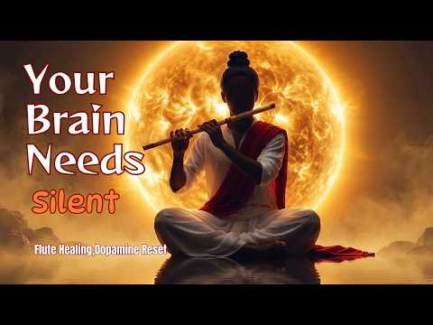
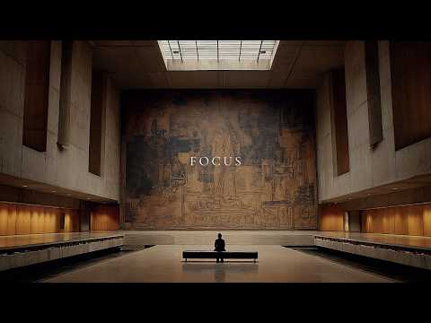
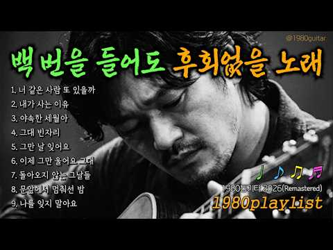
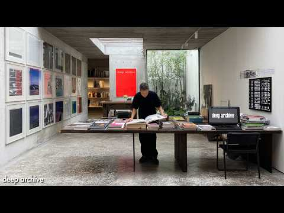
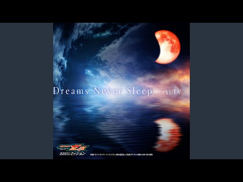
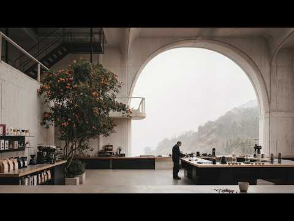
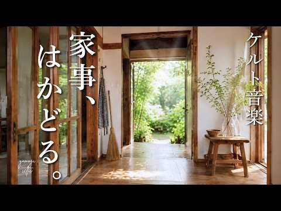

# 음악 — 성공 사례 분석: 사례별 자세히 #721–#760

`analysis.md` 의 9번 (같은 # 번호). 자동 생성 — `tools/success_analysis.py` v1.5.1 (2026-10-23 07:49 UTC). ※ 연구·교육용 — 투자 권유가 아님.

### 721. Golden Horizon ∣ Cinematic Sci-Fi Ambient Music — Utopian Future Civilization & Deep Focus

- https://www.youtube.com/watch?v=QcVRYKcCIZ8 · Cosmic Infinity2 · 구독자 3,060 · 조회수 131,444 (×43.0, 하루 792.7) · 좋아요 1,868 (1.4%) · 13.2분 · 2026-05-10 · 주제 묶음 3. 공부·집중·작업 · 형식 음악 (그 밖 모양 — 한 편짜리 BGM 등) · 폴더 `W_QcVRYKcCIZ8` (웹 승인)
- 썸네일: 
- 설명 앞부분: 🌌 Welcome to Cosmic Infinity2 — a cinematic vision of the future, where imagination, technology, and luxury come together in one breathtaking world. Step into and explore a universe filled with glowing future cities, advanced AI civilization, ultra-modern skyscrapers, intelligent transportation, an…
- 같은 채널 평소 대비 ×156.7 (채널 최근 롱폼 중앙값 839회) · 평소 영상: The City Above the Clouds Futuristic Sci-Fi Ambie… (839회) / Enchanted Crystal Palace ✨ ∣ Magical Fantasy Worl… (724회)
- 대본 없음 (설명) — 음성인식이 끝나면 도입부·흐름이 들어감
- 댓글 109/109: 좋은 점 — 영상 0 · 감사·응원 0 · 더 알고 싶은 것 0 · 아쉬운 점 — 영상 0 · 반박·불만 — 의견 다름 0 · 정치·사회 0 · 경험 공유 0 · 구독·다음 기대 0

### 722. Sneher Chayay Bhalobasay - স্নেহের ছায়ায় ভালোবাসায় ∣∣ Relaxing Old Bangla Movie LoFi Cove…

- https://www.youtube.com/watch?v=uWinY9AA2Z8 · Aruhi Media · 구독자 26,500 · 조회수 1,138,184 (×43.0, 하루 6,331.2) · 좋아요 3,752 (0.3%) · 5.7분 · 2026-04-26 · 주제 묶음 12. 커버·노래 부르기 · 형식 커버·직접 부른 노래 · 폴더 `W_uWinY9AA2Z8` (웹 승인)
- 썸네일: 
- 설명 앞부분: Sneher Chayay Bhalobasay - স্নেহের ছায়ায় ভালোবাসায় ∣∣ Relaxing Old Bangla Movie LoFi Cover Song Unwind and escape into a world of tranquility with our latest collection of Relaxing LoFi Version Music. Perfect for studying, working, or just chilling, this soothing playlist blends mellow beats and ge…
- 같은 채널 평소 대비 ×1,093.4 (채널 최근 롱폼 중앙값 1,041회) · 평소 영상: Aka Mone Prasno Sudhu Jabab Khuje Jay ∣ একা মনে প… (1,088회) / Romantic Bengali Songs ∣ ভালোবাসার বাংলা গান ∣ Ba… (994회)
- 대본 없음 (설명) — 음성인식이 끝나면 도입부·흐름이 들어감
- 댓글 108/108: 좋은 점 — 영상 0 · 감사·응원 0 · 더 알고 싶은 것 0 · 아쉬운 점 — 영상 0 · 반박·불만 — 의견 다름 0 · 정치·사회 0 · 경험 공유 0 · 구독·다음 기대 0

### 723. Relaxing Cha-Cha-Cha Swing on the Beautiful Beach – Latin Rhythm with Accordion & Trumpet

- https://www.youtube.com/watch?v=f3zh_3lwiEI · Grateful For The Coolness · 구독자 16,800 · 조회수 719,030 (×42.8, 하루 4,469.7) · 좋아요 8,393 (1.2%) · 63.8분 · 2026-05-15 · 주제 묶음 기타 · 형식 정보·해설 (그 밖) · 폴더 `W_f3zh_3lwiEI` (웹 승인)
- 썸네일: 
- 설명 앞부분: Escape to a tropical paradise with Relaxing Cha-Cha-Cha Swing on the Beautiful Beach – Latin Rhythm with Accordion & Trumpet. 🌴🌅🎶 Feel the gentle ocean breeze and warm sunset vibes through this smooth instrumental fusion of Cha-Cha-Cha swing, soulful accordion, and elegant trumpet melodies. Inspire…
- 같은 채널 평소 대비 ×633.5 (채널 최근 롱폼 중앙값 1,135회) · 평소 영상: The Best Mambo Cha-Cha-Cha in the World - Latin R… (1,135회) / DESERT ROMANCE ❤️ Egyptian Cha Cha Cha ∣ Relaxing… (949회)
- 대본 없음 (설명) — 음성인식이 끝나면 도입부·흐름이 들어감
- 댓글 194/195: 좋은 점 — 영상 0 · 감사·응원 0 · 더 알고 싶은 것 0 · 아쉬운 점 — 영상 0 · 반박·불만 — 의견 다름 0 · 정치·사회 0 · 경험 공유 0 · 구독·다음 기대 0

### 724. Clear Negative Thoughts: Krishna Flute & Sitar to Quiet Mind । Indian Meditation Music to…

- https://www.youtube.com/watch?v=ugG3qiHWEak · Healing Raga Studio · 구독자 23,700 · 조회수 1,003,045 (×42.3, 하루 13,687.1) · 좋아요 4,957 (0.5%) · 65.3분 · 2026-08-11 · 주제 묶음 1. 수면·명상·힐링 · 형식 음악 (그 밖 모양 — 한 편짜리 BGM 등) · 폴더 `W_ugG3qiHWEak` (웹 승인)
- 썸네일: 
- 챕터: 0:00 Quiet Mind Begins · 2:58 Release Negative Thoughts · 6:27 Krishna Flute Calm · 9:55 Sitar Deep Focus · 13:13 Inner Peace Flow · 16:44 Clear Mental Clutter · 20:08 Calm Mind Energy · 26:14 Deep Meditation Space · 33:01 Focus Without Distraction · 36:56 Emotional Calm Flow · 40:25 Peaceful Mind Reset · 46:01 Bansuri Healing Waves · 52:38 Stillness And Clarity · 58:34 Deep Relaxation Journey · 62:03 Return To Peace
- 설명 앞부분: Clear Negative Thoughts with the soothing sound of Krishna Flute & Sitar. This 1-hour Indian meditation music is created to help quiet the mind, reduce mental distractions, support deep focus, and create a peaceful atmosphere for meditation, study, reading, work, or relaxation. Let the gentle Bansu…
- 같은 채널 평소 대비 ×74.0 (채널 최근 롱폼 중앙값 13,560회) · 평소 영상: Remove Obstacles & Unlock Success: Sitar Instrume… (13,560회) / Cognitive Clarity: Calm Your Mind with 432Hz Sita… (13,449회)
- 대본 없음 (설명) — 음성인식이 끝나면 도입부·흐름이 들어감
- 댓글 144/144: 좋은 점 — 영상 0 · 감사·응원 0 · 더 알고 싶은 것 0 · 아쉬운 점 — 영상 0 · 반박·불만 — 의견 다름 0 · 정치·사회 0 · 경험 공유 0 · 구독·다음 기대 0

### 725. Ancient Chinese Zen Music🍃Bamboo Flute, Erhu & Guzheng🍃Relaxing Music, Soothing @soundtop…

- https://www.youtube.com/watch?v=CKQuvdIKXgU · Sound to Peaceful · 구독자 45,900 · 조회수 1,934,584 (×42.1, 하루 11,932.0) · 좋아요 22,307 (1.1%) · 184.4분 · 2026-05-14 · 주제 묶음 6. 피아노·클래식·연주곡 · 형식 음악 (그 밖 모양 — 한 편짜리 BGM 등) · 폴더 `W_CKQuvdIKXgU` (웹 승인)
- 썸네일: 
- 설명 앞부분: Welcome to Channel " Sound to Peaceful" 🌿Over an hour Peaceful Bamboo Flute, Erhu & Guzheng Relaxing Music🎵 ∣ Best for Deep Sleep, Meditation, Peaceful mind & Stress Relief 🌙 Let the soothing sounds of Bamboo Flute, Erhu and Guzheng transport you to a world of peace and relaxation. This over an hou…
- 같은 채널 평소 대비 ×839.7 (채널 최근 롱폼 중앙값 2,304회) · 평소 영상: Ancient Chinese Zen Music🍃Bamboo Flute & Guzheng … (2,304회) / Ancient Chinese Zen Music🍃Bamboo Flute & Guzheng … (2,249회)
- 대본 없음 (설명) — 음성인식이 끝나면 도입부·흐름이 들어감
- 댓글 592/603: 좋은 점 — 영상 0 · 감사·응원 0 · 더 알고 싶은 것 1 · 아쉬운 점 — 영상 0 · 반박·불만 — 의견 다름 0 · 정치·사회 0 · 경험 공유 1 · 구독·다음 기대 0
  - 더 알고 싶은 것 👍4 “그냥 제 느낌인데 그림속에 피리불고있는사람 왠지 낯이익어서그러는데 제가생각하는게맞나요? 모습이너무똑같아보여서요 중국배우 양양같아보여서요”
  - 경험 공유 👍4 “그냥 제 느낌인데 그림속에 피리불고있는사람 왠지 낯이익어서그러는데 제가생각하는게맞나요? 모습이너무똑같아보여서요 중국배우 양양같아보여서요”

### 726. 일상에 틀어 놓는 잔잔한 찬송가 연속 듣기ㅣ어쿠스틱 편곡ㅣ3시간ㅣ중간 광고 없음ㅣ내 영혼이 은총 입어·내 주를 가까이 하게 함은 외 30곡

- https://www.youtube.com/watch?v=EwY1Z6_6H3I · ALL THAT HYMNㅣ올댓힘 · 구독자 7,240 · 조회수 304,747 (×42.1, 하루 5,952.0) · 좋아요 2,752 (0.9%) · 197.6분 · 2026-09-02 · 주제 묶음 15. CCM·찬양·국악·동요 · 형식 커버·직접 부른 노래 · 폴더 `W_EwY1Z6_6H3I` (웹 승인)
- 썸네일: 
- 챕터: 0:00 찬송가 143장 웬말인가 날 위하여 (Alas! an… · 4:28 찬송가 455장 주님의 마음을 본받는 자 (We Sh… · 7:49 찬송가 20장 큰 영광 중에 계신 주 (Begin, … · 10:48 찬송가 53장 성전을 떠나가기 전 (The Lord … · 12:50 찬송가 401장 주의 곁에 있을 때 (Savior, … · 16:13 찬송가 552장 아침 해가 돋을 때 (When the… · 18:54 찬송가 301장 지금까지 지내온 것 (God's Gr… · 22:15 찬송가 13장 영원한 하늘나라 (Eternal Kin… · 24:52 찬송가 213장 나의 생명 드리니 (Take My L… · 27:59 찬송가 438장 내 영혼이 은총 입어 (Since C… · 31:23 찬송가 272장 고통의 멍에 벗으려고 (Jesus, … · 36:54 찬송가 393장 오 신실하신 주 (Great Is T… · 41:11 찬송가 435장 나의 영원하신 기업 (Thou, My… · 44:00 찬송가 384장 나의 갈 길 다 가도록 (All th… · 46:14 찬송가 24장 왕 되신 주 (Jesus Is King) · 48:40 찬송가 337장 내 모든 시험 무거운 짐을 (I Mu… · 52:14 찬송가 11장 하나님이 친히 (God Himself … · 54:50 찬송가 170장 내 주님은 살아계셔 (I Know T… · 58:01 찬송가 537장 형제여 지체 말라 (Why Do Yo… · 61:17 찬송가 85장 구주를 생각만 해도 (Jesus, th…
- 설명 앞부분: [수록곡] 𝗔𝗟𝗟 𝗧𝗛𝗔𝗧 𝗛𝗬𝗠𝗡은 찬송가 1장부터 645장까지, 매주 한 곡씩 찬송하며 주님의 사랑을 전합니다. 익숙한 찬송은 더 깊이 묵상하고, 잊혀진 찬송은 다시금 빛을 찾도록 함께 노래합니다. 이 길 끝에서 만나 뵐 주님을 기대하며, 오늘도 찬양합니다! ᴀʀʀᴀɴɢᴇᴅ ᴀɴᴅ ᴇᴅɪᴛᴇᴅ ʙʏ ʜʏᴇɪɴ l ʏᴜꜱᴇᴏᴋ ᴍɪxᴇᴅ ʙʏ ʏᴜꜱᴇᴏᴋ
- 같은 채널 평소 대비 ×113.2 (채널 최근 롱폼 중앙값 2,691회) · 평소 영상: 찬송가 292장 주 없이 살 수 없네 ∣ 마음이 힘들 때 듣는 피아노 찬송가 (가사) (2,691회) / 찬송가 272장 고통의 멍에 벗으려고 - Jesus, I Come (가사포함) (3,667회)
- 대본 없음 (설명) — 음성인식이 끝나면 도입부·흐름이 들어감
- 댓글 152/159: 좋은 점 — 영상 2 · 감사·응원 37 · 더 알고 싶은 것 6 · 아쉬운 점 — 영상 4 · 반박·불만 — 의견 다름 0 · 정치·사회 0 · 경험 공유 8 · 구독·다음 기대 6
  - 좋은 점 — 영상 👍7 “아침을 찬양으로 하루를 시작하니 너무 좋네요!! 찬송가가 이렇게 은혜로운 곡들이 많다는 걸 알려줘서 고마워요. 정말 귀한 청년들입니다 찬양하시는 모습들이 너무 은혜로워요!😊”
  - 좋은 점 — 영상 👍4 “❤❤❤목소리가 좋아요 은혜받으세요”
  - 감사·응원 👍41 “우연히 오늘 처음 들어와서 듣게 됩니다 아침에 온가족이 듣고 학교에 직장에 출근하였네요 너무나 은혜로운 찬양이네요 예전에 어릴때 교회에서 어르신들과 많이 부르고 듵었던 찬양인데 이렇게 현대식으로 다시 새롭게 곡을 개편해 불러주시니 더 아름답고 귀한 찬송이 되었네요 싱…”
  - 감사·응원 👍23 “에이아이가 무분별적으로 만들어내는 고성능찬양가가 염증이나는 시댄데 호흡과 기타 연주가 너무귀하고 감사합니다”
  - 더 알고 싶은 것 👍10 “치매에 걸린 엄마를 위해 찬송가를 찾다가 여기를 찾았네요. 정말 감사합니다. 잘 듣겠습니다. 지금은 거의 눈도 잘 못뜨시지만 가끔 찬송가를 부르시는 엄마가 들으시면 정말 좋아하실것 같아요. 좋은 찬송가 많이 부탁드려요.”
  - 더 알고 싶은 것 👍10 “와우 32곡이라뇨 너무너무 좋습니다 !!! 플레이리스트 자주 올려주세요~~”
  - 아쉬운 점 — 영상 👍13 “요즘엔 찬송가를 부르거나 접할 기회가 많이 없어서. .특히나 다음세대는 더 그런것 같아서 아쉬웠는데 넘 감사하네요 저희 세대에는 할머니, 부모님이 부르시던 찬송가가 익숙했는데 다음세대는 그러지 못한것 같아 안타까워요 가사가사 하나하나가 기도인데 ccm도 귀하지만 찬송…”
  - 아쉬운 점 — 영상 👍6 “댓글 잘 안남기는데 다들 목소리가 너무 좋으십니다! 너무 은혜가 됩니다❤ 저도 구독누르고 갑니다! 찬송가찬양 너무 좋습니다”
  - 경험 공유 👍16 “제가 찾던 분위기입니다. 이렇게 귀한 재능 나눠주셔서 감사합니다!^^”
  - 경험 공유 👍15 “제가 간절히 찾던 찬송가 찬양들입니다 고맙습니다!”
  - 구독·다음 기대 👍8 “하나님께 깊이 나아갈수 있도록 돕네요^^ 구독합니다”
  - 구독·다음 기대 👍7 “저도 우연히 들어왔는데 찬양이 정말 아름답고 은혜롭습니다. 편곡, 연주, 노래 어느것 하나 빠지지 않고 정말 훌륭하십니다. 구독합니다. 귀한 달란트로 귀한 나눔해주셔서 정말 고맙습니다. 모든 분들께 주님의 크신 축복이 함께 하시길 바랍니다.”

### 727. 디지몬 OST - 날 지켜줘 (벅차오르는 파워 락 발라드 어레인지 커버) ∣ GrangChe.Ver

- https://www.youtube.com/watch?v=iWfeWC28USw · GrangChe · 구독자 21,500 · 조회수 895,962 (×41.7, 하루 5,592.0) · 좋아요 4,407 (0.5%) · 4.8분 · 2026-05-16 · 주제 묶음 9. 가요·발라드·트로트 · 형식 AI 음악 · 폴더 `W_iWfeWC28USw` (웹 승인)
- 썸네일: 
- 설명 앞부분: '본 컨텐츠는 AI툴을 활용하여 제작된 음악입니다.' 추억 속 파워 디지몬의 삽입곡 '날 지켜줘'를 깊이 있는 락 발라드 감성으로 재해석했어요. 1절의 원곡 정서를 유지하며, 없던 2절을 어울리게 개사해봤어요.
- 같은 채널 평소 대비 ×83.8 (채널 최근 롱폼 중앙값 10,694회) · 평소 영상: 경서 - 사랑은 결말을 알면서도 다시 (벅차오르는 파워 락 발라드 어레인지 커버) ∣ G… (10,767회) / 「청량 락 발라드」우리가 피어날 계절 (벅차오르는 감성 락) ∣ GrangChe (10,620회)
- 대본 없음 (설명) — 음성인식이 끝나면 도입부·흐름이 들어감
- 댓글 233/236: 좋은 점 — 영상 2 · 감사·응원 5 · 더 알고 싶은 것 4 · 아쉬운 점 — 영상 2 · 반박·불만 — 의견 다름 1 · 정치·사회 0 · 경험 공유 6 · 구독·다음 기대 0
  - 좋은 점 — 영상 👍1 “레전드 띵곡이다!”
  - 좋은 점 — 영상 👍1 “레전드”
  - 감사·응원 👍3 “늘 감사히 잘 듣고 있습니다😊”
  - 감사·응원 👍1 “목소리도 너무 좋으시고 운동하기전에 듣고가면 힘이 빡 나네요. 잘 불러주셔서 감사합니다! 구독 완료”
  - 더 알고 싶은 것 👍2 “혹시 어떻게 만들었는지 알 수 있을까요? 선생님을 보고 욕심이 생기기 시작했어요.”
  - 더 알고 싶은 것 👍1 “잘 들었어요! 노래들 너무 좋아서 거의 전곡을 다 들었네요. 이런건 어떻게 만드시는지 궁금하네요 제미나이로하니 완전히 다른노래가 되더라구요.”
  - 아쉬운 점 — 영상 👍3 “락발라드로 하니까 그냥 기계음도 노상관되버리네ㄷㄷ”
  - 아쉬운 점 — 영상 👍0 “무한반복중 ㅎㅎ”
  - 반박·불만 — 의견 다름 👍0 “이거 말도 안됨. goat.”
  - 경험 공유 👍6 “그래 내가 이래서 락발라드를 존나게 좋아했었다고 시발..”
  - 경험 공유 👍1 “와.. ai의 발전이... 분명 반년전쯤인가 ai 누구목소리 커버 이런거 듣다가 음..아직 멀었네 뭔가이상하다 생각했었는데.. 이건 그냥 너무좋네.”

### 728. ENIGMA VOICES IN THE DARK 🌑 Mystical Ambient Music

- https://www.youtube.com/watch?v=fOqrhVkQOh4 · The Sound Palette · 구독자 9,630 · 조회수 401,108 (×41.6, 하루 2,437.4) · 좋아요 6,188 (1.5%) · 8분 · 2026-05-11 · 주제 묶음 1. 수면·명상·힐링 · 형식 음악 (그 밖 모양 — 한 편짜리 BGM 등) · 폴더 `W_fOqrhVkQOh4` (웹 승인)
- 썸네일: 
- 설명 앞부분: ENIGMA: VOICES IN THE DARK 🕯️✨ Close your eyes and let the ancient echoes take over. 🌌 This isn’t just music; it’s a journey into the deepest corners of your soul. 🧘‍♂️ Feel the haunting whispers of the past mixed with the heavy, rhythmic heartbeat of the night. 🌑🥁 Perfect for that late-night drive…
- 같은 채널 평소 대비 ×124.3 (채널 최근 롱폼 중앙값 3,228회) · 평소 영상: ENIGMA Style – The Last Elven Kingdom 🌑Epic Mysti… (3,259회) / Enigma Style - Echoes of Eternity 🌑 Deep Mystical… (3,197회)
- 대본 없음 (설명) — 음성인식이 끝나면 도입부·흐름이 들어감
- 댓글 169/170: 좋은 점 — 영상 0 · 감사·응원 0 · 더 알고 싶은 것 0 · 아쉬운 점 — 영상 0 · 반박·불만 — 의견 다름 0 · 정치·사회 0 · 경험 공유 0 · 구독·다음 기대 0

### 729. Relaxing Piano Music for Inner Peace, Meditation, Stress Relief & Calm Mind🌿Healing Water…

- https://www.youtube.com/watch?v=dljV0oqDztU · Celestial Relaxing Sounds · 구독자 11,400 · 조회수 473,725 (×41.5, 하루 8,630.8) · 좋아요 3,936 (0.8%) · 127.7분 · 2026-08-29 · 주제 묶음 1. 수면·명상·힐링 · 형식 음악 (그 밖 모양 — 한 편짜리 BGM 등) · 폴더 `W_dljV0oqDztU` (웹 승인)
- 썸네일: 
- 설명 앞부분: 🌸 Relaxing Piano Music for Inner Peace, Meditation, Stress Relief & Calm Mind 🌸 Step into a beautiful sanctuary of peace with this relaxing piano meditation music from **Celestial Relaxing Sounds**. Inspired by a dreamy pink garden, gentle waterfalls, crystal stones, and a peaceful turquoise pond, …
- 같은 채널 평소 대비 ×147.5 (채널 최근 롱폼 중앙값 3,212회) · 평소 영상: Calm Your Mind & Sleep Deeply 🌿 Relaxing Healing … (3,252회) / Healing Piano Music & Relaxing Water Sounds 🌿 Cal… (3,171회)
- 대본 없음 (설명) — 음성인식이 끝나면 도입부·흐름이 들어감
- 댓글 236/244: 좋은 점 — 영상 0 · 감사·응원 0 · 더 알고 싶은 것 0 · 아쉬운 점 — 영상 0 · 반박·불만 — 의견 다름 0 · 정치·사회 0 · 경험 공유 0 · 구독·다음 기대 0

### 730. The Sound Your Brain Needs Right Now 🌿 Deep Healing Music ∣ Dopamine Reset ∣ Zen Meditati…

- https://www.youtube.com/watch?v=rQ5bIFKQoUc · Osen Moonlight · 구독자 10,100 · 조회수 418,750 (×41.5, 하루 7,123.5) · 좋아요 3,803 (0.9%) · 107분 · 2026-08-25 · 주제 묶음 1. 수면·명상·힐링 · 형식 음악 (그 밖 모양 — 한 편짜리 BGM 등) · 폴더 `W_rQ5bIFKQoUc` (웹 승인)
- 썸네일: 
- 설명 앞부분: Welcome to your sanctuary of peace, mindfulness, and deep relaxation. Our channel is dedicated to creating calming soundscapes that help you reconnect with yourself through Healing Music, Relaxing Music, Zen Meditation Music, Tibetan Music, Bamboo Flute Music, Indian Flute Music, Soul-Calming Flute…
- 같은 채널 평소 대비 ×129.5 (채널 최근 롱폼 중앙값 3,234회) · 평소 영상: Calming Flute Music for Stress Relief 🧘‍♂️ Healin… (3,234회) / Instant Relaxation in 5 Minutes 🎶 ∣ Zen Flute Hea… (3,135회)
- 대본 없음 (설명) — 음성인식이 끝나면 도입부·흐름이 들어감
- 댓글 128/165: 좋은 점 — 영상 0 · 감사·응원 0 · 더 알고 싶은 것 0 · 아쉬운 점 — 영상 0 · 반박·불만 — 의견 다름 0 · 정치·사회 0 · 경험 공유 0 · 구독·다음 기대 0

### 731. 듣자마자 학창시절 떠오르는 노래 🎧 싸이월드 감성 PART 4

- https://www.youtube.com/watch?v=F-0JE3Byo9U · 소꿀 TV · 구독자 18,200 · 조회수 749,871 (×41.2, 하루 4,591.0) · 좋아요 2,388 (0.3%) · 82.6분 · 2026-05-12 · 주제 묶음 기타 · 형식 플레이리스트·모음 (여러 곡) · 폴더 `W_F-0JE3Byo9U` (웹 승인)
- 썸네일: 
- 챕터: 0:00 에픽하이 - 우산 · 5:04 이은미 - 애인…있어요 · 9:08 모세 - 사랑인 걸 · 13:24 KCM - 너에게 전하는 아홉가지 바람 · 17:38 V.O.S - 보고싶은 날엔 · 21:11 Alex - 화분 · 26:37 MC몽 - I Love U, Oh Thank U · 29:50 바이브 - 술이야 · 33:55 거미 - 친구라도 될 걸 그랬어 · 38:37 임정희 - 사랑은 봄비처럼 이별은 겨울비처럼 · 43:20 백지영 - 총맞은 것처럼 · 47:18 란 - 어쩌다가 · 51:15 나몰라패밀리 - 사랑해요 · 55:04 Hey - 쥬뗌므(Je T'aime) · 59:15 ART - 슬픈 얼굴 · 63:46 애즈원 - 원하고 원망하죠 · 67:48 프리스타일 - 그리고 그 후 · 71:22 심플리선데이 - 사랑해요 · 75:41 하은 - 아프고 화나고 미안해 · 79:02 크라잉넛 - The Hero
- 설명 앞부분: 2000년대 싸이월드 감성 플레이리스트입니다. ‐ 밤 감성과 잘 어울리는 2000년대 명곡 ‐ 싸이월드 시절 감정을 떠올리게 하는 노래 ‐ 조용히 듣기 좋은 감성 플레이리스트 PART 4는 특히 밤에 들으면 몰입도가 높은 곡들 위주입니다.
- 대본 없음 (설명) — 음성인식이 끝나면 도입부·흐름이 들어감
- 댓글 50/53: 좋은 점 — 영상 0 · 감사·응원 2 · 더 알고 싶은 것 0 · 아쉬운 점 — 영상 0 · 반박·불만 — 의견 다름 0 · 정치·사회 0 · 경험 공유 0 · 구독·다음 기대 0
  - 감사·응원 👍4 “첫 소절만 들어도 학창시절의 장면들이 하나씩 떠오르네요. 🎧 그때 친구들과 함께 듣던 노래, 설레고 웃었던 순간들이 새록새록 생각납니다. 싸이월드 감성은 정말 시간이 지나도 잊히지 않는 것 같아요. 추억 제대로 소환하고 갑니다. 좋은 선곡 감사합니다. ❤”
  - 감사·응원 👍4 “이 아름다운 발라드를 만들어 주셔서 감사해요.”

### 732. the best classical music for concentration ∣ deep meditation music

- https://www.youtube.com/watch?v=ViZf4iovMMk · StillSpace · 구독자 32,800 · 조회수 1,351,435 (×41.2, 하루 8,174.4) · 좋아요 33,218 (2.5%) · 61.4분 · 2026-05-11 · 주제 묶음 1. 수면·명상·힐링 · 형식 플레이리스트·모음 (여러 곡) · 폴더 `W_ViZf4iovMMk` (웹 승인)
- 썸네일: 
- 챕터: 0:00 The Cognitive Flow · 2:00 Inkwell Resonance · 4:00 Pizzicato for the Polymath · 6:07 The Socratic Waltz · 7:48 Adagio of the Open Page · 10:27 Counterpoint of Clarity · 13:14 The Midnight Study · 15:24 Allegro for Deep Logic · 18:00 Vellum and Quill · 20:29 Harmonic Discipline · 22:30 The Quiet Ambition · 24:37 Staccato Syllabus · 25:58 Cello Solitude · 28:14 The Resolution of Insight · 30:42 Repeat
- 설명 앞부분: FOCUS Music — Classical String Quartet for Studying, Deep Work & Concentration The perfect background music for studying, working, and deep focus. This classical string quartet BGM helps you concentrate without distractions — no lyrics, no interruptions, just pure music to keep you in the zone. 💿️T…
- 같은 채널 평소 대비 ×332.3 (채널 최근 롱폼 중앙값 4,067회) · 평소 영상: Classical Music for Unbroken Focus & Forest Reson… (4,067회) / Classical Music for Unbroken Focus & Deep Work (3,955회)
- 대본 없음 (설명) — 음성인식이 끝나면 도입부·흐름이 들어감
- 댓글 608/616: 좋은 점 — 영상 0 · 감사·응원 1 · 더 알고 싶은 것 2 · 아쉬운 점 — 영상 0 · 반박·불만 — 의견 다름 0 · 정치·사회 0 · 경험 공유 1 · 구독·다음 기대 0
  - 감사·응원 👍1 “이밤에 이런곡을 넘 좋다~~ 댓글에 황홀하다는 표현을 첨 쓰게되네~~ 온몸을 감싸고 도누나~~ 넘넘감사😂”
  - 더 알고 싶은 것 👍3 “플레이 리스트 알 수 있을까요? 원곡이 누가 작품인지 궁금하네요”
  - 경험 공유 👍3 “몇년전만 해도 ai는 절대 감정을 건들수 없다고 생각했었는데............ ㅎㅎ 오만이었군”

### 733. @노노뮤직#피아노협주곡 #힐링음악 #감성피아노 #클래식음악 #휴식음악#명상음악 #잔잔한음악 #오케스트라 #피아노연주#힐링피아노 #peacefulmusic #pi…

- https://www.youtube.com/watch?v=aLyOUOXr5F4 · 노노스튜디오 · 구독자 462 · 조회수 19,019 (×41.2, 하루 130.3) · 좋아요 202 (1.1%) · 30분 · 2026-05-30 · 주제 묶음 6. 피아노·클래식·연주곡 · 형식 연주 (직접 연주하는 영상) · 폴더 `W_aLyOUOXr5F4` (웹 승인)
- 썸네일: 
- 설명 앞부분: 조용히 마음을 안아주는 피아노 협주곡입니다. 잔잔한 피아노 선율과 웅장한 오케스트라의 흐름 속에서 잠시 모든 걱정을 내려놓고 쉬어가시길 바랍니다. 삶이 힘들 때, 말없이 곁에 있어주는 음악 한 곡이 큰 위로가 되기도 합니다. 오늘 이 음악이 당신의 마음에 작은 평온이 되기를 바랍니다. 편안한 휴식, 명상, 공부, 독서, 수면 전 음악으로도 함께해보세요. 이어폰으로 들으시면 더욱 깊은 감동을 느끼실 수 있습니다. 🎹 삶을 위로하는 피아노 협주곡 ⏳ 30분 힐링 클래식 🌙 감성 · 휴식 · 평온 · 치유의 시간
- 같은 채널 평소 대비 ×116.0 (채널 최근 롱폼 중앙값 164회) · 평소 영상: @노노뮤직#SymphonyOfADay#하루의교향곡#오케스트라#클래식음악#Classical… (169회) / @노노뮤직#프라하 #Prague #유럽클래식 #창작클래식 #BackgroundMusic … (159회)
- 대본 없음 (설명) — 음성인식이 끝나면 도입부·흐름이 들어감
- 댓글 9/9: 좋은 점 — 영상 0 · 감사·응원 0 · 더 알고 싶은 것 0 · 아쉬운 점 — 영상 1 · 반박·불만 — 의견 다름 0 · 정치·사회 0 · 경험 공유 0 · 구독·다음 기대 2
  - 아쉬운 점 — 영상 👍2 “광고가너심하네요”
  - 구독·다음 기대 👍3 “진한 위로를 줍니다 매일매일 듣고 있어요 듣고있음 꽃이 활짝핀 정원에서 차를 마시고 싶다는 생각이 듭니다”
  - 구독·다음 기대 👍1 “구독과 좋아요 누르고 갑니다 알림설정두요 진한 에스프레스와 잘 어울리는 연주곡입니다”

### 734. ray 【カフェ風アレンジ】 / Remix / 超かぐや姫！

- https://www.youtube.com/watch?v=js2syT4l9lc · Remix中谷 · 구독자 5,530 · 조회수 225,905 (×40.9, 하루 1,632.2) · 좋아요 9,918 (4.4%) · 12분 · 2026-06-06 · 주제 묶음 기타 · 형식 정보·해설 (그 밖) · 폴더 `W_js2syT4l9lc` (웹 승인)
- 썸네일: 
- 설명 앞부분: ボカロやアニソンのアレンジRemixを投稿していきます。 ▼『耐久動画verを出して欲しい』とコメントいただくことが多いですが、下記の方法でループ再生することができます！ ▼Instagram
- 같은 채널 평소 대비 ×2.6 (채널 최근 롱폼 중앙값 85,611회) · 평소 영상: 『Ex-Otogibanashi』/ 【カフェ風アレンジ】 / 超かぐや姫！ / Remix (85,611회) / 私はわたしの事が好き。 【カフェ風アレンジ】 / Remix / 超かぐや姫！ (90,027회)
- 대본 없음 (설명) — 음성인식이 끝나면 도입부·흐름이 들어감
- 댓글 162/162: 좋은 점 — 영상 0 · 감사·응원 0 · 더 알고 싶은 것 0 · 아쉬운 점 — 영상 0 · 반박·불만 — 의견 다름 0 · 정치·사회 0 · 경험 공유 0 · 구독·다음 기대 0

### 735. 백 번을 들어도 후회없을 노래🎵트로트 거친 보이스 @1980통기타 음악 @1980guitar playlist kpop

- https://www.youtube.com/watch?v=ZVTFRwA3r14 · 1980통기타 · 구독자 11,900 · 조회수 482,097 (×40.5, 하루 4,613.7) · 좋아요 3,122 (0.7%) · 29.9분 · 2026-07-10 · 주제 묶음 6. 피아노·클래식·연주곡 · 형식 플레이리스트·모음 (여러 곡) · 폴더 `W_ZVTFRwA3r14` (웹 승인)
- 썸네일: 
- 설명 앞부분: “1980통기타의 노래는 카무칸뮤직(박영준님)작사, 작곡 및 보컬은 AI 생성 도구를 활용한 창작물입니다.” “The songs by 1980 Acoustic Guitar feature lyrics, composition, and vocals by Kamukan Music (Park Young-jun), created using AI generation tools.” 🎸 1980통기타는 여러분의 일상에 힐링과 편안함을 더합니다. 1980통기타는 7080 감성 통기타 포크와 발라드 음악을 감상할 수 있는 채널입니다. 기타 선율 위에…
- 같은 채널 평소 대비 ×54.7 (채널 최근 롱폼 중앙값 8,821회) · 평소 영상: 여름날 “단비” 같은 노래🎵트로트 거친 보이스 @1980통기타 음악 @1980guitar… (8,884회) / 들을 때마다, 소름돋는 노래🎵트로트 거친 보이스 @1980통기타 음악 @1980guita… (8,758회)
- 대본 없음 (설명) — 음성인식이 끝나면 도입부·흐름이 들어감
- 댓글 107/109: 좋은 점 — 영상 0 · 감사·응원 8 · 더 알고 싶은 것 4 · 아쉬운 점 — 영상 1 · 반박·불만 — 의견 다름 0 · 정치·사회 0 · 경험 공유 4 · 구독·다음 기대 1
  - 감사·응원 👍18 “목소리 진짜 너무너무 좋네요 짱이에요😅 일 마치고 퇴근하고 술 한잔 하게 되여 듣게 된 선곡인데요 옛 생각 나면서 눈물이 흐르네요 술 한잔이 눈물 젖은 술잔이 되네요 그래도 노래가 멋진 노래이고~ 가사 곳곳이 뜻이 있고 듣기가 너무 좋네요❤ 밤새 도록 들어 볼까 해요…”
  - 감사·응원 👍18 “이 노래를 듣는 순간 젊은 시절로 돌아간 것 같습니다. 그때의 설렘과 행복했던 기억이 하나씩 떠오르네요. 좋은 음악 정말 감사합니다.”
  - 더 알고 싶은 것 👍8 “가수 이름이 알고 싶은데 아시는 분”
  - 더 알고 싶은 것 👍3 “1,2번 곡의 기타 코드를 알수 있을까요? 직접 불러보고 싶네요”
  - 아쉬운 점 — 영상 👍10 “저두무한반복갑니당👍👍👍👍👏👏👏👏🙏🙏🙆‍♂️”
  - 경험 공유 👍51 “"내가 사는 이유, 아~~ 그때 기억 그때 깊었던 진심. 사랑.관심.배려 모두100%소환 시켜 놓았구나 그때 처음부터 끝까지 챙겨주고 아껴주고 관심가져 주었기에.. 나 은혜를 값고 싶었네. 그를 돕고싶은 마음에.. 그것이 노래로 큰 기쁨이 되어 사랑을 발견하게 되고 …”
  - 경험 공유 👍4 “오늘따라 첫사랑이 그립네요 잘있겠죠 내마음를 알까요 내가 사랑 💕 했다는걸 내나이 70십 지금도 보고싶네요”
  - 구독·다음 기대 👍1 “트로트의 거친 보이스가 너무 좋아요. 구독하고 갑니다.🤩🤩🤩🤩🤩😍😍😍😍”

### 736. 𝐏𝐥𝐚𝐲𝐥𝐢𝐬𝐭 우린 아직 흑백영화처럼 사랑하고

- https://www.youtube.com/watch?v=71_AXp38B7M · 세봄 · 구독자 14,300 · 조회수 572,591 (×40.0, 하루 3,784.8) · 좋아요 4,033 (0.7%) · 17.1분 · 2026-05-25 · 주제 묶음 기타 · 형식 플레이리스트·모음 (여러 곡) · 폴더 `W_71_AXp38B7M` (웹 승인)
- 썸네일: 
- 챕터: 0:00 검정치마 - 한시 오분 · 3:57 검정치마 - 폭죽과 풍선들 · 7:20 리도어 - 영원은 그렇듯 · 11:17 데이먼스 이어 - Mondegreen · 14:27 릴러말즈 - 흑백영화
- 설명 앞부분: 본 채널의 모든 콘텐츠는 수익 창출과 무관하게 운영됩니다. [timestamps]
- 같은 채널 평소 대비 ×13.9 (채널 최근 롱폼 중앙값 41,160회) · 평소 영상: 𝐏𝐥𝐚𝐲𝐥𝐢𝐬𝐭 시골향 복숭아 (47,463회) / 𝐏𝐥𝐚𝐲𝐥𝐢𝐬𝐭 영생과 영면의 차이를 너는 알고 있니 (34,857회)
- 대본 없음 (설명) — 음성인식이 끝나면 도입부·흐름이 들어감
- 댓글 28/29: 좋은 점 — 영상 0 · 감사·응원 1 · 더 알고 싶은 것 0 · 아쉬운 점 — 영상 0 · 반박·불만 — 의견 다름 0 · 정치·사회 0 · 경험 공유 1 · 구독·다음 기대 0
  - 감사·응원 👍2 “데이트 중에 너무 행복하게 잘 들었어요 감사합니다🥰”
  - 경험 공유 👍9 “내가 만약에 너랑 헤어지기 전에 엄청 돈이 많은 부자가 됐었다면 이 돈으로 너랑 같이 많은 곳을 갈 수 있을 거 같다는 생각에 엄청 기뻐했을거야”

### 737. 🎧"세상에서 가장 애절한 목소리" 한 편의 영화 같은 무대, 그리고 가슴을 울리는 목소리…🎙️ 김정호 - "이름 모를 소녀" [락카페 버전]

- https://www.youtube.com/watch?v=tjA0yWEZnu8 · 가슴을 울리는 락카페 · 구독자 10,900 · 조회수 434,541 (×39.9, 하루 2,671.1) · 좋아요 2,648 (0.6%) · 4.4분 · 2026-05-13 · 주제 묶음 4. 카페·매장·라운지 · 형식 커버·직접 부른 노래 · 폴더 `W_tjA0yWEZnu8` (웹 승인)
- 썸네일: 
- 설명 앞부분: 🌙수많은 사람들 속에서도 문득 한 사람의 기억이 오래도록 마음을 붙잡는 밤이 있습니다. 오늘은 세월이 흘러도 여전히 가슴을 울리는 명곡 ‘이름 모를 소녀’를 저만의 감성과 목소리로 다시 불러보았습니다. 애절한 멜로디와 깊은 그리움이 당신의 오래된 추억 한 장을 꺼내주길 바랍니다. 🎵 Cover Song - 이름 모를 소녀 한 편의 영화 같은 무대, 그리고 가슴을 스치는 목소리… 오늘 밤, 조용히 함께 들어주세요.
- 같은 채널 평소 대비 ×56.1 (채널 최근 롱폼 중앙값 7,741회) · 평소 영상: 첫 소절부터 가슴이 먹먹해지는 명곡...블루스로 들어도 너무좋다!! 🎙️ "칠갑산" - … (7,741회) / [신청곡] 가슴과 마음이 눈물을 원할땐 그냥 울어도 좋습니다. 🎙️"저별과 달을" - 어… (7,650회)
- 대본 없음 (설명) — 음성인식이 끝나면 도입부·흐름이 들어감
- 댓글 90/90: 좋은 점 — 영상 1 · 감사·응원 6 · 더 알고 싶은 것 1 · 아쉬운 점 — 영상 1 · 반박·불만 — 의견 다름 0 · 정치·사회 0 · 경험 공유 7 · 구독·다음 기대 1
  - 좋은 점 — 영상 👍16 “구독 좋아요로 응원합니다 최고입니다 늘 행복하세요 넘 듣기 좋아요❤❤❤🎉🎉”
  - 감사·응원 👍16 “구독 좋아요로 응원합니다 최고입니다 늘 행복하세요 넘 듣기 좋아요❤❤❤🎉🎉”
  - 감사·응원 👍9 “심금을 울리는 창법입니다 먼저간 친구생각에 눈물흘리며 그냥 짠해지네요 고맙습니다”
  - 더 알고 싶은 것 👍1 “음악이넘좋은데 mr은 어디에서 구매할수있나요?”
  - 아쉬운 점 — 영상 👍15 “Ai 목소리에 빠져 드네요 ㅎㅎ”
  - 경험 공유 👍7 “옛날 약40년전 라디오에서 들었던 노래 ....나도 늙어가고 있구나”
  - 경험 공유 👍5 “나도 모르게 눈물이 나네요”
  - 구독·다음 기대 👍1 “구독합니다.”

### 738. Fresh Mind Relaxing 💗 ∣ Slowed + Reverb Lofi Mix for Calm, Focus & Peaceful Vibes #sleepm…

- https://www.youtube.com/watch?v=70p4fSeLZ3I · Vansh Lofi · 구독자 29,200 · 조회수 1,157,911 (×39.6, 하루 8,167.6) · 좋아요 3,953 (0.3%) · 15분 · 2026-06-03 · 주제 묶음 1. 수면·명상·힐링 · 형식 음악 (그 밖 모양 — 한 편짜리 BGM 등) · 폴더 `W_70p4fSeLZ3I` (웹 승인)
- 썸네일: 
- 설명 앞부분: Fresh Mind Relaxing 💗 ∣ Slowed + Reverb Lofi Mix for Calm, Focus & Peaceful Vibes Welcome to the world of soothing lofi music, where stress fades away, and peace takes over. This 2025 mind-relaxing lofi mix is perfect for: Deep Focus & Studying 📖 Relaxing & Meditation 🧘‍♂ Chilling After a Long Day …
- 대본 없음 (설명) — 음성인식이 끝나면 도입부·흐름이 들어감
- 댓글 46/46: 좋은 점 — 영상 0 · 감사·응원 0 · 더 알고 싶은 것 0 · 아쉬운 점 — 영상 0 · 반박·불만 — 의견 다름 0 · 정치·사회 0 · 경험 공유 0 · 구독·다음 기대 0

### 739. Rest Tonight In God's Love ∣ Christian Deep Sleep Worship Music ∣ Peaceful Sleep In His P…

- https://www.youtube.com/watch?v=nzc_yRoaBRI · Midnight Sanctuary · 구독자 22,200 · 조회수 877,149 (×39.5, 하루 9,662.9) · 좋아요 8,882 (1.0%) · 122.5분 · 2026-07-24 · 주제 묶음 15. CCM·찬양·국악·동요 · 형식 음악 (그 밖 모양 — 한 편짜리 BGM 등) · 폴더 `W_nzc_yRoaBRI` (웹 승인)
- 썸네일: 
- 챕터: 0:00 I'm Tired Tonight · 4:50 Tomorrow's Yours · 9:59 You Know My Heart · 14:49 You're Here With Me · 19:54 I Give It All To You · 24:50 Carry Me Tonight · 29:46 I'll Rest In You · 34:52 Your Love Heals Me · 40:19 I'm Safe In Your Love · 45:41 Your Peace Remains · 50:42 Safe In Your Care · 56:13 Sleep In My Love
- 설명 앞부분: Rest Tonight In God's Love ∣ Christian Deep Sleep Worship Music ∣ Peaceful Sleep In His Presence🌙🧡 This Deep Sleep Worship playlist was created to help you slow down, release every anxious thought, and fall asleep surrounded by God's loving presence. Let each gentle melody remind you that His peace…
- 같은 채널 평소 대비 ×98.8 (채널 최근 롱폼 중앙값 8,880회) · 평소 영상: Peaceful Rest In God's Presence 🌙🤍 ∣ Peaceful Wor… (9,343회) / REST IN GOD'S LOVING PRESENCE 🧡🌙💤 ∣ Christian Dee… (8,417회)
- 대본 없음 (설명) — 음성인식이 끝나면 도입부·흐름이 들어감
- 댓글 332/337: 좋은 점 — 영상 0 · 감사·응원 0 · 더 알고 싶은 것 0 · 아쉬운 점 — 영상 0 · 반박·불만 — 의견 다름 0 · 정치·사회 0 · 경험 공유 0 · 구독·다음 기대 0

### 740. [No Ads] Uplifting Morning Piano Music 🌿 ∣ Fresh & Positive Energy Classic BGM ∣ Elise Pi…

- https://www.youtube.com/watch?v=D8dWbYNFXKc · Elise Piano | 엘리제피아노 · 구독자 24,900 · 조회수 979,554 (×39.3, 하루 8,955.7) · 좋아요 5,312 (0.5%) · 183.7분 · 2026-07-05 · 주제 묶음 6. 피아노·클래식·연주곡 · 형식 음악 (그 밖 모양 — 한 편짜리 BGM 등) · 폴더 `W_D8dWbYNFXKc` (웹 승인)
- 썸네일: 
- 챕터: 0:00 Serene Morning Prelude · 1:58 Gentle Morning Piano · 4:43 Tender Ivory Keys · 7:18 Comforting Piano Resonance · 9:41 Graceful Morning Light · 11:44 Gentle River Melody · 14:07 Relaxing Morning Arpeggio · 15:14 Elegance of the Bright Hall · 17:58 Peaceful Chopin Melody · 19:27 Elegant Morning Serenade · 21:59 Tranquil Piano Ensemble · 23:48 Soft Comfort of the Morning · 25:15 Warm Embrace of the Piano · 27:24 Soothing Chopin Flow · 29:42 Sunlight on the Keys · 32:09 Fresh Chopin Breeze · 35:14 Delicate Piano Drops · 37:43 Whispers of a Calm Morning · 39:47 Romantic Spring Prelude · 42:15 Dawn of Serenity
- 설명 앞부분: This is a pleasant classical piano BGM to start a refreshing morning. We have prepared clear melodies that resemble the warm sunshine and fresh green scenery shining through your window. The cheerful and transparent harmony of the piano and strings will gently wake up your heavy body and mind, brig…
- 같은 채널 평소 대비 ×48.5 (채널 최근 롱폼 중앙값 20,214회) · 평소 영상: Lively Autumn Classical Music 🍂 Golden Harvest Jo… (21,497회) / Morning Classical Music ☕ Elegant Violin & Piano … (18,932회)
- 대본 없음 (설명) — 음성인식이 끝나면 도입부·흐름이 들어감
- 댓글 123/135: 좋은 점 — 영상 0 · 감사·응원 4 · 더 알고 싶은 것 0 · 아쉬운 점 — 영상 0 · 반박·불만 — 의견 다름 0 · 정치·사회 0 · 경험 공유 2 · 구독·다음 기대 1
  - 감사·응원 👍6 “너무 좋아요 감사합니다❤❤”
  - 감사·응원 👍3 “경쾌한 아름다운음악 가벼운마음으로 오늘도 감사하는 마음으로 하루를시작하게해주심에 행복하고 감사합니다. ❤❤❤❤❤❤❤”
  - 경험 공유 👍6 “여름소리 매미 밖의 합창 대단합니다. 음악 또한 상쾌하게 듣고 있는 제가 대단합니다. 이제는 저를 칭찬해 주고 싶습니다. 잘 하고 있다고 ... 늘 하루가 무료한것 같아 때론 후퇴한 자신인것 같아서 우울해지려는 마음 좀더 자신있게 긍정의 마인드를 출발하렵니다...장마…”
  - 구독·다음 기대 👍1 “매일 듣고있어요!❤”

### 741. Saxophone Love Songs ❤️ Best Romantic Saxophone Covers ∣ Relaxing Love Songs Instrumental

- https://www.youtube.com/watch?v=Uea_DclFKjw · Sax Chill Vibes · 구독자 27,700 · 조회수 1,065,994 (×38.5, 하루 14,374.5) · 좋아요 5,461 (0.5%) · 61분 · 2026-08-10 · 주제 묶음 6. 피아노·클래식·연주곡 · 형식 플레이리스트·모음 (여러 곡) · 폴더 `W_Uea_DclFKjw` (웹 승인)
- 썸네일: 
- 챕터: 0:00 Right Here Waiting For You · 0:00 Wonderful Tonight · 0:00 Tonight I Celebrate My Love · 0:00 Can't Help Falling In Love · 0:00 Beautiful in White · 0:00 Imagine · 0:00 Forever In Love · 0:00 My Heart Will Go On · 0:00 Love Story · 0:00 Nothing Gonna Change My Love … · 0:00 Take Me To Your Heart · 0:00 I Have A Dream · 0:00 La Paloma · 0:00 Close To You · 0:00 Exchange of Hearts · 0:00 Let It Be
- 설명 앞부분: Saxophone Love Songs – 16 Timeless Romantic Love Songs Relax and enjoy 16 beautiful love songs performed with smooth, warm saxophone melodies. A romantic collection of timeless favorites perfect for relaxing, dinner, evening moments, reading, or simply remembering someone special. 🎷 Tracklist: 🎧 Pe…
- 같은 채널 평소 대비 ×13.2 (채널 최근 롱폼 중앙값 80,794회) · 평소 영상: Take Me to Your Heart - Beautiful Saxophone (80,794회) / Best Romantic Saxophone Love Songs ♫ Beautiful Sa… (559,135회)
- 대본 없음 (설명) — 음성인식이 끝나면 도입부·흐름이 들어감
- 댓글 97/104: 좋은 점 — 영상 0 · 감사·응원 0 · 더 알고 싶은 것 0 · 아쉬운 점 — 영상 0 · 반박·불만 — 의견 다름 0 · 정치·사회 0 · 경험 공유 0 · 구독·다음 기대 0

### 742. 途中広告なし【カフェBGM】涼やかな夏カフェ｜木漏れ日の、心ほどける森カフェ時間｜作業用・読書・リラックス｜Cafe Music・Coffee Shop Ambience

- https://www.youtube.com/watch?v=3QKdiHlK6c4 · Kokoro Music Room · 구독자 21,100 · 조회수 807,740 (×38.3, 하루 8,503.2) · 좋아요 2,131 (0.3%) · 122.5분 · 2026-07-20 · 주제 묶음 2. 자연 소리·백색소음 · 형식 음악 (그 밖 모양 — 한 편짜리 BGM 등) · 폴더 `W_3QKdiHlK6c4` (웹 승인)
- 썸네일: 
- 설명 앞부분: 🎧 おすすめのカフェBGMはこちら 🌻 夏カフェBGMシリーズはこちら Relax in a nostalgic Japanese retro café, where time seems to slow down. Enjoy two peaceful hours surrounded by the aroma of fresh coffee, classic desserts, and the warm atmosphere of a traditional kissaten. Perfect for reading, working, studying, or simply enjoy…
- 같은 채널 평소 대비 ×40.2 (채널 최근 롱폼 중앙값 20,089회) · 평소 영상: 途中広告なし【カフェBGM】深呼吸する森カフェ｜色づく木々を眺めながらのんびり過ごす癒しのカフェB… (20,089회) / 途中広告なし【カフェBGM】心ゆるむレトロカフェ｜懐かしい喫茶店でゆっくり過ごす癒し時間｜作業用・… (20,406회)
- 대본 없음 (설명) — 음성인식이 끝나면 도입부·흐름이 들어감
- 댓글 73/73: 좋은 점 — 영상 0 · 감사·응원 0 · 더 알고 싶은 것 0 · 아쉬운 점 — 영상 0 · 반박·불만 — 의견 다름 0 · 정치·사회 0 · 경험 공유 0 · 구독·다음 기대 0

### 743. Oscar & Deep - Feeling Flow

- https://www.youtube.com/watch?v=b_DXB1Dj4l8 · Oscar & Deep · 구독자 24,400 · 조회수 921,571 (×37.8, 하루 5,491.4) · 좋아요 3,946 (0.4%) · 7.5분 · 2026-05-08 · 주제 묶음 5. 운동·드라이브·신나는 · 형식 음악 (그 밖 모양 — 한 편짜리 BGM 등) · 폴더 `W_b_DXB1Dj4l8` (웹 승인)
- 썸네일: 
- 설명 앞부분: 🎵 Listen to "Feeling Flow" by Oscar & Deep Experience a new blend of electronic emotions. From the hypnotic rhythms of Italo Disco to the soulful touch of Middle Eastern Deep House, this track is part of our journey to redefine atmospheric soundscapes. ✨ About Oscar & Deep: Welcome to the official …
- 같은 채널 평소 대비 ×32.8 (채널 최근 롱폼 중앙값 28,093회) · 평소 영상: Oscar & Deep - Easy to Believe (28,228회) / Oscar & Deep - Take It Slowly (27,958회)
- 대본 없음 (설명) — 음성인식이 끝나면 도입부·흐름이 들어감
- 댓글 90/90: 좋은 점 — 영상 0 · 감사·응원 0 · 더 알고 싶은 것 0 · 아쉬운 점 — 영상 0 · 반박·불만 — 의견 다름 0 · 정치·사회 0 · 경험 공유 0 · 구독·다음 기대 0

### 744. hyper-focus. ∣ deep house music for coding

- https://www.youtube.com/watch?v=uNw_a7HFwvg · deep archive · 구독자 25,200 · 조회수 951,424 (×37.8, 하루 6,974.8) · 좋아요 16,694 (1.8%) · 148.4분 · 2026-06-08 · 주제 묶음 3. 공부·집중·작업 · 형식 음악 (그 밖 모양 — 한 편짜리 BGM 등) · 폴더 `W_uNw_a7HFwvg` (웹 승인)
- 썸네일: 
- 챕터: 0:00 Lost in the Echoes · 3:42 Velvet Dusk · 7:25 Midnight Mirage · 11:19 Silent Grid · 14:44 Fade to Grey · 18:48 Distant Murmurs · 22:37 Static Horizon · 26:38 Cold Comfort · 30:37 Shadow Play · 34:09 Bleak Harmony · 37:53 Urban Solitude · 41:24 Hazy Transit · 45:44 Subterranean Pulse · 49:24 deep archive
- 설명 앞부분: Immerse yourself in a state of absolute flow with this deep house music mix specifically engineered for coding, programming, and deep work. Featuring hypnotic rhythms, minimalist beats, and atmospheric deep house tracks, this selection is designed to eliminate external distractions and maximize you…
- 같은 채널 평소 대비 ×96.6 (채널 최근 롱폼 중앙값 9,846회) · 평소 영상: trigger deep insight. [deep house mix] // archive… (9,945회) / still and sharp. ∣ deep house music for clear thi… (9,746회)
- 대본 없음 (설명) — 음성인식이 끝나면 도입부·흐름이 들어감
- 댓글 274/277: 좋은 점 — 영상 1 · 감사·응원 1 · 더 알고 싶은 것 0 · 아쉬운 점 — 영상 1 · 반박·불만 — 의견 다름 0 · 정치·사회 0 · 경험 공유 1 · 구독·다음 기대 0
  - 좋은 점 — 영상 👍45 “AI로 작업했더라도 주인장 음악력 진짜 높은 듯. 듣기 편안한데 지루하지 않음.”
  - 감사·응원 👍0 “일할 때, 운전할 때 집중이 잘 되서 계속 틀어두네요. 감사합니다.”
  - 아쉬운 점 — 영상 👍45 “AI로 작업했더라도 주인장 음악력 진짜 높은 듯. 듣기 편안한데 지루하지 않음.”
  - 경험 공유 👍8 “사무실이 시끄러운 편이라 집중하기 어려웠는데 이거 틀어놓고 하면 몰입 장난 아님..... 비슷한거 다른거 시도해봤는데 이게 그냥 짱이라서 몇주째 이것만 계속 듣고있어요 레알”

### 745. Dreams Never Sleep （映画『仮面ライダーゼッツ...

- https://www.youtube.com/watch?v=9nOX0zxrLfw · YUTA - Topic · 구독자 24,300 · 조회수 916,434 (×37.7, 하루 9,994.1) · 좋아요 10,559 (1.1%) · 4.4분 · 2026-07-23 · 주제 묶음 1. 수면·명상·힐링 · 형식 음악 (그 밖 모양 — 한 편짜리 BGM 등) · 폴더 `W_9nOX0zxrLfw` (웹 승인)
- 썸네일: 
- 설명 앞부분: Provided to YouTube by avex trax Dreams Never Sleep （映画『仮面ライダーゼッツ さよならのミッション』主題歌） · YUTA Dreams Never Sleep （映画『仮面ライダーゼッツ さよならのミッション』主題歌） ℗ AVEX MUSIC CREATIVE INC. Released on: 2026-07-24 Composer: Hi‐yunk (BACK-ON) Lyricist: 藤林聖子 Arranger: Hi‐yunk (BACK-ON) Producer: Hi‐yunk (BACK-ON) Auto-genera…
- 대본 없음 (설명) — 음성인식이 끝나면 도입부·흐름이 들어감
- 댓글 0/0: 좋은 점 — 영상 0 · 감사·응원 0 · 더 알고 싶은 것 0 · 아쉬운 점 — 영상 0 · 반박·불만 — 의견 다름 0 · 정치·사회 0 · 경험 공유 0 · 구독·다음 기대 0

### 746. 기분이 산뜻해지는 재즈 찬송가 ∣ Hymn Jazz Playlist ∣ 공부·휴식·카페 BGM [2H] (Relaxing Jazz Piano)

- https://www.youtube.com/watch?v=AZCxtUAYrUw · DearHymn · 구독자 11,800 · 조회수 442,603 (×37.5, 하루 2,613.3) · 좋아요 2,890 (0.7%) · 120.5분 · 2026-05-06 · 주제 묶음 6. 피아노·클래식·연주곡 · 형식 플레이리스트·모음 (여러 곡) · 폴더 `W_AZCxtUAYrUw` (웹 승인)
- 썸네일: 
- 챕터: 0:00 기뻐하며 경배하세 (Joyful, Joyful, We… · 2:46 아 하나님의 은혜로 (I Know Whom I Hav… · 5:31 주는 나를 기르시는 목자 (Savior, Like a… · 8:56 강물같이 흐르는 기쁨 (It Is Well with … · 11:59 예수의 전한 복음 (Wonderful Words of… · 15:55 내 진정 사모하는 (My Jesus, I Love T… · 18:49 주 예수 내가 알기 전 (I Found a Frien… · 21:41 변찮는 주님의 사랑과 (The Love of God … · 24:44 죄짐 맡은 우리 구주 (What a Friend We… · 27:14 슬픈 마음 있는 사람 (Take the Name of… · 30:08 Repeat for 2 Hours
- 설명 앞부분: Enjoy this relaxing Hymn Jazz piano playlist — perfect for study, work, or quiet moments. ☕🌿 Featuring familiar hymns like Joyful, Joyful, It Is Well, and What a Friend We Have in Jesus. 요즘 날씨가 참 좋네요 ☀ 이럴 때 편하게 들을 수 있는 재즈 찬송가 플레이리스트를 준비했습니다. 익숙한 찬송가 선율을 부드러운 재즈 피아노로 담아 카페에 앉아 있는 것처럼 자연스럽게 흘러가도록 만들었…
- 같은 채널 평소 대비 ×10.7 (채널 최근 롱폼 중앙값 41,256회) · 평소 영상: 산뜻한 하루를 여는 클래식 찬송가 🌿 기분 좋은 찬송가 연주 ∣ Classical Hym… (41,759회) / 기분 좋은 아침 클래식 찬송가 🌿 ∣ 희망으로 시작하는 하루 ∣ Peaceful Morn… (40,754회)
- 대본 없음 (설명) — 음성인식이 끝나면 도입부·흐름이 들어감
- 댓글 107/110: 좋은 점 — 영상 3 · 감사·응원 19 · 더 알고 싶은 것 6 · 아쉬운 점 — 영상 0 · 반박·불만 — 의견 다름 0 · 정치·사회 0 · 경험 공유 1 · 구독·다음 기대 3
  - 좋은 점 — 영상 👍13 “봄날의 햇살처럼 따듯하고 듣기 좋아요”
  - 좋은 점 — 영상 👍6 “듣고 있으니 기분이 상쾌해지고 좋습니다. 좋은영상 감사합니다. 😊”
  - 감사·응원 👍10 “찬송가로 재즈풍 만들어주셔서 감사합니다❤❤❤❤❤ ccm은 많은데 찬송가는 찾기 어렵더라구요~~”
  - 감사·응원 👍6 “너무 멋진 재즈로 편곡, 연주된... 오래 불러온 찬송이 참 은혜되는 오후입니다. 힘든 직장생활 업무할때 듣고있어요. 하나님 지혜주시길 구합니다. 연주하시고 올려주셔서 감사합니다❤”
  - 더 알고 싶은 것 👍10 “혹시 기뻐하며 경배하세 MR 어디서 구할 수 있을까요? 딸아이 결혼식에 혼주 입장곡으로 쓰고 싶어서요~”
  - 더 알고 싶은 것 👍4 “고2 학생인데 공부하다 힘들면 종종 노래 들으며 공부하는데 평소에 듣던 느낌의 플리이고 모든 곡이 다 넘 좋아요 계속 올려주세요!! 덕분에 오늘 하루도 승리합니다”
  - 구독·다음 기대 👍2 “찬송가를 이렇게 기분좋게 들을 수 있으니 정말 너무 좋아요~귀한 재능으로 많은 이들의 삶을 풍요하게 해주셔서 감사합니다~! 구독했어요~❤❤❤”
  - 구독·다음 기대 👍1 “좋은 찬양 음악 감사해요! 정말 기분 전환 되네요^^ 감사합니다. 구독하고 갑니다”

### 747. Soulful Sufi Ghazal - सफर की धूप में साया तलाशते रह गए ∣ Heart Touching Ghazal ∣Soulful M…

- https://www.youtube.com/watch?v=JI1OFbt7jRM · SOUL VIBES INDIA  · 구독자 30,000 · 조회수 1,123,391 (×37.5, 하루 7,171.0) · 좋아요 10,522 (0.9%) · 6.4분 · 2026-05-19 · 주제 묶음 기타 · 형식 정보·해설 (그 밖) · 폴더 `W_JI1OFbt7jRM` (웹 승인)
- 썸네일: 
- 설명 앞부분: अगर आपको soulful ghazals, mehfil vibes, sufi music और दिल को छू लेने वाले lyrics पसंद हैं, तो ये प्रस्तुति आपके दिल तक ज़रूर पहुंचेगी। 🎙️✨ 🖋️ Lyrics by: Satyendra 🎶 Music: Soulful Mehfil Style 🎤 Vocal Style: Classic Emotional Ghazal Vibes 🌙 Mood: Pain • Ishq • Sukoon • Memories Don’t forget to Like…
- 같은 채널 평소 대비 ×17.5 (채널 최근 롱폼 중앙값 64,125회) · 평소 영상: बड़ी ख़ामोश लगती है ये दुनिया मुस्कुराने पे ∣ Hea… (73,140회) / Heart Touching Ghazals 2026 - Top 3 Superhit Coll… (73,753회)
- 대본 없음 (설명) — 음성인식이 끝나면 도입부·흐름이 들어감
- 댓글 345/346: 좋은 점 — 영상 0 · 감사·응원 0 · 더 알고 싶은 것 0 · 아쉬운 점 — 영상 0 · 반박·불만 — 의견 다름 0 · 정치·사회 0 · 경험 공유 0 · 구독·다음 기대 0

### 748. Sweetest Best Friends Lullaby 🐶🐱💤∣ Calm Sleep Music for Kids & Babies

- https://www.youtube.com/watch?v=P5zkPSvY368 · Kidz Wonder TV Show · 구독자 20,000 · 조회수 746,970 (×37.4, 하루 4,379.1) · 좋아요 1,905 (0.3%) · 9분 · 2026-05-05 · 주제 묶음 1. 수면·명상·힐링 · 형식 음악 (그 밖 모양 — 한 편짜리 BGM 등) · 폴더 `W_P5zkPSvY368` (웹 승인)
- 썸네일: 
- 설명 앞부분: Join a gentle bedtime journey with three best friends — a little boy, his puppy, and his kitten — as they wind down for the night 🌙✨ From walking home at sunset, to cozy storytime, warm goodnight hugs, and finally drifting into a peaceful dreamland together, this soothing lullaby is designed to hel…
- 같은 채널 평소 대비 ×1.9 (채널 최근 롱폼 중앙값 388,179회) · 평소 영상: Sleepy Dinosaur Lullaby 🦕🌙 ∣ Gentle Bedtime Song … (388,179회) / Sleep Fairy Garden Lullaby 🧚‍♀️🌙 ∣ Gentle Bedtime… (441,833회)
- 대본 없음 (설명) — 음성인식이 끝나면 도입부·흐름이 들어감
- 댓글 0/0: 좋은 점 — 영상 0 · 감사·응원 0 · 더 알고 싶은 것 0 · 아쉬운 점 — 영상 0 · 반박·불만 — 의견 다름 0 · 정치·사회 0 · 경험 공유 0 · 구독·다음 기대 0

### 749. 𝒑𝒍𝒂𝒚𝒍𝒊𝒔𝒕 ∣ Vinyl Jazz Hiphop ∣ TOKYO ∣ Nujabes / MF Doom / Madlib / J Dilla ∣ The Ocarina…

- https://www.youtube.com/watch?v=2bEmWCwdCds · ICYFOG · 구독자 45,500 · 조회수 1,698,876 (×37.3, 하루 13,664.7) · 좋아요 8,352 (0.5%) · 206.5분 · 2026-06-21 · 주제 묶음 11. 힙합·R&B·EDM · 형식 플레이리스트·모음 (여러 곡) · 폴더 `W_2bEmWCwdCds` (웹 승인)
- 썸네일: 
- 설명 앞부분: 🌫️ 𝒑𝒍𝒂𝒚𝒍𝒊𝒔𝒕 ∣ Vinyl Jazz Hiphop ∣ TOKYO ∣ Nujabes / MF Doom / Madlib / J Dilla ∣ The Ocarina of Time Tokyo midnight. Jazz HipHop drifting through the fog. Inspired by the world of Nujabes — for those who feel the silence between notes. Vinyl sessions for late nights and quiet thoughts. 🎵 Tokyo's re…
- 같은 채널 평소 대비 ×127.3 (채널 최근 롱폼 중앙값 13,345회) · 평소 영상: 𝒑𝒍𝒂𝒚𝒍𝒊𝒔𝒕 ∣ Vinyl Jazz Hiphop ∣ TOKYO ∣ Nujabes / … (13,345회) / 𝒑𝒍𝒂𝒚𝒍𝒊𝒔𝒕 ∣ Vinyl Jazz Hiphop ∣ TOKYO ∣ Nujabes / … (13,137회)
- 대본 없음 (설명) — 음성인식이 끝나면 도입부·흐름이 들어감
- 댓글 102/108: 좋은 점 — 영상 0 · 감사·응원 0 · 더 알고 싶은 것 0 · 아쉬운 점 — 영상 0 · 반박·불만 — 의견 다름 0 · 정치·사회 0 · 경험 공유 0 · 구독·다음 기대 0

### 750. 🪷 이 노래 들으면 막힌 재물운이 술술 풀립니다 ∣ 부처님 대운 명호·진언 13곡 ∣ 관세음·지장·아미타 #소원성취 #재물운 #금전운 #업장소멸 #천수경 #반야…

- https://www.youtube.com/watch?v=ztFLgJ5idWI · 연꽃법음 · 구독자 3,540 · 조회수 131,665 (×37.2, 하루 810.7) · 좋아요 2,472 (1.9%) · 55.7분 · 2026-05-13 · 주제 묶음 15. CCM·찬양·국악·동요 · 형식 플레이리스트·모음 (여러 곡) · 폴더 `W_ztFLgJ5idWI` (웹 승인)
- 썸네일: 
- 챕터: 0:00 ─ 막혀 있던 길이 풀리네 (관세음보살) · 4:14 ─ 묵은 업장이 바람처럼 사라지네 (지장보살) · 8:28 ─ 맑은 새벽 한 줄기 빛 (문수보살) · 12:57 ─ 별 지는 새벽에 (약사여래) · 17:19 ─ 비로자나불 그 빛 안에서 (광명진언) · 21:42 ─ 대비주의 큰 강물 따라 (신묘장구대다라니) · 25:36 ─ 한 호흡 또 한 호흡 (옴 마니 반메 훔) · 29:45 ─ 한 걸음씩 걷는다 (보현보살) · 34:17 ─ 이 죄업을 거두소서 (참회진언) · 38:29 ─ 맑혀가는 새벽이여 (정구업진언) · 42:51 ─ 피안으로 가자 (반야심경 진언) · 47:03 ─ 무량한 빛 속으로 (아미타불) · 51:04 ─ 이 모든 공덕을 회향하리 (석가모니불 회향)
- 설명 앞부분: 🪷 연꽃법음에 오신 여러분, 환영합니다 🙏 막혀 있던 일도, 끊어졌던 인연도, 무거운 마음의 짐도 부처님과 보살님의 자비로운 손길 안에서 다시 풀려갑니다. 오늘은 부처님 대운이 들어오는 명호·진언 13곡을 약 1시간 동안 정성껏 준비했습니다. 한 해의 막힌 흐름과 지친 마음을 잠시 내려놓고, 관세음보살·지장보살·문수보살·약사여래·아미타불의 가피와 옴 마니 반메 훔·신묘장구대다라니·반야심경 진언의 자비 안에서 한 호흡 또 한 호흡 머무는 시간입니다. 부처님과 보살님께서는 천 개의 눈으로 우리를 살펴주시고 천 개의 손으로 건져주시며,…
- 같은 채널 평소 대비 ×142.3 (채널 최근 롱폼 중앙값 925회) · 평소 영상: 🎵 마음을 울리는 옴마니반메훔 불교음악 🙏 이 노래를 들으면 업장이 사라집니다🪷 #옴마니… (925회) / 🌸 8월 내내 좋은 일이 생깁니다 🙏 재물복 행운 행복 소원성취 음악 (928회)
- 대본 없음 (설명) — 음성인식이 끝나면 도입부·흐름이 들어감
- 댓글 827/827: 좋은 점 — 영상 3 · 감사·응원 146 · 더 알고 싶은 것 8 · 아쉬운 점 — 영상 0 · 반박·불만 — 의견 다름 1 · 정치·사회 0 · 경험 공유 29 · 구독·다음 기대 0
  - 좋은 점 — 영상 👍5 “너무나 듣기 좋아요 ❤❤❤”
  - 좋은 점 — 영상 👍1 “나무아미타블 관세음보살 하나밖에없는 아들 87년2월10일생 지금 하고있는일 건설장입니다 잘 살아보겠다고 애쓰는아들 가엽고 안쓰러워 어미로서 도움이 안되니 억장이 무너지고 가슴아프니 부천님 자비로 아들 하고자 하는일 막힘없이 술술 잘 풀리도록 도와주소서🎉🎉🎉”
  - 감사·응원 👍12 “부처님 고맙습니다.”
  - 감사·응원 👍10 “빛청산하고 집사서 이사갈수 있도록 도와주세요 감사합니다”
  - 더 알고 싶은 것 👍3 “재물운 좀 부탁드립니다🙏🏻”
  - 더 알고 싶은 것 👍2 “제발 이번주 로또 당첨 되게 해주세여 지금 살아 있는게 아닙니다 살아 있는 송장입니다 제발 부탁드립니다 나무 아미 타불 관세음보살 감사합니다🎉🎉❤”
  - 반박·불만 — 의견 다름 👍2 “제발 이번주 로또 당첨 되게 해주세여 지금 살아 있는게 아닙니다 살아 있는 송장입니다 제발 부탁드립니다 나무 아미 타불 관세음보살 감사합니다🎉🎉❤”
  - 경험 공유 👍9 “나는행운아다 나는행운아다 나는행운아다 나무아미타불 나무아미타불 나무관세음보살 빌고비옵나이다 임진생 3월10일생 이씨계주 우리남편 우리아들과딸들 손자손녀들사위들며느리 우리아들계해생 11월29일 생 건강발원 지금차린 사업승승장구 이름나고명나게하소서 업장소멸 알고지은죄모르…”
  - 경험 공유 👍9 “제가 투자한 사업에 좋은결과 있기를 바랍니다 옴마니반매훔 제가 하는일이 많은 기회가 있기를 기원합니다 .”

### 751. music for overthinkers ∣ felt piano & cello for deep focus

- https://www.youtube.com/watch?v=EZeW4Sfy8CE · OTIUM · 구독자 27,500 · 조회수 1,018,888 (×37.0, 하루 9,635.6) · 좋아요 18,477 (1.8%) · 60.8분 · 2026-07-09 · 주제 묶음 3. 공부·집중·작업 · 형식 음악 (그 밖 모양 — 한 편짜리 BGM 등) · 폴더 `W_EZeW4Sfy8CE` (웹 승인)
- 썸네일: 
- 설명 앞부분: A session for the ones who can't switch off. Felt piano and cello — warm, organic, and alive. Music that understands the noise inside. Perfect for: → Deep focus sessions → Reading and writing → Late night work → Study sessions → Calming an overthinking mind Una sesión para quienes no pueden descone…
- 같은 채널 평소 대비 ×130.0 (채널 최근 롱폼 중앙값 7,837회) · 평소 영상: Classical Tones for Overthinkers ∣ Felt Piano & C… (8,009회) / Classical Tones for Anxious Minds ∣ Felt Piano & … (7,665회)
- 대본 없음 (설명) — 음성인식이 끝나면 도입부·흐름이 들어감
- 댓글 428/443: 좋은 점 — 영상 0 · 감사·응원 1 · 더 알고 싶은 것 0 · 아쉬운 점 — 영상 0 · 반박·불만 — 의견 다름 0 · 정치·사회 0 · 경험 공유 0 · 구독·다음 기대 0
  - 감사·응원 👍9 “커피와 우아하고 부드러운 멋찐 전경과 모든걸 감싸는 퍼팩트한 음악 최고 입니다 감사합니다 ~^^”

### 752. 【ケルト音楽】家事スイッチが入る🌿 朝の光が気持ちいいBGM｜Relax · Cafe Time

- https://www.youtube.com/watch?v=TqiJnA1qm4s · よもぎの作業用BGM · 구독자 12,400 · 조회수 458,625 (×37.0, 하루 3,515.7) · 좋아요 4,708 (1.0%) · 63.3분 · 2026-06-14 · 주제 묶음 4. 카페·매장·라운지 · 형식 음악 (그 밖 모양 — 한 편짜리 BGM 등) · 폴더 `W_TqiJnA1qm4s` (웹 승인)
- 썸네일: 
- 설명 앞부분: 片付け・お掃除・朝時間に寄り添うRelaxing Celtic Work BGM。 音楽とアートワークはAIツールのサポートを受けて制作されています。
- 같은 채널 평소 대비 ×42.0 (채널 최근 롱폼 중앙값 10,918회) · 평소 영상: 【ケルト音楽】家事のやる気が湧いてくる🌿 木漏れ日が差し込む朝のBGM｜Relax · Cafe … (11,002회) / 【ケルト音楽】家事がはかどる🌿 大自然の中で深呼吸🌳 穏やかな朝のBGM｜Relax · Cafe… (10,834회)
- 대본 없음 (설명) — 음성인식이 끝나면 도입부·흐름이 들어감
- 댓글 172/172: 좋은 점 — 영상 0 · 감사·응원 0 · 더 알고 싶은 것 0 · 아쉬운 점 — 영상 0 · 반박·불만 — 의견 다름 0 · 정치·사회 0 · 경험 공유 0 · 구독·다음 기대 0

### 753. Best Acoustic Songs of the 80s 🎸 Romantic Classics & Nostalgic Memories

- https://www.youtube.com/watch?v=9tAdobkt1N0 · 80s Guitar Lounge · 구독자 23,800 · 조회수 877,854 (×36.9, 하루 12,832.5) · 좋아요 5,753 (0.7%) · 58.5분 · 2026-08-15 · 주제 묶음 6. 피아노·클래식·연주곡 · 형식 플레이리스트·모음 (여러 곡) · 폴더 `W_9tAdobkt1N0` (웹 승인)
- 썸네일: 
- 설명 앞부분: 🎸 **Best Acoustic Songs of the 80s – Romantic Classics & Nostalgic Memories** ❤ Step back in time and enjoy the timeless sound of the **80s acoustic songs** with a collection of romantic classics, beautiful melodies, and nostalgic memories. This relaxing acoustic music brings together the warmth of…
- 같은 채널 평소 대비 ×12.7 (채널 최근 롱폼 중앙값 69,355회) · 평소 영상: Ultimate Acoustic Love Covers (Female and Male Vo… (69,355회) / Timeless Acoustic Love Songs 🎸 Best 80s Romantic … (79,476회)
- 대본 없음 (설명) — 음성인식이 끝나면 도입부·흐름이 들어감
- 댓글 115/124: 좋은 점 — 영상 0 · 감사·응원 0 · 더 알고 싶은 것 0 · 아쉬운 점 — 영상 0 · 반박·불만 — 의견 다름 0 · 정치·사회 0 · 경험 공유 0 · 구독·다음 기대 0

### 754. Music for meditation, relaxation focus vibe ∣ deep sleep ∣ Zen melodies of Guzheng & Bamb…

- https://www.youtube.com/watch?v=Gsenq8igMJ0 · Healer of Broken Hearts · 구독자 9,070 · 조회수 332,180 (×36.6, 하루 1,888.8) · 좋아요 6,071 (1.8%) · 61.5분 · 2026-04-30 · 주제 묶음 1. 수면·명상·힐링 · 형식 음악 (그 밖 모양 — 한 편짜리 BGM 등) · 폴더 `W_Gsenq8igMJ0` (웹 승인)
- 썸네일: 
- 설명 앞부분: Welcome to the “healer of broken hearts” channel 🌙 Let the soft melodies of bamboo flute and guzheng guide you into a peaceful and serene state. This 1-hour instrumental journey is designed to help you sleep deeply, relieve stress, and support meditation. 🎶 📍 Ideal for: 🌠 Drifting into deep sleep &…
- 같은 채널 평소 대비 ×704.5 (채널 최근 롱폼 중앙값 472회) · 평소 영상: Calm Your Mind 🎵 Relaxing Zen Music with Guzheng … (478회) / Stillness at Sunset ∣ Chinese Zen Music for Relax… (465회)
- 대본 없음 (설명) — 음성인식이 끝나면 도입부·흐름이 들어감
- 댓글 192/192: 좋은 점 — 영상 0 · 감사·응원 0 · 더 알고 싶은 것 0 · 아쉬운 점 — 영상 0 · 반박·불만 — 의견 다름 0 · 정치·사회 0 · 경험 공유 0 · 구독·다음 기대 0

### 755. Healing Music for Anxiety, Fears and Depression 🌿 Heals the Mind, Body and Soul #7

- https://www.youtube.com/watch?v=_SGd39jlrR8 · Peaceful Nature Piano · 구독자 2,920 · 조회수 106,764 (×36.6, 하루 1,444.0) · 좋아요 1,394 (1.3%) · 99.2분 · 2026-08-10 · 주제 묶음 1. 수면·명상·힐링 · 형식 음악 (그 밖 모양 — 한 편짜리 BGM 등) · 폴더 `W__SGd39jlrR8` (웹 승인)
- 썸네일: 
- 설명 앞부분: 🌿 Find a moment of peace within. Welcome to **Peaceful Nature Piano**, where gentle piano music and serene landscapes come together to create a soothing environment for relaxation, focus, meditation, and sleep. Our videos take inspiration from the quiet beauty of nature — peaceful streams, ancient …
- 같은 채널 평소 대비 ×70.9 (채널 최근 롱폼 중앙값 1,505회) · 평소 영상: Peaceful Forest Sounds for Deep Relaxation 🌿 Musi… (1,584회) / Calm Your Nervous System 🌿 Relaxing Music to Ease… (1,426회)
- 대본 없음 (설명) — 음성인식이 끝나면 도입부·흐름이 들어감
- 댓글 60/60: 좋은 점 — 영상 0 · 감사·응원 0 · 더 알고 싶은 것 0 · 아쉬운 점 — 영상 0 · 반박·불만 — 의견 다름 0 · 정치·사회 0 · 경험 공유 0 · 구독·다음 기대 0

### 756. A Morning at a Paris Café, Feeling Just a Little Lighter ∣ Slow Jazz Playlist

- https://www.youtube.com/watch?v=OlrHsQ9QexE · lento · 구독자 20,300 · 조회수 741,877 (×36.5, 하루 4,126.3) · 좋아요 4,571 (0.6%) · 233.7분 · 2026-04-26 · 주제 묶음 4. 카페·매장·라운지 · 형식 플레이리스트·모음 (여러 곡) · 폴더 `W_OlrHsQ9QexE` (웹 승인)
- 썸네일: 
- 챕터: 0:00 This Is What Fine Feels Like · 2:51 The Terrace Before the First … · 5:41 The Table by the Window, Paris · 9:15 New Leaves on the Boulevard · 12:24 What Spring Does to Old Worri… · 16:01 Something I Thought Was Gone · 19:18 Not Starting Over, Just Start… · 22:27 Lighter Than I Was When I Cam… · 25:09 Plane Trees, Pale Green, Almo… · 28:11 The Way a Morning Can Rearran… · 31:24 Sunlight on the Pavement Outs… · 35:33 What I Carried In, I Don't Ha… · 39:12 The Awning Goes Up, the Day B… · 42:32 Permission I Didn't Know I Ne… · 46:13 A Bucket of Tulips at the Cor… · 49:48 The Baker Opens Before the Re… · 53:07 One Thing at a Time, Beginnin… · 56:21 The Neighbourhood at Half Pas… · 59:54 Steam Rising from the Cup on … · 62:47 Quieter Than I've Been in a L…
- 설명 앞부분: A soft morning at a Paris café. The street is still quiet, with fresh green leaves moving gently in the breeze. Sunlight falls across a table by the window as soft jazz plays. Steam rises slowly from a cup of coffee a moment to feel just a little lighter. ︎ Tracklist: 🌿 Playlist & Artwork curated b…
- 같은 채널 평소 대비 ×79.3 (채널 최근 롱폼 중앙값 9,352회) · 평소 영상: A Café with the Door Left Open, Settling In for t… (9,352회) / A Morning at a Paris Café, Nothing but Green Outs… (9,294회)
- 대본 없음 (설명) — 음성인식이 끝나면 도입부·흐름이 들어감
- 댓글 116/118: 좋은 점 — 영상 0 · 감사·응원 2 · 더 알고 싶은 것 0 · 아쉬운 점 — 영상 0 · 반박·불만 — 의견 다름 0 · 정치·사회 0 · 경험 공유 0 · 구독·다음 기대 1
  - 감사·응원 👍0 “🌹 음악에 참 따뜻한 온기가 있네요. 듣고 있으니 괜히 오래된 사진을 꺼내보는 것처럼 마음이 조금 느려지는 기분이에요. 🎶 이런 음악을 만나는 날에는 평범했던 하루도 조금 특별해지는 것 같습니다. 🤎 좋은 음악 나누어 주셔서 감사해요. 오늘도 음악처럼 잔잔하고 아름다…”
  - 감사·응원 👍0 “공부할 때 듣기 정말 좋은 재즈네요. 감사합니다!”
  - 구독·다음 기대 👍0 “구독하고 갑니다.”

### 757. 이 세상 미련 없이 가련다 [국악 트로트] 가슴 시린 중년 트토르

- https://www.youtube.com/watch?v=XcyHeiPdmDc · 인생트로트 라운지 · 구독자 4,140 · 조회수 150,481 (×36.4, 하루 938.7) · 좋아요 731 (0.5%) · 5.8분 · 2026-05-16 · 주제 묶음 9. 가요·발라드·트로트 · 형식 음악 (그 밖 모양 — 한 편짜리 BGM 등) · 폴더 `W_XcyHeiPdmDc` (웹 승인)
- 썸네일: 
- 설명 앞부분: 고단한 세월 속에서 가족과 삶을 위해 모든 것을 내어주고 끝내 홀로 남겨진 한 사람의 서러운 인생을 담아낸 곡입니다눈물과 한숨으로 버텨온 삶의 깊은 한(恨)이처절하게 스며든 노래입니다. © 2026 인생트로트 라운지 Original Music: 인생트로트 라운지 Produced by 인생트로트 라운지
- 대본 없음 (설명) — 음성인식이 끝나면 도입부·흐름이 들어감
- 댓글 19/19: 좋은 점 — 영상 0 · 감사·응원 4 · 더 알고 싶은 것 0 · 아쉬운 점 — 영상 0 · 반박·불만 — 의견 다름 0 · 정치·사회 0 · 경험 공유 1 · 구독·다음 기대 0
  - 감사·응원 👍5 “이세상 미련없이 가련다~멋진곡 훌륭한 가수님에 매력이 넘치는 아름다운 노래 감명깊게 즐감하고 응원합니다 🎶🎵🎤👍🙌”
  - 감사·응원 👍3 “우리인간에갠 생노병사가 있으니 죽음에 대한 두려움 갖지말고 모든것 다 수용하면서 홀가분한 맘으로 욕심 내리고 비우고 살면 내가 편안할진대 욕심이란 끝이없어 제마다 삶의 방식이 다르고 생각이 달라 욕심도 가지고 살겠지요 우리인생 뭐 별거 있나요 순리대로 살아 가자구요 …”
  - 경험 공유 👍3 “우리인간에갠 생노병사가 있으니 죽음에 대한 두려움 갖지말고 모든것 다 수용하면서 홀가분한 맘으로 욕심 내리고 비우고 살면 내가 편안할진대 욕심이란 끝이없어 제마다 삶의 방식이 다르고 생각이 달라 욕심도 가지고 살겠지요 우리인생 뭐 별거 있나요 순리대로 살아 가자구요 …”

### 758. Barbaad (Dream Rock Remix) ∣ Soulful Atmospheric Cover

- https://www.youtube.com/watch?v=FGvMCTLKFjo · Dhun Tadka · 구독자 2,890 · 조회수 104,936 (×36.3, 하루 618.6) · 좋아요 1,130 (1.1%) · 4.8분 · 2026-05-06 · 주제 묶음 12. 커버·노래 부르기 · 형식 커버·직접 부른 노래 · 폴더 `W_FGvMCTLKFjo` (웹 승인)
- 썸네일: 
- 설명 앞부분: Lost in memories, silence, and echoes of love… Presenting “Barbaad – Dreamy Rock Version” — a cinematic fusion of emotional Hindi melodies and atmospheric rock textures. Soft ambient guitars, dreamy synth layers, deep reverbs, and heartfelt vocals come together to create a hypnotic late-night vibe.…
- 같은 채널 평소 대비 ×22.9 (채널 최근 롱폼 중앙값 4,574회) · 평소 영상: Jaan Se Guzarte Hain – Dhurandar 2 (Sufi Rock Sty… (4,923회) / 🎸 DOORIE – Slow Rock Cover 🎸 ∣ Atif Aslam ∣ Sachi… (4,225회)
- 대본 없음 (설명) — 음성인식이 끝나면 도입부·흐름이 들어감
- 댓글 21/21: 좋은 점 — 영상 0 · 감사·응원 0 · 더 알고 싶은 것 0 · 아쉬운 점 — 영상 0 · 반박·불만 — 의견 다름 0 · 정치·사회 0 · 경험 공유 0 · 구독·다음 기대 0

### 759. Snowy Russian Night ❄️ Tchaikovsky-Inspired Winter Orchestra ∣ 1930s Cinematic Romance Cl…

- https://www.youtube.com/watch?v=R3xYX9LJ_hs · 모노로그 레코드 · 구독자 25,600 · 조회수 928,935 (×36.3, 하루 5,840.5) · 좋아요 17,580 (1.9%) · 61분 · 2026-05-17 · 주제 묶음 6. 피아노·클래식·연주곡 · 형식 플레이리스트·모음 (여러 곡) · 폴더 `W_R3xYX9LJ_hs` (웹 승인)
- 썸네일: 
- 챕터: 0:00 Snowing in St. Petersburg · 2:41 Lost Memories Beneath the Lam… · 5:10 Monologue in a Black Dress · 8:24 Longing Drifting in the Wind · 11:06 The Irreversible Waltz of the… · 13:37 Footsteps on the Frozen Snow · 16:03 The Final Glance · 18:20 Resting Beneath the Winter Sky
- 설명 앞부분: On a cold, snow-covered night in Russia, I found myself standing in the heart of a forgotten season. Beneath the soft glow of old streetlamps, silent memories settle gently like falling snowflakes. Feelings left forever unspoken and a deep, aching longing remain, leaving a quiet afterglow beneath t…
- 같은 채널 평소 대비 ×52.5 (채널 최근 롱폼 중앙값 17,692회) · 평소 영상: And Once Again, the Train Departs 🚂 A 1930s Pragu… (17,692회) / The Road We Cannot Return To 🍂 Before Winter, A F… (19,563회)
- 대본 없음 (설명) — 음성인식이 끝나면 도입부·흐름이 들어감
- 댓글 1,150/1,157: 좋은 점 — 영상 3 · 감사·응원 63 · 더 알고 싶은 것 8 · 아쉬운 점 — 영상 5 · 반박·불만 — 의견 다름 3 · 정치·사회 9 · 경험 공유 38 · 구독·다음 기대 4
  - 좋은 점 — 영상 👍27 “음악은 잘 모르지만 들을 수록 가슴에 와닿와요”
  - 좋은 점 — 영상 👍1 “클래식은 잘 모르는데 듣기 좋네요”
  - 감사·응원 👍250 “배경화면에 끌려서 클릭 했다가 환상적인 연주에 빠져들어서 맘을 쓸어내리며 감상해요.. 아름답고 애절한 연주 감상할 수 있게 해주셔서 감사합니다♡”
  - 감사·응원 👍115 “순식간에 눈 덮인 새벽 상트 뻬쩨르를 걷던 그때로 돌아 갔어요! 감사합니다🙏”
  - 더 알고 싶은 것 👍8 “러시아 음악 멜로듸는 언제들어도 먹먹한 느낌으로 다가와 마음을 적십니다. 좋은 곡들을 듣게 해주셨어 감사합니다. 이왕이면 곡명들도 함께 올려주시면 더욱 감사할것 같습니다...”
  - 더 알고 싶은 것 👍2 “각 노래가 누구의 곡인지도 알려주셨으면 하는데요”
  - 아쉬운 점 — 영상 👍40 “너무 너무 멋진 분위기 취할수있는 선율. 감흡! 늦은밤까지 이어질듯요 무한반복~~😊😊😊”
  - 아쉬운 점 — 영상 👍13 “내옛추억이 떠오르네ㆍㆍ모든것이 주마등처럼 천천히! 아쉬움 ㆍ미련 ㆍ슬품ㆍ미안함ㆍ그리움 ㆍ그 모든것! 그리고 어머니!”
  - 정치·사회 👍32 “멎있는예술의나라인데~전쟁하지않으면좋겠다두나라가파괴되는게너무아깝다~제발세계펑화를후손들위해~음악이웅장하고뭉클합니다”
  - 정치·사회 👍7 “실제로 러시아 국민들은 정말 따듯하고 온순한 마음을 가진분들이 대다수에요. 어려운 이웃, 외국인들 많이 도와주고 어려운 형편인데도 더 어려운 사람들 그냥 못지나쳐요. 제친구는 러시아에서 유학한 시절 러시아 친구들을 수십년이 지났는데도 못잊더라구요.”
  - 경험 공유 👍154 “내 여고시절도 푸쉬킨의 시와 함께 했었지요. '설움의 날을 견디면 멀지않아 기쁨의 날이 오리니... 현재는 언제나 슬픈것 마음은 미래에 오는것...' 나만 슬픈게 아니었구나. 나만 외로운게 아니었구나. 비오는 밤.이 선률이 날 그시절의 애닯음으로 소환되네요.”
  - 경험 공유 👍3 “그립다ㆍ누군가를ᆢ 대상은없지만 순수하게 사랑하고싶다ㆍ인생의완성은 사랑인데 깊은사랑을 못해봤지만 애절함과 깊은 울림은 알수 있을것 같다”
  - 구독·다음 기대 👍4 “너무 감성적이고 심금을 울리는 멜로디네요. 눈에서 눈물이 글썽입니다. 구독하고 갑니다 ❤😎”
  - 구독·다음 기대 👍3 “알고리즘으로 구독했는데.. 듣는 순간 묘한 감정이 드네요.”

### 760. "매력있다 이 음색"#휴식음악#7080노래#어쿠스틱음악#힐링음악#수면음악#카페음악#7080발라드#명상음악#집중음악#기타연주#ambient music#ambien…

- https://www.youtube.com/watch?v=CG3XI3D6gHg · 7080 마로니에 통기타TV · 구독자 390 · 조회수 14,128 (×36.2, 하루 83.7) · 좋아요 193 (1.4%) · 40.9분 · 2026-05-07 · 주제 묶음 6. 피아노·클래식·연주곡 · 형식 연주 (직접 연주하는 영상) · 폴더 `W_CG3XI3D6gHg` (웹 승인)
- 썸네일: 
- 설명 앞부분: "줄 하나하나에 담긴 진심, 어쿠스틱의 온도." "통기타 한 대로 그리는 세상." "당신의 일상에 기타 소리를 더하다." 지친 하루의 끝,마음을 어루만지는 Acoustic guitar선율을 올립니다.
- 같은 채널 평소 대비 ×153.6 (채널 최근 롱폼 중앙값 92회) · 평소 영상: "석양노을지는 산사에서의 산사음악회"#휴식음악#7080노래#어쿠스틱음악#힐링음악#수면음악… (110회) / "크로아티아"두브로브니크.플리트호수.#휴식음악#7080노래#어쿠스틱음악#힐링음악#수면음악… (75회)
- 대본 없음 (설명) — 음성인식이 끝나면 도입부·흐름이 들어감
- 댓글 20/20: 좋은 점 — 영상 1 · 감사·응원 1 · 더 알고 싶은 것 2 · 아쉬운 점 — 영상 1 · 반박·불만 — 의견 다름 0 · 정치·사회 0 · 경험 공유 1 · 구독·다음 기대 0
  - 좋은 점 — 영상 👍5 “제목이 궁금해지는 노래 입니다 ....짙은 허스키한듯한 보이스 좋내요 영상도 너무좋구요 가수와 노래제목 알고싶내요 좋은노래 좋은영상 감솨~~”
  - 감사·응원 👍2 “이제는 듣고싶은 음악을 좋아하는 음색으로 듣는 인공지능 시대가 되었네요. 이런 좋은 음악을 만들어줘서 감사합니다.”
  - 더 알고 싶은 것 👍1 “악보도 올려주시면 않될까요.”
  - 더 알고 싶은 것 👍1 “이 가수분 존함이 알고 싶군요 혹시 알고계신분 좀 알려주세요”
  - 아쉬운 점 — 영상 👍1 “나도 이제 50대 중반인데 넝넘 좋네요ㆍ 그라고 왠지 눈물이 나네요 갱년기와 세월의 아쉬움이”
  - 경험 공유 👍1 “나도 이제 50대 중반인데 넝넘 좋네요ㆍ 그라고 왠지 눈물이 나네요 갱년기와 세월의 아쉬움이”

