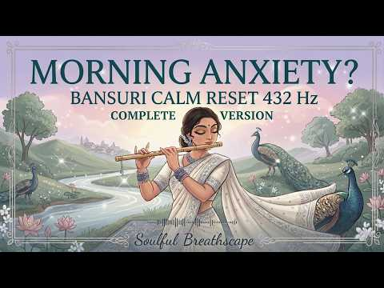

# 음악 — 성공 사례 분석: 사례별 자세히 #761–#800

`analysis.md` 의 9번 (같은 # 번호). 자동 생성 — `tools/success_analysis.py` v1.4.1 (2026-10-20 07:59 UTC). ※ 연구·교육용 — 투자 권유가 아님.

### 761. 백 번을 들어도 후회없을 노래🎵트로트 거친 보이스 @1980통기타 음악 @1980guitar playlist kpop

- https://www.youtube.com/watch?v=ZVTFRwA3r14 · 1980통기타 · 구독자 11,900 · 조회수 469,049 (×39.4, 하루 4,621.2) · 좋아요 3,084 (0.7%) · 29.9분 · 2026-07-10 · 주제 묶음 6. 피아노·클래식·연주곡 · 형식 플레이리스트·모음 (여러 곡) · 폴더 `W_ZVTFRwA3r14` (웹 승인)
- 썸네일: 
- 설명 앞부분: “1980통기타의 노래는 카무칸뮤직(박영준님)작사, 작곡 및 보컬은 AI 생성 도구를 활용한 창작물입니다.” “The songs by 1980 Acoustic Guitar feature lyrics, composition, and vocals by Kamukan Music (Park Young-jun), created using AI generation tools.” 🎸 1980통기타는 여러분의 일상에 힐링과 편안함을 더합니다. 1980통기타는 7080 감성 통기타 포크와 발라드 음악을 감상할 수 있는 채널입니다. 기타 선율 위에…
- 같은 채널 평소 대비 ×52.8 (채널 최근 롱폼 중앙값 8,884회) · 평소 영상: 여름날 “단비” 같은 노래🎵트로트 거친 보이스 @1980통기타 음악 @1980guitar… (8,884회) / 들을 때마다, 소름돋는 노래🎵트로트 거친 보이스 @1980통기타 음악 @1980guita… (8,758회)
- 대본 없음 (설명) — 음성인식이 끝나면 도입부·흐름이 들어감
- 댓글 107/108: 좋은 점 — 영상 0 · 감사·응원 8 · 더 알고 싶은 것 4 · 아쉬운 점 — 영상 1 · 반박·불만 — 의견 다름 0 · 정치·사회 0 · 경험 공유 4 · 구독·다음 기대 1
  - 감사·응원 👍18 “목소리 진짜 너무너무 좋네요 짱이에요😅 일 마치고 퇴근하고 술 한잔 하게 되여 듣게 된 선곡인데요 옛 생각 나면서 눈물이 흐르네요 술 한잔이 눈물 젖은 술잔이 되네요 그래도 노래가 멋진 노래이고~ 가사 곳곳이 뜻이 있고 듣기가 너무 좋네요❤ 밤새 도록 들어 볼까 해요…”
  - 감사·응원 👍18 “이 노래를 듣는 순간 젊은 시절로 돌아간 것 같습니다. 그때의 설렘과 행복했던 기억이 하나씩 떠오르네요. 좋은 음악 정말 감사합니다.”
  - 더 알고 싶은 것 👍8 “가수 이름이 알고 싶은데 아시는 분”
  - 더 알고 싶은 것 👍3 “1,2번 곡의 기타 코드를 알수 있을까요? 직접 불러보고 싶네요”
  - 아쉬운 점 — 영상 👍10 “저두무한반복갑니당👍👍👍👍👏👏👏👏🙏🙏🙆‍♂️”
  - 경험 공유 👍51 “"내가 사는 이유, 아~~ 그때 기억 그때 깊었던 진심. 사랑.관심.배려 모두100%소환 시켜 놓았구나 그때 처음부터 끝까지 챙겨주고 아껴주고 관심가져 주었기에.. 나 은혜를 값고 싶었네. 그를 돕고싶은 마음에.. 그것이 노래로 큰 기쁨이 되어 사랑을 발견하게 되고 …”
  - 경험 공유 👍4 “오늘따라 첫사랑이 그립네요 잘있겠죠 내마음를 알까요 내가 사랑 💕 했다는걸 내나이 70십 지금도 보고싶네요”
  - 구독·다음 기대 👍1 “트로트의 거친 보이스가 너무 좋아요. 구독하고 갑니다.🤩🤩🤩🤩🤩😍😍😍😍”

### 762. 𝐏𝐥𝐚𝐲𝐥𝐢𝐬𝐭 우린 아직 흑백영화처럼 사랑하고

- https://www.youtube.com/watch?v=71_AXp38B7M · 세봄 · 구독자 14,300 · 조회수 562,118 (×39.3, 하루 3,790.5) · 좋아요 3,961 (0.7%) · 17.1분 · 2026-05-25 · 주제 묶음 기타 · 형식 플레이리스트·모음 (여러 곡) · 폴더 `W_71_AXp38B7M` (웹 승인)
- 썸네일: 
- 챕터: 0:00 검정치마 - 한시 오분 · 3:57 검정치마 - 폭죽과 풍선들 · 7:20 리도어 - 영원은 그렇듯 · 11:17 데이먼스 이어 - Mondegreen · 14:27 릴러말즈 - 흑백영화
- 설명 앞부분: 본 채널의 모든 콘텐츠는 수익 창출과 무관하게 운영됩니다. [timestamps]
- 같은 채널 평소 대비 ×13.7 (채널 최근 롱폼 중앙값 41,160회) · 평소 영상: 𝐏𝐥𝐚𝐲𝐥𝐢𝐬𝐭 시골향 복숭아 (47,463회) / 𝐏𝐥𝐚𝐲𝐥𝐢𝐬𝐭 영생과 영면의 차이를 너는 알고 있니 (34,857회)
- 대본 없음 (설명) — 음성인식이 끝나면 도입부·흐름이 들어감
- 댓글 28/29: 좋은 점 — 영상 0 · 감사·응원 1 · 더 알고 싶은 것 0 · 아쉬운 점 — 영상 0 · 반박·불만 — 의견 다름 0 · 정치·사회 0 · 경험 공유 1 · 구독·다음 기대 0
  - 감사·응원 👍2 “데이트 중에 너무 행복하게 잘 들었어요 감사합니다🥰”
  - 경험 공유 👍9 “내가 만약에 너랑 헤어지기 전에 엄청 돈이 많은 부자가 됐었다면 이 돈으로 너랑 같이 많은 곳을 갈 수 있을 거 같다는 생각에 엄청 기뻐했을거야”

### 763. Heartbreaking 💔 lofi mashup 🎶 slowed + reverb songs ∣ study, focus & late night vibes

- https://www.youtube.com/watch?v=lXbnhKzEQl8 · Click Bollywood Lovers Songs · 구독자 25,800 · 조회수 1,000,038 (×38.8, 하루 13,655.6) · 좋아요 3,717 (0.4%) · 8.1분 · 2026-08-08 · 주제 묶음 3. 공부·집중·작업 · 형식 음악 (그 밖 모양 — 한 편짜리 BGM 등) · 폴더 `W_lXbnhKzEQl8` (웹 승인)
- 썸네일: 
- 설명 앞부분: Welcome 🙏to world of soothing lofi music, where stress fades away, and peace takes over. This 2025 mind-relaxing lofi mix is perfect for: Deep Focus & Studying 📖 Relaxing & Meditation 🧘‍♂ Chilling After a Long Day 🌅 Peaceful Sleep & Stress Relief 😴 Let these calm beats and chill vibes take you on a…
- 대본 없음 (설명) — 음성인식이 끝나면 도입부·흐름이 들어감
- 댓글 73/66: 좋은 점 — 영상 0 · 감사·응원 0 · 더 알고 싶은 것 0 · 아쉬운 점 — 영상 0 · 반박·불만 — 의견 다름 0 · 정치·사회 0 · 경험 공유 0 · 구독·다음 기대 0

### 764. Melodies from Ancient China – Flute & Guzheng for Relaxation, Study & Focus

- https://www.youtube.com/watch?v=tFhO2omUavw · Shen Harmony · 구독자 25,800 · 조회수 998,511 (×38.7, 하루 5,572.9) · 좋아요 22,909 (2.3%) · 64.7분 · 2026-04-24 · 주제 묶음 3. 공부·집중·작업 · 형식 음악 (그 밖 모양 — 한 편짜리 BGM 등) · 폴더 `W_tFhO2omUavw` (웹 승인)
- 썸네일: 
- 챕터: 0:00 1. Moonlit Lotus Pavilion · 3:18 2. Morning Dew on Willow Bran… · 6:58 3. Crane’s Flight at Dawn · 10:08 4. Lanterns in the Night Bree… · 13:36 5. Falling Petals in Spring W… · 18:18 6. The Emperor’s Silent Garden · 22:06 7. Mist over the Yellow Mount… · 25:19 8. Calligraphy in the Rain · 29:37 9. River of Eternal Time · 33:09 10. Snowfall on Plum Blossoms · 37:19 11. Stars Above the Jade River · 41:17 12. Secrets of the Dragon Tem… · 44:41 13. Bamboo Forest Serenity · 48:15 14. Journey Along the Great W… · 51:50 15. Twilight over the Imperia… · 55:44 16. Dance of the Phoenix Feat… · 59:48 17. Whispers of the Jade Pavi…
- 설명 앞부분: Step into a tranquil world with "Melodies from Ancient China", an album inspired by the landscapes, architecture, and natural beauty of ancient China. Gentle melodies of the bamboo flute and guzheng flow together like a quiet river through misty mountains, capturing the elegance and timeless charm …
- 같은 채널 평소 대비 ×89.5 (채널 최근 롱폼 중앙값 11,161회) · 평소 영상: Mythical Beasts of Ancient China (11,161회) / Echoes of the Imperial Court ∣ Symphony of the Gr… (11,693회)
- 대본 없음 (설명) — 음성인식이 끝나면 도입부·흐름이 들어감
- 댓글 1,321/1,317: 좋은 점 — 영상 0 · 감사·응원 4 · 더 알고 싶은 것 0 · 아쉬운 점 — 영상 0 · 반박·불만 — 의견 다름 0 · 정치·사회 0 · 경험 공유 0 · 구독·다음 기대 0
  - 감사·응원 👍7 “태극권 선생입니다. 고전음악 감사합니다.”
  - 감사·응원 👍5 “너무나 감동입니다. 중국 전통음악은 늘 저를 편안하고 차분하게 해줍니다. 감사합니다^^”

### 765. Rest Tonight In God's Love ∣ Christian Deep Sleep Worship Music ∣ Peaceful Sleep In His P…

- https://www.youtube.com/watch?v=nzc_yRoaBRI · Midnight Sanctuary · 구독자 22,200 · 조회수 855,269 (×38.5, 하루 9,743.1) · 좋아요 8,781 (1.0%) · 122.5분 · 2026-07-24 · 주제 묶음 15. CCM·찬양·국악·동요 · 형식 음악 (그 밖 모양 — 한 편짜리 BGM 등) · 폴더 `W_nzc_yRoaBRI` (웹 승인)
- 썸네일: 
- 챕터: 0:00 I'm Tired Tonight · 4:50 Tomorrow's Yours · 9:59 You Know My Heart · 14:49 You're Here With Me · 19:54 I Give It All To You · 24:50 Carry Me Tonight · 29:46 I'll Rest In You · 34:52 Your Love Heals Me · 40:19 I'm Safe In Your Love · 45:41 Your Peace Remains · 50:42 Safe In Your Care · 56:13 Sleep In My Love
- 설명 앞부분: Rest Tonight In God's Love ∣ Christian Deep Sleep Worship Music ∣ Peaceful Sleep In His Presence🌙🧡 This Deep Sleep Worship playlist was created to help you slow down, release every anxious thought, and fall asleep surrounded by God's loving presence. Let each gentle melody remind you that His peace…
- 같은 채널 평소 대비 ×85.3 (채널 최근 롱폼 중앙값 10,030회) · 평소 영상: Sleep In The Light Of Grace ∣ Christian Deep Slee… (11,643회) / REST IN GOD'S LOVING PRESENCE 🧡🌙💤 ∣ Christian Dee… (8,417회)
- 대본 없음 (설명) — 음성인식이 끝나면 도입부·흐름이 들어감
- 댓글 332/334: 좋은 점 — 영상 0 · 감사·응원 0 · 더 알고 싶은 것 0 · 아쉬운 점 — 영상 0 · 반박·불만 — 의견 다름 0 · 정치·사회 0 · 경험 공유 0 · 구독·다음 기대 0

### 766. Relaxing Piano Music for Inner Peace, Meditation, Stress Relief & Calm Mind🌿Healing Water…

- https://www.youtube.com/watch?v=dljV0oqDztU · Celestial Relaxing Sounds · 구독자 11,400 · 조회수 436,652 (×38.3, 하루 8,414.1) · 좋아요 3,718 (0.9%) · 127.7분 · 2026-08-29 · 주제 묶음 1. 수면·명상·힐링 · 형식 음악 (그 밖 모양 — 한 편짜리 BGM 등) · 폴더 `W_dljV0oqDztU` (웹 승인)
- 썸네일: 
- 설명 앞부분: 🌸 Relaxing Piano Music for Inner Peace, Meditation, Stress Relief & Calm Mind 🌸 Step into a beautiful sanctuary of peace with this relaxing piano meditation music from **Celestial Relaxing Sounds**. Inspired by a dreamy pink garden, gentle waterfalls, crystal stones, and a peaceful turquoise pond, …
- 같은 채널 평소 대비 ×134.3 (채널 최근 롱폼 중앙값 3,252회) · 평소 영상: Calm Your Mind & Sleep Deeply 🌿 Relaxing Healing … (3,252회) / Healing Piano Music & Relaxing Water Sounds 🌿 Cal… (3,171회)
- 대본 없음 (설명) — 음성인식이 끝나면 도입부·흐름이 들어감
- 댓글 236/233: 좋은 점 — 영상 0 · 감사·응원 0 · 더 알고 싶은 것 0 · 아쉬운 점 — 영상 0 · 반박·불만 — 의견 다름 0 · 정치·사회 0 · 경험 공유 0 · 구독·다음 기대 0

### 767. 途中広告なし【カフェBGM】涼やかな夏カフェ｜木漏れ日の、心ほどける森カフェ時間｜作業用・読書・リラックス｜Cafe Music・Coffee Shop Ambience

- https://www.youtube.com/watch?v=3QKdiHlK6c4 · Kokoro Music Room · 구독자 21,100 · 조회수 804,510 (×38.1, 하루 8,744.7) · 좋아요 2,128 (0.3%) · 122.5분 · 2026-07-20 · 주제 묶음 2. 자연 소리·백색소음 · 형식 음악 (그 밖 모양 — 한 편짜리 BGM 등) · 폴더 `W_3QKdiHlK6c4` (웹 승인)
- 썸네일: 
- 설명 앞부분: 🎧 おすすめのカフェBGMはこちら 🌻 夏カフェBGMシリーズはこちら Relax in a nostalgic Japanese retro café, where time seems to slow down. Enjoy two peaceful hours surrounded by the aroma of fresh coffee, classic desserts, and the warm atmosphere of a traditional kissaten. Perfect for reading, working, studying, or simply enjoy…
- 같은 채널 평소 대비 ×39.0 (채널 최근 롱폼 중앙값 20,612회) · 평소 영상: 途中広告なし【カフェBGM】秋空と高原カフェ｜澄んだ空と秋風を感じながらゆっくり過ごす癒し時間｜作… (20,819회) / 途中広告なし【カフェBGM】心ゆるむレトロカフェ｜懐かしい喫茶店でゆっくり過ごす癒し時間｜作業用・… (20,406회)
- 대본 없음 (설명) — 음성인식이 끝나면 도입부·흐름이 들어감
- 댓글 73/73: 좋은 점 — 영상 0 · 감사·응원 0 · 더 알고 싶은 것 0 · 아쉬운 점 — 영상 0 · 반박·불만 — 의견 다름 0 · 정치·사회 0 · 경험 공유 0 · 구독·다음 기대 0

### 768. [No Ads] Uplifting Morning Piano Music 🌿 ∣ Fresh & Positive Energy Classic BGM ∣ Elise Pi…

- https://www.youtube.com/watch?v=D8dWbYNFXKc · Elise Piano | 엘리제피아노 · 구독자 24,900 · 조회수 944,391 (×37.9, 하루 8,877.1) · 좋아요 5,172 (0.5%) · 183.7분 · 2026-07-05 · 주제 묶음 6. 피아노·클래식·연주곡 · 형식 음악 (그 밖 모양 — 한 편짜리 BGM 등) · 폴더 `W_D8dWbYNFXKc` (웹 승인)
- 썸네일: 
- 챕터: 0:00 Serene Morning Prelude · 1:58 Gentle Morning Piano · 4:43 Tender Ivory Keys · 7:18 Comforting Piano Resonance · 9:41 Graceful Morning Light · 11:44 Gentle River Melody · 14:07 Relaxing Morning Arpeggio · 15:14 Elegance of the Bright Hall · 17:58 Peaceful Chopin Melody · 19:27 Elegant Morning Serenade · 21:59 Tranquil Piano Ensemble · 23:48 Soft Comfort of the Morning · 25:15 Warm Embrace of the Piano · 27:24 Soothing Chopin Flow · 29:42 Sunlight on the Keys · 32:09 Fresh Chopin Breeze · 35:14 Delicate Piano Drops · 37:43 Whispers of a Calm Morning · 39:47 Romantic Spring Prelude · 42:15 Dawn of Serenity
- 설명 앞부분: This is a pleasant classical piano BGM to start a refreshing morning. We have prepared clear melodies that resemble the warm sunshine and fresh green scenery shining through your window. The cheerful and transparent harmony of the piano and strings will gently wake up your heavy body and mind, brig…
- 같은 채널 평소 대비 ×43.9 (채널 최근 롱폼 중앙값 21,497회) · 평소 영상: Lively Autumn Classical Music 🍂 Golden Harvest Jo… (21,497회) / Cheerful Classical Waltz ☀️ A Beautiful Morning w… (22,290회)
- 대본 없음 (설명) — 음성인식이 끝나면 도입부·흐름이 들어감
- 댓글 123/127: 좋은 점 — 영상 0 · 감사·응원 4 · 더 알고 싶은 것 0 · 아쉬운 점 — 영상 0 · 반박·불만 — 의견 다름 0 · 정치·사회 0 · 경험 공유 2 · 구독·다음 기대 1
  - 감사·응원 👍6 “너무 좋아요 감사합니다❤❤”
  - 감사·응원 👍3 “경쾌한 아름다운음악 가벼운마음으로 오늘도 감사하는 마음으로 하루를시작하게해주심에 행복하고 감사합니다. ❤❤❤❤❤❤❤”
  - 경험 공유 👍6 “여름소리 매미 밖의 합창 대단합니다. 음악 또한 상쾌하게 듣고 있는 제가 대단합니다. 이제는 저를 칭찬해 주고 싶습니다. 잘 하고 있다고 ... 늘 하루가 무료한것 같아 때론 후퇴한 자신인것 같아서 우울해지려는 마음 좀더 자신있게 긍정의 마인드를 출발하렵니다...장마…”
  - 구독·다음 기대 👍1 “매일 듣고있어요!❤”

### 769. Oscar & Deep - Feeling Flow

- https://www.youtube.com/watch?v=b_DXB1Dj4l8 · Oscar & Deep · 구독자 24,400 · 조회수 912,380 (×37.4, 하루 5,535.3) · 좋아요 3,918 (0.4%) · 7.5분 · 2026-05-08 · 주제 묶음 5. 운동·드라이브·신나는 · 형식 음악 (그 밖 모양 — 한 편짜리 BGM 등) · 폴더 `W_b_DXB1Dj4l8` (웹 승인)
- 썸네일: 
- 설명 앞부분: 🎵 Listen to "Feeling Flow" by Oscar & Deep Experience a new blend of electronic emotions. From the hypnotic rhythms of Italo Disco to the soulful touch of Middle Eastern Deep House, this track is part of our journey to redefine atmospheric soundscapes. ✨ About Oscar & Deep: Welcome to the official …
- 같은 채널 평소 대비 ×32.3 (채널 최근 롱폼 중앙값 28,228회) · 평소 영상: Oscar & Deep - Easy to Believe (28,228회) / Oscar & Deep - Take It Slowly (27,958회)
- 대본 없음 (설명) — 음성인식이 끝나면 도입부·흐름이 들어감
- 댓글 90/90: 좋은 점 — 영상 0 · 감사·응원 0 · 더 알고 싶은 것 0 · 아쉬운 점 — 영상 0 · 반박·불만 — 의견 다름 0 · 정치·사회 0 · 경험 공유 0 · 구독·다음 기대 0

### 770. Soulful Sufi Ghazal - सफर की धूप में साया तलाशते रह गए ∣ Heart Touching Ghazal ∣Soulful M…

- https://www.youtube.com/watch?v=JI1OFbt7jRM · SOUL VIBES INDIA  · 구독자 30,000 · 조회수 1,116,356 (×37.2, 하루 7,264.8) · 좋아요 10,509 (0.9%) · 6.4분 · 2026-05-19 · 주제 묶음 기타 · 형식 정보·해설 (그 밖) · 폴더 `W_JI1OFbt7jRM` (웹 승인)
- 썸네일: 
- 설명 앞부분: अगर आपको soulful ghazals, mehfil vibes, sufi music और दिल को छू लेने वाले lyrics पसंद हैं, तो ये प्रस्तुति आपके दिल तक ज़रूर पहुंचेगी। 🎙️✨ 🖋️ Lyrics by: Satyendra 🎶 Music: Soulful Mehfil Style 🎤 Vocal Style: Classic Emotional Ghazal Vibes 🌙 Mood: Pain • Ishq • Sukoon • Memories Don’t forget to Like…
- 같은 채널 평소 대비 ×17.4 (채널 최근 롱폼 중앙값 64,125회) · 평소 영상: बड़ी ख़ामोश लगती है ये दुनिया मुस्कुराने पे ∣ Hea… (73,140회) / Heart Touching Ghazals 2026 - Top 3 Superhit Coll… (73,753회)
- 대본 없음 (설명) — 음성인식이 끝나면 도입부·흐름이 들어감
- 댓글 345/345: 좋은 점 — 영상 0 · 감사·응원 0 · 더 알고 싶은 것 0 · 아쉬운 점 — 영상 0 · 반박·불만 — 의견 다름 0 · 정치·사회 0 · 경험 공유 0 · 구독·다음 기대 0

### 771. 🪷 이 노래 들으면 막힌 재물운이 술술 풀립니다 ∣ 부처님 대운 명호·진언 13곡 ∣ 관세음·지장·아미타 #소원성취 #재물운 #금전운 #업장소멸 #천수경 #반야…

- https://www.youtube.com/watch?v=ztFLgJ5idWI · 연꽃법음 · 구독자 3,540 · 조회수 131,665 (×37.2, 하루 825.9) · 좋아요 2,472 (1.9%) · 55.7분 · 2026-05-13 · 주제 묶음 15. CCM·찬양·국악·동요 · 형식 플레이리스트·모음 (여러 곡) · 폴더 `W_ztFLgJ5idWI` (웹 승인)
- 썸네일: 
- 챕터: 0:00 ─ 막혀 있던 길이 풀리네 (관세음보살) · 4:14 ─ 묵은 업장이 바람처럼 사라지네 (지장보살) · 8:28 ─ 맑은 새벽 한 줄기 빛 (문수보살) · 12:57 ─ 별 지는 새벽에 (약사여래) · 17:19 ─ 비로자나불 그 빛 안에서 (광명진언) · 21:42 ─ 대비주의 큰 강물 따라 (신묘장구대다라니) · 25:36 ─ 한 호흡 또 한 호흡 (옴 마니 반메 훔) · 29:45 ─ 한 걸음씩 걷는다 (보현보살) · 34:17 ─ 이 죄업을 거두소서 (참회진언) · 38:29 ─ 맑혀가는 새벽이여 (정구업진언) · 42:51 ─ 피안으로 가자 (반야심경 진언) · 47:03 ─ 무량한 빛 속으로 (아미타불) · 51:04 ─ 이 모든 공덕을 회향하리 (석가모니불 회향)
- 설명 앞부분: 🪷 연꽃법음에 오신 여러분, 환영합니다 🙏 막혀 있던 일도, 끊어졌던 인연도, 무거운 마음의 짐도 부처님과 보살님의 자비로운 손길 안에서 다시 풀려갑니다. 오늘은 부처님 대운이 들어오는 명호·진언 13곡을 약 1시간 동안 정성껏 준비했습니다. 한 해의 막힌 흐름과 지친 마음을 잠시 내려놓고, 관세음보살·지장보살·문수보살·약사여래·아미타불의 가피와 옴 마니 반메 훔·신묘장구대다라니·반야심경 진언의 자비 안에서 한 호흡 또 한 호흡 머무는 시간입니다. 부처님과 보살님께서는 천 개의 눈으로 우리를 살펴주시고 천 개의 손으로 건져주시며,…
- 같은 채널 평소 대비 ×148.0 (채널 최근 롱폼 중앙값 890회) · 평소 영상: 🎵 마음을 울리는 옴마니반메훔 불교음악 🙏 이 노래를 들으면 업장이 사라집니다🪷 #옴마니… (925회) / 들으면 재물이 술술 들어오는 불교음악#소원성취 #재물운 #금전운 #업장소멸 #천수경 #반… (854회)
- 대본 없음 (설명) — 음성인식이 끝나면 도입부·흐름이 들어감
- 댓글 827/827: 좋은 점 — 영상 3 · 감사·응원 146 · 더 알고 싶은 것 8 · 아쉬운 점 — 영상 0 · 반박·불만 — 의견 다름 1 · 정치·사회 0 · 경험 공유 29 · 구독·다음 기대 0
  - 좋은 점 — 영상 👍5 “너무나 듣기 좋아요 ❤❤❤”
  - 좋은 점 — 영상 👍1 “나무아미타블 관세음보살 하나밖에없는 아들 87년2월10일생 지금 하고있는일 건설장입니다 잘 살아보겠다고 애쓰는아들 가엽고 안쓰러워 어미로서 도움이 안되니 억장이 무너지고 가슴아프니 부천님 자비로 아들 하고자 하는일 막힘없이 술술 잘 풀리도록 도와주소서🎉🎉🎉”
  - 감사·응원 👍12 “부처님 고맙습니다.”
  - 감사·응원 👍10 “빛청산하고 집사서 이사갈수 있도록 도와주세요 감사합니다”
  - 더 알고 싶은 것 👍3 “재물운 좀 부탁드립니다🙏🏻”
  - 더 알고 싶은 것 👍2 “제발 이번주 로또 당첨 되게 해주세여 지금 살아 있는게 아닙니다 살아 있는 송장입니다 제발 부탁드립니다 나무 아미 타불 관세음보살 감사합니다🎉🎉❤”
  - 반박·불만 — 의견 다름 👍2 “제발 이번주 로또 당첨 되게 해주세여 지금 살아 있는게 아닙니다 살아 있는 송장입니다 제발 부탁드립니다 나무 아미 타불 관세음보살 감사합니다🎉🎉❤”
  - 경험 공유 👍9 “나는행운아다 나는행운아다 나는행운아다 나무아미타불 나무아미타불 나무관세음보살 빌고비옵나이다 임진생 3월10일생 이씨계주 우리남편 우리아들과딸들 손자손녀들사위들며느리 우리아들계해생 11월29일 생 건강발원 지금차린 사업승승장구 이름나고명나게하소서 업장소멸 알고지은죄모르…”
  - 경험 공유 👍9 “제가 투자한 사업에 좋은결과 있기를 바랍니다 옴마니반매훔 제가 하는일이 많은 기회가 있기를 기원합니다 .”

### 772. Dreams Never Sleep （映画『仮面ライダーゼッツ...

- https://www.youtube.com/watch?v=9nOX0zxrLfw · YUTA - Topic · 구독자 24,300 · 조회수 901,259 (×37.1, 하루 10,160.2) · 좋아요 10,512 (1.2%) · 4.4분 · 2026-07-23 · 주제 묶음 1. 수면·명상·힐링 · 형식 음악 (그 밖 모양 — 한 편짜리 BGM 등) · 폴더 `W_9nOX0zxrLfw` (웹 승인)
- 썸네일: 
- 설명 앞부분: Provided to YouTube by avex trax Dreams Never Sleep （映画『仮面ライダーゼッツ さよならのミッション』主題歌） · YUTA Dreams Never Sleep （映画『仮面ライダーゼッツ さよならのミッション』主題歌） ℗ AVEX MUSIC CREATIVE INC. Released on: 2026-07-24 Composer: Hi‐yunk (BACK-ON) Lyricist: 藤林聖子 Arranger: Hi‐yunk (BACK-ON) Producer: Hi‐yunk (BACK-ON) Auto-genera…
- 대본 없음 (설명) — 음성인식이 끝나면 도입부·흐름이 들어감
- 댓글 0/0: 좋은 점 — 영상 0 · 감사·응원 0 · 더 알고 싶은 것 0 · 아쉬운 점 — 영상 0 · 반박·불만 — 의견 다름 0 · 정치·사회 0 · 경험 공유 0 · 구독·다음 기대 0

### 773. hyper-focus. ∣ deep house music for coding

- https://www.youtube.com/watch?v=uNw_a7HFwvg · deep archive · 구독자 25,200 · 조회수 932,572 (×37.0, 하루 6,989.9) · 좋아요 16,567 (1.8%) · 148.4분 · 2026-06-08 · 주제 묶음 3. 공부·집중·작업 · 형식 음악 (그 밖 모양 — 한 편짜리 BGM 등) · 폴더 `W_uNw_a7HFwvg` (웹 승인)
- 썸네일: 
- 챕터: 0:00 Lost in the Echoes · 3:42 Velvet Dusk · 7:25 Midnight Mirage · 11:19 Silent Grid · 14:44 Fade to Grey · 18:48 Distant Murmurs · 22:37 Static Horizon · 26:38 Cold Comfort · 30:37 Shadow Play · 34:09 Bleak Harmony · 37:53 Urban Solitude · 41:24 Hazy Transit · 45:44 Subterranean Pulse · 49:24 deep archive
- 설명 앞부분: Immerse yourself in a state of absolute flow with this deep house music mix specifically engineered for coding, programming, and deep work. Featuring hypnotic rhythms, minimalist beats, and atmospheric deep house tracks, this selection is designed to eliminate external distractions and maximize you…
- 같은 채널 평소 대비 ×93.8 (채널 최근 롱폼 중앙값 9,945회) · 평소 영상: trigger deep insight. [deep house mix] // archive… (9,945회) / low cortisol deep house for overthinkers (9,967회)
- 대본 없음 (설명) — 음성인식이 끝나면 도입부·흐름이 들어감
- 댓글 274/275: 좋은 점 — 영상 1 · 감사·응원 1 · 더 알고 싶은 것 0 · 아쉬운 점 — 영상 1 · 반박·불만 — 의견 다름 0 · 정치·사회 0 · 경험 공유 1 · 구독·다음 기대 0
  - 좋은 점 — 영상 👍45 “AI로 작업했더라도 주인장 음악력 진짜 높은 듯. 듣기 편안한데 지루하지 않음.”
  - 감사·응원 👍0 “일할 때, 운전할 때 집중이 잘 되서 계속 틀어두네요. 감사합니다.”
  - 아쉬운 점 — 영상 👍45 “AI로 작업했더라도 주인장 음악력 진짜 높은 듯. 듣기 편안한데 지루하지 않음.”
  - 경험 공유 👍8 “사무실이 시끄러운 편이라 집중하기 어려웠는데 이거 틀어놓고 하면 몰입 장난 아님..... 비슷한거 다른거 시도해봤는데 이게 그냥 짱이라서 몇주째 이것만 계속 듣고있어요 레알”

### 774. 기분이 산뜻해지는 재즈 찬송가 ∣ Hymn Jazz Playlist ∣ 공부·휴식·카페 BGM [2H] (Relaxing Jazz Piano)

- https://www.youtube.com/watch?v=AZCxtUAYrUw · DearHymn · 구독자 11,800 · 조회수 436,188 (×37.0, 하루 2,621.8) · 좋아요 2,870 (0.7%) · 120.5분 · 2026-05-06 · 주제 묶음 6. 피아노·클래식·연주곡 · 형식 플레이리스트·모음 (여러 곡) · 폴더 `W_AZCxtUAYrUw` (웹 승인)
- 썸네일: 
- 챕터: 0:00 기뻐하며 경배하세 (Joyful, Joyful, We… · 2:46 아 하나님의 은혜로 (I Know Whom I Hav… · 5:31 주는 나를 기르시는 목자 (Savior, Like a… · 8:56 강물같이 흐르는 기쁨 (It Is Well with … · 11:59 예수의 전한 복음 (Wonderful Words of… · 15:55 내 진정 사모하는 (My Jesus, I Love T… · 18:49 주 예수 내가 알기 전 (I Found a Frien… · 21:41 변찮는 주님의 사랑과 (The Love of God … · 24:44 죄짐 맡은 우리 구주 (What a Friend We… · 27:14 슬픈 마음 있는 사람 (Take the Name of… · 30:08 Repeat for 2 Hours
- 설명 앞부분: Enjoy this relaxing Hymn Jazz piano playlist — perfect for study, work, or quiet moments. ☕🌿 Featuring familiar hymns like Joyful, Joyful, It Is Well, and What a Friend We Have in Jesus. 요즘 날씨가 참 좋네요 ☀ 이럴 때 편하게 들을 수 있는 재즈 찬송가 플레이리스트를 준비했습니다. 익숙한 찬송가 선율을 부드러운 재즈 피아노로 담아 카페에 앉아 있는 것처럼 자연스럽게 흘러가도록 만들었…
- 같은 채널 평소 대비 ×10.6 (채널 최근 롱폼 중앙값 41,256회) · 평소 영상: 산뜻한 하루를 여는 클래식 찬송가 🌿 기분 좋은 찬송가 연주 ∣ Classical Hym… (41,759회) / 기분 좋은 아침 클래식 찬송가 🌿 ∣ 희망으로 시작하는 하루 ∣ Peaceful Morn… (40,754회)
- 대본 없음 (설명) — 음성인식이 끝나면 도입부·흐름이 들어감
- 댓글 107/107: 좋은 점 — 영상 3 · 감사·응원 19 · 더 알고 싶은 것 6 · 아쉬운 점 — 영상 0 · 반박·불만 — 의견 다름 0 · 정치·사회 0 · 경험 공유 1 · 구독·다음 기대 3
  - 좋은 점 — 영상 👍13 “봄날의 햇살처럼 따듯하고 듣기 좋아요”
  - 좋은 점 — 영상 👍6 “듣고 있으니 기분이 상쾌해지고 좋습니다. 좋은영상 감사합니다. 😊”
  - 감사·응원 👍10 “찬송가로 재즈풍 만들어주셔서 감사합니다❤❤❤❤❤ ccm은 많은데 찬송가는 찾기 어렵더라구요~~”
  - 감사·응원 👍6 “너무 멋진 재즈로 편곡, 연주된... 오래 불러온 찬송이 참 은혜되는 오후입니다. 힘든 직장생활 업무할때 듣고있어요. 하나님 지혜주시길 구합니다. 연주하시고 올려주셔서 감사합니다❤”
  - 더 알고 싶은 것 👍10 “혹시 기뻐하며 경배하세 MR 어디서 구할 수 있을까요? 딸아이 결혼식에 혼주 입장곡으로 쓰고 싶어서요~”
  - 더 알고 싶은 것 👍4 “고2 학생인데 공부하다 힘들면 종종 노래 들으며 공부하는데 평소에 듣던 느낌의 플리이고 모든 곡이 다 넘 좋아요 계속 올려주세요!! 덕분에 오늘 하루도 승리합니다”
  - 구독·다음 기대 👍2 “찬송가를 이렇게 기분좋게 들을 수 있으니 정말 너무 좋아요~귀한 재능으로 많은 이들의 삶을 풍요하게 해주셔서 감사합니다~! 구독했어요~❤❤❤”
  - 구독·다음 기대 👍1 “좋은 찬양 음악 감사해요! 정말 기분 전환 되네요^^ 감사합니다. 구독하고 갑니다”

### 775. Saxophone Love Songs ❤️ Best Romantic Saxophone Covers ∣ Relaxing Love Songs Instrumental

- https://www.youtube.com/watch?v=Uea_DclFKjw · Sax Chill Vibes · 구독자 27,700 · 조회수 1,011,193 (×36.5, 하루 14,208.9) · 좋아요 5,214 (0.5%) · 61분 · 2026-08-10 · 주제 묶음 6. 피아노·클래식·연주곡 · 형식 플레이리스트·모음 (여러 곡) · 폴더 `W_Uea_DclFKjw` (웹 승인)
- 썸네일: 
- 챕터: 0:00 Right Here Waiting For You · 0:00 Wonderful Tonight · 0:00 Tonight I Celebrate My Love · 0:00 Can't Help Falling In Love · 0:00 Beautiful in White · 0:00 Imagine · 0:00 Forever In Love · 0:00 My Heart Will Go On · 0:00 Love Story · 0:00 Nothing Gonna Change My Love … · 0:00 Take Me To Your Heart · 0:00 I Have A Dream · 0:00 La Paloma · 0:00 Close To You · 0:00 Exchange of Hearts · 0:00 Let It Be
- 설명 앞부분: Saxophone Love Songs – 16 Timeless Romantic Love Songs Relax and enjoy 16 beautiful love songs performed with smooth, warm saxophone melodies. A romantic collection of timeless favorites perfect for relaxing, dinner, evening moments, reading, or simply remembering someone special. 🎷 Tracklist: 🎧 Pe…
- 대본 없음 (설명) — 음성인식이 끝나면 도입부·흐름이 들어감
- 댓글 97/98: 좋은 점 — 영상 0 · 감사·응원 0 · 더 알고 싶은 것 0 · 아쉬운 점 — 영상 0 · 반박·불만 — 의견 다름 0 · 정치·사회 0 · 경험 공유 0 · 구독·다음 기대 0

### 776. 【ケルト音楽】家事スイッチが入る🌿 朝の光が気持ちいいBGM｜Relax · Cafe Time

- https://www.youtube.com/watch?v=TqiJnA1qm4s · よもぎの作業用BGM · 구독자 12,400 · 조회수 451,199 (×36.4, 하루 3,540.0) · 좋아요 4,674 (1.0%) · 63.3분 · 2026-06-14 · 주제 묶음 4. 카페·매장·라운지 · 형식 음악 (그 밖 모양 — 한 편짜리 BGM 등) · 폴더 `W_TqiJnA1qm4s` (웹 승인)
- 썸네일: 
- 설명 앞부분: 片付け・お掃除・朝時間に寄り添うRelaxing Celtic Work BGM。 音楽とアートワークはAIツールのサポートを受けて制作されています。
- 같은 채널 평소 대비 ×41.0 (채널 최근 롱폼 중앙값 11,002회) · 평소 영상: 【ケルト音楽】家事のやる気が湧いてくる🌿 木漏れ日が差し込む朝のBGM｜Relax · Cafe … (11,002회) / 【ケルト音楽】家事がはかどる🌿 大自然の中で深呼吸🌳 穏やかな朝のBGM｜Relax · Cafe… (10,834회)
- 대본 없음 (설명) — 음성인식이 끝나면 도입부·흐름이 들어감
- 댓글 172/172: 좋은 점 — 영상 0 · 감사·응원 0 · 더 알고 싶은 것 0 · 아쉬운 점 — 영상 0 · 반박·불만 — 의견 다름 0 · 정치·사회 0 · 경험 공유 0 · 구독·다음 기대 0

### 777. Healing Music for Anxiety, Fears and Depression 🌿 Heals the Mind, Body and Soul #7

- https://www.youtube.com/watch?v=_SGd39jlrR8 · Peaceful Nature Piano · 구독자 2,920 · 조회수 106,212 (×36.4, 하루 1,497.1) · 좋아요 1,393 (1.3%) · 99.2분 · 2026-08-10 · 주제 묶음 1. 수면·명상·힐링 · 형식 음악 (그 밖 모양 — 한 편짜리 BGM 등) · 폴더 `W__SGd39jlrR8` (웹 승인)
- 썸네일: 
- 설명 앞부분: 🌿 Find a moment of peace within. Welcome to **Peaceful Nature Piano**, where gentle piano music and serene landscapes come together to create a soothing environment for relaxation, focus, meditation, and sleep. Our videos take inspiration from the quiet beauty of nature — peaceful streams, ancient …
- 같은 채널 평소 대비 ×76.9 (채널 최근 롱폼 중앙값 1,382회) · 평소 영상: Calm Your Nervous System 🌿 Relaxing Music to Ease… (1,426회) / Melodies That Calm the Mind 🌿 Release Stress and … (1,337회)
- 대본 없음 (설명) — 음성인식이 끝나면 도입부·흐름이 들어감
- 댓글 60/60: 좋은 점 — 영상 0 · 감사·응원 0 · 더 알고 싶은 것 0 · 아쉬운 점 — 영상 0 · 반박·불만 — 의견 다름 0 · 정치·사회 0 · 경험 공유 0 · 구독·다음 기대 0

### 778. Music for meditation, relaxation focus vibe ∣ deep sleep ∣ Zen melodies of Guzheng & Bamb…

- https://www.youtube.com/watch?v=Gsenq8igMJ0 · Healer of Broken Hearts · 구독자 9,070 · 조회수 329,788 (×36.4, 하루 1,907.7) · 좋아요 6,060 (1.8%) · 61.5분 · 2026-04-30 · 주제 묶음 1. 수면·명상·힐링 · 형식 음악 (그 밖 모양 — 한 편짜리 BGM 등) · 폴더 `W_Gsenq8igMJ0` (웹 승인)
- 썸네일: 
- 설명 앞부분: Welcome to the “healer of broken hearts” channel 🌙 Let the soft melodies of bamboo flute and guzheng guide you into a peaceful and serene state. This 1-hour instrumental journey is designed to help you sleep deeply, relieve stress, and support meditation. 🎶 📍 Ideal for: 🌠 Drifting into deep sleep &…
- 같은 채널 평소 대비 ×689.9 (채널 최근 롱폼 중앙값 478회) · 평소 영상: Calm Your Mind 🎵 Relaxing Zen Music with Guzheng … (478회) / Where the Sunset Meets Silence ∣ Zen Music for Me… (489회)
- 대본 없음 (설명) — 음성인식이 끝나면 도입부·흐름이 들어감
- 댓글 192/192: 좋은 점 — 영상 0 · 감사·응원 0 · 더 알고 싶은 것 0 · 아쉬운 점 — 영상 0 · 반박·불만 — 의견 다름 0 · 정치·사회 0 · 경험 공유 0 · 구독·다음 기대 0

### 779. A Morning at a Paris Café, Feeling Just a Little Lighter ∣ Slow Jazz Playlist

- https://www.youtube.com/watch?v=OlrHsQ9QexE · lento · 구독자 20,300 · 조회수 736,818 (×36.3, 하루 4,167.5) · 좋아요 4,557 (0.6%) · 233.7분 · 2026-04-26 · 주제 묶음 4. 카페·매장·라운지 · 형식 플레이리스트·모음 (여러 곡) · 폴더 `W_OlrHsQ9QexE` (웹 승인)
- 썸네일: 
- 챕터: 0:00 This Is What Fine Feels Like · 2:51 The Terrace Before the First … · 5:41 The Table by the Window, Paris · 9:15 New Leaves on the Boulevard · 12:24 What Spring Does to Old Worri… · 16:01 Something I Thought Was Gone · 19:18 Not Starting Over, Just Start… · 22:27 Lighter Than I Was When I Cam… · 25:09 Plane Trees, Pale Green, Almo… · 28:11 The Way a Morning Can Rearran… · 31:24 Sunlight on the Pavement Outs… · 35:33 What I Carried In, I Don't Ha… · 39:12 The Awning Goes Up, the Day B… · 42:32 Permission I Didn't Know I Ne… · 46:13 A Bucket of Tulips at the Cor… · 49:48 The Baker Opens Before the Re… · 53:07 One Thing at a Time, Beginnin… · 56:21 The Neighbourhood at Half Pas… · 59:54 Steam Rising from the Cup on … · 62:47 Quieter Than I've Been in a L…
- 설명 앞부분: A soft morning at a Paris café. The street is still quiet, with fresh green leaves moving gently in the breeze. Sunlight falls across a table by the window as soft jazz plays. Steam rises slowly from a cup of coffee a moment to feel just a little lighter. ︎ Tracklist: 🌿 Playlist & Artwork curated b…
- 같은 채널 평소 대비 ×77.9 (채널 최근 롱폼 중앙값 9,452회) · 평소 영상: A House Above the Dunes, Watching the Day Go All … (9,553회) / A Café with the Door Left Open, Settling In for t… (9,352회)
- 대본 없음 (설명) — 음성인식이 끝나면 도입부·흐름이 들어감
- 댓글 116/116: 좋은 점 — 영상 0 · 감사·응원 2 · 더 알고 싶은 것 0 · 아쉬운 점 — 영상 0 · 반박·불만 — 의견 다름 0 · 정치·사회 0 · 경험 공유 0 · 구독·다음 기대 1
  - 감사·응원 👍0 “🌹 음악에 참 따뜻한 온기가 있네요. 듣고 있으니 괜히 오래된 사진을 꺼내보는 것처럼 마음이 조금 느려지는 기분이에요. 🎶 이런 음악을 만나는 날에는 평범했던 하루도 조금 특별해지는 것 같습니다. 🤎 좋은 음악 나누어 주셔서 감사해요. 오늘도 음악처럼 잔잔하고 아름다…”
  - 감사·응원 👍0 “공부할 때 듣기 정말 좋은 재즈네요. 감사합니다!”
  - 구독·다음 기대 👍0 “구독하고 갑니다.”

### 780. 𝒑𝒍𝒂𝒚𝒍𝒊𝒔𝒕 ∣ Vinyl Jazz Hiphop ∣ TOKYO ∣ Nujabes / MF Doom / Madlib / J Dilla ∣ The Ocarina…

- https://www.youtube.com/watch?v=2bEmWCwdCds · ICYFOG · 구독자 45,500 · 조회수 1,646,807 (×36.2, 하루 13,572.6) · 좋아요 8,199 (0.5%) · 206.5분 · 2026-06-21 · 주제 묶음 11. 힙합·R&B·EDM · 형식 플레이리스트·모음 (여러 곡) · 폴더 `W_2bEmWCwdCds` (웹 승인)
- 썸네일: 
- 설명 앞부분: 🌫️ 𝒑𝒍𝒂𝒚𝒍𝒊𝒔𝒕 ∣ Vinyl Jazz Hiphop ∣ TOKYO ∣ Nujabes / MF Doom / Madlib / J Dilla ∣ The Ocarina of Time Tokyo midnight. Jazz HipHop drifting through the fog. Inspired by the world of Nujabes — for those who feel the silence between notes. Vinyl sessions for late nights and quiet thoughts. 🎵 Tokyo's re…
- 같은 채널 평소 대비 ×114.8 (채널 최근 롱폼 중앙값 14,342회) · 평소 영상: 𝒑𝒍𝒂𝒚𝒍𝒊𝒔𝒕 ∣ Vinyl Jazz Hiphop ∣ TOKYO ∣ Nujabes / … (14,388회) / 𝒑𝒍𝒂𝒚𝒍𝒊𝒔𝒕 ∣ Vinyl Jazz Hiphop ∣ TOKYO ∣ Nujabes / … (14,295회)
- 대본 없음 (설명) — 음성인식이 끝나면 도입부·흐름이 들어감
- 댓글 102/102: 좋은 점 — 영상 0 · 감사·응원 0 · 더 알고 싶은 것 0 · 아쉬운 점 — 영상 0 · 반박·불만 — 의견 다름 0 · 정치·사회 0 · 경험 공유 0 · 구독·다음 기대 0

### 781. "매력있다 이 음색"#휴식음악#7080노래#어쿠스틱음악#힐링음악#수면음악#카페음악#7080발라드#명상음악#집중음악#기타연주#ambient music#ambien…

- https://www.youtube.com/watch?v=CG3XI3D6gHg · 7080 마로니에 통기타TV · 구독자 390 · 조회수 14,114 (×36.2, 하루 85.2) · 좋아요 193 (1.4%) · 40.9분 · 2026-05-07 · 주제 묶음 6. 피아노·클래식·연주곡 · 형식 연주 (직접 연주하는 영상) · 폴더 `W_CG3XI3D6gHg` (웹 승인)
- 썸네일: 
- 설명 앞부분: "줄 하나하나에 담긴 진심, 어쿠스틱의 온도." "통기타 한 대로 그리는 세상." "당신의 일상에 기타 소리를 더하다." 지친 하루의 끝,마음을 어루만지는 Acoustic guitar선율을 올립니다.
- 같은 채널 평소 대비 ×153.4 (채널 최근 롱폼 중앙값 92회) · 평소 영상: "석양노을지는 산사에서의 산사음악회"#휴식음악#7080노래#어쿠스틱음악#힐링음악#수면음악… (110회) / "크로아티아"두브로브니크.플리트호수.#휴식음악#7080노래#어쿠스틱음악#힐링음악#수면음악… (75회)
- 대본 없음 (설명) — 음성인식이 끝나면 도입부·흐름이 들어감
- 댓글 20/20: 좋은 점 — 영상 1 · 감사·응원 1 · 더 알고 싶은 것 2 · 아쉬운 점 — 영상 1 · 반박·불만 — 의견 다름 0 · 정치·사회 0 · 경험 공유 1 · 구독·다음 기대 0
  - 좋은 점 — 영상 👍5 “제목이 궁금해지는 노래 입니다 ....짙은 허스키한듯한 보이스 좋내요 영상도 너무좋구요 가수와 노래제목 알고싶내요 좋은노래 좋은영상 감솨~~”
  - 감사·응원 👍2 “이제는 듣고싶은 음악을 좋아하는 음색으로 듣는 인공지능 시대가 되었네요. 이런 좋은 음악을 만들어줘서 감사합니다.”
  - 더 알고 싶은 것 👍1 “악보도 올려주시면 않될까요.”
  - 더 알고 싶은 것 👍1 “이 가수분 존함이 알고 싶군요 혹시 알고계신분 좀 알려주세요”
  - 아쉬운 점 — 영상 👍1 “나도 이제 50대 중반인데 넝넘 좋네요ㆍ 그라고 왠지 눈물이 나네요 갱년기와 세월의 아쉬움이”
  - 경험 공유 👍1 “나도 이제 50대 중반인데 넝넘 좋네요ㆍ 그라고 왠지 눈물이 나네요 갱년기와 세월의 아쉬움이”

### 782. Sweetest Best Friends Lullaby 🐶🐱💤∣ Calm Sleep Music for Kids & Babies

- https://www.youtube.com/watch?v=P5zkPSvY368 · Kidz Wonder TV Show · 구독자 20,000 · 조회수 723,823 (×36.2, 하루 4,319.2) · 좋아요 1,886 (0.3%) · 9분 · 2026-05-05 · 주제 묶음 1. 수면·명상·힐링 · 형식 음악 (그 밖 모양 — 한 편짜리 BGM 등) · 폴더 `W_P5zkPSvY368` (웹 승인)
- 썸네일: 
- 설명 앞부분: Join a gentle bedtime journey with three best friends — a little boy, his puppy, and his kitten — as they wind down for the night 🌙✨ From walking home at sunset, to cozy storytime, warm goodnight hugs, and finally drifting into a peaceful dreamland together, this soothing lullaby is designed to hel…
- 같은 채널 평소 대비 ×1.7 (채널 최근 롱폼 중앙값 415,006회) · 평소 영상: Sleep Fairy Garden Lullaby 🧚‍♀️🌙 ∣ Gentle Bedtime… (441,833회) / Sleepy Dinosaur Lullaby 🦕🌙 ∣ Gentle Bedtime Song … (388,179회)
- 대본 없음 (설명) — 음성인식이 끝나면 도입부·흐름이 들어감
- 댓글 0/0: 좋은 점 — 영상 0 · 감사·응원 0 · 더 알고 싶은 것 0 · 아쉬운 점 — 영상 0 · 반박·불만 — 의견 다름 0 · 정치·사회 0 · 경험 공유 0 · 구독·다음 기대 0

### 783. 이 세상 미련 없이 가련다 [국악 트로트] 가슴 시린 중년 트토르

- https://www.youtube.com/watch?v=XcyHeiPdmDc · 인생트로트 라운지 · 구독자 4,140 · 조회수 148,908 (×36.0, 하루 946.6) · 좋아요 727 (0.5%) · 5.8분 · 2026-05-16 · 주제 묶음 9. 가요·발라드·트로트 · 형식 음악 (그 밖 모양 — 한 편짜리 BGM 등) · 폴더 `W_XcyHeiPdmDc` (웹 승인)
- 썸네일: 
- 설명 앞부분: 고단한 세월 속에서 가족과 삶을 위해 모든 것을 내어주고 끝내 홀로 남겨진 한 사람의 서러운 인생을 담아낸 곡입니다눈물과 한숨으로 버텨온 삶의 깊은 한(恨)이처절하게 스며든 노래입니다. © 2026 인생트로트 라운지 Original Music: 인생트로트 라운지 Produced by 인생트로트 라운지
- 대본 없음 (설명) — 음성인식이 끝나면 도입부·흐름이 들어감
- 댓글 19/19: 좋은 점 — 영상 0 · 감사·응원 4 · 더 알고 싶은 것 0 · 아쉬운 점 — 영상 0 · 반박·불만 — 의견 다름 0 · 정치·사회 0 · 경험 공유 1 · 구독·다음 기대 0
  - 감사·응원 👍5 “이세상 미련없이 가련다~멋진곡 훌륭한 가수님에 매력이 넘치는 아름다운 노래 감명깊게 즐감하고 응원합니다 🎶🎵🎤👍🙌”
  - 감사·응원 👍3 “우리인간에갠 생노병사가 있으니 죽음에 대한 두려움 갖지말고 모든것 다 수용하면서 홀가분한 맘으로 욕심 내리고 비우고 살면 내가 편안할진대 욕심이란 끝이없어 제마다 삶의 방식이 다르고 생각이 달라 욕심도 가지고 살겠지요 우리인생 뭐 별거 있나요 순리대로 살아 가자구요 …”
  - 경험 공유 👍3 “우리인간에갠 생노병사가 있으니 죽음에 대한 두려움 갖지말고 모든것 다 수용하면서 홀가분한 맘으로 욕심 내리고 비우고 살면 내가 편안할진대 욕심이란 끝이없어 제마다 삶의 방식이 다르고 생각이 달라 욕심도 가지고 살겠지요 우리인생 뭐 별거 있나요 순리대로 살아 가자구요 …”

### 784. music for overthinkers ∣ felt piano & cello for deep focus

- https://www.youtube.com/watch?v=EZeW4Sfy8CE · OTIUM · 구독자 27,500 · 조회수 986,372 (×35.9, 하루 9,599.7) · 좋아요 18,142 (1.8%) · 60.8분 · 2026-07-09 · 주제 묶음 3. 공부·집중·작업 · 형식 음악 (그 밖 모양 — 한 편짜리 BGM 등) · 폴더 `W_EZeW4Sfy8CE` (웹 승인)
- 썸네일: 
- 설명 앞부분: A session for the ones who can't switch off. Felt piano and cello — warm, organic, and alive. Music that understands the noise inside. Perfect for: → Deep focus sessions → Reading and writing → Late night work → Study sessions → Calming an overthinking mind Una sesión para quienes no pueden descone…
- 같은 채널 평소 대비 ×125.9 (채널 최근 롱폼 중앙값 7,837회) · 평소 영상: Classical Tones for Overthinkers ∣ Felt Piano & C… (8,009회) / Classical Tones for Anxious Minds ∣ Felt Piano & … (7,665회)
- 대본 없음 (설명) — 음성인식이 끝나면 도입부·흐름이 들어감
- 댓글 428/430: 좋은 점 — 영상 0 · 감사·응원 1 · 더 알고 싶은 것 0 · 아쉬운 점 — 영상 0 · 반박·불만 — 의견 다름 0 · 정치·사회 0 · 경험 공유 0 · 구독·다음 기대 0
  - 감사·응원 👍9 “커피와 우아하고 부드러운 멋찐 전경과 모든걸 감싸는 퍼팩트한 음악 최고 입니다 감사합니다 ~^^”

### 785. 🎵 신나는 복고댄스 Playlist ∣ 추억 감성 뉴트로 댄스곡 모음🎧

- https://www.youtube.com/watch?v=WjxmNnlQ8LU · 7080 정미의 가요방 · 구독자 9,040 · 조회수 322,587 (×35.7, 하루 1,991.6) · 좋아요 1,683 (0.5%) · 15분 · 2026-05-11 · 주제 묶음 5. 운동·드라이브·신나는 · 형식 플레이리스트·모음 (여러 곡) · 폴더 `W_WjxmNnlQ8LU` (웹 승인)
- 썸네일: 
- 챕터: 0:00 날 흔들지마 · 2:51 너를 못 잊어 · 5:25 헤이 헤이 · 9:55 눈치 없는 그 사람 · 12:09 그 집 앞
- 설명 앞부분: 🎧 신나는 복고댄스 플레이리스트 🎧 추억 감성 가득한 뉴트로 댄스곡 모음✨ 운전할 때, 출근길, 카페에서도 듣기 좋은 감성 플레이리스트💖 네온빛처럼 반짝이던 그 시절, 신나는데 괜히 마음 한쪽이 시린 밤🌙 7080 정미의 가요방과 함께 오늘도 좋은 하루 되세요☕💖
- 같은 채널 평소 대비 ×21.5 (채널 최근 롱폼 중앙값 15,007회) · 평소 영상: 🎵 오지마 1시간 연속듣기 ∣ Retro Dance Vibes ∣ 중독성 있는 복고댄스 (15,007회) / 🎵 널 흔든 게 아니야 외 6곡 ∣ 신나는 남자 보컬 PLAYLIST 🎧 출퇴근·운동할 … (16,320회)
- 대본 없음 (설명) — 음성인식이 끝나면 도입부·흐름이 들어감
- 댓글 217/217: 좋은 점 — 영상 1 · 감사·응원 16 · 더 알고 싶은 것 10 · 아쉬운 점 — 영상 2 · 반박·불만 — 의견 다름 0 · 정치·사회 0 · 경험 공유 4 · 구독·다음 기대 3
  - 좋은 점 — 영상 👍9 “ㅋ 쥑이네요..두 수 배우고 갑니다..만드신 노래 전부 대박나시길..응원합니다!^^”
  - 감사·응원 👍9 “ㅋ 쥑이네요..두 수 배우고 갑니다..만드신 노래 전부 대박나시길..응원합니다!^^”
  - 감사·응원 👍7 “날 흔들지마🎶 즐감했습니다~ 👍👍👍👍👍 행복한 하루 보내세요 🎶😀💓😀🎶 응원합니다 👏👏👏👏👏”
  - 더 알고 싶은 것 👍5 “걷다가 뛰게 하는 음악~• 슬로우조깅 하는 나~~ 너무 감사드려요 ❤한 곡 뽑기엔 부족한듯~~ 좋은 음악 많이 올려주세요 저도 덕분에 충전하고 감니다~•”
  - 더 알고 싶은 것 👍4 “그 집 앞 노래를 못찾겠네요. 어디서 찾을 수 있을까요? AI 음악 같은데..”
  - 아쉬운 점 — 영상 👍5 “목소리가 너무 좋은데 노래 USB 담아서 차에서 듣고 싶은데 방법이 없네요”
  - 아쉬운 점 — 영상 👍4 “노래목소리가너무좋아❤”
  - 경험 공유 👍10 “30대 여자사람 친구에게 추천햇더니 엉 이노래는 첨 접하는 장르 중독성강하다거 60대 형님들도 좋아하더군요 ㅋㅋㅋ 오늘 접한 산타페 형은 60대임 ㅋㅋ 내차랑 오디오 소리가 틀리다거 내가 사제러 스피커 튜닝 하라햇더니 ㅋㅋㅋ 술값 아끼서 튜닝하라거 강추헷음 ㅋㅋ 형 …”
  - 경험 공유 👍5 “걷다가 뛰게 하는 음악~• 슬로우조깅 하는 나~~ 너무 감사드려요 ❤한 곡 뽑기엔 부족한듯~~ 좋은 음악 많이 올려주세요 저도 덕분에 충전하고 감니다~•”
  - 구독·다음 기대 👍1 “멋진 음악 잘 듣고 갑니다. 다음곡 기대합니다❤❤❤”

### 786. African Healing Music ∣ Zulu Sounds for Anxiety Relief

- https://www.youtube.com/watch?v=zqsllaGR-gg · Golden Savanna Harmony · 구독자 3,380 · 조회수 120,345 (×35.6, 하루 669.5) · 좋아요 2,130 (1.8%) · 83.8분 · 2026-04-23 · 주제 묶음 1. 수면·명상·힐링 · 형식 한 곡 (뮤직비디오·음원·가사) · 폴더 `W_zqsllaGR-gg` (웹 승인)
- 썸네일: 
- 설명 앞부분: 🌿 African Healing Music ∣ Powerful Zulu Choir Chanting for Inner Peace 🌿 Experience deep relaxation and spiritual harmony with this **African Healing Music** featuring powerful **Zulu choir chanting**. Inspired by traditional African vocal harmonies, this music is designed to calm the mind, restore…
- 같은 채널 평소 대비 ×450.7 (채널 최근 롱폼 중앙값 267회) · 평소 영상: African Healing Music ∣ Zulu Voices for Anxiety R… (277회) / Zulu Healing Voices ∣ African Music for Emotional… (257회)
- 대본 없음 (설명) — 음성인식이 끝나면 도입부·흐름이 들어감
- 댓글 123/123: 좋은 점 — 영상 0 · 감사·응원 0 · 더 알고 싶은 것 0 · 아쉬운 점 — 영상 0 · 반박·불만 — 의견 다름 0 · 정치·사회 0 · 경험 공유 0 · 구독·다음 기대 0

### 787. "술 한잔 생각나는 깊은 목소리..." 첫 소절 부터 아련해지는 님은 먼 곳에(블루스 Ver.)

- https://www.youtube.com/watch?v=M-8Z69t7Smo · 세월블루스 · 구독자 20,900 · 조회수 742,836 (×35.5, 하루 4,371.7) · 좋아요 4,457 (0.6%) · 4.4분 · 2026-05-03 · 주제 묶음 기타 · 형식 한 곡 (뮤직비디오·음원·가사) · 폴더 `W_M-8Z69t7Smo` (웹 승인)
- 썸네일: 
- 설명 앞부분: ※ 본 음원은 AI 기술을 활용하여 제작된 음악입니다. 안녕하세요, [세월블루스]입니다. 🥃 오늘 하루도 퍽퍽한 세상살이에 치이느라 참으로 고생 많으셨습니다. 비가 추적추적 내리는 어두운 밤, 낡은 바(Bar) 구석 자리에 앉아 독한 술 한잔 기울이고 싶은 날이 있습니다. 오늘은 김추자 선생님의 불후의 명곡 '님은 먼곳에'를, 가슴을 후벼 파는 일렉 기타의 벤딩 소리와 끈적한 하모니카가 어우러진 '정통 올드 블루스(Old Blues)' 감성으로 진득하게 다시 말아보았습니다. "사랑한다고 말할 걸 그랬지..." 차마 전하지 못하고 …
- 같은 채널 평소 대비 ×7.4 (채널 최근 롱폼 중앙값 100,927회) · 평소 영상: "조용히 깊어지는 감성의 블루스" 낡은 바에서 듣는 '종점' (블루스.Ver) (100,927회) / "첫 소절부터 심장이 무너집니다..." 너무 좋아서 반복 재생하게 되는 추억의 '여인' … (104,801회)
- 대본 없음 (설명) — 음성인식이 끝나면 도입부·흐름이 들어감
- 댓글 193/194: 좋은 점 — 영상 3 · 감사·응원 18 · 더 알고 싶은 것 8 · 아쉬운 점 — 영상 1 · 반박·불만 — 의견 다름 0 · 정치·사회 0 · 경험 공유 3 · 구독·다음 기대 2
  - 좋은 점 — 영상 👍8 “너무마음에와닿는음성이네요**내젊은날DJ가좋아음악다방에죽치고앉아신청했던곡처럼이늙그막에다시한번음악에취해살게하네요~고맙습니다.. 그시절감정을느끼게해주셔서요...ㅎㅎ대박나세요~^^”
  - 감사·응원 👍8 “너무마음에와닿는음성이네요**내젊은날DJ가좋아음악다방에죽치고앉아신청했던곡처럼이늙그막에다시한번음악에취해살게하네요~고맙습니다.. 그시절감정을느끼게해주셔서요...ㅎㅎ대박나세요~^^”
  - 감사·응원 👍6 “님이먼곳에 편곡멋이네요 새로운느낌 감사함다”
  - 더 알고 싶은 것 👍3 “모든곡을 지금의 이 음성, 이 음정으로 계속 올려주세요(허스키) 구독 했습니다~^^*”
  - 더 알고 싶은 것 👍1 “뜨거운안녕...부탁해요,,, 나훈아 노래좀...”
  - 아쉬운 점 — 영상 👍0 “달빛처린 (달빛어린) 금오산 (금옥산) 기슭게서 (기슭에서) 더듬어며 (더듬으며) ㅡㅡㅡㅡㅡㅡㅡ 여기만 가사전달이 완벽했더라면 하는 아쉬움이 남네요 엔딩부분 그대로 끝났으면 좋았는데 후주가 또나오는건 좀 감동을 끊는다고 할까. 하여튼 대작입니다. 수고하셨습니다.”
  - 경험 공유 👍2 “저는 60세입니다 지금까지 살아오면서 이렇게 마음을 빼았긴건 처음입니다~ 왜 제가 이제서야 만났을까요~ 정말 행복하고 감사드림니다~”
  - 경험 공유 👍1 “잊고있던 감정이 떠올라 가슴이 먹먹해집니다 저도 음악을 하지만 경이롭다고 해야하나 음악의 힘이 대단합니다 구독 좋아요 계속 듣겠습니다 좋은 음악 많이 만들어 주세요 응원하겠습니다 저도 응원 해주세요 감사합니다 ❤”
  - 구독·다음 기대 👍1 “안녕하세요 잘듣고갑니다 그리고 쿡하고 구독하고 갑니다 ❤❤❤최고이십니다 🎉🎉🎉행복하세요 ❤❤❤행복하세요 ❤❤❤최고이십니다”
  - 구독·다음 기대 👍0 “와~~~쥑이네요 구독하고 자주 뵙겠습니다”

### 788. Snowy Russian Night ❄️ Tchaikovsky-Inspired Winter Orchestra ∣ 1930s Cinematic Romance Cl…

- https://www.youtube.com/watch?v=R3xYX9LJ_hs · 모노로그 레코드 · 구독자 25,600 · 조회수 907,398 (×35.5, 하루 5,814.5) · 좋아요 17,471 (1.9%) · 61분 · 2026-05-17 · 주제 묶음 6. 피아노·클래식·연주곡 · 형식 플레이리스트·모음 (여러 곡) · 폴더 `W_R3xYX9LJ_hs` (웹 승인)
- 썸네일: 
- 챕터: 0:00 Snowing in St. Petersburg · 2:41 Lost Memories Beneath the Lam… · 5:10 Monologue in a Black Dress · 8:24 Longing Drifting in the Wind · 11:06 The Irreversible Waltz of the… · 13:37 Footsteps on the Frozen Snow · 16:03 The Final Glance · 18:20 Resting Beneath the Winter Sky
- 설명 앞부분: On a cold, snow-covered night in Russia, I found myself standing in the heart of a forgotten season. Beneath the soft glow of old streetlamps, silent memories settle gently like falling snowflakes. Feelings left forever unspoken and a deep, aching longing remain, leaving a quiet afterglow beneath t…
- 같은 채널 평소 대비 ×56.6 (채널 최근 롱폼 중앙값 16,044회) · 평소 영상: And Once Again, the Train Departs 🚂 A 1930s Pragu… (17,692회) / 영화의 마지막 장면처럼, 니노 로타 감성의 찬란하고도 애틋한 시네마틱 아다지오 🌅 193… (14,397회)
- 대본 없음 (설명) — 음성인식이 끝나면 도입부·흐름이 들어감
- 댓글 1,150/1,158: 좋은 점 — 영상 3 · 감사·응원 63 · 더 알고 싶은 것 8 · 아쉬운 점 — 영상 5 · 반박·불만 — 의견 다름 3 · 정치·사회 9 · 경험 공유 38 · 구독·다음 기대 4
  - 좋은 점 — 영상 👍27 “음악은 잘 모르지만 들을 수록 가슴에 와닿와요”
  - 좋은 점 — 영상 👍1 “클래식은 잘 모르는데 듣기 좋네요”
  - 감사·응원 👍250 “배경화면에 끌려서 클릭 했다가 환상적인 연주에 빠져들어서 맘을 쓸어내리며 감상해요.. 아름답고 애절한 연주 감상할 수 있게 해주셔서 감사합니다♡”
  - 감사·응원 👍115 “순식간에 눈 덮인 새벽 상트 뻬쩨르를 걷던 그때로 돌아 갔어요! 감사합니다🙏”
  - 더 알고 싶은 것 👍8 “러시아 음악 멜로듸는 언제들어도 먹먹한 느낌으로 다가와 마음을 적십니다. 좋은 곡들을 듣게 해주셨어 감사합니다. 이왕이면 곡명들도 함께 올려주시면 더욱 감사할것 같습니다...”
  - 더 알고 싶은 것 👍2 “각 노래가 누구의 곡인지도 알려주셨으면 하는데요”
  - 아쉬운 점 — 영상 👍40 “너무 너무 멋진 분위기 취할수있는 선율. 감흡! 늦은밤까지 이어질듯요 무한반복~~😊😊😊”
  - 아쉬운 점 — 영상 👍13 “내옛추억이 떠오르네ㆍㆍ모든것이 주마등처럼 천천히! 아쉬움 ㆍ미련 ㆍ슬품ㆍ미안함ㆍ그리움 ㆍ그 모든것! 그리고 어머니!”
  - 정치·사회 👍32 “멎있는예술의나라인데~전쟁하지않으면좋겠다두나라가파괴되는게너무아깝다~제발세계펑화를후손들위해~음악이웅장하고뭉클합니다”
  - 정치·사회 👍7 “실제로 러시아 국민들은 정말 따듯하고 온순한 마음을 가진분들이 대다수에요. 어려운 이웃, 외국인들 많이 도와주고 어려운 형편인데도 더 어려운 사람들 그냥 못지나쳐요. 제친구는 러시아에서 유학한 시절 러시아 친구들을 수십년이 지났는데도 못잊더라구요.”
  - 경험 공유 👍154 “내 여고시절도 푸쉬킨의 시와 함께 했었지요. '설움의 날을 견디면 멀지않아 기쁨의 날이 오리니... 현재는 언제나 슬픈것 마음은 미래에 오는것...' 나만 슬픈게 아니었구나. 나만 외로운게 아니었구나. 비오는 밤.이 선률이 날 그시절의 애닯음으로 소환되네요.”
  - 경험 공유 👍3 “그립다ㆍ누군가를ᆢ 대상은없지만 순수하게 사랑하고싶다ㆍ인생의완성은 사랑인데 깊은사랑을 못해봤지만 애절함과 깊은 울림은 알수 있을것 같다”
  - 구독·다음 기대 👍4 “너무 감성적이고 심금을 울리는 멜로디네요. 눈에서 눈물이 글썽입니다. 구독하고 갑니다 ❤😎”
  - 구독·다음 기대 👍3 “알고리즘으로 구독했는데.. 듣는 순간 묘한 감정이 드네요.”

### 789. Morning Anxiety? 🌿 ∣ Raag Bhairavi inspired Bansuri (Complete Version) for Calm & Clarity

- https://www.youtube.com/watch?v=FOCy0Ip96rs · Soulful Breathscape™ · 구독자 49,600 · 조회수 1,754,936 (×35.4, 하루 9,786.5) · 좋아요 25,180 (1.4%) · 34.4분 · 2026-04-24 · 주제 묶음 1. 수면·명상·힐링 · 형식 음악 (그 밖 모양 — 한 편짜리 BGM 등) · 폴더 `W_FOCy0Ip96rs` (웹 승인)
- 썸네일: 
- 챕터: 0:00 Dawn of Stillness · 4:00 Whispers of Bhairavi · 8:00 Letting Go of Thoughts · 12:35 Flow of Inner Calm · 18:00 Healing Through Silence · 22:00 Soft Waves of Peace · 26:05 Deepening Stillness · 30:15 Return to Balance
- 설명 앞부분: Start your morning with calmness, emotional release, and gentle inner balance. This is the complete version of our beloved Raag Bhairavi bansuri track—now without bird chirping sounds, created in response to many of your heartfelt requests. If you loved the original, this version offers the same so…
- 같은 채널 평소 대비 ×161.0 (채널 최근 롱폼 중앙값 10,903회) · 평소 영상: Morning Glow 🌿 Bansuri Therapy Meditation Music f… (10,903회) / Morning Raga Journey 🌿 Soulful Bansuri for Deep C… (10,878회)
- 대본 없음 (설명) — 음성인식이 끝나면 도입부·흐름이 들어감
- 댓글 1,399/1,403: 좋은 점 — 영상 0 · 감사·응원 0 · 더 알고 싶은 것 0 · 아쉬운 점 — 영상 0 · 반박·불만 — 의견 다름 0 · 정치·사회 0 · 경험 공유 0 · 구독·다음 기대 0

### 790. Bach Style ∣ 마음이 편안해지는 바흐풍 잔잔한 클래식 🌿 [중간광고없음] ∣ 힐링음악, 일상 BGM, 궁전음악 ∣ Elise Piano

- https://www.youtube.com/watch?v=hbmQRFw1InE · Elise Piano | 엘리제피아노 · 구독자 24,900 · 조회수 880,838 (×35.4, 하루 5,424.7) · 좋아요 8,105 (0.9%) · 130.9분 · 2026-05-10 · 주제 묶음 6. 피아노·클래식·연주곡 · 형식 음악 (그 밖 모양 — 한 편짜리 BGM 등) · 폴더 `W_hbmQRFw1InE` (웹 승인)
- 썸네일: 
- 챕터: 0:00 Uplifting Harmony of the Soul · 2:28 Noble Symphony of the Breeze · 4:32 Serene Reflections · 6:16 Harmony of the Clear Water · 8:07 Endless Grace of the Meadow · 10:03 Gentle Cascade of Light · 12:04 Peaceful Journey of the River · 15:14 Warm Tears of Joy · 17:27 Continuous Whisper of Joy · 19:28 Blessing of the Green Leaves · 21:56 Bright Ripples on the Keys · 24:05 A Stream of Radiant Hope · 26:43 Comforting Flow of the Strings · 28:57 Radiant Steps of the Quintet · 30:40 Echoes from the Peaceful Brook · 32:48 The Gentle River of Sound · 34:50 Sparkling Summer Prelude · 37:29 Joyful Dance of the Triplets · 39:45 Shimmering Chords of Comfort · 42:24 Flowing Serenity
- 설명 앞부분: 은은한 촛불이 밝혀진 고풍스러운 궁전. 복잡하고 지친 마음을 부드럽게 위로해 주는 힐링 바흐(Healing Bach) 피아노 5중주입니다. Elise Piano ∣ Music for Every Moment 맑은 시냇물이 흐르듯 끊임없이 이어지는 피아노 반주 위로, 현악기들이 평화롭고 따뜻한 선율을 아름답게 노래합니다. 귀를 피곤하게 하는 자극적인 소리 없이 바흐(Bach) 특유의 단정하고 맑은 분위기를 담아내어 누구나 언제든 편안하게 들을 수 있습니다. 지친 일상에 산뜻한 힐링이 필요할 때나 집중해서 공부와 독서를 할 때, 당신의…
- 같은 채널 평소 대비 ×41.0 (채널 최근 롱폼 중앙값 21,497회) · 평소 영상: Lively Autumn Classical Music 🍂 Golden Harvest Jo… (21,497회) / Cheerful Classical Waltz ☀️ A Beautiful Morning w… (22,290회)
- 대본 없음 (설명) — 음성인식이 끝나면 도입부·흐름이 들어감
- 댓글 341/353: 좋은 점 — 영상 1 · 감사·응원 19 · 더 알고 싶은 것 1 · 아쉬운 점 — 영상 0 · 반박·불만 — 의견 다름 0 · 정치·사회 0 · 경험 공유 4 · 구독·다음 기대 2
  - 좋은 점 — 영상 👍2 “모짜르트 베토벤슈만그리고 바하 곡이 들어도 싫지않아 도움이 되네요 휴식에”
  - 감사·응원 👍8 “우아한 음악 들으며 바닷가 산책하니 천국입니다. 감사합니다.^^”
  - 감사·응원 👍4 “아름다운 음악들, 덕분에 마음의 평안을 얻고 있습니다, 감사합니다❤”
  - 경험 공유 👍1 “제가 찾던 좋은 음악 너무 좋네요 남편과 케피마시며 힐링하고 있어요~~”
  - 경험 공유 👍1 “안녕하세요, 46년째 재미동포 입니다. 아름답고 평화스러운 음악 감사합니다. 구독 누르고 갑니다.”
  - 구독·다음 기대 👍3 “이렇게 아름다운 음악을 들을 수 있어서 정말 행복하네요 구독하고 갑니다.^^”
  - 구독·다음 기대 👍2 “오늘 구독했습니다 바흐좋습니다🎉🎉🎉”

### 791. 𝐏𝐥𝐚𝐲𝐥𝐢𝐬𝐭 ∣ 텐션 MAX🔥핫한 걸그룹 인기곡 노동요 뮤비 플리☀️여자아이돌 노래모음 ∣ 4K UHD

- https://www.youtube.com/watch?v=u7Mu1aDSaR4 · 마쁠(MA-PLE·KPOP) · 구독자 24,800 · 조회수 871,555 (×35.1, 하루 6,080.6) · 좋아요 3,246 (0.4%) · 135.4분 · 2026-05-30 · 주제 묶음 3. 공부·집중·작업 · 형식 플레이리스트·모음 (여러 곡) · 폴더 `W_u7Mu1aDSaR4` (웹 승인)
- 썸네일: 
- 챕터: 0:00 aespa - LEMONADE · 3:08 IVE - BANG BANG · 6:06 ILLIT - It's Me · 8:26 aespa - WDA (Whole Different … · 11:29 ITZY - Motto · 14:44 Hearts2Hearts - RUDE! · 18:06 LE SSERAFIM - BOOMPALA · 21:00 NMIXX - Heavy Serenade · 24:03 최예나 (YENA) - Catch Catch (캐치 … · 27:08 KATSEYE - PINKY UP · 29:21 LE SSERAFIM - CELEBRATION · 31:54 IVE - BLACKHOLE · 35:13 fromis_9 - LIKE YOU BETTER · 38:12 QWER - CEREMONY · 41:29 ILLIT - NOT CUTE ANYMORE · 43:40 NMIXX - Blue Valentine · 46:52 LE SSERAFIM - SPAGHETTI (feat… · 50:00 KiiiKiii - 404 (New Era) · 52:58 aespa - Whiplash · 56:01 BABYMONSTER - CHOOM (춤)
- 설명 앞부분: 더워지는 6월, 텐션까지 시원하게 끌어올리는 여자아이돌 플레이리스트☀ 최신 걸그룹 인기곡부터 중독성 강한 퍼포먼스까지 담은 K-POP 노래모음🎧 듣는 순간 분위기 달아오르는 HOT한 여름 시작부터 텐션 MAX K-Pop Girl Group MV 플리 런닝, 라이딩, 쇠질, 운동할 때 에너지 업💪 드라이브, 공부, 일할 때, 노동요로도 찰떡💡 매장 BGM으로도 부담 없이 어울리는 6월 감성 선곡🎶 끊김 없이 이어지는 비트와 무대⚡ 4K 고화질로 즐기는 K-Pop Girl Group Music Video Playlist 오늘도 재생 …
- 같은 채널 평소 대비 ×5.3 (채널 최근 롱폼 중앙값 163,433회) · 평소 영상: K-Pop Playlist ∣ 듣는 순간 심장 먼저 뛰는 걸그룹 뮤직비디오 노래 모음 ∣… (163,433회) / KPOP Playlist ∣ 느좋 여돌 뮤비 플리(리믹스포함) ∣ 아직도 고퀄 플리 찾아… (198,428회)
- 대본 없음 (설명) — 음성인식이 끝나면 도입부·흐름이 들어감
- 댓글 74/74: 좋은 점 — 영상 1 · 감사·응원 4 · 더 알고 싶은 것 0 · 아쉬운 점 — 영상 0 · 반박·불만 — 의견 다름 0 · 정치·사회 0 · 경험 공유 0 · 구독·다음 기대 0
  - 좋은 점 — 영상 👍0 “언제나 고퀄리티 무광고 영상 음악 올려주셔서 감사합니다 / 덕분에 에너지가 솓아요 ^_^ 좋은 일만 가득하길 바랍니다 / 흐흐 희망사항이지만 게임 할 때 듣기 좋은 아이돌 노래 모음도 있으면 좋겠습니다 흐흐”
  - 감사·응원 👍3 “광고없음 ㅈㄴ감사합니다”
  - 감사·응원 👍1 “스포티파이로 리스트업 해주시면 감사하겠어요”

### 792. 붓꽃잎 편지∣[감성 음악]∣댄스 트로트∣서정적인 트로트

- https://www.youtube.com/watch?v=K82Wh68Jvjc · MusubiRain · 구독자 1,310 · 조회수 45,795 (×35.0, 하루 472.3) · 좋아요 218 (0.5%) · 5분 · 2026-07-15 · 주제 묶음 9. 가요·발라드·트로트 · 형식 음악 (그 밖 모양 — 한 편짜리 BGM 등) · 폴더 `W_K82Wh68Jvjc` (웹 승인)
- 썸네일: 
- 설명 앞부분: 제목: 붓꽃잎 편지 ∣ 서정적인 댄스 트로트 ∣ 애절한 트로트 설명: 바람에 흩날리는 붓꽃잎처럼, 마음속에 맺힌 그리움을 담아 노래합니다. 서정적인 가사와 경쾌한 댄스 트로트 비트가 어우러져 더욱 애절하게 다가오는 '붓꽃잎 편지'입니다. 그대 보내고 난 뒤 울고 있는 날 창가에 맺힌 비가 내 이름을 적어요 아픈 만큼 사랑한다 했나요, 그 말 가슴 한쪽 깊은 곳에 아직도 남아 있어 [English Version] Title: Iris Letter ∣ Lyrical Dance Trot ∣ K-Trot Description: Sendi…
- 같은 채널 평소 대비 ×128.6 (채널 최근 롱폼 중앙값 356회) · 평소 영상: 미련∣서정적인 댄스 트로트∣Dance Trot (356회) / [애절한 노래] 비련 (Tragic Love) - 비 내리는 역전, 잊지 못할 단 하나의… (353회)
- 대본 없음 (설명) — 음성인식이 끝나면 도입부·흐름이 들어감
- 댓글 26/26: 좋은 점 — 영상 0 · 감사·응원 0 · 더 알고 싶은 것 2 · 아쉬운 점 — 영상 1 · 반박·불만 — 의견 다름 0 · 정치·사회 0 · 경험 공유 0 · 구독·다음 기대 1
  - 더 알고 싶은 것 👍2 “반주좀 올 려주세요 부탁드립니다”
  - 더 알고 싶은 것 👍1 “M,R좀 부탁드립니다”
  - 아쉬운 점 — 영상 👍2 “이노래 노래방에 없네요 넘 아쉽네요”
  - 구독·다음 기대 👍1 “홍지윤 씨, 붓꽃잎 사랑 노래 너무 좋아서 매일 듣고 있어요”

### 793. 𝙋𝙡𝙖𝙮𝙡𝙞𝙨𝙩 ∣ 아말피 테라스에서 봉골레와 와인 한 잔 ∣ 𝘚𝘰𝘧𝘵 𝘉𝘰𝘴𝘴𝘢 𝘑𝘢𝘻𝘻🍋🥂 ∣ 카페 플리, 지중해 플리

- https://www.youtube.com/watch?v=ZgR4pGSybaw · BlueDot Diary · 구독자 6,520 · 조회수 227,693 (×34.9, 하루 2,212.4) · 좋아요 1,823 (0.8%) · 142.8분 · 2026-07-09 · 주제 묶음 4. 카페·매장·라운지 · 형식 플레이리스트·모음 (여러 곡) · 폴더 `W_ZgR4pGSybaw` (웹 승인)
- 썸네일: 
- 챕터: 0:00 We’ll Start With Vongole · 2:14 Under The Yellow Canopy · 4:20 Salty Clams, Cool Breeze · 6:15 A Bite Of Positano · 8:11 Chardonnay On The Coast · 10:51 The Perfect Positano Course · 12:02 La Felicità · 14:45 Finish It With Delizia · 16:53 Sweet Delizia Days · 18:57 Before Driving Amalfi · 21:07 Lemons, Views, And Us · 22:16 Amalfi Route 16:30 · 23:48 ~loop
- 설명 앞부분: Artist: Blue Dot Diary 머리 위로 싱그러운 레몬나무 넝쿨이 싱그러운 그늘을 만들어주고, 눈앞에는 비현실적으로 새파란 지중해 바다가 끝없이 펼쳐진 아말피의 어느 테라스. 기분 좋은 바닷바람을 맞으며 마주한 봉골레 파스타는 그야말로 지중해 그 자체를 한 접시에 담아낸 맛입니다. 조개즙의 짭조름한 감칠맛과 깊은 풍미가 입안 가득 파도처럼 밀려올 때면, 이 완벽한 풍미에 절로 미소가 지어지며 고개를 끄덕이게 되죠."𝘔𝘢𝘮𝘮𝘢 𝘮𝘪𝘢!" 식사 후 상큼한 레몬 디저트의 여운을 음미하며 아말피 해안을 가만히 바라보는 지금, …
- 같은 채널 평소 대비 ×82.0 (채널 최근 롱폼 중앙값 2,777회) · 평소 영상: 𝙋𝙡𝙖𝙮𝙡𝙞𝙨𝙩 ∣ 오래된 아이팟의 다정한 위로🎧 ∣ 𝘕𝘰𝘴𝘵𝘢𝘭𝘨𝘪𝘤 𝘕𝘦𝘸𝘢𝘨𝘦 & … (2,777회) / 𝙋𝙡𝙖𝙮𝙡𝙞𝙨𝙩 ∣ 그 여름의 파도 조각⛵ ∣ 카페 플리 ∣ 𝘔𝘪𝘯𝘪𝘮𝘢𝘭𝘪𝘴𝘵 𝘕𝘶-𝘑… (2,743회)
- 대본 없음 (설명) — 음성인식이 끝나면 도입부·흐름이 들어감
- 댓글 45/45: 좋은 점 — 영상 0 · 감사·응원 1 · 더 알고 싶은 것 0 · 아쉬운 점 — 영상 0 · 반박·불만 — 의견 다름 0 · 정치·사회 0 · 경험 공유 0 · 구독·다음 기대 0
  - 감사·응원 👍2 “아말피로 휴가 가고 싶네요^^ 힐링음악 감사해요🌿🌿”

### 794. Barbaad (Dream Rock Remix) ∣ Soulful Atmospheric Cover

- https://www.youtube.com/watch?v=FGvMCTLKFjo · Dhun Tadka · 구독자 2,890 · 조회수 100,737 (×34.9, 하루 604.5) · 좋아요 1,099 (1.1%) · 4.8분 · 2026-05-06 · 주제 묶음 12. 커버·노래 부르기 · 형식 커버·직접 부른 노래 · 폴더 `W_FGvMCTLKFjo` (웹 승인)
- 썸네일: 
- 설명 앞부분: Lost in memories, silence, and echoes of love… Presenting “Barbaad – Dreamy Rock Version” — a cinematic fusion of emotional Hindi melodies and atmospheric rock textures. Soft ambient guitars, dreamy synth layers, deep reverbs, and heartfelt vocals come together to create a hypnotic late-night vibe.…
- 같은 채널 평소 대비 ×22.0 (채널 최근 롱폼 중앙값 4,574회) · 평소 영상: Jaan Se Guzarte Hain – Dhurandar 2 (Sufi Rock Sty… (4,923회) / 🎸 DOORIE – Slow Rock Cover 🎸 ∣ Atif Aslam ∣ Sachi… (4,225회)
- 대본 없음 (설명) — 음성인식이 끝나면 도입부·흐름이 들어감
- 댓글 21/21: 좋은 점 — 영상 0 · 감사·응원 0 · 더 알고 싶은 것 0 · 아쉬운 점 — 영상 0 · 반박·불만 — 의견 다름 0 · 정치·사회 0 · 경험 공유 0 · 구독·다음 기대 0

### 795. 𝐏𝐥𝐚𝐲𝐥𝐢𝐬𝐭 여름 새벽향 낭만 플리

- https://www.youtube.com/watch?v=9qwdolh_Jow · 세봄 · 구독자 14,300 · 조회수 497,352 (×34.8, 하루 3,546.4) · 좋아요 8,837 (1.8%) · 18.9분 · 2026-06-02 · 주제 묶음 기타 · 형식 플레이리스트·모음 (여러 곡) · 폴더 `W_9qwdolh_Jow` (웹 승인)
- 썸네일: 
- 챕터: 0:00 그_냥 - 우리 사랑은 필름 같았으면 해요 · 4:00 wave to earth - bad · 8:24 Eddie and the Bricks - Pause · 11:13 피엘 - PILLOW · 14:21 전진희 - 여름밤에 우리
- 설명 앞부분: 본 채널의 모든 콘텐츠는 수익 창출과 무관하게 운영됩니다. [timestamps]
- 같은 채널 평소 대비 ×12.1 (채널 최근 롱폼 중앙값 41,160회) · 평소 영상: 𝐏𝐥𝐚𝐲𝐥𝐢𝐬𝐭 시골향 복숭아 (47,463회) / 𝐏𝐥𝐚𝐲𝐥𝐢𝐬𝐭 영생과 영면의 차이를 너는 알고 있니 (34,857회)
- 대본 없음 (설명) — 음성인식이 끝나면 도입부·흐름이 들어감
- 댓글 17/17: 좋은 점 — 영상 0 · 감사·응원 0 · 더 알고 싶은 것 0 · 아쉬운 점 — 영상 0 · 반박·불만 — 의견 다름 0 · 정치·사회 0 · 경험 공유 0 · 구독·다음 기대 0

### 796. JESUS CALM MY HEART - Instrumental Worship Music For Prayer

- https://www.youtube.com/watch?v=GKDVqIGZ5GI · One Thing · 구독자 17,700 · 조회수 614,543 (×34.7, 하루 4,186.5) · 좋아요 8,480 (1.4%) · 63.4분 · 2026-05-26 · 주제 묶음 6. 피아노·클래식·연주곡 · 형식 음악 (그 밖 모양 — 한 편짜리 BGM 등) · 폴더 `W_GKDVqIGZ5GI` (웹 승인)
- 썸네일: 
- 설명 앞부분: JESUS CALM MY HEART - Instrumental Worship Music For Prayer It is our heart and desire to help other people have their own personal encounter with God through worship and music. Every song was created to help people encounter God's presence. Produced by Trinus Studio ∣ Levi Aguiar The mission of On…
- 같은 채널 평소 대비 ×65.1 (채널 최근 롱폼 중앙값 9,446회) · 평소 영상: FIND JESUS THIS MORNING - Instrumental Worship Mu… (12,240회) / Night Piano Prayer for Peaceful Rest (12,447회)
- 대본 없음 (설명) — 음성인식이 끝나면 도입부·흐름이 들어감
- 댓글 186/186: 좋은 점 — 영상 0 · 감사·응원 0 · 더 알고 싶은 것 0 · 아쉬운 점 — 영상 0 · 반박·불만 — 의견 다름 0 · 정치·사회 0 · 경험 공유 1 · 구독·다음 기대 0
  - 경험 공유 👍18 “내가 지금하려는 일에 어떤 어려움과 어떤 헷갈림이 있을지 모르지만 주님 손을 잡고 맞서보려고 합니다”

### 797. 쏟아지는 빗소리에 복잡한 생각은 내려 놓으세요 ∣ 수면유도 백색소음 힐링 ASMR

- https://www.youtube.com/watch?v=9TqDVzWADgQ · Cozy Rainy Days ASMR · 구독자 9,320 · 조회수 323,254 (×34.7, 하루 2,379.8) · 좋아요 2,994 (0.9%) · 360.1분 · 2026-06-06 · 주제 묶음 1. 수면·명상·힐링 · 형식 자연 소리·백색소음 (음악 낱말 없는 제목) · 폴더 `W_9TqDVzWADgQ` (웹 승인)
- 썸네일: 
- 설명 앞부분: 세차게 쏟아지는 폭우 빗소리에 복잡한 생각은 내려놓고 평온한 빗소리에 귀를 기울여 보세요. 오늘도 여러분의 피곤함이 이 빗소리와 함께 깊은 잠을 취하길 바랍니다. 오늘도 이 공간을 찾아주신 모든 분들이 평온한 밤 보내시길 진심으로 응원합니다. 감사합니다. 🎧 Real Sound: 비오는 날 직접 야외에서 정성을 다해 녹음한 실제 빗소리만을 사용하여 깊은 입체적인 몰입감을 드립니다. 🛌 Healing: 불면증 해소, 집중력 향상, 명상, 혹은 그저 빗소리가 그리운 모든 순간에 함께합니다. 🏡 K-Mood: 한국의 정겨운 시골 풍경과…
- 같은 채널 평소 대비 ×42.3 (채널 최근 롱폼 중앙값 7,636회) · 평소 영상: 들으면 푹 잠들게 만드는 처마밑 빗소리 ASMR ∣ 불면증에 도움주는 백색소음 (7,636회) / 고요한 밤, 마당을 적시는 빗소리 🌧️ 불면증 극복을 위한 6시간 깊은 수면 백색소음 (7,690회)
- 대본 없음 (설명) — 음성인식이 끝나면 도입부·흐름이 들어감
- 댓글 97/102: 좋은 점 — 영상 1 · 감사·응원 3 · 더 알고 싶은 것 1 · 아쉬운 점 — 영상 0 · 반박·불만 — 의견 다름 1 · 정치·사회 0 · 경험 공유 2 · 구독·다음 기대 0
  - 좋은 점 — 영상 👍0 “김페이커트랄랄레로트랄랄라퉁퉁퉁퉁퉁퉁퉁퉁퉁사후르봉준호손흥민BTS거북이와두루미 삼천갑자동방삭치치카포사리사리센터워리워리세브리깡수천년지나마침내선택받은빛과어둠의영혼을가진바로그소년피카츄라이츄파이리꼬부기버터풀야도란피투또가스서로생긴모습은달라도우리는모두친구산에서들에서때리고굴고사막에서…”
  - 감사·응원 👍5 “3달전 돌발성 난청 와서 치료 받으며 회복중이있습니다 마음이 마니 지치고 힘들었습니다 2달전부터 귀에 바람소리 들리는 이명있는데 자연스런 빗소리 너무너무 감사합니다 너무 좋아요 꾸벅~”
  - 감사·응원 👍3 “잠이 절로 오는것 같애요 감사드립니다”
  - 더 알고 싶은 것 👍1 “호르몬제는 무서워서 못 먹고 영양제 알아보던 중이에요. 한 번 깨면 다시 잠드는 게 너무 힘들어요. 흡수 잘 된다는 리포좀멜라토닌에 감태·레몬밤·가바 같이 들어간 각성완화제 먹고 있는데 엄청 센 건 아닌데 누우면 좀 차분해지긴 하더라고요. 같은 나이대 분들 어떻게 넘…”
  - 반박·불만 — 의견 다름 👍1 “호르몬제는 무서워서 못 먹고 영양제 알아보던 중이에요. 한 번 깨면 다시 잠드는 게 너무 힘들어요. 흡수 잘 된다는 리포좀멜라토닌에 감태·레몬밤·가바 같이 들어간 각성완화제 먹고 있는데 엄청 센 건 아닌데 누우면 좀 차분해지긴 하더라고요. 같은 나이대 분들 어떻게 넘…”
  - 경험 공유 👍8 “저도 힘들고 지치내요 정신적으로 비소리가 너무 좋아요😢😢😢”
  - 경험 공유 👍1 “아파트에선 이런 빗소리를 들을수가없죠 불을끄고 눈을 감고 듣고있으면 후라이팬에 기름 잔뜩붓고생선 튀기는 기름튀는 소리처럼 들리는건 내가 이상한건지...”

### 798. 【夜のリラックスBGM】星空にひたるだけの夜。/A night in starlight｜ピアノ 1時間

- https://www.youtube.com/watch?v=wIaFkPnk9oA · FeelTone · 구독자 26,200 · 조회수 908,315 (×34.7, 하루 5,226.5) · 좋아요 7,587 (0.8%) · 62분 · 2026-04-29 · 주제 묶음 기타 · 형식 정보·해설 (그 밖) · 폴더 `W_wIaFkPnk9oA` (웹 승인)
- 썸네일: 
- 설명 앞부분: 足元に灯るランタンの光に包まれながら、静かに流れるピアノBGMをお届けします。 作業、読書、リラックス、睡眠前のBGMとしてお楽しみください。 🎼 Music : FeelTone (Suno AI) 🖼 Image : FeelTone (Midjourney )
- 같은 채널 평소 대비 ×126.8 (채널 최근 롱폼 중앙값 7,162회) · 평소 영상: 【BGM】いつもより、遠回りしたくなる夜。｜A Night for the Long Way Ho… (7,479회) / 【夜 BGM】桜舞う静かな夜｜読書・勉強・作業用ピアノ (6,846회)
- 대본 없음 (설명) — 음성인식이 끝나면 도입부·흐름이 들어감
- 댓글 179/179: 좋은 점 — 영상 0 · 감사·응원 0 · 더 알고 싶은 것 0 · 아쉬운 점 — 영상 0 · 반박·불만 — 의견 다름 0 · 정치·사회 0 · 경험 공유 0 · 구독·다음 기대 0

### 799. Rest Your Mind ∣ Soothing Indian Classical Music for Stress Relief & Calm

- https://www.youtube.com/watch?v=56ymDCWXGZk · Essential Indian Soul Meditation · 구독자 19,100 · 조회수 661,884 (×34.6, 하루 4,836.4) · 좋아요 9,431 (1.4%) · 17.7분 · 2026-06-05 · 주제 묶음 6. 피아노·클래식·연주곡 · 형식 음악 (그 밖 모양 — 한 편짜리 BGM 등) · 폴더 `W_56ymDCWXGZk` (웹 승인)
- 썸네일: 
- 설명 앞부분: 🎵 Let the gentle sounds of Indian classical and folk instruments guide you into a state of pure calm. "Rest Your Mind" is a carefully curated collection of soothing Indian instrumental music — featuring the soft resonance of sitar, flute (bansuri), santoor, tabla, and tanpura — designed to help you…
- 같은 채널 평소 대비 ×452.4 (채널 최근 롱폼 중앙값 1,463회) · 평소 영상: Dopamine Reset∣ Relaxing Flute Music & Peaceful F… (1,488회) / Emotional Release ∣ Indian Classical Music For Th… (1,438회)
- 대본 없음 (설명) — 음성인식이 끝나면 도입부·흐름이 들어감
- 댓글 93/93: 좋은 점 — 영상 0 · 감사·응원 0 · 더 알고 싶은 것 0 · 아쉬운 점 — 영상 0 · 반박·불만 — 의견 다름 0 · 정치·사회 0 · 경험 공유 0 · 구독·다음 기대 0

### 800. AMAPIANO MIX 2026 ∣ 🔥DEEP HOUSE MUSIC VIBES ∣ BEST AFRO PIANO & AFRO FUSION VIDEO MIX

- https://www.youtube.com/watch?v=pyDSBs4URas · YANOS NATION · 구독자 22,600 · 조회수 781,893 (×34.6, 하루 5,220.6) · 좋아요 3,599 (0.5%) · 20.9분 · 2026-05-23 · 주제 묶음 6. 피아노·클래식·연주곡 · 형식 플레이리스트·모음 (여러 곡) · 폴더 `W_pyDSBs4URas` (웹 승인)
- 썸네일: 
- 설명 앞부분: SUBSCRIBE COMMENT SHARE LIKE, turn on the notification bell, and let the music guide your vibe!
- 같은 채널 평소 대비 ×356.7 (채널 최근 롱폼 중앙값 2,192회) · 평소 영상: 🔥2026 AFRO HOUSE PARTY VIDEO MIX ∣ BEST AFO VIDEO… (2,192회) / AFROBEAT 2026 GLOBAL VIBES 🌎 BEST NEW NAIJA VIDEO… (2,124회)
- 대본 없음 (설명) — 음성인식이 끝나면 도입부·흐름이 들어감
- 댓글 160/160: 좋은 점 — 영상 0 · 감사·응원 0 · 더 알고 싶은 것 0 · 아쉬운 점 — 영상 0 · 반박·불만 — 의견 다름 0 · 정치·사회 0 · 경험 공유 0 · 구독·다음 기대 0

