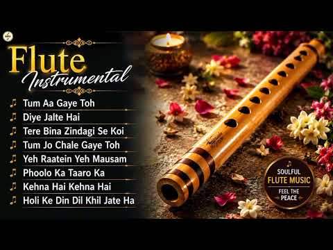

# 음악 — 성공 사례 분석: 사례별 자세히 #801–#840

`analysis.md` 의 9번 (같은 # 번호). 자동 생성 — `tools/success_analysis.py` v1.4.1 (2026-10-20 07:59 UTC). ※ 연구·교육용 — 투자 권유가 아님.

### 801. Best Acoustic Songs of the 80s 🎸 Romantic Classics & Nostalgic Memories

- https://www.youtube.com/watch?v=9tAdobkt1N0 · 80s Guitar Lounge · 구독자 23,800 · 조회수 822,882 (×34.6, 하루 12,579.2) · 좋아요 5,619 (0.7%) · 58.5분 · 2026-08-15 · 주제 묶음 6. 피아노·클래식·연주곡 · 형식 플레이리스트·모음 (여러 곡) · 폴더 `W_9tAdobkt1N0` (웹 승인)
- 썸네일: 
- 설명 앞부분: 🎸 **Best Acoustic Songs of the 80s – Romantic Classics & Nostalgic Memories** ❤ Step back in time and enjoy the timeless sound of the **80s acoustic songs** with a collection of romantic classics, beautiful melodies, and nostalgic memories. This relaxing acoustic music brings together the warmth of…
- 같은 채널 평소 대비 ×10.4 (채널 최근 롱폼 중앙값 79,476회) · 평소 영상: Timeless Acoustic Love Songs 🎸 Best 80s Romantic … (79,476회) / Timeless 70s-80s Acoustic Love Songs – Best Acous… (80,994회)
- 대본 없음 (설명) — 음성인식이 끝나면 도입부·흐름이 들어감
- 댓글 115/114: 좋은 점 — 영상 0 · 감사·응원 0 · 더 알고 싶은 것 0 · 아쉬운 점 — 영상 0 · 반박·불만 — 의견 다름 0 · 정치·사회 0 · 경험 공유 0 · 구독·다음 기대 0

### 802. [중간광고없음] 감정을 다독여주는 따뜻한 피아노 ∣ Warm Piano Music for Emotional Comfort ☕🎼

- https://www.youtube.com/watch?v=qDyoLL6XXpU · Piano Haven · 구독자 5,100 · 조회수 175,886 (×34.5, 하루 980.6) · 좋아요 716 (0.4%) · 195.3분 · 2026-04-23 · 주제 묶음 6. 피아노·클래식·연주곡 · 형식 음악 (그 밖 모양 — 한 편짜리 BGM 등) · 폴더 `W_qDyoLL6XXpU` (웹 승인)
- 썸네일: 
- 설명 앞부분: Piano Haven에 오신 것을 환영합니다. 이 영상은 바쁜 하루 속에서 잠시 쉬어갈 수 있도록 잔잔하고 따뜻한 피아노 선율을 담았습니다. 공부할 때, 일할 때, 책을 읽을 때, 잠들기 전, 혹은 조용히 마음을 쉬게 하고 싶은 순간에 편안한 배경음악이 되어드립니다. 감성적인 피아노 연주와 부드러운 멜로디가 지친 마음을 다독이고, 일상에 작은 평온과 위로를 전해드리길 바랍니다. Piano Haven은 힐링음악, 수면음악, 공부음악, 집중음악, 카페음악, 휴식음악을 사랑하는 분들을 위한 피아노 음악 채널입니다. 비 오는 날의 감성,…
- 같은 채널 평소 대비 ×38.5 (채널 최근 롱폼 중앙값 4,569회) · 평소 영상: [Playlist] 마음이 조용히 숨을 고르는 피아노 ∣ Gentle Healing Pi… (4,581회) / [Playlist] 지친 마음에 따뜻한 쉼을 주는 피아노 ∣ Warm Piano Musi… (4,557회)
- 대본 없음 (설명) — 음성인식이 끝나면 도입부·흐름이 들어감
- 댓글 26/26: 좋은 점 — 영상 0 · 감사·응원 2 · 더 알고 싶은 것 0 · 아쉬운 점 — 영상 0 · 반박·불만 — 의견 다름 0 · 정치·사회 0 · 경험 공유 0 · 구독·다음 기대 0
  - 감사·응원 👍1 “우와 여긴 어디인가요? 너무 멋져요 그냥 봐도 한국인데 가보고 싶습니다 좋은음악 덕분에 오전에 힐링되었습니다 감사합니다.”
  - 감사·응원 👍0 “좋은 음악 감사드립니다.”

### 803. "첫 소절 듣자마자 가슴 한쪽이 먹먹해지네요.." 세월 묻은 목소리로 다시부른 연인(블루스 Ver.)

- https://www.youtube.com/watch?v=y7CUK-q-f1s · 세월블루스 · 구독자 20,900 · 조회수 715,535 (×34.2, 하루 4,138.3) · 좋아요 5,137 (0.7%) · 4.6분 · 2026-04-30 · 주제 묶음 기타 · 형식 정보·해설 (그 밖) · 폴더 `W_y7CUK-q-f1s` (웹 승인)
- 썸네일: 
- 설명 앞부분: 안녕하세요, [세월블루스]입니다. 🥃 오늘 하루도 퍽퍽한 세상살이에 치이느라 참으로 고생 많으셨습니다. 비가 추적추적 내리는 어두운 밤, 낡은 바(Bar) 구석 자리에 앉아 독한 술 한잔 기울이고 싶은 날이 있습니다. 오늘은 한승기 님의 불후의 명곡 '연인'을, 가슴을 후벼 파는 일렉 기타의 벤딩 소리와 끈적한 하모니카가 어우러진 '정통 올드 블루스(Old Blues)' 감성으로 진득하게 다시 말아보았습니다. "외로운 이 가슴에 그리움만 남겨놓고..." 원곡의 뽕기를 싹 걷어낸 자리에, 산전수전 다 겪은 우리네 인생 같은 거칠고 …
- 같은 채널 평소 대비 ×7.1 (채널 최근 롱폼 중앙값 100,927회) · 평소 영상: "조용히 깊어지는 감성의 블루스" 낡은 바에서 듣는 '종점' (블루스.Ver) (100,927회) / "첫 소절부터 심장이 무너집니다..." 너무 좋아서 반복 재생하게 되는 추억의 '여인' … (104,801회)
- 대본 없음 (설명) — 음성인식이 끝나면 도입부·흐름이 들어감
- 댓글 274/274: 좋은 점 — 영상 1 · 감사·응원 45 · 더 알고 싶은 것 2 · 아쉬운 점 — 영상 3 · 반박·불만 — 의견 다름 0 · 정치·사회 1 · 경험 공유 15 · 구독·다음 기대 2
  - 감사·응원 👍17 “감사합니다 사랑하는님이 오늘 새벽에 하늘나라로 떠났습니다 울고싶은 오늘 같은 날 실컷울고있네요~ㅠㅠ”
  - 감사·응원 👍16 “잠시나마 짦았던 옛시간들이 주마등처럼지나가네요,감사합니다”
  - 더 알고 싶은 것 👍0 “Mr만 올려주실수 잇나요?”
  - 더 알고 싶은 것 👍0 “멜론 다운 안되나요???”
  - 아쉬운 점 — 영상 👍7 “목소리가 너무좋아요 노래를 맛있고 멋있게 부루시네요~~~”
  - 아쉬운 점 — 영상 👍4 “목소리가 너무 좋아요.”
  - 경험 공유 👍78 “제가 제일 좋아 하는 곡입니다 먼저 떠난 남편이 그립고 보고 싶습니다~~”
  - 경험 공유 👍4 “내가 100살 즈음에 이 노래를 듣는다면 그때도 난 눈물이 흐를것같다 보고싶어 너무 보고싶어서..”
  - 구독·다음 기대 👍9 “AI로 멋지게 좋은 음악 만드시네요. 딱 내 취향입니다. 구독했네요~^^”
  - 구독·다음 기대 👍3 “한승기님의 연인. 엄청 조아하는데 첫소절 들으면서 깜놀 완전 매료 되었습니다 어떤분인가? 궁금했는데 Ai 라니요 그럼에도 자꾸 듣게됩니다 감사합니다 구독합니다 God bless you✨️🌸🦋✨️”

### 804. 임영웅, 신곡 〈그대 행복이면 됐소〉 발표! 그대만 행복하면 됐소…

- https://www.youtube.com/watch?v=p8MCdXUSFmI · 감성트롯다방 · 구독자 4,910 · 조회수 166,913 (×34.0, 하루 1,543.7) · 좋아요 2,335 (1.4%) · 6.4분 · 2026-07-04 · 주제 묶음 9. 가요·발라드·트로트 · 형식 한 곡 (뮤직비디오·음원·가사) · 폴더 `W_p8MCdXUSFmI` (웹 승인)
- 썸네일: 
- 설명 앞부분: 사랑하지만 끝내 붙잡지 못한 사람을 위해, 마지막까지 행복만을 빌어주는 한 남자의 진심을 담은 감성 트롯 발라드입니다. 〈그대 행복이면 됐소〉는 이별의 아픔보다 사랑하는 사람의 행복을 먼저 생각하는 가장 아름다운 사랑을 노래합니다. 임영웅 특유의 따뜻하면서도 깊은 감성과 애절한 목소리가 더해져, 한 소절 한 소절마다 가슴 깊은 울림을 전합니다. 누군가를 진심으로 사랑해 본 사람이라면 누구나 공감할 수 있는 이야기. 오늘 이 노래가 여러분의 마음속 오래된 추억과 사랑을 다시 떠올리게 하길 바랍니다.
- 같은 채널 평소 대비 ×141.1 (채널 최근 롱폼 중앙값 1,183회) · 평소 영상: 【박서진 곁을 끝까지 지킨 전유진…】아버지 영정 앞에서 가슴 찢어지는 추모곡 열창! 첫 … (1,190회) / 박서진 어머니, 세상을 떠난 남편에게 마지막 노래… 장례식장은 끝내 눈물바다 (1,176회)
- 대본 없음 (설명) — 음성인식이 끝나면 도입부·흐름이 들어감
- 댓글 262/265: 좋은 점 — 영상 2 · 감사·응원 20 · 더 알고 싶은 것 2 · 아쉬운 점 — 영상 9 · 반박·불만 — 의견 다름 28 · 정치·사회 0 · 경험 공유 3 · 구독·다음 기대 0
  - 좋은 점 — 영상 👍0 “감성이 가슴깊이 와닿는 임영웅 님 신곡 구슬퍼요 이렇게좋은 노래를 선물해준 임영웅 님 께 감사드립니다”
  - 좋은 점 — 영상 👍0 “가슴에 와닿는목소리가 너무좋아요”
  - 감사·응원 👍11 “울영웅님은아니지만노래넘잘부르시네요~응원합니다”
  - 감사·응원 👍8 “사랑하면 응원도 하고 돕기도하고 기도와실행도하죠”
  - 더 알고 싶은 것 👍3 “가수보다 더 잘하시는 노래 제작자 분께 박수를 보냅니다 재능이십니다 이렇게 감성적인 분이면 어떤 분일까 궁금하네요 환상은 항상 행복이고 환희, 희열, 그대는 전부가 사랑입니다”
  - 더 알고 싶은 것 👍0 “임영웅 부르는 신곡 듣고싶어요. 궁금하네요.❤🎉”
  - 아쉬운 점 — 영상 👍2 “신곡나오기전aI목소리 인가봐요”
  - 아쉬운 점 — 영상 👍1 “<그대 행복이면 됐소>는 임영웅 님의 실제 신곡이 아닙니다. ​유튜브에서 조회수를 늘리기 위해 임영웅 님의 이름과 얼굴을 무단으로 도용한 가짜 뉴스 및 낚시성 영상입니다. 제미나이가”
  - 반박·불만 — 의견 다름 👍3 “🌈🦜ㅡ "임영웅씨" 목소리 아닙니다 . > 잠언19:14 > 부부는 한 몸인데 어째서 한 쪽만 행복하는가요??”
  - 반박·불만 — 의견 다름 👍2 “영웅님 목소리 아닌데요. 우린 또 제목에 낙였어요”
  - 경험 공유 👍1 “모두다싫어젔네요 챙피 하고 쑥스럽고 요즈응 잠도 못자고 힘들어요 내가 성을파는느낌 나혼자 해결 하기 힘든세상이되 ㅇㆍ버렸네요”
  - 경험 공유 👍0 “임영웅이 이런 노래 부른 적 없다 한다. 그렇다면 가짜 임영웅이 부른 가짜 노랜데 진짜 노래보다 더 조타. 세상 참... 별꼴을 다 본다. 거짓 사랑의 끝, 혼자만의 사랑, 그대 행복하면 됐소... 현재 유튜브에 나도는 가짜 임영웅 노래 3곡 확인!!”

### 805. 2000~2010 K-POP 감성 모음 🎶 ∣ 듣자마자 떠오르는 그 시절 노래들 – Geuri-um Studio

- https://www.youtube.com/watch?v=9CHBQsxSNa4 · Geuri-um Studio  · 구독자 8,720 · 조회수 295,892 (×33.9, 하루 1,706.3) · 좋아요 963 (0.3%) · 87.5분 · 2026-04-29 · 주제 묶음 10. 팝송·K팝·J팝 · 형식 음악 (그 밖 모양 — 한 편짜리 BGM 등) · 폴더 `W_9CHBQsxSNa4` (웹 승인)
- 썸네일: 
- 설명 앞부분: 2000~2010 K-POP 감성 모음 🎶 ∣ 듣자마자 떠오르는 그 시절 노래들 – Geuri-um Studio 🎶 PLAYLIST
- 같은 채널 평소 대비 ×75.9 (채널 최근 롱폼 중앙값 3,898회) · 평소 영상: 한 번 들으면 끝까지 듣게 되는 2000년대 발라드 🎶 추억을 채우는 명곡 모음 💿 (3,898회) / 추억은 노래가 되어 돌아옵니다 🎧 마음을 울리는 2000년대 발라드 플레이리스트 💿 (3,955회)
- 대본 없음 (설명) — 음성인식이 끝나면 도입부·흐름이 들어감
- 댓글 41/41: 좋은 점 — 영상 1 · 감사·응원 2 · 더 알고 싶은 것 1 · 아쉬운 점 — 영상 0 · 반박·불만 — 의견 다름 0 · 정치·사회 0 · 경험 공유 1 · 구독·다음 기대 0
  - 좋은 점 — 영상 👍0 “노래별로 제목정리해주시면 넘나 감사하겠습니다. ^^~”
  - 감사·응원 👍9 “감사합니다”
  - 감사·응원 👍0 “노래별로 제목정리해주시면 넘나 감사하겠습니다. ^^~”
  - 더 알고 싶은 것 👍0 “노래별로 제목정리해주시면 넘나 감사하겠습니다. ^^~”
  - 경험 공유 👍3 “제가 좋아하는 노래만 있으니 넘 좋아요~~”

### 806. Oscar & Deep - Closer To My Dreams

- https://www.youtube.com/watch?v=YVYkI9z2Evk · Oscar & Deep · 구독자 24,400 · 조회수 827,732 (×33.9, 하루 9,322.5) · 좋아요 1,702 (0.2%) · 9.8분 · 2026-07-23 · 주제 묶음 5. 운동·드라이브·신나는 · 형식 음악 (그 밖 모양 — 한 편짜리 BGM 등) · 폴더 `W_YVYkI9z2Evk` (웹 승인)
- 썸네일: 
- 설명 앞부분: 🎵 Listen to "Closer To My Dreams" by Oscar & Deep Experience a new blend of electronic emotions. From the hypnotic rhythms of Italo Disco to the soulful touch of Middle Eastern Deep House, this track is part of our journey to redefine atmospheric soundscapes. ✨ About Oscar & Deep: Welcome to the of…
- 같은 채널 평소 대비 ×29.5 (채널 최근 롱폼 중앙값 28,093회) · 평소 영상: Oscar & Deep - Easy to Believe (28,228회) / Oscar & Deep - Take It Slowly (27,958회)
- 대본 없음 (설명) — 음성인식이 끝나면 도입부·흐름이 들어감
- 댓글 45/45: 좋은 점 — 영상 0 · 감사·응원 0 · 더 알고 싶은 것 0 · 아쉬운 점 — 영상 0 · 반박·불만 — 의견 다름 0 · 정치·사회 0 · 경험 공유 0 · 구독·다음 기대 0

### 807. Persian & Spanish Fusion Relaxing Music 4K ∣ Persian Gulf & Spanish Beaches ∣ Guitar & Sa…

- https://www.youtube.com/watch?v=UH3bfZ6Rb9E · WolfRelaxMusicHub · 구독자 25,400 · 조회수 856,519 (×33.7, 하루 4,987.0) · 좋아요 16,656 (1.9%) · 63.7분 · 2026-05-01 · 주제 묶음 6. 피아노·클래식·연주곡 · 형식 음악 (그 밖 모양 — 한 편짜리 BGM 등) · 폴더 `W_UH3bfZ6Rb9E` (웹 승인)
- 썸네일: 
- 설명 앞부분: This piece is inspired by the rich melodic traditions of Persian dastgah and the dynamic rhythms of Andalusian flamenco, blending cultural elements into a unified musical experience. Experience 63 minutes of Persian–Spanish fusion instrumental music built on authentic musical traditions — expressiv…
- 같은 채널 평소 대비 ×269.2 (채널 최근 롱폼 중앙값 3,182회) · 평소 영상: French & Moroccan Relaxing Fusion Music 🌅 ∣ Oud, … (3,261회) / Persian & African relaxing fusion music 🌅 ∣ Golde… (3,102회)
- 대본 없음 (설명) — 음성인식이 끝나면 도입부·흐름이 들어감
- 댓글 857/857: 좋은 점 — 영상 0 · 감사·응원 0 · 더 알고 싶은 것 0 · 아쉬운 점 — 영상 0 · 반박·불만 — 의견 다름 0 · 정치·사회 0 · 경험 공유 0 · 구독·다음 기대 0

### 808. The Sound Your Brain Needs Right Now 🌿 Deep Healing Music ∣ Dopamine Reset ∣ Zen Meditati…

- https://www.youtube.com/watch?v=rQ5bIFKQoUc · Osen Moonlight · 구독자 10,100 · 조회수 339,270 (×33.6, 하루 6,081.0) · 좋아요 3,012 (0.9%) · 107분 · 2026-08-25 · 주제 묶음 1. 수면·명상·힐링 · 형식 음악 (그 밖 모양 — 한 편짜리 BGM 등) · 폴더 `W_rQ5bIFKQoUc` (웹 승인)
- 썸네일: 
- 설명 앞부분: Welcome to your sanctuary of peace, mindfulness, and deep relaxation. Our channel is dedicated to creating calming soundscapes that help you reconnect with yourself through Healing Music, Relaxing Music, Zen Meditation Music, Tibetan Music, Bamboo Flute Music, Indian Flute Music, Soul-Calming Flute…
- 같은 채널 평소 대비 ×111.0 (채널 최근 롱폼 중앙값 3,058회) · 평소 영상: Instant Relaxation in 5 Minutes 🎶 ∣ Zen Flute Hea… (3,135회) / Healing Bamboo Flute Music 🍃 ∣ Calm Mind, Reduce … (2,980회)
- 대본 없음 (설명) — 음성인식이 끝나면 도입부·흐름이 들어감
- 댓글 128/112: 좋은 점 — 영상 0 · 감사·응원 0 · 더 알고 싶은 것 0 · 아쉬운 점 — 영상 0 · 반박·불만 — 의견 다름 0 · 정치·사회 0 · 경험 공유 0 · 구독·다음 기대 0

### 809. [Playlist] 라흐마니노프의 깊은 그리움 ∣ 멀리서 들려오는 서정적인 선율 (Rachmaninoff Style) 🎹✨

- https://www.youtube.com/watch?v=vcpBmyFBJos · The Clavis · 구독자 19,800 · 조회수 662,578 (×33.5, 하루 5,366.4) · 좋아요 6,910 (1.0%) · 97.2분 · 2026-06-18 · 주제 묶음 6. 피아노·클래식·연주곡 · 형식 AI 음악 · 폴더 `W_vcpBmyFBJos` (웹 승인)
- 썸네일: 
- 챕터: 0:00 01. Longing at Dusk · 2:31 02. The Faraway Call · 5:03 03. Faded Memories · 7:30 04. Garden of Memories · 10:27 05. Tears of Memory · 14:19 06. The Last Goodbye · 16:55 07. A Young Heart's Lament · 19:22 08. The Last Letter · 23:23 09. Night Dreamer · 27:34 10. Where the River Ends · 30:41 11. A Faded Portrait · 34:12 12. Paths of Longing · 37:49 13. Falling Leaves · 41:26 14. The Old House · 44:56 15. The Last Starlight
- 설명 앞부분: The Clavis 채널에 오신 것을 환영합니다. '피아노의 거인' 세르게이 라흐마니노프가 지닌 깊고 서정적인 감성과 애수 가득한 선율을 담아낸 프리미엄 클래식 플레이리스트입니다. 황혼이 물드는 저녁부터 깊어가는 밤 시간대까지, 마음 깊은 곳에 잠든 그리움과 따뜻한 위로를 전하기 위해 솔로 피아노부터 바이올린, 첼로, 현악 앙상블, 풀 오케스트라까지 다양한 악기 구성으로 15개의 트랙을 유기적으로 연결했습니다. 라흐마니노프 특유의 웅장하고 서정적인 선율이 마음 깊은 곳을 조용히 어루만져 줄 것입니다. 깊은 휴식, 사색, 혹은 그리…
- 같은 채널 평소 대비 ×27.9 (채널 최근 롱폼 중앙값 23,754회) · 평소 영상: 🍁 라흐마니노프 감성의 가을 아다지오 ∣ 저물어가는 노을의 애수 (Rachmaninoff… (24,201회) / 🏔️ 브람스 감성의 알프스 가을 교향곡 ∣ 고요한 아침에 듣는 클래식 (Brahms St… (23,306회)
- 대본 없음 (설명) — 음성인식이 끝나면 도입부·흐름이 들어감
- 댓글 551/555: 좋은 점 — 영상 3 · 감사·응원 115 · 더 알고 싶은 것 0 · 아쉬운 점 — 영상 4 · 반박·불만 — 의견 다름 1 · 정치·사회 1 · 경험 공유 44 · 구독·다음 기대 2
  - 좋은 점 — 영상 👍5 “마음에 와닿는 음악 들려주어서 감사합니다. 잠못드는 밤입니다.”
  - 감사·응원 👍83 “요즘 라흐마니노프에 매일 감동입니다 여러가지 생각들이 스치며 애닮은 그리움에 눈물이 나네요 감사 합니다~”
  - 감사·응원 👍69 “나이가 들에 세상을 바라보는 눈이 담담해집니다. 엊그제에 그리 친하지 않았던 친구의 부고를 전해 듣고... 이제 이럴 나이가 됐구나... 새삼 되새겨보니, 담담함도 있었지만 왠지 서글픈 생각이 많았습니다. 오늘... 우연히 이 곳을 알게되어 마음을 추스리게 됩니다. …”
  - 아쉬운 점 — 영상 👍70 “18년을 함께한 우리 고양이가 고양이별로 떠난지 4일째 되는 밤입니다. 집안 모든 곳이 냥이와 함께한 곳이라 가는 곳마다 눈물이 납니다. 마치 그곳에 앉아 있는 것 같아 나도 모르게 두 손을 뻗곤 합니다. 원없이 사랑한 것 같았는데 보내고나니 아쉬움과 후회만 밀려옵니…”
  - 아쉬운 점 — 영상 👍11 “이 음악을 듣는동안 내가슴은 슬프면서도 안정 감을 갖는느낌이 듭니다 6년째 아파서 집에서 지루한 시간을 보냅니다 내몸을 내가 어찌할수 없다는게 넘 슬프고 이렇게 살아야하나 하는 생각이들면 가슴이 먹먹해 집니다 워낙 음악을 좋아하다보니 여기저기 모든 음악을 듣다가 지금…”
  - 정치·사회 👍623 “사랑하는남편이 하늘나라가신지 두달하고십사일째입니다~ 제마음을 위로해주네요~”
  - 경험 공유 👍199 “어머니가 돌아가신지 두달 되었습니다. 제가 병원에 입워해 임종을 못보고 너무나 갑자기 제게 가장 소중한분을 떠나보냈습니다....어머니를 기억하며 집에가는길에 듣겠습니다.”
  - 경험 공유 👍164 “짝꿍을 보낸 아픔보다 더 아팠던 건 아이들이 부르지 못하는 아빠라는 이름이었습니다. 가슴에 아빠라는 단어도 묻고 성장해야 하는 아이들을 보며, 나처럼 그 사람도 아프겠다 생각했어요. 그렇게 5년이 흘렀어요. 그저 시간따라 나도 흐르다보면 그 사람 만나겠지요. 아이들은…”
  - 구독·다음 기대 👍7 “음악에 빠져 드네요...자주 들러겠습니다. 구독합니다”
  - 구독·다음 기대 👍2 “❤❤❤매스컴 덕에 라흐마니노프 팬이 되었네요 아침 이불 속에서 계속 함께하고 있어요 잔잔히 내 가슴에 스며드는 아름다운 선율이 오늘도 행복한 하루를 열어줍니다 좋은 음악 감사해요❤❤❤”

### 810. Chinese Zen Music🎵: Bamboo flute, erhu & Guzheng ∣ Relaxing music @ZenFlute-o5f2h

- https://www.youtube.com/watch?v=6UtPuJcUsyI · ZenFlute · 구독자 32,700 · 조회수 1,086,384 (×33.2, 하루 7,711.7) · 좋아요 16,158 (1.5%) · 90.2분 · 2026-06-01 · 주제 묶음 6. 피아노·클래식·연주곡 · 형식 음악 (그 밖 모양 — 한 편짜리 BGM 등) · 폴더 `W_6UtPuJcUsyI` (웹 승인)
- 썸네일: 
- 설명 앞부분: Welcome to Channel " Zen Flute " 🌙Let the soothing sounds of Bamboo Flute and Guzheng transport you to a world of peace and relaxation. This 1-hour instrumental music is specially designed to help with deep sleep, stress relief, and meditation. 🎶 🎧 Why Listen? ❤ Promotes deep relaxation & stress re…
- 같은 채널 평소 대비 ×155.8 (채널 최근 롱폼 중앙값 6,972회) · 평소 영상: Chinese Zen Music: Bamboo flute, Erhu & Guzheng ∣… (6,972회) / Chinese Zen Music: Bamboo flute, Erhu & Guzheng ∣… (6,923회)
- 대본 없음 (설명) — 음성인식이 끝나면 도입부·흐름이 들어감
- 댓글 744/750: 좋은 점 — 영상 0 · 감사·응원 0 · 더 알고 싶은 것 0 · 아쉬운 점 — 영상 0 · 반박·불만 — 의견 다름 0 · 정치·사회 0 · 경험 공유 0 · 구독·다음 기대 0

### 811. 주부들이 엄선한 감성 팝송 Best 26 ∣ EverPop 레트로 팝 컬렉션 ∣ 7080 올드팝송 ∣ 추억 소환 팝송모음 ∣ 가슴이 따뜻해지는 명곡 Old Po…

- https://www.youtube.com/watch?v=JZH9pZhtl9I · 추억의 올드팝 EverPop · 구독자 15,800 · 조회수 522,696 (×33.1, 하루 5,684.4) · 좋아요 0 (0.0%) · 97.8분 · 2026-07-20 · 주제 묶음 9. 가요·발라드·트로트 · 형식 플레이리스트·모음 (여러 곡) · 폴더 `W_JZH9pZhtl9I` (웹 승인)
- 썸네일: 
- 설명 앞부분: 주부들이 엄선한 감성 팝송 Best 26 ∣ EverPop 레트로 팝 컬렉션 ∣ 7080 올드팝송 ∣ 추억 소환 팝송모음 ∣ 가슴이 따뜻해지는 명곡 Old Pop Playlist 저희의 동의 없이 음악을 도용할 수 없습니다. 위반 시 경고를 보내드립니다.
- 같은 채널 평소 대비 ×23.5 (채널 최근 롱폼 중앙값 22,265회) · 평소 영상: 지친 하루 끝 4050이 가장 아끼는 힐링 팝송 ∣ EverPop 심야 감성팝 ∣ 708… (22,265회) / 엄마도 소녀였던 그 시절로 ∣ EverPop 7080 추억의 감성 팝송 Best ∣ 40… (20,106회)
- 대본 없음 (설명) — 음성인식이 끝나면 도입부·흐름이 들어감
- 댓글 125/129: 좋은 점 — 영상 0 · 감사·응원 18 · 더 알고 싶은 것 2 · 아쉬운 점 — 영상 2 · 반박·불만 — 의견 다름 0 · 정치·사회 1 · 경험 공유 2 · 구독·다음 기대 0
  - 감사·응원 👍22 “😊 와우~~~^^ 넘 좋아요. 몇십년만에 듣는중임다. 세월이 흘렀는데도 이 기분은, 똑같이 설레고 . 기쁘고 행복하게 잘듣습니다. 감사합니당”
  - 감사·응원 👍20 “그리워지네요 그시절이~~^^ 감사합니다 덕분에 잘듣고있지요~~^^♡♡♡🎉🎉🎉😅😅😅”
  - 더 알고 싶은 것 👍1 “제목 좀 알려주세요 다 너무 좋아용 !!”
  - 더 알고 싶은 것 👍0 “노래 재목들 좀 알 수 있을까요?”
  - 아쉬운 점 — 영상 👍5 “팝송을 즐겨 듣고 있는데 가사는 자막으로 나오고 들어보면 기억 나는 부분이 많이 있는데 제목이 기억안나는게 아쉬워요~항상 감사합니다”
  - 아쉬운 점 — 영상 👍1 “팝송 제목이 없는게 아쉽네요”
  - 정치·사회 👍0 “일을행하는 여호와 그것을 지어성취하시는 여호와 그이름을 여호와라 하는자가 이같이 이르노라 너는 내게 부르짖으라 내가 네게 응답하겠고 네가 알지못하는 크고 비밀한일을 네게 보이리라 말씀하신주님 아버지하나님 존경하는 도널드트럼프미국대통령님께서 국정운영하는 미국에 시총3조…”
  - 경험 공유 👍0 “일을행하는 여호와 그것을 지어성취하시는 여호와 그이름을 여호와라 하는자가 이같이 이르노라 너는 내게 부르짖으라 내가 네게 응답하겠고 네가 알지못하는 크고 비밀한일을 네게 보이리라 말씀하신주님 아버지하나님 존경하는 도널드트럼프미국대통령님께서 국정운영하는 미국에 시총3조…”

### 812. 비 오는 날 듣기 좋은 화란 락발라드 모음 Vol.1 ☔7080 감성 Cover Collection

- https://www.youtube.com/watch?v=c4hjZfzxkMM · ​화란사운드® | 보컬화란 · 구독자 16,800 · 조회수 551,975 (×32.9, 하루 3,837.3) · 좋아요 5,915 (1.1%) · 34분 · 2026-05-29 · 주제 묶음 12. 커버·노래 부르기 · 형식 커버·직접 부른 노래 · 폴더 `W_c4hjZfzxkMM` (웹 승인)
- 썸네일: 
- 챕터: 0:00 잃어버린 정 · 4:25 아직도 못다한 사랑 · 8:25 그대는 모르시더이다 · 12:50 아득히 먼 곳 · 16:23 님은 먼 곳에 · 20:57 영원한 사랑인줄 알았는데 · 25:11 잃어버린 우산 · 29:24 비와 찻잔 사이
- 설명 앞부분: 감정을 울리는 목소리, Emotional Rock Ballad HWARAN SOUND 비 오는 밤, 조용히 감성을 적셔주는 7080 감성 락발라드 커버곡들을 한 편의 플레이리스트처럼 담아보았습니다. 화란의 목소리로 다시 불러본 추억과 이별, 그리고 그리움의 노래들입니다. 🎼 수록곡 🎼 안내 본 영상은 여러 원곡을 기반으로 제작된 커버곡 모음집입니다. 본 영상은 감상 및 아카이브 목적의 커버 콘텐츠입니다. 🎼 크레딧 제작: 화란사운드 (HWARAN SOUND) 보컬: 화란 (HWARAN) 영상 속 인물: 화란 (HWARAN) Cov…
- 같은 채널 평소 대비 ×15.6 (채널 최근 롱폼 중앙값 35,360회) · 평소 영상: 비의 초상 (계은숙) ∣ 원곡자님 신청곡 ∣ HWARAN Cover ∣ 비 내리면 떠오르… (35,360회) / 🌙 밤에 듣기 좋은 화란 락발라드 ∣ 숨겨진 명곡 Cover Collection Vol.1 (35,395회)
- 대본 없음 (설명) — 음성인식이 끝나면 도입부·흐름이 들어감
- 댓글 285/286: 좋은 점 — 영상 3 · 감사·응원 27 · 더 알고 싶은 것 5 · 아쉬운 점 — 영상 1 · 반박·불만 — 의견 다름 1 · 정치·사회 0 · 경험 공유 9 · 구독·다음 기대 2
  - 좋은 점 — 영상 👍6 “젊은 시절이 주마등쳐럼 스쳐가요 비오는날 넘무 듣기좋아요”
  - 좋은 점 — 영상 👍3 “AI 가 내 가슴을 울려...허스키한 심금을 울리는 음색지죤 넘사벽 ...아물지 않은 내 사랑의 아픔인듯 이별의 아픔을 파노라마 처럼 뇌리로 스쳐가네요. 운명적인 만남인줄 알았는데 스치는 인연으로 서로가 찢어지는 통증을 겪으며...세월이 흘러도 가슴이 기억하는 이름석…”
  - 감사·응원 👍21 “고맙습니다 오늘같이 비가오는 날에는”
  - 감사·응원 👍20 “많은 추억을 회상하게 됩니다 .음색도 맘에들고. 암튼 들려주셔서 감사합니다💞💖”
  - 더 알고 싶은 것 👍7 “참 저장 도 했습니다 더욱 많은 노래 만들어 주세요 ^^”
  - 더 알고 싶은 것 👍3 “AI인줄 알고도 너무좋아 그냥들었는데 진짜 가수인지 궁금합니다.”
  - 아쉬운 점 — 영상 👍5 “목소리가 너무 예뻐요 ❤❤❤❤❤❤”
  - 반박·불만 — 의견 다름 👍5 “화란..사람입니다. AI 아닙니다.ㅋㅋ”
  - 경험 공유 👍12 “소낙비 치는 시작장면 멋집니다 곡도 제가 제일 좋아 하는 노래 나도 모르게 따라 부르네요 감사합니다 건강하세요🌱🌱”
  - 경험 공유 👍11 “노래가 전부 굿 !! 시상에 내가빠짐”
  - 구독·다음 기대 👍6 “오늘 첨 들어봤는데 감성 음색 너무좋으네요! 구독합니다!🥰”
  - 구독·다음 기대 👍4 “최고 65년 생인데 너무 긧가에 시원하고 시원해서 회사다니면서 매일듣음니다 ㆍ 고맙음니다”

### 813. Zulu Spirit — African Spiritual Ambient Music for Healing & Inner Peace ∣ 3 Hours

- https://www.youtube.com/watch?v=cOLt_w3nBx4 · Echo Sanctum · 구독자 9,200 · 조회수 301,949 (×32.8, 하루 1,893.9) · 좋아요 4,119 (1.4%) · 180.8분 · 2026-05-13 · 주제 묶음 1. 수면·명상·힐링 · 형식 긴 한 곡·반복 (N시간) · 폴더 `W_cOLt_w3nBx4` (웹 승인)
- 썸네일: 
- 설명 앞부분: Experience the atmosphere of the African night through deep ambient textures, emotional Zulu-inspired vocals, and the calming rhythm of nature. This immersive soundscape blends peaceful melodies, cinematic ambience, and ancient-inspired vocal chants to create a relaxing journey for focus, sleep, me…
- 같은 채널 평소 대비 ×21.9 (채널 최근 롱폼 중앙값 13,798회) · 평소 영상: Spirit of South Africa ∣ African Ambient Music wi… (14,015회) / African Music for Deep Healing ∣ Spirit of Red Ea… (13,580회)
- 대본 없음 (설명) — 음성인식이 끝나면 도입부·흐름이 들어감
- 댓글 228/226: 좋은 점 — 영상 0 · 감사·응원 0 · 더 알고 싶은 것 0 · 아쉬운 점 — 영상 1 · 반박·불만 — 의견 다름 0 · 정치·사회 0 · 경험 공유 0 · 구독·다음 기대 0
  - 아쉬운 점 — 영상 👍1 “아 ! 이목소리와 반주가 마음을 차분히 가라앉게 하니 정말 좋아요. 가사 자막이 있으면 참 좋을텐데 말입니다. 좀 아쉬워요. @ Korea”

### 814. Best Romantic Flute Instrumental Collection ❤️ ∣ Tum Aa Gaye Toh • Tere Bina Zindagi Se K…

- https://www.youtube.com/watch?v=taYeLCeWCd8 · Mansa Music Wala · 구독자 10,400 · 조회수 338,559 (×32.5, 하루 2,887.0) · 좋아요 3,471 (1.0%) · 19.6분 · 2026-06-25 · 주제 묶음 6. 피아노·클래식·연주곡 · 형식 음악 (그 밖 모양 — 한 편짜리 BGM 등) · 폴더 `W_taYeLCeWCd8` (웹 승인)
- 썸네일: 
- 설명 앞부분: Best Romantic Flute Instrumental Collection ❤️ ∣ Tum Aa Gaye Toh • Tere Bina Zindagi Se Koi • Yeh Raatein Yeh Mausam ∣ Soulful Flute Music Immerse yourself in this beautiful collection of timeless Bollywood melodies presented in soothing flute instrumental style. Let the magical sound of the flute …
- 같은 채널 평소 대비 ×138.5 (채널 최근 롱폼 중앙값 2,444회) · 평소 영상: 3 ∣ Timeless Ghazal Music ∣ Jagjit Singh inspired… (2,444회) / Sitar Flute Instrumental ∣ Soulful Old Bollywood … (2,414회)
- 대본 없음 (설명) — 음성인식이 끝나면 도입부·흐름이 들어감
- 댓글 84/84: 좋은 점 — 영상 0 · 감사·응원 0 · 더 알고 싶은 것 0 · 아쉬운 점 — 영상 0 · 반박·불만 — 의견 다름 0 · 정치·사회 0 · 경험 공유 0 · 구독·다음 기대 0

### 815. 🌺 सर्व देवता हरेक बिहानको मन्त्र ∣ Morning Nepali Bhakti Songs

- https://www.youtube.com/watch?v=U984EoUC8Jo · Bhajan Hub Nepal  · 구독자 33,400 · 조회수 1,086,157 (×32.5, 하루 7,300.9) · 좋아요 9,597 (0.9%) · 13.6분 · 2026-05-24 · 주제 묶음 1. 수면·명상·힐링 · 형식 음악 (그 밖 모양 — 한 편짜리 BGM 등) · 폴더 `W_U984EoUC8Jo` (웹 승인)
- 썸네일: 
- 설명 앞부분: Your morning with peaceful Nepali Bhajan, Morning Meditation, Yoga vibes and divine spiritual energy. 🌄🕉 यस भिडियोमा तपाईंले सुन्नुहुनेछ मन शान्त बनाउने Nepali Morning Bhakti Songs, Meditation Music, Yoga Relaxing Bhajan तथा devotional spiritual songs. Feel the divine blessings of Shri Ram, Krishna…
- 같은 채널 평소 대비 ×152.6 (채널 최근 롱폼 중앙값 7,118회) · 평소 영상: हनुमान चालीसा ∣ नेपाली भावानुवाद ∣ Hanuman Chalis… (7,118회) / रक्षा गर कुल देवता 🙏 शक्तिशाली पितृ भजन ∣ Kul Dev… (7,990회)
- 대본 없음 (설명) — 음성인식이 끝나면 도입부·흐름이 들어감
- 댓글 760/760: 좋은 점 — 영상 0 · 감사·응원 0 · 더 알고 싶은 것 0 · 아쉬운 점 — 영상 0 · 반박·불만 — 의견 다름 0 · 정치·사회 0 · 경험 공유 0 · 구독·다음 기대 0

### 816. 하루 끝에 듣는 힐링 발라드 🎶 광고 없는 감성 명곡 모음｜백지영, 성시경, 더원, 이승기, 김필, 양파, 임창정 - 명곡 모음 광고없음

- https://www.youtube.com/watch?v=85w3xNdP09U · N Melody Ballad - 추억발라드 · 구독자 23,800 · 조회수 772,677 (×32.5, 하루 5,746.6) · 좋아요 1,909 (0.2%) · 49.8분 · 2026-06-07 · 주제 묶음 9. 가요·발라드·트로트 · 형식 플레이리스트·모음 (여러 곡) · 폴더 `W_85w3xNdP09U` (웹 승인)
- 썸네일: 
- 같은 채널 평소 대비 ×128.1 (채널 최근 롱폼 중앙값 6,031회) · 평소 영상: 하루 종일 듣기 좋은 노래🎈🎈일할때 듣기좋은 발라드 추천 광고없는 노래모음🎈🎈양파, 이승… (6,031회) / 하루 끝에 듣는 힐링 발라드 🎶 광고 없는 감성 명곡 모음｜백지영, 성시경, 더원, 이승… (6,282회)
- 대본 없음 (없음) — 음성인식이 끝나면 도입부·흐름이 들어감
- 댓글 138/138: 좋은 점 — 영상 0 · 감사·응원 2 · 더 알고 싶은 것 3 · 아쉬운 점 — 영상 6 · 반박·불만 — 의견 다름 1 · 정치·사회 0 · 경험 공유 2 · 구독·다음 기대 0
  - 감사·응원 👍1 “잘듣고있어요~ 감사해요~❤”
  - 감사·응원 👍0 “늘ㆍ감사합니다 ㆍ🎉🎉🎉엄지척입니다”
  - 더 알고 싶은 것 👍6 “노래 너무 잘들었습니다! 혹시 물고기자리 누구 커버에요? 너무 선곡이 좋으셔서 궁금합니다”
  - 더 알고 싶은 것 👍3 “가수랑 제목 타임테이블 알 수 있을까요?”
  - 아쉬운 점 — 영상 👍8 “광고없다더니 광고가 많네요”
  - 아쉬운 점 — 영상 👍5 “걍 광고가 있다고 해도 듣고 싶으면 들을텐데...구지 구지 광고 없다고..”
  - 경험 공유 👍4 “광고 조금은 이해 하려고 했었는데 너무많아~”
  - 경험 공유 👍4 “엄마 불쌍한 울엄마 가슴이 미어지도록 사랑해 내가 정말 나쁜딸이야 미안해 엄마 제발 오래오래 살아 아빠도”

### 817. 𝐈𝐬 𝐭𝐢𝐦𝐞 𝐭𝐨 𝐫𝐞𝐥𝐚𝐱⎛˶’ᵕ’˶ ⎞♡.*･ﾟ

- https://www.youtube.com/watch?v=a7psAnInAcI · iamnotcute유유 · 구독자 13,800 · 조회수 444,222 (×32.2, 하루 3,073.3) · 좋아요 13,810 (3.1%) · 99.8분 · 2026-05-28 · 주제 묶음 기타 · 형식 정보·해설 (그 밖) · 폴더 `W_a7psAnInAcI` (웹 승인)
- 썸네일: 
- 설명 앞부분: Today's Melody is all about relaxation: a comfortable bathପ(๑ᴗ͈ˬᴗ͈)ଓ. Turn off the noise, let your body slowly relax, and let your mind unwind too. This lo-fi/ambient vibe is perfect for: Wanting to unwind after work; Needing to unwind on stressful nights while showering, doing skincare, or simply …
- 같은 채널 평소 대비 ×73.4 (채널 최근 롱폼 중앙값 6,056회) · 평소 영상: 𝐚 𝐭𝐢𝐦𝐞𝐫 𝐟𝐨𝐫 𝐬𝐨𝐦𝐞𝐨𝐧𝐞 𝐰𝐡𝐨 𝐚𝐫𝐞 𝐬𝐭𝐮𝐝𝐲𝐢𝐧𝐠 ∣ 25/5 Pomod… (6,080회) / sleeping on my keyboard𐔌՞- . -՞𐦯 ᶻ𝗓𐰁... (6,031회)
- 대본 없음 (설명) — 음성인식이 끝나면 도입부·흐름이 들어감
- 댓글 223/221: 좋은 점 — 영상 0 · 감사·응원 0 · 더 알고 싶은 것 0 · 아쉬운 점 — 영상 0 · 반박·불만 — 의견 다름 0 · 정치·사회 0 · 경험 공유 0 · 구독·다음 기대 0

### 818. A Quiet Rainy Afternoon in a 1958 Vermont Town ∣ Relaxing Vintage Americana Music

- https://www.youtube.com/watch?v=zjgFke-YGZk · The Serene Sound · 구독자 34,000 · 조회수 1,093,901 (×32.2, 하루 6,400.2) · 좋아요 23,790 (2.2%) · 64분 · 2026-05-02 · 주제 묶음 기타 · 형식 음악 (그 밖 모양 — 한 편짜리 BGM 등) · 폴더 `W_zjgFke-YGZk` (웹 승인)
- 썸네일: 
- 설명 앞부분: Step into a quiet rainy afternoon in a 1958 Vermont town, where warm diner lights glow softly against the wet streets, vintage storefronts, classic cars, and rain-streaked windows. This relaxing visual journey captures the peaceful charm of small-town America, with cozy diner scenes, glowing neon r…
- 같은 채널 평소 대비 ×57.0 (채널 최근 롱폼 중앙값 19,176회) · 평소 영상: Autumn 1966: Driving Through Hudson Valley ∣ Rela… (19,710회) / A Gentle Morning at the Victorian Flower Market ∣… (18,643회)
- 대본 없음 (설명) — 음성인식이 끝나면 도입부·흐름이 들어감
- 댓글 1,843/1,837: 좋은 점 — 영상 0 · 감사·응원 0 · 더 알고 싶은 것 0 · 아쉬운 점 — 영상 0 · 반박·불만 — 의견 다름 0 · 정치·사회 0 · 경험 공유 0 · 구독·다음 기대 0

### 819. 조선힙합 OFFICIAL 발표곡 중 인기곡만 모았습니다.

- https://www.youtube.com/watch?v=fjjiznDoNEQ · 조선힙합 Official · 구독자 28,600 · 조회수 910,125 (×31.8, 하루 6,629.1) · 좋아요 7,394 (0.8%) · 28.4분 · 2026-06-05 · 주제 묶음 11. 힙합·R&B·EDM · 형식 한 곡 (뮤직비디오·음원·가사) · 폴더 `W_fjjiznDoNEQ` (웹 승인)
- 썸네일: 
- 챕터: 0:00 살다보니 · 3:03 인연 · 6:27 윤회 · 11:11 월매송 · 15:37 인연은달을따라지고 · 19:47 가시리 · 24:23 몽혼
- 설명 앞부분: 전통은 오래된 것이 아니라, 지금도 우리 혈관 속에 살아 숨 쉬는 리듬입니다. 음원으로 발표된 곡들만 모아서 구성했습니다. 🎧 Timeline (타임라인) linktr.ee/joseonhiphop spotify open.spotify.com/artist/6U768dSunJc4oZ4NFw04WY music-flo.com/detail/album/455700472/albumtrack Instagram instagram.com/joseonhiphoptv tiktok Business Contact
- 같은 채널 평소 대비 ×123.5 (채널 최근 롱폼 중앙값 7,368회) · 평소 영상: 신이있다면 OFFICIAL MV 1시간 연속듣기 (7,368회) / 그대곁에 OFFICIAL MV 1시간 연속듣기 (8,086회)
- 대본 없음 (설명) — 음성인식이 끝나면 도입부·흐름이 들어감
- 댓글 1,039/1,051: 좋은 점 — 영상 20 · 감사·응원 121 · 더 알고 싶은 것 19 · 아쉬운 점 — 영상 9 · 반박·불만 — 의견 다름 6 · 정치·사회 1 · 경험 공유 22 · 구독·다음 기대 14
  - 좋은 점 — 영상 👍189 “조선힙합 멜로디도 좋지만 모든 곡들의 가사가 너무 마음에 와닿습니다. 좋은 노래 만들어줘서 감사합니다. 위안이 되는 따뜻한 노래들.”
  - 좋은 점 — 영상 👍53 “사랑도돈도 우정도 다지나갑니다 우리들의 인생을노래하네요ᆢ 한번쯤경험했던 중년들은 더 가슴에 와닿네요”
  - 감사·응원 👍189 “조선힙합 멜로디도 좋지만 모든 곡들의 가사가 너무 마음에 와닿습니다. 좋은 노래 만들어줘서 감사합니다. 위안이 되는 따뜻한 노래들.”
  - 감사·응원 👍113 “와~ 진짜 들으면 들을수록 이게 뭐지? 라는 생각밖에 안들어요 어떤 노래는 눈물을 빼고 어떤 노래는 가슴을 후벼파고 또 어떤 노래는 저의 어깨를 살포시 토닥여주고.. 아~ 좋다 어찌하여 저의 알고리즘에 들어오셨나요 이유가 뭐든, 과정이 어떻든 고맙습니다 🙏”
  - 더 알고 싶은 것 👍3 “항상 응원합니다 앞으로도 좋은음악 잘부탁드립니다~~”
  - 더 알고 싶은 것 👍2 “조선힙합 노래 다 좋지만 발라드쪽 노래 진짜 너무좋아요오ㅜㅜ플리좀 만들어주세요오..❤❤❤”
  - 아쉬운 점 — 영상 👍3 “음악에 목소리가 너무 좋아요 😍😍😍😍😍”
  - 아쉬운 점 — 영상 👍2 “정말좋은 노래네요 중년들어 자꾸 아쉬움만남내요 다들 더 나아가봅시다”
  - 반박·불만 — 의견 다름 👍3 “눈물이 난다..난 이기적이게 살았구나..그들의 삶은 당연한게 아닌데.. 미안합니다”
  - 반박·불만 — 의견 다름 👍2 “이런 말도 안되는 좋은곡들을. 이렇게 다작을 만들수 있죠? 우주인인가요.? 말도 안되는 리듬감은 어디서 온것인지.. 최고입니다..”
  - 경험 공유 👍57 “와..이거 뭐지...멍한 감흥.. 꿈쩍도 않는 내가 움직인다... 정말 완벽한 뮤지션이다... 세렌디피티 는 바로 이런것~ 함께 갑시다...영원히~~~~!!”
  - 경험 공유 👍53 “사랑도돈도 우정도 다지나갑니다 우리들의 인생을노래하네요ᆢ 한번쯤경험했던 중년들은 더 가슴에 와닿네요”
  - 구독·다음 기대 👍110 “듣다보니. 가슴에 스며들어 구독하고. 계속 듣게 되네요 60후반이지만 요즘 젊은이들 조선힙합이 꽂치네요 좋은음악. ~^^❤❤❤”
  - 구독·다음 기대 👍8 “첫 곡 듣고 구독합니다~노래가 마음을 울리고 응어리를 해소 시켜 줍니다..❤”

### 820. Peaceful Adventist Hymns Instrumental ∣ SDA Prayer Music for Bible Study, Rest & Worship …

- https://www.youtube.com/watch?v=tj1FpWQsyCg · Adventist Hymns & Worship · 구독자 37,500 · 조회수 1,175,853 (×31.4, 하루 7,216.6) · 좋아요 19,429 (1.7%) · 61분 · 2026-05-10 · 주제 묶음 6. 피아노·클래식·연주곡 · 형식 긴 한 곡·반복 (N시간) · 폴더 `W_tj1FpWQsyCg` (웹 승인)
- 썸네일: 
- 설명 앞부분: 🎶 SDA Hymnal Songs App for iPhone & iPad: Search SDA hymns by title, number, first line, or lyrics. Read verses, view sheet music, and listen to worship music anytime. Using the app is also a way to support this music ministry and future hymnal resources. ❤️ Support Our Music Enjoying these hymns? …
- 같은 채널 평소 대비 ×5.8 (채널 최근 롱폼 중앙값 201,688회) · 평소 영상: Greatest SDA Hymns for Prayer & Peace 🙏 ∣ ’Tis So… (209,339회) / Greatest SDA Hymns Instrumental ∣ Peaceful Advent… (194,037회)
- 대본 없음 (설명) — 음성인식이 끝나면 도입부·흐름이 들어감
- 댓글 570/571: 좋은 점 — 영상 0 · 감사·응원 1 · 더 알고 싶은 것 0 · 아쉬운 점 — 영상 0 · 반박·불만 — 의견 다름 0 · 정치·사회 0 · 경험 공유 0 · 구독·다음 기대 0
  - 감사·응원 👍7 “아멘. 감사합니다.”

### 821. The Beatles on Abbey Road ∣ Greatest Hits in Quartet [No Mid-Roll Ads]

- https://www.youtube.com/watch?v=VGZ-Xzu73gg · Golden Harmony · 구독자 19,500 · 조회수 610,589 (×31.3, 하루 5,548.4) · 좋아요 9,051 (1.5%) · 114.4분 · 2026-07-02 · 주제 묶음 기타 · 형식 음악 (그 밖 모양 — 한 편짜리 BGM 등) · 폴더 `W_VGZ-Xzu73gg` (웹 승인)
- 썸네일: 
- 챕터: 0:00 I Will · 2:59 Hey Jude · 6:29 Yesterday · 9:44 In My Life · 13:02 Michelle · 15:50 And I Love Her · 19:24 All You Need is Love · 22:26 Let It Be · 25:41 Penny Lane · 28:49 I Want to Hold Your Hand · 31:56 Love · 35:08 Across the Universe · 38:43 Norwegian Wood · 41:43 Blackbird · 44:11 Here Comes the Sun · 47:16 Yellow Submarine · 50:26 Ob-La-Di, Ob-La-Da · 53:47 Oh! Darling
- 설명 앞부분: Experience the timeless magic of The Beatles reimagined in a beautiful quartet setting on the iconic Abbey Road. (Piano, Viola, Cello & Double Bass) This special collection features some of the most beloved Beatles classics, reimagined for piano, viola, cello, and double bass with a warm blend of j…
- 같은 채널 평소 대비 ×71.2 (채널 최근 롱폼 중앙값 8,573회) · 평소 영상: Koes Plus — 3 Timeless Melodies ∣ Timeless Orches… (8,573회) / The Beatles in Jazz Symphony Vol. 2 ∣ Symphonic J… (10,231회)
- 대본 없음 (설명) — 음성인식이 끝나면 도입부·흐름이 들어감
- 댓글 299/300: 좋은 점 — 영상 0 · 감사·응원 0 · 더 알고 싶은 것 0 · 아쉬운 점 — 영상 0 · 반박·불만 — 의견 다름 0 · 정치·사회 0 · 경험 공유 0 · 구독·다음 기대 0

### 822. 🍀 7월, 바다를 보며 들으니 이 노래 너무 좋다 ☕ 커피 한 잔과 함께하는 7080 추억의 올드팝 🎧

- https://www.youtube.com/watch?v=q3iHXzi_Qn0 · 행운을담은 올드팝   · 구독자 6,160 · 조회수 191,687 (×31.1, 하루 1,751.8) · 좋아요 2,109 (1.1%) · 85.7분 · 2026-07-02 · 주제 묶음 9. 가요·발라드·트로트 · 형식 플레이리스트·모음 (여러 곡) · 폴더 `W_q3iHXzi_Qn0` (웹 승인)
- 썸네일: 
- 챕터: 0:00 Morning Mist on the Bay · 3:34 Summer Beside the Sea · 8:03 Footprints by the Summer Sea · 13:23 By the Dunes and the Radio · 17:42 When the Sea Breeze Turned th… · 21:40 Where the Seabirds Fly · 26:15 A Picture Filled with Summer · 30:15 A Shell That Remembers · 33:40 Treasure Washed Ashore · 37:48 The Breeze That Stayed Until … · 42:51 Replay 🔄
- 설명 앞부분: 🎧 행운을 담은 7080 올드팝 🎶 좋은 아침입니다. ☀️🌊 7월의 푸른 아침, 창문 너머로 반짝이는 바다가 펼쳐지고, 따뜻한 햇살과 시원한 바람이 조용히 하루를 시작하고 있습니다. 따뜻한 커피 한 잔, 은은하게 스며드는 오래된 노래, 그리고 잠시 쉬어갈 수 있는 여유. 7월에 다시 듣는 이 노래들은 마음속에 오래 머물던 추억을 조용히 다시 불러오는 것 같습니다. 잠시 모든 걱정을 내려놓고, 그 시절 함께 웃었던 사람들과 여름 바람처럼 남아 있는 기억들을 천천히 떠올려 보세요. 오늘 이 음악이 당신의 아침을 조금 더 따뜻하게, 평…
- 같은 채널 평소 대비 ×14.7 (채널 최근 롱폼 중앙값 13,038회) · 평소 영상: 🍀🍂 가을 아침, 첫 곡부터 자꾸 생각나는 노래 ☕ 커피와 함께 하루 종일 듣기 좋은 7… (13,038회) / 🍀 8월, 커피 한 잔과 들었더니 이 노래 너무 좋다 ☕ 하루 종일 듣게 되는 가을 올드… (12,707회)
- 대본 없음 (설명) — 음성인식이 끝나면 도입부·흐름이 들어감
- 댓글 160/160: 좋은 점 — 영상 3 · 감사·응원 24 · 더 알고 싶은 것 2 · 아쉬운 점 — 영상 0 · 반박·불만 — 의견 다름 0 · 정치·사회 0 · 경험 공유 1 · 구독·다음 기대 2
  - 좋은 점 — 영상 👍5 “주말 아침에 듣기 너무 좋네요 비도 오고 차분한 목소리가 듣기 좋네요❤❤❤”
  - 좋은 점 — 영상 👍3 “소프트한 목소리와 서사시 같은 가사가 휴일 아침에 듣기 좋아요 가수 이름을 알수 있을까요?”
  - 감사·응원 👍44 “시골에 귀촌한지 3년여가 되어 가는데 테라스에서 커피 타임 하면서 긴시간 마냥 듣고 있네요. 마음을 평온하게 하는 음악이라서 ~ 좋은음악 만들어 주셔 감사합니다^^”
  - 감사·응원 👍8 “책한권 손에들고 차분한음과 마음의 평온을 느끼는 주말아침이네요 나게겐 이또한 귀한시간입니다 감사합니다”
  - 더 알고 싶은 것 👍12 “혹시 흘러나오는 여자 목소리 가수이름 알수있을까요? 엄마가 궁금해하셔서요ㅠ”
  - 더 알고 싶은 것 👍3 “소프트한 목소리와 서사시 같은 가사가 휴일 아침에 듣기 좋아요 가수 이름을 알수 있을까요?”
  - 경험 공유 👍4 “목소리도 노래도 너무 스윗하고 좋아서 계속 듣다가 갑자기 가수 이름이 궁금해졌는데, 댓글 보니 AI가수라고 하셔서 빵터졌습니다. 저도 오프라인에서 버스킹하며 취미로 노래하는 사람인데 AI가 이렇게 노래를 잘하니 가수들 다 굶어죽겠네요 ㅎㅎㅎ 너무 좋아서 한수 배우고 …”
  - 구독·다음 기대 👍3 “독일 함부르크에서 60대 새내기 할머니가 구독하고 잘 듣고 있습니다.”
  - 구독·다음 기대 👍3 “분위기가 좋아서 편안하게 음악 잘 들었습니다.. 구독 좋아요 알림설정하고 다음에 또 올께요...감사합니다.”

### 823. QUIET WITH JESUS - Instrumental Worship Music For Prayer

- https://www.youtube.com/watch?v=2JsArLBjn70 · One Thing · 구독자 17,700 · 조회수 549,891 (×31.1, 하루 3,962.0) · 좋아요 6,675 (1.2%) · 60.3분 · 2026-06-03 · 주제 묶음 6. 피아노·클래식·연주곡 · 형식 음악 (그 밖 모양 — 한 편짜리 BGM 등) · 폴더 `W_2JsArLBjn70` (웹 승인)
- 썸네일: 
- 설명 앞부분: QUIET WITH JESUS - Instrumental Worship Music For Prayer It is our heart and desire to help other people have their own personal encounter with God through worship and music. Every song was created to help people encounter God's presence. Produced by Trinus Studio ∣ Levi Aguiar The mission of One T…
- 같은 채널 평소 대비 ×58.2 (채널 최근 롱폼 중앙값 9,446회) · 평소 영상: FIND JESUS THIS MORNING - Instrumental Worship Mu… (12,240회) / Night Piano Prayer for Peaceful Rest (12,447회)
- 대본 없음 (설명) — 음성인식이 끝나면 도입부·흐름이 들어감
- 댓글 119/119: 좋은 점 — 영상 0 · 감사·응원 1 · 더 알고 싶은 것 0 · 아쉬운 점 — 영상 0 · 반박·불만 — 의견 다름 0 · 정치·사회 0 · 경험 공유 0 · 구독·다음 기대 0
  - 감사·응원 👍11 “덕분에 깊은 묵상 기도가 가능했어요. 정말 귀한 찬양 피아노입니다. 고맙습니다.”

### 824. celestial bloom 🌿∣ dreamy piano music reflected in dreamy water celestial bloom

- https://www.youtube.com/watch?v=coDaaicD9zM · She of the Vale · 구독자 11,700 · 조회수 363,420 (×31.1, 하루 4,336.3) · 좋아요 5,734 (1.6%) · 36.4분 · 2026-07-28 · 주제 묶음 6. 피아노·클래식·연주곡 · 형식 음악 (그 밖 모양 — 한 편짜리 BGM 등) · 폴더 `W_coDaaicD9zM` (웹 승인)
- 썸네일: 
- 챕터: 0:00 The Weight of Light - Maëlle … · 2:13 Before the Storm - Dan Quinn · 4:12 The Long Way Back - Dan Quinn · 6:14 Sleepy Town - Maëlle Rousseau · 9:12 The Gift of Time - Aki Sora · 11:41 A Small Wonder - Aki Sora · 14:10 If You Stay - Anselm van de W… · 16:48 Atlas of Small Things - Dan Q… · 18:45 Repeat
- 설명 앞부분: A soft piano journey inspired by shimmering waters, cascading white blossoms, and the quiet beauty of golden summer light🌿. Like sunlight dancing across a peaceful lake, each melody gently unfolds, inviting you to slow down, breathe deeply, and embrace the stillness of nature. Whether you're readin…
- 같은 채널 평소 대비 ×55.6 (채널 최근 롱폼 중앙값 6,536회) · 평소 영상: summer petals🌼🍃∣ relaxing piano for morning coffe… (6,560회) / ethereal bloom🦢🌺 ∣ dreamy piano music for peacefu… (6,513회)
- 대본 없음 (설명) — 음성인식이 끝나면 도입부·흐름이 들어감
- 댓글 124/126: 좋은 점 — 영상 0 · 감사·응원 0 · 더 알고 싶은 것 0 · 아쉬운 점 — 영상 0 · 반박·불만 — 의견 다름 0 · 정치·사회 0 · 경험 공유 0 · 구독·다음 기대 0

### 825. 😭 나훈아, 아들의 노래를 듣고 끝내 눈물을 흘리다… 가족 모두가 오열한 순간25

- https://www.youtube.com/watch?v=keP33Q5JU_A · 나훈아AI Korean song · 구독자 1,450 · 조회수 44,993 (×31.0, 하루 461.7) · 좋아요 512 (1.1%) · 6.5분 · 2026-07-14 · 주제 묶음 기타 · 형식 음악 (그 밖 모양 — 한 편짜리 BGM 등) · 폴더 `W_keP33Q5JU_A` (웹 승인)
- 썸네일: 
- 설명 앞부분: 💖 부모님의 사랑과 가족의 소중함을 다시 한번 느끼게 해주는 감동의 무대입니다. 한 곡의 노래가 가족의 마음을 하나로 이어 주고, 깊은 감동과 따뜻한 사랑을 전합니다. 부모님을 향한 감사와 그리움, 그리고 가족의 소중한 추억이 담긴 아름다운 순간을 함께 감상해 보세요.
- 같은 채널 평소 대비 ×79.8 (채널 최근 롱폼 중앙값 564회) · 평소 영상: 【눈물주의😭】나훈아의 아들을 위한 노래에 장윤정도 눈물… “목소리가 정말 아버지를 닮았다… (601회) / 😭❤️【나훈아 × 아들】눈물의 무대… 아버지와 아들이 함께 부른 노래에 두 사람의 눈물이… (526회)
- 대본 없음 (설명) — 음성인식이 끝나면 도입부·흐름이 들어감
- 댓글 25/25: 좋은 점 — 영상 0 · 감사·응원 4 · 더 알고 싶은 것 0 · 아쉬운 점 — 영상 0 · 반박·불만 — 의견 다름 0 · 정치·사회 2 · 경험 공유 0 · 구독·다음 기대 0
  - 감사·응원 👍10 “예서양노래잘합이다연에인들모두뭉쳐민주주의대통령님을위해노래로만이위로해주새요항상감사합니다.대한민국만새.”
  - 감사·응원 👍3 “나훈아씨와는 음색이 다르지만 너무 잘하네요. 이제부터는 더 늦기전에 사랑하는 자식들에게 사랑을 베풀면서 사시길... 서로 응어리가 있으면 푸세요. 더 늦기전에 후회가 마음속에 가라앉지 않도록...힘내세요.”
  - 정치·사회 👍10 “예서양노래잘합이다연에인들모두뭉쳐민주주의대통령님을위해노래로만이위로해주새요항상감사합니다.대한민국만새.”
  - 정치·사회 👍1 “남진오빠 감사합니다 🎉 대통령님 🎉존경합니다”

### 826. Deep Work Music – CEO Mode ∣ Strategic Clarity, Controlled Thinking & Analytical Sessions

- https://www.youtube.com/watch?v=uX6jCay0c6I · Deep Idle Room · 구독자 26,300 · 조회수 814,726 (×31.0, 하루 5,266.2) · 좋아요 10,871 (1.3%) · 92.4분 · 2026-05-18 · 주제 묶음 6. 피아노·클래식·연주곡 · 형식 음악 (그 밖 모양 — 한 편짜리 BGM 등) · 폴더 `W_uX6jCay0c6I` (웹 승인)
- 썸네일: 
- 챕터: 0:00 Build quietly. · 0:03 Most people stop · 0:10 Stay patient. · 0:15 One disciplined year · 0:30 Strategic Entry · 3:18 Controlled Thinking · 6:15 Mental Structure · 8:54 Deep Clarity · 11:33 Executive Rhythm · 14:21 Stable Direction · 17:08 Cognitive Precision · 20:17 Quiet Execution · 23:07 Analytical Focus · 26:06 Long Strategy · 29:20 Structured Decisions · 32:20 Deep Workflow · 35:10 Consistent Motion · 38:15 Clear Attention · 40:11 Controlled Momentum · 43:36 Strategic Process
- 설명 앞부분: Deep Work Music – CEO Mode designed for strategic clarity and controlled thinking. A focused session built for long, uninterrupted analytical sessions. This session is designed to support calm decision-making, structured execution, and long periods of focused cognitive work. The sound remains deep,…
- 같은 채널 평소 대비 ×206.9 (채널 최근 롱폼 중앙값 3,937회) · 평소 영상: Deep Work Music – Work Mode ∣ Office Work, Daily … (3,989회) / Deep Work Music – The Legacy ∣ Build Something Wo… (3,885회)
- 대본 없음 (설명) — 음성인식이 끝나면 도입부·흐름이 들어감
- 댓글 475/478: 좋은 점 — 영상 0 · 감사·응원 1 · 더 알고 싶은 것 0 · 아쉬운 점 — 영상 0 · 반박·불만 — 의견 다름 0 · 정치·사회 0 · 경험 공유 0 · 구독·다음 기대 1
  - 구독·다음 기대 👍0 “구독하고 갑니다.좋아요”

### 827. Sky - 영원 ∣ 여성보컬 COVER ∣ 다시 들어도 가슴이 무너지는 명곡

- https://www.youtube.com/watch?v=ETq8E35CSwk · 연애상황극 · 구독자 11,100 · 조회수 343,808 (×31.0, 하루 2,121.1) · 좋아요 1,472 (0.4%) · 4.6분 · 2026-05-11 · 주제 묶음 12. 커버·노래 부르기 · 형식 커버·직접 부른 노래 · 폴더 `W_ETq8E35CSwk` (웹 승인)
- 썸네일: 
- 설명 앞부분: Sky - 영원을 맑고 애절한 여성보컬 감성으로 다시 담아낸 COVER입니다. 원곡이 가진 압도적인 감정선과 시간이 지나도 잊히지 않는 멜로디를 바탕으로, Grand Piano와 Cinematic Strings, 그리고 후반부로 갈수록 깊어지는 Rock Ballad 편곡으로 더욱 드라마틱하게 표현해봤습니다. 처음에는 차분한 내레이션과 섬세한 보컬로 시작해, 점점 커지는 그리움과 후회, 그리고 마지막 클라이맥스에서 터지는 강한 고음으로 곡의 감정을 끝까지 끌어올렸습니다. 행복했던 기억, 다시 만날 수 없을 것 같은 사람, 그래도 끝…
- 같은 채널 평소 대비 ×192.5 (채널 최근 롱폼 중앙값 1,786회) · 평소 영상: 리처드 막스(Richard Marx) - Right Here Waiting (1989) … (1,786회) / 신승훈 - LOVE OF IRIS ∣ Female COVER ∣ 사랑하면 할수록.. (1,719회)
- 대본 없음 (설명) — 음성인식이 끝나면 도입부·흐름이 들어감
- 댓글 180/179: 좋은 점 — 영상 2 · 감사·응원 5 · 더 알고 싶은 것 2 · 아쉬운 점 — 영상 6 · 반박·불만 — 의견 다름 0 · 정치·사회 0 · 경험 공유 5 · 구독·다음 기대 3
  - 좋은 점 — 영상 👍3 “듣기 좋은 노래입니다”
  - 좋은 점 — 영상 👍2 “노래 정말잘하네요,너무 듣기좋습니다”
  - 감사·응원 👍6 “멋진노래 감사합니다❤”
  - 감사·응원 👍0 “最近在YouTube 上面開始聽得到很多透過AI協助創作的經典歌曲，無論是台灣、日本、韓國的歌曲都有。令人驚訝的是，人類這些透過AI將原歌曲有不足的地方，藉由新的配樂、AI無極限的肺活量、AI經過學習擁有的各種唱歌唱技巧以及多元的音域活用等方式，更加優化，使得歌曲變得更好聽。 感謝這些AI創作優化…”
  - 더 알고 싶은 것 👍3 “혹시 스트레이 달 가능한가요? 너무 좋아요 노래가”
  - 더 알고 싶은 것 👍1 “스카이 최진영24시간의신화 올려 주세요”
  - 아쉬운 점 — 영상 👍5 “하...편곡 정말...다른노래가 돼버렸네요ㅠㅠ아쉬워요”
  - 아쉬운 점 — 영상 👍1 “진짜 사람이 부른거여 AI목소리여 뭐여”
  - 경험 공유 👍20 “내가 에이아이 목소리를 이렇게 찾을줄이야....”
  - 경험 공유 👍11 “원곡대로 했었어야 ….”
  - 구독·다음 기대 👍4 “Sky 영원 버전 찾아다니며 듣는데 바로 구독박았네요 😂 목소리 정말 매력적이네요”
  - 구독·다음 기대 👍3 “구독. 3번째 들음 ㅋㅋ 자기스타일의 노래로 부루는데. 부담스럽지않고 편안히 목소리도 듣는순간 아~ 깔끔하고 시원하고 목소리 개인차이지만. 전 좋네요 ~ 말쭈변이없어서ㅋ 노래기대할게요~ 이 노래로. 오늘은 자야지~ 까꿍❤”

### 828. [Playlist] 초록빛 싱그러운 아침에 듣는 모차르트 ∣ 독서와 사색을 위한 평온한 클래식 (Mozart Style) 🎹☀️

- https://www.youtube.com/watch?v=wMHsFC7-kUE · The Clavis · 구독자 19,800 · 조회수 607,498 (×30.7, 하루 4,517.4) · 좋아요 5,212 (0.9%) · 94.3분 · 2026-06-07 · 주제 묶음 6. 피아노·클래식·연주곡 · 형식 AI 음악 · 폴더 `W_wMHsFC7-kUE` (웹 승인)
- 썸네일: 
- 챕터: 0:00 01. Sunlight Promenade · 2:24 02. Sparkling Dew · 5:01 03. Crystal Waterdrops · 7:38 04. Golden Sunshine March · 11:02 05. Emerald Garden Wave · 13:54 06. Whisper of Light · 16:00 07. Serenade of the Sun · 18:36 08. Jupiter Dawn · 21:08 09. Golden Hour Waltz · 23:28 10. Whisper of Wind · 25:50 11. Figaro Sunlight · 28:10 12. Adagio of Light · 30:37 13. Elvira morning · 33:23 14. Emerald Horizon · 35:45 15. Serene Reflection · 38:01 16. Velvet Sonata · 41:26 17. Requiem of Light · 44:03 18. Majestic Dawn
- 설명 앞부분: The Clavis 채널에 오신 것을 환영합니다. 볼프강 아마데우스 모차르트의 영롱하고 찬란한 선율에서 영감을 받아 완성한 프리미엄 아침 클래식 플레이리스트입니다. 아침의 싱그러운 초록빛 생명력과 투명한 몰입감을 선사하기 위해, 정통 그랜드 피아노와 묵직한 현악 오케스트라 앙상블의 정교한 편곡으로 전 트랙을 유기적으로 연결했습니다. 맑은 정신을 깨우고 마음의 평온과 기억력을 돕는 모차르트 특유의 고결한 화성 구조가 당신의 소중한 아침 루틴과 새벽 독서, 사색과 차 한 잔의 시간을 한층 더 깊이 있고 품격 있게 채워줄 것입니다. ※…
- 같은 채널 평소 대비 ×25.6 (채널 최근 롱폼 중앙값 23,754회) · 평소 영상: 🍁 라흐마니노프 감성의 가을 아다지오 ∣ 저물어가는 노을의 애수 (Rachmaninoff… (24,201회) / 🏔️ 브람스 감성의 알프스 가을 교향곡 ∣ 고요한 아침에 듣는 클래식 (Brahms St… (23,306회)
- 대본 없음 (설명) — 음성인식이 끝나면 도입부·흐름이 들어감
- 댓글 315/319: 좋은 점 — 영상 0 · 감사·응원 59 · 더 알고 싶은 것 1 · 아쉬운 점 — 영상 0 · 반박·불만 — 의견 다름 2 · 정치·사회 0 · 경험 공유 8 · 구독·다음 기대 1
  - 감사·응원 👍40 “천상에서 듣는 음악 같습니다. 품격과 고상함이 묻어나는 클래식을 최상의 음질로 듣게 해 주셔서 감사합니다. 승승장구 하세요~”
  - 감사·응원 👍38 “새벽에 문득 열어봤는데, 마음을 눈물나도록 아름답게 여며주는 음악이 내게로 왔네요! 정말 너무 아름다운 이슬처럼 영롱한 음악에 마음은 나비되고, 감동에 전율에 행복함을 만끽합니다. 고맙고 고맙습니다❤❤❤ 고맙습니다”
  - 더 알고 싶은 것 👍1 “님들아 Sunlight Promenade이 클래식 지니뮤직에서 어떻게 처야 나오나요? 첫번째 곡이 너무좋아서요,,,”
  - 반박·불만 — 의견 다름 👍2 “오늘은 공식적(?)으로 가게 문을 닫고 하루를 쉴 수 있는 Labor Day. 늦잠을 즐기겠다 선언한 아내를 위해 근사한 브런치를 만들어 깜짝 놀래켜 주리라! 빵은? 소분해 냉동실에 넣어둔 잡곡빵과 흰빵을 저울질 하다 오늘 아침은 몸이 약간 싫어해도 아무래도 브런치엔…”
  - 경험 공유 👍4 “저도 모닝커피 한잔에 모짜르트의 감성에 젖어있는데요~ 너무 평온하고 행복합니다^^ 제가 누리고있는 모든것에 감사할 따름입니다♡♡♡”
  - 경험 공유 👍2 “오늘은 공식적(?)으로 가게 문을 닫고 하루를 쉴 수 있는 Labor Day. 늦잠을 즐기겠다 선언한 아내를 위해 근사한 브런치를 만들어 깜짝 놀래켜 주리라! 빵은? 소분해 냉동실에 넣어둔 잡곡빵과 흰빵을 저울질 하다 오늘 아침은 몸이 약간 싫어해도 아무래도 브런치엔…”
  - 구독·다음 기대 👍1 “김과 양 ? 이게 다일까요? 기대됩니다.”

### 829. Anvarbek Xamroyev - Hayronman 2 (piano version)

- https://www.youtube.com/watch?v=q-oZ8xry4MM · Anvarbek Xamroyev · 구독자 32,000 · 조회수 981,232 (×30.7, 하루 9,932.4) · 좋아요 3,403 (0.4%) · 4.2분 · 2026-07-13 · 주제 묶음 6. 피아노·클래식·연주곡 · 형식 음악 (그 밖 모양 — 한 편짜리 BGM 등) · 폴더 `W_q-oZ8xry4MM` (웹 승인)
- 썸네일: 
- 설명 앞부분: To'y va marosimlar uchun tel: +99888-435-38-33
- 대본 없음 (설명) — 음성인식이 끝나면 도입부·흐름이 들어감
- 댓글 205/205: 좋은 점 — 영상 0 · 감사·응원 0 · 더 알고 싶은 것 0 · 아쉬운 점 — 영상 0 · 반박·불만 — 의견 다름 0 · 정치·사회 0 · 경험 공유 0 · 구독·다음 기대 0

### 830. 막힌 운을 여는 산신기도｜백호 산신 가피로 액운소멸·복덕성취·재물운 발원

- https://www.youtube.com/watch?v=ez0HnQ7tuPM · 풍요와복덕의노래 · 구독자 2,480 · 조회수 75,429 (×30.4, 하루 578.9) · 좋아요 1,120 (1.5%) · 4.9분 · 2026-06-12 · 주제 묶음 1. 수면·명상·힐링 · 형식 음악 (그 밖 모양 — 한 편짜리 BGM 등) · 폴더 `W_ez0HnQ7tuPM` (웹 승인)
- 썸네일: 
- 챕터: 0:00 나무 산왕대신 산신기도 시작 · 1:00 산왕대신·산신호법성중 정근 · 2:00 가정평안과 복덕 발원 · 3:00 옴 아나자야 사바하 · 4:00 산신청·산신축원 발원 · 4:53 마무리 정근
- 설명 앞부분: 막힌 운을 여는 산신기도｜백호 산신가피로 액운소멸·복덕성취·재물운 발원 이 영상은 깊은 산 산신각에서 올리는 나무 산왕대신 산신기도 찬불가입니다. 산왕대신님과 산신호법성중께 정성으로 공양을 올리고, 가정평안과 액운소멸, 좋은 인연과 복덕이 깃들기를 발원하는 불교 기도음악입니다. 영상 속 백호와 산신각의 이미지는 막힌 운이 열리고, 어둠은 거두어지며, 마음마다 평안과 복덕의 기운이 머물기를 바라는 마음으로 제작했습니다. 이 찬불가를 듣는 모든 분들의 가정에 평안이 깃들고, 근심과 액운은 멀어지며, 좋은 인연과 복덕의 문이 열리기를 …
- 같은 채널 평소 대비 ×14.6 (채널 최근 롱폼 중앙값 5,176회) · 평소 영상: 듣기만 해도 운명이 바뀌는 칠성 기도｜우리 가족을 지켜주는 북두칠성 십이지신 수호기도 ｜… (5,176회) / 그냥 틀어만 두세요 복(福)을 부르는 소리｜마음이 편안해지고 걱정이 씻겨 내려가는 힐링 … (5,793회)
- 대본 없음 (설명) — 음성인식이 끝나면 도입부·흐름이 들어감
- 댓글 584/589: 좋은 점 — 영상 6 · 감사·응원 100 · 더 알고 싶은 것 2 · 아쉬운 점 — 영상 0 · 반박·불만 — 의견 다름 1 · 정치·사회 0 · 경험 공유 24 · 구독·다음 기대 0
  - 좋은 점 — 영상 👍3 “댓글 매번 정성스럽게 답변해주시고 기도해주시는거 정말 감사합니다. 올라오는 노래가 기분 좋은 영상 이라서 자주 듣고 있어요.😊”
  - 좋은 점 — 영상 👍2 “산왕대신님 우리가족 우리신랑 우리사남매 저에게 건강운발복 금전운재물운발복 사업번창운발복 문서계약운발복 시험합격운발복 횡재운발복 좋은귀인운발복 무병장수 풍요 만사형통 소원성취 기원합니다. 선생님 좋은 영상 노래 진심으로 감사합니다. 나무아미타불 관세음보살 🙏 💛💛💛💛💛…”
  - 감사·응원 👍9 “나무 산왕대신이여 모든일들이 만사형통 되게 해주셔서 덕분입니다 감사합니다 감사합니다 감사합니다”
  - 감사·응원 👍8 “나무석가모니불 나무석가모니불 나무시야본사석가모니불 소원성취 발원합니다 감사합니다”
  - 더 알고 싶은 것 👍1 “제발 안좋은일들 다 없애주세요 갑갑하지않게 해주세요 홧병 안걸리게해주세요 제발 살려주세요 🙏 속 터지지않게해주세요 속시원하게 막힌거 뻥 뚫어주세요 너무 답답해요너무너무너무너무 제발 모든일들이 잘 되게 해주세요 막히고 안풀리는 일들 다 잘 풀리고 다 잘 되게 해주세요 …”
  - 반박·불만 — 의견 다름 👍1 “정미생 음력10월3일강명희입니다 살길을열여주소서 산왕대신님 가피를내려주시고광명을빛을내려주소서 부부화합 좋은인연뒤게해주소서 금전의문도열어주소서 부자되달라는건아닙니다 사람답게살고십습니다”
  - 경험 공유 👍23 “요즘 들어 일이 자꾸 꼬이고 막히는 느낌이라 마음이 참 무거웠는데, 영상보니까 마음이 한결 가볍고 든든합니다. 우리 집에도평안과 복이 함께하길 간절히 발원합니다. 기분이 좋아지네요.”
  - 경험 공유 👍16 “나무 신왕대신님 도와주세요 지금제가 너무힘듭니다 집주인집이 경매로 넘어가고 저희들은 갈때가 정말없습니다 두손모아 간절히 기도드립니다 부디막힌 운뚫어지게 해주시고 우리딸 컴퓨터 자격증따게히ㅣ주시고 우리집 식구들건강하게 해주세요 간절히 두손모아 두손모아 기도드립니다”

### 831. Peaceful Piano with Rain Sounds 🎶 Relaxing Sleep Music & Insomnia ☔ Meditation Music, Str…

- https://www.youtube.com/watch?v=eUslSNm96D4 · Piano Rain Retreat · 구독자 29,900 · 조회수 904,064 (×30.2, 하루 6,727.9) · 좋아요 4,487 (0.5%) · 206.7분 · 2026-06-07 · 주제 묶음 1. 수면·명상·힐링 · 형식 음악 (그 밖 모양 — 한 편짜리 BGM 등) · 폴더 `W_eUslSNm96D4` (웹 승인)
- 썸네일: 
- 설명 앞부분: Peaceful Piano with Rain Sounds 🎶 Relaxing Sleep Music & Insomnia ☔ Meditation Music, Stress Relief Welcome to the Piano Rain Retreat Channel! Are you seeking a relaxing space to relieve stress, improve your sleep, and calm your mind? Join us and discover the peaceful atmosphere created by the gent…
- 같은 채널 평소 대비 ×64.5 (채널 최근 롱폼 중앙값 14,022회) · 평소 영상: Fall Asleep Instantly with Calm Rain Sounds 🎶 Pea… (14,022회) / Soft Rain & Healing Piano for Deep Sleep – Peacef… (13,791회)
- 대본 없음 (설명) — 음성인식이 끝나면 도입부·흐름이 들어감
- 댓글 168/168: 좋은 점 — 영상 0 · 감사·응원 0 · 더 알고 싶은 것 0 · 아쉬운 점 — 영상 0 · 반박·불만 — 의견 다름 0 · 정치·사회 0 · 경험 공유 0 · 구독·다음 기대 0

### 832. GOD IN ME - Soaking Worship Instrumental Presence of God ∣ QUIET TIME WITH GOD ∣ Living W…

- https://www.youtube.com/watch?v=L-SoDe2nKoE · Calm Divine Flow · 구독자 21,100 · 조회수 637,833 (×30.2, 하루 3,670.1) · 좋아요 9,507 (1.5%) · 63.4분 · 2026-04-29 · 주제 묶음 6. 피아노·클래식·연주곡 · 형식 정보·해설 (그 밖) · 폴더 `W_L-SoDe2nKoE` (웹 승인)
- 썸네일: 
- 설명 앞부분: GOD IN ME - Soaking Worship Instrumental Presence of God ∣ QUIET TIME WITH GOD ∣ Living With God Welcome to Calm Divine Flow — a sacred space to refresh your soul and dwell in God’s presence. We create gentle worship instrumentals, soaking prayer music, and heavenly atmospheres for deep meditation,…
- 같은 채널 평소 대비 ×36.3 (채널 최근 롱폼 중앙값 17,592회) · 평소 영상: TIME ALONE WITH GOD - Soaking Worship Instrumenta… (17,900회) / YOUR MIRACLE BEGINS TODAY - Soaking worship instr… (17,284회)
- 대본 없음 (설명) — 음성인식이 끝나면 도입부·흐름이 들어감
- 댓글 213/213: 좋은 점 — 영상 0 · 감사·응원 0 · 더 알고 싶은 것 1 · 아쉬운 점 — 영상 0 · 반박·불만 — 의견 다름 0 · 정치·사회 0 · 경험 공유 0 · 구독·다음 기대 0
  - 더 알고 싶은 것 👍2 “안녕하세요 혹시 3시간짜리 광고없이 만들어 주실 수 있으신지요? 기도드릴때 넘 좋아서요 😊 부탁드려도 될까요?😊”

### 833. Chinese Sleep Music: Soft Guzheng & Ambient Pads ∣ Deep Night Calm

- https://www.youtube.com/watch?v=0ykSzpX6rzg · Lotus Echo 莲之回响 · 구독자 16,500 · 조회수 497,631 (×30.2, 하루 3,348.2) · 좋아요 6,692 (1.3%) · 240.1분 · 2026-05-24 · 주제 묶음 1. 수면·명상·힐링 · 형식 음악 (그 밖 모양 — 한 편짜리 BGM 등) · 폴더 `W_0ykSzpX6rzg` (웹 승인)
- 썸네일: 
- 설명 앞부분: Hey… welcome. The night is here, and this music is made to help everything slow down. Chinese Sleep Music: Soft Guzheng & Ambient Pads creates a peaceful nighttime atmosphere with gentle traditional melodies and soft ambient textures designed for deep rest. The delicate strings of the guzheng flow …
- 같은 채널 평소 대비 ×126.5 (채널 최근 롱폼 중앙값 3,934회) · 평소 영상: Chinese Moonlight Music: Gentle Pipa & Soothing M… (3,950회) / Chinese Moonlight Music: Gentle Guqin & Soothing … (3,919회)
- 대본 없음 (설명) — 음성인식이 끝나면 도입부·흐름이 들어감
- 댓글 111/111: 좋은 점 — 영상 0 · 감사·응원 0 · 더 알고 싶은 것 0 · 아쉬운 점 — 영상 0 · 반박·불만 — 의견 다름 0 · 정치·사회 0 · 경험 공유 0 · 구독·다음 기대 0

### 834. BEST AMAPIANO MIX 2026 ∣ 1hr Of Deep House Amapiano Mix 35 ∣ Top New Amapiano Songs ∣ Dee…

- https://www.youtube.com/watch?v=3-c885KEOaM · AMAPIANO SANCTUARY · 구독자 19,200 · 조회수 578,810 (×30.1, 하루 3,846.1) · 좋아요 4,275 (0.7%) · 65.5분 · 2026-05-22 · 주제 묶음 6. 피아노·클래식·연주곡 · 형식 긴 한 곡·반복 (N시간) · 폴더 `W_3-c885KEOaM` (웹 승인)
- 썸네일: 
- 설명 앞부분: BEST AMAPIANO MIX 2026 ∣ 1hr Of Deep House Amapiano and Afro House Mix 35 ∣ Top New Amapiano Songs Dive into the ultimate 2-hour journey through the hottest Amapiano, Deep House, and Afro House sounds of 2026! This mix is packed with infectious log drums, soulful piano melodies, deep basslines, and…
- 같은 채널 평소 대비 ×42.1 (채널 최근 롱폼 중앙값 13,749회) · 평소 영상: BEST AMAPIANO MIX 2026 ∣ 1hr Of Deep House Amapia… (13,749회) / BEST AMAPIANO MIX 2026 ∣ 1hr Of Deep House Amapia… (12,880회)
- 대본 없음 (설명) — 음성인식이 끝나면 도입부·흐름이 들어감
- 댓글 137/137: 좋은 점 — 영상 0 · 감사·응원 0 · 더 알고 싶은 것 0 · 아쉬운 점 — 영상 0 · 반박·불만 — 의견 다름 0 · 정치·사회 0 · 경험 공유 0 · 구독·다음 기대 0

### 835. DUNE Music for Meditation, Rest & Focus ∣ 3 Hours ∣ No Ads

- https://www.youtube.com/watch?v=qTdgu2POFlw · Empyreal Ambient · 구독자 14,700 · 조회수 443,155 (×30.1, 하루 6,525.0) · 좋아요 5,328 (1.2%) · 180분 · 2026-08-13 · 주제 묶음 1. 수면·명상·힐링 · 형식 긴 한 곡·반복 (N시간) · 폴더 `W_qTdgu2POFlw` (웹 승인)
- 썸네일: 
- 설명 앞부분: Dune-inspired ambient music for meditation and deep rest. 🎧 Best for: Studying Deep focus Reading Coding Writing Meditation This music is an original composition and is not allowed to be used for profit. Please contact me for requests. Not affiliated with Dune, Legendary Pictures, or Warner Bros. —…
- 같은 채널 평소 대비 ×18.8 (채널 최근 롱폼 중앙값 23,614회) · 평소 영상: DUNE Ambient Music for Work, Study & Deep Focus ∣… (23,614회) / Oasis of DUNE - Peaceful Music for Deep Focus ∣ S… (22,890회)
- 대본 없음 (설명) — 음성인식이 끝나면 도입부·흐름이 들어감
- 댓글 74/74: 좋은 점 — 영상 0 · 감사·응원 0 · 더 알고 싶은 것 0 · 아쉬운 점 — 영상 0 · 반박·불만 — 의견 다름 0 · 정치·사회 0 · 경험 공유 0 · 구독·다음 기대 0

### 836. 1 Hour Uplifting Morning Music ∣ Veena & Mridangam Indian Classical Ensemble ∣ Rise & Awa…

- https://www.youtube.com/watch?v=7z7ol63jaGw · Nadam · 구독자 19,300 · 조회수 578,799 (×30.0, 하루 3,800.7) · 좋아요 6,878 (1.2%) · 60.3분 · 2026-05-21 · 주제 묶음 6. 피아노·클래식·연주곡 · 형식 긴 한 곡·반복 (N시간) · 폴더 `W_7z7ol63jaGw` (웹 승인)
- 썸네일: 
- 챕터: 0:00 Welcome · 0:10 Tanpura sets the room · 4:00 Veena enters, mridangam answe… · 12:50 The ensemble finds its pulse · 21:00 Brightness builds · 29:10 Full conversation · 37:00 Kanjira speaks · 41:00 Second wave — ensemble returns · 49:00 Sustained presence · 57:30 Warm close
- 설명 앞부분: The mridangam calls. The veena responds. Rise with the sound of South India — 1 hour of uplifting morning music to awaken your senses, lift your spirit, and carry you into the day with positive energy. 🌅 PERFECT FOR Morning rituals and sunrise routines Slow yoga, breathwork, and gentle movement Pos…
- 같은 채널 평소 대비 ×306.1 (채널 최근 롱폼 중앙값 1,891회) · 평소 영상: Gentle Rain Violin ∣ Sarang Malhar Soundscapes fo… (1,895회) / Evening Gratitude ∣ 1 Hour Healing Raag Desh ∣ So… (1,887회)
- 대본 없음 (설명) — 음성인식이 끝나면 도입부·흐름이 들어감
- 댓글 303/303: 좋은 점 — 영상 0 · 감사·응원 0 · 더 알고 싶은 것 0 · 아쉬운 점 — 영상 0 · 반박·불만 — 의견 다름 0 · 정치·사회 0 · 경험 공유 0 · 구독·다음 기대 0

### 837. Relaxing Piano Music & Rain Sounds for Deep Sleep, Stress Relief and Anxiety - Black Scre…

- https://www.youtube.com/watch?v=e95CjJh6AWc · Relaxing Sleep Music ♪ · 구독자 23,100 · 조회수 690,426 (×29.9, 하루 3,871.6) · 좋아요 1,661 (0.2%) · 211.9분 · 2026-04-25 · 주제 묶음 2. 자연 소리·백색소음 · 형식 긴 한 곡·반복 (N시간) · 폴더 `W_e95CjJh6AWc` (웹 승인)
- 썸네일: 
- 설명 앞부분: Relaxing Piano Music & Rain Sounds for Deep Sleep, Stress Relief and Anxiety - Black Screen Music ▽ Subscribe to "Relaxing Sleep Music" ✚ Share this video on social pages (Facebook, Google+, Twitter). ✚Welcome to our channel "Relaxing Sleep Music". Any copying, duplication or partial use is strictl…
- 같은 채널 평소 대비 ×669.3 (채널 최근 롱폼 중앙값 1,032회) · 평소 영상: Melt Stress, SLEEP Deeply! Calming RAIN Sounds to… (1,084회) / Stress Fades, DEEP Sleep Begins! Gentle Piano & S… (979회)
- 대본 없음 (설명) — 음성인식이 끝나면 도입부·흐름이 들어감
- 댓글 76/77: 좋은 점 — 영상 0 · 감사·응원 0 · 더 알고 싶은 것 0 · 아쉬운 점 — 영상 0 · 반박·불만 — 의견 다름 0 · 정치·사회 0 · 경험 공유 0 · 구독·다음 기대 0

### 838. 잘 지내💬 아직 네가 있어 / I Hope You’re Doing Well ∣ Sad Korean Ballad

- https://www.youtube.com/watch?v=PSnEIoFQB-0 · MusicSong · 구독자 7,390 · 조회수 220,334 (×29.8, 하루 1,305.1) · 좋아요 983 (0.4%) · 4.1분 · 2026-05-04 · 주제 묶음 기타 · 형식 음악 (그 밖 모양 — 한 편짜리 BGM 등) · 폴더 `W_PSnEIoFQB-0` (웹 승인)
- 썸네일: 
- 설명 앞부분: 잘 지내? 가끔은 내 생각도 나니. 사랑은 이미 끝났지만, 내 하루 어딘가엔 아직 네가 남아 있어. 바쁜 하루 끝에도 문득 떠오르는 사람, 잊으려 할수록 더 선명해지는 기억, 그리고 언젠가 우연히 마주치면 아무렇지 않게 건네고 싶은 한마디. “오랜만이야, 잘 지내고 있지?” 이 노래는 아직 완전히 보내지 못한 마음을 천천히 내려놓는 이별 발라드입니다. Hope this song stays with you quietly tonight. 💬 마음에 남는 가사가 있다면 댓글로 남겨주세요. If one line stayed with yo…
- 같은 채널 평소 대비 ×548.1 (채널 최근 롱폼 중앙값 402회) · 평소 영상: 진짜 좋아해 (Really Like You) (402회) / 눈물이 바다가 되어 ∣ Tears Become the Sea ∣ 다시 볼 수 없는 사람을… (388회)
- 대본 없음 (설명) — 음성인식이 끝나면 도입부·흐름이 들어감
- 댓글 94/94: 좋은 점 — 영상 1 · 감사·응원 1 · 더 알고 싶은 것 1 · 아쉬운 점 — 영상 1 · 반박·불만 — 의견 다름 0 · 정치·사회 0 · 경험 공유 0 · 구독·다음 기대 0
  - 좋은 점 — 영상 👍1 “노래가 너무 좋으네요 좋은영상 즐겁게 감상합니다”
  - 감사·응원 👍1 “좋네요😊좋아요 좋아요는 몇일전에누르고 지금은 구독 누르고요😊응원합니다~~🐸🐸”
  - 더 알고 싶은 것 👍1 “남자 버젼도 부탁드립니다 👍👍”
  - 아쉬운 점 — 영상 👍1 “노래 너무 좋아요ㆍ 너무 눈물나게 슬프지만 계속 반복 듣게 됩니다ㆍAI라 너무 아쉽네요ㅠ 헤어진사람 그립게 만들지만 이제 너무지쳐 잊으려 합니다ㆍ 잘듣겠습니다ㆍ위로가됩니다❤❤🎉🎉😅”

### 839. 샹송이 이렇게 까지 좋은줄 몰랐습니다. 아침부터 저녁까지 듣게되는 7080올드팝 샹송 ∣ 감성이 폭발한다

- https://www.youtube.com/watch?v=ubP0xqEZxYo · Midnight Melody Sound · 구독자 28,000 · 조회수 835,027 (×29.8, 하루 5,098.5) · 좋아요 8,887 (1.1%) · 81.5분 · 2026-05-09 · 주제 묶음 9. 가요·발라드·트로트 · 형식 정보·해설 (그 밖) · 폴더 `W_ubP0xqEZxYo` (웹 승인)
- 썸네일: 
- 챕터: 0:00 01. Valse des Pétales · 3:36 02. Vent d'Aube · 7:20 03. Creux de Tes Bras · 10:44 04. Vent m'enlace doucement · 13:57 05. Silence d'adieu · 17:07 06. Poussière d'amour · 20:29 07. Fenêtre Coréenne · 24:08 08. Rêve de rosée · 27:15 09. Étoiles au Velours · 30:46 10. Brume de han · 34:14 11. Lueur du Matin · 37:13 12. Accordéon au ralenti
- 설명 앞부분: 🌙 새벽 안개를 닮은 80년대 프랑스 샹송 ☕ 커피 한 잔과 함께, 옛 추억으로 떠나는 시간 파리의 좁은 골목길, 노란 가로등 아래 오래된 라디오에서 흘러나올 것만 같은 그 시절의 멜로디 부드러운 아코디언과 따뜻한 목소리가 만들어내는 한 편의 흑백 영화 같은 샹송을 모았습니다. 새벽이 밝아오는 창가에서, 조용한 아침 식탁에서 오늘 하루를 잔잔하게 시작해 보세요. 📍 이런 분들께 추천해요 프랑스 감성, 파리 무드를 좋아하시는 분 새벽이나 이른 아침에 잔잔한 음악을 찾으시는 분 카페에서 흘러나오는 빈티지한 음악을 사랑하시는 분 옛 추…
- 같은 채널 평소 대비 ×233.5 (채널 최근 롱폼 중앙값 3,576회) · 평소 영상: 가을의 서늘한 바람소리에 문득 샹송이 생각나요 ∣ 아련한 멜로디와 떨어지는 낙옆을 떠오르… (3,677회) / 샹송이 이렇게 좋을 수가 없습니다 아랑드롱이 한없이 사랑했던 그 음악 ∣ 마음을 울리는 … (3,474회)
- 대본 없음 (설명) — 음성인식이 끝나면 도입부·흐름이 들어감
- 댓글 283/284: 좋은 점 — 영상 3 · 감사·응원 39 · 더 알고 싶은 것 8 · 아쉬운 점 — 영상 6 · 반박·불만 — 의견 다름 1 · 정치·사회 0 · 경험 공유 14 · 구독·다음 기대 3
  - 좋은 점 — 영상 👍6 “정말 오랫만에 들어 보네요 귀에 익은 듯한 샹송, 차암 듣기 좋네요”
  - 좋은 점 — 영상 👍2 “노래 하나하나가 다 너무 좋네요.. 불어를 배웠던 추억이 새록새록..”
  - 감사·응원 👍38 “애절한 감미로움에 마음이 빠져듬니다 앞으로도 아주오래도록 잘듣고 감상하겠읍니다 고맙습니다 .”
  - 감사·응원 👍20 “안녕하세요 잘 듣고 있어요 조용하고 달콤한 목소리로 속삭이며 흐르듯이 부르는 음성이 잘 어루어져 듣는 저가 분위기가 젖어 너무 좋아요 쉬면서 즐기고 갑니다 감사합니다”
  - 더 알고 싶은 것 👍7 “노래 제목과 가수 올려주시면감사드립니다~^”
  - 더 알고 싶은 것 👍3 “너무 잘 듣고 있습니다 혹시 가사도 올려주실 수 있을까요”
  - 아쉬운 점 — 영상 👍57 “가사는 모르지만, 애절하면서 흡인력 있는 목소리가 너무 좋습니다.”
  - 아쉬운 점 — 영상 👍12 “혼란스럽게 흔들리는 마음을 스스로 감정정리 해 볼수 있는 기분이네요~~~~~~~😊”
  - 반박·불만 — 의견 다름 👍38 “80을 넘는 음악을 아는 사람도 아닌데 아득한 옛날 그리움을 노래하는 것 같네요...”
  - 경험 공유 👍19 “저도 불어불문학과 90학번입니다 오랫만에 샹송 들으니 옛추억이 새록새록합니다”
  - 경험 공유 👍7 “반가워요.저도 85학번 불어불문학과.”
  - 구독·다음 기대 👍17 “부드러운 음악속 마음도 우아해지네요 아름다운 음악 올려주셔서 감사합니다❤❤❤구독하고 자주 찾을께요😅😅😅”
  - 구독·다음 기대 👍4 “너무 감사합니다.. 구독하고 갑니다❤”

### 840. Chopin — Nocturne Op.9 No.2 (432Hz) ∣ Soothing Piano for Sleep & Calm Night (1 Hour)

- https://www.youtube.com/watch?v=YrhvsD_nqFk · Rain Whisper Classics · 구독자 40,800 · 조회수 1,215,675 (×29.8, 하루 6,758.5) · 좋아요 14,435 (1.2%) · 61.2분 · 2026-04-23 · 주제 묶음 1. 수면·명상·힐링 · 형식 긴 한 곡·반복 (N시간) · 폴더 `W_YrhvsD_nqFk` (웹 승인)
- 썸네일: 
- 설명 앞부분: 🎹 Soothing piano music for sleep, calm, and quiet night listening. Chopin’s Nocturne Op. 9 No. 2 is presented here in a one-hour format, shaped to preserve its gentle flow and emotional warmth throughout the night. Based on the expressive performance by Aya Higuchi, this version has been carefully …
- 같은 채널 평소 대비 ×44.4 (채널 최근 롱폼 중앙값 27,410회) · 평소 영상: Chopin Relaxing Piano ∣ Beautiful Summer Nights M… (27,459회) / 🌙 Chopin Melancholic Nocturnes — Piano for Lonely… (27,360회)
- 대본 없음 (설명) — 음성인식이 끝나면 도입부·흐름이 들어감
- 댓글 594/596: 좋은 점 — 영상 0 · 감사·응원 0 · 더 알고 싶은 것 0 · 아쉬운 점 — 영상 0 · 반박·불만 — 의견 다름 0 · 정치·사회 0 · 경험 공유 0 · 구독·다음 기대 0

