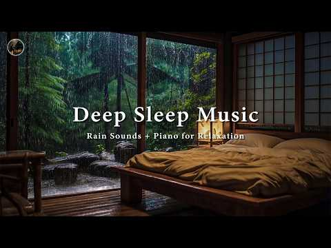
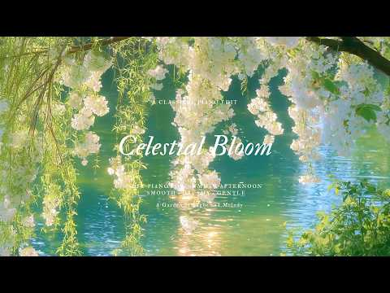
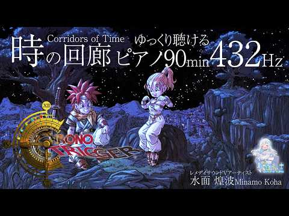
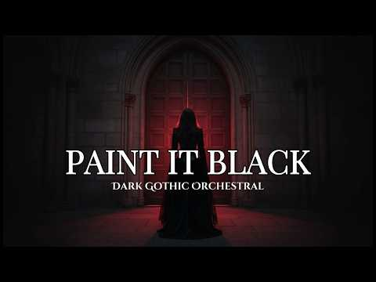

# 음악 — 성공 사례 분석: 사례별 자세히 #841–#880

`analysis.md` 의 9번 (같은 # 번호). 자동 생성 — `tools/success_analysis.py` v1.4.1 (2026-10-18 08:09 UTC). ※ 연구·교육용 — 투자 권유가 아님.

### 841. Chinese Zen Music🎵: Bamboo flute, erhu & Guzheng ∣ Relaxing music @ZenFlute-o5f2h

- https://www.youtube.com/watch?v=6UtPuJcUsyI · ZenFlute · 구독자 32,700 · 조회수 1,040,137 (×31.8, 하루 7,489.4) · 좋아요 15,773 (1.5%) · 90.2분 · 2026-06-01 · 주제 묶음 6. 피아노·클래식·연주곡 · 형식 음악 (그 밖 모양 — 한 편짜리 BGM 등) · 폴더 `W_6UtPuJcUsyI` (웹 승인)
- 썸네일: 
- 설명 앞부분: Welcome to Channel " Zen Flute " 🌙Let the soothing sounds of Bamboo Flute and Guzheng transport you to a world of peace and relaxation. This 1-hour instrumental music is specially designed to help with deep sleep, stress relief, and meditation. 🎶 🎧 Why Listen? ❤ Promotes deep relaxation & stress re…
- 대본 없음 (설명) — 음성인식이 끝나면 도입부·흐름이 들어감
- 댓글 0/728 (다 받지 못함): 좋은 점 — 영상 0 · 감사·응원 0 · 더 알고 싶은 것 0 · 아쉬운 점 — 영상 0 · 반박·불만 — 의견 다름 0 · 정치·사회 0 · 경험 공유 0 · 구독·다음 기대 0

### 842. 하루 끝에 듣는 힐링 발라드 🎶 광고 없는 감성 명곡 모음｜백지영, 성시경, 더원, 이승기, 김필, 양파, 임창정 - 명곡 모음 광고없음

- https://www.youtube.com/watch?v=85w3xNdP09U · N Melody Ballad - 추억발라드 · 구독자 23,800 · 조회수 755,411 (×31.7, 하루 5,702.7) · 좋아요 1,873 (0.2%) · 49.8분 · 2026-06-07 · 주제 묶음 9. 가요·발라드·트로트 · 형식 플레이리스트·모음 (여러 곡) · 폴더 `W_85w3xNdP09U` (웹 승인)
- 썸네일: 
- 같은 채널 평소 대비 ×125.3 (채널 최근 롱폼 중앙값 6,031회) · 평소 영상: 하루 종일 듣기 좋은 노래🎈🎈일할때 듣기좋은 발라드 추천 광고없는 노래모음🎈🎈양파, 이승… (6,031회) / 하루 끝에 듣는 힐링 발라드 🎶 광고 없는 감성 명곡 모음｜백지영, 성시경, 더원, 이승… (6,282회)
- 대본 없음 (없음) — 음성인식이 끝나면 도입부·흐름이 들어감
- 댓글 138/138: 좋은 점 — 영상 0 · 감사·응원 2 · 더 알고 싶은 것 3 · 아쉬운 점 — 영상 6 · 반박·불만 — 의견 다름 1 · 정치·사회 0 · 경험 공유 2 · 구독·다음 기대 0
  - 감사·응원 👍1 “잘듣고있어요~ 감사해요~❤”
  - 감사·응원 👍0 “늘ㆍ감사합니다 ㆍ🎉🎉🎉엄지척입니다”
  - 더 알고 싶은 것 👍6 “노래 너무 잘들었습니다! 혹시 물고기자리 누구 커버에요? 너무 선곡이 좋으셔서 궁금합니다”
  - 더 알고 싶은 것 👍3 “가수랑 제목 타임테이블 알 수 있을까요?”
  - 아쉬운 점 — 영상 👍8 “광고없다더니 광고가 많네요”
  - 아쉬운 점 — 영상 👍5 “걍 광고가 있다고 해도 듣고 싶으면 들을텐데...구지 구지 광고 없다고..”
  - 경험 공유 👍4 “광고 조금은 이해 하려고 했었는데 너무많아~”
  - 경험 공유 👍4 “엄마 불쌍한 울엄마 가슴이 미어지도록 사랑해 내가 정말 나쁜딸이야 미안해 엄마 제발 오래오래 살아 아빠도”

### 843. The Beatles on Abbey Road ∣ Greatest Hits in Quartet [No Mid-Roll Ads]

- https://www.youtube.com/watch?v=VGZ-Xzu73gg · Golden Harmony · 구독자 19,500 · 조회수 610,589 (×31.3, 하루 5,650.8) · 좋아요 9,051 (1.5%) · 114.4분 · 2026-07-02 · 주제 묶음 기타 · 형식 음악 (그 밖 모양 — 한 편짜리 BGM 등) · 폴더 `W_VGZ-Xzu73gg` (웹 승인)
- 썸네일: 
- 챕터: 0:00 I Will · 2:59 Hey Jude · 6:29 Yesterday · 9:44 In My Life · 13:02 Michelle · 15:50 And I Love Her · 19:24 All You Need is Love · 22:26 Let It Be · 25:41 Penny Lane · 28:49 I Want to Hold Your Hand · 31:56 Love · 35:08 Across the Universe · 38:43 Norwegian Wood · 41:43 Blackbird · 44:11 Here Comes the Sun · 47:16 Yellow Submarine · 50:26 Ob-La-Di, Ob-La-Da · 53:47 Oh! Darling
- 설명 앞부분: Experience the timeless magic of The Beatles reimagined in a beautiful quartet setting on the iconic Abbey Road. (Piano, Viola, Cello & Double Bass) This special collection features some of the most beloved Beatles classics, reimagined for piano, viola, cello, and double bass with a warm blend of j…
- 대본 없음 (설명) — 음성인식이 끝나면 도입부·흐름이 들어감
- 댓글 0/300 (다 받지 못함): 좋은 점 — 영상 0 · 감사·응원 0 · 더 알고 싶은 것 0 · 아쉬운 점 — 영상 0 · 반박·불만 — 의견 다름 0 · 정치·사회 0 · 경험 공유 0 · 구독·다음 기대 0

### 844. 🍀 7월, 바다를 보며 들으니 이 노래 너무 좋다 ☕ 커피 한 잔과 함께하는 7080 추억의 올드팝 🎧

- https://www.youtube.com/watch?v=q3iHXzi_Qn0 · 행운을담은 올드팝   · 구독자 6,160 · 조회수 191,460 (×31.1, 하루 1,782.2) · 좋아요 2,109 (1.1%) · 85.7분 · 2026-07-02 · 주제 묶음 9. 가요·발라드·트로트 · 형식 플레이리스트·모음 (여러 곡) · 폴더 `W_q3iHXzi_Qn0` (웹 승인)
- 썸네일: 
- 챕터: 0:00 Morning Mist on the Bay · 3:34 Summer Beside the Sea · 8:03 Footprints by the Summer Sea · 13:23 By the Dunes and the Radio · 17:42 When the Sea Breeze Turned th… · 21:40 Where the Seabirds Fly · 26:15 A Picture Filled with Summer · 30:15 A Shell That Remembers · 33:40 Treasure Washed Ashore · 37:48 The Breeze That Stayed Until … · 42:51 Replay 🔄
- 설명 앞부분: 🎧 행운을 담은 7080 올드팝 🎶 좋은 아침입니다. ☀️🌊 7월의 푸른 아침, 창문 너머로 반짝이는 바다가 펼쳐지고, 따뜻한 햇살과 시원한 바람이 조용히 하루를 시작하고 있습니다. 따뜻한 커피 한 잔, 은은하게 스며드는 오래된 노래, 그리고 잠시 쉬어갈 수 있는 여유. 7월에 다시 듣는 이 노래들은 마음속에 오래 머물던 추억을 조용히 다시 불러오는 것 같습니다. 잠시 모든 걱정을 내려놓고, 그 시절 함께 웃었던 사람들과 여름 바람처럼 남아 있는 기억들을 천천히 떠올려 보세요. 오늘 이 음악이 당신의 아침을 조금 더 따뜻하게, 평…
- 같은 채널 평소 대비 ×13.2 (채널 최근 롱폼 중앙값 14,525회) · 평소 영상: 🍀 8월, 듣는 순간 이 노래 진짜 좋다 ☕ 커피 한 잔과 하루 종일 듣게 되는 가을 올… (14,525회) / 🍀 9월, 잔잔한 가을 팝송 첫 곡부터 너무 좋다 ☕ 커피 한 잔과 떠나는 가을 기차여행… (15,490회)
- 대본 없음 (설명) — 음성인식이 끝나면 도입부·흐름이 들어감
- 댓글 160/160: 좋은 점 — 영상 3 · 감사·응원 24 · 더 알고 싶은 것 2 · 아쉬운 점 — 영상 0 · 반박·불만 — 의견 다름 0 · 정치·사회 0 · 경험 공유 1 · 구독·다음 기대 2
  - 좋은 점 — 영상 👍5 “주말 아침에 듣기 너무 좋네요 비도 오고 차분한 목소리가 듣기 좋네요❤❤❤”
  - 좋은 점 — 영상 👍3 “소프트한 목소리와 서사시 같은 가사가 휴일 아침에 듣기 좋아요 가수 이름을 알수 있을까요?”
  - 감사·응원 👍44 “시골에 귀촌한지 3년여가 되어 가는데 테라스에서 커피 타임 하면서 긴시간 마냥 듣고 있네요. 마음을 평온하게 하는 음악이라서 ~ 좋은음악 만들어 주셔 감사합니다^^”
  - 감사·응원 👍8 “책한권 손에들고 차분한음과 마음의 평온을 느끼는 주말아침이네요 나게겐 이또한 귀한시간입니다 감사합니다”
  - 더 알고 싶은 것 👍12 “혹시 흘러나오는 여자 목소리 가수이름 알수있을까요? 엄마가 궁금해하셔서요ㅠ”
  - 더 알고 싶은 것 👍3 “소프트한 목소리와 서사시 같은 가사가 휴일 아침에 듣기 좋아요 가수 이름을 알수 있을까요?”
  - 경험 공유 👍4 “목소리도 노래도 너무 스윗하고 좋아서 계속 듣다가 갑자기 가수 이름이 궁금해졌는데, 댓글 보니 AI가수라고 하셔서 빵터졌습니다. 저도 오프라인에서 버스킹하며 취미로 노래하는 사람인데 AI가 이렇게 노래를 잘하니 가수들 다 굶어죽겠네요 ㅎㅎㅎ 너무 좋아서 한수 배우고 …”
  - 구독·다음 기대 👍3 “독일 함부르크에서 60대 새내기 할머니가 구독하고 잘 듣고 있습니다.”
  - 구독·다음 기대 👍3 “분위기가 좋아서 편안하게 음악 잘 들었습니다.. 구독 좋아요 알림설정하고 다음에 또 올께요...감사합니다.”

### 845. QUIET WITH JESUS - Instrumental Worship Music For Prayer

- https://www.youtube.com/watch?v=2JsArLBjn70 · One Thing · 구독자 17,700 · 조회수 549,891 (×31.1, 하루 4,019.7) · 좋아요 6,675 (1.2%) · 60.3분 · 2026-06-03 · 주제 묶음 6. 피아노·클래식·연주곡 · 형식 음악 (그 밖 모양 — 한 편짜리 BGM 등) · 폴더 `W_2JsArLBjn70` (웹 승인)
- 썸네일: 
- 설명 앞부분: QUIET WITH JESUS - Instrumental Worship Music For Prayer It is our heart and desire to help other people have their own personal encounter with God through worship and music. Every song was created to help people encounter God's presence. Produced by Trinus Studio ∣ Levi Aguiar The mission of One T…
- 대본 없음 (설명) — 음성인식이 끝나면 도입부·흐름이 들어감
- 댓글 0/119 (다 받지 못함): 좋은 점 — 영상 0 · 감사·응원 0 · 더 알고 싶은 것 0 · 아쉬운 점 — 영상 0 · 반박·불만 — 의견 다름 0 · 정치·사회 0 · 경험 공유 0 · 구독·다음 기대 0

### 846. Sky - 영원 ∣ 여성보컬 COVER ∣ 다시 들어도 가슴이 무너지는 명곡

- https://www.youtube.com/watch?v=ETq8E35CSwk · 연애상황극 · 구독자 11,100 · 조회수 343,808 (×31.0, 하루 2,147.5) · 좋아요 1,472 (0.4%) · 4.6분 · 2026-05-11 · 주제 묶음 12. 커버·노래 부르기 · 형식 커버·직접 부른 노래 · 폴더 `W_ETq8E35CSwk` (웹 승인)
- 썸네일: 
- 설명 앞부분: Sky - 영원을 맑고 애절한 여성보컬 감성으로 다시 담아낸 COVER입니다. 원곡이 가진 압도적인 감정선과 시간이 지나도 잊히지 않는 멜로디를 바탕으로, Grand Piano와 Cinematic Strings, 그리고 후반부로 갈수록 깊어지는 Rock Ballad 편곡으로 더욱 드라마틱하게 표현해봤습니다. 처음에는 차분한 내레이션과 섬세한 보컬로 시작해, 점점 커지는 그리움과 후회, 그리고 마지막 클라이맥스에서 터지는 강한 고음으로 곡의 감정을 끝까지 끌어올렸습니다. 행복했던 기억, 다시 만날 수 없을 것 같은 사람, 그래도 끝…
- 대본 없음 (설명) — 음성인식이 끝나면 도입부·흐름이 들어감
- 댓글 0/179 (다 받지 못함): 좋은 점 — 영상 0 · 감사·응원 0 · 더 알고 싶은 것 0 · 아쉬운 점 — 영상 0 · 반박·불만 — 의견 다름 0 · 정치·사회 0 · 경험 공유 0 · 구독·다음 기대 0

### 847. 주부들이 엄선한 감성 팝송 Best 26 ∣ EverPop 레트로 팝 컬렉션 ∣ 7080 올드팝송 ∣ 추억 소환 팝송모음 ∣ 가슴이 따뜻해지는 명곡 Old Po…

- https://www.youtube.com/watch?v=JZH9pZhtl9I · 추억의 올드팝 EverPop · 구독자 15,800 · 조회수 488,763 (×30.9, 하루 5,433.1) · 좋아요 0 (0.0%) · 97.8분 · 2026-07-20 · 주제 묶음 9. 가요·발라드·트로트 · 형식 플레이리스트·모음 (여러 곡) · 폴더 `W_JZH9pZhtl9I` (웹 승인)
- 썸네일: 
- 설명 앞부분: 주부들이 엄선한 감성 팝송 Best 26 ∣ EverPop 레트로 팝 컬렉션 ∣ 7080 올드팝송 ∣ 추억 소환 팝송모음 ∣ 가슴이 따뜻해지는 명곡 Old Pop Playlist 저희의 동의 없이 음악을 도용할 수 없습니다. 위반 시 경고를 보내드립니다.
- 같은 채널 평소 대비 ×23.1 (채널 최근 롱폼 중앙값 21,186회) · 평소 영상: 지친 하루 끝 4050이 가장 아끼는 힐링 팝송 ∣ EverPop 심야 감성팝 ∣ 708… (22,265회) / 엄마도 소녀였던 그 시절로 ∣ EverPop 7080 추억의 감성 팝송 Best ∣ 40… (20,106회)
- 대본 없음 (설명) — 음성인식이 끝나면 도입부·흐름이 들어감
- 댓글 125/125: 좋은 점 — 영상 0 · 감사·응원 17 · 더 알고 싶은 것 2 · 아쉬운 점 — 영상 2 · 반박·불만 — 의견 다름 0 · 정치·사회 0 · 경험 공유 1 · 구독·다음 기대 0
  - 감사·응원 👍22 “😊 와우~~~^^ 넘 좋아요. 몇십년만에 듣는중임다. 세월이 흘렀는데도 이 기분은, 똑같이 설레고 . 기쁘고 행복하게 잘듣습니다. 감사합니당”
  - 감사·응원 👍20 “그리워지네요 그시절이~~^^ 감사합니다 덕분에 잘듣고있지요~~^^♡♡♡🎉🎉🎉😅😅😅”
  - 더 알고 싶은 것 👍1 “제목 좀 알려주세요 다 너무 좋아용 !!”
  - 더 알고 싶은 것 👍0 “노래 재목들 좀 알 수 있을까요?”
  - 아쉬운 점 — 영상 👍5 “팝송을 즐겨 듣고 있는데 가사는 자막으로 나오고 들어보면 기억 나는 부분이 많이 있는데 제목이 기억안나는게 아쉬워요~항상 감사합니다”
  - 아쉬운 점 — 영상 👍1 “팝송 제목이 없는게 아쉽네요”

### 848. 조선힙합 OFFICIAL 발표곡 중 인기곡만 모았습니다.

- https://www.youtube.com/watch?v=fjjiznDoNEQ · 조선힙합 Official · 구독자 28,600 · 조회수 884,654 (×30.9, 하루 6,538.6) · 좋아요 7,322 (0.8%) · 28.4분 · 2026-06-05 · 주제 묶음 11. 힙합·R&B·EDM · 형식 한 곡 (뮤직비디오·음원·가사) · 폴더 `W_fjjiznDoNEQ` (웹 승인)
- 썸네일: 
- 챕터: 0:00 살다보니 · 3:03 인연 · 6:27 윤회 · 11:11 월매송 · 15:37 인연은달을따라지고 · 19:47 가시리 · 24:23 몽혼
- 설명 앞부분: 전통은 오래된 것이 아니라, 지금도 우리 혈관 속에 살아 숨 쉬는 리듬입니다. 음원으로 발표된 곡들만 모아서 구성했습니다. 🎧 Timeline (타임라인) linktr.ee/joseonhiphop spotify open.spotify.com/artist/6U768dSunJc4oZ4NFw04WY music-flo.com/detail/album/455700472/albumtrack Instagram instagram.com/joseonhiphoptv tiktok Business Contact
- 같은 채널 평소 대비 ×120.1 (채널 최근 롱폼 중앙값 7,368회) · 평소 영상: 신이있다면 OFFICIAL MV 1시간 연속듣기 (7,368회) / 그대곁에 OFFICIAL MV 1시간 연속듣기 (8,086회)
- 대본 없음 (설명) — 음성인식이 끝나면 도입부·흐름이 들어감
- 댓글 1,039/1,039: 좋은 점 — 영상 20 · 감사·응원 121 · 더 알고 싶은 것 19 · 아쉬운 점 — 영상 9 · 반박·불만 — 의견 다름 6 · 정치·사회 1 · 경험 공유 22 · 구독·다음 기대 14
  - 좋은 점 — 영상 👍189 “조선힙합 멜로디도 좋지만 모든 곡들의 가사가 너무 마음에 와닿습니다. 좋은 노래 만들어줘서 감사합니다. 위안이 되는 따뜻한 노래들.”
  - 좋은 점 — 영상 👍53 “사랑도돈도 우정도 다지나갑니다 우리들의 인생을노래하네요ᆢ 한번쯤경험했던 중년들은 더 가슴에 와닿네요”
  - 감사·응원 👍189 “조선힙합 멜로디도 좋지만 모든 곡들의 가사가 너무 마음에 와닿습니다. 좋은 노래 만들어줘서 감사합니다. 위안이 되는 따뜻한 노래들.”
  - 감사·응원 👍113 “와~ 진짜 들으면 들을수록 이게 뭐지? 라는 생각밖에 안들어요 어떤 노래는 눈물을 빼고 어떤 노래는 가슴을 후벼파고 또 어떤 노래는 저의 어깨를 살포시 토닥여주고.. 아~ 좋다 어찌하여 저의 알고리즘에 들어오셨나요 이유가 뭐든, 과정이 어떻든 고맙습니다 🙏”
  - 더 알고 싶은 것 👍3 “항상 응원합니다 앞으로도 좋은음악 잘부탁드립니다~~”
  - 더 알고 싶은 것 👍2 “조선힙합 노래 다 좋지만 발라드쪽 노래 진짜 너무좋아요오ㅜㅜ플리좀 만들어주세요오..❤❤❤”
  - 아쉬운 점 — 영상 👍3 “음악에 목소리가 너무 좋아요 😍😍😍😍😍”
  - 아쉬운 점 — 영상 👍2 “정말좋은 노래네요 중년들어 자꾸 아쉬움만남내요 다들 더 나아가봅시다”
  - 반박·불만 — 의견 다름 👍3 “눈물이 난다..난 이기적이게 살았구나..그들의 삶은 당연한게 아닌데.. 미안합니다”
  - 반박·불만 — 의견 다름 👍2 “이런 말도 안되는 좋은곡들을. 이렇게 다작을 만들수 있죠? 우주인인가요.? 말도 안되는 리듬감은 어디서 온것인지.. 최고입니다..”
  - 경험 공유 👍57 “와..이거 뭐지...멍한 감흥.. 꿈쩍도 않는 내가 움직인다... 정말 완벽한 뮤지션이다... 세렌디피티 는 바로 이런것~ 함께 갑시다...영원히~~~~!!”
  - 경험 공유 👍53 “사랑도돈도 우정도 다지나갑니다 우리들의 인생을노래하네요ᆢ 한번쯤경험했던 중년들은 더 가슴에 와닿네요”
  - 구독·다음 기대 👍110 “듣다보니. 가슴에 스며들어 구독하고. 계속 듣게 되네요 60후반이지만 요즘 젊은이들 조선힙합이 꽂치네요 좋은음악. ~^^❤❤❤”
  - 구독·다음 기대 👍8 “첫 곡 듣고 구독합니다~노래가 마음을 울리고 응어리를 해소 시켜 줍니다..❤”

### 849. 😭 나훈아, 아들의 노래를 듣고 끝내 눈물을 흘리다… 가족 모두가 오열한 순간25

- https://www.youtube.com/watch?v=keP33Q5JU_A · 나훈아AI Korean song · 구독자 1,450 · 조회수 44,645 (×30.8, 하루 467.7) · 좋아요 510 (1.1%) · 6.5분 · 2026-07-14 · 주제 묶음 기타 · 형식 음악 (그 밖 모양 — 한 편짜리 BGM 등) · 폴더 `W_keP33Q5JU_A` (웹 승인)
- 썸네일: 
- 설명 앞부분: 💖 부모님의 사랑과 가족의 소중함을 다시 한번 느끼게 해주는 감동의 무대입니다. 한 곡의 노래가 가족의 마음을 하나로 이어 주고, 깊은 감동과 따뜻한 사랑을 전합니다. 부모님을 향한 감사와 그리움, 그리고 가족의 소중한 추억이 담긴 아름다운 순간을 함께 감상해 보세요.
- 같은 채널 평소 대비 ×79.2 (채널 최근 롱폼 중앙값 564회) · 평소 영상: 【눈물주의😭】나훈아의 아들을 위한 노래에 장윤정도 눈물… “목소리가 정말 아버지를 닮았다… (601회) / 😭❤️【나훈아 × 아들】눈물의 무대… 아버지와 아들이 함께 부른 노래에 두 사람의 눈물이… (526회)
- 대본 없음 (설명) — 음성인식이 끝나면 도입부·흐름이 들어감
- 댓글 25/25: 좋은 점 — 영상 0 · 감사·응원 4 · 더 알고 싶은 것 0 · 아쉬운 점 — 영상 0 · 반박·불만 — 의견 다름 0 · 정치·사회 2 · 경험 공유 0 · 구독·다음 기대 0
  - 감사·응원 👍10 “예서양노래잘합이다연에인들모두뭉쳐민주주의대통령님을위해노래로만이위로해주새요항상감사합니다.대한민국만새.”
  - 감사·응원 👍3 “나훈아씨와는 음색이 다르지만 너무 잘하네요. 이제부터는 더 늦기전에 사랑하는 자식들에게 사랑을 베풀면서 사시길... 서로 응어리가 있으면 푸세요. 더 늦기전에 후회가 마음속에 가라앉지 않도록...힘내세요.”
  - 정치·사회 👍10 “예서양노래잘합이다연에인들모두뭉쳐민주주의대통령님을위해노래로만이위로해주새요항상감사합니다.대한민국만새.”
  - 정치·사회 👍1 “남진오빠 감사합니다 🎉 대통령님 🎉존경합니다”

### 850. Anvarbek Xamroyev - Hayronman 2 (piano version)

- https://www.youtube.com/watch?v=q-oZ8xry4MM · Anvarbek Xamroyev · 구독자 32,000 · 조회수 981,232 (×30.7, 하루 10,136.9) · 좋아요 3,403 (0.4%) · 4.2분 · 2026-07-13 · 주제 묶음 6. 피아노·클래식·연주곡 · 형식 음악 (그 밖 모양 — 한 편짜리 BGM 등) · 폴더 `W_q-oZ8xry4MM` (웹 승인)
- 썸네일: 
- 설명 앞부분: To'y va marosimlar uchun tel: +99888-435-38-33
- 대본 없음 (설명) — 음성인식이 끝나면 도입부·흐름이 들어감
- 댓글 0/205 (다 받지 못함): 좋은 점 — 영상 0 · 감사·응원 0 · 더 알고 싶은 것 0 · 아쉬운 점 — 영상 0 · 반박·불만 — 의견 다름 0 · 정치·사회 0 · 경험 공유 0 · 구독·다음 기대 0

### 851. Peaceful Adventist Hymns Instrumental ∣ SDA Prayer Music for Bible Study, Rest & Worship …

- https://www.youtube.com/watch?v=tj1FpWQsyCg · Adventist Hymns & Worship · 구독자 37,500 · 조회수 1,138,659 (×30.4, 하루 7,074.9) · 좋아요 19,086 (1.7%) · 61분 · 2026-05-10 · 주제 묶음 6. 피아노·클래식·연주곡 · 형식 긴 한 곡·반복 (N시간) · 폴더 `W_tj1FpWQsyCg` (웹 승인)
- 썸네일: 
- 설명 앞부분: 🎶 SDA Hymnal Songs App for iPhone & iPad: Search SDA hymns by title, number, first line, or lyrics. Read verses, view sheet music, and listen to worship music anytime. Using the app is also a way to support this music ministry and future hymnal resources. ❤️ Support Our Music Enjoying these hymns? …
- 대본 없음 (설명) — 음성인식이 끝나면 도입부·흐름이 들어감
- 댓글 0/565 (다 받지 못함): 좋은 점 — 영상 0 · 감사·응원 0 · 더 알고 싶은 것 0 · 아쉬운 점 — 영상 0 · 반박·불만 — 의견 다름 0 · 정치·사회 0 · 경험 공유 0 · 구독·다음 기대 0

### 852. GOD IN ME - Soaking Worship Instrumental Presence of God ∣ QUIET TIME WITH GOD ∣ Living W…

- https://www.youtube.com/watch?v=L-SoDe2nKoE · Calm Divine Flow · 구독자 21,100 · 조회수 637,833 (×30.2, 하루 3,712.7) · 좋아요 9,507 (1.5%) · 63.4분 · 2026-04-29 · 주제 묶음 6. 피아노·클래식·연주곡 · 형식 정보·해설 (그 밖) · 폴더 `W_L-SoDe2nKoE` (웹 승인)
- 썸네일: 
- 설명 앞부분: GOD IN ME - Soaking Worship Instrumental Presence of God ∣ QUIET TIME WITH GOD ∣ Living With God Welcome to Calm Divine Flow — a sacred space to refresh your soul and dwell in God’s presence. We create gentle worship instrumentals, soaking prayer music, and heavenly atmospheres for deep meditation,…
- 대본 없음 (설명) — 음성인식이 끝나면 도입부·흐름이 들어감
- 댓글 0/213 (다 받지 못함): 좋은 점 — 영상 0 · 감사·응원 0 · 더 알고 싶은 것 0 · 아쉬운 점 — 영상 0 · 반박·불만 — 의견 다름 0 · 정치·사회 0 · 경험 공유 0 · 구독·다음 기대 0

### 853. BEST AMAPIANO MIX 2026 ∣ 1hr Of Deep House Amapiano Mix 35 ∣ Top New Amapiano Songs ∣ Dee…

- https://www.youtube.com/watch?v=3-c885KEOaM · AMAPIANO SANCTUARY · 구독자 19,200 · 조회수 578,810 (×30.1, 하루 3,897.7) · 좋아요 4,275 (0.7%) · 65.5분 · 2026-05-22 · 주제 묶음 6. 피아노·클래식·연주곡 · 형식 긴 한 곡·반복 (N시간) · 폴더 `W_3-c885KEOaM` (웹 승인)
- 썸네일: 
- 설명 앞부분: BEST AMAPIANO MIX 2026 ∣ 1hr Of Deep House Amapiano and Afro House Mix 35 ∣ Top New Amapiano Songs Dive into the ultimate 2-hour journey through the hottest Amapiano, Deep House, and Afro House sounds of 2026! This mix is packed with infectious log drums, soulful piano melodies, deep basslines, and…
- 대본 없음 (설명) — 음성인식이 끝나면 도입부·흐름이 들어감
- 댓글 0/137 (다 받지 못함): 좋은 점 — 영상 0 · 감사·응원 0 · 더 알고 싶은 것 0 · 아쉬운 점 — 영상 0 · 반박·불만 — 의견 다름 0 · 정치·사회 0 · 경험 공유 0 · 구독·다음 기대 0

### 854. DUNE Music for Meditation, Rest & Focus ∣ 3 Hours ∣ No Ads

- https://www.youtube.com/watch?v=qTdgu2POFlw · Empyreal Ambient · 구독자 14,700 · 조회수 443,155 (×30.1, 하루 6,722.3) · 좋아요 5,328 (1.2%) · 180분 · 2026-08-13 · 주제 묶음 1. 수면·명상·힐링 · 형식 긴 한 곡·반복 (N시간) · 폴더 `W_qTdgu2POFlw` (웹 승인)
- 썸네일: 
- 설명 앞부분: Dune-inspired ambient music for meditation and deep rest. 🎧 Best for: Studying Deep focus Reading Coding Writing Meditation This music is an original composition and is not allowed to be used for profit. Please contact me for requests. Not affiliated with Dune, Legendary Pictures, or Warner Bros. —…
- 대본 없음 (설명) — 음성인식이 끝나면 도입부·흐름이 들어감
- 댓글 0/74 (다 받지 못함): 좋은 점 — 영상 0 · 감사·응원 0 · 더 알고 싶은 것 0 · 아쉬운 점 — 영상 0 · 반박·불만 — 의견 다름 0 · 정치·사회 0 · 경험 공유 0 · 구독·다음 기대 0

### 855. 1 Hour Uplifting Morning Music ∣ Veena & Mridangam Indian Classical Ensemble ∣ Rise & Awa…

- https://www.youtube.com/watch?v=7z7ol63jaGw · Nadam · 구독자 19,300 · 조회수 578,799 (×30.0, 하루 3,851.1) · 좋아요 6,878 (1.2%) · 60.3분 · 2026-05-21 · 주제 묶음 6. 피아노·클래식·연주곡 · 형식 긴 한 곡·반복 (N시간) · 폴더 `W_7z7ol63jaGw` (웹 승인)
- 썸네일: 
- 챕터: 0:00 Welcome · 0:10 Tanpura sets the room · 4:00 Veena enters, mridangam answe… · 12:50 The ensemble finds its pulse · 21:00 Brightness builds · 29:10 Full conversation · 37:00 Kanjira speaks · 41:00 Second wave — ensemble returns · 49:00 Sustained presence · 57:30 Warm close
- 설명 앞부분: The mridangam calls. The veena responds. Rise with the sound of South India — 1 hour of uplifting morning music to awaken your senses, lift your spirit, and carry you into the day with positive energy. 🌅 PERFECT FOR Morning rituals and sunrise routines Slow yoga, breathwork, and gentle movement Pos…
- 대본 없음 (설명) — 음성인식이 끝나면 도입부·흐름이 들어감
- 댓글 0/303 (다 받지 못함): 좋은 점 — 영상 0 · 감사·응원 0 · 더 알고 싶은 것 0 · 아쉬운 점 — 영상 0 · 반박·불만 — 의견 다름 0 · 정치·사회 0 · 경험 공유 0 · 구독·다음 기대 0

### 856. [Playlist] 초록빛 싱그러운 아침에 듣는 모차르트 ∣ 독서와 사색을 위한 평온한 클래식 (Mozart Style) 🎹☀️

- https://www.youtube.com/watch?v=wMHsFC7-kUE · The Clavis · 구독자 19,800 · 조회수 593,401 (×30.0, 하루 4,479.0) · 좋아요 5,155 (0.9%) · 94.3분 · 2026-06-07 · 주제 묶음 6. 피아노·클래식·연주곡 · 형식 AI 음악 · 폴더 `W_wMHsFC7-kUE` (웹 승인)
- 썸네일: 
- 챕터: 0:00 01. Sunlight Promenade · 2:24 02. Sparkling Dew · 5:01 03. Crystal Waterdrops · 7:38 04. Golden Sunshine March · 11:02 05. Emerald Garden Wave · 13:54 06. Whisper of Light · 16:00 07. Serenade of the Sun · 18:36 08. Jupiter Dawn · 21:08 09. Golden Hour Waltz · 23:28 10. Whisper of Wind · 25:50 11. Figaro Sunlight · 28:10 12. Adagio of Light · 30:37 13. Elvira morning · 33:23 14. Emerald Horizon · 35:45 15. Serene Reflection · 38:01 16. Velvet Sonata · 41:26 17. Requiem of Light · 44:03 18. Majestic Dawn
- 설명 앞부분: The Clavis 채널에 오신 것을 환영합니다. 볼프강 아마데우스 모차르트의 영롱하고 찬란한 선율에서 영감을 받아 완성한 프리미엄 아침 클래식 플레이리스트입니다. 아침의 싱그러운 초록빛 생명력과 투명한 몰입감을 선사하기 위해, 정통 그랜드 피아노와 묵직한 현악 오케스트라 앙상블의 정교한 편곡으로 전 트랙을 유기적으로 연결했습니다. 맑은 정신을 깨우고 마음의 평온과 기억력을 돕는 모차르트 특유의 고결한 화성 구조가 당신의 소중한 아침 루틴과 새벽 독서, 사색과 차 한 잔의 시간을 한층 더 깊이 있고 품격 있게 채워줄 것입니다. ※…
- 같은 채널 평소 대비 ×24.5 (채널 최근 롱폼 중앙값 24,201회) · 평소 영상: 🍁 라흐마니노프 감성의 가을 아다지오 ∣ 저물어가는 노을의 애수 (Rachmaninoff… (24,201회) / 🎻 하이든 감성의 목가적 아침 ∣ 상쾌하게 하루를 시작하는 클래식 (Haydn Style… (24,707회)
- 대본 없음 (설명) — 음성인식이 끝나면 도입부·흐름이 들어감
- 댓글 315/315: 좋은 점 — 영상 0 · 감사·응원 59 · 더 알고 싶은 것 1 · 아쉬운 점 — 영상 0 · 반박·불만 — 의견 다름 2 · 정치·사회 0 · 경험 공유 8 · 구독·다음 기대 1
  - 감사·응원 👍40 “천상에서 듣는 음악 같습니다. 품격과 고상함이 묻어나는 클래식을 최상의 음질로 듣게 해 주셔서 감사합니다. 승승장구 하세요~”
  - 감사·응원 👍38 “새벽에 문득 열어봤는데, 마음을 눈물나도록 아름답게 여며주는 음악이 내게로 왔네요! 정말 너무 아름다운 이슬처럼 영롱한 음악에 마음은 나비되고, 감동에 전율에 행복함을 만끽합니다. 고맙고 고맙습니다❤❤❤ 고맙습니다”
  - 더 알고 싶은 것 👍1 “님들아 Sunlight Promenade이 클래식 지니뮤직에서 어떻게 처야 나오나요? 첫번째 곡이 너무좋아서요,,,”
  - 반박·불만 — 의견 다름 👍2 “오늘은 공식적(?)으로 가게 문을 닫고 하루를 쉴 수 있는 Labor Day. 늦잠을 즐기겠다 선언한 아내를 위해 근사한 브런치를 만들어 깜짝 놀래켜 주리라! 빵은? 소분해 냉동실에 넣어둔 잡곡빵과 흰빵을 저울질 하다 오늘 아침은 몸이 약간 싫어해도 아무래도 브런치엔…”
  - 경험 공유 👍4 “저도 모닝커피 한잔에 모짜르트의 감성에 젖어있는데요~ 너무 평온하고 행복합니다^^ 제가 누리고있는 모든것에 감사할 따름입니다♡♡♡”
  - 경험 공유 👍2 “오늘은 공식적(?)으로 가게 문을 닫고 하루를 쉴 수 있는 Labor Day. 늦잠을 즐기겠다 선언한 아내를 위해 근사한 브런치를 만들어 깜짝 놀래켜 주리라! 빵은? 소분해 냉동실에 넣어둔 잡곡빵과 흰빵을 저울질 하다 오늘 아침은 몸이 약간 싫어해도 아무래도 브런치엔…”
  - 구독·다음 기대 👍1 “김과 양 ? 이게 다일까요? 기대됩니다.”

### 857. 잘 지내💬 아직 네가 있어 / I Hope You’re Doing Well ∣ Sad Korean Ballad

- https://www.youtube.com/watch?v=PSnEIoFQB-0 · MusicSong · 구독자 7,390 · 조회수 220,334 (×29.8, 하루 1,320.7) · 좋아요 983 (0.4%) · 4.1분 · 2026-05-04 · 주제 묶음 기타 · 형식 음악 (그 밖 모양 — 한 편짜리 BGM 등) · 폴더 `W_PSnEIoFQB-0` (웹 승인)
- 썸네일: 
- 설명 앞부분: 잘 지내? 가끔은 내 생각도 나니. 사랑은 이미 끝났지만, 내 하루 어딘가엔 아직 네가 남아 있어. 바쁜 하루 끝에도 문득 떠오르는 사람, 잊으려 할수록 더 선명해지는 기억, 그리고 언젠가 우연히 마주치면 아무렇지 않게 건네고 싶은 한마디. “오랜만이야, 잘 지내고 있지?” 이 노래는 아직 완전히 보내지 못한 마음을 천천히 내려놓는 이별 발라드입니다. Hope this song stays with you quietly tonight. 💬 마음에 남는 가사가 있다면 댓글로 남겨주세요. If one line stayed with yo…
- 같은 채널 평소 대비 ×548.1 (채널 최근 롱폼 중앙값 402회) · 평소 영상: 진짜 좋아해 (Really Like You) (402회) / 눈물이 바다가 되어 ∣ Tears Become the Sea ∣ 다시 볼 수 없는 사람을… (388회)
- 대본 없음 (설명) — 음성인식이 끝나면 도입부·흐름이 들어감
- 댓글 94/94: 좋은 점 — 영상 1 · 감사·응원 1 · 더 알고 싶은 것 1 · 아쉬운 점 — 영상 1 · 반박·불만 — 의견 다름 0 · 정치·사회 0 · 경험 공유 0 · 구독·다음 기대 0
  - 좋은 점 — 영상 👍1 “노래가 너무 좋으네요 좋은영상 즐겁게 감상합니다”
  - 감사·응원 👍1 “좋네요😊좋아요 좋아요는 몇일전에누르고 지금은 구독 누르고요😊응원합니다~~🐸🐸”
  - 더 알고 싶은 것 👍1 “남자 버젼도 부탁드립니다 👍👍”
  - 아쉬운 점 — 영상 👍1 “노래 너무 좋아요ㆍ 너무 눈물나게 슬프지만 계속 반복 듣게 됩니다ㆍAI라 너무 아쉽네요ㅠ 헤어진사람 그립게 만들지만 이제 너무지쳐 잊으려 합니다ㆍ 잘듣겠습니다ㆍ위로가됩니다❤❤🎉🎉😅”

### 858. Chopin — Nocturne Op.9 No.2 (432Hz) ∣ Soothing Piano for Sleep & Calm Night (1 Hour)

- https://www.youtube.com/watch?v=YrhvsD_nqFk · Rain Whisper Classics · 구독자 40,800 · 조회수 1,215,675 (×29.8, 하루 6,834.2) · 좋아요 14,435 (1.2%) · 61.2분 · 2026-04-23 · 주제 묶음 1. 수면·명상·힐링 · 형식 긴 한 곡·반복 (N시간) · 폴더 `W_YrhvsD_nqFk` (웹 승인)
- 썸네일: 
- 설명 앞부분: 🎹 Soothing piano music for sleep, calm, and quiet night listening. Chopin’s Nocturne Op. 9 No. 2 is presented here in a one-hour format, shaped to preserve its gentle flow and emotional warmth throughout the night. Based on the expressive performance by Aya Higuchi, this version has been carefully …
- 대본 없음 (설명) — 음성인식이 끝나면 도입부·흐름이 들어감
- 댓글 0/596 (다 받지 못함): 좋은 점 — 영상 0 · 감사·응원 0 · 더 알고 싶은 것 0 · 아쉬운 점 — 영상 0 · 반박·불만 — 의견 다름 0 · 정치·사회 0 · 경험 공유 0 · 구독·다음 기대 0

### 859. Deep Work Music – CEO Mode ∣ Strategic Clarity, Controlled Thinking & Analytical Sessions

- https://www.youtube.com/watch?v=uX6jCay0c6I · Deep Idle Room · 구독자 26,300 · 조회수 780,345 (×29.7, 하루 5,109.9) · 좋아요 10,581 (1.4%) · 92.4분 · 2026-05-18 · 주제 묶음 6. 피아노·클래식·연주곡 · 형식 음악 (그 밖 모양 — 한 편짜리 BGM 등) · 폴더 `W_uX6jCay0c6I` (웹 승인)
- 썸네일: 
- 챕터: 0:00 Build quietly. · 0:03 Most people stop · 0:10 Stay patient. · 0:15 One disciplined year · 0:30 Strategic Entry · 3:18 Controlled Thinking · 6:15 Mental Structure · 8:54 Deep Clarity · 11:33 Executive Rhythm · 14:21 Stable Direction · 17:08 Cognitive Precision · 20:17 Quiet Execution · 23:07 Analytical Focus · 26:06 Long Strategy · 29:20 Structured Decisions · 32:20 Deep Workflow · 35:10 Consistent Motion · 38:15 Clear Attention · 40:11 Controlled Momentum · 43:36 Strategic Process
- 설명 앞부분: Deep Work Music – CEO Mode designed for strategic clarity and controlled thinking. A focused session built for long, uninterrupted analytical sessions. This session is designed to support calm decision-making, structured execution, and long periods of focused cognitive work. The sound remains deep,…
- 대본 없음 (설명) — 음성인식이 끝나면 도입부·흐름이 들어감
- 댓글 0/470 (다 받지 못함): 좋은 점 — 영상 0 · 감사·응원 0 · 더 알고 싶은 것 0 · 아쉬운 점 — 영상 0 · 반박·불만 — 의견 다름 0 · 정치·사회 0 · 경험 공유 0 · 구독·다음 기대 0

### 860. Chandrashekara Pahimam ∣ Lord Shiva Meditation Music ∣ Powerful Healing Mantra ∣ Satya De…

- https://www.youtube.com/watch?v=9sk0msSGgfA · Satya Devotionals         · 구독자 3,390 · 조회수 100,518 (×29.6, 하루 1,960.4) · 좋아요 506 (0.5%) · 6.8분 · 2026-08-28 · 주제 묶음 1. 수면·명상·힐링 · 형식 음악 (그 밖 모양 — 한 편짜리 BGM 등) · 폴더 `W_9sk0msSGgfA` (웹 승인)
- 썸네일: 
- 설명 앞부분: Chandrashekara Pahimam ∣ Lord Shiva Meditation Music ∣ Powerful Healing Mantra ∣ Satya Devotionals Experience the divine energy with "Chandrashekara Pahimam," a powerful Lord Shiva meditation music and healing mantra brought to you by Satya Devotionals. This divine Shiva chant is designed to bring …
- 대본 없음 (설명) — 음성인식이 끝나면 도입부·흐름이 들어감
- 댓글 0/23 (다 받지 못함): 좋은 점 — 영상 0 · 감사·응원 0 · 더 알고 싶은 것 0 · 아쉬운 점 — 영상 0 · 반박·불만 — 의견 다름 0 · 정치·사회 0 · 경험 공유 0 · 구독·다음 기대 0

### 861. Study Focus Enhancement ∣ Classical Music for Deep Concentration

- https://www.youtube.com/watch?v=hUUBG_Nlwh4 · Classical Mind · 구독자 22,600 · 조회수 669,291 (×29.6, 하루 4,482.1) · 좋아요 10,056 (1.5%) · 139.4분 · 2026-05-22 · 주제 묶음 6. 피아노·클래식·연주곡 · 형식 음악 (그 밖 모양 — 한 편짜리 BGM 등) · 폴더 `W_hUUBG_Nlwh4` (웹 승인)
- 썸네일: 
- 설명 앞부분: Study Focus Enhancement ∣ Classical Music for Deep Concentration Feeling overwhelmed while trying to study? It's time to reclaim your focus and elevate your learning experience. With this soothing classical music, you'll find the rhythm to keep your mind anchored and distractions at bay. ✨ Enhance …
- 대본 없음 (설명) — 음성인식이 끝나면 도입부·흐름이 들어감
- 댓글 0/184 (다 받지 못함): 좋은 점 — 영상 0 · 감사·응원 0 · 더 알고 싶은 것 0 · 아쉬운 점 — 영상 0 · 반박·불만 — 의견 다름 0 · 정치·사회 0 · 경험 공유 0 · 구독·다음 기대 0

### 862. 막힌 운을 여는 산신기도｜백호 산신 가피로 액운소멸·복덕성취·재물운 발원

- https://www.youtube.com/watch?v=ez0HnQ7tuPM · 풍요와복덕의노래 · 구독자 2,480 · 조회수 73,301 (×29.6, 하루 571.3) · 좋아요 1,111 (1.5%) · 4.9분 · 2026-06-12 · 주제 묶음 1. 수면·명상·힐링 · 형식 음악 (그 밖 모양 — 한 편짜리 BGM 등) · 폴더 `W_ez0HnQ7tuPM` (웹 승인)
- 썸네일: 
- 챕터: 0:00 나무 산왕대신 산신기도 시작 · 1:00 산왕대신·산신호법성중 정근 · 2:00 가정평안과 복덕 발원 · 3:00 옴 아나자야 사바하 · 4:00 산신청·산신축원 발원 · 4:53 마무리 정근
- 설명 앞부분: 막힌 운을 여는 산신기도｜백호 산신가피로 액운소멸·복덕성취·재물운 발원 이 영상은 깊은 산 산신각에서 올리는 나무 산왕대신 산신기도 찬불가입니다. 산왕대신님과 산신호법성중께 정성으로 공양을 올리고, 가정평안과 액운소멸, 좋은 인연과 복덕이 깃들기를 발원하는 불교 기도음악입니다. 영상 속 백호와 산신각의 이미지는 막힌 운이 열리고, 어둠은 거두어지며, 마음마다 평안과 복덕의 기운이 머물기를 바라는 마음으로 제작했습니다. 이 찬불가를 듣는 모든 분들의 가정에 평안이 깃들고, 근심과 액운은 멀어지며, 좋은 인연과 복덕의 문이 열리기를 …
- 같은 채널 평소 대비 ×14.2 (채널 최근 롱폼 중앙값 5,176회) · 평소 영상: 듣기만 해도 운명이 바뀌는 칠성 기도｜우리 가족을 지켜주는 북두칠성 십이지신 수호기도 ｜… (5,176회) / 그냥 틀어만 두세요 복(福)을 부르는 소리｜마음이 편안해지고 걱정이 씻겨 내려가는 힐링 … (5,793회)
- 대본 없음 (설명) — 음성인식이 끝나면 도입부·흐름이 들어감
- 댓글 584/584: 좋은 점 — 영상 6 · 감사·응원 96 · 더 알고 싶은 것 2 · 아쉬운 점 — 영상 0 · 반박·불만 — 의견 다름 1 · 정치·사회 0 · 경험 공유 24 · 구독·다음 기대 0
  - 좋은 점 — 영상 👍3 “댓글 매번 정성스럽게 답변해주시고 기도해주시는거 정말 감사합니다. 올라오는 노래가 기분 좋은 영상 이라서 자주 듣고 있어요.😊”
  - 좋은 점 — 영상 👍2 “산왕대신님 우리가족 우리신랑 우리사남매 저에게 건강운발복 금전운재물운발복 사업번창운발복 문서계약운발복 시험합격운발복 횡재운발복 좋은귀인운발복 무병장수 풍요 만사형통 소원성취 기원합니다. 선생님 좋은 영상 노래 진심으로 감사합니다. 나무아미타불 관세음보살 🙏 💛💛💛💛💛…”
  - 감사·응원 👍9 “나무 산왕대신이여 모든일들이 만사형통 되게 해주셔서 덕분입니다 감사합니다 감사합니다 감사합니다”
  - 감사·응원 👍8 “나무석가모니불 나무석가모니불 나무시야본사석가모니불 소원성취 발원합니다 감사합니다”
  - 더 알고 싶은 것 👍1 “제발 안좋은일들 다 없애주세요 갑갑하지않게 해주세요 홧병 안걸리게해주세요 제발 살려주세요 🙏 속 터지지않게해주세요 속시원하게 막힌거 뻥 뚫어주세요 너무 답답해요너무너무너무너무 제발 모든일들이 잘 되게 해주세요 막히고 안풀리는 일들 다 잘 풀리고 다 잘 되게 해주세요 …”
  - 반박·불만 — 의견 다름 👍1 “정미생 음력10월3일강명희입니다 살길을열여주소서 산왕대신님 가피를내려주시고광명을빛을내려주소서 부부화합 좋은인연뒤게해주소서 금전의문도열어주소서 부자되달라는건아닙니다 사람답게살고십습니다”
  - 경험 공유 👍23 “요즘 들어 일이 자꾸 꼬이고 막히는 느낌이라 마음이 참 무거웠는데, 영상보니까 마음이 한결 가볍고 든든합니다. 우리 집에도평안과 복이 함께하길 간절히 발원합니다. 기분이 좋아지네요.”
  - 경험 공유 👍16 “나무 신왕대신님 도와주세요 지금제가 너무힘듭니다 집주인집이 경매로 넘어가고 저희들은 갈때가 정말없습니다 두손모아 간절히 기도드립니다 부디막힌 운뚫어지게 해주시고 우리딸 컴퓨터 자격증따게히ㅣ주시고 우리집 식구들건강하게 해주세요 간절히 두손모아 두손모아 기도드립니다”

### 863. Heartbreaking 💔 Lofi Mashup 🎧 Slowed + Reverb Songs ∣ Study, Focus & Late Night Vibes#lov…

- https://www.youtube.com/watch?v=634i1Q0C5UI · Majnukhan · 구독자 36,300 · 조회수 1,071,391 (×29.5, 하루 7,160.8) · 좋아요 4,728 (0.4%) · 15.7분 · 2026-05-21 · 주제 묶음 3. 공부·집중·작업 · 형식 음악 (그 밖 모양 — 한 편짜리 BGM 등) · 폴더 `W_634i1Q0C5UI` (웹 승인)
- 썸네일: 
- 설명 앞부분: Welcome 🤗 to world of soothing lofi music, where stress fades away, and peace takes over. This 2025 mind-relaxing lofi mix is perfect for: Deep Focus & Studying 📖 Relaxing & Meditation 🧘‍♂ Chilling After a Long Day 🌅 Peaceful Sleep & Stress Relief 😴 Let these calm beats and chill vibes take you on …
- 대본 없음 (설명) — 음성인식이 끝나면 도입부·흐름이 들어감
- 댓글 0/100 (다 받지 못함): 좋은 점 — 영상 0 · 감사·응원 0 · 더 알고 싶은 것 0 · 아쉬운 점 — 영상 0 · 반박·불만 — 의견 다름 0 · 정치·사회 0 · 경험 공유 0 · 구독·다음 기대 0

### 864. Relaxing Piano Music & Rain Sounds for Deep Sleep, Stress Relief and Anxiety - Black Scre…

- https://www.youtube.com/watch?v=e95CjJh6AWc · Relaxing Sleep Music ♪ · 구독자 23,100 · 조회수 681,689 (×29.5, 하루 3,865.8) · 좋아요 1,649 (0.2%) · 211.9분 · 2026-04-25 · 주제 묶음 2. 자연 소리·백색소음 · 형식 긴 한 곡·반복 (N시간) · 폴더 `W_e95CjJh6AWc` (웹 승인)
- 썸네일: 
- 설명 앞부분: Relaxing Piano Music & Rain Sounds for Deep Sleep, Stress Relief and Anxiety - Black Screen Music ▽ Subscribe to "Relaxing Sleep Music" ✚ Share this video on social pages (Facebook, Google+, Twitter). ✚Welcome to our channel "Relaxing Sleep Music". Any copying, duplication or partial use is strictl…
- 대본 없음 (설명) — 음성인식이 끝나면 도입부·흐름이 들어감
- 댓글 0/76 (다 받지 못함): 좋은 점 — 영상 0 · 감사·응원 0 · 더 알고 싶은 것 0 · 아쉬운 점 — 영상 0 · 반박·불만 — 의견 다름 0 · 정치·사회 0 · 경험 공유 0 · 구독·다음 기대 0

### 865. 샹송이 이렇게 까지 좋은줄 몰랐습니다. 아침부터 저녁까지 듣게되는 7080올드팝 샹송 ∣ 감성이 폭발한다

- https://www.youtube.com/watch?v=ubP0xqEZxYo · Midnight Melody Sound · 구독자 28,000 · 조회수 824,527 (×29.4, 하루 5,096.5) · 좋아요 8,847 (1.1%) · 81.5분 · 2026-05-09 · 주제 묶음 9. 가요·발라드·트로트 · 형식 정보·해설 (그 밖) · 폴더 `W_ubP0xqEZxYo` (웹 승인)
- 썸네일: 
- 챕터: 0:00 01. Valse des Pétales · 3:36 02. Vent d'Aube · 7:20 03. Creux de Tes Bras · 10:44 04. Vent m'enlace doucement · 13:57 05. Silence d'adieu · 17:07 06. Poussière d'amour · 20:29 07. Fenêtre Coréenne · 24:08 08. Rêve de rosée · 27:15 09. Étoiles au Velours · 30:46 10. Brume de han · 34:14 11. Lueur du Matin · 37:13 12. Accordéon au ralenti
- 설명 앞부분: 🌙 새벽 안개를 닮은 80년대 프랑스 샹송 ☕ 커피 한 잔과 함께, 옛 추억으로 떠나는 시간 파리의 좁은 골목길, 노란 가로등 아래 오래된 라디오에서 흘러나올 것만 같은 그 시절의 멜로디 부드러운 아코디언과 따뜻한 목소리가 만들어내는 한 편의 흑백 영화 같은 샹송을 모았습니다. 새벽이 밝아오는 창가에서, 조용한 아침 식탁에서 오늘 하루를 잔잔하게 시작해 보세요. 📍 이런 분들께 추천해요 프랑스 감성, 파리 무드를 좋아하시는 분 새벽이나 이른 아침에 잔잔한 음악을 찾으시는 분 카페에서 흘러나오는 빈티지한 음악을 사랑하시는 분 옛 추…
- 같은 채널 평소 대비 ×230.6 (채널 최근 롱폼 중앙값 3,576회) · 평소 영상: 가을의 서늘한 바람소리에 문득 샹송이 생각나요 ∣ 아련한 멜로디와 떨어지는 낙옆을 떠오르… (3,677회) / 샹송이 이렇게 좋을 수가 없습니다 아랑드롱이 한없이 사랑했던 그 음악 ∣ 마음을 울리는 … (3,474회)
- 대본 없음 (설명) — 음성인식이 끝나면 도입부·흐름이 들어감
- 댓글 283/283: 좋은 점 — 영상 3 · 감사·응원 39 · 더 알고 싶은 것 8 · 아쉬운 점 — 영상 6 · 반박·불만 — 의견 다름 1 · 정치·사회 0 · 경험 공유 14 · 구독·다음 기대 3
  - 좋은 점 — 영상 👍6 “정말 오랫만에 들어 보네요 귀에 익은 듯한 샹송, 차암 듣기 좋네요”
  - 좋은 점 — 영상 👍2 “노래 하나하나가 다 너무 좋네요.. 불어를 배웠던 추억이 새록새록..”
  - 감사·응원 👍38 “애절한 감미로움에 마음이 빠져듬니다 앞으로도 아주오래도록 잘듣고 감상하겠읍니다 고맙습니다 .”
  - 감사·응원 👍20 “안녕하세요 잘 듣고 있어요 조용하고 달콤한 목소리로 속삭이며 흐르듯이 부르는 음성이 잘 어루어져 듣는 저가 분위기가 젖어 너무 좋아요 쉬면서 즐기고 갑니다 감사합니다”
  - 더 알고 싶은 것 👍7 “노래 제목과 가수 올려주시면감사드립니다~^”
  - 더 알고 싶은 것 👍3 “너무 잘 듣고 있습니다 혹시 가사도 올려주실 수 있을까요”
  - 아쉬운 점 — 영상 👍57 “가사는 모르지만, 애절하면서 흡인력 있는 목소리가 너무 좋습니다.”
  - 아쉬운 점 — 영상 👍12 “혼란스럽게 흔들리는 마음을 스스로 감정정리 해 볼수 있는 기분이네요~~~~~~~😊”
  - 반박·불만 — 의견 다름 👍38 “80을 넘는 음악을 아는 사람도 아닌데 아득한 옛날 그리움을 노래하는 것 같네요...”
  - 경험 공유 👍19 “저도 불어불문학과 90학번입니다 오랫만에 샹송 들으니 옛추억이 새록새록합니다”
  - 경험 공유 👍7 “반가워요.저도 85학번 불어불문학과.”
  - 구독·다음 기대 👍17 “부드러운 음악속 마음도 우아해지네요 아름다운 음악 올려주셔서 감사합니다❤❤❤구독하고 자주 찾을께요😅😅😅”
  - 구독·다음 기대 👍4 “너무 감사합니다.. 구독하고 갑니다❤”

### 866. Peaceful Piano with Rain Sounds 🎶 Relaxing Sleep Music & Insomnia ☔ Meditation Music, Str…

- https://www.youtube.com/watch?v=eUslSNm96D4 · Piano Rain Retreat · 구독자 29,900 · 조회수 880,041 (×29.4, 하루 6,647.8) · 좋아요 4,444 (0.5%) · 206.7분 · 2026-06-07 · 주제 묶음 1. 수면·명상·힐링 · 형식 음악 (그 밖 모양 — 한 편짜리 BGM 등) · 폴더 `W_eUslSNm96D4` (웹 승인)
- 썸네일: 
- 설명 앞부분: Peaceful Piano with Rain Sounds 🎶 Relaxing Sleep Music & Insomnia ☔ Meditation Music, Stress Relief Welcome to the Piano Rain Retreat Channel! Are you seeking a relaxing space to relieve stress, improve your sleep, and calm your mind? Join us and discover the peaceful atmosphere created by the gent…
- 대본 없음 (설명) — 음성인식이 끝나면 도입부·흐름이 들어감
- 댓글 0/167 (다 받지 못함): 좋은 점 — 영상 0 · 감사·응원 0 · 더 알고 싶은 것 0 · 아쉬운 점 — 영상 0 · 반박·불만 — 의견 다름 0 · 정치·사회 0 · 경험 공유 0 · 구독·다음 기대 0

### 867. Chinese Sleep Music: Soft Guzheng & Ambient Pads ∣ Deep Night Calm

- https://www.youtube.com/watch?v=0ykSzpX6rzg · Lotus Echo 莲之回响 · 구독자 16,500 · 조회수 485,119 (×29.4, 하루 3,308.4) · 좋아요 6,566 (1.4%) · 240.1분 · 2026-05-24 · 주제 묶음 1. 수면·명상·힐링 · 형식 음악 (그 밖 모양 — 한 편짜리 BGM 등) · 폴더 `W_0ykSzpX6rzg` (웹 승인)
- 썸네일: 
- 설명 앞부분: Hey… welcome. The night is here, and this music is made to help everything slow down. Chinese Sleep Music: Soft Guzheng & Ambient Pads creates a peaceful nighttime atmosphere with gentle traditional melodies and soft ambient textures designed for deep rest. The delicate strings of the guzheng flow …
- 대본 없음 (설명) — 음성인식이 끝나면 도입부·흐름이 들어감
- 댓글 0/109 (다 받지 못함): 좋은 점 — 영상 0 · 감사·응원 0 · 더 알고 싶은 것 0 · 아쉬운 점 — 영상 0 · 반박·불만 — 의견 다름 0 · 정치·사회 0 · 경험 공유 0 · 구독·다음 기대 0

### 868. celestial bloom 🌿∣ dreamy piano music reflected in dreamy water celestial bloom

- https://www.youtube.com/watch?v=coDaaicD9zM · She of the Vale · 구독자 11,700 · 조회수 343,713 (×29.4, 하루 4,201.1) · 좋아요 5,535 (1.6%) · 36.4분 · 2026-07-28 · 주제 묶음 6. 피아노·클래식·연주곡 · 형식 음악 (그 밖 모양 — 한 편짜리 BGM 등) · 폴더 `W_coDaaicD9zM` (웹 승인)
- 썸네일: 
- 챕터: 0:00 The Weight of Light - Maëlle … · 2:13 Before the Storm - Dan Quinn · 4:12 The Long Way Back - Dan Quinn · 6:14 Sleepy Town - Maëlle Rousseau · 9:12 The Gift of Time - Aki Sora · 11:41 A Small Wonder - Aki Sora · 14:10 If You Stay - Anselm van de W… · 16:48 Atlas of Small Things - Dan Q… · 18:45 Repeat
- 설명 앞부분: A soft piano journey inspired by shimmering waters, cascading white blossoms, and the quiet beauty of golden summer light🌿. Like sunlight dancing across a peaceful lake, each melody gently unfolds, inviting you to slow down, breathe deeply, and embrace the stillness of nature. Whether you're readin…
- 대본 없음 (설명) — 음성인식이 끝나면 도입부·흐름이 들어감
- 댓글 0/123 (다 받지 못함): 좋은 점 — 영상 0 · 감사·응원 0 · 더 알고 싶은 것 0 · 아쉬운 점 — 영상 0 · 반박·불만 — 의견 다름 0 · 정치·사회 0 · 경험 공유 0 · 구독·다음 기대 0

### 869. Heartbreaking 💔 lofi mashup 🎶 slowed + reverb songs ∣ study, focus & late night vibes

- https://www.youtube.com/watch?v=RXYyvE4qRqs · Click Bollywood Lovers Songs · 구독자 25,800 · 조회수 754,589 (×29.2, 하루 8,391.7) · 좋아요 2,445 (0.3%) · 7.8분 · 2026-07-20 · 주제 묶음 3. 공부·집중·작업 · 형식 음악 (그 밖 모양 — 한 편짜리 BGM 등) · 폴더 `W_RXYyvE4qRqs` (웹 승인)
- 썸네일: 
- 설명 앞부분: Welcome 🙏to world of soothing lofi music, where stress fades away, and peace takes over. This 2025 mind-relaxing lofi mix is perfect for: Deep Focus & Studying 📖 Relaxing & Meditation 🧘‍♂ Chilling After a Long Day 🌅 Peaceful Sleep & Stress Relief 😴 Let these calm beats and chill vibes take you on a…
- 대본 없음 (설명) — 음성인식이 끝나면 도입부·흐름이 들어감
- 댓글 0/46 (다 받지 못함): 좋은 점 — 영상 0 · 감사·응원 0 · 더 알고 싶은 것 0 · 아쉬운 점 — 영상 0 · 반박·불만 — 의견 다름 0 · 정치·사회 0 · 경험 공유 0 · 구독·다음 기대 0

### 870. [Playlist] 여름향기 가득한 카페에서 듣기 좋은 음악 ∣ 잔잔한 감성팝 카페음악 🎧 ∣ Healing lo-fi pop ballad cafe music …

- https://www.youtube.com/watch?v=hlxPD1XBS-A · 낡은 레코드 · 구독자 8,870 · 조회수 257,637 (×29.1, 하루 1,785.6) · 좋아요 1,385 (0.5%) · 77.9분 · 2026-05-27 · 주제 묶음 1. 수면·명상·힐링 · 형식 플레이리스트·모음 (여러 곡) · 폴더 `W_hlxPD1XBS-A` (웹 승인)
- 썸네일: 
- 설명 앞부분: [Playlist] 여름향기 가득한 카페에서 듣기 좋은 음악 ∣ 잔잔한 감성팝 카페음악 🎧 ∣ Healing lo-fi pop ballad cafe music ∣ 여름 플레이리스트 📻 따뜻한 노란 조명이 비추는 겨울 카페, 창밖으로는 조용히 눈이 내려 얇은 눈송이들이 밤공기 위에 고요함을 덮어 씌우는 시간 오늘 낡은 레코드가 전하는 음악은 천천히 흐르는 발라드 · 팝 · 어쿠스틱 선율로 겨울 저녁의 숨결을 닮은 잔잔한 플레이리스트입니다. ✨🌙 창가 자리에 앉아 서두르지 않고 떨어지는 눈을 바라보며, 두 손에는 아직 따뜻함이 남아 …
- 같은 채널 평소 대비 ×25.7 (채널 최근 롱폼 중앙값 10,032회) · 평소 영상: [Playlist] 비 오는 날 혼자 조용히 듣고 싶은 음악 ∣ 잔잔한 감성팝 카페음악 … (10,188회) / [Playlist] 맑은 가을 하늘 아래 듣기 좋은 음악 ∣ 잔잔한 감성팝 카페음악 🎧 … (9,877회)
- 대본 없음 (설명) — 음성인식이 끝나면 도입부·흐름이 들어감
- 댓글 33/33: 좋은 점 — 영상 0 · 감사·응원 3 · 더 알고 싶은 것 1 · 아쉬운 점 — 영상 0 · 반박·불만 — 의견 다름 1 · 정치·사회 0 · 경험 공유 1 · 구독·다음 기대 0
  - 감사·응원 👍1 “덕분에 출퇴근길이 행복합니다. 좋은 음악 만들어줘서 감사해요.”
  - 감사·응원 👍0 “진짜 플레이리스트 그동안 너무 많이 들었는데... 이건 정말 최고입니다. 다 너무 좋아요... 너무 좋아 지인들에게 들어보라고 추천해요~~ 너무 너무 감사합니다.”
  - 더 알고 싶은 것 👍14 “우연히 듣게 됐는데 너무 상큼하고 너무 행복해져요. 제목도 알고 싶은데.. 방법 없을까요?”
  - 반박·불만 — 의견 다름 👍1 “원래 있던 음원이 아니죠? 와 대단하세요.... 우연히 듣다가 너무 행복해져서 댓글 남깁니다ㅎㅎ”
  - 경험 공유 👍13 “이 글을 읽는 모든 분들께, 지금 겪고 계신 어려움이나 걱정거리가 모두 잘 해결되기를, 그리고 모두가 멋진 하루를 보내시기를 진심으로 기도합니다!”

### 871. 【GamePiano90min】「時の回廊」クロノ・トリガーゆっくり聴く432Hz Breathing Piano Version

- https://www.youtube.com/watch?v=0sJ4qqIp3kk · 水面こは(Minamo Koha) · 구독자 21,000 · 조회수 608,110 (×29.0, 하루 3,747.8) · 좋아요 6,059 (1.0%) · 90.5분 · 2026-05-09 · 주제 묶음 6. 피아노·클래식·연주곡 · 형식 음악 (그 밖 모양 — 한 편짜리 BGM 등) · 폴더 `W_0sJ4qqIp3kk` (웹 승인)
- 썸네일: 
- 설명 앞부분: 前回、「風の憧憬/クロノ・トリガー」を演奏したらコメントで「時の回廊」もリクエストいただいたので折角ならクロノ・トリガーを続けてUPしようと思い練習してアップさせていただきました！ 前回、風の憧憬では528Hzで60分だったのですが、今回は432Hzで90分に仕上げてみました。風の憧憬と同じく作業BGMや睡眠導入に活用していたければと思います。 ・「風の憧憬」クロノ・トリガー528Hz Breathing Piano Version ようこそ、水面煌波(minamo koha)のチャンネルへ。 ゲーム音楽、周波数音楽（432Hz・528Hz）、AI画など、入口はさまざまでしょうけれど、ここで…
- 대본 없음 (설명) — 음성인식이 끝나면 도입부·흐름이 들어감
- 댓글 0/200 (다 받지 못함): 좋은 점 — 영상 0 · 감사·응원 0 · 더 알고 싶은 것 0 · 아쉬운 점 — 영상 0 · 반박·불만 — 의견 다름 0 · 정치·사회 0 · 경험 공유 0 · 구독·다음 기대 0

### 872. music for overthinkers — when the mind goes quiet ∣ deep focus playlist

- https://www.youtube.com/watch?v=IsGUh_yMxDg · StillSpace · 구독자 32,800 · 조회수 946,773 (×28.9, 하루 5,525.7) · 좋아요 12,811 (1.4%) · 85.2분 · 2026-04-30 · 주제 묶음 3. 공부·집중·작업 · 형식 플레이리스트·모음 (여러 곡) · 폴더 `W_IsGUh_yMxDg` (웹 승인)
- 썸네일: 
- 챕터: 0:00 The Weight of Stillness · 2:45 Before the Canvas · 5:30 Into the Light Within · 8:40 Eternal Gaze · 11:30 Sacred Wilderness · 14:46 The Quiet Museum · 18:03 Solitude in Amber · 21:08 Autumn Reverie · 24:18 Beneath the Infinite · 27:07 The Bench at the End of Time · 30:22 Lost in Devotion · 33:32 Where Light Becomes Sound · 36:40 Ceremony of One · 39:43 The Last Horizon · 42:37 Repeat
- 설명 앞부분: 🎨 FOCUS ∣ Deep Concentration Music for Study & Work Immerse yourself in cinematic, atmospheric music designed to help you focus deeply, eliminate distractions, and enter a state of flow. Whether you're studying, writing, coding, or working on creative projects — this playlist is your perfect compan…
- 대본 없음 (설명) — 음성인식이 끝나면 도입부·흐름이 들어감
- 댓글 0/308 (다 받지 못함): 좋은 점 — 영상 0 · 감사·응원 0 · 더 알고 싶은 것 0 · 아쉬운 점 — 영상 0 · 반박·불만 — 의견 다름 0 · 정치·사회 0 · 경험 공유 0 · 구독·다음 기대 0

### 873. 𝙥𝙡𝙖𝙮𝙡𝙞𝙨𝙩.°• 야호-!★⊹⋅ ˚💖 듣자마자 신나는 최신 여돌 플레이리스트

- https://www.youtube.com/watch?v=v_AYwiX_XgI · eon · 구독자 5,080 · 조회수 146,128 (×28.8, 하루 1,125.1) · 좋아요 526 (0.4%) · 81.8분 · 2026-06-10 · 주제 묶음 5. 운동·드라이브·신나는 · 형식 플레이리스트·모음 (여러 곡) · 폴더 `W_v_AYwiX_XgI` (웹 승인)
- 썸네일: 
- 설명 앞부분: 듣자마자 신나는 최신 여돌 플레이리스트
- 대본 없음 (설명) — 음성인식이 끝나면 도입부·흐름이 들어감
- 댓글 0/16 (다 받지 못함): 좋은 점 — 영상 0 · 감사·응원 0 · 더 알고 싶은 것 0 · 아쉬운 점 — 영상 0 · 반박·불만 — 의견 다름 0 · 정치·사회 0 · 경험 공유 0 · 구독·다음 기대 0

### 874. 🔥5 Musik Instrumen Sunda Modern yang Bikin Nagih ∣ BASS_DRUM

- https://www.youtube.com/watch?v=zIrcdA2el3w · BASS_DRUM · 구독자 16,700 · 조회수 473,543 (×28.4, 하루 2,939.8) · 좋아요 3,990 (0.8%) · 13.3분 · 2026-05-10 · 주제 묶음 6. 피아노·클래식·연주곡 · 형식 플레이리스트·모음 (여러 곡) · 폴더 `W_zIrcdA2el3w` (웹 승인)
- 썸네일: 
- 설명 앞부분: Nikmati perpaduan musik tradisional Sunda dengan sentuhan modern khas BASS_DRUM 🎶 Alunan suling Sunda, kendang jaipong, gamelan fusion, dan nuansa etnik yang menenangkan siap menemani aktivitas santai, kerja, belajar, hingga healing malam hari. Full Album : Playlist ini menghadirkan instrumen Sunda…
- 대본 없음 (설명) — 음성인식이 끝나면 도입부·흐름이 들어감
- 댓글 0/295 (다 받지 못함): 좋은 점 — 영상 0 · 감사·응원 0 · 더 알고 싶은 것 0 · 아쉬운 점 — 영상 0 · 반박·불만 — 의견 다름 0 · 정치·사회 0 · 경험 공유 0 · 구독·다음 기대 0

### 875. Paint It, Black – Dark Gothic Orchestral Cover ∣ Epic Cinematic Female Vocal Lyrics

- https://www.youtube.com/watch?v=zWArs5bT_Nc · Mimousic · 구독자 27,300 · 조회수 768,224 (×28.1, 하루 4,421.3) · 좋아요 13,973 (1.8%) · 4.5분 · 2026-04-27 · 주제 묶음 12. 커버·노래 부르기 · 형식 커버·직접 부른 노래 · 폴더 `W_zWArs5bT_Nc` (웹 승인)
- 썸네일: 
- 설명 앞부분: A haunting and dramatic reinterpretation of Paint It, Black by The Rolling Stones, reimagined by MIMOUSIC in a powerful dark gothic orchestral style. 🎵 Includes synchronized on-screen lyrics for a complete cinematic listening experience. This version transforms the iconic rock classic into a chilli…
- 대본 없음 (설명) — 음성인식이 끝나면 도입부·흐름이 들어감
- 댓글 0/408 (다 받지 못함): 좋은 점 — 영상 0 · 감사·응원 0 · 더 알고 싶은 것 0 · 아쉬운 점 — 영상 0 · 반박·불만 — 의견 다름 0 · 정치·사회 0 · 경험 공유 0 · 구독·다음 기대 0

### 876. A Peaceful Moment with God 🌿 Relaxing Christian Music ∣ Koto & Shakuhachi Instrumental Hy…

- https://www.youtube.com/watch?v=IIVkaj0R_Gk · Haven of Faith · 구독자 9,260 · 조회수 259,424 (×28.0, 하루 1,487.7) · 좋아요 3,901 (1.5%) · 45.9분 · 2026-04-26 · 주제 묶음 6. 피아노·클래식·연주곡 · 형식 커버·직접 부른 노래 · 폴더 `W_IIVkaj0R_Gk` (웹 승인)
- 썸네일: 
- 챕터: 0:00 Sweet Hour of Prayer · 3:59 Softly and Tenderly Jesus is … · 7:30 Trust and Obey · 11:15 Nearer My God To Thee · 15:10 Pass Me Not · 19:00 I Need Thee Every Hour · 22:23 Just As I Am · 26:50 In The Garden · 30:21 Jesus Paid It All
- 설명 앞부분: Spend a peaceful time with God through these beautifully arranged instrumental hymns, featuring the calming blend of koto and shakuhachi flute. The music is gentle, unhurried, and deeply reflective. Whether you’re praying, reading, or simply sitting in silence, may this music bring you peace, comfo…
- 대본 없음 (설명) — 음성인식이 끝나면 도입부·흐름이 들어감
- 댓글 0/73 (다 받지 못함): 좋은 점 — 영상 0 · 감사·응원 0 · 더 알고 싶은 것 0 · 아쉬운 점 — 영상 0 · 반박·불만 — 의견 다름 0 · 정치·사회 0 · 경험 공유 0 · 구독·다음 기대 0

### 877. (WCS2026) VGC Masters Finals Battle Music - Pokémon Champions [OST]

- https://www.youtube.com/watch?v=B9Vi8BjqFoc · RezyMania · 구독자 13,000 · 조회수 363,624 (×28.0, 하루 8,057.5) · 좋아요 5,755 (1.6%) · 5분 · 2026-09-03 · 주제 묶음 기타 · 형식 음악 (그 밖 모양 — 한 편짜리 BGM 등) · 폴더 `W_B9Vi8BjqFoc` (웹 승인)
- 썸네일: 
- 설명 앞부분: Hope you enjoy this Soundtrack of Pokémon Champions! :) ABOUT THE VIDEO Game: Pokémon Champions Music: VGC Masters (World Championship 2026) Theme Platform: Nintendo Switch 2 / Mobile Publisher: Nintendo This Song plays during the Battle Arena. You can set it as your background music for each Pokém…
- 대본 없음 (설명) — 음성인식이 끝나면 도입부·흐름이 들어감
- 댓글 0/354 (다 받지 못함): 좋은 점 — 영상 0 · 감사·응원 0 · 더 알고 싶은 것 0 · 아쉬운 점 — 영상 0 · 반박·불만 — 의견 다름 0 · 정치·사회 0 · 경험 공유 0 · 구독·다음 기대 0

### 878. Playlist ∣ 머리가 복잡할 땐 재즈부터 틀어

- https://www.youtube.com/watch?v=TYQQFFMrBr0 · 야채상회 Vege Market · 구독자 44,400 · 조회수 1,238,646 (×27.9, 하루 6,948.7) · 좋아요 19,422 (1.6%) · 105.9분 · 2026-04-23 · 주제 묶음 7. 재즈·보사노바 · 형식 AI 음악 · 폴더 `W_TYQQFFMrBr0` (웹 승인)
- 썸네일: 
- 설명 앞부분: 머릿속이 엉망진창 삐죽삐죽 If you enjoyed the video, don’t forget to hit Subscribe and Like! Your support helps us create even better content. Artwork in this video is created by VEGE MARKET. Music is created with a AI technology.
- 같은 채널 평소 대비 ×84.9 (채널 최근 롱폼 중앙값 14,597회) · 평소 영상: Playlist ∣ 일단 재즈를 틀긴 했는데 (14,597회) / Playlist ∣ 두쫀쿠 먹고 싶어서 만든 플리 (14,314회)
- 대본 없음 (설명) — 음성인식이 끝나면 도입부·흐름이 들어감
- 댓글 347/347: 좋은 점 — 영상 3 · 감사·응원 66 · 더 알고 싶은 것 2 · 아쉬운 점 — 영상 0 · 반박·불만 — 의견 다름 3 · 정치·사회 0 · 경험 공유 32 · 구독·다음 기대 2
  - 좋은 점 — 영상 👍1 “복잡할 때 듣기 좋은 플리네요... 복잡해 미치겠는데 일단 묵직하고 고요한 재즈플리가 아니라 산뜻한 재즈 들으니 좀 나아요..”
  - 감사·응원 👍77 “안녕하세요 저는 선플 달기 활동 중인 하늘중학교 3학년 학생입니다 복잡했던 머릿속이 재즈 선율 하나로 마법처럼 차분하게 정돈되는 기분인것 같아요 선곡이 정말 감각적이라 듣는 내내 마음에 평온한 위로를 받았습니다 좋은 음악 공유해 주셔서 감사해요”
  - 감사·응원 👍59 “어제파마가 직모가되엇단 댓글부터 음악까지 무거웠던 맘이 조금은 가벼워지네요~ 고맙습니다. 모두들 평온한 나날들 되시길😊❤❤”
  - 더 알고 싶은 것 👍1 “스포티파이에도 플리 만들어 주세요”
  - 경험 공유 👍233 “내일 고3 첫 중간고사..머릿속이 복잡하다 내가 과연 대학에 갈 수 있을까”
  - 경험 공유 👍4 “그래 노래나 듣자... 내가 지금 이 시간에 뭘 복잡한걸 해”
  - 구독·다음 기대 👍2 “지그재그가 마음에 쏙 드는군요 ㅎㅎ 구독하고 갑니다~”
  - 구독·다음 기대 👍0 “잘 듣고 구독하고 갑니다. 좋은하루디세요:)”

### 879. 그대 그리고 나(1988) - 소리새 ∣ Acoustic Cover ∣ 레트로카페

- https://www.youtube.com/watch?v=CMDXDnLx3QA · 레트로 카페 (Retro Cafe) · 구독자 11,600 · 조회수 322,697 (×27.8, 하루 2,082.9) · 좋아요 962 (0.3%) · 4분 · 2026-05-16 · 주제 묶음 12. 커버·노래 부르기 · 형식 커버·직접 부른 노래 · 폴더 `W_CMDXDnLx3QA` (웹 승인)
- 썸네일: 
- 설명 앞부분: 소리새의 "그대 그리고 나" 어쿠스틱 커버곡입니다. 1988년 발표한 곡입니다. ( 정현우 작사/작곡) 원곡의 완벽함과 추억에 누가 되지 않았기를 바라며.. 따뜻한 커피한잔이 생각나는 밤입니다
- 같은 채널 평소 대비 ×60.8 (채널 최근 롱폼 중앙값 5,308회) · 평소 영상: 유리벽 - 신형원 (1982) ∣ Acoustic Cover ∣ 레트로카페 (5,422회) / 인생은 미완성 - 이진관 ∣ 세월이 흐를수록 더 마음에 와닿는 노래… Acoustic C… (5,194회)
- 대본 없음 (설명) — 음성인식이 끝나면 도입부·흐름이 들어감
- 댓글 55/55: 좋은 점 — 영상 1 · 감사·응원 3 · 더 알고 싶은 것 0 · 아쉬운 점 — 영상 2 · 반박·불만 — 의견 다름 0 · 정치·사회 0 · 경험 공유 1 · 구독·다음 기대 0
  - 좋은 점 — 영상 👍17 “AI목소리가 너무너무 아름답고 듣기좋아요”
  - 감사·응원 👍3 “감사합니다.”
  - 감사·응원 👍2 “참으로 감동을 주는 음악입니다.. 살아온 긴~시간 속에 새로운 발견 이군요 악보를 구할 수는 있나요? 기타를 조금 치는데 듣고 서는 잘 안되네요.... 행복하세요^^ 감사합니다..”
  - 아쉬운 점 — 영상 👍17 “AI목소리가 너무너무 아름답고 듣기좋아요”
  - 아쉬운 점 — 영상 👍7 “요즘에 이곡 한곡만 반복해서 들어도 들어도 질리지않고. 하루의 피로가. 풀어지는. 비타민같은. 역활을 하고. 있습니다 지금까지 들엇던과는. 색다른 맛이 있습니다 너무 좋아서 행복합니다”
  - 경험 공유 👍1 “청량한 음색으로 감상하니 감회가 새롭습니다 제가 죌로. 좋아하는 곡입니다 참좋습니다”

### 880. #singer #kishan #maldhari માં મેલડી તારી કૃપા અપરંપાર #meditationmusic

- https://www.youtube.com/watch?v=by0Ok3JgV3o · Maa Sikotar Officer 1M video  · 구독자 1,670 · 조회수 46,017 (×27.6, 하루 363.4) · 좋아요 407 (0.9%) · 10.2분 · 2026-06-13 · 주제 묶음 1. 수면·명상·힐링 · 형식 음악 (그 밖 모양 — 한 편짜리 BGM 등) · 폴더 `W_by0Ok3JgV3o` (웹 승인)
- 썸네일: 
- 대본 없음 (없음) — 음성인식이 끝나면 도입부·흐름이 들어감
- 댓글 0/15 (다 받지 못함): 좋은 점 — 영상 0 · 감사·응원 0 · 더 알고 싶은 것 0 · 아쉬운 점 — 영상 0 · 반박·불만 — 의견 다름 0 · 정치·사회 0 · 경험 공유 0 · 구독·다음 기대 0

