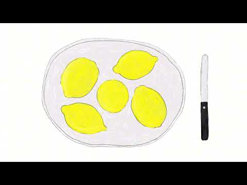
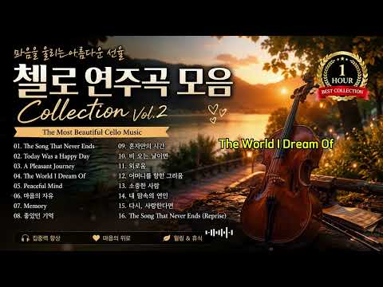
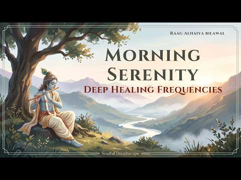
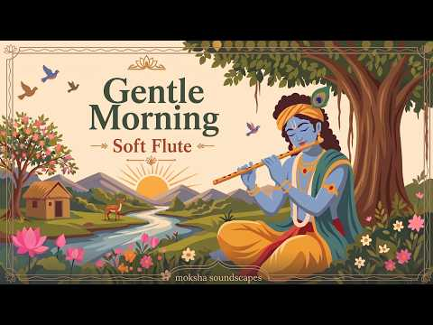
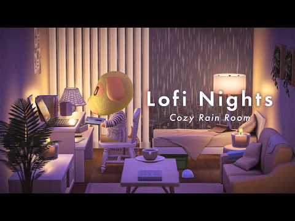
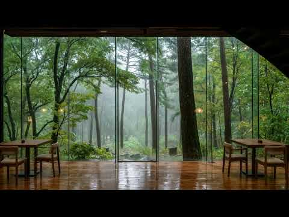

# 음악 — 성공 사례 분석: 사례별 자세히 #881–#920

`analysis.md` 의 9번 (같은 # 번호). 자동 생성 — `tools/success_analysis.py` v1.4.1 (2026-10-20 07:59 UTC). ※ 연구·교육용 — 투자 권유가 아님.

### 881. playlist ∣ 여름, 레몬과 재즈에 대하여

- https://www.youtube.com/watch?v=Gr7ZxTdL8XA · centralgrocery 중앙식품점 · 구독자 27,200 · 조회수 684,159 (×25.1, 하루 6,376.9) · 좋아요 10,515 (1.5%) · 236.8분 · 2026-07-05 · 주제 묶음 7. 재즈·보사노바 · 형식 플레이리스트·모음 (여러 곡) · 폴더 `W_Gr7ZxTdL8XA` (웹 승인)
- 썸네일: 
- 챕터: 0:00 Lemon Morning · 2:59 A Plate of Summer · 7:12 The Bright Table · 10:36 Summer Kitchen · 13:50 Citrus Mood · 17:49 Fresh Pick · 21:48 The Fruit Shop · 24:42 Homemade Afternoon · 27:20 Summer Brunch · 31:09 Seasonal Kitchen · 35:56 Lemon Season · 40:46 Lemon Press · 42:46 Limone · 45:50 Simply Yellow · 50:06 Sunny Notes · 53:12 Fresh Light · 55:44 Lemon & Jazz
- 설명 앞부분: 새벽은, 밤이 남겨둔 고요와 아침이 가져올 빛이 잠시 함께 머무는 시간. 그러니 여름에는 레몬을 썰고, 얼음을 채우고, 재즈를 틀어둘 것. [Tracklist] // CREDITS 채널에 사용되는 모든 일러스트와 음악은 CENTRALGROCERY가 직접 제작한 창작물입니다. Music and production by CENTRALGROCERY. Illustrations and visual content by CENTRALGROCERY. © CENTRALGROCERY. All rights reserved. // COLLABORATI…
- 같은 채널 평소 대비 ×50.0 (채널 최근 롱폼 중앙값 13,673회) · 평소 영상: playlist ∣ 여름, 독서의 시간 (13,802회) / playlist ∣ 가을,재즈의 계절 (13,544회)
- 대본 없음 (설명) — 음성인식이 끝나면 도입부·흐름이 들어감
- 댓글 207/209: 좋은 점 — 영상 4 · 감사·응원 7 · 더 알고 싶은 것 5 · 아쉬운 점 — 영상 1 · 반박·불만 — 의견 다름 0 · 정치·사회 0 · 경험 공유 7 · 구독·다음 기대 4
  - 좋은 점 — 영상 👍12 “노래가 듣기 편하고 좋네요^^ 구독, 완료하고 잘 듣고 갑니다.^^ 자주소통 해요...”
  - 좋은 점 — 영상 👍11 “레전드다ㅠㅠ 뭘 하든간에 일단 틀어놓으면 집중이됨”
  - 감사·응원 👍43 “저희애기가 이 플리만 틀면 뱃속에서 난리 부르스르 쳐요 좋은 플리 감사드립니다!”
  - 감사·응원 👍13 “음악이 정말 좋네요… 덕분에 마음에 쏙 드는 하루를 보내고 있어요! 감사드립니다.”
  - 더 알고 싶은 것 👍47 “트랙리스트 위에있는 글은 주인장님이 써내려간 글귀일까요? 너무 멋져요.. ❤ 혹시 책의 한 소절이라면 제목을 알려주실 수 있으실까요😊”
  - 더 알고 싶은 것 👍14 “가사하나 없는 플리인데.. 들으면 마음이 진짜 편안해져요ㅎㅎ 적당히 잔잔하면서 넘 좋아요ㅎㅎ 몇주간 이 채널의 플리만 계속 무의식적으로 들었네요❤️ 좋은 플리 많이 올려주세요❤️”
  - 아쉬운 점 — 영상 👍11 “레몬플리 너무 좋아요. 몇번이나 무한반복 재생하고 있어요❤”
  - 경험 공유 👍43 “저희애기가 이 플리만 틀면 뱃속에서 난리 부르스르 쳐요 좋은 플리 감사드립니다!”
  - 경험 공유 👍31 “저는 오늘 제 인생의 다시는 오지않을 마지막 여름방학을 보내는 아침에 있습니다. 우연일까요.. 오늘만큼은 진짜. 내일이면 바빠서 챙겨주지 못할 아침밥과 멍때리기를 하려던 참이었습니다. 중앙식품점은 오늘 저에게 레몬다섯개와 나이프 하나를 주더군요. 어렸을 때 로마에 간…”
  - 구독·다음 기대 👍42 “썸녜일도 느낌.있고.음악도 좋네요 ! 음악은 ai로 만드신건가요?궁금. 그림도 왠지 직접그리신듯 구독하고가요😊”
  - 구독·다음 기대 👍13 “어 뭐야뭐야.. 구독할게요”

### 882. Relaxing Country Gospel ∣ Call Upon the Name of Jesus ∣ Healing Worship Songs for Peace

- https://www.youtube.com/watch?v=R38UIWZtjkQ · Breathing Planet · 구독자 35,000 · 조회수 871,138 (×24.9, 하루 6,835.8) · 좋아요 7,227 (0.8%) · 6.4분 · 2026-06-14 · 주제 묶음 1. 수면·명상·힐링 · 형식 음악 (그 밖 모양 — 한 편짜리 BGM 등) · 폴더 `W_R38UIWZtjkQ` (웹 승인)
- 썸네일: 
- 설명 앞부분: When life feels heavy and words become difficult, sometimes the only prayer left is the name of Jesus. Welcome to this peaceful collection of relaxing country gospel songs created for weary hearts needing comfort, healing, and renewed faith. Subscribe for more country gospel music, healing worship …
- 같은 채널 평소 대비 ×245.1 (채널 최근 롱폼 중앙값 3,554회) · 평소 영상: Relaxing Country Gospel ∣ Jesus Christ Is Coming … (3,554회) / Relaxing Country Gospel ∣ Still Covered by Grace … (3,539회)
- 대본 없음 (설명) — 음성인식이 끝나면 도입부·흐름이 들어감
- 댓글 863/859: 좋은 점 — 영상 0 · 감사·응원 0 · 더 알고 싶은 것 0 · 아쉬운 점 — 영상 0 · 반박·불만 — 의견 다름 0 · 정치·사회 0 · 경험 공유 0 · 구독·다음 기대 0

### 883. Into the Misty Scottish Highlands｜Celtic Music for Deep Focus & Relaxation

- https://www.youtube.com/watch?v=7JojfPKvTM4 · Echoes of Alba · 구독자 44,800 · 조회수 1,114,471 (×24.9, 하루 6,338.2) · 좋아요 19,643 (1.8%) · 143.4분 · 2026-04-27 · 주제 묶음 3. 공부·집중·작업 · 형식 음악 (그 밖 모양 — 한 편짜리 BGM 등) · 폴더 `W_7JojfPKvTM4` (웹 승인)
- 썸네일: 
- 설명 앞부분: Step into the misty Scottish Highlands and let soft Celtic ambient melodies guide you into a state of calm, clarity, and quiet inner peace. This video blends delicate instrumental music with cinematic fog-covered landscapes — rolling green hills fading into the mist, silent lochs under grey skies, …
- 같은 채널 평소 대비 ×44.0 (채널 최근 롱폼 중앙값 25,357회) · 평소 영상: Springtime in the Scottish Highlands｜Celtic Folk … (25,379회) / Mystic Lochs of the Highlands｜Celtic Music for De… (25,335회)
- 대본 없음 (설명) — 음성인식이 끝나면 도입부·흐름이 들어감
- 댓글 480/481: 좋은 점 — 영상 0 · 감사·응원 0 · 더 알고 싶은 것 0 · 아쉬운 점 — 영상 0 · 반박·불만 — 의견 다름 0 · 정치·사회 0 · 경험 공유 0 · 구독·다음 기대 0

### 884. 눈물 없이는 못 듣는 감성 락발라드 트로트 12곡｜중년 가슴을 울리는 인생 노래 모음｜55분 연속듣기

- https://www.youtube.com/watch?v=0rFs08Wz1Xw · 인생은 트로트 · 구독자 9,120 · 조회수 226,496 (×24.8, 하루 2,866.6) · 좋아요 2,773 (1.2%) · 55.5분 · 2026-08-02 · 주제 묶음 9. 가요·발라드·트로트 · 형식 플레이리스트·모음 (여러 곡) · 폴더 `W_0rFs08Wz1Xw` (웹 승인)
- 썸네일: 
- 설명 앞부분: 기존에 선보였던 트로트 곡들을 새로운 감성의 락트로트 스타일로 재해석한 특별 편곡 모음입니다. 애절 감성 락발라드 트로트 12곡을 만나보세요. 본 곡은 가사와 스토리 구성에 직접 참여하여 제작한 창작 음악이며, AI 기술을 활용해 완성하였습니다. 🎵 인생은 트로트 여러분의 소중한 추억과 사연도 댓글로 남겨주세요. 감사합니다. ❤ 🎵 수록곡 : 12곡 ⏱ 재생시간 : 55분
- 같은 채널 평소 대비 ×15.5 (채널 최근 롱폼 중앙값 14,625회) · 평소 영상: 사랑에 빠졌나 봐 ❤️ 시크한 그녀의 락트로트 댄스 10곡 ∣ 1시간 10분 (15,243회) / 시청자 요청으로 만든 힙팝트로트 2탄 🎧 한 곡만 들으려다 끝까지 들었다 ∣ 10곡 1시… (14,007회)
- 대본 없음 (설명) — 음성인식이 끝나면 도입부·흐름이 들어감
- 댓글 96/96: 좋은 점 — 영상 1 · 감사·응원 5 · 더 알고 싶은 것 1 · 아쉬운 점 — 영상 1 · 반박·불만 — 의견 다름 0 · 정치·사회 0 · 경험 공유 0 · 구독·다음 기대 0
  - 좋은 점 — 영상 👍1 “아~좋다 듣기좋습니다~~~”
  - 감사·응원 👍6 “좋은음악과 정성스러운 영상 알람으로 함께 응원합니다”
  - 감사·응원 👍4 “정말 마음의 심금을 울리는 이노래 감사합니다 언제가는 한줌의 제로 자연으로 돌아갈 인생 이기에 어쩌면 이노래가 더욱더 이밤을 지세웁니다”
  - 더 알고 싶은 것 👍1 “가수 이름 이나 알려 주세요!❤❤❤❤❤❤❤”
  - 아쉬운 점 — 영상 👍3 “목소리가 너무 좋고 조용한 노래가 너무 좋아요❤”

### 885. Chike & Tiwa Savage - We Go Make Am Work (2026 Afro Music) WE GO MAKE AM WORK ❤️ NO Matte…

- https://www.youtube.com/watch?v=0PVF8lImHNs · Afro Music Sound · 구독자 2,600 · 조회수 64,422 (×24.8, 하루 525.4) · 좋아요 228 (0.4%) · 6분 · 2026-06-19 · 주제 묶음 14. AI 음악 · 형식 AI 음악 · 폴더 `W_0PVF8lImHNs` (웹 승인)
- 썸네일: 
- 설명 앞부분: We Go Make Am Work" is a heartfelt Afrobeats love anthem about commitment, loyalty, sacrifice, and standing together through life's challenges. With smooth melodies, emotional lyrics, and authentic Nigerian vibes, this song celebrates true love that refuses to give up. If you believe in love, trust…
- 같은 채널 평소 대비 ×82.5 (채널 최근 롱폼 중앙값 781회) · 평소 영상: Chike x Tiwa Savage AI – Na You Dey Give Me Joy (… (824회) / Chike & Tiwa Savage AI - I Dey See Forever With Y… (738회)
- 대본 없음 (설명) — 음성인식이 끝나면 도입부·흐름이 들어감
- 댓글 10/10: 좋은 점 — 영상 0 · 감사·응원 0 · 더 알고 싶은 것 0 · 아쉬운 점 — 영상 0 · 반박·불만 — 의견 다름 0 · 정치·사회 0 · 경험 공유 0 · 구독·다음 기대 0

### 886. 듣는 순간 마음이 편안해지는 첼로 음악 🎻 ∣ 공부, 휴식, 감성 힐링 음악

- https://www.youtube.com/watch?v=QmJoFjq-aWE · 따뜻한 휴식 Studio · 구독자 1,990 · 조회수 49,094 (×24.7, 하루 329.7) · 좋아요 608 (1.2%) · 51.4분 · 2026-05-24 · 주제 묶음 1. 수면·명상·힐링 · 형식 음악 (그 밖 모양 — 한 편짜리 BGM 등) · 폴더 `W_QmJoFjq-aWE` (웹 승인)
- 썸네일: 
- 챕터: 0:00 The Song That Never Ends · 3:12 Today Was a Happy Day · 6:05 A Pleasant Journey · 9:18 The World I Dream Of · 12:45 Peaceful Mind · 15:32 마음의 자유 · 18:40 Memory · 21:55 좋았던 기억 · 25:10 혼자만의 시간 · 28:26 비 오는 날이면 · 31:45 외로움 · 35:12 어머니를 향한 그리움 · 38:50 소중한 사람 · 42:15 내 맘속의 연인 · 45:48 다시, 사랑한다면 · 49:20 The Song That Never Ends (Rep…
- 설명 앞부분: 🎻 끝나지 않는 선율처럼, 조용히 마음을 울리는 첼로 연주곡 모음입니다. 따뜻한 첼로 선율과 영화 OST 같은 감성 오케스트라 사운드로 혼자 있는 시간, 여행, 추억, 그리움, 그리고 작은 위로의 감정을 담았습니다. 오늘 하루도 지친 마음이 잠시 편안히 쉬어갈 수 있기를 바랍니다. 🎼 TRACK LIST 🎧 Recommended for: ☕ Café ambience 📖 Reading & studying 🌙 Relaxing nights 🚗 Night driving 💭 Emotional reflection 😴 Healing & sle…
- 같은 채널 평소 대비 ×112.6 (채널 최근 롱폼 중앙값 436회) · 평소 영상: 언젠가 빛나는 날 🌅 오늘을 살아가는 당신에게 (436회) / 따뜻한 감성 Playlist #3 🌙 지친 하루를 안아주는 힐링 음악 모음 (421회)
- 대본 없음 (설명) — 음성인식이 끝나면 도입부·흐름이 들어감
- 댓글 37/37: 좋은 점 — 영상 1 · 감사·응원 10 · 더 알고 싶은 것 0 · 아쉬운 점 — 영상 0 · 반박·불만 — 의견 다름 0 · 정치·사회 0 · 경험 공유 0 · 구독·다음 기대 1
  - 좋은 점 — 영상 👍5 “축🎉그대채널을.응원함니다.음악이.너무.아름다워요❤듣기좋와요🎉🎉🎉”
  - 감사·응원 👍8 “오랜만에 서울에 와서 우연히 이 음악을 들으면 걷고 있네요 감사합니다 ~”
  - 감사·응원 👍7 “와~~ 음악이 너무 아름다워요. 무거울 거라 생각했는데 오히려 우아한 느낌이 나네요.~~감사합니다.”
  - 구독·다음 기대 👍6 “곡이 너무 아름다워서 끝까지 계속 듣게 되요. 구독하고 계속 듣겠습니다.”

### 887. Música espiritual hebrea - Melodías antiguas de Israel para meditar y dormir en calma

- https://www.youtube.com/watch?v=A7ZlOXV_CrU · Sacred Hebrew Melodies · 구독자 20,200 · 조회수 494,694 (×24.5, 하루 3,277.9) · 좋아요 14,344 (2.9%) · 63.5분 · 2026-05-22 · 주제 묶음 6. 피아노·클래식·연주곡 · 형식 음악 (그 밖 모양 — 한 편짜리 BGM 등) · 폴더 `W_A7ZlOXV_CrU` (웹 승인)
- 썸네일: 
- 설명 앞부분: Música espiritual hebrea - Melodías antiguas de Israel para meditar y dormir en calma Explora la música espiritual hebrea con estas melodías antiguas de Israel perfectas para meditar. 🕯 En Sacred Hebrew Melodies, seleccionamos lo mejor de la música hebrea antigua para ayudarte a dormir en calma y s…
- 같은 채널 평소 대비 ×276.1 (채널 최근 롱폼 중앙값 1,792회) · 평소 영상: Paz con Dios - Música Bíblica Instrumental Antigu… (1,792회) / Flauta de Israel Instrumental - Música Hebrea Esp… (1,814회)
- 대본 없음 (설명) — 음성인식이 끝나면 도입부·흐름이 들어감
- 댓글 749/752: 좋은 점 — 영상 0 · 감사·응원 1 · 더 알고 싶은 것 0 · 아쉬운 점 — 영상 0 · 반박·불만 — 의견 다름 0 · 정치·사회 0 · 경험 공유 0 · 구독·다음 기대 0
  - 감사·응원 👍4 “믿는 자의 하느님 늘 감사드립니다. 늘 동행해 주시고 깨어 기도하라 하십니다. 힘 없고 어려운 이들과 같이 살아가라 하십니다. 저를 주님께 봉헌 드리며 오늘 하루도 함께해 주십시요 아멘”

### 888. Arabic Oud & Flamenco Guitar – Gentle Instrumental Music for Sleep & Relaxation

- https://www.youtube.com/watch?v=4HR2eB5p8WI · Andalusian Oud Reverb · 구독자 26,700 · 조회수 642,262 (×24.1, 하루 4,293.1) · 좋아요 6,503 (1.0%) · 90.8분 · 2026-05-23 · 주제 묶음 6. 피아노·클래식·연주곡 · 형식 음악 (그 밖 모양 — 한 편짜리 BGM 등) · 폴더 `W_4HR2eB5p8WI` (웹 승인)
- 썸네일: 
- 설명 앞부분: Relax your mind and drift into peaceful sleep with this gentle fusion of Arabic Oud & Flamenco Guitar, designed to create a calm and soothing atmosphere for deep relaxation, meditation, and emotional balance. Welcome to Andalusian Oud Reverb, where the soulful beauty of Middle Eastern melodies blen…
- 같은 채널 평소 대비 ×166.7 (채널 최근 롱폼 중앙값 3,853회) · 평소 영상: The Heart and Soul of Andalusia ∣ Spanish Flamenc… (3,853회) / Soothing Spanish Flamenco Guitar & Arabic Oud ∣ T… (3,928회)
- 대본 없음 (설명) — 음성인식이 끝나면 도입부·흐름이 들어감
- 댓글 264/264: 좋은 점 — 영상 0 · 감사·응원 0 · 더 알고 싶은 것 0 · 아쉬운 점 — 영상 0 · 반박·불만 — 의견 다름 0 · 정치·사회 0 · 경험 공유 0 · 구독·다음 기대 0

### 889. 𝐏𝐥𝐚𝐲𝐥𝐢𝐬𝐭☕ Let the Day Start Softly with Coffee and Korean Chill Music｜OST & R&B

- https://www.youtube.com/watch?v=FUrT7LN9VRU · Seoul Flow AI · 구독자 23,700 · 조회수 564,115 (×23.8, 하루 3,701.1) · 좋아요 7,950 (1.4%) · 166.6분 · 2026-05-20 · 주제 묶음 4. 카페·매장·라운지 · 형식 플레이리스트·모음 (여러 곡) · 폴더 `W_FUrT7LN9VRU` (웹 승인)
- 썸네일: 
- 설명 앞부분: Gentle, clean Korean K-Pop R&B playlist for daytime study and work. Smooth, steady BGM with low distraction, warm emotion, and cozy vibes perfect for focusing, working, studying, or relaxing in a café-style atmosphere. 🎧 Ideal for: Study & Focus Work & Productivity Cozy Coffee Time Relaxing Backgro…
- 같은 채널 평소 대비 ×48.6 (채널 최근 롱폼 중앙값 11,599회) · 평소 영상: Playlist 🍃 We Were Walking… But Somehow It Felt L… (11,599회) / 【Korean RnB Chill Music 】☕ Playlist ∣ BGM ∣ Study… (11,645회)
- 대본 없음 (설명) — 음성인식이 끝나면 도입부·흐름이 들어감
- 댓글 133/133: 좋은 점 — 영상 0 · 감사·응원 2 · 더 알고 싶은 것 0 · 아쉬운 점 — 영상 0 · 반박·불만 — 의견 다름 0 · 정치·사회 0 · 경험 공유 0 · 구독·다음 기대 0
  - 감사·응원 👍1 “노래가 신나고 아름답습니다.좋은 노래 듣게 해주셔서 감사드립니다 ^^”
  - 감사·응원 👍0 “좋은 음악 감사합니다. 끝까지 편하게 잘 들었습니다. 앞으로도 응원할게요!”

### 890. 내 삶에 임하소서 ∣ 주기도문 기반 잔잔한 찬양, 조용한 기도 ∣ Let Your Presence Fill My Life ∣ CCM Worship

- https://www.youtube.com/watch?v=HzyxKZ_w2_8 · 쉼이 되는 찬양 · 구독자 3,030 · 조회수 71,265 (×23.5, 하루 408.6) · 좋아요 228 (0.3%) · 5.3분 · 2026-04-28 · 주제 묶음 15. CCM·찬양·국악·동요 · 형식 음악 (그 밖 모양 — 한 편짜리 BGM 등) · 폴더 `W_HzyxKZ_w2_8` (웹 승인)
- 썸네일: 
- 설명 앞부분: 🎼 악보 구매 안내 (국내·해외 구매 가능) 「내 삶에 임하소서」 악보는 아래 방법으로 구매하실 수 있습니다. 🇰🇷 국내 구매 · 계좌송금 아래 신청서에서 악보 종류와 구매 방법을 확인하고 작성해 주세요. 악보 구매 신청서: 🌎 해외 구매 · PayPal 결제 🎵 단선 악보 / Lead Sheet 🎹 보컬·피아노 3단 악보 / Vocal & Piano ※ 한국어 가사가 담긴 PDF 악보이며, 실물은 배송되지 않습니다. 귀한 마음으로 함께 찬양해 주셔서 감사합니다. 🙏 이 찬양이 마음에 작은 쉼이 되셨다면 새로운 찬양이 올라올 때 …
- 같은 채널 평소 대비 ×13.8 (채널 최근 롱폼 중앙값 5,157회) · 평소 영상: 나를 붙드소서 ∣ 흔들리는 마음을 붙잡아 주시는 주님 ∣ 잔잔한 CCM 찬양 (5,157회) / 주의 그림자 아래 ∣ Under Your Shadow ∣ 세상이 날 외면해도 주님은 떠나… (4,522회)
- 대본 없음 (설명) — 음성인식이 끝나면 도입부·흐름이 들어감
- 댓글 27/27: 좋은 점 — 영상 0 · 감사·응원 5 · 더 알고 싶은 것 4 · 아쉬운 점 — 영상 0 · 반박·불만 — 의견 다름 0 · 정치·사회 0 · 경험 공유 0 · 구독·다음 기대 0
  - 감사·응원 👍2 “아멘 아멘 아멘 🙏 주님 감사합니다 아멘 아멘 아멘 🙏 ❤❤❤❤❤”
  - 감사·응원 👍1 “은혜로운 찬양 감사합니다. 특송때 부르고 싶은데 악보 좀 부탁드려요”
  - 더 알고 싶은 것 👍1 “은혜로운 찬양 감사합니다. 특송때 부르고 싶은데 악보 좀 부탁드려요”
  - 더 알고 싶은 것 👍1 “혹시 악보를 구할수 있을까요?ㅠ”

### 891. KWUBAKA (AMAPIANO remix) by ABASHAZANGENDO (BGM remix)

- https://www.youtube.com/watch?v=3TgKlzPGh6Y · Burundi Golden Melodies (BGM) · 구독자 16,700 · 조회수 383,707 (×23.0, 하루 2,620.7) · 좋아요 4,931 (1.3%) · 4.4분 · 2026-05-26 · 주제 묶음 6. 피아노·클래식·연주곡 · 형식 음악 (그 밖 모양 — 한 편짜리 BGM 등) · 폴더 `W_3TgKlzPGh6Y` (웹 승인)
- 썸네일: 
- 설명 앞부분: Une reprise qui ravive les souvenirs d’enfance tout en faisant découvrir ce classique burundais à la GenZ avec AMAPIANO style. Un hommage sincère au talent, à l’humour et à l’héritage du groupe ABASHAZANGENDO.
- 같은 채널 평소 대비 ×13.2 (채널 최근 롱폼 중앙값 28,992회) · 평소 영상: IYO UZOJA (BGM Remix) (29,308회) / GARUKIRA AHO (BGM Remix) Canjo Amissi (28,676회)
- 대본 없음 (설명) — 음성인식이 끝나면 도입부·흐름이 들어감
- 댓글 90/90: 좋은 점 — 영상 0 · 감사·응원 0 · 더 알고 싶은 것 0 · 아쉬운 점 — 영상 0 · 반박·불만 — 의견 다름 0 · 정치·사회 0 · 경험 공유 0 · 구독·다음 기대 0

### 892. पहाड़ों में गूंजती जादुई बाँसुरी 🎋 Magical Mountain Flute Music

- https://www.youtube.com/watch?v=orUOWfIkmM4 · Vibe Without Words · 구독자 26,600 · 조회수 608,874 (×22.9, 하루 3,824.4) · 좋아요 6,080 (1.0%) · 46.8분 · 2026-05-14 · 주제 묶음 6. 피아노·클래식·연주곡 · 형식 음악 (그 밖 모양 — 한 편짜리 BGM 등) · 폴더 `W_orUOWfIkmM4` (웹 승인)
- 썸네일: 
- 설명 앞부분: Himalayan flute, pahadi vibes, relaxing instrumental music, peaceful mountain atmosphere और soulful bansuri melody का यह अनोखा संगम आपको प्रकृति के बेहद करीब ले जाएगा। 🎶 Use Headphones For Best Experience 🌿 Feel the Magic of Mountains & Flute
- 같은 채널 평소 대비 ×198.3 (채널 최근 롱폼 중앙값 3,070회) · 평소 영상: बेचैनी दूर करने वाली धुन ∣ Calm Mind Music (3,070회) / 💚 The Most Beautiful Nepali Flute Melody Ever ∣ R… (3,253회)
- 대본 없음 (설명) — 음성인식이 끝나면 도입부·흐름이 들어감
- 댓글 416/415: 좋은 점 — 영상 0 · 감사·응원 0 · 더 알고 싶은 것 0 · 아쉬운 점 — 영상 0 · 반박·불만 — 의견 다름 0 · 정치·사회 0 · 경험 공유 0 · 구독·다음 기대 0

### 893. 10-Minute Divine Flute Meditation ∣ Inner Peace & Healing ∣ Sri Ganapathy Sachchidananda …

- https://www.youtube.com/watch?v=_3PmWQ0lENE · Sri Ganapathy Sachchidananda Swamiji - SGS Swamiji · 구독자 45,500 · 조회수 1,039,812 (×22.9, 하루 9,839.6) · 좋아요 4,802 (0.5%) · 10.6분 · 2026-07-06 · 주제 묶음 1. 수면·명상·힐링 · 형식 음악 (그 밖 모양 — 한 편짜리 BGM 등) · 폴더 `W__3PmWQ0lENE` (웹 승인)
- 썸네일: 
- 설명 앞부분: Experience 10 minutes of deep tranquility, spiritual reset, stress relief, and inner balance with this Sacred Flute Meditation by Pujya Sri Ganapathy Sachchidananda Swamiji. Let the calming tones of the divine flute quiet your mind, release anxiety, and guide you into a state of deep meditation and…
- 대본 없음 (설명) — 음성인식이 끝나면 도입부·흐름이 들어감
- 댓글 1,480/1,482: 좋은 점 — 영상 0 · 감사·응원 0 · 더 알고 싶은 것 0 · 아쉬운 점 — 영상 0 · 반박·불만 — 의견 다름 0 · 정치·사회 0 · 경험 공유 0 · 구독·다음 기대 0

### 894. Morning Serenity 🌿 Raag Alhaiya Bilawal inspired Healing Indian Flute for Stress Relief &…

- https://www.youtube.com/watch?v=7RR_x4Tu7EE · Soulful Breathscape™ · 구독자 49,600 · 조회수 1,130,719 (×22.8, 하루 7,279.8) · 좋아요 7,765 (0.7%) · 66.2분 · 2026-05-18 · 주제 묶음 1. 수면·명상·힐링 · 형식 음악 (그 밖 모양 — 한 편짜리 BGM 등) · 폴더 `W_7RR_x4Tu7EE` (웹 승인)
- 썸네일: 
- 챕터: 0:00 Dawn of Quiet Healing · 3:33 Calm River of Morning Light · 7:06 Gentle Breath of Serenity · 10:32 Healing Winds Through the Hil… · 13:52 Temple Echoes at Sunrise · 17:57 Deep Focus & Inner Stillness · 21:21 Floating Beyond Overthinking · 25:24 Soft Golden Morning Energy · 29:14 Lotus of Calm Awareness · 32:55 Peaceful Frequencies Within · 36:46 Flowing Into Emotional Healing · 39:38 Quiet Mind, Open Heart · 43:24 Meditation Beneath Morning Sk… · 47:02 Sacred Calm for the Soul · 51:03 Lightness After the Storm · 54:27 Deep Healing Morning Meditati… · 58:09 Positive Energy Awakening · 62:00 Return to Inner Peace
- 설명 앞부분: Start your morning with peace, clarity, and healing energy 🌿✨ This calming Indian flute meditation music is designed to help reduce stress, quiet overthinking, improve focus, and create a peaceful mindset for the day ahead. Inspired by the soothing essence of Raag Alhaiya Bilawal, this gentle blend…
- 같은 채널 평소 대비 ×103.7 (채널 최근 롱폼 중앙값 10,903회) · 평소 영상: Morning Glow 🌿 Bansuri Therapy Meditation Music f… (10,903회) / Morning Raga Journey 🌿 Soulful Bansuri for Deep C… (10,878회)
- 대본 없음 (설명) — 음성인식이 끝나면 도입부·흐름이 들어감
- 댓글 278/274: 좋은 점 — 영상 0 · 감사·응원 0 · 더 알고 싶은 것 0 · 아쉬운 점 — 영상 0 · 반박·불만 — 의견 다름 0 · 정치·사회 0 · 경험 공유 0 · 구독·다음 기대 0

### 895. Playlist✍️ 수험생 초집중모드 공부 플레이리스트 ∣ 틀어놓는 순간 공부에 빠져드는 공부플리 BGM🎧 Study Music

- https://www.youtube.com/watch?v=vuYrODP_RTE · obne music 오브네뮤직 · 구독자 7,110 · 조회수 161,939 (×22.8, 하루 3,062.7) · 좋아요 617 (0.4%) · 120.2분 · 2026-08-28 · 주제 묶음 3. 공부·집중·작업 · 형식 플레이리스트·모음 (여러 곡) · 폴더 `W_vuYrODP_RTE` (웹 승인)
- 썸네일: 
- 챕터: 0:00 Brainwave Flow · 2:24 Cozy Corner Whispers · 5:37 Lo-Fi Beats to Relax & Study · 8:06 Lost in the Chapter · 10:59 Unspoken Thoughts · 13:13 Soft Rain outside the Window · 15:27 Mind Space Journey · 17:24 Built to Shine · 20:17 Preparing My Future · 23:35 Tomorrow’s Spotlight · 25:36 Quiet Grind, Loud Success · 27:46 Dream Catcher’s Desk · 30:38 One Page at a Time · 34:08 The Road to Greatness · 36:16 Silent Ambition · 38:39 Replay
- 설명 앞부분: Tracklist 💿 📸Change the picture imported from pinterest & midjourney Playlist ✍️집중력 풀충전 공부 플레이리스트 BGM 조용한 로파이 비트와 따뜻한 감성으로 오래 집중할 수 있도록 만든 Lo-Fi Study Music입니다. 시험공부, 공시·국시·수능, 과제, 독서, 코딩, 업무까지 오랜 시간 부담 없이 틀어둘 수 있는 장시간 집중 플레이리스트를 만나보세요. 🎶 모든 음악은 주인장이 직접 만든 음원으로 오직 obne에서만 들을 수 있는 창작 사운드로 구성됩니다. 모든 …
- 같은 채널 평소 대비 ×22.2 (채널 최근 롱폼 중앙값 7,292회) · 평소 영상: Playlist✍️ 중간고사 집중력 풀충전 공부 플레이리스트 BGM ∣ 오래 공부할 때 … (7,368회) / Playlist✍🏻 시험기간 집중력 끌어올리는 공부 플레이리스트 BGM ∣ 한번 몰입하면… (7,217회)
- 대본 없음 (설명) — 음성인식이 끝나면 도입부·흐름이 들어감
- 댓글 4/6: 좋은 점 — 영상 0 · 감사·응원 1 · 더 알고 싶은 것 0 · 아쉬운 점 — 영상 0 · 반박·불만 — 의견 다름 0 · 정치·사회 0 · 경험 공유 0 · 구독·다음 기대 0
  - 감사·응원 👍2 “I love this music, this help me so much on my studies, 감사합니다!!!!!! 🫶🩷”

### 896. Calm Morning Music ∣ Relaxing Flute for Anxiety Relief

- https://www.youtube.com/watch?v=P1aHG6IqCtM · Moksha Soundscapes · 구독자 37,000 · 조회수 836,488 (×22.6, 하루 4,850.1) · 좋아요 10,129 (1.2%) · 40.2분 · 2026-04-30 · 주제 묶음 1. 수면·명상·힐링 · 형식 음악 (그 밖 모양 — 한 편짜리 BGM 등) · 폴더 `W_P1aHG6IqCtM` (웹 승인)
- 썸네일: 
- 챕터: 0:00 Raga Ahir Bhairav ∣ Gentle Aw… · 3:27 Sunrise Stillness · 6:23 Peaceful Morning Mind · 9:58 Quiet Awareness · 13:17 Gentle Reflection · 16:50 Morning Calm · 20:40 Inner Balance · 23:34 Mindful Presence · 26:39 Peace Within · 30:25 Quiet Morning Flow · 33:31 Deep Stillness · 36:51 Closing Serenity
- 설명 앞부분: Begin your morning with the peaceful sound of Raga Ahir Bhairav, a serene Indian morning raga expressed through slow bamboo bansuri melodies for meditation, relaxation, mental clarity, and a calm mind. 🌿 Inspired by the quiet transition from night to sunrise, this gentle Indian classical music crea…
- 같은 채널 평소 대비 ×135.5 (채널 최근 롱폼 중앙값 6,172회) · 평소 영상: Morning Anxiety? 🌿 ∣ Peaceful Indian Flute Music … (6,205회) / FIND INNER PEACE 🪷 ∣ Krishna Bansuri for Calm Min… (6,139회)
- 대본 없음 (설명) — 음성인식이 끝나면 도입부·흐름이 들어감
- 댓글 293/293: 좋은 점 — 영상 0 · 감사·응원 0 · 더 알고 싶은 것 0 · 아쉬운 점 — 영상 0 · 반박·불만 — 의견 다름 0 · 정치·사회 0 · 경험 공유 0 · 구독·다음 기대 0

### 897. Spirit Of Eagle Native American Healing Music for Vision, Freedom & Spiritual Awakening I…

- https://www.youtube.com/watch?v=j3OaU9N8uIU · Ancestral Echoes · 구독자 5,010 · 조회수 112,823 (×22.5, 하루 1,000.4) · 좋아요 2,363 (2.1%) · 9.1분 · 2026-06-29 · 주제 묶음 1. 수면·명상·힐링 · 형식 음악 (그 밖 모양 — 한 편짜리 BGM 등) · 폴더 `W_j3OaU9N8uIU` (웹 승인)
- 썸네일: 
- 설명 앞부분: 🦅🪶 Spirit Of Eagle Native American Healing Music for Vision, Freedom & Spiritual Awakening By Ancestral Echoes High above the mountains… beyond the clouds… the eagle moves in silence. It does not rush. It does not doubt. It sees farther than the horizon. Spirit Of Eagle is a Native American–inspire…
- 같은 채널 평소 대비 ×133.5 (채널 최근 롱폼 중앙값 845회) · 평소 영상: 🌿🔥 The Secret Healing Ritual of Native Shamans Na… (878회) / 🪶🔥 Echoes of the Last Ones Epic Native American–I… (812회)
- 대본 없음 (설명) — 음성인식이 끝나면 도입부·흐름이 들어감
- 댓글 215/213: 좋은 점 — 영상 0 · 감사·응원 0 · 더 알고 싶은 것 0 · 아쉬운 점 — 영상 0 · 반박·불만 — 의견 다름 0 · 정치·사회 0 · 경험 공유 0 · 구독·다음 기대 0

### 898. Playlist ∣ Smooth Hip Hop Groove 😎 ∣ GROOVE · JAZZHOP ∣ Cafe · Work · Study Music

- https://www.youtube.com/watch?v=ru-PF195pR0 · PoponWave · 구독자 23,000 · 조회수 517,917 (×22.5, 하루 2,986.9) · 좋아요 5,223 (1.0%) · 215.2분 · 2026-04-29 · 주제 묶음 11. 힙합·R&B·EDM · 형식 플레이리스트·모음 (여러 곡) · 폴더 `W_ru-PF195pR0` (웹 승인)
- 썸네일: 
- 챕터: 0:00 Pretending To Work In A Cafe · 2:47 Just One Episode · 5:09 Wi-Fi Password Detective · 8:02 CEO On Instagram · 10:26 Seven Alarms Later · 12:44 Latte Philosopher · 15:54 Fourth Latte Startup · 18:22 Seven Dollar Coffee Shock · 21:17 Latte Lab Researcher · 23:55 Therapy With My Dog · 26:30 Professional Window Watcher · 29:12 Wi-Fi Philosopher · 31:54 Cafe Seat Strategist · 34:31 Twenty Minute Cake Decision · 37:18 Pretending To Work · 39:58 Midnight Ramen Regret
- 설명 앞부분: Smooth Hip Hop & Jazzhop groove playlist. Perfect background music for cafe, work, and study. 作業用BGM カフェ音楽 チルホップ 그냥 틀어두면 자연스럽게 리듬 타게 되는 Hip Hop & Jazzhop groove. 🎧 카페, 매장, 작업할 때 편하게 흐르는 배경 음악입니다. Easy groove. Just press play and feel the rhythm. 🎶 Playlist 💿
- 같은 채널 평소 대비 ×35.0 (채널 최근 롱폼 중앙값 14,794회) · 평소 영상: Playlist ∣ Summer Sounds Better Like This ☀️🎧 ∣ G… (14,841회) / Playlist ∣ Sit Back & Feel the Groove 😎 ∣ GROOVE … (14,746회)
- 대본 없음 (설명) — 음성인식이 끝나면 도입부·흐름이 들어감
- 댓글 177/177: 좋은 점 — 영상 0 · 감사·응원 0 · 더 알고 싶은 것 1 · 아쉬운 점 — 영상 0 · 반박·불만 — 의견 다름 0 · 정치·사회 0 · 경험 공유 0 · 구독·다음 기대 0
  - 더 알고 싶은 것 👍4 “이런 감성 Groove Playlist 더 많이 올려주세요 🎶”

### 899. 【あつ森】Lofi Night｜雨降る夜に部屋でゆっくりと過ごす☔雨音｜作業・勉強【1時間】

- https://www.youtube.com/watch?v=2SV-ueN0hxA · Tsumugi's Cozy Tunes · 구독자 24,800 · 조회수 556,541 (×22.4, 하루 4,185.8) · 좋아요 7,568 (1.4%) · 60.2분 · 2026-06-09 · 주제 묶음 8. 로파이·시티팝·칠 · 형식 음악 (그 밖 모양 — 한 편짜리 BGM 등) · 폴더 `W_2SV-ueN0hxA` (웹 승인)
- 썸네일: 
- 챕터: 0:00 Cozy Rainy Night · 4:02 Rainy Night at Home · 8:40 Cozy Lofi Rain · 12:31 A Quiet Rainy Evening · 15:42 Soft Rain in a Cozy Room · 19:54 Rain on the Window · 24:00 Night Rain and Lofi · 27:06 Stay In Tonight · 30:07 Repeat
- 설명 앞부분: 人気のLofi Nightシリーズ！今回は雨音で癒し効果も抜群です。 日中の忙しい時間を忘れ、一人部屋でゆっくりと過ごす、そんな時に聞きたいBGMを作り集めました！ 基本的にはLofi hip hopですがたまにジャズな要素も。 このチャンネルではあつまれどうぶつの森などのゲームを背景にリラックスしたいときや勉強、作業用などのおしゃれなBGMを投稿していきます。 ・お仕事中や作業用のBGMに 🎵Tracklist この音楽は著作権によって保護されています。初期の制作段階でAIツールを使用している部分もありますが、最終的な構成・アレンジ・制作は制作者自身によるオリジナル作品です。
- 같은 채널 평소 대비 ×53.5 (채널 최근 롱폼 중앙값 10,402회) · 평소 영상: 【ぽこポケ×ポモドーロ】幻想的な星空図書館で静かに集中📖｜25分＋5分 × 4セットタイマー付き｜… (10,402회) / 【ポモドーロ25/5】音楽なし｜水中音×波の音だけで静かに集中🐟 水中図書館 別室【2時間】 (10,224회)
- 대본 없음 (설명) — 음성인식이 끝나면 도입부·흐름이 들어감
- 댓글 104/104: 좋은 점 — 영상 0 · 감사·응원 0 · 더 알고 싶은 것 0 · 아쉬운 점 — 영상 0 · 반박·불만 — 의견 다름 0 · 정치·사회 0 · 경험 공유 0 · 구독·다음 기대 0

### 900. [Playlist] 오늘은 일본 카페에 앉아 있는 기분으로

- https://www.youtube.com/watch?v=fDk1BeVbz_4 · JazzBrown · 구독자 15,900 · 조회수 352,807 (×22.2, 하루 2,497.2) · 좋아요 3,783 (1.1%) · 70.5분 · 2026-06-01 · 주제 묶음 4. 카페·매장·라운지 · 형식 플레이리스트·모음 (여러 곡) · 폴더 `W_fDk1BeVbz_4` (웹 승인)
- 썸네일: 
- 챕터: 0:00 Corner Cafe in Kyoto · 2:32 Rest Stop Melody · 5:03 Five Minutes by the Sea · 7:30 Postcard on the Table · 10:10 Same Old Train · 12:24 Coffee Scent on the Table · 15:01 Jazz Piano and Dance · 17:46 Good Time Jazz · 21:14 Calm Study Day · 24:26 Soft Thaw · 27:00 Before the colors rise · 29:52 Coffee Before Spring · 32:07 Low Light · 35:08 Calm Desk Jazz · 38:41 Stay Until the Breeze Fades · 41:21 A little While Longer · 44:39 Blue Candlelight · 48:29 Smoky Mirror · 51:31 Slow Sunday Jazz
- 설명 앞부분: 커피가 내려지는 소리와 함께 말하듯 흐르는 인디 재즈 보컬을 담았습니다. 느린 재즈 반주와 따뜻한 카페의 공기, 무심한 듯 편안하게 스며드는 멜로디들. 커피 한 잔과 함께 쉬어가고 싶은 순간을 위한 빈티지 카페 재즈 플레이리스트입니다. Soft indie jazz vocals drifting through a cozy coffeehouse atmosphere. A warm cafe jazz playlist with slow grooves, gentle melodies, and everyday moments. Photo: Pexel…
- 같은 채널 평소 대비 ×61.1 (채널 최근 롱폼 중앙값 5,775회) · 평소 영상: [Playlist] 오늘은 책보다 배경음악이 중요합니다 (5,843회) / [Playlist] 오늘은 말차라떼와 재즈로 충전하는 날 (5,707회)
- 대본 없음 (설명) — 음성인식이 끝나면 도입부·흐름이 들어감
- 댓글 30/31: 좋은 점 — 영상 1 · 감사·응원 0 · 더 알고 싶은 것 0 · 아쉬운 점 — 영상 0 · 반박·불만 — 의견 다름 0 · 정치·사회 0 · 경험 공유 1 · 구독·다음 기대 1
  - 좋은 점 — 영상 👍1 “저도 초보 유튜브인데 짧게하는 일본 재즈 플리 동영상을 올렸는데 다른 분들은 어떻게 하는지 찾아 보다가 보게 되었네요. 전형적인 인디 재즈 보컬을 듣고 있으니 빠져드네요...한 수 배우고 갑니다^^~”
  - 경험 공유 👍1 “저도 초보 유튜브인데 짧게하는 일본 재즈 플리 동영상을 올렸는데 다른 분들은 어떻게 하는지 찾아 보다가 보게 되었네요. 전형적인 인디 재즈 보컬을 듣고 있으니 빠져드네요...한 수 배우고 갑니다^^~”
  - 구독·다음 기대 👍0 “구독하고갑니다❤”

### 901. 【在喧囂中尋回本心，伴隨天籟美聲聆聽千年的清静】 靈魂淨化｜清静經 ｜Taoist Healing Music・ヒーリング音楽・힐링 음악 ＃道家音樂 ＃天籟美聲 ＃好聽音樂

- https://www.youtube.com/watch?v=AqSDuxZWMHk · YUCHIN'S TAOIST HEALING · 구독자 3,500 · 조회수 77,638 (×22.2, 하루 615.8) · 좋아요 804 (1.0%) · 4.6분 · 2026-06-16 · 주제 묶음 1. 수면·명상·힐링 · 형식 음악 (그 밖 모양 — 한 편짜리 BGM 등) · 폴더 `W_AqSDuxZWMHk` (웹 승인)
- 썸네일: 
- 설명 앞부분: Amidst the noise of the world, rediscover your inner purity and true self. "Qingjing Jing (Classic of Purity and Stillness)" combines ethereal, heavenly vocals with natural healing frequencies and traditional Eastern melodies, transforming thousand-year-old Taoist wisdom into a transcendent musical…
- 같은 채널 평소 대비 ×15.8 (채널 최근 롱폼 중앙값 4,920회) · 평소 영상: 【醒腦喚神！在人間煙火中找回感受真實的力量】 432Hz 沉浸體驗｜Vibrant Life｜Ta… (4,920회) / 東方禪意・一秒釋壓！｜沉澱・靜心・情緒舒緩｜＃道家音樂 #Meditation Taoist He… (5,057회)
- 대본 없음 (설명) — 음성인식이 끝나면 도입부·흐름이 들어감
- 댓글 73/73: 좋은 점 — 영상 0 · 감사·응원 0 · 더 알고 싶은 것 0 · 아쉬운 점 — 영상 0 · 반박·불만 — 의견 다름 0 · 정치·사회 0 · 경험 공유 0 · 구독·다음 기대 0

### 902. 👑💎 Beautiful Princesses, Magical Animals & Relaxing Piano Music ∣ Crystal World ✨

- https://www.youtube.com/watch?v=LGexlV5skko · Princesses Paradise · 구독자 7,620 · 조회수 168,253 (×22.1, 하루 1,457.9) · 좋아요 1,999 (1.2%) · 5.7분 · 2026-06-26 · 주제 묶음 6. 피아노·클래식·연주곡 · 형식 음악 (그 밖 모양 — 한 편짜리 BGM 등) · 폴더 `W_LGexlV5skko` (웹 승인)
- 썸네일: 
- 설명 앞부분: Welcome to Crystal World, a magical place where beauty, peace, and fantasy come together. Journey through breathtaking landscapes filled with beautiful princesses, magnificent crystal castles, luxurious palaces, magical animals, blooming gardens, sparkling waterfalls, crystal-clear lakes, and encha…
- 같은 채널 평소 대비 ×28.4 (채널 최근 롱폼 중앙값 5,922회) · 평소 영상: 👑✨ THE SECRET PEARL KINGDOM 💎 Princesses, Crystal… (8,040회) / 🌸 Welcome to a World Where Fairytales Come Alive … (3,803회)
- 대본 없음 (설명) — 음성인식이 끝나면 도입부·흐름이 들어감
- 댓글 181/182: 좋은 점 — 영상 0 · 감사·응원 0 · 더 알고 싶은 것 0 · 아쉬운 점 — 영상 0 · 반박·불만 — 의견 다름 0 · 정치·사회 0 · 경험 공유 0 · 구독·다음 기대 0

### 903. [중간광고없음] 🌲✨ 복잡한 마음은 잠시 내려놓자 ∣ 위로와 휴식의 피아노 ∣ BGM ∣ 휴식, 힐링, 위로

- https://www.youtube.com/watch?v=ADirqRo8IyI · Riae & Piano · 구독자 12,400 · 조회수 270,178 (×21.8, 하루 3,785.3) · 좋아요 881 (0.3%) · 180.9분 · 2026-08-09 · 주제 묶음 6. 피아노·클래식·연주곡 · 형식 음악 (그 밖 모양 — 한 편짜리 BGM 등) · 폴더 `W_ADirqRo8IyI` (웹 승인)
- 썸네일: 
- 설명 앞부분: 오늘만큼은 머릿속의 많은 생각을 잠시 내려놓고, 조용히 쉬어가세요. 잔잔한 피아노 선율과 숲의 풍경이 지친 마음에 작은 위로가 되어주기를 바랍니다. Let go of your thoughts for a while and simply rest. May these gentle piano melodies bring comfort and peace to your heart. © 2026 [Riae & Piano]. All Rights Reserved. Original visuals are created exclusively for thi…
- 같은 채널 평소 대비 ×17.6 (채널 최근 롱폼 중앙값 15,352회) · 평소 영상: [중간광고없음] ☁️🍃 잠시 쉬어가도 괜찮아, 넌 잘하고 있어 ∣ 위로의 피아노 ∣ BG… (15,639회) / [중간광고없음] ☁️🍃 잠깐 멈춰봐, 좋은 날은 다시 올거야 ∣ 희망과 위로의 피아노 ∣… (15,066회)
- 대본 없음 (설명) — 음성인식이 끝나면 도입부·흐름이 들어감
- 댓글 33/35: 좋은 점 — 영상 1 · 감사·응원 4 · 더 알고 싶은 것 0 · 아쉬운 점 — 영상 0 · 반박·불만 — 의견 다름 0 · 정치·사회 0 · 경험 공유 1 · 구독·다음 기대 1
  - 좋은 점 — 영상 👍1 “10여년전쯤 온 가족들과 글램핑했던 소중했던 기억이 떠오르게 만드는 좋은 영상과 BGM이네요. 항상 응원합니다요~~~~”
  - 감사·응원 👍2 “주말오후가 행복합니다 음악연주를 들으면서 작업하니 한없이 즐거워요 감사합니다”
  - 감사·응원 👍1 “10여년전쯤 온 가족들과 글램핑했던 소중했던 기억이 떠오르게 만드는 좋은 영상과 BGM이네요. 항상 응원합니다요~~~~”
  - 경험 공유 👍1 “너무 감사합니다 작은 천사님!❤ 항상 챙겨봐요 항상 자비를 배풀어 주시고 저도 많이 배워야 할게 많다고 느껴졌어요.다른 말의 늦쳐진다고 생각하지 마세용 충분히 잘하고 있어요 제가 독감인거 같은데......감기일수도 있는 상황이라 마음이 불편하고 힘들었는데 이 작은 노…”
  - 구독·다음 기대 👍1 “너무 감사합니다 작은 천사님!❤ 항상 챙겨봐요 항상 자비를 배풀어 주시고 저도 많이 배워야 할게 많다고 느껴졌어요.다른 말의 늦쳐진다고 생각하지 마세용 충분히 잘하고 있어요 제가 독감인거 같은데......감기일수도 있는 상황이라 마음이 불편하고 힘들었는데 이 작은 노…”

### 904. LOVE 💚 ∣ 639Hz Heart Chakra Healing Music ∣ Self-Love, Compassion, Emotional Healing & In…

- https://www.youtube.com/watch?v=DZYgNIUjkH4 · Sound of the YOUniverse · 구독자 1,570 · 조회수 34,202 (×21.8, 하루 620.6) · 좋아요 0 (0.0%) · 5.4분 · 2026-08-26 · 주제 묶음 1. 수면·명상·힐링 · 형식 음악 (그 밖 모양 — 한 편짜리 BGM 등) · 폴더 `W_DZYgNIUjkH4` (웹 승인)
- 썸네일: 
- 설명 앞부분: Open your heart and reconnect with the frequency of unconditional love. 💚 This powerful affirmation song and meditation experience is designed to support Heart Chakra (Anahata) healing through intention, uplifting lyrics, and the loving resonance of 639Hz frequency, often associated with compassion…
- 같은 채널 평소 대비 ×17.8 (채널 최근 롱폼 중앙값 1,924회) · 평소 영상: LIMITLESS 💜 ∣ 963Hz Crown Chakra Energy Healing ∣… (1,924회) / Enough 💛 ∣ 528Hz & 432Hz Solar Plexus Chakra Heal… (1,895회)
- 대본 없음 (설명) — 음성인식이 끝나면 도입부·흐름이 들어감
- 댓글 130/130: 좋은 점 — 영상 0 · 감사·응원 0 · 더 알고 싶은 것 0 · 아쉬운 점 — 영상 0 · 반박·불만 — 의견 다름 0 · 정치·사회 0 · 경험 공유 0 · 구독·다음 기대 0

### 905. Nine Inch Nails x Hans Zimmer - Right Where Time Belongs (Dreams of Collapse Interpolatio…

- https://www.youtube.com/watch?v=QqyWPg0fM_E · Dreams Of Collapse · 구독자 14,300 · 조회수 310,958 (×21.8, 하루 2,535.0) · 좋아요 0 (0.0%) · 7분 · 2026-06-19 · 주제 묶음 1. 수면·명상·힐링 · 형식 음악 (그 밖 모양 — 한 편짜리 BGM 등) · 폴더 `W_QqyWPg0fM_E` (웹 승인)
- 썸네일: 
- 설명 앞부분: I felt compelled to make this. I just felt it and as soon as got the two tracks in my session everything seemed to align. Right Where It Belongs and Time (from Inception) share more than a musical similarity. They both ask the same unsettling question: what if the reality we trust isn't quite what …
- 같은 채널 평소 대비 ×8.2 (채널 최근 롱폼 중앙값 37,952회) · 평소 영상: NIN x Boys Noize - Parasite (Peel It Back B-Stage… (40,905회) / Nine Inch Nails x Portishead - Sunspots / Machine… (35,000회)
- 대본 없음 (설명) — 음성인식이 끝나면 도입부·흐름이 들어감
- 댓글 1,321/1,320: 좋은 점 — 영상 0 · 감사·응원 0 · 더 알고 싶은 것 0 · 아쉬운 점 — 영상 0 · 반박·불만 — 의견 다름 0 · 정치·사회 0 · 경험 공유 0 · 구독·다음 기대 0

### 906. 불(佛)빛사운드 - 물처럼, 바람처럼 M/V 4K #불교음악

- https://www.youtube.com/watch?v=G7P3BWOH67s · 불佛빛사운드 · 구독자 3,990 · 조회수 86,361 (×21.6, 하루 595.6) · 좋아요 576 (0.7%) · 5.8분 · 2026-05-28 · 주제 묶음 1. 수면·명상·힐링 · 형식 AI 음악 · 폴더 `W_G7P3BWOH67s` (웹 승인)
- 썸네일: 
- 설명 앞부분: ✨일도스님과 함께하는 불빛사운드 「물처럼 바람처럼」 — 부처님의 가르침을 담은 찬불가 이 곡은 석가모니의 가르침을 바탕으로, 분노와 원한, 집착을 내려놓고 자유로운 마음과 해탈의 길을 노래한 찬불가입니다. 바위에 새기듯 마음에 남는 원한이 아닌, 물 위에 그리듯 흘려보내는 삶. 그리고 바람처럼 머무르지 않는 청정한 마음을 통해 진정한 평온과 깨달음을 전합니다. 가야금과 대금의 고요한 선율 위에 얹힌 이 노래는 명상, 힐링, 마음 치유를 위한 음악으로도 깊은 울림을 줍니다. 이런 분들께 추천합니다 마음의 평화를 찾고 싶은 분 명상 …
- 같은 채널 평소 대비 ×10.3 (채널 최근 롱폼 중앙값 8,396회) · 평소 영상: 불(佛)빛사운드 - 해탈의 빛 M/V 4K #불교음악 (8,396회) / 불(佛)빛사운드 - 너의 하늘을 향해 M/V 4K #불교음악 (8,444회)
- 대본 없음 (설명) — 음성인식이 끝나면 도입부·흐름이 들어감
- 댓글 118/119: 좋은 점 — 영상 3 · 감사·응원 28 · 더 알고 싶은 것 0 · 아쉬운 점 — 영상 0 · 반박·불만 — 의견 다름 0 · 정치·사회 0 · 경험 공유 2 · 구독·다음 기대 0
  - 좋은 점 — 영상 👍14 “바위에 새긴 원한이 아니라, 물 위에 그린 마음으로 살아가라는 가르침이 깊게 와닿습니다. 붙잡지 않고 흘려보내는 삶… 오늘도 그런 하루였으면 합니다🙏🌿”
  - 좋은 점 — 영상 👍10 “물 위에 새기듯 흘려보내며 청정하게 살아가라는 부처님의 가르침이 음악을 통해 가슴에 와닿습니다.”
  - 감사·응원 👍12 “물처럼 물결처럼 마음을 낮추며 바람 지나가듯 집착을 놓고 처마끝 빗 소리에도 감사하고 세월 속에도 부처님은혜에 감사하자😊”
  - 감사·응원 👍10 “무엇이든지 마음에 담아 두지 말고 하나의 현상 처럼 흘러가는 물처럼 바람처럼 집착 하지 말라는 말씀 감사드립니다 나무 석가모니불_()_”
  - 경험 공유 👍2 “부처님 저희집 더이상 나쁜일 안생기게 도와주세요🎉🎉🎉”
  - 경험 공유 👍1 “산왕대신님 저희가족 모두건강하고 무탈하며 평안하게 하옵시며 막힌 재물운 건강운 열리고 지금 준비하며 하고자하는 모든일들이 순조롭게 원만히 이루어 계약 성사의 가피를 이루어주옵소서 산왕대신님 감사합니다 고맙습니다 덕분입니다”

### 907. 途中広告なし[BGM]心が晴れる朝🌿Gentle Morning Piano & Guitar Music

- https://www.youtube.com/watch?v=OSXpI32ZlQI · Aurora Tune · 구독자 19,200 · 조회수 415,428 (×21.6, 하루 3,068.7) · 좋아요 0 (0.0%) · 123.5분 · 2026-06-06 · 주제 묶음 6. 피아노·클래식·연주곡 · 형식 음악 (그 밖 모양 — 한 편짜리 BGM 등) · 폴더 `W_OSXpI32ZlQI` (웹 승인)
- 썸네일: 
- 설명 앞부분: ▼おすすめ動画(Recommended videos) 動画の映像と音はAIと人の感性を重ねて、心を込めて制作しています。 Music to help your heart feel lighter and brighter, bringing a calm and positive start to your day. The gentle sounds of piano and guitar create a soothing atmosphere, helping your mind and body slowly find balance. As you enjoy the morn…
- 같은 채널 평소 대비 ×6.3 (채널 최근 롱폼 중앙값 65,796회) · 평소 영상: 途中広告なし[BGM]心落ち着く朝❄️冬の始まりに聴きたいピアノ&ギター｜Relaxing Pia… (70,720회) / 途中広告なし[BGM]新しい一日の始まりに聴きたい音楽☀️New Year Morning Sun… (70,930회)
- 대본 없음 (설명) — 음성인식이 끝나면 도입부·흐름이 들어감
- 댓글 50/50: 좋은 점 — 영상 0 · 감사·응원 0 · 더 알고 싶은 것 0 · 아쉬운 점 — 영상 0 · 반박·불만 — 의견 다름 0 · 정치·사회 0 · 경험 공유 0 · 구독·다음 기대 0

### 908. music to stay locked in

- https://www.youtube.com/watch?v=eL5rWVPguoc · Productivity FM · 구독자 39,000 · 조회수 844,072 (×21.6, 하루 11,923.4) · 좋아요 17,474 (2.1%) · 115.6분 · 2026-08-10 · 주제 묶음 6. 피아노·클래식·연주곡 · 형식 플레이리스트·모음 (여러 곡) · 폴더 `W_eL5rWVPguoc` (웹 승인)
- 썸네일: 
- 챕터: 0:00 The Daily Rep · 5:39 Built By Habit · 8:21 Pay The Price · 14:16 Show Up Anyway · 20:16 The Hard Part · 24:09 Do It Scared · 27:49 No Motivation Needed · 31:36 Earn It · 36:59 🔃
- 설명 앞부분: Welcome to Productivity FM — music designed for focus, deep work, and productivity. This mix is built for studying, coding, working, and long uninterrupted focus sessions. Minimal, instrumental beats that help you concentrate, enter a flow state, and stay productive without distractions. No vocals.…
- 같은 채널 평소 대비 ×36.3 (채널 최근 롱폼 중앙값 23,282회) · 평소 영상: music for people who get sh*t done (23,282회) / music for people who debug at 3am (23,731회)
- 대본 없음 (설명) — 음성인식이 끝나면 도입부·흐름이 들어감
- 댓글 208/207: 좋은 점 — 영상 0 · 감사·응원 0 · 더 알고 싶은 것 0 · 아쉬운 점 — 영상 0 · 반박·불만 — 의견 다름 0 · 정치·사회 0 · 경험 공유 0 · 구독·다음 기대 0

### 909. [playlist] 희한하네, 살면서 이렇게 좋은 재즈는 처음 들어. 이렇게 오래 살았는데도 말이야. ∣ 중간 광고 없음 Jazz Quite Cozy, 작업용,…

- https://www.youtube.com/watch?v=cHC2M0hdKCU · 포 시즌 플리 Four Seasons Playlist · 구독자 39,200 · 조회수 842,742 (×21.5, 하루 11,096.3) · 좋아요 10,245 (1.2%) · 65분 · 2026-08-05 · 주제 묶음 7. 재즈·보사노바 · 형식 플레이리스트·모음 (여러 곡) · 폴더 `W_cHC2M0hdKCU` (웹 승인)
- 썸네일: 
- 챕터: 0:00 Blue Rome · 1:56 Morning Espresso · 3:57 Café Tables · 5:56 Roman Light · 7:56 Vintage Blue · 9:56 Espresso Break · 11:55 Quiet Rome · 14:24 Afternoon Jazz · 16:15 Slow Roman Day
- 설명 앞부분: 조용히 흐르는 감성 플레이리스트 입니다. 공부할 때, 작업할 때, 카페처럼 틀어두고 싶을 때 혹은 아무 생각 없이 하루를 흘려보내고 싶을 때 잘 어울려요. 오늘의 분위기에 자연스럽게 스며들길 바랍니다. ☕ 🎧 All tracks are carefully selected to create a calm, cozy atmosphere. Let the music gently fill your space.
- 같은 채널 평소 대비 ×36.5 (채널 최근 롱폼 중앙값 23,080회) · 평소 영상: [playlist] 우리 나이 들어서도 이렇게 재즈 들으면서 수다 떨자. ∣ 중간 광고 … (23,080회) / [playlist] 로마 나보나 광장에 흐르는 빈티지재즈는 이렇게 편안하구나. ∣ 중간 … (23,851회)
- 대본 없음 (설명) — 음성인식이 끝나면 도입부·흐름이 들어감
- 댓글 299/300: 좋은 점 — 영상 2 · 감사·응원 40 · 더 알고 싶은 것 3 · 아쉬운 점 — 영상 2 · 반박·불만 — 의견 다름 0 · 정치·사회 0 · 경험 공유 5 · 구독·다음 기대 15
  - 좋은 점 — 영상 👍5 “정말 감사합니다 항암중인데 너무 듣기 좋네요 즐거운 하루되세요 암이 녹아 내리는 음악과 목소리네요^^”
  - 좋은 점 — 영상 👍4 “오늘 처음 방문했는데 13년 전 이탈리아 방문했을 때 생각이 나네요. 6학년이었던 딸과 친정어머니와 함께한 여행이었어요. 그때가 생각나고 그립네요. 음색이 듣기 편하고 감미롭고 마냥 좋네요 감사합니다^^”
  - 감사·응원 👍31 “몇 년째 병원에 있는 시간이 많아 고단한데 오늘 낮에 이 음악을 틀어놓고 정말 깊은 단잠을 잤습니다. 낮잠을 다섯시간을 잤네요 (원래 아무리 좋아하는 음악도 못 틀어두고, 불도 켜고 자지 못합니다) 덕분입니다 고맙습니다 종종 들으러 올게요”
  - 감사·응원 👍7 “감동입니다. 베네치아 산마르코광장 누비며 다니던 시간이 꿈만 같아요... 감사합니다.”
  - 더 알고 싶은 것 👍3 “첫번째 노래가 너무 좋아 가수랑 정보를 찾아 봤는데 잘 못찾고 있습니다. Blue Rome 노래 정보 좀 더 알려 주시면 대단히 감사하겠습니다!”
  - 더 알고 싶은 것 👍0 “혹시 플레이리스트 알려주실수 있을까요?”
  - 아쉬운 점 — 영상 👍2 “너무감사해요. 어쩜이렇게 노래가 좋은지 요세 하루종일 무한반복 중입니다. 마음이 너무 편해지고 기분좋아져요. 정말 감사해요.”
  - 아쉬운 점 — 영상 👍0 “노래 2곡이 반복되는건가요?”
  - 경험 공유 👍31 “몇 년째 병원에 있는 시간이 많아 고단한데 오늘 낮에 이 음악을 틀어놓고 정말 깊은 단잠을 잤습니다. 낮잠을 다섯시간을 잤네요 (원래 아무리 좋아하는 음악도 못 틀어두고, 불도 켜고 자지 못합니다) 덕분입니다 고맙습니다 종종 들으러 올게요”
  - 경험 공유 👍5 “음악에 대해 잘 알지는 못하지만 제가 원하던 분위기에 음악 채널을 알게 되서 너무 좋네요❤감사합니다❤”
  - 구독·다음 기대 👍14 “저런 광장에서 커피 한잔 마시면서 친한 친구와 놀면 얼마나 좋을까요? 좋아요와 구독하고 갑니다.”
  - 구독·다음 기대 👍9 “진짜 최근에 들은 플리 중 제일 좋아요.. 육아하고 쉴 때 들으면 카페에 있는 기분이 들고 스트레스가 풀립니다 구독하고 자주 들으러 올게요”

### 910. [60만뷰 감사합니다]가왕의 명곡을 락발라드로! 조용필 - 그 겨울의 찻집 (AI Cover / 알고보니 혼비백산)

- https://www.youtube.com/watch?v=_GrNoR-QyMQ · 알고보니 혼비백산 · 구독자 42,900 · 조회수 920,105 (×21.4, 하루 6,095.5) · 좋아요 4,180 (0.4%) · 5.4분 · 2026-05-22 · 주제 묶음 14. AI 음악 · 형식 AI 음악 · 폴더 `W__GrNoR-QyMQ` (웹 승인)
- 썸네일: 
- 설명 앞부분: 안녕하세요, '알고보니 혼비백산' 채널을 아껴주시는 형님, 누님들! 오늘 들려드릴 곡은 설명이 필요 없는 가왕(歌王) 조용필 님의 영원한 명곡, '그 겨울의 찻집'입니다. 바람 부는 차가운 겨울, 마른 꽃이 걸린 창가에서 홀로 외로움을 삼키는 원곡의 쓸쓸한 감성을 어떻게 하면 새롭게 표현할 수 있을까 고민했습니다. 이번에는 전설적인 기타리스트 게리 무어(Gary Moore) 스타일의 애절한 블루스 락 기타 리프에, 거칠고 호소력 짙은 허스키 보컬을 더해 가슴을 깊게 파고드는 락발라드 감성으로 재해석해 보았습니다. 시대를 초월해 우…
- 같은 채널 평소 대비 ×98.7 (채널 최근 롱폼 중앙값 9,321회) · 평소 영상: 가을밤엔 이 노래가 위험합니다… 지아 〈술 한잔 해요〉 남자 버전 (9,410회) / 남진 〈가슴 아프게〉를 락으로 들으면 생기는 일 (9,232회)
- 대본 없음 (설명) — 음성인식이 끝나면 도입부·흐름이 들어감
- 댓글 249/256: 좋은 점 — 영상 2 · 감사·응원 30 · 더 알고 싶은 것 2 · 아쉬운 점 — 영상 1 · 반박·불만 — 의견 다름 0 · 정치·사회 0 · 경험 공유 8 · 구독·다음 기대 1
  - 좋은 점 — 영상 👍2 “AI소리가 너무너무 듣기좋다”
  - 좋은 점 — 영상 👍1 “이번곡은 자연스러웠어 때로는 강약이 아닌 약약약으로 부드럽게 부르니 듣기 좋아 2:50분 전주부터 너무 좋잖아! 뜨거운 불금되셔~❤❤❤”
  - 감사·응원 👍35 “인간이든 AI이든 뭔 상관일까요 이렇게 가슴을 울리는 가사와 풍부한 감성이 우리를 울려주는데 ᆢ 진심 감사합니다~~~❤❤❤”
  - 감사·응원 👍20 “그 겨울에 찾집을 이렇게 잘 표현 하다니 가사 덧붙인것도 너무 좋았습니다 감사합니다”
  - 더 알고 싶은 것 👍1 “2026년 버젼! 멋집니다 이제 무명가수는 끝! 이름도 알려주세요”
  - 아쉬운 점 — 영상 👍3 “AI 목소리가 더 좋으니 가수들도 이제 사라져야 하나??”
  - 경험 공유 👍7 “제가 정말 좋아하고 즐겨부르는 가왕님의 그 겨울의 찻집 허스키 보이스로 구슬프게 들려오는 곡이네요. 언제들어도 감상에 잠기곤하는 정말 애뜻한곡을 잘 해석을해서 만들어 주셨네요~! 자주들려서 감상을 하겠습니다^^~~❤”
  - 경험 공유 👍7 “이번곡은 힘을 많이 빼셨고 원곡을 깊은 목소리로 최대한 살리신거 같아요 아주 편안하게 들으면서도 가슴속에서는 깊은 감정을 느끼네요 특히 후반부에 편곡은 최고인거 같습니다 제가 노래에 대해 평가할만한 능력은 없지만 중간 중간 백산님이 작사 작곡한 노래 삽입부분이 원곡을…”
  - 구독·다음 기대 👍2 “구독하고 .듣습니다 좋은노래 감사합니다”

### 911. 고양이 카페에 놀러 올래?

- https://www.youtube.com/watch?v=ifT02Y1gbuI · 꾸양이 · 구독자 14,800 · 조회수 313,219 (×21.2, 하루 2,143.5) · 좋아요 5,049 (1.6%) · 63.6분 · 2026-05-27 · 주제 묶음 4. 카페·매장·라운지 · 형식 플레이리스트·모음 (여러 곡) · 폴더 `W_ifT02Y1gbuI` (웹 승인)
- 썸네일: 
- 설명 앞부분: 🐱 고양이 카페에 놀러 와💛 커피 맛있게 만들어 줄게☕🍪 🎧 집중할 때 듣기 좋은 힐링 재즈 음악 이야. 공부/집중/작업 할 때 들어봐🐾 (피아노 재즈, jazz, jazzhiphop, pianojazz) 🐱 Come Hang Out at the Cat Café 💛 I’ll Make You a Warm Cup of Coffee ☕🍪 🎧 Relaxing jazz piano music for studying, focus, and work 💛 Perfect background music for reading, working, or ju…
- 같은 채널 평소 대비 ×14.0 (채널 최근 롱폼 중앙값 22,317회) · 평소 영상: 오늘은 고양이 목욕하는 날 (22,317회) / 고양이는 카페를 좋아해 (22,396회)
- 대본 없음 (설명) — 음성인식이 끝나면 도입부·흐름이 들어감
- 댓글 152/154: 좋은 점 — 영상 1 · 감사·응원 5 · 더 알고 싶은 것 0 · 아쉬운 점 — 영상 0 · 반박·불만 — 의견 다름 0 · 정치·사회 0 · 경험 공유 2 · 구독·다음 기대 0
  - 좋은 점 — 영상 👍3 “친구가 알려줘서 들어와봤는데 공부할때 듣기 짱조아요💜😸”
  - 감사·응원 👍5 “안녕하세요💕 이번에도 정말 정말 귀여워요🐱 힐링을 주셔서 감사합니다🫶 일본에서 응원하고 있어요💖”
  - 감사·응원 👍3 “항상 잘 듣고 있습니다. 감사합니다!”
  - 경험 공유 👍2 “역쉬 벗어날 수 없는 꾸양이의 매력... 건치미소에 나도 함께 웃는다...'v' 향긋한 커피두 좋은 음악두 고마워!”
  - 경험 공유 👍1 “꾸양이 너무 귀여워~♡♡♡ 나도 한잔줄래?”

### 912. TAI CHI MUSIC – MELODIES OF THE TAO ∣ Chinese Relaxing Music for Balance, Meditation & In…

- https://www.youtube.com/watch?v=PcSZ9tCBFQ0 · VibrArte Music · 구독자 17,100 · 조회수 361,608 (×21.1, 하루 2,156.8) · 좋아요 8,065 (2.2%) · 58.9분 · 2026-05-05 · 주제 묶음 1. 수면·명상·힐링 · 형식 음악 (그 밖 모양 — 한 편짜리 BGM 등) · 폴더 `W_PcSZ9tCBFQ0` (웹 승인)
- 썸네일: 
- 설명 앞부분: Step into a space of calm and harmony with *Melodies of the Tao*, a deeply relaxing Tai Chi music journey designed to support mindful movement, meditation, and inner balance. This music is inspired by ancient Chinese traditions and features soft, flowing melodies performed with authentic instrument…
- 같은 채널 평소 대비 ×64.9 (채널 최근 롱폼 중앙값 5,574회) · 평소 영상: Songs of Tai Chi: The Beauty and Harmony ☯ Ancien… (5,574회) / Flow Together ∣ Two Souls, One Energy ∣ Music for… (5,569회)
- 대본 없음 (설명) — 음성인식이 끝나면 도입부·흐름이 들어감
- 댓글 162/162: 좋은 점 — 영상 0 · 감사·응원 0 · 더 알고 싶은 것 0 · 아쉬운 점 — 영상 0 · 반박·불만 — 의견 다름 0 · 정치·사회 0 · 경험 공유 0 · 구독·다음 기대 0

### 913. 머리가 맑아지고🌳마음이 평온해져요. 피아노와 플루트 선율 ∣ 3시간, 힐링음악, 명상음악 ∣ Relaxing Music, Healing Music

- https://www.youtube.com/watch?v=QPa9L5TDD-4 · 살구사운드 SalguSound · 구독자 10,700 · 조회수 226,297 (×21.1, 하루 1,895.9) · 좋아요 1,624 (0.7%) · 188분 · 2026-06-22 · 주제 묶음 1. 수면·명상·힐링 · 형식 긴 한 곡·반복 (N시간) · 폴더 `W_QPa9L5TDD-4` (웹 승인)
- 썸네일: 
- 설명 앞부분: 안녕하세요. 살구해입니다.😊 이번 한 주도 별 탈 없이 편안한 마음으로 보내실 수 있길 바랍니다.🌿 오늘도 와주셔서 감사합니다. 불법 다운로드와 상업적 이용은 금지합니다. Copyright 2026. Salguhae All Rights Reserved. 아름다운 아침 숲 영상과 명상음악🌄 숲 속에 있는 듯🌳 10분만에 머리가 맑아지는 음악 살구해의 첫 번째 앨범 ‘물가에 앉아(at the water's edge)’가 발매되었어요. 멜론, 지니, 유튜브뮤직 등 모든 음원사이트에서 들으실 수 있어요.🌿
- 같은 채널 평소 대비 ×18.3 (채널 최근 롱폼 중앙값 12,352회) · 평소 영상: 마사지 받는 효과😊몸과 마음의 긴장이 풀려요 ∣ 3시간, 힐링음악, 명상음악 ∣ Rela… (13,333회) / 머리가 맑아져요🌿나무 그늘 아래에서 듣는 치유명상음악 ∣ 3시간, 힐링음악, 명상음악 ∣… (11,370회)
- 대본 없음 (설명) — 음성인식이 끝나면 도입부·흐름이 들어감
- 댓글 129/129: 좋은 점 — 영상 1 · 감사·응원 47 · 더 알고 싶은 것 0 · 아쉬운 점 — 영상 1 · 반박·불만 — 의견 다름 0 · 정치·사회 0 · 경험 공유 3 · 구독·다음 기대 1
  - 좋은 점 — 영상 👍4 “감사합니다 너무 듣기 좋아요 맘이 편해지고 걱정이 사라지는듯한...”
  - 감사·응원 👍59 “유방암 으로 항암 2차 맞으러 내일 큰병원 가네요 ❤ 암이란 무엇이 됫든 한번 걸리면 둑을때까지 관리 가 필요 한듯요 좋은음악으로 아침 을 시작하는 습관 들입니다 좋은 음악 🎶 감사합니다 ❤”
  - 감사·응원 👍20 “전 우울 불안장애 불면증 까지 겹쳐 극심한 두통으로 죽음의 문앞까지 갔다가 겨우 돌아온 환자 랍니다. 명상음악을 주로 듣는데 오늘 처음 살구사운드를 방문. 영롱한 음이 제 마음을 깨끗이 씻어주고 안정 편안함을 줍니다. 자주 들리겠습니다. 감사드리고 행복하세요....”
  - 아쉬운 점 — 영상 👍7 “모든날 모든순간이 세상 모든사람에게 기쁘고 행복한 날이 반복되기를 기원합니다”
  - 구독·다음 기대 👍9 “영혼이 맑아지는 음악이네요 감사합니다.구독하고 좋아요도 눌러요😊”

### 914. Bombay BGM ∣ 80-Piece Orchestra

- https://www.youtube.com/watch?v=ssC6VM6GQ-4 · Australian Indian Orchestra · 구독자 32,100 · 조회수 676,973 (×21.1, 하루 4,341.4) · 좋아요 6,035 (0.9%) · 13.3분 · 2026-05-17 · 주제 묶음 6. 피아노·클래식·연주곡 · 형식 음악 (그 밖 모양 — 한 편짜리 BGM 등) · 폴더 `W_ssC6VM6GQ-4` (웹 승인)
- 썸네일: 
- 설명 앞부분: The soul-stirring music composed by A.R. Rahman from the 1995 film Bombay. Orchestrated and Conducted by Suraj Nagaraj Produced by Sagar Nagaraj Filmed by Timbre & Co.
- 대본 없음 (설명) — 음성인식이 끝나면 도입부·흐름이 들어감
- 댓글 234/236: 좋은 점 — 영상 0 · 감사·응원 0 · 더 알고 싶은 것 0 · 아쉬운 점 — 영상 0 · 반박·불만 — 의견 다름 0 · 정치·사회 0 · 경험 공유 0 · 구독·다음 기대 0

### 915. 🍂하루종일 듣기 좋은 기분 좋은 클래식 명곡 ∣ 중간광고❌∣ 쇼팽, 리스트, 슈만, 바흐 ∣ 명상, 휴식, 집중을 위한 피아노 BGM

- https://www.youtube.com/watch?v=zG6O9a_rRpY · 퓨얼리 피아노 클래식 𝚋𝚐𝚖 · 구독자 22,200 · 조회수 463,183 (×20.9, 하루 11,189.2) · 좋아요 1,931 (0.4%) · 180.7분 · 2026-09-08 · 주제 묶음 6. 피아노·클래식·연주곡 · 형식 커버·직접 부른 노래 · 폴더 `W_zG6O9a_rRpY` (웹 승인)
- 썸네일: 
- 설명 앞부분: 어느덧 바람이 제법 선선해졌어요 🍂 이맘때쯤이면 따뜻한 차 한 잔 옆에 두고 듣는 클래식이 유독 마음을 편안하게 만들어주더라고요. 참 신기하죠? 좋은 음악은 복잡했던 머릿속을 차분하게 정리해 주기도 하고, 괜스레 몽글몽글 기분 좋은 설렘을 채워주기도 하잖아요. 오늘 준비한 곡들은 가을바람과 유난히 잘 어울리는 밝고 기분 좋은 클래식들이에요. 바쁜 일상 속에서 잠시 어깨에 힘을 빼고, 마음 편히 쉬어가셨으면 좋겠습니다. 오늘도 들러주셔서 감사합니다. 편안한 하루 보내세요! ☕✨ PLAYLIST 드뷔시 - 아라베스크 No.1 엘가 -…
- 같은 채널 평소 대비 ×16.0 (채널 최근 롱폼 중앙값 29,027회) · 평소 영상: 차분한 저녁의 소리, 편안한 클래식 피아노 명곡 모음 ∣ 중간광고❌∣ 쇼팽, 슈만, 파헬… (29,027회) / ❤️봄에 듣기 좋은 기분 좋은 클래식 명곡 ∣ 중간광고❌∣ 슈만, 드뷔시, 포레 ∣ 명상… (29,250회)
- 대본 없음 (설명) — 음성인식이 끝나면 도입부·흐름이 들어감
- 댓글 112/117: 좋은 점 — 영상 2 · 감사·응원 27 · 더 알고 싶은 것 0 · 아쉬운 점 — 영상 1 · 반박·불만 — 의견 다름 0 · 정치·사회 0 · 경험 공유 3 · 구독·다음 기대 1
  - 좋은 점 — 영상 👍1 “클래식 듣기 좋아해요~ 직접 연주하신다니 경청할수 있어 고맙고 아름답네요 ~^^ 가을과함께 바람처럼 누려 봅니다”
  - 좋은 점 — 영상 👍1 “입원중 힘든 과정중에 우연히 접하게되어 많은 도움이 되고 있습니다 통증으로 인해 잠 못드는 새벽녘에도 누구보다 행복한 기분을 누릴수 있게 되었답니다 감사합니다...”
  - 감사·응원 👍25 “안녕하세요! 중학교 1학년 학생입니다! 공부하고 있는데 클래식을 들으니 직접 연주 해주셔서 공부가 더 잘 되는 느낌이에요! 광고 없는 음악에 직접 연주 해주시다니 공부 할 때 이것만 듣겠습니다! 감사합니다 😚💕”
  - 감사·응원 👍12 “극동방송에서 태용님의 연주 듣고 퓨얼리 피아노 방문했습니다. 넘~~ 좋습니다. 70이 넘은 나이인데, 소녀 때의 감정이 되살아나네요. 감사합니다. 애청하겠습니다.”
  - 경험 공유 👍5 “✨️🍃가을에 잘 어울리는 서정적인 곡들이네요. 오늘따라 더욱 선선한 바람이 살랑살랑 불어와 이제 가을 느낌이 확연히 드네요. 늦은 밤 창가로 부터 가을을 알리는 방울벌레와 귀뚜라미소리가 들려오고요.^^ 드뷔시의'아라베스크'의 선율을 듣고 있자니 들판의 황금빛 벼들이 …”
  - 경험 공유 👍2 “✨️K님 덕분에 알게된 바흐의 아리오소가 유명한 곡인 것 같아서 제가 찾아보니 원제목이 '내 한 발은 이미 무덤에 있다 '라고 하네요. 가족을 잃은(세명의 자녀와 첫번째 부인) 슬픔과 고통속에서 바흐가 이 곡을 써내려갔다고 하니 바흐의 참담한 마음이 느껴지는 듯 해요…”
  - 구독·다음 기대 👍2 “AI 음악이 아니라서 구독합니다. 잘 들을게요^^”

### 916. 【洋楽Playlist】疲れた夜に聴きたい、やさしく包まれるチルR&B 🌆✨｜途中広告なし【作業用BGM】

- https://www.youtube.com/watch?v=kf0crw-vh4g · Moo'in Nights · 구독자 25,000 · 조회수 518,969 (×20.8, 하루 3,582.2) · 좋아요 2,810 (0.5%) · 66.2분 · 2026-05-28 · 주제 묶음 11. 힙합·R&B·EDM · 형식 플레이리스트·모음 (여러 곡) · 폴더 `W_kf0crw-vh4g` (웹 승인)
- 썸네일: 
- 챕터: 0:00 Take the Wheel · 3:00 Every Ordinary Day · 5:34 One More Glass · 9:11 Underneath the Glow · 12:12 Different Shade · 15:23 Every Part In · 18:15 Take My Hand · 20:48 Let Today · 23:18 Only Your Sound · 26:50 Just Like Now · 29:40 The Incomplete · 33:02 Playlist
- 설명 앞부분: Soft & mellow R&B for unwinding after a long day 🌙｜Chill / Relax / Study / Drive / Focus ・作業や勉強のBGMに 🎧 Tracklist Moo'in Nights 当チャンネルの楽曲は、商用ライセンスを取得したAIを使用し制作したオリジナル作品です。 音源の権利はすべてMoo'inに帰属します。 Step into a peaceful night with smooth and soulful R&B ballads. Let these mellow rhythms warm your heart …
- 같은 채널 평소 대비 ×16.2 (채널 최근 롱폼 중앙값 32,093회) · 평소 영상: 【洋楽Playlist】何も考えずに聴いていたい、1曲目から心地いいチルR&B 🎧✨｜途中広告なし… (32,093회) / 【洋楽Playlist】一日の疲れをリセットする、心地よさに浸るチルR&B🎧✨｜途中広告なし【作業… (32,530회)
- 대본 없음 (설명) — 음성인식이 끝나면 도입부·흐름이 들어감
- 댓글 35/35: 좋은 점 — 영상 0 · 감사·응원 0 · 더 알고 싶은 것 0 · 아쉬운 점 — 영상 0 · 반박·불만 — 의견 다름 0 · 정치·사회 0 · 경험 공유 0 · 구독·다음 기대 0

### 917. 10 Most Beautiful Melodies Ever Written for Piano

- https://www.youtube.com/watch?v=vmbG0x1jq_s · Lisztopher · 구독자 9,580 · 조회수 198,661 (×20.7, 하루 1,334.0) · 좋아요 5,828 (2.9%) · 15.9분 · 2026-05-24 · 주제 묶음 6. 피아노·클래식·연주곡 · 형식 음악 (그 밖 모양 — 한 편짜리 BGM 등) · 폴더 `W_vmbG0x1jq_s` (웹 승인)
- 썸네일: 
- 챕터: 0:00 Schubert Impromptu Op 90 No 3 · 1:37 Scriabin Fantasie Op 28 · 3:03 Rachmaninoff Prelude Op 23 No… · 5:14 Chopin Ballade No 1 · 7:04 Schumann Träumerei · 7:53 Liszt Sonetto 104 del Petrarca · 9:15 Medtner Canzona Serenata Op 3… · 10:34 Rachmaninoff Sonata No 2 Seco… · 11:21 Chopin Sonata No 3 Third Move… · 14:03 Liszt Sonata in B minor
- 설명 앞부분: Every pianist has a list of melodies that linger in their minds. Here are my 10 most beautiful melodies ever written for the piano. Choosing only 10 feels impossible when composers like Chopin or Rachmaninoff could easily fill a list of their own. For this collection, I selected the ones that move …
- 같은 채널 평소 대비 ×40.5 (채널 최근 롱폼 중앙값 4,901회) · 평소 영상: Chopin’s Ballade No. 1 (Animated Sheet Music) (4,901회) / Liszt’s Heartbreaking Transcription (6,123회)
- 대본 없음 (설명) — 음성인식이 끝나면 도입부·흐름이 들어감
- 댓글 269/269: 좋은 점 — 영상 0 · 감사·응원 0 · 더 알고 싶은 것 0 · 아쉬운 점 — 영상 0 · 반박·불만 — 의견 다름 0 · 정치·사회 0 · 경험 공유 0 · 구독·다음 기대 0

### 918. 🍉 냉장고를 열었더니 수박만 있는 브금

- https://www.youtube.com/watch?v=h6oskIb0ASU · 프륀 Pruiin · 구독자 11,400 · 조회수 235,916 (×20.7, 하루 2,408.6) · 좋아요 4,595 (1.9%) · 146.4분 · 2026-07-14 · 주제 묶음 11. 힙합·R&B·EDM · 형식 플레이리스트·모음 (여러 곡) · 폴더 `W_h6oskIb0ASU` (웹 승인)
- 썸네일: 
- 챕터: 0:00 Track 1 · 2:37 Track 2 · 4:50 Track 3 · 7:05 Track 4 · 9:10 Track 5 · 11:24 Track 6 · 13:27 Track 7 · 16:47 Track 8 · 18:17 Repeat
- 설명 앞부분: 🎧Tracklist 모든 콘텐츠는 선별된 디지털 사운드 소스를 바탕으로 직접 보정 및 사운드 믹싱을 진행하고 있습니다! 부족하지만 즐겁게 들어주시고, 자주 찾아주세요! ꒰ྀི *ˊᵕˋ ꒱ྀིﾉ © Pruiin. All rights reserved.
- 같은 채널 평소 대비 ×15.9 (채널 최근 롱폼 중앙값 14,834회) · 평소 영상: 💿 Sunday 𝟭𝟮:𝟰𝟱 PM (14,834회) / 💿 Ice Cream Flavor BGM🍦(๑•̀؂•̀๑) (15,170회)
- 대본 없음 (설명) — 음성인식이 끝나면 도입부·흐름이 들어감
- 댓글 100/101: 좋은 점 — 영상 1 · 감사·응원 0 · 더 알고 싶은 것 1 · 아쉬운 점 — 영상 0 · 반박·불만 — 의견 다름 0 · 정치·사회 0 · 경험 공유 3 · 구독·다음 기대 1
  - 좋은 점 — 영상 👍0 “트랙 전부 마음에 드네여.. 덕분에 일하면서 집중에 도움이 되었습니다 ㅎㅎ”
  - 더 알고 싶은 것 👍0 “노래 너무 좋아요😂❤ 짱구 에피소드 몇화인가요??”
  - 경험 공유 👍4 “냉장고에 자리 없어서 수박 한 통 사기 쉽지 않은 우리집 같은 경우엔 부러운 상황이네요 ㅋㅋㅋ”
  - 경험 공유 👍4 “우리집에는 통에 깍둑깍둑 썰어 둔 수박, 남아 있는 반 통의 수박, 냉장고에 들어갈 준비를 하는 실온의 수박들이 살고 있어요. 짱구가 너무 나같아서 재미로 들으러 왔다가, 곡에 갇힘.. 짱구야, 수박 맛있엉 엄마한테 깍둑썰기 해달라고 해”
  - 구독·다음 기대 👍0 “썸네일도 제목도 브금도 다 너무 귀엽고 느좋이어서 구독하고가용🎀🐹”

### 919. Enya - I know Your Pain (2026 Official Music Video)

- https://www.youtube.com/watch?v=1AZagg8LCDw · Celestine Echo · 구독자 14,700 · 조회수 303,921 (×20.7, 하루 2,876.7) · 좋아요 1,984 (0.7%) · 6.3분 · 2026-07-06 · 주제 묶음 기타 · 형식 한 곡 (뮤직비디오·음원·가사) · 폴더 `W_1AZagg8LCDw` (웹 승인)
- 썸네일: 
- 설명 앞부분: I Know Your Pain is a heartfelt, cinematic journey of comfort, hope, and healing. This song is for anyone carrying silent burdens, fighting unseen battles, or searching for peace in the middle of life’s storms. No matter what you’re facing today, you are not alone. May these words remind you that h…
- 같은 채널 평소 대비 ×58.3 (채널 최근 롱폼 중앙값 5,218회) · 평소 영상: Enya - Have Faith (2026 Official Music Video) (5,300회) / Enya - Keep Fighting (2026 Official Music Video) (5,135회)
- 대본 없음 (설명) — 음성인식이 끝나면 도입부·흐름이 들어감
- 댓글 97/97: 좋은 점 — 영상 0 · 감사·응원 0 · 더 알고 싶은 것 0 · 아쉬운 점 — 영상 0 · 반박·불만 — 의견 다름 0 · 정치·사회 0 · 경험 공유 0 · 구독·다음 기대 0

### 920. 싱그러운 아침, 고요한 클래식 선율 속에서 마음의 평화를 느껴보세요. Healing Classics와 함께하는 하루의 쉼표.

- https://www.youtube.com/watch?v=gtHsO8taxgo · 클래식힐링 · 구독자 14,600 · 조회수 301,806 (×20.7, 하루 1,852.3) · 좋아요 3,130 (1.0%) · 125.2분 · 2026-05-10 · 주제 묶음 1. 수면·명상·힐링 · 형식 음악 (그 밖 모양 — 한 편짜리 BGM 등) · 폴더 `W_gtHsO8taxgo` (웹 승인)
- 썸네일: 
- 챕터: 0:00 Morning Dew in the Secret Gar… · 1:32 Whispering Violin on a Spring… · 3:18 Peaceful Tea Time with Strings · 5:22 Serene Moonlight over the Lake · 8:21 A Letter of Comfort to You · 11:31 Forest Walk for the Soul · 13:49 Nostalgic Evening Glow · 16:19 Warm Breath of the Cell · 19:13 Waltz of the Falling Petals
- 설명 앞부분: 하루의 시작, 맑고 싱그러운 아침 공기처럼 마음을 깨워주는 클래식 선율들을 한자리에 담았습니다. 부드럽게 스며드는 피아노의 울림, 따뜻하게 감싸오는 현악기의 선율, 그리고 시간이 지나도 변하지 않는 명곡들의 깊은 감동. 바쁜 일상 속 잠시 멈춰 커피 한 잔과 함께, 창밖으로 스며드는 아침 햇살과 함께 오늘을 더 아름답게 시작해보세요. 이 곡들은 세계 27곳의 음악 스트리밍 서비스에서 들으실 수있습니다. Spotify, Apple Music iTunes, Instagram & Facebook, TikTok, YouTube Music…
- 같은 채널 평소 대비 ×48.9 (채널 최근 롱폼 중앙값 6,178회) · 평소 영상: 창가에 기댄 어느 봄날,꼭 들어야 할 클래식 명곡들“As spring deepens, t… (6,261회) / 봄날 아침의 상쾌한 힐링 피아노 / 고요한 클래식 선율 속에서 마음의 평화를 느껴보세요.… (6,094회)
- 대본 없음 (설명) — 음성인식이 끝나면 도입부·흐름이 들어감
- 댓글 127/127: 좋은 점 — 영상 4 · 감사·응원 26 · 더 알고 싶은 것 9 · 아쉬운 점 — 영상 2 · 반박·불만 — 의견 다름 0 · 정치·사회 0 · 경험 공유 1 · 구독·다음 기대 0
  - 좋은 점 — 영상 👍10 “클래식.힐링.채널에.한번들어왔봤읍니다.클래식.음악같기도하고.아닌것.같기도하고.그렇지만.음악.연주.만큼은.훌륭함니다.최고.중에.최고입니다.울림.선율.모두다.감동입니다.듣기좋은.음악.감사해요..앞으로도.계속.응원할게요🎉❤”
  - 좋은 점 — 영상 👍3 “동화 속 비밀 정원에 들어와 있는 기분이에요. 속세에서 벗어나 조용히 휴식하기에 최고의 영상입니다. 🏡🌷❤️”
  - 감사·응원 👍23 “아름답고 싱그러운 음악 감사합니다^^ 오늘 아침 행복해집니다 그러나 음악이 바뀔 때마다 그 음악이 이름이 뭔지 궁금해집니다.”
  - 감사·응원 👍12 “오월의 신록과 밝은 햇살 같은 음악 🎶 감사합니다 🎉❤❤❤”
  - 더 알고 싶은 것 👍5 “곡들의 제목을 알려주시면 감사하겠습니다.”
  - 더 알고 싶은 것 👍4 “제목 알고싶은데요...”
  - 아쉬운 점 — 영상 👍2 “클래식은 지루함 이라는 편견을 갖고 있었는데 아름다운 멋진 영상속으로 꿈꾸며 가보고 싶었던 ...아침부터 소원 이루어 주셔서 감사드립니다.몸이 안좋아 치료중...”
  - 아쉬운 점 — 영상 👍2 “곡이름 안 쓰고 여기서만 들을 수 있다는거 보니 AI돌린거 같은데...음원 검색해도 안 나오고... AI면 AI라고 밝히고, 아니라면 출처를 밝히는게 맞지 않나 싶은데”

