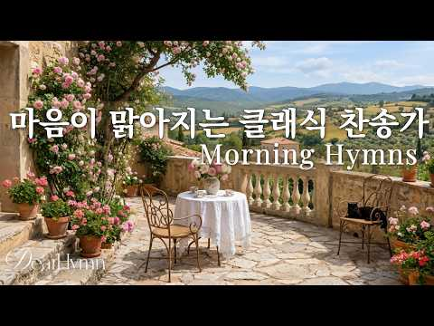
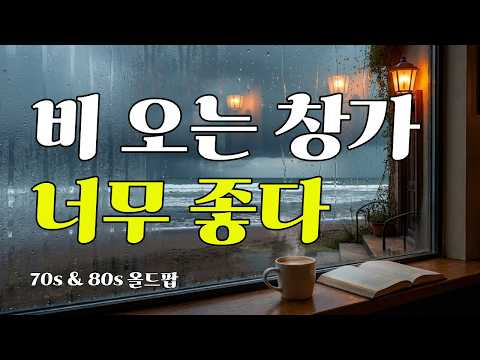
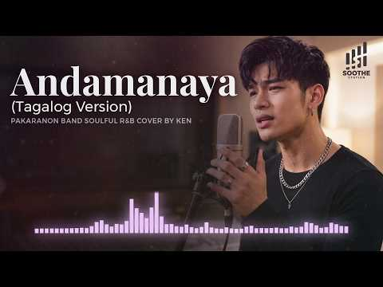
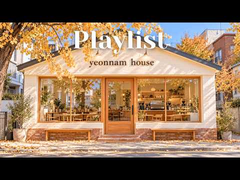
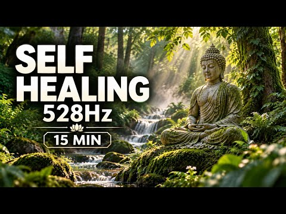

# 음악 — 성공 사례 분석: 사례별 자세히 #881–#920

`analysis.md` 의 9번 (같은 # 번호). 자동 생성 — `tools/success_analysis.py` v1.4.1 (2026-10-18 08:09 UTC). ※ 연구·교육용 — 투자 권유가 아님.

### 881. 마음이 맑아지는 클래식 찬송가 🌿 ∣ 아침에 듣기 좋은 Morning Hymns for Peace & Comfort

- https://www.youtube.com/watch?v=j6H9mPj769A · DearHymn · 구독자 11,800 · 조회수 322,802 (×27.4, 하루 2,050.5) · 좋아요 4,341 (1.3%) · 130.2분 · 2026-05-13 · 주제 묶음 15. CCM·찬양·국악·동요 · 형식 플레이리스트·모음 (여러 곡) · 폴더 `W_j6H9mPj769A` (웹 승인)
- 썸네일: 
- 챕터: 0:00 Lift Your Eyes to Heaven (눈을 … · 3:05 Walk in the Way of Righteousn… · 6:29 My Thirsty Soul (목마른 내영혼) · 9:35 Is Your Heart Troubled? (마음속에… · 12:36 All That I Have Is Yours (내게 … · 15:30 Joys Are Flowing Like a River… · 19:13 Jesus, My Constant Refuge (내가… · 22:22 Immortal, Unchanging Love of … · 26:02 Repeat.
- 설명 앞부분: 잔잔한 아침 햇살처럼 마음을 맑게 비워주는 클래식 찬송가 연주를 준비했습니다. 🌿 분주한 하루 속에서도 잠시 멈춰 하나님 안에서 평안과 위로를 누리는 시간이 되기를 바랍니다. 은혜로운 찬송 선율과 따뜻한 오케스트라 사운드가 여러분의 아침과 일상에 조용히 스며들기를 소망합니다. 🤍 편안한 묵상 시간, 기도 시간, 공부와 독서, 휴식의 순간에 함께해 주세요. A peaceful collection of classical hymns to refresh your heart like gentle morning sunlight. 🌿 May …
- 대본 없음 (설명) — 음성인식이 끝나면 도입부·흐름이 들어감
- 댓글 0/455 (다 받지 못함): 좋은 점 — 영상 0 · 감사·응원 0 · 더 알고 싶은 것 0 · 아쉬운 점 — 영상 0 · 반박·불만 — 의견 다름 0 · 정치·사회 0 · 경험 공유 0 · 구독·다음 기대 0

### 882. 𝐏𝐥𝐚𝐲𝐥𝐢𝐬𝐭 서울숲 카페에서 하루종일 듣기좋은 팝송 𝟏𝟎시간 (중간광고없음) ☀️🌿 기분 좋아지는 카페 플레이리스트 🎵

- https://www.youtube.com/watch?v=2eFGY53k350 · With Lofi Cafe · 구독자 4,980 · 조회수 133,473 (×26.8, 하루 1,023.7) · 좋아요 265 (0.2%) · 616.3분 · 2026-06-09 · 주제 묶음 4. 카페·매장·라운지 · 형식 플레이리스트·모음 (여러 곡) · 폴더 `W_2eFGY53k350` (웹 승인)
- 썸네일: 
- 챕터: 0:00 Want To Know You · 3:05 Hype Me Up · 5:44 Tell You Something Real · 8:36 What Changed Today · 11:36 Think About You · 14:31 Not Fooling Anyone · 17:20 See The Best You · 20:37 Hold My Summer · 23:34 Bright On You · 25:52 Better Than This · 28:52 We Go High · 31:42 Make It Better · 34:22 Straight From The Heart · 37:08 My Favorite Part · 39:52 Let Me Keep Dreaming · 43:02 Best Part Of Summer · 45:24 In Your Future · 47:55 Our Summer Drive · 50:39 Do You Remember When? · 53:17 Something I Won't Forget
- 설명 앞부분: 청량한 여름 팝송 10시간을 담았습니다. ☀️🌿☕ 올여름 서울숲 카페에서 자연스럽게 흘러나올 것 같은 밝고 시원한 무드의 팝 음악들로 구성된 플레이리스트입니다. 🎵✨ 푸른 나무와 햇살이 가득한 서울숲의 여유로운 분위기처럼, 기분 좋은 멜로디와 산뜻한 리듬이 하루를 더욱 특별하게 만들어 줍니다. 🌳☀ 카페, 매장, 작업실, 집 어디에서든 배경 음악처럼 편안하게 오래 감상할 수 있어요. ☕🎶 커피 한 잔과 함께하는 여유로운 오후, 공부나 작업에 집중하고 싶은 시간, 혹은 드라이브를 즐기는 순간에도 자연스럽게 어울리는 기분 좋아지는 여…
- 대본 없음 (설명) — 음성인식이 끝나면 도입부·흐름이 들어감
- 댓글 0/9 (다 받지 못함): 좋은 점 — 영상 0 · 감사·응원 0 · 더 알고 싶은 것 0 · 아쉬운 점 — 영상 0 · 반박·불만 — 의견 다름 0 · 정치·사회 0 · 경험 공유 0 · 구독·다음 기대 0

### 883. 🎤 고단한 하루 끝, 막걸리 한잔하며 듣는 눈물 나는 중년 위로가 — 인생막걸리 (가수 창)🎶 인생 트롯 ✔️

- https://www.youtube.com/watch?v=4EkREEo9LXQ · 우리인생뮤직 · 구독자 19,700 · 조회수 525,396 (×26.7, 하루 3,025.6) · 좋아요 4,139 (0.8%) · 6분 · 2026-04-27 · 주제 묶음 9. 가요·발라드·트로트 · 형식 음악 (그 밖 모양 — 한 편짜리 BGM 등) · 폴더 `W_4EkREEo9LXQ` (웹 승인)
- 썸네일: 
- 설명 앞부분: ““중년 인생, 사랑과 이별, 삶의 기쁨과 슬픔을 노래하는 인생 발라드 & 트롯 자작곡 채널입니다. 🎶 이 채널은 중년 발라드 / 인생 트롯 / 감성 발라드 / 공감 노래 / 한국 트롯 / 위로 노래 / 이별 노래 / 인생 노래 / 힐링 음악 / 자작곡 을 중심으로 제작됩니다. 여기서는 눈물 나는 인생 발라드 흥과 공감이 살아있는 인생 트롯 공감하는 현실 이야기 노래 사랑, 이별, 가족, 후회를 담은 감성 자작곡 하루 끝에 듣는 힐링 음악 & 위로 노래 를 만나실 수 있습니다. 특히 ...... 중년 감성 노래, 인생 노래, 한국…
- 같은 채널 평소 대비 ×190.5 (채널 최근 롱폼 중앙값 2,758회) · 평소 영상: "안경 쓰고 안경 찾는 내 모습 실화냐? 🤣 5060 폭풍공감 인생 트로트 [깜빡깜빡 인… (2,785회) / "고생만 시켜 미안하오.." 한평생 곁을 지켜준 당신에게 바치는 노래 ∣ 멋진 인생 (2,732회)
- 대본 없음 (설명) — 음성인식이 끝나면 도입부·흐름이 들어감
- 댓글 309/309: 좋은 점 — 영상 2 · 감사·응원 32 · 더 알고 싶은 것 2 · 아쉬운 점 — 영상 0 · 반박·불만 — 의견 다름 2 · 정치·사회 0 · 경험 공유 5 · 구독·다음 기대 3
  - 좋은 점 — 영상 👍5 “너무. 듣기좋네요. 슬프네요”
  - 감사·응원 👍33 “안녕하세요 아름답고멋져요 감미롭고감동 이네요 좋아요 좋은하루되세요 감사합니다 너무좋아요 선생님 수고하셨습니다 너무잘하십니다 🎉🎉🎉구독꼬옥 좋은하루되세요 ❤❤❤”
  - 감사·응원 👍10 “반주로 한잔하고 여행다니다 들러 흥을 깨우고 갑니다😊 감사합니다😊😊😊”
  - 더 알고 싶은 것 👍2 “참 잘하신다 우째 이렇게 잘 하실수 있을까요? 따라 다니며 노래 들어도 반도 못 들었는것 같습니다 잘 드셔요 😮”
  - 반박·불만 — 의견 다름 👍4 “이거 진짜 장난아닙니다~~ 공감 10000%”
  - 반박·불만 — 의견 다름 👍0 “하하 제스처가 왜 저리 웃기는지..”
  - 경험 공유 👍8 “😂나도노래을들으이 정처업시 방랑생햇던생각이난다 🍄”
  - 경험 공유 👍5 “져도 노래좋아 가끔 칠공 팔공 라이브 가지만 에이아이. 가수는 천상 노래 기죽어 내가 에이아이 만큼 만”
  - 구독·다음 기대 👍4 “매일듣고 있습니다~ 내인생에 이런 멋진노래가 😂😂”
  - 구독·다음 기대 👍2 “막걸리 감동입니다 곡도 아주고 등실 등실 어께 들썩들썩 잘듣고 구독합니다❤❤❤”

### 884. 마지막 약속(1995) - 김정민 ∣ 여자보컬 리메이크 [원곡감성] Cover

- https://www.youtube.com/watch?v=L7EUtPDVddY · AuraAPT · 구독자 13,100 · 조회수 348,909 (×26.6, 하루 3,926.1) · 좋아요 775 (0.2%) · 5분 · 2026-07-21 · 주제 묶음 12. 커버·노래 부르기 · 형식 커버·직접 부른 노래 · 폴더 `W_L7EUtPDVddY` (웹 승인)
- 썸네일: 
- 설명 앞부분: 김정민의 명곡 **‘마지막 약속(1995)’**을 원곡의 감성을 최대한 살려 여자보컬 버전으로 리메이크했습니다. 이별 후에도 변하지 않는 사랑과 그리움을 담은 이 노래가 여러분의 추억 속 한 장면을 떠올리게 하길 바랍니다. 🎧 이어폰으로 감상하시면 더욱 풍부한 사운드를 즐기실 수 있습니다. 🎵 Lyric “내게 돌아와 다시 널 볼 수 있게 영원히 슬픈 미소 까지도 사랑해” 👍 영상이 마음에 드셨다면 은 큰 힘이 됩니다. 감사합니다. ※ 본 영상은 원곡에 대한 존경을 담아 제작한 리메이크/커버 콘텐츠입니다. 🔖 Hashtags
- 같은 채널 평소 대비 ×15.7 (채널 최근 롱폼 중앙값 22,211회) · 평소 영상: 말리꽃 (2000) - 이승철｜가슴을 울리는 명곡 [원곡감성] 여자보컬 리메이크｜Aura… (22,211회) / 사랑.. 그 놈 (2009) - 바비 킴(Bobby Kim)｜원곡감성 여자보컬 리메이크｜… (22,385회)
- 대본 없음 (설명) — 음성인식이 끝나면 도입부·흐름이 들어감
- 댓글 41/40: 좋은 점 — 영상 0 · 감사·응원 3 · 더 알고 싶은 것 4 · 아쉬운 점 — 영상 0 · 반박·불만 — 의견 다름 0 · 정치·사회 0 · 경험 공유 2 · 구독·다음 기대 0
  - 감사·응원 👍7 “김정민은 남자의 감성 중에서도 매우 짙은 감성이라 여성 보컬이 해석해서 표현하는 것이 쉽지만은 않았을 텐데... 역시나 오늘도 좋은 곡으로 올려 주셔서 감사합니다. 잘 듣고 갑니다.^^🎉😅”
  - 감사·응원 👍1 “제가 좋아하는 명곡 중 하나인대 얼마전에 알아서 벌써 100번은 넘게 들었습니다 헤어짐의 아픔을 이 노래로 치료 해봅니다 감사합니다 채널 항상 번창하시길 바랍니다”
  - 더 알고 싶은 것 👍3 “안녕하세요 서쪽하늘 듣다가 왔는데 이 곡은 키를 얼마나 올렸는지 여쭈어도 될까요?”
  - 더 알고 싶은 것 👍2 “40대 중반 아재입니다.. 요즘 관련 음악만 듣고 있습니다 편곡 예술입니다...이런 원곡을 해치지 않는 편곡 부탁드립니다...지하철 타는 30분동안 반복 재생합니다”
  - 경험 공유 👍2 “김정민 노래 커버가 좋아요 김정민 노래 중 내가 사는 이유 커버가 될까요?”
  - 경험 공유 👍1 “제가 좋아하는 명곡 중 하나인대 얼마전에 알아서 벌써 100번은 넘게 들었습니다 헤어짐의 아픔을 이 노래로 치료 해봅니다 감사합니다 채널 항상 번창하시길 바랍니다”

### 885. 비 오는 날 카페에서 듣기 좋은 추억의 노래 ∣ 계속 듣게 되는 7080 라디오 감성 올드팝

- https://www.youtube.com/watch?v=riMgzQ7B4JA · morgellia(모르겔리아) · 구독자 18,100 · 조회수 480,317 (×26.5, 하루 3,172.9) · 좋아요 4,298 (0.9%) · 165.9분 · 2026-05-19 · 주제 묶음 9. 가요·발라드·트로트 · 형식 플레이리스트·모음 (여러 곡) · 폴더 `W_riMgzQ7B4JA` (웹 승인)
- 썸네일: 
- 챕터: 0:00 Fading Summer Love (희미해지는 여름 … · 3:39 Rainy Memories (비 오는 추억) · 6:39 One More Memory (다시 떠오른 기억) · 10:16 Rainlight Romance (빗빛 로맨스) · 14:10 Warm Coffee Nights (따뜻한 커피의 밤) · 17:56 Young and Gone (젊은 날의 우리) · 21:06 Old Streets Again (다시 걷는 옛거리) · 24:35 Echoes of Youth (청춘의 메아리) · 28:09 Soft Rain Love (부드러운 빗속 사랑) · 31:23 Quiet Rain Hearts (조용한 빗속 마음) · 34:53 Midnight Recall (한밤의 회상) · 38:26 Café in the Rain (비 오는 카페) · 41:27 Repeat
- 설명 앞부분: 창밖으로 빗소리가 조용히 내려앉는 밤, 따뜻한 커피 한 잔과 함께 문득 그 시절 라디오 감성이 떠오르는 시간이 있습니다. 카페 한켠에 앉아 천천히 흐르는 7080 감성 올드팝과 함께 추억과 그리움, 그리고 편안한 시간을 담았습니다. 빗소리처럼 잔잔하게 마음에 스며드는 그 시절의 음악들을 조용히 들어보세요. ☕🎶 ✓ 비 오는 날 듣기 좋은 음악 ✓ 카페 감성 올드팝 플레이리스트 ✓ 작업·휴식·드라이브·잠들기 전 듣기 좋은 음악 ✓ 라디오처럼 편안한 7080 감성 음악 오늘 하루도 수고 많으셨습니다. The night when the…
- 대본 없음 (설명) — 음성인식이 끝나면 도입부·흐름이 들어감
- 댓글 0/313 (다 받지 못함): 좋은 점 — 영상 0 · 감사·응원 0 · 더 알고 싶은 것 0 · 아쉬운 점 — 영상 0 · 반박·불만 — 의견 다름 0 · 정치·사회 0 · 경험 공유 0 · 구독·다음 기대 0

### 886. 𝐏𝐥𝐚𝐲𝐥𝐢𝐬𝐭 이게 극락 사운드인가?🪷 ∣ 속세 탈출용 불교 재즈🎧

- https://www.youtube.com/watch?v=EQzDJeyYNX0 · chill potato club · 구독자 15,500 · 조회수 411,007 (×26.5, 하루 2,578.1) · 좋아요 10,421 (2.5%) · 123.1분 · 2026-05-11 · 주제 묶음 7. 재즈·보사노바 · 형식 플레이리스트·모음 (여러 곡) · 폴더 `W_EQzDJeyYNX0` (웹 승인)
- 썸네일: 
- 챕터: 0:00 Moktak Midnight Club · 1:18 Bells Through Incense · 4:17 Bodhi Groove · 6:52 Dharma After Hours · 9:37 Lotus After Dark · 12:46 Blue Lotus Ritual · 17:39 Empty Mind Swing · 20:22 Gate · 24:05 Midnight Heart Sutra · 26:58 Moonlight on the Moktak · 29:51 Moktak & Smoke · 34:09 Sutra in Blue · 36:57 Temple After Midnight
- 설명 앞부분: 절에 재즈바 하나 차리면 이런 느낌 아닐까…🪷 목탁 비트 위에 스윙 드럼 얹고, 향 냄새 대신 베이스 그루브 피어오르는 플레이리스트. 도심 소음은 잠깐 음소거하고 오늘만큼은 속세 로그아웃합시다 🎧 🤍 어떤 곡이 가장 좋은지 댓글로 알려주세요 💬 [발매 완료] 다양한 플랫폼에서 감상하실 수 있습니다🪷
- 같은 채널 평소 대비 ×54.8 (채널 최근 롱폼 중앙값 7,496회) · 평소 영상: 𝐏𝐥𝐚𝐲𝐥𝐢𝐬𝐭 주문하신 연꽃 온더락 나왔습니다🪷 ∣ Buddhist Brazilian … (7,496회) / 𝐏𝐥𝐚𝐲𝐥𝐢𝐬𝐭 가피가 끊이질 않는 불교 시티팝 (6,313회)
- 대본 없음 (설명) — 음성인식이 끝나면 도입부·흐름이 들어감
- 댓글 282/282: 좋은 점 — 영상 0 · 감사·응원 4 · 더 알고 싶은 것 3 · 아쉬운 점 — 영상 0 · 반박·불만 — 의견 다름 0 · 정치·사회 0 · 경험 공유 8 · 구독·다음 기대 2
  - 감사·응원 👍4 “대에~~~~박! 일부러 종교음악 찾아듣지 않고 재즈도 늘 졸린 음악이었는데 이끌림이었는지 눌러보고 싶어서 눌렀더니 이렇게 좋을 수가!!! 대박!!!! 👍👍👍👍👍 😮😮😮😮😮 입이 안다물어지네요! 정말 자주 들을 거 같아요! 감사합니다!”
  - 감사·응원 👍2 “세상에 수련비쥐엠으로 완전 제 스타일이에요!!!! 감사히듣겠습니다!”
  - 더 알고 싶은 것 👍2 “아니 이거 원래 있는 노래인가여..? 아님ai 인가여 ccm은 많은데 불교는 대중적인 느낌의 노래가 없어서 찾고있었는데 이게 진짜 있는 장르라면 뭐라 검색해야 나오는지 알려주세요 ㅜㅜㅜ”
  - 더 알고 싶은 것 👍2 “해당 음원 상업적(유튜브)으로 사용해도 괜찮을까요?”
  - 경험 공유 👍72 “불교재즈가 뭘까? 클릭해봤더니 진짜 불교재즈 ㅋㅋㅋ 신박하다”
  - 경험 공유 👍17 “매일 108배 하는 사람인데 이거 알게 된 후 들으면서 합니다! 나도 모르게 들썩들썩🙇🏻‍♀️🙇🏻‍♀️”
  - 구독·다음 기대 👍3 “ㅋㅋㅋ이거 듣고 신나서 구독하고 가요~ 1000번째구독자네요”

### 887. 드루와자기 트로트 커버리믹스 총집합! 신나는 트로트 35곡 연속 듣기 🎶추억의 히트송 리믹스,레전드 트로트 댄스곡 모음,추억을 소환하다 🎧 #댄스곡연속듣기

- https://www.youtube.com/watch?v=al3dfBmH620 · 드루와자기 · 구독자 19,700 · 조회수 520,841 (×26.4, 하루 3,527.0) · 좋아요 2,786 (0.5%) · 136분 · 2026-05-23 · 주제 묶음 5. 운동·드라이브·신나는 · 형식 커버·직접 부른 노래 · 폴더 `W_al3dfBmH620` (웹 승인)
- 썸네일: 
- 챕터: 0:00 거문고야 · 2:21 광대 · 6:29 그집앞 · 9:55 깜빡이를키고오세요 · 14:32 날봐귀순 · 17:36 남행열차 · 21:21 너나나나 · 24:37 동전인생 · 27:50 만년사랑 · 32:09 멍 · 36:00 무심세월 · 40:47 무조건 · 46:09 문을여시오 · 50:09 바랑 · 53:19 밤에피는장미 · 56:12 밤이짧은연인들 · 61:02 방황 · 65:15 빈손 · 69:18 사랑아제발 · 72:59 서울의달
- 설명 앞부분: "트로트를 리믹스 하여 댄스곡으로 한자리에 모았습니다! 듣기만 해도 기분이 좋아지고, 추억이 떠오르는 트로트리믹스 35곡을 연속으로 감상해보세요. 기분 전환이 필요할 때, 드라이브할 때, 또는 파티 분위기를 띄우고 싶을 때 딱 맞는 선곡! 신나는 리듬과 함께 신나는 댄스!!! 🎶"
- 같은 채널 평소 대비 ×1,552.4 (채널 최근 롱폼 중앙값 336회) · 평소 영상: 💃 다 그런거지 - 드루와자기 🕺 ∣ 신나는 트로트 / 지친 일상을 날려버릴 신나는 노래… (381회) / ✨ 나의 사랑아 - 드루와자기 💖 ∣ 가슴 깊이 스며드는 애절한 OST 발라드 🎧💫 #나… (290회)
- 대본 없음 (설명) — 음성인식이 끝나면 도입부·흐름이 들어감
- 댓글 236/236: 좋은 점 — 영상 0 · 감사·응원 29 · 더 알고 싶은 것 3 · 아쉬운 점 — 영상 4 · 반박·불만 — 의견 다름 0 · 정치·사회 0 · 경험 공유 1 · 구독·다음 기대 2
  - 감사·응원 👍47 “선곡.편곡. 목소리. 굳 즐겁고 쒼나고 행복 만땅ㅡ 감사 합니다.♡”
  - 감사·응원 👍11 “스트래스 풀리고 기분전환됐읍니다 감사합니다.”
  - 더 알고 싶은 것 👍3 “반했습니다 ❤❤😂😂😂😂 두분 목소리 짱입니다 듣고또듣고 지루할시간이 없네요 혹 무심세월 단독으로 들을수 있을까요????”
  - 더 알고 싶은 것 👍3 “리믹스 음악 짱 신나게 흔들면서 청소 했습니다. 다음에도 좋은 음악 리믹스 부탁합니다. 항상 응원합니다.화이팅”
  - 아쉬운 점 — 영상 👍34 “제 노래 스퇄일 최고입니다😊 가수 목소리 좋고 선곡도 최고 운동할때 이어폰 귀에 꼽고❤ 한시간 넘게 운동하는데 지루함 없이 운동합니다 대박 기원합니다🎉🎉🎉🎉🎉”
  - 아쉬운 점 — 영상 👍4 “조오타 광고가 너무 많음”
  - 경험 공유 👍4 “와 정말 최고네 ~ 내가 이런쪽은 많이 듣는데 가장 신나고 완벽하네 ^^”
  - 구독·다음 기대 👍1 “운동 때 매일 듣기로 했어요.ㅎ”

### 888. 【4K/途中広告なし】がんばった自分を、休ませる夜｜自律神経を整える癒しのピアノBGM｜睡眠・リラックス用｜3時間

- https://www.youtube.com/watch?v=TlPKpR7on9o · Starry Note · 구독자 22,000 · 조회수 580,817 (×26.4, 하루 5,238.2) · 좋아요 2,371 (0.4%) · 192.8분 · 2026-06-29 · 주제 묶음 1. 수면·명상·힐링 · 형식 음악 (그 밖 모양 — 한 편짜리 BGM 등) · 폴더 `W_TlPKpR7on9o` (웹 승인)
- 썸네일: 
- 설명 앞부분: この動画は、高ぶった神経をしずめ、自律神経をやさしく整える、癒しのヒーリングピアノBGMです。 🎹 Music Ambient Piano / AI-assisted composition (curated & edited by Starry Note) Style: Minimal Piano, Ambient Music, Healing Solo Piano (Piano only) Mood: Deeply Calming, Waterside Hideaway, Silent Night, Gentle & Comforting 🌌 Visuals 4K UHD High Re…
- 대본 없음 (설명) — 음성인식이 끝나면 도입부·흐름이 들어감
- 댓글 0/196 (다 받지 못함): 좋은 점 — 영상 0 · 감사·응원 0 · 더 알고 싶은 것 0 · 아쉬운 점 — 영상 0 · 반박·불만 — 의견 다름 0 · 정치·사회 0 · 경험 공유 0 · 구독·다음 기대 0

### 889. Arabic Deep House Mix & arabic Oud - The Last Pharaoh (Official Music Video)

- https://www.youtube.com/watch?v=zEA4nqtiy94 · Deep Tune Fantasy · 구독자 20,200 · 조회수 530,177 (×26.2, 하루 3,402.1) · 좋아요 4,204 (0.8%) · 8분 · 2026-05-15 · 주제 묶음 6. 피아노·클래식·연주곡 · 형식 한 곡 (뮤직비디오·음원·가사) · 폴더 `W_zEA4nqtiy94` (웹 승인)
- 썸네일: 
- 설명 앞부분: Deep house music inspired by ancient history and mystical cultures, paired with cinematic visuals of civilizations and royal worlds, brought to life using artificial intelligence. This track focuses on a deep and immersive vibe designed for relaxation and imagination. All music in this video is an …
- 대본 없음 (설명) — 음성인식이 끝나면 도입부·흐름이 들어감
- 댓글 0/113 (다 받지 못함): 좋은 점 — 영상 0 · 감사·응원 0 · 더 알고 싶은 것 0 · 아쉬운 점 — 영상 0 · 반박·불만 — 의견 다름 0 · 정치·사회 0 · 경험 공유 0 · 구독·다음 기대 0

### 890. 🌸🌸 연속듣기 🌸🌸 매일 아침 우리 가족을 위해 올리는 첫 번째 기도 _ 관세음보살님의 가호와 축복

- https://www.youtube.com/watch?v=ui8uqHsTibk · 108염불 · 구독자 4,280 · 조회수 112,227 (×26.2, 하루 628.8) · 좋아요 1,952 (1.7%) · 24.2분 · 2026-04-22 · 주제 묶음 기타 · 형식 플레이리스트·모음 (여러 곡) · 폴더 `W_ui8uqHsTibk` (웹 승인)
- 썸네일: 
- 설명 앞부분: 🙏 나무 관세음보살. 오늘 이 영상이 여러분의 마음에 작은 평안이 되기를 바랍니다. 이 공간은 많은 분들의 소중한 인연으로 함께 이어지고 있습니다. 🌿 더 함께하고 싶으신 분들은 보내주신 정성은 더 많은 분들을 위한 영상과 기도로 보답하겠습니다. 🙏 오늘도 평안한 하루 되세요. 매일 아침, 당신의 하루는 어떻게 시작되고 있나요? 새벽 공기를 마시며 오늘 하루를 시작하는 소중한 시간 두 손 모아 간절히 기도하는 마음을 노래에 담았습니다. 아침마다 이 노래를 들으며 매 순간 자비로운 마음을 품고 무거운 욕심과 집착을 내려놓으며 부처님…
- 대본 없음 (설명) — 음성인식이 끝나면 도입부·흐름이 들어감
- 댓글 0/513 (다 받지 못함): 좋은 점 — 영상 0 · 감사·응원 0 · 더 알고 싶은 것 0 · 아쉬운 점 — 영상 0 · 반박·불만 — 의견 다름 0 · 정치·사회 0 · 경험 공유 0 · 구독·다음 기대 0

### 891. [Playlist]고급스러운 카페의 여유로움 ☕️[중간광고없음]카페 매장 음악 🎧 그냥 틀어두세요, 차마실 때, 일할 때, 잠잘 때..부드러운선율 ∣ Premi…

- https://www.youtube.com/watch?v=lEcJTeg9gCQ · BGMBUCKS  · 구독자 19,800 · 조회수 518,862 (×26.2, 하루 2,977.0) · 좋아요 2,905 (0.6%) · 64분 · 2026-04-27 · 주제 묶음 4. 카페·매장·라운지 · 형식 연주 (직접 연주하는 영상) · 폴더 `W_lEcJTeg9gCQ` (웹 승인)
- 썸네일: 
- 챕터: 0:00 Tracing Dust on Our Favorite … · 4:08 Raindrops in My Espresso · 7:48 Leftover Echoes in This Quiet… · 11:52 Shadows on the Velvet Seat · 15:47 The Ghost of Your Sugar in My… · 20:06 The Steam Has Gone Cold · 24:15 Steam Rising from a Cold Pape… · 28:24 Tracing Names in the Window C… · 32:08 Dust Trails on a Forgotten De… · 36:27 Midnight Rain in My Coffee · 40:24 Echoes Linger in the Corner · 44:23 Deep Shadows on the Velvet · 48:20 Ghostly Sweetness in My Cup · 52:18 Cold Steam in the Morning Air · 56:07 Vapor Rising from a Paper Cup · 60:15 Writing Names on Misty Glass
- 설명 앞부분: 창가 너머로 길게 스며드는 따스한 햇살, 그 온기를 닮은 세련되고 부드러운 음악들을 선별했습니다. BGMBUCKS가 준비한 이번 플레이리스트는 고급스러운 카페의 여유로움을 그대로 당신의 공간으로 옮겨다 드립니다. ☕️ Tea Time: 차 한 잔의 여유가 필요한 시간에 💻 Work: 업무나 공부에 집중하고 싶은 순간에 💤 Sleep: 깊은 휴식과 잠을 청하고 싶은 밤에 그 어떤 상황에서도 방해되지 않도록, 공기처럼 자연스럽게 스며드는 음악입니다. 🎧 그냥 편하게 틀어두세요. 🎵Tracklist 브금벅스의 모든 콘텐츠는 제작자의 독…
- 대본 없음 (설명) — 음성인식이 끝나면 도입부·흐름이 들어감
- 댓글 0/83 (다 받지 못함): 좋은 점 — 영상 0 · 감사·응원 0 · 더 알고 싶은 것 0 · 아쉬운 점 — 영상 0 · 반박·불만 — 의견 다름 0 · 정치·사회 0 · 경험 공유 0 · 구독·다음 기대 0

### 892. All RED EVIL JACK MUSIC【作業用/For work】

- https://www.youtube.com/watch?v=hruX5UfVTYw · イヴch🍳🥚 · 구독자 2,450 · 조회수 64,028 (×26.1, 하루 791.0) · 좋아요 561 (0.9%) · 8.6분 · 2026-07-29 · 주제 묶음 기타 · 형식 음악 (그 밖 모양 — 한 편짜리 BGM 등) · 폴더 `W_hruX5UfVTYw` (웹 승인)
- 썸네일: 
- 설명 앞부분: RED EVIL JACKさんの音楽の総集です。
- 대본 없음 (설명) — 음성인식이 끝나면 도입부·흐름이 들어감
- 댓글 0/49 (다 받지 못함): 좋은 점 — 영상 0 · 감사·응원 0 · 더 알고 싶은 것 0 · 아쉬운 점 — 영상 0 · 반박·불만 — 의견 다름 0 · 정치·사회 0 · 경험 공유 0 · 구독·다음 기대 0

### 893. Your Soul Will Thank You For This ∣∣ DIVINE Krishna Dhun & Bhajan for Inner Peace + Maha …

- https://www.youtube.com/watch?v=-gGLDLqN03M · Krishna Lovers · 구독자 49,800 · 조회수 1,295,912 (×26.0, 하루 8,527.7) · 좋아요 12,810 (1.0%) · 30.6분 · 2026-05-19 · 주제 묶음 기타 · 형식 정보·해설 (그 밖) · 폴더 `W_-gGLDLqN03M` (웹 승인)
- 썸네일: 
- 설명 앞부분: Your Soul Will Thank You For This ∣∣ DIVINE Krishna Dhun & Bhajan for Inner Peace + Maha Mantra MAHA MANTRA Hare Krishna Hare Krishna Krishna Krishna Hare Hare Hare Rama Hare Rama Rama Rama Hare Hare Other popular Titles from Krishna Lovers: Powerful Maha Mantra Music for Stress Relief & Positive E…
- 대본 없음 (설명) — 음성인식이 끝나면 도입부·흐름이 들어감
- 댓글 0/1,350 (다 받지 못함): 좋은 점 — 영상 0 · 감사·응원 0 · 더 알고 싶은 것 0 · 아쉬운 점 — 영상 0 · 반박·불만 — 의견 다름 0 · 정치·사회 0 · 경험 공유 0 · 구독·다음 기대 0

### 894. Mortal Shell 2 [OST] - Ambient Music [HQ]

- https://www.youtube.com/watch?v=0xjJ71Vcqc0 · Taneomi · 구독자 5,760 · 조회수 149,417 (×25.9, 하루 1,137.3) · 좋아요 3,268 (2.2%) · 5.8분 · 2026-06-08 · 주제 묶음 13. OST·사운드트랙 · 형식 음악 (그 밖 모양 — 한 편짜리 BGM 등) · 폴더 `W_0xjJ71Vcqc0` (웹 승인)
- 썸네일: 
- 설명 앞부분: The ambitious, adrenaline-fueled sequel to Mortal Shell, unleashed across an interconnected open world. Possess unique new warriors and unravel their stories. Precision meets intensity in high-stakes combat.
- 대본 없음 (설명) — 음성인식이 끝나면 도입부·흐름이 들어감
- 댓글 0/258 (다 받지 못함): 좋은 점 — 영상 0 · 감사·응원 0 · 더 알고 싶은 것 0 · 아쉬운 점 — 영상 0 · 반박·불만 — 의견 다름 0 · 정치·사회 0 · 경험 공유 0 · 구독·다음 기대 0

### 895. 1 Hour Relaxing Piano ∣ Piano Therapy (پیانو درمانی) ∣ ۱ ساعت پیانو آرامش‌بخش بداهه

- https://www.youtube.com/watch?v=rhfCDOTWNs0 · amir moradi · 구독자 7,130 · 조회수 184,890 (×25.9, 하루 1,056.2) · 좋아요 2,821 (1.5%) · 61.3분 · 2026-04-26 · 주제 묶음 6. 피아노·클래식·연주곡 · 형식 긴 한 곡·반복 (N시간) · 폴더 `W_rhfCDOTWNs0` (웹 승인)
- 썸네일: 
- 챕터: 0:00 A Quiet Place Within · 2:30 Where the Mind Rests · 5:32 Softly, You Heal · 8:26 The Weight We Let Go · 11:46 Breathe Between the Notes · 14:57 A Room Without Worries · 17:41 When Silence Feels Safe · 20:37 Peace Comes Slowly · 23:42 The Gentle Side of Night · 26:40 Nothing to Carry · 29:34 Rest Your Thoughts · 32:19 A Little Less Heavy · 35:10 Morning Without Hurry · 38:02 The Calm After Everything · 40:20 You Can Stay Here · 46:10 Slowly Back to Light · 49:10 Quietly Becoming Whole · 52:30 Somewhere Beyond the Noise · 55:13 The Art of Letting Go
- 설명 앞부분: If you're looking for peace, focus, or a moment to disconnect from the noise of everyday life, this 1-hour improvised piano session is for you. This piece is completely spontaneous and wordless, created to help you relax, fall asleep, or stay deeply focused while studying or working. 🎹 Perfect for:…
- 대본 없음 (설명) — 음성인식이 끝나면 도입부·흐름이 들어감
- 댓글 0/383 (다 받지 못함): 좋은 점 — 영상 0 · 감사·응원 0 · 더 알고 싶은 것 0 · 아쉬운 점 — 영상 0 · 반박·불만 — 의견 다름 0 · 정치·사회 0 · 경험 공유 0 · 구독·다음 기대 0

### 896. Soothe Station - Andamanaya - Tagalog Version (Pakaranon Band) ∣ Soulful R&B Cover by Ken

- https://www.youtube.com/watch?v=4SWpVSbm4Qo · Soothe Sta. · 구독자 28,900 · 조회수 747,299 (×25.9, 하루 5,538.7) · 좋아요 3,209 (0.4%) · 4.4분 · 2026-06-05 · 주제 묶음 12. 커버·노래 부르기 · 형식 커버·직접 부른 노래 · 폴더 `W_4SWpVSbm4Qo` (웹 승인)
- 썸네일: 
- 설명 앞부분: Requested Cover Song: Andamanaya - Parakanon Band (Maranao Song) Soulful R&B Cover by Ken (Soothe Station) "Andamanaya" is a beloved Maranao classic, frequently reimagined in Tagalog and Bisaya that serves as a poignant anthem of romantic yearning. It captures the bittersweet essence of a love defi…
- 대본 없음 (설명) — 음성인식이 끝나면 도입부·흐름이 들어감
- 댓글 0/167 (다 받지 못함): 좋은 점 — 영상 0 · 감사·응원 0 · 더 알고 싶은 것 0 · 아쉬운 점 — 영상 0 · 반박·불만 — 의견 다름 0 · 정치·사회 0 · 경험 공유 0 · 구독·다음 기대 0

### 897. Spirit Of Wolf ∣ Native Inspired Healing Music for Deep Calm ∣ Inspired by “Ly O Lay Ale …

- https://www.youtube.com/watch?v=SUgiw7VzoUY · Ancestral Echoes · 구독자 5,010 · 조회수 128,269 (×25.6, 하루 1,116.4) · 좋아요 3,710 (2.9%) · 8.1분 · 2026-06-25 · 주제 묶음 1. 수면·명상·힐링 · 형식 음악 (그 밖 모양 — 한 편짜리 BGM 등) · 폴더 `W_SUgiw7VzoUY` (웹 승인)
- 썸네일: 
- 설명 앞부분: 🐺🪶 **Spirit Of Wolf Inspired by “Ly-O-Lay-Ale-Loya” ∣ Native-Inspired Healing Music for Deep Calm & Soul Connection By Ancestral Echoes Under endless skies… through ancient forests… a distant call moves with the wind. Not loud. Not hurried. Only deep, timeless, and alive. Spirit Of Wolf* is a Nativ…
- 대본 없음 (설명) — 음성인식이 끝나면 도입부·흐름이 들어감
- 댓글 0/318 (다 받지 못함): 좋은 점 — 영상 0 · 감사·응원 0 · 더 알고 싶은 것 0 · 아쉬운 점 — 영상 0 · 반박·불만 — 의견 다름 0 · 정치·사회 0 · 경험 공유 0 · 구독·다음 기대 0

### 898. Drifting Low (Ethereal Deep House) — Club Nights

- https://www.youtube.com/watch?v=YtprplnFUpc · Club Nights · 구독자 28,400 · 조회수 724,537 (×25.5, 하루 6,155.4) · 좋아요 2,765 (0.4%) · 6.4분 · 2026-06-22 · 주제 묶음 기타 · 형식 정보·해설 (그 밖) · 폴더 `W_YtprplnFUpc` (웹 승인)
- 썸네일: 
- 설명 앞부분: Drifting Low — Club Nights Let the world go quiet. Sink into the green, into the glow, into the slow. Deep house for the deep dark. An ethereal deep house track. Drift, don't chase. 🎧 Stream on Spotify, Apple Music, all major platforms — link in pinned comment 🔔 Subscribe to Club Nights for new rel…
- 대본 없음 (설명) — 음성인식이 끝나면 도입부·흐름이 들어감
- 댓글 0/47 (다 받지 못함): 좋은 점 — 영상 0 · 감사·응원 0 · 더 알고 싶은 것 0 · 아쉬운 점 — 영상 0 · 반박·불만 — 의견 다름 0 · 정치·사회 0 · 경험 공유 0 · 구독·다음 기대 0

### 899. Naagin All Seasons - ‘The Origin of Revenge‘ MV ∣ Naagin Emotional BGM

- https://www.youtube.com/watch?v=-yEf-59hqRs · 𝐍𝐚𝐚𝐠𝐢𝐧 𝐇𝐏 𝐎𝐟𝐟𝐢𝐜𝐢𝐚𝐥 · 구독자 24,100 · 조회수 607,372 (×25.2, 하루 4,460.8) · 좋아요 8,601 (1.4%) · 11.4분 · 2026-06-04 · 주제 묶음 기타 · 형식 한 곡 (뮤직비디오·음원·가사) · 폴더 `W_-yEf-59hqRs` (웹 승인)
- 썸네일: 
- 설명 앞부분: Naagin All Seasons - ‘The Origin of Revenge‘ MV ∣ Naagin Emotional BGM ⒸVideo edit by HP - Don't reup
- 대본 없음 (설명) — 음성인식이 끝나면 도입부·흐름이 들어감
- 댓글 0/160 (다 받지 못함): 좋은 점 — 영상 0 · 감사·응원 0 · 더 알고 싶은 것 0 · 아쉬운 점 — 영상 0 · 반박·불만 — 의견 다름 0 · 정치·사회 0 · 경험 공유 0 · 구독·다음 기대 0

### 900. 잠 안 오 새벽, 깊은 허스키 보컬이 주는 위로 🌧️ 70s 빈티지 어쿠스틱 기타 BGM

- https://www.youtube.com/watch?v=BQoJJ8V8TMg · 조용한 그리움 · 구독자 21,400 · 조회수 538,926 (×25.2, 하루 6,393.1) · 좋아요 2,718 (0.5%) · 129.5분 · 2026-07-26 · 주제 묶음 12. 커버·노래 부르기 · 형식 음악 (그 밖 모양 — 한 편짜리 BGM 등) · 폴더 `W_BQoJJ8V8TMg` (웹 승인)
- 썸네일: 
- 대본 없음 (없음) — 음성인식이 끝나면 도입부·흐름이 들어감
- 댓글 106/106: 좋은 점 — 영상 2 · 감사·응원 8 · 더 알고 싶은 것 1 · 아쉬운 점 — 영상 1 · 반박·불만 — 의견 다름 0 · 정치·사회 0 · 경험 공유 2 · 구독·다음 기대 0
  - 좋은 점 — 영상 👍7 “조용히 운전하면서 듣기 좋을 것 같네요. 감사히 잘 듣겠습니다.”
  - 좋은 점 — 영상 👍5 “노래에 짙은 커피향이 가득 느껴지네요. 오늘 가을비 내리는데 듣기 좋네요”
  - 감사·응원 👍9 “이 아침에 커피와 멋진 조합이 되는 음악이군요. 감사해요 ^^”
  - 감사·응원 👍7 “조용히 운전하면서 듣기 좋을 것 같네요. 감사히 잘 듣겠습니다.”
  - 더 알고 싶은 것 👍4 “가수~~이름을 알려주세요🎉”
  - 아쉬운 점 — 영상 👍4 “너무 좋아요 혼자서도 대자연의 사계절을 느낄수 있는 풍만한 감성에 젖어드는 음악과 소울이네요 그리움과 후회가 많은 저가 많이 치유와 위안을 받고있어요 감사합니다 아쉬운건 가사제공도 해주심 더 좋을텐데 아쉽네요 그치만 훌륭합니다 최고 입니다 👍💪”

### 901. Stress Relief Jazz 🌙 Smooth Sax for Calm, Relaxation & Anxiety Ease After Stressful Days

- https://www.youtube.com/watch?v=YPsVWworsbc · JazzAyo Lounge · 구독자 37,700 · 조회수 949,374 (×25.2, 하루 5,624.3) · 좋아요 0 (0.0%) · 133.2분 · 2026-05-02 · 주제 묶음 7. 재즈·보사노바 · 형식 플레이리스트·모음 (여러 곡) · 폴더 `W_YPsVWworsbc` (웹 승인)
- 썸네일: 
- 챕터: 0:00 Soft Release · 3:23 Gentle Breathing · 6:41 Calm Arrival · 9:46 Letting Go · 13:15 Quiet Mind Flow · 16:35 Subtle Ease · 20:03 Slow Unwind · 23:27 Light Tension Fade · 26:31 Warm Stillness · 29:56 Deep Calm Entry · 32:55 Soft Grounding · 35:43 Restful Air · 39:43 Emotional Ease · 43:08 Gentle Reset · 46:23 Slow Release II · 50:10 Calm Horizon · 53:31 Quiet Balance · 57:06 Peaceful Drift · 60:15 Inner Stillness · 63:34 Soft Recovery
- 설명 앞부분: 🎷 Welcome to Jazzayo Lounge! A gentle reset for the mind and body, this stress relief jazz music session is designed to ease tension and create space for calm after a long day. With soft melodies and flowing rhythms, the smooth sax anxiety ease tone helps guide you from overwhelm into a steady, gro…
- 대본 없음 (설명) — 음성인식이 끝나면 도입부·흐름이 들어감
- 댓글 0/385 (다 받지 못함): 좋은 점 — 영상 0 · 감사·응원 0 · 더 알고 싶은 것 0 · 아쉬운 점 — 영상 0 · 반박·불만 — 의견 다름 0 · 정치·사회 0 · 경험 공유 0 · 구독·다음 기대 0

### 902. 𝐏𝐥𝐚𝐲𝐥𝐢𝐬𝐭 요즘 연남동 카페에서 듣기좋은 가을 감성 팝송 𝟏𝟎시간 (중간광고없음) 🍂☕ 작업 · 휴식 · 카페 · 매장음악 🎵

- https://www.youtube.com/watch?v=asmDdv4Dfig · With Lofi Cafe · 구독자 4,980 · 조회수 125,214 (×25.1, 하루 6,141.5) · 좋아요 244 (0.2%) · 647.2분 · 2026-09-27 · 주제 묶음 3. 공부·집중·작업 · 형식 플레이리스트·모음 (여러 곡) · 폴더 `W_asmDdv4Dfig` (웹 승인)
- 썸네일: 
- 챕터: 0:00 So Close, Too Much · 2:32 Until The Very End · 5:12 Right Where You Need To Be · 7:21 Plans Can Wait · 10:26 Our Favorite Days · 13:16 Take Every Chance · 16:00 Thats Where My Heart Goes · 18:45 Worth The Butterflies · 21:57 What I Meant To Say · 24:28 Leap Of Faith · 27:18 Every Fall Love · 29:52 Perfect Timing Of Timing · 32:10 Do You Think About Me Too · 35:06 Meet The New Me · 37:18 Dont Have To Say A Thing · 39:55 Closer As We Go · 43:02 More Than I Expected · 45:52 For You Anything · 48:04 What Comes Next · 50:40 Better Than My Usual
- 설명 앞부분: 가을빛으로 물든 연남동 골목과 분위기 좋은 카페에서 자연스럽게 흘러나올 것 같은 감성적인 팝송들로 구성된 플레이리스트입니다. 🎵✨ 밝고 산뜻한 리듬부터 부드럽고 포근한 멜로디까지, 요즘 카페 분위기와 잘 어울리는 편안한 가을 팝 음악을 오래 즐겨보세요. 선선한 바람이 부는 연남동을 걷다가 마음에 드는 카페에 들어가 커피 한 잔을 마시는 순간처럼, 따뜻한 가을 햇살과 여유로운 골목 풍경이 떠오르는 기분 좋은 분위기를 담았습니다. 🍂☕🍃 요즘 연남동 카페에서 들을 것 같은 가을 감성 팝송 작업 · 휴식 · 드라이브 · 카페 · 매장 …
- 대본 없음 (설명) — 음성인식이 끝나면 도입부·흐름이 들어감
- 댓글 0/15 (다 받지 못함): 좋은 점 — 영상 0 · 감사·응원 0 · 더 알고 싶은 것 0 · 아쉬운 점 — 영상 0 · 반박·불만 — 의견 다름 0 · 정치·사회 0 · 경험 공유 0 · 구독·다음 기대 0

### 903. 지렸다... 심장마비 🔥 선넘은 여성보컬 락발라드 COVER 33곡 모음 ∣ 전율돋는 초고음 소름주의보 3탄 [20만뷰]

- https://www.youtube.com/watch?v=tol8QOlOsPo · 아무노래개조소 · 구독자 9,460 · 조회수 237,553 (×25.1, 하루 1,900.3) · 좋아요 1,614 (0.7%) · 133.5분 · 2026-06-15 · 주제 묶음 12. 커버·노래 부르기 · 형식 AI 음악 · 폴더 `W_tol8QOlOsPo` (웹 승인)
- 썸네일: 
- 설명 앞부분: 안녕하세요 아무노래 개조소입니다. 여성 락발라드 보컬만 따로좀 모아달라는 요청이 많아서 락발라드 COVER 곡들중에 여성보컬 노래들만 편하게 연속재생으로 들으시라고 모아서 3탄 영상을 제작하였습니다. 즐겁게 감상해주시고 듣고싶으신 곡들을 자유롭게 어떤 버전으로 듣고 싶으신지 남겨 주시면 최선을 다해서 또 제작 해보겠습니다 감사합니다. 🙏 이 영상은 원곡에 대한 깊은 존경과 사랑을 담아 AI 기술로 제작한 헌정영상입니다. 음악에 깃든 모든 권리와 영광은 원작자에게 있습니다. 🙏 This video is an AI-generated …
- 같은 채널 평소 대비 ×27.1 (채널 최근 롱폼 중앙값 8,757회) · 평소 영상: 김태우 - 사랑비 [ 여성 락발라드 Cover ] ∣ [ AI MV ] (9,158회) / 이현우 – 헤어진다음날 [ 락발라드 Cover ] (8,356회)
- 대본 없음 (설명) — 음성인식이 끝나면 도입부·흐름이 들어감
- 댓글 143/143: 좋은 점 — 영상 0 · 감사·응원 3 · 더 알고 싶은 것 7 · 아쉬운 점 — 영상 1 · 반박·불만 — 의견 다름 0 · 정치·사회 0 · 경험 공유 1 · 구독·다음 기대 3
  - 감사·응원 👍5 “기다리고있었습니다.항상좋은노래듣게해줘서감사해요.”
  - 감사·응원 👍2 “감사합니닷”
  - 더 알고 싶은 것 👍33 “우선 이런 질문드려 죄송합니다. 제 생애 최고의 전율을 느꼈습니다. 그래서 무지한 질문을 드리더라도 용서부탁드립니다. 유튜브 보다가 떠서 감상하게 되었는데, 어느분이 부르신걸까요? 혹시 설명란에 있는것처럼 ai로 만드신 걸까요?”
  - 더 알고 싶은 것 👍6 “여자 파워보컬 모아둔것만 듣고 싶었는데 확실히 ai가 잘하네요 ㅎㅎ 이런거 많이 올려주세요 가슴이 뻥 뚫리는것 같당”
  - 아쉬운 점 — 영상 👍2 “Ai는 특유의 전자음 같은게 느껴짐. 그래도 좋긴한데 조금 아쉬움 ㅠㅠ 사람이 아니라는게 ㅠㅠ”
  - 구독·다음 기대 👍3 “구독했어요~ 모음집 자주 올려주세요~~ 일하면서 듣는데 너무 좋네요~~”
  - 구독·다음 기대 👍2 “유투브처음 구독박고감니다 대박 ㅎ”

### 904. 𝐘𝐨𝐠𝐚 𝐏𝐥𝐚𝐲𝐥𝐢𝐬𝐭 바람이 살랑 우붓의 요가 샬라ㅣ허밍 요가 음악

- https://www.youtube.com/watch?v=34ESzO9DdwQ · 김샨티(Shanti Kim) · 구독자 5,070 · 조회수 126,982 (×25.1, 하루 1,057.0) · 좋아요 1,360 (1.1%) · 61.5분 · 2026-06-20 · 주제 묶음 1. 수면·명상·힐링 · 형식 플레이리스트·모음 (여러 곡) · 폴더 `W_34ESzO9DdwQ` (웹 승인)
- 썸네일: 
- 설명 앞부분: 기분좋은 명상과 함께 오늘 수련 시작할께요 찾고 있는, 또는 필요한 요가음악이 있다면 댓글로 남겨주세요
- 같은 채널 평소 대비 ×11.7 (채널 최근 롱폼 중앙값 10,828회) · 평소 영상: 【𝟏𝟓𝐦𝐢𝐧】 어른이를 위한 자장가ㅣ사바아사나 음악 (10,828회) / 𝐘𝐨𝐠𝐚 𝐏𝐥𝐚𝐲𝐥𝐢𝐬𝐭 수련이 끝난 한 여름 밤은 참 아름다와 (10,705회)
- 대본 없음 (설명) — 음성인식이 끝나면 도입부·흐름이 들어감
- 댓글 45/45: 좋은 점 — 영상 0 · 감사·응원 9 · 더 알고 싶은 것 2 · 아쉬운 점 — 영상 1 · 반박·불만 — 의견 다름 0 · 정치·사회 0 · 경험 공유 6 · 구독·다음 기대 0
  - 감사·응원 👍56 “이 음악과 함께 홀로 1시간 수련을 했어요. 이상하게 하다가 눈물이 났네요 ㅋㅋㅋ 감사합니다 샨티”
  - 감사·응원 👍5 “산정상에서 명상하며 들었습니다~^^ 오묘한 감정정화에 좋은 음악이네요~ 자연속애서 너무나 함깨 어우러지는 음악에 감사합니다^^🙏🏻”
  - 더 알고 싶은 것 👍1 “제발 제목 부탁드려요 😢❤”
  - 더 알고 싶은 것 👍0 “안녕하세요? 실례가 안된다면 혹시 음원파일을 받을 수 있을까요? 너무 좋아서 영상음악으로 쓰고 싶습니다”
  - 아쉬운 점 — 영상 👍5 “산정상에서 명상하며 들었습니다~^^ 오묘한 감정정화에 좋은 음악이네요~ 자연속애서 너무나 함깨 어우러지는 음악에 감사합니다^^🙏🏻”
  - 경험 공유 👍19 “아침에 일어나기 전 침대에서 요가하며 듣는 음악인데 우리집 고냥이녀석이 이 음악만 나오면 어디서든 나와 침대 한구석에. 엎드려 지긋이 눈 감고 끝날때까지. 있답니다. 고양이가 좋아하는 요가음악 이죠.”
  - 경험 공유 👍11 “허밍 음악 정말 좋아요. 명상하면서 듣는데 저도 다른분처럼 눈물이 나네요. 마치 엄마가 아기를 토닥이며 부르는 자장가 같은 느낌이라 위로가 되는거 같아요. 제 마음을 스스로 토닥이기 위해 자주 들을게요❤ 구독갑니당”

### 905. playlist ∣ 여름, 레몬과 재즈에 대하여

- https://www.youtube.com/watch?v=Gr7ZxTdL8XA · centralgrocery 중앙식품점 · 구독자 27,200 · 조회수 677,137 (×24.9, 하루 6,431.0) · 좋아요 10,498 (1.6%) · 236.8분 · 2026-07-05 · 주제 묶음 7. 재즈·보사노바 · 형식 플레이리스트·모음 (여러 곡) · 폴더 `W_Gr7ZxTdL8XA` (웹 승인)
- 썸네일: 
- 챕터: 0:00 Lemon Morning · 2:59 A Plate of Summer · 7:12 The Bright Table · 10:36 Summer Kitchen · 13:50 Citrus Mood · 17:49 Fresh Pick · 21:48 The Fruit Shop · 24:42 Homemade Afternoon · 27:20 Summer Brunch · 31:09 Seasonal Kitchen · 35:56 Lemon Season · 40:46 Lemon Press · 42:46 Limone · 45:50 Simply Yellow · 50:06 Sunny Notes · 53:12 Fresh Light · 55:44 Lemon & Jazz
- 설명 앞부분: 새벽은, 밤이 남겨둔 고요와 아침이 가져올 빛이 잠시 함께 머무는 시간. 그러니 여름에는 레몬을 썰고, 얼음을 채우고, 재즈를 틀어둘 것. [Tracklist] // CREDITS 채널에 사용되는 모든 일러스트와 음악은 CENTRALGROCERY가 직접 제작한 창작물입니다. Music and production by CENTRALGROCERY. Illustrations and visual content by CENTRALGROCERY. © CENTRALGROCERY. All rights reserved. // COLLABORATI…
- 같은 채널 평소 대비 ×49.1 (채널 최근 롱폼 중앙값 13,802회) · 평소 영상: playlist ∣ 여름, 독서의 시간 (13,802회) / playlist ∣ 가을,재즈의 계절 (13,544회)
- 대본 없음 (설명) — 음성인식이 끝나면 도입부·흐름이 들어감
- 댓글 207/207: 좋은 점 — 영상 4 · 감사·응원 7 · 더 알고 싶은 것 5 · 아쉬운 점 — 영상 1 · 반박·불만 — 의견 다름 0 · 정치·사회 0 · 경험 공유 7 · 구독·다음 기대 4
  - 좋은 점 — 영상 👍12 “노래가 듣기 편하고 좋네요^^ 구독, 완료하고 잘 듣고 갑니다.^^ 자주소통 해요...”
  - 좋은 점 — 영상 👍11 “레전드다ㅠㅠ 뭘 하든간에 일단 틀어놓으면 집중이됨”
  - 감사·응원 👍43 “저희애기가 이 플리만 틀면 뱃속에서 난리 부르스르 쳐요 좋은 플리 감사드립니다!”
  - 감사·응원 👍13 “음악이 정말 좋네요… 덕분에 마음에 쏙 드는 하루를 보내고 있어요! 감사드립니다.”
  - 더 알고 싶은 것 👍47 “트랙리스트 위에있는 글은 주인장님이 써내려간 글귀일까요? 너무 멋져요.. ❤ 혹시 책의 한 소절이라면 제목을 알려주실 수 있으실까요😊”
  - 더 알고 싶은 것 👍14 “가사하나 없는 플리인데.. 들으면 마음이 진짜 편안해져요ㅎㅎ 적당히 잔잔하면서 넘 좋아요ㅎㅎ 몇주간 이 채널의 플리만 계속 무의식적으로 들었네요❤️ 좋은 플리 많이 올려주세요❤️”
  - 아쉬운 점 — 영상 👍11 “레몬플리 너무 좋아요. 몇번이나 무한반복 재생하고 있어요❤”
  - 경험 공유 👍43 “저희애기가 이 플리만 틀면 뱃속에서 난리 부르스르 쳐요 좋은 플리 감사드립니다!”
  - 경험 공유 👍31 “저는 오늘 제 인생의 다시는 오지않을 마지막 여름방학을 보내는 아침에 있습니다. 우연일까요.. 오늘만큼은 진짜. 내일이면 바빠서 챙겨주지 못할 아침밥과 멍때리기를 하려던 참이었습니다. 중앙식품점은 오늘 저에게 레몬다섯개와 나이프 하나를 주더군요. 어렸을 때 로마에 간…”
  - 구독·다음 기대 👍42 “썸녜일도 느낌.있고.음악도 좋네요 ! 음악은 ai로 만드신건가요?궁금. 그림도 왠지 직접그리신듯 구독하고가요😊”
  - 구독·다음 기대 👍13 “어 뭐야뭐야.. 구독할게요”

### 906. Chike & Tiwa Savage - We Go Make Am Work (2026 Afro Music) WE GO MAKE AM WORK ❤️ NO Matte…

- https://www.youtube.com/watch?v=0PVF8lImHNs · Afro Music Sound · 구독자 2,600 · 조회수 64,422 (×24.8, 하루 534.0) · 좋아요 228 (0.4%) · 6분 · 2026-06-19 · 주제 묶음 14. AI 음악 · 형식 AI 음악 · 폴더 `W_0PVF8lImHNs` (웹 승인)
- 썸네일: 
- 설명 앞부분: We Go Make Am Work" is a heartfelt Afrobeats love anthem about commitment, loyalty, sacrifice, and standing together through life's challenges. With smooth melodies, emotional lyrics, and authentic Nigerian vibes, this song celebrates true love that refuses to give up. If you believe in love, trust…
- 대본 없음 (설명) — 음성인식이 끝나면 도입부·흐름이 들어감
- 댓글 0/10 (다 받지 못함): 좋은 점 — 영상 0 · 감사·응원 0 · 더 알고 싶은 것 0 · 아쉬운 점 — 영상 0 · 반박·불만 — 의견 다름 0 · 정치·사회 0 · 경험 공유 0 · 구독·다음 기대 0

### 907. [playlist] 신기하네, 이런 빈티지재즈 좋아하는 걸 어떻게 알고 틀어줬지? ∣ 중간 광고 없음 Jazz Quite Cozy, 작업용, 명상, 공부 BGM

- https://www.youtube.com/watch?v=aZRegDWuCEo · 포 시즌 플리 Four Seasons Playlist · 구독자 39,200 · 조회수 963,443 (×24.6, 하루 15,045.0) · 좋아요 22,379 (2.3%) · 75.1분 · 2026-08-15 · 주제 묶음 7. 재즈·보사노바 · 형식 플레이리스트·모음 (여러 곡) · 폴더 `W_aZRegDWuCEo` (웹 승인)
- 썸네일: 
- 챕터: 0:00 The Jazz We Like · 2:58 Coffee for Us · 4:48 Our Morning Café · 6:50 Pancakes for Two · 9:06 Growing Old Together · 10:55 One More Coffee · 14:17 A Little Morning Walk · 16:32 You Know My Favorite Jazz · 18:45 Brunch With You
- 설명 앞부분: 조용히 흐르는 감성 플레이리스트 입니다. 공부할 때, 작업할 때, 카페처럼 틀어두고 싶을 때 혹은 아무 생각 없이 하루를 흘려보내고 싶을 때 잘 어울려요. 오늘의 분위기에 자연스럽게 스며들길 바랍니다. ☕ 🎧 All tracks are carefully selected to create a calm, cozy atmosphere. Let the music gently fill your space.
- 같은 채널 평소 대비 ×43.5 (채널 최근 롱폼 중앙값 22,136회) · 평소 영상: [playlist] 우리 나이 들어서도 이렇게 재즈 들으면서 수다 떨자. ∣ 중간 광고 … (23,080회) / [중간광고없음] 음. 좋아. 가을 재즈는 이거지. 도입부부터 낙엽 타는 냄새가 나. ∣ … (21,192회)
- 대본 없음 (설명) — 음성인식이 끝나면 도입부·흐름이 들어감
- 댓글 416/416: 좋은 점 — 영상 3 · 감사·응원 60 · 더 알고 싶은 것 16 · 아쉬운 점 — 영상 1 · 반박·불만 — 의견 다름 0 · 정치·사회 0 · 경험 공유 10 · 구독·다음 기대 19
  - 좋은 점 — 영상 👍10 “밤에 듣기 좋네요.분위기 있어요.”
  - 좋은 점 — 영상 👍2 “썸네일도 재즈도 잘 어우러져요. 넘 듣기 좋아요. 구독 누르고 듣고 있어요~💗”
  - 감사·응원 👍177 “전 배경이 너무 좋아서 듣게 되었습니다. 감사해요. 배경도 재즈도 따뜻해요”
  - 감사·응원 👍55 “육아에 마음이 너무 지쳐서 집밖으로 나왔는데 갈곳이 없어 커피한잔 사들고 근처 공원와서 듣는데 힐링되네요 제가 재즈를 좋아하는걸 오늘 알게된 기분이에요 감사합니다”
  - 더 알고 싶은 것 👍15 “혹시 첫 번째 노래 가수를 있을까요? 검색으로는 안 나와서요ㅜㅜ 가사를 보고 싶은데ㅜㅜ”
  - 더 알고 싶은 것 👍3 “공부할때 잔잔한 재즈듣는게 새로운 취미가 되었는데 딱 좋은 플레이스트네요! 앞으로도 좋은 플리 부탁드립니다!”
  - 경험 공유 👍55 “육아에 마음이 너무 지쳐서 집밖으로 나왔는데 갈곳이 없어 커피한잔 사들고 근처 공원와서 듣는데 힐링되네요 제가 재즈를 좋아하는걸 오늘 알게된 기분이에요 감사합니다”
  - 경험 공유 👍3 “순식간에 행복해졌어요 너무 제가 좋아하는무드❤❤❤잘들을게요”
  - 구독·다음 기대 👍3 “선곡이 전체적으로 조화로워서 구독하고 갑니당ㅎㅎ”
  - 구독·다음 기대 👍3 “너무 좋네요~^^ 구독합니다”

### 908. 💿 노릇노릇 빵아저씨가 만든 브금🍞

- https://www.youtube.com/watch?v=2bUpv56PbMw · 프륀 Pruiin · 구독자 11,400 · 조회수 279,047 (×24.5, 하루 2,163.9) · 좋아요 5,544 (2.0%) · 123.7분 · 2026-06-11 · 주제 묶음 11. 힙합·R&B·EDM · 형식 플레이리스트·모음 (여러 곡) · 폴더 `W_2bUpv56PbMw` (웹 승인)
- 썸네일: 
- 챕터: 0:00 Track 1 · 1:35 Track 2 · 3:28 Track 3 · 4:30 Track 4 · 5:02 Track 5 · 6:37 Track 6 · 8:09 Track 7 · 9:59 Track 8 · 11:26 Track 9 · 12:23 Repeat
- 설명 앞부분: 노릇노릇 포근한 빵아저씨의 브금ੈ🍞✩ 🎧Tracklist 모든 콘텐츠는 선별된 디지털 사운드 소스를 바탕으로 직접 보정 및 사운드 믹싱을 진행하고 있습니다! 부족하지만 즐겁게 들어주시고, 자주 찾아주세요! ꒰ྀི *ˊᵕˋ ꒱ྀིﾉ © Pruiin. All rights reserved.
- 같은 채널 평소 대비 ×18.6 (채널 최근 롱폼 중앙값 15,002회) · 평소 영상: 💿 Ice Cream Flavor BGM🍦(๑•̀؂•̀๑) (15,170회) / 💿 Sunday 𝟭𝟮:𝟰𝟱 PM (14,834회)
- 대본 없음 (설명) — 음성인식이 끝나면 도입부·흐름이 들어감
- 댓글 90/90: 좋은 점 — 영상 2 · 감사·응원 6 · 더 알고 싶은 것 1 · 아쉬운 점 — 영상 0 · 반박·불만 — 의견 다름 0 · 정치·사회 0 · 경험 공유 3 · 구독·다음 기대 1
  - 좋은 점 — 영상 👍2 “자신을 희생해서 이웃에게 유익을 주는 우리의 호빵맨❤”
  - 좋은 점 — 영상 👍1 “안녕하세요! 혹시 해당 영상의 노래를 출처 남기고 유튜브 브이로그 브금으로 사용해도 괜찮을지 문의드립니다. 좋은 영상 감사합니다!”
  - 감사·응원 👍60 “피자빵 하나랑 망고케이크 두개 그리고 에그타르트 10개 아 에그타르트는 하나씩 포장해 주시구요 빨미까레 있나요? 아~ 몇 개 있어요? 5개요~ 그럼 다 주세요. 네 다같이 나눠먹을 거예요. 친구 생일이거든요~ 파티죠~ 감사합니다~ 자주 올게요 수고하세요~”
  - 감사·응원 👍21 “감사합니다.. 덕분에 사고뭉치 12갤 아기가 좀 귀여워 보이네요.. 이 말 쓰자마자 냉장고 문을 또 열러 가네요..^^”
  - 더 알고 싶은 것 👍6 “너무 좋아요~~~구독하고갑니당 귀여운 썸네일과 귀여운 음악 많이 부탁드려요!”
  - 경험 공유 👍104 “"내가 정말로 굽고 싶었던 건 이 썩어빠진 세상이었단다"”
  - 경험 공유 👍1 “아저씨 ~ 저 또 왔어요 ~ 오늘 제가 집에서 2번째 휘낭시에를 구워봤는데 파운드케잌처럼 퐁신퐁신하게 됐어요~ 담에는 빠짝빠짝하게 만들고 싶어소 휴지도 시키고 팬닝도 적게 할려고요 ㅎㅎ 담에는 뭐를 만들어볼까요 ? 추천해주세용”
  - 구독·다음 기대 👍6 “너무 좋아요~~~구독하고갑니당 귀여운 썸네일과 귀여운 음악 많이 부탁드려요!”

### 909. 눈물 없이는 못 듣는 감성 락발라드 트로트 12곡｜중년 가슴을 울리는 인생 노래 모음｜55분 연속듣기

- https://www.youtube.com/watch?v=0rFs08Wz1Xw · 인생은 트로트 · 구독자 9,120 · 조회수 222,972 (×24.4, 하루 2,895.1) · 좋아요 2,753 (1.2%) · 55.5분 · 2026-08-02 · 주제 묶음 9. 가요·발라드·트로트 · 형식 플레이리스트·모음 (여러 곡) · 폴더 `W_0rFs08Wz1Xw` (웹 승인)
- 썸네일: 
- 설명 앞부분: 기존에 선보였던 트로트 곡들을 새로운 감성의 락트로트 스타일로 재해석한 특별 편곡 모음입니다. 애절 감성 락발라드 트로트 12곡을 만나보세요. 본 곡은 가사와 스토리 구성에 직접 참여하여 제작한 창작 음악이며, AI 기술을 활용해 완성하였습니다. 🎵 인생은 트로트 여러분의 소중한 추억과 사연도 댓글로 남겨주세요. 감사합니다. ❤ 🎵 수록곡 : 12곡 ⏱ 재생시간 : 55분
- 같은 채널 평소 대비 ×15.2 (채널 최근 롱폼 중앙값 14,625회) · 평소 영상: 사랑에 빠졌나 봐 ❤️ 시크한 그녀의 락트로트 댄스 10곡 ∣ 1시간 10분 (15,243회) / 시청자 요청으로 만든 힙팝트로트 2탄 🎧 한 곡만 들으려다 끝까지 들었다 ∣ 10곡 1시… (14,007회)
- 대본 없음 (설명) — 음성인식이 끝나면 도입부·흐름이 들어감
- 댓글 96/96: 좋은 점 — 영상 1 · 감사·응원 5 · 더 알고 싶은 것 1 · 아쉬운 점 — 영상 1 · 반박·불만 — 의견 다름 0 · 정치·사회 0 · 경험 공유 0 · 구독·다음 기대 0
  - 좋은 점 — 영상 👍1 “아~좋다 듣기좋습니다~~~”
  - 감사·응원 👍6 “좋은음악과 정성스러운 영상 알람으로 함께 응원합니다”
  - 감사·응원 👍4 “정말 마음의 심금을 울리는 이노래 감사합니다 언제가는 한줌의 제로 자연으로 돌아갈 인생 이기에 어쩌면 이노래가 더욱더 이밤을 지세웁니다”
  - 더 알고 싶은 것 👍1 “가수 이름 이나 알려 주세요!❤❤❤❤❤❤❤”
  - 아쉬운 점 — 영상 👍3 “목소리가 너무 좋고 조용한 노래가 너무 좋아요❤”

### 910. 듣는 순간 마음이 편안해지는 첼로 음악 🎻 ∣ 공부, 휴식, 감성 힐링 음악

- https://www.youtube.com/watch?v=QmJoFjq-aWE · 따뜻한 휴식 Studio · 구독자 1,990 · 조회수 48,662 (×24.4, 하루 331.3) · 좋아요 606 (1.2%) · 51.4분 · 2026-05-24 · 주제 묶음 1. 수면·명상·힐링 · 형식 음악 (그 밖 모양 — 한 편짜리 BGM 등) · 폴더 `W_QmJoFjq-aWE` (웹 승인)
- 썸네일: 
- 챕터: 0:00 The Song That Never Ends · 3:12 Today Was a Happy Day · 6:05 A Pleasant Journey · 9:18 The World I Dream Of · 12:45 Peaceful Mind · 15:32 마음의 자유 · 18:40 Memory · 21:55 좋았던 기억 · 25:10 혼자만의 시간 · 28:26 비 오는 날이면 · 31:45 외로움 · 35:12 어머니를 향한 그리움 · 38:50 소중한 사람 · 42:15 내 맘속의 연인 · 45:48 다시, 사랑한다면 · 49:20 The Song That Never Ends (Rep…
- 설명 앞부분: 🎻 끝나지 않는 선율처럼, 조용히 마음을 울리는 첼로 연주곡 모음입니다. 따뜻한 첼로 선율과 영화 OST 같은 감성 오케스트라 사운드로 혼자 있는 시간, 여행, 추억, 그리움, 그리고 작은 위로의 감정을 담았습니다. 오늘 하루도 지친 마음이 잠시 편안히 쉬어갈 수 있기를 바랍니다. 🎼 TRACK LIST 🎧 Recommended for: ☕ Café ambience 📖 Reading & studying 🌙 Relaxing nights 🚗 Night driving 💭 Emotional reflection 😴 Healing & sle…
- 같은 채널 평소 대비 ×111.6 (채널 최근 롱폼 중앙값 436회) · 평소 영상: 언젠가 빛나는 날 🌅 오늘을 살아가는 당신에게 (436회) / 따뜻한 감성 Playlist #3 🌙 지친 하루를 안아주는 힐링 음악 모음 (421회)
- 대본 없음 (설명) — 음성인식이 끝나면 도입부·흐름이 들어감
- 댓글 37/37: 좋은 점 — 영상 1 · 감사·응원 10 · 더 알고 싶은 것 0 · 아쉬운 점 — 영상 0 · 반박·불만 — 의견 다름 0 · 정치·사회 0 · 경험 공유 0 · 구독·다음 기대 1
  - 좋은 점 — 영상 👍5 “축🎉그대채널을.응원함니다.음악이.너무.아름다워요❤듣기좋와요🎉🎉🎉”
  - 감사·응원 👍8 “오랜만에 서울에 와서 우연히 이 음악을 들으면 걷고 있네요 감사합니다 ~”
  - 감사·응원 👍7 “와~~ 음악이 너무 아름다워요. 무거울 거라 생각했는데 오히려 우아한 느낌이 나네요.~~감사합니다.”
  - 구독·다음 기대 👍6 “곡이 너무 아름다워서 끝까지 계속 듣게 되요. 구독하고 계속 듣겠습니다.”

### 911. Into the Misty Scottish Highlands｜Celtic Music for Deep Focus & Relaxation

- https://www.youtube.com/watch?v=7JojfPKvTM4 · Echoes of Alba · 구독자 44,800 · 조회수 1,086,366 (×24.2, 하루 6,249.2) · 좋아요 19,410 (1.8%) · 143.4분 · 2026-04-27 · 주제 묶음 3. 공부·집중·작업 · 형식 음악 (그 밖 모양 — 한 편짜리 BGM 등) · 폴더 `W_7JojfPKvTM4` (웹 승인)
- 썸네일: 
- 설명 앞부분: Step into the misty Scottish Highlands and let soft Celtic ambient melodies guide you into a state of calm, clarity, and quiet inner peace. This video blends delicate instrumental music with cinematic fog-covered landscapes — rolling green hills fading into the mist, silent lochs under grey skies, …
- 대본 없음 (설명) — 음성인식이 끝나면 도입부·흐름이 들어감
- 댓글 0/477 (다 받지 못함): 좋은 점 — 영상 0 · 감사·응원 0 · 더 알고 싶은 것 0 · 아쉬운 점 — 영상 0 · 반박·불만 — 의견 다름 0 · 정치·사회 0 · 경험 공유 0 · 구독·다음 기대 0

### 912. Relaxing Country Gospel ∣ Call Upon the Name of Jesus ∣ Healing Worship Songs for Peace

- https://www.youtube.com/watch?v=R38UIWZtjkQ · Breathing Planet · 구독자 35,000 · 조회수 845,468 (×24.2, 하루 6,739.8) · 좋아요 7,166 (0.9%) · 6.4분 · 2026-06-14 · 주제 묶음 1. 수면·명상·힐링 · 형식 음악 (그 밖 모양 — 한 편짜리 BGM 등) · 폴더 `W_R38UIWZtjkQ` (웹 승인)
- 썸네일: 
- 설명 앞부분: When life feels heavy and words become difficult, sometimes the only prayer left is the name of Jesus. Welcome to this peaceful collection of relaxing country gospel songs created for weary hearts needing comfort, healing, and renewed faith. Subscribe for more country gospel music, healing worship …
- 대본 없음 (설명) — 음성인식이 끝나면 도입부·흐름이 들어감
- 댓글 0/857 (다 받지 못함): 좋은 점 — 영상 0 · 감사·응원 0 · 더 알고 싶은 것 0 · 아쉬운 점 — 영상 0 · 반박·불만 — 의견 다름 0 · 정치·사회 0 · 경험 공유 0 · 구독·다음 기대 0

### 913. Arabic Oud & Flamenco Guitar – Gentle Instrumental Music for Sleep & Relaxation

- https://www.youtube.com/watch?v=4HR2eB5p8WI · Andalusian Oud Reverb · 구독자 26,700 · 조회수 642,262 (×24.1, 하루 4,351.1) · 좋아요 6,503 (1.0%) · 90.8분 · 2026-05-23 · 주제 묶음 6. 피아노·클래식·연주곡 · 형식 음악 (그 밖 모양 — 한 편짜리 BGM 등) · 폴더 `W_4HR2eB5p8WI` (웹 승인)
- 썸네일: 
- 설명 앞부분: Relax your mind and drift into peaceful sleep with this gentle fusion of Arabic Oud & Flamenco Guitar, designed to create a calm and soothing atmosphere for deep relaxation, meditation, and emotional balance. Welcome to Andalusian Oud Reverb, where the soulful beauty of Middle Eastern melodies blen…
- 대본 없음 (설명) — 음성인식이 끝나면 도입부·흐름이 들어감
- 댓글 0/264 (다 받지 못함): 좋은 점 — 영상 0 · 감사·응원 0 · 더 알고 싶은 것 0 · 아쉬운 점 — 영상 0 · 반박·불만 — 의견 다름 0 · 정치·사회 0 · 경험 공유 0 · 구독·다음 기대 0

### 914. 15 Min 528Hz Self Healing Music 🌿 Calm Your Nervous System & Feel Deeply Restored

- https://www.youtube.com/watch?v=HFW4awIfBmo · Inner Healing Aura · 구독자 1,240 · 조회수 29,592 (×23.9, 하루 1,149.9) · 좋아요 236 (0.8%) · 15.5분 · 2026-09-22 · 주제 묶음 1. 수면·명상·힐링 · 형식 음악 (그 밖 모양 — 한 편짜리 BGM 등) · 폴더 `W_HFW4awIfBmo` (웹 승인)
- 썸네일: 
- 설명 앞부분: 🌿 15 Min 528Hz Self Healing Music ∣ Calm Your Nervous System & Feel Deeply Restored Take 15 minutes for yourself with this peaceful 528Hz self healing music, created to help you slow down, relax, quiet mental tension, and reconnect with a deeper sense of inner peace. This meditation music combines …
- 대본 없음 (설명) — 음성인식이 끝나면 도입부·흐름이 들어감
- 댓글 0/12 (다 받지 못함): 좋은 점 — 영상 0 · 감사·응원 0 · 더 알고 싶은 것 0 · 아쉬운 점 — 영상 0 · 반박·불만 — 의견 다름 0 · 정치·사회 0 · 경험 공유 0 · 구독·다음 기대 0

### 915. 𝐏𝐥𝐚𝐲𝐥𝐢𝐬𝐭☕ Let the Day Start Softly with Coffee and Korean Chill Music｜OST & R&B

- https://www.youtube.com/watch?v=FUrT7LN9VRU · Seoul Flow AI · 구독자 23,700 · 조회수 554,216 (×23.4, 하루 3,684.4) · 좋아요 7,905 (1.4%) · 166.6분 · 2026-05-20 · 주제 묶음 4. 카페·매장·라운지 · 형식 플레이리스트·모음 (여러 곡) · 폴더 `W_FUrT7LN9VRU` (웹 승인)
- 썸네일: 
- 설명 앞부분: Gentle, clean Korean K-Pop R&B playlist for daytime study and work. Smooth, steady BGM with low distraction, warm emotion, and cozy vibes perfect for focusing, working, studying, or relaxing in a café-style atmosphere. 🎧 Ideal for: Study & Focus Work & Productivity Cozy Coffee Time Relaxing Backgro…
- 대본 없음 (설명) — 음성인식이 끝나면 도입부·흐름이 들어감
- 댓글 0/133 (다 받지 못함): 좋은 점 — 영상 0 · 감사·응원 0 · 더 알고 싶은 것 0 · 아쉬운 점 — 영상 0 · 반박·불만 — 의견 다름 0 · 정치·사회 0 · 경험 공유 0 · 구독·다음 기대 0

### 916. पहाड़ों में गूंजती जादुई बाँसुरी 🎋 Magical Mountain Flute Music

- https://www.youtube.com/watch?v=orUOWfIkmM4 · Vibe Without Words · 구독자 26,600 · 조회수 608,874 (×22.9, 하루 3,872.9) · 좋아요 6,080 (1.0%) · 46.8분 · 2026-05-14 · 주제 묶음 6. 피아노·클래식·연주곡 · 형식 음악 (그 밖 모양 — 한 편짜리 BGM 등) · 폴더 `W_orUOWfIkmM4` (웹 승인)
- 썸네일: 
- 설명 앞부분: Himalayan flute, pahadi vibes, relaxing instrumental music, peaceful mountain atmosphere और soulful bansuri melody का यह अनोखा संगम आपको प्रकृति के बेहद करीब ले जाएगा। 🎶 Use Headphones For Best Experience 🌿 Feel the Magic of Mountains & Flute
- 대본 없음 (설명) — 음성인식이 끝나면 도입부·흐름이 들어감
- 댓글 0/415 (다 받지 못함): 좋은 점 — 영상 0 · 감사·응원 0 · 더 알고 싶은 것 0 · 아쉬운 점 — 영상 0 · 반박·불만 — 의견 다름 0 · 정치·사회 0 · 경험 공유 0 · 구독·다음 기대 0

### 917. Morning Serenity 🌿 Raag Alhaiya Bilawal inspired Healing Indian Flute for Stress Relief &…

- https://www.youtube.com/watch?v=7RR_x4Tu7EE · Soulful Breathscape™ · 구독자 49,600 · 조회수 1,130,719 (×22.8, 하루 7,374.4) · 좋아요 7,765 (0.7%) · 66.2분 · 2026-05-18 · 주제 묶음 1. 수면·명상·힐링 · 형식 음악 (그 밖 모양 — 한 편짜리 BGM 등) · 폴더 `W_7RR_x4Tu7EE` (웹 승인)
- 썸네일: 
- 챕터: 0:00 Dawn of Quiet Healing · 3:33 Calm River of Morning Light · 7:06 Gentle Breath of Serenity · 10:32 Healing Winds Through the Hil… · 13:52 Temple Echoes at Sunrise · 17:57 Deep Focus & Inner Stillness · 21:21 Floating Beyond Overthinking · 25:24 Soft Golden Morning Energy · 29:14 Lotus of Calm Awareness · 32:55 Peaceful Frequencies Within · 36:46 Flowing Into Emotional Healing · 39:38 Quiet Mind, Open Heart · 43:24 Meditation Beneath Morning Sk… · 47:02 Sacred Calm for the Soul · 51:03 Lightness After the Storm · 54:27 Deep Healing Morning Meditati… · 58:09 Positive Energy Awakening · 62:00 Return to Inner Peace
- 설명 앞부분: Start your morning with peace, clarity, and healing energy 🌿✨ This calming Indian flute meditation music is designed to help reduce stress, quiet overthinking, improve focus, and create a peaceful mindset for the day ahead. Inspired by the soothing essence of Raag Alhaiya Bilawal, this gentle blend…
- 대본 없음 (설명) — 음성인식이 끝나면 도입부·흐름이 들어감
- 댓글 0/274 (다 받지 못함): 좋은 점 — 영상 0 · 감사·응원 0 · 더 알고 싶은 것 0 · 아쉬운 점 — 영상 0 · 반박·불만 — 의견 다름 0 · 정치·사회 0 · 경험 공유 0 · 구독·다음 기대 0

### 918. Música espiritual hebrea - Melodías antiguas de Israel para meditar y dormir en calma

- https://www.youtube.com/watch?v=A7ZlOXV_CrU · Sacred Hebrew Melodies · 구독자 20,200 · 조회수 460,395 (×22.8, 하루 3,091.5) · 좋아요 14,083 (3.1%) · 63.5분 · 2026-05-22 · 주제 묶음 6. 피아노·클래식·연주곡 · 형식 음악 (그 밖 모양 — 한 편짜리 BGM 등) · 폴더 `W_A7ZlOXV_CrU` (웹 승인)
- 썸네일: 
- 설명 앞부분: Música espiritual hebrea - Melodías antiguas de Israel para meditar y dormir en calma Explora la música espiritual hebrea con estas melodías antiguas de Israel perfectas para meditar. 🕯 En Sacred Hebrew Melodies, seleccionamos lo mejor de la música hebrea antigua para ayudarte a dormir en calma y s…
- 대본 없음 (설명) — 음성인식이 끝나면 도입부·흐름이 들어감
- 댓글 0/740 (다 받지 못함): 좋은 점 — 영상 0 · 감사·응원 0 · 더 알고 싶은 것 0 · 아쉬운 점 — 영상 0 · 반박·불만 — 의견 다름 0 · 정치·사회 0 · 경험 공유 0 · 구독·다음 기대 0

### 919. 내 삶에 임하소서 ∣ 주기도문 기반 잔잔한 찬양, 조용한 기도 ∣ Let Your Presence Fill My Life ∣ CCM Worship

- https://www.youtube.com/watch?v=HzyxKZ_w2_8 · 쉼이 되는 찬양 · 구독자 3,030 · 조회수 68,856 (×22.7, 하루 399.3) · 좋아요 217 (0.3%) · 5.3분 · 2026-04-28 · 주제 묶음 15. CCM·찬양·국악·동요 · 형식 음악 (그 밖 모양 — 한 편짜리 BGM 등) · 폴더 `W_HzyxKZ_w2_8` (웹 승인)
- 썸네일: 
- 설명 앞부분: 🎼 악보 구매 안내 (국내·해외 구매 가능) 「내 삶에 임하소서」 악보는 아래 방법으로 구매하실 수 있습니다. 🇰🇷 국내 구매 · 계좌송금 아래 신청서에서 악보 종류와 구매 방법을 확인하고 작성해 주세요. 악보 구매 신청서: 🌎 해외 구매 · PayPal 결제 🎵 단선 악보 / Lead Sheet 🎹 보컬·피아노 3단 악보 / Vocal & Piano ※ 한국어 가사가 담긴 PDF 악보이며, 실물은 배송되지 않습니다. 귀한 마음으로 함께 찬양해 주셔서 감사합니다. 🙏 이 찬양이 마음에 작은 쉼이 되셨다면 새로운 찬양이 올라올 때 …
- 같은 채널 평소 대비 ×13.4 (채널 최근 롱폼 중앙값 5,157회) · 평소 영상: 나를 붙드소서 ∣ 흔들리는 마음을 붙잡아 주시는 주님 ∣ 잔잔한 CCM 찬양 (5,157회) / 주의 그림자 아래 ∣ Under Your Shadow ∣ 세상이 날 외면해도 주님은 떠나… (4,522회)
- 대본 없음 (설명) — 음성인식이 끝나면 도입부·흐름이 들어감
- 댓글 27/27: 좋은 점 — 영상 0 · 감사·응원 5 · 더 알고 싶은 것 4 · 아쉬운 점 — 영상 0 · 반박·불만 — 의견 다름 0 · 정치·사회 0 · 경험 공유 0 · 구독·다음 기대 0
  - 감사·응원 👍2 “아멘 아멘 아멘 🙏 주님 감사합니다 아멘 아멘 아멘 🙏 ❤❤❤❤❤”
  - 감사·응원 👍1 “은혜로운 찬양 감사합니다. 특송때 부르고 싶은데 악보 좀 부탁드려요”
  - 더 알고 싶은 것 👍1 “은혜로운 찬양 감사합니다. 특송때 부르고 싶은데 악보 좀 부탁드려요”
  - 더 알고 싶은 것 👍1 “혹시 악보를 구할수 있을까요?ㅠ”

### 920. 10-Minute Divine Flute Meditation ∣ Inner Peace & Healing ∣ Sri Ganapathy Sachchidananda …

- https://www.youtube.com/watch?v=_3PmWQ0lENE · Sri Ganapathy Sachchidananda Swamiji - SGS Swamiji · 구독자 45,500 · 조회수 1,031,294 (×22.7, 하루 9,946.6) · 좋아요 4,780 (0.5%) · 10.6분 · 2026-07-06 · 주제 묶음 1. 수면·명상·힐링 · 형식 음악 (그 밖 모양 — 한 편짜리 BGM 등) · 폴더 `W__3PmWQ0lENE` (웹 승인)
- 썸네일: 
- 설명 앞부분: Experience 10 minutes of deep tranquility, spiritual reset, stress relief, and inner balance with this Sacred Flute Meditation by Pujya Sri Ganapathy Sachchidananda Swamiji. Let the calming tones of the divine flute quiet your mind, release anxiety, and guide you into a state of deep meditation and…
- 대본 없음 (설명) — 음성인식이 끝나면 도입부·흐름이 들어감
- 댓글 0/1,476 (다 받지 못함): 좋은 점 — 영상 0 · 감사·응원 0 · 더 알고 싶은 것 0 · 아쉬운 점 — 영상 0 · 반박·불만 — 의견 다름 0 · 정치·사회 0 · 경험 공유 0 · 구독·다음 기대 0

