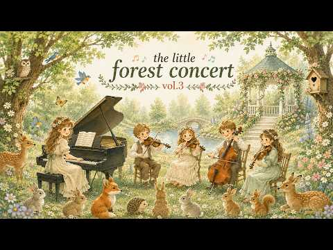
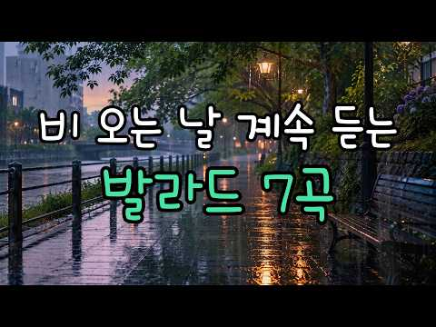
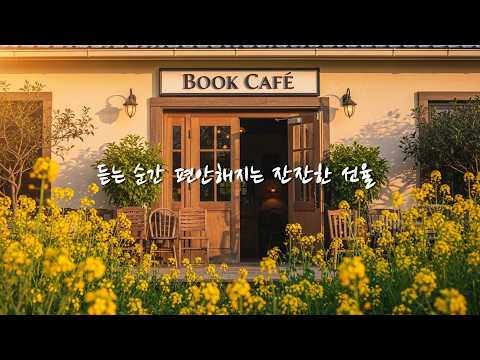

# 음악 — 성공 사례 분석: 사례별 자세히 #921–#960

`analysis.md` 의 9번 (같은 # 번호). 자동 생성 — `tools/success_analysis.py` v1.5.1 (2026-10-22 07:59 UTC). ※ 연구·교육용 — 투자 권유가 아님.

### 921. 트로트 모음 50곡 #트로트 메들리 #인기트로트 🎶 하루 종일 듣기 좋은 노래 모음 🎶 추억의 트로트 명곡 모음 🎶 잊을 수 없는 그 시절의 감성

- https://www.youtube.com/watch?v=5GO9R1-U5OM · SonicVista · 구독자 26,900 · 조회수 483,693 (×18.0, 하루 3,708.9) · 좋아요 6,874 (1.4%) · 78.9분 · 2026-06-13 · 주제 묶음 9. 가요·발라드·트로트 · 형식 플레이리스트·모음 (여러 곡) · 폴더 `W_5GO9R1-U5OM` (웹 승인)
- 썸네일: 
- 설명 앞부분: 노래가 시작되는 순간, 마치 오래된 기차역 플랫폼에 홀로 서서 천천히 다가오는 기차를 기다리는 것 같은 느낌이 듭니다. 이른 아침 안개가 역 주변을 부드럽게 감싸고 있고, 플랫폼 끝에 놓인 시계는 조용히 시간을 흘려보내고 있습니다. 낡은 벤치에는 지난 세월의 흔적이 남아 있고, 철길은 멀리 보이지 않는 곳까지 길게 이어져 있습니다. 어디선가 들려오는 기차의 희미한 기적 소리는 새로운 만남과 여행을 예고하는 듯합니다. 그 순간 들려오는 멜로디는 철길을 따라 불어오는 바람처럼 천천히 마음속으로 스며들며 잊고 있던 감정들을 깨워 줍니다…
- 같은 채널 평소 대비 ×2,853.6 (채널 최근 롱폼 중앙값 170회) · 평소 영상: 2026년 최고의 추억의 옛 트로트 리메이크 모음 🍂🍂 첫 소절부터 눈물이 납니다｜추억의… (170회) / 첫 소절부터 눈물이 납니다｜추억의 트로트 명곡 40선🎶 흘러간 옛노래 뽕짝 메들리 가사 … (167회)
- 대본 없음 (설명) — 음성인식이 끝나면 도입부·흐름이 들어감
- 댓글 77/79: 좋은 점 — 영상 0 · 감사·응원 4 · 더 알고 싶은 것 1 · 아쉬운 점 — 영상 0 · 반박·불만 — 의견 다름 0 · 정치·사회 0 · 경험 공유 0 · 구독·다음 기대 0
  - 감사·응원 👍5 “세월은 흘러도 좋은 노래는 마음속에 오래 남는 것 같습니다. 오늘도 좋은 추억을 선물해 주셔서 감사합니다.”
  - 감사·응원 👍4 “옆에두고 한잔 할어고 하네요 넘 신나고 기분만킥 감사해요♡♡♡”
  - 더 알고 싶은 것 👍0 “가수분 들 얼굴이 궁금합니다 넘 찰지게 잘부르셔요~^^”

### 922. Morning Energy Music ∣ Dilruba Raga Yaman ∣ 1.5 Hours

- https://www.youtube.com/watch?v=DMcoOLvmAyQ · Raga Focus · 구독자 37,500 · 조회수 671,341 (×17.9, 하루 4,038.2) · 좋아요 5,645 (0.8%) · 90분 · 2026-05-09 · 주제 묶음 1. 수면·명상·힐링 · 형식 긴 한 곡·반복 (N시간) · 폴더 `W_DMcoOLvmAyQ` (웹 승인)
- 썸네일: 
- 챕터: 0:00 Gentle opening (breath awaren… · 8:00 Soft expansion (mind graduall… · 18:00 Calm stabilization (steady br… · 30:00 Deep relaxation phase (dilrub… · 42:00 Alpha calm flow (mental chatt… · 55:00 Meditative immersion (inner s… · 68:00 Spacious awareness (long sust… · 78:00 Nervous system reset (body an… · 85:00 Gentle unwinding (awareness s… · 89:00 Slow fade into silence
- 설명 앞부분: Morning Energy Music ∣ Dilruba Raga Yaman ∣ Alpha Wave Calm Session When the mind feels restless, the breath becomes the doorway back to calm. This uninterrupted 1 hour 30 minute Dilruba meditation session in Raga Yaman is designed to support deep breathing, nervous system relaxation, and mental cl…
- 같은 채널 평소 대비 ×465.2 (채널 최근 롱폼 중앙값 1,443회) · 평소 영상: Mental Exhaustion ∣ Santoor Therapy ∣ 1.5 Hours (1,499회) / Find Your Calm ∣ Sarangi Instrumental ∣ 1.5 Hours (1,387회)
- 대본 없음 (설명) — 음성인식이 끝나면 도입부·흐름이 들어감
- 댓글 166/167: 좋은 점 — 영상 0 · 감사·응원 0 · 더 알고 싶은 것 0 · 아쉬운 점 — 영상 0 · 반박·불만 — 의견 다름 0 · 정치·사회 0 · 경험 공유 0 · 구독·다음 기대 0

### 923. 밤바다 보이는 카페 창가, 조용히 듣기 좋은 7080 라디오 감성 올드팝

- https://www.youtube.com/watch?v=9x53vG82_Ao · morgellia(모르겔리아) · 구독자 18,100 · 조회수 322,801 (×17.8, 하루 2,175.6) · 좋아요 2,751 (0.9%) · 159.8분 · 2026-05-26 · 주제 묶음 9. 가요·발라드·트로트 · 형식 플레이리스트·모음 (여러 곡) · 폴더 `W_9x53vG82_Ao` (웹 승인)
- 썸네일: 
- 챕터: 0:00 Midnight Youth (한밤의 청춘) · 3:22 Old Café Lights (오래된 카페 불빛) · 6:23 Missing Those Days (그 시절이 그리워) · 9:59 Warm Old Roads (따뜻했던 옛길) · 13:39 Once in Spring (그해 봄날) · 17:06 Rainy Nostalgia (비 오는 향수) · 20:13 Young Hearts Tonight (오늘 밤의 청… · 23:52 Youthful Days (젊은 날들) · 27:14 Echoes of Us (우리의 메아리) · 30:31 Coffee and Memories (커피와 추억) · 34:03 Summer Recall (여름의 회상) · 37:22 Faded Youth (희미해진 청춘) · 39:56 Repeat
- 설명 앞부분: 달빛이 내려앉은 밤바다와 잔잔한 도시의 불빛이 보이는 카페 창가, 조용히 흘러나오던 그 시절 음악을 담았습니다. 따뜻한 커피 한 잔의 온기처럼 천천히 마음에 스며드는 7080 라디오 감성 올드팝입니다. 오늘 같은 밤엔 아무 말 없이 음악만 틀어두어도 마음이 편안해지는 시간이 됩니다. ✓ 밤바다 감성과 잘 어울리는 음악 ✓ 조용히 쉬어가고 싶은 늦은 밤 ✓ 카페 · 드라이브 · 공부 · 잠들기 전까지 부담 없이 오늘 하루도 수고 많으셨습니다. With the moonlit night sea The window of the cafe …
- 같은 채널 평소 대비 ×39.6 (채널 최근 롱폼 중앙값 8,150회) · 평소 영상: 여름 바다와 노을, 다시 듣고 싶은 7080 라디오 감성 올드팝 ∣ 카페 음악 (8,150회) / 여름이 저물어갈 때 듣는 이 노래, 너무 좋다 ∣ 가을을 기다리며 듣는 7080 라디오 … (8,313회)
- 대본 없음 (설명) — 음성인식이 끝나면 도입부·흐름이 들어감
- 댓글 151/151: 좋은 점 — 영상 2 · 감사·응원 29 · 더 알고 싶은 것 2 · 아쉬운 점 — 영상 0 · 반박·불만 — 의견 다름 0 · 정치·사회 0 · 경험 공유 8 · 구독·다음 기대 3
  - 좋은 점 — 영상 👍4 “비오는밤 넘 듣기좋은 음색에 감사함을느낍니다^^”
  - 감사·응원 👍16 “작은 포구에서 머물다 오늘 집으로 가는 날인데 바다가 코앞인 카페에서 저도 커피 한 잔 마주하고서 출발할까 합니다 3시간 반 운전하는 동안 이 음악과 함께 한다 생각하니 설렘이 가득하지요 흐르다 머물게 된 인연에 감사드립니다 넘 멋져요()()()...”
  - 감사·응원 👍13 “78 세네요~ 늘 잠이 오지 않아 듣는데 맘이 편안 편안해는지 💤 💤~ 깨어 다시듣네요 옛추억 속으로 빠져 드네요 ~~ 감사해요 💞”
  - 더 알고 싶은 것 👍3 “구독하고 매일 듣고 있어요~ 좋은음악 많이 만들어주세요~”
  - 경험 공유 👍16 “작은 포구에서 머물다 오늘 집으로 가는 날인데 바다가 코앞인 카페에서 저도 커피 한 잔 마주하고서 출발할까 합니다 3시간 반 운전하는 동안 이 음악과 함께 한다 생각하니 설렘이 가득하지요 흐르다 머물게 된 인연에 감사드립니다 넘 멋져요()()()...”
  - 경험 공유 👍13 “선곡도 깊이 있고 최신 오디오처럼 음질이 아주 깨끗해서 청춘 시절로 돌아간 듯 귀가 호강합니다. 저도 이 시절 올드팝이 좋아 제 채널에 고음질 플리로 정성껏 모아두고 있는데 위로받고 갑니다.~~^^”
  - 구독·다음 기대 👍5 “잘 듣고 구독하고 갑니다.”
  - 구독·다음 기대 👍3 “구독하고 매일 듣고 있어요~ 좋은음악 많이 만들어주세요~”

### 924. 가슴 뭉클한 옛날 노래 🍂 백마강·해운대 엘레지·동숙의 노래｜중년·어르신을 위한 추억의 트로트 50곡 🍁 그 시절 부모님이 사랑한 정겨운 트로트 명곡 모음

- https://www.youtube.com/watch?v=F9mzexxZOVo · 추억의 K트롯 · 구독자 14,700 · 조회수 261,084 (×17.8, 하루 3,055.1) · 좋아요 7,876 (3.0%) · 137.7분 · 2026-07-28 · 주제 묶음 9. 가요·발라드·트로트 · 형식 플레이리스트·모음 (여러 곡) · 폴더 `W_F9mzexxZOVo` (웹 승인)
- 썸네일: 
- 설명 앞부분: 🍂 가슴 뭉클한 옛날 노래 🍂 백마강 · 해운대 엘레지 · 동숙의 노래 중년과 어르신의 마음속에 오래 남아 있는 추억의 트로트 명곡 50곡을 한자리에서 감상해 보세요. 어린 시절 라디오에서 흘러나오던 노래, 부모님이 흥얼거리시던 익숙한 멜로디, 명절이면 온 가족이 함께 들었던 트로트 한 곡까지... 이 플레이리스트에는 시간이 흘러도 변함없이 사랑받는 옛날 노래와 정통 트로트가 담겨 있습니다. '백마강', '해운대 엘레지', '동숙의 노래'를 비롯한 명곡들이 추억의 한 페이지를 다시 펼쳐 드립니다. 🎶 오래된 노래는 단순한 음악이 …
- 같은 채널 평소 대비 ×70.4 (채널 최근 롱폼 중앙값 3,711회) · 평소 영상: 그리움이 머무는 옛노래…🌾 들으면 그 시절로 돌아가는 추억의 명곡 45곡 ∣ 부모님이 사… (3,711회) / 듣는 순간 그 시절로…🌿 추억의 옛노래 50곡 ∣ 부모님이 사랑한 정통 트로트 명곡 - … (3,713회)
- 대본 없음 (설명) — 음성인식이 끝나면 도입부·흐름이 들어감
- 댓글 104/105: 좋은 점 — 영상 1 · 감사·응원 6 · 더 알고 싶은 것 0 · 아쉬운 점 — 영상 1 · 반박·불만 — 의견 다름 0 · 정치·사회 0 · 경험 공유 2 · 구독·다음 기대 0
  - 좋은 점 — 영상 👍7 “어릴 적 부모님께서 즐겨 들으시던 노래들이라 그런지 한 곡 한 곡이 더욱 가슴에 와닿습니다. 🍂 음악을 듣는 순간 그 시절의 따뜻한 추억과 가족의 모습이 떠오르네요. 세월이 흘러도 변하지 않는 명곡들을 다시 들을 수 있어 정말 감사합니다. 이 음악을 들으시는 모든 분…”
  - 감사·응원 👍9 “ㄱ그시절로돌려주는귀한노래들감사합니다”
  - 감사·응원 👍7 “어릴 적 부모님께서 즐겨 들으시던 노래들이라 그런지 한 곡 한 곡이 더욱 가슴에 와닿습니다. 🍂 음악을 듣는 순간 그 시절의 따뜻한 추억과 가족의 모습이 떠오르네요. 세월이 흘러도 변하지 않는 명곡들을 다시 들을 수 있어 정말 감사합니다. 이 음악을 들으시는 모든 분…”
  - 아쉬운 점 — 영상 👍1 “듣다가 광고가 나와 싫음 분위기 확 달아남”
  - 경험 공유 👍8 “내가 벌서 82세 세월이 흘러 여기까지 😂”

### 925. Soft Telugu Songs for your SOUL ♡

- https://www.youtube.com/watch?v=17nDtmG2PRU · With Love Ashiya · 구독자 36,500 · 조회수 646,553 (×17.7, 하루 4,652.9) · 좋아요 4,248 (0.7%) · 9.8분 · 2026-06-05 · 주제 묶음 기타 · 형식 플레이리스트·모음 (여러 곡) · 폴더 `W_17nDtmG2PRU` (웹 승인)
- 썸네일: 
- 챕터: 0:00 ~ Ammaadi · 0:46 ~ Sirivennela (Female version) · 1:27 ~ Yenno Yenno · 2:33 ~ Em Sandeham Ledu · 3:38 ~ Nuvvena Naa Nuvvena · 4:31 ~ Manasuna Edho Raagam · 5:42 ~ Prema Swaramulalo · 6:41 ~ Itu Itu Ani Chitikelu Evvar… · 7:20 ~ Pranam · 8:28 ~ Tharagathi Gadhi
- 설명 앞부분: Time Stamps 💘 telugu songs playlist
- 대본 없음 (설명) — 음성인식이 끝나면 도입부·흐름이 들어감
- 댓글 23/23: 좋은 점 — 영상 0 · 감사·응원 0 · 더 알고 싶은 것 0 · 아쉬운 점 — 영상 0 · 반박·불만 — 의견 다름 0 · 정치·사회 0 · 경험 공유 0 · 구독·다음 기대 0

### 926. Chopin for Autumn Nights — Peaceful Piano for Relaxation (432Hz)

- https://www.youtube.com/watch?v=AkZrzHCfivc · Rain Whisper Classics · 구독자 40,800 · 조회수 718,071 (×17.6, 하루 15,335.8) · 좋아요 7,105 (1.0%) · 78.5분 · 2026-09-05 · 주제 묶음 6. 피아노·클래식·연주곡 · 형식 음악 (그 밖 모양 — 한 편짜리 BGM 등) · 폴더 `W_AkZrzHCfivc` (웹 승인)
- 썸네일: 
- 챕터: 0:00 01. Nocturne in B-flat Minor,… · 5:35 02. Nocturne in C-sharp Minor… · 9:19 03. Nocturne in E-flat Major,… · 13:54 04. Prelude in E Minor, Op.28… · 16:29 05. Nocturne in D-flat Major,… · 22:44 06. Prelude in D-flat Major, … · 28:48 07. Waltz in A-flat Major, Op… · 32:57 08. Mazurka in A Minor, Op.17… · 37:27 09. Nocturne in F Minor, Op.5… · 42:43 10. Waltz in C-sharp Minor, O… · 46:34 11. Piano Concerto No.1 in E … · 54:38 12. Étude in E Major, Op.10 N… · 58:40 13. Nocturne in F-sharp Minor… · 66:58 14. Nocturne in B Major, Op.6… · 73:16 15. Berceuse in D-flat Major,…
- 설명 앞부분: A peaceful selection of 15 works by Frédéric Chopin, carefully chosen to reflect the atmosphere of autumn nights. Rather than simply gathering familiar pieces, this collection was arranged as a journey through an autumn evening — beginning with quiet solitude, moving through rain, falling leaves an…
- 같은 채널 평소 대비 ×26.2 (채널 최근 롱폼 중앙값 27,410회) · 평소 영상: Chopin Relaxing Piano ∣ Beautiful Summer Nights M… (27,459회) / 🌙 Chopin Melancholic Nocturnes — Piano for Lonely… (27,360회)
- 대본 없음 (설명) — 음성인식이 끝나면 도입부·흐름이 들어감
- 댓글 143/145: 좋은 점 — 영상 0 · 감사·응원 2 · 더 알고 싶은 것 0 · 아쉬운 점 — 영상 0 · 반박·불만 — 의견 다름 0 · 정치·사회 0 · 경험 공유 0 · 구독·다음 기대 0
  - 감사·응원 👍27 “쇼팽의 음악은 나의 치유이며 위로이며 감사이며 은혜이며 사랑입니다 그가 잠들어 있는 곳에 꼭 한번 가보고 싶어요 고마워요 사랑해요 라고 인사하고 싶어요”

### 927. Lofi Summer Vibes 🌊 Seaside Coffee & Relaxing Lofi for a Sense of Peace ☕ Hip Hop Beats

- https://www.youtube.com/watch?v=ovS27OGTajs · Little Lofi Cute · 구독자 26,000 · 조회수 456,713 (×17.6, 하루 2,611.1) · 좋아요 3,527 (0.8%) · 205.8분 · 2026-04-30 · 주제 묶음 11. 힙합·R&B·EDM · 형식 음악 (그 밖 모양 — 한 편짜리 BGM 등) · 폴더 `W_ovS27OGTajs` (웹 승인)
- 썸네일: 
- 설명 앞부분: Lofi Summer Vibes 🌊 Seaside Coffee & Relaxing Lofi for a Sense of Peace ☕ Hip Hop Beats 🍭 Hiii~ This is "Little Lofi Cute" ✨ Join me in immersing yourself in this cute world with lofi music to have moments of relaxation and stress relief after a tiring day of work! 🎻 Follow the artists: Music by: ✋…
- 같은 채널 평소 대비 ×55.8 (채널 최근 롱폼 중앙값 8,179회) · 평소 영상: Coastline Coffee Tram Ride 🎧☕ Morning Vibes with … (8,179회) / Morning at the Fall Bookshop 📚☕ Cozy Lofi Hip Hop… (7,909회)
- 대본 없음 (설명) — 음성인식이 끝나면 도입부·흐름이 들어감
- 댓글 112/112: 좋은 점 — 영상 0 · 감사·응원 0 · 더 알고 싶은 것 0 · 아쉬운 점 — 영상 0 · 반박·불만 — 의견 다름 0 · 정치·사회 0 · 경험 공유 0 · 구독·다음 기대 0

### 928. NGWIZA (BGM Remix) Ballet Royal du Burundi

- https://www.youtube.com/watch?v=ho_IGrAkUSs · Burundi Golden Melodies (BGM) · 구독자 16,700 · 조회수 292,587 (×17.5, 하루 1,785.3) · 좋아요 3,223 (1.1%) · 4.2분 · 2026-05-11 · 주제 묶음 기타 · 형식 음악 (그 밖 모양 — 한 편짜리 BGM 등) · 폴더 `W_ho_IGrAkUSs` (웹 승인)
- 썸네일: 
- 설명 앞부분: Plongez dans la beauté de la culture burundaise à travers ce nouveau remix de NGWIZA, inspiré des salutations traditionnelles pleines de respect, de tendresse et d’humanité. Ici, une expression vocale, enracinée dans la tradition, prend un nouveau visage en se mêlant à l’accompagnement musical pour…
- 같은 채널 평소 대비 ×10.1 (채널 최근 롱폼 중앙값 28,992회) · 평소 영상: IYO UZOJA (BGM Remix) (29,308회) / GARUKIRA AHO (BGM Remix) Canjo Amissi (28,676회)
- 대본 없음 (설명) — 음성인식이 끝나면 도입부·흐름이 들어감
- 댓글 206/206: 좋은 점 — 영상 0 · 감사·응원 0 · 더 알고 싶은 것 0 · 아쉬운 점 — 영상 0 · 반박·불만 — 의견 다름 0 · 정치·사회 0 · 경험 공유 0 · 구독·다음 기대 0

### 929. 𝐏𝐥𝐚𝐲𝐥𝐢𝐬𝐭 ∣ 올해 내내 듣게 될 시원한 청량팝 모음🐶🩵 첫 곡부터 기분 좋아지는 여름 플리👙 카페음악 • 노동요

- https://www.youtube.com/watch?v=DwlYkGuixsw · OOOffi · 구독자 25,600 · 조회수 443,427 (×17.3, 하루 3,028.6) · 좋아요 1,286 (0.3%) · 657.9분 · 2026-05-28 · 주제 묶음 3. 공부·집중·작업 · 형식 플레이리스트·모음 (여러 곡) · 폴더 `W_DwlYkGuixsw` (웹 승인)
- 썸네일: 
- 챕터: 0:00 Own the Day · 2:41 Ocean, Still Calling · 5:30 Cool Summer · 7:41 Fresh Dive · 11:21 Sparkling Wave · 13:58 Cool Breeze · 16:33 Yes to Me · 19:45 Ice Blue · 22:50 Cool Ocean Heart · 25:15 Blooming Errands · 27:33 When It Became Something More · 31:10 Breeze on Repeat · 33:33 A Name That Felt Like Warmth · 35:38 Ocean Spark · 38:15 Fresh Morning Air · 40:30 Fresh Coast · 44:40 Main Mood · 46:28 Ocean Breeze · 48:46 Summer Soda · 52:08 Cafe Glow
- 설명 앞부분: 📍 Backyard Pool, Palm Springs, California, USA 🇺🇸🐶💦 잠깐은 날이 선선해진 듯했는데, 이제 다시 많이 더워지네요☀ 벌써 여름이라니.. 시간도 빠르고, 날씨도 참 빠르게 변하는 것 같아요 이번 여름은 조금만 짧았으면 좋겠는데, 너무 큰 바람일까요?🫠 오늘은 귀와 마음이라도 시원해지는 하루 보내세요🐶💙 💿 모든 음악은 주인장이 직접 만든 음원으로 오직 OOOffi에서만 들을 수 있는 창작 사운드로 구성됩니다. 모든 이미지와 영상물은 직접 촬영하거나 이미지를 2차 가공, 디자인한 것입니다. 📀13…
- 같은 채널 평소 대비 ×15.8 (채널 최근 롱폼 중앙값 28,094회) · 평소 영상: 𝐏𝐥𝐚𝐲𝐥𝐢𝐬𝐭 ∣ 트는 순간 분위기 터지는🌆 뉴욕 감성 재즈팝 플리🗽가을 플리 · 카페… (28,094회) / 𝐏𝐥𝐚𝐲𝐥𝐢𝐬𝐭 ∣ 제 출근지는 오늘부터 뉴욕입니다🗽아침부터 기분 좋은 여름 뉴욕 플리🍃… (28,133회)
- 대본 없음 (설명) — 음성인식이 끝나면 도입부·흐름이 들어감
- 댓글 59/59: 좋은 점 — 영상 1 · 감사·응원 6 · 더 알고 싶은 것 2 · 아쉬운 점 — 영상 0 · 반박·불만 — 의견 다름 0 · 정치·사회 0 · 경험 공유 0 · 구독·다음 기대 2
  - 좋은 점 — 영상 👍1 “최고네요 공부에 도움이 되었어요!”
  - 감사·응원 👍2 “일하면서 듣는데 시간이 언제 갔는지 모를 만큼 음률에 취해봅니다. 응원합니다.”
  - 감사·응원 👍2 “쎔네일과 노래가 너무 좋고 환상적입니다. 시원한 여름 플리 기분 좋아집니다. 감사합니다 ^^”
  - 더 알고 싶은 것 👍3 “cool breeze 이노래 제목과 blooming errands이부분 가수좀알수있을까요? 이부분 아무리쳐도안나오네요ㅜ”
  - 더 알고 싶은 것 👍1 “저 혹시 kpop에 있는 신나는 노래처럼 진짜 신나는 노래도 만들어 주실 수 있나요? 물론 지금 노래들도 다 좋은데 베이스 빵빵하다던지 가슴 뛰게 하는 엄청 신나는 노래들도 듣고 싶은데 잘 만드실 것 같아서😊 + 굳이 kpop이 아니더라도 좋아요!”
  - 구독·다음 기대 👍1 “처음 들어오자마자 기분이 좋은노래!!!!!배경도 이쁘고 가사도 나오고 해석도 나오고 너무 좋아용 구독하고갑니다”
  - 구독·다음 기대 👍0 “여름 내내 들었어요 이제 가을 플리 기대합니다”

### 930. 🌿🍁 미사리에서 듣는 최고의 가을 카페음악｜2026 가을 감성 플레이리스트 ☕ 마음이 편안해지는 음악

- https://www.youtube.com/watch?v=sDs-SBQlNCw · Cozy Cafe Music · 구독자 3,870 · 조회수 66,514 (×17.2, 하루 1,606.0) · 좋아요 1,495 (2.2%) · 62.6분 · 2026-09-10 · 주제 묶음 4. 카페·매장·라운지 · 형식 플레이리스트·모음 (여러 곡) · 폴더 `W_sDs-SBQlNCw` (웹 승인)
- 썸네일: 
- 설명 앞부분: 🍂 선선한 가을바람과 함께 미사리의 낭만적인 카페 분위기를 느껴보세요. 따뜻한 커피 한 잔과 잔잔하게 흐르는 음악이 어우러져 바쁜 일상 속 지친 마음에 편안한 휴식과 여유를 선물합니다. ☕🎶 이번 플레이리스트는 2026년 가을에 듣기 좋은 감성 카페음악을 담아, 마치 미사리의 조용한 카페에 앉아 아름다운 가을 풍경을 바라보는 듯한 특별한 분위기를 느낄 수 있도록 준비했습니다. 🌿🍁 붉게 물든 단풍, 선선한 바람, 은은한 커피 향기와 함께 좋은 음악에 귀 기울여보세요. 부드러운 멜로디와 따뜻한 감성이 복잡했던 생각을 잠시 내려놓게 …
- 같은 채널 평소 대비 ×13.3 (채널 최근 롱폼 중앙값 5,010회) · 평소 영상: 🍁☕ 가을 카페에서 듣는 서정적인 음악｜잊지 못할 추억과 사랑의 노래｜하루 종일 듣기 좋… (6,013회) / 🎶🌿 한 주의 시작을 위한 최고의 카페음악｜업무와 공부에 집중하는 시간｜마음을 편안하게 … (4,006회)
- 대본 없음 (설명) — 음성인식이 끝나면 도입부·흐름이 들어감
- 댓글 0/13: 좋은 점 — 영상 0 · 감사·응원 0 · 더 알고 싶은 것 0 · 아쉬운 점 — 영상 0 · 반박·불만 — 의견 다름 0 · 정치·사회 0 · 경험 공유 0 · 구독·다음 기대 0

### 931. Mind Relaxing Music – Peaceful Flute Meditation Music, Escape Into Peace & Serenity

- https://www.youtube.com/watch?v=bx_QXhMb5xM · CLASSICAL FUSION  · 구독자 19,000 · 조회수 325,781 (×17.1, 하루 2,288.5) · 좋아요 2,500 (0.8%) · 40.1분 · 2026-06-01 · 주제 묶음 1. 수면·명상·힐링 · 형식 음악 (그 밖 모양 — 한 편짜리 BGM 등) · 폴더 `W_bx_QXhMb5xM` (웹 승인)
- 썸네일: 
- 설명 앞부분: Mind Relaxing Music – Escape Into Peace & Serenity Experience the soothing power of gentle flute melodies and calming Indian instrumental music designed to relax your mind, reduce stress, and create a peaceful atmosphere for meditation, yoga, study, and deep sleep. Let the tranquil sounds guide you…
- 같은 채널 평소 대비 ×69.3 (채널 최근 롱폼 중앙값 4,700회) · 평소 영상: Relaxing Music ∣ Peaceful Flute & Sitar Music for… (4,937회) / Find Your Inner Peace ∣ Peaceful Flute & Sitar Mu… (4,463회)
- 대본 없음 (설명) — 음성인식이 끝나면 도입부·흐름이 들어감
- 댓글 76/77: 좋은 점 — 영상 0 · 감사·응원 0 · 더 알고 싶은 것 0 · 아쉬운 점 — 영상 0 · 반박·불만 — 의견 다름 0 · 정치·사회 0 · 경험 공유 0 · 구독·다음 기대 0

### 932. 샹송이 이렇게 까지 좋은줄 몰랐습니다 ∣ 너무 좋아서 아침부터 듣게 되는 7080 올드팝 ∣ 감성이 터진

- https://www.youtube.com/watch?v=KFu4Y2j652w · Midnight Melody Sound · 구독자 28,000 · 조회수 478,857 (×17.1, 하루 2,785.7) · 좋아요 4,846 (1.0%) · 119.9분 · 2026-05-03 · 주제 묶음 9. 가요·발라드·트로트 · 형식 플레이리스트·모음 (여러 곡) · 폴더 `W_KFu4Y2j652w` (웹 승인)
- 썸네일: 
- 챕터: 0:00 Pluie Oblique (Slanting Rain) · 7:59 Lettre Pluie (Letter in the R… · 12:37 Accordion Corner · 17:10 Pluie de Nylon (Nylon Rain) · 22:18 Rue Pluie Cycliste (Cyclist o… · 26:25 Thé Tiède Paris (Lukewarm Tea… · 31:15 Pluie à Séoul (Rain in Seoul) · 35:42 Lanterne Tremblante (Tremblin… · 41:11 Thé Tasse Frileuse (A Chilly … · 46:04 Pluie à Séoul II (Rain in Seo… · 50:18 Pluie Larmoyante (Tearful Rai… · 54:57 Anges à l'abri (Angels in She…
- 설명 앞부분: ☂️ 비 오는 파리의 카페에서, 잔잔하게 흐르는 모던 샹송 플레이리스트 Modern Chanson Playlist ∣ Rainy Paris Café Vibes (70s·80s Reimagined) 낡은 LP 위로 떨어지는 빗소리, 노란 가로등, 젖은 자갈길. 70~80년대 황금기 샹송의 감성을 그대로 간직한 채 요즘의 따뜻한 사운드로 다시 편곡한 모던 샹송을 모았습니다. ☕ 비 오는 날 카페에서, 🌧️ 잠 못 드는 새벽, 📖 책 읽을 때, 와인 한 잔과 함께하는 늦은 밤, 🚶 비 내리는 골목을 걷는 그 순간을 위해. A caref…
- 같은 채널 평소 대비 ×137.8 (채널 최근 롱폼 중앙값 3,474회) · 평소 영상: 샹송이 이렇게 좋을 수가 없습니다 아랑드롱이 한없이 사랑했던 그 음악 ∣ 마음을 울리는 … (3,474회) / 샹송이 이렇게 좋을 수 있을까요. 아랑드롱이 사랑했던 그 음악 ∣ 가슴속 뜨겁게 남은 그… (3,408회)
- 대본 없음 (설명) — 음성인식이 끝나면 도입부·흐름이 들어감
- 댓글 157/157: 좋은 점 — 영상 3 · 감사·응원 18 · 더 알고 싶은 것 5 · 아쉬운 점 — 영상 4 · 반박·불만 — 의견 다름 3 · 정치·사회 0 · 경험 공유 0 · 구독·다음 기대 2
  - 좋은 점 — 영상 👍17 “정성 담긴 영상 잘 보고 갑니다. 차분한 마음으로 오래 머물다 가게 되네요. 좋은 영상 계속 이어가시길 따뜻하게 응원하겠습니다.”
  - 좋은 점 — 영상 👍10 “샹송이라고 해서 낚였네요. 그러나 조용히 듣기 좋은 팝이네요.”
  - 감사·응원 👍26 “마음 힐링 되는 감성적 음악 너무 좋아요 감사 합니다”
  - 감사·응원 👍20 “와우 음악음성 최고에요 감사해요”
  - 더 알고 싶은 것 👍31 “언제 상송이 나오죠?”
  - 더 알고 싶은 것 👍4 “음악이 너무 좋아서 계속 듣게 되네요. 제거도 한번 보시고 피드백 부탁드립니다^^”
  - 아쉬운 점 — 영상 👍8 “분위기가 넘 좋아요 조용히 싸~악 가라앉은 음율이 맑고 고운 소리가 지루한지도 모르고 잘 듣고 갑니다 수고들 하셨어요 아름답습니다”
  - 아쉬운 점 — 영상 👍5 “중간광고가 너무많아요”
  - 반박·불만 — 의견 다름 👍8 “조회수만 목적으로 하는 것이 아니라면 썸네일과 제목을 바꾸세요. 샹송이 아닌데 샹송이 이렇게 좋다고 말하면서 다른 체널을 따라하는 아닙니다. 썸네일을 바꾸는것~~ 그래야 구독자에 대한 최소한의 예의인것 같아요”
  - 반박·불만 — 의견 다름 👍7 “대학시절 샹송이 좋아 불어을 공부했고 프랑스 문화원에서 주최한 샹송 대회에 참전하여 입상하였습니다. 샹송이 아닌데도 이렇게 버젓이 올리는 것은 무식인가 무지인가?”
  - 구독·다음 기대 👍10 “고독하게 거니는 영상 멋지고 노래도 너무 잘 어울립니다 머물렀다 구독하고 갑니다~~”
  - 구독·다음 기대 👍9 “안녕하세요..음악이 너무 좋네요~~ 구독하고 갑니다~~^^”

### 933. The Little Forest Concert Vol.3 🌿 ∣ Warm BGM for Reading, Study & Relaxation∣ No Mid-Roll…

- https://www.youtube.com/watch?v=_zmbIUADeMw · 그루잠 Gurujam · 구독자 27,400 · 조회수 467,507 (×17.1, 하루 6,837.5) · 좋아요 5,855 (1.2%) · 32.6분 · 2026-08-14 · 주제 묶음 3. 공부·집중·작업 · 형식 음악 (그 밖 모양 — 한 편짜리 BGM 등) · 폴더 `W__zmbIUADeMw` (웹 승인)
- 썸네일: 
- 챕터: 0:00 The Concert Begins · 2:42 Down the Garden Path · 5:42 A Curious Little Audience · 7:24 When the Leaves Begin to Sway · 10:35 Piano Beneath the Trees · 13:33 A Quiet Place in the Garden · 16:47 Shall We Dance Again? · 19:04 Birds Above the Little Stage · 21:36 A Waltz Close to the Grass · 23:55 The Afternoon Ensemble · 27:14 One More Waltz Before We Go · 29:38 Until the Next Little Concert
- 설명 앞부분: Beneath the trees, the little forest concert begins once again. 🌿 A gentle breeze stirs the leaves, birds gather above the little stage, and the forest’s quiet audience settles in. Piano, violin, and cello take turns carrying the melody, opening one small storybook scene after another. Little Fores…
- 같은 채널 평소 대비 ×78.3 (채널 최근 롱폼 중앙값 5,970회) · 평소 영상: Where the Afternoon Falls Asleep ∣ Peaceful Chamb… (5,970회) / A Day in the Forest After the Rain ∣ Peaceful Sol… (8,359회)
- 대본 없음 (설명) — 음성인식이 끝나면 도입부·흐름이 들어감
- 댓글 71/71: 좋은 점 — 영상 0 · 감사·응원 3 · 더 알고 싶은 것 2 · 아쉬운 점 — 영상 0 · 반박·불만 — 의견 다름 0 · 정치·사회 0 · 경험 공유 0 · 구독·다음 기대 0
  - 감사·응원 👍15 “안녕하세요~ 혹시 이 음악을 행사 진행 중에 사용하기 위해 다운로드할 수 있을까요? 감사합니다🙏🏼너무 좋아합니다❤️‍🔥”
  - 감사·응원 👍10 “아름다운 콘써트 덕분에 마음이 예뻐지는 중입니다 콘서트에 초대해주셔서 감사합니다🩵🌈🌈”
  - 더 알고 싶은 것 👍15 “안녕하세요~ 혹시 이 음악을 행사 진행 중에 사용하기 위해 다운로드할 수 있을까요? 감사합니다🙏🏼너무 좋아합니다❤️‍🔥”
  - 더 알고 싶은 것 👍1 “안녕하세요~ 혹시 이 음악을 행사 진행 중에 사용하기 위해 다운로드할 수 있을까요? 감사합니다🙏🏼너무 좋아합니다❤️‍🔥”

### 934. TAO — 道 ∣ Japanese Zen Music for Deep Meditation & Inner Calm ( Vol.2 )

- https://www.youtube.com/watch?v=SepvquaFWAY · Hikari Zen · 구독자 27,300 · 조회수 465,585 (×17.1, 하루 2,773.4) · 좋아요 4,653 (1.0%) · 237.6분 · 2026-05-07 · 주제 묶음 1. 수면·명상·힐링 · 형식 음악 (그 밖 모양 — 한 편짜리 BGM 등) · 폴더 `W_SepvquaFWAY` (웹 승인)
- 썸네일: 
- 챕터: 0:00 Breath of Incense · 3:38 Silent Tiger Presence · 7:03 Temple Stillness · 10:23 Path Without Thought · 13:36 Inner Balance · 16:38 Calm Awareness · 20:28 Flow of the Way · 24:12 Quiet Strength · 27:34 Return Within · 30:36 Endless Stillness · 34:03 Forest Meditation · 37:54 Quiet Devotion · 41:07 Path to the Torii · 44:09 Return to Balance
- 설명 앞부분: 🌙 Original restored version: Zen music, relaxing music, meditation music, ambient music, focus music, study music, sleep music, background music, japanese music, flute music, calming sounds, deep relaxation, stress relief, mindfulness music, japanese ambient music, relaxing japanese music, healing …
- 같은 채널 평소 대비 ×101.0 (채널 최근 롱폼 중앙값 4,609회) · 평소 영상: ZEN — 禅 ∣ Japanese Zen Music for Deep Relaxation … (4,609회) / INORI — 祈 ∣ Japanese Zen Music for Sacred Prayer,… (4,797회)
- 대본 없음 (설명) — 음성인식이 끝나면 도입부·흐름이 들어감
- 댓글 107/107: 좋은 점 — 영상 0 · 감사·응원 0 · 더 알고 싶은 것 0 · 아쉬운 점 — 영상 0 · 반박·불만 — 의견 다름 0 · 정치·사회 0 · 경험 공유 0 · 구독·다음 기대 0

### 935. Morning Anxiety Calms ∣ Prana Vihara — Bansuri 432Hz for Clear Mind

- https://www.youtube.com/watch?v=Ae8IzAhMcYY · Shunya SoundScapes · 구독자 20,400 · 조회수 345,722 (×16.9, 하루 1,971.6) · 좋아요 9,156 (2.6%) · 34.2분 · 2026-04-29 · 주제 묶음 1. 수면·명상·힐링 · 형식 음악 (그 밖 모양 — 한 편짜리 BGM 등) · 폴더 `W_Ae8IzAhMcYY` (웹 승인)
- 썸네일: 
- 설명 앞부분: The mind wakes up before you do. Already moving. Already thinking. Before the day even begins. This sound is designed to slow that first moment. A gentle Bansuri leads this journey, carrying the soft emotional depth of Raag Ahir Bhairav — a dawn raga known for calming early morning restlessness. Tu…
- 같은 채널 평소 대비 ×331.8 (채널 최근 롱폼 중앙값 1,042회) · 평소 영상: Setting an Hour Aside, Then Turning It Into a Lis… (1,056회) / Morning Nervous System Reset 🌿 Nervous System Res… (1,028회)
- 대본 없음 (설명) — 음성인식이 끝나면 도입부·흐름이 들어감
- 댓글 189/189: 좋은 점 — 영상 0 · 감사·응원 0 · 더 알고 싶은 것 0 · 아쉬운 점 — 영상 0 · 반박·불만 — 의견 다름 0 · 정치·사회 0 · 경험 공유 0 · 구독·다음 기대 0

### 936. [눈물주의]세상에서 가장 슬픈 노래 😢 어미의 한 [판소리]💔The Saddest Song Ever Written - A Mother's Tearful Good…

- https://www.youtube.com/watch?v=DhredFI94dc · Nana Music · 구독자 10,000 · 조회수 165,979 (×16.6, 하루 1,844.7) · 좋아요 1,108 (0.7%) · 6분 · 2026-07-24 · 주제 묶음 15. CCM·찬양·국악·동요 · 형식 플레이리스트·모음 (여러 곡) · 폴더 `W_DhredFI94dc` (웹 승인)
- 썸네일: 
- 설명 앞부분: 세상에서 가장 가슴 아픈 이별은 무엇일까요? 나의 무능함 때문에 사랑하는 자식을 먼 길로 떠나보내야만 하는 어미의 피눈물 나는 심정을 정통 판소리의 애절한 계면조 가락에 담았습니다. 떠나기 전날 밤, 떨리는 손으로 지어 올린 하얀 쌀밥 한 그릇의 먹먹함부터 어미 목소리가 자식 가는 길 발목 잡을까 손가락으로 입을 틀어막고 흙바닥을 쥐어뜯는 폭발적인 통곡까지. 오직 자식을 향한 죄책감과 지극한 사랑을 어미의 처절한 독백으로 표현했습니다. 살아가며 가슴속에 쌓인 응어리와 슬픔이 이 가락을 통해 시원하게 씻겨 내려가는 치유의 시간이 되…
- 같은 채널 평소 대비 ×195.7 (채널 최근 롱폼 중앙값 848회) · 평소 영상: 고달픈 인생길 천 번을 넘어져도 일어나리라 🌸 국악 판소리 발라드 (848회) / 해방과 6.25 보릿고개를 겪어오신 90세 어머니의 세월… 누가 다 헤아릴 수 있으리 ∣… (787회)
- 대본 없음 (설명) — 음성인식이 끝나면 도입부·흐름이 들어감
- 댓글 99/103: 좋은 점 — 영상 0 · 감사·응원 4 · 더 알고 싶은 것 3 · 아쉬운 점 — 영상 1 · 반박·불만 — 의견 다름 1 · 정치·사회 1 · 경험 공유 4 · 구독·다음 기대 0
  - 더 알고 싶은 것 👍6 “참 좋은 음악 늘 잘 듣고 감상 하고 있습니다. 염치 없이 한가지 부탁드립니다. 재생목록 만들어 주시면 차 안에서 감상 하기 편할듯 하여 부탁드립니다. 한가지 더 부탁 드린다면 남도 민요 흥타령 그리고 육자배기 도 다시 해석하여 작품으로 올려 주십사 하고 염치 없이 …”
  - 아쉬운 점 — 영상 👍5 “저모친은 살아계신데 2년전에 먼저하늘나라간 부인생각과 시집갈 딸 생각하니 눈물흐리면서 반복해서 들었습니다”
  - 경험 공유 👍12 “내나이 어느듯 60이 넘어 버렸네 엄마엄마 우리엄마 보고 싶네요”
  - 경험 공유 👍9 “울고갑니다. 진심..... 모든 어머니 사랑합니다. 저도 어머니입니다.”

### 937. [연속듣기] 눈물 나게 가슴 뭉클한 옛날 노래 45곡 🎵 세월이 흘러도 잊을 수 없는 추억의 트로트 🎵 흘러간 옛 노래 오리지널 원곡

- https://www.youtube.com/watch?v=xj8SEIUhbjY · 추억의 K트롯 · 구독자 14,700 · 조회수 243,138 (×16.5, 하루 1,671.5) · 좋아요 4,774 (2.0%) · 132.4분 · 2026-05-29 · 주제 묶음 9. 가요·발라드·트로트 · 형식 플레이리스트·모음 (여러 곡) · 폴더 `W_xj8SEIUhbjY` (웹 승인)
- 썸네일: 
- 설명 앞부분: [연속듣기] 눈물 나게 가슴 뭉클한 옛날 노래 45곡 🎵 세월이 흘러도 잊을 수 없는 추억의 트로트 🎵 흘러간 옛 노래 오리지널 원곡 아련한 옛 시절, 우리의 마음을 달래주던 그 멜로디... 📻🍂 추억의 공간에 오신 것을 환영합니다. 세월이 무심하게 흐르고 세상이 변해도, 우연히 들려오는 옛 노래 한 소절에 가슴이 뭉클해지며 잊고 지냈던 그 시절로 돌아가곤 합니다. 이번에 준비한 "눈물 나게 가슴 뭉클한 옛날 노래 45곡"은 우리의 풋풋했던 청춘, 애틋한 고향에 대한 그리움, 그리고 인생의 희로애락을 고스란히 담아낸 시간 여행입니…
- 같은 채널 평소 대비 ×65.5 (채널 최근 롱폼 중앙값 3,711회) · 평소 영상: 그리움이 머무는 옛노래…🌾 들으면 그 시절로 돌아가는 추억의 명곡 45곡 ∣ 부모님이 사… (3,711회) / 듣는 순간 그 시절로…🌿 추억의 옛노래 50곡 ∣ 부모님이 사랑한 정통 트로트 명곡 - … (3,713회)
- 대본 없음 (설명) — 음성인식이 끝나면 도입부·흐름이 들어감
- 댓글 78/78: 좋은 점 — 영상 0 · 감사·응원 7 · 더 알고 싶은 것 1 · 아쉬운 점 — 영상 0 · 반박·불만 — 의견 다름 0 · 정치·사회 0 · 경험 공유 1 · 구독·다음 기대 0
  - 감사·응원 👍7 “듣는 내내 가슴이 뭉클해졌습니다. 좋은 노래는 시대를 넘어 사람의 마음을 울리는 것 같네요. 소중한 추억을 떠올리게 해주셔서 감사합니다 😊🎵”
  - 감사·응원 👍5 “@ 역시나 옛노래 가사에 맛갈나 게 부르는이가 있으니좋아유. 감사합니다.”
  - 더 알고 싶은 것 👍4 “가사집 부탁드립니다”
  - 경험 공유 👍12 “내가 좋아하는 노래를 듣고 마음은 흐뭇한데 가사가 없어서 조금은 아쉬운 맘이네요 ~”

### 938. Instrumental Christian Piano for Focus ∣ 2 Hours Worship Piano ∣ Work & Study Playlist

- https://www.youtube.com/watch?v=q7ooKtFTYMk · In His Presence - Piano · 구독자 17,200 · 조회수 284,066 (×16.5, 하루 1,947.3) · 좋아요 1,227 (0.4%) · 121.4분 · 2026-05-29 · 주제 묶음 6. 피아노·클래식·연주곡 · 형식 플레이리스트·모음 (여러 곡) · 폴더 `W_q7ooKtFTYMk` (웹 승인)
- 썸네일: 
- 설명 앞부분: Instrumental Christian Piano for Focus ∣ 2 Hours Worship Piano ∣ Work & Study Playlist In His Presence - Piano features familiar worship songs in a peaceful, piano instrumental style. You can listen while praying, reading the Bible, working, studying or resting. However you choose to listen, I hope…
- 같은 채널 평소 대비 ×26.2 (채널 최근 롱폼 중앙값 10,862회) · 평소 영상: Calming Worship Music Instrumental ∣ Piano Worshi… (10,862회) / 2 Hours of Piano Worship Songs ∣ Instrumental Chr… (10,775회)
- 대본 없음 (설명) — 음성인식이 끝나면 도입부·흐름이 들어감
- 댓글 16/16: 좋은 점 — 영상 0 · 감사·응원 0 · 더 알고 싶은 것 0 · 아쉬운 점 — 영상 0 · 반박·불만 — 의견 다름 0 · 정치·사회 0 · 경험 공유 0 · 구독·다음 기대 0

### 939. 딸에게 한 번도 하지 못했던 말... 오늘 이 노래로 전합니다 / 내딸아 / 도연스님 / 만복감성트롯 / 스님노래 / 불교노래/ 트로트

- https://www.youtube.com/watch?v=k5oAx-igPIU · 만복 낭만트롯 · 구독자 2,500 · 조회수 41,094 (×16.4, 하루 500.9) · 좋아요 502 (1.2%) · 5분 · 2026-08-01 · 주제 묶음 9. 가요·발라드·트로트 · 형식 한 곡 (뮤직비디오·음원·가사) · 폴더 `W_k5oAx-igPIU` (웹 승인)
- 썸네일: 
- 설명 앞부분: 딸을 처음 품에 안았던 날을 기억하시나요? 어느새 훌쩍 자라 어른이 되었지만, 부모의 마음속에는 아직도 작은 아이로 남아 있습니다. 한 번도 다 하지 못했던 말, ""사랑한다, 고맙다, 그리고 언제나 네 편이다."" 이 노래가 세상의 모든 딸과 부모님께 따뜻한 위로와 사랑으로 전해지길 바랍니다. 소중한 딸에게 전하고 싶은 한마디가 있다면 댓글로 남겨주세요.
- 같은 채널 평소 대비 ×15.8 (채널 최근 롱폼 중앙값 2,594회) · 평소 영상: 배고파도 함께 웃고, 고무신 신고 뛰놀던 그 시절｜그리운 청춘이 생각날 때 ∣ 스님노래 … (3,050회) / 일어나자마자 틀어두세요 ∣ 도연스님 ∣ 스님노래 ∣ 불교음악 ∣ 감성트로트 (3,093회)
- 대본 없음 (설명) — 음성인식이 끝나면 도입부·흐름이 들어감
- 댓글 30/30: 좋은 점 — 영상 1 · 감사·응원 6 · 더 알고 싶은 것 0 · 아쉬운 점 — 영상 0 · 반박·불만 — 의견 다름 0 · 정치·사회 0 · 경험 공유 1 · 구독·다음 기대 3
  - 감사·응원 👍1 “스님 좋은노래 애절하고 시원 시원한 목소리 넘 좋습니다 스님 노래 매일 듣고 즐겁게 지냅니다 감사합니다 스님 항상 건강하세요❤❤❤🙏🙏🙏”
  - 감사·응원 👍1 “나무아미타불 관세음보살 나무아미타불 관세음보살 나무아미타불 관세음보살 나무아미타불 관세음보살 나무아미타불 관세음보살 나무아미타불 관세음보살 나무아미타불 관세음보살 감사합니다 🙏 고맙습니다 🙏 사랑합니다 🙏 덕분입니다 🙏”
  - 경험 공유 👍0 “나무아미타불 관세음 보살 저희 엄마 부디 좋은곳으로 인도하여 주시옵소서 ~~”
  - 구독·다음 기대 👍2 “좋네요!구독하고 갑니다!👍👍👍❤❤❤”
  - 구독·다음 기대 👍1 “스님 좋은노래 애절하고 시원 시원한 목소리 넘 좋습니다 스님 노래 매일 듣고 즐겁게 지냅니다 감사합니다 스님 항상 건강하세요❤❤❤🙏🙏🙏”

### 940. 【あつ森BGM】夜のリラックスタイム🌙 心落ち着くLo-fi Chill Hop & ASMR｜作業・勉強・睡眠用

- https://www.youtube.com/watch?v=YgEA5Ow6mk4 · Chill Mori BGM · 구독자 29,300 · 조회수 480,386 (×16.4, 하루 2,762.2) · 좋아요 5,118 (1.1%) · 180.1분 · 2026-05-01 · 주제 묶음 8. 로파이·시티팝·칠 · 형식 플레이리스트·모음 (여러 곡) · 폴더 `W_YgEA5Ow6mk4` (웹 승인)
- 썸네일: 
- 챕터: 0:00 リビング｜テレビのノイズとリラックスタイム📺 · 16:31 バスルーム｜シャワーの水音🚿 · 21:16 バスルーム｜心地よい生活音と水音🛀 · 35:04 リビング｜就寝前の静かな部屋の音📚 · 60:00 Loop
- 설명 앞부분: 「あつまれどうぶつの森」の世界で、星明かりに照らされた部屋と浴室での穏やかな夜のルーティンをイメージしたBGMです🌙 Time stamps： 🎧Playlist 🎵Podcast 音楽に関しては、生成AIを補助ツールとして活用し、最終的にミックスや編集をして作り上げています。 ■ 動画の映像・構成・BGMはChill Mori BGMのオリジナルです。
- 같은 채널 평소 대비 ×5.5 (채널 최근 롱폼 중앙값 86,665회) · 평소 영상: 【あつ森BGM】心地よい午後のラベンダー畑🌿穏やかなピアノLo-fi ＆自然の環境音｜作業・勉強・… (86,665회) / 【あつ森BGM】のどかなりんご園🍎 温かいAcoustic Folk＆自然の環境音｜作業・勉強・リ… (80,465회)
- 대본 없음 (설명) — 음성인식이 끝나면 도입부·흐름이 들어감
- 댓글 51/51: 좋은 점 — 영상 0 · 감사·응원 0 · 더 알고 싶은 것 0 · 아쉬운 점 — 영상 0 · 반박·불만 — 의견 다름 0 · 정치·사회 0 · 경험 공유 0 · 구독·다음 기대 0

### 941. Deep meditation ∣ use headphones for better results ∣ mindful meditation #meditationmusic…

- https://www.youtube.com/watch?v=HR4UkS5H-kk · Modern Yogii · 구독자 711 · 조회수 11,644 (×16.4, 하루 70.3) · 좋아요 0 (0.0%) · 15.2분 · 2026-05-09 · 주제 묶음 1. 수면·명상·힐링 · 형식 음악 (그 밖 모양 — 한 편짜리 BGM 등) · 폴더 `W_HR4UkS5H-kk` (웹 승인)
- 썸네일: 
- 설명 앞부분: Welcome to a space of deep peace and relaxation 🌿🧘‍♂ Take a moment away from stress, noise, and distractions… and enter a calming world of deep meditation. Let the soothing water sounds, peaceful atmosphere, and mindful energy help you relax your body and quiet your mind ✨ This meditation audio is …
- 대본 없음 (설명) — 음성인식이 끝나면 도입부·흐름이 들어감
- 댓글 7/7: 좋은 점 — 영상 0 · 감사·응원 0 · 더 알고 싶은 것 0 · 아쉬운 점 — 영상 0 · 반박·불만 — 의견 다름 0 · 정치·사회 0 · 경험 공유 0 · 구독·다음 기대 0

### 942. [𝐩𝐥𝐚𝐲𝐥𝐢𝐬𝐭] 정병 제대로 터져버린 멘헤라남 플리

- https://www.youtube.com/watch?v=N2zEbM5dIH4 · 안평화 · 구독자 17,100 · 조회수 276,938 (×16.2, 하루 5,925.2) · 좋아요 9,861 (3.6%) · 15.6분 · 2026-09-05 · 주제 묶음 기타 · 형식 플레이리스트·모음 (여러 곡) · 폴더 `W_N2zEbM5dIH4` (웹 승인)
- 썸네일: 
- 같은 채널 평소 대비 ×9.8 (채널 최근 롱폼 중앙값 28,251회) · 평소 영상: ​​​​P̠̲̦̯̻̬̟͓̦͇̏̽̌̔͘͠l̴̹̩̮͓̻̱̠̠̊͒̓̆̊̅͐͛͘͟͠a͆̄̋̐́͂… (28,251회) / 싸가지 밥말아먹은 멘헤라정병남 플리 (26,786회)
- 대본 없음 (없음) — 음성인식이 끝나면 도입부·흐름이 들어감
- 댓글 168/174: 좋은 점 — 영상 2 · 감사·응원 3 · 더 알고 싶은 것 4 · 아쉬운 점 — 영상 1 · 반박·불만 — 의견 다름 0 · 정치·사회 0 · 경험 공유 7 · 구독·다음 기대 0
  - 좋은 점 — 영상 👍1 “와존나레전드세요진심”
  - 좋은 점 — 영상 👍0 “진짜 구라가 아니라 레전드 한 곡도 거를 타선 없이 제 취향저격이라 이 영상 내리시는 순간 제가 멘헤라가 됩니다”
  - 더 알고 싶은 것 👍11 “혹시 저 그림 웹툰이면 제목 알수있을까요?”
  - 더 알고 싶은 것 👍10 “선생님 썸네일 정보 부탁드립니다 급합니다”
  - 아쉬운 점 — 영상 👍3 “'결국 아무것도 바꿀 수 없었어' 이거 나올줄 알았는데 조금 아쉬움😢 딱 이 테마랑 잘맞는다고 생각했었는데”
  - 경험 공유 👍1,252 “영상 내려가서 내가 멘헤라될뻔”
  - 경험 공유 👍199 “저점매수 앙!! 환자분 흥분을 멈추셔야합니다 흥분을 멈추셔야 제가 치료가가능합니다흥분 을 멈춘 상태여야 제가 환자분의 진료 를 봐드릴수있습니다 그러니 부디 흥분 을 멈추 시고 하의를내려주시길바랍니다 흥분 한채로 하의를내 리지는마세요 그러면 진료가 불가는해집니다부디 흥…”

### 943. 🍉여름에 듣기 좋은 카페 음악 ☕ 상쾌한 여름 바닷가 처럼 기분좋은 Playlist ∣ 중간 광고 없음 ∣ Happy Summer Cafe Music 260514

- https://www.youtube.com/watch?v=ZSVnVZ0-ROg · 오늘의 멜로디 Today's Melody · 구독자 19,700 · 조회수 318,365 (×16.2, 하루 1,972.8) · 좋아요 1,179 (0.4%) · 120.4분 · 2026-05-13 · 주제 묶음 4. 카페·매장·라운지 · 형식 플레이리스트·모음 (여러 곡) · 폴더 `W_ZSVnVZ0-ROg` (웹 승인)
- 썸네일: 
- 챕터: 0:00 Drawn To You · 3:14 Chasing You Downhill · 6:35 All Over You · 9:29 You've Got Me Good · 12:49 You Make My Heart Skip · 15:39 Summer Whisper · 19:16 Tonight Feels Like You · 22:23 Sweetly Into You · 25:38 Soft On You · 28:46 Stay The Night In · 32:07 Look At What You Do To Me · 35:42 Kiss Me In The Sunlight · 38:29 Made for Nights Like This · 41:59 Between You And The Night · 45:10 Fever For You · 48:25 Every Time You Stay · 51:10 Closer Without Trying · 54:24 Quietly Yours · 57:39 Just Letting You In · 61:32 Good For Each Other
- 설명 앞부분: 푸른 잎사귀 사이로 불어오는 여름의 싱그러운 분위기를 담았어요. 여름에 듣기 좋은 음악들 중에서도 상쾌한 여름 바닷가가 떠오르는 편안한 곡들 위주라, 그냥 틀어두는 것만으로도 기분 좋아지는 카페음악 Playlist예요. 이번 Happy Summer Cafe Music 260514는 소리가 맑고 산뜻해서 이 여유로운 리듬들과 함께 오늘 하루를 기분 좋게 보내보세요. 🌿☀ 오늘의 멜로디의 Original Playlist가 들려드리는 음악들이예요 🎵 ☀️ 아침 햇살처럼 스며드는 잔잔한 선율 ☕ 좋아하는 카페 구석 자리 같은 아늑한 분위…
- 같은 채널 평소 대비 ×65.0 (채널 최근 롱폼 중앙값 4,895회) · 평소 영상: 🍁 가을 바람처럼 편안한 카페 팝송 (중간광고 없음) 🎶 카페에서 듣기 좋은 음악 ∣ A… (4,895회) / 가을에 듣기 좋은 노래🍂 가을의 추억이 떠오르는 편안한 카페음악 Playlist ☕카페에… (5,229회)
- 대본 없음 (설명) — 음성인식이 끝나면 도입부·흐름이 들어감
- 댓글 57/57: 좋은 점 — 영상 3 · 감사·응원 5 · 더 알고 싶은 것 2 · 아쉬운 점 — 영상 0 · 반박·불만 — 의견 다름 0 · 정치·사회 0 · 경험 공유 1 · 구독·다음 기대 0
  - 좋은 점 — 영상 👍0 “생성된 이미지군요 잘 배워갑니다”
  - 좋은 점 — 영상 👍0 “음악이 듣기 편하고 둠칫둠칫 하게 되네요~”
  - 감사·응원 👍1 “네 감사해요 잊지 않을게요”
  - 감사·응원 👍1 “언제나 잘 듣고 있어요 집안청소할때 설거지할때 또 산행할때 그리고 울 진돗개 대한이랑 교감하며 댄싱도 한답니다 감사해요~^^”
  - 더 알고 싶은 것 👍0 “사진은 합성인가요..? 사진에 있는곳이 궁금하네요”
  - 더 알고 싶은 것 👍0 “1:15:44 에 나오는 노래 제목 알려주세요ㅜㅜ 노래가 너무 좋은데 아무리 찾아도 안나오네요😭”
  - 경험 공유 👍0 “저도 오늘아침 이❤노래 뜻까지 다 들어 볼레요❤”

### 944. 너에플리 리메이크 모음｜CHAPTER 1

- https://www.youtube.com/watch?v=iSJD2jZwB8E · 너에플리 · 구독자 28,600 · 조회수 459,175 (×16.1, 하루 3,172.1) · 좋아요 3,009 (0.7%) · 34분 · 2026-05-30 · 주제 묶음 12. 커버·노래 부르기 · 형식 커버·직접 부른 노래 · 폴더 `W_iSJD2jZwB8E` (웹 승인)
- 썸네일: 
- 챕터: 0:00 다비치 - 거북이 (너에플리 리메이크) · 2:58 티아라 - TTL (Time To Love) (너에플… · 5:52 다비치 & 티아라 - 우리 사랑했잖아 (너에플리 리메… · 8:50 V.O.S - 보고싶은날엔 (너에플리 리메이크) · 10:42 이지라이프 - 너 말고 니 언니 (너에플리 리메이크) · 13:37 헤픈우연은 헤픈엔딩 · 15:59 Indila - Love Story (한국어 리메이크… · 19:10 2NE1 - I Don't Care (너에플리 리메이… · 21:54 차쿤,에네스 눈물 (너에플리 리메이크) - 없던일 · 24:40 박화요비 - 반쪽 (너에플리 리메이크) · 27:45 비가오니까 (밤의 무희 Cover) · 30:26 명탐정 코난 4기 오프닝 리메이크
- 설명 앞부분: 너에플리의 리메이크 곡들을 하나의 챕터로 모아 남깁니다 🌙 🎧 Track List 감정을 쓰고, 음악으로 남깁니다. 그 이름이, 너에플리입니다 🌙 🎵 너에플리 다른 곡도 들어보기 🎧 너에플리 음원 듣기 YouTube Music Apple Music Spotify
- 대본 없음 (설명) — 음성인식이 끝나면 도입부·흐름이 들어감
- 댓글 184/184: 좋은 점 — 영상 3 · 감사·응원 16 · 더 알고 싶은 것 20 · 아쉬운 점 — 영상 2 · 반박·불만 — 의견 다름 0 · 정치·사회 0 · 경험 공유 3 · 구독·다음 기대 5
  - 좋은 점 — 영상 👍17 “여기 채널땜에 유튭프리미엄 가입합니다 레전드네요”
  - 좋은 점 — 영상 👍1 “점점 빠져드네요,우연히 인스타 숏츠로 들엇는데 너무 목소리가 좋아요~^^”
  - 감사·응원 👍21 “TTL 리메이크로 알게 되었다가 갑자기 오늘 검색하고나니까 모음이 생겼네요 감사해요!”
  - 감사·응원 👍2 “커버라기 보단 거의 신곡에 가까운 느낌이네요 감사합니다 🎉”
  - 더 알고 싶은 것 👍19 “멜론에도 올려주세요 제발”
  - 더 알고 싶은 것 👍8 “지니에도 올려주세요~~~~”
  - 아쉬운 점 — 영상 👍0 “음원 사이트에 없는게 정말 아쉽네요”
  - 경험 공유 👍4 “진짜 모음 미쳤다 내가 원한게 이거야 아니 너에플리 랩할때 진짜 반하겠음 ㅠㅠㅠ개좋아”
  - 경험 공유 👍0 “내가 살아생전 친구한테 노래를 추천하다니 이건 미친거다 그냥 27년살면서 처음이네”
  - 구독·다음 기대 👍3 “아 오늘 100번 들었어요 너무 좋아요 구독합니다”
  - 구독·다음 기대 👍0 “구독하고갑니다! 자주올려주세요”

### 945. [평안 찬송] 마음에 평안과 기쁨을 채워주는 은혜의 찬송가 모음 ∣ 들을수록 마음이 편안해지는 찬송가 연속듣기 ∣ 걱정과 염려를 내려놓는 찬송가 메들리 ∣ 주님…

- https://www.youtube.com/watch?v=GaBxDi7Eg3M · 주님곁에 · 구독자 18,700 · 조회수 297,563 (×15.9, 하루 3,889.7) · 좋아요 4,782 (1.6%) · 71.2분 · 2026-08-06 · 주제 묶음 15. CCM·찬양·국악·동요 · 형식 커버·직접 부른 노래 · 폴더 `W_GaBxDi7Eg3M` (웹 승인)
- 썸네일: 
- 챕터: 0:00 412장 내 영혼의 그윽히 깊은 데서 · 4:35 486장 이 세상에 근심된 일이 많고 · 8:23 429장 세상 모든 풍파 너를 흔들어 · 11:19 301장 지금까지 지내온 것 · 14:14 428장 내 영혼에 햇빛 비치니 · 18:08 289장 주 예수 내 맘에 들어와 계신 후 · 22:44 287장 예수 앞에 나오면 · 25:49 496장 새벽부터 우리 · 29:32 96장 예수님은 누구신가 · 32:27 438장 내 영혼이 은총 입어 · 35:35 🔁 Repeat
- 설명 앞부분: 마음이 편안해지는 찬송가 모음입니다. 근심과 염려를 내려놓고, 찬송 가운데 전해지는 하나님의 평안과 기쁨을 함께 누려보세요. 하루를 시작하는 시간, 조용히 기도하고 싶은 순간, 마음이 지쳐 위로가 필요할 때, 또는 하루를 마무리하며 평안히 쉬고 싶은 시간에 함께 들을 수 있는 은혜로운 찬송가 메들리입니다. 이번 찬송가 모음에는 세상의 근심과 풍파 속에서도 주님을 바라보며 평안을 얻는 찬송, 지금까지 인도하신 은혜에 감사하는 찬송, 그리고 예수 안에서 누리는 기쁨을 고백하는 찬송을 담았습니다. 익숙한 찬송가의 아름다운 가사를 따라 …
- 같은 채널 평소 대비 ×6.7 (채널 최근 롱폼 중앙값 44,460회) · 평소 영상: [2시간 연속듣기] 부족함 속에서도 넘치는 감사를 채우는 평안의 찬송가 모음 ∣ 주 날개… (44,460회) / [기쁜 찬송] 구원의 기쁨으로 내 영혼이 힘을 얻는 찬송 10곡 ∣ 십자가 보혈의 은혜,… (43,927회)
- 대본 없음 (설명) — 음성인식이 끝나면 도입부·흐름이 들어감
- 댓글 277/281: 좋은 점 — 영상 2 · 감사·응원 73 · 더 알고 싶은 것 2 · 아쉬운 점 — 영상 3 · 반박·불만 — 의견 다름 0 · 정치·사회 0 · 경험 공유 11 · 구독·다음 기대 1
  - 좋은 점 — 영상 👍1 “하나님과하루를시작합니다도움이필요합니다너무도연약한저희를강하고담대함을주소서”
  - 감사·응원 👍21 “암환자로 찬양을 들으면서 참평안을 느끼고 있습니다 하나님의 은혜감사합니다”
  - 감사·응원 👍20 “평안주시는 찬양 감사합니다. 오늘 하루도 선하고 지혜롭게 선하신 주님 믿으며 살아가겠습니다.”
  - 더 알고 싶은 것 👍2 “새벽기도 드리고 오면서 아름다운 찬양을 들으니 행복합니다 찬양하시는분들 성함을 알려 주실수 있을까요 목소리가 너무 은혜롭군요”
  - 아쉬운 점 — 영상 👍5 “찬송 부르시는 분 목소리가 너무 은혜가 됩니다 늘 자주 듣고 있습니다 감사합니다❤”
  - 아쉬운 점 — 영상 👍2 “새벽기도 드리고 오면서 아름다운 찬양을 들으니 행복합니다 찬양하시는분들 성함을 알려 주실수 있을까요 목소리가 너무 은혜롭군요”
  - 경험 공유 👍31 “제가 중풍을 고침빋고 성도답게 실게 하소서 아멘 아멘 아멘”
  - 경험 공유 👍3 “주님만이 저희에게 평안을 주십니다 감사함으로 오늘하루도 기도와간구로 살아가는 삶이 되시기를~~~”
  - 구독·다음 기대 👍1 “구독하고 잘듣고있습니다 찬양이 너무좋아요”

### 946. [찬송가 연속듣기] 마음이 복잡할 때 듣는 잔잔한 찬송가 20곡 ∣ 잠들기 전 평안을 주는 찬양 메들리 (깊은 울림 바리톤 찬양) ∣ 중간광고 없음 ∣ HYMN

- https://www.youtube.com/watch?v=Tt9qwuoMPtI · 골방 찬양 · 구독자 26,000 · 조회수 413,281 (×15.9, 하루 2,658.7) · 좋아요 5,621 (1.4%) · 246.6분 · 2026-05-19 · 주제 묶음 15. CCM·찬양·국악·동요 · 형식 플레이리스트·모음 (여러 곡) · 폴더 `W_Tt9qwuoMPtI` (웹 승인)
- 썸네일: 
- 챕터: 0:00 너 근심 걱정 말아라 (찬송가 382장) · 3:40 나의 갈 길 다가도록 (찬송가 84장) · 7:04 예수를 나의 구주 삼고 (찬송가 288장) · 10:11 죄짐 맡은 우리 구주 (찬송가 144장) · 13:35 나같은 죄인 살리신 (찬송가 305장) · 17:24 고통의 멍에 벗으려고 (찬송가 272장) · 22:08 곤한 내 영혼 편히 쉴 곳과 (찬송가 406장) · 26:32 주안에 있는 나에게 (찬송가 370장) · 30:31 예수가 우리를 부르는 소리 (찬송가 528장) · 35:01 내 평생에 가는길 (찬송가 413장) · 40:06 이 세상 험하고 (찬송가 263장) · 44:01 마음속에 근심 있는 사람 (찬송가 365장) · 48:00 예수 나를 위하여 (찬송가 144장) · 53:19 선한 목자 되신 우리주 (찬송가 569장) · 56:52 지금까지 지내온 것 (찬송가 301장) · 60:05 내 영혼의 그윽히 깊은데서 (찬송가 412장) · 64:51 오 신실하신 주 (찬송가 393장) · 69:34 저 장미꽃 위에 이슬 (찬송가 442장) · 73:48 내 영혼이 은총입어 (찬송가 438장) · 77:48 사철에 봄바람 불어 잇고 (찬송가 528장)
- 설명 앞부분: 🌸마음이 복잡하고 지칠 때, 모든 염려와 걱정을 주님의 십자가 앞에 내려놓으세요. 언제나 우리와 동행하시며 신실하게 지켜주시는 주님의 품 안에서 깊은 안식과 영혼의 평안을 누리시길 간절히 기도합니다. "불면증과 고단함으로 지친 밤, 마음의 위로가 필요한 분들을 위해 골방 가족의 요청을 담아 평안히 켜두기 좋은 연속듣기 찬송 20곡 모음을 준비했어요." 가독성 좋은 큰 글씨 가사 자막이 포함되어 있어, 낮에는 묵상과 기도 음악으로, 밤에는 잠들기 전 수면 찬양으로 편안하게 청취하실 수 있습니다. [은혜를 나누는 방법] 영상이 은혜로…
- 같은 채널 평소 대비 ×4.3 (채널 최근 롱폼 중앙값 96,596회) · 평소 영상: [찬송가 연속듣기]복잡한 마음에 힘과 용기를 주는 찬송 ∣ 강하고 담대하라 ∣ 주님과 함… (105,136회) / [찬송가 모음]기도도 안 나올 때 붙잡는 찬송 10곡 ∣ 무너진 믿음을 회복하는 시간 (… (105,945회)
- 대본 없음 (설명) — 음성인식이 끝나면 도입부·흐름이 들어감
- 댓글 622/631: 좋은 점 — 영상 1 · 감사·응원 178 · 더 알고 싶은 것 5 · 아쉬운 점 — 영상 1 · 반박·불만 — 의견 다름 0 · 정치·사회 2 · 경험 공유 31 · 구독·다음 기대 0
  - 좋은 점 — 영상 👍16 “예수를나의구주삼고 이찬송가 꿈속에서주님이알려주셔서 저의평생의푯대찬양이네요😅😅😅”
  - 감사·응원 👍60 “저희가정은 감사하게도 5대째신앙생활하고있어요 그옛날시할머니시어머님께서 골방기도하셨어요 그것을지키지못해항상죄송했는데 요즘은 골방찬양 듣고 부르기도하네요 너무은혜가되고 감사하네요”
  - 감사·응원 👍24 “주여.오늘도.이럿게축복찬양주심감사합니다.드디어.집이나갇어요.그분이이사오셔서.보증금.무사히받구.이사.잘할수있도록.도와주시옵소서.불쌍이여기셔서.늘함께하시고.보살펴주시옵소서.아멘.감사합니다.😊❤❤❤”
  - 더 알고 싶은 것 👍5 “지금 저희 남편이 천식 환자입니다 그런데 지금 내과 중환자실에 입원 중입니다 현제 상태는페렴으로 모든 장기가 안좋아 졌다고 합니다 하나님께서 함께해주셔 저희 가정에도 기적이 일어나길 간절히 바랍니다 기도 함께해주실분 기도 부탁드립니다”
  - 더 알고 싶은 것 👍3 “아멘 지금. 우리아들앞에 큰시련이 생겼습니다 주님은 아시지요 상대방의 마음을 움직여서 모든일이 잘 해결되게 주님 도와주세요~중보기도 부탁드립니다🙏”
  - 아쉬운 점 — 영상 👍1 “요즘 Al 찬양이많아 좀아쉬워요~ 이찬양은 듣기가 은혜놉네요 감사합니다!!❤”
  - 정치·사회 👍6 “아버지여 이나라가 도대체가뭡니까 기독교 국가로 세워주소서 사탄들모조리 박살내주소서 찬송의 은혜주소서 아멘 샬롬❤❤❤😢😢😢🎉🎉🎉”
  - 정치·사회 👍4 “하늘에 계신 우리 아버지 아버지의 이름을 거룩하게 하시며 아버지의 나라가 오게 하시며 아버지의 뜻이 하늘에서와 같이 땅에서도 이루워지게 하소서 오늘 우리에게 일용한 양식 을 주시고 우리가 우리에게 잘못한 사람읗 용서하여 준 것 같이 우리 죄를 용서하여 주시고 우리를 …”
  - 경험 공유 👍60 “저희가정은 감사하게도 5대째신앙생활하고있어요 그옛날시할머니시어머님께서 골방기도하셨어요 그것을지키지못해항상죄송했는데 요즘은 골방찬양 듣고 부르기도하네요 너무은혜가되고 감사하네요”
  - 경험 공유 👍13 “어느곳에서도 주예수님 저희 가족들을 지켜주소서 아멘 아멘”

### 947. [외모지상주의 BGM] Jekyll & Unconscious 3 ∣ Lookism BGM

- https://www.youtube.com/watch?v=7FcjatxdDXo · 루트레이블 (ROUTELABEL) · 구독자 13,200 · 조회수 206,593 (×15.7, 하루 1,343.7) · 좋아요 656 (0.3%) · 5.7분 · 2026-05-21 · 주제 묶음 기타 · 형식 음악 (그 밖 모양 — 한 편짜리 BGM 등) · 폴더 `W_7FcjatxdDXo` (웹 승인)
- 썸네일: 
- 설명 앞부분: [외모지상주의 BGM] Jekyll & Unconscious 3 네이버웹툰 외모지상주의에 삽입된 공식 BGM입니다. Official BGM from NAVER WEBTOON Lookism. 그림 - 박태준 작곡 - team ROUTE (Afterpayback), (나우), (정현) 유튜브에 업로드되는 모든 음악은 네이버 웹툰에 삽입된 공식 음원입니다. 음원/이미지의 가공,재사용,공유 등의 행위를 금지합니다. Contact
- 같은 채널 평소 대비 ×7.2 (채널 최근 롱폼 중앙값 28,800회) · 평소 영상: [외모지상주의 BGM] 김갑룡 주먹패 & 야마자키 ∣ Lookism BGM (28,825회) / [외모지상주의 BGM] 0세대 & Legend ∣ Lookism BGM (28,775회)
- 대본 없음 (설명) — 음성인식이 끝나면 도입부·흐름이 들어감
- 댓글 126/126: 좋은 점 — 영상 1 · 감사·응원 1 · 더 알고 싶은 것 7 · 아쉬운 점 — 영상 1 · 반박·불만 — 의견 다름 1 · 정치·사회 0 · 경험 공유 2 · 구독·다음 기대 2
  - 좋은 점 — 영상 👍2 “레전드”
  - 감사·응원 👍7 “루트레이블 덕분에 외지주 소장할 맛이 납니다 돌아와주셔서 감사합니다”
  - 더 알고 싶은 것 👍69 “나중에 브금 매쉬업버전 말고 각각 올려주시면 안될까요”
  - 더 알고 싶은 것 👍27 “지킬만 분리해서 올려주세요 따로도 듣고 싶어요”
  - 구독·다음 기대 👍5 “Miss 풀버전과 Digo 2 기대할게요”
  - 구독·다음 기대 👍3 “miss,diego2 기대할게요😻”

### 948. 🎵그냥 틀어놨는데 눈물이 났네요...주님은 다 아시죠ㅣ은혜로운 찬양모음 ㅣCCM플레이리스트 ㅣ위로CCM ㅣA Song of Worship Through Melo…

- https://www.youtube.com/watch?v=aY-zdL2QUBk · 평화로운음악 찬양카페 · 구독자 12,900 · 조회수 201,743 (×15.6, 하루 1,170.0) · 좋아요 3,117 (1.6%) · 36.8분 · 2026-05-02 · 주제 묶음 15. CCM·찬양·국악·동요 · 형식 플레이리스트·모음 (여러 곡) · 폴더 `W_aY-zdL2QUBk` (웹 승인)
- 썸네일: 
- 챕터: 0:00 비 오는 오후 · 3:44 기도하는 손 · 7:46 여호와는 네게 복을 주시고 · 10:46 진정한 쉼 · 15:58 지친 마음의 기도
- 설명 앞부분: 🎵그냥 틀어놨는데 눈물이 났네요...주님은 다 아시죠ㅣ은혜로운 찬양모음 ㅣCCM플레이리스트 ㅣ위로CCM ㅣA Song of Worship Through Melody 🎵찬양과 기도로 평안을 나누는 공간에 오신 걸 환영합니다. 마음을 어루만지는 기도문, 잔잔한 경음악, 은혜로운 찬양을 전합니다. 하나님의 임재가 당신의 마음을 채우기를 바랍니다. Welcome to a peaceful space of worship and prayer. We share Peaceful Praise, calming instrumental music, he…
- 같은 채널 평소 대비 ×23.8 (채널 최근 롱폼 중앙값 8,494회) · 평소 영상: 🎵요즘 너무 지쳤다면...꼭 들어보세요(염려를 주께 맡겨요)ㅣ은혜로운 찬양모음 ㅣCCM플… (8,549회) / 🎵10월..너무 좋은 잔잔한 가을 감사찬양🌿감사할 이유가 참 많아요 ∣ 가을찬양ㅣ은혜로운… (8,439회)
- 대본 없음 (설명) — 음성인식이 끝나면 도입부·흐름이 들어감
- 댓글 257/257: 좋은 점 — 영상 0 · 감사·응원 66 · 더 알고 싶은 것 4 · 아쉬운 점 — 영상 1 · 반박·불만 — 의견 다름 0 · 정치·사회 0 · 경험 공유 10 · 구독·다음 기대 1
  - 감사·응원 👍8 “감사합니다 찬양듣고회개합니다 지금저는 유방암수술후 내일방사선 시티찍고 19일날부터앙사선16회들어가요 그동안지치지않고 주님은혜 받고 잘치료되길 기도합니다”
  - 감사·응원 👍5 “찬양을 듣고있으니 주님의따뜻함을 느낍니다. 남편을 천국간지 5년이되었습니다. 매일 믿음으로 살면서 삶속에서도 주님의영광만이 드러나길바라면서 갑자기 찾아온 유방암림프전이로 검사중에 있습니다. 주님께서 하실일을 감사하며 찬양합니다~^^ 기도부탁드려요~”
  - 더 알고 싶은 것 👍5 “찬양을 듣고있으니 주님의따뜻함을 느낍니다. 남편을 천국간지 5년이되었습니다. 매일 믿음으로 살면서 삶속에서도 주님의영광만이 드러나길바라면서 갑자기 찾아온 유방암림프전이로 검사중에 있습니다. 주님께서 하실일을 감사하며 찬양합니다~^^ 기도부탁드려요~”
  - 더 알고 싶은 것 👍1 “하나님 고소고발좀 부탁드려요”
  - 아쉬운 점 — 영상 👍0 “이 찬양곡들 출처가 어떻게 될까요..? 느낌이.. AI를 통해 만든 찬양 같은데.. 맞나요??”
  - 경험 공유 👍3 “주님 감사해요 부족하지만 내가 주님 사랑하는거 아시죠...”
  - 경험 공유 👍3 “늘 제 맘대로 살다가 주님을 외치죠~♡♡ 이기적인 나의 믿음방식.. 나도 너무 애처로와요 이러면 안된다는걸 알면서도.. 그래도 주님 잡고 계시죠~?? 죄송해요 주님~❤❤”
  - 구독·다음 기대 👍2 “지친 성도들에게 새 힘을 주시기를 기도하며 은혜의 찬양 잘 듣고 구독하고 갑니다.~^^😊”

### 949. 𝐏𝐥𝐚𝐲𝐥𝐢𝐬𝐭 ∣ 가을은 이런 노래 들으려고 있는 거잖아🍃 🚲아침부터 설레는 느좋 팝송.zip🎧 카페음악 · 노동요

- https://www.youtube.com/watch?v=h03aGRBo6m8 · OOOffi · 구독자 25,600 · 조회수 399,692 (×15.6, 하루 5,757.9) · 좋아요 885 (0.2%) · 631.4분 · 2026-08-13 · 주제 묶음 3. 공부·집중·작업 · 형식 플레이리스트·모음 (여러 곡) · 폴더 `W_h03aGRBo6m8` (웹 승인)
- 썸네일: 
- 챕터: 0:00 Love on a Tuesday · 2:20 Love With the Top Down · 5:15 Sunsets Are Better Together · 8:06 Saltwater on My Skin · 10:54 Summer on Your Side · 14:04 A Place Called Summer · 17:40 A Place Called Summer · 21:22 You Look Like Vacation · 24:49 The Way You Look in Summer · 27:21 We Should Stay Longer · 29:00 Barefoot in Love · 32:11 Our August Story · 34:58 Better Than Yesterday · 37:32 A Little Sun, A Little Us · 39:35 The Summer Between Us · 42:22 August by the Window · 45:02 See You Next Summer · 48:10 Just Add Sunshine · 50:36 Just Like Before · 54:06 Take the Coast Home
- 설명 앞부분: 📍Ven Island, Landskrona Municipality, Skåne County, Sweden 🇸🇪🚲 요즘 시원한 바람이 자주 부는것 같아 참 기분이 좋네요🍃 특히 저녁에는 선선해서 산책을 하거나 자전거를 타기 딱 좋은 것 같아요 앞으로 이 좋은 날씨가 오래 머물러줬으면 좋겠네요 오늘도 기분 좋은 하루 보내세요:) 💿 모든 음악은 주인장이 직접 만든 음원으로 오직 OOOffi에서만 들을 수 있는 창작 사운드로 구성됩니다. 모든 이미지와 영상물은 직접 촬영하거나 이미지를 2차 가공, 디자인한 것입니다. 📀 161집 앨범 …
- 같은 채널 평소 대비 ×14.6 (채널 최근 롱폼 중앙값 27,377회) · 평소 영상: 𝐏𝐥𝐚𝐲𝐥𝐢𝐬𝐭 ∣ 트는 순간 분위기 터지는🌆 뉴욕 감성 재즈팝 플리🗽가을 플리 · 카페… (28,094회) / 𝐏𝐥𝐚𝐲𝐥𝐢𝐬𝐭 ∣ 10월 시작부터 이렇게 좋으면 반칙인데☀️ 듣는순간 기분 맑아지는 뉴… (26,660회)
- 대본 없음 (설명) — 음성인식이 끝나면 도입부·흐름이 들어감
- 댓글 42/47: 좋은 점 — 영상 1 · 감사·응원 3 · 더 알고 싶은 것 0 · 아쉬운 점 — 영상 0 · 반박·불만 — 의견 다름 0 · 정치·사회 0 · 경험 공유 2 · 구독·다음 기대 1
  - 좋은 점 — 영상 👍2 “오랫도만 운전할 때 듣기 좋기 좋았습니다. 😊”
  - 감사·응원 👍2 “오늘도 좋은 노래 감사해요”
  - 감사·응원 👍1 “좋은노래 감사해요~~”
  - 경험 공유 👍1 “​"와, 제가 진짜 좋아하는 곡들이 다 모여 있네요! 취향 완전 저격입니다 🔫"”
  - 경험 공유 👍0 “편안하게 오래 듣고 싶은 좋은 음악이네요. 음악을 들으면서 한참을 멍~ 하고 있었네요. 저도 얼마 전 MusicBox Lofi Cafe라는 작은 음악 채널을 시작했는데, 이런 편안한 음악을 많이 채워보고 싶어지네요. 자주 들를게요.~~ 😊”
  - 구독·다음 기대 👍0 “사진을 그냥 멍하니보고 노래를 다들어버렸네요... 구독하고 자주 올게요 ㅎㅎ”

### 950. [PLAYLIST] 비 오는 날 계속 듣게 되는 발라드 7곡 ☔ ∣ 감성발라드 · 사랑노래 · 여름 플레이리스트

- https://www.youtube.com/watch?v=fG0GudU56S0 · 뮤직앤라이트 Music&Light · 구독자 8,640 · 조회수 134,693 (×15.6, 하루 1,242.1) · 좋아요 945 (0.7%) · 27.9분 · 2026-07-05 · 주제 묶음 9. 가요·발라드·트로트 · 형식 플레이리스트·모음 (여러 곡) · 폴더 `W_fG0GudU56S0` (웹 승인)
- 썸네일: 
- 챕터: 0:00 비가 너를 데려오면 · 3:34 빗물 끝에 네가 있다 · 7:04 우산 아래 남겨진 말 · 11:34 빗속에서 피어난 말 · 15:39 빗방울이 대신 말해 · 19:44 비 오는 밤의 약속 · 23:49 비 그친 하늘 아래
- 설명 앞부분: 비오는날노래, 비오는날발라드, 여름발라드, 감성발라드, 발라드플레이리스트를 찾고 있다면 꼭 들어보세요. 비 오는 날 계속 듣게 되는 한국 발라드 7곡 ☔ 빗소리와 가장 잘 어울리는 사랑노래와 여름 플레이리스트를 담았습니다. 창밖으로 빗방울이 하나둘 떨어지는 오후, 우산을 들고 걷는 퇴근길, 따뜻한 커피 한 잔과 함께하는 조용한 시간. 비 오는 날이면 유난히 선명해지는 기억과 쉽게 잊히지 않는 사랑의 순간들을 한 곡 한 곡에 담았습니다. 그리움으로 시작해, 다시 사랑을 만나고, 용기를 내어 마음을 전하고, 서로의 약속을 지켜 가며,…
- 같은 채널 평소 대비 ×17.9 (채널 최근 롱폼 중앙값 7,517회) · 평소 영상: [PLAYLIST] 사랑하는 그녀에게 바치는 발라드 7곡 💕 ∣ 사랑노래 · 감성발라드 … (7,517회) / [PLAYLIST] 듣는 순간 마음에 남는 발라드 7곡 🎧 ∣ 감성발라드 · 발라드명곡 … (7,947회)
- 대본 없음 (설명) — 음성인식이 끝나면 도입부·흐름이 들어감
- 댓글 112/112: 좋은 점 — 영상 2 · 감사·응원 10 · 더 알고 싶은 것 4 · 아쉬운 점 — 영상 0 · 반박·불만 — 의견 다름 1 · 정치·사회 0 · 경험 공유 3 · 구독·다음 기대 1
  - 좋은 점 — 영상 👍1 “자작나무님 가수들 이름도 순서대로 알려주세요 ❤ 노래도 참 줗으네요~~~^^ 자작나무님 목소리 처럼 듣기 좋아요~~~ 늘 건강하시고 행복하세요 ❤”
  - 감사·응원 👍15 “오늘같이 비가오는날 크게틀어놓고 들으니 넘 좋네요...❤ 감사히 잘들을께요🙏”
  - 감사·응원 👍5 “78년생 ..97학번입니다. 삐삐치고 손편지 쓰던 시절이 그립네요. 내 대학교 시절. 내 청춘과 함께했던 그녀에게 감사합니다. 우리는 서툴렀지만 서로에게 좋은 추억과 기억과 시간을 주었네요. 어디서든 항상 잘 살고 있을 그녀에게 다시한번 감사합니다.”
  - 더 알고 싶은 것 👍2 “침대에 누워서 잠들기전에 들으니 참 좋으네ㅣ요 근데 이목소리 좋은 가수가 누군지 궁금하네요”
  - 더 알고 싶은 것 👍1 “자작나무님 가수들 이름도 순서대로 알려주세요 ❤ 노래도 참 줗으네요~~~^^ 자작나무님 목소리 처럼 듣기 좋아요~~~ 늘 건강하시고 행복하세요 ❤”
  - 경험 공유 👍1 “이노래 젊은층이 ㄷ,ㄹ을거 같지만 오히려 50후반대 나도 들어요 늙었다 이런노래 주책이라 하지만 우리도 아름다운 청춘 누구나 젊음이 머물럿길래 늙어도 그마음 가슴 한켠에 아직도 작은 방을 차지하고 일다오”
  - 구독·다음 기대 👍5 “비오는날 분위기 있는 음악들어요~❤❤ @오픈라디오 구독하고갑니다~~^^”

### 951. Rumi Sufi Healing Music for Anxiety Relief & Inner Peace ∣ موسيقى صوفية لراحة القلب

- https://www.youtube.com/watch?v=Whuol6tvJ5w · Whispering Spirit · 구독자 4,360 · 조회수 67,798 (×15.6, 하루 1,445.1) · 좋아요 374 (0.5%) · 88.1분 · 2026-09-05 · 주제 묶음 1. 수면·명상·힐링 · 형식 음악 (그 밖 모양 — 한 편짜리 BGM 등) · 폴더 `W_Whuol6tvJ5w` (웹 승인)
- 썸네일: 
- 설명 앞부분: In the deepest silence of the night, your soul is trying to speak. Do you have the stillness to hear it? Welcome to "Whisper of the Soul," a profound meditative experience inspired by the mystical path of Rumi. This composition is centered around the Ney—the sacred reed flute—whose breathy, melanch…
- 같은 채널 평소 대비 ×20.4 (채널 최근 롱폼 중앙값 3,321회) · 평소 영상: Rumi Sufi Meditation ∣ Deep Spiritual Music for S… (3,321회) / Mystical Rumi Music for Soul Cleansing & Spiritua… (3,212회)
- 대본 없음 (설명) — 음성인식이 끝나면 도입부·흐름이 들어감
- 댓글 5/6: 좋은 점 — 영상 0 · 감사·응원 0 · 더 알고 싶은 것 0 · 아쉬운 점 — 영상 0 · 반박·불만 — 의견 다름 0 · 정치·사회 0 · 경험 공유 0 · 구독·다음 기대 0

### 952. ボサノバ カフェ 朝カフェ｜気分が晴れる心地よい女性ボーカル リラックス音楽 海の見えるカフェ（作業用BGM・波音）（3時間）

- https://www.youtube.com/watch?v=UJ00ifFN3jQ · Relax Lofi Life · 구독자 33,400 · 조회수 519,186 (×15.5, 하루 3,277.4) · 좋아요 2,637 (0.5%) · 180.3분 · 2026-05-16 · 주제 묶음 3. 공부·집중·작업 · 형식 음악 (그 밖 모양 — 한 편짜리 BGM 등) · 폴더 `W_UJ00ifFN3jQ` (웹 승인)
- 썸네일: 
- 설명 앞부분: 朝の海カフェで過ごすような、明るく心地よい女性ボーカル・ボサノバBGMです。 この動画で使用している音楽・サムネイル・映像編集は、Relax Lofi Lifeで制作しています。一部の映像素材には、利用規約に基づき使用可能な素材を含む場合があります。無断転載・再利用はご遠慮ください。 The music, thumbnails, and video editing in this video are created by Relax Lofi Life. Some visual materials may include properly licensed or permitted stoc…
- 같은 채널 평소 대비 ×59.4 (채널 최근 롱폼 중앙값 8,738회) · 평소 영상: ボサノバ カフェ テラスカフェ｜森と川を眺めて心を休める女性ボーカル リラックス音楽（作業用BGM… (8,765회) / 【朝カフェBGM】優しい波音とゆったり聴くボサノバ カフェ｜海辺で過ごす女性ボーカルと夏の朝｜作業… (8,711회)
- 대본 없음 (설명) — 음성인식이 끝나면 도입부·흐름이 들어감
- 댓글 53/53: 좋은 점 — 영상 0 · 감사·응원 0 · 더 알고 싶은 것 0 · 아쉬운 점 — 영상 0 · 반박·불만 — 의견 다름 0 · 정치·사회 0 · 경험 공유 0 · 구독·다음 기대 1
  - 구독·다음 기대 👍2 “구독하고 잘 듣고 있어요..^^”

### 953. 국악딴따라 노래모음｜30곡 연속듣기

- https://www.youtube.com/watch?v=VctWdCriD_k · 국악딴따라 · 구독자 35,000 · 조회수 543,969 (×15.5, 하루 10,494.7) · 좋아요 3,169 (0.6%) · 91.7분 · 2026-08-31 · 주제 묶음 15. CCM·찬양·국악·동요 · 형식 플레이리스트·모음 (여러 곡) · 폴더 `W_VctWdCriD_k` (웹 승인)
- 썸네일: 
- 설명 앞부분: 🎧 국악딴따라 노래모음｜30곡 연속듣기 국악딴따라가 지금까지 들려드린 노래 중 많은 분들이 함께 들어주신 곡들을 모아 30곡 연속듣기로 준비했습니다. 「오늘도 살아냈네」부터 「살아보니 그렇더라」 「울어도 돼」 「좋은 날을 만나리」 「다시 피어날 거야」 「마음의 내려놓는 날」 「믿은 만큼 아프더이다」 「안아주겠소」까지, 우리네 삶에서 한 번쯤 마주했던 이야기들을 국악의 선율과 힙합의 리듬에 담았습니다. 하루를 시작할 때, 잠시 쉬어가는 시간에, 운전하거나 작업할 때, 또는 조용히 음악을 듣고 싶은 순간에 편안하게 함께 들어주세요. …
- 같은 채널 평소 대비 ×11.0 (채널 최근 롱폼 중앙값 49,235회) · 평소 영상: 다시 피어나는 마음｜포기하지 않고 걸어온 당신에게(Full Album) (49,235회) / 🌿 지친 마음을 위한 위로｜말없이 오늘을 견뎌낸 당신에게(Full Album) (62,181회)
- 대본 없음 (설명) — 음성인식이 끝나면 도입부·흐름이 들어감
- 댓글 344/361: 좋은 점 — 영상 4 · 감사·응원 49 · 더 알고 싶은 것 8 · 아쉬운 점 — 영상 4 · 반박·불만 — 의견 다름 1 · 정치·사회 0 · 경험 공유 7 · 구독·다음 기대 2
  - 좋은 점 — 영상 👍2 “왜 이리 가슴에 와닿는지!”
  - 좋은 점 — 영상 👍1 “운전이 직업이라 뭐 들을만한 노래없나 하고 찾았는데..가슴에 와닿는 노래가 너무가 너무 좋네요!~^^”
  - 감사·응원 👍58 “국악 딴따라는 진정한 음악 치료사 입니다 삶의 끈을놓기 5분전에 다시 끈을 잡습니다 다시 한번 눈물을 머금고 열심히 살아보렵니다 고맙습니다”
  - 감사·응원 👍28 “흥이 나기도 하고~~ 위로가 되기도 하고~~ 비가 오니 맘이 촉촉하기도 하고~~ 묘하게 빠져듭니다ㅎ 정말 능력자이십니다~~~ 감사합니당❤❤”
  - 더 알고 싶은 것 👍3 “오늘도 출근길 나의 플레이리스트~ 가족여행할때 희망찬 신나는 노래도 만들어주세요~^^”
  - 더 알고 싶은 것 👍2 “물리매체로도 발매 계획이 있을까요? CD나 usb로요..”
  - 아쉬운 점 — 영상 👍4 “멜론에서 듣고 있다가 갑자기 권리사의 요청으로 중지되었다 그래서 너무 아쉬웠는데, 올라온거 보고 혹시 …? 하고 멜론에서 안지우고 있던거 다시 틀어보니 노래 들을수 있게되었네요! 너무 기쁩니다🥹🫶🏻위로가 되는 노래들..❤”
  - 아쉬운 점 — 영상 👍2 “정말 목소리가 너무 음악과 가사가 정말 잘 어울립니다 어떻게 이런 음악을 완성 할수 있었는지 노력이 정말 얼마나 많이 하셨는지 노래또한 가슴이 매여질 정도로 위로가 많이 됩니다❤❤❤❤❤”
  - 경험 공유 👍3 “Tv에서라도 꼭,,만나고 싶어요. 아들의 차를 타고 드라이브하면서 듣다가 유튭으로 들어와서 30곡 전곡을 들으며, 힘들었던 마음을 치유받네요~^^ 딴따라님 너무 아릅답고 제가 좋아하는 허스키 보이스라 더 끌리는것 같아요. 응원하며 오늘부터 국악 딴따라님 팬이 됐습니다…”
  - 경험 공유 👍3 “힘든시기를 겪고 있는데 국악 딴따라를 만나서 정말 많은 힘이 됩니다😂”
  - 구독·다음 기대 👍3 “Tv에서라도 꼭,,만나고 싶어요. 아들의 차를 타고 드라이브하면서 듣다가 유튭으로 들어와서 30곡 전곡을 들으며, 힘들었던 마음을 치유받네요~^^ 딴따라님 너무 아릅답고 제가 좋아하는 허스키 보이스라 더 끌리는것 같아요. 응원하며 오늘부터 국악 딴따라님 팬이 됐습니다…”
  - 구독·다음 기대 👍0 “너무 가슴에 와 닿아요 노래가 들으니 행복하네요 잘 듣고 살짝 구독하고 갑니다❤❤❤❤❤”

### 954. [Playlist] 마음이 편안해지는 힐링 피아노 ∣ Healing Piano Music for Stress Relief 🌿🎼

- https://www.youtube.com/watch?v=o0F2bvcNLMc · Piano Haven · 구독자 5,100 · 조회수 79,163 (×15.5, 하루 446.3) · 좋아요 383 (0.5%) · 194.8분 · 2026-04-27 · 주제 묶음 1. 수면·명상·힐링 · 형식 플레이리스트·모음 (여러 곡) · 폴더 `W_o0F2bvcNLMc` (웹 승인)
- 썸네일: 
- 설명 앞부분: [Playlist] 마음이 편안해지는 힐링 피아노 ∣ Healing Piano Music for Stress Relief 🌿🎼 Piano Haven에 오신 것을 환영합니다. 이 영상은 바쁜 하루 속에서 잠시 쉬어갈 수 있도록 잔잔하고 따뜻한 피아노 선율을 담았습니다. 공부할 때, 일할 때, 책을 읽을 때, 잠들기 전, 혹은 조용히 마음을 쉬게 하고 싶은 순간에 편안한 배경음악이 되어드립니다. 감성적인 피아노 연주와 부드러운 멜로디가 지친 마음을 다독이고, 일상에 작은 평온과 위로를 전해드리길 바랍니다. Piano Haven은 힐링…
- 같은 채널 평소 대비 ×17.7 (채널 최근 롱폼 중앙값 4,467회) · 평소 영상: [Playlist] 지친 마음에 따뜻한 쉼을 주는 피아노 ∣ Warm Piano Musi… (4,557회) / [Playlist] 마음이 잔잔하게 가라앉는 피아노 ∣ Relaxing Piano Mus… (4,377회)
- 대본 없음 (설명) — 음성인식이 끝나면 도입부·흐름이 들어감
- 댓글 16/16: 좋은 점 — 영상 0 · 감사·응원 2 · 더 알고 싶은 것 0 · 아쉬운 점 — 영상 0 · 반박·불만 — 의견 다름 0 · 정치·사회 0 · 경험 공유 0 · 구독·다음 기대 0
  - 감사·응원 👍1 “이 선율에 더 오래 푹 빠져들 수 있었으면 좋겠어요. 이렇게 편안한 느낌을 선사해 주셔서 감사합니다. ☺”
  - 감사·응원 👍0 “저는 택시운행하는데요 차안에서 듣기 정말 좋아요. 감사합니다. 🎉🎉🎉”

### 955. Playlist ∣ 틀자마자 기분 좋아지는 힙합 그루브 😎 ∣ GROOVE · JAZZHOP ∣ 카페 · 노동요 · 매장 · 작업음악

- https://www.youtube.com/watch?v=5ThjSEl5Dvs · PoponWave · 구독자 23,000 · 조회수 354,075 (×15.4, 하루 1,973.7) · 좋아요 2,451 (0.7%) · 223.3분 · 2026-04-25 · 주제 묶음 7. 재즈·보사노바 · 형식 플레이리스트·모음 (여러 곡) · 폴더 `W_5ThjSEl5Dvs` (웹 승인)
- 썸네일: 
- 챕터: 0:00 Pocket Full of Rhythm · 2:54 Too Many Thoughts Café · 5:33 Diet Starts Tomorrow · 8:04 Too Cool to Be Productive · 10:48 Laundry Day Groove · 13:09 Slow Coffee Morning · 15:34 Working Hard (Pretending) · 18:05 Just One More Video · 20:34 My Wallet Needs a Vacation · 23:08 3AM Add to Cart · 25:20 One Coffee Three Hours · 27:59 Night Walk Groove · 30:19 My Wallet Is On Vacation · 32:44 Working Hard (Mentally) · 35:20 I Came for WiFi · 38:13 City Lights Don't Sleep · 42:10 Three Ramen Regret
- 설명 앞부분: 지금 듣기 딱 좋은 부드러운 Jazzhop groove. 잔잔하게 흐르는 리듬이 공간 분위기를 자연스럽게 만들어 줍니다. 🎧 매장, 카페, 작업할 때 조용히 틀어두기 좋은 음악입니다. Easy groove. No rush. Just smooth rhythm staying quietly beside you. 🎶 Playlist 💿
- 같은 채널 평소 대비 ×24.0 (채널 최근 롱폼 중앙값 14,746회) · 평소 영상: Playlist ∣ Sit Back & Feel the Groove 😎 ∣ GROOVE … (14,746회) / Playlist ∣ Summer Sounds Better Like This ☀️🎧 ∣ G… (14,841회)
- 대본 없음 (설명) — 음성인식이 끝나면 도입부·흐름이 들어감
- 댓글 121/121: 좋은 점 — 영상 1 · 감사·응원 2 · 더 알고 싶은 것 0 · 아쉬운 점 — 영상 0 · 반박·불만 — 의견 다름 0 · 정치·사회 0 · 경험 공유 0 · 구독·다음 기대 1
  - 좋은 점 — 영상 👍2 “음악이 신나고 듣기 좋아요. ❤”
  - 감사·응원 👍3 “운전할때도 듣기 너무좋아요~😊 항상 좋은 음악 내주셔서 감사합니다❤”
  - 감사·응원 👍3 “감사합니다.”
  - 구독·다음 기대 👍3 “구독하고갑니다 음악 너무 잘듣고있어요~”

### 956. [외모지상주의 BGM] Unconscious 3 ∣ Lookism BGM

- https://www.youtube.com/watch?v=BIE83KOrsgk · 루트레이블 (ROUTELABEL) · 구독자 13,200 · 조회수 201,550 (×15.3, 하루 1,373.4) · 좋아요 785 (0.4%) · 5분 · 2026-05-28 · 주제 묶음 기타 · 형식 음악 (그 밖 모양 — 한 편짜리 BGM 등) · 폴더 `W_BIE83KOrsgk` (웹 승인)
- 썸네일: 
- 설명 앞부분: [외모지상주의 BGM] Unconscious 3 네이버웹툰 외모지상주의에 삽입된 공식 BGM입니다. Official BGM from NAVER WEBTOON Lookism. 그림 - 박태준 작곡 - team ROUTE (정현) 유튜브에 업로드되는 모든 음악은 네이버 웹툰에 삽입된 공식 음원입니다. 음원/이미지의 가공,재사용,공유 등의 행위를 금지합니다. Contact
- 같은 채널 평소 대비 ×7.0 (채널 최근 롱폼 중앙값 28,800회) · 평소 영상: [외모지상주의 BGM] 김갑룡 주먹패 & 야마자키 ∣ Lookism BGM (28,825회) / [외모지상주의 BGM] 0세대 & Legend ∣ Lookism BGM (28,775회)
- 대본 없음 (설명) — 음성인식이 끝나면 도입부·흐름이 들어감
- 댓글 211/213: 좋은 점 — 영상 2 · 감사·응원 1 · 더 알고 싶은 것 3 · 아쉬운 점 — 영상 1 · 반박·불만 — 의견 다름 3 · 정치·사회 0 · 경험 공유 5 · 구독·다음 기대 0
  - 좋은 점 — 영상 👍6 “너무 좋다 이거 운동하면서 듣기 좋아”
  - 좋은 점 — 영상 👍2 “레전드브금이긴해”
  - 감사·응원 👍9 “고맙다는 말 밖에 표현을 못 하겠네요.”
  - 더 알고 싶은 것 👍3 “608화 일해회 잡기 21 음악도 빨리 올려주세요...... 그거도 너무 좋던데”
  - 더 알고 싶은 것 👍2 “Jekyll 원본도 부탁드려요!”
  - 아쉬운 점 — 영상 👍3 “압도적인 절망 속에서 선방하는 모습에 이길 수도 있다는 기대를 품어주면서 정말 웹툰을 긴장하면서 한 컷 한 컷 숨죽이며 봤는데 브금도 너무 찰떡이라 긴장감이랑 재미가 배가 된 듯 모든게 완벽한 한 화였는데 공식 브금이 없어 아쉬웠지만 올라오니 너무 좋다”
  - 반박·불만 — 의견 다름 👍4 “나만 이지훈 좋아했던 이유가 과거의 신비롭고 흥분도 안하는 신같은 이미지때문이였는데 요즘 성격도 많이 바뀌고 최동수 두번째 몸일 가능성이 높아서 좀 아쉽냐 내가 좋아하는거는 이지훈이지 최동수가 아닌데ㅋㅋ”
  - 경험 공유 👍4 “나만 이지훈 좋아했던 이유가 과거의 신비롭고 흥분도 안하는 신같은 이미지때문이였는데 요즘 성격도 많이 바뀌고 최동수 두번째 몸일 가능성이 높아서 좀 아쉽냐 내가 좋아하는거는 이지훈이지 최동수가 아닌데ㅋㅋ”

### 957. African Healing Music ∣ Zulu Voices for Anxiety Relief & Emotional Healing

- https://www.youtube.com/watch?v=Nt0so0uLUoI · africavoices · 구독자 4,770 · 조회수 72,603 (×15.2, 하루 1,253.6) · 좋아요 616 (0.9%) · 92.4분 · 2026-08-25 · 주제 묶음 1. 수면·명상·힐링 · 형식 플레이리스트·모음 (여러 곡) · 폴더 `W_Nt0so0uLUoI` (웹 승인)
- 썸네일: 
- 설명 앞부분: Africa Voices : Calming African Vocal Music for Deep Peace, Relaxation & Stress Relief ∣ World Music 🌅 Immerse yourself in the gentle rhythms of Africa with Africa Voices 🌅 Experience of beautiful, authentic African Vocal Music, channeling the spirit and wisdom of the Zulu culture. This collection …
- 같은 채널 평소 대비 ×41.8 (채널 최근 롱폼 중앙값 1,738회) · 평소 영상: Zulu Calm Voices ∣ African Rhythms for Stress Rel… (1,775회) / African Relaxing Music for Sleep, Meditation & St… (1,702회)
- 대본 없음 (설명) — 음성인식이 끝나면 도입부·흐름이 들어감
- 댓글 22/22: 좋은 점 — 영상 0 · 감사·응원 0 · 더 알고 싶은 것 0 · 아쉬운 점 — 영상 0 · 반박·불만 — 의견 다름 0 · 정치·사회 0 · 경험 공유 0 · 구독·다음 기대 0

### 958. 매일 듣기 좋은 편안한 클래식🌿∣행복한 힐링 클래식 음악☕∣클래식 명곡 18곡 모음🎵

- https://www.youtube.com/watch?v=DTVWGGI7nKE · 클래식라이프Classic · 구독자 23,600 · 조회수 358,433 (×15.2, 하루 2,670.7) · 좋아요 4,248 (1.2%) · 68분 · 2026-06-10 · 주제 묶음 6. 피아노·클래식·연주곡 · 형식 플레이리스트·모음 (여러 곡) · 폴더 `W_DTVWGGI7nKE` (웹 승인)
- 썸네일: 
- 설명 앞부분: 🎼 일상의 리듬을 깨우는 찬란한 선율, 클래식라이프Classic입니다. 반복되는 일상 속에서 문득 에너지가 고갈되었다고 느껴지는 순간이 있으신가요? 오늘은 여러분의 하루에 생동감을 불어넣어 줄 세상에서 가장 편안한 클래식 명곡들을 엄선하여 찾아왔습니다. Playlist (플레이리스트) 🌿 이런 순간에 함께하세요: 나른한 오후: 커피 한 잔과 함께 처진 기분을 단숨에 끌어올리고 싶을 때 집중이 필요한 업무 시간: 복잡한 머릿속을 정리하고 능률을 높여주는 '최고의 노동요' 상쾌한 드라이브: 창밖 풍경을 영화의 한 장면으로 만들어줄 배…
- 같은 채널 평소 대비 ×54.1 (채널 최근 롱폼 중앙값 6,620회) · 평소 영상: 스트레스 풀리는 시원한 여름 클래식 모음 🌊 ∣ 기분 좋아지는 시원한 클래식 BGM #여… (7,445회) / 편안한 아침 클래식 음악🎵∣매일 듣는 편안한 클래식☕∣아침에 듣는 힐링 클래식 명곡 베스… (5,795회)
- 대본 없음 (설명) — 음성인식이 끝나면 도입부·흐름이 들어감
- 댓글 99/99: 좋은 점 — 영상 4 · 감사·응원 37 · 더 알고 싶은 것 0 · 아쉬운 점 — 영상 1 · 반박·불만 — 의견 다름 0 · 정치·사회 0 · 경험 공유 3 · 구독·다음 기대 0
  - 좋은 점 — 영상 👍9 “스토리를 알려 주셔서 더 좋네요”
  - 좋은 점 — 영상 👍4 “곡명을 몰라서 이것도 같고 저것도 같고 했는데 아 이곡이었구나! 하면서 듣고 있어요. 이제 퇴직해서 유트브로 피아노를 배우고 있는데 도움이 많이 됨요~~ ,감사합니다.~~”
  - 감사·응원 👍28 “아름다운 연주곡 잘 들었습니다~감사합니다~🎵🎻🎹 🌿🍀☘🌹🌹☘🍀🌿 ❤❤수고 많으셨습니다~☕”
  - 감사·응원 👍23 “CD로 즐겨듣던 곡을 이렇게 만나니 반갑습니다 감사합니다”
  - 아쉬운 점 — 영상 👍4 “계속 반복해서 듣게 됩니다 감사합니다”
  - 경험 공유 👍15 “자주 듣던곡들인데 곡명을 몰라서 불편했는데 이렇게 친절하게 설명 해주시니 이젠 어디가서 클래식 듣게되면 무슨곡이라 말할수 있어 제가 한층 더 유식해지는 느낌을 받을듯요 아침을 여는 클래식 덕분에 더운여름을 시원하게 보낼수 있을듯요 감사드립니다 ❤”
  - 경험 공유 👍6 “제가 좋아하는곡들입니다 20대 친구와 음악실에서.. 오랜만에 들어보니 새롭네요❤”

### 959. 가장 편안하고 깊은 잠에 빠지게 만드는 부드러운 빗소리 ASMR ∣ 수면유도 백색소음

- https://www.youtube.com/watch?v=qOwxf0IAk_E · Cozy Rainy Days ASMR · 구독자 9,320 · 조회수 141,559 (×15.2, 하루 1,492.7) · 좋아요 1,143 (0.8%) · 360분 · 2026-07-19 · 주제 묶음 1. 수면·명상·힐링 · 형식 자연 소리·백색소음 (음악 낱말 없는 제목) · 폴더 `W_qOwxf0IAk_E` (웹 승인)
- 썸네일: 
- 설명 앞부분: 잠 못드는 오늘 밤, 세상에서 가장 편안하고 부드러운 빗소리에 깊은 잠에 빠져보세요. 시골 한옥집 앞마당이 보이며 마루 위 백구가 편안하게 잠든 이 빗소리와 꿈나라로 여행을 떠나보세요. 🎧이어폰을 착용하고 눈을 감고 들으면 효과가 더욱 좋습니다. 🎤 Real Sound: 비오는 날 직접 야외에서 정성을 다해 녹음한 실제 빗소리만을 사용하여 깊은 입체적인 몰입감을 드립니다. 🏡 K-Mood: 한국의 정겨운 시골 풍경과 고즈넉한 감성을 AI의 부분적인 도움을 받아 직접 편집하여 아름답게 구현했습니다. 🛌 Healing: 불면증 해소,…
- 같은 채널 평소 대비 ×18.8 (채널 최근 롱폼 중앙값 7,512회) · 평소 영상: 달이 밝은 밤에 내리는 시골집 빗소리 ASMR ∣ 아무 생각 없이 깊은 잠에 빠져보세요. (7,512회) / 틀어두면 아침까지 깊은 잠에 들게하는 빗소리 ASMR ∣ 수면유도 백색소음 (7,487회)
- 대본 없음 (설명) — 음성인식이 끝나면 도입부·흐름이 들어감
- 댓글 27/30: 좋은 점 — 영상 0 · 감사·응원 0 · 더 알고 싶은 것 0 · 아쉬운 점 — 영상 0 · 반박·불만 — 의견 다름 0 · 정치·사회 0 · 경험 공유 0 · 구독·다음 기대 0

### 960. 지금 꼭 들으세요 🙏 아들 일이 잘 풀립니다 ∣ 경주 불국사의 기도 음악 #불교음악 #자녀기도노래

- https://www.youtube.com/watch?v=QmfOTgF-Akw · 연등 아래서 · 구독자 11,300 · 조회수 170,960 (×15.1, 하루 1,014.9) · 좋아요 5,061 (3.0%) · 35.6분 · 2026-05-06 · 주제 묶음 기타 · 형식 음악 (그 밖 모양 — 한 편짜리 BGM 등) · 폴더 `W_QmfOTgF-Akw` (웹 승인)
- 썸네일: 
- 설명 앞부분: 자녀를 위한 간절한 마음을 담아 만든 기도 음악입니다. 🙏 이 영상은 천년의 기도가 머무는 경주 불국사의 고요하고 평안한 분위기를 모티브로 제작되었습니다. 답답했던 일들이 조금씩 풀리고 따뜻한 기운과 좋은 흐름이 함께하길 바라며 부모의 마음으로 정성을 담았습니다. 잠시 눈을 감고 자녀의 이름을 마음속으로 떠올려보세요. 🙏 아들을 위한 기도 음악 🙏 부모의 마음을 담은 시간 🙏 평안과 위로를 전하는 노래 🎵 이 노래가 마음에 머물렀다면 🏮 댓글로 소원을 남겨주시면 부처님 전에 올리는 노래로 만들어 드립니다. 📢연등아래서는 직접 기획…
- 같은 채널 평소 대비 ×34.2 (채널 최근 롱폼 중앙값 4,996회) · 평소 영상: 30분만! 틀어놓으세요 🙏 자식 바라던 일이 이루어집니다ㅣ소원성취 관세음보살 불교노래#불… (5,012회) / 부모의 기도로 자식 취업·합격·성공 이루어집니다 🙏 틀어만 놓아도 복이 오는 불교노래 #… (4,981회)
- 대본 없음 (설명) — 음성인식이 끝나면 도입부·흐름이 들어감
- 댓글 4,056/4,083: 좋은 점 — 영상 4 · 감사·응원 360 · 더 알고 싶은 것 25 · 아쉬운 점 — 영상 0 · 반박·불만 — 의견 다름 0 · 정치·사회 1 · 경험 공유 67 · 구독·다음 기대 1
  - 좋은 점 — 영상 👍2 “옴마니반메훔 옴마니반메훔 오늘도 부모님마음으로 조용히 기도 드립니다 정말마음에 와닿네요”
  - 좋은 점 — 영상 👍1 “지나가다 참 좋은 영상 듣게 되었습니다 너무도 열시미 정직하게 잘 사는 우리아들 앞날에 늘 부처님 가피가 있길 빌어 주셔요ㅎ”
  - 감사·응원 👍31 “우리아들 행복 건강하고 모든 아들들이 무탈하길 바랍니다 감사합니다”
  - 감사·응원 👍19 “🙏🙏🙏아들 직장하는일 잘되길 기원합니다 감사합니다 ❤❤❤ 11:51 11:54”
  - 더 알고 싶은 것 👍20 “아들건강하게 해주시고 대운 부탁드립니다❤❤❤❤❤❤❤”
  - 더 알고 싶은 것 👍12 “아들 딸 마음편히 살수있도록 나무아미타불 도손모아 빌고빕니다 부탁드립니다 나무아미타불 관세움보살”
  - 정치·사회 👍0 “이재명 대통령님 연임 소원으로들려요 우리대통령대한민국 영원한대령령위해 영원의노래로 들림니다 나무관세음보살 나무관세음보살 나무관세음보살 대한민국 이재명 대통령영 원하라 우리자손들의 편안한삶을위해서요”
  - 경험 공유 👍20 “저희 용띠아들 양띠아들 건강하고 금전복 있길 보살펴주십시요 🙏”
  - 경험 공유 👍12 “제가 아들들 앞길을 열어주는 엄마가 되게해주세요”
  - 구독·다음 기대 👍0 “오늘도 아들위해 매일듣고있음니다 나무관세음보살 건강도. 하는일잘풀리길 기원합니다 🎉 🎉 🎉”

