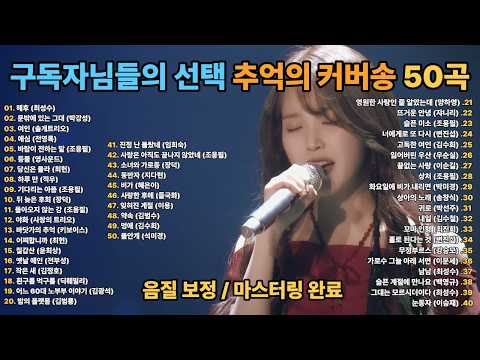
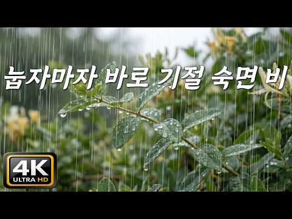
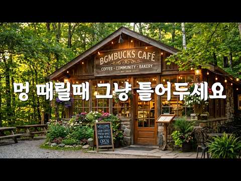
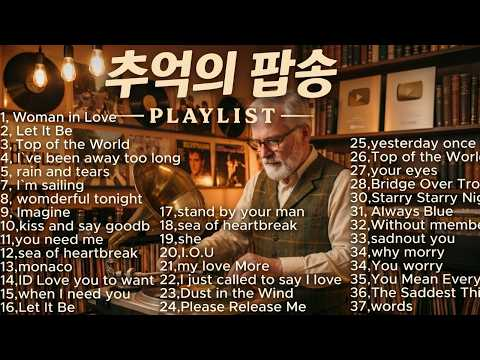

# 음악 — 성공 사례 분석: 사례별 자세히 #961–#1000

`analysis.md` 의 9번 (같은 # 번호). 자동 생성 — `tools/success_analysis.py` v1.5.1 (2026-10-22 07:59 UTC). ※ 연구·교육용 — 투자 권유가 아님.

### 961. Easy Listening Music for Relaxation, Study, Work & Stress Relief ∣ Soft Chill Background …

- https://www.youtube.com/watch?v=W-QDYTQch9c · Luxenza Music · 구독자 4,610 · 조회수 69,306 (×15.0, 하루 578.6) · 좋아요 217 (0.3%) · 18.6분 · 2026-06-24 · 주제 묶음 3. 공부·집중·작업 · 형식 플레이리스트·모음 (여러 곡) · 폴더 `W_W-QDYTQch9c` (웹 승인)
- 썸네일: 
- 설명 앞부분: Welcome to the ultimate Easy Listening Music experience! 🎶 If you're looking for soft, relaxing, and easy listening music to help you unwind, focus, study, work, read, sleep, or simply enjoy a peaceful atmosphere, you've come to the right place. This collection features smooth melodies, calming ins…
- 대본 없음 (설명) — 음성인식이 끝나면 도입부·흐름이 들어감
- 댓글 2/2: 좋은 점 — 영상 0 · 감사·응원 0 · 더 알고 싶은 것 0 · 아쉬운 점 — 영상 0 · 반박·불만 — 의견 다름 0 · 정치·사회 0 · 경험 공유 0 · 구독·다음 기대 0

### 962. [커버송 모음 50곡] (중간 광고 없어요^^:) /그 시절 추억의 노래 50곡/ 구독자 선정곡 1위~50위 ∣ kpop ∣ 커버송 ∣ 통기타 ∣ sunoai …

- https://www.youtube.com/watch?v=av1_naa9D2o · 음악과 여행 · 구독자 26,100 · 조회수 388,855 (×14.9, 하루 4,730.8) · 좋아요 3,086 (0.8%) · 214.9분 · 2026-08-01 · 주제 묶음 9. 가요·발라드·트로트 · 형식 AI 음악 · 폴더 `W_av1_naa9D2o` (웹 승인)
- 썸네일: 
- 설명 앞부분: 강추합니다~^^; 즐감하세요~^^ 작곡 : 작사 : 노래 : sunoai 🎶 감성 가득한 [음악 여행]에 오신 걸 환영합니다! 다양한 장르를 즐기실 수 있습니다. 여러분의 플레이리스트를 더욱 풍성하게 채워드립니다. 음악을 사랑하는 모든 분들을 위한 공간, 지금 바로 함께하세요! 당부 말씀 All copyrights are on this channel "Music and Tour" and are prohibited from unauthorized copying
- 같은 채널 평소 대비 ×363.8 (채널 최근 롱폼 중앙값 1,069회) · 평소 영상: [추억 속으로: 잊지 못할 커버송] "나 어떻게" 원곡: 샌드페블즈 / 밤에 들으면 더 … (1,069회) / [지난 추억을 그리는 트로트 한 잔]- "떠난 내 님아" 국악과 함께하는 애절한 사랑의 … (1,186회)
- 대본 없음 (설명) — 음성인식이 끝나면 도입부·흐름이 들어감
- 댓글 238/240: 좋은 점 — 영상 1 · 감사·응원 33 · 더 알고 싶은 것 3 · 아쉬운 점 — 영상 1 · 반박·불만 — 의견 다름 0 · 정치·사회 0 · 경험 공유 3 · 구독·다음 기대 0
  - 좋은 점 — 영상 👍1 “목소리가 너무 듣기좋와요”
  - 감사·응원 👍42 “노래제목이 없어서 좀 아쉬워 작업울 좀 했습니다. 1집 / 2집 / 3집 / 4집에 이어서 50곡 벌크로 노래 작업해 주신 주인장님께 무한한 감사드립니다 ^^ 두고두고 잘 들을께요 ~~ ^^ 락발라드 노래모음 작업 계속해 주시면 더 더욱 고맙겠습니다. 일렉기타가 더 …”
  - 감사·응원 👍41 “아이고~ 이 주옥같은 곡들을 무더기로 올려 주시다니 고맙게 잘 듣겠습니다 거친 남성보컬 주로 듣다가 여성 보컬은 감성호소에 또다른 매력이 있습니다 사실 일렉기타 리드의 거친 남성보컬은 많은 작품발표로 실컷 들었거든요 물론 남성보컬도 매력이 있습니다 만 여성보컬은 또다…”
  - 더 알고 싶은 것 👍6 “언제들어도 주옥같은 곡입니다 어느가수인지 궁금합니다~~~ 너무나 감사합니다 ❤❤❤”
  - 더 알고 싶은 것 👍1 “그냥.너무.너무.감사할뿐입니다.앞으로도..부탁합니다..”
  - 아쉬운 점 — 영상 👍0 “가사 자막이 나와서 좋아요”
  - 경험 공유 👍4 “전부 제가 좋아하는 노래만 있군요 원곡가수와는 다른 색다른 매력이 있군요”
  - 경험 공유 👍0 “하나같이 제가 좋아하는 곡들이네요, 너무 고맙습니다 좋댓구 누릅니다!❤”

### 963. Cafe Reggae 🌴 Chill Island Vibes ∣ Relaxing Reggae Music for Work, Study & Coffee Time

- https://www.youtube.com/watch?v=407QqF8EBko · AI IRIE FM · 구독자 39,500 · 조회수 585,361 (×14.8, 하루 3,447.0) · 좋아요 6,339 (1.1%) · 61분 · 2026-05-05 · 주제 묶음 4. 카페·매장·라운지 · 형식 플레이리스트·모음 (여러 곡) · 폴더 `W_407QqF8EBko` (웹 승인)
- 썸네일: 
- 챕터: 0:00 Butterflies Again · 2:51 Just Feel Alright · 6:36 I Am Positive · 10:08 Breakfast at a Blue Mountain … · 14:39 Rainy Day in a Cafe · 18:16 I’m Good Right Now (light gro… · 21:31 Every Breeze Reminds Me · 25:08 She Walks Her Own Way · 28:43 Still No Stress, Still Feelin… · 32:01 Where the Roots Grow · 36:12 Where You Are Feels Right · 40:25 Island Mood Lift · 44:56 The Cup Stayed Warm · 48:53 A Song Between Orders · 53:26 Still No Stress · 57:39 You Talk About Her
- 설명 앞부분: Relax and unwind with smooth Cafe Reggae vibes ☕🌴 Perfect background music for your coffee time, work, study, or peaceful moments by the ocean. Let the warm reggae rhythm carry you away to a sunny island terrace, where the breeze is soft and the mind is calm. 🎶 Perfect for: Studying & Focus Working…
- 같은 채널 평소 대비 ×29.1 (채널 최근 롱폼 중앙값 20,111회) · 평소 영상: Let It Flow – Feel-Good Reggae ∣ AI IRIE FM (Lyri… (24,918회) / Lovers Rock Reggae 🌅 Romantic Sunset Vibes ∣ Smoo… (15,304회)
- 대본 없음 (설명) — 음성인식이 끝나면 도입부·흐름이 들어감
- 댓글 129/129: 좋은 점 — 영상 0 · 감사·응원 0 · 더 알고 싶은 것 0 · 아쉬운 점 — 영상 0 · 반박·불만 — 의견 다름 0 · 정치·사회 0 · 경험 공유 0 · 구독·다음 기대 0

### 964. 💎 "신이내린 목소리네요..." 100년에 한번 있을까 말까 한 희귀한 음색 ㄷㄷ;; 귀한 노래만 엄선 ∣ 최신트로트 ∣ 감성트로트ㅣk-trot ∣ 사랑해요 7…

- https://www.youtube.com/watch?v=5vdkZXq8IVY · 7080사랑해요 · 구독자 33,500 · 조회수 489,379 (×14.6, 하루 3,296.2) · 좋아요 9,035 (1.8%) · 68.1분 · 2026-05-26 · 주제 묶음 9. 가요·발라드·트로트 · 형식 AI 음악 · 폴더 `W_5vdkZXq8IVY` (웹 승인)
- 썸네일: 
- 설명 앞부분: "신이내린 목소리네요..." 100년에 한번 있을까 말까 한 희귀한 음색 ㄷㄷ;; 귀한 노래만 엄선 ∣ 최신 트로트 ∣ 뽕짝 트로트ㅣk-trot ∣ 사랑해요 7080 추억의 멜로디가 흐르는 곳, 7080 사랑해요 채널입니다. 이곳은 단순히 음악을 듣는 공간 그 이상의 의미가 있습니다. 옛 시절 젊음의 낭만을 되새기며 잠시나마 시간 여행을 할 수 있는 특별한 공간입니다.
- 같은 채널 평소 대비 ×75.7 (채널 최근 롱폼 중앙값 6,465회) · 평소 영상: 🎵 "와.. 찐 트로트 감성이야요" 첫 소절에 귀가 먼저 반응하는 최신 트로트 명품 음색 (6,465회) / 💎 "봄 꽃보다 더 고운" 청아한 울림... 영혼을 흔드는 순수 100% 음색 ㄷㄷ 🎤 … (6,007회)
- 대본 없음 (설명) — 음성인식이 끝나면 도입부·흐름이 들어감
- 댓글 358/358: 좋은 점 — 영상 7 · 감사·응원 25 · 더 알고 싶은 것 6 · 아쉬운 점 — 영상 4 · 반박·불만 — 의견 다름 0 · 정치·사회 0 · 경험 공유 2 · 구독·다음 기대 0
  - 좋은 점 — 영상 👍15 “5월30일 마늘 정리 천장에 걸고 누워듣는데피로싹 달아나네요 목소리좋고 경쾌반주 감사합니다🎉곡성김삿갓❤”
  - 좋은 점 — 영상 👍7 “가수가 누군지 궁금합니다. 목소리 정말 감미롭고 듣기 좋습니다.”
  - 감사·응원 👍27 “그으ㅡㅁ색. 음정. 으로서. 아름댜운. 미색에. 끄으렸나요. 노래를. 끝일수가없어요. 감사합니다. 참좋아요. 건강하세요. 좋우신. 하루. 하루. 날. 되세요. 감사합니다.”
  - 감사·응원 👍24 “먼저 가버린 그사람이 보고싶군요 감사합니다 그리운목소리 생각나는 목소리 😊 🧚‍♀️”
  - 더 알고 싶은 것 👍7 “가수가 누군지 궁금합니다. 목소리 정말 감미롭고 듣기 좋습니다.”
  - 더 알고 싶은 것 👍5 “정감어린 목소리네요 노래부른분은 누구실까요 궁금하네요 🎉🎉🎉”
  - 아쉬운 점 — 영상 👍5 “목소리가 너무 조아요 잘하셰요😅”
  - 아쉬운 점 — 영상 👍3 “목소리가 너무 좋다 ❤😂🎉”
  - 경험 공유 👍1 “이 목소리는 신보다 윗 선인 즉, 듣는사람 내가내린 목소리가 확실 합니다..너무 감사합니다 .”
  - 경험 공유 👍0 “작곡이 너무 단조롭고 가끔 두번째 소절부터는 앞 소절과. 균형있는 음의 조화가 안되어 있다 일반 대중가요 보다 형편 없다 내가. 작곡해도 이 보다 더 잘 할 수 있다”

### 965. BGMで巡る東京ディズニーランド&ディズニーシー 【総集編 2 】

- https://www.youtube.com/watch?v=PQH90HnjyO4 · ネンサウンド · 구독자 37,600 · 조회수 548,647 (×14.6, 하루 3,125.6) · 좋아요 2,894 (0.5%) · 240.1분 · 2026-04-29 · 주제 묶음 기타 · 형식 정보·해설 (그 밖) · 폴더 `W_PQH90HnjyO4` (웹 승인)
- 썸네일: 
- 설명 앞부분: BGMで巡る東京ディズニーランド、BGMで巡る東京ディズニーシーの総集編動画です。 『BGMで巡る東京ディズニーランド』『BGMで巡る東京ディズニーシー』は、BGMと共に、ディズニーランド、ディズニーシーの様々な風景を楽しむことができる、映像主体のコンテンツです。全ての映像は4K画質のもので、当チャンネルで独自に撮影、編集しました。
- 같은 채널 평소 대비 ×3.9 (채널 최근 롱폼 중앙값 139,741회) · 평소 영상: BGMで巡る東京ディズニーシー⑥《全編4K映像》 (139,741회) / BGMで巡る東京ディズニーランド１１《全編4K》(反時計回り) (141,002회)
- 대본 없음 (설명) — 음성인식이 끝나면 도입부·흐름이 들어감
- 댓글 52/52: 좋은 점 — 영상 0 · 감사·응원 0 · 더 알고 싶은 것 0 · 아쉬운 점 — 영상 0 · 반박·불만 — 의견 다름 0 · 정치·사회 0 · 경험 공유 0 · 구독·다음 기대 0

### 966. 여름 바닷가 테라스카페 커피한잔 너무좋다 ∣Vol.177∣ 7080 라디오 l 올드팝송 명곡 ∣ Coffee Studing Focus [11시간]

- https://www.youtube.com/watch?v=NczlNLq6beY · moka melody · 구독자 14,600 · 조회수 212,684 (×14.6, 하루 1,570.9) · 좋아요 1,297 (0.6%) · 661.1분 · 2026-06-08 · 주제 묶음 4. 카페·매장·라운지 · 형식 플레이리스트·모음 (여러 곡) · 폴더 `W_NczlNLq6beY` (웹 승인)
- 썸네일: 
- 챕터: 0:00 Sunday by the Window 창가에서 보내는… · 4:17 One More Night in June 6월의 또 … · 8:23 Where Summer Stayed 여름이 머물던 곳 · 12:39 Early Summer Serenade 초여름의 세레… · 16:38 Hold This Moment 이 순간을 붙잡고 · 21:32 One More Night in June 6월의 또 … · 25:43 Golden Summer Roads 황금빛 여름길 · 30:53 Old Town Memories 오래된 마을의 추억들 · 34:56 Stay With Me 내 곁에 머물러요 · 39:50 Summer of Friends 친구들과 함께한 여름 · 43:20 The Road We Knew 우리가 알던 그 길 · 47:35 When the Streetlights Glow 가로… · 51:46 We Were Dreamers 그 시절 우리는 꿈을 … · 55:23 Repeat
- 설명 앞부분: 🎧 Old pop music for reading, studying, working, and deep focus This vintage old pop playlist is perfect as background music for coffee time, book reading, writing, study sessions, and work-from-home hours. Many listeners play this music while working quietly, studying for long hours, relaxing in th…
- 같은 채널 평소 대비 ×10.7 (채널 최근 롱폼 중앙값 19,941회) · 평소 영상: 10월, 이 노래 첫 곡부터 너무 좋다🍂 낙엽 질때쯤 생각나는 추억의｜Vol.268｜70… (19,941회) / 9월, 첫 곡부터 너무 좋다🍂 가을엔 이런 노래가 참 좋더라｜Vol.237｜ 7080 추… (19,979회)
- 대본 없음 (설명) — 음성인식이 끝나면 도입부·흐름이 들어감
- 댓글 77/77: 좋은 점 — 영상 2 · 감사·응원 11 · 더 알고 싶은 것 0 · 아쉬운 점 — 영상 0 · 반박·불만 — 의견 다름 0 · 정치·사회 0 · 경험 공유 2 · 구독·다음 기대 0
  - 좋은 점 — 영상 👍1 “부드러운 팝송은 듣기좋은데 해석은 안해주나요~^^”
  - 감사·응원 👍6 “여름이 상큼하게 다가오네요 음악이 너무 좋으네요 감사합니다 ❤”
  - 감사·응원 👍3 “병원 가는 차안에서 남편과 함께 감상하고 있어요 오늘따라 멜로디며 가수 목소리며 왜케 좋은가요~ 황홀해지네요^^ 고맙습니다~ 좋은 하루되세요😊”
  - 경험 공유 👍6 “하늘에 떠 있는 구름이 너무 평화롭게 보이고 파도치는 바닷가도 너무 평화로 보여요. 오늘의 아이스 커피에 크라상 먹고 싶네요. 세월이 빨랐어. 낮에는 여름 날씨 같고 여름 바닷가 테라스 카페에서 자연 풍경 속에 커피 맛은 어떨까? 궁금해지네요. 언젠가는 경험해 보기를…”
  - 경험 공유 👍1 “노래 좋아요 그냥 틀어 놓고 듣고있어요 배경 화면이 성산일출봉 제가 사는 곳 제주입니다~^^”

### 967. 기분전환 200%🔥 도파민 터지는, 신나는 노래들🎧 ∣ EDM ∣ Playlist ∣ 클럽음악 ∣ 노동요 ∣ 플레이리스트

- https://www.youtube.com/watch?v=Tr5-cBvP22g · DJ Corgi · 구독자 13,300 · 조회수 190,651 (×14.3, 하루 1,293.3) · 좋아요 834 (0.4%) · 150.8분 · 2026-05-27 · 주제 묶음 3. 공부·집중·작업 · 형식 플레이리스트·모음 (여러 곡) · 폴더 `W_Tr5-cBvP22g` (웹 승인)
- 썸네일: 
- 챕터: 0:00 I Walk Like I Own It · 2:41 Main Character Mode · 5:00 Born to Win · 7:18 No One Can Stop Me · 9:19 Boss Energy Steps · 11:38 Confidence on Fire · 13:33 I’m the Best Tonight · 16:04 Move Like a Champion · 18:39 Unbreakable Rhythm · 20:41 Head High, Heart Loud · 23:05 Step Into My Power · 25:52 Too Strong to Fall · 28:22 Glow Up Walk · 31:15 Victory in My Veins · 34:20 Watch Me Rise · 37:11 I Walk Like I Own It · 39:38 Main Character Mode · 42:08 Born to Win · 44:15 No One Can Stop Me · 46:30 Boss Energy Steps
- 설명 앞부분: 엉덩이 들썩들썩 도파민 충전하실? 🎧Track
- 같은 채널 평소 대비 ×21.3 (채널 최근 롱폼 중앙값 8,967회) · 평소 영상: 텐션 바로 떡상하는🔥신나는 노래🎧 ∣ EDM ∣ Playlist ∣ 클럽음악 ∣ 노동요 … (8,967회) / 텐션 200%🔥 기분 떡상하는, 신나는 노래🎧 ∣ EDM ∣ Playlist ∣ 클럽음악… (9,076회)
- 대본 없음 (설명) — 음성인식이 끝나면 도입부·흐름이 들어감
- 댓글 31/31: 좋은 점 — 영상 0 · 감사·응원 1 · 더 알고 싶은 것 0 · 아쉬운 점 — 영상 0 · 반박·불만 — 의견 다름 0 · 정치·사회 0 · 경험 공유 1 · 구독·다음 기대 1
  - 감사·응원 👍5 “아침 5:51분 모닝 운동 스타트 뮤직 🎶 🎧 고고 감사합니다”
  - 구독·다음 기대 👍2 “corgi님 구독했습니다^^ 영상들도 모두 AI로 제작을 하신건가요?”

### 968. 눕자마자 바로 기절 숙면 빗소리, [중간광고없음]10분후 검은화면, "머리 대자마자 5분 만에 기절했어요" 😴잡념을 완벽히 지워주는 7시간 고밀도 빗소리, 초고…

- https://www.youtube.com/watch?v=MGtgljKRiaI · 빗소리 자장가 Rain sound lullaby · 구독자 22,300 · 조회수 314,232 (×14.1, 하루 2,298.6) · 좋아요 1,759 (0.6%) · 420분 · 2026-06-07 · 주제 묶음 2. 자연 소리·백색소음 · 형식 자연 소리·백색소음 (음악 낱말 없는 제목) · 폴더 `W_MGtgljKRiaI` (웹 승인)
- 썸네일: 
- 설명 앞부분: 오늘 밤은 침대에 누워 잠들려고 애쓰거나 뒤척이지 마세요. 그저 눕자마자 이 소리를 틀어두기만 하면 됩니다. [빗소리 자장가] 가 설계한 이 프리미엄 고해상도 오디오는 단순히 듣기 좋은 소리를 넘어, 당신이 눕는 순간 침실 주변에 강력한 '사운드 실드' 를 활성화합니다. 정교하게 다듬어진 고밀도 빗소리는 머릿속을 괴롭히던 복잡한 잡념과 외부의 모든 미세한 돌발 소음을 완벽히 중쇄(Masking)하여, 당신의 뇌파를 가장 빠르게 깊은 이완 상태로 이끄는 최고의 '천연 수면제' 가 되어 줄 것입니다. 7시간 동안 흐름이 끊기지 않는 …
- 같은 채널 평소 대비 ×23.0 (채널 최근 롱폼 중앙값 13,642회) · 평소 영상: 한번도 안 깨고 아침까지 기절 수면하는 빗소리, [중간광고없음]10분후 검은화면, "새벽… (13,913회) / 틀자마자 바로 기절 숙면하는 빗소리, [중간광고없음]10분후 검은화면, "아무 생각 없이… (13,370회)
- 대본 없음 (설명) — 음성인식이 끝나면 도입부·흐름이 들어감
- 댓글 54/54: 좋은 점 — 영상 1 · 감사·응원 4 · 더 알고 싶은 것 1 · 아쉬운 점 — 영상 0 · 반박·불만 — 의견 다름 1 · 정치·사회 1 · 경험 공유 3 · 구독·다음 기대 0
  - 감사·응원 👍3 “수면의 질을. 높여주는. 힐링 빗소리 고맙습니다 부디 남들이 자는시간 저도. 잠들수. 있기를 기원해. 봅니다 모든이들이. 저와 같은. 마음으로 쉼의 시간이 되시길. 바람니다 감사합니다”
  - 감사·응원 👍2 “불면증이라 이빗소리듣고잠이들었어요 오늘은잠이오지않네요 불면증약먹었고잠들겠습니다 넘좋아요감사합니다”
  - 더 알고 싶은 것 👍32 “호르몬제는 무서워서 못 먹고 영양제 알아보던 중이에요. 한 번 깨면 다시 잠드는 게 너무 힘들어요. 흡수 잘 된다는 리포좀멜라토닌에 감태·레몬밤·가바 같이 들어간 각성완화제 먹고 있는데 엄청 센 건 아닌데 누우면 좀 차분해지긴 하더라고요. 같은 나이대 분들 어떻게 넘…”
  - 반박·불만 — 의견 다름 👍32 “호르몬제는 무서워서 못 먹고 영양제 알아보던 중이에요. 한 번 깨면 다시 잠드는 게 너무 힘들어요. 흡수 잘 된다는 리포좀멜라토닌에 감태·레몬밤·가바 같이 들어간 각성완화제 먹고 있는데 엄청 센 건 아닌데 누우면 좀 차분해지긴 하더라고요. 같은 나이대 분들 어떻게 넘…”
  - 경험 공유 👍3 “수면의 질을. 높여주는. 힐링 빗소리 고맙습니다 부디 남들이 자는시간 저도. 잠들수. 있기를 기원해. 봅니다 모든이들이. 저와 같은. 마음으로 쉼의 시간이 되시길. 바람니다 감사합니다”

### 969. Relaxing Healing Music for Stress, Anxiety, and Depression 🌿 Heal the Mind, Body, and Soul

- https://www.youtube.com/watch?v=Pxc3SMtKGPo · Clara Monica – Healing Piano 4K · 구독자 3,500 · 조회수 49,164 (×14.1, 하루 987.4) · 좋아요 1,622 (3.3%) · 25.3분 · 2026-09-02 · 주제 묶음 1. 수면·명상·힐링 · 형식 음악 (그 밖 모양 — 한 편짜리 BGM 등) · 폴더 `W_Pxc3SMtKGPo` (웹 승인)
- 썸네일: 
- 설명 앞부분: Relaxing Healing Music for Stress, Anxiety, and Depression 🌿 Heal the Mind, Body, and Soul Relaxing Healing Music for Stress, Anxiety, and Depression 🌿 Heal the Mind, Body, and Soul Relaxing Healing Music for Stress, Anxiety, and Depression 🌿 Heal the Mind, Body, and Soul Let’s take a moment to sit…
- 같은 채널 평소 대비 ×1.5 (채널 최근 롱폼 중앙값 31,792회) · 평소 영상: Relaxing Music for Healing , Anxiety and Depressi… (32,817회) / Relaxing Music Relieves stress, Anxiety and Depre… (30,766회)
- 대본 없음 (설명) — 음성인식이 끝나면 도입부·흐름이 들어감
- 댓글 18/18: 좋은 점 — 영상 0 · 감사·응원 0 · 더 알고 싶은 것 0 · 아쉬운 점 — 영상 0 · 반박·불만 — 의견 다름 0 · 정치·사회 0 · 경험 공유 0 · 구독·다음 기대 0

### 970. Garbh Sanskar Deep Sleep Music 🌙 शांत संगीत ∣ Pregnancy Relaxation Music ∣ SwarMaa

- https://www.youtube.com/watch?v=r-WZM4San-c · Swarmaa · 구독자 16,200 · 조회수 226,362 (×14.0, 하루 1,602.3) · 좋아요 1,168 (0.5%) · 5.5분 · 2026-06-03 · 주제 묶음 1. 수면·명상·힐링 · 형식 음악 (그 밖 모양 — 한 편짜리 BGM 등) · 폴더 `W_r-WZM4San-c` (웹 승인)
- 썸네일: 
- 설명 앞부분: 🌙✨ Garbh Sanskar Deep Sleep Music ∣ Pregnancy Mantra for Baby in Womb ∣ गर्भावस्था नींद संगीत 🙏 SwarMaa परिवार में आपका स्वागत है। 🙏 गर्भावस्था के दौरान शांत और सुकून भरे पल बिताने के लिए प्रस्तुत है यह विशेष Garbh Sanskar Deep Sleep Music। मधुर संगीत, शांत वातावरण और दिव्य भावनाओं से भरपूर यह प्रस…
- 같은 채널 평소 대비 ×524.0 (채널 최근 롱폼 중앙값 432회) · 평소 영상: 🙏 माँ और शिशु के मंगल की पावन प्रार्थना ∣ गर्भ सं… (432회) / 🙏 सावन स्पेशल महामृत्युंजय मंत्र ∣ महादेव की पावन… (419회)
- 대본 없음 (설명) — 음성인식이 끝나면 도입부·흐름이 들어감
- 댓글 39/39: 좋은 점 — 영상 0 · 감사·응원 0 · 더 알고 싶은 것 0 · 아쉬운 점 — 영상 0 · 반박·불만 — 의견 다름 0 · 정치·사회 0 · 경험 공유 0 · 구독·다음 기대 0

### 971. [Playlist]공간의 분위기 채우는☕️[중간광고없음]카페 매장 음악 🎧그냥 틀어두세요, 차 마실 때, 일할 때, 잠잘 때.. 듣는 부드러운선율 ∣ Premi…

- https://www.youtube.com/watch?v=kqvHu52KHmQ · BGMBUCKS  · 구독자 19,800 · 조회수 275,629 (×13.9, 하루 1,678.1) · 좋아요 1,526 (0.5%) · 69.3분 · 2026-05-11 · 주제 묶음 4. 카페·매장·라운지 · 형식 연주 (직접 연주하는 영상) · 폴더 `W_kqvHu52KHmQ` (웹 승인)
- 썸네일: 
- 챕터: 0:00 Raindrops in My Morning Espre… · 4:09 Bitter Morning Brew in April · 9:04 The Empty Seat Across the Tab… · 12:37 Last Sip of Our Shared Silence · 16:10 Midnight Jazz in an Empty Boo… · 20:00 Bitter Steam in the Morning L… · 23:55 Shadows Dancing on the Wet Pa… · 28:07 Counting Raindrops in a Half … · 31:42 The Spring That Forgot Our Na… · 34:52 Tracing Memories in the Coffe… · 39:02 The Silent Rain That Washed A… · 43:26 Two Spoons of Solitude · 46:55 Rainy Streets Seen from a Cor… · 50:33 A Distant Piano in the Foggy … · 54:31 Cold Porcelain and Fading Foo… · 58:09 Watching the World Drip from … · 62:27 The Weight of Unspoken Words · 66:20 The Quietest Hour Before the …
- 설명 앞부분: 창가 너머로 길게 스며드는 따스한 햇살, 그 온기를 닮은 세련되고 부드러운 음악들을 선별했습니다. BGMBUCKS가 준비한 이번 플레이리스트는 고급스러운 카페의 여유로움을 그대로 당신의 공간으로 옮겨다 드립니다. ☕️ Tea Time: 차 한 잔의 여유가 필요한 시간에 💻 Work: 업무나 공부에 집중하고 싶은 순간에 💤 Sleep: 깊은 휴식과 잠을 청하고 싶은 밤에 그 어떤 상황에서도 방해되지 않도록, 공기처럼 자연스럽게 스며드는 음악입니다. 🎧 그냥 편하게 틀어두세요. 🎵Tracklist 브금벅스의 모든 콘텐츠는 제작자의 독…
- 대본 없음 (설명) — 음성인식이 끝나면 도입부·흐름이 들어감
- 댓글 82/82: 좋은 점 — 영상 3 · 감사·응원 7 · 더 알고 싶은 것 0 · 아쉬운 점 — 영상 1 · 반박·불만 — 의견 다름 0 · 정치·사회 0 · 경험 공유 3 · 구독·다음 기대 0
  - 좋은 점 — 영상 👍12 “이 음악은 아무리 들어도 질리지 않아요. 긴 하루 일과를 마치고 긴장을 풀고 편안해지는 데 도움이 되거든요. 제 마음을 달래줄 딱 맞는 시기에 나타나줘서 정말 고마워요.”
  - 좋은 점 — 영상 👍3 “너무 화려하지 않아서 오래 듣기 좋아요 ❤”
  - 감사·응원 👍23 “딸아이가 출산을 앞두고있어 맘이 불안하고 안정되지않아 음악을 고르다 선택해 듣고있으니 맘이 편안해지고 잠시 아무생각도 안나고 괜실히 눈물이 고이네요!! 모든게 감사하게 느껴지며 울딸 건강한 출산할 수 있길 바랍니다. 좋은음악 감사합니다♡”
  - 감사·응원 👍10 “우리집 삼식이 한달에 한번도 외식을 모르는 생활이 이제 지쳤는지 나이가 들어 그런건지 가끔 가슴이 답답하고 화가나네요 그럴때 이런 음악이 큰 위로가 됩니다 음악을 듣고 있으면 안정되고 마음이 정리가 됩니다 책을 보면서 듣기에 딱입니다 감사해요.”
  - 아쉬운 점 — 영상 👍1 “따뜻한 커피 한 잔 마시며 틀어두었는데, 음악의 부드러운 선율 덕분에 공간 전체가 아늑해지는 기분이에요. 중간 광고가 없어서 흐름이 끊기지 않고 온전히 몰입해 쉴 수 있어서 정말 좋습니다. 앞으로도 자주 찾아와서 들을게요! ☕️🎧”
  - 경험 공유 👍10 “우리집 삼식이 한달에 한번도 외식을 모르는 생활이 이제 지쳤는지 나이가 들어 그런건지 가끔 가슴이 답답하고 화가나네요 그럴때 이런 음악이 큰 위로가 됩니다 음악을 듣고 있으면 안정되고 마음이 정리가 됩니다 책을 보면서 듣기에 딱입니다 감사해요.”
  - 경험 공유 👍2 “이 노래가 정말 좋네요.저도혼자우울할때 들으면 좋겠어요.”

### 972. ☀️108𝐓𝐈𝐌𝐄𝐒 Activate High Intelligence: Gayatri Mantra Meditation for Wisdom

- https://www.youtube.com/watch?v=_7EQF3GWDIM · Inner Harmony Mantra · 구독자 24,500 · 조회수 337,308 (×13.8, 하루 1,889.1) · 좋아요 4,366 (1.3%) · 60분 · 2026-04-26 · 주제 묶음 1. 수면·명상·힐링 · 형식 음악 (그 밖 모양 — 한 편짜리 BGM 등) · 폴더 `W__7EQF3GWDIM` (웹 승인)
- 썸네일: 
- 설명 앞부분: Experience the transformative power of ancient chants with this soothing Gayatri Mantra meditation. Let the harmonious melodies guide you to a state of relaxation, healing, and spiritual awakening. Perfect for mindfulness, yoga sessions, or simply finding calm in your day. Sanskrit: Om Bhuur-Bhuvah…
- 같은 채널 평소 대비 ×101.5 (채널 최근 롱폼 중앙값 3,324회) · 평소 영상: ☀️𝟏𝟎𝟖𝐓𝐈𝐌𝐄𝐒 Transform Your Space into a Sanctuary … (3,324회) / ☀️𝟏𝟎𝟖𝐓𝐈𝐌𝐄𝐒 Lost Your Center? Restore Inner Silenc… (3,829회)
- 대본 없음 (설명) — 음성인식이 끝나면 도입부·흐름이 들어감
- 댓글 117/117: 좋은 점 — 영상 0 · 감사·응원 0 · 더 알고 싶은 것 0 · 아쉬운 점 — 영상 0 · 반박·불만 — 의견 다름 0 · 정치·사회 0 · 경험 공유 0 · 구독·다음 기대 0

### 973. 주부들의 휴식 시간을 채워줄 팝송 Best 100 ∣ EverPop 명곡팝 컬렉션 ∣ 올드팝송 ∣ 7080 팝송추천 ∣ 추억의 명곡 Oldies Song

- https://www.youtube.com/watch?v=D4H7ItMDIGU · 추억의 올드팝 EverPop · 구독자 15,800 · 조회수 216,181 (×13.7, 하루 1,634.1) · 좋아요 0 (0.0%) · 117.5분 · 2026-06-12 · 주제 묶음 9. 가요·발라드·트로트 · 형식 플레이리스트·모음 (여러 곡) · 폴더 `W_D4H7ItMDIGU` (웹 승인)
- 썸네일: 
- 설명 앞부분: 주부들의 휴식 시간을 채워줄 팝송 Best 100 ∣ EverPop 명곡팝 컬렉션 ∣ 올드팝송 ∣ 7080 팝송추천 ∣ 추억의 명곡 Oldies Song 저희의 동의 없이 음악을 도용할 수 없습니다. 위반 시 경고를 보내드립니다.
- 같은 채널 평소 대비 ×9.7 (채널 최근 롱폼 중앙값 22,265회) · 평소 영상: 지친 하루 끝 4050이 가장 아끼는 힐링 팝송 ∣ EverPop 심야 감성팝 ∣ 708… (22,265회) / 엄마도 소녀였던 그 시절로 ∣ EverPop 7080 추억의 감성 팝송 Best ∣ 40… (20,106회)
- 대본 없음 (설명) — 음성인식이 끝나면 도입부·흐름이 들어감
- 댓글 57/57: 좋은 점 — 영상 2 · 감사·응원 10 · 더 알고 싶은 것 0 · 아쉬운 점 — 영상 1 · 반박·불만 — 의견 다름 0 · 정치·사회 2 · 경험 공유 4 · 구독·다음 기대 0
  - 좋은 점 — 영상 👍3 “70대 할비도 듣기 좋아요 ^^ 감사합니다.”
  - 좋은 점 — 영상 👍3 “귀에쏙쏙들어오는곡들~옛추억들을소환하내요~”
  - 감사·응원 👍4 “오~우 너무좋아요 원곡자는 너무오래 들어서 약간 지루함이 있었지만 타 가수의 특유함의 음색과 기교가 너무 좋아요 오래들을 수 있도록...^^감사합니다”
  - 감사·응원 👍4 “학창시절 즐겨듣던 음악이네요 예생각에 잠겨봅니다 감사요~~”
  - 아쉬운 점 — 영상 👍4 “오~우 너무좋아요 원곡자는 너무오래 들어서 약간 지루함이 있었지만 타 가수의 특유함의 음색과 기교가 너무 좋아요 오래들을 수 있도록...^^감사합니다”
  - 정치·사회 👍0 “일을행하는 여호와 그것을 지어성취하시는 여호와 그이름을 여호와라 하는자가 이같이 이르노라 너는 내게 부르짖으라 내가 네게 응답하겠고 네가 알지못하는 크고 비밀한일을 네게 보이리라 말씀하신주님 아버지하나님 존경하는 도널드트럼프미국대통령님께서 국정운영하는 미국에 시총3조…”
  - 경험 공유 👍3 “내가 좋아하는 좋은노래 명곡만 올리셨네요 실례지만 퍼가도 될까요?”
  - 경험 공유 👍2 “한글로 자막까지! 감사합니다~ 귀에 익은 멜로디 내가 좋아하는 스타일! 촉촉히 비 오는 날에 들으니 이보다 더 좋을 수 없어요 행복합니다~~~^^”

### 974. 💃🏼노동요 들으면서 파라파라나 춰야겠다ㅣK-POP PLAYLISTㅣRESCENE, AESPA, CORTIS, ILLIT, BTS, STRAY KIDSㅣDJ RU…

- https://www.youtube.com/watch?v=uAE7TcPSJn0 · Tezz Boyz 서테즈와 아이들 · 구독자 38,900 · 조회수 532,154 (×13.7, 하루 4,538.7) · 좋아요 1,562 (0.3%) · 76.1분 · 2026-06-27 · 주제 묶음 10. 팝송·K팝·J팝 · 형식 플레이리스트·모음 (여러 곡) · 폴더 `W_uAE7TcPSJn0` (웹 승인)
- 썸네일: 
- 챕터: 0:00 RESCENE - LOVE ATTACK · 3:00 I.O.I - 갑자기 · 6:14 Hearts2Hearts - Lemon Tang · 8:56 STAYC - 2 LOVE · 11:55 izna - METRONOME · 14:52 BABYMONSTER - SUGAR HONEY ICE… · 17:47 CUTIE STREET - 프리큐큐 · 21:33 aespa - LEMONADE · 24:40 CORTIS - REDRED · 27:23 RIIZE - Do Your Dance · 30:20 ILLIT - It's Me · 32:36 tripleS - Baby Flower · 35:44 NMIXX - Heavy Serenade · 38:43 RESCENE - Runaway · 41:45 BIBI - BUMPA · 45:22 BOYNEXTDOOR - VIRAL · 48:39 LE SSERAFIM - BOOMPALA · 51:35 FIFTY FIFTY - STARSTRUCK · 54:31 Stray Kids - RUN IT · 57:58 BTS - Hooligan
- 설명 앞부분: Best Korean Hiphop DJ Crew "The Takeover Seoul" [Tracklist]
- 같은 채널 평소 대비 ×61.4 (채널 최근 롱폼 중앙값 8,662회) · 평소 영상: 🏃🏻 러닝 템포에 딱 맞춰 듣기 좋은 SM 아이돌 플리ㅣK-POP PLAYLIST FOR… (9,257회) / 미친듯이 잘 노는 대전 힙합 클럽 안 가본 사람?ㅣCLUB HIPHOP MIXㅣDJ DR… (8,068회)
- 대본 없음 (설명) — 음성인식이 끝나면 도입부·흐름이 들어감
- 댓글 23/23: 좋은 점 — 영상 0 · 감사·응원 0 · 더 알고 싶은 것 0 · 아쉬운 점 — 영상 0 · 반박·불만 — 의견 다름 0 · 정치·사회 0 · 경험 공유 1 · 구독·다음 기대 0
  - 경험 공유 👍0 “내가 들어본 플리 중 역대급 ㄷㄷ”

### 975. 매일듣는 편안한 클래식 음악🎵∣🌿힐링 클래식 명곡 모음 #클래식 #클래식 음악 #편안한 클래식

- https://www.youtube.com/watch?v=ek_Tc24cziw · 클래식라이프Classic · 구독자 23,600 · 조회수 321,580 (×13.6, 하루 1,867.7) · 좋아요 2,664 (0.8%) · 55.6분 · 2026-05-03 · 주제 묶음 6. 피아노·클래식·연주곡 · 형식 플레이리스트·모음 (여러 곡) · 폴더 `W_ek_Tc24cziw` (웹 승인)
- 썸네일: 
- 설명 앞부분: 🎼 일상의 리듬을 깨우는 찬란한 선율, 클래식라이프Classic입니다. 반복되는 일상 속에서 문득 에너지가 고갈되었다고 느껴지는 순간이 있으신가요? 오늘은 여러분의 하루에 생동감을 불어넣어 줄 세상에서 가장 편안한 클래식 명곡들을 엄선하여 찾아왔습니다. Playlist (플레이리스트) 🌿 이런 순간에 함께하세요: 나른한 오후: 커피 한 잔과 함께 처진 기분을 단숨에 끌어올리고 싶을 때 집중이 필요한 업무 시간: 복잡한 머릿속을 정리하고 능률을 높여주는 '최고의 노동요' 상쾌한 드라이브: 창밖 풍경을 영화의 한 장면으로 만들어줄 배…
- 같은 채널 평소 대비 ×48.6 (채널 최근 롱폼 중앙값 6,620회) · 평소 영상: 스트레스 풀리는 시원한 여름 클래식 모음 🌊 ∣ 기분 좋아지는 시원한 클래식 BGM #여… (7,445회) / 편안한 아침 클래식 음악🎵∣매일 듣는 편안한 클래식☕∣아침에 듣는 힐링 클래식 명곡 베스… (5,795회)
- 대본 없음 (설명) — 음성인식이 끝나면 도입부·흐름이 들어감
- 댓글 64/65: 좋은 점 — 영상 3 · 감사·응원 13 · 더 알고 싶은 것 1 · 아쉬운 점 — 영상 0 · 반박·불만 — 의견 다름 0 · 정치·사회 0 · 경험 공유 1 · 구독·다음 기대 3
  - 좋은 점 — 영상 👍10 “아침에 듣기 좋네요”
  - 좋은 점 — 영상 👍4 “-고맙습니다!!!제목은 몰랐지만귀에익숙하게평생듣던클래식입니다자세하게설명을잘해주셔서 감상 하는데 느낌이 배가됩니다🎉”
  - 감사·응원 👍14 “편안한 클래식 음악 선사에 감사합니다~~*”
  - 감사·응원 👍9 “감사드립니다❤😊😅😮🎉❤❤”
  - 더 알고 싶은 것 👍6 “1970년대 초 고등학교 시절에는 종로의 클래식 음악감상실에서 음악 숙제 하곤 했었습니다. 예전에는 클래식 소개해 주는 팟방에서 곡의 내용이나 작가에 대한 설명이 있어서 좋았었는데 이렇게 유투브로 접하게 되어 힐링도 되고 너무 좋습니다. 앞으로도 좋은 음악과 설명 부…”
  - 경험 공유 👍6 “1970년대 초 고등학교 시절에는 종로의 클래식 음악감상실에서 음악 숙제 하곤 했었습니다. 예전에는 클래식 소개해 주는 팟방에서 곡의 내용이나 작가에 대한 설명이 있어서 좋았었는데 이렇게 유투브로 접하게 되어 힐링도 되고 너무 좋습니다. 앞으로도 좋은 음악과 설명 부…”
  - 구독·다음 기대 👍7 “곡명과 자세한 설명이 함께 있어서 너무너무 좋아요~~^^** 매일매일 듣구싶어 바로 구독 좋아용~~^^♡♡”
  - 구독·다음 기대 👍4 “음악들이 너무 좋아서 뮤직부분은 처음으로 구독합니다. 번창하세요^^”

### 976. ⠀

- https://www.youtube.com/watch?v=mDkyPzypfuo · islistening  · 구독자 32,400 · 조회수 437,704 (×13.5, 하루 3,528.0) · 좋아요 16,976 (3.9%) · 21.9분 · 2026-06-20 · 주제 묶음 기타 · 형식 플레이리스트·모음 (여러 곡) · 폴더 `W_mDkyPzypfuo` (웹 승인)
- 썸네일: 
- 챕터: 0:00 Nothin’ On You · 3:38 Kiss Me Thru the Phone · 6:52 Favorite Girl · 11:08 One Love · 14:36 Irreplaceable · 18:25 So Sick
- 설명 앞부분: Time Line
- 같은 채널 평소 대비 ×7.5 (채널 최근 롱폼 중앙값 58,493회) · 평소 영상: ⠀ (58,493회) / ⠀⠀ (26,877회)
- 대본 없음 (설명) — 음성인식이 끝나면 도입부·흐름이 들어감
- 댓글 125/127: 좋은 점 — 영상 0 · 감사·응원 3 · 더 알고 싶은 것 2 · 아쉬운 점 — 영상 0 · 반박·불만 — 의견 다름 0 · 정치·사회 0 · 경험 공유 2 · 구독·다음 기대 0
  - 감사·응원 👍244 “기말 일주일 전 벼락치기 시작합니다.. 기적을 기대해보겟음 다들 화이팅”
  - 감사·응원 👍5 “우리 모두 화이팅해요!! 찍은거 다 맞길..🍀”
  - 더 알고 싶은 것 👍7 “진심 들어본 팦송플리중에 진짜 1위임 거의 구라안치고 30번은 들으러 온거 같음 주인장님 이런 플리 더 만들어주세요 제발 ㅜㅜ”
  - 더 알고 싶은 것 👍0 “안녕하세요:) islistening님! 혹시 비즈니스 협업 관련 문의는 어디로 드리면 좋을까요?”
  - 경험 공유 👍0 “나도연애하고싶당”

### 977. 【Nhất Định Phải Nghe Dành Cho Người Mất Ngủ!】Nhạc Piano Nhẹ Nhàng Ru Ngủ Ngon Tuyệt Vời N…

- https://www.youtube.com/watch?v=1-OgDgY_peU · Nhạc Ngủ Thư Giãn · 구독자 48,900 · 조회수 650,742 (×13.3, 하루 5,013.8) · 좋아요 3,531 (0.5%) · 182.7분 · 2026-06-14 · 주제 묶음 6. 피아노·클래식·연주곡 · 형식 음악 (그 밖 모양 — 한 편짜리 BGM 등) · 폴더 `W_1-OgDgY_peU` (웹 승인)
- 썸네일: 
- 설명 앞부분: Bạn có đang trằn trọc giữa đêm khuya, khó đi vào giấc ngủ hoặc thường xuyên thức giấc giữa đêm? Video này được tạo ra dành riêng cho những ai đang tìm kiếm sự bình yên, thư giãn và một giấc ngủ sâu sau một ngày dài mệt mỏi. Những giai điệu piano nhẹ nhàng, du dương và êm ái sẽ từ từ xoa dịu tâm trí…
- 같은 채널 평소 대비 ×19.6 (채널 최근 롱폼 중앙값 33,133회) · 평소 영상: 【100% Không Quảng Cáo】Nhạc Hỗ Trợ Giấc Ngủ Cực Hi… (33,839회) / Nhạc Ru Ngủ Sâu 3 Tiếng😴 Không Quảng Cáo, Giảm Că… (32,427회)
- 대본 없음 (설명) — 음성인식이 끝나면 도입부·흐름이 들어감
- 댓글 184/186: 좋은 점 — 영상 0 · 감사·응원 0 · 더 알고 싶은 것 0 · 아쉬운 점 — 영상 0 · 반박·불만 — 의견 다름 0 · 정치·사회 0 · 경험 공유 0 · 구독·다음 기대 0

### 978. 새벽에 듣기좋은 메이플 로파이 재즈 ∣ 1시간 작업·공부 음악

- https://www.youtube.com/watch?v=N5AE0jDAY2o · DOKANG · 구독자 20,400 · 조회수 271,448 (×13.3, 하루 1,686.9) · 좋아요 4,973 (1.8%) · 63.9분 · 2026-05-14 · 주제 묶음 8. 로파이·시티팝·칠 · 형식 플레이리스트·모음 (여러 곡) · 폴더 `W_N5AE0jDAY2o` (웹 승인)
- 썸네일: 
- 챕터: 0:00 커닝시티 · 2:28 루디브리엄 하늘 · 5:06 도원경 · 7:59 리프레 · 10:33 나무줄기 던전 · 13:47 에오스 탑 외부 · 16:47 판테온 · 19:35 메이플 프랜즈 신수국제학교 도심 · 23:00 오디움 연구자들의 도시·성문으로 가는 길 · 25:39 리버스 시티 Memory of Sunset · 29:03 리엔필드 (보컬) https://youtu.be/Op… · 31:58 LOOP
- 설명 앞부분: 내 두 눈은 하얗게 말라간다. 몇 대 안 되는 승용차와 트럭이 삶과 같은 속도로 도로를 내지르는 모습을 보면서. 본 채널의 모든 음악은 유튜브 영상, 인터넷 방송 등의 배경음악(BGM)으로 사용하실 수 있습니다. 채널명 : DOKANG 음악: [해당 음원 제목] ⚠️ 주의 및 금지 사항 사용 제한: 불법, 혐오 조장, 범죄, 성인물 등 사회적 물의를 일으킬 수 있는 콘텐츠에는 음원 사용을 금지합니다. 본 영상은 넥슨 메이플스토리 IP를 활용한 비공식 2차 창작물입니다.(with AI) Official Nekode Music You…
- 같은 채널 평소 대비 ×24.5 (채널 최근 롱폼 중앙값 11,064회) · 평소 영상: 아르웬: 유리구두 늦네.. 저 이러다가 할머니가 되어버려요 (11,181회) / 지쳐가는 밤, 혼자만의 시간 ∣ 감성 작업 메이플 테일즈위버 음악 모음 (10,946회)
- 대본 없음 (설명) — 음성인식이 끝나면 도입부·흐름이 들어감
- 댓글 155/156: 좋은 점 — 영상 0 · 감사·응원 7 · 더 알고 싶은 것 10 · 아쉬운 점 — 영상 0 · 반박·불만 — 의견 다름 0 · 정치·사회 1 · 경험 공유 2 · 구독·다음 기대 0
  - 감사·응원 👍1 “아 노래 분위기 너무 좋다 바로 구독떄립니다 좋은 음악 감사합니다 많이 올려주세요 제발 !!”
  - 감사·응원 👍1 “잘 듣고 있습니다 고맙습니다 😊😊”
  - 더 알고 싶은 것 👍2 “개별 곡마다 따로도 올려주시면 좋겠어요 ㅠ 그동안 올려주신 것들 중에 안 올려주신 것들도.. 다 랜덤으로 섞어듣고 싶어요..”
  - 더 알고 싶은 것 👍1 “아 노래 분위기 너무 좋다 바로 구독떄립니다 좋은 음악 감사합니다 많이 올려주세요 제발 !!”
  - 정치·사회 👍1 “새벽에 이렇게 운동하면서 맘편이 있을 수 있는 나라가 나라다..”
  - 경험 공유 👍44 “나도 육교에서 저러고 있을때 많은데...ㅎㅎ 옛날엔 달동네 꼭대기 올라가는게 지겹고 힘들었는데 이제 나이가 드니까 달동네 꼭대기 계단에 앉아서 바라보는 석양진 마을풍경이 따뜻하고 낭만적인 향수같은게 느껴진다...”

### 979. [Masterpiece Series] Albinoni Adagio – 4 Variations Songs of Solace

- https://www.youtube.com/watch?v=OFfc765eTgY · WilliamPoeticSolace | 시적인위로 · 구독자 40,600 · 조회수 539,505 (×13.3, 하루 3,050.9) · 좋아요 10,311 (1.9%) · 17.4분 · 2026-04-28 · 주제 묶음 6. 피아노·클래식·연주곡 · 형식 음악 (그 밖 모양 — 한 편짜리 BGM 등) · 폴더 `W_OFfc765eTgY` (웹 승인)
- 썸네일: 
- 챕터: 0:00 Track 1. In the Edge of Silen… · 4:48 Track 2. In the Edge of Silen… · 7:46 Track 3. The Remnant - Sopara… · 12:09 Track 4. In the Edge of Silen…
- 설명 앞부분: "The saddest melody ever written, reborn as a quiet prayer." Albinoni’s Adagio in G Minor is a masterpiece wrapped in mystery, sorrow, and transcendence. Though attributed to Tomaso Albinoni, it was reconstructed by Remo Giazotto from fragments discovered in the ruins of war—giving birth to one of …
- 같은 채널 평소 대비 ×44.7 (채널 최근 롱폼 중앙값 12,058회) · 평소 영상: Geordie + Paganini Sonata No.12 & Counterpoint: 4… (12,179회) / Ukraine Romance - Dark Eyebrows Hazel Eyes : Song… (11,936회)
- 대본 없음 (설명) — 음성인식이 끝나면 도입부·흐름이 들어감
- 댓글 781/781: 좋은 점 — 영상 2 · 감사·응원 58 · 더 알고 싶은 것 3 · 아쉬운 점 — 영상 4 · 반박·불만 — 의견 다름 0 · 정치·사회 6 · 경험 공유 21 · 구독·다음 기대 1
  - 좋은 점 — 영상 👍2 “음이 맑고 깨끝해서 듣기 좋아요..”
  - 좋은 점 — 영상 👍0 “다양한 음악 장르를 듣지만 최애곡 리스트에 들어간 곡 각박한 세상 감정이 메말라져가는 세상이지만 요즘 엣세이 쓰고 있는데 글 쓰는데도 도움이 많이 됩니다 월리엄 감사합니다❤”
  - 감사·응원 👍137 “20여년전 낯선 미국땅에서 대학원을 다니면서 밤이면 홀로 외로움에 떨던 때, 이 슬픈 음악이 큰 위안이 되었었습니다. 왠지 나보다 더 슬픈 무언가가 나를 위로해주는 느낌. 요즘 또 다른 시련으로 삶의 가장 낮은 곳을 헤매이는데, 그런 제게 음악으로 위로의 뜻을 전해주…”
  - 감사·응원 👍75 “슬프고도 정화된 아름다운 선율 듣자마자 바로 구독하고 영혼의 단짝 친구와 공유했습니다 평생을 추구해온 제 삶의 궤적을 위로해주는 선율과 가사는 눈감고 들어도 한마디 한마디가 너무나 아름답습니다 저를 숨기고 제 슬픔을 숨기고 제 진실을 숨기고 모두에게서 옹달샘처럼 숨어…”
  - 더 알고 싶은 것 👍29 “아다지오 평소에 사랑헸던 곡입니다...윌리엄님의 올리신곡은 또다른 멋으로 다가옵니다.사랑합니다.축복합니다.감사합니다.늘 좋은 음악.아름다운음악 부탁드립니다. 건강하세요”
  - 더 알고 싶은 것 👍0 “이새벽에 잠 못들며 세상에서 가장슬픈 클래식 음악 의 변주곡들을 들으면서 만감이 교차하네요... 또한 AI음악의 경이로움을 느낍니다... 감사합니다... 좋은음악 계속 부탁드립니다 ~~ ^^”
  - 아쉬운 점 — 영상 👍1 “아다지오! 많은 편곡을 들어보았지만..... Track 4의 편곡은.... 처음 들었습니다. 벌써 10번을 넘게 반복해서 듣고 있습니다. 태어나서 잠수함을 탄 것은 제주도 우도에서였습니다. 그러나 Track 4는 버지니아급.... 잠수함을 한 대 사서 심해에 들어가고…”
  - 아쉬운 점 — 영상 👍1 “중간 광고가 분위기 확 께네 !”
  - 경험 공유 👍2 “윌리엄님 노래를 듣다보니 나도 모르게 눈물이 납니다..”
  - 경험 공유 👍1 “장맛비가 농막 컨테이너와 나뭇잎, 호박잎, 위에 사정없이 떨어집니다. 비는 부딪치는 사물에 따라 타악기되어 연주합니다. 그 연주속에 파묻혀서 멍 때리며 알비노비 아다지오 늦습니다. 자연과 내가 하나가 되어. . .”
  - 구독·다음 기대 👍75 “슬프고도 정화된 아름다운 선율 듣자마자 바로 구독하고 영혼의 단짝 친구와 공유했습니다 평생을 추구해온 제 삶의 궤적을 위로해주는 선율과 가사는 눈감고 들어도 한마디 한마디가 너무나 아름답습니다 저를 숨기고 제 슬픔을 숨기고 제 진실을 숨기고 모두에게서 옹달샘처럼 숨어…”

### 980. “프린세스 티니핑송“ 피아노 커버(Princess Teenieping Song Piano Cover)

- https://www.youtube.com/watch?v=BS-GSU9dLqk · MUJINS 뮤진스 · 구독자 19,200 · 조회수 253,449 (×13.2, 하루 1,823.5) · 좋아요 1,262 (0.5%) · 6.9분 · 2026-06-05 · 주제 묶음 6. 피아노·클래식·연주곡 · 형식 커버·직접 부른 노래 · 폴더 `W_BS-GSU9dLqk` (웹 승인)
- 썸네일: 
- 챕터: 0:00 노래(AR)와 피아노 연주 · 2:17 피아노 연주만 · 4:32 피아노 연주만(쉬운버전)
- 설명 앞부분: 프린세스 캐치! 티니핑의 ”프린세스 티니핑송“ 피아노 커버입니다! 티니핑 악보는 배포 및 판매가 힘듭니다. 피아노 악보가 함께 있는 영상을 제작했습니다.
- 같은 채널 평소 대비 ×32.9 (채널 최근 롱폼 중앙값 7,695회) · 평소 영상: 리센느 ”Pretty Girl” 피아노 커버 (8,459회) / 치이카와 : 인어섬의 비밀 OST “The Island Song + Siren ver.”… (6,931회)
- 대본 없음 (설명) — 음성인식이 끝나면 도입부·흐름이 들어감
- 댓글 49/50: 좋은 점 — 영상 0 · 감사·응원 2 · 더 알고 싶은 것 0 · 아쉬운 점 — 영상 0 · 반박·불만 — 의견 다름 0 · 정치·사회 0 · 경험 공유 2 · 구독·다음 기대 0
  - 감사·응원 👍7 “뮤진스님 징챠 빠르시네요..🙈 제 요즘 최애 노래인데 연주해주셔서 감사함당 ㅋㅋ 자주 들으러 올게요💗”
  - 감사·응원 👍1 “😊기쁨뻐요❤피아노너무잘치시고힘들지말고하세요제가응원할께”
  - 경험 공유 👍2 “저 다이아나핑을 좋아해요 그리고요 제가 발레을 해요”
  - 경험 공유 👍0 “저도 겨울아이 피아노 치는데”

### 981. 아침까지 기절 숙면 잠 잘 오는 빗소리, [중간광고없음]10분후 검은화면, "눈 뜨니 개운한 아침이에요" 😴 아침까지 꿀잠 예약 7시간 빗소리, 뇌파 안정 천연…

- https://www.youtube.com/watch?v=pkUgoZ7h_2M · 빗소리 자장가 Rain sound lullaby · 구독자 22,300 · 조회수 290,463 (×13.0, 하루 1,807.4) · 좋아요 1,595 (0.5%) · 420분 · 2026-05-14 · 주제 묶음 2. 자연 소리·백색소음 · 형식 자연 소리·백색소음 (음악 낱말 없는 제목) · 폴더 `W_pkUgoZ7h_2M` (웹 승인)
- 썸네일: 
- 설명 앞부분: 잠들기 전의 뒤척임, 그리고 새벽에 작은 소음으로 깨어나는 고통. 오늘 밤은 그 모든 걱정을 내려놓으세요. [빗소리 자장가] 가 설계한 이 영상은 단순한 소리가 아닌, 당신의 침실을 외부와 완벽히 격리하는 '사운드 실드' 입니다. 고밀도 하이파이(Hi-Fi) 사운드로 정교하게 다듬어진 이 빗소리는 주변의 모든 잡음을 덮어버리고, 당신의 뇌파를 가장 깊고 편안한 상태로 이끄는 강력한 `천연 수면제' 가 될 것입니다. 7시간 동안 끊김 없이 이어지는 이 소리에 그저 몸을 맡기세요. 어느새 귓가에 맴돌던 소란은 잦아들고, 당신은 아침 …
- 같은 채널 평소 대비 ×21.3 (채널 최근 롱폼 중앙값 13,642회) · 평소 영상: 한번도 안 깨고 아침까지 기절 수면하는 빗소리, [중간광고없음]10분후 검은화면, "새벽… (13,913회) / 틀자마자 바로 기절 숙면하는 빗소리, [중간광고없음]10분후 검은화면, "아무 생각 없이… (13,370회)
- 대본 없음 (설명) — 음성인식이 끝나면 도입부·흐름이 들어감
- 댓글 40/40: 좋은 점 — 영상 0 · 감사·응원 2 · 더 알고 싶은 것 0 · 아쉬운 점 — 영상 0 · 반박·불만 — 의견 다름 1 · 정치·사회 0 · 경험 공유 0 · 구독·다음 기대 0
  - 감사·응원 👍9 “어느~~ 노래 🎶 보다 더~ 아름다운 빗소리..에 구독! 좋아요. 꾹욱~~ 누르고 갑니다. 고맙습니다.☔️🪻🌱⚘️🥀☘️”
  - 감사·응원 👍1 “계속 잠설쳤는데 감사해요”
  - 반박·불만 — 의견 다름 👍16 “약 없이는 못 자는 악순환이 영 마음에 걸려요. 억지로 잠을 만드는 게 아니라 과하게 깨어 있는 걸 가라앉히는 쪽이라는 각성완화제 먹어봤어요 약처럼 확 자는 건 아닌데 그래도 머릿속이 좀 가라앉는 느낌은 있어요.”

### 982. Faith: You Were Never Walking Alone ∣ Heavenly Meditation Music, Healing

- https://www.youtube.com/watch?v=_psuP3ukwOY · Healing Ether · 구독자 45,400 · 조회수 571,534 (×12.6, 하루 3,481.4) · 좋아요 0 (0.0%) · 71.2분 · 2026-05-11 · 주제 묶음 1. 수면·명상·힐링 · 형식 음악 (그 밖 모양 — 한 편짜리 BGM 등) · 폴더 `W__psuP3ukwOY` (웹 승인)
- 썸네일: 
- 설명 앞부분: Faith: You Were Never Walking Alone ∣ Meditation Music, Deep Sleep Healing There are moments in life when the road ahead disappears into darkness… when fear grows louder than hope, and the weight of the world feels too heavy to carry alone. But faith is the quiet light that still remains when every…
- 같은 채널 평소 대비 ×61.0 (채널 최근 롱폼 중앙값 9,374회) · 평소 영상: Asklepion: A place where you are remade… for anot… (10,093회) / Memory Village: Awaken a Part of You ∣ Deep Sleep… (8,654회)
- 대본 없음 (설명) — 음성인식이 끝나면 도입부·흐름이 들어감
- 댓글 376/381: 좋은 점 — 영상 0 · 감사·응원 2 · 더 알고 싶은 것 0 · 아쉬운 점 — 영상 0 · 반박·불만 — 의견 다름 0 · 정치·사회 0 · 경험 공유 0 · 구독·다음 기대 0
  - 감사·응원 👍3 “감사합니다. 보고 싶군요. 나의 친구 김준영이여. 고맙습니다.”
  - 감사·응원 👍1 “아멘❤ 감사합니다😇 💙🩵💚💛🧡🩷❤️”

### 983. [커버(cover)송] 카페 - "여인" 원곡 : 솔개트리오 / 밤에 들으면 더 좋은 노래 ∣ 가요 ∣ kpop ∣ 커버송 ∣ 통기타 ∣ sunoai

- https://www.youtube.com/watch?v=zmb2j7REliY · 음악과 여행 · 구독자 26,100 · 조회수 328,429 (×12.6, 하루 2,484.4) · 좋아요 505 (0.1%) · 5분 · 2026-06-12 · 주제 묶음 12. 커버·노래 부르기 · 형식 AI 음악 · 폴더 `W_zmb2j7REliY` (웹 승인)
- 썸네일: 
- 설명 앞부분: [카페음악] 커버송, R&B, Cover - "여인" 원곡 : 솔개트리오 강추합니다~^^; 즐감하세요~^^ 작곡 : suno cover 작사 : 노래 : sunoai 🎶 감성 가득한 [음악 여행]에 오신 걸 환영합니다! 다양한 장르를 즐기실 수 있습니다. 여러분의 플레이리스트를 더욱 풍성하게 채워드립니다. 음악을 사랑하는 모든 분들을 위한 공간, 지금 바로 함께하세요! 당부 말씀 All copyrights are on this channel "Music and Tour" and are prohibited from unauthori…
- 같은 채널 평소 대비 ×307.2 (채널 최근 롱폼 중앙값 1,069회) · 평소 영상: [추억 속으로: 잊지 못할 커버송] "나 어떻게" 원곡: 샌드페블즈 / 밤에 들으면 더 … (1,069회) / [지난 추억을 그리는 트로트 한 잔]- "떠난 내 님아" 국악과 함께하는 애절한 사랑의 … (1,186회)
- 대본 없음 (설명) — 음성인식이 끝나면 도입부·흐름이 들어감
- 댓글 25/25: 좋은 점 — 영상 0 · 감사·응원 2 · 더 알고 싶은 것 0 · 아쉬운 점 — 영상 0 · 반박·불만 — 의견 다름 0 · 정치·사회 0 · 경험 공유 0 · 구독·다음 기대 0
  - 감사·응원 👍1 “2절톤엄청좋아요.화이팅”
  - 감사·응원 👍0 “늘 고맙습니다 ❤😅”

### 984. 🌈Album Preview ∣ Find the Full Album in the Playlist ∣ Celestial Piano Music — Aloha Grace

- https://www.youtube.com/watch?v=2qh-NuD0YMs · Calm Music & Wise Words · 구독자 3,470 · 조회수 42,304 (×12.2, 하루 1,266.8) · 좋아요 17 (0.0%) · 4.8분 · 2026-09-18 · 주제 묶음 6. 피아노·클래식·연주곡 · 형식 플레이리스트·모음 (여러 곡) · 폴더 `W_2qh-NuD0YMs` (웹 승인)
- 썸네일: 
- 설명 앞부분: Listen to the full “ Aloha Grace” collection — all 10 piano pieces: This video features samples from all 10 tracks. For the complete album, please listen through the playlist above. More music from the "Ordinary Miracles" collection: For longer piano sessions with wise words: Our visuals are primar…
- 같은 채널 평소 대비 ×386.3 (채널 최근 롱폼 중앙값 110회) · 평소 영상: 🌿Peaceful Piano Music ∣ Sunday Light — Ordinary M… (130회) / 🌈Celestial Piano Music ∣ Graceful Prayer - Aloha … (89회)
- 대본 없음 (설명) — 음성인식이 끝나면 도입부·흐름이 들어감
- 댓글 1/1: 좋은 점 — 영상 0 · 감사·응원 0 · 더 알고 싶은 것 0 · 아쉬운 점 — 영상 0 · 반박·불만 — 의견 다름 0 · 정치·사회 0 · 경험 공유 0 · 구독·다음 기대 0

### 985. Kiven Mukhre Ton Nazraan ∣ Ustad Nusrat Fateh Ali Khan ∣ Dark Ambient Fusion Cover ∣ XAN

- https://www.youtube.com/watch?v=PMqkvHE1cm0 · XAN · 구독자 24,700 · 조회수 297,641 (×12.1, 하루 1,987.7) · 좋아요 3,463 (1.2%) · 4.9분 · 2026-05-25 · 주제 묶음 12. 커버·노래 부르기 · 형식 AI 음악 · 폴더 `W_PMqkvHE1cm0` (웹 승인)
- 썸네일: 
- 설명 앞부분: Experience the soul stirring "Kiven Mukhre Ton Nazraan" like never before. This Dark Ambient Fusion Cover reimagines the timeless NFAK classic through a lens of shadows and atmospheric soundscapes. Credits: Original Composition: Ustad Nusrat Fateh Ali Khan Music Production: XAN Composition: Assiste…
- 같은 채널 평소 대비 ×30.2 (채널 최근 롱폼 중앙값 9,856회) · 평소 영상: Sanson Ki Mala ∣ Dark Mode ∣ XAN (10,124회) / Hum Tum Hon Gay Baadal Ho Ga ∣ Masood Malik ∣ Lo … (9,589회)
- 대본 없음 (설명) — 음성인식이 끝나면 도입부·흐름이 들어감
- 댓글 158/158: 좋은 점 — 영상 0 · 감사·응원 0 · 더 알고 싶은 것 0 · 아쉬운 점 — 영상 0 · 반박·불만 — 의견 다름 0 · 정치·사회 0 · 경험 공유 0 · 구독·다음 기대 0

### 986. 숲에서 쉬는 효과🌳머리가 맑아지는 치유명상음악 ∣ 3시간, 힐링음악, 명상음악 ∣ Relaxing Music, Healing Music

- https://www.youtube.com/watch?v=yq-lSVEu7U0 · 살구사운드 SalguSound · 구독자 10,700 · 조회수 127,389 (×11.9, 하루 4,195.4) · 좋아요 572 (0.4%) · 191.9분 · 2026-09-21 · 주제 묶음 1. 수면·명상·힐링 · 형식 긴 한 곡·반복 (N시간) · 폴더 `W_yq-lSVEu7U0` (웹 승인)
- 썸네일: 
- 설명 앞부분: 안녕하세요. 살구해입니다.😊 이번 한 주도 평온한 마음으로 보내실 수 있길 바라며🌿 편안히 쉬다 가세요.😊 불법 다운로드와 상업적 이용은 금지합니다. Copyright 2026. Salguhae All Rights Reserved. 아름다운 아침 숲 영상과 명상음악🌄 숲 속에 있는 듯🌳 10분만에 머리가 맑아지는 음악 살구해의 첫 번째 앨범 ‘물가에 앉아(at the water's edge)’가 발매되었어요. 멜론, 지니, 유튜브뮤직 등 모든 음원사이트에서 들으실 수 있어요.🌿 본 영상의 비주얼은 생성형 AI 기술과 자체 그래픽 …
- 같은 채널 평소 대비 ×9.6 (채널 최근 롱폼 중앙값 13,333회) · 평소 영상: 마사지 받는 효과😊몸과 마음의 긴장이 풀려요 ∣ 3시간, 힐링음악, 명상음악 ∣ Rela… (13,333회) / 머리가 맑아지는 효과🌿이슬처럼 맑고 잔잔한 치유명상음악 ∣ 3시간, 힐링음악, 명상음악 … (13,546회)
- 대본 없음 (설명) — 음성인식이 끝나면 도입부·흐름이 들어감
- 댓글 43/47: 좋은 점 — 영상 0 · 감사·응원 5 · 더 알고 싶은 것 0 · 아쉬운 점 — 영상 0 · 반박·불만 — 의견 다름 0 · 정치·사회 0 · 경험 공유 0 · 구독·다음 기대 0
  - 감사·응원 👍19 “토요일부터 어지럼증과 권태감으로 움직이질 못하고 있어 우울한 마음을 위로하려 왔습니다. 일상생활의 소중함에 감사하고 혹시 모를 자만으로 타인에게 상처를 주지는 않았나 반성하는 시간이 될 것 같습니다. 모든 분들이 건강하고 행복하시길 진심으로 바랍니다.”
  - 감사·응원 👍5 “숲속의 평온함이 여기까지 느껴지네요. 덕분에 복잡한 머릿속이 맑아지는 것 같아요. 감사합니다.🌿”

### 987. Mama Said ∣ Ogryn Chain Gang Blues Work Song ∣ Warhammer 40K Inspired Music

- https://www.youtube.com/watch?v=H6yrpYWMyRs · Solar Void · 구독자 20,800 · 조회수 246,905 (×11.9, 하루 1,444.5) · 좋아요 6,877 (2.8%) · 6분 · 2026-05-04 · 주제 묶음 2. 자연 소리·백색소음 · 형식 음악 (그 밖 모양 — 한 편짜리 BGM 등) · 폴더 `W_H6yrpYWMyRs` (웹 승인)
- 썸네일: 
- 설명 앞부분: “Mama Said” is a Warhammer 40K inspired Ogryn work song built around the feel of an old chain gang chant: heavy labor, simple call-and-response rhythm, iron chains, mud, artillery, and the brutal everyday work of the Astra Militarum. This track follows Ogryns pulling guns, hauling shells, digging t…
- 같은 채널 평소 대비 ×26.8 (채널 최근 롱폼 중앙값 9,226회) · 평소 영상: AURA FARMED, MY EMPEROR ∣ He Didn’t Even Do Anyth… (9,226회) / Hold Fast, Little Heart ∣ The Goodest Boy ∣ Warha… (9,395회)
- 대본 없음 (설명) — 음성인식이 끝나면 도입부·흐름이 들어감
- 댓글 395/395: 좋은 점 — 영상 0 · 감사·응원 0 · 더 알고 싶은 것 0 · 아쉬운 점 — 영상 0 · 반박·불만 — 의견 다름 0 · 정치·사회 0 · 경험 공유 0 · 구독·다음 기대 0

### 988. 우연히 들었는데 첫 곡부터... 너무 좋다 ∣ 7080 추억의 올드 팝송 모음 Old Pop Song Playlist

- https://www.youtube.com/watch?v=ktav8W-fW8I · theoldpopsong · 구독자 40,800 · 조회수 483,534 (×11.8, 하루 2,710.2) · 좋아요 6,513 (1.4%) · 58.3분 · 2026-04-26 · 주제 묶음 10. 팝송·K팝·J팝 · 형식 플레이리스트·모음 (여러 곡) · 폴더 `W_ktav8W-fW8I` (웹 승인)
- 썸네일: 
- 챕터: 0:00 The Space You Left Behind — 네… · 2:25 A Spring That Still Feels Col… · 5:23 A Memory Painted on the Pavem… · 8:41 A Road Without You — 너 없는 길 · 12:14 A Little Longer Here — 조금 더 머… · 14:56 The Wind That Brings You Back… · 17:42 The Day We Didn’t Notice — 우리… · 20:06 A Petal in the Pages — 책갈피 속 … · 23:35 The Silent Glasshouse — 고요한 온실 · 26:35 A Table for Two — 둘을 위한 자리
- 설명 앞부분: 마음을 차분하게 만들어 주는 봄날의 감성이 담긴 70·80년대 올드팝을 모았습니다. 오래된 멜로디와 따뜻한 음색이 어우러져 복잡했던 하루의 생각들을 천천히 내려놓게 해 줍니다. 마치 LP에서 흘러나오는 듯한 아날로그 감성으로 편안하게 들을 수 있는 음악들입니다. 창가에 앉아 조용히 바람을 느끼듯, 따뜻한 커피 한 잔과 함께 듣기 좋은 노래들. 익숙한 선율과 부드러운 보컬이 공간을 채우며 카페처럼 포근한 분위기를 만들어 줍니다. 이 플레이리스트에는 네가 남기고 간 자리의 여운, 조금은 차갑게 느껴지는 봄날의 공기, 그리고 다시 불어…
- 같은 채널 평소 대비 ×29.2 (채널 최근 롱폼 중앙값 16,580회) · 평소 영상: 9월, 가을 파리의 카페 감성 ... 너무 좋다 ∣ 7080 추억의 올드 팝송 모음 Ol… (16,671회) / 10월의 시작과 함께 듣기 좋은 가을 팝송 ... 너무 좋다 ∣ 7080 추억의 올드 팝… (16,490회)
- 대본 없음 (설명) — 음성인식이 끝나면 도입부·흐름이 들어감
- 댓글 287/287: 좋은 점 — 영상 1 · 감사·응원 39 · 더 알고 싶은 것 5 · 아쉬운 점 — 영상 1 · 반박·불만 — 의견 다름 0 · 정치·사회 0 · 경험 공유 1 · 구독·다음 기대 3
  - 좋은 점 — 영상 👍4 “너무듣기좋아요 힐링되네요 감사합니당”
  - 감사·응원 👍51 “70중반을 살아낸 헤진마음을 보듬어주는 싱어의 음색 백그라운드 밴드는 그야말로 환상의 콜라보네요! 살아낸 회상의 나래속으로 한없이 빠저가고 있네요~~~ 무지무지 감사합니다 ^^♡♡”
  - 감사·응원 👍18 “녹음이 짙어지는 나무와 반짝이는 햇살아래 살랑살랑 불어오는 바람마저 향기롭니다 잔잔한 음악 넘 좋으네요 감사합니다^^”
  - 더 알고 싶은 것 👍2 “누가 부르는지 궁금해요~~”
  - 더 알고 싶은 것 👍0 “이 가수분 이름 알고싶어요? 아시는 분 부탁드립니다”
  - 경험 공유 👍4 “잠자려고 클릭 해봤는데 잠을 못자겠네요~. 첫곡부터,, 언젠가의 뭔가가 아련히 떠오르게 만드는 곡이~....... 감사히 듣습니다~^^”
  - 구독·다음 기대 👍3 “안녕하세요 잘듣고갑니다 그리고 쿡하고 구독하고 갑니다 🎉🎉🎉최고이십니다 🎉🎉🎉행복하세요 ❤❤❤행복하세요 🎉🎉🎉행복하세요”
  - 구독·다음 기대 👍2 “❤❤❤구독하고 듣고있어요~”

### 989. 가을이 오면... 커피향이 가득한 카페에서 듣고 싶은 음악

- https://www.youtube.com/watch?v=4lPZuU2kCbA · EverOldies · 구독자 44,800 · 조회수 529,822 (×11.8, 하루 10,940.1) · 좋아요 5,166 (1.0%) · 96.9분 · 2026-09-03 · 주제 묶음 4. 카페·매장·라운지 · 형식 음악 (그 밖 모양 — 한 편짜리 BGM 등) · 폴더 `W_4lPZuU2kCbA` (웹 승인)
- 썸네일: 
- 챕터: 0:00 I Will Be With You · 3:17 I Heard Your Name · 6:20 Locking the Past · 8:36 How Have You Been · 11:44 I Wish You Well · 15:14 Somewhere in My Memory · 19:03 You Were in Everything · 22:11 Thank You for Everything · 26:06 After All This Time · 29:08 Dear Distant Soul · 32:17 Replay
- 설명 앞부분: 가을이 오면 따뜻한 커피 한잔과 오래된 노래가 생각납니다. 커피향이 가득한 카페에 앉아 창밖을 바라보며 천천히 듣고 싶은 음악을 담았습니다. 7080 올드팝의 따뜻하고 아련한 감성, 부드러운 여성 보컬과 편안한 멜로디가 어우러진 Old Pop Playlist입니다. 누군가를 기다리던 시간도, 문득 떠오르는 얼굴도, 이제는 희미해진 지난날의 기억도 음악을 듣다 보면 어느새 다시 가까워집니다. 바쁜 하루 중 잠시 쉬고 싶을 때, 혼자 커피를 마시며 생각에 잠기고 싶을 때, 그리고 추억의 팝송과 7080 감성의 올드팝이 그리울 때 함께…
- 같은 채널 평소 대비 ×64.7 (채널 최근 롱폼 중앙값 8,185회) · 평소 영상: 오래 전 추억이 떠오르는 노래 ∣ 5060 추억의 올드팝 Playlist (8,185회) / 듣는 순간 가슴이 뭉클해지는 빈티지 올드팝 ∣ 6070 추억의 올드팝 Playlist (7,899회)
- 대본 없음 (설명) — 음성인식이 끝나면 도입부·흐름이 들어감
- 댓글 292/316: 좋은 점 — 영상 6 · 감사·응원 29 · 더 알고 싶은 것 1 · 아쉬운 점 — 영상 0 · 반박·불만 — 의견 다름 0 · 정치·사회 0 · 경험 공유 3 · 구독·다음 기대 0
  - 좋은 점 — 영상 👍3 “정말 듣기 좋군요~❤”
  - 좋은 점 — 영상 👍2 “가을이 오래 동안 있었으면 좋겠어요 바람이 선선하니 올드팝송 듣기 좋아요”
  - 감사·응원 👍56 “감기로 인해 급성후두염 진단을 받았네요~ 되도록 말을 하지 말라니 입꾹닫하고 지냅니다 누워서 눈감고 들었어요~ 간간히 잠이 들기도 했나봅니다~😊 감성충만하고 편안한 노래~ 들려주셔서 고맙습니다~😊❤❤”
  - 감사·응원 👍25 “마음이 릴렉스 되는 음악이네요. 좋은음악 감사 합니다”
  - 더 알고 싶은 것 👍1 “계절의 변화따라 마음도 기분도 바뀌는 것 같네요. 새벽 안개 자욱한 메타세콰이어 나무가 끝도없이 즐비한 곳에서 들으면 아주 몽환적일 것 같아요^^ 곡의 이름을 모두 알 수 있을까요?”
  - 경험 공유 👍8 “노래 음률이 차분하고 조용하니 좋으네요..가을이 눈앞에 펼쳐질 나날들..내가 좋아하는 나무님도 가러움증 빨리 완치되어 정상적으로 포근하게 잘 자길 빌면서..나무는 내 안식처 ..매미의 집이죠”
  - 경험 공유 👍0 “가을이 오면(이문세) 가을이 오면 가실 할 수 있는 쭉정이라도 있으면 했어 그런데 도리어 곳간의 쌀알만 쥐들이 훔쳐 가버렸네 가을이 오면 누군가 나에게 다가왔으면 했어 그런데 도리어 내 기억속의 사람들만 더 떠나가 버렸네 가을이 오면 내가 그 위로를 받을 수 있을 때…”

### 990. Awit ng Paghahangad by Bukas Palad Music Ministry ∣ Senti Piano Cover ∣ Clyde Pianist ∣ 4K

- https://www.youtube.com/watch?v=5yDRTUMvk3I · Clyde Pianist | Senti Piano Covers · 구독자 12,000 · 조회수 141,394 (×11.8, 하루 1,224.8) · 좋아요 1,035 (0.7%) · 7.2분 · 2026-06-28 · 주제 묶음 6. 피아노·클래식·연주곡 · 형식 커버·직접 부른 노래 · 폴더 `W_5yDRTUMvk3I` (웹 승인)
- 썸네일: 
- 설명 앞부분: Awit ng Paghahangad by Bukas Palad Music Ministry ∣ Senti Piano Cover ∣ Clyde Pianist ∣ 4K Relaxing piano music perfect for: Sleeping Studying Late-night listening Relaxing moments Subscribe for more OPM and senti piano covers every week! FOLLOW ME If you would like to show your support: Paypal: pa…
- 같은 채널 평소 대비 ×26.6 (채널 최근 롱폼 중앙값 5,312회) · 평소 영상: Itchyworms - Beer (Senti Piano Cover) ∣ Clyde Pia… (5,841회) / Valentine – Jim Brickman ft. Martina McBride ∣ Pi… (4,782회)
- 대본 없음 (설명) — 음성인식이 끝나면 도입부·흐름이 들어감
- 댓글 102/102: 좋은 점 — 영상 0 · 감사·응원 0 · 더 알고 싶은 것 0 · 아쉬운 점 — 영상 0 · 반박·불만 — 의견 다름 0 · 정치·사회 0 · 경험 공유 0 · 구독·다음 기대 0

### 991. 정서안정과 고운 마음을 위한 잔잔하고 아름다운 음악 l 어린이집 유치원 교실 편안한 배경 음악

- https://www.youtube.com/watch?v=ONTpCdvC9mo · 조이멜로디 JOY MELODY · 구독자 21,600 · 조회수 249,862 (×11.6, 하루 1,474.8) · 좋아요 2,025 (0.8%) · 82.3분 · 2026-05-05 · 주제 묶음 기타 · 형식 음악 (그 밖 모양 — 한 편짜리 BGM 등) · 폴더 `W_ONTpCdvC9mo` (웹 승인)
- 썸네일: 
- 설명 앞부분: 유아들의 정서 안정과 고운 마음을 키워주는 잔잔하고 아름다운 배경 음악. 💛 모든 곡이 좋은 또 다른 산뜻한 배경음악
- 같은 채널 평소 대비 ×24.6 (채널 최근 롱폼 중앙값 10,175회) · 평소 영상: 정서 안정을 위한 잔잔하고 시원한 배경음악┃어린이집 유치원 교실 편안한 배경 음악 (10,175회) / 3시간 마음이 따뜻해지는 부드러운 놀이음악 ㅣ 어린이집 유치원 교실 배경음악ㅣ 차분한 아… (11,477회)
- 대본 없음 (설명) — 음성인식이 끝나면 도입부·흐름이 들어감
- 댓글 0/0: 좋은 점 — 영상 0 · 감사·응원 0 · 더 알고 싶은 것 0 · 아쉬운 점 — 영상 0 · 반박·불만 — 의견 다름 0 · 정치·사회 0 · 경험 공유 0 · 구독·다음 기대 0

### 992. 싱그러운 여름 아침, 꽃향기가 스며드는 기분좋은 카페음악 ∣ 계속 듣게 되는 감성팝송 ∣ Old Pop Playlist

- https://www.youtube.com/watch?v=EnD2m1z3fkM · 선율향기 · 구독자 11,500 · 조회수 132,588 (×11.5, 하루 1,008.9) · 좋아요 1,661 (1.2%) · 91.5분 · 2026-06-12 · 주제 묶음 4. 카페·매장·라운지 · 형식 플레이리스트·모음 (여러 곡) · 폴더 `W_EnD2m1z3fkM` (웹 승인)
- 썸네일: 
- 설명 앞부분: 초록이 가장 짙어지는 계절, 맑은 물결이 흐르는 강가에는 꽃들이 저마다의 색으로 피어나고, 창가에는 따뜻한 햇살이 조용히 머물러 있습니다. 좋아하는 음악 한 곡, 따뜻한 차 한 잔, 그리고 아무 말 없이 바라볼 수 있는 풍경 하나. 그것만으로도 충분히 행복했던 순간들이 문득 떠오르는 날입니다. 오늘은 7080 감성팝송과 함께 잠시 쉬어가는 시간을 가져보세요. 꽃향기 스며든 강가의 풍경처럼, 따뜻한 멜로디도 당신의 하루에 잔잔한 여운으로 머물기를 바랍니다 ☕🌿 As summer deepens and the greenery grows…
- 같은 채널 평소 대비 ×33.9 (채널 최근 롱폼 중앙값 3,913회) · 평소 영상: 가을이 조용히 반겨주는 듯한 감미로운 카페음악 ∣ 분위기를 살려주는 감성팝송 ∣ 🎵 Ol… (4,496회) / 무더운 7월, 시원한 계곡에서 조용히 쉬어가는 카페음악 ∣ 편안한 휴식을 전하는 감성팝송… (4,580회)
- 대본 없음 (설명) — 음성인식이 끝나면 도입부·흐름이 들어감
- 댓글 72/72: 좋은 점 — 영상 0 · 감사·응원 11 · 더 알고 싶은 것 0 · 아쉬운 점 — 영상 0 · 반박·불만 — 의견 다름 0 · 정치·사회 0 · 경험 공유 0 · 구독·다음 기대 0
  - 감사·응원 👍6 “안넝하세요. ᆢ. 주말아침에 수고가 많으십니다 ᆢ. 언제나 좋은음악 고맙습니다. ❤❤❤”
  - 감사·응원 👍4 “아늑하게 느껴지는 노래 잘 들었습니다. 조용한 노래 태그 만들기가 쉽지 않은데 많은 노력을 하신 것 같아요. 응원합니다.❤❤”

### 993. The Odyssey - Odysseus (EPIC Piano Cover)

- https://www.youtube.com/watch?v=jtUq7gMr-7k · Laurie Théberge · 구독자 46,000 · 조회수 529,808 (×11.5, 하루 5,589.2) · 좋아요 8,025 (1.5%) · 6.3분 · 2026-07-19 · 주제 묶음 6. 피아노·클래식·연주곡 · 형식 커버·직접 부른 노래 · 폴더 `W_jtUq7gMr-7k` (웹 승인)
- 썸네일: 
- 설명 앞부분: Equipement I use: The Piano is a Kawai Es110 keyboard There’s a led strip connected to the keyboard via a software to make the keys ‘light up’. Tutorial by Aleksander Evening. I record in Ableton. Piano sound is from the VST ‘Noire Piano’ Visuals in Seemusic Edited in Davinci Resolve Ok so while ma…
- 같은 채널 평소 대비 ×39.8 (채널 최근 롱폼 중앙값 13,321회) · 평소 영상: The Amazing Spider-Man 1&2 - Main Theme Suite (EP… (13,321회) / HALO - Main Theme (EPIC Piano Cover) (12,609회)
- 대본 없음 (설명) — 음성인식이 끝나면 도입부·흐름이 들어감
- 댓글 192/192: 좋은 점 — 영상 0 · 감사·응원 0 · 더 알고 싶은 것 0 · 아쉬운 점 — 영상 0 · 반박·불만 — 의견 다름 0 · 정치·사회 0 · 경험 공유 0 · 구독·다음 기대 0

### 994. 한 줌 흙으로 돌아가는 길 ∣ 황혼길의 깨달음 국악 판소리트로트

- https://www.youtube.com/watch?v=Vb3VooJUgyk · Nana Music · 구독자 10,000 · 조회수 114,613 (×11.5, 하루 941.1) · 좋아요 960 (0.8%) · 7.6분 · 2026-06-22 · 주제 묶음 9. 가요·발라드·트로트 · 형식 음악 (그 밖 모양 — 한 편짜리 BGM 등) · 폴더 `W_Vb3VooJUgyk` (웹 승인)
- 썸네일: 
- 설명 앞부분: 태어날 때는 빈손으로 왔고, 떠날 때도 빈손으로 갑니다. 그런데 우리는 살아가며 무엇을 그리 다투고, 무엇을 그리 움켜쥐며 살고 있을까요? 세월은 강물처럼 흘러가고, 젊음은 어느새 추억이 되었습니다. 이 노래는 인생의 황혼길에 선 한 노인이 지나온 세월을 돌아보며 깨달은 이야기를 담았습니다. 재물도 명예도 결국은 두고 가지만, 사람과 사람 사이의 따뜻한 정(情)은 마지막까지 가슴에 남는다는 것을 노래합니다. 잠시 바쁜 삶을 멈추고, 이 노래와 함께 자신의 인생을 돌아보는 시간이 되시길 바랍니다. 🎵 제목 : 한 줌 흙으로 가는 인…
- 같은 채널 평소 대비 ×135.2 (채널 최근 롱폼 중앙값 848회) · 평소 영상: 고달픈 인생길 천 번을 넘어져도 일어나리라 🌸 국악 판소리 발라드 (848회) / 해방과 6.25 보릿고개를 겪어오신 90세 어머니의 세월… 누가 다 헤아릴 수 있으리 ∣… (787회)
- 대본 없음 (설명) — 음성인식이 끝나면 도입부·흐름이 들어감
- 댓글 106/110: 좋은 점 — 영상 2 · 감사·응원 10 · 더 알고 싶은 것 0 · 아쉬운 점 — 영상 0 · 반박·불만 — 의견 다름 1 · 정치·사회 0 · 경험 공유 1 · 구독·다음 기대 0
  - 좋은 점 — 영상 👍2 “올. 여름도 무사히 보내고 말복도 맞이하고 조석으로 상꽤한 가을에 문턱에 접어 드는 길목에서 좋은 노래 듣다보니 어느새 가슴속 깊이 와닿는 가사 내용 마력에 빠져드니 어찌 하오리 마냥 좋은걸 내삶에 뒤안길 반성하고 많이 배워 갑니다 좋은 노래 올려 주신 al 관계자분…”
  - 좋은 점 — 영상 👍2 “우리인생 한줌재가 되고 한줌 흙이 되건만 그러게요 뭘 가져 가겠다고 아등바등 살았는지 노래 가사에 가슴 미어집니다 메고 지고 안고 갈것도 아닌데 헛된인생 살아 왔지만 늦은 이나이에 지금에와서 깨닫고 느끼며 내인생에게 고맙다고 수고했다고 얘기해주고 싶어요 좋은 노랫말 …”
  - 감사·응원 👍6 “오늘도 살아 숨쉴 수 있음 부처님께 감사하며 살아가고 있습니다 인생사 거기서 거기지요”
  - 감사·응원 👍4 “정말 좋은가사며 좋은노래입니다. 감사함.”
  - 반박·불만 — 의견 다름 👍2 “우리인생 한줌재가 되고 한줌 흙이 되건만 그러게요 뭘 가져 가겠다고 아등바등 살았는지 노래 가사에 가슴 미어집니다 메고 지고 안고 갈것도 아닌데 헛된인생 살아 왔지만 늦은 이나이에 지금에와서 깨닫고 느끼며 내인생에게 고맙다고 수고했다고 얘기해주고 싶어요 좋은 노랫말 …”

### 995. [𝗣𝗹𝗮𝘆𝗹𝗶𝘀𝘁] 인스타에서 한번쯤 들어본 느@좋 플리

- https://www.youtube.com/watch?v=4qcGtkqrfMk · 프리다앤 / FRIDA-ANNE · 구독자 41,500 · 조회수 473,086 (×11.4, 하루 2,767.3) · 좋아요 9,699 (2.1%) · 60.8분 · 2026-05-04 · 주제 묶음 11. 힙합·R&B·EDM · 형식 플레이리스트·모음 (여러 곡) · 폴더 `W_4qcGtkqrfMk` (웹 승인)
- 썸네일: 
- 설명 앞부분: 알앤비, 힙합, 일렉트로니카 TIME LINE MilliMax Zombie (feat. DRIP TARKO) DIMO REX SAY MY NAME Kid Milli Wassup SYSTEM SEOUL & ycs Korean Hamin & Inti San Don't do it 나우아임영 & 수도 KiiiKiii (키키) 404 (New Era) Yere Im Ballin RYUL of LNGSHOT & LOUIS of LNGSHOT Thinking KC & 식케이 & 김하온 & JMIN OUTTA SPACE 릴러말즈 (Leellam…
- 같은 채널 평소 대비 ×49.6 (채널 최근 롱폼 중앙값 9,530회) · 평소 영상: [𝗣𝗹𝗮𝘆𝗹𝗶𝘀𝘁] 사랑에 빠진게 죄는 아니잔ㅎ아ㅎ (9,566회) / [𝗣𝗹𝗮𝘆𝗹𝗶𝘀𝘁] 기가 막히고 귀가 뚫리는 음악 (9,495회)
- 대본 없음 (설명) — 음성인식이 끝나면 도입부·흐름이 들어감
- 댓글 19/19: 좋은 점 — 영상 0 · 감사·응원 0 · 더 알고 싶은 것 0 · 아쉬운 점 — 영상 0 · 반박·불만 — 의견 다름 0 · 정치·사회 0 · 경험 공유 1 · 구독·다음 기대 0

### 996. 🔥한 번 들으면 멈출 수 없는 역설적 감성🔥 락트롯 ∣ 가슴속 응어리를 뻥~ 뚫어버리는 사이다 보컬 ∣ 도시광상곡 (Phantasia)

- https://www.youtube.com/watch?v=LmEOZx2IH9M · 노래마실 [ Music Town ] · 구독자 2,790 · 조회수 31,666 (×11.3, 하루 253.4) · 좋아요 219 (0.7%) · 4.3분 · 2026-06-19 · 주제 묶음 9. 가요·발라드·트로트 · 형식 플레이리스트·모음 (여러 곡) · 폴더 `W_LmEOZx2IH9M` (웹 승인)
- 썸네일: 
- 설명 앞부분: 형식에 얽매이지 않고 격정적인 환상을 펼쳐내는 '광상곡(Phantasia)'이라는 제목에 걸맞게, 이 곡은 어울리지 않을 것 같은 이질적인 장르들을 황금 비율로 녹여내며 리스너들에게 묘한 중독성을 선사한다. 밤거리를 질주하는 듯한 빠른 템포의 베이스라인은 심장 소리를 대변하듯 숨 가쁘게 몰아치며 몸을 들썩이게 만든다. 이 곡의 가장 큰 백미는 단연 압도적인 여성 락 보컬의 가창력이다. 신나는 디스코 비트 위에서 보컬은 연약하게 슬퍼하는 대신, 하드 락 고유의 파워풀한 벨팅(Belting) 창법으로 가슴속 응어리를 시원하게 내지른다…
- 같은 채널 평소 대비 ×59.0 (채널 최근 롱폼 중앙값 537회) · 평소 영상: 국악 명상음악 3시간｜불안과 스트레스를 비우는 깊은 힐링 연주 (550회) / 🚀 한번 들으면 귀에서 맴도는 하이텐션 트로트 ∣ 한 많은 내 청춘, 노을처럼 타오르리라… (524회)
- 대본 없음 (설명) — 음성인식이 끝나면 도입부·흐름이 들어감
- 댓글 19/19: 좋은 점 — 영상 0 · 감사·응원 0 · 더 알고 싶은 것 0 · 아쉬운 점 — 영상 0 · 반박·불만 — 의견 다름 0 · 정치·사회 1 · 경험 공유 0 · 구독·다음 기대 0
  - 정치·사회 👍1 “경제 외교 빼고 뭘 잘하고 있나요? 이 전통적 지지층의 의사를 깡끄리 무시하고 배반하고 잘 될꺼라 봅니까? 아닌건 아니라고 말을 할 줄 아는 의원님이 되시길 부탁합니다. 진짜 민주당, 청와대 이따위로 하면 안됩니다. 선거만 되면 엄 청 개혁에 적극적인척, 내란세력도 …”

### 997. 「영화 〈애수〉, 다시 노래가 되다｜세월이 지나도 남는 영화

- https://www.youtube.com/watch?v=cIBIrAEYVZM · 절로 가는 이야기 · 구독자 2,560 · 조회수 29,000 (×11.3, 하루 1,786.4) · 좋아요 347 (1.2%) · 4.6분 · 2026-10-06 · 주제 묶음 기타 · 형식 음악 (그 밖 모양 — 한 편짜리 BGM 등) · 폴더 `W_cIBIrAEYVZM` (웹 승인)
- 썸네일: 
- 설명 앞부분: 마음이 고요해지는 클래식 음악에서, 한 권의 경전에서, 때로는 한 편의 영화에서도 영감을 얻어 아름다운 노랫말로 풀어내시는 김원재스님. 시인으로 등재되어 있을 만큼 풍부한 감성을 지니신 스님께서는 음악과 영화, 경전 속에서 느낀 감정과 여운을 때로는 찬불가로, 때로는 대중적인 노랫말로 담아내십니다. 다양한 장르의 찬불가가 더 많은 분들께 사랑받기를 바라는 마음으로 여러 곡을 발표해오셨지만, 아직 불자들에게 널리 알려지지 않은 아름다운 곡들도 많습니다. 그래서 찬불가의 아름다움을 조금 더 가까이 알리고 불자가 아닌 분들도 편안하게 …
- 같은 채널 평소 대비 ×10.3 (채널 최근 롱폼 중앙값 2,803회) · 평소 영상: 관세음보살만 부르려고 하면 (2,824회) / 부처님 구제에도 조건이 있다?｜천태종 양산사 일초스님 법문 (2,782회)
- 대본 없음 (설명) — 음성인식이 끝나면 도입부·흐름이 들어감
- 댓글 43/43: 좋은 점 — 영상 1 · 감사·응원 3 · 더 알고 싶은 것 0 · 아쉬운 점 — 영상 0 · 반박·불만 — 의견 다름 0 · 정치·사회 0 · 경험 공유 0 · 구독·다음 기대 0
  - 좋은 점 — 영상 👍2 “노래 자체가 정말 넘 듣기 좋고 감동이네요~”
  - 감사·응원 👍4 “감사합니다”
  - 감사·응원 👍3 “노랫말 한 구절 한 구절이 한 편의 고운 시이자 깊은 법문 같습니다. 이런 맑고 고운 음악을 선물해 주셔서 감사합니다.”

### 998. Rod Wave - It Will All Work Out - (Official Music Video)

- https://www.youtube.com/watch?v=OHYv2zYBdfU · Street Empire Music  · 구독자 1,570 · 조회수 17,757 (×11.3, 하루 134.7) · 좋아요 302 (1.7%) · 13분 · 2026-06-12 · 주제 묶음 기타 · 형식 한 곡 (뮤직비디오·음원·가사) · 폴더 `W_OHYv2zYBdfU` (웹 승인)
- 썸네일: 
- 같은 채널 평소 대비 ×27.6 (채널 최근 롱폼 중앙값 644회) · 평소 영상: Rod Wave - Unshaken (Official Music Video) (668회) / Rod Wave - Don't Give Up On Your Dreams (Official… (619회)
- 대본 없음 (없음) — 음성인식이 끝나면 도입부·흐름이 들어감
- 댓글 5/5: 좋은 점 — 영상 0 · 감사·응원 0 · 더 알고 싶은 것 0 · 아쉬운 점 — 영상 0 · 반박·불만 — 의견 다름 0 · 정치·사회 0 · 경험 공유 0 · 구독·다음 기대 0

### 999. Enthiran BGM ∣ A.R. Rahman ∣ 80-Piece Symphony Orchestra

- https://www.youtube.com/watch?v=swMgOH67TdI · Australian Indian Orchestra · 구독자 32,100 · 조회수 347,042 (×10.8, 하루 2,425.1) · 좋아요 9,424 (2.7%) · 8.5분 · 2026-06-01 · 주제 묶음 6. 피아노·클래식·연주곡 · 형식 음악 (그 밖 모양 — 한 편짜리 BGM 등) · 폴더 `W_swMgOH67TdI` (웹 승인)
- 썸네일: 
- 설명 앞부분: Experience the thunderous Enthiran BGM performed LIVE by the Australian Indian Orchestra. This sweeping live orchestra cover captures the futuristic scale and pulse-pounding intensity of A.R. Rahman's original score for the sci-fi epic, delivered through a massive 80-piece ensemble. 🎵 Stay Connecte…
- 대본 없음 (설명) — 음성인식이 끝나면 도입부·흐름이 들어감
- 댓글 486/486: 좋은 점 — 영상 0 · 감사·응원 0 · 더 알고 싶은 것 0 · 아쉬운 점 — 영상 0 · 반박·불만 — 의견 다름 0 · 정치·사회 0 · 경험 공유 0 · 구독·다음 기대 0

### 1000. 【ドッカンバトル】超サイヤ人孫悟空 変身 bgm

- https://www.youtube.com/watch?v=nwzLO39prTs · メガゲン · 구독자 21,200 · 조회수 225,198 (×10.6, 하루 1,445.4) · 좋아요 1,290 (0.6%) · 10.1분 · 2026-05-19 · 주제 묶음 기타 · 형식 음악 (그 밖 모양 — 한 편짜리 BGM 등) · 폴더 `W_nwzLO39prTs` (웹 승인)
- 썸네일: 
- 같은 채널 평소 대비 ×8.0 (채널 최근 롱폼 중앙값 28,024회) · 평소 영상: 【レジェンズ】超サイヤ人孫悟飯（未来）&超サイヤ人トランクス（青年期）bgm (28,024회) / 【ドッカンバトル】バーチャルドッカン大乱戦Ver.3.0_BOSS出現bgm (27,836회)
- 대본 없음 (없음) — 음성인식이 끝나면 도입부·흐름이 들어감
- 댓글 374/375: 좋은 점 — 영상 0 · 감사·응원 0 · 더 알고 싶은 것 0 · 아쉬운 점 — 영상 0 · 반박·불만 — 의견 다름 0 · 정치·사회 0 · 경험 공유 0 · 구독·다음 기대 0

