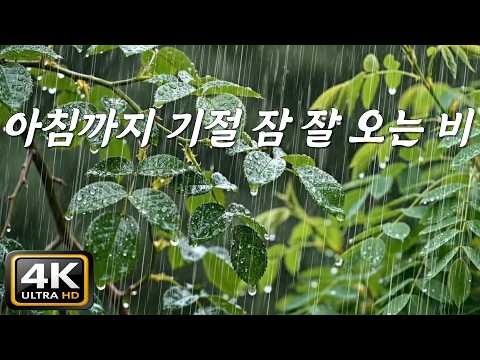

# 음악 — 성공 사례 분석: 사례별 자세히 #1001–#1040

`analysis.md` 의 9번 (같은 # 번호). 자동 생성 — `tools/success_analysis.py` v1.4.1 (2026-10-20 07:59 UTC). ※ 연구·교육용 — 투자 권유가 아님.

### 1001. ☀️108𝐓𝐈𝐌𝐄𝐒 Activate High Intelligence: Gayatri Mantra Meditation for Wisdom

- https://www.youtube.com/watch?v=_7EQF3GWDIM · Inner Harmony Mantra · 구독자 24,500 · 조회수 333,528 (×13.6, 하루 1,889.1) · 좋아요 4,354 (1.3%) · 60분 · 2026-04-26 · 주제 묶음 1. 수면·명상·힐링 · 형식 음악 (그 밖 모양 — 한 편짜리 BGM 등) · 폴더 `W__7EQF3GWDIM` (웹 승인)
- 썸네일: 
- 설명 앞부분: Experience the transformative power of ancient chants with this soothing Gayatri Mantra meditation. Let the harmonious melodies guide you to a state of relaxation, healing, and spiritual awakening. Perfect for mindfulness, yoga sessions, or simply finding calm in your day. Sanskrit: Om Bhuur-Bhuvah…
- 같은 채널 평소 대비 ×100.3 (채널 최근 롱폼 중앙값 3,324회) · 평소 영상: ☀️𝟏𝟎𝟖𝐓𝐈𝐌𝐄𝐒 Transform Your Space into a Sanctuary … (3,324회) / ☀️𝟏𝟎𝟖𝐓𝐈𝐌𝐄𝐒 Lost Your Center? Restore Inner Silenc… (3,829회)
- 대본 없음 (설명) — 음성인식이 끝나면 도입부·흐름이 들어감
- 댓글 117/117: 좋은 점 — 영상 0 · 감사·응원 0 · 더 알고 싶은 것 0 · 아쉬운 점 — 영상 0 · 반박·불만 — 의견 다름 0 · 정치·사회 0 · 경험 공유 0 · 구독·다음 기대 0

### 1002. ⠀

- https://www.youtube.com/watch?v=mDkyPzypfuo · islistening  · 구독자 32,400 · 조회수 437,704 (×13.5, 하루 3,585.7) · 좋아요 16,976 (3.9%) · 21.9분 · 2026-06-20 · 주제 묶음 기타 · 형식 플레이리스트·모음 (여러 곡) · 폴더 `W_mDkyPzypfuo` (웹 승인)
- 썸네일: 
- 챕터: 0:00 Nothin’ On You · 3:38 Kiss Me Thru the Phone · 6:52 Favorite Girl · 11:08 One Love · 14:36 Irreplaceable · 18:25 So Sick
- 설명 앞부분: Time Line
- 같은 채널 평소 대비 ×7.5 (채널 최근 롱폼 중앙값 58,493회) · 평소 영상: ⠀ (58,493회) / ⠀⠀ (26,877회)
- 대본 없음 (설명) — 음성인식이 끝나면 도입부·흐름이 들어감
- 댓글 125/127: 좋은 점 — 영상 0 · 감사·응원 3 · 더 알고 싶은 것 2 · 아쉬운 점 — 영상 0 · 반박·불만 — 의견 다름 0 · 정치·사회 0 · 경험 공유 2 · 구독·다음 기대 0
  - 감사·응원 👍244 “기말 일주일 전 벼락치기 시작합니다.. 기적을 기대해보겟음 다들 화이팅”
  - 감사·응원 👍5 “우리 모두 화이팅해요!! 찍은거 다 맞길..🍀”
  - 더 알고 싶은 것 👍7 “진심 들어본 팦송플리중에 진짜 1위임 거의 구라안치고 30번은 들으러 온거 같음 주인장님 이런 플리 더 만들어주세요 제발 ㅜㅜ”
  - 더 알고 싶은 것 👍0 “안녕하세요:) islistening님! 혹시 비즈니스 협업 관련 문의는 어디로 드리면 좋을까요?”
  - 경험 공유 👍0 “나도연애하고싶당”

### 1003. 새벽에 듣기좋은 메이플 로파이 재즈 ∣ 1시간 작업·공부 음악

- https://www.youtube.com/watch?v=N5AE0jDAY2o · DOKANG · 구독자 20,400 · 조회수 271,448 (×13.3, 하루 1,708.1) · 좋아요 4,973 (1.8%) · 63.9분 · 2026-05-14 · 주제 묶음 8. 로파이·시티팝·칠 · 형식 플레이리스트·모음 (여러 곡) · 폴더 `W_N5AE0jDAY2o` (웹 승인)
- 썸네일: 
- 챕터: 0:00 커닝시티 · 2:28 루디브리엄 하늘 · 5:06 도원경 · 7:59 리프레 · 10:33 나무줄기 던전 · 13:47 에오스 탑 외부 · 16:47 판테온 · 19:35 메이플 프랜즈 신수국제학교 도심 · 23:00 오디움 연구자들의 도시·성문으로 가는 길 · 25:39 리버스 시티 Memory of Sunset · 29:03 리엔필드 (보컬) https://youtu.be/Op… · 31:58 LOOP
- 설명 앞부분: 내 두 눈은 하얗게 말라간다. 몇 대 안 되는 승용차와 트럭이 삶과 같은 속도로 도로를 내지르는 모습을 보면서. 본 채널의 모든 음악은 유튜브 영상, 인터넷 방송 등의 배경음악(BGM)으로 사용하실 수 있습니다. 채널명 : DOKANG 음악: [해당 음원 제목] ⚠️ 주의 및 금지 사항 사용 제한: 불법, 혐오 조장, 범죄, 성인물 등 사회적 물의를 일으킬 수 있는 콘텐츠에는 음원 사용을 금지합니다. 본 영상은 넥슨 메이플스토리 IP를 활용한 비공식 2차 창작물입니다.(with AI) Official Nekode Music You…
- 같은 채널 평소 대비 ×24.3 (채널 최근 롱폼 중앙값 11,181회) · 평소 영상: 아르웬: 유리구두 늦네.. 저 이러다가 할머니가 되어버려요 (11,181회) / 지쳐가는 밤, 혼자만의 시간 ∣ 감성 작업 메이플 테일즈위버 음악 모음 (10,946회)
- 대본 없음 (설명) — 음성인식이 끝나면 도입부·흐름이 들어감
- 댓글 155/156: 좋은 점 — 영상 0 · 감사·응원 7 · 더 알고 싶은 것 10 · 아쉬운 점 — 영상 0 · 반박·불만 — 의견 다름 0 · 정치·사회 1 · 경험 공유 2 · 구독·다음 기대 0
  - 감사·응원 👍1 “아 노래 분위기 너무 좋다 바로 구독떄립니다 좋은 음악 감사합니다 많이 올려주세요 제발 !!”
  - 감사·응원 👍1 “잘 듣고 있습니다 고맙습니다 😊😊”
  - 더 알고 싶은 것 👍2 “개별 곡마다 따로도 올려주시면 좋겠어요 ㅠ 그동안 올려주신 것들 중에 안 올려주신 것들도.. 다 랜덤으로 섞어듣고 싶어요..”
  - 더 알고 싶은 것 👍1 “아 노래 분위기 너무 좋다 바로 구독떄립니다 좋은 음악 감사합니다 많이 올려주세요 제발 !!”
  - 정치·사회 👍1 “새벽에 이렇게 운동하면서 맘편이 있을 수 있는 나라가 나라다..”
  - 경험 공유 👍44 “나도 육교에서 저러고 있을때 많은데...ㅎㅎ 옛날엔 달동네 꼭대기 올라가는게 지겹고 힘들었는데 이제 나이가 드니까 달동네 꼭대기 계단에 앉아서 바라보는 석양진 마을풍경이 따뜻하고 낭만적인 향수같은게 느껴진다...”

### 1004. [Masterpiece Series] Albinoni Adagio – 4 Variations Songs of Solace

- https://www.youtube.com/watch?v=OFfc765eTgY · WilliamPoeticSolace | 시적인위로 · 구독자 40,600 · 조회수 539,505 (×13.3, 하루 3,085.8) · 좋아요 10,311 (1.9%) · 17.4분 · 2026-04-28 · 주제 묶음 6. 피아노·클래식·연주곡 · 형식 음악 (그 밖 모양 — 한 편짜리 BGM 등) · 폴더 `W_OFfc765eTgY` (웹 승인)
- 썸네일: 
- 챕터: 0:00 Track 1. In the Edge of Silen… · 4:48 Track 2. In the Edge of Silen… · 7:46 Track 3. The Remnant - Sopara… · 12:09 Track 4. In the Edge of Silen…
- 설명 앞부분: "The saddest melody ever written, reborn as a quiet prayer." Albinoni’s Adagio in G Minor is a masterpiece wrapped in mystery, sorrow, and transcendence. Though attributed to Tomaso Albinoni, it was reconstructed by Remo Giazotto from fragments discovered in the ruins of war—giving birth to one of …
- 같은 채널 평소 대비 ×45.2 (채널 최근 롱폼 중앙값 11,936회) · 평소 영상: Ukraine Romance - Dark Eyebrows Hazel Eyes : Song… (11,936회) / Geordie + Paganini Sonata No.12 & Counterpoint: 4… (12,179회)
- 대본 없음 (설명) — 음성인식이 끝나면 도입부·흐름이 들어감
- 댓글 781/781: 좋은 점 — 영상 2 · 감사·응원 58 · 더 알고 싶은 것 3 · 아쉬운 점 — 영상 4 · 반박·불만 — 의견 다름 0 · 정치·사회 6 · 경험 공유 21 · 구독·다음 기대 1
  - 좋은 점 — 영상 👍2 “음이 맑고 깨끝해서 듣기 좋아요..”
  - 좋은 점 — 영상 👍0 “다양한 음악 장르를 듣지만 최애곡 리스트에 들어간 곡 각박한 세상 감정이 메말라져가는 세상이지만 요즘 엣세이 쓰고 있는데 글 쓰는데도 도움이 많이 됩니다 월리엄 감사합니다❤”
  - 감사·응원 👍137 “20여년전 낯선 미국땅에서 대학원을 다니면서 밤이면 홀로 외로움에 떨던 때, 이 슬픈 음악이 큰 위안이 되었었습니다. 왠지 나보다 더 슬픈 무언가가 나를 위로해주는 느낌. 요즘 또 다른 시련으로 삶의 가장 낮은 곳을 헤매이는데, 그런 제게 음악으로 위로의 뜻을 전해주…”
  - 감사·응원 👍75 “슬프고도 정화된 아름다운 선율 듣자마자 바로 구독하고 영혼의 단짝 친구와 공유했습니다 평생을 추구해온 제 삶의 궤적을 위로해주는 선율과 가사는 눈감고 들어도 한마디 한마디가 너무나 아름답습니다 저를 숨기고 제 슬픔을 숨기고 제 진실을 숨기고 모두에게서 옹달샘처럼 숨어…”
  - 더 알고 싶은 것 👍29 “아다지오 평소에 사랑헸던 곡입니다...윌리엄님의 올리신곡은 또다른 멋으로 다가옵니다.사랑합니다.축복합니다.감사합니다.늘 좋은 음악.아름다운음악 부탁드립니다. 건강하세요”
  - 더 알고 싶은 것 👍0 “이새벽에 잠 못들며 세상에서 가장슬픈 클래식 음악 의 변주곡들을 들으면서 만감이 교차하네요... 또한 AI음악의 경이로움을 느낍니다... 감사합니다... 좋은음악 계속 부탁드립니다 ~~ ^^”
  - 아쉬운 점 — 영상 👍1 “아다지오! 많은 편곡을 들어보았지만..... Track 4의 편곡은.... 처음 들었습니다. 벌써 10번을 넘게 반복해서 듣고 있습니다. 태어나서 잠수함을 탄 것은 제주도 우도에서였습니다. 그러나 Track 4는 버지니아급.... 잠수함을 한 대 사서 심해에 들어가고…”
  - 아쉬운 점 — 영상 👍1 “중간 광고가 분위기 확 께네 !”
  - 경험 공유 👍2 “윌리엄님 노래를 듣다보니 나도 모르게 눈물이 납니다..”
  - 경험 공유 👍1 “장맛비가 농막 컨테이너와 나뭇잎, 호박잎, 위에 사정없이 떨어집니다. 비는 부딪치는 사물에 따라 타악기되어 연주합니다. 그 연주속에 파묻혀서 멍 때리며 알비노비 아다지오 늦습니다. 자연과 내가 하나가 되어. . .”
  - 구독·다음 기대 👍75 “슬프고도 정화된 아름다운 선율 듣자마자 바로 구독하고 영혼의 단짝 친구와 공유했습니다 평생을 추구해온 제 삶의 궤적을 위로해주는 선율과 가사는 눈감고 들어도 한마디 한마디가 너무나 아름답습니다 저를 숨기고 제 슬픔을 숨기고 제 진실을 숨기고 모두에게서 옹달샘처럼 숨어…”

### 1005. “프린세스 티니핑송“ 피아노 커버(Princess Teenieping Song Piano Cover)

- https://www.youtube.com/watch?v=BS-GSU9dLqk · MUJINS 뮤진스 · 구독자 19,200 · 조회수 253,449 (×13.2, 하루 1,850.1) · 좋아요 1,262 (0.5%) · 6.9분 · 2026-06-05 · 주제 묶음 6. 피아노·클래식·연주곡 · 형식 커버·직접 부른 노래 · 폴더 `W_BS-GSU9dLqk` (웹 승인)
- 썸네일: 
- 챕터: 0:00 노래(AR)와 피아노 연주 · 2:17 피아노 연주만 · 4:32 피아노 연주만(쉬운버전)
- 설명 앞부분: 프린세스 캐치! 티니핑의 ”프린세스 티니핑송“ 피아노 커버입니다! 티니핑 악보는 배포 및 판매가 힘듭니다. 피아노 악보가 함께 있는 영상을 제작했습니다.
- 같은 채널 평소 대비 ×32.9 (채널 최근 롱폼 중앙값 7,695회) · 평소 영상: 리센느 ”Pretty Girl” 피아노 커버 (8,459회) / 치이카와 : 인어섬의 비밀 OST “The Island Song + Siren ver.”… (6,931회)
- 대본 없음 (설명) — 음성인식이 끝나면 도입부·흐름이 들어감
- 댓글 49/50: 좋은 점 — 영상 0 · 감사·응원 2 · 더 알고 싶은 것 0 · 아쉬운 점 — 영상 0 · 반박·불만 — 의견 다름 0 · 정치·사회 0 · 경험 공유 2 · 구독·다음 기대 0
  - 감사·응원 👍7 “뮤진스님 징챠 빠르시네요..🙈 제 요즘 최애 노래인데 연주해주셔서 감사함당 ㅋㅋ 자주 들으러 올게요💗”
  - 감사·응원 👍1 “😊기쁨뻐요❤피아노너무잘치시고힘들지말고하세요제가응원할께”
  - 경험 공유 👍2 “저 다이아나핑을 좋아해요 그리고요 제가 발레을 해요”
  - 경험 공유 👍0 “저도 겨울아이 피아노 치는데”

### 1006. 아침까지 기절 숙면 잠 잘 오는 빗소리, [중간광고없음]10분후 검은화면, "눈 뜨니 개운한 아침이에요" 😴 아침까지 꿀잠 예약 7시간 빗소리, 뇌파 안정 천연…

- https://www.youtube.com/watch?v=pkUgoZ7h_2M · 빗소리 자장가 Rain sound lullaby · 구독자 22,300 · 조회수 290,463 (×13.0, 하루 1,830.2) · 좋아요 1,595 (0.5%) · 420분 · 2026-05-14 · 주제 묶음 2. 자연 소리·백색소음 · 형식 자연 소리·백색소음 (음악 낱말 없는 제목) · 폴더 `W_pkUgoZ7h_2M` (웹 승인)
- 썸네일: 
- 설명 앞부분: 잠들기 전의 뒤척임, 그리고 새벽에 작은 소음으로 깨어나는 고통. 오늘 밤은 그 모든 걱정을 내려놓으세요. [빗소리 자장가] 가 설계한 이 영상은 단순한 소리가 아닌, 당신의 침실을 외부와 완벽히 격리하는 '사운드 실드' 입니다. 고밀도 하이파이(Hi-Fi) 사운드로 정교하게 다듬어진 이 빗소리는 주변의 모든 잡음을 덮어버리고, 당신의 뇌파를 가장 깊고 편안한 상태로 이끄는 강력한 `천연 수면제' 가 될 것입니다. 7시간 동안 끊김 없이 이어지는 이 소리에 그저 몸을 맡기세요. 어느새 귓가에 맴돌던 소란은 잦아들고, 당신은 아침 …
- 같은 채널 평소 대비 ×20.9 (채널 최근 롱폼 중앙값 13,913회) · 평소 영상: 한번도 안 깨고 아침까지 기절 수면하는 빗소리, [중간광고없음]10분후 검은화면, "새벽… (13,913회) / 틀자마자 바로 기절 숙면하는 빗소리, [중간광고없음]10분후 검은화면, "아무 생각 없이… (13,370회)
- 대본 없음 (설명) — 음성인식이 끝나면 도입부·흐름이 들어감
- 댓글 40/40: 좋은 점 — 영상 0 · 감사·응원 2 · 더 알고 싶은 것 0 · 아쉬운 점 — 영상 0 · 반박·불만 — 의견 다름 1 · 정치·사회 0 · 경험 공유 0 · 구독·다음 기대 0
  - 감사·응원 👍9 “어느~~ 노래 🎶 보다 더~ 아름다운 빗소리..에 구독! 좋아요. 꾹욱~~ 누르고 갑니다. 고맙습니다.☔️🪻🌱⚘️🥀☘️”
  - 감사·응원 👍1 “계속 잠설쳤는데 감사해요”
  - 반박·불만 — 의견 다름 👍16 “약 없이는 못 자는 악순환이 영 마음에 걸려요. 억지로 잠을 만드는 게 아니라 과하게 깨어 있는 걸 가라앉히는 쪽이라는 각성완화제 먹어봤어요 약처럼 확 자는 건 아닌데 그래도 머릿속이 좀 가라앉는 느낌은 있어요.”

### 1007. 【Nhất Định Phải Nghe Dành Cho Người Mất Ngủ!】Nhạc Piano Nhẹ Nhàng Ru Ngủ Ngon Tuyệt Vời N…

- https://www.youtube.com/watch?v=1-OgDgY_peU · Nhạc Ngủ Thư Giãn · 구독자 48,900 · 조회수 622,503 (×12.7, 하루 4,871.3) · 좋아요 3,433 (0.5%) · 182.7분 · 2026-06-14 · 주제 묶음 6. 피아노·클래식·연주곡 · 형식 음악 (그 밖 모양 — 한 편짜리 BGM 등) · 폴더 `W_1-OgDgY_peU` (웹 승인)
- 썸네일: 
- 설명 앞부분: Bạn có đang trằn trọc giữa đêm khuya, khó đi vào giấc ngủ hoặc thường xuyên thức giấc giữa đêm? Video này được tạo ra dành riêng cho những ai đang tìm kiếm sự bình yên, thư giãn và một giấc ngủ sâu sau một ngày dài mệt mỏi. Những giai điệu piano nhẹ nhàng, du dương và êm ái sẽ từ từ xoa dịu tâm trí…
- 같은 채널 평소 대비 ×18.8 (채널 최근 롱폼 중앙값 33,133회) · 평소 영상: 【100% Không Quảng Cáo】Nhạc Hỗ Trợ Giấc Ngủ Cực Hi… (33,839회) / Nhạc Ru Ngủ Sâu 3 Tiếng😴 Không Quảng Cáo, Giảm Că… (32,427회)
- 대본 없음 (설명) — 음성인식이 끝나면 도입부·흐름이 들어감
- 댓글 184/182: 좋은 점 — 영상 0 · 감사·응원 0 · 더 알고 싶은 것 0 · 아쉬운 점 — 영상 0 · 반박·불만 — 의견 다름 0 · 정치·사회 0 · 경험 공유 0 · 구독·다음 기대 0

### 1008. Faith: You Were Never Walking Alone ∣ Heavenly Meditation Music, Healing

- https://www.youtube.com/watch?v=_psuP3ukwOY · Healing Ether · 구독자 45,400 · 조회수 557,374 (×12.3, 하루 3,437.1) · 좋아요 0 (0.0%) · 71.2분 · 2026-05-11 · 주제 묶음 1. 수면·명상·힐링 · 형식 음악 (그 밖 모양 — 한 편짜리 BGM 등) · 폴더 `W__psuP3ukwOY` (웹 승인)
- 썸네일: 
- 설명 앞부분: Faith: You Were Never Walking Alone ∣ Meditation Music, Deep Sleep Healing There are moments in life when the road ahead disappears into darkness… when fear grows louder than hope, and the weight of the world feels too heavy to carry alone. But faith is the quiet light that still remains when every…
- 같은 채널 평소 대비 ×59.5 (채널 최근 롱폼 중앙값 9,374회) · 평소 영상: Asklepion: A place where you are remade… for anot… (10,093회) / Memory Village: Awaken a Part of You ∣ Deep Sleep… (8,654회)
- 대본 없음 (설명) — 음성인식이 끝나면 도입부·흐름이 들어감
- 댓글 376/376: 좋은 점 — 영상 0 · 감사·응원 2 · 더 알고 싶은 것 0 · 아쉬운 점 — 영상 0 · 반박·불만 — 의견 다름 0 · 정치·사회 0 · 경험 공유 0 · 구독·다음 기대 0
  - 감사·응원 👍3 “감사합니다. 보고 싶군요. 나의 친구 김준영이여. 고맙습니다.”
  - 감사·응원 👍1 “아멘❤ 감사합니다😇 💙🩵💚💛🧡🩷❤️”

### 1009. 우연히 들었는데 첫 곡부터... 너무 좋다 ∣ 7080 추억의 올드 팝송 모음 Old Pop Song Playlist

- https://www.youtube.com/watch?v=ktav8W-fW8I · theoldpopsong · 구독자 40,800 · 조회수 483,534 (×11.8, 하루 2,740.9) · 좋아요 6,513 (1.4%) · 58.3분 · 2026-04-26 · 주제 묶음 10. 팝송·K팝·J팝 · 형식 플레이리스트·모음 (여러 곡) · 폴더 `W_ktav8W-fW8I` (웹 승인)
- 썸네일: 
- 챕터: 0:00 The Space You Left Behind — 네… · 2:25 A Spring That Still Feels Col… · 5:23 A Memory Painted on the Pavem… · 8:41 A Road Without You — 너 없는 길 · 12:14 A Little Longer Here — 조금 더 머… · 14:56 The Wind That Brings You Back… · 17:42 The Day We Didn’t Notice — 우리… · 20:06 A Petal in the Pages — 책갈피 속 … · 23:35 The Silent Glasshouse — 고요한 온실 · 26:35 A Table for Two — 둘을 위한 자리
- 설명 앞부분: 마음을 차분하게 만들어 주는 봄날의 감성이 담긴 70·80년대 올드팝을 모았습니다. 오래된 멜로디와 따뜻한 음색이 어우러져 복잡했던 하루의 생각들을 천천히 내려놓게 해 줍니다. 마치 LP에서 흘러나오는 듯한 아날로그 감성으로 편안하게 들을 수 있는 음악들입니다. 창가에 앉아 조용히 바람을 느끼듯, 따뜻한 커피 한 잔과 함께 듣기 좋은 노래들. 익숙한 선율과 부드러운 보컬이 공간을 채우며 카페처럼 포근한 분위기를 만들어 줍니다. 이 플레이리스트에는 네가 남기고 간 자리의 여운, 조금은 차갑게 느껴지는 봄날의 공기, 그리고 다시 불어…
- 같은 채널 평소 대비 ×29.0 (채널 최근 롱폼 중앙값 16,671회) · 평소 영상: 9월, 가을 파리의 카페 감성 ... 너무 좋다 ∣ 7080 추억의 올드 팝송 모음 Ol… (16,671회) / 10월의 시작과 함께 듣기 좋은 가을 팝송 ... 너무 좋다 ∣ 7080 추억의 올드 팝… (16,490회)
- 대본 없음 (설명) — 음성인식이 끝나면 도입부·흐름이 들어감
- 댓글 287/287: 좋은 점 — 영상 1 · 감사·응원 39 · 더 알고 싶은 것 5 · 아쉬운 점 — 영상 1 · 반박·불만 — 의견 다름 0 · 정치·사회 0 · 경험 공유 1 · 구독·다음 기대 3
  - 좋은 점 — 영상 👍4 “너무듣기좋아요 힐링되네요 감사합니당”
  - 감사·응원 👍51 “70중반을 살아낸 헤진마음을 보듬어주는 싱어의 음색 백그라운드 밴드는 그야말로 환상의 콜라보네요! 살아낸 회상의 나래속으로 한없이 빠저가고 있네요~~~ 무지무지 감사합니다 ^^♡♡”
  - 감사·응원 👍18 “녹음이 짙어지는 나무와 반짝이는 햇살아래 살랑살랑 불어오는 바람마저 향기롭니다 잔잔한 음악 넘 좋으네요 감사합니다^^”
  - 더 알고 싶은 것 👍2 “누가 부르는지 궁금해요~~”
  - 더 알고 싶은 것 👍0 “이 가수분 이름 알고싶어요? 아시는 분 부탁드립니다”
  - 경험 공유 👍4 “잠자려고 클릭 해봤는데 잠을 못자겠네요~. 첫곡부터,, 언젠가의 뭔가가 아련히 떠오르게 만드는 곡이~....... 감사히 듣습니다~^^”
  - 구독·다음 기대 👍3 “안녕하세요 잘듣고갑니다 그리고 쿡하고 구독하고 갑니다 🎉🎉🎉최고이십니다 🎉🎉🎉행복하세요 ❤❤❤행복하세요 🎉🎉🎉행복하세요”
  - 구독·다음 기대 👍2 “❤❤❤구독하고 듣고있어요~”

### 1010. Kiven Mukhre Ton Nazraan ∣ Ustad Nusrat Fateh Ali Khan ∣ Dark Ambient Fusion Cover ∣ XAN

- https://www.youtube.com/watch?v=PMqkvHE1cm0 · XAN · 구독자 24,700 · 조회수 292,441 (×11.8, 하루 1,979.4) · 좋아요 3,423 (1.2%) · 4.9분 · 2026-05-25 · 주제 묶음 12. 커버·노래 부르기 · 형식 AI 음악 · 폴더 `W_PMqkvHE1cm0` (웹 승인)
- 썸네일: 
- 설명 앞부분: Experience the soul stirring "Kiven Mukhre Ton Nazraan" like never before. This Dark Ambient Fusion Cover reimagines the timeless NFAK classic through a lens of shadows and atmospheric soundscapes. Credits: Original Composition: Ustad Nusrat Fateh Ali Khan Music Production: XAN Composition: Assiste…
- 같은 채널 평소 대비 ×29.7 (채널 최근 롱폼 중앙값 9,856회) · 평소 영상: Sanson Ki Mala ∣ Dark Mode ∣ XAN (10,124회) / Hum Tum Hon Gay Baadal Ho Ga ∣ Masood Malik ∣ Lo … (9,589회)
- 대본 없음 (설명) — 음성인식이 끝나면 도입부·흐름이 들어감
- 댓글 158/158: 좋은 점 — 영상 0 · 감사·응원 0 · 더 알고 싶은 것 0 · 아쉬운 점 — 영상 0 · 반박·불만 — 의견 다름 0 · 정치·사회 0 · 경험 공유 0 · 구독·다음 기대 0

### 1011. 가을이 오면... 커피향이 가득한 카페에서 듣고 싶은 음악

- https://www.youtube.com/watch?v=4lPZuU2kCbA · EverOldies · 구독자 44,800 · 조회수 529,822 (×11.8, 하루 11,411.2) · 좋아요 5,166 (1.0%) · 96.9분 · 2026-09-03 · 주제 묶음 4. 카페·매장·라운지 · 형식 음악 (그 밖 모양 — 한 편짜리 BGM 등) · 폴더 `W_4lPZuU2kCbA` (웹 승인)
- 썸네일: 
- 챕터: 0:00 I Will Be With You · 3:17 I Heard Your Name · 6:20 Locking the Past · 8:36 How Have You Been · 11:44 I Wish You Well · 15:14 Somewhere in My Memory · 19:03 You Were in Everything · 22:11 Thank You for Everything · 26:06 After All This Time · 29:08 Dear Distant Soul · 32:17 Replay
- 설명 앞부분: 가을이 오면 따뜻한 커피 한잔과 오래된 노래가 생각납니다. 커피향이 가득한 카페에 앉아 창밖을 바라보며 천천히 듣고 싶은 음악을 담았습니다. 7080 올드팝의 따뜻하고 아련한 감성, 부드러운 여성 보컬과 편안한 멜로디가 어우러진 Old Pop Playlist입니다. 누군가를 기다리던 시간도, 문득 떠오르는 얼굴도, 이제는 희미해진 지난날의 기억도 음악을 듣다 보면 어느새 다시 가까워집니다. 바쁜 하루 중 잠시 쉬고 싶을 때, 혼자 커피를 마시며 생각에 잠기고 싶을 때, 그리고 추억의 팝송과 7080 감성의 올드팝이 그리울 때 함께…
- 같은 채널 평소 대비 ×64.7 (채널 최근 롱폼 중앙값 8,185회) · 평소 영상: 오래 전 추억이 떠오르는 노래 ∣ 5060 추억의 올드팝 Playlist (8,185회) / 듣는 순간 가슴이 뭉클해지는 빈티지 올드팝 ∣ 6070 추억의 올드팝 Playlist (7,899회)
- 대본 없음 (설명) — 음성인식이 끝나면 도입부·흐름이 들어감
- 댓글 292/316: 좋은 점 — 영상 6 · 감사·응원 29 · 더 알고 싶은 것 1 · 아쉬운 점 — 영상 0 · 반박·불만 — 의견 다름 0 · 정치·사회 0 · 경험 공유 3 · 구독·다음 기대 0
  - 좋은 점 — 영상 👍3 “정말 듣기 좋군요~❤”
  - 좋은 점 — 영상 👍2 “가을이 오래 동안 있었으면 좋겠어요 바람이 선선하니 올드팝송 듣기 좋아요”
  - 감사·응원 👍56 “감기로 인해 급성후두염 진단을 받았네요~ 되도록 말을 하지 말라니 입꾹닫하고 지냅니다 누워서 눈감고 들었어요~ 간간히 잠이 들기도 했나봅니다~😊 감성충만하고 편안한 노래~ 들려주셔서 고맙습니다~😊❤❤”
  - 감사·응원 👍25 “마음이 릴렉스 되는 음악이네요. 좋은음악 감사 합니다”
  - 더 알고 싶은 것 👍1 “계절의 변화따라 마음도 기분도 바뀌는 것 같네요. 새벽 안개 자욱한 메타세콰이어 나무가 끝도없이 즐비한 곳에서 들으면 아주 몽환적일 것 같아요^^ 곡의 이름을 모두 알 수 있을까요?”
  - 경험 공유 👍8 “노래 음률이 차분하고 조용하니 좋으네요..가을이 눈앞에 펼쳐질 나날들..내가 좋아하는 나무님도 가러움증 빨리 완치되어 정상적으로 포근하게 잘 자길 빌면서..나무는 내 안식처 ..매미의 집이죠”
  - 경험 공유 👍0 “가을이 오면(이문세) 가을이 오면 가실 할 수 있는 쭉정이라도 있으면 했어 그런데 도리어 곳간의 쌀알만 쥐들이 훔쳐 가버렸네 가을이 오면 누군가 나에게 다가왔으면 했어 그런데 도리어 내 기억속의 사람들만 더 떠나가 버렸네 가을이 오면 내가 그 위로를 받을 수 있을 때…”

### 1012. Awit ng Paghahangad by Bukas Palad Music Ministry ∣ Senti Piano Cover ∣ Clyde Pianist ∣ 4K

- https://www.youtube.com/watch?v=5yDRTUMvk3I · Clyde Pianist | Senti Piano Covers · 구독자 12,000 · 조회수 141,394 (×11.8, 하루 1,246.4) · 좋아요 1,035 (0.7%) · 7.2분 · 2026-06-28 · 주제 묶음 6. 피아노·클래식·연주곡 · 형식 커버·직접 부른 노래 · 폴더 `W_5yDRTUMvk3I` (웹 승인)
- 썸네일: 
- 설명 앞부분: Awit ng Paghahangad by Bukas Palad Music Ministry ∣ Senti Piano Cover ∣ Clyde Pianist ∣ 4K Relaxing piano music perfect for: Sleeping Studying Late-night listening Relaxing moments Subscribe for more OPM and senti piano covers every week! FOLLOW ME If you would like to show your support: Paypal: pa…
- 같은 채널 평소 대비 ×24.2 (채널 최근 롱폼 중앙값 5,841회) · 평소 영상: Itchyworms - Beer (Senti Piano Cover) ∣ Clyde Pia… (5,841회) / Forevermore by Side A ∣ Piano Wedding Version ∣ C… (5,900회)
- 대본 없음 (설명) — 음성인식이 끝나면 도입부·흐름이 들어감
- 댓글 102/102: 좋은 점 — 영상 0 · 감사·응원 0 · 더 알고 싶은 것 0 · 아쉬운 점 — 영상 0 · 반박·불만 — 의견 다름 0 · 정치·사회 0 · 경험 공유 0 · 구독·다음 기대 0

### 1013. Mama Said ∣ Ogryn Chain Gang Blues Work Song ∣ Warhammer 40K Inspired Music

- https://www.youtube.com/watch?v=H6yrpYWMyRs · Solar Void · 구독자 20,800 · 조회수 245,096 (×11.8, 하루 1,450.9) · 좋아요 6,864 (2.8%) · 6분 · 2026-05-04 · 주제 묶음 2. 자연 소리·백색소음 · 형식 음악 (그 밖 모양 — 한 편짜리 BGM 등) · 폴더 `W_H6yrpYWMyRs` (웹 승인)
- 썸네일: 
- 설명 앞부분: “Mama Said” is a Warhammer 40K inspired Ogryn work song built around the feel of an old chain gang chant: heavy labor, simple call-and-response rhythm, iron chains, mud, artillery, and the brutal everyday work of the Astra Militarum. This track follows Ogryns pulling guns, hauling shells, digging t…
- 같은 채널 평소 대비 ×26.1 (채널 최근 롱폼 중앙값 9,395회) · 평소 영상: Hold Fast, Little Heart ∣ The Goodest Boy ∣ Warha… (9,395회) / A God Named Nurgle ∣ Warhammer 40k Inspired Music (9,423회)
- 대본 없음 (설명) — 음성인식이 끝나면 도입부·흐름이 들어감
- 댓글 395/395: 좋은 점 — 영상 0 · 감사·응원 0 · 더 알고 싶은 것 0 · 아쉬운 점 — 영상 0 · 반박·불만 — 의견 다름 0 · 정치·사회 0 · 경험 공유 0 · 구독·다음 기대 0

### 1014. 정서안정과 고운 마음을 위한 잔잔하고 아름다운 음악 l 어린이집 유치원 교실 편안한 배경 음악

- https://www.youtube.com/watch?v=ONTpCdvC9mo · 조이멜로디 JOY MELODY · 구독자 21,600 · 조회수 249,862 (×11.6, 하루 1,492.5) · 좋아요 2,025 (0.8%) · 82.3분 · 2026-05-05 · 주제 묶음 기타 · 형식 음악 (그 밖 모양 — 한 편짜리 BGM 등) · 폴더 `W_ONTpCdvC9mo` (웹 승인)
- 썸네일: 
- 설명 앞부분: 유아들의 정서 안정과 고운 마음을 키워주는 잔잔하고 아름다운 배경 음악. 💛 모든 곡이 좋은 또 다른 산뜻한 배경음악
- 같은 채널 평소 대비 ×26.5 (채널 최근 롱폼 중앙값 9,445회) · 평소 영상: 정서 안정을 위한 잔잔하고 시원한 배경음악┃어린이집 유치원 교실 편안한 배경 음악 (10,175회) / 기분좋은 아침을 여는 산뜻한 피아노 음악 ㅣ Refreshing piano melody … (8,715회)
- 대본 없음 (설명) — 음성인식이 끝나면 도입부·흐름이 들어감
- 댓글 0/0: 좋은 점 — 영상 0 · 감사·응원 0 · 더 알고 싶은 것 0 · 아쉬운 점 — 영상 0 · 반박·불만 — 의견 다름 0 · 정치·사회 0 · 경험 공유 0 · 구독·다음 기대 0

### 1015. 싱그러운 여름 아침, 꽃향기가 스며드는 기분좋은 카페음악 ∣ 계속 듣게 되는 감성팝송 ∣ Old Pop Playlist

- https://www.youtube.com/watch?v=EnD2m1z3fkM · 선율향기 · 구독자 11,500 · 조회수 131,924 (×11.5, 하루 1,019.4) · 좋아요 1,661 (1.3%) · 91.5분 · 2026-06-12 · 주제 묶음 4. 카페·매장·라운지 · 형식 플레이리스트·모음 (여러 곡) · 폴더 `W_EnD2m1z3fkM` (웹 승인)
- 썸네일: 
- 설명 앞부분: 초록이 가장 짙어지는 계절, 맑은 물결이 흐르는 강가에는 꽃들이 저마다의 색으로 피어나고, 창가에는 따뜻한 햇살이 조용히 머물러 있습니다. 좋아하는 음악 한 곡, 따뜻한 차 한 잔, 그리고 아무 말 없이 바라볼 수 있는 풍경 하나. 그것만으로도 충분히 행복했던 순간들이 문득 떠오르는 날입니다. 오늘은 7080 감성팝송과 함께 잠시 쉬어가는 시간을 가져보세요. 꽃향기 스며든 강가의 풍경처럼, 따뜻한 멜로디도 당신의 하루에 잔잔한 여운으로 머물기를 바랍니다 ☕🌿 As summer deepens and the greenery grows…
- 같은 채널 평소 대비 ×39.6 (채널 최근 롱폼 중앙값 3,330회) · 평소 영상: 코스모스가 가을을 알리는 듯한 부드러운 카페음악 ∣ 자꾸만 다시 듣게 되는 감성팝송 ∣ … (3,330회) / 가을과 마주 앉아 여유를 즐기는 듯한 부드러운 카페음악 ∣ 마음이 느긋해지는 감성팝송 ∣… (3,122회)
- 대본 없음 (설명) — 음성인식이 끝나면 도입부·흐름이 들어감
- 댓글 72/72: 좋은 점 — 영상 0 · 감사·응원 11 · 더 알고 싶은 것 0 · 아쉬운 점 — 영상 0 · 반박·불만 — 의견 다름 0 · 정치·사회 0 · 경험 공유 0 · 구독·다음 기대 0
  - 감사·응원 👍6 “안넝하세요. ᆢ. 주말아침에 수고가 많으십니다 ᆢ. 언제나 좋은음악 고맙습니다. ❤❤❤”
  - 감사·응원 👍4 “아늑하게 느껴지는 노래 잘 들었습니다. 조용한 노래 태그 만들기가 쉽지 않은데 많은 노력을 하신 것 같아요. 응원합니다.❤❤”

### 1016. 한 줌 흙으로 돌아가는 길 ∣ 황혼길의 깨달음 국악 판소리트로트

- https://www.youtube.com/watch?v=Vb3VooJUgyk · Nana Music · 구독자 10,000 · 조회수 114,613 (×11.5, 하루 956.8) · 좋아요 960 (0.8%) · 7.6분 · 2026-06-22 · 주제 묶음 9. 가요·발라드·트로트 · 형식 음악 (그 밖 모양 — 한 편짜리 BGM 등) · 폴더 `W_Vb3VooJUgyk` (웹 승인)
- 썸네일: 
- 설명 앞부분: 태어날 때는 빈손으로 왔고, 떠날 때도 빈손으로 갑니다. 그런데 우리는 살아가며 무엇을 그리 다투고, 무엇을 그리 움켜쥐며 살고 있을까요? 세월은 강물처럼 흘러가고, 젊음은 어느새 추억이 되었습니다. 이 노래는 인생의 황혼길에 선 한 노인이 지나온 세월을 돌아보며 깨달은 이야기를 담았습니다. 재물도 명예도 결국은 두고 가지만, 사람과 사람 사이의 따뜻한 정(情)은 마지막까지 가슴에 남는다는 것을 노래합니다. 잠시 바쁜 삶을 멈추고, 이 노래와 함께 자신의 인생을 돌아보는 시간이 되시길 바랍니다. 🎵 제목 : 한 줌 흙으로 가는 인…
- 같은 채널 평소 대비 ×135.2 (채널 최근 롱폼 중앙값 848회) · 평소 영상: 고달픈 인생길 천 번을 넘어져도 일어나리라 🌸 국악 판소리 발라드 (848회) / 해방과 6.25 보릿고개를 겪어오신 90세 어머니의 세월… 누가 다 헤아릴 수 있으리 ∣… (787회)
- 대본 없음 (설명) — 음성인식이 끝나면 도입부·흐름이 들어감
- 댓글 106/110: 좋은 점 — 영상 2 · 감사·응원 10 · 더 알고 싶은 것 0 · 아쉬운 점 — 영상 0 · 반박·불만 — 의견 다름 1 · 정치·사회 0 · 경험 공유 1 · 구독·다음 기대 0
  - 좋은 점 — 영상 👍2 “올. 여름도 무사히 보내고 말복도 맞이하고 조석으로 상꽤한 가을에 문턱에 접어 드는 길목에서 좋은 노래 듣다보니 어느새 가슴속 깊이 와닿는 가사 내용 마력에 빠져드니 어찌 하오리 마냥 좋은걸 내삶에 뒤안길 반성하고 많이 배워 갑니다 좋은 노래 올려 주신 al 관계자분…”
  - 좋은 점 — 영상 👍2 “우리인생 한줌재가 되고 한줌 흙이 되건만 그러게요 뭘 가져 가겠다고 아등바등 살았는지 노래 가사에 가슴 미어집니다 메고 지고 안고 갈것도 아닌데 헛된인생 살아 왔지만 늦은 이나이에 지금에와서 깨닫고 느끼며 내인생에게 고맙다고 수고했다고 얘기해주고 싶어요 좋은 노랫말 …”
  - 감사·응원 👍6 “오늘도 살아 숨쉴 수 있음 부처님께 감사하며 살아가고 있습니다 인생사 거기서 거기지요”
  - 감사·응원 👍4 “정말 좋은가사며 좋은노래입니다. 감사함.”
  - 반박·불만 — 의견 다름 👍2 “우리인생 한줌재가 되고 한줌 흙이 되건만 그러게요 뭘 가져 가겠다고 아등바등 살았는지 노래 가사에 가슴 미어집니다 메고 지고 안고 갈것도 아닌데 헛된인생 살아 왔지만 늦은 이나이에 지금에와서 깨닫고 느끼며 내인생에게 고맙다고 수고했다고 얘기해주고 싶어요 좋은 노랫말 …”

### 1017. 숲에서 쉬는 효과🌳머리가 맑아지는 치유명상음악 ∣ 3시간, 힐링음악, 명상음악 ∣ Relaxing Music, Healing Music

- https://www.youtube.com/watch?v=yq-lSVEu7U0 · 살구사운드 SalguSound · 구독자 10,700 · 조회수 122,181 (×11.4, 하루 4,307.6) · 좋아요 557 (0.5%) · 191.9분 · 2026-09-21 · 주제 묶음 1. 수면·명상·힐링 · 형식 긴 한 곡·반복 (N시간) · 폴더 `W_yq-lSVEu7U0` (웹 승인)
- 썸네일: 
- 설명 앞부분: 안녕하세요. 살구해입니다.😊 이번 한 주도 평온한 마음으로 보내실 수 있길 바라며🌿 편안히 쉬다 가세요.😊 불법 다운로드와 상업적 이용은 금지합니다. Copyright 2026. Salguhae All Rights Reserved. 아름다운 아침 숲 영상과 명상음악🌄 숲 속에 있는 듯🌳 10분만에 머리가 맑아지는 음악 살구해의 첫 번째 앨범 ‘물가에 앉아(at the water's edge)’가 발매되었어요. 멜론, 지니, 유튜브뮤직 등 모든 음원사이트에서 들으실 수 있어요.🌿 본 영상의 비주얼은 생성형 AI 기술과 자체 그래픽 …
- 같은 채널 평소 대비 ×9.9 (채널 최근 롱폼 중앙값 12,352회) · 평소 영상: 마사지 받는 효과😊몸과 마음의 긴장이 풀려요 ∣ 3시간, 힐링음악, 명상음악 ∣ Rela… (13,333회) / 머리가 맑아져요🌿나무 그늘 아래에서 듣는 치유명상음악 ∣ 3시간, 힐링음악, 명상음악 ∣… (11,370회)
- 대본 없음 (설명) — 음성인식이 끝나면 도입부·흐름이 들어감
- 댓글 43/46: 좋은 점 — 영상 0 · 감사·응원 5 · 더 알고 싶은 것 0 · 아쉬운 점 — 영상 0 · 반박·불만 — 의견 다름 0 · 정치·사회 0 · 경험 공유 0 · 구독·다음 기대 0
  - 감사·응원 👍19 “토요일부터 어지럼증과 권태감으로 움직이질 못하고 있어 우울한 마음을 위로하려 왔습니다. 일상생활의 소중함에 감사하고 혹시 모를 자만으로 타인에게 상처를 주지는 않았나 반성하는 시간이 될 것 같습니다. 모든 분들이 건강하고 행복하시길 진심으로 바랍니다.”
  - 감사·응원 👍5 “숲속의 평온함이 여기까지 느껴지네요. 덕분에 복잡한 머릿속이 맑아지는 것 같아요. 감사합니다.🌿”

### 1018. [𝗣𝗹𝗮𝘆𝗹𝗶𝘀𝘁] 인스타에서 한번쯤 들어본 느@좋 플리

- https://www.youtube.com/watch?v=4qcGtkqrfMk · 프리다앤 / FRIDA-ANNE · 구독자 41,500 · 조회수 473,086 (×11.4, 하루 2,800.0) · 좋아요 9,699 (2.1%) · 60.8분 · 2026-05-04 · 주제 묶음 11. 힙합·R&B·EDM · 형식 플레이리스트·모음 (여러 곡) · 폴더 `W_4qcGtkqrfMk` (웹 승인)
- 썸네일: 
- 설명 앞부분: 알앤비, 힙합, 일렉트로니카 TIME LINE MilliMax Zombie (feat. DRIP TARKO) DIMO REX SAY MY NAME Kid Milli Wassup SYSTEM SEOUL & ycs Korean Hamin & Inti San Don't do it 나우아임영 & 수도 KiiiKiii (키키) 404 (New Era) Yere Im Ballin RYUL of LNGSHOT & LOUIS of LNGSHOT Thinking KC & 식케이 & 김하온 & JMIN OUTTA SPACE 릴러말즈 (Leellam…
- 같은 채널 평소 대비 ×49.6 (채널 최근 롱폼 중앙값 9,530회) · 평소 영상: [𝗣𝗹𝗮𝘆𝗹𝗶𝘀𝘁] 사랑에 빠진게 죄는 아니잔ㅎ아ㅎ (9,566회) / [𝗣𝗹𝗮𝘆𝗹𝗶𝘀𝘁] 기가 막히고 귀가 뚫리는 음악 (9,495회)
- 대본 없음 (설명) — 음성인식이 끝나면 도입부·흐름이 들어감
- 댓글 19/19: 좋은 점 — 영상 0 · 감사·응원 0 · 더 알고 싶은 것 0 · 아쉬운 점 — 영상 0 · 반박·불만 — 의견 다름 0 · 정치·사회 0 · 경험 공유 1 · 구독·다음 기대 0

### 1019. The Odyssey - Odysseus (EPIC Piano Cover)

- https://www.youtube.com/watch?v=jtUq7gMr-7k · Laurie Théberge · 구독자 46,000 · 조회수 522,433 (×11.4, 하루 5,630.2) · 좋아요 7,980 (1.5%) · 6.3분 · 2026-07-19 · 주제 묶음 6. 피아노·클래식·연주곡 · 형식 커버·직접 부른 노래 · 폴더 `W_jtUq7gMr-7k` (웹 승인)
- 썸네일: 
- 설명 앞부분: Equipement I use: The Piano is a Kawai Es110 keyboard There’s a led strip connected to the keyboard via a software to make the keys ‘light up’. Tutorial by Aleksander Evening. I record in Ableton. Piano sound is from the VST ‘Noire Piano’ Visuals in Seemusic Edited in Davinci Resolve Ok so while ma…
- 같은 채널 평소 대비 ×39.2 (채널 최근 롱폼 중앙값 13,321회) · 평소 영상: The Amazing Spider-Man 1&2 - Main Theme Suite (EP… (13,321회) / HALO - Main Theme (EPIC Piano Cover) (12,609회)
- 대본 없음 (설명) — 음성인식이 끝나면 도입부·흐름이 들어감
- 댓글 192/192: 좋은 점 — 영상 0 · 감사·응원 0 · 더 알고 싶은 것 0 · 아쉬운 점 — 영상 0 · 반박·불만 — 의견 다름 0 · 정치·사회 0 · 경험 공유 0 · 구독·다음 기대 0

### 1020. 🔥한 번 들으면 멈출 수 없는 역설적 감성🔥 락트롯 ∣ 가슴속 응어리를 뻥~ 뚫어버리는 사이다 보컬 ∣ 도시광상곡 (Phantasia)

- https://www.youtube.com/watch?v=LmEOZx2IH9M · 노래마실 [ Music Town ] · 구독자 2,790 · 조회수 31,490 (×11.3, 하루 256.1) · 좋아요 219 (0.7%) · 4.3분 · 2026-06-19 · 주제 묶음 9. 가요·발라드·트로트 · 형식 플레이리스트·모음 (여러 곡) · 폴더 `W_LmEOZx2IH9M` (웹 승인)
- 썸네일: 
- 설명 앞부분: 형식에 얽매이지 않고 격정적인 환상을 펼쳐내는 '광상곡(Phantasia)'이라는 제목에 걸맞게, 이 곡은 어울리지 않을 것 같은 이질적인 장르들을 황금 비율로 녹여내며 리스너들에게 묘한 중독성을 선사한다. 밤거리를 질주하는 듯한 빠른 템포의 베이스라인은 심장 소리를 대변하듯 숨 가쁘게 몰아치며 몸을 들썩이게 만든다. 이 곡의 가장 큰 백미는 단연 압도적인 여성 락 보컬의 가창력이다. 신나는 디스코 비트 위에서 보컬은 연약하게 슬퍼하는 대신, 하드 락 고유의 파워풀한 벨팅(Belting) 창법으로 가슴속 응어리를 시원하게 내지른다…
- 같은 채널 평소 대비 ×58.6 (채널 최근 롱폼 중앙값 537회) · 평소 영상: 국악 명상음악 3시간｜불안과 스트레스를 비우는 깊은 힐링 연주 (550회) / 🚀 한번 들으면 귀에서 맴도는 하이텐션 트로트 ∣ 한 많은 내 청춘, 노을처럼 타오르리라… (524회)
- 대본 없음 (설명) — 음성인식이 끝나면 도입부·흐름이 들어감
- 댓글 19/19: 좋은 점 — 영상 0 · 감사·응원 0 · 더 알고 싶은 것 0 · 아쉬운 점 — 영상 0 · 반박·불만 — 의견 다름 0 · 정치·사회 1 · 경험 공유 0 · 구독·다음 기대 0
  - 정치·사회 👍1 “경제 외교 빼고 뭘 잘하고 있나요? 이 전통적 지지층의 의사를 깡끄리 무시하고 배반하고 잘 될꺼라 봅니까? 아닌건 아니라고 말을 할 줄 아는 의원님이 되시길 부탁합니다. 진짜 민주당, 청와대 이따위로 하면 안됩니다. 선거만 되면 엄 청 개혁에 적극적인척, 내란세력도 …”

### 1021. Rod Wave - It Will All Work Out - (Official Music Video)

- https://www.youtube.com/watch?v=OHYv2zYBdfU · Street Empire Music  · 구독자 1,570 · 조회수 17,717 (×11.3, 하루 136.5) · 좋아요 302 (1.7%) · 13분 · 2026-06-12 · 주제 묶음 기타 · 형식 한 곡 (뮤직비디오·음원·가사) · 폴더 `W_OHYv2zYBdfU` (웹 승인)
- 썸네일: 
- 같은 채널 평소 대비 ×27.5 (채널 최근 롱폼 중앙값 644회) · 평소 영상: Rod Wave - Unshaken (Official Music Video) (668회) / Rod Wave - Don't Give Up On Your Dreams (Official… (619회)
- 대본 없음 (없음) — 음성인식이 끝나면 도입부·흐름이 들어감
- 댓글 5/5: 좋은 점 — 영상 0 · 감사·응원 0 · 더 알고 싶은 것 0 · 아쉬운 점 — 영상 0 · 반박·불만 — 의견 다름 0 · 정치·사회 0 · 경험 공유 0 · 구독·다음 기대 0

### 1022. 🌈Album Preview ∣ Find the Full Album in the Playlist ∣ Celestial Piano Music — Aloha Grace

- https://www.youtube.com/watch?v=2qh-NuD0YMs · Calm Music & Wise Words · 구독자 3,470 · 조회수 39,070 (×11.3, 하루 1,244.5) · 좋아요 17 (0.0%) · 4.8분 · 2026-09-18 · 주제 묶음 6. 피아노·클래식·연주곡 · 형식 플레이리스트·모음 (여러 곡) · 폴더 `W_2qh-NuD0YMs` (웹 승인)
- 썸네일: 
- 설명 앞부분: Listen to the full “ Aloha Grace” collection — all 10 piano pieces: This video features samples from all 10 tracks. For the complete album, please listen through the playlist above. More music from the "Ordinary Miracles" collection: For longer piano sessions with wise words: Our visuals are primar…
- 같은 채널 평소 대비 ×356.8 (채널 최근 롱폼 중앙값 110회) · 평소 영상: 🌿Peaceful Piano Music ∣ Sunday Light — Ordinary M… (130회) / 🌈Celestial Piano Music ∣ Graceful Prayer - Aloha … (89회)
- 대본 없음 (설명) — 음성인식이 끝나면 도입부·흐름이 들어감
- 댓글 1/1: 좋은 점 — 영상 0 · 감사·응원 0 · 더 알고 싶은 것 0 · 아쉬운 점 — 영상 0 · 반박·불만 — 의견 다름 0 · 정치·사회 0 · 경험 공유 0 · 구독·다음 기대 0

### 1023. Enthiran BGM ∣ A.R. Rahman ∣ 80-Piece Symphony Orchestra

- https://www.youtube.com/watch?v=swMgOH67TdI · Australian Indian Orchestra · 구독자 32,100 · 조회수 347,042 (×10.8, 하루 2,459.5) · 좋아요 9,424 (2.7%) · 8.5분 · 2026-06-01 · 주제 묶음 6. 피아노·클래식·연주곡 · 형식 음악 (그 밖 모양 — 한 편짜리 BGM 등) · 폴더 `W_swMgOH67TdI` (웹 승인)
- 썸네일: 
- 설명 앞부분: Experience the thunderous Enthiran BGM performed LIVE by the Australian Indian Orchestra. This sweeping live orchestra cover captures the futuristic scale and pulse-pounding intensity of A.R. Rahman's original score for the sci-fi epic, delivered through a massive 80-piece ensemble. 🎵 Stay Connecte…
- 대본 없음 (설명) — 음성인식이 끝나면 도입부·흐름이 들어감
- 댓글 486/486: 좋은 점 — 영상 0 · 감사·응원 0 · 더 알고 싶은 것 0 · 아쉬운 점 — 영상 0 · 반박·불만 — 의견 다름 0 · 정치·사회 0 · 경험 공유 0 · 구독·다음 기대 0

### 1024. 「영화 〈애수〉, 다시 노래가 되다｜세월이 지나도 남는 영화

- https://www.youtube.com/watch?v=cIBIrAEYVZM · 절로 가는 이야기 · 구독자 2,560 · 조회수 27,576 (×10.8, 하루 1,937.2) · 좋아요 347 (1.3%) · 4.6분 · 2026-10-06 · 주제 묶음 기타 · 형식 음악 (그 밖 모양 — 한 편짜리 BGM 등) · 폴더 `W_cIBIrAEYVZM` (웹 승인)
- 썸네일: 
- 설명 앞부분: 마음이 고요해지는 클래식 음악에서, 한 권의 경전에서, 때로는 한 편의 영화에서도 영감을 얻어 아름다운 노랫말로 풀어내시는 김원재스님. 시인으로 등재되어 있을 만큼 풍부한 감성을 지니신 스님께서는 음악과 영화, 경전 속에서 느낀 감정과 여운을 때로는 찬불가로, 때로는 대중적인 노랫말로 담아내십니다. 다양한 장르의 찬불가가 더 많은 분들께 사랑받기를 바라는 마음으로 여러 곡을 발표해오셨지만, 아직 불자들에게 널리 알려지지 않은 아름다운 곡들도 많습니다. 그래서 찬불가의 아름다움을 조금 더 가까이 알리고 불자가 아닌 분들도 편안하게 …
- 같은 채널 평소 대비 ×9.8 (채널 최근 롱폼 중앙값 2,824회) · 평소 영상: 관세음보살만 부르려고 하면 (2,824회) / 오늘은 묘날이요! 날짜에도 십이지가 있다고요?｜자축인묘 진사오미 신유술해 (2,758회)
- 대본 없음 (설명) — 음성인식이 끝나면 도입부·흐름이 들어감
- 댓글 43/43: 좋은 점 — 영상 1 · 감사·응원 3 · 더 알고 싶은 것 0 · 아쉬운 점 — 영상 0 · 반박·불만 — 의견 다름 0 · 정치·사회 0 · 경험 공유 0 · 구독·다음 기대 0
  - 좋은 점 — 영상 👍2 “노래 자체가 정말 넘 듣기 좋고 감동이네요~”
  - 감사·응원 👍4 “감사합니다”
  - 감사·응원 👍3 “노랫말 한 구절 한 구절이 한 편의 고운 시이자 깊은 법문 같습니다. 이런 맑고 고운 음악을 선물해 주셔서 감사합니다.”

### 1025. 【ドッカンバトル】超サイヤ人孫悟空 変身 bgm

- https://www.youtube.com/watch?v=nwzLO39prTs · メガゲン · 구독자 21,200 · 조회수 222,481 (×10.5, 하루 1,446.5) · 좋아요 1,288 (0.6%) · 10.1분 · 2026-05-19 · 주제 묶음 기타 · 형식 음악 (그 밖 모양 — 한 편짜리 BGM 등) · 폴더 `W_nwzLO39prTs` (웹 승인)
- 썸네일: 
- 같은 채널 평소 대비 ×7.9 (채널 최근 롱폼 중앙값 28,024회) · 평소 영상: 【レジェンズ】超サイヤ人孫悟飯（未来）&超サイヤ人トランクス（青年期）bgm (28,024회) / 【ドッカンバトル】バーチャルドッカン大乱戦Ver.3.0_BOSS出現bgm (27,836회)
- 대본 없음 (없음) — 음성인식이 끝나면 도입부·흐름이 들어감
- 댓글 374/374: 좋은 점 — 영상 0 · 감사·응원 0 · 더 알고 싶은 것 0 · 아쉬운 점 — 영상 0 · 반박·불만 — 의견 다름 0 · 정치·사회 0 · 경험 공유 0 · 구독·다음 기대 0

### 1026. 🌸나훈아 - 무시로 (Blues Remix) – 이 감성 뭐냐… l 🎙️별이트로트

- https://www.youtube.com/watch?v=bBz2DSGQSIw · 별이트로트 · 구독자 8,030 · 조회수 83,255 (×10.4, 하루 480.8) · 좋아요 603 (0.7%) · 4.3분 · 2026-04-30 · 주제 묶음 9. 가요·발라드·트로트 · 형식 음악 (그 밖 모양 — 한 편짜리 BGM 등) · 폴더 `W_bBz2DSGQSIw` (웹 승인)
- 썸네일: 
- 설명 앞부분: 원곡의 애절함을 살리면서 블루스 감성으로 다시 풀어봤습니다. 무심한 듯 툭 던지는 멜로디, 그 안에 담긴 깊은 감정이 더 진하게 다가올 거예요. 🎸 이어폰 필수 / 밤 감성 추천 댓글로 다음 리믹스 곡도 추천해주세요!
- 같은 채널 평소 대비 ×26.5 (채널 최근 롱폼 중앙값 3,146회) · 평소 영상: 🎸김국환 - 타타타 (Blues Ver.) ∣ 인생이란 쓸쓸한 소풍, 짙은 심야 블루스로… (3,313회) / 🎸장윤정 - 초혼 (Blues Ver.) ∣ 떠나간 이의 이름을 목놓아 부르는 처절한 심… (2,980회)
- 대본 없음 (설명) — 음성인식이 끝나면 도입부·흐름이 들어감
- 댓글 29/29: 좋은 점 — 영상 0 · 감사·응원 3 · 더 알고 싶은 것 2 · 아쉬운 점 — 영상 0 · 반박·불만 — 의견 다름 1 · 정치·사회 0 · 경험 공유 0 · 구독·다음 기대 0
  - 감사·응원 👍5 “노래 넘 좋아요 구독 누르고 갑니다 항상 응원합니다! ^^”
  - 감사·응원 👍1 “내왕년18번.난이렇게한번도❤.잘듣고갑니다.감사해요😊😊😊”
  - 더 알고 싶은 것 👍2 “이 분 누구신지요 이름이 궁금하네요”
  - 더 알고 싶은 것 👍0 “가수? 알려주세요”

### 1027. 듣자마자 어깨춤 터지는 신명나는 트로트 찬불가 14곡 #불교음악 #트로트찬불가

- https://www.youtube.com/watch?v=EYh7Yz748vs · 연꽃선율 · 구독자 21,500 · 조회수 221,417 (×10.3, 하루 1,375.7) · 좋아요 4,296 (1.9%) · 61.5분 · 2026-05-12 · 주제 묶음 9. 가요·발라드·트로트 · 형식 플레이리스트·모음 (여러 곡) · 폴더 `W_EYh7Yz748vs` (웹 승인)
- 썸네일: 
- 설명 앞부분: 사바세계의 시름은 잊고 부처님의 가르침에 어깨춤을 춰보세요! 신명나는 트로트 리듬과 은혜로운 찬불 가사가 만나 탄생한 역대급 신곡 메들리 14곡입니다. 한 곡당 3~5분 분량으로 꽉 채워, 운전할 때나 운동할 때, 혹은 도량에서 일하실 때 듣기 딱 좋습니다. 제목 리스트 1.​사바세계 축제 한마당 2.​연꽃 피는 내 마음 3.​반야심경 트위스트 4.​인연의 고속도로 5.​일체유심조 셔플 6.​관세음보살 릴레이 7.​육바라밀 댄스 8.​칠석날 오작교 사랑 9.​산사로 가는 버스 10.​자비의 비빔밥 11.​방생하는 날 12.​사천왕…
- 같은 채널 평소 대비 ×375.9 (채널 최근 롱폼 중앙값 589회) · 평소 영상: 덩실덩실 춤추는 동자승! 신나는 트로트 찬불가 14곡 연속듣기 (589회) / 22살 비구니 스님의 눈물, 무거운 번뇌를 씻어내는 새벽 산사의 찬불가 (국악 트로트 발… (470회)
- 대본 없음 (설명) — 음성인식이 끝나면 도입부·흐름이 들어감
- 댓글 289/289: 좋은 점 — 영상 3 · 감사·응원 38 · 더 알고 싶은 것 5 · 아쉬운 점 — 영상 1 · 반박·불만 — 의견 다름 0 · 정치·사회 0 · 경험 공유 2 · 구독·다음 기대 1
  - 좋은 점 — 영상 👍2 “노래가 넘 신나고 듣기좋아요 감사합니다 고맙습니다 감사합니다”
  - 좋은 점 — 영상 👍2 “❤너무듣기 좋아요 ❤ 어지러운 세상에 한줄기 빛이네요 ❤ 저장해놓구 매일매일 들어야겠네요”
  - 감사·응원 👍23 “나무아비타불 ㆍ관세음보살 산나는음악 감사합니다 ㅡ성불하십시요”
  - 감사·응원 👍9 “스님이신가요 목소리가 극락입니다 감사합니다~”
  - 더 알고 싶은 것 👍1 “절로 신명이납니다. 제목좀알려주세요. 나무아미타불 관세음보살”
  - 더 알고 싶은 것 👍0 “순서대로 노래 제목을 알고싶습니다 🙏🙏🙏”
  - 아쉬운 점 — 영상 👍1 “가사 자막이 있으면 따라 하기 좋을 것 같아요 나무아미타불 관세음보살()”
  - 경험 공유 👍7 “신나네요 내가 하는. 일 대박나게. 해 주세요🎉🎉”
  - 구독·다음 기대 👍1 “트로트 찬불가 너무 좋아요 매일 매일 듣고 싶은 찬불가입니다.너무 감사합니다.”

### 1028. 슈베르트가 생의 끝에서 남긴 가장 아름다운 노래 ∣ 슈베르트 '세레나데' D.957 (Franz Schubert, Ständchen/Serenade)

- https://www.youtube.com/watch?v=15GfRzMd3qw · 클래식 여행자 (Classical Music Voyager) · 구독자 13,400 · 조회수 137,880 (×10.3, 하루 836.2) · 좋아요 1,261 (0.9%) · 4.2분 · 2026-05-08 · 주제 묶음 기타 · 형식 음악 (그 밖 모양 — 한 편짜리 BGM 등) · 폴더 `W_15GfRzMd3qw` (웹 승인)
- 썸네일: 
- 설명 앞부분: [English Subtitles Available] A hauntingly beautiful farewell from the edge of life. Unveil the desperate yearning and the final, hidden confession of a genius who lived for love.
- 같은 채널 평소 대비 ×1.9 (채널 최근 롱폼 중앙값 73,949회) · 평소 영상: 밤이 깊어질수록 더 아름다운 음악 ∣ 드뷔시 '달빛' (Debussy, Clair de … (110,559회) / 인간의 한계를 뛰어넘은 전설의 피아노곡 ∣ 리스트 '라 캄파넬라' (Franz Liszt… (37,339회)
- 대본 없음 (설명) — 음성인식이 끝나면 도입부·흐름이 들어감
- 댓글 38/38: 좋은 점 — 영상 1 · 감사·응원 3 · 더 알고 싶은 것 1 · 아쉬운 점 — 영상 0 · 반박·불만 — 의견 다름 0 · 정치·사회 0 · 경험 공유 1 · 구독·다음 기대 0
  - 좋은 점 — 영상 👍2 “저는 다시 태어나면 사랑을 않겠어요 별 도움이 안되요 나 혼자 열심히 살아 일구고 여유 생기면 봉사하고 사랑은 노노노~~~~”
  - 감사·응원 👍11 “감사합니다 !”
  - 감사·응원 👍9 “슈베르트의 노래는 다 좋아하지만 세레나데의 가사가 심금을 울 려 주기에 어릴적 부터 즐겨부르곤했는데 인생의 황혼녁에 숨죽이고 듣노라니 나도 모르게 마음 한구석이 텅비고 생을 하직하는 순간이 어떨가 싶은 처량함이 와 닿는것 같습니다. 고맙습니다.”
  - 경험 공유 👍9 “슈베르트의 노래는 다 좋아하지만 세레나데의 가사가 심금을 울 려 주기에 어릴적 부터 즐겨부르곤했는데 인생의 황혼녁에 숨죽이고 듣노라니 나도 모르게 마음 한구석이 텅비고 생을 하직하는 순간이 어떨가 싶은 처량함이 와 닿는것 같습니다. 고맙습니다.”

### 1029. The Throne Room ∣ House of The Dragon Season 3 Episode 2 Ending Soundtrack

- https://www.youtube.com/watch?v=s2GxTf1Ft4s · Jeremy Brauns Music · 구독자 29,300 · 조회수 300,246 (×10.2, 하루 2,664.1) · 좋아요 3,888 (1.3%) · 4.1분 · 2026-06-29 · 주제 묶음 13. OST·사운드트랙 · 형식 커버·직접 부른 노래 · 폴더 `W_s2GxTf1Ft4s` (웹 승인)
- 썸네일: 
- 챕터: 0:00 Hightower Theme · 0:48 Rhaenyra's Duty · 2:11 Ascending The Throne · 3:02 Alicent Enters
- 설명 앞부분: The Throne Room ∣ My orchestral cover of the ending soundtrack from House of the Dragon Season 3 Episode 2. Ramin Djawadi's closing cue from HotD S3E2 resembles the opening one but is much larger, with expanded orchestration. Richer strings, brass swells, and a powerful final statement as the episo…
- 같은 채널 평소 대비 ×6.9 (채널 최근 롱폼 중앙값 43,282회) · 평소 영상: Bringing Jace Back ∣ House of The Dragon (Extende… (47,297회) / House of The Dragon S3 E6 ∣ Criston Cole's Final … (39,266회)
- 대본 없음 (설명) — 음성인식이 끝나면 도입부·흐름이 들어감
- 댓글 163/163: 좋은 점 — 영상 0 · 감사·응원 0 · 더 알고 싶은 것 0 · 아쉬운 점 — 영상 0 · 반박·불만 — 의견 다름 0 · 정치·사회 0 · 경험 공유 0 · 구독·다음 기대 0

### 1030. 2000년대 히트곡 모음 추억의 노동요 playlist

- https://www.youtube.com/watch?v=C4rRsOUQMRg · 플리 말아주는 주모 · 구독자 25,800 · 조회수 262,530 (×10.2, 하루 1,807.8) · 좋아요 4,417 (1.7%) · 189.9분 · 2026-05-28 · 주제 묶음 3. 공부·집중·작업 · 형식 플레이리스트·모음 (여러 곡) · 폴더 `W_C4rRsOUQMRg` (웹 승인)
- 썸네일: 
- 설명 앞부분: 오늘의 메뉴는 90-00년대 추억의 히트곡들을 듬뿍 담은 플레이리스트입니다. 주인장은 '내 가족이 먹는다'는 마음으로 정성을 다해 건강하고 맛있게 조리하고 있습니다.
- 같은 채널 평소 대비 ×2.3 (채널 최근 롱폼 중앙값 115,208회) · 평소 영상: 신나는 팝송 (165,973회) / 리쌍 대표곡 모음 Playlist (166,443회)
- 대본 없음 (설명) — 음성인식이 끝나면 도입부·흐름이 들어감
- 댓글 322/322: 좋은 점 — 영상 0 · 감사·응원 4 · 더 알고 싶은 것 5 · 아쉬운 점 — 영상 2 · 반박·불만 — 의견 다름 0 · 정치·사회 0 · 경험 공유 7 · 구독·다음 기대 3
  - 감사·응원 👍1 “아 진짜 빅뱅 팬인데 ㅋㅋ 너무 웃겨욬 장인정신뭔데 ㅋㅋㅋㅋㅋㅋㅋㅋㅋㅋ 구독 박고갑니다 감사합니다”
  - 감사·응원 👍0 “내 유튜브 메인화면에 박진영 백숙 썸넬이 매일 떴지만 애써 무시해왔는데 결국 굴복당하고 눌러버렸다. 선곡은 당연하고 썸넬 장인에게 홀려버림. 며칠째 하루종일 들으며 일하고있다... 이렇게 한다고 본인한테 떨어지는거 하나 없을텐데.. 진짜 장인이다. 고맙고 존경해요. …”
  - 더 알고 싶은 것 👍13 “와 썸네일 지나가듯이 봤는데 무언가 잘못된 썸네일을 봤는데...라는 느낌을 받음과 동시에 새로고침을했는데 너무 궁금해서 헤매고 다녔다”
  - 더 알고 싶은 것 👍7 “감옥에서도 올려주세요”
  - 아쉬운 점 — 영상 👍3 “선곡도 선곡인데 편집이 진짜 약 거하게 빨았음 ㅋㅋㅋㅋㅋㅋㅋㅋㅋㅋㅋㅋㅋㅋㅋ”
  - 아쉬운 점 — 영상 👍0 “0:02 이부분만 반복해서 보는중.. 개웃기네 그냥”
  - 경험 공유 👍216 “스무디 마시고 있었는데 나도 모르게 도핑한거 아닌가 살펴봄”
  - 경험 공유 👍4 “나도 모르게 플리사진에 홀린듯 들어와 버렸어..”
  - 구독·다음 기대 👍0 “오프닝 보고 구독합니다😂”
  - 구독·다음 기대 👍0 “썸네일 ㅋㅋㅋㅋ 구독박고갑니다 ㅋㅋㅋ”

### 1031. 권태 [감성트롯 끝판왕]연속4번재생

- https://www.youtube.com/watch?v=07n66F10ofY · 리듬다방(김리다) · 구독자 1,360 · 조회수 13,795 (×10.1, 하루 104.0) · 좋아요 141 (1.0%) · 12분 · 2026-06-09 · 주제 묶음 9. 가요·발라드·트로트 · 형식 음악 (그 밖 모양 — 한 편짜리 BGM 등) · 폴더 `W_07n66F10ofY` (웹 승인)
- 썸네일: 
- 설명 앞부분: 권태 🖤 .. 사랑이 끝난 게 아니었다 조금씩 식어가고 있었을 뿐 우린 아직 함께였는데 마음은 이미 멀어져 있었다 🎵 음악 : AI 생성 🖼 이미지 : AI 생성 🎬 작사&비디오 : 리듬다방 본 영상의 음악, 이미지 및 영상은 직접 제작한 창작 콘텐츠입니다.
- 같은 채널 평소 대비 ×28.7 (채널 최근 롱폼 중앙값 482회) · 평소 영상: 〈다녀가셨습니까〉 Rock Ballad Ver. ∣ 끝내 터진 그리움 (502회) / 🎵 삐뚤어질테다 ∣ 퓨전국악 (민요 × 뉴디스코) Ver. ∣ Full Ver. (461회)
- 대본 없음 (설명) — 음성인식이 끝나면 도입부·흐름이 들어감
- 댓글 17/17: 좋은 점 — 영상 0 · 감사·응원 1 · 더 알고 싶은 것 0 · 아쉬운 점 — 영상 0 · 반박·불만 — 의견 다름 0 · 정치·사회 0 · 경험 공유 0 · 구독·다음 기대 0
  - 감사·응원 👍1 “잘 들어요 감사 💘”

### 1032. 【ドッカンバトル】超サイヤ人孫悟空 本気 bgm

- https://www.youtube.com/watch?v=rr_DEN34wp0 · メガゲン · 구독자 21,200 · 조회수 213,255 (×10.1, 하루 4,107.6) · 좋아요 1,169 (0.5%) · 10.1분 · 2026-08-29 · 주제 묶음 기타 · 형식 음악 (그 밖 모양 — 한 편짜리 BGM 등) · 폴더 `W_rr_DEN34wp0` (웹 승인)
- 썸네일: 
- 같은 채널 평소 대비 ×7.6 (채널 최근 롱폼 중앙값 27,930회) · 평소 영상: 【レジェンズ】超サイヤ人孫悟飯（未来）&超サイヤ人トランクス（青年期）bgm (28,024회) / 【ドッカンバトル】バーチャルドッカン大乱戦Ver.3.0_BOSS出現bgm (27,836회)
- 대본 없음 (없음) — 음성인식이 끝나면 도입부·흐름이 들어감
- 댓글 175/170: 좋은 점 — 영상 0 · 감사·응원 0 · 더 알고 싶은 것 0 · 아쉬운 점 — 영상 0 · 반박·불만 — 의견 다름 0 · 정치·사회 0 · 경험 공유 0 · 구독·다음 기대 0

### 1033. Pan Flute Healing Music ∣ Sacred Andean Melodies for 2 Hours

- https://www.youtube.com/watch?v=zq_vdOfFzlc · Andean Flute Serenity · 구독자 4,970 · 조회수 49,711 (×10.0, 하루 396.2) · 좋아요 317 (0.6%) · 144.8분 · 2026-06-16 · 주제 묶음 1. 수면·명상·힐링 · 형식 긴 한 곡·반복 (N시간) · 폴더 `W_zq_vdOfFzlc` (웹 승인)
- 썸네일: 
- 설명 앞부분: Pan Flute Healing Music ∣ Sacred Andean Melodies for 2 Hours Close your eyes and let the ancient voice of the pan flute carry you deep into the heart of the Andes. These sacred melodies have echoed through mountain valleys for centuries — crafted not just for the ears, but for the soul. Whether you…
- 같은 채널 평소 대비 ×53.3 (채널 최근 롱폼 중앙값 932회) · 평소 영상: Pan Flute for Inner Peace — Ancient Sounds from F… (932회) / Andean Pan Flute Therapy — 3 Hours of Healing for… (943회)
- 대본 없음 (설명) — 음성인식이 끝나면 도입부·흐름이 들어감
- 댓글 13/13: 좋은 점 — 영상 0 · 감사·응원 0 · 더 알고 싶은 것 0 · 아쉬운 점 — 영상 0 · 반박·불만 — 의견 다름 0 · 정치·사회 0 · 경험 공유 0 · 구독·다음 기대 0

### 1034. 가질수 없는 너(1995) - 뱅크 ∣ Acoustic Cover ∣ 레트로카페

- https://www.youtube.com/watch?v=FLzOl-Y5jiw · 레트로 카페 (Retro Cafe) · 구독자 11,600 · 조회수 115,640 (×10.0, 하루 673.6) · 좋아요 308 (0.3%) · 4.6분 · 2026-05-01 · 주제 묶음 12. 커버·노래 부르기 · 형식 커버·직접 부른 노래 · 폴더 `W_FLzOl-Y5jiw` (웹 승인)
- 썸네일: 
- 설명 앞부분: 뱅크의 "가질수 없는너" 어쿠스틱 감성 커버곡입니다. 1995년 발표한 곡입니다. 찻집에서 따뜻한 커피한잔이 생각나는 감성입니다,
- 같은 채널 평소 대비 ×21.8 (채널 최근 롱폼 중앙값 5,308회) · 평소 영상: 유리벽 - 신형원 (1982) ∣ Acoustic Cover ∣ 레트로카페 (5,422회) / 인생은 미완성 - 이진관 ∣ 세월이 흐를수록 더 마음에 와닿는 노래… Acoustic C… (5,194회)
- 대본 없음 (설명) — 음성인식이 끝나면 도입부·흐름이 들어감
- 댓글 9/11: 좋은 점 — 영상 0 · 감사·응원 0 · 더 알고 싶은 것 0 · 아쉬운 점 — 영상 0 · 반박·불만 — 의견 다름 0 · 정치·사회 0 · 경험 공유 1 · 구독·다음 기대 0
  - 경험 공유 👍2 “아이큐님 마치음악한곡들은것같이생각되는군요 몸밖에가진것이없다 저도아파요 음악잘듣겠습니다”

### 1035. Wake Up with Krishna 🌿 Peaceful Dawn Meditation Music

- https://www.youtube.com/watch?v=1A7xEA1j_Qg · Moksha Soundscapes · 구독자 37,000 · 조회수 355,761 (×9.6, 하루 2,688.2) · 좋아요 6,492 (1.8%) · 69분 · 2026-06-09 · 주제 묶음 1. 수면·명상·힐링 · 형식 음악 (그 밖 모양 — 한 편짜리 BGM 등) · 폴더 `W_1A7xEA1j_Qg` (웹 승인)
- 썸네일: 
- 챕터: 0:00 Sacred Dawn ∣ Krishna Flute M… · 3:33 Flute of the Morning · 6:43 Peaceful Vrindavan · 9:49 Morning Devotion · 12:45 Gentle Bansuri Prayer · 15:57 Stillness Within · 19:40 Divine Morning Calm · 23:00 Breath of Vrindavan · 26:15 Peaceful Reflection · 30:24 Krishna’s Gentle Flute · 35:38 Sacred Stillness · 37:27 Inner Peace · 40:45 Morning Mindfulness · 44:41 Devotional Calm · 48:07 Quiet Gratitude · 51:26 Flute & Stillness · 54:33 Peaceful Awareness · 58:12 Divine Inner Calm · 62:00 Gentle Morning Prayer · 65:38 Return to Peace
- 설명 앞부분: Begin your day with the peaceful resonance of Krishna’s flute and the gentle stillness of a sacred dawn. 🌅🕉️ This soothing Krishna Bansuri meditation music creates a serene morning atmosphere for prayer, meditation, mindfulness, relaxation, and inner peace. Inspired by the timeless beauty of Vrinda…
- 같은 채널 평소 대비 ×57.6 (채널 최근 롱폼 중앙값 6,172회) · 평소 영상: Morning Anxiety? 🌿 ∣ Peaceful Indian Flute Music … (6,205회) / FIND INNER PEACE 🪷 ∣ Krishna Bansuri for Calm Min… (6,139회)
- 대본 없음 (설명) — 음성인식이 끝나면 도입부·흐름이 들어감
- 댓글 176/176: 좋은 점 — 영상 0 · 감사·응원 0 · 더 알고 싶은 것 0 · 아쉬운 점 — 영상 0 · 반박·불만 — 의견 다름 0 · 정치·사회 0 · 경험 공유 0 · 구독·다음 기대 0

### 1036. Jaxson Blue - Honest Work (Official Music Video)

- https://www.youtube.com/watch?v=Sbs0YyDhlDI · Jaxson Blue · 구독자 29,300 · 조회수 279,724 (×9.6, 하루 2,097.3) · 좋아요 4,717 (1.7%) · 4.2분 · 2026-06-08 · 주제 묶음 기타 · 형식 한 곡 (뮤직비디오·음원·가사) · 폴더 `W_Sbs0YyDhlDI` (웹 승인)
- 썸네일: 
- 설명 앞부분: Honest Work by Jaxson Blue 🎙 I knew a man once. Worked his whole life with his hands — the kind of work that leaves something behind but never makes you rich. People would look at him a certain way, like the dirt on his clothes was something to be sorry about. But that man raised his children. He b…
- 대본 없음 (설명) — 음성인식이 끝나면 도입부·흐름이 들어감
- 댓글 73/72: 좋은 점 — 영상 0 · 감사·응원 0 · 더 알고 싶은 것 0 · 아쉬운 점 — 영상 0 · 반박·불만 — 의견 다름 0 · 정치·사회 0 · 경험 공유 0 · 구독·다음 기대 0

### 1037. 【美しいクラシック60分】思わず聴き入る名曲集｜読書・作業・リラックスBGM｜ショパン・ベートーヴェン・バッハ

- https://www.youtube.com/watch?v=Us79QrAAa70 · クラシックの森 – Calm Classics for Focus & Healing · 구독자 49,300 · 조회수 461,220 (×9.4, 하루 4,138.1) · 좋아요 2,049 (0.4%) · 62.6분 · 2026-06-30 · 주제 묶음 기타 · 형식 정보·해설 (그 밖) · 폴더 `W_Us79QrAAa70` (웹 승인)
- 썸네일: 
- 챕터: 0:00 ノクターン第2番 変ホ長調 Op.9-2：ショパン · 4:15 子供の情景 第7曲「トロイメライ」：シューマン · 6:53 ジムノペディ第1番：サティ · 10:08 メヌエット ト長調 Op.14-1：パデレフスキ · 14:02 ピアノソナタ第8番「悲愴」第2楽章 アダージョ・カンタービ… · 19:52 前奏曲第15番 変ニ長調 Op.28「雨だれ」：ショパン · 25:08 子守歌 変ニ長調 Op.57：ショパン · 29:27 ピアノソナタ第16番 ハ長調 K.545 第2楽章 アンダ… · 31:35 6つの小品 第6曲「間奏曲（セレナータ）」：レスピーギ · 34:00 ペール・ギュント組曲第2番 第4曲「ソルヴェイグの歌」：グ… · 38:37 ピアノ協奏曲第5番「皇帝」第2楽章：ベートーヴェン · 46:36 亡き王女のためのパヴァーヌ：ラヴェル · 52:48 動物の謝肉祭 第7曲「水族館」：サン＝サーンス · 55:14 平均律クラヴィーア曲集 第1巻 第1番 プレリュード ハ長… · 57:32 ゴルトベルク変奏曲 BWV988 アリア：バッハ
- 설명 앞부분: 読書や作業、リラックスタイムに、美しいクラシック音楽をゆっくり楽しみたい方へ。耳に心地よい旋律と、思わず聴き入る名曲を60分にわたって収録しました。ショパン、シューベルト、ベートーヴェン、バッハ、ラヴェル、モーツァルトなど、時代を超えて愛される作曲家の美しい作品を中心に厳選しています。派手さよりも、旋律の美しさや心地よい響きを大切にした構成で、読書や仕事、勉強、コーヒータイムなど、さまざまな時間に自然と寄り添います。クラシックを初めて聴く方はもちろん、ゆったりと名曲を味わいたい方にもおすすめです。すべて実際の演奏によるクラシック音源を使用しており、AI生成音楽では味わえない豊かな表現や演奏者…
- 같은 채널 평소 대비 ×15.8 (채널 최근 롱폼 중앙값 29,198회) · 평소 영상: 【一度は聴いたことがあるクラシック120分】有名クラシック名曲｜テレビ・CM・映画で流れたBGM・… (29,650회) / 【朝に聴きたいクラシック60分】心地よく一日を始める名曲集｜朝・読書・家事・リラックスBGM｜バッ… (28,746회)
- 대본 없음 (설명) — 음성인식이 끝나면 도입부·흐름이 들어감
- 댓글 35/35: 좋은 점 — 영상 0 · 감사·응원 0 · 더 알고 싶은 것 0 · 아쉬운 점 — 영상 0 · 반박·불만 — 의견 다름 0 · 정치·사회 0 · 경험 공유 0 · 구독·다음 기대 0

### 1038. 농도 99%, 취향 좋은 사장님이 아껴둔 흔하지 않은 카페 플리 ∣ 𝐏𝐋𝐀𝐘𝐋𝐈𝐒𝐓 · Minimal Cafe Vibe

- https://www.youtube.com/watch?v=PyA6gUmJW34 · Radear · 구독자 31,200 · 조회수 287,809 (×9.2, 하루 1,664.4) · 좋아요 3,068 (1.1%) · 236.8분 · 2026-04-30 · 주제 묶음 4. 카페·매장·라운지 · 형식 플레이리스트·모음 (여러 곡) · 폴더 `W_PyA6gUmJW34` (웹 승인)
- 썸네일: 
- 챕터: 0:00 Cracked glass · 3:00 Like sugar now · 6:09 Drift away · 9:16 Unused keys · 11:22 Borrowed Light · 14:19 The city shines · 17:08 Soft line · 20:23 The shape we lost · 24:35 Just smile at me · 28:08 Outline No.2 · 30:21 Lyrical love story · 32:44 Dying frame · 35:52 Something full · 39:12 Take me with you · 42:07 Honey on Foam · 44:38 Near, not held · 47:38 Unfinished stoplights · 50:27 Fine even · 53:30 Hushframe Faucet · 55:56 Between saying staying
- 설명 앞부분: 취향 좋은 카페일수록 음악은 크게 드러나지 않지만, 공간의 분위기를 가장 자연스럽게 바꿉니다. 이 플레이리스트는 자극적이지 않으면서도 은근하게 공간을 채워주는 곡들로 구성했습니다. 쉽게 지나치기엔 아깝고, 계속 틀어두기엔 부담 없는 음악들입니다. 손님이 머무는 시간이 조금 더 편안해지도록, 조용히 흐르며 분위기를 완성하는 선곡을 담았습니다. A well-curated café doesn’t need loud music. It simply needs the right one. This playlist is filled with su…
- 같은 채널 평소 대비 ×14.7 (채널 최근 롱폼 중앙값 19,556회) · 평소 영상: 그리움도 사랑이라는 것을 「Gentle Jazz」 (20,368회) / 우리도 가을처럼 아름답게 물들기를 「Gentle Jazz」 (18,743회)
- 대본 없음 (설명) — 음성인식이 끝나면 도입부·흐름이 들어감
- 댓글 96/96: 좋은 점 — 영상 0 · 감사·응원 6 · 더 알고 싶은 것 0 · 아쉬운 점 — 영상 0 · 반박·불만 — 의견 다름 0 · 정치·사회 0 · 경험 공유 3 · 구독·다음 기대 0
  - 감사·응원 👍21 “전환하셨군요 ㅎㅎㅎ 네, 좋습니다 머리도 발가락도 리듬에 맞춰 까딱~ 까딱~ 입꼬리도 씰룩~ 쌜룩~ 오늘도 덕분에 좋은 음악과 함께 하루를 마감하지요 베풀고 나누어주시는 선물에 감사드립니다()()()...”
  - 감사·응원 👍4 “음악 너무 좋아요 감사합니다!”
  - 경험 공유 👍4 “너무 행복해서 나도 모르게 입꼬리 오림”
  - 경험 공유 👍4 “비는 오락 가락 하고 내가 원하는 만큼의 빗줄기가 아니라 뭔가 모자란 것 같은 데 이런... 음악이 그 모자람을 채우네요. 지금 여기는 카페!!! 좋은 음악, 감사합니다.”

### 1039. 선선한 가을 밤 잠잘때 듣는 메이플 브금 (풀벌래 ASMR ) ∣ 수면유도음악 8시간

- https://www.youtube.com/watch?v=mkpa_vCH-Aw · DOKANG · 구독자 20,400 · 조회수 187,563 (×9.2, 하루 1,312.4) · 좋아요 2,012 (1.1%) · 480분 · 2026-05-30 · 주제 묶음 1. 수면·명상·힐링 · 형식 플레이리스트·모음 (여러 곡) · 폴더 `W_mkpa_vCH-Aw` (웹 승인)
- 썸네일: 
- 챕터: 0:00 엘리니아 나무줄기던전 · 3:14 오르비스 · 6:19 리스항구 · 9:11 해네시스 동쪽필드 · 12:52 엘나스 · 15:40 에우렐 · 18:29 루디브리엄 뒤틀린 시간의길 1.2 · 21:14 루디브리엄 하늘 · 24:20 도원경 · 27:29 에스페라 거울빛에 물든 바다 · 30:23 중국상해 와이탄 (구버전) · 33:33 카트라이더 캐시샵 · 36:13 loop
- 설명 앞부분: 풀벌래소리와 추억의 메이플브금과 같이 같이 잠들어요 본 채널의 모든 음악은 유튜브 영상, 인터넷 방송 등의 배경음악(BGM)으로 사용하실 수 있습니다. 채널명 : DOKANG 음악: [해당 음원 제목] ⚠️ 주의 및 금지 사항 사용 제한: 불법, 혐오 조장, 범죄, 성인물 등 사회적 물의를 일으킬 수 있는 콘텐츠에는 음원 사용을 금지합니다. 본 영상은 넥슨 메이플스토리 IP,카트라이더 IP를 활용한 비공식 2차 창작물입니다. Official Nekode Music YouTube Channel
- 같은 채널 평소 대비 ×16.8 (채널 최근 롱폼 중앙값 11,181회) · 평소 영상: 아르웬: 유리구두 늦네.. 저 이러다가 할머니가 되어버려요 (11,181회) / 지쳐가는 밤, 혼자만의 시간 ∣ 감성 작업 메이플 테일즈위버 음악 모음 (10,946회)
- 대본 없음 (설명) — 음성인식이 끝나면 도입부·흐름이 들어감
- 댓글 61/62: 좋은 점 — 영상 0 · 감사·응원 3 · 더 알고 싶은 것 0 · 아쉬운 점 — 영상 0 · 반박·불만 — 의견 다름 1 · 정치·사회 0 · 경험 공유 4 · 구독·다음 기대 0
  - 감사·응원 👍1 “감사해요 진짜로....”
  - 감사·응원 👍0 “어릴적 나의 사람아 20년이 훌쩍 지났지만 사고도 안치고 잘 자라줘서 너무고마워 어머니 아버지 감사하고 사랑합니다”
  - 반박·불만 — 의견 다름 👍142 “아 메이플 관련 브금이랑 영상만 보면 저때로 돌아가고 싶다라는 생각이 계속 든다.. 무더운 여름방학 집에 에어컨도 없어서 방에서 선풍기 하나로 동생과 싸우고 한대 있는 컴퓨터로 너가 몇분을 더했니 어쨌니 그러다가 게임 금지 당하고.. 동생보다 30분이라도 먼저 일어나…”
  - 경험 공유 👍142 “아 메이플 관련 브금이랑 영상만 보면 저때로 돌아가고 싶다라는 생각이 계속 든다.. 무더운 여름방학 집에 에어컨도 없어서 방에서 선풍기 하나로 동생과 싸우고 한대 있는 컴퓨터로 너가 몇분을 더했니 어쨌니 그러다가 게임 금지 당하고.. 동생보다 30분이라도 먼저 일어나…”
  - 경험 공유 👍0 “따뜻해진다.. 이상하게도 마음이 안정된다 이 마음으로 메이플랜드했었는데 이제는 효율만따지는사람들 많더라ㅋㅋㅋ”

### 1040. Hebt Euch #himmelfahrt #healingmusic #vikingmusic #selbstheilung

- https://www.youtube.com/watch?v=QIXGLP6vZgQ · VikingHealing · 구독자 2,610 · 조회수 23,771 (×9.1, 하루 149.1) · 좋아요 211 (0.9%) · 4분 · 2026-05-13 · 주제 묶음 1. 수면·명상·힐링 · 형식 음악 (그 밖 모양 — 한 편짜리 BGM 등) · 폴더 `W_QIXGLP6vZgQ` (웹 승인)
- 썸네일: 
- 설명 앞부분: Hebt euch, hebt euch, Rauch und Wind, bis wir bei den Alten sind. Text: Sandra Linke Musik und Stimme: Suno (KI) Text: Die Raben ziehn über den Wald, der Himmel singt in Stimmen alt. Die Esche beugt sich im Wind, weil heut die Tore offen sind. Der Rauch erhebt sich sternenwärts, die Trommel schlägt…
- 같은 채널 평소 대비 ×40.3 (채널 최근 롱폼 중앙값 590회) · 평소 영상: Mein Ragnarök macht mich frei - #healingmusic #vi… (622회) / Schwester meines Herzens - #freundschaft #healing… (559회)
- 대본 없음 (설명) — 음성인식이 끝나면 도입부·흐름이 들어감
- 댓글 15/15: 좋은 점 — 영상 0 · 감사·응원 0 · 더 알고 싶은 것 0 · 아쉬운 점 — 영상 0 · 반박·불만 — 의견 다름 0 · 정치·사회 0 · 경험 공유 0 · 구독·다음 기대 0

