# 음악 — 성공 사례 분석: 사례별 자세히 #1001–#1040

`analysis.md` 의 9번 (같은 # 번호). 자동 생성 — `tools/success_analysis.py` v1.5.1 (2026-10-23 07:49 UTC). ※ 연구·교육용 — 투자 권유가 아님.

### 1001. Jaxson Blue - Honest Work (Official Music Video)

- https://www.youtube.com/watch?v=Sbs0YyDhlDI · Jaxson Blue · 구독자 29,300 · 조회수 286,555 (×9.8, 하루 2,101.3) · 좋아요 4,780 (1.7%) · 4.2분 · 2026-06-08 · 주제 묶음 기타 · 형식 한 곡 (뮤직비디오·음원·가사) · 폴더 `W_Sbs0YyDhlDI` (웹 승인)
- 썸네일: 
- 설명 앞부분: Honest Work by Jaxson Blue 🎙 I knew a man once. Worked his whole life with his hands — the kind of work that leaves something behind but never makes you rich. People would look at him a certain way, like the dirt on his clothes was something to be sorry about. But that man raised his children. He b…
- 대본 없음 (설명) — 음성인식이 끝나면 도입부·흐름이 들어감
- 댓글 73/74: 좋은 점 — 영상 0 · 감사·응원 0 · 더 알고 싶은 것 0 · 아쉬운 점 — 영상 0 · 반박·불만 — 의견 다름 0 · 정치·사회 0 · 경험 공유 0 · 구독·다음 기대 0

### 1002. 【美しいクラシック60分】思わず聴き入る名曲集｜読書・作業・リラックスBGM｜ショパン・ベートーヴェン・バッハ

- https://www.youtube.com/watch?v=Us79QrAAa70 · クラシックの森 – Calm Classics for Focus & Healing · 구독자 49,300 · 조회수 480,034 (×9.7, 하루 4,194.2) · 좋아요 2,106 (0.4%) · 62.6분 · 2026-06-30 · 주제 묶음 기타 · 형식 정보·해설 (그 밖) · 폴더 `W_Us79QrAAa70` (웹 승인)
- 썸네일: 
- 챕터: 0:00 ノクターン第2番 変ホ長調 Op.9-2：ショパン · 4:15 子供の情景 第7曲「トロイメライ」：シューマン · 6:53 ジムノペディ第1番：サティ · 10:08 メヌエット ト長調 Op.14-1：パデレフスキ · 14:02 ピアノソナタ第8番「悲愴」第2楽章 アダージョ・カンタービ… · 19:52 前奏曲第15番 変ニ長調 Op.28「雨だれ」：ショパン · 25:08 子守歌 変ニ長調 Op.57：ショパン · 29:27 ピアノソナタ第16番 ハ長調 K.545 第2楽章 アンダ… · 31:35 6つの小品 第6曲「間奏曲（セレナータ）」：レスピーギ · 34:00 ペール・ギュント組曲第2番 第4曲「ソルヴェイグの歌」：グ… · 38:37 ピアノ協奏曲第5番「皇帝」第2楽章：ベートーヴェン · 46:36 亡き王女のためのパヴァーヌ：ラヴェル · 52:48 動物の謝肉祭 第7曲「水族館」：サン＝サーンス · 55:14 平均律クラヴィーア曲集 第1巻 第1番 プレリュード ハ長… · 57:32 ゴルトベルク変奏曲 BWV988 アリア：バッハ
- 설명 앞부분: 読書や作業、リラックスタイムに、美しいクラシック音楽をゆっくり楽しみたい方へ。耳に心地よい旋律と、思わず聴き入る名曲を60分にわたって収録しました。ショパン、シューベルト、ベートーヴェン、バッハ、ラヴェル、モーツァルトなど、時代を超えて愛される作曲家の美しい作品を中心に厳選しています。派手さよりも、旋律の美しさや心地よい響きを大切にした構成で、読書や仕事、勉強、コーヒータイムなど、さまざまな時間に自然と寄り添います。クラシックを初めて聴く方はもちろん、ゆったりと名曲を味わいたい方にもおすすめです。すべて実際の演奏によるクラシック音源を使用しており、AI生成音楽では味わえない豊かな表現や演奏者…
- 같은 채널 평소 대비 ×16.4 (채널 최근 롱폼 중앙값 29,198회) · 평소 영상: 【一度は聴いたことがあるクラシック120分】有名クラシック名曲｜テレビ・CM・映画で流れたBGM・… (29,650회) / 【朝に聴きたいクラシック60分】心地よく一日を始める名曲集｜朝・読書・家事・リラックスBGM｜バッ… (28,746회)
- 대본 없음 (설명) — 음성인식이 끝나면 도입부·흐름이 들어감
- 댓글 35/36: 좋은 점 — 영상 0 · 감사·응원 0 · 더 알고 싶은 것 0 · 아쉬운 점 — 영상 0 · 반박·불만 — 의견 다름 0 · 정치·사회 0 · 경험 공유 0 · 구독·다음 기대 0

### 1003. 선선한 가을 밤 잠잘때 듣는 메이플 브금 (풀벌래 ASMR ) ∣ 수면유도음악 8시간

- https://www.youtube.com/watch?v=mkpa_vCH-Aw · DOKANG · 구독자 20,400 · 조회수 189,105 (×9.3, 하루 1,296.0) · 좋아요 2,021 (1.1%) · 480분 · 2026-05-30 · 주제 묶음 1. 수면·명상·힐링 · 형식 플레이리스트·모음 (여러 곡) · 폴더 `W_mkpa_vCH-Aw` (웹 승인)
- 썸네일: 
- 챕터: 0:00 엘리니아 나무줄기던전 · 3:14 오르비스 · 6:19 리스항구 · 9:11 해네시스 동쪽필드 · 12:52 엘나스 · 15:40 에우렐 · 18:29 루디브리엄 뒤틀린 시간의길 1.2 · 21:14 루디브리엄 하늘 · 24:20 도원경 · 27:29 에스페라 거울빛에 물든 바다 · 30:23 중국상해 와이탄 (구버전) · 33:33 카트라이더 캐시샵 · 36:13 loop
- 설명 앞부분: 풀벌래소리와 추억의 메이플브금과 같이 같이 잠들어요 본 채널의 모든 음악은 유튜브 영상, 인터넷 방송 등의 배경음악(BGM)으로 사용하실 수 있습니다. 채널명 : DOKANG 음악: [해당 음원 제목] ⚠️ 주의 및 금지 사항 사용 제한: 불법, 혐오 조장, 범죄, 성인물 등 사회적 물의를 일으킬 수 있는 콘텐츠에는 음원 사용을 금지합니다. 본 영상은 넥슨 메이플스토리 IP,카트라이더 IP를 활용한 비공식 2차 창작물입니다. Official Nekode Music YouTube Channel
- 같은 채널 평소 대비 ×17.1 (채널 최근 롱폼 중앙값 11,064회) · 평소 영상: 아르웬: 유리구두 늦네.. 저 이러다가 할머니가 되어버려요 (11,181회) / 지쳐가는 밤, 혼자만의 시간 ∣ 감성 작업 메이플 테일즈위버 음악 모음 (10,946회)
- 대본 없음 (설명) — 음성인식이 끝나면 도입부·흐름이 들어감
- 댓글 61/62: 좋은 점 — 영상 0 · 감사·응원 3 · 더 알고 싶은 것 0 · 아쉬운 점 — 영상 0 · 반박·불만 — 의견 다름 1 · 정치·사회 0 · 경험 공유 4 · 구독·다음 기대 0
  - 감사·응원 👍1 “감사해요 진짜로....”
  - 감사·응원 👍0 “어릴적 나의 사람아 20년이 훌쩍 지났지만 사고도 안치고 잘 자라줘서 너무고마워 어머니 아버지 감사하고 사랑합니다”
  - 반박·불만 — 의견 다름 👍142 “아 메이플 관련 브금이랑 영상만 보면 저때로 돌아가고 싶다라는 생각이 계속 든다.. 무더운 여름방학 집에 에어컨도 없어서 방에서 선풍기 하나로 동생과 싸우고 한대 있는 컴퓨터로 너가 몇분을 더했니 어쨌니 그러다가 게임 금지 당하고.. 동생보다 30분이라도 먼저 일어나…”
  - 경험 공유 👍142 “아 메이플 관련 브금이랑 영상만 보면 저때로 돌아가고 싶다라는 생각이 계속 든다.. 무더운 여름방학 집에 에어컨도 없어서 방에서 선풍기 하나로 동생과 싸우고 한대 있는 컴퓨터로 너가 몇분을 더했니 어쨌니 그러다가 게임 금지 당하고.. 동생보다 30분이라도 먼저 일어나…”
  - 경험 공유 👍0 “따뜻해진다.. 이상하게도 마음이 안정된다 이 마음으로 메이플랜드했었는데 이제는 효율만따지는사람들 많더라ㅋㅋㅋ”

### 1004. 농도 99%, 취향 좋은 사장님이 아껴둔 흔하지 않은 카페 플리 ∣ 𝐏𝐋𝐀𝐘𝐋𝐈𝐒𝐓 · Minimal Cafe Vibe

- https://www.youtube.com/watch?v=PyA6gUmJW34 · Radear · 구독자 31,200 · 조회수 288,861 (×9.3, 하루 1,642.1) · 좋아요 3,074 (1.1%) · 236.8분 · 2026-04-30 · 주제 묶음 4. 카페·매장·라운지 · 형식 플레이리스트·모음 (여러 곡) · 폴더 `W_PyA6gUmJW34` (웹 승인)
- 썸네일: 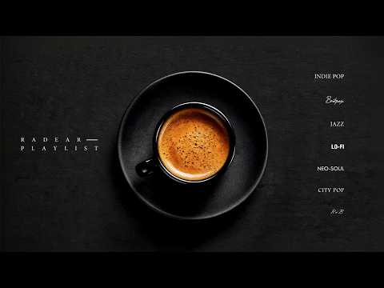
- 챕터: 0:00 Cracked glass · 3:00 Like sugar now · 6:09 Drift away · 9:16 Unused keys · 11:22 Borrowed Light · 14:19 The city shines · 17:08 Soft line · 20:23 The shape we lost · 24:35 Just smile at me · 28:08 Outline No.2 · 30:21 Lyrical love story · 32:44 Dying frame · 35:52 Something full · 39:12 Take me with you · 42:07 Honey on Foam · 44:38 Near, not held · 47:38 Unfinished stoplights · 50:27 Fine even · 53:30 Hushframe Faucet · 55:56 Between saying staying
- 설명 앞부분: 취향 좋은 카페일수록 음악은 크게 드러나지 않지만, 공간의 분위기를 가장 자연스럽게 바꿉니다. 이 플레이리스트는 자극적이지 않으면서도 은근하게 공간을 채워주는 곡들로 구성했습니다. 쉽게 지나치기엔 아깝고, 계속 틀어두기엔 부담 없는 음악들입니다. 손님이 머무는 시간이 조금 더 편안해지도록, 조용히 흐르며 분위기를 완성하는 선곡을 담았습니다. A well-curated café doesn’t need loud music. It simply needs the right one. This playlist is filled with su…
- 같은 채널 평소 대비 ×15.4 (채널 최근 롱폼 중앙값 18,743회) · 평소 영상: 우리도 가을처럼 아름답게 물들기를 「Gentle Jazz」 (18,743회) / 이제 당신도 편안해지길 「Gentle Jazz」 (18,730회)
- 대본 없음 (설명) — 음성인식이 끝나면 도입부·흐름이 들어감
- 댓글 96/96: 좋은 점 — 영상 0 · 감사·응원 6 · 더 알고 싶은 것 0 · 아쉬운 점 — 영상 0 · 반박·불만 — 의견 다름 0 · 정치·사회 0 · 경험 공유 3 · 구독·다음 기대 0
  - 감사·응원 👍21 “전환하셨군요 ㅎㅎㅎ 네, 좋습니다 머리도 발가락도 리듬에 맞춰 까딱~ 까딱~ 입꼬리도 씰룩~ 쌜룩~ 오늘도 덕분에 좋은 음악과 함께 하루를 마감하지요 베풀고 나누어주시는 선물에 감사드립니다()()()...”
  - 감사·응원 👍4 “음악 너무 좋아요 감사합니다!”
  - 경험 공유 👍4 “너무 행복해서 나도 모르게 입꼬리 오림”
  - 경험 공유 👍4 “비는 오락 가락 하고 내가 원하는 만큼의 빗줄기가 아니라 뭔가 모자란 것 같은 데 이런... 음악이 그 모자람을 채우네요. 지금 여기는 카페!!! 좋은 음악, 감사합니다.”

### 1005. Hebt Euch #himmelfahrt #healingmusic #vikingmusic #selbstheilung

- https://www.youtube.com/watch?v=QIXGLP6vZgQ · VikingHealing · 구독자 2,610 · 조회수 23,876 (×9.2, 하루 147.0) · 좋아요 212 (0.9%) · 4분 · 2026-05-13 · 주제 묶음 1. 수면·명상·힐링 · 형식 음악 (그 밖 모양 — 한 편짜리 BGM 등) · 폴더 `W_QIXGLP6vZgQ` (웹 승인)
- 썸네일: 
- 설명 앞부분: Hebt euch, hebt euch, Rauch und Wind, bis wir bei den Alten sind. Text: Sandra Linke Musik und Stimme: Suno (KI) Text: Die Raben ziehn über den Wald, der Himmel singt in Stimmen alt. Die Esche beugt sich im Wind, weil heut die Tore offen sind. Der Rauch erhebt sich sternenwärts, die Trommel schlägt…
- 같은 채널 평소 대비 ×40.4 (채널 최근 롱폼 중앙값 590회) · 평소 영상: Mein Ragnarök macht mich frei - #healingmusic #vi… (622회) / Schwester meines Herzens - #freundschaft #healing… (559회)
- 대본 없음 (설명) — 음성인식이 끝나면 도입부·흐름이 들어감
- 댓글 15/15: 좋은 점 — 영상 0 · 감사·응원 0 · 더 알고 싶은 것 0 · 아쉬운 점 — 영상 0 · 반박·불만 — 의견 다름 0 · 정치·사회 0 · 경험 공유 0 · 구독·다음 기대 0

### 1006. 아름다운 것도 아파 (Beautiful Things Hurt Too) ∣ 여자 듀엣 감성 발라드 Sad Emotional Ballad

- https://www.youtube.com/watch?v=jwUGSmtsSIs · MusicSong · 구독자 7,390 · 조회수 67,309 (×9.1, 하루 396.3) · 좋아요 637 (0.9%) · 4.4분 · 2026-05-06 · 주제 묶음 9. 가요·발라드·트로트 · 형식 플레이리스트·모음 (여러 곡) · 폴더 `W_jwUGSmtsSIs` (웹 승인)
- 썸네일: 
- 설명 앞부분: 서로를 너무 사랑했던 기억은 왜 시간이 지나도 더 아프게 남을까요. 예쁘게 피었던 사랑일수록 끝난 뒤엔 더 깊은 상처로 남는 밤. 잔잔한 피아노와 섬세한 여자 듀엣 화음으로 담아낸 이별 감성 발라드입니다. 이 노래는 이별 후 후회, 그리움, 늦은 밤 감정, 그리고 아직 끝내 놓지 못한 사랑을 담고 있어요. 이어폰 끼고 새벽에 들으면 더 아픈 노래. 감성 발라드 좋아하시는 분들께 추천합니다. 🎧 Pretty Things Hurt Emotional Korean Female Duet Ballad Some beautiful things …
- 같은 채널 평소 대비 ×167.4 (채널 최근 롱폼 중앙값 402회) · 평소 영상: 진짜 좋아해 (Really Like You) (402회) / 눈물이 바다가 되어 ∣ Tears Become the Sea ∣ 다시 볼 수 없는 사람을… (388회)
- 대본 없음 (설명) — 음성인식이 끝나면 도입부·흐름이 들어감
- 댓글 43/43: 좋은 점 — 영상 0 · 감사·응원 1 · 더 알고 싶은 것 0 · 아쉬운 점 — 영상 0 · 반박·불만 — 의견 다름 0 · 정치·사회 0 · 경험 공유 1 · 구독·다음 기대 0
  - 감사·응원 👍2 “감사합니다...정말 아름답네요”
  - 경험 공유 👍3 “정해나 우리아내 생일의날 커플반지드림니다 전재우주문했습니다”

### 1007. 🏡 평생 잊지 못할 내 마음의 고향 ∣ 힐링 트로트 ∣ 혜영스님

- https://www.youtube.com/watch?v=Dx4ewFSkxSg · 혜영스님 | 힐링트로트 · 구독자 7,600 · 조회수 68,667 (×9.0, 하루 636.5) · 좋아요 527 (0.8%) · 5.7분 · 2026-07-07 · 주제 묶음 9. 가요·발라드·트로트 · 형식 AI 음악 · 폴더 `W_Dx4ewFSkxSg` (웹 승인)
- 썸네일: 
- 설명 앞부분: 🌾 고향 🌾 바쁘게 살아오다 보면 문득 그리워지는 곳이 있습니다. 어린 시절 뛰어놀던 골목길, 따뜻한 밥상을 차려주시던 부모님, 반갑게 웃으며 인사하던 이웃들... '고향'은 단순한 장소가 아니라, 우리 마음속 가장 따뜻한 추억이 머무는 곳입니다. 이 노래가 잠시나마 여러분을 그 시절로 데려다주고, 마음 한편에 따뜻한 위로가 되길 바랍니다. 💬 여러분이 가장 그리워하는 고향의 추억은 무엇인가요? 어린 시절 기억, 부모님, 친구, 고향 음식 등 어떤 이야기든 댓글로 함께 나눠주세요. 🌸 혜안스님의 힐링 트로트 채널은 삶의 위로와 희…
- 같은 채널 평소 대비 ×11.9 (채널 최근 롱폼 중앙값 5,788회) · 평소 영상: 아버지 ∣ 한 번도 사랑한다는 말을 못했습니다... 🙏 혜영스님 감성 트로트메들리 ∣ 아… (5,788회) / 혜영스님 - 가을이 오면 문득 떠오르는 그 시절… 🍂 마음이 따뜻해지는 가을 감성 트로트… (5,859회)
- 대본 없음 (설명) — 음성인식이 끝나면 도입부·흐름이 들어감
- 댓글 26/26: 좋은 점 — 영상 0 · 감사·응원 1 · 더 알고 싶은 것 0 · 아쉬운 점 — 영상 0 · 반박·불만 — 의견 다름 0 · 정치·사회 1 · 경험 공유 0 · 구독·다음 기대 0
  - 감사·응원 👍0 “한동훈 국회의원님 진은정 변호사 님 아들 님 딸 님 가족 우리가 지킨다 화이팅 항상 지지합니다 고생 많이 하셨습니다”
  - 정치·사회 👍0 “한동훈 국회의원님 진은정 변호사 님 아들 님 딸 님 가족 우리가 지킨다 화이팅 항상 지지합니다 고생 많이 하셨습니다”

### 1008. [𝙋𝙡𝙖𝙮𝙡𝙞𝙨𝙩] 그대여, -BM

- https://www.youtube.com/watch?v=YDESKcB9ppA · Artist BM · 구독자 8,660 · 조회수 78,100 (×9.0, 하루 1,513.9) · 좋아요 0 (0.0%) · 4분 · 2026-09-01 · 주제 묶음 9. 가요·발라드·트로트 · 형식 플레이리스트·모음 (여러 곡) · 폴더 `W_YDESKcB9ppA` (웹 승인)
- 썸네일: 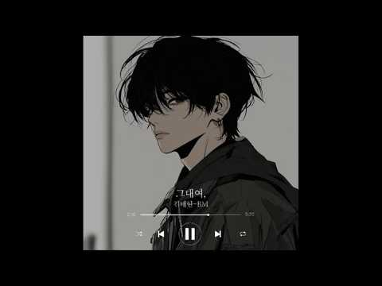
- 설명 앞부분: [𝙋𝙡𝙖𝙮𝙡𝙞𝙨𝙩] 그대여, 🎶 곡 소개 🎶 안녕하세요, Artist BM입니다. 이번 곡은 **《그대여,》**입니다. " 안녕하세요 BM입니다. 이 번곡은 "그대를 사랑하지만 붙잡지 않고, 그리움을 품은 채 떠나보내는 애절한 이별 이야기" 입니다 🖤 언제나 제 음악을 마음 깊이 들어주시는 여러분께, 조심스럽게 이 마음을 건넵니다. 소란한 하루 속에서도 여러분의 시간이 잠시라도 조용히 쉬어갈 수 있기를 바랍니다. 이번 노래도 그 하루의 잔잔한 배경처럼 곁에 머물 수 있었으면 좋겠습니다. 감사한 마음, 오래도록 남기를 바랍니다. 🌙…
- 같은 채널 평소 대비 ×2.4 (채널 최근 롱폼 중앙값 32,938회) · 평소 영상: [𝙋𝙡𝙖𝙮𝙡𝙞𝙨𝙩] 빗속에서,(Part2) -BM (35,531회) / [𝙋𝙡𝙖𝙮𝙡𝙞𝙨𝙩] 괜찮아, -BM (30,346회)
- 대본 없음 (설명) — 음성인식이 끝나면 도입부·흐름이 들어감
- 댓글 22/23: 좋은 점 — 영상 0 · 감사·응원 1 · 더 알고 싶은 것 1 · 아쉬운 점 — 영상 0 · 반박·불만 — 의견 다름 0 · 정치·사회 0 · 경험 공유 0 · 구독·다음 기대 0
  - 감사·응원 👍4 “이번 곡도 지난번처럼 아련하고 애절한 느낌이네요🥹 조용한 가을밤에 듣기 딱 좋을 것 같아요✨ 지난번 곡도 스타일이 너무 제 취향이라 어제 하루 종일 시간 될 때마다 들었거든요🎶 이번 신곡도 그렇게 될 것 같아요🥰 ​항상 좋은 노래 선물해 주셔서 감사해요💖”
  - 더 알고 싶은 것 👍2 “멜론에 언제 발매가 되나요?”

### 1009. "카페 음악 때문에 또 왔어요" 단골들이 숨겨두고 듣는 미니멀 팝 ∣ 𝐏𝐋𝐀𝐘𝐋𝐈𝐒𝐓 · Minimal Cafe Vibe

- https://www.youtube.com/watch?v=fYmDt5bWDxg · Radear · 구독자 31,200 · 조회수 280,151 (×9.0, 하루 1,796.4) · 좋아요 3,184 (1.1%) · 243.6분 · 2026-05-20 · 주제 묶음 4. 카페·매장·라운지 · 형식 플레이리스트·모음 (여러 곡) · 폴더 `W_fYmDt5bWDxg` (웹 승인)
- 썸네일: 
- 챕터: 0:00 Blue Apron Sunday · 3:31 Late Autumn Light · 7:01 Rusting chain · 11:09 Small opinions No.2 · 14:03 Blue Apron Sunday No.2 · 18:19 No more thirst No.2 · 21:23 Stairwell Ghost · 24:24 Realview · 27:44 Let you fade No.2 · 31:08 A green shoot · 34:29 In the quiet · 38:22 Small things · 42:24 Pieace of a day · 45:34 Warm light unused keys · 47:56 You sweeten · 51:08 Dressed for less · 54:48 Kinf of ache No.2 · 58:09 All you Ever Did · 61:00 I think of you · 63:35 Pocket Full of Coins
- 설명 앞부분: 카페에 들어왔을 때 괜히 오래 머물고 싶어지는 공간들이 있습니다. 커피 향 때문일 수도 있지만, 대부분은 자연스럽게 흐르는 음악 때문이기도 하죠. 이 플레이리스트는 “카페 음악 때문에 또 왔어요”라는 말을 듣고 싶어질 만큼 조용하지만 감각적인 곡들로 채웠습니다. 크게 튀지 않지만 공간의 분위기를 은은하게 바꿔주고, 손님들이 편하게 머물 수 있도록 자연스럽게 스며드는 미니멀한 팝들을 담았습니다. 혼자 작업하는 시간에도, 늦은 오후의 카페 무드에도 부담 없이 오래 틀어두기 좋은 플레이리스트였으면 합니다. Some cafés make …
- 같은 채널 평소 대비 ×14.9 (채널 최근 롱폼 중앙값 18,743회) · 평소 영상: 우리도 가을처럼 아름답게 물들기를 「Gentle Jazz」 (18,743회) / 이제 당신도 편안해지길 「Gentle Jazz」 (18,730회)
- 대본 없음 (설명) — 음성인식이 끝나면 도입부·흐름이 들어감
- 댓글 63/63: 좋은 점 — 영상 1 · 감사·응원 2 · 더 알고 싶은 것 1 · 아쉬운 점 — 영상 1 · 반박·불만 — 의견 다름 0 · 정치·사회 0 · 경험 공유 0 · 구독·다음 기대 0
  - 좋은 점 — 영상 👍5 “요즘 Ai뮤직 상향 평준화되어서 왠만하면 듣기 편한데 이 집은 특히 간이 딱맞네”
  - 감사·응원 👍2 “감사합니다ㅎㅎ 작업할 때 듣고 있어요~!”
  - 더 알고 싶은 것 👍0 “2:52:30 ai 음악일까요? 아무리 검색해도 안나와요 ㅜㅜ 1시간짜리로 만들어주세요 너무 좋아요”
  - 아쉬운 점 — 영상 👍15 “와.. 음악 가려듣는데.. 너무 좋아요.. 보통 중간정도 들으면 질리는 느낌이라 끄는데 전체 반복해서 들은 플리는 여기가 처음이예요. Ai제작 음악이라니.. 놀랍고.. 대단하고 좋습니다💫💫💫”

### 1010. 중년 남자의 눈물 쏙 빼는 미친 호소력. '님은 먼곳에' (AI커버블루스 락 Ver.)#김추자 #님은먼곳에 #AI커버 #허스키보컬 #알고보니혼비백산

- https://www.youtube.com/watch?v=A0SSBzDh-Ew · 알고보니 혼비백산 · 구독자 42,900 · 조회수 380,099 (×8.9, 하루 2,172.7) · 좋아요 2,642 (0.7%) · 5.7분 · 2026-05-01 · 주제 묶음 14. AI 음악 · 형식 AI 음악 · 폴더 `W_A0SSBzDh-Ew` (웹 승인)
- 썸네일: 
- 설명 앞부분: 안녕하세요! AI로 음악에 새로운 숨결을 불어넣는 [알고보니 혼비백산]입니다. 이번에 준비한 곡은 1970년에 발표된 김추자 님의 절대적인 명곡, '님은 먼 곳에'입니다. 한국 록의 대부 신중현 님이 작곡하고, 당시 동명의 TBC 드라마 메인 테마곡으로 쓰이며 엄청난 신드롬을 일으켰던 곡이죠. 김추자 님 특유의 독보적인 소울과 사이키델릭한 감성이 담겨 있어, 50년이 훌쩍 지난 지금까지도 수많은 후배 가수들이 리메이크하는 한국 대중음악사의 마스터피스입니다. 이 위대한 명곡을 이번에는 '감성적인 블루스 록(Blues Rock)'과 …
- 같은 채널 평소 대비 ×43.7 (채널 최근 롱폼 중앙값 8,689회) · 평소 영상: 한 시대를 울렸던 그 노래… 조수미 〈나 가거든〉 ∣ 조선팝 락발라드 (8,689회) / 첫 소절부터 그 시절이 떠오릅니다… 김정수 - 내 마음 당신 곁으로 [락발라드.ver] (8,629회)
- 대본 없음 (설명) — 음성인식이 끝나면 도입부·흐름이 들어감
- 댓글 244/245: 좋은 점 — 영상 2 · 감사·응원 20 · 더 알고 싶은 것 2 · 아쉬운 점 — 영상 2 · 반박·불만 — 의견 다름 0 · 정치·사회 0 · 경험 공유 9 · 구독·다음 기대 3
  - 좋은 점 — 영상 👍6 “여성의 노래도 멋진데, 남성의 노래도 멋지네요. 파워풀해서 듣기 좋으네요...”
  - 감사·응원 👍9 “백산쌤 !! 잘 들었습니다 좋은 노래가 많이 올려지네요 고생많으셨어요 감사합니다❤”
  - 감사·응원 👍7 “아름다운 꽂과 멋진 꿈 을 향해가는 오월의 첫날 (님은 먼곳에)와~~!!감탄사가 나오는군요 댓글을. 우연히 봤는대 어느 구독자님깨서 신청해주신 곡 이던대 백산님도 좋아하시는 곡이라구~^ㅎㅎ 기대 이상으로 훌륭했다고 봅니다 구독자 님들도 역시 똑같은 마음 이네요 고맙습…”
  - 더 알고 싶은 것 👍5 “멋있네요 이런음악 많이 만들어주셔요 역시 노래는 옛것이 좋네요”
  - 더 알고 싶은 것 👍2 “알혼백 구독 바로 갑니다. 소울 충만한 감성 쥑여주는 버젼 Green Green Grass Of Home 좀 올려주세요. 미리 감사인사 드려요. 😍😍😍💯🧡🧡🧡”
  - 아쉬운 점 — 영상 👍4 “말했으면요, 말했으면 내곁에 남았을까요ᆢ? 무한반복 감상할게요, 감사드려요.❤”
  - 아쉬운 점 — 영상 👍3 “ai 가 득음 을 한 목소리로 들려 주다 보니. 인간의 목소리로 뭔가? 아쉬웠던 것을 풀어 주네요. 진짜 큰일 났네...가수들 노래를 잘 안 듣게 된 것이.귓구녕 수준이 너무 올라 버렸어요, 책임지세요 ㅋㅋ”
  - 경험 공유 👍12 “박수 👏 👏 👏 와우 👍 👑 그대는 왕이야 거친 락의정수ㅡㅡ캭ㅡㅡ남자의 버전 님은먼곳에 사랑하는이를떠나보내니 발악하는것처럼 처절하게부르네ᆢ 😭 그래 나!!! 돌아갈께유 !! 피토하지마쇼!! ! ❤오늘도 나를 실망시키지않는 내가수님 백점 💯”
  - 경험 공유 👍5 “야ㅡㅡㅡ계속 듣고 들어도 질리지가않네 끝내주네❤ 쮝인다ㆍ 👍 👍 👍 따봉 내가 제일좋아하는 곡임 ❤❤❤ 오늘도 🤒 🕙 즐감임”
  - 구독·다음 기대 👍4 “미쳤다.. 왜 알고리즘이 이제야 뜬거지.. AI 커버 채널 몇개 구독중인데 이분이 그냥 1등 인것같습니다.. 왜 조회수가 높고 댓글이 많은지 알겠네요 곡 초이스도 편곡도 보컬음색도 전부 취향저격 제대로입니다 채널 업로드 된 곡들 하나씩 정주행 중인데 못참고 중간에 댓…”
  - 구독·다음 기대 👍3 “감사합니다, "님은먼곳에" 조관우가 부른 버전을 자주들었는데ㅡㅡ그래서 너무좋아서 신청하고 언제쯤 들을수있을까 매일 찾아보곤했는데~~듣고싶었던곡 감사합니다, "거리에서"도 신청해봅니다, 어떤 편곡이나올지 기대됩니다”

### 1011. [𝐏𝐥𝐚𝐲𝐥𝐢𝐬𝐭] 나른 야르한 제이팝 플리

- https://www.youtube.com/watch?v=6Kd2P_Pu5Ug · Nonohara · 구독자 1,240 · 조회수 10,856 (×8.8, 하루 153.3) · 좋아요 224 (2.1%) · 14.7분 · 2026-08-13 · 주제 묶음 10. 팝송·K팝·J팝 · 형식 플레이리스트·모음 (여러 곡) · 폴더 `W_6Kd2P_Pu5Ug` (웹 승인)
- 썸네일: 
- 챕터: 0:00 coffee mix · 2:42 階下の騒音 - 층간 소음 · 6:07 Losing My Mind · 9:17 蚊 - 모기 · 12:05 夏なのに寒い - 여름인데도 추워
- 설명 앞부분: 이 플리를 듣는 모든 분들이 행복했으면 좋겠습니다😁 이 영상의 음악은 AI를 활용하여 제작되었으며, 콘텐츠 제작자가 직접 기획·편집했습니다. 사랑의 감정을 담은 감성 J-POP 플레이리스트입니다. 잔잔한 분위기의 슬픈 일본 노래 플레이리스트와 신나는 jpop 플레이리스트를 좋아하시는 분들께 추천드려요 공부할 때, 작업할 때, 또는 하루를 마무리하며 듣기 좋은 공부할 때 듣는 음악 J-POP으로 편안한 시간을 보내셨으면 좋겠습니다 애니메이션 OST 같은 감성을 좋아하신다면 J-POP 플레이리스트 애니 분위기도 함께 느껴보세요 매일 …
- 같은 채널 평소 대비 ×5.0 (채널 최근 롱폼 중앙값 2,176회) · 평소 영상: 좋아하는 이유를 찾아봐도💕｜『 君を好きな理由 (너를 좋아하는 이유)』｜가사해석/Lyrics (2,196회) / [𝐏𝐥𝐚𝐲𝐥𝐢𝐬𝐭] 가면 속의 너｜느낌 있는 제이팝 (2,155회)
- 대본 없음 (설명) — 음성인식이 끝나면 도입부·흐름이 들어감
- 댓글 28/28: 좋은 점 — 영상 0 · 감사·응원 3 · 더 알고 싶은 것 1 · 아쉬운 점 — 영상 0 · 반박·불만 — 의견 다름 0 · 정치·사회 0 · 경험 공유 0 · 구독·다음 기대 0
  - 더 알고 싶은 것 👍1 “유튜브에서만 노래 듣고 있는데ㅠ 여름인데도 추워 이거만 따로 올려주시면 안될까요ㅜㅠㅠㅠ”

### 1012. 텐션폭발! 운동성공! 오늘부터 내 노동요는 이거다!! [90~2000년대] 클럽 리믹스 35곡 [텐션업 플레이리스트]

- https://www.youtube.com/watch?v=t5GX_3shfEw · 드루와자기 · 구독자 19,700 · 조회수 171,632 (×8.7, 하루 1,484.2) · 좋아요 956 (0.6%) · 125.2분 · 2026-06-29 · 주제 묶음 3. 공부·집중·작업 · 형식 플레이리스트·모음 (여러 곡) · 폴더 `W_t5GX_3shfEw` (웹 승인)
- 썸네일: 
- 설명 앞부분: 운동할 때, 청소할 때, 혹은 드라이브할 때! 지루할 틈 없는 신나는 에너지가 필요하신가요? 90년대부터 2000년대 초반까지, 대한민국을 뜨겁게 달궜던 레전드 명곡들을 엄선하여 신나는 클럽 리믹스로 재탄생시켰습니다. 총 35곡의 논스톱 믹스로 지치지 않는 텐션을 유지해보세요! 이런 분들께 추천해요! 헬스장, 홈트레이닝 할 때 신나는 음악이 필요하신 분 청소할 때 리듬 타며 즐겁게 마무리하고 싶으신 분 드라이브할 때 차 안 분위기를 클럽으로 만들고 싶으신 분 ✨[35곡 타임라인은 아래를 참고하세요]"✨
- 같은 채널 평소 대비 ×511.6 (채널 최근 롱폼 중앙값 336회) · 평소 영상: 💃 다 그런거지 - 드루와자기 🕺 ∣ 신나는 트로트 / 지친 일상을 날려버릴 신나는 노래… (381회) / ✨ 나의 사랑아 - 드루와자기 💖 ∣ 가슴 깊이 스며드는 애절한 OST 발라드 🎧💫 #나… (290회)
- 대본 없음 (설명) — 음성인식이 끝나면 도입부·흐름이 들어감
- 댓글 63/63: 좋은 점 — 영상 2 · 감사·응원 6 · 더 알고 싶은 것 1 · 아쉬운 점 — 영상 1 · 반박·불만 — 의견 다름 0 · 정치·사회 0 · 경험 공유 2 · 구독·다음 기대 0
  - 좋은 점 — 영상 👍1 “운전할대 듣기 좋은 노래 같아요 감사합니다 앞으로도 좋은 노래 많이 만들어 주세용 ^^”
  - 좋은 점 — 영상 👍1 “운전할때 듣기 좋네요 잘들을게요😊😊❤🎉🎉”
  - 감사·응원 👍2 “드루와 자기님 반가워요~ ^^ 탠션폭발~ 잘 듣습니다~! 수고 많으셨어요~ ^^ 7월에도 행복하세요~ 응원합니다~!!”
  - 감사·응원 👍1 “좋은노래 감사합니다 수고많으셨어요 ❤”
  - 더 알고 싶은 것 👍3 “2탄도 만들어주세요 너무 신나요”
  - 아쉬운 점 — 영상 👍3 “5개들었는데 광고가 5개 쥑입니다”
  - 경험 공유 👍1 “두번째 댓글 올려요.제가 댓글쓰는 스탈 아니었음요. 주로 설겆이, 집안일 할때 들어요. 매일 들어요,원래가수꺼 찾아들어 봤는데 느낌이 내려가서 다시 돌아오곤 했답니다. 확실이 에너지 팡팡!!! 남녀음성.음색을 중요하게 생각하는데,듣기가 참 좋아요^^ 모두를 만족시킬수…”
  - 경험 공유 👍1 “제가 원하는곡을 한꺼번에 소리좋은 리믹스로 한꺼번에 만들었네요🎉구독알람했어요❤천썽힙합퀸도 구경하세요”

### 1013. One Lifetime Wasn't Enough ∣ Emotional Piano Love Ballad ∣ Soft Emotion Music

- https://www.youtube.com/watch?v=b5N4DQLrfAg · Soft Emotion Music · 구독자 13,700 · 조회수 118,471 (×8.7, 하루 1,089.8) · 좋아요 323 (0.3%) · 6분 · 2026-07-06 · 주제 묶음 6. 피아노·클래식·연주곡 · 형식 음악 (그 밖 모양 — 한 편짜리 BGM 등) · 폴더 `W_b5N4DQLrfAg` (웹 승인)
- 썸네일: 
- 설명 앞부분: "One Lifetime Wasn't Enough" is a deeply emotional piano love ballad about a love that never fades, no matter how much time passes. With an intimate female vocal and a haunting solo piano melody, this song tells the story of a heart that could never stop loving. If you enjoy emotional love songs, s…
- 같은 채널 평소 대비 ×13.6 (채널 최근 롱폼 중앙값 8,717회) · 평소 영상: You’re My Endless Breath ❤️ ∣ Beautiful Romantic … (8,717회) / You’re the Light in My Sky ✨ A Romantic Love Duet… (7,829회)
- 대본 없음 (설명) — 음성인식이 끝나면 도입부·흐름이 들어감
- 댓글 15/15: 좋은 점 — 영상 0 · 감사·응원 0 · 더 알고 싶은 것 0 · 아쉬운 점 — 영상 0 · 반박·불만 — 의견 다름 0 · 정치·사회 0 · 경험 공유 0 · 구독·다음 기대 0

### 1014. 너와 걸으며/달달한노래/아련한노래/달콤한노래/잔잔한노래/편안한노래/가을노래/자기전에 듣기좋은 노래/여행갈때 듣기좋은 노래/힘나는노래/감성발라드/공부할때듣는노래/…

- https://www.youtube.com/watch?v=bzVlQQuegBc · 황금밴드 / Golden Band · 구독자 1,880 · 조회수 16,143 (×8.6, 하루 265.8) · 좋아요 24 (0.1%) · 4.2분 · 2026-08-23 · 주제 묶음 9. 가요·발라드·트로트 · 형식 음악 (그 밖 모양 — 한 편짜리 BGM 등) · 폴더 `W_bzVlQQuegBc` (웹 승인)
- 썸네일: 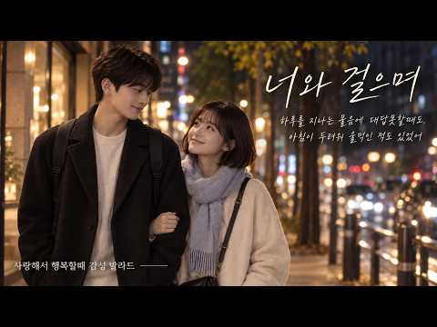
- 설명 앞부분: 그저 편의점에 다녀오는 길 너는 이야기하고 나는 웃지 밤 공기가 선선해서 너와 걸으며 행복을 느껴 별거 없어도 이제야 하루를 보내는 것 같아 별거 아닌 이야기에 마음이 가득 차 하루를 지나는 물음에 대답 못 할때도 아침이 두려워 울먹인 적도 있었어 그럴 때 생각나는게 있어 우리 처음 손을 잡았을 때부터 놓치지 않은 맥주 한잔에 피곤한지 너는 어깨를 빌려 드라마를 보고 영화를 보고 소파 밑에 앉아 기대어 별거 아닌 일상을 이야기해 아무 의미 없는 이야기들 속에 담긴 의미를 너도 알고 있을까? 하루를 지나는 물음에 대답 못할 때도 아…
- 같은 채널 평소 대비 ×2.6 (채널 최근 롱폼 중앙값 6,236회) · 평소 영상: 잘가요 내가 사랑한 사람/슬픈노래/잔잔한노래/아련한노래/감성발라드/자기전에 듣기좋은 노래… (6,268회) / 이타카의 불빛/오디세이 OST/웅장한음악/뮤지컬/오페라/황금밴드 (6,204회)
- 대본 없음 (설명) — 음성인식이 끝나면 도입부·흐름이 들어감
- 댓글 16/17: 좋은 점 — 영상 0 · 감사·응원 0 · 더 알고 싶은 것 0 · 아쉬운 점 — 영상 0 · 반박·불만 — 의견 다름 0 · 정치·사회 0 · 경험 공유 0 · 구독·다음 기대 0

### 1015. 10. 그리스 이타카, 무화과맛 재즈 ∣ playlist

- https://www.youtube.com/watch?v=Nxeex1L0sYU · dansoonhee · 구독자 16,300 · 조회수 138,997 (×8.5, 하루 1,750.4) · 좋아요 2,128 (1.5%) · 280.3분 · 2026-08-04 · 주제 묶음 7. 재즈·보사노바 · 형식 플레이리스트·모음 (여러 곡) · 폴더 `W_Nxeex1L0sYU` (웹 승인)
- 썸네일: 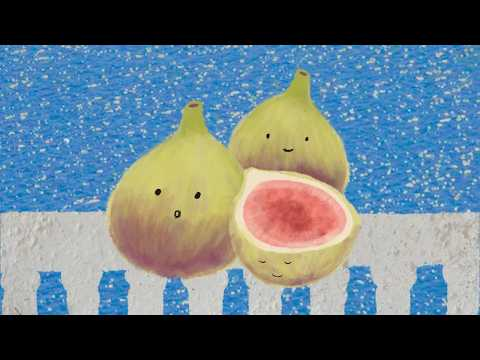
- 챕터: 0:00 Fig on the Terrace · 0:27 Aegean Breeze · 1:39 Sunlight on the Figs · 2:34 Summer Figs · 5:17 Blue Shutters · 7:41 fig in Attica · 8:43 Fresh from the Tree · 9:44 Linen in the Wind · 10:28 Sunlit Fig · 13:12 Quiet Coastline · 16:01 Fig Season · 17:10 White Walls, Blue Water · 17:44 A Little Greek Summer · 19:51 Morning in Attica · 20:49 Sweet Mediterranean Air · 23:27 Figs on a White Plate · 24:19 Toward the Sea · 26:03 Under the Fig Tree · 29:11 Clear Summer Light · 31:10 The Breeze Between Us
- 설명 앞부분: 꽃이 없는 과일인 줄 알았던 무화과는 사실 그 안에 수많은 작은 꽃을 품고 있다고 해요. 보이지 않는 곳에서도 조용히 피어나고 있는 마음들처럼. 그리스 신화 속에도 등장한 무화과와 산토리니의 따뜻한 햇살, 잘 익은 과육의 은은한 단맛을 담았습니다. 오늘도 천천히 머물다 가세요. Always, Peace. ♡ Time Track 단순히의 음악을 발견해 주시고, 기꺼이 머물러 주셔서 진심으로 감사합니다. 🤍 혼자 작업하는 시간이 많아, 오래 들어도 편안하고 집중하기 좋은 음악을 만들고 싶다는 마음으로 이 채널을 시작했습니다. 음악을 …
- 같은 채널 평소 대비 ×14.7 (채널 최근 롱폼 중앙값 9,467회) · 평소 영상: 06. 선물 받은 꽃, 재즈 ∣ playlist (9,467회) / 22.미국 워싱턴, 체리맛 재즈 ∣ 𝗽𝗹𝗮𝘆𝗹𝗶𝘀𝘁 (8,962회)
- 대본 없음 (설명) — 음성인식이 끝나면 도입부·흐름이 들어감
- 댓글 74/75: 좋은 점 — 영상 0 · 감사·응원 6 · 더 알고 싶은 것 1 · 아쉬운 점 — 영상 0 · 반박·불만 — 의견 다름 0 · 정치·사회 0 · 경험 공유 0 · 구독·다음 기대 2
  - 감사·응원 👍20 “학교에서 근무 중인데 아침에 틀어 놓으면 애들이 들어오면서 좋다고 집중해서 책 보는 음악 드디어 찾았습니다 감사합니다”
  - 감사·응원 👍10 “와 무화과가 오늘 너무 땡겼어요. 8월부터 제철이라던데 시장가서 한 봉지 사와야겠어요. 정말 귀엽고 사랑스러운 썸네일과 그리스 풍의 음악까지 헉헉. 제 여름을 몽글몽글 낭만가득 채워줘서 감사하구 행복해요 .. ㅜ ㅜ ㅜ”
  - 더 알고 싶은 것 👍1 “썸네일이 너무 귀야워요 몽글몽글하고 색감도 너무 예뻐요 저는 썸네일을 핀터레스트에서 가져온줄 알았는데.. 직접하신거라니 진짜 넘무 좋아요!!!!!!!‘ 아침에 햇빛 맞으면서 쉬면 너무!!! 행복하네여 방학인데 쉬면서 이런 귀야운 플리를 들으니까 넘 좋아요 많이많이 영…”
  - 구독·다음 기대 👍1 “구독하고 갑니다❤”
  - 구독·다음 기대 👍1 “납작 복숭아 플리 듣고 구독했어요!! 책 읽으면서 들으면 기분이 차분해지고 힐링도 돼서 좋더라구요😚 무화과 친구도 잘 들을게요 🤎”

### 1016. ㉖대한민국 정통 트로트 60선 (Korean Trot 60) ∣ 전설의 거장들이 빚어낸 정통 명곡 메들리 #트로트 #정통트로트 #trot #kpop #은채린

- https://www.youtube.com/watch?v=75u_o8j9V0s · 트로트의 맛! · 구독자 39,600 · 조회수 336,224 (×8.5, 하루 1,998.0) · 좋아요 3,620 (1.1%) · 188.5분 · 2026-05-08 · 주제 묶음 10. 팝송·K팝·J팝 · 형식 플레이리스트·모음 (여러 곡) · 폴더 `W_75u_o8j9V0s` (웹 승인)
- 썸네일: 
- 챕터: 0:00 1사랑이비를맞아요(배금성) · 3:18 2초가삼간(최정자) · 6:26 3미워하지않으리(정원) · 9:44 4사나이맹세(이광희) · 13:19 5동숙의노래(문주란) · 17:00 6연모(박우철) · 20:14 7갈대의순정(박일남) · 23:21 8비내리는명동거리(배호) · 26:56 9안개낀장충단공원(배호) · 30:17 10남자의눈물(현철) · 33:46 11인생(모정애) · 37:10 12우중의여인(오기택) · 40:25 13내마음별과같이(현철) · 43:21 14잊을수가있을까(나훈아) · 46:38 15봉선화연정(현철) · 49:40 16찔레꽃(백난아) · 52:34 17들국화여인(현철) · 55:26 18영시의이별(배호) · 58:25 19보고싶은여인(현철) · 61:22 20나그네설움(백년설)
- 설명 앞부분: 대한민국 가요계의 역사를 만들어온 전설의 거장들이 빚어낸 불후의 정통 명곡 60곡을 엄선했습니다. 배호, 남진, 나훈아, 이미자, 주현미, 현철 등 이름만 들어도 가슴 설레는 위대한 가수들의 목소리로 기억되는 이 노래들은, 거친 세월의 풍파를 묵묵히 견뎌오신 우리 아버님들의 인생 그 자체입니다. 타향살이의 설움과 쓰라린 이별의 아픔, 그리고 그리운 고향에 대한 향수까지... 삶의 모든 희노애락이 녹아있는 이 60곡의 영원한 명곡들을 은채린의 깊은 감성으로 온 마음을 담아 엮었습니다. 고단한 하루 끝에 홀로 술잔을 기울이거나, 문득…
- 대본 없음 (설명) — 음성인식이 끝나면 도입부·흐름이 들어감
- 댓글 174/176: 좋은 점 — 영상 2 · 감사·응원 21 · 더 알고 싶은 것 0 · 아쉬운 점 — 영상 2 · 반박·불만 — 의견 다름 0 · 정치·사회 0 · 경험 공유 3 · 구독·다음 기대 0
  - 좋은 점 — 영상 👍2 “목소리좋고맛깔스럽게타고난질리지음성은체린앞으로흘러간노래계속들려주세요”
  - 좋은 점 — 영상 👍1 “반주와노래가 요란하거시끄럽지않고 차분해서 듣기좋네요”
  - 감사·응원 👍11 “요즘 ㅡ 나리짱님 ㅡ 은 채린 가수분 ㅡ 때문에 강남구에서 귀촌한후 요즘 텃밭에 모종심으며 이 음악을 틀어놓으면 세상에 더할나위없는 나의 행복 내세상이지요 감사합니다 ㅡ”
  - 감사·응원 👍10 “감미로운목소리들려주시니감사해요! 건강하시고복많이받으시고좋은일많이있으시길빕니다”
  - 아쉬운 점 — 영상 👍2 “광고가너무많어”
  - 아쉬운 점 — 영상 👍1 “채린아씨,애련하고맑고고운아씨,노래가,그리워찾아왔읍니다,언제들어도지루하지않고,명랑한노래가사람,마음을잡아들입니다,노래들으면항상,마음이편해지고,세상이달리보입니다,그만큼노래가편하고,친근감이있네요,아씨가슴속에서풍겨나오는,전설의근원이아닐까요,하늘이내린신의소리,그자체입니다,아씨,…”
  - 경험 공유 👍5 “흐흐… 이정표 없는 거리까지 광고 피해가면서 3시간 좀 넘게 다 들었어요 눈과 귀에서 피가 나올것 같지만 제가 머리가 나빠서 그런지 며칠전에 개별로 들었었는데 또 새롭네요 ㅎㅎ오늘 밤 채린이가 꿈에 나올 것 같아요😂”
  - 경험 공유 👍3 “72세요.내가좋아하는.노래다.들을수있어서.넘.넘행복합니다.항시건강하시고.더많은.노래들려주세요”

### 1017. 432 Hz Reiki Music for Healing and Cleansing Negativity - 20 min

- https://www.youtube.com/watch?v=auzLrS12AUo · Reiki Healing Japan 365 · 구독자 20,000 · 조회수 165,303 (×8.3, 하루 1,427.9) · 좋아요 774 (0.5%) · 20분 · 2026-06-29 · 주제 묶음 1. 수면·명상·힐링 · 형식 음악 (그 밖 모양 — 한 편짜리 BGM 등) · 폴더 `W_auzLrS12AUo` (웹 승인)
- 썸네일: 
- 설명 앞부분: Relax your mind with soothing 432 Hz Reiki healing music. This gentle healing music helps calm the mind, reduce stress, cleanse negative energy, restore positive energy, and create a peaceful atmosphere for meditation, Reiki practice, and mindfulness. 🕯️ Best for: Cleansing negative energy and supp…
- 같은 채널 평소 대비 ×19.9 (채널 최근 롱폼 중앙값 8,324회) · 평소 영상: Reiki Music 15 minute to cleanse negative energy … (8,951회) / 15 minute Reiki Healing Music for Meditation and … (8,976회)
- 대본 없음 (설명) — 음성인식이 끝나면 도입부·흐름이 들어감
- 댓글 22/22: 좋은 점 — 영상 0 · 감사·응원 0 · 더 알고 싶은 것 0 · 아쉬운 점 — 영상 0 · 반박·불만 — 의견 다름 0 · 정치·사회 0 · 경험 공유 0 · 구독·다음 기대 0

### 1018. 🎵Do You Hear Me… — A Story of Love & Loss ∣ Full Emotional Album 2026 (1 Hour Piano Music)

- https://www.youtube.com/watch?v=BwNZ573NSVs · HeartEcho AI Music · 구독자 29,500 · 조회수 239,742 (×8.1, 하루 1,356.0) · 좋아요 2,937 (1.2%) · 57.9분 · 2026-04-29 · 주제 묶음 6. 피아노·클래식·연주곡 · 형식 AI 음악 · 폴더 `W_BwNZ573NSVs` (웹 승인)
- 썸네일: 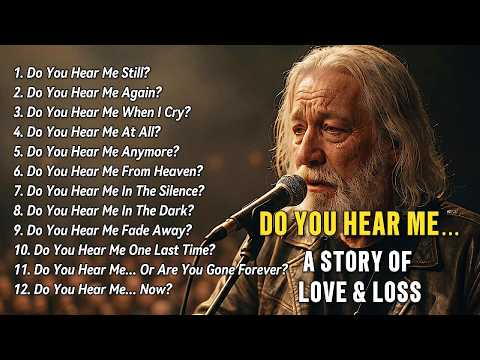
- 챕터: 0:00 Do You Hear Me Still? · 4:30 Do You Hear Me Again? · 9:00 Do You Hear Me When I Cry? · 13:40 Do You Hear Me At All? · 18:20 Do You Hear Me Anymore? · 23:00 Do You Hear Me From Heaven? · 27:40 Do You Hear Me In The Silence? · 32:20 Do You Hear Me In The Dark? · 37:00 Do You Hear Me Fade Away? · 41:40 Do You Hear Me One Last Time? · 46:30 Do You Hear Me… Or Are You Go… · 51:10 Do You Hear Me… Now?
- 설명 앞부분: Do You Hear Me… — Full Emotional Album A 1-hour journey through love, loss, loneliness, and letting go. This is not just music… This is a story. 💔 From calling someone who never answers… 🌑 To losing yourself in silence… 💀 To fading away… 💥 To one final call… 🕊 And finally learning how to let go. 🎧 …
- 같은 채널 평소 대비 ×34.3 (채널 최근 롱폼 중앙값 6,984회) · 평소 영상: Do You Miss Me At Closing Time? — A Sad Song Abou… (7,534회) / I Hope You Still Think Of Me? — I Never Really Le… (6,434회)
- 대본 없음 (설명) — 음성인식이 끝나면 도입부·흐름이 들어감
- 댓글 364/367: 좋은 점 — 영상 0 · 감사·응원 1 · 더 알고 싶은 것 0 · 아쉬운 점 — 영상 0 · 반박·불만 — 의견 다름 0 · 정치·사회 0 · 경험 공유 0 · 구독·다음 기대 0

### 1019. In der Walpurgisnacht brennt mein altes Ich #walpurgisnacht #healingmusic #vikingmusic

- https://www.youtube.com/watch?v=jugVBYVn8ag · VikingHealing · 구독자 2,610 · 조회수 21,218 (×8.1, 하루 120.3) · 좋아요 288 (1.4%) · 4.6분 · 2026-04-29 · 주제 묶음 1. 수면·명상·힐링 · 형식 음악 (그 밖 모양 — 한 편짜리 BGM 등) · 폴더 `W_jugVBYVn8ag` (웹 승인)
- 썸네일: 
- 설명 앞부분: In der Walpurgisnacht brennt mein altes Ich… und aus der Asche werd ich neu. Text: Sandra Linke, Musik und Stimme: Suno (KI) Text: Die Nacht ist tief, doch ich fürcht sie nicht, ich trag ihre Schatten in meinem Licht. Was ich verborgen, was ich verdrängt, wird heute im Feuer beim Namen genannt. Die…
- 같은 채널 평소 대비 ×35.9 (채널 최근 롱폼 중앙값 590회) · 평소 영상: Mein Ragnarök macht mich frei - #healingmusic #vi… (622회) / Schwester meines Herzens - #freundschaft #healing… (559회)
- 대본 없음 (설명) — 음성인식이 끝나면 도입부·흐름이 들어감
- 댓글 12/12: 좋은 점 — 영상 0 · 감사·응원 0 · 더 알고 싶은 것 0 · 아쉬운 점 — 영상 0 · 반박·불만 — 의견 다름 0 · 정치·사회 0 · 경험 공유 0 · 구독·다음 기대 0

### 1020. Fall 🍂 5 Minute Autumn Timer with Relaxing Piano Music 🍁 (No Alarm) ☕ Visual Focus Countd…

- https://www.youtube.com/watch?v=2PQoOVZmxnY · Timers Box · 구독자 2,920 · 조회수 23,662 (×8.1, 하루 1,050.0) · 좋아요 12 (0.1%) · 5분 · 2026-09-30 · 주제 묶음 3. 공부·집중·작업 · 형식 음악 (그 밖 모양 — 한 편짜리 BGM 등) · 폴더 `W_2PQoOVZmxnY` (웹 승인)
- 썸네일: 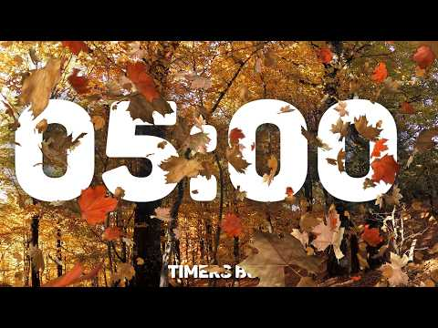
- 설명 앞부분: Welcome to Timers Box! ⏳ Enjoy this relaxing 5 Minute Autumn Timer paired with cozy, calming piano music and gentle visual countdown visuals—designed without a harsh alarm at the end so your peace and focus remain completely unbroken. 🍂🎹✨ Whether you need a quick 5-minute study break, a short medit…
- 같은 채널 평소 대비 ×93.0 (채널 최근 롱폼 중앙값 254회) · 평소 영상: 🍂 15 Minute Pure Autumn Visual Timer with Relaxin… (371회) / 🍂 7 Minute Fall Visual Timer with Calming Piano M… (455회)
- 대본 없음 (설명) — 음성인식이 끝나면 도입부·흐름이 들어감
- 댓글 1/1: 좋은 점 — 영상 0 · 감사·응원 0 · 더 알고 싶은 것 0 · 아쉬운 점 — 영상 0 · 반박·불만 — 의견 다름 0 · 정치·사회 0 · 경험 공유 0 · 구독·다음 기대 0

### 1021. Work Music, Deep Focus Music for ADHD Relief and Concentration

- https://www.youtube.com/watch?v=CQ7p1pOOwrA · Greenred Productions - Topic · 구독자 8,540 · 조회수 68,232 (×8.0, 하루 467.6) · 좋아요 361 (0.5%) · 9.8분 · 2026-05-30 · 주제 묶음 3. 공부·집중·작업 · 형식 음악 (그 밖 모양 — 한 편짜리 BGM 등) · 폴더 `W_CQ7p1pOOwrA` (웹 승인)
- 썸네일: 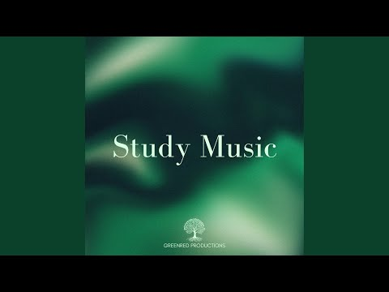
- 설명 앞부분: Provided to YouTube by DistroKid Work Music, Deep Focus Music for ADHD Relief and Concentration · Greenred Productions · Mantas Savickis Work Music, Deep Focus Music for ADHD Relief and Concentration ℗ Greenred Productions Released on: 2026-05-31 Auto-generated by YouTube.
- 같은 채널 평소 대비 ×24.0 (채널 최근 롱폼 중앙값 2,846회) · 평소 영상: Relaxing Focus Music for Work and Studying, Calm … (2,846회) / Stress Relief Music, Relaxing Piano Music for Rel… (2,881회)
- 대본 없음 (설명) — 음성인식이 끝나면 도입부·흐름이 들어감
- 댓글 0/0: 좋은 점 — 영상 0 · 감사·응원 0 · 더 알고 싶은 것 0 · 아쉬운 점 — 영상 0 · 반박·불만 — 의견 다름 0 · 정치·사회 0 · 경험 공유 0 · 구독·다음 기대 0

### 1022. 우리 행복하자 (Let's Just Be Happy) ∣ 미안하단 말보다 우리 행복하자 ∣ KR/ROM/EN Lyrics

- https://www.youtube.com/watch?v=d0jaFafrkkM · 한그루브 · 구독자 50,000 · 조회수 393,319 (×7.9, 하루 3,421.6) · 좋아요 2,828 (0.7%) · 5.5분 · 2026-06-30 · 주제 묶음 5. 운동·드라이브·신나는 · 형식 플레이리스트·모음 (여러 곡) · 폴더 `W_d0jaFafrkkM` (웹 승인)
- 썸네일: 
- 설명 앞부분: 🎵 이 곡이 포함된 1시간 풀버전 플레이리스트 보기 🌳 우리 행복하자 (U-ri Haeng-bok-ha-ja _ Let's Just Be Happy) 어이하리 어이하리, 이 철없는 마음을. 당신이 준 계절을 나는 거저 얻은 줄 알았네 이제야 보이는 당신의 야윈 그림자. 미안하단 말보다 우리 행복하자, 사랑한단 말 대신 우리 행복하자. 나 하나 키우려 당신은 세상을 견뎠고, 모진 바람은 다 맞으면서내게는 햇살만 줬네. 당신의 주름진 손마디가 내 길을 닦았는데, 고맙다는 말은 왜 이리 목에 걸리는지 내 목소리가 커질수록 당신의 대답은…
- 같은 채널 평소 대비 ×29.7 (채널 최근 롱폼 중앙값 13,223회) · 평소 영상: 화양연화 (In the Mood for Love) Official MV ∣ 그때가 꽃인 … (13,223회) / [플리] 이름 없는 입 ∣ 악플·뒷담화·소문 ∣ 재미로 썼다는 짧은 네 문장이 누군가의 … (12,832회)
- 대본 없음 (설명) — 음성인식이 끝나면 도입부·흐름이 들어감
- 댓글 319/319: 좋은 점 — 영상 2 · 감사·응원 10 · 더 알고 싶은 것 2 · 아쉬운 점 — 영상 2 · 반박·불만 — 의견 다름 0 · 정치·사회 0 · 경험 공유 1 · 구독·다음 기대 1
  - 좋은 점 — 영상 👍8 “와~ 가사.!!! 와 ~!!음악소리 심장을 뛰게하네요 제가 국악스타일을 좋아해서 그런지 정말 너무너무 멋있어요 한번듣고 귀에 쏙쏙 들어와요 반했어요 가사가 현실 성있는 ....!!! 공감이 가네요 반복해서 듣게 되네요 파이팅입니다 😊😊😊”
  - 좋은 점 — 영상 👍3 “정말 가사가 귀에 쏙쏙 박히네요ㅎㅎ 항상응원합니다~~^^ 근데 가슴에도 쑥쑥 박히네요 한그루브님도 행복하셔요~”
  - 감사·응원 👍20 “내 나이 62 너무나 가슴울리는노래 들어면 들어수록 부모님생각에 눈물만… 미국 타국땅에서 정말좋은노래감사”
  - 감사·응원 👍8 “와~ 가사.!!! 와 ~!!음악소리 심장을 뛰게하네요 제가 국악스타일을 좋아해서 그런지 정말 너무너무 멋있어요 한번듣고 귀에 쏙쏙 들어와요 반했어요 가사가 현실 성있는 ....!!! 공감이 가네요 반복해서 듣게 되네요 파이팅입니다 😊😊😊”
  - 더 알고 싶은 것 👍2 “너무 좋은 노래네요 앞으로도 좋은 부탁드려요”
  - 더 알고 싶은 것 👍1 “이거 남자 버전으로 키낮춰서 만들어 줄수있을 까요? 부탁드립니다. 너무 좋아요”
  - 아쉬운 점 — 영상 👍8 “와~ 가사.!!! 와 ~!!음악소리 심장을 뛰게하네요 제가 국악스타일을 좋아해서 그런지 정말 너무너무 멋있어요 한번듣고 귀에 쏙쏙 들어와요 반했어요 가사가 현실 성있는 ....!!! 공감이 가네요 반복해서 듣게 되네요 파이팅입니다 😊😊😊”
  - 아쉬운 점 — 영상 👍5 “무한반복중입니다! 완전좋아요!!”
  - 경험 공유 👍8 “와~ 가사.!!! 와 ~!!음악소리 심장을 뛰게하네요 제가 국악스타일을 좋아해서 그런지 정말 너무너무 멋있어요 한번듣고 귀에 쏙쏙 들어와요 반했어요 가사가 현실 성있는 ....!!! 공감이 가네요 반복해서 듣게 되네요 파이팅입니다 😊😊😊”
  - 구독·다음 기대 👍1 “구독합니다❤❤❤”

### 1023. Odysseus ∣ Epic Orchestral Cover ∣ The Odyssey Ludwig Goransson

- https://www.youtube.com/watch?v=Qx1hmx1Fsmc · Jeremy Brauns Music · 구독자 29,300 · 조회수 229,794 (×7.8, 하루 2,406.7) · 좋아요 1,988 (0.9%) · 8.4분 · 2026-07-19 · 주제 묶음 12. 커버·노래 부르기 · 형식 커버·직접 부른 노래 · 폴더 `W_Qx1hmx1Fsmc` (웹 승인)
- 썸네일: 
- 설명 앞부분: My epic orchestral cover of "Odysseus" from Christopher Nolan's The Odyssey, composed by Ludwig Göransson. This started as a simple recreation because I wanted to understand the music and its layers, the more I worked on it, the more I felt like making a video out of it. So here it is, Odysseus + I…
- 같은 채널 평소 대비 ×5.3 (채널 최근 롱폼 중앙값 43,282회) · 평소 영상: Bringing Jace Back ∣ House of The Dragon (Extende… (47,297회) / House of The Dragon S3 E6 ∣ Criston Cole's Final … (39,266회)
- 대본 없음 (설명) — 음성인식이 끝나면 도입부·흐름이 들어감
- 댓글 79/79: 좋은 점 — 영상 0 · 감사·응원 0 · 더 알고 싶은 것 0 · 아쉬운 점 — 영상 0 · 반박·불만 — 의견 다름 0 · 정치·사회 0 · 경험 공유 0 · 구독·다음 기대 0

### 1024. VITAL ENERGY ∣ 432Hz • Clear Overthinking & Awaken Inner Clarity (Deep Meditation Music)

- https://www.youtube.com/watch?v=8EBBcZFo4PU · Zen Celesta · 구독자 49,000 · 조회수 381,963 (×7.8, 하루 5,393.0) · 좋아요 5,123 (1.3%) · 60분 · 2026-08-13 · 주제 묶음 1. 수면·명상·힐링 · 형식 음악 (그 밖 모양 — 한 편짜리 BGM 등) · 폴더 `W_8EBBcZFo4PU` (웹 승인)
- 썸네일: 
- 설명 앞부분: Heavy thoughts and relentless mental loops leave little room to breathe. This session offers a clean break from the noise, channeling a potent wave of vital energy through an opening of deep introspection. Designed with an intentional, stripped-back approach, it cuts through cognitive clutter to le…
- 같은 채널 평소 대비 ×32.6 (채널 최근 롱폼 중앙값 11,703회) · 평소 영상: 852 Hz Sacred Frequency for Spiritual Awakening &… (11,850회) / SACRED ∣ 417 Hz - Clears Away Negative Energy & B… (11,556회)
- 대본 없음 (설명) — 음성인식이 끝나면 도입부·흐름이 들어감
- 댓글 102/105: 좋은 점 — 영상 0 · 감사·응원 0 · 더 알고 싶은 것 0 · 아쉬운 점 — 영상 0 · 반박·불만 — 의견 다름 0 · 정치·사회 0 · 경험 공유 0 · 구독·다음 기대 0

### 1025. OUR LADY OF FATIMA HEALING HYMNS ∣ Catholic Prayer Music for Miracles, Peace & Healing

- https://www.youtube.com/watch?v=kL-iJ_qbbms · Marian Morning · 구독자 35,100 · 조회수 273,186 (×7.8, 하루 1,675.3) · 좋아요 2,729 (1.0%) · 183.4분 · 2026-05-13 · 주제 묶음 1. 수면·명상·힐링 · 형식 음악 (그 밖 모양 — 한 편짜리 BGM 등) · 폴더 `W_kL-iJ_qbbms` (웹 승인)
- 썸네일: 
- 챕터: 0:00 Mother of Healing Grace · 9:00 Touch of Divine Mercy · 18:00 Healing Through Your Hands · 27:00 Miracle of Silent Grace · 36:00 Comfort for the Broken Heart · 45:00 Peace Within the Tears · 54:00 Hope for the Weary Soul · 63:00 Restoration of the Heart · 72:00 Mary, Refuge of the Afflicted · 81:00 Light Beyond the Sorrow · 90:00 Mother of Endless Consolation · 99:00 Healing Rain from Heaven · 108:00 Prayer for Inner Peace · 117:00 Songs of Gentle Restoration · 126:00 Whispers of Heavenly Comfort · 135:00 Mother of Peaceful Healing · 144:00 Shelter Beneath Your Mantle · 153:00 Grace for the Wounded Soul · 162:00 Songs Beneath Heaven’s Mercy · 171:00 Calm Waters of Grace
- 설명 앞부분: Experience the peaceful presence of Our Lady of Fatima through this beautiful collection of Catholic Healing Hymns & Marian Prayer Music . Inspired by the apparitions of the Blessed Virgin Mary at Fatima, these sacred hymns are created for: Spiritual healing Prayer and meditation Emotional comfort …
- 같은 채널 평소 대비 ×209.0 (채널 최근 롱폼 중앙값 1,307회) · 평소 영상: Sacred Heart of Jesus Hymns ∣ 10 Powerful Catholi… (1,307회) / Morning Worship with Mother Mary ∣ 12 Peaceful Ma… (1,358회)
- 대본 없음 (설명) — 음성인식이 끝나면 도입부·흐름이 들어감
- 댓글 395/402: 좋은 점 — 영상 0 · 감사·응원 0 · 더 알고 싶은 것 0 · 아쉬운 점 — 영상 0 · 반박·불만 — 의견 다름 0 · 정치·사회 0 · 경험 공유 0 · 구독·다음 기대 0

### 1026. 한여름 밤의 꿈

- https://www.youtube.com/watch?v=t87CPyEGmHQ · 오레 ooree · 구독자 18,700 · 조회수 144,618 (×7.7, 하루 1,103.4) · 좋아요 6,178 (4.3%) · 119.7분 · 2026-06-14 · 주제 묶음 기타 · 형식 플레이리스트·모음 (여러 곡) · 폴더 `W_t87CPyEGmHQ` (웹 승인)
- 썸네일: 
- 설명 앞부분: 오레 ooree 계절이 바뀌는 소리 ꩜ 지금 이 모든 소중한 시간을 가슴 한 켠에 새기며 ꩜ Keeping all these precious moments close to my heart 오늘도 오레 ooree의 플레이리스트에 방문해주셔서 감사합니다. 항상 여러분께 힘이 되기를 Thank you for visiting 오레 ooree, May I always be your strength All tracks are licensed by 오레 ooree. 여러분 오레오레 함께 해요! let’s stay together ore ore…
- 같은 채널 평소 대비 ×19.2 (채널 최근 롱폼 중앙값 7,534회) · 평소 영상: 동양화(花) (7,534회) / 그러나. 그래도. 그럼에도. (7,647회)
- 대본 없음 (설명) — 음성인식이 끝나면 도입부·흐름이 들어감
- 댓글 88/88: 좋은 점 — 영상 0 · 감사·응원 23 · 더 알고 싶은 것 0 · 아쉬운 점 — 영상 0 · 반박·불만 — 의견 다름 0 · 정치·사회 0 · 경험 공유 6 · 구독·다음 기대 0
  - 감사·응원 👍399 “시험기간이라 그런지 요즘 영상이 많이 올라오네요 시험 화이팅 하세요”
  - 감사·응원 👍39 “사람들이 올백! 이런거 하면 어차피 안되는데도 말에서 나오는 에너지랑 응원때문에 좋아요 누르게 됨”
  - 경험 공유 👍1,217 “하트누르면 모두들 행복해지고 시험 잘 볼 거임!! 나도 포함”
  - 경험 공유 👍4 “정기고사 5일남았습니다 허허 응원해주세요 저도 응원합니다”

### 1027. playlist ∣ 여름과 가을사이, 내 독서용 브금

- https://www.youtube.com/watch?v=zSUHxG9TGeQ · centralgrocery 중앙식품점 · 구독자 27,200 · 조회수 205,660 (×7.6, 하루 2,008.2) · 좋아요 2,519 (1.2%) · 225.8분 · 2026-07-12 · 주제 묶음 3. 공부·집중·작업 · 형식 플레이리스트·모음 (여러 곡) · 폴더 `W_zSUHxG9TGeQ` (웹 승인)
- 썸네일: 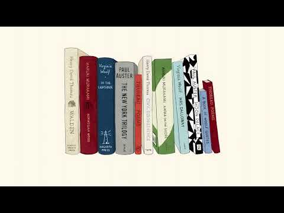
- 챕터: 0:00 Reading Through July · 2:14 A Book for the Afternoon · 5:47 The Fan Turns Slowly · 8:35 The Quietest Hour of Summer · 12:23 Notes Between Chapters · 16:15 Halfway Through the Book · 20:00 Reading While the Day Cools · 22:58 The Hour Between Pages · 26:37 The Chapter I Stayed For · 30:11 A Breeze Through the Curtains · 35:13 Summer on the Bookshelf · 39:56 Reading Past Four · 43:29 The Day Slows Down Here · 47:46 The Last Warm Chapter · 50:09 A Book Beside the Fan · 54:00 A Summer Book Left Unfinished · 56:39 The Light Falls on the Margin · 59:32 The Afternoon Between Chapters · 63:18 The Margin of Summer · 66:56 A Novel in the Late Light
- 설명 앞부분: 내가 좋아하는 책들, 커피, 그리고 음악. 그런 느긋한 오후를 좋아합니다. [Tracklist] // CREDITS 채널에 사용되는 모든 일러스트와 음악은 CENTRALGROCERY가 직접 제작한 창작물입니다. Music and production by CENTRALGROCERY. Illustrations and visual content by CENTRALGROCERY. © CENTRALGROCERY. All rights reserved. // COLLABORATION
- 같은 채널 평소 대비 ×15.2 (채널 최근 롱폼 중앙값 13,544회) · 평소 영상: playlist ∣ 가을,재즈의 계절 (13,544회) / playlist ∣ 가을, 배와 재즈 (13,507회)
- 대본 없음 (설명) — 음성인식이 끝나면 도입부·흐름이 들어감
- 댓글 50/50: 좋은 점 — 영상 0 · 감사·응원 3 · 더 알고 싶은 것 2 · 아쉬운 점 — 영상 0 · 반박·불만 — 의견 다름 0 · 정치·사회 0 · 경험 공유 2 · 구독·다음 기대 2
  - 감사·응원 👍10 “플리마다 썸네일 그림이 너무 귀엽고 감성있고.. 주인장님의 취향이 궁금해지는 그림들이어요☘음악도 당연히 너무 좋구요! 언젠간 굿즈도 출시 해주시면 좋을 것 같아요. 항상 좋은 작업물 감사합니다🕊”
  - 감사·응원 👍5 “책 읽을 때 들을 플리 찾던 와중에 딱 맞는 플리가!!! 감사합니다🍀🍇🍉🍑”
  - 더 알고 싶은 것 👍9 “워낙 플리들이 다 좋아서 아무거나 틀어놔도 될 줄 알았는데, 확실히 독서할 땐 이거네요👍 덕분에 집에서도 책을 읽을 수 있게 됐어요🙂‍↕️독서용도 종종 만들어 주시면 정말 좋을 것 같아요..🙏”
  - 더 알고 싶은 것 👍6 “음악도 너무 좋은데, 그림들이 더욱 예쁩니다. 작가님 그림은 어디서 더 볼 수 있나요?? 😊”
  - 경험 공유 👍24 “월요일 나도 소로처럼 떠나고 싶다🌲🌲🌲🌲🌲”
  - 경험 공유 👍3 “오~~~제가 읽는 책 한개도 없어요 ㅋㅋㅋㅋㅋ !!!”
  - 구독·다음 기대 👍4 “너무 좋아서 구독합니다 ❤”
  - 구독·다음 기대 👍4 “모양 이 감성 쩌는 채널은 ㅎㅎ 구독하고 가용~~ 뜨거운 여름날 단비같은 플레이스트 잘 들을께요~💚🌿”

### 1028. [Fanmade OST] 하루의 끝에서/이안대군 테마 **21세기 대군부인** 감성 발라드

- https://www.youtube.com/watch?v=sf5dMF71cg4 · ycmusic25 · 구독자 13,700 · 조회수 103,237 (×7.5, 하루 611.1) · 좋아요 639 (0.6%) · 4.1분 · 2026-05-07 · 주제 묶음 9. 가요·발라드·트로트 · 형식 AI 음악 · 폴더 `W_sf5dMF71cg4` (웹 승인)
- 썸네일: 
- 설명 앞부분: 현재 방영 중인 드라마 ‘21세기 대군부인’ 속 이안대군의 애틋한 감정선에 영감을 받아 제작한 팬메이드 OST입니다. 하루를 마무리하는 순간마다 떠오르는 한 사람, 지울 수 없는 그리움과 기다림의 감정을 잔잔한 피아노 선율과 함께 담아보았습니다. 이 음악이 드라마 속 감정과 함께 여러분의 하루 끝에도 조용한 여운으로 남기를 바랍니다.
- 같은 채널 평소 대비 ×164.4 (채널 최근 롱폼 중앙값 628회) · 평소 영상: 🎵첫 곡이 좋다 그 다음 곡도 좋다 계속 듣게 되는 음악들...🌇 그리움은 늘 저녁노을을… (786회) / 🎵어느덧 곁으로 다가온 가을, 지금 가장 어울리는 음악과 함께 🍂바람이 조금 달라졌네요,… (470회)
- 대본 없음 (설명) — 음성인식이 끝나면 도입부·흐름이 들어감
- 댓글 79/79: 좋은 점 — 영상 0 · 감사·응원 4 · 더 알고 싶은 것 0 · 아쉬운 점 — 영상 0 · 반박·불만 — 의견 다름 0 · 정치·사회 0 · 경험 공유 0 · 구독·다음 기대 0
  - 감사·응원 👍21 “오늘 건강검진 받는다고 많이 힘든 하루였는데 이영상이 하루의 힘듬을 싸악 사라지게 해주네요 고맙습니다 감사합니다❤❤❤”
  - 감사·응원 👍20 “너무 좋아요 잘들을게요❤❤❤ 아직도 현생 못살고 있지만 그래서 더 힘이되요 롱런 하시길 항상 응원합니다”

### 1029. 🎵 견디고 또 견딘 당신에게 전하는 메시지 ∣ 너의 봄이 온다 - AIIN

- https://www.youtube.com/watch?v=9r7SCZtxgLQ · 박PD 음악다방 · 구독자 9,820 · 조회수 73,007 (×7.4, 하루 518.0) · 좋아요 239 (0.3%) · 5.8분 · 2026-06-04 · 주제 묶음 1. 수면·명상·힐링 · 형식 음악 (그 밖 모양 — 한 편짜리 BGM 등) · 폴더 `W_9r7SCZtxgLQ` (웹 승인)
- 썸네일: 
- 설명 앞부분: 🌸 너의 봄이 온다 🌸 박PD 음악다방에 오신 여러분을 환영합니다. 긴 겨울을 지나, 끝이 보이지 않는 시간들을 견디며 오늘도 살아낸 모든 분들에게 이 노래를 전합니다. 눈물조차 얼어버린 밤, 혼자 버텨야 했던 시간, 아무도 몰래 삼켜야 했던 아픔이 있었더라도 결국 해는 떠오르고, 봄은 찾아옵니다. 〈너의 봄이 온다〉는 힘겨운 시간을 지나고 있는 누군가에게 작은 위로와 희망이 되기를 바라는 마음을 담은 노래입니다. 🎧 Song Title 너의 봄이 온다 🎤 Vocal : AIIN (아인) 🎼 Music : Suno AI ✍️ Ly…
- 같은 채널 평소 대비 ×24.7 (채널 최근 롱폼 중앙값 2,959회) · 평소 영상: 🎵지지마라, 봄날아 ∣ 감성 발라드, 7080, 위로, 봄, 성인가요 ∣ AIIN:아인 (2,959회) / 🎵 하루가 너무 길어 ∣ 아직도 너를 기다리는 밤 ∣ AIIN:아인 (2,505회)
- 대본 없음 (설명) — 음성인식이 끝나면 도입부·흐름이 들어감
- 댓글 48/48: 좋은 점 — 영상 0 · 감사·응원 9 · 더 알고 싶은 것 0 · 아쉬운 점 — 영상 0 · 반박·불만 — 의견 다름 0 · 정치·사회 0 · 경험 공유 1 · 구독·다음 기대 0
  - 감사·응원 👍2 “오늘도 좋은음악 듣을수있게 해주셔서 감사합니다. 행복하세요❤❤❤🎉🎉🎉”
  - 감사·응원 👍1 “이양반은 정말 노래 잘만드시네 ~~ 잘 듣고 있읍니다 부산오시면 톡주세요 소주한잔 대접 하겟읍니다 고맙읍니다~~^^”
  - 경험 공유 👍2 “이야... 진짜 AI 때문에 가수, 작곡가, 작사가 불문 음반관련 업종은 전부 비상인 듯 노래 불러봤자, 노래 작곡해봤자 AI보다 못함... ㅋㅋ 진짜 음반분야는 심각할 듯 ㅋㅋ”

### 1030. 가시리 ∣ 조선힙합(Official Music Video)

- https://www.youtube.com/watch?v=_uYBH28d_ys · 조선힙합 Official · 구독자 28,600 · 조회수 212,227 (×7.4, 하루 1,276.5) · 좋아요 597 (0.3%) · 4.6분 · 2026-05-10 · 주제 묶음 11. 힙합·R&B·EDM · 형식 한 곡 (뮤직비디오·음원·가사) · 폴더 `W__uYBH28d_ys` (웹 승인)
- 썸네일: 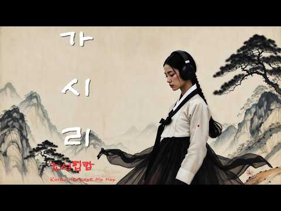
- 설명 앞부분: 달빛이 내려앉은 조선의 밤. 떠나는 이를 붙잡지 못한 마음을 국악과 힙합의 감성으로 담았습니다. 전통의 한(恨)과 현대의 감성을 섞어 ‘가시리’라는 오래된 이별의 정서를 조선힙합 스타일로 다시 노래합니다. 🎧 Headphones Recommended 🌙 Emotional Korean Joseon HipHop 🪕 Traditional Korean Instruments × Lo-fi HipHop Youtube Music Spotify Apple Music Instagram tiktok
- 같은 채널 평소 대비 ×28.8 (채널 최근 롱폼 중앙값 7,368회) · 평소 영상: 신이있다면 OFFICIAL MV 1시간 연속듣기 (7,368회) / 그대곁에 OFFICIAL MV 1시간 연속듣기 (8,086회)
- 대본 없음 (설명) — 음성인식이 끝나면 도입부·흐름이 들어감
- 댓글 47/46: 좋은 점 — 영상 0 · 감사·응원 3 · 더 알고 싶은 것 4 · 아쉬운 점 — 영상 0 · 반박·불만 — 의견 다름 0 · 정치·사회 0 · 경험 공유 0 · 구독·다음 기대 0
  - 감사·응원 👍4 “이것도 1시간 듣기 만들어 주세요. 첫 사작엔 광고 마음껏 넣으시고 중간엔 5초 건너뛰기 가능한 광고 넣으시고. 님 땨문에 유트브 유료결제 고민합니다. 응원합니다.”
  - 감사·응원 👍3 “😢😢😢 하...내마음 속 들여 보셨나요... 근 4년간 조부모님 부님 하늘나라로 보내 드리고 멘탈나가 우연하게 듣게 된 노래인데.... 펑펑 울었습니다.... 초등학교 3학년 때 하늘나라로 보내드린 어머니 생각까지...나게...만드는 한 서린 마음을... 꼭 잘 되시…”
  - 더 알고 싶은 것 👍7 “음원~~아빨리요ㅜ 요새 조선합합에 빠지다못해 미쳐삽니다,, 울엇다,,웃엇다 정말대단한뮤지션이세요 사랑합니다♡♡♡마니만들어주세요 신이내린음악노래,,”
  - 더 알고 싶은 것 👍4 “이것도 1시간 듣기 만들어 주세요. 첫 사작엔 광고 마음껏 넣으시고 중간엔 5초 건너뛰기 가능한 광고 넣으시고. 님 땨문에 유트브 유료결제 고민합니다. 응원합니다.”

### 1031. 시작하면 시작된다 ٩(๑❛ᴗ❛๑)۶

- https://www.youtube.com/watch?v=gjtaovTAbMU · 톤톤 tonton · 구독자 20,200 · 조회수 149,762 (×7.4, 하루 1,143.9) · 좋아요 2,899 (1.9%) · 266.2분 · 2026-06-14 · 주제 묶음 8. 로파이·시티팝·칠 · 형식 플레이리스트·모음 (여러 곡) · 폴더 `W_gjtaovTAbMU` (웹 승인)
- 썸네일: 
- 설명 앞부분: 톤톤 tonton 🎧 Timeline 오늘도 고생했죠? (토닥토닥) 생각 많아지면 여기로 와요. 톤톤이 조용히 BGM 깔아둘게요. 👋 © All rights to this AI-assisted recording are owned by 톤톤 tonton
- 같은 채널 평소 대비 ×23.7 (채널 최근 롱폼 중앙값 6,317회) · 평소 영상: 여름이 코 앞까지 ⊹︶ (6,317회) / 내 집중력은 낯을 좀 가려 ..🎧 (6,403회)
- 대본 없음 (설명) — 음성인식이 끝나면 도입부·흐름이 들어감
- 댓글 72/76: 좋은 점 — 영상 0 · 감사·응원 5 · 더 알고 싶은 것 1 · 아쉬운 점 — 영상 0 · 반박·불만 — 의견 다름 0 · 정치·사회 0 · 경험 공유 1 · 구독·다음 기대 0
  - 감사·응원 👍5 “아리 화이팅 🖤”
  - 감사·응원 👍1 “시작하면된다!! 하면된다!! 할 수 있다!! 좋은음악 감사합니다~! 루히힛~~~”
  - 더 알고 싶은 것 👍3 “톤톤님 평소에 너무 잘 듣고 있습니다! 대체 종강은 언제하는 걸까요? … 공부합시다”

### 1032. Samtang Ako May Kinabuhi Pa - Piano Jazz Version ∣ jazz it back

- https://www.youtube.com/watch?v=JqWXP8WjhX4 · jazz it back · 구독자 7,540 · 조회수 55,728 (×7.4, 하루 345.8) · 좋아요 104 (0.2%) · 4.2분 · 2026-05-15 · 주제 묶음 6. 피아노·클래식·연주곡 · 형식 커버·직접 부른 노래 · 폴더 `W_JqWXP8WjhX4` (웹 승인)
- 썸네일: 
- 설명 앞부분: Samtang Ako May Kinabuhi Pa - Piano Jazz Version ∣ jazz it back A beloved song, reimagined. "Samtang Ako May Kinabuhi Pa " finds a new voice through soft jazz chords and thoughtful piano melodies — breathing fresh emotion into familiar words. ✨ Relaxing jazz piano • Soulful reinterpretation • Perfe…
- 같은 채널 평소 대비 ×7.7 (채널 최근 롱폼 중앙값 7,211회) · 평소 영상: Visayan Classic Volume 6 - Piano Jazz Version (7,505회) / TOP 10 CLASSIC VISAYAN – JAZZ VERSION (6,917회)
- 대본 없음 (설명) — 음성인식이 끝나면 도입부·흐름이 들어감
- 댓글 7/7: 좋은 점 — 영상 0 · 감사·응원 0 · 더 알고 싶은 것 0 · 아쉬운 점 — 영상 0 · 반박·불만 — 의견 다름 0 · 정치·사회 0 · 경험 공유 0 · 구독·다음 기대 0

### 1033. Playlist 2016 그곳으로

- https://www.youtube.com/watch?v=JXJWz7Ky8KA · 느좋모음집 · 구독자 29,100 · 조회수 214,674 (×7.4, 하루 1,819.1) · 좋아요 7,606 (3.5%) · 18.2분 · 2026-06-27 · 주제 묶음 기타 · 형식 플레이리스트·모음 (여러 곡) · 폴더 `W_JXJWz7Ky8KA` (웹 승인)
- 썸네일: 
- 챕터: 0:00 What do you mean? - Justin Bi… · 3:31 Paris in the rain - Lauv · 6:53 Closer - The chainsmokers , H… · 10:59 Where Are U now - Justin Bieb… · 15:02 HATE THAT I MADE YOU LOVE ME …
- 같은 채널 평소 대비 ×8.7 (채널 최근 롱폼 중앙값 24,612회) · 평소 영상: Playlist 아마도 사랑이 맞는거 같애 (25,191회) / Playlist 겨울 공기 가득한 느좋 플리 (24,033회)
- 대본 없음 (없음) — 음성인식이 끝나면 도입부·흐름이 들어감
- 댓글 75/76: 좋은 점 — 영상 1 · 감사·응원 2 · 더 알고 싶은 것 0 · 아쉬운 점 — 영상 0 · 반박·불만 — 의견 다름 0 · 정치·사회 0 · 경험 공유 0 · 구독·다음 기대 0
  - 좋은 점 — 영상 👍1 “클로저는 레전드였지”

### 1034. 🍂 Cozy September Jazz (NO MID-ROLL ADS) – Warm Piano Music for Early Autumn Days

- https://www.youtube.com/watch?v=zw5ml1zLxPs · Chill Jazz Station · 구독자 24,900 · 조회수 182,818 (×7.3, 하루 3,737.9) · 좋아요 378 (0.2%) · 376.4분 · 2026-09-04 · 주제 묶음 6. 피아노·클래식·연주곡 · 형식 음악 (그 밖 모양 — 한 편짜리 BGM 등) · 폴더 `W_zw5ml1zLxPs` (웹 승인)
- 썸네일: 
- 설명 앞부분: Welcome September with gentle piano melodies, golden sunlight, and the first cozy feeling of autumn. 🍁☕ As summer slowly fades and cooler days arrive, this warm seasonal atmosphere is perfect for morning coffee, reading, studying, working, or simply enjoying a peaceful moment surrounded by early fa…
- 같은 채널 평소 대비 ×18.0 (채널 최근 롱폼 중앙값 10,132회) · 평소 영상: 🍂 Fall Lake Jazz (NO MID-ROLL ADS) – Warm Piano M… (10,629회) / 🍂 Autumn Lakeside Jazz (NO MID-ROLL ADS) – Gentle… (9,634회)
- 대본 없음 (설명) — 음성인식이 끝나면 도입부·흐름이 들어감
- 댓글 39/39: 좋은 점 — 영상 0 · 감사·응원 0 · 더 알고 싶은 것 0 · 아쉬운 점 — 영상 0 · 반박·불만 — 의견 다름 0 · 정치·사회 0 · 경험 공유 0 · 구독·다음 기대 0

### 1035. 임재현 - 웃어주지마요 Official MV

- https://www.youtube.com/watch?v=L4aOBuPkpLg · 임재현 Official · 구독자 39,100 · 조회수 280,748 (×7.2, 하루 2,649.8) · 좋아요 1,404 (0.5%) · 4.4분 · 2026-07-09 · 주제 묶음 기타 · 형식 한 곡 (뮤직비디오·음원·가사) · 폴더 `W_L4aOBuPkpLg` (웹 승인)
- 썸네일: 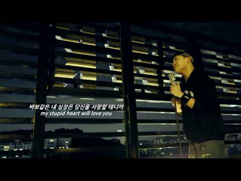
- 대본 없음 (없음) — 음성인식이 끝나면 도입부·흐름이 들어감
- 댓글 156/160: 좋은 점 — 영상 3 · 감사·응원 8 · 더 알고 싶은 것 0 · 아쉬운 점 — 영상 1 · 반박·불만 — 의견 다름 0 · 정치·사회 1 · 경험 공유 2 · 구독·다음 기대 0
  - 좋은 점 — 영상 👍12 “먼가 2000년대 초반 노래 감성이라 멜로디랑 가사도 너무 듣기좋다 안재현 흥해라😊”
  - 좋은 점 — 영상 👍4 “생라이브가 더 듣기좋은건 왜냐..”
  - 감사·응원 👍7 “노래 계속 꼭 불러야해요!응원합니다.”
  - 감사·응원 👍7 “나의 최애 가수 임재현님! 항상 노래 해주셔서 감사합니다!! 그리고 2soo님, 임재현님 조합 최고!!! 우리나라 최고 작곡가 2soo님 항상 감사드립니다!!!! 임재현님 노래 부르실때마다 항상 끝까지 응원합니다!!!!!!”
  - 아쉬운 점 — 영상 👍2 “계속 노래해줘요 임재현님 ~ 역주행각이다 오랜만에 발라드 무한반복중 ❤”
  - 정치·사회 👍1 “돈 뿌리고 하는게 경제를 살리는건지는 모르겠음.. 그리고 가장 모순적인건 본인입으로 대통령도 죄지으면 재판받아야한다고 목놓아 소리치시던 분이 정작 본인은 안받는 내로남불은 지지율이 내려갈 수 밖에 없음”
  - 경험 공유 👍6 “진짜 이 감성이 내가 딱 바라던 감성이다 ㅠㅠ”
  - 경험 공유 👍0 “아니 원곡자도 저렇게 힘들게 부르는데 내가 뭐라고 편안하게 부르려고 했지ㅋㅋㅋㅋㅋㅋㅋㅋㅋㅋㅋㅋ”

### 1036. [𝙋𝙡𝙖𝙮𝙡𝙞𝙨𝙩] 주황색, -BM

- https://www.youtube.com/watch?v=63-irShSXR0 · Artist BM · 구독자 8,660 · 조회수 62,060 (×7.2, 하루 781.0) · 좋아요 0 (0.0%) · 4.2분 · 2026-08-04 · 주제 묶음 9. 가요·발라드·트로트 · 형식 플레이리스트·모음 (여러 곡) · 폴더 `W_63-irShSXR0` (웹 승인)
- 썸네일: 
- 설명 앞부분: [𝙋𝙡𝙖𝙮𝙡𝙞𝙨𝙩] 주황색, 🎶 곡 소개 🎶 안녕하세요, Artist BM입니다. 이번 곡은 **《주황색,》**입니다. " 안녕하세요 BM입니다. 이 번곡은 "유년 시절의 순수한 추억과 소중한 기억이 남아있는 노을빛 언덕길에서 지친 마음을 따뜻하게 다독이고 위로를 전하는 이야기" 입니다 🖤 언제나 제 음악을 마음 깊이 들어주시는 여러분께, 조심스럽게 이 마음을 건넵니다. 소란한 하루 속에서도 여러분의 시간이 잠시라도 조용히 쉬어갈 수 있기를 바랍니다. 이번 노래도 그 하루의 잔잔한 배경처럼 곁에 머물 수 있었으면 좋겠습니다. 감사…
- 같은 채널 평소 대비 ×1.9 (채널 최근 롱폼 중앙값 32,938회) · 평소 영상: [𝙋𝙡𝙖𝙮𝙡𝙞𝙨𝙩] 빗속에서,(Part2) -BM (35,531회) / [𝙋𝙡𝙖𝙮𝙡𝙞𝙨𝙩] 괜찮아, -BM (30,346회)
- 대본 없음 (설명) — 음성인식이 끝나면 도입부·흐름이 들어감
- 댓글 23/23: 좋은 점 — 영상 0 · 감사·응원 6 · 더 알고 싶은 것 0 · 아쉬운 점 — 영상 0 · 반박·불만 — 의견 다름 0 · 정치·사회 0 · 경험 공유 1 · 구독·다음 기대 0
  - 감사·응원 👍4 “와 맘이 살랑살랑해지는 노래예요~ 새로나오는 노래를 마주할때마다 설레임과 신나는 기분을 BM에게도 선사해주고싶네요 감사합니다 😊”
  - 감사·응원 👍3 “이번곡은 가을향이 가득하네요 지나온 추억도 새록새록 기억나는..ㅜ 아름다운곡 감사히 잘 듣겠습니다 ~”

### 1037. 창문으로 여름이 실려오는 브금 𓇼 ⋆.˚

- https://www.youtube.com/watch?v=wStibHhXn1A · 톤톤 tonton · 구독자 20,200 · 조회수 144,236 (×7.1, 하루 834.2) · 좋아요 1,751 (1.2%) · 250.8분 · 2026-05-03 · 주제 묶음 8. 로파이·시티팝·칠 · 형식 플레이리스트·모음 (여러 곡) · 폴더 `W_wStibHhXn1A` (웹 승인)
- 썸네일: 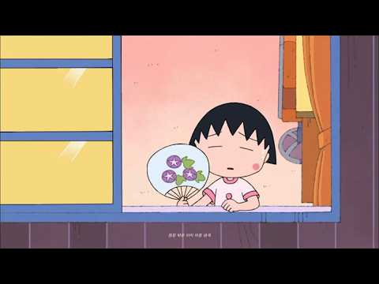
- 설명 앞부분: 창문으로 여름 바람이 솔솔 불어오네요. 왠지 모르게 기분이 좋아지는 날이에요. 톤톤 tonton 🎧 Timeline 오늘도 고생했죠? (토닥토닥) 생각 많아지면 여기로 와요. 톤톤이 조용히 BGM 깔아둘게요. 👋 © All rights to this AI-assisted recording are owned by 톤톤 tonton
- 같은 채널 평소 대비 ×22.8 (채널 최근 롱폼 중앙값 6,317회) · 평소 영상: 여름이 코 앞까지 ⊹︶ (6,317회) / 내 집중력은 낯을 좀 가려 ..🎧 (6,403회)
- 대본 없음 (설명) — 음성인식이 끝나면 도입부·흐름이 들어감
- 댓글 58/58: 좋은 점 — 영상 0 · 감사·응원 4 · 더 알고 싶은 것 3 · 아쉬운 점 — 영상 0 · 반박·불만 — 의견 다름 0 · 정치·사회 0 · 경험 공유 1 · 구독·다음 기대 0
  - 감사·응원 👍2 “톤톤님과 함께하는 여름 기대된다..💛 뜨겁게 행복한 여름이 되시길 바라요 항상 감사합니당 😆”
  - 더 알고 싶은 것 👍1 “안녕하세요! 너무 예쁜 소리라 혹시 영상 출처표기하고 브금으로 사용하고 싶은데 혹시 다운은 어디서 받을 수 있을까요? 잘 듣고 있습니다 🫶”
  - 더 알고 싶은 것 👍1 “학교 만들기 영상 본 브금으로 사용해도 괜찮을까요? 학교 학생들에게만 보여질 예정입니다!”
  - 경험 공유 👍1 “브금 들으니 저도 기분이 절로 나네요 오늘도 행복한 하루!”

### 1038. 🎤 이놈아 나좀 살여줘~ / 트롯가수 창 🎶 사랑도 체력이다 인생 풍자 트롯 ✔️

- https://www.youtube.com/watch?v=WFt570kk21o · 우리인생뮤직 · 구독자 19,700 · 조회수 139,274 (×7.1, 하루 793.3) · 좋아요 877 (0.6%) · 4.1분 · 2026-04-30 · 주제 묶음 9. 가요·발라드·트로트 · 형식 음악 (그 밖 모양 — 한 편짜리 BGM 등) · 폴더 `W_WFt570kk21o` (웹 승인)
- 썸네일: 
- 설명 앞부분: ““중년 인생, 사랑과 이별, 삶의 기쁨과 슬픔을 노래하는 인생 발라드 & 트롯 자작곡 채널입니다. 🎶 이 채널은 중년 발라드 / 인생 트롯 / 감성 발라드 / 공감 노래 / 한국 트롯 / 위로 노래 / 이별 노래 / 인생 노래 / 힐링 음악 / 자작곡 을 중심으로 제작됩니다. 여기서는 눈물 나는 인생 발라드 흥과 공감이 살아있는 인생 트롯 공감하는 현실 이야기 노래 사랑, 이별, 가족, 후회를 담은 감성 자작곡 하루 끝에 듣는 힐링 음악 & 위로 노래 를 만나실 수 있습니다. 특히 ...... 중년 감성 노래, 인생 노래, 한국…
- 같은 채널 평소 대비 ×50.0 (채널 최근 롱폼 중앙값 2,785회) · 평소 영상: "안경 쓰고 안경 찾는 내 모습 실화냐? 🤣 5060 폭풍공감 인생 트로트 [깜빡깜빡 인… (2,785회) / "고생만 시켜 미안하오.." 한평생 곁을 지켜준 당신에게 바치는 노래 ∣ 멋진 인생 (2,732회)
- 대본 없음 (설명) — 음성인식이 끝나면 도입부·흐름이 들어감
- 댓글 137/139: 좋은 점 — 영상 0 · 감사·응원 4 · 더 알고 싶은 것 0 · 아쉬운 점 — 영상 0 · 반박·불만 — 의견 다름 0 · 정치·사회 0 · 경험 공유 2 · 구독·다음 기대 1
  - 감사·응원 👍1 “─━━★ ☆금요읾★ 유친님즐거운한주마무리잘하세요 •.¸(¯`'•.¸*♥♥♥♥♥♥♥♥*¸.•'´¯)¸.•' * ¯`'•.¸(¯`'•.¸*♥♥♥♥*¸.•'´¯)¸.•' ´¯) ♥(¯`'•.¸(¯`'•.¸*♥♥*¸.•'´¯)¸. • ' ´¯)♥ ♥♥.¸(¯`'•.¸(¯`'…”
  - 감사·응원 👍0 “좋은노래 감사합니다 ❤❤❤😂😂”
  - 경험 공유 👍1 “이놈아 님 . 저도 좀 살려 주세요~ ~ ㅎㅎ 좋아요~ 눌렀습니다~~”
  - 경험 공유 👍0 “나도 좀 살리주소^ 미니미니 ㅋㅋ”
  - 구독·다음 기대 👍1 “─━━★ ☆금요읾★ 유친님즐거운한주마무리잘하세요 •.¸(¯`'•.¸*♥♥♥♥♥♥♥♥*¸.•'´¯)¸.•' * ¯`'•.¸(¯`'•.¸*♥♥♥♥*¸.•'´¯)¸.•' ´¯) ♥(¯`'•.¸(¯`'•.¸*♥♥*¸.•'´¯)¸. • ' ´¯)♥ ♥♥.¸(¯`'•.¸(¯`'…”

### 1039. ✨ Музыка восстановления 🕯️ Тибетские поющие чаши для глубокого расслабления ∣ Tibetan Hea…

- https://www.youtube.com/watch?v=hivuH3iFJRw · МУДРЫЕ МЕДИТАЦИИ · 구독자 6,810 · 조회수 48,126 (×7.1, 하루 451.2) · 좋아요 805 (1.7%) · 30.3분 · 2026-07-08 · 주제 묶음 1. 수면·명상·힐링 · 형식 음악 (그 밖 모양 — 한 편짜리 BGM 등) · 폴더 `W_hivuH3iFJRw` (웹 승인)
- 썸네일: 
- 설명 앞부분: ✨ Welcome to a peaceful space of silence, relaxation, and inner harmony. This 30-minute meditation music combines authentic Tibetan singing bowls with soft Tibetan melodies to help you relax, release stress, and reconnect with yourself. The soothing resonance of the singing bowls creates a peaceful…
- 같은 채널 평소 대비 ×0.8 (채널 최근 롱폼 중앙값 59,416회) · 평소 영상: 174 Гц 🌿 Музыка очищения и заземления ✨ Освобожде… (59,416회) / 432 Гц 🌿 Музыка исцеления ✨ Тибетская флейта для … (52,744회)
- 대본 없음 (설명) — 음성인식이 끝나면 도입부·흐름이 들어감
- 댓글 29/29: 좋은 점 — 영상 0 · 감사·응원 0 · 더 알고 싶은 것 0 · 아쉬운 점 — 영상 0 · 반박·불만 — 의견 다름 0 · 정치·사회 0 · 경험 공유 0 · 구독·다음 기대 0

### 1040. 운동러들이 환장하는 '비트 깡패' 플리 ∣ 파상풍맛 외힙 노동요 playlist

- https://www.youtube.com/watch?v=pNmK5x-0bkA · 플리메이커 · 구독자 48,700 · 조회수 344,272 (×7.1, 하루 2,173.6) · 좋아요 5,197 (1.5%) · 57.1분 · 2026-05-17 · 주제 묶음 3. 공부·집중·작업 · 형식 플레이리스트·모음 (여러 곡) · 폴더 `W_pNmK5x-0bkA` (웹 승인)
- 썸네일: 
- 챕터: 0:00 God Save · 2:49 Never Stop · 5:44 Queue It · 8:31 Shhh · 10:42 WAKE IT UP · 12:36 Beast Mode · 14:58 Quiet Down · 17:38 I just ignite · 20:24 Goo-Goo · 22:51 Jelly Jump · 25:19 Mafia · 28:32 repeat all
- 설명 앞부분: 안녕하세요 플리메이커입니다.! 이번에 업로드가 조금 늦어져서 기다려주신 분들께 진심으로 죄송하고 또 감사드립니다.ㅠㅠ 부처님 비주얼에 맞춰서 제대로 된 쇠맛 비트 믹스로 준비했습니다. 귀에 바로 박히는 신곡 비트들부터 그동안 반응 제일 터졌던 인기 곡들까지 음질 완전 짱짱하게 다듬어서 꽉 채워뒀으니 무한 반복으로 걸어두고 갓생 살러 가시죠 🔥 오늘도 즐겁게 들어주세요! playlist 🎵 이 플레이리스트에 담긴 곡들은 모두 주인장이 Suno AI를 활용해 직접 제작한 트랙입니다! 오직 이 채널에서만 들을 수 있어요😊 작은 음악에 …
- 같은 채널 평소 대비 ×6.1 (채널 최근 롱폼 중앙값 56,701회) · 평소 영상: 보법이 달라지는 노동요 playlist (71,041회) / ai가 신내림 받으면 생기는 일 ∣ 무당 외힙 클럽 비트 플레이리스트 (소금 챙겨) (72,810회)
- 대본 없음 (설명) — 음성인식이 끝나면 도입부·흐름이 들어감
- 댓글 142/146: 좋은 점 — 영상 0 · 감사·응원 3 · 더 알고 싶은 것 2 · 아쉬운 점 — 영상 0 · 반박·불만 — 의견 다름 1 · 정치·사회 0 · 경험 공유 2 · 구독·다음 기대 1
  - 감사·응원 👍2 “잘들었습니다 감사합니다 ❤❤❤”
  - 감사·응원 👍2 “노래 진짜.... 워후;;; 알고리즘 열일하네 압도적 감사❤”
  - 더 알고 싶은 것 👍4 “부처님 오신날 기대합니다~!! 절친 예수님, 오랜만에 마리아님도 초청 부탁드려봅니다ㅋㅋ”
  - 더 알고 싶은 것 👍0 “WAKE IT UP 유튜브 뮤직에 좀 올려주세요 ㅜ”
  - 반박·불만 — 의견 다름 👍1 “오늘 GX 댄스추다 배아파서 반도 못하고 기어나왔는데.. 극락왕생은 틀렸나”
  - 경험 공유 👍21 “첨 댓글달아봅니다..언제오시나 했습니다. 기존 올리신 곡들이랑 믹스되있는데 딱 제가 좋아하는걸로 섞여있어 더 좋네요. 부처님오신날 한번 더 뵀음 좋겠는디 ㅎㅎㅎㅎ 욕심이겠죠. 자주 오시라구여~~”
  - 경험 공유 👍2 “행복하고 저희들을 이롭게 만드는 플리입니다❤ 🎉”
  - 구독·다음 기대 👍4 “부처님 오신날 기대합니다~!! 절친 예수님, 오랜만에 마리아님도 초청 부탁드려봅니다ㅋㅋ”

