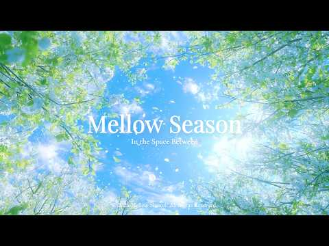
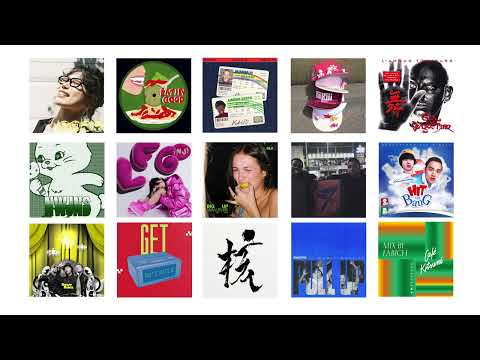
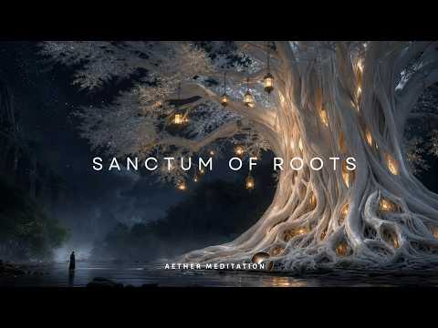

# 음악 — 성공 사례 분석: 사례별 자세히 #1041–#1080

`analysis.md` 의 9번 (같은 # 번호). 자동 생성 — `tools/success_analysis.py` v1.5.1 (2026-10-22 07:59 UTC). ※ 연구·교육용 — 투자 권유가 아님.

### 1041. playlist ∣ 여름과 가을사이, 내 독서용 브금

- https://www.youtube.com/watch?v=zSUHxG9TGeQ · centralgrocery 중앙식품점 · 구독자 27,200 · 조회수 202,189 (×7.4, 하루 1,993.7) · 좋아요 2,500 (1.2%) · 225.8분 · 2026-07-12 · 주제 묶음 3. 공부·집중·작업 · 형식 플레이리스트·모음 (여러 곡) · 폴더 `W_zSUHxG9TGeQ` (웹 승인)
- 썸네일: 
- 챕터: 0:00 Reading Through July · 2:14 A Book for the Afternoon · 5:47 The Fan Turns Slowly · 8:35 The Quietest Hour of Summer · 12:23 Notes Between Chapters · 16:15 Halfway Through the Book · 20:00 Reading While the Day Cools · 22:58 The Hour Between Pages · 26:37 The Chapter I Stayed For · 30:11 A Breeze Through the Curtains · 35:13 Summer on the Bookshelf · 39:56 Reading Past Four · 43:29 The Day Slows Down Here · 47:46 The Last Warm Chapter · 50:09 A Book Beside the Fan · 54:00 A Summer Book Left Unfinished · 56:39 The Light Falls on the Margin · 59:32 The Afternoon Between Chapters · 63:18 The Margin of Summer · 66:56 A Novel in the Late Light
- 설명 앞부분: 내가 좋아하는 책들, 커피, 그리고 음악. 그런 느긋한 오후를 좋아합니다. [Tracklist] // CREDITS 채널에 사용되는 모든 일러스트와 음악은 CENTRALGROCERY가 직접 제작한 창작물입니다. Music and production by CENTRALGROCERY. Illustrations and visual content by CENTRALGROCERY. © CENTRALGROCERY. All rights reserved. // COLLABORATION
- 같은 채널 평소 대비 ×14.9 (채널 최근 롱폼 중앙값 13,544회) · 평소 영상: playlist ∣ 가을,재즈의 계절 (13,544회) / playlist ∣ 가을, 배와 재즈 (13,507회)
- 대본 없음 (설명) — 음성인식이 끝나면 도입부·흐름이 들어감
- 댓글 50/50: 좋은 점 — 영상 0 · 감사·응원 3 · 더 알고 싶은 것 2 · 아쉬운 점 — 영상 0 · 반박·불만 — 의견 다름 0 · 정치·사회 0 · 경험 공유 2 · 구독·다음 기대 2
  - 감사·응원 👍10 “플리마다 썸네일 그림이 너무 귀엽고 감성있고.. 주인장님의 취향이 궁금해지는 그림들이어요☘음악도 당연히 너무 좋구요! 언젠간 굿즈도 출시 해주시면 좋을 것 같아요. 항상 좋은 작업물 감사합니다🕊”
  - 감사·응원 👍5 “책 읽을 때 들을 플리 찾던 와중에 딱 맞는 플리가!!! 감사합니다🍀🍇🍉🍑”
  - 더 알고 싶은 것 👍9 “워낙 플리들이 다 좋아서 아무거나 틀어놔도 될 줄 알았는데, 확실히 독서할 땐 이거네요👍 덕분에 집에서도 책을 읽을 수 있게 됐어요🙂‍↕️독서용도 종종 만들어 주시면 정말 좋을 것 같아요..🙏”
  - 더 알고 싶은 것 👍6 “음악도 너무 좋은데, 그림들이 더욱 예쁩니다. 작가님 그림은 어디서 더 볼 수 있나요?? 😊”
  - 경험 공유 👍24 “월요일 나도 소로처럼 떠나고 싶다🌲🌲🌲🌲🌲”
  - 경험 공유 👍3 “오~~~제가 읽는 책 한개도 없어요 ㅋㅋㅋㅋㅋ !!!”
  - 구독·다음 기대 👍4 “너무 좋아서 구독합니다 ❤”
  - 구독·다음 기대 👍4 “모양 이 감성 쩌는 채널은 ㅎㅎ 구독하고 가용~~ 뜨거운 여름날 단비같은 플레이스트 잘 들을께요~💚🌿”

### 1042. 가시리 ∣ 조선힙합(Official Music Video)

- https://www.youtube.com/watch?v=_uYBH28d_ys · 조선힙합 Official · 구독자 28,600 · 조회수 212,227 (×7.4, 하루 1,284.1) · 좋아요 597 (0.3%) · 4.6분 · 2026-05-10 · 주제 묶음 11. 힙합·R&B·EDM · 형식 한 곡 (뮤직비디오·음원·가사) · 폴더 `W__uYBH28d_ys` (웹 승인)
- 썸네일: 
- 설명 앞부분: 달빛이 내려앉은 조선의 밤. 떠나는 이를 붙잡지 못한 마음을 국악과 힙합의 감성으로 담았습니다. 전통의 한(恨)과 현대의 감성을 섞어 ‘가시리’라는 오래된 이별의 정서를 조선힙합 스타일로 다시 노래합니다. 🎧 Headphones Recommended 🌙 Emotional Korean Joseon HipHop 🪕 Traditional Korean Instruments × Lo-fi HipHop Youtube Music Spotify Apple Music Instagram tiktok
- 같은 채널 평소 대비 ×28.8 (채널 최근 롱폼 중앙값 7,368회) · 평소 영상: 신이있다면 OFFICIAL MV 1시간 연속듣기 (7,368회) / 그대곁에 OFFICIAL MV 1시간 연속듣기 (8,086회)
- 대본 없음 (설명) — 음성인식이 끝나면 도입부·흐름이 들어감
- 댓글 47/46: 좋은 점 — 영상 0 · 감사·응원 3 · 더 알고 싶은 것 4 · 아쉬운 점 — 영상 0 · 반박·불만 — 의견 다름 0 · 정치·사회 0 · 경험 공유 0 · 구독·다음 기대 0
  - 감사·응원 👍4 “이것도 1시간 듣기 만들어 주세요. 첫 사작엔 광고 마음껏 넣으시고 중간엔 5초 건너뛰기 가능한 광고 넣으시고. 님 땨문에 유트브 유료결제 고민합니다. 응원합니다.”
  - 감사·응원 👍3 “😢😢😢 하...내마음 속 들여 보셨나요... 근 4년간 조부모님 부님 하늘나라로 보내 드리고 멘탈나가 우연하게 듣게 된 노래인데.... 펑펑 울었습니다.... 초등학교 3학년 때 하늘나라로 보내드린 어머니 생각까지...나게...만드는 한 서린 마음을... 꼭 잘 되시…”
  - 더 알고 싶은 것 👍7 “음원~~아빨리요ㅜ 요새 조선합합에 빠지다못해 미쳐삽니다,, 울엇다,,웃엇다 정말대단한뮤지션이세요 사랑합니다♡♡♡마니만들어주세요 신이내린음악노래,,”
  - 더 알고 싶은 것 👍4 “이것도 1시간 듣기 만들어 주세요. 첫 사작엔 광고 마음껏 넣으시고 중간엔 5초 건너뛰기 가능한 광고 넣으시고. 님 땨문에 유트브 유료결제 고민합니다. 응원합니다.”

### 1043. Samtang Ako May Kinabuhi Pa - Piano Jazz Version ∣ jazz it back

- https://www.youtube.com/watch?v=JqWXP8WjhX4 · jazz it back · 구독자 7,540 · 조회수 55,728 (×7.4, 하루 347.9) · 좋아요 104 (0.2%) · 4.2분 · 2026-05-15 · 주제 묶음 6. 피아노·클래식·연주곡 · 형식 커버·직접 부른 노래 · 폴더 `W_JqWXP8WjhX4` (웹 승인)
- 썸네일: 
- 설명 앞부분: Samtang Ako May Kinabuhi Pa - Piano Jazz Version ∣ jazz it back A beloved song, reimagined. "Samtang Ako May Kinabuhi Pa " finds a new voice through soft jazz chords and thoughtful piano melodies — breathing fresh emotion into familiar words. ✨ Relaxing jazz piano • Soulful reinterpretation • Perfe…
- 같은 채널 평소 대비 ×7.7 (채널 최근 롱폼 중앙값 7,211회) · 평소 영상: Visayan Classic Volume 6 - Piano Jazz Version (7,505회) / TOP 10 CLASSIC VISAYAN – JAZZ VERSION (6,917회)
- 대본 없음 (설명) — 음성인식이 끝나면 도입부·흐름이 들어감
- 댓글 7/7: 좋은 점 — 영상 0 · 감사·응원 0 · 더 알고 싶은 것 0 · 아쉬운 점 — 영상 0 · 반박·불만 — 의견 다름 0 · 정치·사회 0 · 경험 공유 0 · 구독·다음 기대 0

### 1044. Playlist 2016 그곳으로

- https://www.youtube.com/watch?v=JXJWz7Ky8KA · 느좋모음집 · 구독자 29,100 · 조회수 211,851 (×7.3, 하루 1,810.4) · 좋아요 7,576 (3.6%) · 18.2분 · 2026-06-27 · 주제 묶음 기타 · 형식 플레이리스트·모음 (여러 곡) · 폴더 `W_JXJWz7Ky8KA` (웹 승인)
- 썸네일: 
- 챕터: 0:00 What do you mean? - Justin Bi… · 3:31 Paris in the rain - Lauv · 6:53 Closer - The chainsmokers , H… · 10:59 Where Are U now - Justin Bieb… · 15:02 HATE THAT I MADE YOU LOVE ME …
- 같은 채널 평소 대비 ×8.6 (채널 최근 롱폼 중앙값 24,612회) · 평소 영상: Playlist 아마도 사랑이 맞는거 같애 (25,191회) / Playlist 겨울 공기 가득한 느좋 플리 (24,033회)
- 대본 없음 (없음) — 음성인식이 끝나면 도입부·흐름이 들어감
- 댓글 75/75: 좋은 점 — 영상 1 · 감사·응원 2 · 더 알고 싶은 것 0 · 아쉬운 점 — 영상 0 · 반박·불만 — 의견 다름 0 · 정치·사회 0 · 경험 공유 0 · 구독·다음 기대 0
  - 좋은 점 — 영상 👍1 “클로저는 레전드였지”

### 1045. 🍂 Cozy September Jazz (NO MID-ROLL ADS) – Warm Piano Music for Early Autumn Days

- https://www.youtube.com/watch?v=zw5ml1zLxPs · Chill Jazz Station · 구독자 24,900 · 조회수 181,391 (×7.3, 하루 3,785.6) · 좋아요 378 (0.2%) · 376.4분 · 2026-09-04 · 주제 묶음 6. 피아노·클래식·연주곡 · 형식 음악 (그 밖 모양 — 한 편짜리 BGM 등) · 폴더 `W_zw5ml1zLxPs` (웹 승인)
- 썸네일: 
- 설명 앞부분: Welcome September with gentle piano melodies, golden sunlight, and the first cozy feeling of autumn. 🍁☕ As summer slowly fades and cooler days arrive, this warm seasonal atmosphere is perfect for morning coffee, reading, studying, working, or simply enjoying a peaceful moment surrounded by early fa…
- 같은 채널 평소 대비 ×17.1 (채널 최근 롱폼 중앙값 10,629회) · 평소 영상: 🍂 Fall Lake Jazz (NO MID-ROLL ADS) – Warm Piano M… (10,629회) / 🍂 4K Autumn September Jazz (NO MID-ROLL ADS) – Ge… (11,506회)
- 대본 없음 (설명) — 음성인식이 끝나면 도입부·흐름이 들어감
- 댓글 39/39: 좋은 점 — 영상 0 · 감사·응원 0 · 더 알고 싶은 것 0 · 아쉬운 점 — 영상 0 · 반박·불만 — 의견 다름 0 · 정치·사회 0 · 경험 공유 0 · 구독·다음 기대 0

### 1046. 시작하면 시작된다 ٩(๑❛ᴗ❛๑)۶

- https://www.youtube.com/watch?v=gjtaovTAbMU · 톤톤 tonton · 구독자 20,200 · 조회수 145,520 (×7.2, 하루 1,120.0) · 좋아요 2,862 (2.0%) · 266.2분 · 2026-06-14 · 주제 묶음 8. 로파이·시티팝·칠 · 형식 플레이리스트·모음 (여러 곡) · 폴더 `W_gjtaovTAbMU` (웹 승인)
- 썸네일: 
- 설명 앞부분: 톤톤 tonton 🎧 Timeline 오늘도 고생했죠? (토닥토닥) 생각 많아지면 여기로 와요. 톤톤이 조용히 BGM 깔아둘게요. 👋 © All rights to this AI-assisted recording are owned by 톤톤 tonton
- 같은 채널 평소 대비 ×22.9 (채널 최근 롱폼 중앙값 6,360회) · 평소 영상: 내 집중력은 낯을 좀 가려 ..🎧 (6,403회) / 여름이 코 앞까지 ⊹︶ (6,317회)
- 대본 없음 (설명) — 음성인식이 끝나면 도입부·흐름이 들어감
- 댓글 72/73: 좋은 점 — 영상 0 · 감사·응원 5 · 더 알고 싶은 것 1 · 아쉬운 점 — 영상 0 · 반박·불만 — 의견 다름 0 · 정치·사회 0 · 경험 공유 1 · 구독·다음 기대 0
  - 감사·응원 👍5 “아리 화이팅 🖤”
  - 감사·응원 👍1 “시작하면된다!! 하면된다!! 할 수 있다!! 좋은음악 감사합니다~! 루히힛~~~”
  - 더 알고 싶은 것 👍3 “톤톤님 평소에 너무 잘 듣고 있습니다! 대체 종강은 언제하는 걸까요? … 공부합시다”

### 1047. 창문으로 여름이 실려오는 브금 𓇼 ⋆.˚

- https://www.youtube.com/watch?v=wStibHhXn1A · 톤톤 tonton · 구독자 20,200 · 조회수 143,842 (×7.1, 하루 836.7) · 좋아요 1,750 (1.2%) · 250.8분 · 2026-05-03 · 주제 묶음 8. 로파이·시티팝·칠 · 형식 플레이리스트·모음 (여러 곡) · 폴더 `W_wStibHhXn1A` (웹 승인)
- 썸네일: 
- 설명 앞부분: 창문으로 여름 바람이 솔솔 불어오네요. 왠지 모르게 기분이 좋아지는 날이에요. 톤톤 tonton 🎧 Timeline 오늘도 고생했죠? (토닥토닥) 생각 많아지면 여기로 와요. 톤톤이 조용히 BGM 깔아둘게요. 👋 © All rights to this AI-assisted recording are owned by 톤톤 tonton
- 같은 채널 평소 대비 ×22.6 (채널 최근 롱폼 중앙값 6,360회) · 평소 영상: 내 집중력은 낯을 좀 가려 ..🎧 (6,403회) / 여름이 코 앞까지 ⊹︶ (6,317회)
- 대본 없음 (설명) — 음성인식이 끝나면 도입부·흐름이 들어감
- 댓글 58/58: 좋은 점 — 영상 0 · 감사·응원 4 · 더 알고 싶은 것 3 · 아쉬운 점 — 영상 0 · 반박·불만 — 의견 다름 0 · 정치·사회 0 · 경험 공유 1 · 구독·다음 기대 0
  - 감사·응원 👍2 “톤톤님과 함께하는 여름 기대된다..💛 뜨겁게 행복한 여름이 되시길 바라요 항상 감사합니당 😆”
  - 더 알고 싶은 것 👍1 “안녕하세요! 너무 예쁜 소리라 혹시 영상 출처표기하고 브금으로 사용하고 싶은데 혹시 다운은 어디서 받을 수 있을까요? 잘 듣고 있습니다 🫶”
  - 더 알고 싶은 것 👍1 “학교 만들기 영상 본 브금으로 사용해도 괜찮을까요? 학교 학생들에게만 보여질 예정입니다!”
  - 경험 공유 👍1 “브금 들으니 저도 기분이 절로 나네요 오늘도 행복한 하루!”

### 1048. [𝙋𝙡𝙖𝙮𝙡𝙞𝙨𝙩] 주황색, -BM

- https://www.youtube.com/watch?v=63-irShSXR0 · Artist BM · 구독자 8,660 · 조회수 61,532 (×7.1, 하루 784.2) · 좋아요 0 (0.0%) · 4.2분 · 2026-08-04 · 주제 묶음 9. 가요·발라드·트로트 · 형식 플레이리스트·모음 (여러 곡) · 폴더 `W_63-irShSXR0` (웹 승인)
- 썸네일: 
- 설명 앞부분: [𝙋𝙡𝙖𝙮𝙡𝙞𝙨𝙩] 주황색, 🎶 곡 소개 🎶 안녕하세요, Artist BM입니다. 이번 곡은 **《주황색,》**입니다. " 안녕하세요 BM입니다. 이 번곡은 "유년 시절의 순수한 추억과 소중한 기억이 남아있는 노을빛 언덕길에서 지친 마음을 따뜻하게 다독이고 위로를 전하는 이야기" 입니다 🖤 언제나 제 음악을 마음 깊이 들어주시는 여러분께, 조심스럽게 이 마음을 건넵니다. 소란한 하루 속에서도 여러분의 시간이 잠시라도 조용히 쉬어갈 수 있기를 바랍니다. 이번 노래도 그 하루의 잔잔한 배경처럼 곁에 머물 수 있었으면 좋겠습니다. 감사…
- 같은 채널 평소 대비 ×1.9 (채널 최근 롱폼 중앙값 32,938회) · 평소 영상: [𝙋𝙡𝙖𝙮𝙡𝙞𝙨𝙩] 빗속에서,(Part2) -BM (35,531회) / [𝙋𝙡𝙖𝙮𝙡𝙞𝙨𝙩] 괜찮아, -BM (30,346회)
- 대본 없음 (설명) — 음성인식이 끝나면 도입부·흐름이 들어감
- 댓글 23/23: 좋은 점 — 영상 0 · 감사·응원 6 · 더 알고 싶은 것 0 · 아쉬운 점 — 영상 0 · 반박·불만 — 의견 다름 0 · 정치·사회 0 · 경험 공유 1 · 구독·다음 기대 0
  - 감사·응원 👍4 “와 맘이 살랑살랑해지는 노래예요~ 새로나오는 노래를 마주할때마다 설레임과 신나는 기분을 BM에게도 선사해주고싶네요 감사합니다 😊”
  - 감사·응원 👍3 “이번곡은 가을향이 가득하네요 지나온 추억도 새록새록 기억나는..ㅜ 아름다운곡 감사히 잘 듣겠습니다 ~”

### 1049. 🎤 이놈아 나좀 살여줘~ / 트롯가수 창 🎶 사랑도 체력이다 인생 풍자 트롯 ✔️

- https://www.youtube.com/watch?v=WFt570kk21o · 우리인생뮤직 · 구독자 19,700 · 조회수 139,274 (×7.1, 하루 797.8) · 좋아요 877 (0.6%) · 4.1분 · 2026-04-30 · 주제 묶음 9. 가요·발라드·트로트 · 형식 음악 (그 밖 모양 — 한 편짜리 BGM 등) · 폴더 `W_WFt570kk21o` (웹 승인)
- 썸네일: 
- 설명 앞부분: ““중년 인생, 사랑과 이별, 삶의 기쁨과 슬픔을 노래하는 인생 발라드 & 트롯 자작곡 채널입니다. 🎶 이 채널은 중년 발라드 / 인생 트롯 / 감성 발라드 / 공감 노래 / 한국 트롯 / 위로 노래 / 이별 노래 / 인생 노래 / 힐링 음악 / 자작곡 을 중심으로 제작됩니다. 여기서는 눈물 나는 인생 발라드 흥과 공감이 살아있는 인생 트롯 공감하는 현실 이야기 노래 사랑, 이별, 가족, 후회를 담은 감성 자작곡 하루 끝에 듣는 힐링 음악 & 위로 노래 를 만나실 수 있습니다. 특히 ...... 중년 감성 노래, 인생 노래, 한국…
- 같은 채널 평소 대비 ×50.0 (채널 최근 롱폼 중앙값 2,785회) · 평소 영상: "안경 쓰고 안경 찾는 내 모습 실화냐? 🤣 5060 폭풍공감 인생 트로트 [깜빡깜빡 인… (2,785회) / "고생만 시켜 미안하오.." 한평생 곁을 지켜준 당신에게 바치는 노래 ∣ 멋진 인생 (2,732회)
- 대본 없음 (설명) — 음성인식이 끝나면 도입부·흐름이 들어감
- 댓글 137/139: 좋은 점 — 영상 0 · 감사·응원 4 · 더 알고 싶은 것 0 · 아쉬운 점 — 영상 0 · 반박·불만 — 의견 다름 0 · 정치·사회 0 · 경험 공유 2 · 구독·다음 기대 1
  - 감사·응원 👍1 “─━━★ ☆금요읾★ 유친님즐거운한주마무리잘하세요 •.¸(¯`'•.¸*♥♥♥♥♥♥♥♥*¸.•'´¯)¸.•' * ¯`'•.¸(¯`'•.¸*♥♥♥♥*¸.•'´¯)¸.•' ´¯) ♥(¯`'•.¸(¯`'•.¸*♥♥*¸.•'´¯)¸. • ' ´¯)♥ ♥♥.¸(¯`'•.¸(¯`'…”
  - 감사·응원 👍0 “좋은노래 감사합니다 ❤❤❤😂😂”
  - 경험 공유 👍1 “이놈아 님 . 저도 좀 살려 주세요~ ~ ㅎㅎ 좋아요~ 눌렀습니다~~”
  - 경험 공유 👍0 “나도 좀 살리주소^ 미니미니 ㅋㅋ”
  - 구독·다음 기대 👍1 “─━━★ ☆금요읾★ 유친님즐거운한주마무리잘하세요 •.¸(¯`'•.¸*♥♥♥♥♥♥♥♥*¸.•'´¯)¸.•' * ¯`'•.¸(¯`'•.¸*♥♥♥♥*¸.•'´¯)¸.•' ´¯) ♥(¯`'•.¸(¯`'•.¸*♥♥*¸.•'´¯)¸. • ' ´¯)♥ ♥♥.¸(¯`'•.¸(¯`'…”

### 1050. ✨ Музыка восстановления 🕯️ Тибетские поющие чаши для глубокого расслабления ∣ Tibetan Hea…

- https://www.youtube.com/watch?v=hivuH3iFJRw · МУДРЫЕ МЕДИТАЦИИ · 구독자 6,810 · 조회수 48,126 (×7.1, 하루 455.5) · 좋아요 805 (1.7%) · 30.3분 · 2026-07-08 · 주제 묶음 1. 수면·명상·힐링 · 형식 음악 (그 밖 모양 — 한 편짜리 BGM 등) · 폴더 `W_hivuH3iFJRw` (웹 승인)
- 썸네일: 
- 설명 앞부분: ✨ Welcome to a peaceful space of silence, relaxation, and inner harmony. This 30-minute meditation music combines authentic Tibetan singing bowls with soft Tibetan melodies to help you relax, release stress, and reconnect with yourself. The soothing resonance of the singing bowls creates a peaceful…
- 같은 채널 평소 대비 ×0.8 (채널 최근 롱폼 중앙값 59,416회) · 평소 영상: 174 Гц 🌿 Музыка очищения и заземления ✨ Освобожде… (59,416회) / 432 Гц 🌿 Музыка исцеления ✨ Тибетская флейта для … (52,744회)
- 대본 없음 (설명) — 음성인식이 끝나면 도입부·흐름이 들어감
- 댓글 29/29: 좋은 점 — 영상 0 · 감사·응원 0 · 더 알고 싶은 것 0 · 아쉬운 점 — 영상 0 · 반박·불만 — 의견 다름 0 · 정치·사회 0 · 경험 공유 0 · 구독·다음 기대 0

### 1051. 푸른 여름 사이로 🌸 여름 감성 피아노 플레이리스트 ∣ BGM ∣ 휴식·힐링·집중

- https://www.youtube.com/watch?v=rHuz5RflH24 · Mellow Season · 구독자 2,870 · 조회수 20,261 (×7.1, 하루 224.1) · 좋아요 159 (0.8%) · 135.7분 · 2026-07-23 · 주제 묶음 6. 피아노·클래식·연주곡 · 형식 플레이리스트·모음 (여러 곡) · 폴더 `W_rHuz5RflH24` (웹 승인)
- 썸네일: 
- 설명 앞부분: 푸른 여름 사이로 🌸 푸른 하늘은 여름을 맑게 비추고, 살랑이는 바람은 초록 사이를 천천히 스쳐 갑니다. 잠시 서두름을 내려놓고, 계절의 한 장면 속에 머물러 보세요. Welcome to Mellow Season. A quiet place where gentle melodies drift through the seasons. Inspired by soft light, changing leaves, blooming flowers, and the small moments that make everyday life beautiful, …
- 같은 채널 평소 대비 ×2.5 (채널 최근 롱폼 중앙값 7,951회) · 평소 영상: 바다가 쉬어가는 오후 🌊 여름 감성 피아노 플레이리스트 ∣ BGM ∣ 힐링·집중·휴식 (7,951회) / 선선한 바람과 함께 🌼 가을 감성 피아노 플레이리스트 ∣ BGM ∣ 집중·작업·휴식 (7,353회)
- 대본 없음 (설명) — 음성인식이 끝나면 도입부·흐름이 들어감
- 댓글 2/2: 좋은 점 — 영상 0 · 감사·응원 0 · 더 알고 싶은 것 0 · 아쉬운 점 — 영상 0 · 반박·불만 — 의견 다름 0 · 정치·사회 0 · 경험 공유 0 · 구독·다음 기대 0

### 1052. 임재현 - 웃어주지마요 Official MV

- https://www.youtube.com/watch?v=L4aOBuPkpLg · 임재현 Official · 구독자 39,100 · 조회수 273,847 (×7.0, 하루 2,609.1) · 좋아요 1,394 (0.5%) · 4.4분 · 2026-07-09 · 주제 묶음 기타 · 형식 한 곡 (뮤직비디오·음원·가사) · 폴더 `W_L4aOBuPkpLg` (웹 승인)
- 썸네일: 
- 대본 없음 (없음) — 음성인식이 끝나면 도입부·흐름이 들어감
- 댓글 156/160: 좋은 점 — 영상 3 · 감사·응원 8 · 더 알고 싶은 것 0 · 아쉬운 점 — 영상 1 · 반박·불만 — 의견 다름 0 · 정치·사회 1 · 경험 공유 2 · 구독·다음 기대 0
  - 좋은 점 — 영상 👍12 “먼가 2000년대 초반 노래 감성이라 멜로디랑 가사도 너무 듣기좋다 안재현 흥해라😊”
  - 좋은 점 — 영상 👍4 “생라이브가 더 듣기좋은건 왜냐..”
  - 감사·응원 👍7 “노래 계속 꼭 불러야해요!응원합니다.”
  - 감사·응원 👍7 “나의 최애 가수 임재현님! 항상 노래 해주셔서 감사합니다!! 그리고 2soo님, 임재현님 조합 최고!!! 우리나라 최고 작곡가 2soo님 항상 감사드립니다!!!! 임재현님 노래 부르실때마다 항상 끝까지 응원합니다!!!!!!”
  - 아쉬운 점 — 영상 👍2 “계속 노래해줘요 임재현님 ~ 역주행각이다 오랜만에 발라드 무한반복중 ❤”
  - 정치·사회 👍1 “돈 뿌리고 하는게 경제를 살리는건지는 모르겠음.. 그리고 가장 모순적인건 본인입으로 대통령도 죄지으면 재판받아야한다고 목놓아 소리치시던 분이 정작 본인은 안받는 내로남불은 지지율이 내려갈 수 밖에 없음”
  - 경험 공유 👍6 “진짜 이 감성이 내가 딱 바라던 감성이다 ㅠㅠ”
  - 경험 공유 👍0 “아니 원곡자도 저렇게 힘들게 부르는데 내가 뭐라고 편안하게 부르려고 했지ㅋㅋㅋㅋㅋㅋㅋㅋㅋㅋㅋㅋ”

### 1053. 김상민 - You ∣ 여성보컬 개사 커버 ∣ 폭발적인 감성 발라드

- https://www.youtube.com/watch?v=uCvyMW60AD4 · 연애상황극 · 구독자 11,100 · 조회수 76,871 (×6.9, 하루 454.5) · 좋아요 254 (0.3%) · 4.2분 · 2026-05-06 · 주제 묶음 9. 가요·발라드·트로트 · 형식 커버·직접 부른 노래 · 폴더 `W_uCvyMW60AD4` (웹 승인)
- 썸네일: 
- 설명 앞부분: 김상민 - You를 여성보컬 감성으로 다시 담아낸 개사 커버입니다. 원곡의 강렬하고 애절한 멜로디를 바탕으로, 떠나간 사람을 끝내 지우지 못한 채 비 오는 밤거리처럼 깊은 그리움 속을 헤매는 마음을 담았습니다. "YOU 어둠 짙은 거리에 홀로 길을 잃은 채 헤매는 날 안아줄 수 없니" 섬세한 감정선과 폭발적인 고음이 함께 담긴 애절한 여성보컬 발라드 커버로 들어주세요. Original Song: 김상민 - You Cover Type: 여성보컬 개사 커버 / 애절한 고음 발라드 본 영상은 김상민 - You의 멜로디와 감성을 바탕으로…
- 같은 채널 평소 대비 ×32.9 (채널 최근 롱폼 중앙값 2,337회) · 평소 영상: 임재범 - 고해 ∣ Symphonic Rock Female COVER ∣ 아련한 고백에 … (2,337회) / 먼데이 키즈 (Monday Kiz) - 미안해, 고마워, 사랑해 ∣ Female COVE… (2,484회)
- 대본 없음 (설명) — 음성인식이 끝나면 도입부·흐름이 들어감
- 댓글 17/17: 좋은 점 — 영상 0 · 감사·응원 2 · 더 알고 싶은 것 0 · 아쉬운 점 — 영상 0 · 반박·불만 — 의견 다름 0 · 정치·사회 0 · 경험 공유 1 · 구독·다음 기대 0
  - 감사·응원 👍3 “연애상황극님이 올리는 곡 제가 평소 좋아하는 곡이랑 엄청 겹치네요😊아주 좋아요❤ 아름다운 음악들을 실컷실컷 들려주셔서 정말 감사합니다❤”
  - 감사·응원 👍2 “그레씨 감사합니다 힘네세요”
  - 경험 공유 👍3 “연애상황극님이 올리는 곡 제가 평소 좋아하는 곡이랑 엄청 겹치네요😊아주 좋아요❤ 아름다운 음악들을 실컷실컷 들려주셔서 정말 감사합니다❤”

### 1054. 운동러들이 환장하는 '비트 깡패' 플리 ∣ 파상풍맛 외힙 노동요 playlist

- https://www.youtube.com/watch?v=pNmK5x-0bkA · 플리메이커 · 구독자 48,700 · 조회수 336,391 (×6.9, 하루 2,137.2) · 좋아요 5,126 (1.5%) · 57.1분 · 2026-05-17 · 주제 묶음 3. 공부·집중·작업 · 형식 플레이리스트·모음 (여러 곡) · 폴더 `W_pNmK5x-0bkA` (웹 승인)
- 썸네일: 
- 챕터: 0:00 God Save · 2:49 Never Stop · 5:44 Queue It · 8:31 Shhh · 10:42 WAKE IT UP · 12:36 Beast Mode · 14:58 Quiet Down · 17:38 I just ignite · 20:24 Goo-Goo · 22:51 Jelly Jump · 25:19 Mafia · 28:32 repeat all
- 설명 앞부분: 안녕하세요 플리메이커입니다.! 이번에 업로드가 조금 늦어져서 기다려주신 분들께 진심으로 죄송하고 또 감사드립니다.ㅠㅠ 부처님 비주얼에 맞춰서 제대로 된 쇠맛 비트 믹스로 준비했습니다. 귀에 바로 박히는 신곡 비트들부터 그동안 반응 제일 터졌던 인기 곡들까지 음질 완전 짱짱하게 다듬어서 꽉 채워뒀으니 무한 반복으로 걸어두고 갓생 살러 가시죠 🔥 오늘도 즐겁게 들어주세요! playlist 🎵 이 플레이리스트에 담긴 곡들은 모두 주인장이 Suno AI를 활용해 직접 제작한 트랙입니다! 오직 이 채널에서만 들을 수 있어요😊 작은 음악에 …
- 같은 채널 평소 대비 ×5.9 (채널 최근 롱폼 중앙값 56,701회) · 평소 영상: 보법이 달라지는 노동요 playlist (71,041회) / ai가 신내림 받으면 생기는 일 ∣ 무당 외힙 클럽 비트 플레이리스트 (소금 챙겨) (72,810회)
- 대본 없음 (설명) — 음성인식이 끝나면 도입부·흐름이 들어감
- 댓글 142/144: 좋은 점 — 영상 0 · 감사·응원 3 · 더 알고 싶은 것 2 · 아쉬운 점 — 영상 0 · 반박·불만 — 의견 다름 1 · 정치·사회 0 · 경험 공유 2 · 구독·다음 기대 1
  - 감사·응원 👍2 “잘들었습니다 감사합니다 ❤❤❤”
  - 감사·응원 👍2 “노래 진짜.... 워후;;; 알고리즘 열일하네 압도적 감사❤”
  - 더 알고 싶은 것 👍4 “부처님 오신날 기대합니다~!! 절친 예수님, 오랜만에 마리아님도 초청 부탁드려봅니다ㅋㅋ”
  - 더 알고 싶은 것 👍0 “WAKE IT UP 유튜브 뮤직에 좀 올려주세요 ㅜ”
  - 반박·불만 — 의견 다름 👍1 “오늘 GX 댄스추다 배아파서 반도 못하고 기어나왔는데.. 극락왕생은 틀렸나”
  - 경험 공유 👍21 “첨 댓글달아봅니다..언제오시나 했습니다. 기존 올리신 곡들이랑 믹스되있는데 딱 제가 좋아하는걸로 섞여있어 더 좋네요. 부처님오신날 한번 더 뵀음 좋겠는디 ㅎㅎㅎㅎ 욕심이겠죠. 자주 오시라구여~~”
  - 경험 공유 👍2 “행복하고 저희들을 이롭게 만드는 플리입니다❤ 🎉”
  - 구독·다음 기대 👍4 “부처님 오신날 기대합니다~!! 절친 예수님, 오랜만에 마리아님도 초청 부탁드려봅니다ㅋㅋ”

### 1055. 깊은밤 색소폰 Vol.35 ∣ 시원한 파도 휴식 🌊 ∣ 2시간 힐링 색소폰 연주 ∣ Ocean Waves & Relaxing Saxophone ∣ Sleep •…

- https://www.youtube.com/watch?v=1jrUOOVjFpE · 고향 가는 나그네  · 구독자 2,670 · 조회수 18,420 (×6.9, 하루 204.8) · 좋아요 253 (1.4%) · 128.2분 · 2026-07-24 · 주제 묶음 1. 수면·명상·힐링 · 형식 연주 (직접 연주하는 영상) · 폴더 `W_1jrUOOVjFpE` (웹 승인)
- 썸네일: 
- 설명 앞부분: 잔잔하게 밀려오는 파도 소리와 부드러운 테너 색소폰 선율이 어우러진 2시간 힐링 음악입니다. 푸른 바다를 바라보며 휴식을 취하는 듯한 편안함을 느끼고, 지친 하루의 피로와 스트레스를 잠시 내려놓아 보세요. 잠들기 전의 고요한 시간, 책을 읽거나 공부할 때, 명상과 휴식, 카페 분위기, 업무 집중, 드라이브 등 다양한 순간에 자연스럽게 어울리는 감성 색소폰 연주입니다. 🎷 추천 용도 😴 수면음악 🌊 휴식음악 🧘 명상음악 📚 공부음악 ☕ 카페음악 💼 집중음악 🚗 드라이브 음악 📖 독서음악 💙 스트레스 해소 🎷 Deep Night Sa…
- 같은 채널 평소 대비 ×5.6 (채널 최근 롱폼 중앙값 3,301회) · 평소 영상: [감성 색소폰] 깊은 밤 색소폰 1시간 Vol.13 🌙 조용히 흐르는 힐링 색소폰 (수면… (3,572회) / 석양의 색소폰 Vol.46 ∣ 깊어가는 밤, 마음을 쉬게 하는 음악 ∣ 2시간 (3,030회)
- 대본 없음 (설명) — 음성인식이 끝나면 도입부·흐름이 들어감
- 댓글 22/22: 좋은 점 — 영상 1 · 감사·응원 3 · 더 알고 싶은 것 1 · 아쉬운 점 — 영상 0 · 반박·불만 — 의견 다름 0 · 정치·사회 0 · 경험 공유 2 · 구독·다음 기대 0
  - 좋은 점 — 영상 👍0 “저도 테너SAX 동호인 입니다만(액션2 40 만번 대) 그윽한 소리가 참 좋 네요 듣기좋습니다.😘”
  - 감사·응원 👍4 “이여름 바다를 가지 않아도 벌써 음악과 함께 풍덩 빠졌어요 너무 시원하네요 감사합니다.”
  - 감사·응원 👍0 “가고싶은곳바닷가에요 은은한 섹소폰들으며걷닐고싶은중돌 ㅡ감사합니다 ㅡ”
  - 더 알고 싶은 것 👍1 “혹시 연주자 성함 알수 있을까요?”
  - 경험 공유 👍5 “혹 연주곡목들 알수없을까요??얼마나연습듸에 나오는음일까^네 저두8개월전시작했어요 ^^밥만먹으면연습해서지금은 제가맘에든답니다.호호호”
  - 경험 공유 👍0 “저도 테너SAX 동호인 입니다만(액션2 40 만번 대) 그윽한 소리가 참 좋 네요 듣기좋습니다.😘”

### 1056. 술탄 오브 더 디스코 - 신나는 음악, 잘못된 인생 Good Beats, Ruined Life (Official Visuali…

- https://www.youtube.com/watch?v=UMinXZIMfQc · Sultan Of The Disco · 구독자 39,500 · 조회수 264,861 (×6.7, 하루 3,680.8) · 좋아요 5,326 (2.0%) · 4분 · 2026-08-11 · 주제 묶음 기타 · 형식 한 곡 (뮤직비디오·음원·가사) · 폴더 `W_UMinXZIMfQc` (웹 승인)
- 썸네일: 
- 설명 앞부분: new single [신나는 음악, 잘못된 인생] 2026. 08. 11. 6PM KST [ Official Lyrics (KOR) ] 신나는 음악에 난 춤을 추네 다른 걱정 없게 나 정말 행복 하네 미안해 사실 너무 불안 하네 모든 게 잘못 됐네 널 그냥 두고 온게 나 사실 미워서 갑질하고 이제와 회피하고 여기로 택시타고 쨋어 뒤늦게 뻘짓한거 후회만 가득하고 차라리 춤추다 죽겠어 화려한 조명 속에 불안한 나의 얼굴 못생긴 너의 얼굴 못 본체하는 모두들 안들리는 랜덤한 사람과의 대화 무슨 말인지 몰라 니 얼굴 결국 떠올라 미워서 …
- 대본 없음 (설명) — 음성인식이 끝나면 도입부·흐름이 들어감
- 댓글 632/632: 좋은 점 — 영상 2 · 감사·응원 29 · 더 알고 싶은 것 3 · 아쉬운 점 — 영상 1 · 반박·불만 — 의견 다름 1 · 정치·사회 0 · 경험 공유 11 · 구독·다음 기대 2
  - 좋은 점 — 영상 👍4 “뭔가 느낌이 딱 듣기 편한 정규엘범 수록곡 같은 곡인데 이대로 깜짝스럽게 정규 오나??”
  - 좋은 점 — 영상 👍2 “드라이브 하면서 듣기 좋음 내 인생 합리화 삽가능 해서 좋음”
  - 감사·응원 👍744 “김간지한테 고맙습니다 해야지”
  - 감사·응원 👍30 “요즘 부쩍 몸이 안좋아서 디스크가 오는가 했더니 춤이 절로 나오는 디스코가 와서 가뿐히 나았어요 좋은 노래로 돌아와서 감사합니다”
  - 더 알고 싶은 것 👍1 “형님들 뮤비가 왜 없습니까 그런 의미로 11월 블퀘 3회 부탁드립니다.”
  - 더 알고 싶은 것 👍1 “제발 술탄 단콘!!!!!!!!!!!!!!! 부탁드립니다 🩶🩶🩶”
  - 아쉬운 점 — 영상 👍38 “그저 사막을 지나 가는 것 같던 20대 나의 맘 속에 요술 왕자 당신은 누구신가요 아무도 모르지만 탱탱볼을 던지고 사라지는 꿈을 쫓다 지치길 지나 나의 미래에게 Waiting for your calling back 반복되는 감정의 미끄럼틀 그리고 오늘 아침 미국에서 …”
  - 반박·불만 — 의견 다름 👍3 “핫산형님 안무 짜고 계시죠???? 지금 신곡만 내고 조용히 그냥 지나가는건 아니죠???? 술탄이시여 제발요”
  - 경험 공유 👍6 “내가평생기다렸는데이제나오는구나시발죽을때까지안돌아올까봐걱정했는데내가학생때사라져서성인때돌아오는구나그래그래좋다”
  - 경험 공유 👍2 “이 6년 동안 내가 어떻게 기다렸는지 아냐고ㅠㅠㅠ😢”
  - 구독·다음 기대 👍2 “요새 자기 전, 출근 전 매일매일 듣고 있음”

### 1057. 𝐏𝐥𝐚𝐲𝐥𝐢𝐬𝐭 요즘 제일 핫한 노동요 다 모아놨어요..🤍 (중간광고없음) 10시간 ∣ 감성힙합 R&B 플레이리스트

- https://www.youtube.com/watch?v=LFFmtspEl8Q · 중간광고없음 · 구독자 18,700 · 조회수 125,240 (×6.7, 하루 1,191.2) · 좋아요 256 (0.2%) · 601.7분 · 2026-07-09 · 주제 묶음 3. 공부·집중·작업 · 형식 플레이리스트·모음 (여러 곡) · 폴더 `W_LFFmtspEl8Q` (웹 승인)
- 썸네일: 
- 같은 채널 평소 대비 ×4.1 (채널 최근 롱폼 중앙값 30,462회) · 평소 영상: 𝐏𝐥𝐚𝐲𝐥𝐢𝐬𝐭 가을 햇살 좋은 날, 조용히 기분 좋아지는 노래들 (중간광고없음) 10시… (31,353회) / 𝐏𝐥𝐚𝐲𝐥𝐢𝐬𝐭 느좋 플리 말아왔어요.. (중간광고없음) 10시간 ∣ 요즘 핫한 노동요 … (29,571회)
- 대본 없음 (없음) — 음성인식이 끝나면 도입부·흐름이 들어감
- 댓글 10/10: 좋은 점 — 영상 1 · 감사·응원 1 · 더 알고 싶은 것 1 · 아쉬운 점 — 영상 0 · 반박·불만 — 의견 다름 0 · 정치·사회 0 · 경험 공유 0 · 구독·다음 기대 0
  - 좋은 점 — 영상 👍6 “썸네일 레전드로 이쁜데 실제 사람인가요??? 아는 분 좀 알려주세요”
  - 더 알고 싶은 것 👍6 “썸네일 레전드로 이쁜데 실제 사람인가요??? 아는 분 좀 알려주세요”

### 1058. ☕️ 다시 듣고 싶은 추억의 애창곡 ∣ 유튜브 발라드 애창곡 20곡 연속듣기 ∣ 김광석 임재범 신승훈 이문세 이선희 태연 이소라 에일리 이승철 김범수 김건모 김…

- https://www.youtube.com/watch?v=ZJHh-chAUSQ · Korean Ballads Playlist DD · 구독자 43,700 · 조회수 292,814 (×6.7, 하루 2,603.8) · 좋아요 1,282 (0.4%) · 117.5분 · 2026-07-01 · 주제 묶음 9. 가요·발라드·트로트 · 형식 플레이리스트·모음 (여러 곡) · 폴더 `W_ZJHh-chAUSQ` (웹 승인)
- 썸네일: 
- 설명 앞부분: ☕️ 다시 듣고 싶은 추억의 애창곡 ∣ 유튜브 발라드 애창곡 20곡 연속듣기 ∣ 김광석 임재범 신승훈 이문세 이선희 태연 이소라 에일리 이승철 김범수 김건모 김신우 조용필...
- 같은 채널 평소 대비 ×242.6 (채널 최근 롱폼 중앙값 1,207회) · 평소 영상: 일할때 듣기좋은 발라드 추천 광고없는 노래모음 - 유튜브 베스트곡 TOP BEST 100… (1,207회) / 듣기만 해도 설레는 1990~2010🍂🎊년 발라드모음 우리가 사랑했던 추억노래 - 소울스… (1,216회)
- 대본 없음 (설명) — 음성인식이 끝나면 도입부·흐름이 들어감
- 댓글 40/41: 좋은 점 — 영상 1 · 감사·응원 4 · 더 알고 싶은 것 1 · 아쉬운 점 — 영상 0 · 반박·불만 — 의견 다름 0 · 정치·사회 0 · 경험 공유 1 · 구독·다음 기대 0
  - 좋은 점 — 영상 👍4 “비오는 일요일 오후 조용히 듣기좋았어요. 선곡 고마워요.”
  - 감사·응원 👍5 “가슴에 와닫는 노래들 넘 좋습니다 이순간들이 행복이고 살아 있는 느낌이 들어요 고맙습니다~~”
  - 감사·응원 👍4 “그냥좋다 ᆢ감미로운 음악 😂 추억소환 감사합니당 🎉🎉🎉”
  - 더 알고 싶은 것 👍2 “지금도 가끔 생각나는 옛날 친구가 있으신가요? 그 친구와 함께 가장 많이 들었던 노래가 있다면 알려주세요.”
  - 경험 공유 👍1 “지난 기억들을 돌아보는 시간이었어요 아직 제가슴에 감정이라는게 남아있다는걸 알게 해주셔서 감사합니다”

### 1059. 🍉여름에 듣기 좋은 카페 음악 🌊 여름 바닷가 카페처럼 기분 좋은 Playlist ∣ 중간 광고 없음 ∣ Happy Summer Cafe Music 260511

- https://www.youtube.com/watch?v=SDGqz6SUFKY · 오늘의 멜로디 Today's Melody · 구독자 19,700 · 조회수 125,968 (×6.4, 하루 766.4) · 좋아요 567 (0.4%) · 121.5분 · 2026-05-10 · 주제 묶음 4. 카페·매장·라운지 · 형식 플레이리스트·모음 (여러 곡) · 폴더 `W_SDGqz6SUFKY` (웹 승인)
- 썸네일: 
- 챕터: 0:00 Chasing You All Summer · 3:03 Your Golden Hour · 6:31 Downtown With You · 10:21 Late Summer Feeling · 13:32 Honey Kind of Love · 17:02 Kissing You In July · 19:57 The Way You Linger · 23:46 Sweet On You · 27:25 Summer City Nights · 31:09 Next To You Is Enough · 34:32 Falling Easy · 37:31 Softly Into You · 41:12 Rooftop With You · 45:05 You've Got Me Good · 48:27 Your Smile in the Morning Lig… · 51:47 Summertime Crush · 55:10 Only Thinking of You · 58:09 Slow Burn Summer · 61:57 Quietly Yours · 65:21 Found In You
- 설명 앞부분: 여름 바다처럼 싱그러운 기운을 담은 여름에 듣기 좋은 카페 음악들이에요. 맑게 흐르는 선율들이 공간을 환하게 밝혀주고, 나른해진 하루에 기분 좋은 활력을 불어넣어 줘요. Happy Summer Cafe Music 260511가 오늘 당신이 있는 곳을 가장 시원하고 평온한 장소로 만들어 줄 거예요. 좋아하는 음료 한 잔과 함께 파도처럼 가벼운 이 리듬을 마음껏 즐겨보세요. 🌊🌿 오늘의 멜로디의 Original Playlist가 들려드리는 음악들이예요 🎵 ☀️ 아침 햇살처럼 스며드는 잔잔한 선율 ☕ 좋아하는 카페 구석 자리 같은 아늑…
- 같은 채널 평소 대비 ×25.7 (채널 최근 롱폼 중앙값 4,895회) · 평소 영상: 🍁 가을 바람처럼 편안한 카페 팝송 (중간광고 없음) 🎶 카페에서 듣기 좋은 음악 ∣ A… (4,895회) / 가을에 듣기 좋은 노래🍂 가을의 추억이 떠오르는 편안한 카페음악 Playlist ☕카페에… (5,229회)
- 대본 없음 (설명) — 음성인식이 끝나면 도입부·흐름이 들어감
- 댓글 31/31: 좋은 점 — 영상 0 · 감사·응원 2 · 더 알고 싶은 것 0 · 아쉬운 점 — 영상 0 · 반박·불만 — 의견 다름 0 · 정치·사회 0 · 경험 공유 0 · 구독·다음 기대 0
  - 감사·응원 👍1 “음악을 통해 쉼을 맛보네요. 감사해요”
  - 감사·응원 👍0 “푸른 바닷가를 바라보며 음악에 흠뻑 도취되어 주간의 피로를 날려보냅니다. 응원합니다.”

### 1060. ㉝대한민국 정통 트로트 100선(Vol.1)(Korean Authentic Trot 100) 한 번 틀면 5시간이 훌쩍! 감동의 대서사시 #트로트 #trot #…

- https://www.youtube.com/watch?v=PrpsrGzD3Ag · 트로트의 맛! · 구독자 39,600 · 조회수 252,719 (×6.4, 하루 1,896.0) · 좋아요 2,989 (1.2%) · 311.1분 · 2026-06-11 · 주제 묶음 10. 팝송·K팝·J팝 · 형식 플레이리스트·모음 (여러 곡) · 폴더 `W_PrpsrGzD3Ag` (웹 승인)
- 썸네일: 
- 챕터: 0:00 1.초가삼간(원곡:최정자) · 3:08 2.사나이 맹세(원곡:이광희) · 6:42 3.미워하지 않으리(원곡:정원) · 10:01 4.사랑이 비를 맞아요(원곡:배금성) · 13:19 5.남자의 눈물(원곡:현철) · 16:48 6.연모(원곡:박우철) · 20:02 7.인생(원곡:모정애) · 23:27 8.갈대의 순정(원곡:박일남) · 26:33 9.잊을 수가 있을까(원곡:나훈아) · 29:30 10.비 내리는 명동거리(원곡:배호) · 33:05 11.정에 약한 남자(원곡:고영준) · 36:08 12.원점(원곡:설운도) · 39:06 13.동숙의 노래(원곡:문주란) · 42:47 14.정(情)(원곡:박일남) · 45:40 15.내 마음 별과 같이(원곡:현철) · 48:55 16.들국화 여인(원곡:현철) · 51:49 17.안개낀 장충단 공원(원곡:배호) · 55:09 18.찔레꽃(원곡:백난아) · 58:11 19.애정이 꽃피던 시절(원곡:나훈아) · 61:20 20.잊으리(원곡:이승연)
- 설명 앞부분: 지나간 세월의 무상함과 고단했던 우리네 삶을 따뜻하게 어루만져 주는 대한민국 정통 트로트 100곡을 정성껏 엄선했습니다. 청춘의 애틋한 첫사랑부터 부모님을 향한 절절한 그리움, 그리고 이별의 아픔까지, 가슴 깊은 곳에 묻어두었던 지난날의 모든 추억들이 이 5시간의 릴레이 속에 고스란히 담겨 있습니다. 중간에 끊기는 불편함 없이, 한 번만 재생하시면 100곡의 대서사시가 끝날 때까지 멈추지 않고 흘러나옵니다. 은채린의 깊고 짙은 감성으로 재탄생한 진짜 트로트의 맛을 느끼며, 오늘 하루도 따뜻한 위로와 벅찬 감동으로 채워가시길 바랍니…
- 대본 없음 (설명) — 음성인식이 끝나면 도입부·흐름이 들어감
- 댓글 201/210: 좋은 점 — 영상 1 · 감사·응원 30 · 더 알고 싶은 것 1 · 아쉬운 점 — 영상 4 · 반박·불만 — 의견 다름 0 · 정치·사회 1 · 경험 공유 1 · 구독·다음 기대 2
  - 좋은 점 — 영상 👍1 “좋은 영상이라 생각 되지만ᆢ 한곡 끝나면 광고하는구나! 짜증이 조금ᆢ”
  - 감사·응원 👍14 “🎶 선곡이 정말 대단하네요. 한 곡 한 곡이 모두 추억과 감동을 담고 있어서 듣다 보니 시간 가는 줄 모르겠습니다. 대한민국 정통 트로트의 매력을 제대로 느낄 수 있는 최고의 모음집입니다. 감사합니다❤🎵”
  - 감사·응원 👍9 “채린님 사나이맹세를 처움듣고는 찐팬이 됐네요 아주 반해버렸네요 항상 응원합니다”
  - 더 알고 싶은 것 👍1 “1, 일체유심초, 한몸으로 초심을 잃지 말자,란 풀이가 됩니까? 2, 탈북자들 중 김길선 기자, 선생님이 🐰토끼띠,연세가88세가 되시네요. 3, 건강을 챙기면서 생활,활동을 부탁드립니다.”
  - 아쉬운 점 — 영상 👍6 “이한밤이새고나면떠나야할두사람.잊어야하나요.너무아쉽네요”
  - 아쉬운 점 — 영상 👍4 “장시간 편안하게 들을 수 있어서 감사합니다.그런데 중간 광고가 너무 많아서 정말 짜증이 난다 어느 정도라야지 도저히 못 듣겠다 시부럴”
  - 정치·사회 👍1 “경북, 상주시, 소재하는 도각사, 주지스님 : 보만 스님의 명강의 뜻 있게 시청 했습니다.1, 동국대학교 졸업 하신한 분, 2, 해병대 근무를, 3, 심리 해부학 연구중, 4, 국회 강의를, 5, 천안함 시신을 수습을, 6, 평택 2함대 근무를, 7,소방서 대상 문답…”
  - 경험 공유 👍10 “가수님 내가사랑해 조아해 사기자 노래자해 목소리 듣고 싶은 예쁜고 ❤❤🎉🎉😂”
  - 구독·다음 기대 👍1 “구독했어요”

### 1061. Healing Music ∣ Indian Classical Devotional Meditation ∣ Sitar Tabla Flute ∣

- https://www.youtube.com/watch?v=08mQREpo8HM · RAGA FUSION · 구독자 2,100 · 조회수 13,317 (×6.3, 하루 103.0) · 좋아요 169 (1.3%) · 18.5분 · 2026-06-14 · 주제 묶음 1. 수면·명상·힐링 · 형식 음악 (그 밖 모양 — 한 편짜리 BGM 등) · 폴더 `W_08mQREpo8HM` (웹 승인)
- 썸네일: 
- 설명 앞부분: RAGA FUSION PRESENTS Welcome to a peaceful journey of healing, devotion, and inner calm. This soothing Indian classical instrumental music is designed to help you relax, meditate, pray, and find inner balance. Let the gentle melodies create a serene atmosphere for mindfulness, yoga, meditation, hea…
- 대본 없음 (설명) — 음성인식이 끝나면 도입부·흐름이 들어감
- 댓글 10/10: 좋은 점 — 영상 0 · 감사·응원 0 · 더 알고 싶은 것 0 · 아쉬운 점 — 영상 0 · 반박·불만 — 의견 다름 0 · 정치·사회 0 · 경험 공유 0 · 구독·다음 기대 0

### 1062. 서러워 마라 ∣ 구름 같은 인연이더라

- https://www.youtube.com/watch?v=X43yOI7dXDI · 인생트로트 라운지 · 구독자 4,140 · 조회수 25,669 (×6.2, 하루 168.7) · 좋아요 182 (0.7%) · 5분 · 2026-05-23 · 주제 묶음 기타 · 형식 음악 (그 밖 모양 — 한 편짜리 BGM 등) · 폴더 `W_X43yOI7dXDI` (웹 승인)
- 썸네일: 
- 설명 앞부분: "사람은 원래 혼자"라는 서글픈 진실을 마주하면서도, 그렇기에 오히려 더 강하게 살아낼 수 있다는 역설적인 용기와 삶의 지혜를 전합니다.
- 대본 없음 (설명) — 음성인식이 끝나면 도입부·흐름이 들어감
- 댓글 13/13: 좋은 점 — 영상 0 · 감사·응원 4 · 더 알고 싶은 것 0 · 아쉬운 점 — 영상 0 · 반박·불만 — 의견 다름 0 · 정치·사회 0 · 경험 공유 1 · 구독·다음 기대 0
  - 감사·응원 👍5 “서러워마라 ~멋진곡 훌륭한 가수님에 매력이 넘치는 아름다운 노래 즐감하고 아낌없는 응원보냅니다 🎵🎶🎤👍🙌”
  - 감사·응원 👍2 “서너워마라 곡이 아주 멋지십니다 작곡가 선생님 악보를 볼수있을까요 내가 가끔 공연 도하고 경기민요를 25년이상 했습니다 지금은 트롯트 도 했는지1년 정도 하고 있습니다 악보를 볼수있으면 참 고맙겠습니다”
  - 경험 공유 👍2 “서너워마라 곡이 아주 멋지십니다 작곡가 선생님 악보를 볼수있을까요 내가 가끔 공연 도하고 경기민요를 25년이상 했습니다 지금은 트롯트 도 했는지1년 정도 하고 있습니다 악보를 볼수있으면 참 고맙겠습니다”

### 1063. 조선힙합🔥연실🔥듣자마자 오늘은 이 리듬🔥오늘의힐링🔥국악힙합🔥노동요🔥퓨전국악🔥Korea Joseon Hip-Hop🔥KR / EN Lyrics

- https://www.youtube.com/watch?v=iQkMFMSQVOc · sisovibe · 구독자 2,810 · 조회수 17,348 (×6.2, 하루 724.6) · 좋아요 89 (0.5%) · 5.2분 · 2026-09-28 · 주제 묶음 3. 공부·집중·작업 · 형식 플레이리스트·모음 (여러 곡) · 폴더 `W_iQkMFMSQVOc` (웹 승인)
- 썸네일: 
- 설명 앞부분: 🧵 조선힙합 「연실 (緣絲)」 한 치만 늦었어도, 한 걸음만 빨랐어도 우리는 서로를 모르고 살았을지도 모릅니다. 수많은 사람을 스쳐 지나가면서도 이상하게 오래 곁에 남는 사람이 있습니다. 기쁜 날 함께 웃어준 사람, 내가 느려졌을 때 말없이 걸음을 맞춰준 사람, 잠시 머물렀지만 내 삶 어딘가에 흔적을 남기고 간 사람. 「연실(緣絲)」은 그런 **사람과 사람 사이의 보이지 않는 인연**을 노래합니다. 운명이라 부르기엔 너무 거창하고, 우연이라 하기엔 너무 오래 남은 만남. 떠난 사람도, 지금 곁에 있는 사람도, 돌아보면 모두 한 올…
- 같은 채널 평소 대비 ×5.6 (채널 최근 롱폼 중앙값 3,092회) · 평소 영상: 조선힙합🔥당신에게 닿기까지🔥듣자마자 중독성 미쳤다🔥오늘의힐링🔥국악힙합🔥노동요🔥퓨전국악🔥K… (3,095회) / 조선힙합💿물레방아💿레트로 느낌 살려서 두둠칫🔥오늘의힐링🔥국악힙합🔥노동요🔥퓨전국악🔥Kore… (3,088회)
- 대본 없음 (설명) — 음성인식이 끝나면 도입부·흐름이 들어감
- 댓글 24/24: 좋은 점 — 영상 0 · 감사·응원 1 · 더 알고 싶은 것 0 · 아쉬운 점 — 영상 0 · 반박·불만 — 의견 다름 0 · 정치·사회 0 · 경험 공유 1 · 구독·다음 기대 0
  - 감사·응원 👍1 ““운명이라 부르기엔 거창하고, 우연이라 하기엔 너무 오래 남은 만남.” 이 표현이 참 좋네요. 😊 인연을 한 올의 실로 풀어낸 이야기도 인상적입니다. 좋은 곡 잘 듣고 좋아요와 구독으로 응원하고 갑니다. 🎵🧵”
  - 경험 공유 👍4 “한올 또 한올 보이지 않은 실이 우리를 꿰매어 그대의 하루에 내가 나의 하루에 그대가 조금씩 조금씩 서로의 삶에 스며들어 남이었던 두사람이 한 이야기가 되었다. 이부분 가사 넘 좋아요❤”

### 1064. [뮤직비디오] 🎵 사의 찬미 ∣ 원곡 윤심덕 ∣ 감성 리메이크

- https://www.youtube.com/watch?v=Au2qy-W1WNA · 초이스 라이브카페 · 구독자 2,160 · 조회수 12,645 (×5.8, 하루 139.3) · 좋아요 118 (0.9%) · 4.5분 · 2026-07-23 · 주제 묶음 4. 카페·매장·라운지 · 형식 한 곡 (뮤직비디오·음원·가사) · 폴더 `W_Au2qy-W1WNA` (웹 승인)
- 썸네일: 
- 설명 앞부분: 🎵 사의 찬미 ∣ 원곡 윤심덕 ∣ 감성 리메이크 1926년에 발표되어 지금까지도 많은 사랑을 받고 있는 한국 가요사의 명곡 '사의 찬미'를 새로운 감성으로 리메이크했습니다. 원곡의 철학적이고 애절한 분위기는 그대로 살리면서, 따뜻한 스트링과 피아노, 그리고 잔잔한 편곡으로 현대적인 감성을 더했습니다. 고요한 석양과 바다, 1920년대의 정취를 담은 영상과 함께 깊은 여운을 느껴보세요. 🎧 이어폰 또는 헤드폰으로 감상하시면 더욱 풍부한 음질을 즐기실 수 있습니다. 👍 마음에 드셨다면 부탁드립니다. Original Song : 윤심덕…
- 같은 채널 평소 대비 ×22.6 (채널 최근 롱폼 중앙값 559회) · 평소 영상: [풀영상] 🎵 대한제국 애국가 (1902) ∣ 124년 전 우리의 국가, 현대 오케스트라… (559회) / [플레이리스트] 그 시절 음악다방 🎵 추억의 옛가요 리메이크 27곡 ∣ 대전 부르스·굳세… (542회)
- 대본 없음 (설명) — 음성인식이 끝나면 도입부·흐름이 들어감
- 댓글 6/6: 좋은 점 — 영상 0 · 감사·응원 0 · 더 알고 싶은 것 0 · 아쉬운 점 — 영상 1 · 반박·불만 — 의견 다름 0 · 정치·사회 0 · 경험 공유 0 · 구독·다음 기대 0
  - 아쉬운 점 — 영상 👍1 “깊이 있게 편곡한 음악과 훌륭한 보컬도 감동적입니다. 그냥 오래된 뽕짝스타일 곡인줄 알고 거르려 했다가 들어보니 정말 안들었으면 후회할 뻔한 곡이네요. 잘 들었습니다.”

### 1065. Playlist ∣ 여름, 토마토, 재즈

- https://www.youtube.com/watch?v=fl5G97CMAvU · 야채상회 Vege Market · 구독자 44,400 · 조회수 258,559 (×5.8, 하루 2,303.0) · 좋아요 4,382 (1.7%) · 133.1분 · 2026-07-02 · 주제 묶음 7. 재즈·보사노바 · 형식 AI 음악 · 폴더 `W_fl5G97CMAvU` (웹 승인)
- 썸네일: 
- 설명 앞부분: 햇살을 머금은 빨간 토마토! If you enjoyed the video, don’t forget to hit Subscribe and Like! Your support helps us create even better content. Artwork in this video is created by VEGE MARKET. Music is created with a AI technology.
- 같은 채널 평소 대비 ×17.7 (채널 최근 롱폼 중앙값 14,597회) · 평소 영상: Playlist ∣ 일단 재즈를 틀긴 했는데 (14,597회) / Playlist ∣ 두쫀쿠 먹고 싶어서 만든 플리 (14,314회)
- 대본 없음 (설명) — 음성인식이 끝나면 도입부·흐름이 들어감
- 댓글 55/55: 좋은 점 — 영상 1 · 감사·응원 4 · 더 알고 싶은 것 3 · 아쉬운 점 — 영상 0 · 반박·불만 — 의견 다름 0 · 정치·사회 0 · 경험 공유 1 · 구독·다음 기대 0
  - 좋은 점 — 영상 👍3 “와.. 오늘도 정말 레전드입니다 기말고사 공부 하느라 힘들었는데 이거 듣고 치유 됐어요 항상 감사해요^_^🎵”
  - 감사·응원 👍8 “요즘 카페 알바할때 틀고싶은 플리가 없었는데 딱 알바가는 날 올려주셔서 감사해여🍅🍅”
  - 감사·응원 👍3 “와.. 오늘도 정말 레전드입니다 기말고사 공부 하느라 힘들었는데 이거 듣고 치유 됐어요 항상 감사해요^_^🎵”
  - 더 알고 싶은 것 👍76 “파란색으로 블루베리도 만들어주세요!!!!”
  - 더 알고 싶은 것 👍2 “내가 들어본 재즈 플리중에 제일 좋음 많이 만들어 주세요 ㅎㅎㅎ”
  - 경험 공유 👍2 “내가 들어본 재즈 플리중에 제일 좋음 많이 만들어 주세요 ㅎㅎㅎ”

### 1066. Multo by Cup of Joe ∣ Senti Piano Cover ∣ Clyde Pianist ∣ 4K

- https://www.youtube.com/watch?v=Sz9HlKCn8Gs · Clyde Pianist | Senti Piano Covers · 구독자 12,000 · 조회수 68,346 (×5.7, 하루 459.0) · 좋아요 459 (0.7%) · 5.6분 · 2026-05-26 · 주제 묶음 6. 피아노·클래식·연주곡 · 형식 커버·직접 부른 노래 · 폴더 `W_Sz9HlKCn8Gs` (웹 승인)
- 썸네일: 
- 설명 앞부분: “Multo by Cup of Joe ∣ Senti Piano Cover ∣ Clyde Pianist ∣ 4K Relaxing piano music perfect for: Sleeping Studying Late-night listening Relaxing moments Subscribe for more OPM and senti piano covers every week! FOLLOW ME If you would like to show your support: Paypal: paypal.me/haruran GoTyme: 01475…
- 같은 채널 평소 대비 ×11.7 (채널 최근 롱폼 중앙값 5,841회) · 평소 영상: Itchyworms - Beer (Senti Piano Cover) ∣ Clyde Pia… (5,841회) / Forevermore by Side A ∣ Piano Wedding Version ∣ C… (5,900회)
- 대본 없음 (설명) — 음성인식이 끝나면 도입부·흐름이 들어감
- 댓글 44/46: 좋은 점 — 영상 0 · 감사·응원 0 · 더 알고 싶은 것 0 · 아쉬운 점 — 영상 0 · 반박·불만 — 의견 다름 0 · 정치·사회 0 · 경험 공유 0 · 구독·다음 기대 0

### 1067. 𝙋𝙇𝘼𝙔𝙇𝙄𝙎𝙏 이상한 가을밤 (Halloween)

- https://www.youtube.com/watch?v=rSj2Sx4vx5w · off frame · 구독자 3,300 · 조회수 18,519 (×5.6, 하루 1,875.5) · 좋아요 1,001 (5.4%) · 15.3분 · 2026-10-12 · 주제 묶음 6. 피아노·클래식·연주곡 · 형식 플레이리스트·모음 (여러 곡) · 폴더 `W_rSj2Sx4vx5w` (웹 승인)
- 썸네일: 
- 설명 앞부분: 달이 차오른 날 서른한 번째 밤에 일어난 일 할로윈을 향해 달려온 이상한 시리즈의 마지막, [이상한 가을밤]입니다. ‘뭔가 이상한 곳’으로 떠나고 싶을 땐 언제든 이곳을 찾아주세요. 즐거운 밤 되시길 ... ........ 🎃방구석에서 즐기는 할로윈👻 𝙋𝙇𝘼𝙔𝙇𝙄𝙎𝙏 유령의 노래 ※ 이미지: '슈가슈가룬' 공식 일러스트 모든 플레이리스트는 off frame이 직접 기획합니다. 콘셉트·분위기·악기 구성·사운드 디렉션·트랙 구성 등을 손수 작업하며, AI 도구로 음악을 구현한 뒤 편집 작업을 거쳐 완성합니다. Every playlis…
- 같은 채널 평소 대비 ×9.0 (채널 최근 롱폼 중앙값 2,063회) · 평소 영상: 𝙋𝙇𝘼𝙔𝙇𝙄𝙎𝙏 고민상담소 (2,135회) / 𝙋𝙇𝘼𝙔𝙇𝙄𝙎𝙏 Morning Wand House (1,991회)
- 대본 없음 (설명) — 음성인식이 끝나면 도입부·흐름이 들어감
- 댓글 41/42: 좋은 점 — 영상 0 · 감사·응원 0 · 더 알고 싶은 것 1 · 아쉬운 점 — 영상 0 · 반박·불만 — 의견 다름 0 · 정치·사회 0 · 경험 공유 0 · 구독·다음 기대 0
  - 더 알고 싶은 것 👍2 “다음 예정 플리는 뭐죠 힌트라도 알려주세요 젭알,,,, 앞으로의 행보가 궁금해 미취겍써”

### 1068. 노동요로 들으려고 만든 House 하우스 𝐏𝐥𝐚𝐲𝐥𝐢𝐬𝐭

- https://www.youtube.com/watch?v=-ExhSbJTkj8 · 노마카세 · 구독자 46,200 · 조회수 257,544 (×5.6, 하루 6,968.7) · 좋아요 6,821 (2.6%) · 52.1분 · 2026-09-15 · 주제 묶음 3. 공부·집중·작업 · 형식 플레이리스트·모음 (여러 곡) · 폴더 `W_-ExhSbJTkj8` (웹 승인)
- 썸네일: 
- 챕터: 0:00 INJI - ALL I WANNA DO · 2:18 Newjeans - Attention (250 rem… · 5:20 Riton, Kah-Lo, GEE LEE - Fake… · 7:27 f(x) - 4walls (Demo) · 10:53 LoMalo, jstibby - Get Motivat… · 13:18 Luci Gang - HEADLOCK · 15:16 Woodcamp - Eatin’Good · 18:58 KiiiKiii - 404 (New Era) · 21:58 INJI - BIG UP · 24:39 RAKUNELAMA - Hit the Bang (fe… · 29:33 Tentendo, Jordan Dennis - Fun… · 32:59 하우스룰즈 (House Rulez) - 집 (Hous… · 37:05 Gigi D'Agostino - Bla Bla Bla · 40:17 XG - HYPNOTIZE · 43:09 Fabich, Pastel, Jafunk (feat.… · 45:29 하우스룰즈 (House Rulez) - Do it (… · 49:29 Collect 200 - Pull Up
- 같은 채널 평소 대비 ×6.0 (채널 최근 롱폼 중앙값 43,197회) · 평소 영상: 박진영만 보이면 누르는 병에 걸림 사랑 𝐏𝐥𝐚𝐲𝐥𝐢𝐬𝐭 (43,197회) / Charlie Puth 찰리푸스 내한공연 가기 전 예습하라고 만든 𝐏𝐥𝐚𝐲𝐥𝐢𝐬𝐭 (45,773회)
- 대본 없음 (없음) — 음성인식이 끝나면 도입부·흐름이 들어감
- 댓글 143/150: 좋은 점 — 영상 2 · 감사·응원 2 · 더 알고 싶은 것 0 · 아쉬운 점 — 영상 0 · 반박·불만 — 의견 다름 0 · 정치·사회 0 · 경험 공유 0 · 구독·다음 기대 1
  - 좋은 점 — 영상 👍23 “아텐션 리믹스 레전드 잘알 등장ㄷㄷ 즐감해요!”
  - 좋은 점 — 영상 👍0 “운동할때 듣기 좋네용 요런스타일 또 올려줘요잉”
  - 구독·다음 기대 👍1 “힙노타이즈 들어있는거보자마자 바로 구독박고갑니다.... 진짜 하우스 들어보신 분이신듯”

### 1069. Sanctum of Roots: The Sanctuary That Calls You Back to Yourself ∣ Deep Sleep Meditation

- https://www.youtube.com/watch?v=Lh-IDUyiSCc · Healing Ether · 구독자 45,400 · 조회수 253,074 (×5.6, 하루 1,610.2) · 좋아요 0 (0.0%) · 71.2분 · 2026-05-18 · 주제 묶음 1. 수면·명상·힐링 · 형식 음악 (그 밖 모양 — 한 편짜리 BGM 등) · 폴더 `W_Lh-IDUyiSCc` (웹 승인)
- 썸네일: 
- 설명 앞부분: Sanctum of Roots: The Sanctuary That Calls You Back to Yourself ∣ Deep Sleep Meditation There are places that do not exist to be conquered, but to remind people what it feels like to belong again. Sanctum of Roots is one of those places. Hidden deep within an ancient living giant, this sanctuary wa…
- 같은 채널 평소 대비 ×27.0 (채널 최근 롱폼 중앙값 9,374회) · 평소 영상: Asklepion: A place where you are remade… for anot… (10,093회) / Memory Village: Awaken a Part of You ∣ Deep Sleep… (8,654회)
- 대본 없음 (설명) — 음성인식이 끝나면 도입부·흐름이 들어감
- 댓글 55/55: 좋은 점 — 영상 0 · 감사·응원 0 · 더 알고 싶은 것 0 · 아쉬운 점 — 영상 0 · 반박·불만 — 의견 다름 0 · 정치·사회 0 · 경험 공유 0 · 구독·다음 기대 0

### 1070. ✨ Divine Royal Guanyin: Sacred Protection & Healing Music ∣ ไต้ปุ้ยจิ่ว ∣ 大悲咒 ∣ 招财祈福 ∣ Đạ…

- https://www.youtube.com/watch?v=5UT5XqVBEfs · Eternal Frequency Music · 구독자 7,510 · 조회수 41,590 (×5.5, 하루 775.6) · 좋아요 644 (1.6%) · 29.6분 · 2026-08-29 · 주제 묶음 1. 수면·명상·힐링 · 형식 음악 (그 밖 모양 — 한 편짜리 BGM 등) · 폴더 `W_5UT5XqVBEfs` (웹 승인)
- 썸네일: 
- 설명 앞부분: ✨ Divine Royal Guanyin: Sacred Protection & Healing Music เสียงแห่งมหากรุณา ซึ่งได้รับแรงบันดาลใจจาก ไต้ปุ้ยจิ่ว ∣ 大悲咒 ∣ Đại Bi Chú เพื่อการสวดภาวนา ทำสมาธิ ผ่อนคลาย และพักใจอย่างสงบ 🌙 English Enter a sacred soundscape inspired by Divine Royal Guanyin, the Great Compassion Mantra, and the celestial…
- 같은 채널 평소 대비 ×3.7 (채널 최근 롱폼 중앙값 11,174회) · 평소 영상: Great Compassion Mantra ∣ 大悲咒 ∣ All Heavens Bow t… (11,692회) / Om Mani Padme Hum • Guanyin's Eternal Heavenly Ki… (10,655회)
- 대본 없음 (설명) — 음성인식이 끝나면 도입부·흐름이 들어감
- 댓글 62/62: 좋은 점 — 영상 0 · 감사·응원 0 · 더 알고 싶은 것 0 · 아쉬운 점 — 영상 0 · 반박·불만 — 의견 다름 0 · 정치·사회 0 · 경험 공유 0 · 구독·다음 기대 0

### 1071. 인생 뭐 있어 (In-saeng Mwo It-eo) ∣ 왔다 가는 바람 같은 것이지 ∣ KR/ROM/EN Lyrics

- https://www.youtube.com/watch?v=h0r9xLYF474 · 한그루브 · 구독자 50,000 · 조회수 275,219 (×5.5, 하루 1,799.3) · 좋아요 1,530 (0.6%) · 4.1분 · 2026-05-22 · 주제 묶음 5. 운동·드라이브·신나는 · 형식 플레이리스트·모음 (여러 곡) · 폴더 `W_h0r9xLYF474` (웹 승인)
- 썸네일: 
- 설명 앞부분: 🎵 이 곡이 포함된 1시간 풀버전 플레이리스트 보기 쌓아 올린 모래성 무너질까 봐 밤잠 설치고, 남의 시선 한 번에 가슴이 졸아들고, 이제 와 돌아보니 내 손엔 빈 주먹 하나뿐이라. 인생 뭐 있어 — 왔다 가는 바람 같은 것이지. 어깨 위에 내려놓지 못한 욕심들, 오늘만큼은 이 박자에 실어서 멀리 던져보세. 숨 쉬고 살아있으면 그게 정답이라네. 본 영상은 '한그루브(HanGroove)' 오리지널 콘텐츠입니다. © HanGroove 2026. All Rights Reserved.
- 같은 채널 평소 대비 ×20.8 (채널 최근 롱폼 중앙값 13,223회) · 평소 영상: 화양연화 (In the Mood for Love) Official MV ∣ 그때가 꽃인 … (13,223회) / [플리] 이름 없는 입 ∣ 악플·뒷담화·소문 ∣ 재미로 썼다는 짧은 네 문장이 누군가의 … (12,832회)
- 대본 없음 (설명) — 음성인식이 끝나면 도입부·흐름이 들어감
- 댓글 125/125: 좋은 점 — 영상 2 · 감사·응원 7 · 더 알고 싶은 것 1 · 아쉬운 점 — 영상 1 · 반박·불만 — 의견 다름 0 · 정치·사회 0 · 경험 공유 1 · 구독·다음 기대 3
  - 좋은 점 — 영상 👍5 “인생 젊었을땐 몰랐는데 한평생 살고보니 아직도 제자리인듯~ 가슴속깊이 와닿는것같네요 좋은내용으로 가사를만들어 주시고 신나는곡으로 창작해주셔서 마음에위로가 많이되고있어요 감사합니다 ~, ^”
  - 좋은 점 — 영상 👍2 “젊었을땐 진짜 몰랐는데 나이가 먹을수록 더 마음에 와닿는거 같아여”
  - 감사·응원 👍6 “하고싶은거 다 하랬더니 증말 다 하시네...... 고된 직업군인데 일 할때 능률 올라갑니다. 인생 뭐 있냐니요, 없어요. 흑..... 노동요 감사합니다.”
  - 감사·응원 👍5 “인생 젊었을땐 몰랐는데 한평생 살고보니 아직도 제자리인듯~ 가슴속깊이 와닿는것같네요 좋은내용으로 가사를만들어 주시고 신나는곡으로 창작해주셔서 마음에위로가 많이되고있어요 감사합니다 ~, ^”
  - 더 알고 싶은 것 👍4 “진짜 디테일이 다르네요 좋은 음악 쭉 부탁드립니다 컬러링 서비스 부탁드립니다”
  - 아쉬운 점 — 영상 👍4 “벨소리. 컬러링 설정하고도 무한반복 듣는중ㅋㅋ❤”
  - 구독·다음 기대 👍3 “다운 받아서 출,퇴근시 매일 듣고 있네요😂 엉덩이가 들썩~~들썩^^”
  - 구독·다음 기대 👍3 “노래가 넘좋아요 다 좋아요 앞으로 팬입니다~~^^”

### 1072. Arknights OST - Battleplan Obliteration ∣ アークナイツ/明日方舟 危機契約 BGM

- https://www.youtube.com/watch?v=cY-y4dU2xTk · RiverV · 구독자 49,500 · 조회수 262,962 (×5.3, 하루 2,228.9) · 좋아요 2,314 (0.9%) · 4.1분 · 2026-06-26 · 주제 묶음 기타 · 형식 음악 (그 밖 모양 — 한 편짜리 BGM 등) · 폴더 `W_cY-y4dU2xTk` (웹 승인)
- 썸네일: 
- 설명 앞부분: Wallpaper: In-game image All rights belongs to Hypergryph.
- 대본 없음 (설명) — 음성인식이 끝나면 도입부·흐름이 들어감
- 댓글 95/95: 좋은 점 — 영상 0 · 감사·응원 0 · 더 알고 싶은 것 0 · 아쉬운 점 — 영상 0 · 반박·불만 — 의견 다름 0 · 정치·사회 0 · 경험 공유 0 · 구독·다음 기대 0

### 1073. 🌿 𝑯𝒆𝒂𝒍𝒊𝒎𝒂𝒍𝒔 ∣ 🧘 숲속 호텔의 저녁 명상 클래스 ∣ 싱잉볼 & 잔잔한 피아노 ∣ Meditation Music

- https://www.youtube.com/watch?v=GjtPZpv7iKo · 힐리멀스 · 구독자 23,000 · 조회수 121,261 (×5.3, 하루 1,730.5) · 좋아요 1,756 (1.5%) · 148분 · 2026-08-13 · 주제 묶음 1. 수면·명상·힐링 · 형식 음악 (그 밖 모양 — 한 편짜리 BGM 등) · 폴더 `W_GjtPZpv7iKo` (웹 승인)
- 썸네일: 
- 챕터: 0:00 Slow Inhale · 4:41 Soft Rising Tide · 7:08 Between Two Breaths · 10:18 Falling Into Stillness · 13:35 Where the Waves Slow · 16:41 A Quiet Turning · 19:21 Breathing in the Dark · 23:10 The Calm Beneath · 25:35 Endless Soft Tide · 29:37 🔁
- 설명 앞부분: 🌙 숲속 호텔의 저녁 명상시간 매일 저녁, 힐리멀스에서 작은 명상 클래스가 열립니다. 🧘🌿 해가 천천히 저물고 숲속에 풀벌레 소리가 들려오기 시작하면, 친구들도 하나둘 매트 위에 자리를 잡아요. 오늘의 명상 가이드는 티앙. 🐥 티앙이 싱잉볼을 가만히 울리면 잔잔한 피아노 선율과 함께 맑고 은은한 울림이 방 안을 천천히 채워갑니다. 창밖에서 들려오는 풀벌레 소리에 귀 기울이며 오늘 하루 쌓였던 생각과 긴장도 잠시 내려놓아 보세요. 🌿 꼭 무언가를 하지 않아도 괜찮아요. 가만히 누워 천천히 숨을 쉬어도 좋고, 바쁘게 보낸 하루의 끝,…
- 같은 채널 평소 대비 ×2.0 (채널 최근 롱폼 중앙값 60,987회) · 평소 영상: 🌿 𝑯𝒆𝒂𝒍𝒊𝒎𝒂𝒍𝒔 ∣ 천천히 걷다 보면 좋은 일이 생길 것 같아 🍀💕 ∣ 유럽의 작은… (68,766회) / 🌿 𝑯𝒆𝒂𝒍𝒊𝒎𝒂𝒍𝒔 ∣ 호텔 선셋 Bar, 노을을 닮은 칵테일 ∣ 하루를 마무리하는 선… (53,208회)
- 대본 없음 (설명) — 음성인식이 끝나면 도입부·흐름이 들어감
- 댓글 122/124: 좋은 점 — 영상 2 · 감사·응원 9 · 더 알고 싶은 것 6 · 아쉬운 점 — 영상 1 · 반박·불만 — 의견 다름 0 · 정치·사회 0 · 경험 공유 3 · 구독·다음 기대 0
  - 좋은 점 — 영상 👍2 “공부하면서 듣는데 너무 집중 잘되고 좋아요👍🏻 이미지도 너무 귀여워서 집중 깨질때 한번씩 쳐다보면 힐링됩니당 항상 좋은 영상 올려주셔서 감사해요❤”
  - 좋은 점 — 영상 👍1 “싱잉볼 소리가 너무너무 듣기 좋아요 그림두 너무이뻐요 힐리멀스 아이 한테 들려젔는데❤”
  - 감사·응원 👍33 “싱잉볼 치는 친구도, 앉아서 졸고있는 친구도, 누워서 입벌리고 자는 친구들도 너무 귀엽네요 여기 채널은 그림이랑 음악 듣고 있으면 마음이 평온해지는 기분이라 너무 좋아요 ^_^ 항상 좋은 컨텐츠 감사합니다”
  - 감사·응원 👍5 “운동으로 요가원을 다니고 있는데 제가 다니는 요가원이 이랬으면 좋겠네요..🥹💗 오늘도 힐링되는 음악과 그림 감사합니다! 잘 들을게요~!! (항상 부탁드리는 것 같아 죄송하지만...배경화면..부탁드려도 될까요..(속닥))”
  - 더 알고 싶은 것 👍5 “운동으로 요가원을 다니고 있는데 제가 다니는 요가원이 이랬으면 좋겠네요..🥹💗 오늘도 힐링되는 음악과 그림 감사합니다! 잘 들을게요~!! (항상 부탁드리는 것 같아 죄송하지만...배경화면..부탁드려도 될까요..(속닥))”
  - 더 알고 싶은 것 👍2 “이거너무좋아요 ㅠㅠ 가사없는 공부집중잘대는 이런음악 계속만들어주세요 그림도넘힐링,, 😂”
  - 아쉬운 점 — 영상 👍0 “싱잉볼소리 5배로 크게해서 다시영상올려주세요 ㅎㅎ 너무 제취향인데 싱잉볼소리가 안들려서 아쉽네요 ㅎ”
  - 경험 공유 👍5 “운동으로 요가원을 다니고 있는데 제가 다니는 요가원이 이랬으면 좋겠네요..🥹💗 오늘도 힐링되는 음악과 그림 감사합니다! 잘 들을게요~!! (항상 부탁드리는 것 같아 죄송하지만...배경화면..부탁드려도 될까요..(속닥))”
  - 경험 공유 👍2 “저희 꼬맹이들도 이거 틀어놓으니 캐릭터들 귀엽다고 난리네요 음악도 너무 좋구요 감사합니다👍”

### 1074. 🙏 기도가 잘되는 팬플룻 찬송가 3시간 ∣ 마음이 평안해지는 독서 · 묵상 · 휴식 음악 ∣ Pan Flute Hymns for Prayer & Relaxati…

- https://www.youtube.com/watch?v=QOTgCp4r7fo · 히솝워십 | Hyssop Worship · 구독자 36,300 · 조회수 185,459 (×5.1, 하루 1,054.8) · 좋아요 0 (0.0%) · 191.8분 · 2026-04-29 · 주제 묶음 15. CCM·찬양·국악·동요 · 형식 긴 한 곡·반복 (N시간) · 폴더 `W_QOTgCp4r7fo` (웹 승인)
- 썸네일: 
- 챕터: 0:00 나의 영원하신 기업 (Leaning on the Ev… · 2:53 내 영혼이 은총 입어 (Since Christ My … · 5:41 내 주를 가까이 하게 함은 (Nearer, My Go… · 9:47 주의 음성을 내가 들으니 (I Am Thine, O … · 13:23 죄짐 맡은 우리 구주 (What a Friend We… · 15:52 구주 예수 의지함이 ('Tis So Sweet to … · 18:59 예수를 나의 구주 삼고 (Blessed Assuran… · 22:11 예수 사랑하심은 (Jesus Loves Me)
- 설명 앞부분: 🎁 히솝워십 찬송가 USB 안내 인터넷 연결 없이 찬송가를 듣고 싶으신 분들을 위해 USB도 준비되어 있습니다. 차량이나 가정에서 편안하게 이용하실 수 있습니다. 🙏 기도가 잘되는 팬플룻 찬송가 3시간 기도가 깊어지는 조용한 시간, 따뜻하고 부드러운 팬플룻 찬송가와 함께 하나님 앞에 마음을 내려놓아 보세요. 맑고 편안한 팬플룻 선율로 연주한 익숙한 찬송가가 3시간 동안 잔잔하게 이어집니다. 기도가 잘되지 않을 때, 새벽기도와 개인기도를 드릴 때, 말씀을 묵상하고 성경을 읽을 때 조용히 함께해 보세요. 독서와 공부, 업무에 집중할 …
- 같은 채널 평소 대비 ×12.4 (채널 최근 롱폼 중앙값 14,999회) · 평소 영상: 🌙 마음이 편안해지는 클래식 기타 찬송가 3시간 VOL.3 ∣ 잠들기 전 듣는 기도 · … (14,999회) / 🙏 기도가 잘되는 대금 찬송가 VOL.2 3시간 ∣ 평안한 새벽기도 · 묵상 · 기도음악… (14,414회)
- 대본 없음 (설명) — 음성인식이 끝나면 도입부·흐름이 들어감
- 댓글 290/290: 좋은 점 — 영상 1 · 감사·응원 58 · 더 알고 싶은 것 1 · 아쉬운 점 — 영상 1 · 반박·불만 — 의견 다름 1 · 정치·사회 0 · 경험 공유 7 · 구독·다음 기대 0
  - 좋은 점 — 영상 👍0 “아멘 🎶 🎵 창양 듣기 좋은 창양 입니다 노래를 부를 때 🎵 새벽에 창양 참으로 좋아요 성령 항상 동행 해줘서 감사드려요 아멘 할렐루야 🎵 🎶 🙏 감사합니다”
  - 감사·응원 👍18 “아멘 💜 🙏 예수님 사랑합니다 찬양합니다 감사합니다 저와 우리가족이 언행심사로 지은 모든죄를 용서해주시고 예수님의 보혈로 덮어주시옵소서 저희들에게 회개의 영을 부어주시옵소서 저희들을 구원의 길 ,진리의 길로 인도해주시옵소서 예수님의 이름으로 간절히 기도합니다 아멘 🙏”
  - 감사·응원 👍12 “팬플룻으로 찬양을 감상하니 또 색다른 은혜가 임합니다 감사합니다 할렐루야”
  - 경험 공유 👍50 “62세 지금까지 살아오면서 남편의 음주와 폭력 언어폭력 독재 억압 속에서도 주님의지하며 버텨왔는데 이젠 도저히 버티지 못하겠어요 기도하면 변하겠지! 바끨거야! 희망을 갖고 살아왔던 내가 바보 멍청이었던것 같아요 이혼하자면 죽여버린다 막말을 합니다 무서워요 이제라도 방…”
  - 경험 공유 👍18 “아멘 💜 🙏 예수님 사랑합니다 찬양합니다 감사합니다 저와 우리가족이 언행심사로 지은 모든죄를 용서해주시고 예수님의 보혈로 덮어주시옵소서 저희들에게 회개의 영을 부어주시옵소서 저희들을 구원의 길 ,진리의 길로 인도해주시옵소서 예수님의 이름으로 간절히 기도합니다 아멘 🙏”

### 1075. [Playlist] 예의 없는 조선 디바들의 노동요 🌶️💃 #어우동 #신사임당 #장화홍련 #성춘향 #바리공주 👑 조선 디바들의 반란

- https://www.youtube.com/watch?v=2bp_rmtK96o · 조선노래꾼 · 구독자 6,470 · 조회수 32,440 (×5.0, 하루 183.3) · 좋아요 352 (1.1%) · 13.7분 · 2026-04-28 · 주제 묶음 3. 공부·집중·작업 · 형식 플레이리스트·모음 (여러 곡) · 폴더 `W_2bp_rmtK96o` (웹 승인)
- 썸네일: 
- 챕터: 0:00 어우동이 기가 막혀 (A-Woo-Dong) 💃 · 2:37 바리공주: 저승의 CEO (Bari: Underwor… · 5:35 사임당, 붓을 꺾고 마이크 (Saimdang: Mic… · 8:00 춘향, 옥중의 록 스피릿 (Chunhyang: Jai… · 11:18 장화홍련: 자매의 잔혹한 트랩 (Cold Reveng…
- 설명 앞부분: "참지 않는 그녀들이 온다, 조선을 뒤흔들 기막힌 스캔들!" 고루한 예법과 법도는 던져버리고 마이크를 잡은 다섯 명의 조선 디바! 어우동부터 바리공주까지, 역사와 설화 속 주인공들이 2026년 스타일의 힙합과 퓨전 비트로 재탄생했습니다. 조선 저잣거리를 뒤집어 놓은 그녀들의 기가 막힌 플레이리스트, 지금 바로 감상하세요!
- 대본 없음 (설명) — 음성인식이 끝나면 도입부·흐름이 들어감
- 댓글 60/60: 좋은 점 — 영상 0 · 감사·응원 2 · 더 알고 싶은 것 2 · 아쉬운 점 — 영상 0 · 반박·불만 — 의견 다름 0 · 정치·사회 0 · 경험 공유 2 · 구독·다음 기대 0
  - 감사·응원 👍5 “언니들 각자의 개성이 너무 멋져부려😊 어우동언니 눈웃음 진짜 너무 이뽀요ㅎ 춘향이 언니ㅎ강요죄 모욕죄 안구테러🤭🤭 채널링님 최고👍 오늘도 덕분에 해피해피하네요😙 고생많으셨습니다😊 감사합니다😇💚💙🩵”
  - 더 알고 싶은 것 👍3 “어우동만 따로 올려주실수있나용!!! 반복재생 하고시포요😆😆😆”
  - 더 알고 싶은 것 👍2 “노래 다운 가능한가요?😊”

### 1076. Divine Royal Guanyin: Golden Phoenix Blessing & Healing Music ∣ ไต้ปุ้ยจิ่ว ∣ 大悲咒 ∣ 招财祈福

- https://www.youtube.com/watch?v=W__4-TezX9M · Eternal Frequency Music · 구독자 7,510 · 조회수 37,355 (×5.0, 하루 801.2) · 좋아요 591 (1.6%) · 32분 · 2026-09-05 · 주제 묶음 1. 수면·명상·힐링 · 형식 음악 (그 밖 모양 — 한 편짜리 BGM 등) · 폴더 `W_W__4-TezX9M` (웹 승인)
- 썸네일: 
- 설명 앞부분: Divine Royal Guanyin — Golden Phoenix Blessing & Healing Music ไต้ปุ้ยจิ่ว ∣ 大悲咒 ∣ 招财祈福 ∣ Đại Bi Chú Enter a luminous sanctuary of compassion with Divine Royal Guanyin. Beneath a radiant golden halo, Guanyin appears in an imperial crimson, jade and gold phoenix robe, holding the sacred vase and wil…
- 같은 채널 평소 대비 ×3.3 (채널 최근 롱폼 중앙값 11,174회) · 평소 영상: Great Compassion Mantra ∣ 大悲咒 ∣ All Heavens Bow t… (11,692회) / Om Mani Padme Hum • Guanyin's Eternal Heavenly Ki… (10,655회)
- 대본 없음 (설명) — 음성인식이 끝나면 도입부·흐름이 들어감
- 댓글 68/73: 좋은 점 — 영상 0 · 감사·응원 0 · 더 알고 싶은 것 0 · 아쉬운 점 — 영상 0 · 반박·불만 — 의견 다름 0 · 정치·사회 0 · 경험 공유 0 · 구독·다음 기대 0

### 1077. Dopamine Music 🧘‍♂️ मन को शांत करने वाला संगीत ∣ Bansuri & Veena Relaxing Music ∣ Meditat…

- https://www.youtube.com/watch?v=h6ERD2c1c0E · KrishxBeats · 구독자 11,700 · 조회수 57,277 (×4.9, 하루 838.3) · 좋아요 0 (0.0%) · 8.2분 · 2026-08-15 · 주제 묶음 1. 수면·명상·힐링 · 형식 음악 (그 밖 모양 — 한 편짜리 BGM 등) · 폴더 `W_h6ERD2c1c0E` (웹 승인)
- 썸네일: 
- 설명 앞부분: मन को सुकून और शांति देने वाला यह relaxing Indian instrumental music Bansuri, Veena, Tanpura और प्राकृतिक वातावरण की मधुर ध्वनियों से बनाया गया है। 🌿🎋 हल्की बारिश, बहते पानी, ठंडी हवा और शांत Bansuri की धुन आपको relaxation, meditation, sleep और stress-free वातावरण महसूस कराने के लिए बनाई गई है। 🎋 B…
- 같은 채널 평소 대비 ×30.4 (채널 최근 롱폼 중앙값 1,883회) · 평소 영상: मन को शांति, आत्मा को सुकून 🙏 Peaceful Flute & Si… (1,883회) / Focus Music 🌸 Spiritual Indian Classical Melodies… (1,843회)
- 대본 없음 (설명) — 음성인식이 끝나면 도입부·흐름이 들어감
- 댓글 12/12: 좋은 점 — 영상 0 · 감사·응원 0 · 더 알고 싶은 것 0 · 아쉬운 점 — 영상 0 · 반박·불만 — 의견 다름 0 · 정치·사회 0 · 경험 공유 0 · 구독·다음 기대 0

### 1078. 🌙 잠들기 전 듣는 하프 찬송가 3시간 VOL.2 ∣ 마음이 평안해지는 수면 찬송가 · 기도 · 묵상 ∣ Harp Hymns for Sleep

- https://www.youtube.com/watch?v=XqAFJ0UXfNM · 히솝워십 | Hyssop Worship · 구독자 36,300 · 조회수 176,966 (×4.9, 하루 1,352.2) · 좋아요 0 (0.0%) · 186.7분 · 2026-06-13 · 주제 묶음 1. 수면·명상·힐링 · 형식 긴 한 곡·반복 (N시간) · 폴더 `W_XqAFJ0UXfNM` (웹 승인)
- 썸네일: 
- 챕터: 0:00 주 하나님 지으신 모든 세계 (통일찬송가 40장) · 5:10 내 평생 가는 길 (통일찬송가 470장) · 10:32 내 주 되신 주를 참 사랑하고 (통일찬송가 512장) · 14:32 예수는 나의 힘이요 (통일찬송가 93장) · 17:41 저 높은 곳을 향하여 (통일찬송가 543장) · 21:27 주 음성 외에는 (통일찬송가 500장) · 24:49 예수 사랑하심은 (통일찬송가 411장) · 27:52 고통의 멍에 벗으려고 (통일찬송가 390장) · 32:42 내 주를 가까이 하게 함은 (통일찬송가 338장)
- 설명 앞부분: 🎁 히솝워십 찬송가 USB 안내 인터넷 연결 없이 찬송가를 듣고 싶으신 분들을 위해 USB도 준비되어 있습니다. 차량이나 가정에서 편안하게 이용하실 수 있습니다. 🌙 잠들기 전 듣는 하프 찬송가 3시간 VOL.2 하루를 마무리하는 조용한 밤, 따뜻하고 아름다운 하프 찬송가와 함께 하나님 안에서 평안한 쉼을 누려보세요. 부드럽고 잔잔한 하프 선율로 연주한 익숙한 찬송가가 3시간 동안 편안하게 이어집니다. 잠들기 전 마음의 걱정과 무거운 생각을 내려놓고 싶을 때, 조용히 기도하며 하루를 마무리할 때, 말씀을 묵상하고 성경을 읽을 때 …
- 같은 채널 평소 대비 ×11.8 (채널 최근 롱폼 중앙값 14,999회) · 평소 영상: 🌙 마음이 편안해지는 클래식 기타 찬송가 3시간 VOL.3 ∣ 잠들기 전 듣는 기도 · … (14,999회) / 🙏 기도가 잘되는 대금 찬송가 VOL.2 3시간 ∣ 평안한 새벽기도 · 묵상 · 기도음악… (14,414회)
- 대본 없음 (설명) — 음성인식이 끝나면 도입부·흐름이 들어감
- 댓글 376/378: 좋은 점 — 영상 1 · 감사·응원 60 · 더 알고 싶은 것 0 · 아쉬운 점 — 영상 1 · 반박·불만 — 의견 다름 0 · 정치·사회 1 · 경험 공유 2 · 구독·다음 기대 0
  - 좋은 점 — 영상 👍6 “새벽시간 듣기 좋습니다”
  - 감사·응원 👍132 “이 밤에도 주님께서 뇌종양 그것도 위험한뇌종양을 앓고있는 남동생머리위에 피묻은손으로 친히 치료하시는줄 믿습니다 감사드리며 예수님이름으로 기도합니다 아멘”
  - 감사·응원 👍15 “주님 감사 합니다.”
  - 아쉬운 점 — 영상 👍1 “자막이 있는 버전으로도 있으면 좋겠습니다”
  - 정치·사회 👍10 “사랑하는 하나님 이나라가 무너지고 있습니다 이나라 백성을 불쌍히 여겨주옵소서🙏🙏🙏”

### 1079. Relaxing Piano Collection ∣ Best of Tyron James ∣ Passacaglia, Heidi's Joy & Originals

- https://www.youtube.com/watch?v=KbMFv0FHgrY · tyron james · 구독자 24,900 · 조회수 113,237 (×4.5, 하루 1,601.9) · 좋아요 19,545 (17.3%) · 19.8분 · 2026-08-12 · 주제 묶음 6. 피아노·클래식·연주곡 · 형식 음악 (그 밖 모양 — 한 편짜리 BGM 등) · 폴더 `W_KbMFv0FHgrY` (웹 승인)
- 썸네일: 
- 챕터: 0:00 Heidi's Joy (Original) · 1:33 The Journey Home (Original) · 4:02 Alpine Dawn (Original) · 6:01 Spring Memories (Original) · 7:44 Heidi's Joy (Orchestral Versi… · 9:23 Gladiator: Now We Are Free (C… · 11:21 Via Jason Favento (Cover) · 13:57 Hijo de la Luna (Mecano Cover) · 15:44 Love Story (Indila Cover) · 17:30 Idea 22 — Soft Piano Version …
- 설명 앞부분: The best of Tyron James in one relaxing piano collection. Featuring the Passacaglia cover, Heidi's Joy, and original compositions for sleep, study, and peaceful listening. 🎹 TRACKLIST 🎼 About Tyron James Original ambient piano compositions and carefully chosen covers. Music for quiet moments, deep …
- 대본 없음 (설명) — 음성인식이 끝나면 도입부·흐름이 들어감
- 댓글 1,221/1,254: 좋은 점 — 영상 0 · 감사·응원 0 · 더 알고 싶은 것 0 · 아쉬운 점 — 영상 0 · 반박·불만 — 의견 다름 0 · 정치·사회 0 · 경험 공유 0 · 구독·다음 기대 0

### 1080. Dark Violin Focus Techno 🎻 Deep Work Music for Intense Concentration & Flow

- https://www.youtube.com/watch?v=lC8EFwtdyyw · INSTRUMENTAL TECHNO🎧  · 구독자 6,000 · 조회수 25,524 (×4.2, 하루 218.0) · 좋아요 511 (2.0%) · 17.4분 · 2026-06-27 · 주제 묶음 6. 피아노·클래식·연주곡 · 형식 한 곡 (뮤직비디오·음원·가사) · 폴더 `W_lC8EFwtdyyw` (웹 승인)
- 썸네일: 
- 설명 앞부분: Lose yourself in the haunting beauty of dark violin melodies and hypnotic techno rhythms. This immersive blend of cinematic strings, deep basslines, and atmospheric electronic textures is designed to enhance concentration, creativity, and productivity. The violin's emotional depth creates a powerfu…
- 같은 채널 평소 대비 ×17.4 (채널 최근 롱폼 중앙값 1,467회) · 평소 영상: THE BANJO WAS NEVER SUPPOSED TO SOUND LIKE THIS ∣… (1,467회) / THE SAZ SOUNDS DIFFERENT AFTER DARK ∣ Anatolian M… (1,478회)
- 대본 없음 (설명) — 음성인식이 끝나면 도입부·흐름이 들어감
- 댓글 37/37: 좋은 점 — 영상 0 · 감사·응원 0 · 더 알고 싶은 것 0 · 아쉬운 점 — 영상 0 · 반박·불만 — 의견 다름 0 · 정치·사회 0 · 경험 공유 0 · 구독·다음 기대 0

