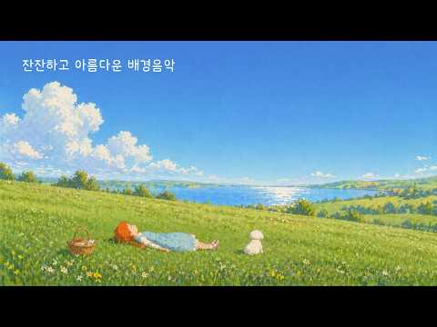
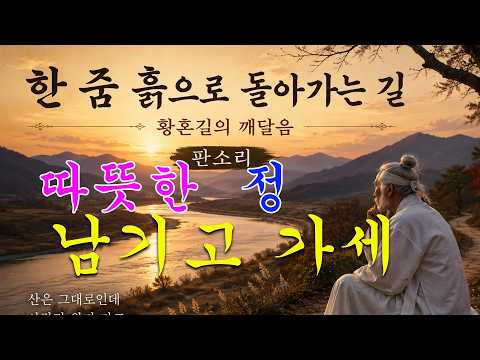
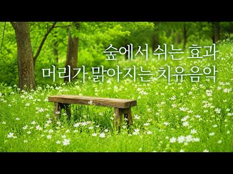
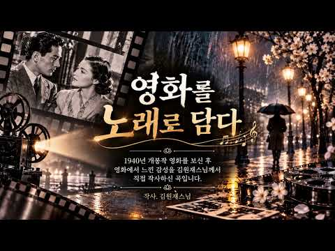
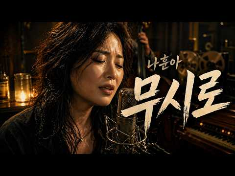
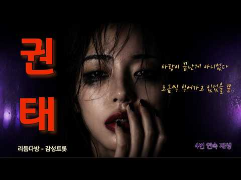

# 음악 — 성공 사례 분석: 사례별 자세히 #1041–#1080

`analysis.md` 의 9번 (같은 # 번호). 자동 생성 — `tools/success_analysis.py` v1.4.1 (2026-10-18 08:09 UTC). ※ 연구·교육용 — 투자 권유가 아님.

### 1041. 우연히 들었는데 첫 곡부터... 너무 좋다 ∣ 7080 추억의 올드 팝송 모음 Old Pop Song Playlist

- https://www.youtube.com/watch?v=ktav8W-fW8I · theoldpopsong · 구독자 40,800 · 조회수 482,182 (×11.8, 하루 2,764.4) · 좋아요 6,513 (1.4%) · 58.3분 · 2026-04-26 · 주제 묶음 10. 팝송·K팝·J팝 · 형식 플레이리스트·모음 (여러 곡) · 폴더 `W_ktav8W-fW8I` (웹 승인)
- 썸네일: 
- 챕터: 0:00 The Space You Left Behind — 네… · 2:25 A Spring That Still Feels Col… · 5:23 A Memory Painted on the Pavem… · 8:41 A Road Without You — 너 없는 길 · 12:14 A Little Longer Here — 조금 더 머… · 14:56 The Wind That Brings You Back… · 17:42 The Day We Didn’t Notice — 우리… · 20:06 A Petal in the Pages — 책갈피 속 … · 23:35 The Silent Glasshouse — 고요한 온실 · 26:35 A Table for Two — 둘을 위한 자리
- 설명 앞부분: 마음을 차분하게 만들어 주는 봄날의 감성이 담긴 70·80년대 올드팝을 모았습니다. 오래된 멜로디와 따뜻한 음색이 어우러져 복잡했던 하루의 생각들을 천천히 내려놓게 해 줍니다. 마치 LP에서 흘러나오는 듯한 아날로그 감성으로 편안하게 들을 수 있는 음악들입니다. 창가에 앉아 조용히 바람을 느끼듯, 따뜻한 커피 한 잔과 함께 듣기 좋은 노래들. 익숙한 선율과 부드러운 보컬이 공간을 채우며 카페처럼 포근한 분위기를 만들어 줍니다. 이 플레이리스트에는 네가 남기고 간 자리의 여운, 조금은 차갑게 느껴지는 봄날의 공기, 그리고 다시 불어…
- 대본 없음 (설명) — 음성인식이 끝나면 도입부·흐름이 들어감
- 댓글 0/287 (다 받지 못함): 좋은 점 — 영상 0 · 감사·응원 0 · 더 알고 싶은 것 0 · 아쉬운 점 — 영상 0 · 반박·불만 — 의견 다름 0 · 정치·사회 0 · 경험 공유 0 · 구독·다음 기대 0

### 1042. Mama Said ∣ Ogryn Chain Gang Blues Work Song ∣ Warhammer 40K Inspired Music

- https://www.youtube.com/watch?v=H6yrpYWMyRs · Solar Void · 구독자 20,800 · 조회수 245,096 (×11.8, 하루 1,468.2) · 좋아요 6,864 (2.8%) · 6분 · 2026-05-04 · 주제 묶음 2. 자연 소리·백색소음 · 형식 음악 (그 밖 모양 — 한 편짜리 BGM 등) · 폴더 `W_H6yrpYWMyRs` (웹 승인)
- 썸네일: 
- 설명 앞부분: “Mama Said” is a Warhammer 40K inspired Ogryn work song built around the feel of an old chain gang chant: heavy labor, simple call-and-response rhythm, iron chains, mud, artillery, and the brutal everyday work of the Astra Militarum. This track follows Ogryns pulling guns, hauling shells, digging t…
- 대본 없음 (설명) — 음성인식이 끝나면 도입부·흐름이 들어감
- 댓글 0/395 (다 받지 못함): 좋은 점 — 영상 0 · 감사·응원 0 · 더 알고 싶은 것 0 · 아쉬운 점 — 영상 0 · 반박·불만 — 의견 다름 0 · 정치·사회 0 · 경험 공유 0 · 구독·다음 기대 0

### 1043. 싱그러운 여름 아침, 꽃향기가 스며드는 기분좋은 카페음악 ∣ 계속 듣게 되는 감성팝송 ∣ Old Pop Playlist

- https://www.youtube.com/watch?v=EnD2m1z3fkM · 선율향기 · 구독자 11,500 · 조회수 131,924 (×11.5, 하루 1,035.3) · 좋아요 1,661 (1.3%) · 91.5분 · 2026-06-12 · 주제 묶음 4. 카페·매장·라운지 · 형식 플레이리스트·모음 (여러 곡) · 폴더 `W_EnD2m1z3fkM` (웹 승인)
- 썸네일: 
- 설명 앞부분: 초록이 가장 짙어지는 계절, 맑은 물결이 흐르는 강가에는 꽃들이 저마다의 색으로 피어나고, 창가에는 따뜻한 햇살이 조용히 머물러 있습니다. 좋아하는 음악 한 곡, 따뜻한 차 한 잔, 그리고 아무 말 없이 바라볼 수 있는 풍경 하나. 그것만으로도 충분히 행복했던 순간들이 문득 떠오르는 날입니다. 오늘은 7080 감성팝송과 함께 잠시 쉬어가는 시간을 가져보세요. 꽃향기 스며든 강가의 풍경처럼, 따뜻한 멜로디도 당신의 하루에 잔잔한 여운으로 머물기를 바랍니다 ☕🌿 As summer deepens and the greenery grows…
- 대본 없음 (설명) — 음성인식이 끝나면 도입부·흐름이 들어감
- 댓글 0/72 (다 받지 못함): 좋은 점 — 영상 0 · 감사·응원 0 · 더 알고 싶은 것 0 · 아쉬운 점 — 영상 0 · 반박·불만 — 의견 다름 0 · 정치·사회 0 · 경험 공유 0 · 구독·다음 기대 0

### 1044. Awit ng Paghahangad by Bukas Palad Music Ministry ∣ Senti Piano Cover ∣ Clyde Pianist ∣ 4K

- https://www.youtube.com/watch?v=5yDRTUMvk3I · Clyde Pianist | Senti Piano Covers · 구독자 12,000 · 조회수 136,804 (×11.4, 하루 1,227.5) · 좋아요 1,010 (0.7%) · 7.2분 · 2026-06-28 · 주제 묶음 6. 피아노·클래식·연주곡 · 형식 커버·직접 부른 노래 · 폴더 `W_5yDRTUMvk3I` (웹 승인)
- 썸네일: 
- 설명 앞부분: Awit ng Paghahangad by Bukas Palad Music Ministry ∣ Senti Piano Cover ∣ Clyde Pianist ∣ 4K Relaxing piano music perfect for: Sleeping Studying Late-night listening Relaxing moments Subscribe for more OPM and senti piano covers every week! FOLLOW ME If you would like to show your support: Paypal: pa…
- 대본 없음 (설명) — 음성인식이 끝나면 도입부·흐름이 들어감
- 댓글 0/99 (다 받지 못함): 좋은 점 — 영상 0 · 감사·응원 0 · 더 알고 싶은 것 0 · 아쉬운 점 — 영상 0 · 반박·불만 — 의견 다름 0 · 정치·사회 0 · 경험 공유 0 · 구독·다음 기대 0

### 1045. The Odyssey - Odysseus (EPIC Piano Cover)

- https://www.youtube.com/watch?v=jtUq7gMr-7k · Laurie Théberge · 구독자 46,000 · 조회수 522,433 (×11.4, 하루 5,753.8) · 좋아요 7,980 (1.5%) · 6.3분 · 2026-07-19 · 주제 묶음 6. 피아노·클래식·연주곡 · 형식 커버·직접 부른 노래 · 폴더 `W_jtUq7gMr-7k` (웹 승인)
- 썸네일: 
- 설명 앞부분: Equipement I use: The Piano is a Kawai Es110 keyboard There’s a led strip connected to the keyboard via a software to make the keys ‘light up’. Tutorial by Aleksander Evening. I record in Ableton. Piano sound is from the VST ‘Noire Piano’ Visuals in Seemusic Edited in Davinci Resolve Ok so while ma…
- 대본 없음 (설명) — 음성인식이 끝나면 도입부·흐름이 들어감
- 댓글 0/192 (다 받지 못함): 좋은 점 — 영상 0 · 감사·응원 0 · 더 알고 싶은 것 0 · 아쉬운 점 — 영상 0 · 반박·불만 — 의견 다름 0 · 정치·사회 0 · 경험 공유 0 · 구독·다음 기대 0

### 1046. 🔥한 번 들으면 멈출 수 없는 역설적 감성🔥 락트롯 ∣ 가슴속 응어리를 뻥~ 뚫어버리는 사이다 보컬 ∣ 도시광상곡 (Phantasia)

- https://www.youtube.com/watch?v=LmEOZx2IH9M · 노래마실 [ Music Town ] · 구독자 2,790 · 조회수 31,490 (×11.3, 하루 260.3) · 좋아요 219 (0.7%) · 4.3분 · 2026-06-19 · 주제 묶음 9. 가요·발라드·트로트 · 형식 플레이리스트·모음 (여러 곡) · 폴더 `W_LmEOZx2IH9M` (웹 승인)
- 썸네일: 
- 설명 앞부분: 형식에 얽매이지 않고 격정적인 환상을 펼쳐내는 '광상곡(Phantasia)'이라는 제목에 걸맞게, 이 곡은 어울리지 않을 것 같은 이질적인 장르들을 황금 비율로 녹여내며 리스너들에게 묘한 중독성을 선사한다. 밤거리를 질주하는 듯한 빠른 템포의 베이스라인은 심장 소리를 대변하듯 숨 가쁘게 몰아치며 몸을 들썩이게 만든다. 이 곡의 가장 큰 백미는 단연 압도적인 여성 락 보컬의 가창력이다. 신나는 디스코 비트 위에서 보컬은 연약하게 슬퍼하는 대신, 하드 락 고유의 파워풀한 벨팅(Belting) 창법으로 가슴속 응어리를 시원하게 내지른다…
- 대본 없음 (설명) — 음성인식이 끝나면 도입부·흐름이 들어감
- 댓글 0/19 (다 받지 못함): 좋은 점 — 영상 0 · 감사·응원 0 · 더 알고 싶은 것 0 · 아쉬운 점 — 영상 0 · 반박·불만 — 의견 다름 0 · 정치·사회 0 · 경험 공유 0 · 구독·다음 기대 0

### 1047. Rod Wave - It Will All Work Out - (Official Music Video)

- https://www.youtube.com/watch?v=OHYv2zYBdfU · Street Empire Music  · 구독자 1,570 · 조회수 17,717 (×11.3, 하루 138.6) · 좋아요 302 (1.7%) · 13분 · 2026-06-12 · 주제 묶음 기타 · 형식 한 곡 (뮤직비디오·음원·가사) · 폴더 `W_OHYv2zYBdfU` (웹 승인)
- 썸네일: 
- 대본 없음 (없음) — 음성인식이 끝나면 도입부·흐름이 들어감
- 댓글 0/5 (다 받지 못함): 좋은 점 — 영상 0 · 감사·응원 0 · 더 알고 싶은 것 0 · 아쉬운 점 — 영상 0 · 반박·불만 — 의견 다름 0 · 정치·사회 0 · 경험 공유 0 · 구독·다음 기대 0

### 1048. 🌈Album Preview ∣ Find the Full Album in the Playlist ∣ Celestial Piano Music — Aloha Grace

- https://www.youtube.com/watch?v=2qh-NuD0YMs · Calm Music & Wise Words · 구독자 3,470 · 조회수 39,070 (×11.3, 하루 1,328.8) · 좋아요 17 (0.0%) · 4.8분 · 2026-09-18 · 주제 묶음 6. 피아노·클래식·연주곡 · 형식 플레이리스트·모음 (여러 곡) · 폴더 `W_2qh-NuD0YMs` (웹 승인)
- 썸네일: 
- 설명 앞부분: Listen to the full “ Aloha Grace” collection — all 10 piano pieces: This video features samples from all 10 tracks. For the complete album, please listen through the playlist above. More music from the "Ordinary Miracles" collection: For longer piano sessions with wise words: Our visuals are primar…
- 대본 없음 (설명) — 음성인식이 끝나면 도입부·흐름이 들어감
- 댓글 0/1 (다 받지 못함): 좋은 점 — 영상 0 · 감사·응원 0 · 더 알고 싶은 것 0 · 아쉬운 점 — 영상 0 · 반박·불만 — 의견 다름 0 · 정치·사회 0 · 경험 공유 0 · 구독·다음 기대 0

### 1049. [𝗣𝗹𝗮𝘆𝗹𝗶𝘀𝘁] 인스타에서 한번쯤 들어본 느@좋 플리

- https://www.youtube.com/watch?v=4qcGtkqrfMk · 프리다앤 / FRIDA-ANNE · 구독자 41,500 · 조회수 466,555 (×11.2, 하루 2,794.3) · 좋아요 9,655 (2.1%) · 60.8분 · 2026-05-04 · 주제 묶음 11. 힙합·R&B·EDM · 형식 플레이리스트·모음 (여러 곡) · 폴더 `W_4qcGtkqrfMk` (웹 승인)
- 썸네일: 
- 설명 앞부분: 알앤비, 힙합, 일렉트로니카 TIME LINE MilliMax Zombie (feat. DRIP TARKO) DIMO REX SAY MY NAME Kid Milli Wassup SYSTEM SEOUL & ycs Korean Hamin & Inti San Don't do it 나우아임영 & 수도 KiiiKiii (키키) 404 (New Era) Yere Im Ballin RYUL of LNGSHOT & LOUIS of LNGSHOT Thinking KC & 식케이 & 김하온 & JMIN OUTTA SPACE 릴러말즈 (Leellam…
- 대본 없음 (설명) — 음성인식이 끝나면 도입부·흐름이 들어감
- 댓글 0/18 (다 받지 못함): 좋은 점 — 영상 0 · 감사·응원 0 · 더 알고 싶은 것 0 · 아쉬운 점 — 영상 0 · 반박·불만 — 의견 다름 0 · 정치·사회 0 · 경험 공유 0 · 구독·다음 기대 0

### 1050. 정서안정과 고운 마음을 위한 잔잔하고 아름다운 음악 l 어린이집 유치원 교실 편안한 배경 음악

- https://www.youtube.com/watch?v=ONTpCdvC9mo · 조이멜로디 JOY MELODY · 구독자 21,600 · 조회수 242,629 (×11.2, 하루 1,466.7) · 좋아요 1,967 (0.8%) · 82.3분 · 2026-05-05 · 주제 묶음 기타 · 형식 음악 (그 밖 모양 — 한 편짜리 BGM 등) · 폴더 `W_ONTpCdvC9mo` (웹 승인)
- 썸네일: 
- 설명 앞부분: 유아들의 정서 안정과 고운 마음을 키워주는 잔잔하고 아름다운 배경 음악. 💛 모든 곡이 좋은 또 다른 산뜻한 배경음악
- 같은 채널 평소 대비 ×28.2 (채널 최근 롱폼 중앙값 8,610회) · 평소 영상: 기분좋은 아침을 여는 산뜻한 피아노 음악 ㅣ Refreshing piano melody … (8,715회) / 3시간 행복한 겨울 놀이음악 l Snowy Day Playtime Music (8,504회)
- 대본 없음 (설명) — 음성인식이 끝나면 도입부·흐름이 들어감
- 댓글 0/0: 좋은 점 — 영상 0 · 감사·응원 0 · 더 알고 싶은 것 0 · 아쉬운 점 — 영상 0 · 반박·불만 — 의견 다름 0 · 정치·사회 0 · 경험 공유 0 · 구독·다음 기대 0

### 1051. 한 줌 흙으로 돌아가는 길 ∣ 황혼길의 깨달음 국악 판소리트로트

- https://www.youtube.com/watch?v=Vb3VooJUgyk · Nana Music · 구독자 10,000 · 조회수 112,267 (×11.2, 하루 953.1) · 좋아요 941 (0.8%) · 7.6분 · 2026-06-22 · 주제 묶음 9. 가요·발라드·트로트 · 형식 음악 (그 밖 모양 — 한 편짜리 BGM 등) · 폴더 `W_Vb3VooJUgyk` (웹 승인)
- 썸네일: 
- 설명 앞부분: 태어날 때는 빈손으로 왔고, 떠날 때도 빈손으로 갑니다. 그런데 우리는 살아가며 무엇을 그리 다투고, 무엇을 그리 움켜쥐며 살고 있을까요? 세월은 강물처럼 흘러가고, 젊음은 어느새 추억이 되었습니다. 이 노래는 인생의 황혼길에 선 한 노인이 지나온 세월을 돌아보며 깨달은 이야기를 담았습니다. 재물도 명예도 결국은 두고 가지만, 사람과 사람 사이의 따뜻한 정(情)은 마지막까지 가슴에 남는다는 것을 노래합니다. 잠시 바쁜 삶을 멈추고, 이 노래와 함께 자신의 인생을 돌아보는 시간이 되시길 바랍니다. 🎵 제목 : 한 줌 흙으로 가는 인…
- 같은 채널 평소 대비 ×142.7 (채널 최근 롱폼 중앙값 787회) · 평소 영상: 해방과 6.25 보릿고개를 겪어오신 90세 어머니의 세월… 누가 다 헤아릴 수 있으리 ∣… (787회) / 나의 옛 고향 ∣ 향수(鄕愁) ∣ 그리운 그 시절 #국악 발라드 #7080 (739회)
- 대본 없음 (설명) — 음성인식이 끝나면 도입부·흐름이 들어감
- 댓글 106/106: 좋은 점 — 영상 2 · 감사·응원 10 · 더 알고 싶은 것 0 · 아쉬운 점 — 영상 0 · 반박·불만 — 의견 다름 1 · 정치·사회 0 · 경험 공유 1 · 구독·다음 기대 0
  - 좋은 점 — 영상 👍2 “올. 여름도 무사히 보내고 말복도 맞이하고 조석으로 상꽤한 가을에 문턱에 접어 드는 길목에서 좋은 노래 듣다보니 어느새 가슴속 깊이 와닿는 가사 내용 마력에 빠져드니 어찌 하오리 마냥 좋은걸 내삶에 뒤안길 반성하고 많이 배워 갑니다 좋은 노래 올려 주신 al 관계자분…”
  - 좋은 점 — 영상 👍2 “우리인생 한줌재가 되고 한줌 흙이 되건만 그러게요 뭘 가져 가겠다고 아등바등 살았는지 노래 가사에 가슴 미어집니다 메고 지고 안고 갈것도 아닌데 헛된인생 살아 왔지만 늦은 이나이에 지금에와서 깨닫고 느끼며 내인생에게 고맙다고 수고했다고 얘기해주고 싶어요 좋은 노랫말 …”
  - 감사·응원 👍6 “오늘도 살아 숨쉴 수 있음 부처님께 감사하며 살아가고 있습니다 인생사 거기서 거기지요”
  - 감사·응원 👍4 “정말 좋은가사며 좋은노래입니다. 감사함.”
  - 반박·불만 — 의견 다름 👍2 “우리인생 한줌재가 되고 한줌 흙이 되건만 그러게요 뭘 가져 가겠다고 아등바등 살았는지 노래 가사에 가슴 미어집니다 메고 지고 안고 갈것도 아닌데 헛된인생 살아 왔지만 늦은 이나이에 지금에와서 깨닫고 느끼며 내인생에게 고맙다고 수고했다고 얘기해주고 싶어요 좋은 노랫말 …”

### 1052. 숲에서 쉬는 효과🌳머리가 맑아지는 치유명상음악 ∣ 3시간, 힐링음악, 명상음악 ∣ Relaxing Music, Healing Music

- https://www.youtube.com/watch?v=yq-lSVEu7U0 · 살구사운드 SalguSound · 구독자 10,700 · 조회수 115,853 (×10.8, 하루 4,393.2) · 좋아요 538 (0.5%) · 191.9분 · 2026-09-21 · 주제 묶음 1. 수면·명상·힐링 · 형식 긴 한 곡·반복 (N시간) · 폴더 `W_yq-lSVEu7U0` (웹 승인)
- 썸네일: 
- 설명 앞부분: 안녕하세요. 살구해입니다.😊 이번 한 주도 평온한 마음으로 보내실 수 있길 바라며🌿 편안히 쉬다 가세요.😊 불법 다운로드와 상업적 이용은 금지합니다. Copyright 2026. Salguhae All Rights Reserved. 아름다운 아침 숲 영상과 명상음악🌄 숲 속에 있는 듯🌳 10분만에 머리가 맑아지는 음악 살구해의 첫 번째 앨범 ‘물가에 앉아(at the water's edge)’가 발매되었어요. 멜론, 지니, 유튜브뮤직 등 모든 음원사이트에서 들으실 수 있어요.🌿 본 영상의 비주얼은 생성형 AI 기술과 자체 그래픽 …
- 같은 채널 평소 대비 ×8.7 (채널 최근 롱폼 중앙값 13,333회) · 평소 영상: 마사지 받는 효과😊몸과 마음의 긴장이 풀려요 ∣ 3시간, 힐링음악, 명상음악 ∣ Rela… (13,333회) / 머리가 맑아지는 효과🌿이슬처럼 맑고 잔잔한 치유명상음악 ∣ 3시간, 힐링음악, 명상음악 … (13,546회)
- 대본 없음 (설명) — 음성인식이 끝나면 도입부·흐름이 들어감
- 댓글 43/43: 좋은 점 — 영상 0 · 감사·응원 5 · 더 알고 싶은 것 0 · 아쉬운 점 — 영상 0 · 반박·불만 — 의견 다름 0 · 정치·사회 0 · 경험 공유 0 · 구독·다음 기대 0
  - 감사·응원 👍19 “토요일부터 어지럼증과 권태감으로 움직이질 못하고 있어 우울한 마음을 위로하려 왔습니다. 일상생활의 소중함에 감사하고 혹시 모를 자만으로 타인에게 상처를 주지는 않았나 반성하는 시간이 될 것 같습니다. 모든 분들이 건강하고 행복하시길 진심으로 바랍니다.”
  - 감사·응원 👍5 “숲속의 평온함이 여기까지 느껴지네요. 덕분에 복잡한 머릿속이 맑아지는 것 같아요. 감사합니다.🌿”

### 1053. 「영화 〈애수〉, 다시 노래가 되다｜세월이 지나도 남는 영화

- https://www.youtube.com/watch?v=cIBIrAEYVZM · 절로 가는 이야기 · 구독자 2,560 · 조회수 27,543 (×10.8, 하루 2,250.0) · 좋아요 346 (1.3%) · 4.6분 · 2026-10-06 · 주제 묶음 기타 · 형식 음악 (그 밖 모양 — 한 편짜리 BGM 등) · 폴더 `W_cIBIrAEYVZM` (웹 승인)
- 썸네일: 
- 설명 앞부분: 마음이 고요해지는 클래식 음악에서, 한 권의 경전에서, 때로는 한 편의 영화에서도 영감을 얻어 아름다운 노랫말로 풀어내시는 김원재스님. 시인으로 등재되어 있을 만큼 풍부한 감성을 지니신 스님께서는 음악과 영화, 경전 속에서 느낀 감정과 여운을 때로는 찬불가로, 때로는 대중적인 노랫말로 담아내십니다. 다양한 장르의 찬불가가 더 많은 분들께 사랑받기를 바라는 마음으로 여러 곡을 발표해오셨지만, 아직 불자들에게 널리 알려지지 않은 아름다운 곡들도 많습니다. 그래서 찬불가의 아름다움을 조금 더 가까이 알리고 불자가 아닌 분들도 편안하게 …
- 대본 없음 (설명) — 음성인식이 끝나면 도입부·흐름이 들어감
- 댓글 0/43 (다 받지 못함): 좋은 점 — 영상 0 · 감사·응원 0 · 더 알고 싶은 것 0 · 아쉬운 점 — 영상 0 · 반박·불만 — 의견 다름 0 · 정치·사회 0 · 경험 공유 0 · 구독·다음 기대 0

### 1054. 가을이 오면... 커피향이 가득한 카페에서 듣고 싶은 음악

- https://www.youtube.com/watch?v=4lPZuU2kCbA · EverOldies · 구독자 44,800 · 조회수 474,574 (×10.6, 하루 10,679.8) · 좋아요 4,677 (1.0%) · 96.9분 · 2026-09-03 · 주제 묶음 4. 카페·매장·라운지 · 형식 음악 (그 밖 모양 — 한 편짜리 BGM 등) · 폴더 `W_4lPZuU2kCbA` (웹 승인)
- 썸네일: 
- 챕터: 0:00 I Will Be With You · 3:17 I Heard Your Name · 6:20 Locking the Past · 8:36 How Have You Been · 11:44 I Wish You Well · 15:14 Somewhere in My Memory · 19:03 You Were in Everything · 22:11 Thank You for Everything · 26:06 After All This Time · 29:08 Dear Distant Soul · 32:17 Replay
- 설명 앞부분: 가을이 오면 따뜻한 커피 한잔과 오래된 노래가 생각납니다. 커피향이 가득한 카페에 앉아 창밖을 바라보며 천천히 듣고 싶은 음악을 담았습니다. 7080 올드팝의 따뜻하고 아련한 감성, 부드러운 여성 보컬과 편안한 멜로디가 어우러진 Old Pop Playlist입니다. 누군가를 기다리던 시간도, 문득 떠오르는 얼굴도, 이제는 희미해진 지난날의 기억도 음악을 듣다 보면 어느새 다시 가까워집니다. 바쁜 하루 중 잠시 쉬고 싶을 때, 혼자 커피를 마시며 생각에 잠기고 싶을 때, 그리고 추억의 팝송과 7080 감성의 올드팝이 그리울 때 함께…
- 같은 채널 평소 대비 ×58.0 (채널 최근 롱폼 중앙값 8,185회) · 평소 영상: 오래 전 추억이 떠오르는 노래 ∣ 5060 추억의 올드팝 Playlist (8,185회) / 듣는 순간 가슴이 뭉클해지는 빈티지 올드팝 ∣ 6070 추억의 올드팝 Playlist (7,899회)
- 대본 없음 (설명) — 음성인식이 끝나면 도입부·흐름이 들어감
- 댓글 292/292: 좋은 점 — 영상 6 · 감사·응원 29 · 더 알고 싶은 것 1 · 아쉬운 점 — 영상 0 · 반박·불만 — 의견 다름 0 · 정치·사회 0 · 경험 공유 3 · 구독·다음 기대 0
  - 좋은 점 — 영상 👍3 “정말 듣기 좋군요~❤”
  - 좋은 점 — 영상 👍2 “가을이 오래 동안 있었으면 좋겠어요 바람이 선선하니 올드팝송 듣기 좋아요”
  - 감사·응원 👍56 “감기로 인해 급성후두염 진단을 받았네요~ 되도록 말을 하지 말라니 입꾹닫하고 지냅니다 누워서 눈감고 들었어요~ 간간히 잠이 들기도 했나봅니다~😊 감성충만하고 편안한 노래~ 들려주셔서 고맙습니다~😊❤❤”
  - 감사·응원 👍25 “마음이 릴렉스 되는 음악이네요. 좋은음악 감사 합니다”
  - 더 알고 싶은 것 👍1 “계절의 변화따라 마음도 기분도 바뀌는 것 같네요. 새벽 안개 자욱한 메타세콰이어 나무가 끝도없이 즐비한 곳에서 들으면 아주 몽환적일 것 같아요^^ 곡의 이름을 모두 알 수 있을까요?”
  - 경험 공유 👍8 “노래 음률이 차분하고 조용하니 좋으네요..가을이 눈앞에 펼쳐질 나날들..내가 좋아하는 나무님도 가러움증 빨리 완치되어 정상적으로 포근하게 잘 자길 빌면서..나무는 내 안식처 ..매미의 집이죠”
  - 경험 공유 👍0 “가을이 오면(이문세) 가을이 오면 가실 할 수 있는 쭉정이라도 있으면 했어 그런데 도리어 곳간의 쌀알만 쥐들이 훔쳐 가버렸네 가을이 오면 누군가 나에게 다가왔으면 했어 그런데 도리어 내 기억속의 사람들만 더 떠나가 버렸네 가을이 오면 내가 그 위로를 받을 수 있을 때…”

### 1055. 【ドッカンバトル】超サイヤ人孫悟空 変身 bgm

- https://www.youtube.com/watch?v=nwzLO39prTs · メガゲン · 구독자 21,200 · 조회수 222,481 (×10.5, 하루 1,465.5) · 좋아요 1,288 (0.6%) · 10.1분 · 2026-05-19 · 주제 묶음 기타 · 형식 음악 (그 밖 모양 — 한 편짜리 BGM 등) · 폴더 `W_nwzLO39prTs` (웹 승인)
- 썸네일: 
- 대본 없음 (없음) — 음성인식이 끝나면 도입부·흐름이 들어감
- 댓글 0/374 (다 받지 못함): 좋은 점 — 영상 0 · 감사·응원 0 · 더 알고 싶은 것 0 · 아쉬운 점 — 영상 0 · 반박·불만 — 의견 다름 0 · 정치·사회 0 · 경험 공유 0 · 구독·다음 기대 0

### 1056. Enthiran BGM ∣ A.R. Rahman ∣ 80-Piece Symphony Orchestra

- https://www.youtube.com/watch?v=swMgOH67TdI · Australian Indian Orchestra · 구독자 32,100 · 조회수 333,904 (×10.4, 하루 2,400.3) · 좋아요 9,257 (2.8%) · 8.5분 · 2026-06-01 · 주제 묶음 6. 피아노·클래식·연주곡 · 형식 음악 (그 밖 모양 — 한 편짜리 BGM 등) · 폴더 `W_swMgOH67TdI` (웹 승인)
- 썸네일: 
- 설명 앞부분: Experience the thunderous Enthiran BGM performed LIVE by the Australian Indian Orchestra. This sweeping live orchestra cover captures the futuristic scale and pulse-pounding intensity of A.R. Rahman's original score for the sci-fi epic, delivered through a massive 80-piece ensemble. 🎵 Stay Connecte…
- 대본 없음 (설명) — 음성인식이 끝나면 도입부·흐름이 들어감
- 댓글 0/484 (다 받지 못함): 좋은 점 — 영상 0 · 감사·응원 0 · 더 알고 싶은 것 0 · 아쉬운 점 — 영상 0 · 반박·불만 — 의견 다름 0 · 정치·사회 0 · 경험 공유 0 · 구독·다음 기대 0

### 1057. 🌸나훈아 - 무시로 (Blues Remix) – 이 감성 뭐냐… l 🎙️별이트로트

- https://www.youtube.com/watch?v=bBz2DSGQSIw · 별이트로트 · 구독자 8,030 · 조회수 83,255 (×10.4, 하루 486.4) · 좋아요 603 (0.7%) · 4.3분 · 2026-04-30 · 주제 묶음 9. 가요·발라드·트로트 · 형식 음악 (그 밖 모양 — 한 편짜리 BGM 등) · 폴더 `W_bBz2DSGQSIw` (웹 승인)
- 썸네일: 
- 설명 앞부분: 원곡의 애절함을 살리면서 블루스 감성으로 다시 풀어봤습니다. 무심한 듯 툭 던지는 멜로디, 그 안에 담긴 깊은 감정이 더 진하게 다가올 거예요. 🎸 이어폰 필수 / 밤 감성 추천 댓글로 다음 리믹스 곡도 추천해주세요!
- 대본 없음 (설명) — 음성인식이 끝나면 도입부·흐름이 들어감
- 댓글 0/29 (다 받지 못함): 좋은 점 — 영상 0 · 감사·응원 0 · 더 알고 싶은 것 0 · 아쉬운 점 — 영상 0 · 반박·불만 — 의견 다름 0 · 정치·사회 0 · 경험 공유 0 · 구독·다음 기대 0

### 1058. 듣자마자 어깨춤 터지는 신명나는 트로트 찬불가 14곡 #불교음악 #트로트찬불가

- https://www.youtube.com/watch?v=EYh7Yz748vs · 연꽃선율 · 구독자 21,500 · 조회수 219,345 (×10.2, 하루 1,379.9) · 좋아요 4,290 (2.0%) · 61.5분 · 2026-05-12 · 주제 묶음 9. 가요·발라드·트로트 · 형식 플레이리스트·모음 (여러 곡) · 폴더 `W_EYh7Yz748vs` (웹 승인)
- 썸네일: 
- 설명 앞부분: 사바세계의 시름은 잊고 부처님의 가르침에 어깨춤을 춰보세요! 신명나는 트로트 리듬과 은혜로운 찬불 가사가 만나 탄생한 역대급 신곡 메들리 14곡입니다. 한 곡당 3~5분 분량으로 꽉 채워, 운전할 때나 운동할 때, 혹은 도량에서 일하실 때 듣기 딱 좋습니다. 제목 리스트 1.​사바세계 축제 한마당 2.​연꽃 피는 내 마음 3.​반야심경 트위스트 4.​인연의 고속도로 5.​일체유심조 셔플 6.​관세음보살 릴레이 7.​육바라밀 댄스 8.​칠석날 오작교 사랑 9.​산사로 가는 버스 10.​자비의 비빔밥 11.​방생하는 날 12.​사천왕…
- 같은 채널 평소 대비 ×372.4 (채널 최근 롱폼 중앙값 589회) · 평소 영상: 덩실덩실 춤추는 동자승! 신나는 트로트 찬불가 14곡 연속듣기 (589회) / 22살 비구니 스님의 눈물, 무거운 번뇌를 씻어내는 새벽 산사의 찬불가 (국악 트로트 발… (470회)
- 대본 없음 (설명) — 음성인식이 끝나면 도입부·흐름이 들어감
- 댓글 289/289: 좋은 점 — 영상 3 · 감사·응원 38 · 더 알고 싶은 것 5 · 아쉬운 점 — 영상 1 · 반박·불만 — 의견 다름 0 · 정치·사회 0 · 경험 공유 2 · 구독·다음 기대 1
  - 좋은 점 — 영상 👍2 “노래가 넘 신나고 듣기좋아요 감사합니다 고맙습니다 감사합니다”
  - 좋은 점 — 영상 👍2 “❤너무듣기 좋아요 ❤ 어지러운 세상에 한줄기 빛이네요 ❤ 저장해놓구 매일매일 들어야겠네요”
  - 감사·응원 👍23 “나무아비타불 ㆍ관세음보살 산나는음악 감사합니다 ㅡ성불하십시요”
  - 감사·응원 👍9 “스님이신가요 목소리가 극락입니다 감사합니다~”
  - 더 알고 싶은 것 👍1 “절로 신명이납니다. 제목좀알려주세요. 나무아미타불 관세음보살”
  - 더 알고 싶은 것 👍0 “순서대로 노래 제목을 알고싶습니다 🙏🙏🙏”
  - 아쉬운 점 — 영상 👍1 “가사 자막이 있으면 따라 하기 좋을 것 같아요 나무아미타불 관세음보살()”
  - 경험 공유 👍7 “신나네요 내가 하는. 일 대박나게. 해 주세요🎉🎉”
  - 구독·다음 기대 👍1 “트로트 찬불가 너무 좋아요 매일 매일 듣고 싶은 찬불가입니다.너무 감사합니다.”

### 1059. 권태 [감성트롯 끝판왕]연속4번재생

- https://www.youtube.com/watch?v=07n66F10ofY · 리듬다방(김리다) · 구독자 1,360 · 조회수 13,795 (×10.1, 하루 105.6) · 좋아요 141 (1.0%) · 12분 · 2026-06-09 · 주제 묶음 9. 가요·발라드·트로트 · 형식 음악 (그 밖 모양 — 한 편짜리 BGM 등) · 폴더 `W_07n66F10ofY` (웹 승인)
- 썸네일: 
- 설명 앞부분: 권태 🖤 .. 사랑이 끝난 게 아니었다 조금씩 식어가고 있었을 뿐 우린 아직 함께였는데 마음은 이미 멀어져 있었다 🎵 음악 : AI 생성 🖼 이미지 : AI 생성 🎬 작사&비디오 : 리듬다방 본 영상의 음악, 이미지 및 영상은 직접 제작한 창작 콘텐츠입니다.
- 같은 채널 평소 대비 ×28.7 (채널 최근 롱폼 중앙값 482회) · 평소 영상: 〈다녀가셨습니까〉 Rock Ballad Ver. ∣ 끝내 터진 그리움 (502회) / 🎵 삐뚤어질테다 ∣ 퓨전국악 (민요 × 뉴디스코) Ver. ∣ Full Ver. (461회)
- 대본 없음 (설명) — 음성인식이 끝나면 도입부·흐름이 들어감
- 댓글 0/17 (다 받지 못함): 좋은 점 — 영상 0 · 감사·응원 0 · 더 알고 싶은 것 0 · 아쉬운 점 — 영상 0 · 반박·불만 — 의견 다름 0 · 정치·사회 0 · 경험 공유 0 · 구독·다음 기대 0

### 1060. The Throne Room ∣ House of The Dragon Season 3 Episode 2 Ending Soundtrack

- https://www.youtube.com/watch?v=s2GxTf1Ft4s · Jeremy Brauns Music · 구독자 29,300 · 조회수 297,131 (×10.1, 하루 2,683.9) · 좋아요 3,881 (1.3%) · 4.1분 · 2026-06-29 · 주제 묶음 13. OST·사운드트랙 · 형식 커버·직접 부른 노래 · 폴더 `W_s2GxTf1Ft4s` (웹 승인)
- 썸네일: 
- 챕터: 0:00 Hightower Theme · 0:48 Rhaenyra's Duty · 2:11 Ascending The Throne · 3:02 Alicent Enters
- 설명 앞부분: The Throne Room ∣ My orchestral cover of the ending soundtrack from House of the Dragon Season 3 Episode 2. Ramin Djawadi's closing cue from HotD S3E2 resembles the opening one but is much larger, with expanded orchestration. Richer strings, brass swells, and a powerful final statement as the episo…
- 대본 없음 (설명) — 음성인식이 끝나면 도입부·흐름이 들어감
- 댓글 0/163 (다 받지 못함): 좋은 점 — 영상 0 · 감사·응원 0 · 더 알고 싶은 것 0 · 아쉬운 점 — 영상 0 · 반박·불만 — 의견 다름 0 · 정치·사회 0 · 경험 공유 0 · 구독·다음 기대 0

### 1061. 슈베르트가 생의 끝에서 남긴 가장 아름다운 노래 ∣ 슈베르트 '세레나데' D.957 (Franz Schubert, Ständchen/Serenade)

- https://www.youtube.com/watch?v=15GfRzMd3qw · 클래식 여행자 (Classical Music Voyager) · 구독자 13,400 · 조회수 134,809 (×10.1, 하루 827.6) · 좋아요 1,252 (0.9%) · 4.2분 · 2026-05-08 · 주제 묶음 기타 · 형식 음악 (그 밖 모양 — 한 편짜리 BGM 등) · 폴더 `W_15GfRzMd3qw` (웹 승인)
- 썸네일: 
- 설명 앞부분: [English Subtitles Available] A hauntingly beautiful farewell from the edge of life. Unveil the desperate yearning and the final, hidden confession of a genius who lived for love.
- 같은 채널 평소 대비 ×1.8 (채널 최근 롱폼 중앙값 73,200회) · 평소 영상: 밤이 깊어질수록 더 아름다운 음악 ∣ 드뷔시 '달빛' (Debussy, Clair de … (110,559회) / 인간의 한계를 뛰어넘은 전설의 피아노곡 ∣ 리스트 '라 캄파넬라' (Franz Liszt… (35,840회)
- 대본 없음 (설명) — 음성인식이 끝나면 도입부·흐름이 들어감
- 댓글 38/38: 좋은 점 — 영상 1 · 감사·응원 3 · 더 알고 싶은 것 1 · 아쉬운 점 — 영상 0 · 반박·불만 — 의견 다름 0 · 정치·사회 0 · 경험 공유 1 · 구독·다음 기대 0
  - 좋은 점 — 영상 👍2 “저는 다시 태어나면 사랑을 않겠어요 별 도움이 안되요 나 혼자 열심히 살아 일구고 여유 생기면 봉사하고 사랑은 노노노~~~~”
  - 감사·응원 👍11 “감사합니다 !”
  - 감사·응원 👍9 “슈베르트의 노래는 다 좋아하지만 세레나데의 가사가 심금을 울 려 주기에 어릴적 부터 즐겨부르곤했는데 인생의 황혼녁에 숨죽이고 듣노라니 나도 모르게 마음 한구석이 텅비고 생을 하직하는 순간이 어떨가 싶은 처량함이 와 닿는것 같습니다. 고맙습니다.”
  - 경험 공유 👍9 “슈베르트의 노래는 다 좋아하지만 세레나데의 가사가 심금을 울 려 주기에 어릴적 부터 즐겨부르곤했는데 인생의 황혼녁에 숨죽이고 듣노라니 나도 모르게 마음 한구석이 텅비고 생을 하직하는 순간이 어떨가 싶은 처량함이 와 닿는것 같습니다. 고맙습니다.”

### 1062. 【ドッカンバトル】超サイヤ人孫悟空 本気 bgm

- https://www.youtube.com/watch?v=rr_DEN34wp0 · メガゲン · 구독자 21,200 · 조회수 213,255 (×10.1, 하루 4,271.7) · 좋아요 1,169 (0.5%) · 10.1분 · 2026-08-29 · 주제 묶음 기타 · 형식 음악 (그 밖 모양 — 한 편짜리 BGM 등) · 폴더 `W_rr_DEN34wp0` (웹 승인)
- 썸네일: 
- 대본 없음 (없음) — 음성인식이 끝나면 도입부·흐름이 들어감
- 댓글 0/170 (다 받지 못함): 좋은 점 — 영상 0 · 감사·응원 0 · 더 알고 싶은 것 0 · 아쉬운 점 — 영상 0 · 반박·불만 — 의견 다름 0 · 정치·사회 0 · 경험 공유 0 · 구독·다음 기대 0

### 1063. 2000년대 히트곡 모음 추억의 노동요 playlist

- https://www.youtube.com/watch?v=C4rRsOUQMRg · 플리 말아주는 주모 · 구독자 25,800 · 조회수 257,946 (×10.0, 하루 1,801.0) · 좋아요 4,383 (1.7%) · 189.9분 · 2026-05-28 · 주제 묶음 3. 공부·집중·작업 · 형식 플레이리스트·모음 (여러 곡) · 폴더 `W_C4rRsOUQMRg` (웹 승인)
- 썸네일: 
- 설명 앞부분: 오늘의 메뉴는 90-00년대 추억의 히트곡들을 듬뿍 담은 플레이리스트입니다. 주인장은 '내 가족이 먹는다'는 마음으로 정성을 다해 건강하고 맛있게 조리하고 있습니다.
- 같은 채널 평소 대비 ×2.2 (채널 최근 롱폼 중앙값 115,208회) · 평소 영상: 신나는 팝송 (165,973회) / 리쌍 대표곡 모음 Playlist (166,443회)
- 대본 없음 (설명) — 음성인식이 끝나면 도입부·흐름이 들어감
- 댓글 322/322: 좋은 점 — 영상 0 · 감사·응원 4 · 더 알고 싶은 것 5 · 아쉬운 점 — 영상 2 · 반박·불만 — 의견 다름 0 · 정치·사회 0 · 경험 공유 7 · 구독·다음 기대 3
  - 감사·응원 👍1 “아 진짜 빅뱅 팬인데 ㅋㅋ 너무 웃겨욬 장인정신뭔데 ㅋㅋㅋㅋㅋㅋㅋㅋㅋㅋ 구독 박고갑니다 감사합니다”
  - 감사·응원 👍0 “내 유튜브 메인화면에 박진영 백숙 썸넬이 매일 떴지만 애써 무시해왔는데 결국 굴복당하고 눌러버렸다. 선곡은 당연하고 썸넬 장인에게 홀려버림. 며칠째 하루종일 들으며 일하고있다... 이렇게 한다고 본인한테 떨어지는거 하나 없을텐데.. 진짜 장인이다. 고맙고 존경해요. …”
  - 더 알고 싶은 것 👍13 “와 썸네일 지나가듯이 봤는데 무언가 잘못된 썸네일을 봤는데...라는 느낌을 받음과 동시에 새로고침을했는데 너무 궁금해서 헤매고 다녔다”
  - 더 알고 싶은 것 👍7 “감옥에서도 올려주세요”
  - 아쉬운 점 — 영상 👍3 “선곡도 선곡인데 편집이 진짜 약 거하게 빨았음 ㅋㅋㅋㅋㅋㅋㅋㅋㅋㅋㅋㅋㅋㅋㅋ”
  - 아쉬운 점 — 영상 👍0 “0:02 이부분만 반복해서 보는중.. 개웃기네 그냥”
  - 경험 공유 👍216 “스무디 마시고 있었는데 나도 모르게 도핑한거 아닌가 살펴봄”
  - 경험 공유 👍4 “나도 모르게 플리사진에 홀린듯 들어와 버렸어..”
  - 구독·다음 기대 👍0 “오프닝 보고 구독합니다😂”
  - 구독·다음 기대 👍0 “썸네일 ㅋㅋㅋㅋ 구독박고갑니다 ㅋㅋㅋ”

### 1064. Pan Flute Healing Music ∣ Sacred Andean Melodies for 2 Hours

- https://www.youtube.com/watch?v=zq_vdOfFzlc · Andean Flute Serenity · 구독자 4,970 · 조회수 49,711 (×10.0, 하루 402.6) · 좋아요 317 (0.6%) · 144.8분 · 2026-06-16 · 주제 묶음 1. 수면·명상·힐링 · 형식 긴 한 곡·반복 (N시간) · 폴더 `W_zq_vdOfFzlc` (웹 승인)
- 썸네일: 
- 설명 앞부분: Pan Flute Healing Music ∣ Sacred Andean Melodies for 2 Hours Close your eyes and let the ancient voice of the pan flute carry you deep into the heart of the Andes. These sacred melodies have echoed through mountain valleys for centuries — crafted not just for the ears, but for the soul. Whether you…
- 대본 없음 (설명) — 음성인식이 끝나면 도입부·흐름이 들어감
- 댓글 0/13 (다 받지 못함): 좋은 점 — 영상 0 · 감사·응원 0 · 더 알고 싶은 것 0 · 아쉬운 점 — 영상 0 · 반박·불만 — 의견 다름 0 · 정치·사회 0 · 경험 공유 0 · 구독·다음 기대 0

### 1065. 가질수 없는 너(1995) - 뱅크 ∣ Acoustic Cover ∣ 레트로카페

- https://www.youtube.com/watch?v=FLzOl-Y5jiw · 레트로 카페 (Retro Cafe) · 구독자 11,600 · 조회수 111,705 (×9.6, 하루 658.3) · 좋아요 303 (0.3%) · 4.6분 · 2026-05-01 · 주제 묶음 12. 커버·노래 부르기 · 형식 커버·직접 부른 노래 · 폴더 `W_FLzOl-Y5jiw` (웹 승인)
- 썸네일: 
- 설명 앞부분: 뱅크의 "가질수 없는너" 어쿠스틱 감성 커버곡입니다. 1995년 발표한 곡입니다. 찻집에서 따뜻한 커피한잔이 생각나는 감성입니다,
- 같은 채널 평소 대비 ×21.0 (채널 최근 롱폼 중앙값 5,308회) · 평소 영상: 유리벽 - 신형원 (1982) ∣ Acoustic Cover ∣ 레트로카페 (5,422회) / 인생은 미완성 - 이진관 ∣ 세월이 흐를수록 더 마음에 와닿는 노래… Acoustic C… (5,194회)
- 대본 없음 (설명) — 음성인식이 끝나면 도입부·흐름이 들어감
- 댓글 9/9: 좋은 점 — 영상 0 · 감사·응원 0 · 더 알고 싶은 것 0 · 아쉬운 점 — 영상 0 · 반박·불만 — 의견 다름 0 · 정치·사회 0 · 경험 공유 1 · 구독·다음 기대 0
  - 경험 공유 👍2 “아이큐님 마치음악한곡들은것같이생각되는군요 몸밖에가진것이없다 저도아파요 음악잘듣겠습니다”

### 1066. Wake Up with Krishna 🌿 Peaceful Dawn Meditation Music

- https://www.youtube.com/watch?v=1A7xEA1j_Qg · Moksha Soundscapes · 구독자 37,000 · 조회수 355,761 (×9.6, 하루 2,729.3) · 좋아요 6,492 (1.8%) · 69분 · 2026-06-09 · 주제 묶음 1. 수면·명상·힐링 · 형식 음악 (그 밖 모양 — 한 편짜리 BGM 등) · 폴더 `W_1A7xEA1j_Qg` (웹 승인)
- 썸네일: 
- 챕터: 0:00 Sacred Dawn ∣ Krishna Flute M… · 3:33 Flute of the Morning · 6:43 Peaceful Vrindavan · 9:49 Morning Devotion · 12:45 Gentle Bansuri Prayer · 15:57 Stillness Within · 19:40 Divine Morning Calm · 23:00 Breath of Vrindavan · 26:15 Peaceful Reflection · 30:24 Krishna’s Gentle Flute · 35:38 Sacred Stillness · 37:27 Inner Peace · 40:45 Morning Mindfulness · 44:41 Devotional Calm · 48:07 Quiet Gratitude · 51:26 Flute & Stillness · 54:33 Peaceful Awareness · 58:12 Divine Inner Calm · 62:00 Gentle Morning Prayer · 65:38 Return to Peace
- 설명 앞부분: Begin your day with the peaceful resonance of Krishna’s flute and the gentle stillness of a sacred dawn. 🌅🕉️ This soothing Krishna Bansuri meditation music creates a serene morning atmosphere for prayer, meditation, mindfulness, relaxation, and inner peace. Inspired by the timeless beauty of Vrinda…
- 대본 없음 (설명) — 음성인식이 끝나면 도입부·흐름이 들어감
- 댓글 0/176 (다 받지 못함): 좋은 점 — 영상 0 · 감사·응원 0 · 더 알고 싶은 것 0 · 아쉬운 점 — 영상 0 · 반박·불만 — 의견 다름 0 · 정치·사회 0 · 경험 공유 0 · 구독·다음 기대 0

### 1067. Jaxson Blue - Honest Work (Official Music Video)

- https://www.youtube.com/watch?v=Sbs0YyDhlDI · Jaxson Blue · 구독자 29,300 · 조회수 279,724 (×9.6, 하루 2,129.1) · 좋아요 4,717 (1.7%) · 4.2분 · 2026-06-08 · 주제 묶음 기타 · 형식 한 곡 (뮤직비디오·음원·가사) · 폴더 `W_Sbs0YyDhlDI` (웹 승인)
- 썸네일: 
- 설명 앞부분: Honest Work by Jaxson Blue 🎙 I knew a man once. Worked his whole life with his hands — the kind of work that leaves something behind but never makes you rich. People would look at him a certain way, like the dirt on his clothes was something to be sorry about. But that man raised his children. He b…
- 대본 없음 (설명) — 음성인식이 끝나면 도입부·흐름이 들어감
- 댓글 0/72 (다 받지 못함): 좋은 점 — 영상 0 · 감사·응원 0 · 더 알고 싶은 것 0 · 아쉬운 점 — 영상 0 · 반박·불만 — 의견 다름 0 · 정치·사회 0 · 경험 공유 0 · 구독·다음 기대 0

### 1068. 【美しいクラシック60分】思わず聴き入る名曲集｜読書・作業・リラックスBGM｜ショパン・ベートーヴェン・バッハ

- https://www.youtube.com/watch?v=Us79QrAAa70 · クラシックの森 – Calm Classics for Focus & Healing · 구독자 49,300 · 조회수 461,220 (×9.4, 하루 4,213.4) · 좋아요 2,049 (0.4%) · 62.6분 · 2026-06-30 · 주제 묶음 기타 · 형식 정보·해설 (그 밖) · 폴더 `W_Us79QrAAa70` (웹 승인)
- 썸네일: 
- 챕터: 0:00 ノクターン第2番 変ホ長調 Op.9-2：ショパン · 4:15 子供の情景 第7曲「トロイメライ」：シューマン · 6:53 ジムノペディ第1番：サティ · 10:08 メヌエット ト長調 Op.14-1：パデレフスキ · 14:02 ピアノソナタ第8番「悲愴」第2楽章 アダージョ・カンタービ… · 19:52 前奏曲第15番 変ニ長調 Op.28「雨だれ」：ショパン · 25:08 子守歌 変ニ長調 Op.57：ショパン · 29:27 ピアノソナタ第16番 ハ長調 K.545 第2楽章 アンダ… · 31:35 6つの小品 第6曲「間奏曲（セレナータ）」：レスピーギ · 34:00 ペール・ギュント組曲第2番 第4曲「ソルヴェイグの歌」：グ… · 38:37 ピアノ協奏曲第5番「皇帝」第2楽章：ベートーヴェン · 46:36 亡き王女のためのパヴァーヌ：ラヴェル · 52:48 動物の謝肉祭 第7曲「水族館」：サン＝サーンス · 55:14 平均律クラヴィーア曲集 第1巻 第1番 プレリュード ハ長… · 57:32 ゴルトベルク変奏曲 BWV988 アリア：バッハ
- 설명 앞부분: 読書や作業、リラックスタイムに、美しいクラシック音楽をゆっくり楽しみたい方へ。耳に心地よい旋律と、思わず聴き入る名曲を60分にわたって収録しました。ショパン、シューベルト、ベートーヴェン、バッハ、ラヴェル、モーツァルトなど、時代を超えて愛される作曲家の美しい作品を中心に厳選しています。派手さよりも、旋律の美しさや心地よい響きを大切にした構成で、読書や仕事、勉強、コーヒータイムなど、さまざまな時間に自然と寄り添います。クラシックを初めて聴く方はもちろん、ゆったりと名曲を味わいたい方にもおすすめです。すべて実際の演奏によるクラシック音源を使用しており、AI生成音楽では味わえない豊かな表現や演奏者…
- 대본 없음 (설명) — 음성인식이 끝나면 도입부·흐름이 들어감
- 댓글 0/35 (다 받지 못함): 좋은 점 — 영상 0 · 감사·응원 0 · 더 알고 싶은 것 0 · 아쉬운 점 — 영상 0 · 반박·불만 — 의견 다름 0 · 정치·사회 0 · 경험 공유 0 · 구독·다음 기대 0

### 1069. 농도 99%, 취향 좋은 사장님이 아껴둔 흔하지 않은 카페 플리 ∣ 𝐏𝐋𝐀𝐘𝐋𝐈𝐒𝐓 · Minimal Cafe Vibe

- https://www.youtube.com/watch?v=PyA6gUmJW34 · Radear · 구독자 31,200 · 조회수 286,233 (×9.2, 하루 1,674.6) · 좋아요 3,057 (1.1%) · 236.8분 · 2026-04-30 · 주제 묶음 4. 카페·매장·라운지 · 형식 플레이리스트·모음 (여러 곡) · 폴더 `W_PyA6gUmJW34` (웹 승인)
- 썸네일: 
- 챕터: 0:00 Cracked glass · 3:00 Like sugar now · 6:09 Drift away · 9:16 Unused keys · 11:22 Borrowed Light · 14:19 The city shines · 17:08 Soft line · 20:23 The shape we lost · 24:35 Just smile at me · 28:08 Outline No.2 · 30:21 Lyrical love story · 32:44 Dying frame · 35:52 Something full · 39:12 Take me with you · 42:07 Honey on Foam · 44:38 Near, not held · 47:38 Unfinished stoplights · 50:27 Fine even · 53:30 Hushframe Faucet · 55:56 Between saying staying
- 설명 앞부분: 취향 좋은 카페일수록 음악은 크게 드러나지 않지만, 공간의 분위기를 가장 자연스럽게 바꿉니다. 이 플레이리스트는 자극적이지 않으면서도 은근하게 공간을 채워주는 곡들로 구성했습니다. 쉽게 지나치기엔 아깝고, 계속 틀어두기엔 부담 없는 음악들입니다. 손님이 머무는 시간이 조금 더 편안해지도록, 조용히 흐르며 분위기를 완성하는 선곡을 담았습니다. A well-curated café doesn’t need loud music. It simply needs the right one. This playlist is filled with su…
- 대본 없음 (설명) — 음성인식이 끝나면 도입부·흐름이 들어감
- 댓글 0/96 (다 받지 못함): 좋은 점 — 영상 0 · 감사·응원 0 · 더 알고 싶은 것 0 · 아쉬운 점 — 영상 0 · 반박·불만 — 의견 다름 0 · 정치·사회 0 · 경험 공유 0 · 구독·다음 기대 0

### 1070. Hebt Euch #himmelfahrt #healingmusic #vikingmusic #selbstheilung

- https://www.youtube.com/watch?v=QIXGLP6vZgQ · VikingHealing · 구독자 2,610 · 조회수 23,771 (×9.1, 하루 151.0) · 좋아요 211 (0.9%) · 4분 · 2026-05-13 · 주제 묶음 1. 수면·명상·힐링 · 형식 음악 (그 밖 모양 — 한 편짜리 BGM 등) · 폴더 `W_QIXGLP6vZgQ` (웹 승인)
- 썸네일: 
- 설명 앞부분: Hebt euch, hebt euch, Rauch und Wind, bis wir bei den Alten sind. Text: Sandra Linke Musik und Stimme: Suno (KI) Text: Die Raben ziehn über den Wald, der Himmel singt in Stimmen alt. Die Esche beugt sich im Wind, weil heut die Tore offen sind. Der Rauch erhebt sich sternenwärts, die Trommel schlägt…
- 대본 없음 (설명) — 음성인식이 끝나면 도입부·흐름이 들어감
- 댓글 0/15 (다 받지 못함): 좋은 점 — 영상 0 · 감사·응원 0 · 더 알고 싶은 것 0 · 아쉬운 점 — 영상 0 · 반박·불만 — 의견 다름 0 · 정치·사회 0 · 경험 공유 0 · 구독·다음 기대 0

### 1071. 선선한 가을 밤 잠잘때 듣는 메이플 브금 (풀벌래 ASMR ) ∣ 수면유도음악 8시간

- https://www.youtube.com/watch?v=mkpa_vCH-Aw · DOKANG · 구독자 20,400 · 조회수 185,367 (×9.1, 하루 1,315.4) · 좋아요 2,007 (1.1%) · 480분 · 2026-05-30 · 주제 묶음 1. 수면·명상·힐링 · 형식 플레이리스트·모음 (여러 곡) · 폴더 `W_mkpa_vCH-Aw` (웹 승인)
- 썸네일: 
- 챕터: 0:00 엘리니아 나무줄기던전 · 3:14 오르비스 · 6:19 리스항구 · 9:11 해네시스 동쪽필드 · 12:52 엘나스 · 15:40 에우렐 · 18:29 루디브리엄 뒤틀린 시간의길 1.2 · 21:14 루디브리엄 하늘 · 24:20 도원경 · 27:29 에스페라 거울빛에 물든 바다 · 30:23 중국상해 와이탄 (구버전) · 33:33 카트라이더 캐시샵 · 36:13 loop
- 설명 앞부분: 풀벌래소리와 추억의 메이플브금과 같이 같이 잠들어요 본 채널의 모든 음악은 유튜브 영상, 인터넷 방송 등의 배경음악(BGM)으로 사용하실 수 있습니다. 채널명 : DOKANG 음악: [해당 음원 제목] ⚠️ 주의 및 금지 사항 사용 제한: 불법, 혐오 조장, 범죄, 성인물 등 사회적 물의를 일으킬 수 있는 콘텐츠에는 음원 사용을 금지합니다. 본 영상은 넥슨 메이플스토리 IP,카트라이더 IP를 활용한 비공식 2차 창작물입니다. Official Nekode Music YouTube Channel
- 같은 채널 평소 대비 ×16.6 (채널 최근 롱폼 중앙값 11,181회) · 평소 영상: 아르웬: 유리구두 늦네.. 저 이러다가 할머니가 되어버려요 (11,181회) / 지쳐가는 밤, 혼자만의 시간 ∣ 감성 작업 메이플 테일즈위버 음악 모음 (10,946회)
- 대본 없음 (설명) — 음성인식이 끝나면 도입부·흐름이 들어감
- 댓글 61/61: 좋은 점 — 영상 0 · 감사·응원 3 · 더 알고 싶은 것 0 · 아쉬운 점 — 영상 0 · 반박·불만 — 의견 다름 1 · 정치·사회 0 · 경험 공유 4 · 구독·다음 기대 0
  - 감사·응원 👍1 “감사해요 진짜로....”
  - 감사·응원 👍0 “어릴적 나의 사람아 20년이 훌쩍 지났지만 사고도 안치고 잘 자라줘서 너무고마워 어머니 아버지 감사하고 사랑합니다”
  - 반박·불만 — 의견 다름 👍142 “아 메이플 관련 브금이랑 영상만 보면 저때로 돌아가고 싶다라는 생각이 계속 든다.. 무더운 여름방학 집에 에어컨도 없어서 방에서 선풍기 하나로 동생과 싸우고 한대 있는 컴퓨터로 너가 몇분을 더했니 어쨌니 그러다가 게임 금지 당하고.. 동생보다 30분이라도 먼저 일어나…”
  - 경험 공유 👍142 “아 메이플 관련 브금이랑 영상만 보면 저때로 돌아가고 싶다라는 생각이 계속 든다.. 무더운 여름방학 집에 에어컨도 없어서 방에서 선풍기 하나로 동생과 싸우고 한대 있는 컴퓨터로 너가 몇분을 더했니 어쨌니 그러다가 게임 금지 당하고.. 동생보다 30분이라도 먼저 일어나…”
  - 경험 공유 👍0 “따뜻해진다.. 이상하게도 마음이 안정된다 이 마음으로 메이플랜드했었는데 이제는 효율만따지는사람들 많더라ㅋㅋㅋ”

### 1072. 아름다운 것도 아파 (Beautiful Things Hurt Too) ∣ 여자 듀엣 감성 발라드 Sad Emotional Ballad

- https://www.youtube.com/watch?v=jwUGSmtsSIs · MusicSong · 구독자 7,390 · 조회수 66,613 (×9.0, 하루 404.1) · 좋아요 633 (0.9%) · 4.4분 · 2026-05-06 · 주제 묶음 9. 가요·발라드·트로트 · 형식 플레이리스트·모음 (여러 곡) · 폴더 `W_jwUGSmtsSIs` (웹 승인)
- 썸네일: 
- 설명 앞부분: 서로를 너무 사랑했던 기억은 왜 시간이 지나도 더 아프게 남을까요. 예쁘게 피었던 사랑일수록 끝난 뒤엔 더 깊은 상처로 남는 밤. 잔잔한 피아노와 섬세한 여자 듀엣 화음으로 담아낸 이별 감성 발라드입니다. 이 노래는 이별 후 후회, 그리움, 늦은 밤 감정, 그리고 아직 끝내 놓지 못한 사랑을 담고 있어요. 이어폰 끼고 새벽에 들으면 더 아픈 노래. 감성 발라드 좋아하시는 분들께 추천합니다. 🎧 Pretty Things Hurt Emotional Korean Female Duet Ballad Some beautiful things …
- 같은 채널 평소 대비 ×165.7 (채널 최근 롱폼 중앙값 402회) · 평소 영상: 진짜 좋아해 (Really Like You) (402회) / 눈물이 바다가 되어 ∣ Tears Become the Sea ∣ 다시 볼 수 없는 사람을… (388회)
- 대본 없음 (설명) — 음성인식이 끝나면 도입부·흐름이 들어감
- 댓글 43/43: 좋은 점 — 영상 0 · 감사·응원 1 · 더 알고 싶은 것 0 · 아쉬운 점 — 영상 0 · 반박·불만 — 의견 다름 0 · 정치·사회 0 · 경험 공유 1 · 구독·다음 기대 0
  - 감사·응원 👍2 “감사합니다...정말 아름답네요”
  - 경험 공유 👍3 “정해나 우리아내 생일의날 커플반지드림니다 전재우주문했습니다”

### 1073. "카페 음악 때문에 또 왔어요" 단골들이 숨겨두고 듣는 미니멀 팝 ∣ 𝐏𝐋𝐀𝐘𝐋𝐈𝐒𝐓 · Minimal Cafe Vibe

- https://www.youtube.com/watch?v=fYmDt5bWDxg · Radear · 구독자 31,200 · 조회수 276,384 (×8.9, 하루 1,830.8) · 좋아요 3,173 (1.1%) · 243.6분 · 2026-05-20 · 주제 묶음 4. 카페·매장·라운지 · 형식 플레이리스트·모음 (여러 곡) · 폴더 `W_fYmDt5bWDxg` (웹 승인)
- 썸네일: 
- 챕터: 0:00 Blue Apron Sunday · 3:31 Late Autumn Light · 7:01 Rusting chain · 11:09 Small opinions No.2 · 14:03 Blue Apron Sunday No.2 · 18:19 No more thirst No.2 · 21:23 Stairwell Ghost · 24:24 Realview · 27:44 Let you fade No.2 · 31:08 A green shoot · 34:29 In the quiet · 38:22 Small things · 42:24 Pieace of a day · 45:34 Warm light unused keys · 47:56 You sweeten · 51:08 Dressed for less · 54:48 Kinf of ache No.2 · 58:09 All you Ever Did · 61:00 I think of you · 63:35 Pocket Full of Coins
- 설명 앞부분: 카페에 들어왔을 때 괜히 오래 머물고 싶어지는 공간들이 있습니다. 커피 향 때문일 수도 있지만, 대부분은 자연스럽게 흐르는 음악 때문이기도 하죠. 이 플레이리스트는 “카페 음악 때문에 또 왔어요”라는 말을 듣고 싶어질 만큼 조용하지만 감각적인 곡들로 채웠습니다. 크게 튀지 않지만 공간의 분위기를 은은하게 바꿔주고, 손님들이 편하게 머물 수 있도록 자연스럽게 스며드는 미니멀한 팝들을 담았습니다. 혼자 작업하는 시간에도, 늦은 오후의 카페 무드에도 부담 없이 오래 틀어두기 좋은 플레이리스트였으면 합니다. Some cafés make …
- 대본 없음 (설명) — 음성인식이 끝나면 도입부·흐름이 들어감
- 댓글 0/63 (다 받지 못함): 좋은 점 — 영상 0 · 감사·응원 0 · 더 알고 싶은 것 0 · 아쉬운 점 — 영상 0 · 반박·불만 — 의견 다름 0 · 정치·사회 0 · 경험 공유 0 · 구독·다음 기대 0

### 1074. 🏡 평생 잊지 못할 내 마음의 고향 ∣ 힐링 트로트 ∣ 혜영스님

- https://www.youtube.com/watch?v=Dx4ewFSkxSg · 혜영스님 | 힐링트로트 · 구독자 7,600 · 조회수 67,235 (×8.8, 하루 653.5) · 좋아요 523 (0.8%) · 5.7분 · 2026-07-07 · 주제 묶음 9. 가요·발라드·트로트 · 형식 AI 음악 · 폴더 `W_Dx4ewFSkxSg` (웹 승인)
- 썸네일: 
- 설명 앞부분: 🌾 고향 🌾 바쁘게 살아오다 보면 문득 그리워지는 곳이 있습니다. 어린 시절 뛰어놀던 골목길, 따뜻한 밥상을 차려주시던 부모님, 반갑게 웃으며 인사하던 이웃들... '고향'은 단순한 장소가 아니라, 우리 마음속 가장 따뜻한 추억이 머무는 곳입니다. 이 노래가 잠시나마 여러분을 그 시절로 데려다주고, 마음 한편에 따뜻한 위로가 되길 바랍니다. 💬 여러분이 가장 그리워하는 고향의 추억은 무엇인가요? 어린 시절 기억, 부모님, 친구, 고향 음식 등 어떤 이야기든 댓글로 함께 나눠주세요. 🌸 혜안스님의 힐링 트로트 채널은 삶의 위로와 희…
- 같은 채널 평소 대비 ×11.0 (채널 최근 롱폼 중앙값 6,090회) · 평소 영상: 첫사랑은 어디에 있나요… 그리운 사람, 고마운 사람｜혜영스님 감성 트로트 메들리 5곡 (6,143회) / 💧 평생 함께한 당신에게... ∣ 혜영스님 부부 감성트로트 5곡 ∣ 여보 미안해 · 당신… (6,038회)
- 대본 없음 (설명) — 음성인식이 끝나면 도입부·흐름이 들어감
- 댓글 26/26: 좋은 점 — 영상 0 · 감사·응원 1 · 더 알고 싶은 것 0 · 아쉬운 점 — 영상 0 · 반박·불만 — 의견 다름 0 · 정치·사회 1 · 경험 공유 0 · 구독·다음 기대 0
  - 감사·응원 👍0 “한동훈 국회의원님 진은정 변호사 님 아들 님 딸 님 가족 우리가 지킨다 화이팅 항상 지지합니다 고생 많이 하셨습니다”
  - 정치·사회 👍0 “한동훈 국회의원님 진은정 변호사 님 아들 님 딸 님 가족 우리가 지킨다 화이팅 항상 지지합니다 고생 많이 하셨습니다”

### 1075. [𝐏𝐥𝐚𝐲𝐥𝐢𝐬𝐭] 나른 야르한 제이팝 플리

- https://www.youtube.com/watch?v=6Kd2P_Pu5Ug · Nonohara · 구독자 1,240 · 조회수 10,648 (×8.6, 하루 161.7) · 좋아요 223 (2.1%) · 14.7분 · 2026-08-13 · 주제 묶음 10. 팝송·K팝·J팝 · 형식 플레이리스트·모음 (여러 곡) · 폴더 `W_6Kd2P_Pu5Ug` (웹 승인)
- 썸네일: 
- 챕터: 0:00 coffee mix · 2:42 階下の騒音 - 층간 소음 · 6:07 Losing My Mind · 9:17 蚊 - 모기 · 12:05 夏なのに寒い - 여름인데도 추워
- 설명 앞부분: 이 플리를 듣는 모든 분들이 행복했으면 좋겠습니다😁 이 영상의 음악은 AI를 활용하여 제작되었으며, 콘텐츠 제작자가 직접 기획·편집했습니다. 사랑의 감정을 담은 감성 J-POP 플레이리스트입니다. 잔잔한 분위기의 슬픈 일본 노래 플레이리스트와 신나는 jpop 플레이리스트를 좋아하시는 분들께 추천드려요 공부할 때, 작업할 때, 또는 하루를 마무리하며 듣기 좋은 공부할 때 듣는 음악 J-POP으로 편안한 시간을 보내셨으면 좋겠습니다 애니메이션 OST 같은 감성을 좋아하신다면 J-POP 플레이리스트 애니 분위기도 함께 느껴보세요 매일 …
- 같은 채널 평소 대비 ×4.9 (채널 최근 롱폼 중앙값 2,176회) · 평소 영상: 좋아하는 이유를 찾아봐도💕｜『 君を好きな理由 (너를 좋아하는 이유)』｜가사해석/Lyrics (2,196회) / [𝐏𝐥𝐚𝐲𝐥𝐢𝐬𝐭] 가면 속의 너｜느낌 있는 제이팝 (2,155회)
- 대본 없음 (설명) — 음성인식이 끝나면 도입부·흐름이 들어감
- 댓글 28/28: 좋은 점 — 영상 0 · 감사·응원 3 · 더 알고 싶은 것 1 · 아쉬운 점 — 영상 0 · 반박·불만 — 의견 다름 0 · 정치·사회 0 · 경험 공유 0 · 구독·다음 기대 0
  - 더 알고 싶은 것 👍1 “유튜브에서만 노래 듣고 있는데ㅠ 여름인데도 추워 이거만 따로 올려주시면 안될까요ㅜㅠㅠㅠ”

### 1076. 중년 남자의 눈물 쏙 빼는 미친 호소력. '님은 먼곳에' (AI커버블루스 락 Ver.)#김추자 #님은먼곳에 #AI커버 #허스키보컬 #알고보니혼비백산

- https://www.youtube.com/watch?v=A0SSBzDh-Ew · 알고보니 혼비백산 · 구독자 42,900 · 조회수 368,315 (×8.6, 하루 2,167.1) · 좋아요 2,612 (0.7%) · 5.7분 · 2026-05-01 · 주제 묶음 14. AI 음악 · 형식 AI 음악 · 폴더 `W_A0SSBzDh-Ew` (웹 승인)
- 썸네일: 
- 설명 앞부분: 안녕하세요! AI로 음악에 새로운 숨결을 불어넣는 [알고보니 혼비백산]입니다. 이번에 준비한 곡은 1970년에 발표된 김추자 님의 절대적인 명곡, '님은 먼 곳에'입니다. 한국 록의 대부 신중현 님이 작곡하고, 당시 동명의 TBC 드라마 메인 테마곡으로 쓰이며 엄청난 신드롬을 일으켰던 곡이죠. 김추자 님 특유의 독보적인 소울과 사이키델릭한 감성이 담겨 있어, 50년이 훌쩍 지난 지금까지도 수많은 후배 가수들이 리메이크하는 한국 대중음악사의 마스터피스입니다. 이 위대한 명곡을 이번에는 '감성적인 블루스 록(Blues Rock)'과 …
- 같은 채널 평소 대비 ×39.1 (채널 최근 롱폼 중앙값 9,410회) · 평소 영상: 가을밤엔 이 노래가 위험합니다… 지아 〈술 한잔 해요〉 남자 버전 (9,410회) / 남진 〈가슴 아프게〉를 락으로 들으면 생기는 일 (9,232회)
- 대본 없음 (설명) — 음성인식이 끝나면 도입부·흐름이 들어감
- 댓글 244/244: 좋은 점 — 영상 2 · 감사·응원 20 · 더 알고 싶은 것 2 · 아쉬운 점 — 영상 2 · 반박·불만 — 의견 다름 0 · 정치·사회 0 · 경험 공유 9 · 구독·다음 기대 3
  - 좋은 점 — 영상 👍6 “여성의 노래도 멋진데, 남성의 노래도 멋지네요. 파워풀해서 듣기 좋으네요...”
  - 감사·응원 👍9 “백산쌤 !! 잘 들었습니다 좋은 노래가 많이 올려지네요 고생많으셨어요 감사합니다❤”
  - 감사·응원 👍7 “아름다운 꽂과 멋진 꿈 을 향해가는 오월의 첫날 (님은 먼곳에)와~~!!감탄사가 나오는군요 댓글을. 우연히 봤는대 어느 구독자님깨서 신청해주신 곡 이던대 백산님도 좋아하시는 곡이라구~^ㅎㅎ 기대 이상으로 훌륭했다고 봅니다 구독자 님들도 역시 똑같은 마음 이네요 고맙습…”
  - 더 알고 싶은 것 👍5 “멋있네요 이런음악 많이 만들어주셔요 역시 노래는 옛것이 좋네요”
  - 더 알고 싶은 것 👍2 “알혼백 구독 바로 갑니다. 소울 충만한 감성 쥑여주는 버젼 Green Green Grass Of Home 좀 올려주세요. 미리 감사인사 드려요. 😍😍😍💯🧡🧡🧡”
  - 아쉬운 점 — 영상 👍4 “말했으면요, 말했으면 내곁에 남았을까요ᆢ? 무한반복 감상할게요, 감사드려요.❤”
  - 아쉬운 점 — 영상 👍3 “ai 가 득음 을 한 목소리로 들려 주다 보니. 인간의 목소리로 뭔가? 아쉬웠던 것을 풀어 주네요. 진짜 큰일 났네...가수들 노래를 잘 안 듣게 된 것이.귓구녕 수준이 너무 올라 버렸어요, 책임지세요 ㅋㅋ”
  - 경험 공유 👍12 “박수 👏 👏 👏 와우 👍 👑 그대는 왕이야 거친 락의정수ㅡㅡ캭ㅡㅡ남자의 버전 님은먼곳에 사랑하는이를떠나보내니 발악하는것처럼 처절하게부르네ᆢ 😭 그래 나!!! 돌아갈께유 !! 피토하지마쇼!! ! ❤오늘도 나를 실망시키지않는 내가수님 백점 💯”
  - 경험 공유 👍5 “야ㅡㅡㅡ계속 듣고 들어도 질리지가않네 끝내주네❤ 쮝인다ㆍ 👍 👍 👍 따봉 내가 제일좋아하는 곡임 ❤❤❤ 오늘도 🤒 🕙 즐감임”
  - 구독·다음 기대 👍4 “미쳤다.. 왜 알고리즘이 이제야 뜬거지.. AI 커버 채널 몇개 구독중인데 이분이 그냥 1등 인것같습니다.. 왜 조회수가 높고 댓글이 많은지 알겠네요 곡 초이스도 편곡도 보컬음색도 전부 취향저격 제대로입니다 채널 업로드 된 곡들 하나씩 정주행 중인데 못참고 중간에 댓…”
  - 구독·다음 기대 👍3 “감사합니다, "님은먼곳에" 조관우가 부른 버전을 자주들었는데ㅡㅡ그래서 너무좋아서 신청하고 언제쯤 들을수있을까 매일 찾아보곤했는데~~듣고싶었던곡 감사합니다, "거리에서"도 신청해봅니다, 어떤 편곡이나올지 기대됩니다”

### 1077. One Lifetime Wasn't Enough ∣ Emotional Piano Love Ballad ∣ Soft Emotion Music

- https://www.youtube.com/watch?v=b5N4DQLrfAg · Soft Emotion Music · 구독자 13,700 · 조회수 116,913 (×8.5, 하루 1,127.2) · 좋아요 317 (0.3%) · 6분 · 2026-07-06 · 주제 묶음 6. 피아노·클래식·연주곡 · 형식 음악 (그 밖 모양 — 한 편짜리 BGM 등) · 폴더 `W_b5N4DQLrfAg` (웹 승인)
- 썸네일: 
- 설명 앞부분: "One Lifetime Wasn't Enough" is a deeply emotional piano love ballad about a love that never fades, no matter how much time passes. With an intimate female vocal and a haunting solo piano melody, this song tells the story of a heart that could never stop loving. If you enjoy emotional love songs, s…
- 대본 없음 (설명) — 음성인식이 끝나면 도입부·흐름이 들어감
- 댓글 0/15 (다 받지 못함): 좋은 점 — 영상 0 · 감사·응원 0 · 더 알고 싶은 것 0 · 아쉬운 점 — 영상 0 · 반박·불만 — 의견 다름 0 · 정치·사회 0 · 경험 공유 0 · 구독·다음 기대 0

### 1078. 텐션폭발! 운동성공! 오늘부터 내 노동요는 이거다!! [90~2000년대] 클럽 리믹스 35곡 [텐션업 플레이리스트]

- https://www.youtube.com/watch?v=t5GX_3shfEw · 드루와자기 · 구독자 19,700 · 조회수 165,866 (×8.4, 하루 1,499.0) · 좋아요 942 (0.6%) · 125.2분 · 2026-06-29 · 주제 묶음 3. 공부·집중·작업 · 형식 플레이리스트·모음 (여러 곡) · 폴더 `W_t5GX_3shfEw` (웹 승인)
- 썸네일: 
- 설명 앞부분: 운동할 때, 청소할 때, 혹은 드라이브할 때! 지루할 틈 없는 신나는 에너지가 필요하신가요? 90년대부터 2000년대 초반까지, 대한민국을 뜨겁게 달궜던 레전드 명곡들을 엄선하여 신나는 클럽 리믹스로 재탄생시켰습니다. 총 35곡의 논스톱 믹스로 지치지 않는 텐션을 유지해보세요! 이런 분들께 추천해요! 헬스장, 홈트레이닝 할 때 신나는 음악이 필요하신 분 청소할 때 리듬 타며 즐겁게 마무리하고 싶으신 분 드라이브할 때 차 안 분위기를 클럽으로 만들고 싶으신 분 ✨[35곡 타임라인은 아래를 참고하세요]"✨
- 같은 채널 평소 대비 ×494.4 (채널 최근 롱폼 중앙값 336회) · 평소 영상: 💃 다 그런거지 - 드루와자기 🕺 ∣ 신나는 트로트 / 지친 일상을 날려버릴 신나는 노래… (381회) / ✨ 나의 사랑아 - 드루와자기 💖 ∣ 가슴 깊이 스며드는 애절한 OST 발라드 🎧💫 #나… (290회)
- 대본 없음 (설명) — 음성인식이 끝나면 도입부·흐름이 들어감
- 댓글 0/63 (다 받지 못함): 좋은 점 — 영상 0 · 감사·응원 0 · 더 알고 싶은 것 0 · 아쉬운 점 — 영상 0 · 반박·불만 — 의견 다름 0 · 정치·사회 0 · 경험 공유 0 · 구독·다음 기대 0

### 1079. [𝙋𝙡𝙖𝙮𝙡𝙞𝙨𝙩] 그대여, -BM

- https://www.youtube.com/watch?v=YDESKcB9ppA · Artist BM · 구독자 8,660 · 조회수 72,828 (×8.4, 하루 1,562.8) · 좋아요 0 (0.0%) · 4분 · 2026-09-01 · 주제 묶음 9. 가요·발라드·트로트 · 형식 플레이리스트·모음 (여러 곡) · 폴더 `W_YDESKcB9ppA` (웹 승인)
- 썸네일: 
- 설명 앞부분: [𝙋𝙡𝙖𝙮𝙡𝙞𝙨𝙩] 그대여, 🎶 곡 소개 🎶 안녕하세요, Artist BM입니다. 이번 곡은 **《그대여,》**입니다. " 안녕하세요 BM입니다. 이 번곡은 "그대를 사랑하지만 붙잡지 않고, 그리움을 품은 채 떠나보내는 애절한 이별 이야기" 입니다 🖤 언제나 제 음악을 마음 깊이 들어주시는 여러분께, 조심스럽게 이 마음을 건넵니다. 소란한 하루 속에서도 여러분의 시간이 잠시라도 조용히 쉬어갈 수 있기를 바랍니다. 이번 노래도 그 하루의 잔잔한 배경처럼 곁에 머물 수 있었으면 좋겠습니다. 감사한 마음, 오래도록 남기를 바랍니다. 🌙…
- 같은 채널 평소 대비 ×2.0 (채널 최근 롱폼 중앙값 35,531회) · 평소 영상: [𝙋𝙡𝙖𝙮𝙡𝙞𝙨𝙩] 빗속에서,(Part2) -BM (35,531회) / [𝙋𝙡𝙖𝙮𝙡𝙞𝙨𝙩] 괜찮아, -BM (30,346회)
- 대본 없음 (설명) — 음성인식이 끝나면 도입부·흐름이 들어감
- 댓글 22/22: 좋은 점 — 영상 0 · 감사·응원 1 · 더 알고 싶은 것 1 · 아쉬운 점 — 영상 0 · 반박·불만 — 의견 다름 0 · 정치·사회 0 · 경험 공유 0 · 구독·다음 기대 0
  - 감사·응원 👍4 “이번 곡도 지난번처럼 아련하고 애절한 느낌이네요🥹 조용한 가을밤에 듣기 딱 좋을 것 같아요✨ 지난번 곡도 스타일이 너무 제 취향이라 어제 하루 종일 시간 될 때마다 들었거든요🎶 이번 신곡도 그렇게 될 것 같아요🥰 ​항상 좋은 노래 선물해 주셔서 감사해요💖”
  - 더 알고 싶은 것 👍2 “멜론에 언제 발매가 되나요?”

### 1080. 너와 걸으며/달달한노래/아련한노래/달콤한노래/잔잔한노래/편안한노래/가을노래/자기전에 듣기좋은 노래/여행갈때 듣기좋은 노래/힘나는노래/감성발라드/공부할때듣는노래/…

- https://www.youtube.com/watch?v=bzVlQQuegBc · 황금밴드 / Golden Band · 구독자 1,880 · 조회수 15,584 (×8.3, 하루 279.6) · 좋아요 22 (0.1%) · 4.2분 · 2026-08-23 · 주제 묶음 9. 가요·발라드·트로트 · 형식 음악 (그 밖 모양 — 한 편짜리 BGM 등) · 폴더 `W_bzVlQQuegBc` (웹 승인)
- 썸네일: 
- 설명 앞부분: 그저 편의점에 다녀오는 길 너는 이야기하고 나는 웃지 밤 공기가 선선해서 너와 걸으며 행복을 느껴 별거 없어도 이제야 하루를 보내는 것 같아 별거 아닌 이야기에 마음이 가득 차 하루를 지나는 물음에 대답 못 할때도 아침이 두려워 울먹인 적도 있었어 그럴 때 생각나는게 있어 우리 처음 손을 잡았을 때부터 놓치지 않은 맥주 한잔에 피곤한지 너는 어깨를 빌려 드라마를 보고 영화를 보고 소파 밑에 앉아 기대어 별거 아닌 일상을 이야기해 아무 의미 없는 이야기들 속에 담긴 의미를 너도 알고 있을까? 하루를 지나는 물음에 대답 못할 때도 아…
- 같은 채널 평소 대비 ×2.5 (채널 최근 롱폼 중앙값 6,227회) · 평소 영상: 잘가요 내가 사랑한 사람/슬픈노래/잔잔한노래/아련한노래/감성발라드/자기전에 듣기좋은 노래… (6,268회) / 이타카의 불빛/오디세이 OST/웅장한음악/뮤지컬/오페라/황금밴드 (6,186회)
- 대본 없음 (설명) — 음성인식이 끝나면 도입부·흐름이 들어감
- 댓글 16/16: 좋은 점 — 영상 0 · 감사·응원 0 · 더 알고 싶은 것 0 · 아쉬운 점 — 영상 0 · 반박·불만 — 의견 다름 0 · 정치·사회 0 · 경험 공유 0 · 구독·다음 기대 0

