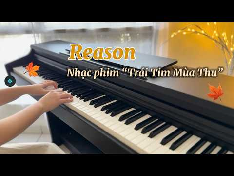
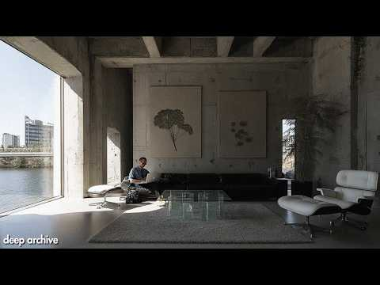

# 음악 — 성공 사례 분석: 사례별 자세히 #1081–#1088

`analysis.md` 의 9번 (같은 # 번호). 자동 생성 — `tools/success_analysis.py` v1.5.1 (2026-10-22 07:59 UTC). ※ 연구·교육용 — 투자 권유가 아님.

### 1081. 주옥같은 7080 명곡모음 🎶 7080 내 생애 가장 아름다운 추억 🎶 광고 없는 7080 좋은노래 37곡 모음

- https://www.youtube.com/watch?v=VAQ3RjZh_9w · Enjoy life · 구독자 10,400 · 조회수 38,624 (×3.7, 하루 480.1) · 좋아요 620 (1.6%) · 16.8분 · 2026-08-02 · 주제 묶음 9. 가요·발라드·트로트 · 형식 플레이리스트·모음 (여러 곡) · 폴더 `W_VAQ3RjZh_9w` (웹 승인)
- 썸네일: 
- 설명 앞부분: 01. 그대 그리고 나 02. 님은 먼 곳에 03. 나 같은 건 없는 건가요 04. 내 하나의 사람은 가고 05. 인연 06. 아득히 먼곳 07. 너를 사랑하고도 전유나 08. 빗속을 둘이서 09. 그날 - 김연숙 10. 존재의 이유 11. 숙녀에게 12. 겨울비는 내리고 13. 아직도 못다한 사랑 14. 사랑 15. 슬픈계절에 만나요 🎶 **주옥같은 7080 명곡 모음** 🌿 내 생애 가장 아름다운 순간들을 떠올리게 하는 **7080 추억의 명곡 37곡**을 만나보세요. 세월이 흘러도 변하지 않는 아름다운 멜로디와 가슴 깊이 남…
- 같은 채널 평소 대비 ×299.4 (채널 최근 롱폼 중앙값 129회) · 평소 영상: 마지막 기차가 떠난 밤 (137회) / 편지 없는 우체국 (121회)
- 대본 없음 (설명) — 음성인식이 끝나면 도입부·흐름이 들어감
- 댓글 9/10: 좋은 점 — 영상 0 · 감사·응원 2 · 더 알고 싶은 것 0 · 아쉬운 점 — 영상 0 · 반박·불만 — 의견 다름 0 · 정치·사회 0 · 경험 공유 0 · 구독·다음 기대 0
  - 감사·응원 👍1 “정말 좋은 노래들 들려 주셔서 감사합니다”
  - 감사·응원 👍0 “좋은 노래 들려주셔서 감사합니다.”

### 1082. SABILULUNGAN Version 2🌿 Sunda Instrumental Reggae Chill ∣ Relaxing Music for Work ∣ BASS_…

- https://www.youtube.com/watch?v=xtm29OfGf7w · BASS_DRUM · 구독자 16,700 · 조회수 61,097 (×3.7, 하루 426.5) · 좋아요 305 (0.5%) · 4.6분 · 2026-06-01 · 주제 묶음 6. 피아노·클래식·연주곡 · 형식 음악 (그 밖 모양 — 한 편짜리 BGM 등) · 폴더 `W_xtm29OfGf7w` (웹 승인)
- 썸네일: 
- 설명 앞부분: Nikmati nuansa damai khas tanah Sunda dalam SABILULUNGAN – Bass_Drum Version 2. Perpaduan instrumen tradisional Sunda dengan sentuhan reggae chill modern menghadirkan suasana hangat, tenang, dan penuh energi positif. Musik instrumental ini cocok untuk: ✨ Fokus bekerja ✨ Belajar & membaca ✨ Temani n…
- 같은 채널 평소 대비 ×23.2 (채널 최근 롱폼 중앙값 2,636회) · 평소 영상: SESAH HILAPNA - Hetty Koes Endang ∣ Sunda Reggae … (2,636회) / TONG JAJAN BAE – Nova Mardiana ∣ Sunda Reggae Chi… (2,290회)
- 대본 없음 (설명) — 음성인식이 끝나면 도입부·흐름이 들어감
- 댓글 14/14: 좋은 점 — 영상 0 · 감사·응원 0 · 더 알고 싶은 것 0 · 아쉬운 점 — 영상 0 · 반박·불만 — 의견 다름 0 · 정치·사회 0 · 경험 공유 0 · 구독·다음 기대 0

### 1083. Mashup Không buông x Tìm em (Hngle) ∣ Alice Piano cover x Synthesia

- https://www.youtube.com/watch?v=Myx39SJ5uQs · Alice Piano · 구독자 20,400 · 조회수 74,090 (×3.6, 하루 762.0) · 좋아요 479 (0.7%) · 8분 · 2026-07-17 · 주제 묶음 6. 피아노·클래식·연주곡 · 형식 커버·직접 부른 노래 · 폴더 `W_Myx39SJ5uQs` (웹 승인)
- 썸네일: 
- 설명 앞부분: Chào mừng bạn đến với kênh Alice Piano – nơi chia sẻ piano cho người tự học và nghe thư giãn. Kênh gồm: Piano Cover các bài nhạc hay (C-Pop, V-Pop, nhạc phim…) và playlist nhạc thư giãn Hướng dẫn (tutorial) piano dễ học Sheet nhạc hỗ trợ luyện tập Giúp bạn giữ cảm hứng học piano và tiến bộ hơn mỗi …
- 같은 채널 평소 대비 ×19.2 (채널 최근 롱폼 중앙값 3,866회) · 평소 영상: Suýt nữa thì (Andiez) ∣ Alice Piano cover x S… (4,054회) / Thu Đợi (Wren Evans) ∣ Alice Piano cover x Synt… (3,677회)
- 대본 없음 (설명) — 음성인식이 끝나면 도입부·흐름이 들어감
- 댓글 24/24: 좋은 점 — 영상 0 · 감사·응원 0 · 더 알고 싶은 것 0 · 아쉬운 점 — 영상 0 · 반박·불만 — 의견 다름 0 · 정치·사회 0 · 경험 공유 0 · 구독·다음 기대 0

### 1084. 송골매 - 세상만사 (스토리 뮤직) / 8090명곡/ 감성음악

- https://www.youtube.com/watch?v=2AfpfnGCaw4 · 스토리 뮤직  ( Story Music ) · 구독자 6,910 · 조회수 24,512 (×3.5, 하루 145.5) · 좋아요 126 (0.5%) · 4.7분 · 2026-05-06 · 주제 묶음 9. 가요·발라드·트로트 · 형식 음악 (그 밖 모양 — 한 편짜리 BGM 등) · 폴더 `W_2AfpfnGCaw4` (웹 승인)
- 썸네일: 
- 설명 앞부분: 송골매 - 세상만사 (스토리 뮤직) / 8090명곡/ 감성음악 세상 모든 일들이 되다가도 안되고 슬퍼하다 웃다가 하늘보면 둥근해 이 한세상 산다는거 생각하기 달렸는데 무얼그리 안타깝게 고개숙여 앉아있소 세상만사 모든일이 뜻대로야 되겠소만 그런대로 한 세상 이러구러 살아가오 길가다가 땅을보면 반짝이는 동전한잎 날찾는 것 같아서 돌아보다 넘어지고 재수란게 그런거지 있다가사도 없는거지 세상살이 모든 것이 다 그런거 아니오 인간세상 이런저런 할얘기도 많다지만 어느세월 그 많은 말 하고 듣고 보내겠소 내가 지닌 얘기들을 내스스로 엮는다면 …
- 같은 채널 평소 대비 ×24.9 (채널 최근 롱폼 중앙값 986회) · 평소 영상: 나미 - 빙글빙글 (1984) ∣ DJ칼잡이 Remix Feat. 예지 ∣ 8090 추억… (986회) / 조관우 - 님은 먼곳에​ (Feat 강호) ∣ DJ칼잡이 Remix ∣ 스토리 뮤직 🌅저… (908회)
- 대본 없음 (설명) — 음성인식이 끝나면 도입부·흐름이 들어감
- 댓글 6/6: 좋은 점 — 영상 0 · 감사·응원 0 · 더 알고 싶은 것 0 · 아쉬운 점 — 영상 0 · 반박·불만 — 의견 다름 0 · 정치·사회 0 · 경험 공유 0 · 구독·다음 기대 0

### 1085. Reason (OST Trái tim mùa thu ) ∣ Alice Piano cover x Synthesia

- https://www.youtube.com/watch?v=htWfvXUplM4 · Alice Piano · 구독자 20,400 · 조회수 72,261 (×3.5, 하루 857.9) · 좋아요 86 (0.1%) · 10.8분 · 2026-07-30 · 주제 묶음 6. 피아노·클래식·연주곡 · 형식 커버·직접 부른 노래 · 폴더 `W_htWfvXUplM4` (웹 승인)
- 썸네일: 
- 설명 앞부분: Chào mừng bạn đến với kênh Alice Piano – nơi chia sẻ piano cho người tự học và nghe thư giãn. Kênh gồm: Piano Cover các bài nhạc hay (C-Pop, V-Pop, nhạc phim…) và playlist nhạc thư giãn Hướng dẫn (tutorial) piano dễ học Sheet nhạc hỗ trợ luyện tập Giúp bạn giữ cảm hứng học piano và tiến bộ hơn mỗi …
- 같은 채널 평소 대비 ×18.7 (채널 최근 롱폼 중앙값 3,866회) · 평소 영상: Suýt nữa thì (Andiez) ∣ Alice Piano cover x S… (4,054회) / Thu Đợi (Wren Evans) ∣ Alice Piano cover x Synt… (3,677회)
- 대본 없음 (설명) — 음성인식이 끝나면 도입부·흐름이 들어감
- 댓글 10/10: 좋은 점 — 영상 0 · 감사·응원 0 · 더 알고 싶은 것 0 · 아쉬운 점 — 영상 0 · 반박·불만 — 의견 다름 0 · 정치·사회 0 · 경험 공유 0 · 구독·다음 기대 0

### 1086. minimalist deep house for elevated concentration

- https://www.youtube.com/watch?v=SSCthKXaAZQ · deep archive · 구독자 25,200 · 조회수 87,524 (×3.5, 하루 629.9) · 좋아요 1,066 (1.2%) · 148.2분 · 2026-06-05 · 주제 묶음 2. 자연 소리·백색소음 · 형식 음악 (그 밖 모양 — 한 편짜리 BGM 등) · 폴더 `W_SSCthKXaAZQ` (웹 승인)
- 썸네일: 
- 챕터: 0:00 All I Need · 3:37 Remember · 7:21 Down Line · 12:15 Focus · 15:48 Under Water · 19:32 No Sleep · 24:05 Hold Me · 27:59 Wait For You · 32:01 Say Something · 37:25 Alone With You · 40:33 Mirage · 44:30 Take Me Higher · 47:49 Endless · 51:14 Runaway · 54:36 Talk Dynamic · 58:38 Midnight Hour · 62:06 deep archive
- 설명 앞부분: Immerse yourself in a refined blend of deep house music meticulously mixed to help you lock in, eliminate distractions, and achieve your peak state of focus. Perfectly tailored for deep work, coding, studying, or late-night productivity, these steady rhythms and hypnotic basslines are designed to k…
- 같은 채널 평소 대비 ×8.8 (채널 최근 롱폼 중앙값 9,945회) · 평소 영상: trigger deep insight. [deep house mix] // archive… (9,945회) / low cortisol deep house for overthinkers (9,967회)
- 대본 없음 (설명) — 음성인식이 끝나면 도입부·흐름이 들어감
- 댓글 16/16: 좋은 점 — 영상 0 · 감사·응원 0 · 더 알고 싶은 것 0 · 아쉬운 점 — 영상 0 · 반박·불만 — 의견 다름 0 · 정치·사회 0 · 경험 공유 0 · 구독·다음 기대 0

### 1087. 우연히 들었는데 이 노래 ... 정말 너무 좋다 ∣ 7080 추억의 올드 팝송 모음 Old Pop Song Playlist

- https://www.youtube.com/watch?v=0H6Hqq-H7Y4 · theoldpopsong · 구독자 40,800 · 조회수 133,732 (×3.3, 하루 1,101.4) · 좋아요 1,390 (1.0%) · 84분 · 2026-06-22 · 주제 묶음 10. 팝송·K팝·J팝 · 형식 플레이리스트·모음 (여러 곡) · 폴더 `W_0H6Hqq-H7Y4` (웹 승인)
- 썸네일: 
- 챕터: 0:00 Morning Always Comes — 아무리 긴 … · 2:57 Cry on My Shoulder — 힘들다면 내 어… · 5:44 I'm Here With You — 언제나 당신 곁에… · 8:27 A Comforting Friend — 지친 마음을 … · 11:12 You're Trying Your Best — 보이지… · 14:12 Take My Hand — 흔들리는 순간에도 내 손을… · 17:19 You're Doing So Well — 지금까지 정… · 20:15 Never Alone — 당신은 결코 혼자가 아니에요 · 22:50 Rest for a While — 잠시 모든 걱정을 … · 25:27 Sleep Safely Tonight — 오늘 밤만큼…
- 설명 앞부분: 마음을 따뜻하게 안아 주는 응원의 마음이 담긴 70·80년대 올드팝 스타일의 곡들을 모았습니다. 오래된 멜로디와 부드러운 음색이 어우러져 지친 하루의 마음을 천천히 쉬어가게 해 주고, 따뜻한 말 한마디처럼 에너지를 채워주는 음악들입니다. 창가에 앉아 밤하늘을 바라보듯, 따뜻한 차 한 잔과 함께 듣기 좋은 노래들. 익숙한 선율과 부드러운 보컬이 공간을 채우며 포근하고 편안한 분위기를 만들어 줍니다. 이 플레이리스트에는 아무리 긴 밤이어도 다시 찾아오는 아침의 희망, 흔들리는 순간 곁을 지켜 주는 다정한 마음, 그리고 지친 하루를 조…
- 같은 채널 평소 대비 ×8.1 (채널 최근 롱폼 중앙값 16,580회) · 평소 영상: 9월, 가을 파리의 카페 감성 ... 너무 좋다 ∣ 7080 추억의 올드 팝송 모음 Ol… (16,671회) / 10월의 시작과 함께 듣기 좋은 가을 팝송 ... 너무 좋다 ∣ 7080 추억의 올드 팝… (16,490회)
- 대본 없음 (설명) — 음성인식이 끝나면 도입부·흐름이 들어감
- 댓글 109/109: 좋은 점 — 영상 2 · 감사·응원 16 · 더 알고 싶은 것 2 · 아쉬운 점 — 영상 1 · 반박·불만 — 의견 다름 1 · 정치·사회 0 · 경험 공유 2 · 구독·다음 기대 1
  - 좋은 점 — 영상 👍3 “노래제목 알고 들으니까~~~더더욱 맘에 와닿고 좋네요 ❤❤❤❤❤❤❤❤❤❤감사합니다 ~~힐링하게 해주셔서^^❤❤❤❤❤❤❤❤❤❤사랑입니다”
  - 감사·응원 👍42 “전 70대 미국사는 노인네입니다 얼마전부터 듣기 시작했는데 넘 ~~~ 즇아서 밤마다 듣고 힐링하고 있어요 넘 감사드려요❤❤😂😂😂”
  - 감사·응원 👍13 “한번 빠지면 헤어 나올수 없는ㅠㅠ 이제야 알았는지 아쉽네요 맘을 넘 평온하게 해주고 삶이 힘들때 들으면 너무 힐링이 돼네요 좋은 음악감사해요”
  - 더 알고 싶은 것 👍1 “이젠 음악도 ai가 점령한거 같아요... 더 좋아요... 이렇게 인간의 목소리 보다 AI에 더 친숙해지고 좋아지는 시대가 왔네요...만화, 짧은 영화도 나오던데.. 정말 기술발전속에 감탄을 합니다. 앞으로도 좋은 음악 부탁드려요.,”
  - 더 알고 싶은 것 👍1 “이런 곡을 듣고 있으면 오래된 음악감상실 한쪽 자리에 앉아 있는 기분이 듭니다. 저도 그 시절 분위기를 떠올리며 음악을 만들고 있는데 요즘에는 이런 감성을 좋아하는 분들이 얼마나 계실지 궁금합니다.”
  - 아쉬운 점 — 영상 👍13 “한번 빠지면 헤어 나올수 없는ㅠㅠ 이제야 알았는지 아쉽네요 맘을 넘 평온하게 해주고 삶이 힘들때 들으면 너무 힐링이 돼네요 좋은 음악감사해요”
  - 경험 공유 👍1 “이런 곡을 듣고 있으면 오래된 음악감상실 한쪽 자리에 앉아 있는 기분이 듭니다. 저도 그 시절 분위기를 떠올리며 음악을 만들고 있는데 요즘에는 이런 감성을 좋아하는 분들이 얼마나 계실지 궁금합니다.”
  - 구독·다음 기대 👍1 “구독했구요 듣고있으니 마음이 편해지네요”

### 1088. 출근길 텐션 끌어올릴 때 듣는 노래 ∣ 국악퓨전 노동요 ∣ 달려

- https://www.youtube.com/watch?v=L_l_mIXqCOc · 저승팝 - 묘령강림 · 구독자 9,460 · 조회수 30,811 (×3.3, 하루 201.5) · 좋아요 518 (1.7%) · 4.9분 · 2026-05-22 · 주제 묶음 3. 공부·집중·작업 · 형식 플레이리스트·모음 (여러 곡) · 폴더 `W_L_l_mIXqCOc` (웹 승인)
- 썸네일: 
- 설명 앞부분: 속도감 있는 국악퓨전 댄스락과 강한 비트감을 결합한 묘령 4집 《질주》의 세 번째 트랙. 〈달려〉는 빠르게 치고 나가는 랩, 국악의 박자감, 차가운 야간 질주감을 중심으로 만든 국악퓨전 노래입니다. 출근길, 운동할 때, 작업 중 텐션을 올리고 싶을 때 듣기 좋은 신나는 노래입니다. 운전시 청취 주의 문이 열린 뒤에는, 느린 것부터 밤의 뒤편으로 밀려난다. 묘령 4집 《질주》 Track 3. 달려 (Run) 저승팝 - 묘령강림 MYORYEONG: THE ADVENT 👻 묘령강림 음악은 개인 창작 영상에 사용하셔도 됩니다. 단, 음악…
- 같은 채널 평소 대비 ×13.2 (채널 최근 롱폼 중앙값 2,327회) · 평소 영상: 수십 갈래 장단이 한꺼번에 들이닥친다 ∣ 퓨전국악 ‘난맥’ (2,327회) / 무너지지 않은 게 아니라, 무너져도 다시 가는 것 ∣ 다크팝 ∣ 그래도 산다 (2,228회)
- 대본 없음 (설명) — 음성인식이 끝나면 도입부·흐름이 들어감
- 댓글 52/52: 좋은 점 — 영상 0 · 감사·응원 0 · 더 알고 싶은 것 0 · 아쉬운 점 — 영상 0 · 반박·불만 — 의견 다름 0 · 정치·사회 0 · 경험 공유 0 · 구독·다음 기대 0

