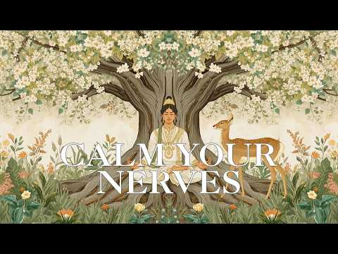

# 음악 — 성공 사례 분석: 사례별 자세히 #1081–#1120

`analysis.md` 의 9번 (같은 # 번호). 자동 생성 — `tools/success_analysis.py` v1.4.1 (2026-10-18 08:09 UTC). ※ 연구·교육용 — 투자 권유가 아님.

### 1081. ㉖대한민국 정통 트로트 60선 (Korean Trot 60) ∣ 전설의 거장들이 빚어낸 정통 명곡 메들리 #트로트 #정통트로트 #trot #kpop #은채린

- https://www.youtube.com/watch?v=75u_o8j9V0s · 트로트의 맛! · 구독자 39,600 · 조회수 325,082 (×8.2, 하루 1,990.7) · 좋아요 3,555 (1.1%) · 188.5분 · 2026-05-08 · 주제 묶음 10. 팝송·K팝·J팝 · 형식 플레이리스트·모음 (여러 곡) · 폴더 `W_75u_o8j9V0s` (웹 승인)
- 썸네일: 
- 챕터: 0:00 1사랑이비를맞아요(배금성) · 3:18 2초가삼간(최정자) · 6:26 3미워하지않으리(정원) · 9:44 4사나이맹세(이광희) · 13:19 5동숙의노래(문주란) · 17:00 6연모(박우철) · 20:14 7갈대의순정(박일남) · 23:21 8비내리는명동거리(배호) · 26:56 9안개낀장충단공원(배호) · 30:17 10남자의눈물(현철) · 33:46 11인생(모정애) · 37:10 12우중의여인(오기택) · 40:25 13내마음별과같이(현철) · 43:21 14잊을수가있을까(나훈아) · 46:38 15봉선화연정(현철) · 49:40 16찔레꽃(백난아) · 52:34 17들국화여인(현철) · 55:26 18영시의이별(배호) · 58:25 19보고싶은여인(현철) · 61:22 20나그네설움(백년설)
- 설명 앞부분: 대한민국 가요계의 역사를 만들어온 전설의 거장들이 빚어낸 불후의 정통 명곡 60곡을 엄선했습니다. 배호, 남진, 나훈아, 이미자, 주현미, 현철 등 이름만 들어도 가슴 설레는 위대한 가수들의 목소리로 기억되는 이 노래들은, 거친 세월의 풍파를 묵묵히 견뎌오신 우리 아버님들의 인생 그 자체입니다. 타향살이의 설움과 쓰라린 이별의 아픔, 그리고 그리운 고향에 대한 향수까지... 삶의 모든 희노애락이 녹아있는 이 60곡의 영원한 명곡들을 은채린의 깊은 감성으로 온 마음을 담아 엮었습니다. 고단한 하루 끝에 홀로 술잔을 기울이거나, 문득…
- 대본 없음 (설명) — 음성인식이 끝나면 도입부·흐름이 들어감
- 댓글 174/174: 좋은 점 — 영상 2 · 감사·응원 21 · 더 알고 싶은 것 0 · 아쉬운 점 — 영상 2 · 반박·불만 — 의견 다름 0 · 정치·사회 0 · 경험 공유 3 · 구독·다음 기대 0
  - 좋은 점 — 영상 👍2 “목소리좋고맛깔스럽게타고난질리지음성은체린앞으로흘러간노래계속들려주세요”
  - 좋은 점 — 영상 👍1 “반주와노래가 요란하거시끄럽지않고 차분해서 듣기좋네요”
  - 감사·응원 👍11 “요즘 ㅡ 나리짱님 ㅡ 은 채린 가수분 ㅡ 때문에 강남구에서 귀촌한후 요즘 텃밭에 모종심으며 이 음악을 틀어놓으면 세상에 더할나위없는 나의 행복 내세상이지요 감사합니다 ㅡ”
  - 감사·응원 👍10 “감미로운목소리들려주시니감사해요! 건강하시고복많이받으시고좋은일많이있으시길빕니다”
  - 아쉬운 점 — 영상 👍2 “광고가너무많어”
  - 아쉬운 점 — 영상 👍1 “채린아씨,애련하고맑고고운아씨,노래가,그리워찾아왔읍니다,언제들어도지루하지않고,명랑한노래가사람,마음을잡아들입니다,노래들으면항상,마음이편해지고,세상이달리보입니다,그만큼노래가편하고,친근감이있네요,아씨가슴속에서풍겨나오는,전설의근원이아닐까요,하늘이내린신의소리,그자체입니다,아씨,…”
  - 경험 공유 👍5 “흐흐… 이정표 없는 거리까지 광고 피해가면서 3시간 좀 넘게 다 들었어요 눈과 귀에서 피가 나올것 같지만 제가 머리가 나빠서 그런지 며칠전에 개별로 들었었는데 또 새롭네요 ㅎㅎ오늘 밤 채린이가 꿈에 나올 것 같아요😂”
  - 경험 공유 👍3 “72세요.내가좋아하는.노래다.들을수있어서.넘.넘행복합니다.항시건강하시고.더많은.노래들려주세요”

### 1082. 10. 그리스 이타카, 무화과맛 재즈 ∣ playlist

- https://www.youtube.com/watch?v=Nxeex1L0sYU · dansoonhee · 구독자 16,300 · 조회수 132,896 (×8.2, 하루 1,785.7) · 좋아요 2,058 (1.6%) · 280.3분 · 2026-08-04 · 주제 묶음 7. 재즈·보사노바 · 형식 플레이리스트·모음 (여러 곡) · 폴더 `W_Nxeex1L0sYU` (웹 승인)
- 썸네일: 
- 챕터: 0:00 Fig on the Terrace · 0:27 Aegean Breeze · 1:39 Sunlight on the Figs · 2:34 Summer Figs · 5:17 Blue Shutters · 7:41 fig in Attica · 8:43 Fresh from the Tree · 9:44 Linen in the Wind · 10:28 Sunlit Fig · 13:12 Quiet Coastline · 16:01 Fig Season · 17:10 White Walls, Blue Water · 17:44 A Little Greek Summer · 19:51 Morning in Attica · 20:49 Sweet Mediterranean Air · 23:27 Figs on a White Plate · 24:19 Toward the Sea · 26:03 Under the Fig Tree · 29:11 Clear Summer Light · 31:10 The Breeze Between Us
- 설명 앞부분: 꽃이 없는 과일인 줄 알았던 무화과는 사실 그 안에 수많은 작은 꽃을 품고 있다고 해요. 보이지 않는 곳에서도 조용히 피어나고 있는 마음들처럼. 그리스 신화 속에도 등장한 무화과와 산토리니의 따뜻한 햇살, 잘 익은 과육의 은은한 단맛을 담았습니다. 오늘도 천천히 머물다 가세요. Always, Peace. ♡ Time Track 단순히의 음악을 발견해 주시고, 기꺼이 머물러 주셔서 진심으로 감사합니다. 🤍 혼자 작업하는 시간이 많아, 오래 들어도 편안하고 집중하기 좋은 음악을 만들고 싶다는 마음으로 이 채널을 시작했습니다. 음악을 …
- 대본 없음 (설명) — 음성인식이 끝나면 도입부·흐름이 들어감
- 댓글 0/74 (다 받지 못함): 좋은 점 — 영상 0 · 감사·응원 0 · 더 알고 싶은 것 0 · 아쉬운 점 — 영상 0 · 반박·불만 — 의견 다름 0 · 정치·사회 0 · 경험 공유 0 · 구독·다음 기대 0

### 1083. In der Walpurgisnacht brennt mein altes Ich #walpurgisnacht #healingmusic #vikingmusic

- https://www.youtube.com/watch?v=jugVBYVn8ag · VikingHealing · 구독자 2,610 · 조회수 21,150 (×8.1, 하루 123.4) · 좋아요 287 (1.4%) · 4.6분 · 2026-04-29 · 주제 묶음 1. 수면·명상·힐링 · 형식 음악 (그 밖 모양 — 한 편짜리 BGM 등) · 폴더 `W_jugVBYVn8ag` (웹 승인)
- 썸네일: 
- 설명 앞부분: In der Walpurgisnacht brennt mein altes Ich… und aus der Asche werd ich neu. Text: Sandra Linke, Musik und Stimme: Suno (KI) Text: Die Nacht ist tief, doch ich fürcht sie nicht, ich trag ihre Schatten in meinem Licht. Was ich verborgen, was ich verdrängt, wird heute im Feuer beim Namen genannt. Die…
- 대본 없음 (설명) — 음성인식이 끝나면 도입부·흐름이 들어감
- 댓글 0/12 (다 받지 못함): 좋은 점 — 영상 0 · 감사·응원 0 · 더 알고 싶은 것 0 · 아쉬운 점 — 영상 0 · 반박·불만 — 의견 다름 0 · 정치·사회 0 · 경험 공유 0 · 구독·다음 기대 0

### 1084. This Will Reset Your Nervous System in Minutes ∣ Deep Indian Healing Music (Bansuri & Sit…

- https://www.youtube.com/watch?v=5YnCFwtGK28 · Sacred Mind Healing · 구독자 8,290 · 조회수 66,999 (×8.1, 하루 381.1) · 좋아요 898 (1.3%) · 36.6분 · 2026-04-25 · 주제 묶음 1. 수면·명상·힐링 · 형식 음악 (그 밖 모양 — 한 편짜리 BGM 등) · 폴더 `W_5YnCFwtGK28` (웹 승인)
- 썸네일: 
- 설명 앞부분: Are you feeling overwhelmed, anxious, or mentally exhausted? This Indian classical meditation music is designed to gently reset your nervous system, helping your body return to a state of calm and balance. Featuring soothing sounds of bansuri flute, sitar, and tanpura drone, this music creates a de…
- 대본 없음 (설명) — 음성인식이 끝나면 도입부·흐름이 들어감
- 댓글 0/40 (다 받지 못함): 좋은 점 — 영상 0 · 감사·응원 0 · 더 알고 싶은 것 0 · 아쉬운 점 — 영상 0 · 반박·불만 — 의견 다름 0 · 정치·사회 0 · 경험 공유 0 · 구독·다음 기대 0

### 1085. Om Namah Shivaya Chanting ∣ Divine Shiva Meditation Music for Mind Relaxation

- https://www.youtube.com/watch?v=UsiJNIk0F88 · Echoes of Shiva · 구독자 1,620 · 조회수 13,056 (×8.1, 하루 74.3) · 좋아요 159 (1.2%) · 7.3분 · 2026-04-25 · 주제 묶음 1. 수면·명상·힐링 · 형식 음악 (그 밖 모양 — 한 편짜리 BGM 등) · 폴더 `W_UsiJNIk0F88` (웹 승인)
- 썸네일: 
- 설명 앞부분: Experience deep inner peace with this calming ॐ नमः शिवाय (Om Namah Shivaya) meditation chanting music. This sacred Shiva mantra is known to purify the mind, reduce stress, and connect you to higher consciousness. Let the soothing blend of soft ambient sounds, gentle chanting, and divine vibrations…
- 대본 없음 (설명) — 음성인식이 끝나면 도입부·흐름이 들어감
- 댓글 0/15 (다 받지 못함): 좋은 점 — 영상 0 · 감사·응원 0 · 더 알고 싶은 것 0 · 아쉬운 점 — 영상 0 · 반박·불만 — 의견 다름 0 · 정치·사회 0 · 경험 공유 0 · 구독·다음 기대 0

### 1086. 위로와 평안의 찬송 ∣ 지친 당신을 위한 깊은 위로의 찬송가 10곡 (1만 구독자 기념 플레이리스트)ㅣ위로와 평안의 찬송가 45분 ㅣ놀라운 평안ㅣ예수님생각

- https://www.youtube.com/watch?v=bUyzotGJlfs · Worship Channel 예수님생각 [Thinking of Jesus] · 구독자 21,300 · 조회수 171,311 (×8.0, 하루 963.5) · 좋아요 2,286 (1.3%) · 45.6분 · 2026-04-23 · 주제 묶음 15. CCM·찬양·국악·동요 · 형식 플레이리스트·모음 (여러 곡) · 폴더 `W_bUyzotGJlfs` (웹 승인)
- 썸네일: 
- 챕터: 0:00 410장 내 맘에 한 노래 있어 · 4:49 411장 아 내 맘속에 · 9:25 412장 내 영혼의 그윽히 깊은 데서 · 14:49 414장 이 세상은 요란하나 · 19:34 413장 내 평생에 가는 길 · 24:25 415장 십자가 그늘 아래 · 28:05 406장 곤한 내 영혼 편히 쉴 곳과 · 32:47 405장 주의 친절한 팔에 안기세 · 35:44 417장 주 예수 넓은 품에 · 40:00 418장 주 날개 밑 내가 편안히 쉬네
- 설명 앞부분: 마음 편안해지는 찬송가 10곡 ∣ 새찬송가 405~419장 ∣ 위로와 평안 45분 플레이리스트 "여호와는 나의 목자시니 내게 부족함이 없으리로다" (시편 23:1) 안녕하세요, "예수님생각" 채널입니다. 어느덧 이 채널이 1만 명의 소중한 동역자분들과 함께하게 되었습니다. 가장 먼저 우리 하나님께 영광과 찬송올 올려드립니다. 그리고, 사순절 이후 정체된 시간 속에서도 묵묵히 자리를 지켜주신 여러분께 진심으로 감사드립니다. 감사의 마음을 담아, 그간 가장 많은 위로를 전해드렸던 '평안과 위로'의 찬송가 10곡을 엮었습니다. 45분간…
- 같은 채널 평소 대비 ×94.0 (채널 최근 롱폼 중앙값 1,822회) · 평소 영상: 주와함께 빛길이라 ∣ 험한 세상 나그네길, 주님 손 잡으셨네 🌊✨ [복음성가] 예수님생각… (1,931회) / 나의 반석 나의 방패 ∣ 새찬송가 402장 ∣ 은혜로운 찬송가 1시간 듣기 ∣ 기도와 묵… (1,712회)
- 대본 없음 (설명) — 음성인식이 끝나면 도입부·흐름이 들어감
- 댓글 149/149: 좋은 점 — 영상 3 · 감사·응원 38 · 더 알고 싶은 것 1 · 아쉬운 점 — 영상 2 · 반박·불만 — 의견 다름 0 · 정치·사회 0 · 경험 공유 3 · 구독·다음 기대 0
  - 좋은 점 — 영상 👍1 “목소리가 편합니다.❤😂”
  - 감사·응원 👍76 “찬송속에 평안있고. 찬송에 말씀이 살아 숨쉬고 찬송속에 기도의문이 열리고 찬송속에 하나님의 임재하심에 감사하며 영광 돌려 드리네요 아멘”
  - 감사·응원 👍24 “할렐루야 아멘!!💗 주님을 기쁘게 하는 하루되게 하옵소서!! 감사합니다!!”
  - 더 알고 싶은 것 👍16 “축하드립니다!! 계속 은혜로운 찬양 부탁합니다^*^”
  - 아쉬운 점 — 영상 👍9 “할렐루야 영감있는 찬양 음색 편곡 창벞 너무 훌륭한 찬양 반복해서 듣고 힘이 납니다 감사합니다”
  - 경험 공유 👍7 “실제음성과 찬양음성이 조금달라요 어느것이 AI인지 헷갈려요 제가 그동안 받았던 은혜가AI가 아니길 ...바라면서”
  - 경험 공유 👍6 “곳곳을 비춰주든 벚꽃이 또 내년을 기약하며 살포시 떠났습니다. 세월이 쌓일수록 하나님의 작품들이 너무 황홀하여 말로 표현키 어렵습니다. 하지만 예수님생각님의 목소리와 한 단어 한 단어가 내가 표현할 수 없는 세밀함을 노래로 표해줍니다. 그래서 듣지않을 수가 없습니다.…”

### 1087. 🎵Do You Hear Me… — A Story of Love & Loss ∣ Full Emotional Album 2026 (1 Hour Piano Music)

- https://www.youtube.com/watch?v=BwNZ573NSVs · HeartEcho AI Music · 구독자 29,500 · 조회수 236,099 (×8.0, 하루 1,374.2) · 좋아요 2,891 (1.2%) · 57.9분 · 2026-04-29 · 주제 묶음 6. 피아노·클래식·연주곡 · 형식 AI 음악 · 폴더 `W_BwNZ573NSVs` (웹 승인)
- 썸네일: 
- 챕터: 0:00 Do You Hear Me Still? · 4:30 Do You Hear Me Again? · 9:00 Do You Hear Me When I Cry? · 13:40 Do You Hear Me At All? · 18:20 Do You Hear Me Anymore? · 23:00 Do You Hear Me From Heaven? · 27:40 Do You Hear Me In The Silence? · 32:20 Do You Hear Me In The Dark? · 37:00 Do You Hear Me Fade Away? · 41:40 Do You Hear Me One Last Time? · 46:30 Do You Hear Me… Or Are You Go… · 51:10 Do You Hear Me… Now?
- 설명 앞부분: Do You Hear Me… — Full Emotional Album A 1-hour journey through love, loss, loneliness, and letting go. This is not just music… This is a story. 💔 From calling someone who never answers… 🌑 To losing yourself in silence… 💀 To fading away… 💥 To one final call… 🕊 And finally learning how to let go. 🎧 …
- 대본 없음 (설명) — 음성인식이 끝나면 도입부·흐름이 들어감
- 댓글 0/364 (다 받지 못함): 좋은 점 — 영상 0 · 감사·응원 0 · 더 알고 싶은 것 0 · 아쉬운 점 — 영상 0 · 반박·불만 — 의견 다름 0 · 정치·사회 0 · 경험 공유 0 · 구독·다음 기대 0

### 1088. 432 Hz Reiki Music for Healing and Cleansing Negativity - 20 min

- https://www.youtube.com/watch?v=auzLrS12AUo · Reiki Healing Japan 365 · 구독자 20,000 · 조회수 159,611 (×8.0, 하루 1,440.8) · 좋아요 748 (0.5%) · 20분 · 2026-06-29 · 주제 묶음 1. 수면·명상·힐링 · 형식 음악 (그 밖 모양 — 한 편짜리 BGM 등) · 폴더 `W_auzLrS12AUo` (웹 승인)
- 썸네일: 
- 설명 앞부분: Relax your mind with soothing 432 Hz Reiki healing music. This gentle healing music helps calm the mind, reduce stress, cleanse negative energy, restore positive energy, and create a peaceful atmosphere for meditation, Reiki practice, and mindfulness. 🕯️ Best for: Cleansing negative energy and supp…
- 대본 없음 (설명) — 음성인식이 끝나면 도입부·흐름이 들어감
- 댓글 0/21 (다 받지 못함): 좋은 점 — 영상 0 · 감사·응원 0 · 더 알고 싶은 것 0 · 아쉬운 점 — 영상 0 · 반박·불만 — 의견 다름 0 · 정치·사회 0 · 경험 공유 0 · 구독·다음 기대 0

### 1089. Odysseus ∣ Epic Orchestral Cover ∣ The Odyssey Ludwig Goransson

- https://www.youtube.com/watch?v=Qx1hmx1Fsmc · Jeremy Brauns Music · 구독자 29,300 · 조회수 225,173 (×7.7, 하루 2,488.2) · 좋아요 1,967 (0.9%) · 8.4분 · 2026-07-19 · 주제 묶음 12. 커버·노래 부르기 · 형식 커버·직접 부른 노래 · 폴더 `W_Qx1hmx1Fsmc` (웹 승인)
- 썸네일: 
- 설명 앞부분: My epic orchestral cover of "Odysseus" from Christopher Nolan's The Odyssey, composed by Ludwig Göransson. This started as a simple recreation because I wanted to understand the music and its layers, the more I worked on it, the more I felt like making a video out of it. So here it is, Odysseus + I…
- 대본 없음 (설명) — 음성인식이 끝나면 도입부·흐름이 들어감
- 댓글 0/79 (다 받지 못함): 좋은 점 — 영상 0 · 감사·응원 0 · 더 알고 싶은 것 0 · 아쉬운 점 — 영상 0 · 반박·불만 — 의견 다름 0 · 정치·사회 0 · 경험 공유 0 · 구독·다음 기대 0

### 1090. 우리 행복하자 (Let's Just Be Happy) ∣ 미안하단 말보다 우리 행복하자 ∣ KR/ROM/EN Lyrics

- https://www.youtube.com/watch?v=d0jaFafrkkM · 한그루브 · 구독자 50,000 · 조회수 384,295 (×7.7, 하루 3,494.7) · 좋아요 2,800 (0.7%) · 5.5분 · 2026-06-30 · 주제 묶음 5. 운동·드라이브·신나는 · 형식 플레이리스트·모음 (여러 곡) · 폴더 `W_d0jaFafrkkM` (웹 승인)
- 썸네일: 
- 설명 앞부분: 🎵 이 곡이 포함된 1시간 풀버전 플레이리스트 보기 🌳 우리 행복하자 (U-ri Haeng-bok-ha-ja _ Let's Just Be Happy) 어이하리 어이하리, 이 철없는 마음을. 당신이 준 계절을 나는 거저 얻은 줄 알았네 이제야 보이는 당신의 야윈 그림자. 미안하단 말보다 우리 행복하자, 사랑한단 말 대신 우리 행복하자. 나 하나 키우려 당신은 세상을 견뎠고, 모진 바람은 다 맞으면서내게는 햇살만 줬네. 당신의 주름진 손마디가 내 길을 닦았는데, 고맙다는 말은 왜 이리 목에 걸리는지 내 목소리가 커질수록 당신의 대답은…
- 같은 채널 평소 대비 ×26.2 (채널 최근 롱폼 중앙값 14,681회) · 평소 영상: 웃음값 (The Price of Laughter) ∣ 웃음값은 늦게 오더라 다 잊은 뒤에… (16,139회) / 화양연화 (In the Mood for Love) Official MV ∣ 그때가 꽃인 … (13,223회)
- 대본 없음 (설명) — 음성인식이 끝나면 도입부·흐름이 들어감
- 댓글 319/319: 좋은 점 — 영상 2 · 감사·응원 10 · 더 알고 싶은 것 2 · 아쉬운 점 — 영상 2 · 반박·불만 — 의견 다름 0 · 정치·사회 0 · 경험 공유 1 · 구독·다음 기대 1
  - 좋은 점 — 영상 👍8 “와~ 가사.!!! 와 ~!!음악소리 심장을 뛰게하네요 제가 국악스타일을 좋아해서 그런지 정말 너무너무 멋있어요 한번듣고 귀에 쏙쏙 들어와요 반했어요 가사가 현실 성있는 ....!!! 공감이 가네요 반복해서 듣게 되네요 파이팅입니다 😊😊😊”
  - 좋은 점 — 영상 👍3 “정말 가사가 귀에 쏙쏙 박히네요ㅎㅎ 항상응원합니다~~^^ 근데 가슴에도 쑥쑥 박히네요 한그루브님도 행복하셔요~”
  - 감사·응원 👍20 “내 나이 62 너무나 가슴울리는노래 들어면 들어수록 부모님생각에 눈물만… 미국 타국땅에서 정말좋은노래감사”
  - 감사·응원 👍8 “와~ 가사.!!! 와 ~!!음악소리 심장을 뛰게하네요 제가 국악스타일을 좋아해서 그런지 정말 너무너무 멋있어요 한번듣고 귀에 쏙쏙 들어와요 반했어요 가사가 현실 성있는 ....!!! 공감이 가네요 반복해서 듣게 되네요 파이팅입니다 😊😊😊”
  - 더 알고 싶은 것 👍2 “너무 좋은 노래네요 앞으로도 좋은 부탁드려요”
  - 더 알고 싶은 것 👍1 “이거 남자 버전으로 키낮춰서 만들어 줄수있을 까요? 부탁드립니다. 너무 좋아요”
  - 아쉬운 점 — 영상 👍8 “와~ 가사.!!! 와 ~!!음악소리 심장을 뛰게하네요 제가 국악스타일을 좋아해서 그런지 정말 너무너무 멋있어요 한번듣고 귀에 쏙쏙 들어와요 반했어요 가사가 현실 성있는 ....!!! 공감이 가네요 반복해서 듣게 되네요 파이팅입니다 😊😊😊”
  - 아쉬운 점 — 영상 👍5 “무한반복중입니다! 완전좋아요!!”
  - 경험 공유 👍8 “와~ 가사.!!! 와 ~!!음악소리 심장을 뛰게하네요 제가 국악스타일을 좋아해서 그런지 정말 너무너무 멋있어요 한번듣고 귀에 쏙쏙 들어와요 반했어요 가사가 현실 성있는 ....!!! 공감이 가네요 반복해서 듣게 되네요 파이팅입니다 😊😊😊”
  - 구독·다음 기대 👍1 “구독합니다❤❤❤”

### 1091. 한여름 밤의 꿈

- https://www.youtube.com/watch?v=t87CPyEGmHQ · 오레 ooree · 구독자 18,700 · 조회수 143,806 (×7.7, 하루 1,140.6) · 좋아요 6,178 (4.3%) · 119.7분 · 2026-06-14 · 주제 묶음 기타 · 형식 플레이리스트·모음 (여러 곡) · 폴더 `W_t87CPyEGmHQ` (웹 승인)
- 썸네일: 
- 설명 앞부분: 오레 ooree 계절이 바뀌는 소리 ꩜ 지금 이 모든 소중한 시간을 가슴 한 켠에 새기며 ꩜ Keeping all these precious moments close to my heart 오늘도 오레 ooree의 플레이리스트에 방문해주셔서 감사합니다. 항상 여러분께 힘이 되기를 Thank you for visiting 오레 ooree, May I always be your strength All tracks are licensed by 오레 ooree. 여러분 오레오레 함께 해요! let’s stay together ore ore…
- 같은 채널 평소 대비 ×19.1 (채널 최근 롱폼 중앙값 7,534회) · 평소 영상: 동양화(花) (7,534회) / 그러나. 그래도. 그럼에도. (7,647회)
- 대본 없음 (설명) — 음성인식이 끝나면 도입부·흐름이 들어감
- 댓글 88/88: 좋은 점 — 영상 0 · 감사·응원 23 · 더 알고 싶은 것 0 · 아쉬운 점 — 영상 0 · 반박·불만 — 의견 다름 0 · 정치·사회 0 · 경험 공유 6 · 구독·다음 기대 0
  - 감사·응원 👍399 “시험기간이라 그런지 요즘 영상이 많이 올라오네요 시험 화이팅 하세요”
  - 감사·응원 👍39 “사람들이 올백! 이런거 하면 어차피 안되는데도 말에서 나오는 에너지랑 응원때문에 좋아요 누르게 됨”
  - 경험 공유 👍1,217 “하트누르면 모두들 행복해지고 시험 잘 볼 거임!! 나도 포함”
  - 경험 공유 👍4 “정기고사 5일남았습니다 허허 응원해주세요 저도 응원합니다”

### 1092. Work Music, Deep Focus Music for ADHD Relief and Concentration

- https://www.youtube.com/watch?v=CQ7p1pOOwrA · Greenred Productions - Topic · 구독자 8,540 · 조회수 65,133 (×7.6, 하루 462.2) · 좋아요 347 (0.5%) · 9.8분 · 2026-05-30 · 주제 묶음 3. 공부·집중·작업 · 형식 음악 (그 밖 모양 — 한 편짜리 BGM 등) · 폴더 `W_CQ7p1pOOwrA` (웹 승인)
- 썸네일: 
- 설명 앞부분: Provided to YouTube by DistroKid Work Music, Deep Focus Music for ADHD Relief and Concentration · Greenred Productions · Mantas Savickis Work Music, Deep Focus Music for ADHD Relief and Concentration ℗ Greenred Productions Released on: 2026-05-31 Auto-generated by YouTube.
- 대본 없음 (설명) — 음성인식이 끝나면 도입부·흐름이 들어감
- 댓글 0/0 (다 받지 못함): 좋은 점 — 영상 0 · 감사·응원 0 · 더 알고 싶은 것 0 · 아쉬운 점 — 영상 0 · 반박·불만 — 의견 다름 0 · 정치·사회 0 · 경험 공유 0 · 구독·다음 기대 0

### 1093. [Fanmade OST] 하루의 끝에서/이안대군 테마 **21세기 대군부인** 감성 발라드

- https://www.youtube.com/watch?v=sf5dMF71cg4 · ycmusic25 · 구독자 13,700 · 조회수 102,078 (×7.5, 하루 622.6) · 좋아요 639 (0.6%) · 4.1분 · 2026-05-07 · 주제 묶음 9. 가요·발라드·트로트 · 형식 AI 음악 · 폴더 `W_sf5dMF71cg4` (웹 승인)
- 썸네일: 
- 설명 앞부분: 현재 방영 중인 드라마 ‘21세기 대군부인’ 속 이안대군의 애틋한 감정선에 영감을 받아 제작한 팬메이드 OST입니다. 하루를 마무리하는 순간마다 떠오르는 한 사람, 지울 수 없는 그리움과 기다림의 감정을 잔잔한 피아노 선율과 함께 담아보았습니다. 이 음악이 드라마 속 감정과 함께 여러분의 하루 끝에도 조용한 여운으로 남기를 바랍니다.
- 같은 채널 평소 대비 ×162.5 (채널 최근 롱폼 중앙값 628회) · 평소 영상: 🎵첫 곡이 좋다 그 다음 곡도 좋다 계속 듣게 되는 음악들...🌇 그리움은 늘 저녁노을을… (786회) / 🎵어느덧 곁으로 다가온 가을, 지금 가장 어울리는 음악과 함께 🍂바람이 조금 달라졌네요,… (470회)
- 대본 없음 (설명) — 음성인식이 끝나면 도입부·흐름이 들어감
- 댓글 79/79: 좋은 점 — 영상 0 · 감사·응원 4 · 더 알고 싶은 것 0 · 아쉬운 점 — 영상 0 · 반박·불만 — 의견 다름 0 · 정치·사회 0 · 경험 공유 0 · 구독·다음 기대 0
  - 감사·응원 👍21 “오늘 건강검진 받는다고 많이 힘든 하루였는데 이영상이 하루의 힘듬을 싸악 사라지게 해주네요 고맙습니다 감사합니다❤❤❤”
  - 감사·응원 👍20 “너무 좋아요 잘들을게요❤❤❤ 아직도 현생 못살고 있지만 그래서 더 힘이되요 롱런 하시길 항상 응원합니다”

### 1094. OUR LADY OF FATIMA HEALING HYMNS ∣ Catholic Prayer Music for Miracles, Peace & Healing

- https://www.youtube.com/watch?v=kL-iJ_qbbms · Marian Morning · 구독자 35,100 · 조회수 261,104 (×7.4, 하루 1,651.7) · 좋아요 2,664 (1.0%) · 183.4분 · 2026-05-13 · 주제 묶음 1. 수면·명상·힐링 · 형식 음악 (그 밖 모양 — 한 편짜리 BGM 등) · 폴더 `W_kL-iJ_qbbms` (웹 승인)
- 썸네일: 
- 챕터: 0:00 Mother of Healing Grace · 9:00 Touch of Divine Mercy · 18:00 Healing Through Your Hands · 27:00 Miracle of Silent Grace · 36:00 Comfort for the Broken Heart · 45:00 Peace Within the Tears · 54:00 Hope for the Weary Soul · 63:00 Restoration of the Heart · 72:00 Mary, Refuge of the Afflicted · 81:00 Light Beyond the Sorrow · 90:00 Mother of Endless Consolation · 99:00 Healing Rain from Heaven · 108:00 Prayer for Inner Peace · 117:00 Songs of Gentle Restoration · 126:00 Whispers of Heavenly Comfort · 135:00 Mother of Peaceful Healing · 144:00 Shelter Beneath Your Mantle · 153:00 Grace for the Wounded Soul · 162:00 Songs Beneath Heaven’s Mercy · 171:00 Calm Waters of Grace
- 설명 앞부분: Experience the peaceful presence of Our Lady of Fatima through this beautiful collection of Catholic Healing Hymns & Marian Prayer Music . Inspired by the apparitions of the Blessed Virgin Mary at Fatima, these sacred hymns are created for: Spiritual healing Prayer and meditation Emotional comfort …
- 대본 없음 (설명) — 음성인식이 끝나면 도입부·흐름이 들어감
- 댓글 0/392 (다 받지 못함): 좋은 점 — 영상 0 · 감사·응원 0 · 더 알고 싶은 것 0 · 아쉬운 점 — 영상 0 · 반박·불만 — 의견 다름 0 · 정치·사회 0 · 경험 공유 0 · 구독·다음 기대 0

### 1095. 🎵 견디고 또 견딘 당신에게 전하는 메시지 ∣ 너의 봄이 온다 - AIIN

- https://www.youtube.com/watch?v=9r7SCZtxgLQ · 박PD 음악다방 · 구독자 9,820 · 조회수 73,007 (×7.4, 하루 537.0) · 좋아요 239 (0.3%) · 5.8분 · 2026-06-04 · 주제 묶음 1. 수면·명상·힐링 · 형식 음악 (그 밖 모양 — 한 편짜리 BGM 등) · 폴더 `W_9r7SCZtxgLQ` (웹 승인)
- 썸네일: 
- 설명 앞부분: 🌸 너의 봄이 온다 🌸 박PD 음악다방에 오신 여러분을 환영합니다. 긴 겨울을 지나, 끝이 보이지 않는 시간들을 견디며 오늘도 살아낸 모든 분들에게 이 노래를 전합니다. 눈물조차 얼어버린 밤, 혼자 버텨야 했던 시간, 아무도 몰래 삼켜야 했던 아픔이 있었더라도 결국 해는 떠오르고, 봄은 찾아옵니다. 〈너의 봄이 온다〉는 힘겨운 시간을 지나고 있는 누군가에게 작은 위로와 희망이 되기를 바라는 마음을 담은 노래입니다. 🎧 Song Title 너의 봄이 온다 🎤 Vocal : AIIN (아인) 🎼 Music : Suno AI ✍️ Ly…
- 같은 채널 평소 대비 ×26.7 (채널 최근 롱폼 중앙값 2,732회) · 평소 영상: 🎵지지마라, 봄날아 ∣ 감성 발라드, 7080, 위로, 봄, 성인가요 ∣ AIIN:아인 (2,959회) / 🎵 하루가 너무 길어 ∣ 아직도 너를 기다리는 밤 ∣ AIIN:아인 (2,505회)
- 대본 없음 (설명) — 음성인식이 끝나면 도입부·흐름이 들어감
- 댓글 48/48: 좋은 점 — 영상 0 · 감사·응원 9 · 더 알고 싶은 것 0 · 아쉬운 점 — 영상 0 · 반박·불만 — 의견 다름 0 · 정치·사회 0 · 경험 공유 1 · 구독·다음 기대 0
  - 감사·응원 👍2 “오늘도 좋은음악 듣을수있게 해주셔서 감사합니다. 행복하세요❤❤❤🎉🎉🎉”
  - 감사·응원 👍1 “이양반은 정말 노래 잘만드시네 ~~ 잘 듣고 있읍니다 부산오시면 톡주세요 소주한잔 대접 하겟읍니다 고맙읍니다~~^^”
  - 경험 공유 👍2 “이야... 진짜 AI 때문에 가수, 작곡가, 작사가 불문 음반관련 업종은 전부 비상인 듯 노래 불러봤자, 노래 작곡해봤자 AI보다 못함... ㅋㅋ 진짜 음반분야는 심각할 듯 ㅋㅋ”

### 1096. 가시리 ∣ 조선힙합(Official Music Video)

- https://www.youtube.com/watch?v=_uYBH28d_ys · 조선힙합 Official · 구독자 28,600 · 조회수 212,227 (×7.4, 하루 1,315.9) · 좋아요 597 (0.3%) · 4.6분 · 2026-05-10 · 주제 묶음 11. 힙합·R&B·EDM · 형식 한 곡 (뮤직비디오·음원·가사) · 폴더 `W__uYBH28d_ys` (웹 승인)
- 썸네일: 
- 설명 앞부분: 달빛이 내려앉은 조선의 밤. 떠나는 이를 붙잡지 못한 마음을 국악과 힙합의 감성으로 담았습니다. 전통의 한(恨)과 현대의 감성을 섞어 ‘가시리’라는 오래된 이별의 정서를 조선힙합 스타일로 다시 노래합니다. 🎧 Headphones Recommended 🌙 Emotional Korean Joseon HipHop 🪕 Traditional Korean Instruments × Lo-fi HipHop Youtube Music Spotify Apple Music Instagram tiktok
- 같은 채널 평소 대비 ×28.8 (채널 최근 롱폼 중앙값 7,368회) · 평소 영상: 신이있다면 OFFICIAL MV 1시간 연속듣기 (7,368회) / 그대곁에 OFFICIAL MV 1시간 연속듣기 (8,086회)
- 대본 없음 (설명) — 음성인식이 끝나면 도입부·흐름이 들어감
- 댓글 47/46: 좋은 점 — 영상 0 · 감사·응원 3 · 더 알고 싶은 것 4 · 아쉬운 점 — 영상 0 · 반박·불만 — 의견 다름 0 · 정치·사회 0 · 경험 공유 0 · 구독·다음 기대 0
  - 감사·응원 👍4 “이것도 1시간 듣기 만들어 주세요. 첫 사작엔 광고 마음껏 넣으시고 중간엔 5초 건너뛰기 가능한 광고 넣으시고. 님 땨문에 유트브 유료결제 고민합니다. 응원합니다.”
  - 감사·응원 👍3 “😢😢😢 하...내마음 속 들여 보셨나요... 근 4년간 조부모님 부님 하늘나라로 보내 드리고 멘탈나가 우연하게 듣게 된 노래인데.... 펑펑 울었습니다.... 초등학교 3학년 때 하늘나라로 보내드린 어머니 생각까지...나게...만드는 한 서린 마음을... 꼭 잘 되시…”
  - 더 알고 싶은 것 👍7 “음원~~아빨리요ㅜ 요새 조선합합에 빠지다못해 미쳐삽니다,, 울엇다,,웃엇다 정말대단한뮤지션이세요 사랑합니다♡♡♡마니만들어주세요 신이내린음악노래,,”
  - 더 알고 싶은 것 👍4 “이것도 1시간 듣기 만들어 주세요. 첫 사작엔 광고 마음껏 넣으시고 중간엔 5초 건너뛰기 가능한 광고 넣으시고. 님 땨문에 유트브 유료결제 고민합니다. 응원합니다.”

### 1097. VITAL ENERGY ∣ 432Hz • Clear Overthinking & Awaken Inner Clarity (Deep Meditation Music)

- https://www.youtube.com/watch?v=8EBBcZFo4PU · Zen Celesta · 구독자 49,000 · 조회수 360,102 (×7.3, 하루 5,469.4) · 좋아요 4,906 (1.4%) · 60분 · 2026-08-13 · 주제 묶음 1. 수면·명상·힐링 · 형식 음악 (그 밖 모양 — 한 편짜리 BGM 등) · 폴더 `W_8EBBcZFo4PU` (웹 승인)
- 썸네일: 
- 설명 앞부분: Heavy thoughts and relentless mental loops leave little room to breathe. This session offers a clean break from the noise, channeling a potent wave of vital energy through an opening of deep introspection. Designed with an intentional, stripped-back approach, it cuts through cognitive clutter to le…
- 대본 없음 (설명) — 음성인식이 끝나면 도입부·흐름이 들어감
- 댓글 0/101 (다 받지 못함): 좋은 점 — 영상 0 · 감사·응원 0 · 더 알고 싶은 것 0 · 아쉬운 점 — 영상 0 · 반박·불만 — 의견 다름 0 · 정치·사회 0 · 경험 공유 0 · 구독·다음 기대 0

### 1098. playlist ∣ 여름과 가을사이, 내 독서용 브금

- https://www.youtube.com/watch?v=zSUHxG9TGeQ · centralgrocery 중앙식품점 · 구독자 27,200 · 조회수 197,566 (×7.3, 하루 2,027.9) · 좋아요 2,469 (1.2%) · 225.8분 · 2026-07-12 · 주제 묶음 3. 공부·집중·작업 · 형식 플레이리스트·모음 (여러 곡) · 폴더 `W_zSUHxG9TGeQ` (웹 승인)
- 썸네일: 
- 챕터: 0:00 Reading Through July · 2:14 A Book for the Afternoon · 5:47 The Fan Turns Slowly · 8:35 The Quietest Hour of Summer · 12:23 Notes Between Chapters · 16:15 Halfway Through the Book · 20:00 Reading While the Day Cools · 22:58 The Hour Between Pages · 26:37 The Chapter I Stayed For · 30:11 A Breeze Through the Curtains · 35:13 Summer on the Bookshelf · 39:56 Reading Past Four · 43:29 The Day Slows Down Here · 47:46 The Last Warm Chapter · 50:09 A Book Beside the Fan · 54:00 A Summer Book Left Unfinished · 56:39 The Light Falls on the Margin · 59:32 The Afternoon Between Chapters · 63:18 The Margin of Summer · 66:56 A Novel in the Late Light
- 설명 앞부분: 내가 좋아하는 책들, 커피, 그리고 음악. 그런 느긋한 오후를 좋아합니다. [Tracklist] // CREDITS 채널에 사용되는 모든 일러스트와 음악은 CENTRALGROCERY가 직접 제작한 창작물입니다. Music and production by CENTRALGROCERY. Illustrations and visual content by CENTRALGROCERY. © CENTRALGROCERY. All rights reserved. // COLLABORATION
- 같은 채널 평소 대비 ×14.3 (채널 최근 롱폼 중앙값 13,802회) · 평소 영상: playlist ∣ 여름, 독서의 시간 (13,802회) / playlist ∣ 가을,재즈의 계절 (13,544회)
- 대본 없음 (설명) — 음성인식이 끝나면 도입부·흐름이 들어감
- 댓글 50/48: 좋은 점 — 영상 0 · 감사·응원 3 · 더 알고 싶은 것 2 · 아쉬운 점 — 영상 0 · 반박·불만 — 의견 다름 0 · 정치·사회 0 · 경험 공유 2 · 구독·다음 기대 2
  - 감사·응원 👍10 “플리마다 썸네일 그림이 너무 귀엽고 감성있고.. 주인장님의 취향이 궁금해지는 그림들이어요☘음악도 당연히 너무 좋구요! 언젠간 굿즈도 출시 해주시면 좋을 것 같아요. 항상 좋은 작업물 감사합니다🕊”
  - 감사·응원 👍5 “책 읽을 때 들을 플리 찾던 와중에 딱 맞는 플리가!!! 감사합니다🍀🍇🍉🍑”
  - 더 알고 싶은 것 👍9 “워낙 플리들이 다 좋아서 아무거나 틀어놔도 될 줄 알았는데, 확실히 독서할 땐 이거네요👍 덕분에 집에서도 책을 읽을 수 있게 됐어요🙂‍↕️독서용도 종종 만들어 주시면 정말 좋을 것 같아요..🙏”
  - 더 알고 싶은 것 👍6 “음악도 너무 좋은데, 그림들이 더욱 예쁩니다. 작가님 그림은 어디서 더 볼 수 있나요?? 😊”
  - 경험 공유 👍24 “월요일 나도 소로처럼 떠나고 싶다🌲🌲🌲🌲🌲”
  - 경험 공유 👍3 “오~~~제가 읽는 책 한개도 없어요 ㅋㅋㅋㅋㅋ !!!”
  - 구독·다음 기대 👍4 “너무 좋아서 구독합니다 ❤”
  - 구독·다음 기대 👍4 “모양 이 감성 쩌는 채널은 ㅎㅎ 구독하고 가용~~ 뜨거운 여름날 단비같은 플레이스트 잘 들을께요~💚🌿”

### 1099. Samtang Ako May Kinabuhi Pa - Piano Jazz Version ∣ jazz it back

- https://www.youtube.com/watch?v=JqWXP8WjhX4 · jazz it back · 구독자 7,540 · 조회수 54,590 (×7.2, 하루 349.5) · 좋아요 102 (0.2%) · 4.2분 · 2026-05-15 · 주제 묶음 6. 피아노·클래식·연주곡 · 형식 커버·직접 부른 노래 · 폴더 `W_JqWXP8WjhX4` (웹 승인)
- 썸네일: 
- 설명 앞부분: Samtang Ako May Kinabuhi Pa - Piano Jazz Version ∣ jazz it back A beloved song, reimagined. "Samtang Ako May Kinabuhi Pa " finds a new voice through soft jazz chords and thoughtful piano melodies — breathing fresh emotion into familiar words. ✨ Relaxing jazz piano • Soulful reinterpretation • Perfe…
- 대본 없음 (설명) — 음성인식이 끝나면 도입부·흐름이 들어감
- 댓글 0/7 (다 받지 못함): 좋은 점 — 영상 0 · 감사·응원 0 · 더 알고 싶은 것 0 · 아쉬운 점 — 영상 0 · 반박·불만 — 의견 다름 0 · 정치·사회 0 · 경험 공유 0 · 구독·다음 기대 0

### 1100. 🍂 Cozy September Jazz (NO MID-ROLL ADS) – Warm Piano Music for Early Autumn Days

- https://www.youtube.com/watch?v=zw5ml1zLxPs · Chill Jazz Station · 구독자 24,900 · 조회수 180,334 (×7.2, 하루 4,105.7) · 좋아요 378 (0.2%) · 376.4분 · 2026-09-04 · 주제 묶음 6. 피아노·클래식·연주곡 · 형식 음악 (그 밖 모양 — 한 편짜리 BGM 등) · 폴더 `W_zw5ml1zLxPs` (웹 승인)
- 썸네일: 
- 설명 앞부분: Welcome September with gentle piano melodies, golden sunlight, and the first cozy feeling of autumn. 🍁☕ As summer slowly fades and cooler days arrive, this warm seasonal atmosphere is perfect for morning coffee, reading, studying, working, or simply enjoying a peaceful moment surrounded by early fa…
- 대본 없음 (설명) — 음성인식이 끝나면 도입부·흐름이 들어감
- 댓글 0/39 (다 받지 못함): 좋은 점 — 영상 0 · 감사·응원 0 · 더 알고 싶은 것 0 · 아쉬운 점 — 영상 0 · 반박·불만 — 의견 다름 0 · 정치·사회 0 · 경험 공유 0 · 구독·다음 기대 0

### 1101. Playlist 2016 그곳으로

- https://www.youtube.com/watch?v=JXJWz7Ky8KA · 느좋모음집 · 구독자 29,100 · 조회수 207,966 (×7.2, 하루 1,839.9) · 좋아요 7,503 (3.6%) · 18.2분 · 2026-06-27 · 주제 묶음 기타 · 형식 플레이리스트·모음 (여러 곡) · 폴더 `W_JXJWz7Ky8KA` (웹 승인)
- 썸네일: 
- 챕터: 0:00 What do you mean? - Justin Bi… · 3:31 Paris in the rain - Lauv · 6:53 Closer - The chainsmokers , H… · 10:59 Where Are U now - Justin Bieb… · 15:02 HATE THAT I MADE YOU LOVE ME …
- 같은 채널 평소 대비 ×8.3 (채널 최근 롱폼 중앙값 25,191회) · 평소 영상: Playlist 아마도 사랑이 맞는거 같애 (25,191회) / [Playlist] 대충 내년도 화이팅 하자는 플리 (26,350회)
- 대본 없음 (없음) — 음성인식이 끝나면 도입부·흐름이 들어감
- 댓글 75/75: 좋은 점 — 영상 1 · 감사·응원 2 · 더 알고 싶은 것 0 · 아쉬운 점 — 영상 0 · 반박·불만 — 의견 다름 0 · 정치·사회 0 · 경험 공유 0 · 구독·다음 기대 0
  - 좋은 점 — 영상 👍1 “클로저는 레전드였지”

### 1102. 창문으로 여름이 실려오는 브금 𓇼 ⋆.˚

- https://www.youtube.com/watch?v=wStibHhXn1A · 톤톤 tonton · 구독자 20,200 · 조회수 143,127 (×7.1, 하루 852.3) · 좋아요 1,745 (1.2%) · 250.8분 · 2026-05-03 · 주제 묶음 8. 로파이·시티팝·칠 · 형식 플레이리스트·모음 (여러 곡) · 폴더 `W_wStibHhXn1A` (웹 승인)
- 썸네일: 
- 설명 앞부분: 창문으로 여름 바람이 솔솔 불어오네요. 왠지 모르게 기분이 좋아지는 날이에요. 톤톤 tonton 🎧 Timeline 오늘도 고생했죠? (토닥토닥) 생각 많아지면 여기로 와요. 톤톤이 조용히 BGM 깔아둘게요. 👋 © All rights to this AI-assisted recording are owned by 톤톤 tonton
- 같은 채널 평소 대비 ×22.4 (채널 최근 롱폼 중앙값 6,403회) · 평소 영상: 내 집중력은 낯을 좀 가려 ..🎧 (6,403회) / 여름이 코 앞까지 ⊹︶ (6,317회)
- 대본 없음 (설명) — 음성인식이 끝나면 도입부·흐름이 들어감
- 댓글 58/58: 좋은 점 — 영상 0 · 감사·응원 4 · 더 알고 싶은 것 3 · 아쉬운 점 — 영상 0 · 반박·불만 — 의견 다름 0 · 정치·사회 0 · 경험 공유 1 · 구독·다음 기대 0
  - 감사·응원 👍2 “톤톤님과 함께하는 여름 기대된다..💛 뜨겁게 행복한 여름이 되시길 바라요 항상 감사합니당 😆”
  - 더 알고 싶은 것 👍1 “안녕하세요! 너무 예쁜 소리라 혹시 영상 출처표기하고 브금으로 사용하고 싶은데 혹시 다운은 어디서 받을 수 있을까요? 잘 듣고 있습니다 🫶”
  - 더 알고 싶은 것 👍1 “학교 만들기 영상 본 브금으로 사용해도 괜찮을까요? 학교 학생들에게만 보여질 예정입니다!”
  - 경험 공유 👍1 “브금 들으니 저도 기분이 절로 나네요 오늘도 행복한 하루!”

### 1103. 푸른 여름 사이로 🌸 여름 감성 피아노 플레이리스트 ∣ BGM ∣ 휴식·힐링·집중

- https://www.youtube.com/watch?v=rHuz5RflH24 · Mellow Season · 구독자 2,870 · 조회수 20,235 (×7.0, 하루 234.1) · 좋아요 159 (0.8%) · 135.7분 · 2026-07-23 · 주제 묶음 6. 피아노·클래식·연주곡 · 형식 플레이리스트·모음 (여러 곡) · 폴더 `W_rHuz5RflH24` (웹 승인)
- 썸네일: 
- 설명 앞부분: 푸른 여름 사이로 🌸 푸른 하늘은 여름을 맑게 비추고, 살랑이는 바람은 초록 사이를 천천히 스쳐 갑니다. 잠시 서두름을 내려놓고, 계절의 한 장면 속에 머물러 보세요. Welcome to Mellow Season. A quiet place where gentle melodies drift through the seasons. Inspired by soft light, changing leaves, blooming flowers, and the small moments that make everyday life beautiful, …
- 같은 채널 평소 대비 ×2.4 (채널 최근 롱폼 중앙값 8,348회) · 평소 영상: 여름빛으로 물든 꽃길 🌸 여름 감성 피아노 플레이리스트 ∣ BGM ∣ 집중·작업·공부 (8,744회) / 바다가 쉬어가는 오후 🌊 여름 감성 피아노 플레이리스트 ∣ BGM ∣ 힐링·집중·휴식 (7,951회)
- 대본 없음 (설명) — 음성인식이 끝나면 도입부·흐름이 들어감
- 댓글 0/2 (다 받지 못함): 좋은 점 — 영상 0 · 감사·응원 0 · 더 알고 싶은 것 0 · 아쉬운 점 — 영상 0 · 반박·불만 — 의견 다름 0 · 정치·사회 0 · 경험 공유 0 · 구독·다음 기대 0

### 1104. [𝙋𝙡𝙖𝙮𝙡𝙞𝙨𝙩] 주황색, -BM

- https://www.youtube.com/watch?v=63-irShSXR0 · Artist BM · 구독자 8,660 · 조회수 60,839 (×7.0, 하루 816.9) · 좋아요 0 (0.0%) · 4.2분 · 2026-08-04 · 주제 묶음 9. 가요·발라드·트로트 · 형식 플레이리스트·모음 (여러 곡) · 폴더 `W_63-irShSXR0` (웹 승인)
- 썸네일: 
- 설명 앞부분: [𝙋𝙡𝙖𝙮𝙡𝙞𝙨𝙩] 주황색, 🎶 곡 소개 🎶 안녕하세요, Artist BM입니다. 이번 곡은 **《주황색,》**입니다. " 안녕하세요 BM입니다. 이 번곡은 "유년 시절의 순수한 추억과 소중한 기억이 남아있는 노을빛 언덕길에서 지친 마음을 따뜻하게 다독이고 위로를 전하는 이야기" 입니다 🖤 언제나 제 음악을 마음 깊이 들어주시는 여러분께, 조심스럽게 이 마음을 건넵니다. 소란한 하루 속에서도 여러분의 시간이 잠시라도 조용히 쉬어갈 수 있기를 바랍니다. 이번 노래도 그 하루의 잔잔한 배경처럼 곁에 머물 수 있었으면 좋겠습니다. 감사…
- 같은 채널 평소 대비 ×1.7 (채널 최근 롱폼 중앙값 35,531회) · 평소 영상: [𝙋𝙡𝙖𝙮𝙡𝙞𝙨𝙩] 빗속에서,(Part2) -BM (35,531회) / [𝙋𝙡𝙖𝙮𝙡𝙞𝙨𝙩] 괜찮아, -BM (30,346회)
- 대본 없음 (설명) — 음성인식이 끝나면 도입부·흐름이 들어감
- 댓글 23/23: 좋은 점 — 영상 0 · 감사·응원 6 · 더 알고 싶은 것 0 · 아쉬운 점 — 영상 0 · 반박·불만 — 의견 다름 0 · 정치·사회 0 · 경험 공유 1 · 구독·다음 기대 0
  - 감사·응원 👍4 “와 맘이 살랑살랑해지는 노래예요~ 새로나오는 노래를 마주할때마다 설레임과 신나는 기분을 BM에게도 선사해주고싶네요 감사합니다 😊”
  - 감사·응원 👍3 “이번곡은 가을향이 가득하네요 지나온 추억도 새록새록 기억나는..ㅜ 아름다운곡 감사히 잘 듣겠습니다 ~”

### 1105. 🎤 이놈아 나좀 살여줘~ / 트롯가수 창 🎶 사랑도 체력이다 인생 풍자 트롯 ✔️

- https://www.youtube.com/watch?v=WFt570kk21o · 우리인생뮤직 · 구독자 19,700 · 조회수 137,729 (×7.0, 하루 807.4) · 좋아요 872 (0.6%) · 4.1분 · 2026-04-30 · 주제 묶음 9. 가요·발라드·트로트 · 형식 음악 (그 밖 모양 — 한 편짜리 BGM 등) · 폴더 `W_WFt570kk21o` (웹 승인)
- 썸네일: 
- 설명 앞부분: ““중년 인생, 사랑과 이별, 삶의 기쁨과 슬픔을 노래하는 인생 발라드 & 트롯 자작곡 채널입니다. 🎶 이 채널은 중년 발라드 / 인생 트롯 / 감성 발라드 / 공감 노래 / 한국 트롯 / 위로 노래 / 이별 노래 / 인생 노래 / 힐링 음악 / 자작곡 을 중심으로 제작됩니다. 여기서는 눈물 나는 인생 발라드 흥과 공감이 살아있는 인생 트롯 공감하는 현실 이야기 노래 사랑, 이별, 가족, 후회를 담은 감성 자작곡 하루 끝에 듣는 힐링 음악 & 위로 노래 를 만나실 수 있습니다. 특히 ...... 중년 감성 노래, 인생 노래, 한국…
- 같은 채널 평소 대비 ×49.9 (채널 최근 롱폼 중앙값 2,758회) · 평소 영상: "안경 쓰고 안경 찾는 내 모습 실화냐? 🤣 5060 폭풍공감 인생 트로트 [깜빡깜빡 인… (2,785회) / "고생만 시켜 미안하오.." 한평생 곁을 지켜준 당신에게 바치는 노래 ∣ 멋진 인생 (2,732회)
- 대본 없음 (설명) — 음성인식이 끝나면 도입부·흐름이 들어감
- 댓글 0/137 (다 받지 못함): 좋은 점 — 영상 0 · 감사·응원 0 · 더 알고 싶은 것 0 · 아쉬운 점 — 영상 0 · 반박·불만 — 의견 다름 0 · 정치·사회 0 · 경험 공유 0 · 구독·다음 기대 0

### 1106. ✨ Музыка восстановления 🕯️ Тибетские поющие чаши для глубокого расслабления ∣ Tibetan Hea…

- https://www.youtube.com/watch?v=hivuH3iFJRw · МУДРЫЕ МЕДИТАЦИИ · 구독자 6,810 · 조회수 47,452 (×7.0, 하루 466.7) · 좋아요 800 (1.7%) · 30.3분 · 2026-07-08 · 주제 묶음 1. 수면·명상·힐링 · 형식 음악 (그 밖 모양 — 한 편짜리 BGM 등) · 폴더 `W_hivuH3iFJRw` (웹 승인)
- 썸네일: 
- 설명 앞부분: ✨ Welcome to a peaceful space of silence, relaxation, and inner harmony. This 30-minute meditation music combines authentic Tibetan singing bowls with soft Tibetan melodies to help you relax, release stress, and reconnect with yourself. The soothing resonance of the singing bowls creates a peaceful…
- 대본 없음 (설명) — 음성인식이 끝나면 도입부·흐름이 들어감
- 댓글 0/29 (다 받지 못함): 좋은 점 — 영상 0 · 감사·응원 0 · 더 알고 싶은 것 0 · 아쉬운 점 — 영상 0 · 반박·불만 — 의견 다름 0 · 정치·사회 0 · 경험 공유 0 · 구독·다음 기대 0

### 1107. 시작하면 시작된다 ٩(๑❛ᴗ❛๑)۶

- https://www.youtube.com/watch?v=gjtaovTAbMU · 톤톤 tonton · 구독자 20,200 · 조회수 139,428 (×6.9, 하루 1,107.2) · 좋아요 2,811 (2.0%) · 266.2분 · 2026-06-14 · 주제 묶음 8. 로파이·시티팝·칠 · 형식 플레이리스트·모음 (여러 곡) · 폴더 `W_gjtaovTAbMU` (웹 승인)
- 썸네일: 
- 설명 앞부분: 톤톤 tonton 🎧 Timeline 오늘도 고생했죠? (토닥토닥) 생각 많아지면 여기로 와요. 톤톤이 조용히 BGM 깔아둘게요. 👋 © All rights to this AI-assisted recording are owned by 톤톤 tonton
- 같은 채널 평소 대비 ×21.8 (채널 최근 롱폼 중앙값 6,403회) · 평소 영상: 내 집중력은 낯을 좀 가려 ..🎧 (6,403회) / 여름이 코 앞까지 ⊹︶ (6,317회)
- 대본 없음 (설명) — 음성인식이 끝나면 도입부·흐름이 들어감
- 댓글 72/72: 좋은 점 — 영상 0 · 감사·응원 5 · 더 알고 싶은 것 1 · 아쉬운 점 — 영상 0 · 반박·불만 — 의견 다름 0 · 정치·사회 0 · 경험 공유 1 · 구독·다음 기대 0
  - 감사·응원 👍5 “아리 화이팅 🖤”
  - 감사·응원 👍1 “시작하면된다!! 하면된다!! 할 수 있다!! 좋은음악 감사합니다~! 루히힛~~~”
  - 더 알고 싶은 것 👍3 “톤톤님 평소에 너무 잘 듣고 있습니다! 대체 종강은 언제하는 걸까요? … 공부합시다”

### 1108. 깊은밤 색소폰 Vol.35 ∣ 시원한 파도 휴식 🌊 ∣ 2시간 힐링 색소폰 연주 ∣ Ocean Waves & Relaxing Saxophone ∣ Sleep •…

- https://www.youtube.com/watch?v=1jrUOOVjFpE · 고향 가는 나그네  · 구독자 2,670 · 조회수 18,249 (×6.8, 하루 212.3) · 좋아요 253 (1.4%) · 128.2분 · 2026-07-24 · 주제 묶음 1. 수면·명상·힐링 · 형식 연주 (직접 연주하는 영상) · 폴더 `W_1jrUOOVjFpE` (웹 승인)
- 썸네일: 
- 설명 앞부분: 잔잔하게 밀려오는 파도 소리와 부드러운 테너 색소폰 선율이 어우러진 2시간 힐링 음악입니다. 푸른 바다를 바라보며 휴식을 취하는 듯한 편안함을 느끼고, 지친 하루의 피로와 스트레스를 잠시 내려놓아 보세요. 잠들기 전의 고요한 시간, 책을 읽거나 공부할 때, 명상과 휴식, 카페 분위기, 업무 집중, 드라이브 등 다양한 순간에 자연스럽게 어울리는 감성 색소폰 연주입니다. 🎷 추천 용도 😴 수면음악 🌊 휴식음악 🧘 명상음악 📚 공부음악 ☕ 카페음악 💼 집중음악 🚗 드라이브 음악 📖 독서음악 💙 스트레스 해소 🎷 Deep Night Sa…
- 같은 채널 평소 대비 ×5.5 (채널 최근 롱폼 중앙값 3,301회) · 평소 영상: [감성 색소폰] 깊은 밤 색소폰 1시간 Vol.13 🌙 조용히 흐르는 힐링 색소폰 (수면… (3,572회) / 석양의 색소폰 Vol.46 ∣ 깊어가는 밤, 마음을 쉬게 하는 음악 ∣ 2시간 (3,030회)
- 대본 없음 (설명) — 음성인식이 끝나면 도입부·흐름이 들어감
- 댓글 22/22: 좋은 점 — 영상 1 · 감사·응원 3 · 더 알고 싶은 것 1 · 아쉬운 점 — 영상 0 · 반박·불만 — 의견 다름 0 · 정치·사회 0 · 경험 공유 2 · 구독·다음 기대 0
  - 좋은 점 — 영상 👍0 “저도 테너SAX 동호인 입니다만(액션2 40 만번 대) 그윽한 소리가 참 좋 네요 듣기좋습니다.😘”
  - 감사·응원 👍4 “이여름 바다를 가지 않아도 벌써 음악과 함께 풍덩 빠졌어요 너무 시원하네요 감사합니다.”
  - 감사·응원 👍0 “가고싶은곳바닷가에요 은은한 섹소폰들으며걷닐고싶은중돌 ㅡ감사합니다 ㅡ”
  - 더 알고 싶은 것 👍1 “혹시 연주자 성함 알수 있을까요?”
  - 경험 공유 👍5 “혹 연주곡목들 알수없을까요??얼마나연습듸에 나오는음일까^네 저두8개월전시작했어요 ^^밥만먹으면연습해서지금은 제가맘에든답니다.호호호”
  - 경험 공유 👍0 “저도 테너SAX 동호인 입니다만(액션2 40 만번 대) 그윽한 소리가 참 좋 네요 듣기좋습니다.😘”

### 1109. 임재현 - 웃어주지마요 Official MV

- https://www.youtube.com/watch?v=L4aOBuPkpLg · 임재현 Official · 구독자 39,100 · 조회수 265,471 (×6.8, 하루 2,629.3) · 좋아요 1,385 (0.5%) · 4.4분 · 2026-07-09 · 주제 묶음 기타 · 형식 한 곡 (뮤직비디오·음원·가사) · 폴더 `W_L4aOBuPkpLg` (웹 승인)
- 썸네일: 
- 대본 없음 (없음) — 음성인식이 끝나면 도입부·흐름이 들어감
- 댓글 156/151: 좋은 점 — 영상 3 · 감사·응원 8 · 더 알고 싶은 것 0 · 아쉬운 점 — 영상 1 · 반박·불만 — 의견 다름 0 · 정치·사회 1 · 경험 공유 2 · 구독·다음 기대 0
  - 좋은 점 — 영상 👍12 “먼가 2000년대 초반 노래 감성이라 멜로디랑 가사도 너무 듣기좋다 안재현 흥해라😊”
  - 좋은 점 — 영상 👍4 “생라이브가 더 듣기좋은건 왜냐..”
  - 감사·응원 👍7 “노래 계속 꼭 불러야해요!응원합니다.”
  - 감사·응원 👍7 “나의 최애 가수 임재현님! 항상 노래 해주셔서 감사합니다!! 그리고 2soo님, 임재현님 조합 최고!!! 우리나라 최고 작곡가 2soo님 항상 감사드립니다!!!! 임재현님 노래 부르실때마다 항상 끝까지 응원합니다!!!!!!”
  - 아쉬운 점 — 영상 👍2 “계속 노래해줘요 임재현님 ~ 역주행각이다 오랜만에 발라드 무한반복중 ❤”
  - 정치·사회 👍1 “돈 뿌리고 하는게 경제를 살리는건지는 모르겠음.. 그리고 가장 모순적인건 본인입으로 대통령도 죄지으면 재판받아야한다고 목놓아 소리치시던 분이 정작 본인은 안받는 내로남불은 지지율이 내려갈 수 밖에 없음”
  - 경험 공유 👍6 “진짜 이 감성이 내가 딱 바라던 감성이다 ㅠㅠ”
  - 경험 공유 👍0 “아니 원곡자도 저렇게 힘들게 부르는데 내가 뭐라고 편안하게 부르려고 했지ㅋㅋㅋㅋㅋㅋㅋㅋㅋㅋㅋㅋ”

### 1110. 김상민 - You ∣ 여성보컬 개사 커버 ∣ 폭발적인 감성 발라드

- https://www.youtube.com/watch?v=uCvyMW60AD4 · 연애상황극 · 구독자 11,100 · 조회수 75,246 (×6.8, 하루 455.6) · 좋아요 254 (0.3%) · 4.2분 · 2026-05-06 · 주제 묶음 9. 가요·발라드·트로트 · 형식 커버·직접 부른 노래 · 폴더 `W_uCvyMW60AD4` (웹 승인)
- 썸네일: 
- 설명 앞부분: 김상민 - You를 여성보컬 감성으로 다시 담아낸 개사 커버입니다. 원곡의 강렬하고 애절한 멜로디를 바탕으로, 떠나간 사람을 끝내 지우지 못한 채 비 오는 밤거리처럼 깊은 그리움 속을 헤매는 마음을 담았습니다. "YOU 어둠 짙은 거리에 홀로 길을 잃은 채 헤매는 날 안아줄 수 없니" 섬세한 감정선과 폭발적인 고음이 함께 담긴 애절한 여성보컬 발라드 커버로 들어주세요. Original Song: 김상민 - You Cover Type: 여성보컬 개사 커버 / 애절한 고음 발라드 본 영상은 김상민 - You의 멜로디와 감성을 바탕으로…
- 대본 없음 (설명) — 음성인식이 끝나면 도입부·흐름이 들어감
- 댓글 0/17 (다 받지 못함): 좋은 점 — 영상 0 · 감사·응원 0 · 더 알고 싶은 것 0 · 아쉬운 점 — 영상 0 · 반박·불만 — 의견 다름 0 · 정치·사회 0 · 경험 공유 0 · 구독·다음 기대 0

### 1111. 운동러들이 환장하는 '비트 깡패' 플리 ∣ 파상풍맛 외힙 노동요 playlist

- https://www.youtube.com/watch?v=pNmK5x-0bkA · 플리메이커 · 구독자 48,700 · 조회수 328,395 (×6.7, 하루 2,140.7) · 좋아요 5,036 (1.5%) · 57.1분 · 2026-05-17 · 주제 묶음 3. 공부·집중·작업 · 형식 플레이리스트·모음 (여러 곡) · 폴더 `W_pNmK5x-0bkA` (웹 승인)
- 썸네일: 
- 챕터: 0:00 God Save · 2:49 Never Stop · 5:44 Queue It · 8:31 Shhh · 10:42 WAKE IT UP · 12:36 Beast Mode · 14:58 Quiet Down · 17:38 I just ignite · 20:24 Goo-Goo · 22:51 Jelly Jump · 25:19 Mafia · 28:32 repeat all
- 설명 앞부분: 안녕하세요 플리메이커입니다.! 이번에 업로드가 조금 늦어져서 기다려주신 분들께 진심으로 죄송하고 또 감사드립니다.ㅠㅠ 부처님 비주얼에 맞춰서 제대로 된 쇠맛 비트 믹스로 준비했습니다. 귀에 바로 박히는 신곡 비트들부터 그동안 반응 제일 터졌던 인기 곡들까지 음질 완전 짱짱하게 다듬어서 꽉 채워뒀으니 무한 반복으로 걸어두고 갓생 살러 가시죠 🔥 오늘도 즐겁게 들어주세요! playlist 🎵 이 플레이리스트에 담긴 곡들은 모두 주인장이 Suno AI를 활용해 직접 제작한 트랙입니다! 오직 이 채널에서만 들을 수 있어요😊 작은 음악에 …
- 같은 채널 평소 대비 ×7.8 (채널 최근 롱폼 중앙값 42,361회) · 평소 영상: [Playlist] 앞차 추월할 때 듣는 노래 🔥 ∣ 겨자맛 댄스 플리 (42,361회) / 𝐩𝐥𝐚𝐲𝐥𝐢𝐬𝐭 🔥캐롤 NO 각성용 극락 힙합 플레이리스트 (생일인데 얌전할 필요 없잖아) (34,233회)
- 대본 없음 (설명) — 음성인식이 끝나면 도입부·흐름이 들어감
- 댓글 142/142: 좋은 점 — 영상 0 · 감사·응원 3 · 더 알고 싶은 것 2 · 아쉬운 점 — 영상 0 · 반박·불만 — 의견 다름 1 · 정치·사회 0 · 경험 공유 2 · 구독·다음 기대 1
  - 감사·응원 👍2 “잘들었습니다 감사합니다 ❤❤❤”
  - 감사·응원 👍2 “노래 진짜.... 워후;;; 알고리즘 열일하네 압도적 감사❤”
  - 더 알고 싶은 것 👍4 “부처님 오신날 기대합니다~!! 절친 예수님, 오랜만에 마리아님도 초청 부탁드려봅니다ㅋㅋ”
  - 더 알고 싶은 것 👍0 “WAKE IT UP 유튜브 뮤직에 좀 올려주세요 ㅜ”
  - 반박·불만 — 의견 다름 👍1 “오늘 GX 댄스추다 배아파서 반도 못하고 기어나왔는데.. 극락왕생은 틀렸나”
  - 경험 공유 👍21 “첨 댓글달아봅니다..언제오시나 했습니다. 기존 올리신 곡들이랑 믹스되있는데 딱 제가 좋아하는걸로 섞여있어 더 좋네요. 부처님오신날 한번 더 뵀음 좋겠는디 ㅎㅎㅎㅎ 욕심이겠죠. 자주 오시라구여~~”
  - 경험 공유 👍2 “행복하고 저희들을 이롭게 만드는 플리입니다❤ 🎉”
  - 구독·다음 기대 👍4 “부처님 오신날 기대합니다~!! 절친 예수님, 오랜만에 마리아님도 초청 부탁드려봅니다ㅋㅋ”

### 1112. 술탄 오브 더 디스코 - 신나는 음악, 잘못된 인생 Good Beats, Ruined Life (Official Visuali…

- https://www.youtube.com/watch?v=UMinXZIMfQc · Sultan Of The Disco · 구독자 39,500 · 조회수 264,861 (×6.7, 하루 3,897.1) · 좋아요 5,326 (2.0%) · 4분 · 2026-08-11 · 주제 묶음 기타 · 형식 한 곡 (뮤직비디오·음원·가사) · 폴더 `W_UMinXZIMfQc` (웹 승인)
- 썸네일: 
- 설명 앞부분: new single [신나는 음악, 잘못된 인생] 2026. 08. 11. 6PM KST [ Official Lyrics (KOR) ] 신나는 음악에 난 춤을 추네 다른 걱정 없게 나 정말 행복 하네 미안해 사실 너무 불안 하네 모든 게 잘못 됐네 널 그냥 두고 온게 나 사실 미워서 갑질하고 이제와 회피하고 여기로 택시타고 쨋어 뒤늦게 뻘짓한거 후회만 가득하고 차라리 춤추다 죽겠어 화려한 조명 속에 불안한 나의 얼굴 못생긴 너의 얼굴 못 본체하는 모두들 안들리는 랜덤한 사람과의 대화 무슨 말인지 몰라 니 얼굴 결국 떠올라 미워서 …
- 대본 없음 (설명) — 음성인식이 끝나면 도입부·흐름이 들어감
- 댓글 632/632: 좋은 점 — 영상 2 · 감사·응원 29 · 더 알고 싶은 것 3 · 아쉬운 점 — 영상 1 · 반박·불만 — 의견 다름 1 · 정치·사회 0 · 경험 공유 11 · 구독·다음 기대 2
  - 좋은 점 — 영상 👍4 “뭔가 느낌이 딱 듣기 편한 정규엘범 수록곡 같은 곡인데 이대로 깜짝스럽게 정규 오나??”
  - 좋은 점 — 영상 👍2 “드라이브 하면서 듣기 좋음 내 인생 합리화 삽가능 해서 좋음”
  - 감사·응원 👍744 “김간지한테 고맙습니다 해야지”
  - 감사·응원 👍30 “요즘 부쩍 몸이 안좋아서 디스크가 오는가 했더니 춤이 절로 나오는 디스코가 와서 가뿐히 나았어요 좋은 노래로 돌아와서 감사합니다”
  - 더 알고 싶은 것 👍1 “형님들 뮤비가 왜 없습니까 그런 의미로 11월 블퀘 3회 부탁드립니다.”
  - 더 알고 싶은 것 👍1 “제발 술탄 단콘!!!!!!!!!!!!!!! 부탁드립니다 🩶🩶🩶”
  - 아쉬운 점 — 영상 👍38 “그저 사막을 지나 가는 것 같던 20대 나의 맘 속에 요술 왕자 당신은 누구신가요 아무도 모르지만 탱탱볼을 던지고 사라지는 꿈을 쫓다 지치길 지나 나의 미래에게 Waiting for your calling back 반복되는 감정의 미끄럼틀 그리고 오늘 아침 미국에서 …”
  - 반박·불만 — 의견 다름 👍3 “핫산형님 안무 짜고 계시죠???? 지금 신곡만 내고 조용히 그냥 지나가는건 아니죠???? 술탄이시여 제발요”
  - 경험 공유 👍6 “내가평생기다렸는데이제나오는구나시발죽을때까지안돌아올까봐걱정했는데내가학생때사라져서성인때돌아오는구나그래그래좋다”
  - 경험 공유 👍2 “이 6년 동안 내가 어떻게 기다렸는지 아냐고ㅠㅠㅠ😢”
  - 구독·다음 기대 👍2 “요새 자기 전, 출근 전 매일매일 듣고 있음”

### 1113. Kemesraan Ini - Iwan Fals ∣ Smooth Jazz Cover by The Vinyl

- https://www.youtube.com/watch?v=C0RF9e1G7B4 · The Vinyl Sessions · 구독자 44,500 · 조회수 298,131 (×6.7, 하루 1,655.8) · 좋아요 725 (0.2%) · 4.9분 · 2026-04-21 · 주제 묶음 12. 커버·노래 부르기 · 형식 커버·직접 부른 노래 · 폴더 `W_C0RF9e1G7B4` (웹 승인)
- 썸네일: 
- 설명 앞부분: Lagu “Kemesraan Ini” yang dipopulerkan oleh Iwan Fals merupakan salah satu lagu legendaris Indonesia yang penuh makna tentang persahabatan, kebersamaan, dan momen yang tak terlupakan. Lagu ini dikenal dengan lirik yang sederhana namun sangat menyentuh hati, menjadikannya lagu yang selalu dikenang l…
- 대본 없음 (설명) — 음성인식이 끝나면 도입부·흐름이 들어감
- 댓글 0/19 (다 받지 못함): 좋은 점 — 영상 0 · 감사·응원 0 · 더 알고 싶은 것 0 · 아쉬운 점 — 영상 0 · 반박·불만 — 의견 다름 0 · 정치·사회 0 · 경험 공유 0 · 구독·다음 기대 0

### 1114. 𝐏𝐥𝐚𝐲𝐥𝐢𝐬𝐭 요즘 제일 핫한 노동요 다 모아놨어요..🤍 (중간광고없음) 10시간 ∣ 감성힙합 R&B 플레이리스트

- https://www.youtube.com/watch?v=LFFmtspEl8Q · 중간광고없음 · 구독자 18,700 · 조회수 125,103 (×6.7, 하루 1,236.9) · 좋아요 256 (0.2%) · 601.7분 · 2026-07-09 · 주제 묶음 3. 공부·집중·작업 · 형식 플레이리스트·모음 (여러 곡) · 폴더 `W_LFFmtspEl8Q` (웹 승인)
- 썸네일: 
- 대본 없음 (없음) — 음성인식이 끝나면 도입부·흐름이 들어감
- 댓글 0/10 (다 받지 못함): 좋은 점 — 영상 0 · 감사·응원 0 · 더 알고 싶은 것 0 · 아쉬운 점 — 영상 0 · 반박·불만 — 의견 다름 0 · 정치·사회 0 · 경험 공유 0 · 구독·다음 기대 0

### 1115. ☕️ 다시 듣고 싶은 추억의 애창곡 ∣ 유튜브 발라드 애창곡 20곡 연속듣기 ∣ 김광석 임재범 신승훈 이문세 이선희 태연 이소라 에일리 이승철 김범수 김건모 김…

- https://www.youtube.com/watch?v=ZJHh-chAUSQ · Korean Ballads Playlist DD · 구독자 43,700 · 조회수 280,547 (×6.4, 하루 2,586.5) · 좋아요 1,259 (0.4%) · 117.5분 · 2026-07-01 · 주제 묶음 9. 가요·발라드·트로트 · 형식 플레이리스트·모음 (여러 곡) · 폴더 `W_ZJHh-chAUSQ` (웹 승인)
- 썸네일: 
- 설명 앞부분: ☕️ 다시 듣고 싶은 추억의 애창곡 ∣ 유튜브 발라드 애창곡 20곡 연속듣기 ∣ 김광석 임재범 신승훈 이문세 이선희 태연 이소라 에일리 이승철 김범수 김건모 김신우 조용필...
- 같은 채널 평소 대비 ×227.0 (채널 최근 롱폼 중앙값 1,236회) · 평소 영상: 발라드 명곡 모음 ᴘʟᴀʏʟɪsᴛ 가을에 듣기좋은 발라드 모음 김필 다시 사랑한다면 폴킴… (1,236회) / 🍂 가을 분위기 물씬~ 추억의 명곡 BEST 10 ∣ 깊어가는 가을밤 감성 플레이리스트 (1,251회)
- 대본 없음 (설명) — 음성인식이 끝나면 도입부·흐름이 들어감
- 댓글 40/40: 좋은 점 — 영상 1 · 감사·응원 4 · 더 알고 싶은 것 1 · 아쉬운 점 — 영상 0 · 반박·불만 — 의견 다름 0 · 정치·사회 0 · 경험 공유 1 · 구독·다음 기대 0
  - 좋은 점 — 영상 👍4 “비오는 일요일 오후 조용히 듣기좋았어요. 선곡 고마워요.”
  - 감사·응원 👍5 “가슴에 와닫는 노래들 넘 좋습니다 이순간들이 행복이고 살아 있는 느낌이 들어요 고맙습니다~~”
  - 감사·응원 👍4 “그냥좋다 ᆢ감미로운 음악 😂 추억소환 감사합니당 🎉🎉🎉”
  - 더 알고 싶은 것 👍2 “지금도 가끔 생각나는 옛날 친구가 있으신가요? 그 친구와 함께 가장 많이 들었던 노래가 있다면 알려주세요.”
  - 경험 공유 👍1 “지난 기억들을 돌아보는 시간이었어요 아직 제가슴에 감정이라는게 남아있다는걸 알게 해주셔서 감사합니다”

### 1116. 🍉여름에 듣기 좋은 카페 음악 🌊 여름 바닷가 카페처럼 기분 좋은 Playlist ∣ 중간 광고 없음 ∣ Happy Summer Cafe Music 260511

- https://www.youtube.com/watch?v=SDGqz6SUFKY · 오늘의 멜로디 Today's Melody · 구독자 19,700 · 조회수 125,787 (×6.4, 하루 784.3) · 좋아요 567 (0.4%) · 121.5분 · 2026-05-10 · 주제 묶음 4. 카페·매장·라운지 · 형식 플레이리스트·모음 (여러 곡) · 폴더 `W_SDGqz6SUFKY` (웹 승인)
- 썸네일: 
- 챕터: 0:00 Chasing You All Summer · 3:03 Your Golden Hour · 6:31 Downtown With You · 10:21 Late Summer Feeling · 13:32 Honey Kind of Love · 17:02 Kissing You In July · 19:57 The Way You Linger · 23:46 Sweet On You · 27:25 Summer City Nights · 31:09 Next To You Is Enough · 34:32 Falling Easy · 37:31 Softly Into You · 41:12 Rooftop With You · 45:05 You've Got Me Good · 48:27 Your Smile in the Morning Lig… · 51:47 Summertime Crush · 55:10 Only Thinking of You · 58:09 Slow Burn Summer · 61:57 Quietly Yours · 65:21 Found In You
- 설명 앞부분: 여름 바다처럼 싱그러운 기운을 담은 여름에 듣기 좋은 카페 음악들이에요. 맑게 흐르는 선율들이 공간을 환하게 밝혀주고, 나른해진 하루에 기분 좋은 활력을 불어넣어 줘요. Happy Summer Cafe Music 260511가 오늘 당신이 있는 곳을 가장 시원하고 평온한 장소로 만들어 줄 거예요. 좋아하는 음료 한 잔과 함께 파도처럼 가벼운 이 리듬을 마음껏 즐겨보세요. 🌊🌿 오늘의 멜로디의 Original Playlist가 들려드리는 음악들이예요 🎵 ☀️ 아침 햇살처럼 스며드는 잔잔한 선율 ☕ 좋아하는 카페 구석 자리 같은 아늑…
- 같은 채널 평소 대비 ×27.7 (채널 최근 롱폼 중앙값 4,533회) · 평소 영상: 🍁가을 바람처럼 편안한 카페음악 (중간광고 없음) 🎶 커피 마시면서 듣기 좋은 감성 팝송… (4,533회) / 가을에 듣기 좋은 노래🍂 가을의 추억이 떠오르는 편안한 카페음악 Playlist ☕카페에… (5,229회)
- 대본 없음 (설명) — 음성인식이 끝나면 도입부·흐름이 들어감
- 댓글 31/31: 좋은 점 — 영상 0 · 감사·응원 2 · 더 알고 싶은 것 0 · 아쉬운 점 — 영상 0 · 반박·불만 — 의견 다름 0 · 정치·사회 0 · 경험 공유 0 · 구독·다음 기대 0
  - 감사·응원 👍1 “음악을 통해 쉼을 맛보네요. 감사해요”
  - 감사·응원 👍0 “푸른 바닷가를 바라보며 음악에 흠뻑 도취되어 주간의 피로를 날려보냅니다. 응원합니다.”

### 1117. Healing Music ∣ Indian Classical Devotional Meditation ∣ Sitar Tabla Flute ∣

- https://www.youtube.com/watch?v=08mQREpo8HM · RAGA FUSION · 구독자 2,100 · 조회수 13,299 (×6.3, 하루 106.1) · 좋아요 169 (1.3%) · 18.5분 · 2026-06-14 · 주제 묶음 1. 수면·명상·힐링 · 형식 음악 (그 밖 모양 — 한 편짜리 BGM 등) · 폴더 `W_08mQREpo8HM` (웹 승인)
- 썸네일: 
- 설명 앞부분: RAGA FUSION PRESENTS Welcome to a peaceful journey of healing, devotion, and inner calm. This soothing Indian classical instrumental music is designed to help you relax, meditate, pray, and find inner balance. Let the gentle melodies create a serene atmosphere for mindfulness, yoga, meditation, hea…
- 대본 없음 (설명) — 음성인식이 끝나면 도입부·흐름이 들어감
- 댓글 0/10 (다 받지 못함): 좋은 점 — 영상 0 · 감사·응원 0 · 더 알고 싶은 것 0 · 아쉬운 점 — 영상 0 · 반박·불만 — 의견 다름 0 · 정치·사회 0 · 경험 공유 0 · 구독·다음 기대 0

### 1118. ㉝대한민국 정통 트로트 100선(Vol.1)(Korean Authentic Trot 100) 한 번 틀면 5시간이 훌쩍! 감동의 대서사시 #트로트 #trot #…

- https://www.youtube.com/watch?v=PrpsrGzD3Ag · 트로트의 맛! · 구독자 39,600 · 조회수 248,864 (×6.3, 하루 1,924.7) · 좋아요 2,959 (1.2%) · 311.1분 · 2026-06-11 · 주제 묶음 10. 팝송·K팝·J팝 · 형식 플레이리스트·모음 (여러 곡) · 폴더 `W_PrpsrGzD3Ag` (웹 승인)
- 썸네일: 
- 챕터: 0:00 1.초가삼간(원곡:최정자) · 3:08 2.사나이 맹세(원곡:이광희) · 6:42 3.미워하지 않으리(원곡:정원) · 10:01 4.사랑이 비를 맞아요(원곡:배금성) · 13:19 5.남자의 눈물(원곡:현철) · 16:48 6.연모(원곡:박우철) · 20:02 7.인생(원곡:모정애) · 23:27 8.갈대의 순정(원곡:박일남) · 26:33 9.잊을 수가 있을까(원곡:나훈아) · 29:30 10.비 내리는 명동거리(원곡:배호) · 33:05 11.정에 약한 남자(원곡:고영준) · 36:08 12.원점(원곡:설운도) · 39:06 13.동숙의 노래(원곡:문주란) · 42:47 14.정(情)(원곡:박일남) · 45:40 15.내 마음 별과 같이(원곡:현철) · 48:55 16.들국화 여인(원곡:현철) · 51:49 17.안개낀 장충단 공원(원곡:배호) · 55:09 18.찔레꽃(원곡:백난아) · 58:11 19.애정이 꽃피던 시절(원곡:나훈아) · 61:20 20.잊으리(원곡:이승연)
- 설명 앞부분: 지나간 세월의 무상함과 고단했던 우리네 삶을 따뜻하게 어루만져 주는 대한민국 정통 트로트 100곡을 정성껏 엄선했습니다. 청춘의 애틋한 첫사랑부터 부모님을 향한 절절한 그리움, 그리고 이별의 아픔까지, 가슴 깊은 곳에 묻어두었던 지난날의 모든 추억들이 이 5시간의 릴레이 속에 고스란히 담겨 있습니다. 중간에 끊기는 불편함 없이, 한 번만 재생하시면 100곡의 대서사시가 끝날 때까지 멈추지 않고 흘러나옵니다. 은채린의 깊고 짙은 감성으로 재탄생한 진짜 트로트의 맛을 느끼며, 오늘 하루도 따뜻한 위로와 벅찬 감동으로 채워가시길 바랍니…
- 대본 없음 (설명) — 음성인식이 끝나면 도입부·흐름이 들어감
- 댓글 201/200: 좋은 점 — 영상 1 · 감사·응원 30 · 더 알고 싶은 것 1 · 아쉬운 점 — 영상 4 · 반박·불만 — 의견 다름 0 · 정치·사회 1 · 경험 공유 1 · 구독·다음 기대 2
  - 좋은 점 — 영상 👍1 “좋은 영상이라 생각 되지만ᆢ 한곡 끝나면 광고하는구나! 짜증이 조금ᆢ”
  - 감사·응원 👍14 “🎶 선곡이 정말 대단하네요. 한 곡 한 곡이 모두 추억과 감동을 담고 있어서 듣다 보니 시간 가는 줄 모르겠습니다. 대한민국 정통 트로트의 매력을 제대로 느낄 수 있는 최고의 모음집입니다. 감사합니다❤🎵”
  - 감사·응원 👍9 “채린님 사나이맹세를 처움듣고는 찐팬이 됐네요 아주 반해버렸네요 항상 응원합니다”
  - 더 알고 싶은 것 👍1 “1, 일체유심초, 한몸으로 초심을 잃지 말자,란 풀이가 됩니까? 2, 탈북자들 중 김길선 기자, 선생님이 🐰토끼띠,연세가88세가 되시네요. 3, 건강을 챙기면서 생활,활동을 부탁드립니다.”
  - 아쉬운 점 — 영상 👍6 “이한밤이새고나면떠나야할두사람.잊어야하나요.너무아쉽네요”
  - 아쉬운 점 — 영상 👍4 “장시간 편안하게 들을 수 있어서 감사합니다.그런데 중간 광고가 너무 많아서 정말 짜증이 난다 어느 정도라야지 도저히 못 듣겠다 시부럴”
  - 정치·사회 👍1 “경북, 상주시, 소재하는 도각사, 주지스님 : 보만 스님의 명강의 뜻 있게 시청 했습니다.1, 동국대학교 졸업 하신한 분, 2, 해병대 근무를, 3, 심리 해부학 연구중, 4, 국회 강의를, 5, 천안함 시신을 수습을, 6, 평택 2함대 근무를, 7,소방서 대상 문답…”
  - 경험 공유 👍10 “가수님 내가사랑해 조아해 사기자 노래자해 목소리 듣고 싶은 예쁜고 ❤❤🎉🎉😂”
  - 구독·다음 기대 👍1 “구독했어요”

### 1119. 서러워 마라 ∣ 구름 같은 인연이더라

- https://www.youtube.com/watch?v=X43yOI7dXDI · 인생트로트 라운지 · 구독자 4,140 · 조회수 25,413 (×6.1, 하루 171.5) · 좋아요 181 (0.7%) · 5분 · 2026-05-23 · 주제 묶음 기타 · 형식 음악 (그 밖 모양 — 한 편짜리 BGM 등) · 폴더 `W_X43yOI7dXDI` (웹 승인)
- 썸네일: 
- 설명 앞부분: "사람은 원래 혼자"라는 서글픈 진실을 마주하면서도, 그렇기에 오히려 더 강하게 살아낼 수 있다는 역설적인 용기와 삶의 지혜를 전합니다.
- 대본 없음 (설명) — 음성인식이 끝나면 도입부·흐름이 들어감
- 댓글 0/13 (다 받지 못함): 좋은 점 — 영상 0 · 감사·응원 0 · 더 알고 싶은 것 0 · 아쉬운 점 — 영상 0 · 반박·불만 — 의견 다름 0 · 정치·사회 0 · 경험 공유 0 · 구독·다음 기대 0

### 1120. 조선힙합🔥연실🔥듣자마자 오늘은 이 리듬🔥오늘의힐링🔥국악힙합🔥노동요🔥퓨전국악🔥Korea Joseon Hip-Hop🔥KR / EN Lyrics

- https://www.youtube.com/watch?v=iQkMFMSQVOc · sisovibe · 구독자 2,810 · 조회수 16,885 (×6.0, 하루 846.5) · 좋아요 87 (0.5%) · 5.2분 · 2026-09-28 · 주제 묶음 3. 공부·집중·작업 · 형식 플레이리스트·모음 (여러 곡) · 폴더 `W_iQkMFMSQVOc` (웹 승인)
- 썸네일: 
- 설명 앞부분: 🧵 조선힙합 「연실 (緣絲)」 한 치만 늦었어도, 한 걸음만 빨랐어도 우리는 서로를 모르고 살았을지도 모릅니다. 수많은 사람을 스쳐 지나가면서도 이상하게 오래 곁에 남는 사람이 있습니다. 기쁜 날 함께 웃어준 사람, 내가 느려졌을 때 말없이 걸음을 맞춰준 사람, 잠시 머물렀지만 내 삶 어딘가에 흔적을 남기고 간 사람. 「연실(緣絲)」은 그런 **사람과 사람 사이의 보이지 않는 인연**을 노래합니다. 운명이라 부르기엔 너무 거창하고, 우연이라 하기엔 너무 오래 남은 만남. 떠난 사람도, 지금 곁에 있는 사람도, 돌아보면 모두 한 올…
- 같은 채널 평소 대비 ×5.5 (채널 최근 롱폼 중앙값 3,095회) · 평소 영상: 조선힙합🔥당신에게 닿기까지🔥듣자마자 중독성 미쳤다🔥오늘의힐링🔥국악힙합🔥노동요🔥퓨전국악🔥K… (3,095회) / 조선힙합💿물레방아💿레트로 느낌 살려서 두둠칫🔥오늘의힐링🔥국악힙합🔥노동요🔥퓨전국악🔥Kore… (3,088회)
- 대본 없음 (설명) — 음성인식이 끝나면 도입부·흐름이 들어감
- 댓글 24/24: 좋은 점 — 영상 0 · 감사·응원 1 · 더 알고 싶은 것 0 · 아쉬운 점 — 영상 0 · 반박·불만 — 의견 다름 0 · 정치·사회 0 · 경험 공유 1 · 구독·다음 기대 0
  - 감사·응원 👍1 ““운명이라 부르기엔 거창하고, 우연이라 하기엔 너무 오래 남은 만남.” 이 표현이 참 좋네요. 😊 인연을 한 올의 실로 풀어낸 이야기도 인상적입니다. 좋은 곡 잘 듣고 좋아요와 구독으로 응원하고 갑니다. 🎵🧵”
  - 경험 공유 👍4 “한올 또 한올 보이지 않은 실이 우리를 꿰매어 그대의 하루에 내가 나의 하루에 그대가 조금씩 조금씩 서로의 삶에 스며들어 남이었던 두사람이 한 이야기가 되었다. 이부분 가사 넘 좋아요❤”

