# 심리 — 성공 사례 분석 (지시사항 재료)

자동 생성 — `tools/success_analysis.py` v1.6 (2026-11-11 13:32 UTC), 규칙 `psychology/analysis_rules.toml` v1.0. **이 문서는 숫자와 원문만 담는다 — 해석·지시사항은 이것을 읽는 AI 가 만든다.** 주별 추세는 `weekly.md`, 승인한 영상 전부는 `approved.md`. ※ 연구·교육용 — 투자 권유가 아님.

## 0. 자료와 한계

| 자료 | 수 |
|---|---|
| 사례 폴더 (설명·자막·댓글·썸네일을 받은 영상) | 251 (웹 승인 251) |
| **성공 사례** — 7~180일·구독자 50,000 이하·**구독자당 하루 조회수 ≥ 0.1** (하루 조회수 ÷ 구독자)·10,000회 이상·4분 이상, 채널당 2개 | **174** (기준 통과 207 − 뺀 것 5 − 채널당 제한 28) |
| **하루 조회수 상위** (1-3번 — 성공 사례와 따로) — 검색에서 찾은 주제 관련 4분 이상 영상 1,666개 중 하루 조회수 상위 10% (하루 7,256회 이상), 구독자·올린 날짜 상관없이, 채널당 2개 | **72** (기준 통과 84 − 뺀 것 2 − 채널당 제한 10) · 자료를 받지 않은 후보 85 |
| 성공 사례의 글 출처 (자막·음성인식·설명·없음) | 설명 165 · 없음 9 |
| 성공 사례 대본 — 전체 · 앞부분만(음성인식 1차) · 없음 | 0 · 0 · 174 |
| 같은 채널 기준선 (채널 평소 영상) | 성공 사례 168/174 · 채널 145곳 (잘된 영상 565 · 평소 영상 621) |
| 성공 사례 댓글 (받은 / 달린) | 34,287 / 34,286 |
| 성공 사례 썸네일 | 174 |
| 비교 집단 — 탐색에서 본 영상 중 구독자 50,000 이하·4분 이상·365일 안·주제 관련, 채널당 최근 5개 | 1307 (성공 203 = 16%, 채널당 제한으로 뺀 3274) |
| 자료를 받지 않은 성공 후보 (웹 화면에서 승인하면 들어감 — 채널당 자리가 남은 것만) | 114 (자리가 찬 채널의 368개 뺌) |
| 수요·공급 시장 — 최근 90일 영상 (채널 크기 상관없음) | 779 · 검색어 29 · 자동완성 말 0 (공급 확인 0) |
| 채널 성장 자료 (개설일이 있는 채널) | 891 (빨리 크는 작은 채널 25) |

성공 기준은 넘었지만 뺀 영상: 하트시그널5 우열은 왜 갑자기 유경에게 확신을 줬을까… (뺀 주제(하트시그널)) · 나르시시스트 전문 변호사가 말하는 나르의 8가지 통제… (광고 의심(좋아요·댓글 거의 없음)) · 총무가 조용해진 날, 모임은 끝났습니다 ∣ 골프 모임… (뺀 주제(골프)) · 골프 치는 사람과 그만둔 사람, 10년 뒤 뇌에서 벌… (뺀 주제(골프)) · 하트시그널5 성민에게서 보인 '반유혹자' 패턴 3가지 (뺀 주제(하트시그널))

**한계**

- 대본(자막·음성인식)이 없는 성공 사례 174개 (#1, #2, #3, #4, #5, #6, #7, #8, #9, #10, #11, #12, #13, #14, #15, #16, #17, #18, #19, #20, #21, #22, #23, #24, #25, #26, #27, #28, #29, #30 …) — 설명란·챕터만 있음. 도입부·구성·말 속도는 대본이 있는 0개로만 셌다 (음성인식이 끝나면 다시 셈)
- 비교 집단 1307개 = 검색(조회수 순 — 잘된 영상 쪽으로 치우침)·추가한 채널·성공 사례 채널의 평소 영상 641개 (치우침 없음) 에서 올린 지 7~365일 영상, 성공 비율 16% — 실제 시장 비율이 아니다. 같은 집단 안의 '있음/없음' 차이로만 보고, '무엇이 먹혔나'는 1-2번(같은 채널 안)을 먼저 보라
- 하루 조회수 상위 묶음(1-3번) 72개는 구독자·올린 날짜 상관없이 골랐다 — 큰 채널(구독자 50,000 넘음) 34개라 채널 힘(구독자·추천)이 섞여 있다. 작은 채널이 따라 할 근거는 1번 성공 사례로 보라. 하루 조회수 = 조회수 ÷ 올린 지 날수라 갓 올린 영상(며칠)은 부풀고 오래된 영상은 낮아진다. 경계는 검색 결과(조회수 순 — 잘된 쪽으로 치우침) 1666개 안의 상위 10%. 자료를 받지 않은 후보 85개 (웹 화면에서 승인하면 들어감)
- 성공 사례 몫(가중) = 성공 사례마다 무게 1 + log2(구독자당 하루 조회수 ÷ 기준)로 센 몫 (사용자 지시 2026-10-28 '최근에 조회수가 높을수록 더 많이 반영' — 점수가 기준의 2배면 무게 2, 4배면 3). 이번 무게 중앙값 3.55 · 가장 큰 9.373 — 사례 수가 적은 묶음은 가중 없는 몫·사례 수와 같이 본다
- 같은 채널 기준선이 있는 성공 사례 168/174개 (채널 영상이 5개 미만이거나 아직 못 받음)
- 수요·공급의 '시장'은 탐색·검색에서 본 최근 90일 영상 779개 — 검색이 조회수 순이라 조회수 적은 영상이 덜 잡힌다. 주제 묶음 사이의 상대 비교(지수)로만 보라
- 자동완성(사람들이 찾는 말) 자료 없음 — 웹 화면에서 '검색어로도 찾기'로 탐색하면 받는다 (할당량 0)
- 채널의 최근 구독자 증가는 구독자 수를 3일 넘게 사이를 두고 두 번 이상 받아야 나온다 (7일마다 다시 받음)
- '구독자가 많이 모이는가'는 YouTube API 로 영상별 구독 증가를 볼 수 없다 — 대신 채널 성장(7번: 개설 뒤 월 구독자·받을 때마다 남긴 기록), '구독·다음 기대' 댓글, 배수(조회수÷구독자)로 본다
- 댓글 갈래·제목 특징은 낱말 규칙이라 거칠다 (물음표 반문도 '질문', 한 댓글이 여러 갈래). 원문 인용을 함께 보라
- '눈에 띔'은 차이가 크고 표본이 충분하다는 표시일 뿐 원인이 아니다

## 1. 성공 사례 (174개 — 구독자당 하루 조회수 큰 순)

**구독자당 하루 조회수** = 하루 조회수(받은 때 조회수 ÷ 올린 날부터 받은 때까지 날수) ÷ 구독자 — 성공 기준. 배수 = 조회수 ÷ 구독자. **채널 평소 대비** = 조회수 ÷ 그 채널 최근 롱폼 조회수 중앙값 (같은 채널 기준선 — 클수록 그 영상만의 힘). 썸네일은 5번(장마다 20개, 번호 = #), 사례별 자세히는 **`analysis_cases_01.md` …** (9번).

| # | 제목 | 채널 | 구독자 | 조회수 | 구독자당 하루 조회수 | 배수 | 채널 평소 대비 | 하루 조회수 | 길이 | 업로드 | 주제 묶음 | 형식 | 글 출처 | 댓글 받은/달린 |
|---|---|---|---|---|---|---|---|---|---|---|---|---|---|---|
| 1 | [혹시 당신도?! 자리 뜰 때 의자 집어넣는 사람들의 의외의 심리학적 특징 3가지](https://www.youtube.com/watch?v=ybPJ5t_VfUk) | 마음의 반대편 | 1,510 | 1,210,317 | 33.1542 | 801.5 | ×2,919.9 | 50,062.9 | 9.5분 | 2026-10-18 | 1. 심리학 일반 | 정보·해설 | 설명 | 724/724 |
| 2 | [운명적인 인연이라면 반드시 겪는 첫 번째 현상 ∣ 재회의 심리학](https://www.youtube.com/watch?v=ZqhhYMJvrx4) | 연애심리다방 | 91 | 17,907 | 22.356 | 179.1 | ×497.4 | 2,235.6 | 8.7분 | 2026-11-03 | 1. 심리학 일반 | 정보·해설 | 설명 | 3/3 |
| 3 | [【이시형 박사】친구 없는 여자는 왜 혼자가 편할까? 알고 보면 놀라운 심리 5가지 ∣ 인생 조언 ∣ 여자 …](https://www.youtube.com/watch?v=KYD_HQKY0Ww) | 인생의 지혜 | 235 | 38,213 | 18.7587 | 162.6 | ×65.9 | 4,408.3 | 76.8분 | 2026-11-02 | 2. 인간관계·처세 | 정보·해설 | 설명 | 1/1 |
| 4 | [무조건 일시불로만 결제하는 사람들의 놀라운 심리와 인간관계 특징 7가지](https://www.youtube.com/watch?v=MiCkhuXQ7Xs) | 4와2 | 463 | 219,600 | 15.8467 | 474.3 | ×92.5 | 7,337.0 | 12.7분 | 2026-10-12 | 2. 인간관계·처세 | 정보·해설 | 없음 | 186/186 |
| 5 | [60부터는 친구 필요없다 ｜ 노후에 인간관계 너무 애쓰지 마라 ｜ 고독을 즐기는 방법 I I 인간관계 I …](https://www.youtube.com/watch?v=VHgnX1mHrj0) | 인생의 따뜻한 쉼표 | 294 | 81,467 | 14.385 | 277.1 | ×40,733.5 | 4,229.2 | 24.4분 | 2026-10-23 | 2. 인간관계·처세 | 수면·낭독·오디오북 | 설명 | 9/9 |
| 6 | [압도적인 간파력을 가진 사람들의 5가지 심리학적 특징(사람 보는 눈이 정확한 사람)](https://www.youtube.com/watch?v=LPkzgfguXsE) | 현실적인 심리학 | 1,880 | 241,841 | 13.5269 | 128.6 | ×51.2 | 25,430.5 | 20.2분 | 2026-11-01 | 1. 심리학 일반 | 정보·해설 | 설명 | 64/64 |
| 7 | [솔직히, 저는 가족을 차단했습니다.｜나르시시스트 엄마와 거리두기 ｜K-장녀의 착한딸 컴플렉스](https://www.youtube.com/watch?v=GTaEvNGiCjk) | 난나야 | 320 | 56,269 | 13.295 | 175.8 | ×79.7 | 4,254.4 | 14.5분 | 2026-10-29 | 5. 나르시시스트·가스라… | 정보·해설 | 없음 | 71/71 |
| 8 | [중년이 되면 왜 자꾸 산에 오르고 싶어질까｜등산하는 중년 남자의 진짜 속마음](https://www.youtube.com/watch?v=7I072GCG1WU) | 밤의 심리 서재 | 49 | 16,271 | 12.587 | 162.7 | ×396.9 | 1,258.7 | 6.9분 | 2026-10-29 | 3. 자존감·감정·멘탈 | 정보·해설 | 설명 | 25/25 |
| 9 | [누구를 만나던 3가지 척 해라 ∣ 쇼펜하우어 ∣ 인간관계명언 ∣ 처세술 ∣](https://www.youtube.com/watch?v=0tEc_K0czRw) | 하루한번 | 195 | 47,420 | 12.1338 | 243.2 | ×320.4 | 2,366.1 | 17.5분 | 2026-10-22 | 2. 인간관계·처세 | 정보·해설 | 설명 | 12/12 |
| 10 | [하이브리드 살까 전기차 살까, 15년 영수증을 다 모아 보면 답이 나옵니다](https://www.youtube.com/watch?v=KmYUFX0xqB4) | 심리발견 | 8,210 | 1,334,392 | 12.0012 | 162.5 | ×45.8 | 98,529.6 | 15.7분 | 2026-10-28 | 1. 심리학 일반 | 브이로그·직접 해본 이야기 | 설명 | 901/901 |
| 11 | [X세대가 유독 혼자 다 해내는 심리학적 이유](https://www.youtube.com/watch?v=ObG5Hf_uTjc) | 무진심리학 | 2,990 | 823,553 | 11.1436 | 275.4 | ×49.6 | 33,319.5 | 8.1분 | 2026-10-17 | 1. 심리학 일반 | 정보·해설 | 설명 | 1,637/1,637 |
| 12 | [【이어령 교수의 조언】약속 장소에 늘 먼저 오는 사람, 절대 만만하게 보지 마세요! 99%가 모르는 소름 …](https://www.youtube.com/watch?v=0oQyy-TiOu8) | 인생 후반의 지혜 | 1,270 | 221,772 | 10.9108 | 174.6 | ×591.4 | 13,856.7 | 43.7분 | 2026-10-26 | 2. 인간관계·처세 | 인터뷰·강연·대담 | 설명 | 80/80 |
| 13 | [중년 여성이 절대 놓치면 안 되는 비밀 ∣ 외모 관리가 개별화의 시작인 이유 ∣ 칼 융](https://www.youtube.com/watch?v=DMg2qh9Hsyo) | 민경국 | 119 | 32,327 | 10.4445 | 271.7 | ×323.3 | 1,242.9 | 31.1분 | 2026-10-16 | 1. 심리학 일반 | 인터뷰·강연·대담 | 설명 | 5/5 |
| 14 | [현명한 여자는 왜 이 5곳에 돈을 안 쓸까? 인생심리로 알아보는 소비의 비밀](https://www.youtube.com/watch?v=physQpG98Ys) | 인생심리노트 | 65 | 22,847 | 8.181 | 228.5 | ×10.5 | 818.1 | 22.9분 | 2026-10-14 | 1. 심리학 일반 | 정보·해설 | 설명 | 2/2 |
| 15 | [약속마다 꼭 "10분 일찍" 나오는 사람들의 "공통점 4가지"](https://www.youtube.com/watch?v=F9vxkgd2IyI) | 심리쉽니 | 1,160 | 463,665 | 8.1005 | 399.7 | ×572.4 | 9,396.6 | 11.4분 | 2026-09-23 | 1. 심리학 일반 | 정보·해설 | 설명 | 367/367 |
| 16 | [절대 먼저 연락 안 하지만 만나면 다정한 사람 심리 (싫어서가 아닙니다)](https://www.youtube.com/watch?v=kTPr64XAJrQ) | 마음 산책 | 142 | 18,648 | 7.2915 | 131.3 | ×157.4 | 1,035.4 | 32분 | 2026-10-24 | 1. 심리학 일반 | 정보·해설 | 설명 | 6/6 |
| 17 | [60,70년대에 태어난 사람들이 조금 특별한 이유](https://www.youtube.com/watch?v=cBslvnhVNvw) | 심리학타임 | 2,450 | 636,961 | 7.1538 | 260.0 | ×372.7 | 17,526.7 | 18.1분 | 2026-10-06 | 1. 심리학 일반 | 정보·해설 | 설명 | 559/559 |
| 18 | [오래 가는 친구에게는 반드시 있는 '4가지' ∣ 나이 들수록 곁에 둘 사람을 구별하는 법 ∣ 인간관계 ∣ …](https://www.youtube.com/watch?v=dayGqPjUD_0) | 살다보니 봄날 | 1,330 | 109,189 | 6.4078 | 82.1 | – | 8,522.4 | 30.4분 | 2026-10-29 | 2. 인간관계·처세 | 정보·해설 | 설명 | 59/59 |
| 19 | [나이 들수록 가장 먼저 비워야 할 집안 4곳, 인생심리로 보면 충격적인 이유](https://www.youtube.com/watch?v=Kuo4q6i7ELA) | 인생심리노트 | 65 | 15,222 | 5.649 | 152.2 | ×7.0 | 564.9 | 27.8분 | 2026-10-15 | 1. 심리학 일반 | 정보·해설 | 설명 | 5/5 |
| 20 | [오래갈 커플은 연애 초반에 이미 보입니다](https://www.youtube.com/watch?v=_qXY_0LvYCs) | 생각탐구생활 | 1,340 | 252,334 | 5.5645 | 188.3 | ×20.2 | 7,456.4 | 8.3분 | 2026-10-08 | 8. 연애·부부 심리 | 정보·해설 | 설명 | 33/33 |
| 21 | [작은 선물을 자꾸 주는 사람의 심리학적 특징](https://www.youtube.com/watch?v=rL4yzXIKbNM) | 현실적인 심리학 | 1,880 | 167,580 | 5.399 | 89.1 | ×35.5 | 10,150.1 | 20.6분 | 2026-10-25 | 1. 심리학 일반 | 정보·해설 | 설명 | 33/33 |
| 22 | [아무리 친해도 이 7가지는 자랑하지 마세요｜인간관계 ｜심리학 ㅣ인생조언ㅣ노후](https://www.youtube.com/watch?v=_aC5sm4gXg4) | 가을빛 심리학 | 1,530 | 174,937 | 4.9941 | 114.3 | ×160.2 | 7,640.9 | 13.8분 | 2026-10-19 | 2. 인간관계·처세 | 정보·해설 | 설명 | 98/98 |
| 23 | [집에 있는 것을 좋아하는 사람들의 7가지 심리적 특징](https://www.youtube.com/watch?v=IAs1edgjR-8) | 조용한 심리 | 2,180 | 870,247 | 4.588 | 399.2 | ×899.9 | 10,001.8 | 21.6분 | 2026-08-16 | 1. 심리학 일반 | 정보·해설 | 설명 | 456/456 |
| 24 | [나이 들수록 똑똑한 여자들이 돈을 안 쓰게 되는 5곳](https://www.youtube.com/watch?v=ebIXKQoHCys) | 이지심리학채널 | 2,060 | 314,596 | 4.0713 | 152.7 | ×14.6 | 8,386.9 | 19.7분 | 2026-10-04 | 1. 심리학 일반 | 정보·해설 | 설명 | 58/58 |
| 25 | [결혼은 꼭 '이런' 사람과 하세요](https://www.youtube.com/watch?v=OUiAqc2em1g) | 마음세탁소 | 1,780 | 421,242 | 3.822 | 236.7 | ×265.8 | 6,803.2 | 10.7분 | 2026-09-10 | 1. 심리학 일반 | 심리 테스트·유형 고르기 | 설명 | 193/193 |
| 26 | [자리 뜰 때 의자 집어넣는 사람, 심리학적 특징 3가지](https://www.youtube.com/watch?v=MUTQyEh7OSU) | 어른이 심리학교 | 13,100 | 1,929,003 | 3.5907 | 147.2 | ×645.3 | 47,038.3 | 11.9분 | 2026-10-01 | 1. 심리학 일반 | 브이로그·직접 해본 이야기 | 설명 | 865/865 |
| 27 | [나이 들수록 똑똑한 여자들이 돈이 있어도 티 내지 않는 5곳](https://www.youtube.com/watch?v=JlXH0rbA6J8) | 이지심리학채널 | 2,060 | 214,166 | 3.523 | 104.0 | ×9.9 | 7,257.4 | 19.8분 | 2026-10-12 | 1. 심리학 일반 | 정보·해설 | 설명 | 32/32 |
| 28 | [친한 사이일수록 절대 보여주지 마세요｜나이 들수록 인간관계가 편해지는 5가지 거리 두기](https://www.youtube.com/watch?v=OjfEteAhBQU) | 하나둘 심리학 | 658 | 160,540 | 3.4859 | 244.0 | ×65.3 | 2,293.7 | 16.2분 | 2026-09-02 | 2. 인간관계·처세 | 정보·해설 | 설명 | 30/30 |
| 29 | [“그냥 친절한 줄 알았는데…” 중년연애에서 놓치기 쉬운 8가지 호감 신호 ∣ 상대의 마음이 보이기 시작합니다](https://www.youtube.com/watch?v=1WL8NI8wMlc) | 숨겨진심리학TV | 133 | 23,081 | 3.4038 | 173.5 | ×19.5 | 452.7 | 32.2분 | 2026-09-21 | 3. 자존감·감정·멘탈 | 사연·고민 상담 | 설명 | 2/2 |
| 30 | [가까운 사람에게만 유독 화내는 사람의 심리](https://www.youtube.com/watch?v=2ej_Dk2tXKw) | 솔직한 심리학 | 94 | 11,152 | 3.345 | 111.5 | ×4.7 | 334.5 | 9.1분 | 2026-10-09 | 1. 심리학 일반 | 정보·해설 | 설명 | 2/2 |
| 31 | [돈을 대하는 태도에서 사람의 본모습이 드러납니다 (무심코 하는 행동입니다)](https://www.youtube.com/watch?v=szFksvTqnCg) | 심리상자 | 3,180 | 135,191 | 3.2366 | 42.5 | ×11.7 | 10,292.3 | 14.5분 | 2026-10-29 | 1. 심리학 일반 | 브이로그·직접 해본 이야기 | 설명 | 21/21 |
| 32 | [대답하지 마라 무시해라 무례한 인간은 알아서 미친다 ∣ 쇼펜하우어처세술](https://www.youtube.com/watch?v=gvB4ud2Ge2k) | 품격 있는 처세 | 96 | 21,456 | 3.061 | 214.6 | ×165.7 | 306.1 | 21.4분 | 2026-09-02 | 2. 인간관계·처세 | 정보·해설 | 설명 | 2/2 |
| 33 | [중년의 마음과 달리 걸음에서 먼저 나이가 읽히는 까닭](https://www.youtube.com/watch?v=ybZrubiy034) | 고요한심리학 | 128 | 14,010 | 2.8672 | 109.5 | ×55.8 | 367.0 | 14.6분 | 2026-10-04 | 3. 자존감·감정·멘탈 | 정보·해설 | 설명 | 3/3 |
| 34 | [늙을수록 친구를 손절하는 소름돋는 이유 ｜심리 ｜행동심리 ｜친구관계 ｜인간관계 ｜마인드 컨트롤 ｜자존감 ｜…](https://www.youtube.com/watch?v=4g_Vs_r46nU) | 마음결 셋업 | 396 | 163,046 | 2.6667 | 411.7 | ×688.0 | 1,056.0 | 8.5분 | 2026-06-09 | 2. 인간관계·처세 | 브이로그·직접 해본 이야기 | 설명 | 72/72 |
| 35 | [그녀의 호감은 이렇게 드러난다! 놓치기 쉬운 7가지 신호 ∣ 중년연애심리로 알아보는 진짜 관심의 표현 ∣ …](https://www.youtube.com/watch?v=VhuAViRm1qs) | 중년연애심리 | 376 | 49,914 | 2.6059 | 132.8 | ×102.1 | 979.8 | 22.3분 | 2026-09-21 | 1. 심리학 일반 | 수면·낭독·오디오북 | 설명 | 9/9 |
| 36 | [칼 융이 찾아낸, 중년 이후 다시 젊어지는 7가지 취미](https://www.youtube.com/watch?v=LFTQP_pM_gQ) | 심리의시간 | 550 | 105,469 | 2.5598 | 191.8 | ×24.5 | 1,407.9 | 24.5분 | 2026-08-28 | 2. 인간관계·처세 | 정보·해설 | 설명 | 38/38 |
| 37 | [착하지만 무서울 정도로 수준 높은 사람 이런 사람이다 ∣ 정약용이 알려주는 6가지 내면 ∣ 인간관계 ∣ 정…](https://www.youtube.com/watch?v=CCDp0m8l9Ts) | 다산의등불 | 2,150 | 325,482 | 2.5439 | 151.4 | ×55.4 | 5,469.4 | 63.1분 | 2026-09-12 | 2. 인간관계·처세 | 수면·낭독·오디오북 | 설명 | 115/115 |
| 38 | [작은 선물을 자꾸 주는 사람의 심리. 당신도 그렇습니까? 일상심리학](https://www.youtube.com/watch?v=2GxDRxV0T9w) | 일상심리학 | 19,600 | 887,383 | 2.387 | 45.3 | ×79.8 | 46,784.4 | 23.7분 | 2026-10-23 | 1. 심리학 일반 | 브이로그·직접 해본 이야기 | 설명 | 628/628 |
| 39 | [《정약용 명언》 노후에 절대 대답하면 안 되는 '4가지' 질문. 입을 다물면 존경받는다. l 인생명언 l …](https://www.youtube.com/watch?v=6Bit5jnPjHk) | 관계의 품격 | 1,210 | 245,487 | 2.2707 | 202.9 | ×2,134.7 | 2,747.5 | 28.5분 | 2026-08-14 | 2. 인간관계·처세 | 수면·낭독·오디오북 | 설명 | 277/277 |
| 40 | [새 차만 사서 15년 타는 사람들, 이런 사람들입니다 (감가를 몰라서가 아닙니다)](https://www.youtube.com/watch?v=Hf1bwdBLcj4) | 심리발견 | 8,210 | 592,050 | 1.9327 | 72.1 | ×20.3 | 15,867.1 | 12.9분 | 2026-10-05 | 1. 심리학 일반 | 브이로그·직접 해본 이야기 | 설명 | 679/679 |
| 41 | [지능이 높을수록 나이가 들면 친구를 정리 하는 이유](https://www.youtube.com/watch?v=tMtPxonK_Uk) | 단단한 인생 2막 | 455 | 87,125 | 1.8431 | 191.5 | ×402.4 | 838.6 | 20분 | 2026-07-30 | 2. 인간관계·처세 | 정보·해설 | 설명 | 211/211 |
| 42 | [친구 하나 없어도 잘 사는 50대 남자들의 공통점 (외톨이가 아닙니다)](https://www.youtube.com/watch?v=iTtU5cKxAK0) | 본능의심리학 | 6,640 | 573,915 | 1.8402 | 86.4 | ×32.4 | 12,219.2 | 20.3분 | 2026-09-25 | 2. 인간관계·처세 | 정보·해설 | 설명 | 394/394 |
| 43 | [《정약용 인생조언》 성공할수록 가까운 사람에게 절대 말하지 말아야 할 5가지](https://www.youtube.com/watch?v=iA14z5h29LY) | 인생 한마디 | 295 | 39,377 | 1.8112 | 133.5 | ×114.8 | 534.3 | 37.2분 | 2026-08-29 | 1. 심리학 일반 | 정보·해설 | 설명 | 26/26 |
| 44 | [잘해줄수록 무시당하는 진짜 이유｜목소리 높이지 않고 존중받는 3가지 방법](https://www.youtube.com/watch?v=YsYFkKuAj-Y) | 행복한 마음읽기 | 2,580 | 516,904 | 1.7459 | 200.3 | ×84.4 | 4,504.5 | 27.8분 | 2026-07-19 | 기타 | 정보·해설 | 설명 | 180/180 |
| 45 | [친구가 하나둘 사라졌습니다… 결국 제가 인간관계를 정리한 이유](https://www.youtube.com/watch?v=DTTARHT4swk) | 어쩌다마흔 | 2,000 | 59,269 | 1.7211 | 29.6 | ×7.0 | 3,442.2 | 10.4분 | 2026-10-25 | 2. 인간관계·처세 | 정보·해설 | 설명 | 150/150 |
| 46 | [나이 들수록 친구가 멀어지는 이유, 가까운 사이일수록 더 숨겨야 할 '3가지' ∣ 인생조언 ∣ 인간관계 ∣…](https://www.youtube.com/watch?v=0pulTIYroFA) | 살다보니 봄날 | 1,330 | 74,904 | 1.6827 | 56.3 | – | 2,238.0 | 36.8분 | 2026-10-08 | 2. 인간관계·처세 | 수면·낭독·오디오북 | 설명 | 47/47 |
| 47 | [사람들을 무시하는 것의 힘 ∣ 정신적 강인함과 자기 통제를 위한 스토아학파의 비결](https://www.youtube.com/watch?v=gfvjmKh50r0) | 스토아의 시선 | 901 | 20,730 | 1.6521 | 23.0 | ×1.5 | 1,488.5 | 46.3분 | 2026-10-28 | 1. 심리학 일반 | 정보·해설 | 설명 | 2/2 |
| 48 | [할부 절대 안 하는 사람들, 사실 이런 사람들입니다 (돈이 많아서가 아닙니다)](https://www.youtube.com/watch?v=SNkw97CWG5I) | 심리학한줌 | 14,700 | 1,663,169 | 1.6426 | 113.1 | ×72.6 | 24,146.3 | 20.4분 | 2026-09-03 | 1. 심리학 일반 | 정보·해설 | 설명 | 3,263/3,263 |
| 49 | [50대 이후, 유독 젊어 보이는 사람들의 7가지 공통점](https://www.youtube.com/watch?v=RkvmpZJbebM) | 몽글심리학 | 2,810 | 261,840 | 1.6369 | 93.2 | ×57.0 | 4,599.6 | 29.4분 | 2026-09-15 | 1. 심리학 일반 | 정보·해설 | 설명 | 70/70 |
| 50 | [죽기 전 내 집을 정리해야 하는 진짜 이유 (니체의 비움 철학)ㅣ죽음의 문턱에서 바라본 내 집의 진짜 모습…](https://www.youtube.com/watch?v=BQbfaiK9ENU) | 마음계단 | 477 | 56,570 | 1.6287 | 118.6 | ×62.5 | 776.9 | 18.4분 | 2026-08-30 | 기타 | 정보·해설 | 설명 | 39/39 |
| 51 | [남자가 절대로 떠나지 못하는 여자 특징 ∣ 20년 차 상담심리전문가가 말하는 관계의 비밀](https://www.youtube.com/watch?v=0RcXdW8QbJk) | 김은주 박사 심리 볕뉘 | 266 | 41,077 | 1.6147 | 154.4 | ×107.5 | 429.5 | 7분 | 2026-08-07 | 1. 심리학 일반 | 인터뷰·강연·대담 | 설명 | 14/14 |
| 52 | [나이 들수록 혼자가 편해지는 이유 ∣ 중년의 인간관계와 외로움 ∣ 감성 오디오북 ∣ 중년의 삶 ∣ 인생 이…](https://www.youtube.com/watch?v=IcgXhzDgIjg) | 소리품은밤 ∣ 감성 오디… | 730 | 69,684 | 1.5407 | 95.5 | ×20.6 | 1,124.7 | 45.9분 | 2026-09-10 | 2. 인간관계·처세 | 수면·낭독·오디오북 | 설명 | 23/23 |
| 53 | [[연휴 특선] 룸메 셋이 전부 나르시시스트인 하숙집 ∣ 나르시시즘 하우스 전편 정주행 [EP.1~6]](https://www.youtube.com/watch?v=DcqJEjkRqDc) | 나르시시즘 하우스 Nar… | 152 | 11,212 | 1.5079 | 73.8 | ×8.0 | 229.2 | 60.2분 | 2026-09-23 | 5. 나르시시스트·가스라… | 인터뷰·강연·대담 | 설명 | 7/7 |
| 54 | [첫째 vs 둘째 vs 막내 – 출생 순서가 결정하는 성격의 비밀](https://www.youtube.com/watch?v=StvjFnMGvxA) | 나를 읽다 | 54 | 11,737 | 1.461 | 117.4 | ×63.8 | 146.1 | 9.8분 | 2026-08-23 | 6. 성격·유형 | 심리 테스트·유형 고르기 | 설명 | 3/3 |
| 55 | [요양보호사가 전하는 노년의 외로움과 가족 관계 이야기｜12년 현장의 경험](https://www.youtube.com/watch?v=BdZegIY9E2o) | 백세의 비밀 | 3,620 | 207,204 | 1.4328 | 57.2 | ×20.0 | 5,186.9 | 49분 | 2026-10-02 | 3. 자존감·감정·멘탈 | 정보·해설 | 설명 | 114/114 |
| 56 | [혼자 사는 50대 남자들이 연애를 안 하는 진짜 이유 (여자가 싫은 게 아닙니다)](https://www.youtube.com/watch?v=TDozpW4vvL4) | 본능의심리학 | 6,640 | 229,269 | 1.3246 | 34.5 | ×13.0 | 8,795.6 | 14.8분 | 2026-10-16 | 8. 연애·부부 심리 | 정보·해설 | 설명 | 342/342 |
| 57 | [만나기만 하면 얻어먹는 사람, 계속 만나도 될까요? ∣ 이런 관계는 정리하세요ㅣ인생조언ㅣ노후준비ㅣ삶의지혜ㅣ…](https://www.youtube.com/watch?v=E1BISMVYakc) | 마음 안부 | 4,810 | 255,666 | 1.2948 | 53.1 | ×10.7 | 6,227.9 | 33.3분 | 2026-10-01 | 1. 심리학 일반 | 수면·낭독·오디오북 | 설명 | 196/196 |
| 58 | [여자 호감신호 만드는 필살법](https://www.youtube.com/watch?v=Fje_-CmUoJU) | 연애데이터 노노 | 13,000 | 694,028 | 1.2752 | 53.4 | ×42.8 | 16,577.9 | 9.1분 | 2026-09-30 | 7. 말투·호감 | 정보·해설 | 없음 | 924/924 |
| 59 | [아기들이 유독 쳐다보는 사람의 정체｜발달심리학이 밝힌 '아기를 끌어당기는 사람'의 공통점](https://www.youtube.com/watch?v=twn0MZBC1eg) | 심리 톡톡 | 27,500 | 945,423 | 1.2709 | 34.4 | ×70.4 | 34,950.0 | 14.1분 | 2026-10-15 | 1. 심리학 일반 | 정보·해설 | 설명 | 470/470 |
| 60 | [남자 잘 다루는 여자: 사랑 받는다고 느끼는 진짜 언어](https://www.youtube.com/watch?v=Q4TO7jz0nCE) | 마음세탁소 | 1,780 | 140,417 | 1.2531 | 78.9 | ×88.6 | 2,230.5 | 11.6분 | 2026-09-09 | 8. 연애·부부 심리 | 심리 테스트·유형 고르기 | 설명 | 83/83 |
| 61 | [여자가 끌리는 남자는 따로 있습니다｜50대 이후 더 강해지는 8가지 연애심리와 매력](https://www.youtube.com/watch?v=cgxJvqtZ5RU) | 사랑의 비밀노트 | 1,070 | 79,817 | 1.2447 | 74.6 | ×139.1 | 1,331.8 | 23.6분 | 2026-09-12 | 1. 심리학 일반 | 사연·고민 상담 | 설명 | 7/7 |
| 62 | [혼자 밥 먹고 혼자 여행하는 사람이 오히려 강한 이유 ∣ 심리학 ∣ 혼밥 ∣ 인간관계 ∣](https://www.youtube.com/watch?v=HycNvXj_axk) | 브라보 인생후반전 | 8,530 | 490,880 | 1.1886 | 57.5 | ×595.0 | 10,138.9 | 25.1분 | 2026-09-23 | 2. 인간관계·처세 | 정보·해설 | 설명 | 395/395 |
| 63 | [[남성 심리] 사실 못 숨깁니다… 남자가 너무 좋아 괴로울 때 '무의식'에 드러나는 행동 7가지](https://www.youtube.com/watch?v=LrkZ7mJWO3A) | 칼 융 철학 | 2,330 | 117,966 | 1.1789 | 50.6 | ×13.3 | 2,746.8 | 81.4분 | 2026-09-29 | 1. 심리학 일반 | 정보·해설 | 설명 | 27/27 |
| 64 | [멘탈이 강한 사람들의 공통된 습관 ∣ 나이 들수록 흔들리지 않는 법 ∣ 쇼펜하우어 ∣ 오디오북 ∣ 인생론 …](https://www.youtube.com/watch?v=FsA8DIfbmjQ) | 오늘도 철학합니다 | 9,810 | 222,945 | 1.1393 | 22.7 | ×7.3 | 11,176.5 | 46분 | 2026-10-22 | 1. 심리학 일반 | 수면·낭독·오디오북 | 설명 | 70/70 |
| 65 | [결국 예쁜 여자도 이 남자한테는 매달립니다.(심리학적으로 증명된 이유) ∣황혼인생2막 ∣중년자기개발 ∣노후…](https://www.youtube.com/watch?v=JDJoW4x1DME) | 인생2막 심리학 | 3,980 | 408,129 | 1.112 | 102.5 | ×197.6 | 4,425.7 | 19.1분 | 2026-08-11 | 1. 심리학 일반 | 수면·낭독·오디오북 | 설명 | 118/118 |
| 66 | [사랑이 식은게 아닌 지친 번아웃 이별](https://www.youtube.com/watch?v=gZoQDI3k1J8) | 마로엘 Maroel | 298 | 24,529 | 1.0547 | 82.3 | ×8.2 | 314.3 | 7.7분 | 2026-08-25 | 4. 우울·불안·정신건강 | 정보·해설 | 설명 | 84/84 |
| 67 | [친한 사람들과 여행 갔다가 사이가 틀어지는 진짜 이유(feat. 심리학) ∣ 갈등심리학 ∣ 우정 ∣](https://www.youtube.com/watch?v=xk46_2WsjMk) | 브라보 인생후반전 | 8,530 | 522,689 | 1.0306 | 61.3 | ×633.6 | 8,791.0 | 25.2분 | 2026-09-12 | 1. 심리학 일반 | 인터뷰·강연·대담 | 설명 | 302/302 |
| 68 | [60대인 당신이 속물이라서 가난한 친구가 불편해지는 것이 아닌 이유](https://www.youtube.com/watch?v=Fn1bh-lwmJA) | 내 누군지 아나? | 6,660 | 717,315 | 0.9702 | 107.7 | ×267.4 | 6,461.7 | 28.2분 | 2026-07-23 | 기타 | 정보·해설 | 설명 | 361/361 |
| 69 | [귀티 나는 중년의 비밀 — 얼굴 평온함은 피부가 아니라 태도에서 옵니다](https://www.youtube.com/watch?v=VzZtm-KS6fM) | 생활심리연구소 | 126 | 17,358 | 0.9635 | 137.8 | ×609.1 | 121.4 | 13분 | 2026-06-21 | 2. 인간관계·처세 | 정보·해설 | 설명 | 2/2 |
| 70 | [이어령 교수의 조언: 60부터는 친구가 없어도 괜찮습니다ㅣ노후엔 인간관계에 너무 애쓰지 마세요ㅣ외로움을 편…](https://www.youtube.com/watch?v=Zv4u9JLdyTM) | 나답게 늙어가기 | 7,570 | 364,925 | 0.9414 | 48.2 | ×28.2 | 7,126.4 | 35.1분 | 2026-09-21 | 2. 인간관계·처세 | 인터뷰·강연·대담 | 설명 | 178/178 |
| 71 | [60대 이후 내 형편을 자세히 말하면 안 되는 6가지 이유ㅣ인생조언ㅣ노후준비ㅣ처세술ㅣ인간관계ㅣ삶의지혜ㅣ시니…](https://www.youtube.com/watch?v=RsreeiZhYw0) | 마음 안부 | 4,810 | 128,623 | 0.9198 | 26.7 | ×5.4 | 4,424.2 | 28.2분 | 2026-10-13 | 2. 인간관계·처세 | 수면·낭독·오디오북 | 설명 | 29/29 |
| 72 | [60세 넘으면 친구가 없어도 괜찮습니다… 노후에 인간관계에 애쓰지 말아야 할 진짜 이유｜혼자가 편해지는 법…](https://www.youtube.com/watch?v=Nyrz_g-xVzs) | 백세건강 명의 | 365 | 17,134 | 0.8718 | 46.9 | ×111.3 | 318.2 | 117.5분 | 2026-09-18 | 2. 인간관계·처세 | 수면·낭독·오디오북 | 설명 | 10/10 |
| 73 | [중년 이후 자식에게 흔들리는 엄마와 존경받는 엄마의 소름 돋는 심리학적 차이ㅣ자식에게 존경받는 엄마가 되는…](https://www.youtube.com/watch?v=I1dI35HdZm0) | 마음의 탐험 | 208 | 30,029 | 0.8591 | 144.4 | ×247.2 | 178.7 | 30.1분 | 2026-05-27 | 1. 심리학 일반 | 사연·고민 상담 | 설명 | 15/15 |
| 74 | [결혼한 자식이 집에 왔을 때 부모가 절대 하면 안 되는 행동 3가지](https://www.youtube.com/watch?v=N-NEDjLBA34) | 송선생의심리 | 5,720 | 483,168 | 0.8363 | 84.5 | ×300.9 | 4,783.4 | 12.2분 | 2026-08-02 | 8. 연애·부부 심리 | 정보·해설 | 없음 | 223/223 |
| 75 | [여자가 놓치기 싫어하는 남자의 치명적인 매력 4가지｜연애심리로 알아보는 중년 남자의 진짜 인기 비결](https://www.youtube.com/watch?v=nCkkjoNGsk4) | 사랑의 비밀노트 | 1,070 | 42,286 | 0.8243 | 39.5 | ×75.7 | 882.0 | 26.4분 | 2026-09-24 | 1. 심리학 일반 | 사연·고민 상담 | 설명 | 10/10 |
| 76 | [남자가 스스로 더 잘하게 되는 여자의 특징 (연애심리)](https://www.youtube.com/watch?v=zxP7GUqMmpY) | 심리해킹 | 1,280 | 176,674 | 0.7748 | 138.0 | ×461.3 | 991.8 | 10.2분 | 2026-05-17 | 1. 심리학 일반 | 정보·해설 | 설명 | 35/35 |
| 77 | [여자가 마음을 완전히 열었을 때 보이는 5가지 신호 ∣ 중년연애 ∣ 연애심리 ∣ 여자심리 ∣ 건강채널](https://www.youtube.com/watch?v=QF-rrNHfc_4) | 남녀건강심리연구소 | 604 | 23,728 | 0.7712 | 39.3 | ×4.1 | 465.8 | 21.7분 | 2026-09-21 | 8. 연애·부부 심리 | 정보·해설 | 설명 | 4/4 |
| 78 | [남자가 알아야 할 여자의 본능 ∣ 진화심리학과 여성의 무의식](https://www.youtube.com/watch?v=vTbAMIR5gFw) | 더나은남자 | 7,180 | 336,567 | 0.7579 | 46.9 | ×32.1 | 5,441.5 | 10.1분 | 2026-09-10 | 1. 심리학 일반 | 정보·해설 | 설명 | 223/223 |
| 79 | [통찰력이 뛰어난 사람이 유독 외로운 5가지 심리적 이유](https://www.youtube.com/watch?v=StM4IstW8R0) | 심리세포 | 13,400 | 740,226 | 0.7369 | 55.2 | ×80.9 | 9,873.9 | 5.3분 | 2026-08-28 | 1. 심리학 일반 | 정보·해설 | 설명 | 1,121/1,121 |
| 80 | [중년 여성이 보내는 호감 신호 9가지｜건강채널 ∣ 중년사랑 ∣ 인생지혜](https://www.youtube.com/watch?v=yuE3QPpOL1U) | 남녀건강심리연구소 | 604 | 26,406 | 0.7169 | 43.7 | ×4.5 | 433.0 | 27.6분 | 2026-09-11 | 7. 말투·호감 | 수면·낭독·오디오북 | 설명 | 6/6 |
| 81 | [【심리학】식사 자리에서 그 사람의 진짜 성격이 드러난다｜식탁에서 나타나는 인간관계의 숨겨진 비밀](https://www.youtube.com/watch?v=F-4LqdSYywM) | 오늘의심리학 | 995 | 26,108 | 0.7034 | 26.2 | ×13.8 | 699.9 | 12.2분 | 2026-10-05 | 2. 인간관계·처세 | 브이로그·직접 해본 이야기 | 설명 | 15/15 |
| 82 | [집에 있는 걸 좋아하는 사람들의 놀라운 심리｜심리학이 밝힌 진짜 이유](https://www.youtube.com/watch?v=EDJ4-Ck5k4I) | 심리 인사이트 | 1,610 | 132,026 | 0.6935 | 82.0 | ×330.1 | 1,116.5 | 11.2분 | 2026-07-16 | 1. 심리학 일반 | 정보·해설 | 설명 | 259/259 |
| 83 | [[정약용 명언] 인복 많으려면 잘해주지 마라 미친듯이 ‘이 말’만 무조건 하면 된다 ∣ 정약용 ∣ 오디오북…](https://www.youtube.com/watch?v=WsJxckYQlcA) | 공감의샘 | 8,980 | 320,177 | 0.6802 | 35.6 | ×69.3 | 6,107.8 | 38.3분 | 2026-09-19 | 2. 인간관계·처세 | 수면·낭독·오디오북 | 설명 | 651/651 |
| 84 | [실제 우울증 환자들이 느끼는 세상은 이렇습니다](https://www.youtube.com/watch?v=sWYKD54-BkQ) | 홍승주의 디스턴싱 | 29,400 | 789,062 | 0.6544 | 26.8 | ×29.6 | 19,240.7 | 27.5분 | 2026-10-01 | 4. 우울·불안·정신건강 | 정보·해설 | 설명 | 721/721 |
| 85 | [60세가 넘으면 친구가 많을 필요 없습니다｜인간관계에 애쓸수록 노후가 피곤해지는 진짜 이유｜혼자 누리는 여…](https://www.youtube.com/watch?v=hI544usT4I8) | 노년의 지혜 | 258 | 11,303 | 0.6543 | 43.8 | ×44.2 | 168.8 | 30.6분 | 2026-09-05 | 2. 인간관계·처세 | 정보·해설 | 설명 | 4/4 |
| 86 | [남자가 여자를 만만하게 볼 때 무의식적으로 하는 행동 5가지(행동심리학 관점)ㅣ연애심리ㅣ남자심리](https://www.youtube.com/watch?v=PvrYmWUOzv0) | 심리조각 | 10,900 | 354,204 | 0.6509 | 32.5 | ×34.7 | 7,094.5 | 14.8분 | 2026-09-22 | 8. 연애·부부 심리 | 정보·해설 | 설명 | 303/303 |
| 87 | [나르시시스트가 되는 이유 ∣ 정신과 의사가 본 2가지 성장환경](https://www.youtube.com/watch?v=0zbHoy3g4A4) | 정신과 의사 형원장 | 1,170 | 104,226 | 0.5857 | 89.1 | ×389.6 | 685.3 | 6.7분 | 2026-06-12 | 5. 나르시시스트·가스라… | 인터뷰·강연·대담 | 없음 | 236/236 |
| 88 | [놓치면 평생 후회합니다! 중년 여성이 보내는 호감 신호와 연애의기술 8가지](https://www.youtube.com/watch?v=mtqYYYhdJoI) | 연애심리연구소 | 137 | 11,009 | 0.5745 | 80.4 | ×48.6 | 78.7 | 27.2분 | 2026-06-24 | 7. 말투·호감 | 정보·해설 | 설명 | 0/0 |
| 89 | [모든 남자가 자신도 모르게 찾는 여자 ∣ 남성 심리 ∣ 칼 융](https://www.youtube.com/watch?v=J4Nf4oosnt8) | 여자를 위한 남성심리 | 292 | 11,145 | 0.5668 | 38.2 | ×4.8 | 165.5 | 21.7분 | 2026-09-05 | 1. 심리학 일반 | 정보·해설 | 설명 | 8/8 |
| 90 | [“왜 저 사람은 아무렇지 않을까?” 감정적으로 안정된 사람들의 6가지 습관 ∣ 심리학](https://www.youtube.com/watch?v=VARPtgv1PE8) | 실전 심리학 | 369 | 15,744 | 0.5474 | 42.7 | ×71.2 | 202.0 | 14.8분 | 2026-08-25 | 1. 심리학 일반 | 정보·해설 | 설명 | 2/2 |
| 91 | [HSP들 당장 드루와..예민+불안러들 멘탈관리용 책 추천하러 왔다](https://www.youtube.com/watch?v=WGDslk67vNQ) | 마루코는 30살 | 2,870 | 81,169 | 0.5346 | 28.3 | ×12.0 | 1,534.3 | 15.6분 | 2026-09-19 | 6. 성격·유형 | 사연·고민 상담 | 설명 | 25/25 |
| 92 | [서울대 의사가 외롭고 사람이 두려운 이유 [심리상담 풀영상]](https://www.youtube.com/watch?v=u7BS3D_Sylo) | 김지은의 뇌와 마음 | 12,900 | 193,173 | 0.5327 | 15.0 | ×47.2 | 6,872.0 | 48.4분 | 2026-10-14 | 1. 심리학 일반 | 인터뷰·강연·대담 | 설명 | 192/192 |
| 93 | [인간관계에 지쳐 마음이 힘들 때 : 멘탈관리 마인드셋 영상](https://www.youtube.com/watch?v=Qtn1XXIylOQ) | 하루울림 | 1,150 | 10,439 | 0.5001 | 9.1 | – | 575.1 | 5.4분 | 2026-10-24 | 2. 인간관계·처세 | 수면·낭독·오디오북 | 설명 | 7/7 |
| 94 | [난 왜 이렇게 맨날 서운할까](https://www.youtube.com/watch?v=HPxRqFYlbgY) | 에니어시온 EnneaXi… | 13,400 | 455,258 | 0.4853 | 34.0 | ×39.4 | 6,502.8 | 33.2분 | 2026-09-02 | 기타 | 정보·해설 | 없음 | 253/253 |
| 95 | [새 차 한 번도 안 사본 사람들, 중고차만 타는 심리 (돈이 없어서가 아닙니다)](https://www.youtube.com/watch?v=LPV-iqsq2xE) | 심리학한줌 | 14,700 | 435,427 | 0.4789 | 29.6 | ×19.0 | 7,039.9 | 23.6분 | 2026-09-10 | 1. 심리학 일반 | 정보·해설 | 설명 | 848/848 |
| 96 | [외로움을 달래기 위해 시작한 점심 모임이 결국 내 가정을 무너뜨리기까지의 기록 ∣ 황혼 이혼의 위기 ∣ 우…](https://www.youtube.com/watch?v=Kpl0HUB7-uM) | 노후 나침반 | 701 | 31,696 | 0.4613 | 45.2 | ×87.4 | 323.4 | 37.1분 | 2026-08-05 | 3. 자존감·감정·멘탈 | 정보·해설 | 설명 | 144/144 |
| 97 | [집을 항상 깨끗하게 유지하는 사람들의 소름 돋는 심리 ∣ 뇌과학·도파민 회로](https://www.youtube.com/watch?v=e322NAUIdHE) | 심리치트키 | 4,700 | 351,060 | 0.4217 | 74.7 | ×301.9 | 1,981.9 | 12.7분 | 2026-05-18 | 1. 심리학 일반 | 정보·해설 | 설명 | 332/332 |
| 98 | [뇌가 달라지는 혼잣말의 비밀, 인생을 바꾸는 뇌과학의 원리](https://www.youtube.com/watch?v=N9VBE85m_bo) | 뇌생각 심리학 | 8,200 | 411,703 | 0.4184 | 50.2 | ×165.9 | 3,430.6 | 13.1분 | 2026-07-14 | 1. 심리학 일반 | 정보·해설 | 설명 | 540/540 |
| 99 | [친구가 없어도 잘 사는 사람들, 사실 이런 심리입니다(오히려 편안합니다)](https://www.youtube.com/watch?v=GV_KOGoAJ2M) | 심리상자 | 3,180 | 23,991 | 0.416 | 7.5 | ×2.1 | 1,322.9 | 17분 | 2026-10-24 | 1. 심리학 일반 | 정보·해설 | 설명 | 13/13 |
| 100 | [친했던 친구가 나이들수록 불편해지는 진짜 이유 ∣ 심리학이 밝힌 과학적 이유](https://www.youtube.com/watch?v=O5jemCtVpp0) | 지혜이정표 | 5,050 | 239,974 | 0.3977 | 47.5 | ×47.8 | 2,008.4 | 29.3분 | 2026-07-14 | 1. 심리학 일반 | 정보·해설 | 설명 | 100/100 |
| 101 | [힘든 삶에서, 괴롭지 않기 위한 인지심리학적 대처법](https://www.youtube.com/watch?v=HJXEgD2m2r8) | 홍승주의 디스턴싱 | 29,400 | 499,922 | 0.3954 | 17.0 | ×18.8 | 11,623.7 | 26.5분 | 2026-09-29 | 1. 심리학 일반 | 정보·해설 | 설명 | 163/163 |
| 102 | [누구든 끌어당기는 심리학적 방법 (절대 악용하지 마세요) ∣ 연애 다크심리학](https://www.youtube.com/watch?v=1owmdus3_pw) | 숨겨진심리학 | 37,500 | 366,677 | 0.3936 | 9.8 | ×11.2 | 14,759.5 | 25.7분 | 2026-10-17 | 1. 심리학 일반 | 정보·해설 | 설명 | 101/101 |
| 103 | [단기간에 확 친해지는 법 4가지](https://www.youtube.com/watch?v=yGsOqn4ky4I) | 김덤덤 | 7,630 | 220,950 | 0.3913 | 29.0 | ×7.2 | 2,985.4 | 4.9분 | 2026-08-29 | 기타 | 정보·해설 | 설명 | 87/87 |
| 104 | [아무리 친해도 빈손으로 절대 가지마십시오. 벗이라도 나를 이렇게 봅니다 ∣ 인생명언 ∣ 행복한 노후 ∣ 삶…](https://www.youtube.com/watch?v=ooEXk15TYs0) | 한마디 조언 | 2,520 | 79,922 | 0.3753 | 31.7 | ×71.6 | 945.7 | 52.3분 | 2026-08-18 | 2. 인간관계·처세 | 수면·낭독·오디오북 | 설명 | 72/72 |
| 105 | [[남성 심리] 남자가 진짜 반했을 때 '무의식'으로 하는 기묘한 행동 10가지 (숨겨진 호감 신호)](https://www.youtube.com/watch?v=HygTn8rDOUw) | 칼 융 철학 | 2,330 | 37,151 | 0.363 | 15.9 | ×4.2 | 845.7 | 73.9분 | 2026-09-28 | 1. 심리학 일반 | 정보·해설 | 설명 | 6/6 |
| 106 | [매력을 잃지 않으면서 남자 앞에서 감정을 조절하는 방법 ∣ 칼 융](https://www.youtube.com/watch?v=2Xe2ATb6VI8) | 마음의 깊이 | 1,170 | 35,756 | 0.3626 | 30.6 | ×30.2 | 424.2 | 37.4분 | 2026-08-19 | 3. 자존감·감정·멘탈 | 정보·해설 | 설명 | 10/10 |
| 107 | [한번 돌아서면 돌아보지 않는 사람의 심리](https://www.youtube.com/watch?v=kL1_QtFbr2E) | 생각의서재 | 2,420 | 126,131 | 0.348 | 52.1 | – | 842.1 | 8.9분 | 2026-06-14 | 1. 심리학 일반 | 정보·해설 | 설명 | 252/252 |
| 108 | [요양원에 자식들 발 끊긴 부모 특징 #정신과 #정신과의사 #가족 #부모갈등 #부부갈등 #관계 #형제갈등 #…](https://www.youtube.com/watch?v=w86qO4EjXWM) | Dr.전미경의 닥전TV | 29,400 | 221,809 | 0.3429 | 7.5 | ×49.3 | 10,082.4 | 21.8분 | 2026-10-20 | 4. 우울·불안·정신건강 | 인터뷰·강연·대담 | 설명 | 210/210 |
| 109 | [남자가 당신을 잃을까봐 두려워하게 만드는 방법 (심리학 연구)](https://www.youtube.com/watch?v=M-T3i9HqKig) | 숨겨진심리학 | 37,500 | 761,975 | 0.3399 | 20.3 | ×22.5 | 12,745.7 | 13.4분 | 2026-09-12 | 1. 심리학 일반 | 정보·해설 | 설명 | 189/189 |
| 110 | [단절의 시대, 외로움에 휘둘리지 않는 법](https://www.youtube.com/watch?v=hnuDs_pSI7M) | 도래기책방 | 11,100 | 89,869 | 0.3384 | 8.1 | ×133.1 | 3,756.0 | 15.4분 | 2026-10-18 | 3. 자존감·감정·멘탈 | 정보·해설 | 설명 | 182/182 |
| 111 | [자존감 높은 사람들이 무서울 정도로 잘하는 습관 4가지 ∣ 자존감 ∣ 심리학 ∣ 멘탈관리 ∣ 감정조절](https://www.youtube.com/watch?v=B_rOPX-oLQM) | 오늘도심리 | 1,710 | 92,088 | 0.3244 | 53.9 | ×211.2 | 554.7 | 11.9분 | 2026-05-29 | 1. 심리학 일반 | 정보·해설 | 설명 | 82/82 |
| 112 | [본성 못된 사람이 자주 하는 말버릇 '6가지', 특히 1번 쓰레기다 ∣ 인간관계 조언 ∣ 인생 ∣ 명언 ∣…](https://www.youtube.com/watch?v=pT3mDt8W7AQ) | 철학산책 | 5,400 | 292,861 | 0.3222 | 54.2 | – | 1,739.9 | 36.5분 | 2026-05-27 | 2. 인간관계·처세 | 수면·낭독·오디오북 | 설명 | 212/212 |
| 113 | [이어령 교수의 조언: 60살 넘으면 인간관계에 목맬 필요 없습니다ㅣ노후에 사람들과 잘 지내려고 너무 애쓰지…](https://www.youtube.com/watch?v=BvNljBe63aE) | 인생의 지혜 한마디 | 1,980 | 13,380 | 0.3005 | 6.8 | ×8.7 | 595.0 | 32.9분 | 2026-10-19 | 2. 인간관계·처세 | 인터뷰·강연·대담 | 설명 | 3/3 |
| 114 | ["5년 만나도 설렌다" 시간이 갈수록 더 사랑받는 여자의 7가지 특징(뇌과학 기반)ㅣ연애심리ㅣ연애조언](https://www.youtube.com/watch?v=dfHbE0x3kSc) | 심리조각 | 10,900 | 263,242 | 0.2984 | 24.1 | ×24.0 | 3,252.8 | 13분 | 2026-08-22 | 1. 심리학 일반 | 정보·해설 | 설명 | 67/67 |
| 115 | [절대 먼저 연락 안 하는 사람의 진짜 심리 - 정신과 의사](https://www.youtube.com/watch?v=lSB7a9jsQJY) | 인생승진 Life Up!! | 10,800 | 83,294 | 0.2963 | 7.7 | ×15.5 | 3,199.8 | 16.9분 | 2026-10-16 | 4. 우울·불안·정신건강 | 인터뷰·강연·대담 | 설명 | 77/77 |
| 116 | [친구를 만나면 이 3가지는 절대 말하지 마세요｜나이 들수록 관계가 멀어지는 이유](https://www.youtube.com/watch?v=jAx12f5te_4) | 인생뷰티풀 | 4,920 | 17,541 | 0.2958 | 3.6 | ×4.8 | 1,455.5 | 25.4분 | 2026-10-30 | 2. 인간관계·처세 | 사연·고민 상담 | 설명 | 2/2 |
| 117 | [남자 대부분이 모르는.. 여자의 추악한 본능](https://www.youtube.com/watch?v=_AlXDV8R8i4) | 연애데이터 노노 | 13,000 | 312,050 | 0.2862 | 24.0 | ×19.2 | 3,720.2 | 10.7분 | 2026-08-19 | 8. 연애·부부 심리 | 정보·해설 | 없음 | 847/846 |
| 118 | [매력적인 남자 되는 법! 중년 여성이 가장 먼저 반하는 5가지 비밀](https://www.youtube.com/watch?v=EXhTjBR-79Y) | 남자의 매력 TV | 2,280 | 62,431 | 0.2856 | 27.4 | ×143.2 | 651.2 | 33.8분 | 2026-08-07 | 7. 말투·호감 | 정보·해설 | 설명 | 37/37 |
| 119 | [외로움이 몸서리 쳐도 14년된 친구를 손절하고 나서야 깨달았습니다 :미국 이민 20년, 인간관계에서 배운 것](https://www.youtube.com/watch?v=NBBUKWKa3Y4) | 비우는 삶 | 2,240 | 72,449 | 0.2856 | 32.3 | ×8.0 | 639.8 | 6.5분 | 2026-07-21 | 2. 인간관계·처세 | 브이로그·직접 해본 이야기 | 설명 | 462/462 |
| 120 | [중년 남자가 여자를 사랑할 때 무조건 나타나는 행동(40대 50대 연애)](https://www.youtube.com/watch?v=3hYvKShmwM4) | 연연연애 | 39,500 | 78,062 | 0.2845 | 2.0 | ×3.6 | 11,236.1 | 9.3분 | 2026-11-04 | 8. 연애·부부 심리 | 정보·해설 | 설명 | 42/42 |
| 121 | [나이 들수록 외모를 꾸며야 하는 절대적인 이유 ∣ 쇼펜하우어 인생 조언](https://www.youtube.com/watch?v=RUNL3SPtz6U) | 부자 패턴 연구소 | 10,800 | 354,201 | 0.2799 | 32.8 | ×48.3 | 3,022.4 | 16.4분 | 2026-07-17 | 2. 인간관계·처세 | 인터뷰·강연·대담 | 설명 | 177/177 |
| 122 | [부모 장례식장에서 눈물 안 나는 자식 특징 _ 당신 잘못이 아닙니다 #정신과 #정신과의사 #가족 #부모갈등…](https://www.youtube.com/watch?v=oUiNW0U5Z9Y) | Dr.전미경의 닥전TV | 29,400 | 373,754 | 0.2764 | 12.7 | ×83.1 | 8,126.9 | 23.1분 | 2026-09-26 | 4. 우울·불안·정신건강 | 인터뷰·강연·대담 | 설명 | 504/504 |
| 123 | [나이가 들수록 인간관계가 어려워지는 이유](https://www.youtube.com/watch?v=QeeNrWYaQkY) | 신춘 | 1,640 | 10,764 | 0.2759 | 6.6 | ×2.9 | 452.4 | 6.9분 | 2026-10-18 | 2. 인간관계·처세 | 브이로그·직접 해본 이야기 | 설명 | 34/34 |
| 124 | [사랑받고 자란 사람은 이런 데서 티가 납니다. 의외의 행동 6가지](https://www.youtube.com/watch?v=2t0zuR72DIE) | 친절한심리학 | 22,000 | 212,009 | 0.2608 | 9.6 | ×16.5 | 5,738.4 | 15.9분 | 2026-10-05 | 1. 심리학 일반 | 정보·해설 | 설명 | 75/75 |
| 125 | [우울증 치료 6년하고 깨달은 마음의 진리](https://www.youtube.com/watch?v=BxrMEkahOXE) | 민고영 | 20,100 | 432,081 | 0.2561 | 21.5 | ×28.9 | 5,147.0 | 11.3분 | 2026-08-19 | 3. 자존감·감정·멘탈 | 정보·해설 | 설명 | 452/452 |
| 126 | [사람을 만나면 손부터 봐라 본성이 모두 드러난다 특히 1번은 쓰레기다 ∣ 정약용명언 ∣ 인생조언 ∣ 인간관…](https://www.youtube.com/watch?v=_OmpEiHbCwA) | 거인들의서재 | 7,270 | 116,793 | 0.253 | 16.1 | ×6.0 | 1,839.0 | 69.3분 | 2026-09-08 | 2. 인간관계·처세 | 수면·낭독·오디오북 | 설명 | 64/64 |
| 127 | [【노후의 친구 관계】 마음의 외로움을 파고드는 '친절한 사람'이 뒤에서 저지른 끔찍한 배신이란?](https://www.youtube.com/watch?v=sYOPy6dE7Uc) | 황혼기를 헛되이 보내지 … | 697 | 13,347 | 0.2516 | 19.1 | ×4.2 | 175.4 | 22.5분 | 2026-08-27 | 3. 자존감·감정·멘탈 | 브이로그·직접 해본 이야기 | 설명 | 3/3 |
| 128 | [중년 여자가 들으면 마음이 열리는 칭찬 5가지 💕｜중년연애｜여자심리｜연애심리](https://www.youtube.com/watch?v=qGgOC9nkdm4) | 여자심리연구소 | 3,970 | 67,624 | 0.247 | 17.0 | ×23.4 | 980.5 | 25.9분 | 2026-09-03 | 8. 연애·부부 심리 | 정보·해설 | 설명 | 17/17 |
| 129 | ["아직 절반 남았습니다" 50대 이후, 인생 후반전이 달라지는 사람들의 결정적 차이](https://www.youtube.com/watch?v=U3FfaOiViYY) | 심리충전소 | 21,400 | 208,443 | 0.2465 | 9.7 | ×128.5 | 5,275.7 | 22.9분 | 2026-10-02 | 1. 심리학 일반 | 정보·해설 | 설명 | 22/22 |
| 130 | [인생을 바꾸고싶다면 안 쓰는 물건부터 당장 버리세요 ㅣ 60세까지는 아까워도 다 버려야하는 진짜 이유](https://www.youtube.com/watch?v=XTueIYuM2aY) | 뇌생각 심리학 | 8,200 | 231,076 | 0.243 | 28.2 | ×93.1 | 1,992.6 | 14.2분 | 2026-07-18 | 1. 심리학 일반 | 정보·해설 | 설명 | 190/190 |
| 131 | [사람 보는 눈이 정확한 사람들의 7가지 비밀 심리](https://www.youtube.com/watch?v=C6oXNfwg3jw) | 어른이 심리학교 | 13,100 | 37,824 | 0.2404 | 2.9 | ×12.7 | 3,149.4 | 13.6분 | 2026-10-30 | 1. 심리학 일반 | 브이로그·직접 해본 이야기 | 설명 | 6/6 |
| 132 | [누가 날 우습게 보면 그냥 웃으며 '이 한마디' 해라 찍소리도 못한다 ∣ 정약용 명언 ∣ 오디오북 ∣ 삶의…](https://www.youtube.com/watch?v=NQ8h_rRlatQ) | 한마디 조언 | 2,520 | 86,376 | 0.2356 | 34.3 | ×77.4 | 593.6 | 59.8분 | 2026-06-18 | 2. 인간관계·처세 | 수면·낭독·오디오북 | 설명 | 74/74 |
| 133 | [가까운 사람을 함부로 집에 들이면 안 되는 이유](https://www.youtube.com/watch?v=yBqfGeVTFZE) | 인생다시쓰기 | 9,230 | 152,743 | 0.2251 | 16.6 | ×13.4 | 2,077.9 | 17분 | 2026-08-29 | 1. 심리학 일반 | 정보·해설 | 설명 | 66/66 |
| 134 | [【김형석 교수】‘이 모습’ 보이면 당장 연을 끊어라. 아주 못된 사람이다 ∣ 현명한 인간관계 조언 ∣ 명언…](https://www.youtube.com/watch?v=ROumvyg2Z5c) | 삶의 고백 | 15,200 | 175,105 | 0.2058 | 11.5 | ×18.0 | 3,128.6 | 41.9분 | 2026-09-16 | 2. 인간관계·처세 | 수면·낭독·오디오북 | 설명 | 186/186 |
| 135 | [대화 잘하는 사람은 '이 말'을 자주 합니다 ∣ 정약용 처세록 ∣ 삶의지혜 ∣ 오디오북](https://www.youtube.com/watch?v=7dI0VFax6_s) | 정약용 처세록 | 5,700 | 148,986 | 0.2034 | 26.1 | ×105.6 | 1,159.3 | 41.5분 | 2026-07-05 | 1. 심리학 일반 | 수면·낭독·오디오북 | 설명 | 219/219 |
| 136 | [자식은 부모의 사랑보다 이것을 기억합니다 ㅣ부모자식관계 ㅣ좋은 부모 ㅣ자식교육 ㅣ훈육 ㅣ애착이론](https://www.youtube.com/watch?v=G9sJxVqt-H0) | 오늘은 심리학 | 40,600 | 816,236 | 0.2033 | 20.1 | ×184.2 | 8,254.5 | 9.9분 | 2026-08-04 | 2. 인간관계·처세 | 정보·해설 | 설명 | 698/698 |
| 137 | [여자가 남자를 좋아하면 무심코 드러나는 5가지｜연애심리｜중년연애](https://www.youtube.com/watch?v=M37cLIqGfXA) | 여자심리연구소 | 3,970 | 11,817 | 0.1989 | 3.0 | ×4.4 | 789.5 | 36.8분 | 2026-10-27 | 1. 심리학 일반 | 정보·해설 | 설명 | 1/1 |
| 138 | [중년 여성이 아직 사랑을 원하는 이유 3가지｜연애심리학이 알려주는 숨겨진 감정 신호](https://www.youtube.com/watch?v=BLepCTIOe6c) | 연애심리가이드 | 2,160 | 19,913 | 0.1922 | 9.2 | ×33.4 | 415.2 | 25.4분 | 2026-09-24 | 1. 심리학 일반 | 정보·해설 | 설명 | 2/2 |
| 139 | [50대 중반부터 반드시 바꿔야 할 6가지 인생관 (심리학적 분석)](https://www.youtube.com/watch?v=FAdyMV9r6fc) | 토닥교수의 심리학 | 26,700 | 268,750 | 0.1887 | 10.1 | ×27.4 | 5,038.1 | 20분 | 2026-09-19 | 1. 심리학 일반 | 인터뷰·강연·대담 | 설명 | 23/23 |
| 140 | [돈 앞에서 끝나버린 친구관계, 12년 만에 다시 만났다](https://www.youtube.com/watch?v=O7S9oD_S0rc) | 볕드는날 | 1,920 | 38,992 | 0.1881 | 20.3 | ×9.5 | 361.1 | 8.5분 | 2026-07-26 | 2. 인간관계·처세 | 사연·고민 상담 | 설명 | 92/92 |
| 141 | [여자 심리, 남자들이 모르는 소름 돋는 호감 신호 7가지｜연애심리학](https://www.youtube.com/watch?v=6vphF76_Qgs) | 연애심리가이드 | 2,160 | 29,853 | 0.1868 | 13.8 | ×44.6 | 403.5 | 34.4분 | 2026-08-29 | 1. 심리학 일반 | 정보·해설 | 설명 | 3/3 |
| 142 | [인간은 결국 보고 싶은 것만 봅니다 ∣ 쇼펜하우어가 말하는 인간관계의 본질 ∣ 인생철학 ∣ 오디오북](https://www.youtube.com/watch?v=sxcgQUCI0Xs) | 철학담 | 2,220 | 38,723 | 0.1865 | 17.4 | ×6.7 | 414.1 | 48.9분 | 2026-08-09 | 2. 인간관계·처세 | 수면·낭독·오디오북 | 설명 | 41/41 |
| 143 | [혼자 사는 X세대 중장년 남성의 심리학 완전 해설](https://www.youtube.com/watch?v=dypjVHQsGwM) | X세대 리플렉션 | 1,040 | 31,148 | 0.1826 | 29.9 | ×215.6 | 189.9 | 25.3분 | 2026-05-31 | 1. 심리학 일반 | 정보·해설 | 설명 | 162/162 |
| 144 | [99%는 모르는, 상처를 많이 받은 사람들의 숨겨진 특징](https://www.youtube.com/watch?v=8o9cBCZoneg) | 심리 인사이트 | 1,610 | 34,465 | 0.1765 | 21.4 | ×86.2 | 284.2 | 12.3분 | 2026-07-13 | 1. 심리학 일반 | 정보·해설 | 설명 | 158/158 |
| 145 | [사귈수록 남자가 더 빠져드는 여자의 비밀 (시간이 지날수록 더 예뻐 보이기까지 하는 이유)](https://www.youtube.com/watch?v=tHBWqlJPGxU) | 사강이 | 13,500 | 60,794 | 0.1731 | 4.5 | ×4.8 | 2,337.3 | 20.8분 | 2026-10-16 | 2. 인간관계·처세 | 정보·해설 | 설명 | 33/33 |
| 146 | [50대 이후, 무너지는 사람과 단단해지는 사람의 결정적 차이](https://www.youtube.com/watch?v=i_iV0vG7OFA) | 심리충전소 | 21,400 | 271,724 | 0.1727 | 12.7 | ×167.6 | 3,696.4 | 21.4분 | 2026-08-29 | 1. 심리학 일반 | 정보·해설 | 설명 | 44/44 |
| 147 | [인생을 바꾸고 싶다면 안쓰는 물건부터 버리세요! 65세까지는 아까워도 버려야 하는 진짜 이유! 뇌과학으로 …](https://www.youtube.com/watch?v=BjKVokKepsU) | 바로쓰는 심리학 | 27,100 | 722,120 | 0.1708 | 26.6 | ×35.3 | 4,627.8 | 15.2분 | 2026-06-08 | 1. 심리학 일반 | 정보·해설 | 설명 | 634/634 |
| 148 | [나이 들면서 유독 표정이 편안한 사람들의 놀라운 공통 심리 5가지](https://www.youtube.com/watch?v=ezanOZKTOqQ) | 감성늪 | 3,820 | 115,517 | 0.1685 | 30.2 | – | 643.8 | 14.5분 | 2026-05-15 | 1. 심리학 일반 | 정보·해설 | 설명 | 99/99 |
| 149 | [항상 집이 깨끗한 사람들의 놀라운 특징 : 뇌를 바꾸고 부를 끌어당기는 정리의 뇌과학](https://www.youtube.com/watch?v=NV6XEbHUFQU) | 최적화 심리학 | 12,200 | 303,949 | 0.1667 | 24.9 | ×63.6 | 2,033.5 | 10.7분 | 2026-06-14 | 1. 심리학 일반 | 정보·해설 | 설명 | 320/320 |
| 150 | [인생은 결국 혼자입니다 외로움 없이 행복하게 살아가는 7가지 방법 ∣ 김형석 독립기념관장](https://www.youtube.com/watch?v=v_1LXZktL2g) | poke vingador | 2,640 | 70,450 | 0.1651 | 26.7 | ×219.5 | 435.8 | 63.4분 | 2026-06-02 | 3. 자존감·감정·멘탈 | 인터뷰·강연·대담 | 설명 | 319/319 |
| 151 | [10년 넘은 친구도 한순간에 끊어내는 사람들의 결정적 특징 (손절의 뇌구조)](https://www.youtube.com/watch?v=7yhehYw6oDc) | 토닥교수의 심리학 | 26,700 | 394,021 | 0.164 | 14.8 | ×40.1 | 4,380.0 | 14.6분 | 2026-08-13 | 1. 심리학 일반 | 인터뷰·강연·대담 | 설명 | 431/431 |
| 152 | [이어령 교수의 조언: 60살 넘으면 인간관계에 목맬 필요 없습니다ㅣ노후에 사람들과 잘 지내려고 너무 애쓰지…](https://www.youtube.com/watch?v=Hihg_Qi2tzc) | 나답게 늙어가기 | 7,570 | 48,959 | 0.1613 | 6.5 | ×3.8 | 1,221.2 | 32.9분 | 2026-10-02 | 2. 인간관계·처세 | 인터뷰·강연·대담 | 설명 | 37/37 |
| 153 | [어리숙해 보여도 절대 만만하게 볼 수 없는 사람, 여우처럼 교활한 인간마저 한 수 접게 만드는 무서운 처세…](https://www.youtube.com/watch?v=7C6wk0aKx_c) | 바람의 스승 | 4,170 | 13,682 | 0.1606 | 3.3 | ×2.5 | 669.8 | 17.2분 | 2026-10-21 | 1. 심리학 일반 | 브이로그·직접 해본 이야기 | 설명 | 7/7 |
| 154 | [남자가 진짜 좋아하면 나타나는 무의식 행동 7가지 ∣ 연애심리 ∣ 행동심리학](https://www.youtube.com/watch?v=tbpcv9vAwhk) | 여울심리 | 607 | 14,881 | 0.1514 | 24.5 | ×4.9 | 91.9 | 16분 | 2026-06-02 | 1. 심리학 일반 | 정보·해설 | 설명 | 0/0 |
| 155 | [【김형석 교수】서운할수록 거리를 두고 '이렇게'만 해라 상대가 먼저쩔쩔맨다 ∣명언 ∣오디오북 ∣노후준비 ∣…](https://www.youtube.com/watch?v=fKSnvhbOoTw) | 삶의 고백 | 15,200 | 235,431 | 0.1504 | 15.5 | ×22.6 | 2,286.6 | 46.3분 | 2026-07-31 | 2. 인간관계·처세 | 수면·낭독·오디오북 | 설명 | 425/425 |
| 156 | [강아지의 1순위는 바로 '이 사람' (행동심리학이 알려드립니다)](https://www.youtube.com/watch?v=rdRMbIVlBFM) | 실천 심리학 | 11,900 | 272,581 | 0.1498 | 22.9 | ×320.7 | 1,782.4 | 9.8분 | 2026-06-11 | 1. 심리학 일반 | 정보·해설 | 설명 | 128/128 |
| 157 | [단 3일 만에 뇌를 리셋하고 무서울정도로 인생을 바꾸는 혼잣말의 뇌과학 비밀, 인생이 잘 풀리는 사람들은 …](https://www.youtube.com/watch?v=-oYkAO58LSE) | 바로쓰는 심리학 | 27,100 | 523,984 | 0.1454 | 19.3 | ×25.6 | 3,940.7 | 12.1분 | 2026-07-01 | 1. 심리학 일반 | 정보·해설 | 설명 | 149/149 |
| 158 | [외로움을 달래기 위해 시작한 점심 모임이 결국 내 가정을 무너뜨리기까지의 기록 ∣ 황혼 이혼의 위기 ∣ 우…](https://www.youtube.com/watch?v=e2GCtzzQaWg) | 깊은사연관 | 2,280 | 25,893 | 0.1386 | 11.4 | ×35.9 | 316.1 | 57.3분 | 2026-08-21 | 3. 자존감·감정·멘탈 | 사연·고민 상담 | 설명 | 14/14 |
| 159 | [[100분 통합본] 매력은 어떻게 만들어지는가 ∣ 관계의 미학](https://www.youtube.com/watch?v=CcAjwzTjuuE) | 관계의 미학 | 7,210 | 123,170 | 0.1357 | 17.1 | ×20.1 | 978.1 | 105.9분 | 2026-07-08 | 2. 인간관계·처세 | 수면·낭독·오디오북 | 설명 | 60/60 |
| 160 | [성공한 사람들이 매일 운동하는 진짜 이유 (뇌과학이 밝힌 놀라운 변화) 뇌과학 ∣ 자기개발 ∣ 동기부여 ∣…](https://www.youtube.com/watch?v=sspCBqfVhFw) | 최적화 심리학 | 12,200 | 259,433 | 0.1355 | 21.3 | ×54.3 | 1,652.8 | 17.9분 | 2026-06-07 | 1. 심리학 일반 | 정보·해설 | 설명 | 303/303 |
| 161 | [중년에 무너진 뒤 인생 후반에 다시 서는 남자들 5가지 특징 ㅣ 인생 후반전 ㅣ 퇴직 후 삶 ㅣ 은퇴 후 …](https://www.youtube.com/watch?v=6kAqWl52Ti8) | 오 마이템 | 3,740 | 49,171 | 0.1315 | 13.2 | ×9.9 | 491.8 | 17.8분 | 2026-08-03 | 1. 심리학 일반 | 정보·해설 | 설명 | 32/32 |
| 162 | [중년 이후, 얼굴이 평온한 사람들의 공통점 ㅣ 별별심리ㅣ중년심리ㅣ심리학](https://www.youtube.com/watch?v=3xaDysZUaFM) | 별별 심리 | 3,870 | 17,541 | 0.1301 | 4.5 | ×8.6 | 503.6 | 10분 | 2026-10-07 | 1. 심리학 일반 | 정보·해설 | 설명 | 0/0 |
| 163 | ["남자의 호감이 '헌신'으로 바뀌는 4단계: 연애 고수만 아는 심리 트리거"](https://www.youtube.com/watch?v=Vo_VOKwqjBs) | 톡톡 연애심리 | 6,610 | 123,717 | 0.1273 | 18.7 | ×28.5 | 841.6 | 14.8분 | 2026-06-17 | 1. 심리학 일반 | 정보·해설 | 설명 | 55/55 |
| 164 | [🌙틀어놓고 주무세요 '타인은 지옥이다' 인간관계 피로를 단번에 끊어내는 샤르트르의 밤](https://www.youtube.com/watch?v=-593UnQhVPM) | 잠결에듣는세계사 | 40,100 | 201,430 | 0.1259 | 5.0 | ×15.3 | 5,047.8 | 84.1분 | 2026-10-02 | 2. 인간관계·처세 | 수면·낭독·오디오북 | 설명 | 65/65 |
| 165 | [[EP.12] 인지심리학자 김경일 교수가 본 한국 문화의 특수성 (feat.이탈리아 절대 못 돌아간다는 크…](https://www.youtube.com/watch?v=AmNYmxOZSDA) | 파도파도 스튜디오 | 30,100 | 378,057 | 0.1208 | 12.6 | ×0.9 | 3,634.8 | 31.6분 | 2026-07-30 | 1. 심리학 일반 | 인터뷰·강연·대담 | 없음 | 206/206 |
| 166 | [세상에서 가장 매력적인 힘… 스스로를 통제할 줄 아는 여성 ∣ 칼 융](https://www.youtube.com/watch?v=U_q5j28YfJ8) | 영혼의 메아리 | 4,630 | 12,763 | 0.1202 | 2.8 | ×2.3 | 556.7 | 39분 | 2026-10-19 | 7. 말투·호감 | 정보·해설 | 설명 | 6/6 |
| 167 | [그가 당신의 감정을 자극해 놓고 멀어질 때 대처하는 방법 ∣ 칼 융](https://www.youtube.com/watch?v=dH2FLMA6RKM) | 마음의 깊이 | 1,170 | 11,686 | 0.1199 | 10.0 | ×9.9 | 140.3 | 45.2분 | 2026-08-20 | 3. 자존감·감정·멘탈 | 정보·해설 | 설명 | 10/10 |
| 168 | [자식을 망치고 부모를 파멸시키는 ‘한 집 살이’의 심리학 l 부모자식갈등 ㅣ관계심리 ㅣ인간관계 ㅣ가족갈등 …](https://www.youtube.com/watch?v=P065MMfxPhE) | 치유심리학 | 17,200 | 331,541 | 0.1108 | 19.3 | ×166.2 | 1,906.4 | 10분 | 2026-05-21 | 2. 인간관계·처세 | 정보·해설 | 설명 | 618/618 |
| 169 | [연락 끊고 혼자 지내보면 알게 됩니다 ∣ 타인의 시선에서 완벽히 해방되는 '고독의 기술' ∣ 쇼펜하우어 ∣…](https://www.youtube.com/watch?v=Blppz6jc4o4) | 늑대의 지혜 | 33,500 | 58,544 | 0.1106 | 1.8 | ×13.7 | 3,704.9 | 138.1분 | 2026-10-26 | 2. 인간관계·처세 | 수면·낭독·오디오북 | 설명 | 9/9 |
| 170 | [중년 이후, 잘 풀리는 사람의 7가지](https://www.youtube.com/watch?v=S57RYhmF7kk) | 별별 심리 | 3,870 | 72,178 | 0.1096 | 18.6 | ×33.5 | 424.1 | 17.2분 | 2026-05-25 | 1. 심리학 일반 | 정보·해설 | 설명 | 50/50 |
| 171 | [좋아하는데도 일부러 거리를 두는 사람의 심리｜마음은 있는데 가까이 다가오지 않는 이유｜인간관계｜심리학｜인생…](https://www.youtube.com/watch?v=FNSJWUxdhh0) | 심리토크 | 1,630 | 10,401 | 0.106 | 6.4 | ×33.3 | 172.7 | 21.8분 | 2026-09-12 | 2. 인간관계·처세 | 정보·해설 | 없음 | 0/0 |
| 172 | [사람을 만나면 3가지 척하라 배신한 친구도 등 돌린 자식도 다시 돌아온다 ∣ 정약용 명언 ∣ 인간관계 ∣ …](https://www.youtube.com/watch?v=tdp8oqX_xOo) | 늘네편 | 13,900 | 254,250 | 0.1042 | 18.3 | ×72.2 | 1,448.8 | 82.3분 | 2026-05-19 | 2. 인간관계·처세 | 정보·해설 | 설명 | 742/742 |
| 173 | ["복수는 이렇게 하는 겁니다" 정신과 의사가 알려주는 나르시시스트 복수](https://www.youtube.com/watch?v=ELs2L4rM2kg) | 멘탈주치의 수근 원장 | 6,510 | 98,001 | 0.1018 | 15.1 | ×27.5 | 662.7 | 9분 | 2026-06-16 | 5. 나르시시스트·가스라… | 인터뷰·강연·대담 | 설명 | 249/249 |
| 174 | [대화 잘하려면 이 말 자주하라 적도 내편되고 즉시 대접받는다 ∣ 정약용 명언 ∣ 인간관계 ∣ 대화법 ∣ 처…](https://www.youtube.com/watch?v=JH2N6gHp_dw) | 늘네편 | 13,900 | 210,450 | 0.1006 | 15.1 | ×59.8 | 1,398.3 | 87.3분 | 2026-06-13 | 2. 인간관계·처세 | 수면·낭독·오디오북 | 설명 | 77/77 |

### 자료를 받지 않은 성공 후보 (114개 중 배수 큰 40개 — 웹 화면 탐색 목록에서 승인하면 분석에 들어감, 성공 사례가 이미 채널당 2개인 채널은 뺌)

| 제목 | 채널 | 구독자 | 조회수 | 배수 | 길이 | 업로드 | 주제 묶음 |
|---|---|---|---|---|---|---|---|
| [【이시형 박사】결혼한 자식이 연락조차 하지 않는 진짜 이유! 이런 부모에게는 '한 가지 공통점'이 있다｜멀…](https://www.youtube.com/watch?v=RPKPSl1rfR4) | 인생의 지혜 | 235 | 32,992 | 140.4 | 86.4분 | 2026-11-04 | 2. 인간관계·처세 |
| [80세가 되어서야 알았습니다｜다시 65세로 돌아간다면 꼭 바꾸고 싶은 것들｜노년의 지혜](https://www.youtube.com/watch?v=3d9AWoA1RPk) | 노년의 지혜 | 258 | 176,926 | 685.8 | 33.9분 | 2026-09-26 | 2. 인간관계·처세 |
| [여자 친구 셋이 만나면 유독 한 사람이 외로워지는 이유｜친구 관계의 숨은 심리](https://www.youtube.com/watch?v=DArI-hAS0jo) | 하나둘 심리학 | 658 | 127,726 | 194.1 | 13.6분 | 2026-10-27 | 1. 심리학 일반 |
| [1500원 스카프 팔며 인간관계 지적하는 남대문 사장님](https://www.youtube.com/watch?v=c3T23Pxdx1Y) | 이면숏 | 1,170 | 225,797 | 193.0 | 6분 | 2026-10-27 | 2. 인간관계·처세 |
| [“젊어 보인다”보다 더 깊이 울립니다｜30년 아내를 울린 한마디, 중년연애·부부관계를 바꾸는 5가지 칭찬](https://www.youtube.com/watch?v=qtXlhsQNpwU) | 숨겨진심리학TV | 133 | 51,329 | 385.9 | 45.3분 | 2026-09-26 | 2. 인간관계·처세 |
| [[𝘗𝘭𝘢𝘺𝘭𝘪𝘴𝘵] 인간 관계에 현타올 때 듣는 태연](https://www.youtube.com/watch?v=rgbJRtR_J_w) | somoso | 111 | 72,638 | 654.4 | 27.5분 | 2026-08-22 | 2. 인간관계·처세 |
| [자기 자신에게 집중하라: 내면의 평화와 정신적 강인함을 위한 스토아 철학 ∣ 스토아주의](https://www.youtube.com/watch?v=T1vumOh5Kn0) | 스토아의 시선 | 901 | 80,268 | 89.1 | 36.3분 | 2026-10-27 | 3. 자존감·감정·멘탈 |
| [조용한 부자들이 절대 입에 담지 않는 7가지 — 돈 있는 사람의 진짜 습관 ㅣ시니어ㅣ오디오북ㅣ노후준비ㅣ심리…](https://www.youtube.com/watch?v=TKBAsjZgVWU) | 가을빛 심리학 | 1,530 | 486,776 | 318.1 | 21.7분 | 2026-09-16 | 1. 심리학 일반 |
| [나이 들수록 옷차림이 인생을 바꾸는 과학적 이유, 모르면 무시당할 수 있습니다](https://www.youtube.com/watch?v=nisKPnBY7qI) | 마음 산책 | 142 | 13,684 | 96.4 | 33.7분 | 2026-10-22 | 2. 인간관계·처세 |
| [떠날 테면 떠나봐 — 자존감이 떨어진 날, 나를 위한 노래 ∣ 형서아 HYUNG SEOA](https://www.youtube.com/watch?v=3KaMuOlD-io) | HYUNG SEOA | 106 | 14,892 | 140.5 | 4.4분 | 2026-10-04 | 3. 자존감·감정·멘탈 |
| [권한도 없는 스물두 살 리더를 다섯 명이 끝까지 따른 이유](https://www.youtube.com/watch?v=K5uHQ9mIZQQ) | 무진심리학 | 2,990 | 178,290 | 59.6 | 16.1분 | 2026-10-25 | 기타 |
| [잘해 줄수록 만만해지는 남자… 여자가 먼저 다가오는 남자의 5가지 연애심리 ∣중년연애심리](https://www.youtube.com/watch?v=Nwnna-Na1A0) | 중년연애심리 | 376 | 21,067 | 56.0 | 26.3분 | 2026-10-26 | 1. 심리학 일반 |
| [남자가 더 좋아할 수밖에 없게 되는 여자의 특징 5가지 (연애 심리학)](https://www.youtube.com/watch?v=DxLzdcOWA7k) | 생각탐구생활 | 1,340 | 91,997 | 68.7 | 8분 | 2026-10-22 | 1. 심리학 일반 |
| [아낀다고 샀는데 사실은 호구 당하고 있었던 겁니다ㅣ쓸데없는 돈 낭비 멈추는 가장 확실한 마인드셋](https://www.youtube.com/watch?v=Bv6YWSoO490) | 마음계단 | 477 | 92,178 | 193.2 | 30.4분 | 2026-09-11 | 기타 |
| [엄마를 돌보면서 자매도 남이 될 수 있다는 걸 알았다](https://www.youtube.com/watch?v=E2kY21fJkxs) | 볕드는날 | 1,920 | 366,524 | 190.9 | 8.9분 | 2026-09-06 | 1. 심리학 일반 |
| [진짜 부자는 조용하고, 가난한 사람은 여기서 티가 납니다. 돈없는 사람만 꼭 하는 소름 돋는 행동 5가지 …](https://www.youtube.com/watch?v=bhp5-B3I4N8) | 심리학타임 | 2,450 | 139,463 | 56.9 | 17.9분 | 2026-10-22 | 1. 심리학 일반 |
| [하버드 신경과학자들도 경악한 불교의 비밀 듣는 순간 뇌가 바뀝니다](https://www.youtube.com/watch?v=Qb2Xxt6REx4) | 부처님 말씀 | 1,450 | 70,962 | 48.9 | 33.3분 | 2026-10-24 | 1. 심리학 일반 |
| [【심리학】50대 이후, 유독 젊어 보이는 사람들의 소름 돋는 공통점｜걷는 속도가 다릅니다](https://www.youtube.com/watch?v=Q3nzSBVIm_c) | 오늘의심리학 | 995 | 17,886 | 18.0 | 13.4분 | 2026-11-04 | 1. 심리학 일반 |
| [남자들의 솔직한 심리를 말해주는 고민상담](https://www.youtube.com/watch?v=HuGuDxqrINs) | 축구선수 김주환 | 14,000 | 279,410 | 20.0 | 14.8분 | 2026-11-03 | 1. 심리학 일반 |
| [가까이할수록 위험한 나르시시스트들의 7가지 특징｜절대 무시하면 안 되는 신호](https://www.youtube.com/watch?v=dzUKaRa5B1U) | 난나야 | 320 | 13,221 | 41.3 | 8.8분 | 2026-10-25 | 5. 나르시시스트·가스라… |
| [집을 항상 깨끗하게 유지하는 사람들에게는 이런 공통점이 있습니다](https://www.youtube.com/watch?v=BlZh9KpGZ84) | 조용한 심리 | 2,180 | 351,900 | 161.4 | 15.3분 | 2026-09-02 | 1. 심리학 일반 |
| [마음공부 10년 저 처럼 뻘짓 하지말고, 그냥 이책 보세요](https://www.youtube.com/watch?v=KEymuZOLZEU) | 마음공간TOK | 4,460 | 259,375 | 58.2 | 8.8분 | 2026-10-15 | 3. 자존감·감정·멘탈 |
| [50대 이후, 인생이 술술 풀리는 여성들의 3가지 비밀 ∣ 심리학 ∣ 뇌과학 ∣ 행복한노후 ∣](https://www.youtube.com/watch?v=DEwuIt1RSmI) | 깊은사연관 | 2,280 | 116,496 | 51.1 | 63.8분 | 2026-10-18 | 1. 심리학 일반 |
| [나이들어도 확 늙지않는 사람들의 특징 4가지 ∣ 갱년기만 되면 나도 모르게 달라지는 몸의 변화들](https://www.youtube.com/watch?v=HSi0N-S0JCk) | 몽글심리학 | 2,810 | 151,026 | 53.8 | 15.9분 | 2026-10-16 | 1. 심리학 일반 |
| [【이어령 교수】 가장 가까운 사람이 더 무섭습니다, 아무리 친해도 절대 말하면 안 되는 5가지ㅣ죽을 때까지…](https://www.youtube.com/watch?v=UAZNpRfYxbU) | 인생의 지혜 한마디 | 1,980 | 113,184 | 57.2 | 61.2분 | 2026-10-14 | 1. 심리학 일반 |
| [결혼 꼭 해야되나요?눈 낮춰야하나요? 고민은 내가 할게, 여러분은 편히 시청하시옵소서.](https://www.youtube.com/watch?v=LJGO24-6ZqE) | 마루코는 30살 | 2,870 | 48,594 | 16.9 | 25분 | 2026-11-02 | 8. 연애·부부 심리 |
| [은근 웃긴 사람 특징 4가지](https://www.youtube.com/watch?v=tz__p4mNS5c) | 김덤덤 | 7,630 | 361,427 | 47.4 | 4.8분 | 2026-10-17 | 1. 심리학 일반 |
| [노년 재혼·동거, 가장 무서운 건 따로 있었습니다｜세 사람이 직접 겪은 이야기](https://www.youtube.com/watch?v=M4GVAPMpqiQ) | 백세의 비밀 | 3,620 | 338,759 | 93.6 | 44.3분 | 2026-09-19 | 1. 심리학 일반 |
| [은퇴 후 무너지는 사람과 전성기를 맞는 사람의 차이 I 은퇴 후 여기서 갈립니다](https://www.youtube.com/watch?v=seMa5S0NEVg) | 인생뷰티풀 | 4,920 | 83,387 | 16.9 | 22.1분 | 2026-11-01 | 1. 심리학 일반 |
| [45년 친구 단톡방에 올린 안부 카톡을 한 시간 만에 다 읽었는데, 답은 한 줄도 없었다](https://www.youtube.com/watch?v=YILAZDOjZ5s) | 내 누군지 아나? | 6,660 | 232,956 | 35.0 | 21.5분 | 2026-10-21 | 기타 |
| [착하지만 무서울 정도로 생각 레벨 높은 사람들의 5가지 심리적 특징](https://www.youtube.com/watch?v=CFUR6ySGi7A) | 심리세포 | 13,400 | 551,094 | 41.1 | 5.5분 | 2026-10-16 | 1. 심리학 일반 |
| [한번 등을 돌리면 다시는 보지 않는 사람의 무서운 4가지 공통점?](https://www.youtube.com/watch?v=9qcQnjR0qRA) | 4와2 | 463 | 17,530 | 37.9 | 8.6분 | 2026-10-17 | 1. 심리학 일반 |
| [방 정리 상태만 봐도 알 수 있는 성격 유형 8가지](https://www.youtube.com/watch?v=FYUcvcNHRes) | 나를 읽다 | 54 | 11,321 | 113.2 | 8분 | 2026-08-28 | 6. 성격·유형 |
| [과부의 외로움이 만든 금기, 아들 친구와의 치명적 관계](https://www.youtube.com/watch?v=XIy6ePtbU6A) | Thoughts | 680 | 52,577 | 77.3 | 41.4분 | 2026-09-18 | 3. 자존감·감정·멘탈 |
| [나이 들수록 아무에게나 잘해주지 마라, 결국 자신을 잃게 된다 ∣ 쇼펜하우어 인간관계 철학](https://www.youtube.com/watch?v=lZ6cXAYqJiQ) | 철학담 | 2,220 | 32,737 | 14.8 | 41.4분 | 2026-11-01 | 2. 인간관계·처세 |
| [혼자 사는 여성에게 자주 나타나는 7가지 강한 특징 ∣ 남성 심리 ∣ 칼 융](https://www.youtube.com/watch?v=g2ypqANOje0) | 여자를 위한 남성심리 | 292 | 11,178 | 38.3 | 22.7분 | 2026-10-14 | 1. 심리학 일반 |
| [뇌과학이 증명한 무엇이든 누구보다 빠르게 배우는 방법](https://www.youtube.com/watch?v=xQI9FeqLAqA) | 상식의틀 | 9,160 | 705,237 | 77.0 | 20.1분 | 2026-09-14 | 1. 심리학 일반 |
| [셋이서 여행한 후, 절친의 연락이 뚝 끊긴 비참한 결말! 무신경한 말로 우정 붕괴. 50년 우정을 끝낸 여…](https://www.youtube.com/watch?v=VMEyelPHZUc) | 황혼기를 헛되이 보내지 … | 697 | 71,794 | 103.0 | 28.5분 | 2026-08-12 | 2. 인간관계·처세 |
| [집을 늘 깨끗하게유지하는 사람들의 공통점, 깔끔한 사람들만 알고 있는 청소의 비밀](https://www.youtube.com/watch?v=vUU4ddSPQ04) | 지혜이정표 | 5,050 | 612,099 | 121.2 | 22.2분 | 2026-07-21 | 1. 심리학 일반 |
| [부모의 돈 걱정을 물려받은 사람들의 공통점 - 정신과 의사](https://www.youtube.com/watch?v=5KytTHsz0Ew) | 인생승진 Life Up!! | 10,800 | 124,060 | 11.5 | 13.1분 | 2026-10-31 | 4. 우울·불안·정신건강 |

## 1-2. 같은 채널 안에서 — 잘된 영상 vs 평소 영상 (채널 크기·구독층을 뺀 비교)

채널 139곳의 최근 롱폼(7~365일)에서, 그 채널 조회수 중앙값의 ×3 넘은 **잘된 영상 565개**와 ×0.5~1.5 인 **평소 영상 621개** (채널당 5개씩). 같은 채널이니 차이는 채널 크기가 아니라 영상(주제·제목·썸네일·길이) 쪽이다.

### 1-2-1. 제목 특징 (잘된 영상 중 비율 vs 평소 영상 중 비율)

| 제목 특징 | 잘된 영상 | 평소 영상 | 차이 | 표시 |
|---|---|---|---|---|
| 구분 기호(ㅣ·｜·/)로 나눔 | 51% | 45% | +6%p |  |
| 40자 이상 | 65% | 61% | +4%p |  |
| 패턴형(공통점·특징·이유·N가지·착각·과정) | 57% | 54% | +3%p |  |
| 따옴표·괄호로 강조 | 19% | 22% | -3%p |  |
| 숫자가 들어감 | 53% | 50% | +2%p |  |
| 공통점 | 4.1% | 2.1% | +2%p |  |
| 물음표 ? | 7.4% | 9.3% | -2%p |  |
| vs 비교 | 12% | 14% | -2%p |  |
| 말줄임 …·... | 2.8% | 4.2% | -1%p |  |
| N가지 | 34% | 33% | +1%p |  |
| 느낌표 ! | 4.8% | 3.7% | +1%p |  |
| 이유 | 21% | 22% | -1%p |  |
| 노후·퇴직금·은퇴·50~70대 | 16% | 15% | +1%p |  |
| 사연·오디오북·실화·고백 | 9.9% | 8.9% | +1%p |  |
| 직접·해보니·N년 기록 | 0.9% | 0.3% | +1%p |  |
| AI | 0% | 0.6% | -1%p |  |
| 25자 미만 | 7.8% | 8.4% | -1%p |  |
| 과정·벌어진 일·결말·결국 | 1.9% | 2.4% | -0%p |  |
| 손실 낱말(망하·날린·잃은·반토막) | 0% | 0.3% | -0%p |  |
| 두 금액(반전) | 0.2% | 0% | +0%p |  |
| S&P500·ETF·지수·나스닥 | 0% | 0.2% | -0%p |  |
| 코스피·폭락·급락·하락장 | 0% | 0.2% | -0%p |  |
| 금액(억·만원) | 0.9% | 1.0% | -0%p |  |
| 빚투·신용·미수·레버리지·대출 | 0.2% | 0.2% | +0%p |  |

### 1-2-2. 주제 묶음 (잘된 영상 중 비율 vs 평소 영상 중 비율)

| 주제 묶음 | 잘된 영상 | 평소 영상 | 차이 |
|---|---|---|---|
| 2. 인간관계·처세 | 24% | 22% | +2%p |
| 6. 성격·유형 | 1.4% | 0.6% | +1%p |
| 7. 말투·호감 | 2.8% | 2.3% | +0%p |
| 8. 연애·부부 심리 | 3.9% | 3.5% | +0%p |
| 3. 자존감·감정·멘탈 | 6.4% | 6.1% | +0%p |
| 4. 우울·불안·정신건강 | 1.6% | 1.3% | +0%p |
| 5. 나르시시스트·가스라이팅 | 1.8% | 2.6% | -1%p |
| 1. 심리학 일반 | 47% | 48% | -1%p |
| 기타 | 11% | 13% | -3%p |

### 1-2-3. 제목 낱말 (같은 채널 안 — 잘된 영상에 더 자주 / 덜 나온 말, 합쳐 5번 이상)

| 낱말 | 잘된 영상 | 평소 영상 | 차이 |
|---|---|---|---|
| 친구 | 5.5% | 0.8% | +5%p |
| 비밀 | 7.1% | 2.7% | +4%p |
| 특징 | 10% | 6.4% | +4%p |
| 여자 | 12% | 7.9% | +4%p |
| 지혜 | 5.3% | 2.7% | +3%p |
| 혼자 | 4.6% | 2.1% | +2%p |
| 뇌과학 | 4.2% | 1.9% | +2%p |
| 7가지 | 6.0% | 3.9% | +2%p |
| 신호 | 6.2% | 4.0% | +2%p |
| 중년 | 5.0% | 2.7% | +2%p |
| 시니어 | 3.9% | 1.8% | +2%p |
| 공통점 | 4.1% | 2.1% | +2%p |
| 들수록 | 5.1% | 7.1% | -2%p |
| 이것 | 0.9% | 2.6% | -2%p |
| 마음 | 4.4% | 6.0% | -2%p |
| 않은 | 0.2% | 1.4% | -1%p |
| 3가지 | 6.2% | 7.4% | -1%p |
| 대화 | 0.5% | 1.6% | -1%p |
| 남편 | 0.7% | 1.8% | -1%p |
| 순간 | 1.6% | 2.6% | -1%p |

- 길이 중앙값: 잘된 영상 19.7분 · 평소 영상 19.5분
- 제목 글자 수 중앙값: 잘된 영상 44 · 평소 영상 44
- 타임라인(챕터) 있는 영상: 잘된 영상 41% · 평소 영상 45%

### 1-2-4. 성공 사례와 같은 채널의 평소 영상 (제목 짝 — 썸네일 짝은 5번)

| # | 성공 사례 (채널 평소 대비) | 같은 채널 평소 영상 1 | 같은 채널 평소 영상 2 |
|---|---|---|---|
| 1 | 혹시 당신도?! 자리 뜰 때 의자 집어넣는 사람들의 의외의 심리학적 특징 3가지 (×2,919.9) | 뇌과학적으로 밝혀낸 성공한 부자들이 청소에 미치도록 목숨 거는 이유 (446회) | 함부로 대하기 어려운 사람들의 5가지 공통점, 말보다 더 강한 아우라가 있습니다 (383회) |
| 2 | 운명적인 인연이라면 반드시 겪는 첫 번째 현상 ∣ 재회의 심리학 (×497.4) | 여자가 하루 종일 당신만 생각하게 만드는 3가지 마법의 대화법 ∣ 여성 심리 (36회) | 여자와 대화하는 법: 여자를 사로잡는 대화의 기술 (35회) |
| 3 | 【이시형 박사】친구 없는 여자는 왜 혼자가 편할까? 알고 보면 놀라운 심리 5가지 ∣ 인… (×65.9) | 【이시형 박사】부자가 되려면 안 입는 옷과 속옷, 신발, 가방은 꼭 이렇게 버리… (641회) | 【이시형 박사】부자들은 절대 아무 옷이나 입지 않습니다! 가방 속에 '이것' 하… (519회) |
| 4 | 무조건 일시불로만 결제하는 사람들의 놀라운 심리와 인간관계 특징 7가지 (×92.5) | 남의 말 한마디에 하루 종일 무너지는 사람들의 7가지 특징과 해결법 (2,375회) | 연락처는 가득한데 연락할 사람이 없는 진짜 이유 5가지 (2,431회) |
| 5 | 60부터는 친구 필요없다 ｜ 노후에 인간관계 너무 애쓰지 마라 ｜ 고독을 즐기는 방법 I… (×40,733.5) | 노후에 친구가 필요없는 이유 5가지 I 인간관계 I 행복한노후 I 삶의지혜 I … (2회) | 결혼한 자녀들이 추석 명절에 부모 집에 오는 게 싫은 진짜 이유, 명절의 진짜 … (2회) |
| 6 | 압도적인 간파력을 가진 사람들의 5가지 심리학적 특징(사람 보는 눈이 정확한 사람) (×51.2) | X세대가 유독 혼자 다 해내는 심리학적 진짜 이유 (4,723회) | 자리 뜰 때 의자 꼭 집어넣는 사람의 심리학적 특징 3가지 (4,105회) |
| 7 | 솔직히, 저는 가족을 차단했습니다.｜나르시시스트 엄마와 거리두기 ｜K-장녀의 착한딸 컴플… (×79.7) | 나르시시스트 부모 밑에서 자란 사람들의 5가지 특징｜착한 사람이 된 진짜 이유 (970회) | 왜 나는 늘 남을 돌보는 사람이 될까?｜남의 감정까지 책임지는 사람들의 3가지 … (442회) |
| 8 | 중년이 되면 왜 자꾸 산에 오르고 싶어질까｜등산하는 중년 남자의 진짜 속마음 (×396.9) | 나이 들수록 친구가 줄어드는 진짜 이유｜중년의 인간관계 정리, 뇌과학이 밝힌 비밀 (58회) | 중년이 되면 왜 새벽 3시에 잠이 깰까｜그 시간의 걱정이 유난히 커지는 진짜 이유 (24회) |
| 9 | 누구를 만나던 3가지 척 해라 ∣ 쇼펜하우어 ∣ 인간관계명언 ∣ 처세술 ∣ (×320.4) | 당신을 함부로 대하는 사람에게 3초 만에 참교육하는 기선 제압의 기술 (162회) | 왜 똑똑한 사람들은 절대 타인에게 깊은 정을 주지 않을까-정약용 명언 (134회) |
| 10 | 하이브리드 살까 전기차 살까, 15년 영수증을 다 모아 보면 답이 나옵니다 (×45.8) | 당신이 그 브랜드를 고른 진짜 이유 (오토바이 브랜드별 심리 분석) (29,609회) | 등산에 빠지는 사람의 5단계, 끌려온 첫날부터 해탈까지 (28,656회) |
| 11 | X세대가 유독 혼자 다 해내는 심리학적 이유 (×49.6) | 생일을 평범한 날처럼 보내는 사람들의 심리 (11,073회) | 다 받아주던 사람이 한순간에 남이 되는 소름 돋는 이유 (6,347회) |
| 12 | 【이어령 교수의 조언】약속 장소에 늘 먼저 오는 사람, 절대 만만하게 보지 마세요! 99… (×591.4) | 【이어령 교수의 조언】부자들은 절대 빼놓지 않는 '이 식물'! 지금 당장 집에 … (582회) | 【이어령 교수의 조언】푹 자는 게 좋은 줄 알았죠? 노년에 치매를 부르는 의외의… (168회) |
| 13 | 중년 여성이 절대 놓치면 안 되는 비밀 ∣ 외모 관리가 개별화의 시작인 이유 ∣ 칼 융 (×323.3) | 공감능력자가 사람들을 피하기 시작할 때 벌어지는 일 ∣ 융의 개성화 심리학 ∣ … (100회) | 숨겨진 존중의 비밀 I 칼 융의 관점으로 보는 7가지 습관 I 칼 융 (82회) |
| 14 | 현명한 여자는 왜 이 5곳에 돈을 안 쓸까? 인생심리로 알아보는 소비의 비밀 (×10.5) | 현명한 여자는 왜 돈을 아끼지 않는 곳이 따로 있을까? 인생심리가 밝힌 놀라운 … (2,180회) | 왜 어떤 여자들은 나이 들수록 집을 비울까? ‘언젠가’를 내려놓는 인생심리 (3,017회) |
| 15 | 약속마다 꼭 "10분 일찍" 나오는 사람들의 "공통점 4가지" (×572.4) | 이런 사람 생각났다면 오늘 "꼭 연락하세요" (810회) | 상처받고도 끝까지 참는 사람들의 진짜 심리 3가지 (820회) |
| 16 | 절대 먼저 연락 안 하지만 만나면 다정한 사람 심리 (싫어서가 아닙니다) (×157.4) | 이런 특징 있다면? 지능이 높은 사람들의 소름 돋는 공통점 (133회) | 사람 보는 눈이 좋은 사람은 친절보다 ‘이 순간’을 봅니다 (104회) |
| 17 | 60,70년대에 태어난 사람들이 조금 특별한 이유 (×372.7) | 평생 모은돈, 나이들어 돈이 있다면 이 3가지에 먼저 쓰세요 (1,709회) | 인생이 잘 풀리는 사람들의 혼잣말 습관 ∣ 말이 씨가 된다"는 옛말, 뇌과학이 … (1,363회) |
| 19 | 나이 들수록 가장 먼저 비워야 할 집안 4곳, 인생심리로 보면 충격적인 이유 (×7.0) | 현명한 여자는 왜 돈을 아끼지 않는 곳이 따로 있을까? 인생심리가 밝힌 놀라운 … (2,180회) | 왜 어떤 여자들은 나이 들수록 집을 비울까? ‘언젠가’를 내려놓는 인생심리 (3,017회) |
| 20 | 오래갈 커플은 연애 초반에 이미 보입니다 (×20.2) | 정작 남자들한테 인기 없는 여자들이 모르는 것 (심리학 연구) (13,160회) | 남자가 점점 변하는 진짜 이유, 식어서가 아닙니다 (뇌과학) (11,823회) |
| 21 | 작은 선물을 자꾸 주는 사람의 심리학적 특징 (×35.5) | X세대가 유독 혼자 다 해내는 심리학적 진짜 이유 (4,723회) | 자리 뜰 때 의자 꼭 집어넣는 사람의 심리학적 특징 3가지 (4,105회) |

## 1-3. 하루 조회수 상위 — 구독자·올린 날짜 상관없이 (72개, 하루 조회수 큰 순)

하루 조회수 = 받은 때 조회수 ÷ 올린 날부터 받은 때까지 날수. 경계 = 검색에서 찾은 주제 관련 4분 이상 영상(최근 182일 안 — 최근 트렌드) 1,666개 중 상위 10% (**하루 7,256회 이상**). 자료를 받은 영상 중 넘은 것, 채널당 2개 (V# 번호). **성공 사례(1번)와 따로** — 큰 채널 34개, 성공 사례에도 든 것 36개(‘성공 #’ 칸). 글 출처: 설명 69 · 없음 3 · 댓글 받은/달린 29,110/29,105.

| V# | 제목 | 채널 | 구독자 | 조회수 | 하루 조회수 | 배수 | 올린 지 | 길이 | 주제 묶음 | 형식 | 글 출처 | 댓글 받은/달린 | 성공 # |
|---|---|---|---|---|---|---|---|---|---|---|---|---|---|
| V1 | [빨리 자려고 할수록 손해보는 이유](https://www.youtube.com/watch?v=1Y1UTkjMG00) | 심리학 고양이 | – | 2,461,484 | 190,587.3 | – | 13.1일 | 9.7분 | 기타 | 정보·해설 | 설명 | 1,679/1,679 |  |
| V2 | [잘 해주지 말고 '이렇게' 해야 상대가 당신을 존중합니다 (인간 관계 편)](https://www.youtube.com/watch?v=a5koY9UwJD8) | 한창수의 마음정비소 | 127,000 | 1,381,042 | 106,130.9 | 10.9 | 13.2일 | 16.1분 | 2. 인간관계·처세 | 인터뷰·강연·대담 | 설명 | 206/206 |  |
| V3 | [의자 꼭 넣고 가는 사람, 본인도 몰랐던 숨겨진 심리 5가지](https://www.youtube.com/watch?v=GCvhkKjeClI) | 지혜로운 동반자 | 63,800 | 1,467,073 | 103,088.9 | 23.0 | 14.4일 | 16분 | 1. 심리학 일반 | 수면·낭독·오디오북 | 설명 | 994/993 |  |
| V4 | [하이브리드 살까 전기차 살까, 15년 영수증을 다 모아 보면 답이 나옵니다](https://www.youtube.com/watch?v=KmYUFX0xqB4) | 심리발견 | 8,210 | 1,334,392 | 98,529.6 | 162.5 | 13.7일 | 15.7분 | 1. 심리학 일반 | 브이로그·직접 해본 이야기 | 설명 | 901/901 | #10 |
| V5 | [당신이 생각보다 호감인 이유](https://www.youtube.com/watch?v=6skfikfyY_M) | 심리학 고양이 | – | 2,188,793 | 81,165.0 | – | 27.1일 | 8분 | 7. 말투·호감 | 정보·해설 | 설명 | 725/725 |  |
| V6 | [겉으론 유능해 보이지만 이미 방전된 사람들 ∣ 소리 없는 아우성, '고기능 우울증' ∣ #지식채널e](https://www.youtube.com/watch?v=L2a5-OgtOqk) | EBS 지식채널e | 159,000 | 222,546 | 55,492.4 | 1.4 | 4.2일 | 5분 | 1. 심리학 일반 | 인터뷰·강연·대담 | 설명 | 201/201 |  |
| V7 | ["틀어놓고 주무세요" 사람 때문에 스트레스받을 때 나 자신을 지키는 단순한 방법 ∣ 인간관계 기술 ∣ 밤산…](https://www.youtube.com/watch?v=JJ7h1S-DEGA) | 책과삶 | 1,290,000 | 671,621 | 51,626.5 | 0.5 | 13.2일 | 52.4분 | 2. 인간관계·처세 | 수면·낭독·오디오북 | 설명 | 89/89 |  |
| V8 | [혹시 당신도?! 자리 뜰 때 의자 집어넣는 사람들의 의외의 심리학적 특징 3가지](https://www.youtube.com/watch?v=ybPJ5t_VfUk) | 마음의 반대편 | 1,510 | 1,210,317 | 50,062.9 | 801.5 | 24.4일 | 9.5분 | 1. 심리학 일반 | 정보·해설 | 설명 | 724/724 | #1 |
| V9 | [자리 뜰 때 의자 집어넣는 사람, 심리학적 특징 3가지](https://www.youtube.com/watch?v=MUTQyEh7OSU) | 어른이 심리학교 | 13,100 | 1,929,003 | 47,038.3 | 147.2 | 41.2일 | 11.9분 | 1. 심리학 일반 | 브이로그·직접 해본 이야기 | 설명 | 865/865 | #26 |
| V10 | [작은 선물을 자꾸 주는 사람의 심리. 당신도 그렇습니까? 일상심리학](https://www.youtube.com/watch?v=2GxDRxV0T9w) | 일상심리학 | 19,600 | 887,383 | 46,784.4 | 45.3 | 19.1일 | 23.7분 | 1. 심리학 일반 | 브이로그·직접 해본 이야기 | 설명 | 628/628 | #38 |
| V11 | ["진짜 스트레스를 푼다는 것은" 고독과 외로움 스트레스가 어떻게 찾아오는지 또 어떻게 해결해야 하는지 김경…](https://www.youtube.com/watch?v=pK0Q8xRhNNk) | EBSCulture (E… | 3,100,000 | 2,105,253 | 41,289.1 | 0.7 | 51.2일 | 29.5분 | 3. 자존감·감정·멘탈 | 인터뷰·강연·대담 | 설명 | 1,101/1,101 |  |
| V12 | [죽어도 먼저 연락 안 하지만 만나면 다정한 사람들 특징 (인간관계 편)](https://www.youtube.com/watch?v=1fkVDu1W2gw) | 한창수의 마음정비소 | 127,000 | 2,922,440 | 38,446.7 | 23.0 | 76.2일 | 12.5분 | 2. 인간관계·처세 | 인터뷰·강연·대담 | 설명 | 1,455/1,455 |  |
| V13 | [아기들이 유독 쳐다보는 사람의 정체｜발달심리학이 밝힌 '아기를 끌어당기는 사람'의 공통점](https://www.youtube.com/watch?v=twn0MZBC1eg) | 심리 톡톡 | 27,500 | 945,423 | 34,950.0 | 34.4 | 27.2일 | 14.1분 | 1. 심리학 일반 | 정보·해설 | 설명 | 470/470 | #59 |
| V14 | [인간은 사회적 동물이라는데… 뇌과학자가 말하는 혼자가 편한 이유](https://www.youtube.com/watch?v=KMW2o1D4QQw) | 장동선의 궁금한 뇌 | 759,000 | 436,076 | 33,736.9 | 0.6 | 13.1일 | 20.8분 | 1. 심리학 일반 | 사연·고민 상담 | 설명 | 309/309 |  |
| V15 | [X세대가 유독 혼자 다 해내는 심리학적 이유](https://www.youtube.com/watch?v=ObG5Hf_uTjc) | 무진심리학 | 2,990 | 823,553 | 33,319.5 | 275.4 | 24.9일 | 8.1분 | 1. 심리학 일반 | 정보·해설 | 설명 | 1,637/1,637 | #11 |
| V16 | [정신과 의사들이 불안할 때 일단 뛰라는 이유｜크랩](https://www.youtube.com/watch?v=ArnroZu2rao) | 크랩 KLAB | 1,100,000 | 371,030 | 32,828.5 | 0.3 | 11.5일 | 4.3분 | 4. 우울·불안·정신건강 | 정보·해설 | 설명 | 131/131 |  |
| V17 | [다들 이정도는 버티고 사는 거 아닌가요?](https://www.youtube.com/watch?v=jp5cWmhAW18) | 장동선의 궁금한 뇌 | 759,000 | 1,101,831 | 32,477.0 | 1.4 | 34.1일 | 26분 | 4. 우울·불안·정신건강 | 브이로그·직접 해본 이야기 | 설명 | 378/378 |  |
| V18 | [돈 있어도 염색을 끊은 사람들의 의외의 심리 (포기한 게 아닙니다)](https://www.youtube.com/watch?v=LAbv8lHDWFw) | 심리상자 | 3,180 | 34,927 | 30,765.6 | 11.0 | 1.3일 | 13.4분 | 1. 심리학 일반 | 정보·해설 | 설명 | 25/25 |  |
| V19 | ["싸이코 패스의 뇌와 같다" 공포를 느끼지 못하는 인간은 위험하다 우리가 불안을 느낄 수 밖에 없는 이유｜…](https://www.youtube.com/watch?v=UYMaZWBsLiE) | EBSCulture (E… | 3,100,000 | 1,326,100 | 29,516.9 | 0.4 | 45.1일 | 28.2분 | 4. 우울·불안·정신건강 | 정보·해설 | 설명 | 214/214 |  |
| V20 | [압도적인 간파력을 가진 사람들의 5가지 심리학적 특징(사람 보는 눈이 정확한 사람)](https://www.youtube.com/watch?v=LPkzgfguXsE) | 현실적인 심리학 | 1,880 | 241,841 | 25,430.5 | 128.6 | 9.7일 | 20.2분 | 1. 심리학 일반 | 정보·해설 | 설명 | 64/64 | #6 |
| V21 | [우리가 몰랐던 갓생 안에 숨은 우울증 신호](https://www.youtube.com/watch?v=YHM6Dgl9K8w) | 정신과의사 뇌부자들 | 334,000 | 306,022 | 25,304.8 | 0.9 | 12.3일 | 25.8분 | 4. 우울·불안·정신건강 | 인터뷰·강연·대담 | 설명 | 103/103 |  |
| V22 | [[김경일의 인간을 위한 공간] 가구 배치만 바꿔도 뇌와 행동이 달라진다 (아주대학교 심리학과 김경일 교수)](https://www.youtube.com/watch?v=rSx4UFWBgGY) | 언더스탠딩 : 세상의 모… | 1,410,000 | 444,796 | 24,865.0 | 0.3 | 18.1일 | 69.6분 | 1. 심리학 일반 | 인터뷰·강연·대담 | 설명 | 116/116 |  |
| V23 | [할부 절대 안 하는 사람들, 사실 이런 사람들입니다 (돈이 많아서가 아닙니다)](https://www.youtube.com/watch?v=SNkw97CWG5I) | 심리학한줌 | 14,700 | 1,663,169 | 24,146.3 | 113.1 | 69.1일 | 20.4분 | 1. 심리학 일반 | 정보·해설 | 설명 | 3,263/3,263 | #48 |
| V24 | [캠핑을 좋아하는 사람들의 7가지 공통점 ∣ 심리학이 밝힌 그들의 진짜 성격](https://www.youtube.com/watch?v=-rmoqNXPUCw) | 심리학 탐정 | 66,000 | 259,608 | 23,379.7 | 3.9 | 11.3일 | 15.1분 | 1. 심리학 일반 | 정보·해설 | 설명 | 252/252 |  |
| V25 | [어린 시절 부모의 감정을 돌보던 사람에게 나타나는 특징](https://www.youtube.com/watch?v=xzy-rl7IlFU) | 대구심리상담센터(아셈) | 56,000 | 436,776 | 22,925.8 | 7.8 | 19.2일 | 18.2분 | 1. 심리학 일반 | 정보·해설 | 설명 | 305/304 |  |
| V26 | [내 말만 듣고 자기 얘기는 없는 사람, 오래갈 친구인지 이것만 보세요 - 정신과 의사](https://www.youtube.com/watch?v=uwhsb1Dhepo) | 인생승진 Life Up!! | 10,800 | 137,128 | 22,659.8 | 12.7 | 6.2일 | 13.5분 | 4. 우울·불안·정신건강 | 인터뷰·강연·대담 | 설명 | 115/115 |  |
| V27 | [[지식뉴스] "이 신호 보이면 당장 멈추세요"...3040대에 가장 많이 무너집니다, 직장에서 끝까지 생존…](https://www.youtube.com/watch?v=uIuc9x_u0cg) | 교양이를 부탁해 | 513,000 | 163,967 | 21,046.5 | 0.3 | 8.0일 | 27.9분 | 2. 인간관계·처세 | 인터뷰·강연·대담 | 설명 | 36/36 |  |
| V28 | ['내 곁에 친구 한 명 없어도 괜찮아요' 똑똑한 사람일 수록 외로움 덜 타고 친구 없이도 잘 사는 이유](https://www.youtube.com/watch?v=5E9oHVcBvfs) | Turbo832 TV | 420,000 | 162,445 | 20,175.2 | 0.4 | 8.2일 | 20분 | 3. 자존감·감정·멘탈 | 인터뷰·강연·대담 | 설명 | 98/98 |  |
| V29 | [실제 우울증 환자들이 느끼는 세상은 이렇습니다](https://www.youtube.com/watch?v=sWYKD54-BkQ) | 홍승주의 디스턴싱 | 29,400 | 789,062 | 19,240.7 | 26.8 | 41.2일 | 27.5분 | 4. 우울·불안·정신건강 | 정보·해설 | 설명 | 721/721 | #84 |
| V30 | [60,70년대에 태어난 사람들이 조금 특별한 이유](https://www.youtube.com/watch?v=cBslvnhVNvw) | 심리학타임 | 2,450 | 636,961 | 17,526.7 | 260.0 | 36.5일 | 18.1분 | 1. 심리학 일반 | 정보·해설 | 설명 | 559/559 | #17 |
| V31 | [등산하는 동안 뇌에서 벌어지는 놀라운 일 9가지](https://www.youtube.com/watch?v=QSRau064GMQ) | 심리학 탐정 | 66,000 | 799,697 | 17,310.2 | 12.1 | 46.4일 | 13.9분 | 2. 인간관계·처세 | 정보·해설 | 설명 | 291/291 |  |
| V32 | [여자 호감신호 만드는 필살법](https://www.youtube.com/watch?v=Fje_-CmUoJU) | 연애데이터 노노 | 13,000 | 694,028 | 16,577.9 | 53.4 | 42.0일 | 9.1분 | 7. 말투·호감 | 정보·해설 | 없음 | 924/924 | #58 |
| V33 | [새 차만 사서 15년 타는 사람들, 이런 사람들입니다 (감가를 몰라서가 아닙니다)](https://www.youtube.com/watch?v=Hf1bwdBLcj4) | 심리발견 | 8,210 | 592,050 | 15,867.1 | 72.1 | 37.5일 | 12.9분 | 1. 심리학 일반 | 브이로그·직접 해본 이야기 | 설명 | 679/679 | #40 |
| V34 | [여행도 SNS도 인간관계도 귀찮다... '자발적 고독'을 택하는 사람들 (KOTRA 전우형 실장)](https://www.youtube.com/watch?v=eLOwkxX6ab4) | 압권 Apkwon | 235,000 | 273,007 | 15,666.6 | 1.2 | 17.6일 | 58.7분 | 2. 인간관계·처세 | 정보·해설 | 설명 | 34/34 |  |
| V35 | [자기관리 - 고급스러운 사람들의 특징 best3](https://www.youtube.com/watch?v=FzkUzvSS57s) | 유세미의 직장수업 | 231,000 | 15,629 | 15,629.0 | 0.1 | 1.1일 | 19.4분 | 1. 심리학 일반 | 인터뷰·강연·대담 | 설명 | 16/16 |  |
| V36 | [영호의 말 속에 숨은 진심. 영호는 이미 다 말했다-나는솔로34기 278화 분석리뷰 ∣ 심리대화 LBC](https://www.youtube.com/watch?v=FriZacHUW9E) | 심리대화 | 146,000 | 68,690 | 15,318.0 | 0.5 | 4.7일 | 100.3분 | 1. 심리학 일반 | 인터뷰·강연·대담 | 설명 | 164/164 |  |
| V37 | [인간관계가 힘든 모두를 위한 지침서ㅣ≪이토록 타인이 홀가분해지는 순간≫](https://www.youtube.com/watch?v=pVg0f6KjAeE) | 유성호의 데맨톡(Dead… | 580,000 | 758,082 | 15,160.0 | 1.3 | 50.2일 | 44.5분 | 2. 인간관계·처세 | 인터뷰·강연·대담 | 설명 | 279/279 |  |
| V38 | [누구든 끌어당기는 심리학적 방법 (절대 악용하지 마세요) ∣ 연애 다크심리학](https://www.youtube.com/watch?v=1owmdus3_pw) | 숨겨진심리학 | 37,500 | 366,677 | 14,759.5 | 9.8 | 25.0일 | 25.7분 | 1. 심리학 일반 | 정보·해설 | 설명 | 101/101 | #102 |
| V39 | [심리학자가 말하는 요즘 '개념있는 부모'가 진짜 보기 드문 이유ㅣ Ep. 사람산책 11 (김경일 교수님 1…](https://www.youtube.com/watch?v=gt-W6VAeAAg) | 책과삶 | 1,290,000 | 2,246,237 | 14,585.1 | 1.7 | 154.2일 | 30.1분 | 1. 심리학 일반 | 인터뷰·강연·대담 | 설명 | 288/288 |  |
| V40 | [죽음에 임박한 나르시시스트가 하는 의외의 행동.](https://www.youtube.com/watch?v=xt6mOBcP5s0) | 서람TV_힐링크리에이터 | 136,000 | 87,198 | 14,381.9 | 0.6 | 6.2일 | 19.6분 | 5. 나르시시스트·가스라… | 정보·해설 | 설명 | 291/291 |  |
| V41 | [【이어령 교수의 조언】약속 장소에 늘 먼저 오는 사람, 절대 만만하게 보지 마세요! 99%가 모르는 소름 …](https://www.youtube.com/watch?v=0oQyy-TiOu8) | 인생 후반의 지혜 | 1,270 | 221,772 | 13,856.7 | 174.6 | 16.2일 | 43.7분 | 2. 인간관계·처세 | 인터뷰·강연·대담 | 설명 | 80/80 | #12 |
| V42 | [이 영상 하나로 안정형 이별법을 배웁니다ㅣ유식x민경 애착 심리 분석 《환승연애4》](https://www.youtube.com/watch?v=esIYp5R3eUk) | 마인드밍글 | 85,600 | 162,170 | 13,755.5 | 1.9 | 12.0일 | 30.4분 | 1. 심리학 일반 | 정보·해설 | 설명 | 66/65 |  |
| V43 | [이 영상 하나로 안정형 재회법을 배웁니다ㅣ원규x지현 ST-NF 분석 《환승연애4》](https://www.youtube.com/watch?v=-TvrtsoBt6c) | 마인드밍글 | 85,600 | 64,386 | 13,605.1 | 0.8 | 4.9일 | 35.8분 | 8. 연애·부부 심리 | 심리 테스트·유형 고르기 | 설명 | 55/55 |  |
| V44 | [남자가 당신을 잃을까봐 두려워하게 만드는 방법 (심리학 연구)](https://www.youtube.com/watch?v=M-T3i9HqKig) | 숨겨진심리학 | 37,500 | 761,975 | 12,745.7 | 20.3 | 60.0일 | 13.4분 | 1. 심리학 일반 | 정보·해설 | 설명 | 189/189 | #109 |
| V45 | [“약해진 게 아닙니다. 원래 힘든 시기입니다” ∣ 50대에 오는 우울과 무기력, 어떻게 극복할까? ∣ #클…](https://www.youtube.com/watch?v=VZWNm2j5jJU) | EBS | 712,000 | 567,571 | 12,598.2 | 0.8 | 45.2일 | 8.7분 | 3. 자존감·감정·멘탈 | 정보·해설 | 설명 | 206/206 |  |
| V46 | [친구 하나 없어도 잘 사는 50대 남자들의 공통점 (외톨이가 아닙니다)](https://www.youtube.com/watch?v=iTtU5cKxAK0) | 본능의심리학 | 6,640 | 573,915 | 12,219.2 | 86.4 | 47.1일 | 20.3분 | 2. 인간관계·처세 | 정보·해설 | 설명 | 394/394 | #42 |
| V47 | [힘든 삶에서, 괴롭지 않기 위한 인지심리학적 대처법](https://www.youtube.com/watch?v=HJXEgD2m2r8) | 홍승주의 디스턴싱 | 29,400 | 499,922 | 11,623.7 | 17.0 | 43.2일 | 26.5분 | 1. 심리학 일반 | 정보·해설 | 설명 | 163/163 | #101 |
| V48 | [중년 남자가 여자를 사랑할 때 무조건 나타나는 행동(40대 50대 연애)](https://www.youtube.com/watch?v=3hYvKShmwM4) | 연연연애 | 39,500 | 78,062 | 11,236.1 | 2.0 | 7.1일 | 9.3분 | 8. 연애·부부 심리 | 정보·해설 | 설명 | 42/42 | #120 |
| V49 | [멘탈이 강한 사람들의 공통된 습관 ∣ 나이 들수록 흔들리지 않는 법 ∣ 쇼펜하우어 ∣ 오디오북 ∣ 인생론 …](https://www.youtube.com/watch?v=FsA8DIfbmjQ) | 오늘도 철학합니다 | 9,810 | 222,945 | 11,176.5 | 22.7 | 20.1일 | 46분 | 1. 심리학 일반 | 수면·낭독·오디오북 | 설명 | 70/70 | #64 |
| V50 | [암·우울증을 겪은 의사와 알코올 중독을 겪은 의사의 고백 (feat. 외과의사 이준서)](https://www.youtube.com/watch?v=lfxhss9K3MA) | 닥터나솔 | 52,900 | 280,322 | 10,378.5 | 5.3 | 27.2일 | 26.4분 | 4. 우울·불안·정신건강 | 인터뷰·강연·대담 | 설명 | 204/204 |  |
| V51 | [돈을 대하는 태도에서 사람의 본모습이 드러납니다 (무심코 하는 행동입니다)](https://www.youtube.com/watch?v=szFksvTqnCg) | 심리상자 | 3,180 | 135,191 | 10,292.3 | 42.5 | 13.3일 | 14.5분 | 1. 심리학 일반 | 브이로그·직접 해본 이야기 | 설명 | 21/21 | #31 |
| V52 | [작은 선물을 자꾸 주는 사람의 심리학적 특징](https://www.youtube.com/watch?v=rL4yzXIKbNM) | 현실적인 심리학 | 1,880 | 167,580 | 10,150.1 | 89.1 | 16.7일 | 20.6분 | 1. 심리학 일반 | 정보·해설 | 설명 | 33/33 | #21 |
| V53 | [혼자 밥 먹고 혼자 여행하는 사람이 오히려 강한 이유 ∣ 심리학 ∣ 혼밥 ∣ 인간관계 ∣](https://www.youtube.com/watch?v=HycNvXj_axk) | 브라보 인생후반전 | 8,530 | 490,880 | 10,138.9 | 57.5 | 48.6일 | 25.1분 | 2. 인간관계·처세 | 정보·해설 | 설명 | 395/395 | #62 |
| V54 | [가장 위험한 나르시시즘 유형은 무엇일까.](https://www.youtube.com/watch?v=6fsSvcZI1dk) | 서람TV_힐링크리에이터 | 136,000 | 10,106 | 10,106.0 | 0.1 | 0.5일 | 20.1분 | 5. 나르시시스트·가스라… | 정보·해설 | 설명 | 46/44 |  |
| V55 | [요양원에 자식들 발 끊긴 부모 특징 #정신과 #정신과의사 #가족 #부모갈등 #부부갈등 #관계 #형제갈등 #…](https://www.youtube.com/watch?v=w86qO4EjXWM) | Dr.전미경의 닥전TV | 29,400 | 221,809 | 10,082.4 | 7.5 | 22.2일 | 21.8분 | 4. 우울·불안·정신건강 | 인터뷰·강연·대담 | 설명 | 210/210 | #108 |
| V56 | [집에 있는 것을 좋아하는 사람들의 7가지 심리적 특징](https://www.youtube.com/watch?v=IAs1edgjR-8) | 조용한 심리 | 2,180 | 870,247 | 10,001.8 | 399.2 | 87.2일 | 21.6분 | 1. 심리학 일반 | 정보·해설 | 설명 | 456/456 | #23 |
| V57 | [통찰력이 뛰어난 사람이 유독 외로운 5가지 심리적 이유](https://www.youtube.com/watch?v=StM4IstW8R0) | 심리세포 | 13,400 | 740,226 | 9,873.9 | 55.2 | 75.1일 | 5.3분 | 1. 심리학 일반 | 정보·해설 | 설명 | 1,121/1,121 | #79 |
| V58 | [약속마다 꼭 "10분 일찍" 나오는 사람들의 "공통점 4가지"](https://www.youtube.com/watch?v=F9vxkgd2IyI) | 심리쉽니 | 1,160 | 463,665 | 9,396.6 | 399.7 | 49.5일 | 11.4분 | 1. 심리학 일반 | 정보·해설 | 설명 | 367/367 | #15 |
| V59 | [여자들이 무의식적으로 인생을 꼬이게하는 습관들](https://www.youtube.com/watch?v=461dnHXDuEI) | 미로다요 | 54,300 | 627,649 | 9,094.0 | 11.6 | 69.2일 | 10.3분 | 1. 심리학 일반 | 정보·해설 | 없음 | 573/573 |  |
| V60 | [혼자 사는 50대 남자들이 연애를 안 하는 진짜 이유 (여자가 싫은 게 아닙니다)](https://www.youtube.com/watch?v=TDozpW4vvL4) | 본능의심리학 | 6,640 | 229,269 | 8,795.6 | 34.5 | 26.2일 | 14.8분 | 8. 연애·부부 심리 | 정보·해설 | 설명 | 342/342 | #56 |
| V61 | [친한 사람들과 여행 갔다가 사이가 틀어지는 진짜 이유(feat. 심리학) ∣ 갈등심리학 ∣ 우정 ∣](https://www.youtube.com/watch?v=xk46_2WsjMk) | 브라보 인생후반전 | 8,530 | 522,689 | 8,791.0 | 61.3 | 59.6일 | 25.2분 | 1. 심리학 일반 | 인터뷰·강연·대담 | 설명 | 302/302 | #67 |
| V62 | [자존감 높은 사람들의 유쾌한 공통점](https://www.youtube.com/watch?v=WOGxXTzGuQ4) | 유세미의 직장수업 | 231,000 | 25,583 | 8,744.4 | 0.1 | 3.1일 | 14.7분 | 3. 자존감·감정·멘탈 | 인터뷰·강연·대담 | 설명 | 27/27 |  |
| V63 | [오래 가는 친구에게는 반드시 있는 '4가지' ∣ 나이 들수록 곁에 둘 사람을 구별하는 법 ∣ 인간관계 ∣ …](https://www.youtube.com/watch?v=dayGqPjUD_0) | 살다보니 봄날 | 1,330 | 109,189 | 8,522.4 | 82.1 | 13.0일 | 30.4분 | 2. 인간관계·처세 | 정보·해설 | 설명 | 59/59 | #18 |
| V64 | [나이 들수록 똑똑한 여자들이 돈을 안 쓰게 되는 5곳](https://www.youtube.com/watch?v=ebIXKQoHCys) | 이지심리학채널 | 2,060 | 314,596 | 8,386.9 | 152.7 | 37.7일 | 19.7분 | 1. 심리학 일반 | 정보·해설 | 설명 | 58/58 | #24 |
| V65 | [자식은 부모의 사랑보다 이것을 기억합니다 ㅣ부모자식관계 ㅣ좋은 부모 ㅣ자식교육 ㅣ훈육 ㅣ애착이론](https://www.youtube.com/watch?v=G9sJxVqt-H0) | 오늘은 심리학 | 40,600 | 816,236 | 8,254.5 | 20.1 | 99.1일 | 9.9분 | 2. 인간관계·처세 | 정보·해설 | 설명 | 698/698 | #136 |
| V66 | [부모 장례식장에서 눈물 안 나는 자식 특징 _ 당신 잘못이 아닙니다 #정신과 #정신과의사 #가족 #부모갈등…](https://www.youtube.com/watch?v=oUiNW0U5Z9Y) | Dr.전미경의 닥전TV | 29,400 | 373,754 | 8,126.9 | 12.7 | 46.2일 | 23.1분 | 4. 우울·불안·정신건강 | 인터뷰·강연·대담 | 설명 | 504/504 | #122 |
| V67 | [34영철이 새로운 유형의 빌런으로 불리는 이유와 심리 - 나는솔로34기 277화 분석리뷰∣ 심리대화 LBC](https://www.youtube.com/watch?v=cHQIg1Pnl4Y) | 심리대화 | 146,000 | 90,234 | 7,839.5 | 0.6 | 11.7일 | 115.5분 | 1. 심리학 일반 | 인터뷰·강연·대담 | 설명 | 138/138 |  |
| V68 | [아무리 친해도 이 7가지는 자랑하지 마세요｜인간관계 ｜심리학 ㅣ인생조언ㅣ노후](https://www.youtube.com/watch?v=_aC5sm4gXg4) | 가을빛 심리학 | 1,530 | 174,937 | 7,640.9 | 114.3 | 23.1일 | 13.8분 | 2. 인간관계·처세 | 정보·해설 | 설명 | 98/98 | #22 |
| V69 | [불안형이 말해주는 불안형 고치는 법](https://www.youtube.com/watch?v=dQdOMDv2xt0) | 오눈썹 | 106,000 | 616,850 | 7,614.5 | 5.8 | 81.2일 | 12.1분 | 4. 우울·불안·정신건강 | 사연·고민 상담 | 설명 | 511/511 |  |
| V70 | [오래갈 커플은 연애 초반에 이미 보입니다](https://www.youtube.com/watch?v=_qXY_0LvYCs) | 생각탐구생활 | 1,340 | 252,334 | 7,456.4 | 188.3 | 34.0일 | 8.3분 | 8. 연애·부부 심리 | 정보·해설 | 설명 | 33/33 | #20 |
| V71 | [무조건 일시불로만 결제하는 사람들의 놀라운 심리와 인간관계 특징 7가지](https://www.youtube.com/watch?v=MiCkhuXQ7Xs) | 4와2 | 463 | 219,600 | 7,337.0 | 474.3 | 30.1일 | 12.7분 | 2. 인간관계·처세 | 정보·해설 | 없음 | 186/186 | #4 |
| V72 | [나이 들수록 똑똑한 여자들이 돈이 있어도 티 내지 않는 5곳](https://www.youtube.com/watch?v=JlXH0rbA6J8) | 이지심리학채널 | 2,060 | 214,166 | 7,257.4 | 104.0 | 29.7일 | 19.8분 | 1. 심리학 일반 | 정보·해설 | 설명 | 32/32 | #27 |

### 1-3-1. 자료를 받지 않은 하루 조회수 상위 후보 (85개 중 하루 조회수 큰 30개 — 승인하면 이 묶음에 들어감)

| 제목 | 채널 | 구독자 | 조회수 | 하루 조회수 | 길이 | 업로드 | 주제 묶음 |
|---|---|---|---|---|---|---|---|
| [불안형, 안정형, 회피형 알아보기](https://www.youtube.com/watch?v=9w8IuYk7Nuw) | 침착맨 | 3,320,000 | 1,604,863 | 540,663.5 | 50.3분 | 2026-11-08 | 6. 성격·유형 |
| [“아이 두고 출근해도 괜찮을까요?” 일하는 엄마 밑에서 자란 정신과 의사의 대답 ∣ 박정재 마음안 정신건강…](https://www.youtube.com/watch?v=QtqJF7nJkX8) | 세바시 강연 Sebasi… | 2,230,000 | 287,744 | 143,139.2 | 15.5분 | 2026-11-09 | 4. 우울·불안·정신건강 |
| [25년 전과 소름 돋게 똑같다. AI 버블과 투기의 심리학, 전문가들이 지금 AI 시장을 경고하는 이유｜버…](https://www.youtube.com/watch?v=d7WaWSlT248) | EBSDocumentar… | 5,480,000 | 421,227 | 85,152.2 | 29.6분 | 2026-11-06 | 1. 심리학 일반 |
| [번아웃부터 불안까지...주목해야 할 정신건강 이슈 모아봄 [스:크랩]｜크랩](https://www.youtube.com/watch?v=FtihJLjEkNk) | 크랩 KLAB | 1,100,000 | 1,758,301 | 72,352.8 | 36.5분 | 2026-10-18 | 4. 우울·불안·정신건강 |
| [이게 AI 대안이라고? 전기 흡입하는 데이터센터, 그 한계를 뚫을 2400만 뇌세포 l 언제요 Ep18](https://www.youtube.com/watch?v=FWu2py2UTdU) | SEIZE 씨즈 | 61,100 | 2,016,105 | 71,977.8 | 12.5분 | 2026-10-14 | 1. 심리학 일반 |
| [나를 사랑하고 자신감 있게 살아가는 방법 ∣ 신여성 EP.37](https://www.youtube.com/watch?v=96_iCxMsCho) | 롤링썬더 | 152,000 | 491,326 | 61,665.3 | 44.4분 | 2026-11-03 | 2. 인간관계·처세 |
| [40KG 빠지고 처진 살 때문에 전 남친의 막말?! 자존감이 떨어져요 [#무엇이든물어보살] ∣ KBS Jo…](https://www.youtube.com/watch?v=ELyX1T7jwkw) | 크크조이 : KBS Jo… | 1,250,000 | 255,647 | 50,613.8 | 12.7분 | 2026-11-06 | 3. 자존감·감정·멘탈 |
| [[짐승친구들] 다크 심리학에 심취한 슘댱이](https://www.youtube.com/watch?v=mbNCPYv_mL4) | 짤툰 | 3,250,000 | 789,642 | 43,544.3 | 6분 | 2026-10-24 | 1. 심리학 일반 |
| [[최강욱 2부] 최강욱의 진짜 속마음! "저한테 출마하라고 얘기하시는 분들이 많은데.."](https://www.youtube.com/watch?v=0UDyfpLU2Io) | 정치오락실 | 138,000 | 127,246 | 42,864.2 | 24.2분 | 2026-11-08 | 3. 자존감·감정·멘탈 |
| [[나혼자산다] 찹쌀떡 진돗개는 그냥 사랑이야❤️ 불안형(?) 주인 설인아와 안정형 강아지 줄리의 일상ㅣ#설…](https://www.youtube.com/watch?v=DM-ErxDf4Qw) | 엠뚜루마뚜루 : MBC … | 2,960,000 | 253,106 | 41,824.5 | 18.6분 | 2026-11-05 | 4. 우울·불안·정신건강 |
| [‘찐 부자’에게는 한 가지 특징이 있습니다｜모건 하우절 『돈의 심리학』](https://www.youtube.com/watch?v=77exyhGYbro) | 이혜성의 1% 북클럽 | 462,000 | 3,048,784 | 40,650.3 | 30.1분 | 2026-08-28 | 1. 심리학 일반 |
| [미래 사위 유토 집 공개♥ (ft. 유토의 속마음)](https://www.youtube.com/watch?v=z6LuVSh_jVo) | 야노시호 YanoShiho | 465,000 | 4,183,996 | 35,757.4 | 20.6분 | 2026-07-17 | 3. 자존감·감정·멘탈 |
| [남자들의 솔직한 심리를 말해주는 고민상담](https://www.youtube.com/watch?v=HuGuDxqrINs) | 축구선수 김주환 | 14,000 | 279,410 | 35,104.2 | 14.8분 | 2026-11-03 | 1. 심리학 일반 |
| [불안형 남자와 안정형 여자가 연애할 때](https://www.youtube.com/watch?v=SRrPIscD-yY) | 썸필름 SOMEFILM | 74,700 | 165,450 | 33,298.3 | 14.4분 | 2026-11-06 | 4. 우울·불안·정신건강 |
| [(🔴최강욱 송곳 분석) 판 뒤집혔다 "결국 셋 다 고발"... 조희대 업무추진비 부적정, 한동훈 수사무마 …](https://www.youtube.com/watch?v=qNW9Bn9ZR2U) | JTV뉴스 | 1,170,000 | 368,212 | 32,311.7 | 52.6분 | 2026-10-30 | 1. 심리학 일반 |
| [‘헤어지자’를 무기로 쓰는 사람의 심리ㅣ영업중EP.77 [EN]](https://www.youtube.com/watch?v=1mLf2-ozZLI) | 십이층 | 1,100,000 | 2,805,076 | 31,178.7 | 54.4분 | 2026-08-13 | 1. 심리학 일반 |
| [과학기술은 발전했는데 여전히 탈모를 못 고치는 이유 (장홍제 화학자 x 최명환 뇌과학자 2부)](https://www.youtube.com/watch?v=mzpFfBwqIPU) | 정영진의 나쁜질문 | 172,000 | 797,725 | 30,719.3 | 36.4분 | 2026-10-16 | 1. 심리학 일반 |
| ["마약보다 더 위험해요" 뇌과학자와 화학자가 말하는 중독의 과학적 원리 (장홍제 화학자 x 최명환 뇌과학자)](https://www.youtube.com/watch?v=wjHeDKKoBNA) | 정영진의 나쁜질문 | 172,000 | 1,377,374 | 27,585.4 | 32.1분 | 2026-09-22 | 1. 심리학 일반 |
| [＂술을 너무 마시니까💦＂ 1순위 손절 대상 = 강호동⁉️결혼 후 인간관계 정리한 이승철🔥｜아는 형님｜JTB…](https://www.youtube.com/watch?v=Tj0Jydug7jw) | JTBC Voyage | 4,670,000 | 291,949 | 26,990.0 | 19.6분 | 2026-10-31 | 2. 인간관계·처세 |
| [‘20번 배달 시키고 취소하는 ‘배달 거지’의 심리는 무엇인가요?🤬’ 권일용과 이광민이 싹 다 분석해 드립…](https://www.youtube.com/watch?v=JAbXpAJpAe4) | VIVO TV - 비보티비 | 946,000 | 563,014 | 26,851.5 | 56.4분 | 2026-10-21 | 1. 심리학 일반 |
| [[그알] 나르시시스트가 권력을 가지면 악마가 된다](https://www.youtube.com/watch?v=Nn4AssmaGJY) | 흑자헬스 SurplusH… | 759,000 | 250,179 | 26,421.6 | 101.4분 | 2026-11-01 | 5. 나르시시스트·가스라… |
| [[하와수] 안정형 피터와 불안형 조나단의 공포 방탈출 데이트💥](https://www.youtube.com/watch?v=yEox50D6rIo) | 하와수 | 225,000 | 1,528,645 | 25,480.5 | 31.4분 | 2026-09-12 | 4. 우울·불안·정신건강 |
| [출근도 잘하고, 웃기도 하는데… 우울증이라고요? / 스브스뉴스](https://www.youtube.com/watch?v=SeJf5wBzu1o) | 스브스뉴스 SUBUSUN… | 1,440,000 | 2,390,257 | 25,439.7 | 8.4분 | 2026-08-09 | 4. 우울·불안·정신건강 |
| [[김정운 박사 3시간 몰아보기] 놀고 와도 우울한 당신. 감탄이 없어서다 ∣ 말하지 않고 말하기 ∣ 문화심…](https://www.youtube.com/watch?v=6ffvuZ1RBYc) | 언더스탠딩 : 세상의 모… | 1,410,000 | 923,338 | 23,743.7 | 220.1분 | 2026-10-03 | 1. 심리학 일반 |
| [안정형 돌멩이 도경수 vs 불안형 말랑이 문상훈의 대화](https://www.youtube.com/watch?v=yHjMKjvqhT0) | 빠더너스 BDNS | 2,500,000 | 1,471,600 | 23,355.0 | 34.1분 | 2026-09-09 | 4. 우울·불안·정신건강 |
| [[#여배우의사생활] 싱글맘 오윤아가 털어놓는 솔직하고 달콤한 속마음 #TVCHOSUNSTAR (TV CHO…](https://www.youtube.com/watch?v=ebskvv1TGVc) | TVCHOSUN STAR | 459,000 | 242,114 | 21,990.5 | 13.5분 | 2026-10-31 | 3. 자존감·감정·멘탈 |
| [웃고 있었지만 속마음은 달랐다?! 민현의 솔직한 신혼 일기 l #계약결혼 l #MBCevery1 l EP.4](https://www.youtube.com/watch?v=njZEyY72Wf0) | MBC every1 | 1,270,000 | 476,537 | 20,969.9 | 11.1분 | 2026-10-19 | 3. 자존감·감정·멘탈 |
| [나르시시스트 특](https://www.youtube.com/watch?v=W3cSQrFISCk) | 총몇명 | 4,070,000 | 2,817,989 | 20,127.0 | 6.5분 | 2026-06-24 | 5. 나르시시스트·가스라… |
| [하루만에 좋아질 수도 있는 우울증 치료제 ∣ 스프라바토](https://www.youtube.com/watch?v=QtdxWLeHw_Q) | 정신과의사 뇌부자들 | 334,000 | 155,732 | 19,241.7 | 17.6분 | 2026-11-03 | 4. 우울·불안·정신건강 |
| [sub) 번아웃 온 장녀를 위한 10일간의 유럽여행🇨🇭🇫🇷🇪🇸 스위스에서 사기당함ㅣ파리패션위크 지옥ㅣ폭우오…](https://www.youtube.com/watch?v=yuGfhynS8Uo) | deemd 딤디 | 963,000 | 565,874 | 18,400.6 | 61분 | 2026-10-11 | 4. 우울·불안·정신건강 |

### 1-3-2. 이 묶음의 시청자 니즈 (시청자 댓글 27,174개 — 채널 주인 댓글·도배 2개 뺌, 8번과 같은 규칙)

| 갈래 | 댓글 | 비율 | 좋아요 합 |
|---|---|---|---|
| 좋은 점 — 영상 (도움·설명·정리·공감) | 849 | 3.1% | 8,175 |
| 감사·응원 (일반) | 1,341 | 4.9% | 17,802 |
| 더 알고 싶은 것 (질문·요청) | 260 | 1.0% | 1,504 |
| 아쉬운 점 — 영상 (제목·광고·길이·정보 오류·목소리) | 212 | 0.8% | 2,411 |
| 반박·불만 — 의견 다름 (내용) | 439 | 1.6% | 3,020 |
| 정치·사회 (영상과 무관한 의견) | 168 | 0.6% | 1,418 |
| 경험 공유 (내 이야기) | 4,445 | 16% | 54,028 |
| 구독·다음 기대 | 57 | 0.2% | 495 |
| **어느 갈래에도 안 듦** | 20,447 | 75% | 287,276 |

요청 — 다뤄 주세요·알려 주세요·궁금해요 (148개 중 좋아요 순 15개, 영상마다 2개까지):

- 👍288 [V42] “오래전이긴하지만 환승연애2 해은규민 이별법도 다뤄주실수 있을까요? 영상 넘 유익해요 ㅠㅠ!!”
- 👍150 [V17] “그 어떤누구도 왜 죽으면 안되는지 납득이가게 말을 안해준다. 어쨌든 그냥 살아야된대. 상처(충격)주변사람들을 생각하래. 미래는 모르는거니까 더 나은 내일이 있을거래. 안궁금하다고.내일이 궁금하지않다고. 살아있기때문에 필수적으로 해야되는것들, 느껴야되는것들, 그 모든걸 안하고 싶으면 죽는거 말고는 방법이 없는데 그냥 무조건 죽으면 안된다고만 하니까. 그냥 살”
- 👍101 [V21] “4년간의 히키코모리생활 후 유튜버가 되고자 하는 삼십대 초반입니다! 과거 디지털성범죄를 당한 적도 있고, 뭔가를 배우지 않던 시간이 길어지다보니 ‘편집프로그램 등 새로운 기술을 접하면, 배우다가 또 포기해서 또 도피해서 몇년을 아무것도 안하고 기회의 시간들과 내인생이 이번에야말로 진짜로 끝나버리게 되는 것’에 대한 두려움이 너무 커서 편집프로그램 설치도 차”
- 👍94 [V43] “제가 지현 N불안이랑 너무 똑같은데 연애할때만 유독 두드러져요.. 어떻게 극복할지 자세하게 다뤄주시면 넘 감사하겠습니다..!!”
- 👍84 [V42] “방영당시에도 민경이가 나에게 마음이 없다, 민경이가 다른사람 알아보는거같다 ~그래서 나도 정리하는거다 라는 식의 말을 하는데, 사실 상황자체는 민경이 미련이 보이고 계속 대화하고싶고 유식이 피하는 모습이었기때문에, 이미지를 챙긴다는 시청자들의 반응이 있었던게 기억이나네요 ㅎㅎ 애착 보다는 방어기제로 회피를 활용하는 사람이었군요 . 사실은 애착에서 회피형 애”
- 👍47 [V69] “이영상 처음부터 끝까지 개공감... 그리고 상댁가 답장이 늦어서 나도 연락 늦게 봐야지 마음 먹더라도 상대한테 연락오면 개처럼 달려감 그래야 조금이라도 더 연락할 수 있을까봐 연락 안 올 때도 나도 먼저 연락 안 해야지 하다가도 상대가 뭐하는지 너무 궁금해서 결국 먼저 연락하고... 막 혼자 진짜 너무 불안해 함... 진짜 안정형이 되고싶다 회피형이랑 불안”
- 👍20 [V61] “30년지기 친구 처음이자 마지막 유럽패키지 여행이후 손절.. 한 친구가 주도를 했죠. 딸부잣집 막내라 언니들로부터 줏어들은 풍월로 말투마다 자신이 보는 세상이 전부요 옳다는식의.. 잠도 동전던지기로 매일 다른 사람과 때론 연속으로 같은 사람과 자게 되는것도 그친구 였는데 암튼 그것도 그냥 따랐습니다만, 저 빼고 셋중 두아이는 저랑 잘 때마다 다른 친구들 흉”
- 👍17 [V7] “두 분이 무슨 말씀을 하실지 궁금해서 잠을 잘 수가 없어요.”
- 👍16 [V12] “내향인이라서? 그건 핑계고 그냥 관심없는거임. 진짜 친구라면 최소한 잘 있는지 아주 가끔이라도 생각나고 궁금해서 연락함.”
- 👍14 [V47] “선생님의 강의는 상투적이지 않고 새로운 관점으로 신선하고 매우 유용합니다 큰 도움이 됩니다.앞으로도 잘 부탁드립니다. 필기하면서 복기하며 잘 듣고 있습니다 감사드립니다 😊”
- 👍12 [V39] “너무 즐겁게 봤습니다. 감사합니다😊 개인이 가지고 있는 열등감을 장점으로 뒤집는 방법과 관점에 대해 말씀해주셨는데, 타인에 대한 열등감에 대해서는 어떻게 긍정적으로 뒤집을 수 있을지에 대한 궁금점이 생깁니다. 나중에 한 번 다뤄주시면 감사하겠습니다 😊😊”
- 👍11 [V36] “이 날 영철이 나오지 않고 일대일 데이트였다면 어땠을지 궁금하네요 ㅎㅎ”
- 👍11 [V54] “취약형도 결국 돈이나 사회적 지위가 생기면 과대형 나르시시스트로 바뀜.. 그저 취약형들은 그럴 기회가 없었을 뿐임. ( 그리고 얘네들은 항상 지름길만 찾음 ) 이 마저도 본인의 영적인 능력이라고 진심이라 믿음. 그래서 더 무섭게 느껴지고, 영상에서도 나오듯이, 주변사람들은 그런 사람인 줄 전혀 몰랐다는 점과 더불어 매우 높은 확률로 플라잉몽키들이 상당히 있”
- 👍10 [V4] “댓글 모두 제각각이라서.. 뭐가 괜찮은건지 알 수 없네요.. 지금 현재 사용중인 차량은 22년식 스포티지 가솔린 현재 바꿀 생각하는 차량은 중고 아이오닉5 중고 아이오닉5 구매 추천 시, 추천해 줄만한 키로수는 얼마인지 궁금합니다. (직장에서 충전 가능합니다.) 이 영상 시청하면서 바뀐 생각은 K8 하이브리드... 고민입니다.. ㅠ 차알못인 저에게 조언 부”
- 👍9 [V1] “영상 내용과는 상관 없지만 요즘 심리학고양이님 영상 잘 보고 있어요! 덕분에 저에 대해서, 그리고 어떻게 제가 살아가야할지 알아가는 느낌을 받아요. 감사합니다 오래오래 좋은 영상 만들어주세요!”

물음표 질문 (반문이 섞임 — 좋아요 순 10개):

- 👍76 [V42] “유식같은 사람은 시간이 지나면 어떻게 전 여자친구를 해석하고 받아들이나요? 사실상 본인이 헌신하고, 돌봄을 자처한 것인데 이별 후 상대에게 원인을 찾고 합리화하는 게 너무 심한 유형 같아서요. 제 전남친과 정말 똑같은데, 이제 재회를 바라진 않지만 저와는 정말 다른 유형이라 궁금함이 큰 것 같네요”
- 👍19 [V69] “4:43 소름이 돋으미 어떻게 내 지금 상황을 간파하셨죠?”
- 👍16 [V57] “깊은 대화가 통하는 사람. 저도 찾고있는데 정말 잘 없어요.. 저만 느끼는게 아니였군요 외로워서 사람만나러 모임에 나가도 정말 가벼운게 느껴졌습니다. 나도 아무생각없이 웃고싶다는 생각을 많이 했던거같아요. 언젠가는 찾을수있을까요? 삶을 바라보는 눈이 비슷한 사람을 찾고싶어요... 음. 혼자살다보면 온갖 외로움과 잡생각과 같은... 사유가 펼쳐집니다.. 어쨌”
- 👍12 [V40] “나는 에코이스트 인데요~~ 나는 의사를 맹신하지 않아요. 의사가 하나님도 아니고 의료 서비스 제공자입니다~ 의료 사고가 얼마나 많은지 정말 모르시나요? 의료 종사자가 나르시스트인 경우는 어떤가요? 나르시스트는 환경을 배제한 경우의 상태를 설명해야죠~~”
- 👍12 [V65] “그런데 자녀가 걀혼해서 본인 효자 효녀이고 부모와 너무 가까우면 배우자가 힘들어져요. 그건 어떻게 해결하죠?”
- 👍11 [V67] “1:24:19 영철이 원래 갑을을 따지는 사람이 아니라는건 어떻게 알 수 있나요? 원래 갑을을 따지는 사람이 아니라면 저런 경우 내가 뭔가 실수를 했는지 돌아보지 않을까 싶은데.. 원래 갑을을 따지는 사람이 ’갑을도 포기하고 진심을 선택한 나‘에 취하는 경우도 종종 보거든요”
- 👍10 [V25] “나르시시스트 부모 밑에서 자란 남편은 매사에 의욕이 없고 부정적이며 자신감이 부족합니다 잘난 둘째와 비교 당하며 얼마나 끊임없이 자신의 가치를 증명해야 했을까요 먼들 그분들에게는 성에 안찼겠지만요..그렇게 순종적이고 수동적이며 부모 눈치나 살피는 사람으로 쇠놰시킨 결과 남편은 혼자서는 문제를 해결하지 못하는 몸만 큰 성인 마마보이가 됐습니다. 매사에 사소한”
- 👍7 [V6] “겉으로는 멀쩡히 사회생활을 해내면서 안으로는 깊은 우울을 견딘다는 '고기능 우울증'이라는 이름이 낯설지만 묵직하게 다가옵니다. 주변이 '원래 책임감이 강한 사람'이라고 받아들이는 사이 에너지가 조용히 바닥난다는 대목이 특히 아팠어요. 모든 게 무너진 뒤가 아니라 그 전에 도움을 청할 수 있으려면, 우리 곁에서 무엇이 먼저 달라져야 할까요?”
- 👍7 [V17] “번아웃으로 몸도망가져 일을그만둔지 2년이나 지났는데 언제쯤 나을까요? 보통 얼마나 걸리나요?”
- 👍6 [V25] “지금 딱 제 상황인데 정리를 해야 할거 같아서 이전에 했던 행동들을 하지 않고 있는 상황이였는데 그럴때마다 엄마가 외로워 보여서 마음이 아파요 엄마가 힘들 때 언니도 동생도 옆에 있어주지 않았거든요 정작 함께 있어줘야 할 때도 자신들의 상황만 얘기하고 다 빠져 나갔습니다. 지금도 본인들 실속만 챙기고 엄마는 샛빠지게 언니네 밥 차려주고 다 나가면 혼자 밥먹”

## 2. 주제 — 주제 묶음별 성공 비율 (비교 집단)

주제 묶음 = `tag_rules.toml` TAG_THEMES (제목에서 맞는 글자가 가장 긴 묶음, 없으면 태그). 비교 집단 성공 비율 16% 과 견주어 본다. 영상 15개 미만은 '표본 적음'.

| 주제 묶음 | 영상 | 성공 | 성공 비율 | 성공 사례 몫 | 배수 중앙값 | 조회수 중앙값 | 성공 사례 # |
|---|---|---|---|---|---|---|---|
| 4. 우울·불안·정신건강 | 53 | 9 | 17% | 2.9% · 가중 2.4% | 1.1 | 10,890 | 66, 84, 108, 115, 122 |
| 1. 심리학 일반 | 538 | 88 | 16% | 47% · 가중 48% | 1.1 | 2,293.0 | 1, 2, 6, 10, 11, 13, 14, 15, 16, 17, 19, 21, 23, 24, 25, 26, 27, 30, 31, 35, 38, 40, 43, 47, 48, 49, 51, 57, 59, 61, 63, 64, 65, 67, 73, 75, 76, 78, 79, 82, 89, 90, 92, 95, 97, 98, 99, 100, 101, 102, 105, 107, 109, 111, 114, 124, 129, 130, 131, 133, 135, 137, 138, 139, 141, 143, 144, 146, 147, 148, 149, 151, 153, 154, 156, 157, 160, 161, 162, 163, 165, 170 |
| 2. 인간관계·처세 | 326 | 53 | 16% | 29% | 1.3 | 2,881.5 | 3, 4, 5, 9, 12, 18, 22, 28, 32, 34, 36, 37, 39, 41, 42, 45, 46, 52, 62, 69, 70, 71, 72, 81, 83, 85, 93, 104, 112, 113, 116, 119, 121, 123, 126, 132, 134, 136, 140, 142, 145, 152, 155, 159, 164, 168, 169, 171, 172, 174 |
| 8. 연애·부부 심리 | 31 | 5 | 16% | 5.2% | 1.6 | 5,950 | 20, 56, 60, 74, 77, 86, 117, 120, 128 |
| 3. 자존감·감정·멘탈 | 215 | 33 | 15% | 6.9% · 가중 6.3% | 1.2 | 9,313 | 8, 29, 33, 55, 96, 106, 110, 125, 127, 150, 158, 167 |
| 기타 | 58 | 7 | 12% | 2.9% · 가중 3.1% | 0.6 | 2,803.0 | 44, 50, 68, 94, 103 |
| 5. 나르시시스트·가스라이팅 | 46 | 5 | 11% | 2.3% · 가중 2.6% | 1.3 | 6,323.5 | 7, 53, 87, 173 |
| 6. 성격·유형 | 27 | 1 | 3.7% | 1.1% · 가중 1.2% | 0.9 | 455 | 54, 91 |
| 7. 말투·호감 (표본 적음) | 13 | 2 | 15% | 2.9% · 가중 2.3% | 0.5 | 2,180 | 58, 80, 88, 118, 166 |

## 2-2. 형식(포맷) — 어떤 모양의 영상인가 (제목·채널 이름·태그 낱말로 나눔)

형식 규칙 = `analysis_rules.toml` [format] (위에서부터 먼저 맞는 것 하나, 낱말 규칙이라 거칠다). **성공 사례 몫**은 성공 사례 중 그 형식 비율, **시장 지수**는 3번과 같은 수요 몫 ÷ 공급 몫 (1보다 크면 영상 하나가 평균보다 많이 봄), **같은 채널**은 1-2번의 잘된 영상 중 비율 vs 평소 영상 중 비율. 원인이 아니라 묶음이다.

| 형식 | 비교 집단 영상 (성공 비율) | 배수 중앙값 | 성공 사례 몫 (#) | 시장 영상 · 지수 | 같은 채널 잘된 vs 평소 |
|---|---|---|---|---|---|
| 수면·낭독·오디오북 (잠잘 때·명언) | 181 (19%) | 1.4 | 15% · 가중 13% (5, 35, 37, 39, 46, 52, 57, 64, 65, 71, 72, 80 …) | 60 · 0.9 | 16% vs 14% |
| 인터뷰·강연·대담 (교수·의사·스님) | 162 (14%) | 0.8 | 11% · 가중 9.3% (12, 13, 51, 53, 67, 70, 87, 92, 108, 113, 115, 121 …) | 189 · 1.2 | 10% vs 10% |
| 사연·고민 상담 (썰·라디오) | 71 (17%) | 1.3 | 4.6% · 가중 4.2% (29, 61, 73, 75, 91, 116, 140, 158) | 54 · 0.6 | 5.7% vs 5.6% |
| 심리 테스트·유형 고르기 | 31 (6.5%) | 1.4 | 1.7% · 가중 2.3% (25, 54, 60) | 13 · 0.5 (표본 적음) | 1.6% vs 1.8% |
| 브이로그·직접 해본 이야기 | 87 (22%) | 1.3 | 6.9% · 가중 7.6% (10, 26, 31, 34, 38, 40, 81, 119, 123, 127, 131, 153) | 51 · 1.4 | 7.8% vs 7.6% |
| 정보·해설 (그 밖) | 775 (15%) | 1.1 | 61% · 가중 63% (1, 2, 3, 4, 6, 7, 8, 9, 11, 14, 15, 16 …) | 412 · 1.0 | 59% vs 61% |

## 3. 수요와 공급 — 찾는 사람에 비해 영상이 적은 곳

### 3-1. 주제 묶음별 (최근 90일 영상 779개 — 채널 크기 상관없음)

수요 몫 = 그 묶음 영상들의 하루 조회수 합 ÷ 전체, 공급 몫 = 영상 수 ÷ 전체. **지수 = 수요 몫 ÷ 공급 몫** — 1 보다 크면 영상 하나가 평균보다 많이 보임(공급이 모자라 보임), 작으면 영상이 넘침. 작은 채널 성공 비율 = 2번 표. 시청자 질문 = 사례 댓글 중 그 묶음 낱말이 든 질문·요청.

| 주제 묶음 | 영상(공급) | 채널 | 수요 몫 | 공급 몫 | 지수 | 영상당 하루 조회수 중앙값 | 작은 채널 성공 비율 | 시청자 질문 |
|---|---|---|---|---|---|---|---|---|
| 6. 성격·유형 | 15 | 13 | 11% | 1.9% | **5.7** | 18.5 | 3.7% | 14 |
| 기타 | 15 | 11 | 5.2% | 1.9% | **2.7** | 4,246.2 | 12% | 0 |
| 4. 우울·불안·정신건강 | 78 | 67 | 16% | 10% | **1.6** | 3,303.8 | 17% | 19 |
| 1. 심리학 일반 | 271 | 165 | 36% | 35% | **1.0** | 1,507.5 | 16% | 89 |
| 2. 인간관계·처세 | 166 | 127 | 15% | 21% | **0.7** | 1,209.7 | 16% | 18 |
| 8. 연애·부부 심리 | 19 | 17 | 1.7% | 2.4% | **0.7** | 1,505.6 | 16% | 9 |
| 3. 자존감·감정·멘탈 | 174 | 146 | 12% | 22% | **0.5** | 590.5 | 15% | 36 |
| 5. 나르시시스트·가스라이팅 | 36 | 23 | 2.0% | 4.6% | **0.4** | 991.2 | 11% | 12 |
| 7. 말투·호감 (표본 적음) | 5 | 4 | 2.0% | 0.6% | **3.2** | 2,991.8 | 15% | 2 |

### 3-2. 검색어별 (탐색·검색 캐시 — 검색어마다 조회수 순 상위 결과)

결과 수 = YouTube 가 알려 준 그 기간 영상 수 추정(공급). 영상당 하루 조회수 = 상위 결과 하루 조회수 합 ÷ 결과 수 (클수록 영상에 비해 찾는 사람이 많음). 큰 채널 비율 = 상위 결과 중 구독자 5만 넘는 채널 (클수록 들어가기 어려움). **작은 채널이 뚫은 비율** = 상위 결과 중 작은 채널(5만 이하)의 성공 영상(×3·1만) 비율 — 클수록 새 채널도 상위에 들 수 있음. 지금 검색어(keywords.txt)가 먼저, 예전 검색어는 '(예전)'.

| 검색어 | 기간(일) | 본 영상 | 결과 수(공급) | 최근 30일 | 조회수 중앙값 | 하루 조회수 중앙값 | 영상당 하루 조회수 | 큰 채널 비율 | 작은 채널이 뚫은 비율 |
|---|---|---|---|---|---|---|---|---|---|
| 중년심리 | 182 | 100 | 569,476 | 18 | 25,400 | 510.6 | 0.4 | 12% | 52% (50개) |
| 심리 | 182 | 100 | 2,000,000 | 11 | 563,014 | 5,453.1 | 0.6 | 55% | 35% (27개) |
| 연애심리 | 182 | 100 | 2,000,000 | 5 | 156,991.0 | 1,789.8 | 0.1 | 28% | 35% (27개) |
| 외로움 | 182 | 100 | 1,811,069 | 4 | 64,821 | 447.3 | 0.1 | 38% | 34% (10개) |
| 심리학 | 182 | 100 | 2,000,000 | 9 | 482,650.5 | 4,104.4 | 0.5 | 53% | 33% (20개) |
| 뇌과학 | 182 | 100 | 2,000,000 | 3 | 444,796 | 3,430.6 | 0.2 | 61% | 29% (17개) |
| 친구관계 | 182 | 100 | 2,000,000 | 13 | 33,264.0 | 556.9 | 0.1 | 35% | 25% (18개) |
| 대인관계 | 182 | 100 | 1,592,458 | 3 | 166,609 | 1,602.9 | 0.2 | 59% | 23% (17개) |
| 심리분석 | 182 | 100 | 1,963,034 | 9 | 98,968 | 1,178.0 | 0.1 | 57% | 22% (14개) |
| 인간관계심리 | 182 | 100 | 1,966,537 | 10 | 34,486.0 | 394.0 | 0.1 | 27% | 21% (19개) |
| 인간관계조언 | 182 | 100 | 1,372,129 | 16 | 30,612 | 416.7 | 0.1 | 40% | 18% (18개) |
| 멘탈관리 | 182 | 100 | 1,195,536 | 15 | 24,432.5 | 544.4 | 0.1 | 53% | 17% (10개) |
| 관계심리 | 182 | 100 | 2,000,000 | 15 | 2,917 | 52.0 | 0.1 | 4.3% | 17% (16개) |
| 인간관계 | 182 | 100 | 2,000,000 | 11 | 160,151.0 | 1,841.8 | 0.3 | 70% | 15% (12개) |
| 성격심리 | 182 | 81 | 1,601,512 | 20 | 305.0 | 10.2 | 0.1 | 13% | 14% (11개) |
| 인간관계 정리 | 182 | 100 | 1,625,025 | 18 | 16,557.5 | 313.7 | 0.1 | 33% | 13% (12개) |
| 처세술 | 182 | 100 | 215,800 | 8 | 4,192 | 136.0 | 0.2 | 21% | 13% (7개) |
| 자존감 | 182 | 100 | 2,000,000 | 12 | 35,059 | 494.7 | 0.1 | 48% | 12% (9개) |
| 감정조절 | 182 | 100 | 1,075,565 | 8 | 8,690 | 117.3 | 0.1 | 27% | 11% (8개) |
| 속마음 | 182 | 100 | 2,000,000 | 13 | 107,813.0 | 1,522.6 | 0.2 | 74% | 9.1% (6개) |
| 심리상담 | 182 | 100 | 2,000,000 | 15 | 75,038.0 | 1,211.5 | 0.1 | 77% | 8.1% (7개) |
| 마음치유 | 182 | 100 | 1,529,175 | 5 | 7,794 | 71.7 | 0.0 | 8.0% | 8.0% (2개) |
| 나르시시스트 | 182 | 100 | 984,336 | 10 | 23,880 | 328.3 | 0.2 | 57% | 7.8% (6개) |
| 마음공부 | 182 | 100 | 2,000,000 | 10 | 11,158.5 | 271.1 | 0.0 | 22% | 6.7% (4개) |
| 번아웃 | 182 | 100 | 2,000,000 | 9 | 28,138.0 | 386.2 | 0.2 | 66% | 4.3% (3개) |
| 자존감높이는법 | 182 | 78 | 141,608 | 9 | 629.0 | 13.0 | 0.1 | 11% | 4.2% (3개) |
| 심리이야기 | 182 | 79 | 2,000,000 | 7 | 350.5 | 3.5 | 0.1 | 1.4% | 4.1% (3개) |
| 우울증 | 182 | 100 | 2,000,000 | 16 | 45,925.0 | 738.5 | 0.2 | 83% | 2.9% (2개) |
| 불안 | 182 | 100 | 2,000,000 | 7 | 293,502 | 4,803.2 | 0.5 | 95% | 2.3% (1개) |

### 3-3. 사람들이 찾는 말 (YouTube 자동완성) 중 최근 영상이 적은 말

수요 점수 = 검색어를 넣었을 때 자동완성에 앞쪽에 나올수록·여러 검색어에서 나올수록 큼. 최근 영상 = 우리가 본 최근 영상 중 제목에 그 말의 낱말이 다 든 수. 틈 = 수요 점수 ÷ (1 + 최근 영상). **공급 확인** = 웹 화면 [공급 확인]으로 그 말을 직접 검색한 결과 (최근 90일 결과 수·상위 영상).

| 말 | 수요 점수 | 나온 검색어 | 최근 영상(우리가 본) | 틈 | 공급 확인: 결과 수 | 영상당 하루 조회수 | 작은 채널 비율 | 최근 30일 |
|---|---|---|---|---|---|---|---|---|
| (자동완성 자료 없음 — 웹 화면 탐색 때 받음) |  |  |  |  |  |  |  |  |

### 3-4. 주제 묶음별 시청자 질문 (사례 댓글 — 좋아요 순)

- **1. 심리학 일반** (89개): 👍150 “그 어떤누구도 왜 죽으면 안되는지 납득이가게 말을 안해준다. 어쨌든 그냥 살아야된대. 상처(충격)주변사람들을 생각하래. 미래는 모르는거니까 더 나은 내일이 있을거래. 안궁금하다고.내일이 궁금하지않…” / 👍90 “참 좋은 영상입니다. 수많은 성공학, 영성책들을 과학적 근거를 들어 아주 간단하고 쉽게 잘 요약한 액기스 같은 영상입니다. 거짓과 부풀림이 난무하는 유튜브에 이런 영상도 있네요. 좋은 영상 감사 …” / 👍76 “유식같은 사람은 시간이 지나면 어떻게 전 여자친구를 해석하고 받아들이나요? 사실상 본인이 헌신하고, 돌봄을 자처한 것인데 이별 후 상대에게 원인을 찾고 합리화하는 게 너무 심한 유형 같아서요. 제…”
- **3. 자존감·감정·멘탈** (36개): 👍20 “30년지기 친구 처음이자 마지막 유럽패키지 여행이후 손절.. 한 친구가 주도를 했죠. 딸부잣집 막내라 언니들로부터 줏어들은 풍월로 말투마다 자신이 보는 세상이 전부요 옳다는식의.. 잠도 동전던지기…” / 👍16 “깊은 대화가 통하는 사람. 저도 찾고있는데 정말 잘 없어요.. 저만 느끼는게 아니였군요 외로워서 사람만나러 모임에 나가도 정말 가벼운게 느껴졌습니다. 나도 아무생각없이 웃고싶다는 생각을 많이 했던…” / 👍12 “너무 즐겁게 봤습니다. 감사합니다😊 개인이 가지고 있는 열등감을 장점으로 뒤집는 방법과 관점에 대해 말씀해주셨는데, 타인에 대한 열등감에 대해서는 어떻게 긍정적으로 뒤집을 수 있을지에 대한 궁금점…”
- **4. 우울·불안·정신건강** (19개): 👍101 “4년간의 히키코모리생활 후 유튜버가 되고자 하는 삼십대 초반입니다! 과거 디지털성범죄를 당한 적도 있고, 뭔가를 배우지 않던 시간이 길어지다보니 ‘편집프로그램 등 새로운 기술을 접하면, 배우다가 …” / 👍94 “제가 지현 N불안이랑 너무 똑같은데 연애할때만 유독 두드러져요.. 어떻게 극복할지 자세하게 다뤄주시면 넘 감사하겠습니다..!!” / 👍7 “번아웃으로 몸도망가져 일을그만둔지 2년이나 지났는데 언제쯤 나을까요? 보통 얼마나 걸리나요?”
- **2. 인간관계·처세** (18개): 👍37 “68세. 백선자. 저는 8년동안 허리디스크 때문에 고생했어요. 하루에 10분도 제대로 못 걷고 누워만 있어서 우울증까지 왔었어요. 당시 누워만 있고 운동도 못하니 근육이 많이 빠져 살이 5kg 줄…” / 👍22 “소모 되는 관계가 시누이라면 .. 연락을 안하는게 나을까요?” / 👍10 “댓글 모두 제각각이라서.. 뭐가 괜찮은건지 알 수 없네요.. 지금 현재 사용중인 차량은 22년식 스포티지 가솔린 현재 바꿀 생각하는 차량은 중고 아이오닉5 중고 아이오닉5 구매 추천 시, 추천해 …”
- **6. 성격·유형** (14개): 👍84 “방영당시에도 민경이가 나에게 마음이 없다, 민경이가 다른사람 알아보는거같다 ~그래서 나도 정리하는거다 라는 식의 말을 하는데, 사실 상황자체는 민경이 미련이 보이고 계속 대화하고싶고 유식이 피하는…” / 👍47 “이영상 처음부터 끝까지 개공감... 그리고 상댁가 답장이 늦어서 나도 연락 늦게 봐야지 마음 먹더라도 상대한테 연락오면 개처럼 달려감 그래야 조금이라도 더 연락할 수 있을까봐 연락 안 올 때도 나…” / 👍16 “내향인이라서? 그건 핑계고 그냥 관심없는거임. 진짜 친구라면 최소한 잘 있는지 아주 가끔이라도 생각나고 궁금해서 연락함.”
- **5. 나르시시스트·가스라이팅** (12개): 👍13 “아 역시 구체적으로 얘기하시네요^^ 거리조절이 안 되는 사람이 있긴해요~ 나르시시스트는 생각보다 참 많습니다. 알아보는 사람들이 많아지면 좋겠어요. 나르시시스트 행동 특성과 대화방식에 대해 많이 …” / 👍11 “취약형도 결국 돈이나 사회적 지위가 생기면 과대형 나르시시스트로 바뀜.. 그저 취약형들은 그럴 기회가 없었을 뿐임. ( 그리고 얘네들은 항상 지름길만 찾음 ) 이 마저도 본인의 영적인 능력이라고 …” / 👍10 “나르시시스트 부모 밑에서 자란 남편은 매사에 의욕이 없고 부정적이며 자신감이 부족합니다 잘난 둘째와 비교 당하며 얼마나 끊임없이 자신의 가치를 증명해야 했을까요 먼들 그분들에게는 성에 안찼겠지만요…”
- **8. 연애·부부 심리** (9개): 👍288 “오래전이긴하지만 환승연애2 해은규민 이별법도 다뤄주실수 있을까요? 영상 넘 유익해요 ㅠㅠ!!” / 👍3 “여자들아 걍 인간답게 사세요 사회에서 말하는 여성의 삶에 본인을 아등바등 끼워 맞추려고 하지 말고.. 나 자신이 나로써 굳건히 서 있어야지 타인이 있어야만 정의되는 삶이 정말 나의 삶은 맞나요? …” / 👍3 “사회적 본능인거 연애 때는 이해해줄 수 있겠는데 결혼 후에는 밖에서 시간•에너지 쓰면서 나돌아다니는게 용납이 안되는데... 사회적본능은 대체 어떻게 안정적인 가정을 유지하나요??ㅠ”
- **7. 말투·호감** (2개): 👍1 “말투가 테크몽님과 같아요 혹시 가족이신가요? 궁금해서요” / 👍0 “남자든 여자든 호감있으면 그냥 먼저 연락하고, 전화하면 안되나요?? 너무 피곤합니다 ㅠㅠ”

## 4. 제목

### 4-1. 제목 특징별 성공 비율 (비교 집단: 있음 vs 없음)

'눈에 띔' = 차이 10%p 이상 · 양쪽 15개 이상 (원인이 아니라 표시). 마지막 열 = 성공 사례 중 그 특징이 있는 비율.

| 제목 특징 | 있음 (성공 비율) | 없음 (성공 비율) | 차이 | 표시 | 성공 사례 중 |
|---|---|---|---|---|---|
| 공통점 | 29 (31%) | 1278 (15%) | +16%p | **눈에 띔** | 2.9% · 가중 3.5% |
| 빚투·신용·미수·레버리지·대출 | 1 (100%) | 1306 (16%) | +84%p | 표본 적음 | 0% |
| 금액(억·만원) | 3 (33%) | 1304 (16%) | +18%p | 표본 적음 | 0% |
| 손실 낱말(망하·날린·잃은·반토막) | 6 (0%) | 1301 (16%) | -16%p | 표본 적음 | 0% |
| AI | 3 (0%) | 1304 (16%) | -16%p | 표본 적음 | 0% |
| 코스피·폭락·급락·하락장 | 1 (0%) | 1306 (16%) | -16%p | 표본 적음 | 0% |
| 직접·해보니·N년 기록 | 13 (7.7%) | 1294 (16%) | -8%p | 표본 적음 | 0.6% · 가중 0.7% |
| 느낌표 ! | 69 (10%) | 1238 (16%) | -6%p |  | 3.4% · 가중 4.5% |
| 과정·벌어진 일·결말·결국 | 26 (19%) | 1281 (16%) | +4%p |  | 3.4% · 가중 2.6% |
| vs 비교 | 140 (19%) | 1167 (15%) | +3%p |  | 16% · 가중 16% |
| 따옴표·괄호로 강조 | 306 (13%) | 1001 (16%) | -3%p |  | 19% · 가중 18% |
| N가지 | 290 (18%) | 1017 (15%) | +3%p |  | 30% · 가중 34% |
| 사연·오디오북·실화·고백 | 110 (18%) | 1197 (15%) | +3%p |  | 8.6% · 가중 7.5% |
| 물음표 ? | 115 (13%) | 1192 (16%) | -3%p |  | 4.0% · 가중 6.1% |
| 25자 미만 | 123 (18%) | 1184 (15%) | +3%p |  | 8.6% · 가중 9.3% |
| 패턴형(공통점·특징·이유·N가지·착각·과정) | 535 (17%) | 772 (14%) | +2%p |  | 52% · 가중 56% |
| 숫자가 들어감 | 548 (17%) | 759 (14%) | +2%p |  | 52% · 가중 54% |
| 40자 이상 | 770 (15%) | 537 (17%) | -2%p |  | 59% · 가중 59% |
| 말줄임 …·... | 42 (14%) | 1265 (16%) | -1%p |  | 3.4% · 가중 3.7% |
| 이유 | 227 (15%) | 1080 (16%) | -1%p |  | 20% · 가중 20% |
| 노후·퇴직금·은퇴·50~70대 | 131 (16%) | 1176 (16%) | +0%p |  | 14% · 가중 13% |
| 구분 기호(ㅣ·｜·/)로 나눔 | 602 (15%) | 705 (16%) | -0%p |  | 50% · 가중 48% |

### 4-2. 제목 낱말 (비교 집단 제목에 자주 나온 낱말 — 조사를 거칠게 뗌)

| 낱말 | 있음 (성공 비율) | 없음 (성공 비율) | 차이 | 표시 |
|---|---|---|---|---|
| 특징 | 76 (28%) | 1231 (15%) | +13%p | **눈에 띔** |
| 5가지 | 99 (25%) | 1208 (15%) | +11%p | **눈에 띔** |
| 인생조언 | 51 (24%) | 1256 (15%) | +8%p |  |
| 들수록 | 57 (23%) | 1250 (15%) | +8%p |  |
| 여자 | 85 (20%) | 1222 (15%) | +5%p |  |
| 당신 | 61 (20%) | 1246 (15%) | +4%p |  |
| 나이 | 76 (20%) | 1231 (15%) | +4%p |  |
| 사람 | 353 (18%) | 954 (15%) | +3%p |  |
| 오디오북 | 103 (18%) | 1204 (15%) | +3%p |  |
| 마음 | 72 (17%) | 1235 (16%) | +1%p |  |
| 명언 | 79 (16%) | 1228 (16%) | +1%p |  |
| 관계 | 51 (16%) | 1256 (16%) | +0%p |  |
| 자존감 | 81 (4.9%) | 1226 (16%) | -11%p | **눈에 띔** |
| 지혜 | 47 (8.5%) | 1260 (16%) | -7%p |  |
| 심리 | 143 (9.1%) | 1164 (16%) | -7%p |  |
| 노후 | 44 (9.1%) | 1263 (16%) | -7%p |  |
| 정약용 | 62 (9.7%) | 1245 (16%) | -6%p |  |
| 처세술 | 49 (10%) | 1258 (16%) | -6%p |  |
| 않는 | 57 (10%) | 1250 (16%) | -5%p |  |
| 이렇게 | 45 (11%) | 1262 (16%) | -5%p |  |
| 7가지 | 42 (12%) | 1265 (16%) | -4%p |  |
| 신호 | 41 (12%) | 1266 (16%) | -3%p |  |

### 4-3. 제목 길이

| 길이 | 영상 (성공 비율) |
|---|---|
| 0~24자 | 123 (18%) |
| 25~34자 | 261 (16%) |
| 35~44자 | 315 (16%) |
| 45자 이상 | 608 (15%) |

성공 사례 제목 전부는 1번 표 (#순).

## 5. 썸네일

글자·얼굴·색·구도는 자동으로 뽑지 않는다 — **이미지를 직접 보고** 판단한다 (번호 = 1번 표의 #).

성공 사례 #1–#20:

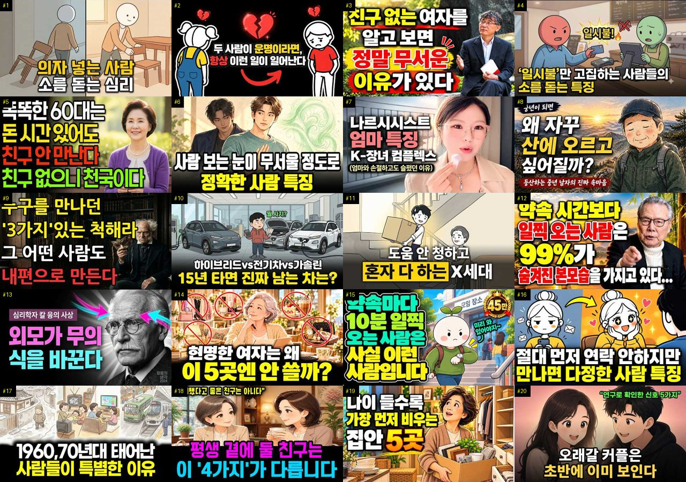

성공 사례 #21–#40:

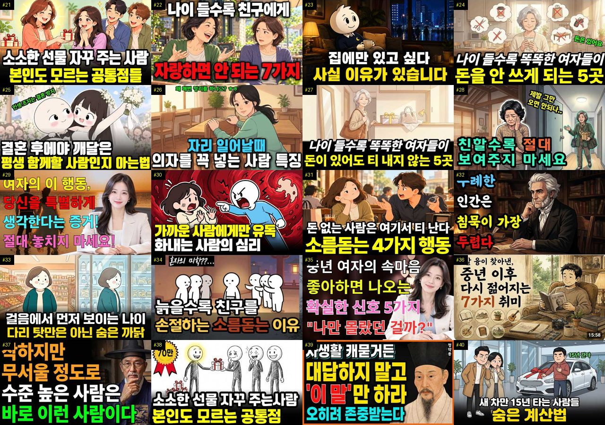

성공 사례 #41–#60:

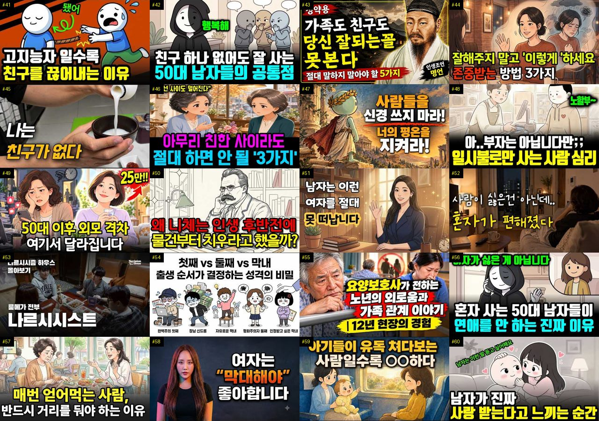

성공 사례 #61–#80:

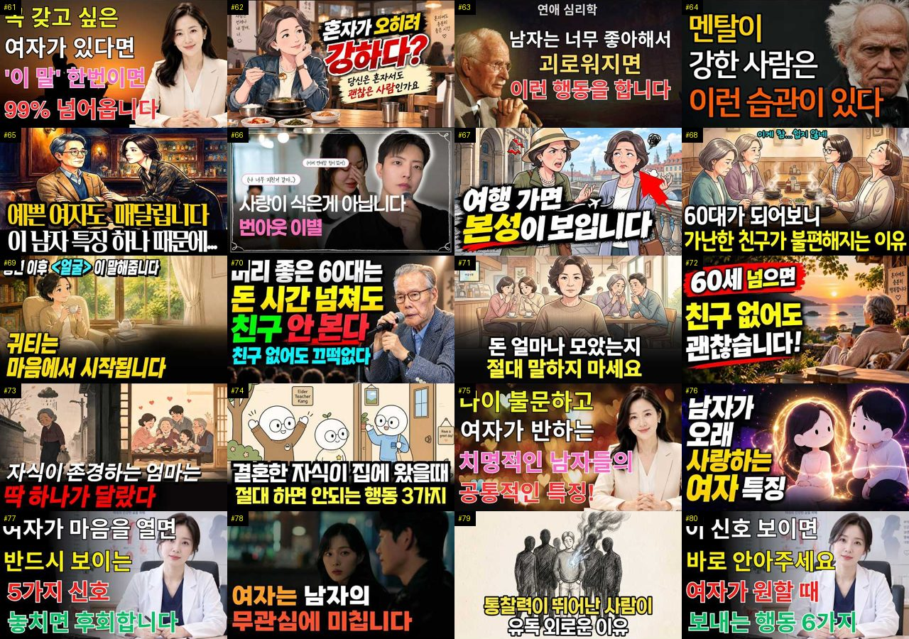

성공 사례 #81–#100:

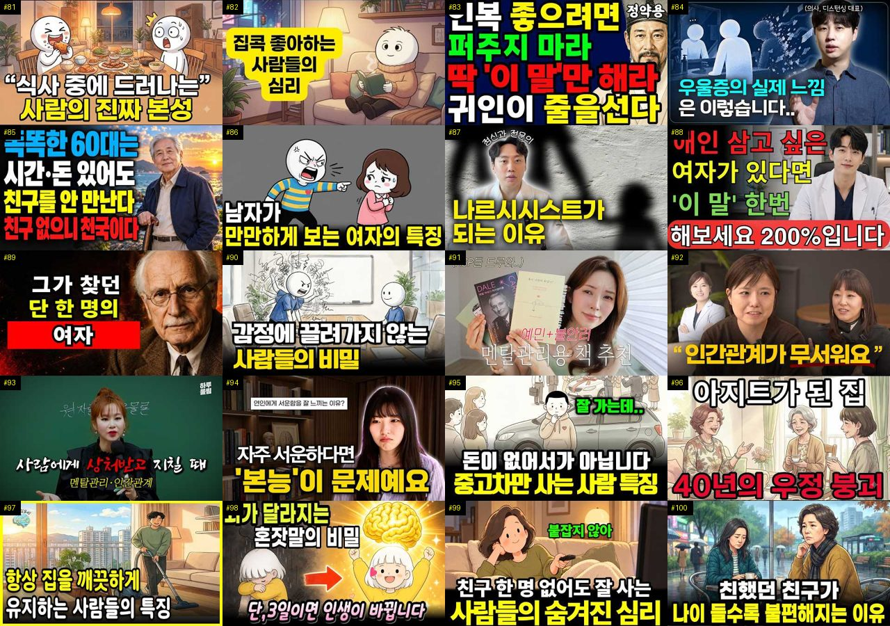

성공 사례 #101–#120:

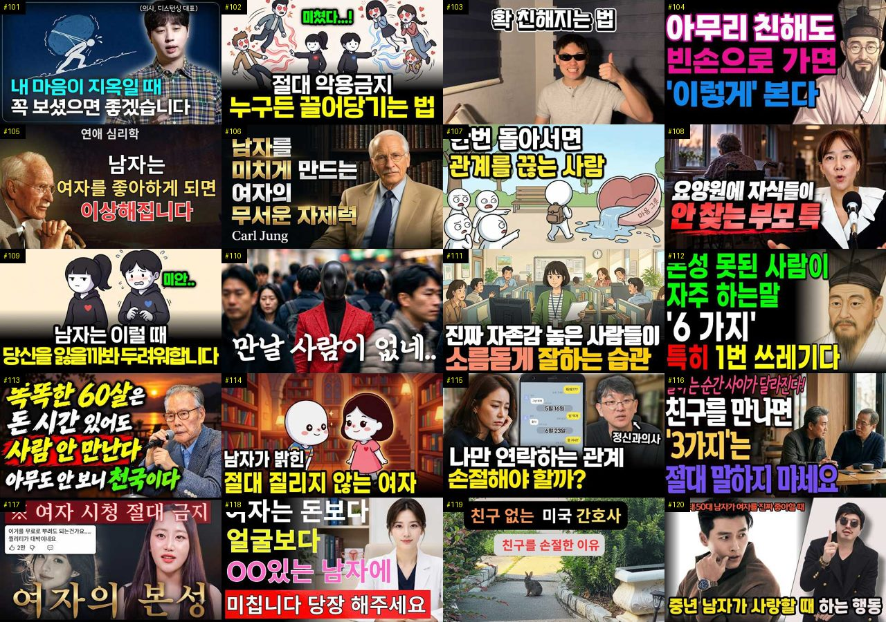

성공 사례 #121–#140:

성공 사례 #141–#160:

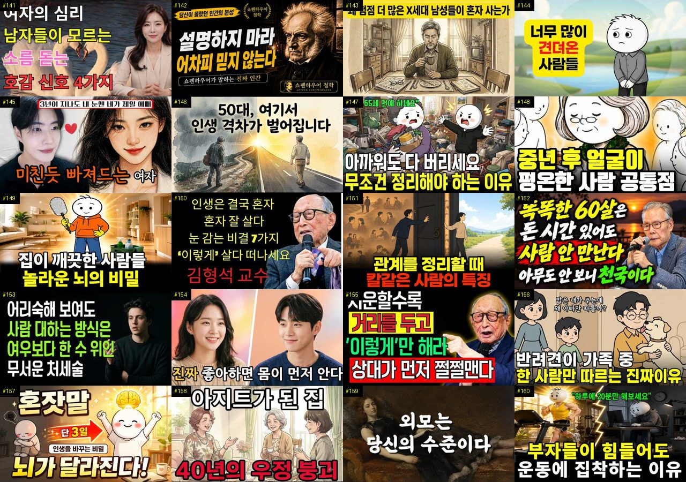

성공 사례 #161–#174:

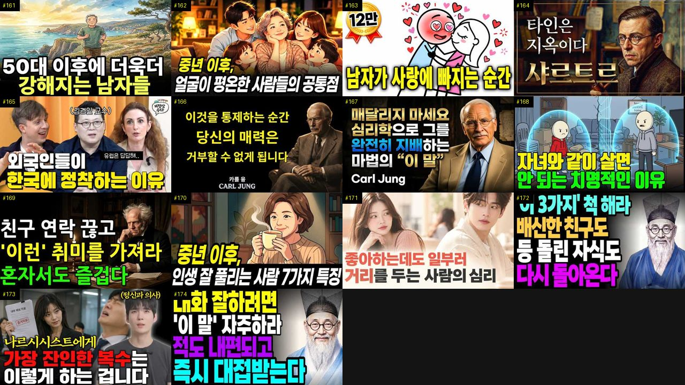

같은 채널 짝 — 줄마다 [성공 사례 #n · 같은 채널 평소 영상 #n-a · #n-b] (1 … #10-b):

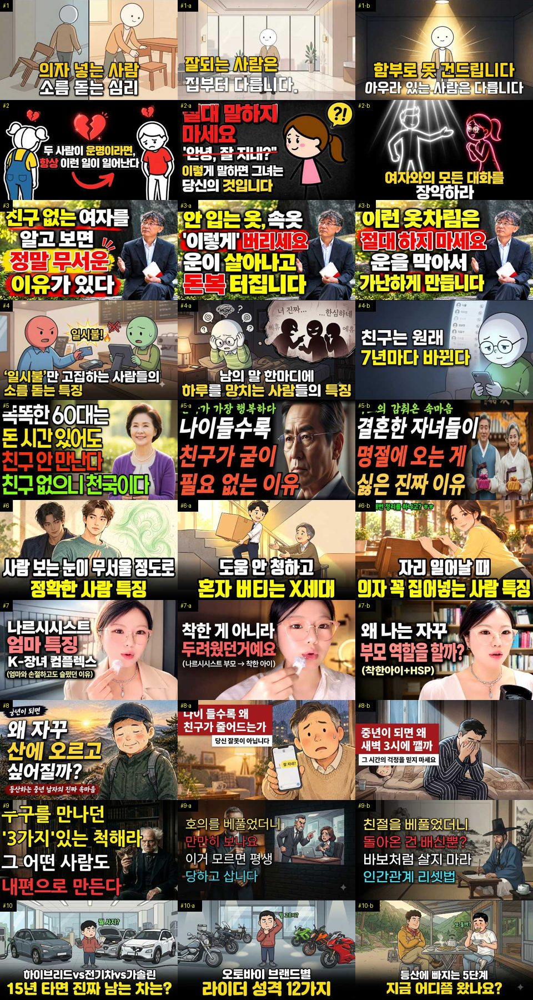

같은 채널 짝 — 줄마다 [성공 사례 #n · 같은 채널 평소 영상 #n-a · #n-b] (11 … #21-b):

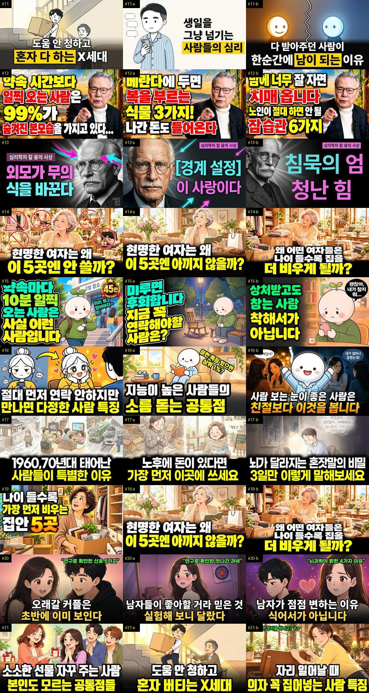

비교 — 자료를 받았지만 성공 기준 밖 (조회수 큰 순, 번호는 `analysis.json` 의 others 순서):

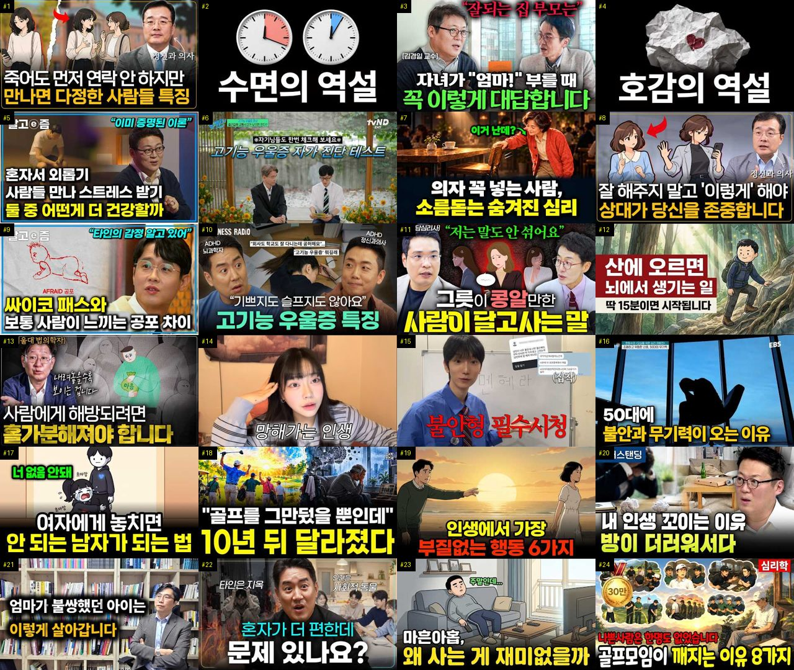

## 6. 길이·내용 구성

### 6-1. 길이별 성공 비율 (비교 집단)

| 길이 | 영상 (성공 비율) | 성공 사례 |
|---|---|---|
| 4~8분 | 115 (19%) | 9 |
| 8~15분 | 382 (14%) | 52 |
| 15~25분 | 360 (13%) | 45 |
| 25~40분 | 254 (18%) | 41 |
| 40분 이상 | 196 (19%) | 27 |

### 6-2. 채널 크기별 성공 비율 (참고 — 구독자가 적을수록 배수가 커지기 쉬움)

| 구독자 | 영상 (성공 비율) |
|---|---|
| 0~999명 | 361 (9.4%) |
| 1,000~4,999명 | 380 (21%) |
| 5,000~19,999명 | 363 (18%) |
| 20,000~50,000명 | 203 (12%) |

### 6-3. 성공 사례의 구성

- 길이 중앙값: 성공 사례 20.5분 · 비교 집단의 나머지 18.6분
- 타임라인(챕터) 있는 성공 사례: 47% (챕터 수 중앙값 9)
- 대본이 있는 성공 사례: 0개 — 말 속도 중앙값 – 음절/초, 첫 1분 음절 중앙값 – (대본이 없어 도입부·흐름은 아직 셀 수 없음)
- 도입부(첫 20초 첫 문장) 유형: 대본 없음 — 아직 셀 수 없음
- 사례마다의 챕터·도입부(첫 20초)·첫 1분·90초마다 흐름은 9번.

### 6-4. 참여율 (비교 집단, 중앙값)

| | 영상 | 조회수 1,000회당 좋아요 | 조회수 1,000회당 댓글 |
|---|---|---|---|
| 성공 | 203 | 6.3 | 0.5 |
| 나머지 | 1104 | 14.1 | 0.8 |

## 7. 구독자 — 빨리 크는 작은 채널

YouTube API 는 영상별 구독 증가를 주지 않는다 → 채널 단위로 본다. 개설 24개월 안·구독자 1,000 이상 채널을 **월 구독자 증가(구독자 ÷ 개설 뒤 달 수)** 순으로. 최근 하루 증가 = 받을 때마다 남긴 구독자 기록 (3일 넘게 벌어져야 나옴). 주로 다룬 주제 = 우리가 본 그 채널 영상의 주제 묶음. **기관·브랜드?** = 채널 이름에 운용사 ETF 상표·증권·은행·공식·방송 같은 말 (`analysis_rules.toml` [growth] BRAND_HINT) — 광고비로 큰 채널일 수 있어 개인 채널과 따로 보라.

| 채널 | 기관·브랜드? | 개설 | 구독자 | 월 구독자 증가 | 최근 하루 증가 | 영상 수 | 월 업로드 | 길이 중앙값 | 주로 다룬 주제 | 대표 영상 (하루 조회수 큰 것) |
|---|---|---|---|---|---|---|---|---|---|---|
| 정영진의 나쁜질문 |  | 2025-07-08 | 172,000 | 10,663 | – | 52 | 3.2 | 34.2분 | 1. 심리학 일반 | [과학기술은 발전했는데 여전히 탈모를 못 고치는 이유 (장홍제 화학자 x…](https://www.youtube.com/watch?v=mzpFfBwqIPU) 797,725회 |
| 심리학 탐정 |  | 2026-03-02 | 66,000 | 7,910 | – | 126 | 15.1 | 13.3분 | 1. 심리학 일반 | [캠핑을 좋아하는 사람들의 7가지 공통점 ∣ 심리학이 밝힌 그들의 진짜 …](https://www.youtube.com/watch?v=-rmoqNXPUCw) 259,608회 |
| 심리발견 |  | 2026-09-20 | 8,210 | 4,900 | – | 56 | 33.4 | 14.2분 | 1. 심리학 일반, 3. 자존감·감정·멘탈 | [차 색깔 보면 성격이 보입니다](https://www.youtube.com/watch?v=NCoZ6WhGGzM) 147,356회 |
| 오늘은 심리학 |  | 2026-02-21 | 40,600 | 4,699 | – | 117 | 13.5 | 11.4분 | 1. 심리학 일반, 2. 인간관계·처세 | [자식은 부모의 사랑보다 이것을 기억합니다 ㅣ부모자식관계 ㅣ좋은 부모 ㅣ…](https://www.youtube.com/watch?v=G9sJxVqt-H0) 816,236회 |
| 심쿵로맨스 |  | 2025-09-23 | 59,400 | 4,367 | – | 310 | 22.8 | 104.0분 | 3. 자존감·감정·멘탈 | [차가운 캠퍼스 남신의 속마음을 들었더니, 날 아내라 부르며 볼 때마다 …](https://www.youtube.com/watch?v=pzqiNLSMV9Y) 99,785회 |
| 김태형 심리학자 |  | 2026-03-24 | 32,400 | 4,270 | – | 51 | 6.7 | 20.6분 | 1. 심리학 일반 | [성형수술하면 자존감이 올라갈까?ㅣ김태형 심리학자](https://www.youtube.com/watch?v=fExR0G1z25Y) 29,991회 |
| 현인의등불 |  | 2026-01-25 | 38,900 | 4,083 | – | 49 | 5.1 | 28.4분 | 2. 인간관계·처세 | [현명한 부모는 결혼한 자식에게 '이 3가지' 당장 끊어낸다 ∣ 정약용 …](https://www.youtube.com/watch?v=TkBt14Q2mnQ) 436,390회 |
| 숨겨진심리학 |  | 2026-01-17 | 37,500 | 3,843 | – | 198 | 20.3 | 15.3분 | 1. 심리학 일반, 3. 자존감·감정·멘탈 | [누구든 끌어당기는 심리학적 방법 (절대 악용하지 마세요) ∣ 연애 다크…](https://www.youtube.com/watch?v=1owmdus3_pw) 366,677회 |
| 잠결에듣는세계사 |  | 2025-12-18 | 40,100 | 3,721 | – | 188 | 17.4 | 76.8분 | 2. 인간관계·처세, 3. 자존감·감정·멘탈 | [🌙틀어놓고 주무세요 '타인은 지옥이다' 인간관계 피로를 단번에 끊어내는…](https://www.youtube.com/watch?v=-593UnQhVPM) 201,430회 |
| 나답게 늙어가기 |  | 2026-09-08 | 7,570 | 3,600 | – | 22 | 10.5 | 34.9분 | 2. 인간관계·처세, 기타 | [이어령 교수의 조언: 70부터 너무 바쁘게 살면 큰일납니다ㅣ늙어서 아무…](https://www.youtube.com/watch?v=XwhHjqiUAww) 424,814회 |
| 정약용 인생조언 |  | 2025-06-10 | 51,000 | 2,991 | – | 253 | 14.8 | 34.0분 | 2. 인간관계·처세 | [《정약용 명언》 나이 들수록 조언하면 관계가 끊어지는 이유 l 인생명언…](https://www.youtube.com/watch?v=RSae2zHz2yg) 9,979회 |
| 심리 톡톡 |  | 2026-01-21 | 27,500 | 2,847 | – | 32 | 3.3 | 16.7분 | 1. 심리학 일반, 6. 성격·유형 | [아기들이 유독 쳐다보는 사람의 정체｜발달심리학이 밝힌 '아기를 끌어당기…](https://www.youtube.com/watch?v=twn0MZBC1eg) 945,423회 |
| 거인들의서재 |  | 2026-08-22 | 7,270 | 2,732 | – | 7 | 2.6 | 48.1분 | 2. 인간관계·처세 | [부자가 되는 여성이 즐겨 입는 옷 색상 다섯 가지 이 색 입으면 평생 …](https://www.youtube.com/watch?v=LHfp8iLhr6c) 239,435회 |
| 토닥교수의 심리학 |  | 2026-01-17 | 26,700 | 2,727 | – | 270 | 27.6 | 18.1분 | 1. 심리학 일반, 2. 인간관계·처세 | [자존감 높은 사람 99%는 절대 하지 않는 행동 8가지 (심리학적 분석)](https://www.youtube.com/watch?v=wpkdSBBYtf8) 26,949회 |
| 거인의 속삭임 |  | 2025-11-14 | 32,100 | 2,699 | – | 65 | 5.5 | 36.5분 | 2. 인간관계·처세, 3. 자존감·감정·멘탈 | [대답하지 마라 무시해라 무례한 인간은 알아서 미친다 ∣ 쇼펜하우어처세술](https://www.youtube.com/watch?v=vPPvQ_BnxjU) 190,166회 |
| 무진심리학 |  | 2026-10-08 | 2,990 | 2,677 | – | 12 | 10.7 | 9.7분 | 1. 심리학 일반 | [X세대가 유독 혼자 다 해내는 심리학적 이유](https://www.youtube.com/watch?v=ObG5Hf_uTjc) 823,553회 |
| 삶의 고백 |  | 2026-05-15 | 15,200 | 2,570 | – | 141 | 23.8 | 40.7분 | 2. 인간관계·처세, 1. 심리학 일반 | [【김형석 교수】자식눈치 보지말고 나쁜 엄마가 되어라! 그래야 자식에게 …](https://www.youtube.com/watch?v=5szBx1mJeCU) 243,807회 |
| 암 유어 닥터 |  | 2024-11-10 | 58,200 | 2,424 | – | 442 | 18.4 | 14.3분 | 4. 우울·불안·정신건강, 2. 인간관계·… | ["동료 의사들도 다 똑같아요" 현직 의사가 분석한 고지능자들의 인간관계…](https://www.youtube.com/watch?v=WpWJl_pfjf0) 109,358회 |
| 심리학한줌 |  | 2026-05-07 | 14,700 | 2,380 | – | 73 | 11.8 | 19.6분 | 1. 심리학 일반 | [집에 물건을 안 들이는 사람들의 심리, 돈보다 아끼는 3가지](https://www.youtube.com/watch?v=oI4Wtt1QA6o) 400,405회 |
| 심리호수 |  | 2025-10-18 | 28,100 | 2,199 | – | 725 | 56.7 | 12.6분 | 1. 심리학 일반, 3. 자존감·감정·멘탈 | [중년여성이 마음주기 시작할때 남자에게 보내는 은밀한 신호](https://www.youtube.com/watch?v=Sf1TUrm8pMs) 10,732회 |
| 심리연구실 |  | 2025-09-06 | 30,400 | 2,147 | – | 207 | 14.6 | 74.9분 | 5. 나르시시스트·가스라이팅, 1. 심리학… | [[2시간 모아 보기] 행복한 사람들이 느끼는 공통된 심리. 긍정적인 사…](https://www.youtube.com/watch?v=bcx0KRyycQ4) 86,936회 |
| 책방 민준씨 |  | 2026-02-22 | 18,400 | 2,146 | – | 42 | 4.9 | 53.3분 | 1. 심리학 일반 | [자유라는 외로움에 대하여 ∣ 에리히 프롬 #철학 #인문학 #스토리텔링 …](https://www.youtube.com/watch?v=3Zw6YgqRUZc) 105,705회 |
| 일상심리학 |  | 2026-01-27 | 19,600 | 2,072 | – | 109 | 11.5 | 24.3분 | 1. 심리학 일반, 2. 인간관계·처세 | [작은 선물을 자꾸 주는 사람의 심리. 당신도 그렇습니까? 일상심리학](https://www.youtube.com/watch?v=2GxDRxV0T9w) 887,383회 |
| 늘네편 |  | 2026-04-16 | 13,900 | 2,034 | – | 60 | 8.8 | 65.4분 | 2. 인간관계·처세, 1. 심리학 일반 | [사람을 만나면 3가지 척하라 배신한 친구도 등 돌린 자식도 다시 돌아온…](https://www.youtube.com/watch?v=tdp8oqX_xOo) 254,250회 |
| 친절한심리학 |  | 2025-12-14 | 22,000 | 2,017 | – | 70 | 6.4 | 14.4분 | 1. 심리학 일반, 7. 말투·호감 | [뭘 해도 인생 잘 풀리는 사람들의 공통 습관 (뇌과학적 이유)](https://www.youtube.com/watch?v=PNPMNKwObB0) 344,887회 |

## 8. 시청자 니즈 (성공 사례 174개의 시청자 댓글 30,262개 — 채널 주인 댓글·도배 댓글 5개 뺌)

갈래는 낱말 규칙 (한 댓글이 여러 갈래). '더 알고 싶은 것'은 ① **요청**(다뤄 주세요·알려 주세요·궁금해요 — 다음 영상 주제 후보, 아래 8-1) 과 ② 물음표 질문(반문이 섞임, 8-2) 으로 나눠 인용한다. **어느 갈래에도 안 듦** 줄을 같이 볼 것 — 갈래 비율은 낱말 규칙에 걸린 몫이다. 모든 댓글(승인 영상 전부)에 유형 하나를 붙인 분포는 `comment_types.md` (사람이 분류한 표본 1,100개 + 규칙 — 2번이 가장 믿을 숫자).

| 갈래 | 댓글 | 비율 | 좋아요 합 |
|---|---|---|---|
| 좋은 점 — 영상 (도움·설명·정리·공감) | 1,054 | 3.5% | 7,910 |
| 감사·응원 (일반) | 2,030 | 6.7% | 17,782 |
| 더 알고 싶은 것 (질문·요청) | 259 | 0.9% | 710 |
| 아쉬운 점 — 영상 (제목·광고·길이·정보 오류·목소리) | 260 | 0.9% | 1,631 |
| 반박·불만 — 의견 다름 (내용) | 502 | 1.7% | 6,616 |
| 정치·사회 (영상과 무관한 의견) | 194 | 0.6% | 1,803 |
| 경험 공유 (내 이야기) | 4,245 | 14% | 45,752 |
| 구독·다음 기대 | 68 | 0.2% | 396 |
| **어느 갈래에도 안 듦** | 22,882 | 76% | 232,388 |

### 좋은 점 — 영상 (도움·설명·정리·공감) — 좋아요 많은 댓글

- 👍491 [#163] “상대방이 애매한것같을때 저는 천시록 참고했는데 도움이 좀 되더라구요.”
- 👍411 [#125] “생각이 과거로 갈 때 우울이 생깁니다. 생각은 내 의지와 상관 없이 끊임없이 올라옵니다. 그 때 그 생각들을 회피하거나 억압하지 말고 그대로 느껴주고 생각을 바라봐 주세요.. 해결되지 않은 부정적 감정들이 올라올 때마다 계속 느껴주면 어느새 그 감정은 힘을 잃고 저절로 나를 통해 흘러가 사라집니다. 저도 최근 오래된 과거에 대한 후회의 감정이 계속 올라와 ”
- 👍161 [#86] “이건 남녀관계에만 해당하는 얘기가 아님. 좋은 내용이네요.”
- 👍160 [#1] “사용한 물건은 제자리에 놓으라고 배웠어요 유치원에서”
- 👍147 [#125] “알아차림 배워보세요 마음을 계속 보고있으면 마음과 생각이 내가 하는게 아니라 자동으로 돌아가는 거라는걸 알게되고, 보는 순간 비 동일시가 되면서 휘둘리지 않게 됩니다. 마음이 떠오르면 떠오르는데로 감정의 도가니 속에서 살다가 그걸 메타인지 처럼 바라볼수 있게 되더라구요. 정말정말 많이 도움되었네요 전 불교신자는 아니지만 불교 가르침이 굉장히 도움 많이 되었”
- 👍146 [#11] “피자와 된장찌게를 같이먹을수있는세대!! 자식에게 기대지않겠다고하는 세대!! 가교같은세대라는말이 딱!공감되네… 어느덧 50대라니 실감이안난다…”
- 👍131 [#122] “장례식에 눈물이 안나오는게 오랜시간 남몰래 흘렸기 때문 이란 말에 공감이 가네요”
- 👍128 [#165] “와 전문가가 오시니깐 분석을 해주셔서 더 유익했어요~~ 재밌네요~ 이런 비교 분석 좋아해서 비정상회담 프로 참 좋아했는데 ㅎㅎㅎ 그리운 프로”

### 감사·응원 (일반) — 좋아요 많은 댓글

- 👍1,286 [#26] “저는 그냥 습관인데요. 의자를 밀어 넣어두는것 음식점에서 음식을 갖다주면 잘 먹겠습니다~ 또는 감사합니다~ 그리고 입을 닦은 냅킨은 식사후 나올때 휴지통에 넣고 나와요 잘보이려고 하는게 아니라 습관이고, 저에 딋모습이 누군가에게 지저분하게 보이는게 싫어서요 진짜 오래된 습관입니다.”
- 👍842 [#38] “시골에서 농사지은 대파 너무 많아 앞집에 나눠 줬는데 그즉시 초인종 울려 나가보니 배3개를 주셨다 감사한 마음으로 받아 배를 깍았는데...얼마나 오랫동안 냉장고에 있었는지 배가 물컹해서 먹을수가 없었다 그래도 뭐라도 주고 싶으셨나보다 하며 넘어갔고 몇달후 농사지은 풋고추를 드렸더니 잠시 기다리라고 하시더니 꽁꽁 언 약식을 주셨다 얼음이 덕지덕지 붙어 있는데”
- 👍605 [#11] “X세대때문에 지금 한국의 경제가 유지되고 있죠. 나의 세대, 얘들아 화이팅!”
- 👍547 [#11] “세상의 모든 X세대들. 우리 조금만 더 힘 냅시다. 화이팅.”
- 👍399 [#38] “누가 작은거라고 내게 쥐어주면 너무 고맙던데요 그리고 담엔 나도 나누는 마음을 실천하자고 생긱합니다 예쁜마음이 긍정적으로 전파하더라는~”
- 👍359 [#59] “안녕하세요 민머리입니다 어딜가나 아이가 쳐다봅니다 감사합니다”
- 👍320 [#17] “62년 서울에서 태어나 국민학교 한 반에 80명 18반 까지 있어서 오전오후반 으로 공부한 추억이 있습니다, 겨울에 검은색 조개탄으로 난로를 피울 때 교실을 연기로 가득차게 되기도 했고 도시락도 못 싸오는 애들도 있었던 정말 가난한 나라였습니다. 지금 우리가 선진국이 되어 동남아 여행을 가 보면 느끼는 그들의 수준보다 더 비참한 수준 이었습니다.지금 현재가”
- 👍284 [#122] “제가 싸이코가 아님을 확인하고 갑니다. 그리고 저와 같은 분들이 많으시다는 것에 안도가 되네요.감사합니다”

### 더 알고 싶은 것 (질문·요청) — 좋아요 많은 댓글

- 👍90 [#98] “참 좋은 영상입니다. 수많은 성공학, 영성책들을 과학적 근거를 들어 아주 간단하고 쉽게 잘 요약한 액기스 같은 영상입니다. 거짓과 부풀림이 난무하는 유튜브에 이런 영상도 있네요. 좋은 영상 감사 드리고 앞으로도 사람들을 이롭게 하는 좋은 영상 많이 부탁드립니다.”
- 👍62 [#82] “내이야기인데 어떻게알았죠?”
- 👍43 [#94] “세가지 다 거의 비슷한 수준으로 공감되는데 이건 어떤 경우일까요?”
- 👍28 [#87] “극단적으로 오직 나!나!나! 나다!!하는 신념이 있고 입버릇처럼 나는 알지~~! 라는 말로 수시로 상대방의 말을 끊는 사람이 주변에 있어서 피로감이 있어요...나르일까요😢😢😢 그리고 상대가 처음엔 나르가 아닌줄 알았는데 알고보니 내현 나르의 특성에 부합되더라구요😢 내현 나르들의 특징도 알려주세요~~ 😊 늘 좋은영상 올려 주셔서 감사해요 ❤❤❤”
- 👍23 [#126] “정말 참 오랫만에 저의 인생에 도움이 되는 좋은 말씀 많이 들려주셔서 감사합니다ㆍ 유튜브에 지저분하고 저속하고 거짓과 위선으로 가득찬 글들이 너무 넘쳐나서 진짜 유튜브를 보기 싫을 때가 너무 많았는데 이런 주옥 같은 글도 있다니 정말 놀랍습니다ㆍ 그래서 구독을 눌렀습니다ㆍ 유튜브에 너무 쓰레기 글들이 넘쳐나서 유튜브에 환멸을 많이 느꼈었습니다ㆍ 앞으로도 잔”
- 👍22 [#165] “식사문화가 다른건 알겠는데 코스요리도 알고 어떤코스인줄 알겠는데 우린 배고파서 식사하러 간거니까 답답하거든여 먹는데 시간많이 안걸리니까... 그래서 좀 궁금해서 그런데 다른 유럽 예를들어 이탈리아 사람들은 그런 코스가 나오는 식당을 갈때는 식사말고 다른 기대 하는게 무엇인지 그게 또 얼마나 중요하게 생각하는지 그런것도 한번 다뤄주심안되나요 곁들이면 에피타이”
- 👍20 [#67] “30년지기 친구 처음이자 마지막 유럽패키지 여행이후 손절.. 한 친구가 주도를 했죠. 딸부잣집 막내라 언니들로부터 줏어들은 풍월로 말투마다 자신이 보는 세상이 전부요 옳다는식의.. 잠도 동전던지기로 매일 다른 사람과 때론 연속으로 같은 사람과 자게 되는것도 그친구 였는데 암튼 그것도 그냥 따랐습니다만, 저 빼고 셋중 두아이는 저랑 잘 때마다 다른 친구들 흉”
- 👍18 [#151] “내 속에 언제 들어오셨나요? 소름”

### 아쉬운 점 — 영상 (제목·광고·길이·정보 오류·목소리) — 좋아요 많은 댓글

- 👍160 [#84] “대학원 중에 교수 때문에 우울증과 공황장애가 왔었고, 3년쯤 앓다가 일반적인 생활로 돌아올 수 있을 정도로 호전된 상태입니다. (회식 이후 제정신이 아닐 때 작성한 댓글이라 수정하였습니다.) 당시에 행정업무, 학회 관련 일, 교수 비서일 등 여타 대학원생들이 겪는 '짬 맞는 평범한 일'들을 맡았습니다. 행정업무 자체는 각 기관의 형식에 맞추는 게 번거로울 ”
- 👍135 [#168] “독립한 자녀가 가정을 이루고, 시부모 지원없이 직장 근처의 집을 구입했습니다. 그런데 시부모가 아들 며느리가 사는 지역에 이사오고 싶어하고, 애를 키워달라고 요구한 적도 없는데 키워준다고 합니다. 아들이 정중하게 거절했더니 아들에게 화내고 소리치는 시어머니의 심리는 무엇인가요? 나이는 70 이시고 정정하시고, 성격은 불같으며 맘에 안들면 며느리에게 소리치십”
- 👍116 [#44] “<잘해줄수록 만만해지는 심리 구조> 행복한 마음 읽기 1.호의가 점점 의무가 되는 이유? 받는 사람에게는 똑같은 게 반복되면 적응되어 그 가치와 감동이 점점 줄어든다 => 습관화, 쾌락 적응 반복되면 그게 원래 그런 것, 당연히 받는 것으로 바뀐다 => 안 해 주면 당연히 있어야 할 게 없어진 게 되고 고마움 대신 서운함이 돌아오는 것임 2.속으로 서운하고”
- 👍62 [#92] “선생님의 솔직함이 범인들에게는 정말 큰 위안이되고.사는게 크게 다르지않은것.그게 삶의 큰기대와 실망이 없이 살게되어 가벼워집니다.정말 고맙습니다!”
- 👍61 [#11] “좋은 컨테츠 보니깐 갑자기 생각이 나네요. 그시절 X세대를 말해주는 광고가 있었죠. 리바이스 "난 나야" 부모와 다른 독립적으로 행동하고 판단하는... 좋은 컨텐츠 감사합니다!”
- 👍47 [#67] “30년넘게 알고지낸사이 평소 등산 과 국내여행 짧게 참 많은것을 함께 했던 교회 친구였죠.둘이서 나눈대화며 맛집경험등 우린정말 함께 했던것들이 넘 많았죠.주변뿐 아니라 남편들마저 부러워할만큼 소문난? 친구같은 교우 였어요.몇년간 함께 돈을모아 한달간 유럽여행을 갔어요. 당연히 우린 그 여행이 서로의 손절 선언으로 갈줄 꿈에도 몰랐죠. 그 친구가 공금관리와 ”
- 👍44 [#108] “시부모님 계시는 요양원에 안 가는 이유는 마음을 내주고 신경을 쓰면 하녀로 부린다. 인간 대 인간의 관계 성립이 불가능한 사람들. 이런 경험이 반복되니, 남편에게 효도하라고 했다.”
- 👍39 [#98] “오늘도 다시 듣습니다.. 반복해서 들어야 생각이 납니다. "너는 참 복 많다.인덕이 많다" 하는 말이.. 돌아가신 어머니께서 해주시는 것 같아요..진짜 느껴져요”

### 반박·불만 — 의견 다름 (내용) — 좋아요 많은 댓글

- 👍1,542 [#151] “칼 같이 ? 아닙니다 오랜시간 고민하고 배려했던겁니다”
- 👍1,215 [#125] “저 알고리즘으로 들어왔는데 음.. 딴 얘기일수도 있지만 원룸에 사는게 사람 우울하게 만드는거도 큰거 같아요 저는 지방에서 서울 상경하면서 고시원 원룸 전전하면서 살았었는데 계속 우울증 달고 살다가 햇빛 잘드는 투룸으로 가니까 정말 많이 나아졌어요.. 어이없을 정도로 모든 사람에게 적용되는건 아니겠지만 확실히 큰 영향이 있는거 같아요”
- 👍308 [#107] “다 떠나서 만났을때 불편하고 스트레스 받는 느낌이 들면 조용히 인연을 끊는게 정답임.. 스트레스 받을일이 한두가지가 아닌데 인간관계까지 스트레스 받는다는게..”
- 👍249 [#86] “여성 잘못이 아닙니다. 저 남자에게 여성은 이미 중요한 존재가 아니거나 저 남자의 본성이 무례해서죠. 더 만날 필요가 없습니다. 무시하거나 무례한 행동에 대한 댓가는 있어야죠. 저런 남자랑 잘 되기위해서 뭘 애써 더 노력할 필요가 있나요? 이미 충분히 최대한 참으면서 배려해주고 이해해 주고 있는걸요.”
- 👍228 [#108] “부모라고 다 부모가 아닙니다 자식 인생을 제일 막는 악마일 수도 있어요 제 삶의 가장 큰 후회는 부모와 빨리 손절하고 내 꿈대로 살지 못한 잃어버린 세월입니다. 젊은 친구들 내 부모가 정상적이지 않다면 버리고 뛰쳐 나가세요. 그래야 살 수 있습니다.”
- 👍144 [#87] “우리나라의 양면성 같다고 생각합니다,,,,,,,,,,,,,,, 말도 안 되는 경제 발전 뒤에는 나르시시스트가 너무 많음ㅜㅡㅠㅜㅠㅜㅜㅠ 잘 되면 외현, 안 되면 내현”
- 👍135 [#84] “죽을 용기로 살아라라는 말 제발 하지맙시다 용기가 아니라고 선택이 없는거라고 편해지고 싶어서 죽는것도 아닙니다 그런말 하는것도 구업 쌓는거예요”
- 👍122 [#38] “받는 사람이 다 좋아하는건 아닙니다”

### 정치·사회 (영상과 무관한 의견) — 좋아요 많은 댓글

- 👍715 [#11] “x세대는 정말 멀티플레이어입니다. 저도 20대때 국회도서관에 가서 줄 서서 복사해와서 워드프로세서로 리포트를 작성해봤고, 지금은 챗GPT를 이용합니다.”
- 👍165 [#87] “나라가 힘들고 회사다니기 힘들고 학교다니기 힘들고 사는게 힘든이유는? 나르시시스트와 소시오패스가 너무 많기 때문이죠.”
- 👍101 [#165] “한국에 잘 적응해서 살아가는 대한외국인분들 보면 모국과 비슷한 점을 찾아서 적응하시는 것 같더라고요.”
- 👍75 [#165] “정말 예전과 달라진건 단순히 외국인들이 많이 보이는 수준이 아니라 아기 혹은 아이들을 동반해서 돌아다니는 가족단위의 케이스들이 정말 많아졌다는거 그 분들이 여행을 온것인지 이민이나 귀화인지 노동자 가족인지 미군 가족인지 거기까지는 모르겠으나 어쨌든 가족단위로 돌아다니는 모습을 보면 내국인으로써 기분은 좋더라고 그만큼 이 나라가 이 국민들이 이 사회가 안정감”
- 👍56 [#11] “다리 무너지고 백화점 무너지더니 나라가 무너지더라. 그 여파로 우리 집도 날아갔다.... 진짜 내 10~20대 힘들었네.ㅠㅠ”
- 👍55 [#59] “아기가 싫어하는 얼굴은 이재명같은 얼굴이란거네”
- 👍47 [#17] “저는 68년생인데 시골에서 태어나서 초가집에서 어린시절 살았어요.티비도 없었죠. 그러다 초등학교때 경기도로 이사왔는데, 학교에 학생들 너무 많아서 중고등학교때까지 한반에 70명가까이 있었어요그만큼 경쟁도 치열했지만 취업도 잘되었어요. 전쟁끝나고 부모세대가 대부분 가난해서 우리세대는 스스로 돈 모아 결혼하고 집 사고 굉장히 자립심 강하고 치열하게 살았다 생각”
- 👍32 [#122] “그와 반대인 놈도 있습니다. 도리는 없고. 권리만 있는. 제. 조카놈이 그렇습니다. 암 걸린 엄마 한번도 안찾아오더니. 지엄마. 하늘나라가도 장례식장도. 안오던 놈이. 재산정리하러 나타나는거 보고. 기암했네요. 아들이라면 끔찍하게 생각하고 혼자. 대학도 적성에. 안 맞는다 두번이나 바꿔도. 학비 방세 용돈 다 지원해줬어도 졸업도 못하고. 받을줄만 알고 줄주”

### 경험 공유 (내 이야기) — 좋아요 많은 댓글

- 👍1,153 [#147] “60대 중반인데.. 내가 추구하는 삶은 이건데.. 와이프가 비닐봉지 하나도 못버리게해서 삶이 항상 피곤합니다.. 프라이팬이 닳아서 새로 산 뒤 헌것들은 절대 안버리고.. 이걸 가정의 평화를 위해서 계속 못본척하면서 늙어가고 있네요 허허허”
- 👍886 [#23] “나도 집순이 눕순이😅 누가 내게 은둔형 외톨이라 해도 상관없음 혼자 있는 시간을 즐김😊”
- 👍822 [#168] “딸 둘은 시집 가고 늦동이 아들이 서른 세살인데 같이 살다가 분가를 준비하고 있습니다 서울에 있는 아파트 팔아서 경기도로 가면서 아들 집 보증금 보태주고 나머지로 칠십이 된 우리 부부 노년에 쓰다가 가려구요 남편은 아들의 수입이 일정하지 않아 분가 시키는걸 썩 내켜하지 않지만 엄마인 제가 결단을 했는데 잘한 일인것 같네요”
- 👍745 [#109] “이런거 의미 없는거 같아요 여기잇는걸 모두 다 하는데도 헤어지자는 남자가 잇고 여기서 말하는거처럼 안떠나는 남자가 있어요 그냥 날 얼마나 진심으로 생각하는지 남자에 따라서 다 틀린거 같아요 그리고 항상 헤어진 후에 연락오죠. 그냥 내가 뭘 해도 날 떠나질 않을 남자 만나세요. 다들 예쁜사랑 하세요”
- 👍715 [#11] “x세대는 정말 멀티플레이어입니다. 저도 20대때 국회도서관에 가서 줄 서서 복사해와서 워드프로세서로 리포트를 작성해봤고, 지금은 챗GPT를 이용합니다.”
- 👍696 [#109] “모르고있었는데 다 하고있었네요 제가 독립적인 성향이고 칼같은 성격이라 의도치않게 긴장감을 줬나봐요 매번 제가 어떤걸 할지 말하고 있고 제 삶이 더중요해서 남자친구만나는것보다 제 시간을 챙기려고 했고 남자친구가 약속취소하거나 자기멋대로 보러온다하면 거절했어요 제 시간을 무시하는것 같아서요 또 챙김받는게 훨씬많은데 남자친구는 자기를 잘 챙겨준다말해요 사실 남자”
- 👍690 [#11] “나라에서 원하는건 많은데 혜택은 없고 우리 윗세대는 나라를 일으켰다 인정받지만 우리세대는 그딴건 없고, 청년지원사업도 우리가 청년이던시절엔 없었고. 그러면서도 2030세대한테는 꿀빠는 세대라고 비난받고... 그냥 다 어렵고 억울하기만 하지만, 오늘도 출근합니다. 군대기간 합치면 어영부영30년차 직장인의 한숨섞인 넋두리입니다...”
- 👍665 [#23] “나도 집에 있는게 제일 좋아요😅”

### 구독·다음 기대 — 좋아요 많은 댓글

- 👍54 [#94] “통찰력이 엄청 높은 영상이네용 다른 사람과 나는 생각의 기둥이 달라서 이해하기 힘들고 같은 것을 봐도 다르게 이야기하고 내가 원하는 부분에서 자꾸 다른이야기를 할 수 있다는걸 인지하고는 있었지만 이렇게 확실히 구분한 정보를 얻으니 복잡했던 생각이 정리되는 느낌이네요 ㅎ 이별한지 4개월정도 된것같은데 저는 성적본능이 좀 많이 기울어져있는 타입이라서 자기보존여”
- 👍40 [#15] “저는 항상 일찍가서 기다려요. 그래야 마음이 편해요”
- 👍39 [#136] “구독누르고가요^^ 맞는것같네요. 뭘해주는것보다도 힘들때 내편이돼주었던 기억이 나이가 들러서도 잊을수없을것같아요. 안타깝게도 대한민국부모님들은 체면이나 주의시선 비교 경쟁 이런것땜에 자식의 실패나 힘들때 보듬아주고 내편이 돼주시지만은 않는듯하네요ㅠㅠ”
- 👍38 [#122] “누워서 듣는데 눈물이 나네요~ 답답했던 마음이 조금은 풀리는 것 같아요! 감사합니다♡다음 영상 기다려요~~”
- 👍29 [#126] “6. 25 독란 일을 읽으면서, 육백 이십오 라고 낭독하는데 , 다음엔 올바로 읽기를 기대합니다.”
- 👍21 [#163] “남편과 아들 셋 키우는 사람으로서 남자를 더 이해하는 계기가 되었네요❤구독하고 가요❤”
- 👍20 [#98] “형민! 너는 고시원에서 혼자 살고있지만 1.편히 쉴곳이 있어서 고맙습니다 2.매일 일할곳이 있어서 고맙습니다 3.아픈데가 없이 건강해서 고맙습니다 4.아침에 창문열고 하늘을 볼수있어 고맙습니다 5.오늘은 친구와점심약속이있어서 기다려집니다 이 역시 고맙습니다❤”
- 👍15 [#150] “미국 달라스에서 사는 76 세 여성입니다 매일 듣고 있습니다 감사합니다.”

### 8-1. 더 알고 싶은 것 ① 요청 — 다뤄 주세요·알려 주세요·궁금해요 (139개 중 좋아요 순, 영상마다 2개까지)

- 👍90 [#98] “참 좋은 영상입니다. 수많은 성공학, 영성책들을 과학적 근거를 들어 아주 간단하고 쉽게 잘 요약한 액기스 같은 영상입니다. 거짓과 부풀림이 난무하는 유튜브에 이런 영상도 있네요. 좋은 영상 감사 드리고 앞으로도 사람들을 이롭게 하는 좋은 영상 많이 부탁드립니다.”
- 👍28 [#87] “극단적으로 오직 나!나!나! 나다!!하는 신념이 있고 입버릇처럼 나는 알지~~! 라는 말로 수시로 상대방의 말을 끊는 사람이 주변에 있어서 피로감이 있어요...나르일까요😢😢😢 그리고 상대가 처음엔 나르가 아닌줄 알았는데 알고보니 내현 나르의 특성에 부합되더라구요😢 내현 나르들의 특징도 알려주세요~~ 😊 늘 좋은영상 올려 주셔서 감사해요 ❤❤❤”
- 👍23 [#126] “정말 참 오랫만에 저의 인생에 도움이 되는 좋은 말씀 많이 들려주셔서 감사합니다ㆍ 유튜브에 지저분하고 저속하고 거짓과 위선으로 가득찬 글들이 너무 넘쳐나서 진짜 유튜브를 보기 싫을 때가 너무 많았는데 이런 주옥 같은 글도 있다니 정말 놀랍습니다ㆍ 그래서 구독을 눌렀습니다ㆍ 유튜브에 너무 쓰레기 글들이 넘쳐나서 유튜브에 환멸을 많이 느꼈었습니다ㆍ 앞으로도 잔”
- 👍22 [#165] “식사문화가 다른건 알겠는데 코스요리도 알고 어떤코스인줄 알겠는데 우린 배고파서 식사하러 간거니까 답답하거든여 먹는데 시간많이 안걸리니까... 그래서 좀 궁금해서 그런데 다른 유럽 예를들어 이탈리아 사람들은 그런 코스가 나오는 식당을 갈때는 식사말고 다른 기대 하는게 무엇인지 그게 또 얼마나 중요하게 생각하는지 그런것도 한번 다뤄주심안되나요 곁들이면 에피타이”
- 👍20 [#67] “30년지기 친구 처음이자 마지막 유럽패키지 여행이후 손절.. 한 친구가 주도를 했죠. 딸부잣집 막내라 언니들로부터 줏어들은 풍월로 말투마다 자신이 보는 세상이 전부요 옳다는식의.. 잠도 동전던지기로 매일 다른 사람과 때론 연속으로 같은 사람과 자게 되는것도 그친구 였는데 암튼 그것도 그냥 따랐습니다만, 저 빼고 셋중 두아이는 저랑 잘 때마다 다른 친구들 흉”
- 👍14 [#101] “선생님의 강의는 상투적이지 않고 새로운 관점으로 신선하고 매우 유용합니다 큰 도움이 됩니다.앞으로도 잘 부탁드립니다. 필기하면서 복기하며 잘 듣고 있습니다 감사드립니다 😊”
- 👍13 [#156] “우리 강아쥐는 까매서 왼쪽 눈썹이 안보임...표정변화를 보고싶은데..나보고 미친듯이 뛰는뎁..니 맘이 궁금하다.”
- 👍12 [#57] “저도 비슷한 경험을 한 적이 있는데 매번 메뉴 선택도 가장 비싼 것을 고르고 결제는 늘~~~~~안 하죠. 정말 그 속내가 궁금해요. 돈이 없으면 모임이나 만남을 자제해야 하는 거 아닌가요?”
- 👍10 [#10] “댓글 모두 제각각이라서.. 뭐가 괜찮은건지 알 수 없네요.. 지금 현재 사용중인 차량은 22년식 스포티지 가솔린 현재 바꿀 생각하는 차량은 중고 아이오닉5 중고 아이오닉5 구매 추천 시, 추천해 줄만한 키로수는 얼마인지 궁금합니다. (직장에서 충전 가능합니다.) 이 영상 시청하면서 바뀐 생각은 K8 하이브리드... 고민입니다.. ㅠ 차알못인 저에게 조언 부”
- 👍9 [#117] “이제껏 많은 여자를 만나왔는데, 하나같이 전부 데이트비용은 거의 제가 70% 이상 냈던 것 같아요. 제가 궁금한건, 여자는 본인이 마음에 들어하는 남자라도 데이트비용을 많이 부담하지않으려고 하는게 본능인가요? 아니면 제가 호구라서 데이트비용을 많이 부담한건가요? 알려주시면 감사하겠습니다.”
- 👍8 [#112] “1994년7월달중사리모텔계모임계모임이아니라사기계모임경남하동진교지두레여자한테가정파탄사기몇십년괴롭히고지금도밤낮안가리고보이지안는해꼬지해고통스럽고몇십년지옥속에살고있다어쩌다난생처음계모임가사기꽃뱀알고부터내가사는게사는게아니다이일을어떻게해결했으면좋은지사기당한사람댓글올려주세요제가백천사포교원가고부터더심하고보이지안는마법마술부적으로밤낮없해꼬지해잠도못자게하고몇십년할짓이아닌니다고욕”
- 👍6 [#53] “안녕하세요! 나르시시즘 하우스의 연출을 맡은 (꼬마PD) 이예준입니다. 예능 종류만 하다가 처음으로 이런 스크립트 장르의 작업을 하게 되었는데, 너무 재밌고 뜻깊은 도전이었던 것 같습니다! 열심히 만들었으니 많은 관심과 시청 부탁드려요😂 행복한 추석 보내시길 바랍니다! 아, 제가 생각하는 명장면은… 6화 마지막의 엔딩부입니다! 57:08 현장에서는 미리 계”
- 👍6 [#83] “2 진심으로 감사드립니다. 인복을 많이 받고싶습니다. 부탁드립니다. 감사합니다.”
- 👍6 [#101] “오늘도 좋은 영상 감사합니다. 강박성 성격이랑 일중독에 대해서도 다뤄주시면 좋을것같아요!”
- 👍6 [#108] “선생님 목소리가 너무 떨리고 빨라요 천천히 또박또박 부탁드립니다”
- 👍5 [#44] “잘대해주니 진짜 고마워 할줄을 모르더라구요 거기에 휘둘리지않고 시집책을 내었습니다 1집 명자의 삶의 여정 2집 내가 바라본 나 3집 행복한 삶을 위하여 . 네이버에서 구매가능하니 많은응원 부탁드립니다 ♡”
- 👍5 [#165] “너무 궁금한게 저 교수님이 진짜 어려운 단어들을 쓰고 있는데 양옆 두 분이 백프로 이해하는지 그게 궁금해요. 오랫동안 한국에 살지만 단어가 사실 많이 어려운건 우리도 어렵거든요. 근데 쉽게 말하지 않고 어려운 말들 자연스럽게 쓰는데도 잘 이해해 보이는게 부럽달까요? 적응력이?”
- 👍4 [#66] “안녕하세요 마로엘님.. 너무 긴 내용이고 하지만 혼자서 이해하고 기다릴려니 답답하고 힘들어서 번아웃으로 인한 이별에 대해 궁금해서 조심스럽게 질문드립니다.. 7년 정도 장기연애를 해온 커플이고, 몇 달 전 상대방이 직장과 개인적인 스트레스가 많이 누적되어 정서적으로 너무 지쳤고 연애까지 감당할 여력이 없다는 이야기를 하면서 이별을 이야기했습니다. 상대방은 ”
- 👍4 [#102] “팬입니다~ 🥰❤️ 사람의 마음을 움직이는 건 거창한 말이나 특별한 기술이 아니라, 결국 상대를 진심으로 이해하고 존중하는 마음이라는 생각이 들었어요. 처음에는 사람을 끌어당기는 심리학적 방법이 궁금해서 영상을 보기 시작했는데, 다 보고 나니 오히려 제 자신을 돌아보게 되네요. 누군가에게 잘 보이려고 애쓰거나 사랑받으려고 노력하기보다, 나 자신을 먼저 아끼고”
- 👍4 [#110] “원래 댓글 잘 안 다는 사람인데, 이번 영상을 보고 난 뒤에는 말해야겠습니다. 도래기책방님은 저의 걱정을 완벽히 해소해주셨고 더 나은 사람으로 바뀌게 해줄 열쇠를 건네주셨습니다. 저도 도래기책방님 같은 사람이 되고 싶네요. 저 뿐만 아니라 많은 사람들이 뒤에서 응원할테니 멋진 영상 계속 만들어주시면 감사하겠습니다.”
- 👍3 [#66] “안녕하세요 5년 반 넘게 연애했는데 며칠전 헤어지고 너무 힘들어서 댓글 씁니다.. 상대가 여러 스트레스가 극에 달하면서 저에 대한 스트레스까진 수용하기 어렵다고 판단해서 저에 대해 마음정리를 했다고 하며 헤어지자고 했습니다. 너무 힘들어서 친구에게 얘기했더니 그렇게 힘들면 다 끊어보라는 얘기를 듣고..왜 진작 그러지 않았지 생각하고 헤어질 결심을 했다고 합”
- 👍3 [#94] “엇 그냥 생윤공부하는 재수생인데여 우연히 이 영상을 보고 생윤 공부중인데 아퀴나스 제시문에 자연법이란 인간의 합리적인 본성에 의존하는 법으로서 ••••••중략하고 제1의 자연 성향은 인간이 다른 모든 실체와 함께 소유하고 있는 자기보존능력이요. 제2의 자연 성향은 동물과 함께 소유하는 성향, 즉 성욕과 종족 보존 본능이며, 제3의 성향은 인간의 합리적인 본”
- 👍3 [#103] “처음 친해질 때 연락도 하면 더 친해질 수 있잖아요. 근데 연락을 어떻게 해야할지 모르겠어요. 꼭 이성에게 연락하겠다가 아니라 사람으로서 연락을 이어가는 법에 대해 영상 다뤄주시면 감사하겠습니다. 또 관계 유지 방법도 다루면 좋을거 같아요”
- 👍3 [#110] “안녕하세요 도래기 책방님 얼마 전부터 알고리즘에 떠 주기적으로 챙겨보고 있는 대학생입니다. 요즘 들어 자존감도 별로 없고 살아가는 것의 이유는 뭘까 등 고민을 많이 했었는데 이 채널을 보면서 도움이 많이 되었습니다. 영상의 흡입력이 너무 좋아서 하나하나 소중하게 2배속도 안하고 귀담아 듣고 있습니다. 저는 그저 영상하나를 보는 거지만 얼마나 좋은 메시지를 ”
- 👍3 [#149] “너무 공감되서 구독좋아요 눌렀네요 다음에도 좋은 영상부탁드립니다😅”
- 👍2 [#58] “가장 중요한 얘기 해줄께. 흔히들 연애에서 티키타카가 잘 되는 사람이 늘 1순위 잖아. 이걸 이끌어 내는 법 알려준다. 말을 잘 못하는 사람일 수록 이 방법이 유효하다. 대화를 리드해 간다는 건 말을 많이 하란 게 아니라 공감될만한 화제와 주제를 이끌어 내란 거다. 머릿 속에 안 떠오르면 눈으로 즉흥적으로 찾아내면 된다. 약속 장소까지 오면서 본 것, 약속”
- 👍2 [#58] “술취한 여자 다루는 법 좀 알려주세요..”
- 👍2 [#65] “10만큼 궁금한데 100만큼 숨길때 웃음나죠....”
- 👍2 [#91] “책추천 영상에서 뜬금없지만 나시탑 어디건지 궁금합니다.. 알려주실수있으실까효??”
- 👍2 [#94] “에니어시온님 오늘 처음 우연히 접하게 된 채널인데 먼저 교육의 대한 열정과 사람들과의 관계를 개선하고 좋은 세상을 만들어가시는 과정이 존경되고 결과가 기대됩니다. ^^ 혹시 시온님은 몇번 본능이 제일 강하신 타입이신지 궁금해서 물어보기만 합니다. 개인적인 부분이라 답 안해주셔도 괜찮고요 😂 그리고 전 살아왔던 삶을 뒤돌아보면 3개 본능의 우선순위들이 속해있”
- 👍2 [#102] “자기 삶이 있으니 연락이 안 되고, 상대 반응을 신경 안 쓰니 예측대로 안 움직이고, 인정이 필요하지 않으니 안 갈구하고, 대가를 안 바라니 그냥 주고, 거절이 안 두려우니 약점을 보여도 상관없고, 세상이 궁금하니 사람도 궁금하다.”
- 👍2 [#117] “이걸 다 꿰뚫고계시는분은 실제로 연애할때 도움이되시는지 궁금해요”
- 👍2 [#125] “동네 성당 가면 돼요. 어느 동네든 성당은 꼭 있어요. 그리고 성당의 입구에는 늘 성모마리아 석상이 있습니다. 그 앞에서 눈을 감고 물어보세요. '제가 왜 살아야 하는지 그 이유를 알려주세요.'라고. 그럼 해답을 주실 겁니다. 뭐가 먹고 싶어지든 어디를 가고 싶어지든, 예전과는 확실히 다른 욕구가 생길 거예요. 그리고 삶이라는 것에 대해서 엄청 감사하게 될”
- 👍2 [#125] “저도 만성우울이 있어서 브린텔렉스(항우울제) 복용하며 살아가는데요, 민고영님 제일 첫번째영상 썸네일의 표정을 짓는 순간이 많으신가요?? 유튜브 영상은 전반적으로 다 무표정해보이시는데, 실제 삶에서는 웃는순간이 많으신지 궁금합니다😊”
- 👍2 [#144] “이 감정 억압을 . 감정을 받아들이는 것을 어려워 할 때 . 취약해진다는 것이 공포스러울 때 . 불안정회피형 애착일 때.. 어린시절부터 상처받고 싶지 않은 방어기제인 사람일 때. 쉬면 불안하고 평온한 상태가 어색할 때 고통스러운 상황으로 들어갈 때. 조절장애가 온 기본값일 때 평화로움 자체가 나를 속이려는 것으로 느껴질 때. / 외상 후 성장에서 더 풍성한”
- 👍2 [#150] “네보귀한말씀종종알려주세요감사합니 39:34 다”
- 👍2 [#150] “안녕하세요? 요즘 박사님 말씀듣고 너무나 행복하게 살아갑니다. 3년째 치매 엄마 간병을 하고 있는데 요즘같이 이렇게 행복한 적이 없었습니다. 박사님 말씀을 들으면서 자신감이 생기고 하나님과의 괸계도 더 깊어지는듯 합니다. 그저 감사하다는 말씀 드리고 싶어 댓글 올립니다. 정말 선한 영향력을 끼치시는 박사님! 건강하게 더 장수 히시면서좋은 말씀 계속 올려주시”
- 👍1 [#1] “내가 그래서 왜 그러는지 궁금해서 왔어요 ㅋㅋ”
- 👍1 [#17] “이런 영상 오래 기다렸어요. 내 마음이 쉴곳을 찾았네요. 이젠 나이먹고 너무 무뎌진, 옛생각에 눈물날까 창피하기도 하고ㅎ그저 다들, 모든 분들이 건강하고 행복하면 좋겠어요. 그거면됐죠. 여한이 없네요. 좋은영상 많이 만들어주세요😂”
- 👍1 [#21] “부부사이에 대화가 점점 적어지는 이유가 궁금하네요~ 막연하게 알고 있긴하지만....”

### 8-2. 더 알고 싶은 것 ② 물음표 질문 (반문이 섞임 — 좋아요 순, 최상위 댓글)

- 👍62 [#82] “내이야기인데 어떻게알았죠?”
- 👍43 [#94] “세가지 다 거의 비슷한 수준으로 공감되는데 이건 어떤 경우일까요?”
- 👍18 [#151] “내 속에 언제 들어오셨나요? 소름”
- 👍16 [#79] “깊은 대화가 통하는 사람. 저도 찾고있는데 정말 잘 없어요.. 저만 느끼는게 아니였군요 외로워서 사람만나러 모임에 나가도 정말 가벼운게 느껴졌습니다. 나도 아무생각없이 웃고싶다는 생각을 많이 했던거같아요. 언젠가는 찾을수있을까요? 삶을 바라보는 눈이 비슷한 사람을 찾고싶어요... 음. 혼자살다보면 온갖 외로움과 잡생각과 같은... 사유가 펼쳐집니다.. 어쨌”
- 👍12 [#136] “그런데 자녀가 걀혼해서 본인 효자 효녀이고 부모와 너무 가까우면 배우자가 힘들어져요. 그건 어떻게 해결하죠?”
- 👍9 [#98] “그런게 연습으로 되나요? 예수님 믿으시면 저절로 말이 변해요❤❤”
- 👍7 [#168] “부모도 모시면 안되는건가요? 생각해보면 인류는 대가족 집단체제였는데 이건 어떻게 해석해야할까요?”
- 👍5 [#136] “글쎄, 제 생각에는 시대에 좀 뒤떨어지는 생각 같기는 하네요. _과연 사회는 어느 방향으로 흘러 가고 있을까요? 아직 한국적인 동양사상에서 벗어나지 못해서 그럴 수도 있지만 전세계적인 추세는 나혼자산다예요. ~가족과의 관계가 그렇게 중요하지 않아 지고 있구요. 부모님들의 케어는 국가가 나서서 하고 있습니다. ~ 이 대세가 바뀔까요?”
- 👍5 [#158] “이런 사람들이 있을까요? 요즘은 다 어느정도 예의가 잇어요”
- 👍4 [#7] “저랑 정말 똑같아요. 제 기분을 정리해주시는 것 같아요. 저도 큰 계기가 생기고 나서야 말을 했더니 반응도 똑같아요. 미안해의 미자도 말 안하더라고요. 저희 엄마는 할머니 이야기를 했어요. 나는 우리 엄마(할머니)한테 안 그랬는데... 그런 말을 했어요. 이해가 안돼요. 할머니가 엄마한테 그랬다고 해서 엄마도 저한테 그래야 되나요? 저는 이걸 물려주고 싶지”
- 👍3 [#7] “저도 같은 길을 걷고있어요. 혹시나 응급실에 가시거나 요양원에 가시거나 칠순 팔순 생신때는 어떻게 하실생각인가요? 집도 가깝고 가끔 아이들을 챙겨주셨던 기억이 남아있어서 미래를 어떡해야할지 정리가 안되어 불안합니다.. 친척들의 착한 장녀라는 프레임과 남동생은 더 나몰라라하는 상황에 어깨가 무겁구요. 정작 저는 엄마한테 차단된 상태이면서 불안한게 넘 웃프네요”
- 👍3 [#10] “집 앞에 수소충전 스테이션이 있는데... 연료전지차는 비교대상이 안되나요??”
- 👍3 [#45] “우왕 저 회세트 어디서 사나요?”
- 👍3 [#70] “이어령교수님이 말씀하신거 맞나요? 내용은 공감하는데ᆢ”
- 👍3 [#87] “내가 나르시시스트라고 생각되는 사람은 어떻게 살아야 할까요? 솔직히 사람 성격이 쉽게 변하는 것도 아니고, 이미 굳어진 나르적 성격을 고치는 방법이 있을까요? 저는 내 생각이 어떻건 간에 그냥 말을 안 하고 입을 다무는 방법을 택했어요. 속으로는 상대방을 욕하며”
- 👍3 [#92] “선생님에게 상담 치료 받으려면 어떻게 해야 하나요?”
- 👍3 [#94] “사회적 본능인거 연애 때는 이해해줄 수 있겠는데 결혼 후에는 밖에서 시간•에너지 쓰면서 나돌아다니는게 용납이 안되는데... 사회적본능은 대체 어떻게 안정적인 가정을 유지하나요??ㅠ”
- 👍3 [#118] “한마디로 여자를 공주대접하라는 말이네요. 공주대접을 해주고 싶지만, 그만큼 가치있는 여자를 본적이 없습니다. 무수리 같은 여자에게 공주대접을 해줘서 그여자를 기쁘게 해준들 그게 내게 무슨 득이 있을까요? 휴~우! 남자는 여자를 행복하게 만들어 주기 위해 존재하는 그런 존재가 아니다 라는 말입니다.아름답고 교양이 있고 품격있게 행동하는 여자에게는 남자들은 안”
- 👍3 [#126] “육백이십오 란말 맞나요?🎉”
- 👍2 [#12] “저는 두 딸을 별 잔소리 하지않고 키웠는데 시간 만큼은 지키도록 지키면서 잔소리 해 댔습니다 지금 너무나 예쁘고 행복한 생활의 주인공들 입니다 관계가 있을까요?”

### 8-3. 아쉬운 점 — 영상에 대한 비판 (좋아요 순, 답글 포함)

- 👍160 [#84] “대학원 중에 교수 때문에 우울증과 공황장애가 왔었고, 3년쯤 앓다가 일반적인 생활로 돌아올 수 있을 정도로 호전된 상태입니다. (회식 이후 제정신이 아닐 때 작성한 댓글이라 수정하였습니다.) 당시에 행정업무, 학회 관련 일, 교수 비서일 등 여타 대학원생들이 겪는 '짬 맞는 평범한 일'들을 맡았습니다. 행정업무 자체는 각 기관의 형식에 맞추는 게 번거로울 ”
- 👍135 [#168] “독립한 자녀가 가정을 이루고, 시부모 지원없이 직장 근처의 집을 구입했습니다. 그런데 시부모가 아들 며느리가 사는 지역에 이사오고 싶어하고, 애를 키워달라고 요구한 적도 없는데 키워준다고 합니다. 아들이 정중하게 거절했더니 아들에게 화내고 소리치는 시어머니의 심리는 무엇인가요? 나이는 70 이시고 정정하시고, 성격은 불같으며 맘에 안들면 며느리에게 소리치십”
- 👍116 [#44] “<잘해줄수록 만만해지는 심리 구조> 행복한 마음 읽기 1.호의가 점점 의무가 되는 이유? 받는 사람에게는 똑같은 게 반복되면 적응되어 그 가치와 감동이 점점 줄어든다 => 습관화, 쾌락 적응 반복되면 그게 원래 그런 것, 당연히 받는 것으로 바뀐다 => 안 해 주면 당연히 있어야 할 게 없어진 게 되고 고마움 대신 서운함이 돌아오는 것임 2.속으로 서운하고”
- 👍62 [#92] “선생님의 솔직함이 범인들에게는 정말 큰 위안이되고.사는게 크게 다르지않은것.그게 삶의 큰기대와 실망이 없이 살게되어 가벼워집니다.정말 고맙습니다!”
- 👍61 [#11] “좋은 컨테츠 보니깐 갑자기 생각이 나네요. 그시절 X세대를 말해주는 광고가 있었죠. 리바이스 "난 나야" 부모와 다른 독립적으로 행동하고 판단하는... 좋은 컨텐츠 감사합니다!”
- 👍47 [#67] “30년넘게 알고지낸사이 평소 등산 과 국내여행 짧게 참 많은것을 함께 했던 교회 친구였죠.둘이서 나눈대화며 맛집경험등 우린정말 함께 했던것들이 넘 많았죠.주변뿐 아니라 남편들마저 부러워할만큼 소문난? 친구같은 교우 였어요.몇년간 함께 돈을모아 한달간 유럽여행을 갔어요. 당연히 우린 그 여행이 서로의 손절 선언으로 갈줄 꿈에도 몰랐죠. 그 친구가 공금관리와 ”
- 👍44 [#108] “시부모님 계시는 요양원에 안 가는 이유는 마음을 내주고 신경을 쓰면 하녀로 부린다. 인간 대 인간의 관계 성립이 불가능한 사람들. 이런 경험이 반복되니, 남편에게 효도하라고 했다.”
- 👍39 [#98] “오늘도 다시 듣습니다.. 반복해서 들어야 생각이 납니다. "너는 참 복 많다.인덕이 많다" 하는 말이.. 돌아가신 어머니께서 해주시는 것 같아요..진짜 느껴져요”
- 👍36 [#25] “그림도 너무 귀엽고 내용에 적절하게 다양하게 나와서 지루하지가 않네요. 집중해서 잘 들었습니당”
- 👍36 [#122] (답글) “고생 많으셨습니다,, 글만봐도 ,,옛말에 부모가 명이 너무 길면 자식삶이 고단하다는 말이있죠”
- 👍31 [#79] “영상을 다 듣고 나니 오히려 ‘통찰력 있는 사람이 왜 외로운가’를 설명한다기보다, 예민함·과도한 생각·소통의 어려움·혼자 있는 걸 선호하는 성향을 전부 ‘통찰력이 뛰어나서 그렇다’는 방향으로 묶어주는 느낌​이 강함. 첫 번째로 지식의 저주는 ‘내가 이미 알고 있는 정보를 모르는 사람의 입장에서 생각하기 어렵다’는 인지편향이지, 통찰력 있는 사람이 남들보다 ”
- 👍31 [#84] “한참 우울증과 공황장애로 힘들었을때를 돌이켜 생각해보면 엄청 심했던 3개월이란 시간이 통째로 인생의 일부에서 지워진? 삭제된? 느낌이에요. 매일 소파에 누워서 한숨 한번 쉬었는데 해가 저물어가고 있고 정신 차리면 또 아침이고 그게 매일 반복이였어요 그러다 공황증세가 갑자기 오면 내 시야의 높은 천장이 내 눈 바로 앞에 있는 것 같고 그 천장이 나를 눌러 숨”
- 👍28 [#11] “12년개근입니다 SNS 하지 않습니다 부모님보다 덜 고생하고 지금의 자녀보다 더 편했던 것같습니다 매일매일 새로운 것들이 쏟아져서 지루하지 않았습니다 오히려 가장 축복받은 세대인거 같습니다 남은 인생도 더 가치있게...”
- 👍27 [#23] “기빨리거나 지루하거나~”
- 👍25 [#151] (답글) “너무 공감되요. 참고 고심을 수십번 하다가 반복되고 상처 받게 되서 칼같이 끊게 되는거에요.”
- 👍23 [#38] “기분 좋게 주더라도 그게 반복되면 당연시 여기는 게 문제지”
- 👍23 [#112] “하아!! 서론이 너무길다!! 같은말 계속반복!! 왜 이러는 걸까요? 굳이 사람 지치게...”
- 👍22 [#111] “눈치 일도 없는 뻔뻔한 사람도 있더라구요. 진짜 잘못했으면 고치고 반성도 해야하는데.”
- 👍20 [#145] “맞아요 사람은 환경과 자신이 처한 상황에 따라 변하나봐요 오늘 몇년전에는 그렇게 절절하고 반복해서 듣던 노래가 지금은 너무 별로라서 깜짝 놀랐어요”
- 👍19 [#55] “Ai로 타이핑을 하시나 적혀있는 자막이 집중에 방해되네요.”

## 9. 사례별 자세히 (따로 — 40개씩)

사례마다 챕터·설명 앞부분·대본(첫 20초·첫 1분·90초마다 흐름)·같은 채널 평소 영상·댓글 갈래와 인용 (같은 # 번호):

- `analysis_cases_01.md` — #1–#40
- `analysis_cases_02.md` — #41–#80
- `analysis_cases_03.md` — #81–#120
- `analysis_cases_04.md` — #121–#160
- `analysis_cases_05.md` — #161–#174
