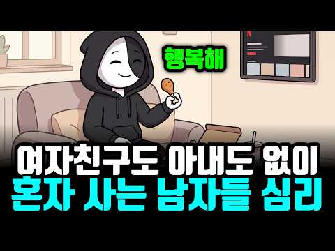
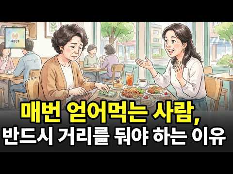
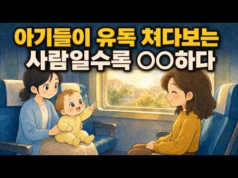
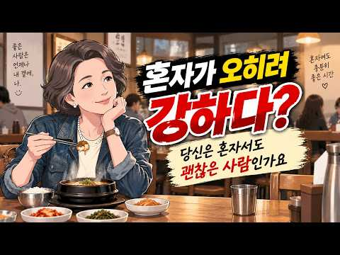
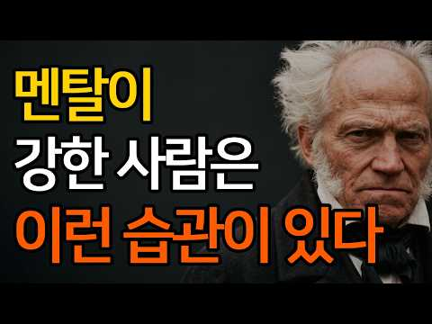
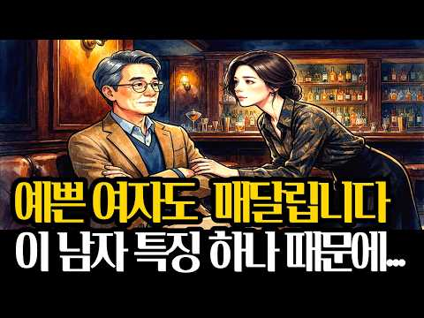
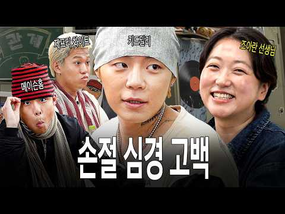
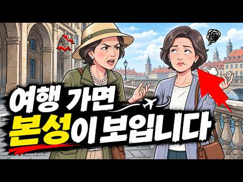
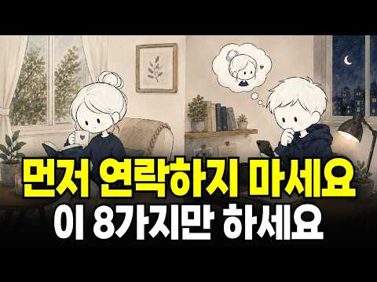

# 심리 — 성공 사례 분석: 사례별 자세히 #1–#40

`analysis.md` 의 9번 (같은 # 번호). 자동 생성 — `tools/success_analysis.py` v1.6 (2026-11-12 10:13 UTC). ※ 연구·교육용 — 투자 권유가 아님.

### 1. 혹시 당신도?! 자리 뜰 때 의자 집어넣는 사람들의 의외의 심리학적 특징 3가지

- https://www.youtube.com/watch?v=ybPJ5t_VfUk · 마음의 반대편 · 구독자 1,510 · 조회수 1,210,324 (×801.5, 하루 50,050.7) · 좋아요 5,704 (0.5%) · 9.5분 · 2026-10-18 · 주제 묶음 1. 심리학 일반 · 형식 목록형 (N가지 특징·신호) · 폴더 `W_ybPJ5t_VfUk` (웹 승인)
- 썸네일: 
- 설명 앞부분: 카페나 식당을 나설 때 무의식적으로 의자를 집어넣는 행동에는 우리의 깊은 내면과 무의식이 담겨 있습니다. 이 영상에서는 의자를 넣는 사람들의 행동을 통해 타인을 향한 배려와 자기 통제력을 심리학적 관점에서 살펴봅니다. 우리가 무심코 하는 3초짜리 행동이 타인을 대하는 방식과 세상을 바라보는 태도를 어떻게 보여주는지 알아봅니다. 사소한 버릇 속에 숨겨진 인간의 진짜 내면과 무의식의 거울을 마주하는 시간이 될 것입니다. 일상적인 행동 하나로 자신과 타인의 숨겨진 심리를 이해하는 흥미로운 경험을 해보시길 바랍니다.
- 대본 (자막, 5.7 음절/초) 첫 20초: “여러분은 혹시 주말 오후 조용한 카페나 북적이는 식당에서 주변을 둘러보신 적이 있으십니까? 자리를 털고 일어나는 수많은 사람들 속에서 유독 눈에 띄는 몇몇 사람들이 존재합니다. 그들은 자신이 앉았던 의자를 그냥 둔 채 떠나는 법이 없습니다. 오히려 누군가 다시 앉을 것처럼 혹은 원래 그 자리에 있었던” — 도입부 유형: 질문으로 시작, 시청자 부르기
- 첫 1분: “여러분은 혹시 주말 오후 조용한 카페나 북적이는 식당에서 주변을 둘러보신 적이 있으십니까? 자리를 털고 일어나는 수많은 사람들 속에서 유독 눈에 띄는 몇몇 사람들이 존재합니다. 그들은 자신이 앉았던 의자를 그냥 둔 채 떠나는 법이 없습니다. 오히려 누군가 다시 앉을 것처럼 혹은 원래 그 자리에 있었던 것처럼 위자를 테입을 안쪽으로 승밀어 넣습니다. 참으로 사소하고 눈여겨 보지 않으면 지나치기 쉬운 아주 작은 행동입니다. 하지만 바로이 순간 여러분의 뇌리에 문득 이런 의문이 스치지 않습니까? 도대체 저 사람들은 애 저런 번거로운 행동을 자발적으로 하는 것일까 하는 생각말입니다. 누가 시킨 것도 아니고 그렇게 하지 않는다고 해서 누구에게 지적을 받는 것도 아닙니다. 그럼에도 불구하고 몸에 벤듯 자연스럽게 의자를”
- 흐름 (90초마다 첫 문장): 0:00 여러분은 혹시 주말 오후 조용한 → 1:30 거울입니다. 혹시이 영상을 보고 계신 → 3:01 설명하기도 합니다. 보통 사람들은 → 4:31 대한 통제권을 확보하려는 본능으로 → 6:00 겁니다. 의자를 넣는 것 역시 이와 → 7:31 진정한 리더십의 가장 핵심적인 자질과 → 9:00 집어넣는 손길 하나가 결국 더
- 댓글 723/724: 좋은 점 — 영상 14 · 감사·응원 6 · 더 알고 싶은 것 9 · 아쉬운 점 — 영상 5 · 반박·불만 — 의견 다름 10 · 정치·사회 6 · 경험 공유 132 · 구독·다음 기대 1
  - 좋은 점 — 영상 👍160 “사용한 물건은 제자리에 놓으라고 배웠어요 유치원에서”
  - 좋은 점 — 영상 👍24 “국민학교때 선생님께 배웠지요 청소후에 그렇게마무리 해야했고”
  - 감사·응원 👍7 “맞은편 상대가 다리 꼬고 앉으면 그 발이 제 쪽의 바지에 닿는 경우가 많습니다. 그냥 참고만 있었는데 며칠 전 한 사람은 다리가 길어서 제 바지를 제대로 계속 툭툭 쳐서 "정말 미안한데 내 바지에 닿는다"고 하니까 기분 나빠하더라구요. 이 부분도 심리학적으로 해석해 …”
  - 감사·응원 👍3 “좋아 좋아 아주 좋아요 응원합니다”
  - 더 알고 싶은 것 👍1 “내가 그래서 왜 그러는지 궁금해서 왔어요 ㅋㅋ”
  - 더 알고 싶은 것 👍0 “의자를 제 자리에 놓고 모든 물건들이 딱딱 각마춰 놓아 두고 마을청소를 혼자 다니며 하는 사람이 샤워하는 날이 손에 비누 묻히는 날이고 텃밭을 파고 갈아사 흙먼지 묻은 옷으로 소파에 드러눕고 밥도 먹고 잘때도 기냥 잡니다노숙자처럼 옷을 갈아입지 않고 며칠을 보내고 잘…”
  - 아쉬운 점 — 영상 👍7 “맞은편 상대가 다리 꼬고 앉으면 그 발이 제 쪽의 바지에 닿는 경우가 많습니다. 그냥 참고만 있었는데 며칠 전 한 사람은 다리가 길어서 제 바지를 제대로 계속 툭툭 쳐서 "정말 미안한데 내 바지에 닿는다"고 하니까 기분 나빠하더라구요. 이 부분도 심리학적으로 해석해 …”
  - 아쉬운 점 — 영상 👍0 “서론이 너믜길어서 들을수가없네”
  - 반박·불만 — 의견 다름 👍0 “그냥 습관처럼 되어버렸지만 무의식적 행동아닙니다. 그렇게 해놓아야 한다고 생각해서 그리합니다.”
  - 반박·불만 — 의견 다름 👍0 “나도 외부에서 의자를 정리하는 스타일인데, 근데 난 집에서는 그렇게 정리하지 않아요. 그냥 널부러져 있어도 스트레스 안받는 스타일...ㅎㅎ 다만 밖에서는 웬지 그래야 편할 것 같은 생각때문에 그렇게 해요. 나만의 매너랄까? 굳이 남에게 보여주자는 뜻은 아닌데... 그…”
  - 정치·사회 👍0 “그행동은.선진국에서는.기본중의기본적행동이라서.어렸을때부터 몸에배어있지요.오히려 안그러는사람들의 행동을 이해할방법이없어요.뻔뻔하게.그냥일어나나갈수있는 용기가? 대단하게느껴짐..내가 앉았던자리.빌려썼으니 그대로해놓고가는게 기본아닌가요? 그게 무슨? 깔끔떤다고? 몸에붙어이…”
  - 정치·사회 👍0 “자기 앉았던 자리 깨끗이 하는 습관은 중국인과 나를 구분하는 것.ㅋㅋㅋ”
  - 경험 공유 👍516 “난 내가 착한 사람 이라고 생각하지 않음. 그저 내가 사용한 의자 안넣고, 내가 연 문 닫지 않으면 너무 거슬려서 그냥 못 지나침.”
  - 경험 공유 👍427 “카페든 식당이든 화장실이든 내가 머물렀던 자리를 지저분하게 하고 나오면 마음이 불펀함. 쓰레기 최대한 정리하고 의자 넣고 그냥 나만의 루틴임.”
  - 구독·다음 기대 👍0 “구독합니다 😊”

### 2. 무조건 일시불로만 결제하는 사람들의 놀라운 심리와 인간관계 특징 7가지

- https://www.youtube.com/watch?v=MiCkhuXQ7Xs · 4와2 · 구독자 462 · 조회수 219,594 (×475.3, 하루 7,335.2) · 좋아요 1,051 (0.5%) · 12.7분 · 2026-10-12 · 주제 묶음 2. 인간관계·대화 · 형식 목록형 (N가지 특징·신호) · 폴더 `W_MiCkhuXQ7Xs` (웹 승인)
- 썸네일: 
- 대본 (자막, 6.1 음절/초) 첫 20초: “안녕하세요. 오늘은 조금 독특한 주제로 시작해 보겠습니다. 몇 개월로 해 드릴까요?이 질문이 끝나기도 전에 일시리요 하고 대답하는 사람 주변에 한 명쯤 있으시죠? 어쩌면 지금 영상을 보고 계신 여러분이 바로 그 사람일 수도 있습니다. 무의자 할부라고 해도 이자가 한 푼도 안 붙는다고 해도”
- 첫 1분: “안녕하세요. 오늘은 조금 독특한 주제로 시작해 보겠습니다. 몇 개월로 해 드릴까요?이 질문이 끝나기도 전에 일시리요 하고 대답하는 사람 주변에 한 명쯤 있으시죠? 어쩌면 지금 영상을 보고 계신 여러분이 바로 그 사람일 수도 있습니다. 무의자 할부라고 해도 이자가 한 푼도 안 붙는다고 해도 아니요. 그냥 일시불로 할게요. 옆에서 친구가 야 무의자인데 왜 안 해? 그게 이득이잖아 하고 물으면 이렇게 답하죠. 그냥 찝찝해서 저도이 말을 들었을 때 좀 신기했습니다. 계산상으로는 할부가 더 합리적일 때도 많은데 왜이 사람들은 그 찝찝함을 못 견디는 걸까요? 그런데 이상하게도 이런 사람들이 인간 관계에서 보이는 모습이 결제할 때와 놀랍도록 닮아 있습니다. 친구한테 밥 얻어 먹으면 그 주 안에 커피라도 꼭 사야 마음이”
- 흐름 (90초마다 첫 문장): 0:00 안녕하세요. 오늘은 조금 독특한 → 1:31 똑똑하게 관리하는 분도 많고요. 모든 → 3:01 누가 밥을 사면 다음에는 꼭 자기가 → 4:31 넘기지 않습니다. 할부는 지금의 내가 → 6:01 싫어하는 모습으로 나타납니다.이 → 7:31 영역을 존중하는 사람들이죠. 만나서 → 9:01 방식으로 사는 사람을 가볍게 평가하게 → 10:30 매번 거절하면 오히려 그 사람은 계속 → 12:01 담겨 있습니다. 그 마음은 큰
- 댓글 186/186: 좋은 점 — 영상 5 · 감사·응원 3 · 더 알고 싶은 것 1 · 아쉬운 점 — 영상 0 · 반박·불만 — 의견 다름 4 · 정치·사회 0 · 경험 공유 33 · 구독·다음 기대 0
  - 좋은 점 — 영상 👍30 “좋은 내용이네요. 딱 저예요.집도 대출없이 현금으로 사고 차도 그래요. 돈이 많아서가 아니고 가진 현금에 맞춰 집이든 차든 사요. 누군가 밥을 자꾸 사주거나 선물을 받으면 마음이 불편해요. 일이나 사람관계도 애매하고 결론이 나지 않으면 불편해서 서둘러 결론을 내려하는…”
  - 좋은 점 — 영상 👍11 “작은것도 약속개념이 정확한 성격입니다 맞는 말씀이시네요”
  - 감사·응원 👍0 “좋은점~ 나쁜점 ~고쳐야할점~ 배려해야할점~특히 상대가 우리 일시불의 마음을~ 이해하고 오해하지 않게 설명해주셔서 감사합니다 ~😊”
  - 감사·응원 👍0 “좋은 내용 감사합니다!!!”
  - 더 알고 싶은 것 👍0 “좋은 내용이네요. 그런데 지인중에 신용카드는 먼저 쓰고 추후에 대금 나가는게 싫어서 직불카드만 쓰는 친구가 있어요. 심지어 빚이 싫어서 은행대출도 아예 없는 친구. 다음에는 직불카드만 쓰고, 대출도 안받는 유형의 특징도 한번 다뤄주세요.”
  - 반박·불만 — 의견 다름 👍0 “절반은 맞고 절반은 틀렸습니다 이런 사람들은 남이 할부를 하든 말든 신경 안씀니다 그리고 내가 한번 밥값 지불했다고 댓가를 바라지 않습니다 열번 만나 열번을 쓰야 마음이 편합니다 그리고 가장 중요한게 신용카드를 지갑에 넣고 다니지 않습니다 현금과 체크카드 사용합니다”
  - 반박·불만 — 의견 다름 👍0 “할부면 그달 소비와 지출 파악이 제대로 안된다 내 아는 지인 남자는 할부인생인데 2년전 할부들이 항상 도래되어있어 월 결제가 항상 400 이 넘는다는.. 연봉도 높은거도아닌데..ㄷㄷㄷ 그 와이프도 비슷”
  - 경험 공유 👍124 “나도 일시불 선호함 이유는 깔끔 하잖아”
  - 경험 공유 👍83 “나도 적극 동감, 절대 웬만해선 할부안함.”

### 3. 압도적인 간파력을 가진 사람들의 5가지 심리학적 특징(사람 보는 눈이 정확한 사람)

- https://www.youtube.com/watch?v=LPkzgfguXsE · 현실적인 심리학 · 구독자 1,880 · 조회수 241,862 (×128.7, 하루 25,417.1) · 좋아요 748 (0.3%) · 20.2분 · 2026-11-01 · 주제 묶음 1. 심리학 일반 · 형식 목록형 (N가지 특징·신호) · 폴더 `W_LPkzgfguXsE` (웹 승인)
- 썸네일: 
- 챕터: 0:00 첫 만남에서부터 다른 사람 · 1:51 첫인상, 심리학은 뭐라고 할까 · 3:37 첫 번째 특징 – 말보다 행동 · 5:11 두 번째 특징 – 낱개가 아닌 전체 · 6:22 세 번째 특징 – 사람 너머의 자리 · 8:00 네 번째 특징 – 내 판단을 향한 질문 · 9:53 다섯 번째 특징 – 마지막 퍼즐 · 13:40 오늘부터 해 볼 세 가지 · 16:17 내 곁의 이야기 · 18:17 처음 질문으로 돌아가서
- 설명 앞부분: 친구 소개로 처음 만난 사람이 시원시원하게 말하는데, 한 사람만 웃으면서 듣기만 합니다. 헤어지는 길에 건넨 한마디, "좀 더 봐야 알겠다." 그 짧은 자리에서 그분은 대체 무엇을 본 걸까요? 압도적인 간파력을 가진 사람들의 다섯 가지 심리학적 특징을 심리학 연구로 풀어 봅니다. 날리니 암바디·로버트 로젠탈 – Half a Minute: 30초 미만의 무음 영상으로 교수 평가를 예측한 연구 (1993) 날리니 암바디·로버트 로젠탈 – Thin Slices of Expressive Behavior as Predictors of In…
- 대본 (자막, 5.8 음절/초) 첫 20초: “사람 보는 눈이 정확한 사람은 첫 만남에서부터 다릅니다. 친구 소개로 처음 만난 사람이 시원시원하게 말해요. 필요한 거 있으면 언제든 연락하라고요. 다들 인상 좋다며 고개를 끄덕이는데 한 사람만 웃으면서 조용히 듣기만 합니다. 그러고는 헤어지는 길에 말하죠. 좋은 분 같긴 한데 좀 더 봐야 알겠다고요. 이유를”
- 첫 1분: “사람 보는 눈이 정확한 사람은 첫 만남에서부터 다릅니다. 친구 소개로 처음 만난 사람이 시원시원하게 말해요. 필요한 거 있으면 언제든 연락하라고요. 다들 인상 좋다며 고개를 끄덕이는데 한 사람만 웃으면서 조용히 듣기만 합니다. 그러고는 헤어지는 길에 말하죠. 좋은 분 같긴 한데 좀 더 봐야 알겠다고요. 이유를 물어도 딱 집어 말하지는 못해요. 다들 너무 신중하다고 웃었지만 몇 달 뒤 그 말이 맞았다는 걸 모두가 알게 됩니다. 그렇게 신중해 보였던 사람은 그 짧은 자리에서 대체 무엇을 본 걸까요? 압도적인 간파력을 가진 사람들의 다섯 가지 심리학적 특징을 차례로 풀어 보겠습니다. 이런 분 주변에 꼭 한 명씩 있잖아요. 다들 좋은 사람 같다고 할 때 혼자 고개를 갸우하고 나중에 보면 그 갸우함이 맞았던 분이요.”
- 흐름 (90초마다 첫 문장): 0:00 사람 보는 눈이 정확한 사람은 첫 → 1:32 않는 사람이었던 거죠.이 이 얘기를 → 3:01 91%, 차가운 쪽이 8%였어요. → 4:31 관찰했습니다. 그랬더니 평균 공격성이 → 6:00 신호 여러 개가 합쳐진 느낌이거든요. → 7:32 거죠. 여러분이 병원 대기실에서 만난 → 9:00 던지고 대답을 녹음했어요. 설명을 → 10:30 단계는 상대에게 달린 일 같죠. → 12:01 되잖아요. 반대로 편하게 들어주는 → 13:31 만들어 주는 일이죠. 여러분은 처음 → 15:00 보내 주겠다던 사람이 정말 보내는지만 → 16:31 사람이라고 믿어온 사람들 가운데 한 → 18:02 이런 변화는 상대에게도 선물이 돼요. → 19:30 분이 계실 거예요. 반대로 처음에
- 댓글 65/64: 좋은 점 — 영상 1 · 감사·응원 1 · 더 알고 싶은 것 0 · 아쉬운 점 — 영상 2 · 반박·불만 — 의견 다름 2 · 정치·사회 1 · 경험 공유 5 · 구독·다음 기대 0
  - 감사·응원 👍2 “1. 2. 3. 나의 성품이 나쁘지는 않았네요. 저는 제 자신에 성품이 모난 성품인가.?생각했습니다. 오늘 말씀 감사합니다. 건강챙기시면서 하세요.”
  - 아쉬운 점 — 영상 👍0 “<간파력을 가진 사람> 말이 아닌 반복되는 행동을 본다. 작은 신호를 하나씩이 아니라 전체의 결로 읽는다. 사람과 그 사람의 상황을 함께 본다. 자기 판단을 확인하려 하기 보다 의심해 본다. 편하게 이야기를 꺼내도록 끝까지 이야기를 듣는다. 말이 앞으로의 행동으로 어…”
  - 반박·불만 — 의견 다름 👍1 “사람은 변해가니까 이말도 정확한게 아니죠 하지만 좋은 지적입니다”
  - 정치·사회 👍9 “질문이 대답에 영향을 끼친다. 이게 여론조사가 실제 여론을 온전히 반영하지않는 이유중 하나다. 선거시즌이 되면 수없이 걸려오는 여론조사중 일부는 대충 생각없이 들어도 조사를 한다기보다는 여론을 형성하려는 의도가 다분한 질문이 많더라고.”
  - 경험 공유 👍12 “나도 다들 좋다하는데 쫌 아닌사람 있어 연예인 무슨느님 하는데 물론 자기 관리는 잘하는듯해 난 쫌 그래 차라리 탁씨가 난듯 해”
  - 경험 공유 👍0 “그럼 잘알겠네.내가 단한번도 친구로 생각한적없다는걸.”

### 4. 솔직히, 저는 가족을 차단했습니다.｜나르시시스트 엄마와 거리두기 ｜K-장녀의 착한딸 컴플렉스

- https://www.youtube.com/watch?v=GTaEvNGiCjk · 난나야 · 구독자 320 · 조회수 56,283 (×175.9, 하루 4,253.6) · 좋아요 286 (0.5%) · 14.5분 · 2026-10-29 · 주제 묶음 4. 나쁜 사람 알아보기 · 형식 목록형 (N가지 특징·신호) · 폴더 `W_GTaEvNGiCjk` (웹 승인)
- 썸네일: 
- 대본 (자막, 6.5 음절/초) 첫 20초: “솔직히 저는 가족을 차단했습니다. 3년째입니다. 엄마와의 관계도 끊고 동생들하고의 연락도 끊고 지금은 혼자 독립해서 살아가고 있어요. 그런데 참 이상하더라고요. 분명 엄마와 떨어져 있고 더 이상 소통하지 않는데도 제 마음속에는 여전히 엄마가 살고 있더라고요. 뭔가 어떤 걸 했을 때 아, 엄마는 이렇게 말할 것 같다라는 생각이 들기도 하고요. 행복하면 괜히” — 도입부 유형: 내 이야기·사연
- 첫 1분: “솔직히 저는 가족을 차단했습니다. 3년째입니다. 엄마와의 관계도 끊고 동생들하고의 연락도 끊고 지금은 혼자 독립해서 살아가고 있어요. 그런데 참 이상하더라고요. 분명 엄마와 떨어져 있고 더 이상 소통하지 않는데도 제 마음속에는 여전히 엄마가 살고 있더라고요. 뭔가 어떤 걸 했을 때 아, 엄마는 이렇게 말할 것 같다라는 생각이 들기도 하고요. 행복하면 괜히 죄책감 될 거고 아무도 저를 비난하지 않았는데 저 스스로 비난하고 있더라고요. 엄마와는 헤어졌는데 제 아내 엄마와는 헤어지지 못한 거죠. 오늘은 그 이야기를 해 보려고 해요. 근데 먼저 한 가지 말하고 싶은 건요. 저는 엄마를 욕하거나 비난하기 위해서이 영상을 찍는 건 아니에요. 누군가를 나쁜 사람으로 규정하고 또 제 삶이 힘들었던 이유 전부를 탓을 돌리려”
- 흐름 (90초마다 첫 문장): 0:00 솔직히 저는 가족을 차단했습니다. → 1:30 임상적인 진단이나 규정을 하려는 건 → 3:00 부모에게 의지하고 보호받아야 하는 → 4:30 문제라는 건 아니고요. 다만 그 이혼 → 6:00 지켜야 되겠다라는 생각을 했어요. → 7:30 했어요. 반대로 아이가 엄마의 감정을 → 9:00 배운이 생존 방식이 지금의 저를 → 10:31 사람이었고 또 동시에 두려운 → 12:01 행복하지만은 않았어요. 너무나 → 13:31 같아요. 근데 이제는요. 그 슬픔도
- 댓글 71/71: 좋은 점 — 영상 4 · 감사·응원 12 · 더 알고 싶은 것 2 · 아쉬운 점 — 영상 0 · 반박·불만 — 의견 다름 2 · 정치·사회 0 · 경험 공유 25 · 구독·다음 기대 0
  - 좋은 점 — 영상 👍24 “나르시시스트 엄마와 시아버지를 겪은 경험으로 알게된 것이 가장 앞에서 직격탄을 맞는 존재가 있기 때문에 다른 사람들은 동일한 정도의 상처를 받지 않는다는 것이었어요 내가 시집 일에서 완전히 발을 떼고, 남편이 전면에 나서면서야 비로소 남편은 자기 아버지가 얼마나 힘든…”
  - 좋은 점 — 영상 👍5 “저는부모님 두분다 나르예요. 연락 끊은지 저도 3년 됐는데 해방감과 같이 슬펐어요 그런데 영상보고 알았네요 ‘나도 언젠가는 제대로 된 사랑을 받겠지’ ‘언젠가는 두분이 어른스런 사랑을 주시겠지’했었나봐요. 그 이유모를 슬픔이 뭐지? 했는데 영상보고 알았네요. 아직도 …”
  - 감사·응원 👍24 “나르시시스트 엄마와 시아버지를 겪은 경험으로 알게된 것이 가장 앞에서 직격탄을 맞는 존재가 있기 때문에 다른 사람들은 동일한 정도의 상처를 받지 않는다는 것이었어요 내가 시집 일에서 완전히 발을 떼고, 남편이 전면에 나서면서야 비로소 남편은 자기 아버지가 얼마나 힘든…”
  - 감사·응원 👍13 “난 나야 님❤ 딸셋 엄마인 내가 난나야님을 안아주고 싶어 눈물이 났어요 "엄마 품에 안겨 눈물 흘리는걸 상상한다" 그랬을 때 내가 엄마되어 이쁜딸 가슴에 폭 안고 위로해주고 싶다는 생각에 ㅋ 난나야님 서울 살면 밥한끼 사주고 싶어요 내딸 친구들도 울집에 자고 가면 같…”
  - 더 알고 싶은 것 👍4 “저랑 정말 똑같아요. 제 기분을 정리해주시는 것 같아요. 저도 큰 계기가 생기고 나서야 말을 했더니 반응도 똑같아요. 미안해의 미자도 말 안하더라고요. 저희 엄마는 할머니 이야기를 했어요. 나는 우리 엄마(할머니)한테 안 그랬는데... 그런 말을 했어요. 이해가 안돼…”
  - 더 알고 싶은 것 👍3 “저도 같은 길을 걷고있어요. 혹시나 응급실에 가시거나 요양원에 가시거나 칠순 팔순 생신때는 어떻게 하실생각인가요? 집도 가깝고 가끔 아이들을 챙겨주셨던 기억이 남아있어서 미래를 어떡해야할지 정리가 안되어 불안합니다.. 친척들의 착한 장녀라는 프레임과 남동생은 더 나몰…”
  - 반박·불만 — 의견 다름 👍8 “지금에야 유투브에 이런 사연들도 많이 올라오고 상담정보도 넘치니 무엇이 문제였는지 깨닫게 되었지만, 오랫동안 모르고 살았어요. 어린 날에 받았던 뜬금없는 비난과 무수한 상처 속에서 소위 애어른이 되어 발달한 책임감 하나로 극도로 애를 쓰며 살았고, 그러다보니 사회적으…”
  - 경험 공유 👍24 “나르시시스트 엄마와 시아버지를 겪은 경험으로 알게된 것이 가장 앞에서 직격탄을 맞는 존재가 있기 때문에 다른 사람들은 동일한 정도의 상처를 받지 않는다는 것이었어요 내가 시집 일에서 완전히 발을 떼고, 남편이 전면에 나서면서야 비로소 남편은 자기 아버지가 얼마나 힘든…”
  - 경험 공유 👍14 “병원에 가니깐 cptsd라고 하더군요 어린시절 학대로 인해서 생긴거죠 영상 보는 내내 공감하면서 들었습니다 저도 연락끊은지 2년이 다돼가고, 병원, 약물치료, 심리상담도 같이 병행하면서 산지가 1년이 넘어가네요 그 과정에서 플라잉몽키들과 믿었던 사람들의 배신 참 힘들…”

### 5. 여자 친구 셋이 만나면 유독 한 사람이 외로워지는 이유｜친구 관계의 숨은 심리

- https://www.youtube.com/watch?v=DArI-hAS0jo · 하나둘 심리학 · 구독자 658 · 조회수 127,727 (×194.1, 하루 8,472.1) · 좋아요 315 (0.2%) · 13.6분 · 2026-10-27 · 주제 묶음 1. 심리학 일반 · 형식 오디오북·책 요약 · 폴더 `W_DArI-hAS0jo` (웹 승인)
- 썸네일: 
- 설명 앞부분: 오랜만에 반가운 마음으로 나간 세 사람의 모임, 이상하게 집에 돌아오는 길에는 마음 한구석이 헛헛하고 피로했던 적 있으신가요? 네모난 식탁에 둘러앉는 순간부터 묘하게 갈라지는 시선, 나만 모르는 둘만의 대화와 쇼핑 이야기, 그리고 내 말 한마디는 그저 남의 말을 꺼내기 위한 마중물처럼 흩어져 버리는 순간들. 우리는 이럴 때 "내가 말주변이 없나?", "저 둘이 나보다 더 친한가?" 하며 스스로를 탓하곤 합니다. 하지만 이것은 여러분의 탓도, 친구들이 악당이라서 그런 것도 아닙니다. 인간관계에서 '셋'이라는 숫자는 조금만 균형이 흔…
- 대본 (자막, 5.9 음절/초) 첫 20초: “오랜만에 셋시 얼굴이나 보자며 만났던 날이었습니다. 한 친구가 단꼬리라며 데려간 식당문을 열고 들어가서 네모난 사인용 식탁에 둘러 앉는 순간 미묘한 공기가 흐르기 시작하더군요. 한쪽에는 두 사람이 나란히 안고 건너편에는 저 혼자 덩그러니 마주보고 앉게 되었습니다. 자리가 그렇게 잡히자마자 자연스럽게”
- 첫 1분: “오랜만에 셋시 얼굴이나 보자며 만났던 날이었습니다. 한 친구가 단꼬리라며 데려간 식당문을 열고 들어가서 네모난 사인용 식탁에 둘러 앉는 순간 미묘한 공기가 흐르기 시작하더군요. 한쪽에는 두 사람이 나란히 안고 건너편에는 저 혼자 덩그러니 마주보고 앉게 되었습니다. 자리가 그렇게 잡히자마자 자연스럽게 둘만의 시선이 오가고 숟가락과 물컵을 놓아주는 손길부터 대화의 시작점까지 둘 사이에 먼저 다리가 놓였습니다. 분명 다 같이 반갑다고 손을 흔들며 들어왔는데 불과 3분도 지나지 않아 저 혼자 건너편 섬에 떨어져 앉은 기분이 들었죠. 너 저번에 그 코트 샀어? 그거 색깔 진짜 잘 빠졌더라. 그렇지? 안 그래도 지난주에 그거 입고 나갔다가 너 생각났잖아. 두 친구가 마주 보며 웃음을 터트리는 동안 저는 젓가락으로 기본”
- 흐름 (90초마다 첫 문장): 0:00 오랜만에 셋시 얼굴이나 보자며 만났던 → 1:32 친구가 얼른 알아차리고 제게 말을 → 3:01 즐거웠다며 다음 달에 또 보자는 → 4:30 친밀도의 문제가 아니라 정보의 균형과 → 6:00 사람에게 친절하게 설명해 주며 대화의 → 7:30 관계는 상담사와 내담자의 관계가 → 9:00 친구는 얼굴이 살짝 부어지며 민망해 → 10:31 보는 겁니다. 대화의 관객이 되기를 → 12:00 가까울 수도 있고 다른 시기에는 또 → 13:30 서로의 안부를 묻는 시간도 한번 가져
- 댓글 67/67: 좋은 점 — 영상 0 · 감사·응원 0 · 더 알고 싶은 것 0 · 아쉬운 점 — 영상 0 · 반박·불만 — 의견 다름 4 · 정치·사회 0 · 경험 공유 10 · 구독·다음 기대 0
  - 반박·불만 — 의견 다름 👍6 “그런 느낌이 한 두번이 아닌데 꼭 셋이 만나야 할 이유가 있나? 따로 둘이 만나던지…아님 안 만나던지….스트레스 받으며 친구를 만나야 하나?”
  - 반박·불만 — 의견 다름 👍3 “아... 저 형님들하고 만날때 처음으로 소외감느꼈어요. 원래 셋이든 넷이든 지인들에게 서운한 적 없었는데, 첨 느껴봤네요. 두 분만 아는 이야기하면 자연스럽게 저는 소외되더라구요... 일부러 그러시는건 절대 아닌데, 자연스럽게 그렇게 됩니다.”
  - 경험 공유 👍25 “치고 들어가서 나도 알려죠 해서 잘 말해주면 괜찮은데 단답만 하고 나는눈도 안마주치고 자기네들끼리 티키타카 내가물어도 단답만 한다면 예전엔 요번만 참아야지 담에 안보던가🎉 그랬는데 이제는 집에 일있다고 빨리 도망나옴 집에가서 청소하는게 더 시간 알참 그리고 사십대초반…”
  - 경험 공유 👍18 “난 오히려 더 편하던데 내가 직접적으로 대화에 참여하는 것보다 간접적인 상황에 놓인 상태가 더 편함 대화에 적극적으로 참여하다보면 피곤해지고 은근 스트레스가 장난 아님ᆢ 적극적으로 대화한다고 해서 서로 맘이 맞는것도 아니고 더 친한것도 아님 오히려 대화하다가 기분 상…”

### 6. X세대가 유독 혼자 다 해내는 심리학적 이유

- https://www.youtube.com/watch?v=ObG5Hf_uTjc · 무진심리학 · 구독자 2,990 · 조회수 823,556 (×275.4, 하루 33,310.6) · 좋아요 5,661 (0.7%) · 8.1분 · 2026-10-17 · 주제 묶음 1. 심리학 일반 · 형식 정보·해설 (그 밖) · 폴더 `W_ObG5Hf_uTjc` (웹 승인)
- 썸네일: 
- 챕터: 0:00 아무도 이야기하지 않는 세대 · 0:27 열쇠를 목에 건 아이들 · 1:46 어른이 무너지는 걸 본 아이들 · 2:58 드러내지 않는 사람들 · 3:25 웃으며 넘기는 사람들 · 3:56 티 내지 않고 해내는 사람들 · 4:27 도움은 안 청하지만, 남은 돕는 사람들 · 4:59 직함보다 실력을 보는 사람들 · 5:19 여러 번 흔들린 사람들 · 6:01 애써서 알아낸 사람들 · 6:35 다르게 키우려는 부모들 · 7:02 다리 같은 세대에게
- 설명 앞부분: 혼자 해내는 게 당연했던 사람들이 있습니다. 목에 열쇠를 걸고 빈집 문을 열던 아이들, 외환위기 때 어른들이 무너지는 걸 지켜본 아이들, 그리고 지금은 부모님과 자식 사이에서 묵묵히 버티고 있는 사람들이요. 이 영상에서는 X세대가 왜 도움을 잘 청하지 않는지, 왜 늘 최악부터 대비하는지, 왜 티 내지 않고 일하는지를 그 시절의 장면과 심리학 연구로 풀어 봅니다. 마지막에는 아무도 해 주지 않았던 말을 전해 드립니다. 목에 열쇠를 걸고 빈집 문을 열던 기억이 있으신가요? 기억나는 삐삐 암호가 있다면 댓글로 남겨 주세요. 같은 기억을…
- 대본 (자막, 6.2 음절/초) 첫 20초: “베이비 붐 세대는 나라를 일으켰다고 하고 MG 세대는 회식을 싫어한다고 하죠. 요즘 애들은 폰만 본다는 말도 있고요. 그런데 그 사이에 아무도 이야기하지 않는 세대가 있습니다. X세대입니다. 일은 다 해 놓고 티를 안내는 팀장님. 다 키워 주고도 생색 한번 안내는 부모님. PC 통신과 초고속 인터넷 시대를 연 사람들인데 정작 SNS에는 거의 없는”
- 첫 1분: “베이비 붐 세대는 나라를 일으켰다고 하고 MG 세대는 회식을 싫어한다고 하죠. 요즘 애들은 폰만 본다는 말도 있고요. 그런데 그 사이에 아무도 이야기하지 않는 세대가 있습니다. X세대입니다. 일은 다 해 놓고 티를 안내는 팀장님. 다 키워 주고도 생색 한번 안내는 부모님. PC 통신과 초고속 인터넷 시대를 연 사람들인데 정작 SNS에는 거의 없는 사람들이요. 오늘은이 사람들이 왜 이렇게 됐는지 이야기해 보려고 합니다. 어쩌면 가장 오해받고 있는 세대일지도 모르거든요.이 세대를 만든 첫 장면은 빈집입니다. 학교가 끝나면 목에건 열쇠로 문을 열고 아무도 없는 집에 들어갑니다. 부모님은 일하러 가셨어요. 휴대폰도 없고 평일 낮에는 텔레비전에 볼 것도 없었습니다. 낮 방송이 허용된게 2005년이에요. 라면을 끓이고”
- 흐름 (90초마다 첫 문장): 0:00 베이비 붐 세대는 나라를 일으켰다고 → 1:30 조사한 연구가 있습니다. 밤과 후 → 3:00 이유도 여기서 나옵니다. 기술을 → 4:31 누구보다 조용히 남을 돕는다는 → 6:00 감내한이 세대가 지식을 대하는 방식도 → 7:31 이어 줄 뿐이에요. 아무것도 바라지
- 댓글 1,636/1,637: 좋은 점 — 영상 39 · 감사·응원 138 · 더 알고 싶은 것 8 · 아쉬운 점 — 영상 8 · 반박·불만 — 의견 다름 22 · 정치·사회 47 · 경험 공유 185 · 구독·다음 기대 0
  - 좋은 점 — 영상 👍146 “피자와 된장찌게를 같이먹을수있는세대!! 자식에게 기대지않겠다고하는 세대!! 가교같은세대라는말이 딱!공감되네… 어느덧 50대라니 실감이안난다…”
  - 좋은 점 — 영상 👍38 “83년생입니다.나이로따지면 x세대는 아니지만 많은부분이 와닿습니다.형님들 존경합니다 영포티라고 놀림받지만 앞으로도 열심히 살게요🎉❤”
  - 감사·응원 👍605 “X세대때문에 지금 한국의 경제가 유지되고 있죠. 나의 세대, 얘들아 화이팅!”
  - 감사·응원 👍547 “세상의 모든 X세대들. 우리 조금만 더 힘 냅시다. 화이팅.”
  - 더 알고 싶은 것 👍1 “서로가 노예 같다, 불쌍하다 자랑하는게 맞나요? 나이 상관 없이 다른 세대에 살아본게 없으니 결국 자기들이 힘들다고만 외치죠.”
  - 더 알고 싶은 것 👍0 “80년대생들도 분석해주세요”
  - 아쉬운 점 — 영상 👍61 “좋은 컨테츠 보니깐 갑자기 생각이 나네요. 그시절 X세대를 말해주는 광고가 있었죠. 리바이스 "난 나야" 부모와 다른 독립적으로 행동하고 판단하는... 좋은 컨텐츠 감사합니다!”
  - 아쉬운 점 — 영상 👍28 “12년개근입니다 SNS 하지 않습니다 부모님보다 덜 고생하고 지금의 자녀보다 더 편했던 것같습니다 매일매일 새로운 것들이 쏟아져서 지루하지 않았습니다 오히려 가장 축복받은 세대인거 같습니다 남은 인생도 더 가치있게...”
  - 반박·불만 — 의견 다름 👍1 “글쎄 옛말이 된건가 내가본 x세대들은 mz못지 않게 이기적이든데😂”
  - 반박·불만 — 의견 다름 👍1 “이젠 기득권이 되어버린 세대 정신승리용 영상 늙크크답게 사탕발린말이랑 AI좋아하노.... 샌드위치처럼 끼인 세대 어느 세대가 안 그러나요...ㅋㅋㅋㅋㅋ 각자 세대만의 다른 십자가를 짊어지고 살아가는것이지,... 특별한척 하진 맙시다.. 최소한 개화 이후 우리나라에서 …”
  - 정치·사회 👍715 “x세대는 정말 멀티플레이어입니다. 저도 20대때 국회도서관에 가서 줄 서서 복사해와서 워드프로세서로 리포트를 작성해봤고, 지금은 챗GPT를 이용합니다.”
  - 정치·사회 👍56 “다리 무너지고 백화점 무너지더니 나라가 무너지더라. 그 여파로 우리 집도 날아갔다.... 진짜 내 10~20대 힘들었네.ㅠㅠ”
  - 경험 공유 👍715 “x세대는 정말 멀티플레이어입니다. 저도 20대때 국회도서관에 가서 줄 서서 복사해와서 워드프로세서로 리포트를 작성해봤고, 지금은 챗GPT를 이용합니다.”
  - 경험 공유 👍690 “나라에서 원하는건 많은데 혜택은 없고 우리 윗세대는 나라를 일으켰다 인정받지만 우리세대는 그딴건 없고, 청년지원사업도 우리가 청년이던시절엔 없었고. 그러면서도 2030세대한테는 꿀빠는 세대라고 비난받고... 그냥 다 어렵고 억울하기만 하지만, 오늘도 출근합니다. 군대…”

### 7. 60,70년대에 태어난 사람들이 조금 특별한 이유

- https://www.youtube.com/watch?v=cBslvnhVNvw · 심리학타임 · 구독자 2,450 · 조회수 636,961 (×260.0, 하루 17,523.5) · 좋아요 4,048 (0.6%) · 18.1분 · 2026-10-06 · 주제 묶음 3. 자존감·마음 · 형식 오디오북·책 요약 · 폴더 `W_cBslvnhVNvw` (웹 승인)
- 썸네일: 
- 챕터: 0:00 인트로 · 0:55 60, 70년대생은 대체 뭐가 그렇게 특별할까 · 1:45 첫 번째 이유 — 아날로그와 디지털을 모두 겪은 마지… · 3:31 두 번째 이유 — 내일은 오늘보다 나아진다고 믿으며 … · 4:32 열심히 산 믿음의 그림자 — 쉬는 게 불안한 사람들 · 5:27 세 번째 이유 — 위와 아래에서 동시에 끼인 세대 · 7:09 네 번째 이유 — 큰 위기를 여러 번 넘겨본 세대 · 8:31 다섯 번째 이유 — 표현은 서툴지만 마음은 누구보다 … · 9:23 실제 사례 — 58세 아버지와 30세 딸, 두 글자 … · 10:25 핵심 반전 — 장점이면서 동시에 짐인 다섯 가지 경험 · 11:17 옛날 노래 한 곡에 가슴이 먹먹해지는 이유 · 12:19 짐은 내려놓고 장점은 키우는 네 가지 원칙 · 12:31 원칙 1 — 두 세계의 통역사 되기 · 12:59 원칙 2 — 쉬는 것에 허락 내려주기 · 13:35 원칙 3 — 짐을 혼자 지지 않기 · 13:58 원칙 4 — 마음을 한 줄로 표현하기 · 14:26 원칙을 실천하면 벌어지는 변화 · 15:04 처음 이야기로 돌아가서 · 15:54 너무 참기만 했다고 자책하지 않아도 되는 이유 · 17:06 오늘 해볼 수 있는 작은 시도
- 설명 앞부분: 5가지 경험이 한 세대의 성격을 만들었습니다. 편지와 삐삐, 스마트폰까지 모두 건너온 60·70년대생이 특별한 이유는 나이가 아니라, 이 길을 건너왔기 때문입니다. 카세트테이프를 연필로 감던 아이가 지금은 키오스크 앞에서 척척 주문하는 어른이 되기까지. 아날로그와 디지털을 모두 겪은 세대, 위아래로 끼인 세대, 위기를 여러 번 넘긴 세대, 그리고 사랑을 "그래" 두 글자로 말하는 세대. 60, 70년대에 태어난 사람들이 조금 특별한 이유 5가지와, 짐은 내려놓고 장점은 키우는 방법을 쉽고 재미있게 풀어봅니다. 타임라인
- 대본 (자막, 5.2 음절/초) 첫 20초: “혹시 이런 기억 있으신가요? 카세트 테이프가 늘어나면 연필를 구멍에 꽂아 돌려 감던 기억. 좋아하는 사람 집에 전화를 걸었다가 아버님이 받으시면 말없이 끊었던 기억. PP에 메시지 하나 남기려고 공중전화 앞에 동전을 쌓아두고 줄을 서던 기억. 그런데 그 사람이 지금은 스마트폰으로 화상” — 도입부 유형: 질문으로 시작
- 첫 1분: “혹시 이런 기억 있으신가요? 카세트 테이프가 늘어나면 연필를 구멍에 꽂아 돌려 감던 기억. 좋아하는 사람 집에 전화를 걸었다가 아버님이 받으시면 말없이 끊었던 기억. PP에 메시지 하나 남기려고 공중전화 앞에 동전을 쌓아두고 줄을 서던 기억. 그런데 그 사람이 지금은 스마트폰으로 화상 통화를 하고 키오스크 앞에서 척 주문하고 손주에게 이모티콘을 보냅니다. 한 사람이 살면서 이렇게까지 다른 두 세상을 건너왔다는게 생각해 보면 참 신기한 일입니다. 그래서 1960년대, 1970년대에 태어난 분들에게는 뭔가 독특한 분위기가 있습니다. 참물성이 많고 책임감이 강하고 겉으로는 무뚝한데 속은 한해 없이 여입니다. 이런 이야기를 들으면 대부분 이렇게 말씀하십니다. 맞아. 내가 좀 그렇지 궁금하지 않으십니까? 60. 70”
- 흐름 (90초마다 첫 문장): 0:00 혹시 이런 기억 있으신가요? 카세트 → 1:30 70년대생이 아니셔도 괜찮습니다. → 3:00 지났는데도 술 나오지 않으십니까? → 4:30 자연스럽게 길러졌습니다. 그런데이 → 6:01 이끌어야 합니다. 윗사람의 눈치와 → 7:30 넘기려 했던 장면은 지금도 많은 → 9:00 못한 마음이 가득 담겨 있습니다. → 10:30 나서가 아닙니다. 더 정확히 말하면 → 12:01 건강한 방법입니다. 그러니 노래한 → 13:31 마디만으로도 하루의 무게가 조금은 → 15:00 깊습니다. 이제 처음 이야기로 돌아가 → 16:31 오늘이 여러분 인생에서 가장 젊은 → 18:00 바랍니다. 그리고 오늘 밤 옛날 노래
- 댓글 559/559: 좋은 점 — 영상 17 · 감사·응원 33 · 더 알고 싶은 것 4 · 아쉬운 점 — 영상 3 · 반박·불만 — 의견 다름 4 · 정치·사회 32 · 경험 공유 80 · 구독·다음 기대 1
  - 좋은 점 — 영상 👍16 “고난과 시련을 겪어도 특유의 회복탄력성(레질리언스)을 발휘하여 더더욱 분발하며 모든 어려움을 이겨내곤 했죠... 68년생인 저도 매우 공감이 가는 내용입니다. 😅 🎉”
  - 좋은 점 — 영상 👍14 “67년 양띠 100% 공감합니다”
  - 감사·응원 👍320 “62년 서울에서 태어나 국민학교 한 반에 80명 18반 까지 있어서 오전오후반 으로 공부한 추억이 있습니다, 겨울에 검은색 조개탄으로 난로를 피울 때 교실을 연기로 가득차게 되기도 했고 도시락도 못 싸오는 애들도 있었던 정말 가난한 나라였습니다. 지금 우리가 선진국이…”
  - 감사·응원 👍153 “어떻게 우리 세대를 이렇게 잘 표현 했을까!!! 감사합니다.”
  - 더 알고 싶은 것 👍1 “이런 영상 오래 기다렸어요. 내 마음이 쉴곳을 찾았네요. 이젠 나이먹고 너무 무뎌진, 옛생각에 눈물날까 창피하기도 하고ㅎ그저 다들, 모든 분들이 건강하고 행복하면 좋겠어요. 그거면됐죠. 여한이 없네요. 좋은영상 많이 만들어주세요😂”
  - 아쉬운 점 — 영상 👍16 “이 시대들은 펜팔이라는것도 경험한 세대들... 영어 좀 더 배원 볼려는 미명아래 해외펜팔 했던 60년대생들.. 영어 배운다고 미국 버지니아주 여학생과 펜팔 했던 기억이 아련 합니다. 버지아주 여학생이였고 제가 잘못 표현했던 영어 표현도 알려주고 그 여학생 집 전경이 …”
  - 아쉬운 점 — 영상 👍1 “동네 신작로에는 빨간 우체통이 있었고, 크리스마스가 되면 카드를 열심히 직접 만들고 크리스마스씰을 붙여 우체통에 넣거나, 직접 전해주곤 했었죠. 형광등을 깨어 가루로 만들고 밀가루로 풀을 만들어 섞어 연줄에 묻힌 뒤 연을 날려 서로 끊어내는 놀이도 하곤 했습니다. 공…”
  - 반박·불만 — 의견 다름 👍1 “아직도 번호를 기억하고 있네요.. 대동굴비 xxx-3529 여자 목소리 흉내 내면서 스위밍 좀 바꿔달라고 했던 기억.... 제대로 만나보지도 못하고 고딩때 한번,군대 가있을때 한번.. 그렇게 2번이나 끝이 났지만..귀가 얇던 그녀를 단 한번도 원망한적이 없었습니다..…”
  - 정치·사회 👍47 “저는 68년생인데 시골에서 태어나서 초가집에서 어린시절 살았어요.티비도 없었죠. 그러다 초등학교때 경기도로 이사왔는데, 학교에 학생들 너무 많아서 중고등학교때까지 한반에 70명가까이 있었어요그만큼 경쟁도 치열했지만 취업도 잘되었어요. 전쟁끝나고 부모세대가 대부분 가난…”
  - 정치·사회 👍8 “국민학교 시절엔 우리나라가 후진국이었고, 그걸 개발도상국이라 억지로 돌려 이야기 했고, 여름엔 수재민 겨울엔 화재민이 발생했어요. 여전히 골목엔 깡통을 들고 구걸을 하는 사람들도 있었지요. 그리고 미친듯 노력해서 나도 모르는 사이에 소니를 제치고, 니산을 제치고. 일…”
  - 경험 공유 👍147 “60,70년대생들 ==> 새마을 운동, 서울 올림픽을 경험했고... 주산-PC-AI, 공중전화-삐삐-피처폰-스마트폰을 다 경험해본 세대임.....”
  - 경험 공유 👍54 “61년생 시골촐신인데 갓을 쓴 할배를 보았고 호롱불 등잔밑에서 밥을 먹었고 여덟살때 처음으로 차를 보았던 내가 지금은 인프라 잘깔린 도시에서 테슬라를 몰고있으니 이거야 말로 상전벽해 아닌가.”
  - 구독·다음 기대 👍2 “구독합니다, 참고로 저는 1963년생😀”

### 8. 【이시형 박사】 남자가 평생 미치도록 사랑하는 여자는 따로 있다｜당신도 해당될까 결정적 5가지 특징｜인간관계｜인생철학

- https://www.youtube.com/watch?v=PcAIV7N3Rjc · 배짱 있는 노년 · 구독자 1,120 · 조회수 51,159 (×45.7, 하루 6,951.1) · 좋아요 465 (0.9%) · 85.8분 · 2026-11-04 · 주제 묶음 2. 인간관계·대화 · 형식 목록형 (N가지 특징·신호) · 폴더 `W_PcAIV7N3Rjc` (웹 승인)
- 썸네일: 
- 설명 앞부분: 남자가 나이가 들어서도 오랫동안 사랑하고 싶은 여자는 어떤 사람일까요? 이번 영상에서는 남자의 마음을 움직이고 깊은 사랑을 오래도록 이어 가는 여성의 5가지 특징을 알아봅니다. 외모보다 중요한 내면의 매력과 서로를 존중하는 태도, 그리고 행복한 관계를 만들어 가는 지혜를 함께 살펴봅니다. 진정한 사랑은 서로를 이해하고 아껴 주는 마음에서 시작됩니다. 여러분은 어떤 특징을 가장 중요하게 생각하시나요? 끝까지 시청하시고 댓글로 의견을 나눠 주세요.
- 대본 (자막, 4.9 음절/초) 첫 20초: “남자가 평생 잊지 못하는 여자는 따로 있습니다. 제가 평생 곁에서 지켜본 장면이 하나 있습니다. 그 장면을 떠올릴 때마다 저는 지금도 가슴이 먹먹해집니다. 오늘 그 이야기를 여러분과 나누고 싶습니다. 저는 올해로 살이 되었습니다. 한 세기가”
- 첫 1분: “남자가 평생 잊지 못하는 여자는 따로 있습니다. 제가 평생 곁에서 지켜본 장면이 하나 있습니다. 그 장면을 떠올릴 때마다 저는 지금도 가슴이 먹먹해집니다. 오늘 그 이야기를 여러분과 나누고 싶습니다. 저는 올해로 살이 되었습니다. 한 세기가 넘는 세월을 살아오면서 저는 수많은 사람들의 삶을 곁에서 지켜보았습니다. 사랑으로 시작된 인연이 원망으로 끝나는 것도 보았고 평범해 보이던 두 사람이 평생 서로의 손을 놓지 않고 사랑하는 것도 보았습니다. 젊은 부부도 보았고 머리가 약해 센 노부도 보았습니다. 그 오랜 세월 끝에 제가 깨달은 한 가지가 있습니다. 남자가 평생 잊지 못하는 여자 나이가 들어도 끝까지 곁에 두고 싶어 하는 여자는 분명히 따로 있다는 것입니다. 그런데 여기서 놀라운 사실이 하나 있습니다. 그”
- 흐름 (90초마다 첫 문장): 0:00 남자가 평생 잊지 못하는 여자는 따로 → 1:32 여자 곁에 있을 때 가장 나은 사람이 → 3:01 다섯 가지를 말씀드리려 합니다. → 4:31 사랑을 붙잡는 기술이 아니라 우리 → 6:00 정 반대로 알고 계십니다. 더 재밌는 → 7:31 꺼냈습니다. 형소 같으면 곧바로 → 9:01 가장 큰 위로가 된 것은 조언이 → 10:31 상대는 비로 소원자가 아니라는 것을 → 12:01 질문입니다. 경창은 내 입을 영원히 → 13:30 행복을 결정하는 가장 큰 요인으로 → 15:00 둘기입니다. 그러니까 이렇게 해하면서 → 16:30 밥 한끼보다 더 큰 보약이었습니다. → 18:02 깨어들고 싶은 마음을 누르는 → 19:31 열립니다. 이것은 부부에게도 → 21:00 고개를 겨웃하시는 분이 계실 겁니다. → 22:32 도무지 모르겠어.이이 이 이영의 → 24:00 삶을 살고 싶은지에 대한 조용하고 → 25:30 연애를 시작한 그릇 같았다고 합니다. → 27:00 습관을 한번 보십시오. 나는 오늘 → 28:31 번도 살아본 적이 없는 거 같았다고
- 댓글 22/22: 좋은 점 — 영상 3 · 감사·응원 6 · 더 알고 싶은 것 1 · 아쉬운 점 — 영상 2 · 반박·불만 — 의견 다름 0 · 정치·사회 0 · 경험 공유 1 · 구독·다음 기대 0
  - 좋은 점 — 영상 👍2 “좋은 말씀 한마디 한마디 존경함니다 추카추카 드림니다 🎉🎉🎉🎉🎉”
  - 좋은 점 — 영상 👍2 “좋은말씀 감사합니다 존경 합니다”
  - 감사·응원 👍10 “박사님 존경의 말씀 감사합니다 잘새겨듣겠습니다 아무도모르고살아 왔네요❤❤❤”
  - 감사·응원 👍8 “그런데 배우자가 내가 하는것마타 20년이상 살았는데 다~싫어한다면요 힘빠집니다 그림도,공예작가도 노래도 춤도 자녀와 제가다니는 대학교 입학도 다 반대했었죠~ 자녀의꿈 보컬도 남편의 반대로 딸과저는 많은걸 포기했습니다 남편은 집에오면 게임밖에 안합니다 저는뒤늦게 깨달았…”
  - 더 알고 싶은 것 👍0 “결혼은 남녀 두사람이 서로를 가족처럼 성장하는 동안 가족들이 싸우며 또는 즐거운 행복감에 겨안고 하며 희노애락을 나누는 경험이 란 것이 상대를 이해할수 있다고 노인이 되니 알 것 같습니다. 소개대로 잠시 지내며 서로를 알지 못한체로 중매결혼들이 이혼으로 많이 결단됩니…”
  - 아쉬운 점 — 영상 👍6 “네 이시형박사님 안녕하세요? 어느새 105세 되셨네요 잘 살아오셨습니다 지금은 120세 시대라고 합니다 박사님! 앞으로 130세까지 정정팔팔 지금처럼 영원하세요 항상 감사드립니다 할렐루야아멘 ♤♤♤♤♤♤♤”
  - 아쉬운 점 — 영상 👍0 “사설이 너무길어서 집중이 안됩니다”
  - 경험 공유 👍8 “그런데 배우자가 내가 하는것마타 20년이상 살았는데 다~싫어한다면요 힘빠집니다 그림도,공예작가도 노래도 춤도 자녀와 제가다니는 대학교 입학도 다 반대했었죠~ 자녀의꿈 보컬도 남편의 반대로 딸과저는 많은걸 포기했습니다 남편은 집에오면 게임밖에 안합니다 저는뒤늦게 깨달았…”

### 9. 작은 선물을 자꾸 주는 사람의 심리학적 특징

- https://www.youtube.com/watch?v=rL4yzXIKbNM · 현실적인 심리학 · 구독자 1,880 · 조회수 167,580 (×89.1, 하루 10,146.6) · 좋아요 362 (0.2%) · 20.6분 · 2026-10-25 · 주제 묶음 1. 심리학 일반 · 형식 목록형 (N가지 특징·신호) · 폴더 `W_rL4yzXIKbNM` (웹 승인)
- 썸네일: 
- 챕터: 0:00 오프닝 · 0:39 한 선배의 아침 · 1:58 심리학이 본 건네는 마음 · 3:58 첫 번째 이유 · 6:39 두 번째 이유 · 10:11 세 번째 이유 · 13:43 이 습관을 다시 바라보기 · 14:39 오늘부터 해 볼 세 가지 · 16:17 우리 세대, 그리고 가까운 사람들 · 18:36 처음 질문으로 돌아가며
- 설명 앞부분: 작은 선물을 자꾸 건네는 사람은 주기만 하는 게 아닙니다. 본인도 모르는 사이에 무언가를 받고 있어요. 캔커피 하나, 사탕 한 줌을 자꾸 건네는 사람들의 숨은 공통점, 그 세 가지 이유를 심리학 연구로 풀어 드립니다. Elizabeth W. Dunn, Lara B. Aknin, Michael I. Norton – Spending Money on Others Promotes Happiness, Science 319 (2008) Lara B. Aknin 외 – Prosocial Spending and Well-Being: Cross-…
- 대본 (자막, 5.8 음절/초) 첫 20초: “작은 선물을 자꾸 건네는 사람은 주기만 하는게 아닙니다. 본인도 모르는 사이에 무언가를 받고 있어요. 최근길에 산 과자 한 봉지. 회의실 탁자에 슬쩍 놓고 가는 사탕 한 줌. 후배 책상 위에 캔커피 하나. 별것 아닌 듯해도 이분들에겐 거의 습관이죠. 그런데 가만 보면 이상합니다. 받는 사람보다 마음이”
- 첫 1분: “작은 선물을 자꾸 건네는 사람은 주기만 하는게 아닙니다. 본인도 모르는 사이에 무언가를 받고 있어요. 최근길에 산 과자 한 봉지. 회의실 탁자에 슬쩍 놓고 가는 사탕 한 줌. 후배 책상 위에 캔커피 하나. 별것 아닌 듯해도 이분들에겐 거의 습관이죠. 그런데 가만 보면 이상합니다. 받는 사람보다 마음이 먼저 놓이는 쪽은 늘 건낸 사람이거든요. 대체 무엇을 받고 있길래 자꾸만 건네게 되는 걸까요? 소소한 선물을 자꾸 건네는 사람들의 숨은 공통점. 그 세 가지 이유를 풀어 드리겠습니다. 여러분 주변에도 한 분쯤 계시죠? 만날 때마다 뭔가를 하나씩 쥐여 주는 사람이요. 어쩌면 여러분 자신일 수도 있고요. 한 선배의 아침을 같이 보겠습니다. 오전 8시 선배가 출근길에 편의점 앞을 지나갑니다. 들어갈 생각은 없었는데”
- 흐름 (90초마다 첫 문장): 0:00 작은 선물을 자꾸 건네는 사람은 → 1:31 몰라. 그냥 하고 웃어 넘겨요. 정말 → 3:02 받는 사람을 따로 조사했습니다. 주는 → 4:32 없어요. 대신 기름이 베어나온 → 6:02 따뜻한 마음에 기뻐했습니다. 생각해 → 7:31 큰 차이를 만들지 못했거든요. 그 돈 → 9:00 사게했어요. 기분이 더 좋았던 쪽은 → 10:31 걸음이 한결 가벼워요. 방금 무슨 → 12:01 움직인 겁니다. 그럼 그 마음이 → 13:31 보입니다. 그리고 건낸 사람이 → 15:00 실제보다 크게 걱정했어요. 받는 쪽은 → 16:30 일터에서 있었거나 한창 자리를 → 18:01 명이 넘는 사람의 자료를 합친 → 19:32 곁에서 자꾸 건네는 사람이 있다면
- 댓글 33/33: 좋은 점 — 영상 1 · 감사·응원 3 · 더 알고 싶은 것 1 · 아쉬운 점 — 영상 0 · 반박·불만 — 의견 다름 1 · 정치·사회 0 · 경험 공유 3 · 구독·다음 기대 0
  - 좋은 점 — 영상 👍3 “유익하고 흥미로운 영상 감사합니다. ❤”
  - 감사·응원 👍3 “나도누구을주어야편해요좋은일이라니괜찬네요감사합니다”
  - 감사·응원 👍3 “유익하고 흥미로운 영상 감사합니다. ❤”
  - 더 알고 싶은 것 👍1 “부부사이에 대화가 점점 적어지는 이유가 궁금하네요~ 막연하게 알고 있긴하지만....”
  - 반박·불만 — 의견 다름 👍16 “예의상.. 도리상.. 착해서 베풀려고 남에게 쓰는거지. 행복때문 아닙니다. 돈쓰고 애쓰는사람한테 욕먹이지 말아요!”
  - 경험 공유 👍3 “나도누구을주어야편해요좋은일이라니괜찬네요감사합니다”
  - 경험 공유 👍1 “왜 가만히 있질못하나~ㅎㅎ 나도 모르던 마음을 일깨워주셔서 감사합니다❤”

### 10. 아무리 친해도 이 7가지는 자랑하지 마세요｜인간관계 ｜심리학 ㅣ인생조언ㅣ노후

- https://www.youtube.com/watch?v=_aC5sm4gXg4 · 가을빛 심리학 · 구독자 1,530 · 조회수 174,935 (×114.3, 하루 7,638.6) · 좋아요 619 (0.4%) · 13.8분 · 2026-10-19 · 주제 묶음 2. 인간관계·대화 · 형식 오디오북·책 요약 · 폴더 `W__aC5sm4gXg4` (웹 승인)
- 썸네일: 
- 설명 앞부분: 나이 들수록 친구에게 자랑하면 안 되는 7가지가 있습니다. 아무리 친한 친구라도 무심코 꺼낸 자랑 한마디에 마음이 멀어질 수 있습니다. 분명 좋은 소식을 나눴을 뿐인데, 왜 누군가는 불편해하고 오랜 인연이 서먹해지는 걸까요? 🍀 오늘 영상에서는 가까운 사람일수록 조심해야 할 7가지 자랑과 그 속에 숨겨진 인간관계 심리를 살펴봅니다. 심리학의 사회비교이론을 통해 가까운 사람의 성공이 때로는 왜 더 큰 비교심리를 일으키는지 알아보고, 좋은 소식을 나누면서도 소중한 인연을 지키는 방법을 함께 생각해 봅니다. 나이가 들수록 중요한 것은 …
- 대본 (자막, 5.6 음절/초) 첫 20초: “모임 자리였습니다. 한 친구가 가방에서 작은 상자를 꺼냈습니다. 며칠 전 큰 먹고 샀다는 손톱만한 금부치였죠. 사람들은 부럽다며 한 마디씩 거들었습니다. 그런데 그 자리에 있던 다른 친구가 무심고 한 마디를 보했어요. 나도 요즘 금을 조금씩 모으고 있어. 이야기가 오가다”
- 첫 1분: “모임 자리였습니다. 한 친구가 가방에서 작은 상자를 꺼냈습니다. 며칠 전 큰 먹고 샀다는 손톱만한 금부치였죠. 사람들은 부럽다며 한 마디씩 거들었습니다. 그런데 그 자리에 있던 다른 친구가 무심고 한 마디를 보했어요. 나도 요즘 금을 조금씩 모으고 있어. 이야기가 오가다 보니 그 친구가 가진 금이 훨씬 많다는게 드러났습니다. 순간 공기가 싸늘하게 식었죠. 이상하지 않으세요? 누구도 험담을 하지 않았고 누구도 거짓말을 하지 않았는데 누군가는 민망해지고 누군가는 괜히 미양해졌습니다. 자리를 파하고 집에 가는 길이 묘하게 허전했던 그 느낌 혹시 겪어 보셨나요? 사람 사이에선 이런 일이 생각보다 자주 벌어집니다. 그런데 이게 단순히 그날 분위기 탄만은 아니에요. 사람 마음이 왜 이렇게 움직이는지 심리학자들이 오래”
- 흐름 (90초마다 첫 문장): 0:00 모임 자리였습니다. 한 친구가 → 1:32 없어요. 그런데 더 많이 가진 쪽이 → 3:01 동생이 말을 점점 아끼기 → 4:31 옅어지겠죠. 부부 사이나 가정 형편 → 6:01 팔하다는 말은 건강이 예전 같지 않은 → 7:32 아직도 그 자리구나를 매일 확인시키는 → 9:02 자랑은 그 자리에서 끝나지 않고 → 10:31 겁니다. 왜 그럴까요? 돈이나 건강은 → 12:02 축하해 줬어요. 기쁨은 숨기라는게 → 13:30 일곱 가지 중에서 가장 뜨끔했던 것
- 댓글 98/98: 좋은 점 — 영상 3 · 감사·응원 2 · 더 알고 싶은 것 0 · 아쉬운 점 — 영상 0 · 반박·불만 — 의견 다름 0 · 정치·사회 0 · 경험 공유 4 · 구독·다음 기대 0
  - 좋은 점 — 영상 👍11 “너무 공감되네요 아무리 친해도 재산규모를 말할필요없는데 항상 입조심 해야겠더라구요 친한사일수록 더욱조심”
  - 좋은 점 — 영상 👍8 “나 자신을 돌아봅니다 감사합니다 유익한 영상 ❤”
  - 감사·응원 👍8 “나 자신을 돌아봅니다 감사합니다 유익한 영상 ❤”
  - 경험 공유 👍6 “살면서 경험해본 바, 결국 시기와 질투는 인간이 본성인거 같아요”
  - 경험 공유 👍1 “배려+자랑해봤자 상대방이 진심으로 축하해주지 않아요. 즉 그런 얘기 할필요 없는거죠.”

### 11. 집에 있는 것을 좋아하는 사람들의 7가지 심리적 특징

- https://www.youtube.com/watch?v=IAs1edgjR-8 · 조용한 심리 · 구독자 2,180 · 조회수 870,247 (×399.2, 하루 10,001.1) · 좋아요 4,033 (0.5%) · 21.6분 · 2026-08-16 · 주제 묶음 1. 심리학 일반 · 형식 목록형 (N가지 특징·신호) · 폴더 `W_IAs1edgjR-8` (웹 승인)
- 썸네일: 
- 설명 앞부분: 사람들과 즐겁게 시간을 보내고 돌아왔는데도 이상하게 집에 오면 마음이 놓이시나요? 약속이 취소되었을 때 아쉬움보다 안도감이 들거나, 밖에서 시간을 보내는 것보다 집에서 조용히 쉬는 시간이 더 편하게 느껴질 때가 있습니다. 집에 있는 것을 좋아한다고 해서 반드시 사람을 싫어하거나 사회성이 부족한 것은 아닙니다. 사람마다 사회적 자극을 받아들이는 방식과 에너지를 회복하는 방법이 다르기 때문입니다. 이번 영상에서는 집에 있는 것을 좋아하는 사람들에게 나타날 수 있는 7가지 심리적 특징을 차분하게 살펴봅니다. 사람들과 함께한 뒤 혼자 있…
- 대본 (자막, 5.1 음절/초) 첫 20초: “사람들과 만나 즐겁게 이야기하고 돌아왔는데 현관문을 닫는 순간 이상할만큼 마음이 편해진 적 있으신가요? 약속이 취소됐다는 연락을 받고 아쉬워하기보다 속으로 조금 안도했던 적도 있을 겁니다. 주말이 다가오면 어디를 갈지보다 집에서 무엇을 하며 실지를 먼저 생각하고 사람이 많은” — 도입부 유형: 질문으로 시작
- 첫 1분: “사람들과 만나 즐겁게 이야기하고 돌아왔는데 현관문을 닫는 순간 이상할만큼 마음이 편해진 적 있으신가요? 약속이 취소됐다는 연락을 받고 아쉬워하기보다 속으로 조금 안도했던 적도 있을 겁니다. 주말이 다가오면 어디를 갈지보다 집에서 무엇을 하며 실지를 먼저 생각하고 사람이 많은 곳에서 몇 시간을 보내고 나면 특별히 힘든 일을 한 것도 아닌데 온몸의 힘이 빠지기도 하죠. 이런 모습을 두고 주변에서는 쉽게 말합니다. 집에만 있는 걸 너무 좋아하는 거 아니냐고. 사람을 좀 만나야 하지 않겠냐고. 나이가 들수록 더 밖으로 나가야 한다고 말입니다. 그래서 스스로도 한 번쯤 궁금해집니다. 나는 왜 이렇게 집이 편할까? 사람이 싫은 것도 아닌데 왜 밖에 나갔다 돌아오면 이렇게 지칠까? 그리고 이것은 단순히 내향적인 성격 때”
- 흐름 (90초마다 첫 문장): 0:00 사람들과 만나 즐겁게 이야기하고 → 1:30 사람의 성격이나 심리 상태를 판단할 → 3:00 배우자이며 모임에서는 누군가의 → 4:30 작은 반응이 하루 종일 쌓이는 사람도 → 6:00 자극의 정도는 다릅니다. 중요한 것은 → 7:31 기분을 살피고 집에서는 가족을 챙기고 → 9:00 얼마나 많은 일을 했는가 보다 하루를 → 10:31 생각이 깊어지기 어렵습니다. 생각 → 12:02 나는 집을 좋아하는가? 아니면 집밖의 → 13:30 어느 시기부터 갑자기 집을 더 찾기 → 15:01 필요는 없습니다. 대신 한 가지를 → 16:30 그리고 내가 중요하게 생각하는 사람과 → 18:00 될 수 있습니다. 중요한 것은 억지로 → 19:31 만들고 생각을 정리하게 하고 다시 → 21:00 확인해 보면 좋겠습니다.
- 댓글 456/456: 좋은 점 — 영상 1 · 감사·응원 6 · 더 알고 싶은 것 1 · 아쉬운 점 — 영상 6 · 반박·불만 — 의견 다름 2 · 정치·사회 0 · 경험 공유 67 · 구독·다음 기대 2
  - 감사·응원 👍173 “유트브가 절친보다 더 즐거운시간 공유 ~~너무너무 감사”
  - 감사·응원 👍16 “매우 내성적인 남편이 직장에서는 아주 쾌활한 태도로 일을 잘하기 때문에 결혼 초부터 그가 퇴근하면 그냥 쉬도록 내버려두었죠. 은퇴 후에도 그런 편이죠. 지금은 우울증 약 없이도 잘 지냅니다. 혼자 알아서 잘 지내고 운동도 하고 공부도 하니까 고맙기만 합니다.”
  - 더 알고 싶은 것 👍0 “혼자가 좋은점은 누군가에게 비위를 맞춰 줄 필요가 없어니까 좋은점은 있죠 어짜피 많은 사람중에서 혼자가 되는거나 혼자서 집에 있는거나 혼자인건 마찬가지니까 잡아보면 착각이고 놓아보면 허무가 인생이라 했는데요 어느날 틀리지 않다는 생각이들면 그떄가 비로서 진짜 어른이 …”
  - 아쉬운 점 — 영상 👍27 “기빨리거나 지루하거나~”
  - 아쉬운 점 — 영상 👍4 “약 간만 짧게 하시면 구독자 늘듯 지금구독했는데 쫌 길어 지루감이 오네요 😅”
  - 반박·불만 — 의견 다름 👍0 “샵 에서 하루종일 있다가 집에가면 너무 너무 편하고 좋아요 사람들을 싫어하는건 아닌데 집이 너무 좋아 집을 깨끗하게 정리하고 예쁜 화초를 키우고 고양이와 가족들과 있으면 너무 행복합니다”
  - 반박·불만 — 의견 다름 👍0 “난 로또되면 안까먹을 자신있음. 왜? 집에만 있을꺼니깐...친구가 없는것도 아닌데 나이먹을수록 집에서 쉬는게 최고의 힐링임”
  - 경험 공유 👍886 “나도 집순이 눕순이😅 누가 내게 은둔형 외톨이라 해도 상관없음 혼자 있는 시간을 즐김😊”
  - 경험 공유 👍665 “나도 집에 있는게 제일 좋아요😅”
  - 구독·다음 기대 👍4 “약 간만 짧게 하시면 구독자 늘듯 지금구독했는데 쫌 길어 지루감이 오네요 😅”

### 12. 자리 뜰 때 의자 집어넣는 사람, 심리학적 특징 3가지

- https://www.youtube.com/watch?v=MUTQyEh7OSU · 어른이 심리학교 · 구독자 13,100 · 조회수 1,929,003 (×147.2, 하루 47,031.4) · 좋아요 10,894 (0.6%) · 11.9분 · 2026-10-01 · 주제 묶음 1. 심리학 일반 · 형식 목록형 (N가지 특징·신호) · 폴더 `W_MUTQyEh7OSU` (웹 승인)
- 썸네일: 
- 챕터: 0:00 훅 & 인트로 — 아주 작은 행동, 아주 큰 단서 · 0:00 왜 어떤 사람은 절대 의자를 그냥 두고 가지 않을까 · 0:00 공감 구간 — 우리가 미처 몰랐던 '배려의 무의식' · 0:00 첫 번째 특징 — 자신이 떠난 자리를 상상하는 사람 · 0:00 두 번째 특징 — 타인의 수고를 당연하게 여기지 않는… · 0:00 중간 점검 — 내 주변의 그 사람이 떠오르는 이유 · 0:00 세 번째 특징 — 시작보다 마무리를 소중히 여기는 사람 · 0:00 이 세 가지 특징, 관계에서 어떻게 드러나나 · 0:00 나도 그런 사람이 될 수 있을까 — 실천 가능한 작은… · 0:00 마무리 — 의자 하나가 알려준 것들
- 설명 앞부분: 자리를 뜰 때 의자를 집어넣는 사람, 그냥 예의 바른 사람일까요? 심리학에서는 이 3초짜리 행동이 그 사람의 내면 전체를 보여준다고 말합니다. 이 영상에서 알게 되는 것: 의자를 자연스럽게 밀어 넣는 사람이 가진 3가지 심리적 특징 무의식적 습관이 가치관과 연결되는 행동심리학 원리 나도 그런 사람이 될 수 있는 작고 실천 가능한 시작 🕒 타임라인:
- 대본 (자막, 5.7 음절/초) 첫 20초: “카페에서 자리를 뜨는 사람을 한번 유심히 보세요. 어떤 사람은 가방을 들고 일어나자마자 그냥 걸어나가요. 의자는 반쯤 빠진 채로 통로를 막으며 그 자리에 남겨지죠. 반면 어떤 사람은 자연스럽게 의자를 밀어넣어요. 아무도 시키지 않았는데 칭찬받을 것도 없는데 그냥 그렇게 해요. 딱 3초예요. 그런데 그 3초가 그”
- 첫 1분: “카페에서 자리를 뜨는 사람을 한번 유심히 보세요. 어떤 사람은 가방을 들고 일어나자마자 그냥 걸어나가요. 의자는 반쯤 빠진 채로 통로를 막으며 그 자리에 남겨지죠. 반면 어떤 사람은 자연스럽게 의자를 밀어넣어요. 아무도 시키지 않았는데 칭찬받을 것도 없는데 그냥 그렇게 해요. 딱 3초예요. 그런데 그 3초가 그 사람에 대해 생각보다 많은 걸 말해 줘요. 단순히 예의가 있고 없고의 문제가 아니에요. 심리학에서는 무의식적으로 반복되는 작은 행동들이 그 사람의 가치관과 사고 방식을 그대로 반영한다고 하거든요. 의식하지 않아도 나오는 행동일수록 오히려 그 사람의 진짜 내면에 더 가깝다는 거예요. 혹시 여러분 주변에도 그런 사람이 있나요? 어디서든 자리를 정리하고 일어나는 사람. 아니면 어쩌면 그게 여러분 자신일 수”
- 흐름 (90초마다 첫 문장): 0:00 카페에서 자리를 뜨는 사람을 한번 → 1:30 가치관이 몸 안에 깊이 새겨진 거라는 → 3:01 떠난 뒤에 어떤 일이 벌어질지를 → 4:30 번거로운 일인지를 먼저 헤아리는 → 6:02 배신이 아니라 작은 당연함이 조용히 → 7:31 책임을 느끼는 태도요. 심리학에서는 → 9:00 막연한 불편함. 그 정체가 뭔지 → 10:30 때도 있을 거예요. 그런데 이게
- 댓글 866/865: 좋은 점 — 영상 17 · 감사·응원 41 · 더 알고 싶은 것 0 · 아쉬운 점 — 영상 3 · 반박·불만 — 의견 다름 3 · 정치·사회 5 · 경험 공유 251 · 구독·다음 기대 1
  - 좋은 점 — 영상 👍70 “식당알바 하는 사람인데.. 매너있고 예의 있으신 분들은 꼭 정리해주심. 안정리하는 손님시키는 하는짓도 진~상이더라!!! 퉤~~~~”
  - 좋은 점 — 영상 👍4 “난 직원들 조금이라도 일 덜게.해주려고 한건데 맞는말씀이네요 같이사는 남의편은 29년 살면서 단 한번도 그런행동 본적없고 본인침대이불 매번 바닥까지 내려와 있어 외부인들보면 공강능력좋은편 집에선 0에가까워 근데 입으론 매번상대배려-.-”
  - 감사·응원 👍1,286 “저는 그냥 습관인데요. 의자를 밀어 넣어두는것 음식점에서 음식을 갖다주면 잘 먹겠습니다~ 또는 감사합니다~ 그리고 입을 닦은 냅킨은 식사후 나올때 휴지통에 넣고 나와요 잘보이려고 하는게 아니라 습관이고, 저에 딋모습이 누군가에게 지저분하게 보이는게 싫어서요 진짜 오래…”
  - 감사·응원 👍5 “뒷 정리는 현대인의 기본 매너 !!! 감사합니다.”
  - 아쉬운 점 — 영상 👍2 “그냥 보기 싫어서 ...근데 말이 너무 길어서 듣기 힘들다”
  - 아쉬운 점 — 영상 👍1 “Ai목소리아니어서 좋다요”
  - 정치·사회 👍3 “내 얘기다 나는 식당에서 밥 먹으면 식탁에 떨어진 쓰레기와 휴지 다 쓰레기통에 넣고 의자는 꼭 다시 넣는다.여행 가서 숙소에 묵을 때 펜션이든.리조트든 호텔이든 깨끗하게 청소하고 정리정돈 다 해 놓고 수건은 입구에 모아 놓고 쓰레기는 쓰레기장에 다 버리고 온다.길거리…”
  - 정치·사회 👍2 “오래전에 신문 에서 외국인들이 한국와서 놀라운것중에 하나 식당식탁위에 쓰레기 놓고 코푼휴지 놔두고 가는사람 음 90년도 쯤 화장실 한줄서기 할때쯤인가 그때부터 나는 테이블위 휴지 싹 쓰레기 통 넣고온다 서빙한 아이들 다 귀한아이들인데 알바한다고 고생하는데 어른이 되서…”
  - 경험 공유 👍499 “저도 식당에서 의자 집어넣고 옵니다”
  - 경험 공유 👍375 “의자 안넣으면 마음이 안편함 그냥 보기 좋음 누구 좋으라고 하기는 하지만 내가 보기 좋아서 하는게 큼”
  - 구독·다음 기대 👍1 “저도 거의 무조건반사인데, 소중함을 일깨워주셔서 좋은 콘텐츠 만들어주셔서 감사합니다. 구독합니다.”

### 13. 친한 사이일수록 절대 보여주지 마세요｜나이 들수록 인간관계가 편해지는 5가지 거리 두기

- https://www.youtube.com/watch?v=OjfEteAhBQU · 하나둘 심리학 · 구독자 658 · 조회수 160,578 (×244.0, 하루 2,294.0) · 좋아요 548 (0.3%) · 16.2분 · 2026-09-02 · 주제 묶음 2. 인간관계·대화 · 형식 오디오북·책 요약 · 폴더 `W_OjfEteAhBQU` (웹 승인)
- 썸네일: 
- 설명 앞부분: 여러분의 경험도 댓글로 들려주세요. 같은 고민을 가진 분들에게 큰 위로가 될 수 있습니다. 해시태그 "본 영상은 심리학적 연구와 일반적인 경향성을 바 탕으로 제작되었습니다. 이는 전문적인 의학적 진 단이나 상담을 대신할 수 없으며, 심리적 어려움이 지속될 경우 반드시 관련 전문가의 도움을 받으시 길 권장합니다.“
- 대본 (자막, 4.2 음절/초) 첫 20초: “친한 사람에게 내 생활을 전부 보여 주지 마세요. 나이 들수록 집에 사람 한번 다녀가고 나면 이상하게 그날 밤 집이 좀 다르게 보일 때가 있습니다. 평소에는 아무렇지 않던 소파가 괜히 낡아 보이고 식탁 위양제통도 치워둘 걸 싶고 베란다에 쌓아둔 택배 상자도”
- 첫 1분: “친한 사람에게 내 생활을 전부 보여 주지 마세요. 나이 들수록 집에 사람 한번 다녀가고 나면 이상하게 그날 밤 집이 좀 다르게 보일 때가 있습니다. 평소에는 아무렇지 않던 소파가 괜히 낡아 보이고 식탁 위양제통도 치워둘 걸 싶고 베란다에 쌓아둔 택배 상자도 갑자기 눈에 들어옵니다. 그 사람이 뭐라고 한 것도 아닙니다. 집이 생각보다 넘네. 이 냉장고 새로 산 거야? 요즘 여기 집값 많이 올랐다며? 그 정도였습니다. 그때는 저도 웃으면서 대답했습니다. 냉장고는 언제 샀는지, 집은 얼마에 샀는지, 대출은 얼마나 남았는지, 자식은 요즘 어떻게 지내는지, 친한 사람이니까 괜찮다고 생각했습니다. 그런데 사람이 돌아가고 현관문이 다치니까 이상했습니다. 식탁에는 커피잔 두 개가 그대로 있고”
- 흐름 (90초마다 첫 문장): 0:00 친한 사람에게 내 생활을 전부 보여 → 1:30 싶지 않은 날. 예전에는 나이가 → 3:02 얼마 주고 샀고 집 살 때 대출을 → 4:31 그런데 얼마 뒤 계산할 때 친구가 → 6:02 오늘 연락하지 않은 일 하나가 예전에 → 7:31 누구에게라도 말하고 싶은 날이 → 9:02 사람에게 전화가 왔습니다. 그날은 → 10:32 건 아니었습니다. → 12:00 오래 알고 지낸 친구가 있습니다. → 13:30 돌아오면 소파에 한참 앉아 있게 → 15:04 내 시간도 조금은 내 것으로 남겨
- 댓글 30/30: 좋은 점 — 영상 0 · 감사·응원 0 · 더 알고 싶은 것 0 · 아쉬운 점 — 영상 0 · 반박·불만 — 의견 다름 1 · 정치·사회 0 · 경험 공유 4 · 구독·다음 기대 0
  - 반박·불만 — 의견 다름 👍4 “친한사람은 오히려 할수있고 해도되죠~ 왜이리살림살이가 없어?하면 가난해서 그런것도 아닌데 응 나 최대한 간단히 해놓고살려고~ㅋ 청소하기도힘들다야 하고 넘기면 되는거고.. 그때그때맞게 적당히 받아넘김 되지. 일일이 다생각하고 피곤해서 어찌살아요ㅠ 그럼 누구한테말해요? …”
  - 경험 공유 👍21 “저도 친구들을 초대해서 하룻밤 재워줬더니 그 중 한 친구가 너네집 왜 이렇게 살림이 없냐고... 진~~~~~짜 살림살이 없다고.... 그 이후 다시는 친구를 집으로 부르지 않습니다.”
  - 경험 공유 👍4 “호주에 사는데 남의 집 사는게 뭐가 그리 궁금한지 꼭 한번 와서 밖에서 구경하고 거는 사람들이 있다군요. 그것도 모자라 나 모르게 다른 사람까지 데리고 와서 우리집 보여준 사람도 있어요. 어느날 사정이 생겨 특별히 친하다곤 할수없는 사람 차를 얻어타고 우리집 방향으로…”

### 14. 돈을 대하는 태도에서 사람의 본모습이 드러납니다 (무심코 하는 행동입니다)

- https://www.youtube.com/watch?v=szFksvTqnCg · 심리상자 · 구독자 3,180 · 조회수 135,191 (×42.5, 하루 10,287.7) · 좋아요 470 (0.4%) · 14.5분 · 2026-10-29 · 주제 묶음 2. 인간관계·대화 · 형식 목록형 (N가지 특징·신호) · 폴더 `W_szFksvTqnCg` (웹 승인)
- 썸네일: 
- 설명 앞부분: 돈이 있어도 늘 부족하다고 느끼는 사람이 있습니다. 작은돈은 아끼면서 큰돈은 쉽게 쓰고, 남이 돈을 쓰면 낭비라고 하면서 자신의 소비에는 관대한 사람도 있습니다. 또 누군가 잘됐다는 소식을 들으면 진심으로 축하하기보다 운이 좋았을 뿐이라고 말하기도 합니다. 왜 이런 차이가 생기는 걸까요? 이 영상에서 다루는 내용 작은돈은 아끼면서 큰돈은 쉽게 쓰는 사람들의 심리 남에게 보여주기 위해 소비하는 사람들의 특징 남의 소비와 성공을 평가하고 깎아내리는 이유 형편이 나아져도 늘 돈이 부족하다고 느끼는 심리 오늘 이야기한 네 가지 행동 중 …
- 대본 (자막, 5.0 음절/초) 첫 20초: “친구들과 오랜만에 식당에서 만난 날이었습니다. 한 친구가 얼마 전 새 차를 샀다는 이야기를 꺼냈습니다. 그러자 맞은 편에 앉아 있던 영철 씨가 젓가락을 내려놓으며 말했습니다. 야, 요즘 같은 때 차에 그렇게 돈을 쓰면 어떡하냐? 차는 굴러가기만 하면 되는 거야. 그 돈이면 차라리 집”
- 첫 1분: “친구들과 오랜만에 식당에서 만난 날이었습니다. 한 친구가 얼마 전 새 차를 샀다는 이야기를 꺼냈습니다. 그러자 맞은 편에 앉아 있던 영철 씨가 젓가락을 내려놓으며 말했습니다. 야, 요즘 같은 때 차에 그렇게 돈을 쓰면 어떡하냐? 차는 굴러가기만 하면 되는 거야. 그 돈이면 차라리 집 대출부터 갚겠다. 친구는 멋저게 웃으며 대화를 넘겼습니다. 그런데 잠시 후 영철 씨가 자기 이야기를 꺼냈습니다. 얼마 전 새로 산 시계가 있는데 가격이 꽤 나갔지만 역시 좋은 건 다르다며 자랑을 시작한 겁니다. 조금 전까지만 해도 다른 사람의 소비를 걱정하던 사람이 정작 자신의 소비에는 한없이 관대했습니다. 그런데 더 재미있는 건 따로 있었습니다. 그날 모임에서 누군가 사업이 잘된다는 소식이 나오자 영철 씨는 또 다른 말을 꺼냈”
- 흐름 (90초마다 첫 문장): 0:00 친구들과 오랜만에 식당에서 만난 → 1:31 이야기하려는 것이 아닙니다. 누구나 → 3:01 그러다 보면 원래 필요하지 않았던 → 4:31 아닙니다. 좋은 제품을 좋아할 수도 → 6:01 살 때 한번쯤 이렇게 생각해 → 7:30 샀다고 하면 부모 도움을 받았을 → 9:01 편해질 수 있습니다. 하지만 이런 → 10:32 예전처럼 매달 생활비를 걱정하지 → 12:00 내가 어느 정도의 돈을 확보하면 → 13:31 때로는 다른 사람에게 인정받기 위한
- 댓글 21/21: 좋은 점 — 영상 2 · 감사·응원 1 · 더 알고 싶은 것 0 · 아쉬운 점 — 영상 0 · 반박·불만 — 의견 다름 1 · 정치·사회 0 · 경험 공유 2 · 구독·다음 기대 0
  - 감사·응원 👍9 “마지막 네 번째 '형편이 나아져도 여전히 돈이 부족하다고 느낀다'는 부분에서 무릎 탁 쳤습니다. 돈을 모으는 게 목적이 아니라, 돈으로 얻는 '안정감'과 '여유'가 진짜 목적인데 그걸 놓치고 있었네요. 감사합니다!”
  - 반박·불만 — 의견 다름 👍1 “그런사람이 바보이고 제정신이 아니죠”
  - 경험 공유 👍6 “누군가는 타인에게 자랑으로 본인의 행복을 느끼는 사람도 있음. 중요한 건 내가 진짜 어떤 사람인가를 본인 스스로가 알고 인생에서 적당히 당근과 채찍을 스스로에게 주며 불행하지 않게 잘 이끌어 가는 거지. 비록 남에게 보여지는 자랑을 위해 노력을 해서 성과를 내고 더큰…”
  - 경험 공유 👍0 “나는 상대방이 머라고 아는척하는게실어요 내가 하고싶어서하는건데 ㅎ 꼭 말안해도 아는척하고 트집잡는사람잇지요”

### 15. 요즘 사람들 카페도 미용실도 안가요. 돈 있어도 소비를 줄이는 진짜 이유

- https://www.youtube.com/watch?v=lY7Ma2Utzd4 · 심리상자 · 구독자 3,180 · 조회수 477,683 (×150.2, 하루 8,664.0) · 좋아요 2,080 (0.4%) · 17.3분 · 2026-09-17 · 주제 묶음 1. 심리학 일반 · 형식 정보·해설 (그 밖) · 폴더 `W_lY7Ma2Utzd4` (웹 승인)
- 썸네일: 
- 설명 앞부분: 돈이 없어서 소비를 줄이는 것이 아닙니다. 요즘은 돈이 있어도 굳이 사지 않는 사람들이 늘고 있습니다. 매일 마시던 커피를 줄이고, 미용실에 가는 횟수를 줄이고, 배달과 쇼핑도 자연스럽게 줄입니다. 그런데 이들의 공통점은 단순히 돈을 아끼는 것이 아닙니다. 남들이 무엇을 사는지보다 내가 정말 필요한 것이 무엇인지 생각하기 시작했다는 것입니다. 커피 한 잔, 옷 한 벌, 외식 한 끼처럼 작은 소비를 줄이는 과정에서 우리는 자신의 가치관과 소비 기준을 다시 발견하게 됩니다. 이번 영상에서는 소비를 줄이는 사람들에게 나타나는 심리와 그…
- 대본 (자막, 5.0 음절/초) 첫 20초: “요즘 주변을 보면 예전과는 조금 다른 사람들이 보입니다. 커피를 매일 사마시던 사람이 텀블러를 들고 다닙니다. 미용실에 한 달에 한 번 가던 사람이 두 달에 한 번 갑니다. 옷을 사러 갔다가도 그냥 돌아옵니다. 배달앱을 열었다가 냉장구를 먼저 확인합니다. 친구가 밥을 먹자고 해도 무조건 비싼 곳을 찾지 않습니다.”
- 첫 1분: “요즘 주변을 보면 예전과는 조금 다른 사람들이 보입니다. 커피를 매일 사마시던 사람이 텀블러를 들고 다닙니다. 미용실에 한 달에 한 번 가던 사람이 두 달에 한 번 갑니다. 옷을 사러 갔다가도 그냥 돌아옵니다. 배달앱을 열었다가 냉장구를 먼저 확인합니다. 친구가 밥을 먹자고 해도 무조건 비싼 곳을 찾지 않습니다. 그런데이 사람들이 갑자기 돈이 없어져서 소비를 줄이기 시작한 것은 아닙니다. 통장에 돈이 없는 것도 아니고 당장 생활이 어려워서 아무것도 살 수 없는 사람들도 아닙니다. 그런데 이상하게 예전처럼 돈을 쓰지 않습니다. 예전에는 그냥 샀습니다. 필요해 보이면 사고 마음에 들면 사고 남들이 많이 사면 나도 샀습니다. 그런데 어느 순간부터 물건을 사기 전에 한 번 더 생각합니다. 정말 필요한 걸까?이 돈을”
- 흐름 (90초마다 첫 문장): 0:00 요즘 주변을 보면 예전과는 조금 다른 → 1:30 사람은 소비를 줄일 때 모든 것을 → 3:00 지금 가진 옷을 오래 입을 수도 → 4:31 이것이 소비 습관이 바뀌는 → 6:01 있거나 가족과 특별한 시간을 보내고 → 7:30 사면 100% 할인이라고. 농담처럼 → 9:01 식사를 합니다. 새로운 전자 제품은 → 10:31 나보다 비싼 가방을 가진 사람이 있고 → 12:03 오래 지속되면 사람의 가치관까지 → 13:31 사실 사지 않는 것도 선택입니다. → 15:02 생각해 보십시오. 그러면 절약은 참는 → 16:30 돌아보는 계기가 되었으면 좋겠습니다.
- 댓글 169/169: 좋은 점 — 영상 5 · 감사·응원 1 · 더 알고 싶은 것 3 · 아쉬운 점 — 영상 0 · 반박·불만 — 의견 다름 3 · 정치·사회 4 · 경험 공유 15 · 구독·다음 기대 0
  - 좋은 점 — 영상 👍23 “유익한 채널이네요”
  - 좋은 점 — 영상 👍5 “구구절절 제 얘기하는것 같네요. 아맞아 내마음, 내생각이 이랬던거야..하면서 말로 정리해주시니 다시 한번더 마음에 새겨지네요. "가치에 집중!" 과거에는 별생각없이 매일커피는 기본, 외식, 배달,쇼핑했는데.. 이제는 아니에요. 처음엔 식비좀 아껴보자하고 시작했는데 이…”
  - 감사·응원 👍1 “감사합니다”
  - 반박·불만 — 의견 다름 👍325 “아닙니다 주택에 몰빵해서 이자 많이내고 물가는 점점 더 많이 올라가니 지갑을 닫는겁니다.”
  - 반박·불만 — 의견 다름 👍0 “아닌데 한국여자들은 더 많이 소비 하던데... 내 아는 친구와 만나 벡화점 스타벅스 갔는데 평일인데도 자리가 없던데 그리고 대부분 여자들 이던데... 명품 매장들도 여자 순님들 많고 그래서 확실히 알았지 백화점은 여자들이 고객이란 걸...ㅋㅋㅋㅋㅋㅋㅋㅋㅋ”
  - 정치·사회 👍24 “집에서 직선거리 100미터 내 미용실이 20개가 넘음. 미친거지 번화가라서 그런것도 있지만 그래도 말이되나싶음”
  - 정치·사회 👍4 “곳간에서 인심난다고 그냥 나라가 가난해진거다.”
  - 경험 공유 👍142 “꼭필요한것만 사는것 정말중요한것같아요.물건이 너무많아 찾는데 에너지 다쓰고,열받아 죽을뻔....그후 미니멀라이프 7년째 실천중입니다~ 장바구니 들고다니기, 포장용그릇 갖고다니기 등 실천중입니다^^”
  - 경험 공유 👍64 “비싼카페 가는 거 싫어하고 염색 내가하고 헤어도 집에서 컷트함 손재주가 좋은편”

### 16. 늙을수록 친구를 손절하는 소름돋는 이유 ｜심리 ｜행동심리 ｜친구관계 ｜인간관계 ｜마인드 컨트롤 ｜자존감 ｜ 손절

- https://www.youtube.com/watch?v=4g_Vs_r46nU · 마음결 셋업 · 구독자 396 · 조회수 163,046 (×411.7, 하루 1,056.0) · 좋아요 812 (0.5%) · 8.5분 · 2026-06-09 · 주제 묶음 1. 심리학 일반 · 형식 정보·해설 (그 밖) · 폴더 `W_4g_Vs_r46nU` (웹 승인)
- 썸네일: 
- 설명 앞부분: "나이 먹을수록 인간관계 다 부질없다..." 혹시 요즘 주변에 사람이 사라지는 것 같아 씁쓸하거나 자책하고 계시진 않나요? 놀랍게도 나이 들수록 친구가 줄어드는 진짜 이유는 내가 괴팍해져서가 아니라, 우리의 뇌와 심리가 발동하는 아주 건강한 '생존 본능'이자 심리적 진화 과정입니다. 우리가 우정이라 믿었던 관계의 이면, 그리고 무례한 인간들에게 에너지를 뺏기지 않고 나를 지키며 인생을 우아하게 리셋하는 3가지 실천 법칙을 전해드립니다. 타인의 눈치를 보며 에너지를 쓰던 삶을 끝내고, 오롯이 나를 위한 진짜 자유를 맛보시길 바랍니다…
- 대본 (자막, 5.5 음절/초) 첫 20초: “인간은 본질적으로 혼자다. 쇼펜하우어. 혹시 요즘 스마트폰 카톡 창을 위아래로 쓸어내리면서 지독한 현타를 느껴본 적 없으신가요? 분명 연락처에 이름은 수백명인데 막상 주말에 마음 편이 불러낼 사람 한 명 없는 비참한 현실 말입니다. 어릴 땐 친구 없으면 죽는 줄 알았던 내가 왜”
- 첫 1분: “인간은 본질적으로 혼자다. 쇼펜하우어. 혹시 요즘 스마트폰 카톡 창을 위아래로 쓸어내리면서 지독한 현타를 느껴본 적 없으신가요? 분명 연락처에 이름은 수백명인데 막상 주말에 마음 편이 불러낼 사람 한 명 없는 비참한 현실 말입니다. 어릴 땐 친구 없으면 죽는 줄 알았던 내가 왜 나이 먹을수록 인간 관계 다 부지럽다 느끼며 스스로 고립을 자처하고 있을까요? 혹시 내가 나이 들고 성격이 괴팍해져서 혹은 사회성이 떨어지는 낙고자가 되어서 주변에 사람이 사라지는 걸까요? 놀랍게도 여러분 주변의 친구들이 흔적도 없이 사라지는 진짜 이유는 따로 있습니다. 그건 당신이 외로워지는게 아니라 인간의 뇌와 심리가 나이 들수록 아주 소름 돋는 생존 본능을 발동하기 때문입니다. 더 충격적인 사실은 우리가 우정이라고 믿었던 관계의”
- 흐름 (90초마다 첫 문장): 0:00 인간은 본질적으로 혼자다. → 1:32 보고 나면 늘 무겁게 짓누르던 인간 → 3:00 무섭도록 극단적으로 갈라지게 됩니다. → 4:30 줬는데 타기 너무 부담스럽네. 너는 → 6:01 이용당하고 감정을 다치게 됩니다. → 7:31 빠져나가고 순도가 높아지는 성숙의
- 댓글 72/72: 좋은 점 — 영상 2 · 감사·응원 0 · 더 알고 싶은 것 0 · 아쉬운 점 — 영상 2 · 반박·불만 — 의견 다름 1 · 정치·사회 4 · 경험 공유 1 · 구독·다음 기대 0
  - 좋은 점 — 영상 👍7 “공감합니다. 정년퇴직했는데 모임에서 피곤한 질문. 1.요즘 뭐해? 2.애들은? 3.아픈데 없냐? 4.와이프하고 잘지내? 등등 모두 걱정해 주고 관심 가져주는 좋은 말 같은데 피곤하고 대답하기 싫어지며 자연스레 모임에 안나가게 되었다.”
  - 좋은 점 — 영상 👍6 “50대가 되면서 친구 후배가 다 정리되는 상황에 대해 마음이 불편했는데 참 와닿는 글이네요.”
  - 아쉬운 점 — 영상 👍13 “모임은 지루해욤😭😭 그냥 혼자 집에서 하고 싶은 거 하는 게 너무 재밌어욤🤗🤗”
  - 아쉬운 점 — 영상 👍0 “남편애들흉보는 얘길 맬반복해서 들어야합니다 그냥 감정쓰레기통이된듯해요 내시간을 왜 그런 쓰레기같은 얘길들어주는데 써야할까 바로 손절했어요”
  - 반박·불만 — 의견 다름 👍5 “그냥 들어주세요 친구가 자랑하면 아무에게나 자랑하는거아닙니다 자랑을 늘어놓는다면 그만큼 신뢰하고있다는것인데 그것조차 받아들일수없는 깜냥이라면 싹다 정리하시고 산에 들어가 혼자사시길”
  - 경험 공유 👍0 “인간은 사회적 동물이다. 사람냄새. 어울려서 살아야한다. 가슴이 따뜻한 사람을 만나고싶다 맥심광고카피. 이거 진짜 당연히 이래야된다는. 강요하는 주입식 고정관념입니다. 여기에 속으면 안되요 이딴것 믿다가는 옆에 사람이 있어도 항상외롭습니다. 죽을때까지 외로워요 내경우…”

### 17. 작은 선물을 자꾸 주는 사람의 심리. 당신도 그렇습니까? 일상심리학

- https://www.youtube.com/watch?v=2GxDRxV0T9w · 일상심리학 · 구독자 19,600 · 조회수 887,511 (×45.3, 하루 46,776.4) · 좋아요 4,829 (0.5%) · 23.7분 · 2026-10-23 · 주제 묶음 1. 심리학 일반 · 형식 오디오북·책 요약 · 폴더 `W_2GxDRxV0T9w` (웹 승인)
- 썸네일: 
- 설명 앞부분: 만날 때마다 사탕 하나, 귤 하나를 손에 쥐여 주는 사람, 그냥 정이 많아서일까요? 건네는 사람은 작은 것이라 여기지만, 받는 사람에게는 짐작보다 훨씬 크게 닿고 있었습니다. 일상심리학을 찾아오신 모든 분들에게, 성장과 행복이 있기를 바랍니다. 🙏 이 영상이 도움이 되었다면, 영상 오른쪽 점 세 개 안에 있는 🩶 Thanks로 커피 한 잔 응원해 주세요. ☕ 다음 영상에 감사인사를 올려드립니다. ❤ 🔹 탐색자 2,990원 / 통찰자 5,990원 / 동반자 12,000원 일상심리학의 소중한 멤버, 김종근종근님, 주명순님, 김수미님,…
- 대본 (음성인식(앞 5분), 4.6 음절/초) — 앞부분만, 흐름은 그 안까지 첫 20초: “만날 때마다 뭔가를 하나씩 손에 쥐어주는 사람이 있습니다. 사탕 하나, 귤 하나, 시장에서 산 떡 한 봉지 같은 것들입니다. 받는 쪽은 매번 고맙다고 하면서도 이 사람이 왜 이렇게 자꾸 뭘 주는지 속으로 궁금해집니다. 혹시 당신이 그런 분이신가요?”
- 첫 1분: “만날 때마다 뭔가를 하나씩 손에 쥐어주는 사람이 있습니다. 사탕 하나, 귤 하나, 시장에서 산 떡 한 봉지 같은 것들입니다. 받는 쪽은 매번 고맙다고 하면서도 이 사람이 왜 이렇게 자꾸 뭘 주는지 속으로 궁금해집니다. 혹시 당신이 그런 분이신가요? 아니면 주변에 그런 분이 한 명쯤 계신가요? 심리학 연구들을 모아보면 이런 분들에게는 본인도 잘 모르는 공통점이 세 가지 있습니다. 심리학자들은 이분들이 건넨 사탕 하나가 받는 사람에게 실제로 어떤 일을 일으키는지도 실험으로 확인했습니다. 건네는 사람이 짐작한 것과 받는 사람이 실제로 느낀 것 사이에는 꽤 큰 차이가 있었습니다. 그 이야기를 10년째 미용실에 귤을 들고 다닌 한 분의 이야기로 시작해보겠습니다. 일상 심리학 윤정숙 씨는 동네 미용실을 10년째 다니고”
- 흐름 (90초마다 첫 문장): 0:00 만날 때마다 뭔가를 하나씩 손에 쥐어주는 사람이 있습니다. → 1:33 홍삼 세트를 들고 온 손님이었습니다. → 3:05 그리고 귤 없이 간 세 번째 날이었습니다. → 4:35 받은 사람에게는 지금 실제 기분이 어떤지 물었습니다.
- 댓글 630/628: 좋은 점 — 영상 4 · 감사·응원 55 · 더 알고 싶은 것 0 · 아쉬운 점 — 영상 6 · 반박·불만 — 의견 다름 18 · 정치·사회 2 · 경험 공유 139 · 구독·다음 기대 0
  - 좋은 점 — 영상 👍1 “어릴때부터 많이 아팠어요 그러다보니 알게 모르게 사람들에게 피해를 준 적도 많았고 해서 내가 아주 사소한 도움이라도 받았다 생각들면 음료라도 하나 드리고 감사표시 하는게 습관처럼 됐고 지금까지”
  - 감사·응원 👍846 “시골에서 농사지은 대파 너무 많아 앞집에 나눠 줬는데 그즉시 초인종 울려 나가보니 배3개를 주셨다 감사한 마음으로 받아 배를 깍았는데...얼마나 오랫동안 냉장고에 있었는지 배가 물컹해서 먹을수가 없었다 그래도 뭐라도 주고 싶으셨나보다 하며 넘어갔고 몇달후 농사지은 풋…”
  - 감사·응원 👍401 “누가 작은거라고 내게 쥐어주면 너무 고맙던데요 그리고 담엔 나도 나누는 마음을 실천하자고 생긱합니다 예쁜마음이 긍정적으로 전파하더라는~”
  - 아쉬운 점 — 영상 👍23 “기분 좋게 주더라도 그게 반복되면 당연시 여기는 게 문제지”
  - 아쉬운 점 — 영상 👍10 “품목과 방법은 시대가 변했으니 변할수 있지만, 맥락과 마음은 그대로일것 같아요. 연구가 진행되던 때에는 설탕, 밀가루도 귀해서 아플때 약처럼먹고, 가진 사람들이 먹는거였기에 누구든 반가워했다면 요즘은 아이들마져 당뇨, 첨가물 걱정인 시대라 싫어할수 있고, 워낙 이런 …”
  - 반박·불만 — 의견 다름 👍123 “받는 사람이 다 좋아하는건 아닙니다”
  - 반박·불만 — 의견 다름 👍52 “주고싶은맘 일땐 내가 받아도 기분좋은걸로 냉장고에서 돌아다니다 먹기싫은거 말고 나도 미용실 했는데 봉지안것은 모르니 고맙다고 연신 말했는데 가고 열어보니 멸치냄새가 섞여있더라~~으악바로 버리고 그날이후 그 손님 바로 안봐지더라~~ 그날이후 느낀거 내가 받아 기분좋은것…”
  - 정치·사회 👍1 “학폭이 아닌데 왜 학폭이 라고 말씀 하시죠? 20대 초반에 친구와의 다툼이었다고 다 해결된걸 잘 되니까 학폭으로 프레임 씌워서 온 언론이 앞날이 창창한 청년의 앞길을 막은거죠😢 찢죄명 이 윤석열대통령을 내란으로 프레임 씌운거처럼 내란은 찣의 입법내란 인데😢두분 다 억…”
  - 경험 공유 👍643 “내가 못 먹는거 못하는거 남 주는거 아니다 고구마 한박스에서 이웃이건 친구건 줄때는 제일 좋고 실한것 만 준다”
  - 경험 공유 👍401 “누가 작은거라고 내게 쥐어주면 너무 고맙던데요 그리고 담엔 나도 나누는 마음을 실천하자고 생긱합니다 예쁜마음이 긍정적으로 전파하더라는~”

### 18. 《정약용 명언》 노후에 절대 대답하면 안 되는 '4가지' 질문. 입을 다물면 존경받는다. l 인생명언 l 행복한 노후 l 삶의지혜 l 인간관계

- https://www.youtube.com/watch?v=6Bit5jnPjHk · 관계의 품격 · 구독자 1,210 · 조회수 245,487 (×202.9, 하루 2,747.3) · 좋아요 2,642 (1.1%) · 28.5분 · 2026-08-14 · 주제 묶음 2. 인간관계·대화 · 형식 오디오북·책 요약 · 폴더 `W_6Bit5jnPjHk` (웹 승인)
- 썸네일: 
- 챕터: 0:00 대답하는 순간 영원히 품위를 잃게 만드는 질문들이 있… · 3:26 모든 것에 답하고 모든 것을 잃은 원로의 이야기 · 7:31 "자신이 가진 재산 규모를 절대 밝히지 말고, 자녀 … · 12:11 "집 안에서 일어난 일은 절대 현관문 밖으로 새어 나… · 17:18 "고통을 드러내는 순간, 존중은 동정이 되고, 동정은… · 23:18 침묵은 공허함이 아니다. 그것은 증명할 것이 아무것도…
- 설명 앞부분: 정약용 선생께서 이르시길, 사람의 품격은 말하는 것이 아니라 말하지 않는 것에서 드러난다 하셨습니다. 나이가 들수록 우리는 무심코 던지는 질문에 진심을 다해 대답하곤 하지만, 그것이 바로 존경을 잃는 첫걸음입니다. 오늘 이 영상에서는 누구를 만나든 절대 답해서는 안 되는 '4가지 치명적인 질문'을 정약용 선생의 가르침을 통해 밝힙니다. "침묵할 줄 아는 자만이 진정한 존경을 받는다"—이 단순하지만 강력한 원칙이 당신의 남은 인생을 완전히 바꿔놓을 것입니다. 지금 이 순간부터 당신의 입은 곧 당신의 성곽이 됩니다.
- 대본 (음성인식(앞 5분), 5.0 음절/초) — 앞부분만, 흐름은 그 안까지 첫 20초: “당신은 평생 착하게 살아왔습니다. 누가 물어보면 솔직하게 대답했고 숨기는 것 없이 마음을 열었으며 그것이 곧 실례를 쌓는 길이라고 믿었습니다. 그런데 저는 오늘 당신에게 아주 불편한 진실 하나를 말씀드려야 합니다. 솔직함이 때로는 당신의 가장 큰 적이 될 수 있다는 것을 특히 나이가” — 도입부 유형: 시청자 부르기
- 첫 1분: “당신은 평생 착하게 살아왔습니다. 누가 물어보면 솔직하게 대답했고 숨기는 것 없이 마음을 열었으며 그것이 곧 실례를 쌓는 길이라고 믿었습니다. 그런데 저는 오늘 당신에게 아주 불편한 진실 하나를 말씀드려야 합니다. 솔직함이 때로는 당신의 가장 큰 적이 될 수 있다는 것을 특히 나이가 들수록 당신이 아무렇지 않게 내뱉은 그 한마디가 당신의 품격을 영원히 무너뜨릴 수 있다는 것을 저는 지금까지 수천명의 노년기 삶을 가까이에서 지켜보았습니다. 그중에는 평생 성실하게 살아온 분들도 있었고 자식들을 위해 모든 것을 희생한 분들도 있었습니다. 그런데 이상한 일이 있었습니다. 가장 정직하고 가장 많이 뵙은 분들이 어느 순간부터 가장 무시당하고 있었습니다. 왜일까요 저는 오랫동안 그 이유를 찾았습니다. 그리고 마침내 깨달”
- 흐름 (90초마다 첫 문장): 0:00 당신은 평생 착하게 살아왔습니다. → 1:41 그들은 당신을 관리할 수 있는 대상으로 보기 시작합니다. → 3:04 이 지혜를 품에 안고 나서 면 당신은 어디를 가든 흔들리지 않는 사람이… → 4:37 자신이 아무렇지 않게 내뱉었던 말들 하나하나가 어떻게 정적들의 손에서 …
- 댓글 277/277: 좋은 점 — 영상 11 · 감사·응원 30 · 더 알고 싶은 것 0 · 아쉬운 점 — 영상 1 · 반박·불만 — 의견 다름 1 · 정치·사회 0 · 경험 공유 12 · 구독·다음 기대 0
  - 좋은 점 — 영상 👍48 “제가 75년을 솔직한게 인간의 본부인줄 알고살았습니다 이제야 지금 말흠에공감합니다”
  - 좋은 점 — 영상 👍11 “나는 품격있는 사람이다 나는 나의경계를 지키는 사람이다 좋은 내용 감사합니다 🎉”
  - 감사·응원 👍27 “나는 품격 있는 사람이다. 나는 경계를 지키는 사람이다 감사합니다❤”
  - 감사·응원 👍19 “나는 품격있는사람이다ㆍ나는 내경계를 지킨다! 고맙습니다”
  - 아쉬운 점 — 영상 👍0 “이 말씀은 필자 개인의 생각을 말하고 있습니까? 정약용이 말한 저서를풀이한겁니까? 아니면 정약용 사진을 걸어놓고 그의 일부 생활 철학을 인용하고 있습니까? 먼저 말하는 내용의 출처가 궁금하군요.”
  - 반박·불만 — 의견 다름 👍1 “부부에갈등 자식에 부모는 칩착하지 말아야합니다 그리고 돈이란 문제가 아닙니다 있고 없고 첮째는”
  - 경험 공유 👍152 “제거 이런정보를 진작 알았으면 마음에 경계를 하고 남이 꼬치꼬치 묻는말에 대답을 해주지 말았을것을 많이 후회하고 있었습니다 전에는 제가 마음이 열려있는 사람이 였었는데 누가 저에게 질문이나 무엇을 물어보면 솔직하게 다 이야기 해주었습니다 그러나 나의약점을 알고난 사람…”
  - 경험 공유 👍48 “제가 75년을 솔직한게 인간의 본부인줄 알고살았습니다 이제야 지금 말흠에공감합니다”

### 19. 재수 1년을 끌고 간 10초짜리 습관 ∣ ADHD 정신과 의사

- https://www.youtube.com/watch?v=G8lBmJpXwfs · 정신없는 정신과 의사 정재균 · 구독자 4,620 · 조회수 290,947 (×63.0, 하루 10,453.3) · 좋아요 4,280 (1.5%) · 8.9분 · 2026-10-14 · 주제 묶음 6. 정신건강 · 형식 인터뷰·강연·대담 (전문가) · 폴더 `W_G8lBmJpXwfs` (웹 승인)
- 썸네일: 
- 챕터: 0:00 의지로는 안 되던 재수 1년 · 1:12 매일 아침이 협상이었어요 · 2:23 딴생각해도 몸은 알아요: 습관이라는 자동 조종 · 3:31 ① 첫 동작 하나만 정하기 · 4:51 ② 일과 일 사이, 틈에 심기 · 6:06 ③ 무너진 날엔 최소 루틴 · 6:50 습관은 21일? 실제로는 66일 · 7:52 오늘, 틈 하나에 동작 하나 · 8:19 마무리
- 설명 앞부분: "오늘은 좀 쉴까?" "내일 더 열심히 하면 되지." 매일 아침 이렇게 스스로와 협상하고 계신가요? 의전원 재수를 하던 1년, 저는 공부하라고 하는 사람도, 간섭하는 사람도 없었어요. 시간도 충분했고요. 그런데 안 됐어요. 그땐 제가 의지가 약한 사람인 줄 알았습니다. 그 1년을 끌고 간 건 거창한 계획이 아니었어요. 아침에 외출복 입고 커피 사러 나가기. 딱 그것 하나였습니다. 그게 왜 통했는지는 한참 뒤, 제가 ADHD라는 걸 알고 나서야 보이더라고요. 이번 영상에서 다루는 내용 ADHD 뇌가 '지루한 일을 끝낸 뿌듯함'을 약…
- 대본 (음성인식(앞 5분), 4.6 음절/초) — 앞부분만, 흐름은 그 안까지 첫 20초: “의자는 재수를 하던 해였어요. 아무도 저한테 공부하라고 하지 않았어요. 부모님은 제 선택을 믿어주셨고요. 학원 자습실에 갈지 말지도 제가 정하면 됐어요. 처음엔 좋았죠. 자유로웠으니까요. 근데 어느 날부터 이런 생각이 들기 시작했어요. 오늘은 침대에서 좀 쉴까? 피곤한 날, 컨디션 안 좋은 날, 그냥 하기 싫은 날.”
- 첫 1분: “의자는 재수를 하던 해였어요. 아무도 저한테 공부하라고 하지 않았어요. 부모님은 제 선택을 믿어주셨고요. 학원 자습실에 갈지 말지도 제가 정하면 됐어요. 처음엔 좋았죠. 자유로웠으니까요. 근데 어느 날부터 이런 생각이 들기 시작했어요. 오늘은 침대에서 좀 쉴까? 피곤한 날, 컨디션 안 좋은 날, 그냥 하기 싫은 날. 그런 날이 하나 둘 늘더라고요. 내일 더 열심히 하면 되지. 근데 내일은 또 다른 핑계가 있었어요. 그렇게 일주일이 가고 한 달이 갔어요. 불안했어요. 이러다 또 떨어지는 거 아니야? 웃긴 게 뭐냐? 웃긴 게 뭐냐면요. 그 불한도 저를 못 움직였다는 거예요. 공부는 계획을 세워서 매일 꾸준히 하면 된다. 다들 그렇게 말하잖아요. 저한테는 그럴 조건이 다 있었는데도 시간도 있었고 간섭하는 사람도”
- 흐름 (90초마다 첫 문장): 0:00 의자는 재수를 하던 해였어요. 아무도 저한테 공부하라고 하지 않았어요. → 1:32 내가 잘하고 있는지 확인할 방법도 없고요. → 3:00 산만한 사람한테 이게 얼마나 큰 선물인지 아시겠죠. → 4:30 셋째.
- 댓글 198/198: 좋은 점 — 영상 24 · 감사·응원 30 · 더 알고 싶은 것 12 · 아쉬운 점 — 영상 5 · 반박·불만 — 의견 다름 3 · 정치·사회 1 · 경험 공유 33 · 구독·다음 기대 0
  - 좋은 점 — 영상 👍15 “선생님. 기존채널 구독중이었는데 몇달동안 새영상이 안올라와서 무슨일이 있으신건가? 많이 걱정하고 많이기다렸습니다. 가족중에 ADHD인이 있어서 이해하는데 정말 큰 도움이 됐었습니다. 다시 와주셔서 정말 고맙습니다!! 새채널도 대박나시길 기원합니다.”
  - 좋은 점 — 영상 👍13 “저는 잠에서 깬 직후가 가장 힘들어요 해야할 일을 하기 보다, 유튜브나 릴스를 보면서 시간을 보내고, 무너지는 날은 유튜브만 보다가 하루를 다 보내기도 합니다. 출근하는 날도 내가 일어나지 않으면 안되는 시간 직전까지 미루다 딱 맞춰 나가기도 해요. 요즘은 이직을 위…”
  - 감사·응원 👍22 “이 영상보고 제가 성인 adhd 인 걸 확신했습니다 제가 게으른건 아닌데뭔가 시작하기가 힘들고 하려고 했던 시간에 시작을 못하면 아침8시에도 하루가 망한 느낌이여서.. 무기력해지더라구요.. 루틴이 있는건 아무생각없이 해내는데.. 루틴이 없는데 해야하는건 ..시작도 힘…”
  - 감사·응원 👍15 “선생님. 기존채널 구독중이었는데 몇달동안 새영상이 안올라와서 무슨일이 있으신건가? 많이 걱정하고 많이기다렸습니다. 가족중에 ADHD인이 있어서 이해하는데 정말 큰 도움이 됐었습니다. 다시 와주셔서 정말 고맙습니다!! 새채널도 대박나시길 기원합니다.”
  - 더 알고 싶은 것 👍5 “티셔츠 입은 의사.. 솔직한 말투의 의사.. 너무 새롭고 내용도 단순 명료해서 완전 빠져들어서 들었습니다!!! 앞으로도 잘 부탁드려요!!!🎉”
  - 더 알고 싶은 것 👍3 “잘 이해 안가는 부분이 있는데요, "야간 당직 끝난 다음 날 집에 들어가기 전에 커피숍 들르기 커피 한 잔 들고 집에 들어가면 그 날은 좀 달랐어요 완전히 무너지지는 않았어요" 이게 어떤 이유에서 그런건가요? 그리고 야간 당직 끝난 다음 날 집에 들어갈 때 커피를 사…”
  - 아쉬운 점 — 영상 👍73 “이런 거 진짜 효과 좋아요. 저도 미루고 미루다가 밤 늦게 겨우 외출하거나 학교 집 반복이 습관이었는데 의무적으로 일찍 나가는 스케줄 만들고 학교 끝나도 카페에서 할 일 하다가 오는 루틴 만드니까 좋더라고요”
  - 아쉬운 점 — 영상 👍4 “adhd로 콘서타 N년간 먹는 중인데, 학창시절에 이런 걸 알았더라면 .. 방치된 환경이라 항상 아쉬움이 남지만 남은 삶 잘 극복해봐야겠지요 지금도 업무시간인데 ......”
  - 반박·불만 — 의견 다름 👍294 “이 영상보고 집앞에 정신의학과 한번 뭐있나 검색해봤는데 원장님 얼굴이 똑같이 생겨서 뭔가 했더니 같은 사람이였어.. 아니 이런 말도 안되는 우연이 있나..? 충격적이네”
  - 반박·불만 — 의견 다름 👍22 “이 영상보고 제가 성인 adhd 인 걸 확신했습니다 제가 게으른건 아닌데뭔가 시작하기가 힘들고 하려고 했던 시간에 시작을 못하면 아침8시에도 하루가 망한 느낌이여서.. 무기력해지더라구요.. 루틴이 있는건 아무생각없이 해내는데.. 루틴이 없는데 해야하는건 ..시작도 힘…”
  - 경험 공유 👍294 “이 영상보고 집앞에 정신의학과 한번 뭐있나 검색해봤는데 원장님 얼굴이 똑같이 생겨서 뭔가 했더니 같은 사람이였어.. 아니 이런 말도 안되는 우연이 있나..? 충격적이네”
  - 경험 공유 👍171 “이런 디테일한 설명은 수많은 경험과 실패, 자아성찰을 하지 않고서는 나올 수 없죠. 제 얘기하시는 것 같아서 깜짝 놀랐습니다. 저도 의식적으로 장소를 바꾸고, 미팅을 만들어서 데드라인을 만들고, 저를 움직일만한 무언가를 정해서 하거든요. 일과 일 사이 증발하는 것도 …”

### 20. "정서적으로 미성숙한 부모" 밑에서 자란 사람들이 평생 겪는 것 4가지

- https://www.youtube.com/watch?v=aUeE9FV0qto · 기분 관리소 · 구독자 615 · 조회수 114,202 (×185.7, 하루 1,330.9) · 좋아요 1,005 (0.9%) · 10.8분 · 2026-08-17 · 주제 묶음 7. 가족·부모 · 형식 목록형 (N가지 특징·신호) · 폴더 `W_aUeE9FV0qto` (웹 승인)
- 썸네일: 
- 챕터: 0:00 차 안에서 무거워진 마음 · 1:21 이유 하나. 걱정의 얼굴을 한 것들 · 2:57 이유 둘. 내 감정이 틀렸다고 배웠어요 · 4:37 이유 셋. 어릴 때 이미 어른 역할을 했어요 · 6:05 이유 넷. 그 집에선 나이가 사라져요 · 9:54 다음에 다녀오실 때, 세 가지만 · 11:17 마무리
- 설명 앞부분: 📝 설명란 부모님 만나고 오면 별일 없었는데 이상하게 며칠이 무거운 적 있으신가요. 싸운 것도 아니고 나쁜 말을 들은 것도 아닌데요. 걱정의 얼굴을 하고 있어서 화도 못 냈던 말들, 내 감정이 틀렸다고 배우게 된 과정, 어릴 때 이미 어른 역할을 맡았던 아이, 그리고 그 집에만 들어가면 나이가 사라지는 이유까지 하나씩 풀어봅니다. 부모님을 탓하는 이야기가 아닙니다. ⏱ 챕터 Barber, B. K. (1996). Parental psychological control: Revisiting a neglected construct. …
- 대본 (음성인식(앞 5분), 4.8 음절/초) — 앞부분만, 흐름은 그 안까지 첫 20초: “차 아니었어요. 부모님 댁에서 나온지 10분쯤 지났을 때요. 별일은 없었어요. 싸운 것도 아니고 누가 원성을 높인 것도 아니에요. 밥 먹었고 과일 먹었고 안부 먹고 나왔어요. 근데 운전 때를 잡는데 가슴이 무겁더래요. 이상하죠? 좋은 시간이었는데요. 그러다 한 바디가 떠올랐대요. 너 얼굴이 왜 그러냐? 어디 아파? 그게 전부예요. 걱정해 사신 말이에요.”
- 첫 1분: “차 아니었어요. 부모님 댁에서 나온지 10분쯤 지났을 때요. 별일은 없었어요. 싸운 것도 아니고 누가 원성을 높인 것도 아니에요. 밥 먹었고 과일 먹었고 안부 먹고 나왔어요. 근데 운전 때를 잡는데 가슴이 무겁더래요. 이상하죠? 좋은 시간이었는데요. 그러다 한 바디가 떠올랐대요. 너 얼굴이 왜 그러냐? 어디 아파? 그게 전부예요. 걱정해 사신 말이에요. 그 말에 화낼 사람이 어디 있겠어요? 근데 그날 저녁 내내 그 문장이 안 없어렸대요. 혹시 이런 적이 있으세요? 부모님 만나고 오면 분명 잘 지나도 않는데 이상하게 며칠이 무거운 거예요. 누가한테 말하기도 애매해요. 말하면 이렇게 되니까요. 그게 뭐 대수라고 부모님이 다 걱정해서 하시는 말씀이지. 맞아요. 걱정 맞아요. 그래서 더 어려운 거예요. 먼저 하나만”
- 흐름 (90초마다 첫 문장): 0:00 차 아니었어요. 부모님 댁에서 나온지 10분쯤 지났을 때요. 별일은 없… → 1:38 첫째. 죄책감주기. 내가 더 키운을 어떻게 살았는데. 둘째. 애정을 조… → 3:04 부모가 아이에게 어떻게 느껴야 하는지를 알려주는 무슨 말이냐면요. 아이… → 4:30 성격이 그런 게 아니에요. 학습된 거예요. 그리고 여기에 하나가 더 붙…
- 댓글 153/153: 좋은 점 — 영상 9 · 감사·응원 10 · 더 알고 싶은 것 1 · 아쉬운 점 — 영상 0 · 반박·불만 — 의견 다름 8 · 정치·사회 0 · 경험 공유 35 · 구독·다음 기대 0
  - 좋은 점 — 영상 👍38 “영상이 알고리즘에 떠서 정지없이 봤는데 정확히 저의 얘기여서 눈물이 났습니다. 또 한편으로는 저의 마음이 왜 그랬는지 해석을 들은 것 같아 조금은 명쾌해졌네요. 다만, 아쉬운 부분도 있어서 짚고 싶습니다. 이런 심리영상에서는 자꾸 '부모님이 나쁘다는게 아니에요', '…”
  - 좋은 점 — 영상 👍11 “부모도 미성숙하고 자녀도 미성숙한겁니다.. 그 부모님도 미성숙한 부모님 밑에서 배운 거 없이 부모가 되었겠지요.. 우리 세대는 많이 배웠고 또 배우고자 하면 배울 수 있는 채널이 무궁무진하니 스스로 성숙해지자구요..”
  - 감사·응원 👍38 “영상이 알고리즘에 떠서 정지없이 봤는데 정확히 저의 얘기여서 눈물이 났습니다. 또 한편으로는 저의 마음이 왜 그랬는지 해석을 들은 것 같아 조금은 명쾌해졌네요. 다만, 아쉬운 부분도 있어서 짚고 싶습니다. 이런 심리영상에서는 자꾸 '부모님이 나쁘다는게 아니에요', '…”
  - 감사·응원 👍9 “그래서 내가 자존감이 낮은 사람으로 살아왔어.ㅠㅠ 나에게 늘 부정적으로,핀잔하고, 트집잡고, 칭찬은 절대로 안한다. 고맙다고 않하고, 미안하다는 말도? 더럽게 안한다. 그녀가 ㅠㅠ 가장 가까운 사람을 통해서, 저주의 영이 들어갔다는 그말을, 나는 어느날 부터, 납득하…”
  - 반박·불만 — 의견 다름 👍61 “크..남보다 못한 부모란 인간. 특히 엄마. ㅋㅋ 살 찌니까 왜 그렇게 살 쪘냐고 꼽주더니 살 빼니까 이젠 어디 아프냐며 얼굴이 왜 그러냐며 병자 취급..ㅋ 영상의 죄책감 주기, 애정 조건 걸기, 불안 심어주기, 감정 틀렸다고 하기 전부 다를 평생 나에게 하던 인간.…”
  - 반박·불만 — 의견 다름 👍55 “감정을 틀렸다하기. 진짜 복장터짐. 내 감정이 그렇다는데 아니라고 자꾸 말함. 근데 진짜 나도 중년의 나이가 되어도 내 감정보다 내가 틀렸나? 내 감정이 틀렸나? 계속 되묻게됨. 근데 나중에 깨닫는다 내 찜찜했던 감정이 진짜였다는걸 상대가 무례했다는걸 늦게 알게되더라…”
  - 경험 공유 👍257 “보고 싶어서 전화하고 싶다가 살포시 내려놔요 통화 이후에 몰려들 슬픔과 분노,상실을 겪고싶지 않아서요 진짜 좋은 부모는 자식 마음에 자채감을 들지 않게 하는 부모라 생각해요”
  - 경험 공유 👍181 “우리 엄마가 이랬지. 본인 마음에 안들면 집 오지말라고 해놓고서는 아무일도 없었다듯이 연락오길래 전화안받음..어릴 때 갑자기 본인 뜻대로 안되면 소리 빽빽 지르고 알고 보니 내가 정서적 학대를 받고 자란거였음ㅠ”

### 21. 마음공부 10년 저 처럼 뻘짓 하지말고, 그냥 이책 보세요

- https://www.youtube.com/watch?v=KEymuZOLZEU · 마음공간TOK · 구독자 4,460 · 조회수 259,375 (×58.2, 하루 9,631.2) · 좋아요 1,475 (0.6%) · 8.8분 · 2026-10-15 · 주제 묶음 3. 자존감·마음 · 형식 정보·해설 (그 밖) · 폴더 `W_KEymuZOLZEU` (웹 승인)
- 썸네일: 
- 챕터: 0:00 10년 마음공부 후 깨달은 시행착오와 책 추천 시작 · 0:30 마음공부 입문 계기가 된 데이비드 호킨스 박사 《의식… · 1:10 머리로만 쌓은 지식(앎아리)의 함정과 깨달음의 허상 · 2:18 상태를 아는 것보다 "어떻게 갈 것인가?"가 중요한 … · 3:04 10년의 방황을 막아주는 마법 같은 책, 《세도나 메… · 3:16 인간의 4가지 근원적 욕구란? · 4:02 📖 [책 낭독] 어디에도 소속되지 못하는 이유: '분… · 6:07 📖 [책 낭독] 외로움과 연결감의 비밀: '하나 되려… · 7:51 근원적 욕구를 흘려보내고 제로 포인트로 가는 법 · 8:32 마음공부 필독서 《세도나 메서드》 마무리 추천
- 설명 앞부분: 안녕하세요, 마음공간 톡의 정소영입니다! 제가 마음공부를 시작한 지 어느덧 10년이라는 시간이 흘렀습니다. 돌아보면 깨달은 분들의 책을 읽으며 머리로만 지식을 쌓고, 타인을 평가하고 판단하느라 참 많은 시행착오(뻘짓)를 겪었던 것 같아요. 깨달은 상태가 어떤지 아는 것보다 더 중요한 것은 "어떻게 그곳으로 갈 수 있는가?" 입니다. 머리로만 만들어낸 허상을 넘어, 내 마음의 지도가 되어줄 단 한 권의 책, 바로 《세도나 메서드》를 강력 추천합니다! 오늘 영상에서는 《세도나 메서드》 7장에 나오는 인간의 4가지 근원적 욕구 중에서도…
- 대본 (음성인식(앞 5분), 5.7 음절/초) — 앞부분만, 흐름은 그 안까지 첫 20초: “안녕하세요. 마음공간톡의 정소영입니다. 오늘 말씀드릴 거는요. 책 추천인데요. 이 방송을 보시는 분들 중에 마음공부 하시는 분들이 있을 거라고 생각합니다. 마음공부를 한다면 이 책은 정말 꼭 보시라고 말씀드리고 싶어요. 제가 사실은 마음공부 한 10년 정도 했는데요. 지금 생각해 보면 정말 뻘짓을 한 것 같아요.”
- 첫 1분: “안녕하세요. 마음공간톡의 정소영입니다. 오늘 말씀드릴 거는요. 책 추천인데요. 이 방송을 보시는 분들 중에 마음공부 하시는 분들이 있을 거라고 생각합니다. 마음공부를 한다면 이 책은 정말 꼭 보시라고 말씀드리고 싶어요. 제가 사실은 마음공부 한 10년 정도 했는데요. 지금 생각해 보면 정말 뻘짓을 한 것 같아요. 뻘짓하지 않으려면 이 책을 꼭 보셨으면 좋겠습니다. 제가 사실은 전에 영상에서도 말씀드렸듯이 마음공부를 입문하게 된 계기가 있어요. 그것도 책이었는데요. 데이비드 호캔스 박사의 의식혁명 책을 보고 시작을 했습니다. 그 책의 내용이 어려워요. 이해가 하나도 안 되는데 그냥 눈으로 읽기만 했습니다. 이해가 안 되는데 그냥. 근데 어느 순간에 사랑이 나라는 단어를 딱 듣는 순간 제가 막 오열을 했어요.”
- 흐름 (90초마다 첫 문장): 0:00 안녕하세요. 마음공간톡의 정소영입니다. → 1:31 깨달은 사람들이 보는 세상. → 3:01 10년 헤매는 거 안 하실 수 있습니다. → 4:31 나를 좀 내버려둬 라는 메시지를 던집니다.
- 댓글 196/196: 좋은 점 — 영상 3 · 감사·응원 14 · 더 알고 싶은 것 2 · 아쉬운 점 — 영상 2 · 반박·불만 — 의견 다름 3 · 정치·사회 0 · 경험 공유 14 · 구독·다음 기대 0
  - 좋은 점 — 영상 👍13 “우연히 들어왔는데요,, 비슷하게 10년하고 있는데, 깨닫고자 하는 마음도 내려놓다 보면,, 도움이 되는 듯 합니다. 정답은 없는 것 같습니다. 명상, 요가, 나 스스로를 사랑하고, 내 인생을 사랑하는 마음이 도움이 되고 있습니다.”
  - 좋은 점 — 영상 👍2 “무묘앙 에오를 검색해서 공부해보시기 바랍니다. 사실 공부하거나 굳이 깨달으려할 필요도 없습니다. 영성공부할땡때의 함정입니다. 간단한 질문 하나 던져볼까요. 원래부터 영원불멸의 완벽한 영혼들이라면서, 왜 이렇게 고통을 반복하며 성숙해져야 할까요? 원래 완벽한데. 웃기지…”
  - 감사·응원 👍131 “사람마다 다 틀림니다 금강경을 보고도 깨닫고 ,법화경을 보고도 깨닫고, 선사들 한마디에도 깨닫고 , 엽집 아저씨 말이나 아줌마 말에도 깨닫습니다 남편의 화난 모습보고도 깨달를수 있습니다 깨닫고 보면 세상에 고맙지 않은게 없지요! 😅😇😌🙏 얼마나 간절히 공부했나에 따라…”
  - 감사·응원 👍16 “영상 감사합니다. 마음공부하면 붓다의 가르침이 특효죠. 마음은 있는 것도 없는 것도 아니고 조건끼리 연기될때 생기고 조건이 다하면 사라지는 것처럼 그래서 있는 것도 없는 것도 아니다 라고 했습니다. 그래서 마음은 공부하는 게 아니라 보는 것이라했습니다. 지금 일어나는…”
  - 더 알고 싶은 것 👍6 “사실 깨달았다는 사람들이 말하는 깨달음의 대상이 무엇이며, 결과적으로 무엇을 몰랐다가 알게 되었는지? 모를 때는 어떻게 생각하고 행동했는데, 알게 된 이후에는 어떻게 변했는지 궁금합니다. 한편, 애써 노력하여 지식을 쌓아가는 알음알이로는 그 상태에 이르기는 어렵지 않…”
  - 아쉬운 점 — 영상 👍5 “저도 데이비드 호킨스 박사님 의식혁명 책 읽고 큰 임팩트를 받았는데 반갑네요 박사님 나머지 책도 전부 구입하고 지금도 반복해서 읽고 있습니다.😊”
  - 아쉬운 점 — 영상 👍2 “무묘앙 에오를 검색해서 공부해보시기 바랍니다. 사실 공부하거나 굳이 깨달으려할 필요도 없습니다. 영성공부할땡때의 함정입니다. 간단한 질문 하나 던져볼까요. 원래부터 영원불멸의 완벽한 영혼들이라면서, 왜 이렇게 고통을 반복하며 성숙해져야 할까요? 원래 완벽한데. 웃기지…”
  - 반박·불만 — 의견 다름 👍2 “무묘앙 에오를 검색해서 공부해보시기 바랍니다. 사실 공부하거나 굳이 깨달으려할 필요도 없습니다. 영성공부할땡때의 함정입니다. 간단한 질문 하나 던져볼까요. 원래부터 영원불멸의 완벽한 영혼들이라면서, 왜 이렇게 고통을 반복하며 성숙해져야 할까요? 원래 완벽한데. 웃기지…”
  - 반박·불만 — 의견 다름 👍1 “인생의 굴곡을 심하게 겪고,이제 50의중반에서 분리를 생각하는 입장에서 볼때, 분리욕구는 떠미는것처럼 강한 느낌을 받는다? 다른 사람으로부터 떨어지는 것을 원한다? 다른사람들 속에서 아주 뛰어나길 원한다? 쉽사리 내용이 가슴에 스며들지 않네요. 그냥 책 소개만 하시는…”
  - 경험 공유 👍7 “책으로는 깨닫기 힘들어요.ㅠ.ㅠ주어진 환경에 따라 다르겠지만.저는 암환자이면서 절에서 봉사하는 법당 보살이예요.글자를 읽음으로서 경전 내용 이해하지만 내가 법당에서 또는 납골당에서 청소하거나 신도들 기도초 이름 써 줄 때,경전도 다 무용지물로 느껴질 때 있어요.ㅠ.ㅠ…”
  - 경험 공유 👍6 “그 책을 읽어보진 않았지만 지금 소개하는 내용으로봐선 바로 문제점이 보입니다. 분리되고 싶은 욕구 혹은 하나되고 싶은 욕구라고 분류를 시켜놓았는데 그런게 없어요. 그건 나를 알아주세요의 한모습일 뿐입니다. 사람은 목록을 몇개 딱 만들어놓고 4가지로 분류할수 있습니다라…”

### 22. 지능이 높을수록 나이가 들면 친구를 정리 하는 이유

- https://www.youtube.com/watch?v=tMtPxonK_Uk · 단단한 인생 2막 · 구독자 455 · 조회수 87,125 (×191.5, 하루 838.5) · 좋아요 1,093 (1.2%) · 20분 · 2026-07-30 · 주제 묶음 2. 인간관계·대화 · 형식 오디오북·책 요약 · 폴더 `W_tMtPxonK_Uk` (웹 승인)
- 썸네일: 
- 챕터: 0:00 친구 연락이 한숨으로 변한 진짜 이유 · 1:12 우리가 맺어온 인연의 숨겨진 실체 · 2:05 나이 들수록 뇌가 남은 시간을 계산하는 방식 · 3:10 사회정서적 선택 이론: 넓은 관계에서 깊은 관계로 · 4:18 체력과 시간의 가치를 깨달을 때 생기는 변화 · 5:32 진짜 사회성이란 관계의 개수가 아닌 밀도 · 6:45 관계를 정리하지 못해 힘겨운 세 가지 유형
- 설명 앞부분: 나이 들수록 친구 만나는 게 귀찮고, 혼자 있는 시간이 더 편안하게 느껴지시나요? ☕ 많은 분들이 『내가 성격이 모나진 걸까』 고민하시지만, 심리학은 전혀 다른 답을 제시합니다. 뇌가 가장 똑똑하게 작동하고 있다는 증거이자, 내 삶의 진짜 우선순위를 찾아가는 과정이기 때문입니다. 불필요한 죄책감은 내려놓고, 나를 지키는 현명한 관계 정리법을 만나보세요. ✨ ⏱ 타임라인
- 대본 (음성인식(앞 5분), 4.8 음절/초) — 앞부분만, 흐름은 그 안까지 첫 20초: “30년 넘게 알고 지낸 친구인데 요즘 그 이름이 휴대폰 화면에 뜨면 반가움보다 한숨이 먼저 나오시나요? 솔직하게 말씀드리겠습니다 그건 당신이 나이 들어 성격이 까칠해진 게 아닙니다 오히려 당신의 머리가 지금 가장 똑똑하게 돌아가고 있다는 증거입니다” — 도입부 유형: 질문으로 시작, 숫자로 시작
- 첫 1분: “30년 넘게 알고 지낸 친구인데 요즘 그 이름이 휴대폰 화면에 뜨면 반가움보다 한숨이 먼저 나오시나요? 솔직하게 말씀드리겠습니다 그건 당신이 나이 들어 성격이 까칠해진 게 아닙니다 오히려 당신의 머리가 지금 가장 똑똑하게 돌아가고 있다는 증거입니다 단톡방에 알림이 스무 개씩 쌓여도 이제는 그냥 두고 봅니다 동창의 회비는 꼬박꼬박 보내면서 정작 그 자리에는 나가지 않습니다 약속을 잡아 놓고는 그날 비라도 크게 내렸으면 좋겠다고 생각하신 적도 있으실 겁니다 그러다 문득 스스로에게 묻게 되죠 내가 왜 이렇게 됐을까 내가 어디 잘못된 건 아닐까 그런데 사람의 마음을 평생 연구해온 심리학자들은 정반대로 이야기합니다 곁에 사람이 줄어드는 건 못 나진 게 아니라 판단이 정확해졌다는 신호라고요”
- 흐름 (90초마다 첫 문장): 0:00 30년 넘게 알고 지낸 친구인데 → 1:32 그 사람들을 당신이 직접 고르셨습니까? → 3:01 미국 스탠퍼드 대학의 로라 카스탄 교수는 → 4:30 이건 의리가 없어진 게 아닙니다
- 댓글 211/211: 좋은 점 — 영상 4 · 감사·응원 4 · 더 알고 싶은 것 1 · 아쉬운 점 — 영상 0 · 반박·불만 — 의견 다름 6 · 정치·사회 0 · 경험 공유 21 · 구독·다음 기대 0
  - 좋은 점 — 영상 👍5 “오늘 내용이 구구절절 옳은 내용입니다. 나이가 들수록, 나의 몸과 마음이 평안해야 친구와 주변도 챙길수 있습니다.”
  - 좋은 점 — 영상 👍2 “좋은 이야기 임니다 참고 하겠습니다”
  - 감사·응원 👍14 “감사합니다 그런 이유가 있었군요 저도 저만의 시간을 보내야겠어요 !”
  - 감사·응원 👍6 “현명하신 영상 감사합니다 신의축복 받으세요^^”
  - 더 알고 싶은 것 👍2 “무슨 이유가 있을까요? 모든생활에서 행동 이나 마음가짐에서 생각들이 많아지고 움직임도 둔해지고 살아온 과정들을 하나하나 반추해보는 시간이 남은 생의 시간 같을테니까”
  - 반박·불만 — 의견 다름 👍7 “결정적인 원인은 지적수준(학벌, 학력을 지칭하는 게 아닙니다)과 대화내용의 차이에서 현격한 이질감을 느끼기 때문입니다. 나이가 들어도 꾸준히 자기계발을 멈추지 않는 사람들 대부분 잡스러운 친구 안 만나지요. 잡스러운 일상적인 얘기와 신변얘기는 이들에게는 시간 낭비일 …”
  - 반박·불만 — 의견 다름 👍5 “친구에게 도움 받으려는 생각이 틀렸다.”
  - 경험 공유 👍15 “식구들 빼고 모든 사람이 내가 망하길 바란다.”
  - 경험 공유 👍14 “감사합니다 그런 이유가 있었군요 저도 저만의 시간을 보내야겠어요 !”

### 23. 잘해줄수록 무시당하는 진짜 이유｜목소리 높이지 않고 존중받는 3가지 방법

- https://www.youtube.com/watch?v=YsYFkKuAj-Y · 행복한 마음읽기 · 구독자 2,580 · 조회수 516,911 (×200.3, 하루 4,504.3) · 좋아요 3,808 (0.7%) · 27.8분 · 2026-07-19 · 주제 묶음 기타 · 형식 목록형 (N가지 특징·신호) · 폴더 `W_YsYFkKuAj-Y` (웹 승인)
- 썸네일: 
- 설명 앞부분: 나는 분명 마음을 다해 잘해줬는데, 돌아온 건 고맙다는 말이 아니라 당연하다는 얼굴이었습니다. 그 순간 마음이 쿵 하고 내려앉았던 적, 한 번쯤 있으실 겁니다. 그런데 그건 여러분이 못나서도, 성격이 유별나서도 아닙니다. 사람의 마음이 원래 그렇게 움직이도록 되어 있기 때문입니다. 이 영상에서는 왜 잘해줄수록 오히려 함부로 대해지는지, 그 마음의 구조를 찬찬히 풀어봅니다. 그리고 그 흐름을 조용히 뒤집는 세 가지 이야기를 함께 나눠보려 합니다. 바꿔야 할 건 상대가 아니라, 나 자신을 대하는 방식일지도 모릅니다. 이런 분들께 권합…
- 대본 (음성인식(앞 5분), 5.8 음절/초) — 앞부분만, 흐름은 그 안까지 첫 20초: “잘해줬더니 오히려 무시하는 사람 주위에 있으신가요? 잘해주면 고마워해야 하는데 왜 무시하고 만만하게 보는 걸까요? 사람 마음이 원래 그렇게 움직이도록 설계되어 있다고 합니다 어느 선을 넘어가면 잘해줘수록 오히려 사람을 함부로 대하게 되는 이상한 구조가 작동합니다 오늘은 그 선이 정확히 어디인지 그리고 그 선을 어떻게 다루는지 이야기 해보려고 해요” — 도입부 유형: 질문으로 시작
- 첫 1분: “잘해줬더니 오히려 무시하는 사람 주위에 있으신가요? 잘해주면 고마워해야 하는데 왜 무시하고 만만하게 보는 걸까요? 사람 마음이 원래 그렇게 움직이도록 설계되어 있다고 합니다 어느 선을 넘어가면 잘해줘수록 오히려 사람을 함부로 대하게 되는 이상한 구조가 작동합니다 오늘은 그 선이 정확히 어디인지 그리고 그 선을 어떻게 다루는지 이야기 해보려고 해요 또 한 가지 분명히 하고 싶은 게 있어요 잘해주고도 무시당하는 건 여러분의 인성이나 능력 문제가 절대 아닙니다 이건 사람관계에 작동하는 하나의 구조예요 그리고 구조는 알기만 하면 누구나 다룰 수 있습니다 몰랐을 때는 계속 당하지만 멀리를 이해한 순간부터는 관계의 주도권이 여러분 쪽으로 넘어와요 그래서 이건 상처를 위로받는 이야기가 아니라 사람 마음을 읽는 눈을 갖는”
- 흐름 (90초마다 첫 문장): 0:00 잘해줬더니 오히려 무시하는 사람 주위에 있으신가요? → 1:30 관계에서 존중받는 세 가지 기술을 알려드릴게요 → 3:01 여러분은 그동안 수십 번을 호의로 해준 건데 → 4:32 자 그런데 여기서 많은 분들이
- 댓글 186/180: 좋은 점 — 영상 8 · 감사·응원 14 · 더 알고 싶은 것 1 · 아쉬운 점 — 영상 4 · 반박·불만 — 의견 다름 1 · 정치·사회 1 · 경험 공유 13 · 구독·다음 기대 2
  - 좋은 점 — 영상 👍6 “정말 공감되는 내용입니다. 잘해주는 것이 항상 존중으로 돌아오는 것은 아닌 것 같아요. 오히려 자신의 기준과 경계를 분명하게 세우는 것이 진정한 존중을 만드는 방법인 것 같습니다. 좋은 내용 잘 보고 갑니다”
  - 좋은 점 — 영상 👍6 “좋은말씀 감사합니다, 주변에 자주 있는일에요, 참고하겠습니다, ❤”
  - 감사·응원 👍21 “제 경우는 어릴때부터 많이 아파서 주변에 알게 모르게 피해를 많이 줬어요 그래서 밥을 사거나 선물을 하거나 하는 경우가 많았는데 지금도 아픈건 그대로 그래서 상대에게 도움받은 게 있으면 간단하게라도 감사 표시를 합니다 그래서인지 남에게 뭘 주는게 습관처럼 됐어요 대가…”
  - 감사·응원 👍6 “딱 내가 이번에 당햇던거네요 근데 그런사람은 손절이 답이예요 사람 변하지않아요 원래 인성이 나쁜거죠 감사합니다”
  - 더 알고 싶은 것 👍5 “잘대해주니 진짜 고마워 할줄을 모르더라구요 거기에 휘둘리지않고 시집책을 내었습니다 1집 명자의 삶의 여정 2집 내가 바라본 나 3집 행복한 삶을 위하여 . 네이버에서 구매가능하니 많은응원 부탁드립니다 ♡”
  - 아쉬운 점 — 영상 👍117 “<잘해줄수록 만만해지는 심리 구조> 행복한 마음 읽기 1.호의가 점점 의무가 되는 이유? 받는 사람에게는 똑같은 게 반복되면 적응되어 그 가치와 감동이 점점 줄어든다 => 습관화, 쾌락 적응 반복되면 그게 원래 그런 것, 당연히 받는 것으로 바뀐다 => 안 해 주면 …”
  - 아쉬운 점 — 영상 👍4 “서두가 너무 길어!”
  - 반박·불만 — 의견 다름 👍1 “AI님~~암말 안하고싶은데 넘 답답해서 댓글 달고 싶어지네요ㅋ 사람은 다양합니다.. 받고싶기도하고 주고 싶기도하고. 남을 살피는 그 시간에 차라리 내가 하고 싶은건 하고 안하고싶으면 안하며 생각을 너무 남을 보는 습관은 좋은게 아닙니다. 집착귀가 붙습니다 ㅋㅋ 그럴 …”
  - 경험 공유 👍117 “<잘해줄수록 만만해지는 심리 구조> 행복한 마음 읽기 1.호의가 점점 의무가 되는 이유? 받는 사람에게는 똑같은 게 반복되면 적응되어 그 가치와 감동이 점점 줄어든다 => 습관화, 쾌락 적응 반복되면 그게 원래 그런 것, 당연히 받는 것으로 바뀐다 => 안 해 주면 …”
  - 경험 공유 👍64 “66세 소꿉친구가 가장가까운친구이죠 최근 무리한 요구가 심하게 늘어나서 단절했어요 그래서 상처를 많이 받았죠 지난시간보면 사업을하는 입장에서 늘 내가 더 베풀었어요 그러다보니 선을 넘어 자꾸 요구 하는거예요 아 마음은 아팠지만 이렇게 거리두고 있습니다”
  - 구독·다음 기대 👍2 “동감합니다 잘해줬는데 상처가되어서 오더라구요~ 손절해야합니다 안그럼 계속 반복 내가상처받습니다 매일봐야되는 관계라면 거리두기를 해야죠”
  - 구독·다음 기대 👍2 “내용 넘 좋으네요~ 구독하고 갑니다~^^”

### 24. 친구가 하나둘 사라졌습니다… 결국 제가 인간관계를 정리한 이유

- https://www.youtube.com/watch?v=DTTARHT4swk · 어쩌다마흔 · 구독자 2,000 · 조회수 59,269 (×29.6, 하루 3,441.0) · 좋아요 278 (0.5%) · 10.4분 · 2026-10-25 · 주제 묶음 2. 인간관계·대화 · 형식 정보·해설 (그 밖) · 폴더 `W_DTTARHT4swk` (웹 승인)
- 썸네일: 
- 설명 앞부분: 서른 살 무렵부터 자연스럽게 멀어지는 사람들이 생겼고, 어느 순간부터는 제가 직접 관계를 정리하기 시작했습니다. 오래 알았다는 이유만으로 계속 만나야 하는 걸까요? 친구가 많다고 꼭 행복한 것도 아니고, 친구가 적다고 잘못 살고 있는 것도 아니겠죠. 나이가 들면서 달라진 인간관계, 여러분은 어떻게 생각하시나요? Created with Vrew
- 대본 (음성인식(앞 5분), 4.9 음절/초) — 앞부분만, 흐름은 그 안까지 첫 20초: “저도 처음부터 친구가 없었던 건 아닙니다. 30살 무렵부터 인간관계가 하나 둘 자연스럽게 정리되기 시작했고 30대의 중반부터는 제가 직접 관계를 정리하기 시작했습니다. 그러다 어느 순간 이런 생각이 들더라고요. 나는 정말 친구가 한 명도 없나?”
- 첫 1분: “저도 처음부터 친구가 없었던 건 아닙니다. 30살 무렵부터 인간관계가 하나 둘 자연스럽게 정리되기 시작했고 30대의 중반부터는 제가 직접 관계를 정리하기 시작했습니다. 그러다 어느 순간 이런 생각이 들더라고요. 나는 정말 친구가 한 명도 없나? 물론 정말 세상에 연락할 사람이 단 한 명도 없진 않겠죠. 안에도 어찌 보면 평생 친구니까요. 다만 예전처럼 아무 때나 연락해서 만나고 별 일 없어도 시간을 보내는 친구가 없다는 이야기입니다. 안녕하세요 어쩌다 마흔입니다. 오늘은 조금 솔직한 이야기를 해보려고 합니다. 나이가 들면서 친구가 줄어드는 건 자연스러운 일일까요? 아니면 제가 사람을 잘못 만나고 관계를 잘 유지하지 못한 탓일까요? 예전에는 친구가 많다는 게 좋은 일이라고 생각했습니다.”
- 흐름 (90초마다 첫 문장): 0:00 저도 처음부터 친구가 없었던 건 아닙니다. → 1:33 아마 30살 무렵부터 인간관계가 많이 달라졌던 것 같습니다. → 3:02 자연스럽게 멀어지는 관계가 생긴 뒤에는 → 4:31 한때는 친구가 없다는 사실이 조금 부끄럽고 신경이 쓰였습니다.
- 댓글 149/150: 좋은 점 — 영상 2 · 감사·응원 3 · 더 알고 싶은 것 2 · 아쉬운 점 — 영상 0 · 반박·불만 — 의견 다름 0 · 정치·사회 0 · 경험 공유 9 · 구독·다음 기대 1
  - 좋은 점 — 영상 👍1 “유익한 시간이었어요”
  - 좋은 점 — 영상 👍1 “저도 53인데 정리된다는 말을 이해 못했습니다.그러나 살다보니 다 부질없단 생각이 들었습니다.”
  - 감사·응원 👍10 “인천 토박이인데. 정말 만나는 사람만 만나게 되네요. 마흔이 넘다보니 미리 약속이 잡히는 것초차 피곤해질때가 많아요. 정말 아무일 없는 일상이 가장 좋은 나이대가 되는거 같습니다. 오늘 영상도 고맙습니다. 힘찬 한주보내셔요.”
  - 감사·응원 👍4 “자연스런 현상입니다. 63세 인데 40대까지는 모임도 많고 총무도 맡고 친구가 재산 같았죠. 세월이 흐르면서 자연스럽게 하나 둘 멀어지고 이제는 네명(ㅂㄹ친구)만 가끔 만납니다. 혼자가 편하고 행복힙니다. 물론 집사람하고 국내외 여행 다니는게 행복하고 혼자 차벅도 다…”
  - 더 알고 싶은 것 👍3 “우왕 저 회세트 어디서 사나요?”
  - 더 알고 싶은 것 👍1 “저도 이런 영상 찍어보고싶은데요 영상 촬영하실때 어떤 카메라로 촬영하시고 편집 프로그램은 어떤 걸로 사용 하셨나요? 따로 녹음하시는거죠?”
  - 경험 공유 👍4 “저희 할아버지께서 생전에 주말마다 어릴적 친구분들과 함께 점심 드시는게 인생의 큰 낙이었던걸 보면 사람마다 친구의 필요성이 다르겠죠”
  - 경험 공유 👍3 “저도 친구가 없어서 구독하고 갑니다”
  - 구독·다음 기대 👍3 “저도 친구가 없어서 구독하고 갑니다”

### 25. 할부 절대 안 하는 사람들, 사실 이런 사람들입니다 (돈이 많아서가 아닙니다)

- https://www.youtube.com/watch?v=SNkw97CWG5I · 심리학한줌 · 구독자 14,700 · 조회수 1,663,203 (×113.1, 하루 24,144.7) · 좋아요 7,421 (0.4%) · 20.4분 · 2026-09-03 · 주제 묶음 1. 심리학 일반 · 형식 정보·해설 (그 밖) · 폴더 `W_SNkw97CWG5I` (웹 승인)
- 썸네일: 
- 설명 앞부분: 할부 몇 개월로 해드릴까요? 어떤 사람들은 고민 없이 대답합니다. 일시불이요. 무이자라고 해도 똑같습니다. 돈이 많아서일까요? 이 영상에서는 할부를 절대 안 하는 사람들의 심리를 들여다봅니다. 모든 게 월 단위로 팔리는 시대에 이 사람들이 지키고 있는 것, 그리고 무이자 할부조차 거절하는 진짜 이유까지요.
- 대본 (음성인식(앞 5분), 6.2 음절/초) — 앞부분만, 흐름은 그 안까지 첫 20초: “매장에서 계산할 때 직원이 묻습니다. 할부 몇 개월로 해드릴까요? 무의자 12개월 되세요. 대부분은 잠깐 고민하다가 몇 개월을 부릅니다. 그런데 어떤 사람들은 고민 없이 대답해요. 1시부리요. 몇 백만 원짜리 가전을 살 때도, 차를 살 때도, 심지어 무의자라고 해도 똑같습니다. 직원이 무의자인데 왜 굳이 그러시냐고 대물어도”
- 첫 1분: “매장에서 계산할 때 직원이 묻습니다. 할부 몇 개월로 해드릴까요? 무의자 12개월 되세요. 대부분은 잠깐 고민하다가 몇 개월을 부릅니다. 그런데 어떤 사람들은 고민 없이 대답해요. 1시부리요. 몇 백만 원짜리 가전을 살 때도, 차를 살 때도, 심지어 무의자라고 해도 똑같습니다. 직원이 무의자인데 왜 굳이 그러시냐고 대물어도 그냥 1시부리요. 주변에서는 이 사람들을 보고 생각합니다. 돈이 맞나 보다 아니면 용통성이 없나 보다 하고요. 그런데 심리학자들은 이 대답을 완전히 다르게 봅니다. 요즘 세상에서 가장 보기듬은 종류의 자유를 가진 사람들의 신호일 수 있다는 거예요. 오늘은 할부를 절대 안 하는 사람들의 머릿속 이야기입니다. 끝까지 들어보시면 1시부리라는 그 짧은 대답 뒤에 얼마나 단단한 심리가 있는지 보이”
- 흐름 (90초마다 첫 문장): 0:00 매장에서 계산할 때 직원이 묻습니다. → 1:31 정작 본인들은 이 방식을 바꿀 생각이 전혀 없습니다. → 3:01 심리학에서는 이걸 틀짝이 효과라고 하는데요. → 4:31 할부는 계속 나가죠.
- 댓글 3,265/3,263: 좋은 점 — 영상 38 · 감사·응원 25 · 더 알고 싶은 것 17 · 아쉬운 점 — 영상 15 · 반박·불만 — 의견 다름 60 · 정치·사회 5 · 경험 공유 591 · 구독·다음 기대 5
  - 좋은 점 — 영상 👍25 “이거 정말 좋은 영상이다. 할부? 소비조장이지. 아이들이 봐야한다”
  - 좋은 점 — 영상 👍10 “참 좋은 내용입니다^^”
  - 감사·응원 👍25 “집도 차도 모든것 일시불로 끝냈음 ㅡ 빚이란 생각때문에 절대 할부 않음 ㅡ 의외로 나와같은 분들 많네... 동지같은 느낌이랄까 ..모두들 성공한 삶입니다. 파이팅ㅇㅇㅇㅇㅇ!!!”
  - 감사·응원 👍12 “저 같은 사람이 주위에는 없는데, 넓게 보면 드문드문 있나 봅니다. 영상 보면서 깜짝 놀랐습니다. 좋은 동영상 감사합니다.^^”
  - 더 알고 싶은 것 👍1 “저는 집을 살때도 차를 살때도 현금이나 일시불로 삽니다. 돈이 많아서도 아닙니다. 저같은 사람은 어떤 사람인가요?”
  - 더 알고 싶은 것 👍0 “그럼 선생님들께서는 집은 대출 얼마까지 가능하세요? 저도 빚을 싫어하는 타입인데 집 구매하려니 대출을 얼마까지 해야하나 감이 안와서 같은 성향들인것 같아서 여쭤봅니다. 댓 부탁드려요”
  - 아쉬운 점 — 영상 👍7 “부자 되려면 일단 신용카드 없애세요 체크카드도 고민을 두번 째는 부부가 사랑하는 관계라야 부자로 가는 기본입니다 이 두가지를 실천하고 시간을 기다리셔요 그러면 노후 건강과 흔들리지 않는 부를 얻습니다. 지루한 실천을~~~”
  - 아쉬운 점 — 영상 👍2 “맞아요. 그래서 저는 신용카드 대신 체크카드만 씁니다. 자동차를 사도 구입전용적금통장을 만들어서 일시불로 구입하는 방식이죠. 왜 그러는지 특별한 느낌이 없었는데 이 채널을 보니 깨달음이 오네요. 저도 주택이외의 빚은 정말로 싫어합니다. 경제적인 지루함. 맘에 와 닿습…”
  - 반박·불만 — 의견 다름 👍29 “이런 분들이 차도 15~20년씩 탑니다. 그리고 남들보다 늦게 갖는게 아닙니다. 한 템포 늦춰 더 좋은 물건으로 가는 경우도 많습니다.”
  - 반박·불만 — 의견 다름 👍7 “문제의 핵심은 할부냐 일시불이냐가 아닙니다. 꼭 필요한 물건만 구입하느냐? 안사도 되는 물건까지 구입하느냐?하는 구매 습관입니다. 우리 사회에서 소비는 단순히 물건을 사는 행위를 넘어 그 사람의 사회적 지위까지 나타내는 일입니다. 일상적으로 필요한 물건을 구입하는 것…”
  - 정치·사회 👍0 “할부가 나쁘기만 할까? 예전 한 중국인은 넓고 쾌적한 아파트에 살기위해 허리띠를 졸라매고 죽어라 일만 했다. 드디어 60살이 넘?어서야 겨우 내집마련을? 하고 주름딘 얼굴에 웃음을 띄었다. 지구반대편 미국인, 넓고 쾌적한 아파트에?살고싶어 할부로 아파트를 구매했다. …”
  - 정치·사회 👍0 “아 각 정부는 나쁜 빚입니다. 감당할수없는 빚을 계속 돌려막기하는중.”
  - 경험 공유 👍383 “제가 사는 방식하고 똑같네요.. 재산이 많지는 않지만 마음은 여유가 있습니다 ㅎ”
  - 경험 공유 👍220 “내가 그런데 무조껀 일시불 빚지는걸 싫어해서 가지고싶은물건있으면 돈 모아서 사고”
  - 구독·다음 기대 👍2 “헐 대박! 제가 그래요 할부해본적 없고 무조건 일시불이고 그마저도 귀찮아서 신용카드 없이 체크카드만 쓴지 20년차에요 ㅎ 돈이 넘치게 많아서도 아닌 다음달에 나갈돈 계산하기 귀찮아서요 ㅋ 일시불이나 돈이 없으면 안사고 돈이 모이고나면 씁니다 ㅎ 차도 현금으로 사구요 …”
  - 구독·다음 기대 👍0 “완전정답 통찰력 ㄷㄷ 구독박고 갑니당”

### 26. 죽기 전 내 집을 정리해야 하는 진짜 이유 (니체의 비움 철학)ㅣ죽음의 문턱에서 바라본 내 집의 진짜 모습 (인생 성찰)

- https://www.youtube.com/watch?v=BQbfaiK9ENU · 마음계단 · 구독자 477 · 조회수 56,570 (×118.6, 하루 776.8) · 좋아요 456 (0.8%) · 18.4분 · 2026-08-30 · 주제 묶음 기타 · 형식 오디오북·책 요약 · 폴더 `W_BQbfaiK9ENU` (웹 승인)
- 썸네일: 
- 챕터: 0:00 프롤로그: 언젠가 남겨질 집을 바라보며 · 2:34 1장. 욕망을 줄인다는 것의 진짜 의미 · 4:59 2장. 남에게 보여주지 않는 삶의 평온함 · 7:12 3장. 닫힌 서랍과 마음의 공간 · 9:41 4장. 나이 들수록 놓기 힘든 이유 · 11:47 5장. 두려움 대신 선택하는 단순한 삶 · 14:50 6장. 짐이 아닌 사랑을 남기는 법 · 16:42 에필로그: 비울 때 비로소 남는 것들
- 설명 앞부분: "언젠가 쓰겠지" 하고 쌓아둔 집안의 물건들, 그 안에 켜켜이 쌓인 세월과 감정의 무게를 느껴보신 적 있나요? 내가 떠난 뒤 남겨질 짐들을 생각하며 시작된 비움의 여정. 철학자 니체의 지혜를 통해 물건뿐만 아니라 인간관계, 체면, 자식에 대한 기대까지 내려놓고 삶이 가벼워지는 진짜 자유를 만나보세요. 🌿 오늘, 서랍 하나를 열어 마음의 짐을 덜어내시길 바랍니다. ✨ ⏳ 타임코드 해시태그 & 키워드 [숏 키워드] [롱테일 키워드]
- 대본 (음성인식(앞 5분), 5.6 음절/초) — 앞부분만, 흐름은 그 안까지 첫 20초: “그렸듯 죽음이 생각보다 가까이 다가왔다는 생각이 들었습니다 그러다 문듯 언젠가 이 집을 누군가 정리하게 되겠구나 싶더라고요 내가 아닌 누군가 가요 거실에 놓인 소파 매일 안 떤 자리에 엉덩이 자국이 남아 있을 겁니다 남방 옷장 오른쪽 한 계절마다 꺼내 입으려고 넣어둔 옷대 실은 절반은 지난 겨울에도 꺼내지 않았습니다”
- 첫 1분: “그렸듯 죽음이 생각보다 가까이 다가왔다는 생각이 들었습니다 그러다 문듯 언젠가 이 집을 누군가 정리하게 되겠구나 싶더라고요 내가 아닌 누군가 가요 거실에 놓인 소파 매일 안 떤 자리에 엉덩이 자국이 남아 있을 겁니다 남방 옷장 오른쪽 한 계절마다 꺼내 입으려고 넣어둔 옷대 실은 절반은 지난 겨울에도 꺼내지 않았습니다 아니 몇 년째 그대로 지나가 버린 세월들이 저 안에 그대로 걸려 있지 않으시나요? 계란다에도 박스가 몇 개 있죠? 정확히 안에 뭐가 들었는지 솔직히 저도 잘 기억이 안 납니다 맨날 정리해야지 하면서도 버리진 못했어요 언젠가 쓸 것 같아서 누군가한테 줄 수 있을 것 같아서 아마 신발장도 비슷할 거예요 부엌의 후라이팬들도 실은 손에 익은 몇 개만 사용한지 오래됐거든요 사이즈도 여러 가지의 모양도 다”
- 흐름 (90초마다 첫 문장): 0:00 그렸듯 죽음이 생각보다 가까이 다가왔다는 생각이 들었습니다 → 1:30 그때 이상한 생각이 들었어요 → 3:00 양은 좀 많긴 한데 → 4:31 공망을 줄인다는 건요
- 댓글 39/39: 좋은 점 — 영상 1 · 감사·응원 0 · 더 알고 싶은 것 0 · 아쉬운 점 — 영상 1 · 반박·불만 — 의견 다름 0 · 정치·사회 0 · 경험 공유 5 · 구독·다음 기대 0
  - 좋은 점 — 영상 👍3 “유익한 내용 잘 들었습니다!!!”
  - 아쉬운 점 — 영상 👍2 “저는 계속 버리고 우리집 아이들은 계속 가지고 들어오고.. 무한반복이에요 ㅋ”
  - 경험 공유 👍20 “서른 후반인데 저도 가볍게 살고 싶고.. 집도 깔끔하게 살고 싶다는 생각으로 이 영상을 봤어요!. 저희 집엔 자잘한 물건이 많아서 정리를 계속해야 하는데 그게 스트레스예요 하나하나 놓아봐야 겠어요 !.....”
  - 경험 공유 👍3 “이런 생각은 안해봤네요. 근데 내집은 내것이고 내집안에 내물건들을 가지고 있는데 누가 치울것을 생각해서 민망해서 계속 내집안을 정리해야한다.비우면서 지내야한다. 내집이 편안해질수 있을지..,. 가끔 그런생각은 들어요. 저는 제생각들을 사건들을 핸드폰노트에 적는 습관이…”

### 27. 착하지만 무서울 정도로 생각 레벨 높은 사람들의 5가지 심리적 특징

- https://www.youtube.com/watch?v=CFUR6ySGi7A · 심리세포 · 구독자 13,400 · 조회수 551,089 (×41.1, 하루 21,216.8) · 좋아요 2,235 (0.4%) · 5.5분 · 2026-10-16 · 주제 묶음 1. 심리학 일반 · 형식 목록형 (N가지 특징·신호) · 폴더 `W_CFUR6ySGi7A` (웹 승인)
- 썸네일: 
- 챕터: 0:00 오프닝 - 착한데 무서운 사람의 정체 · 0:29 1. 말하기 전에 먼저 멈춰서 깊이 살핀다 (감각처리… · 1:21 2. 다정함과 만만함의 차이를 분명히 안다 (기버 이… · 2:18 3. 신뢰가 깨지면 화내는 대신 조용히 거리를 둔다 … · 3:05 4. 감정에 휩쓸리는 순간에도 한 발 떨어져서 본다 … · 3:51 5. 깊이 생각하는 만큼 혼자 감당하는 무게도 크다 … · 4:47 클로징
- 설명 앞부분: 착하다는 말을 들으면서도 이상하게 아무도 함부로 대하지 못하는 사람이 있습니다. 늘 웃고 배려하는데, 어느 순간 "이 사람은 내가 모르는 것까지 다 알고 있는 게 아닐까" 하는 서늘함이 스쳐 가는 사람. 오늘 영상에서는 착하지만 무서울 정도로 생각 레벨이 높은 사람들이 왜 그렇게 보이는지, 그 이면에 숨겨진 심리적 이유 다섯 가지에 대해 살펴봅니다. ⏱ 타임라인 📚 참고 이론 및 연구 감각처리 민감성 (일레인 아론 & 아서 아론, 1997) 기버 이론 (애덤 그랜트, 『기브 앤 테이크』, 2013) 부정성 우위 (로이 바우마이스터…
- 대본 (음성인식(앞 5분), 6.0 음절/초) — 앞부분만, 흐름은 그 안까지 첫 20초: “착하다는 말을 들으면서도 이상하게 아무도 함부로 대하지 못하는 사람이 있습니다. 늘 웃고 배려하는데 어느 순간 이 사람은 내가 모르는 것까지 다 알고 있는 게 아닐까 하는 선을함이 스쳐갑니다. 상대는 이 사람에게서 친절과 깊이가 동시에 느껴지는 낯선 감각을 받기도 합니다. 오늘 우리는 착하지만 무서울 정도로 생강 레벨이 높은 사람들이 왜 그렇게 보이는지”
- 첫 1분: “착하다는 말을 들으면서도 이상하게 아무도 함부로 대하지 못하는 사람이 있습니다. 늘 웃고 배려하는데 어느 순간 이 사람은 내가 모르는 것까지 다 알고 있는 게 아닐까 하는 선을함이 스쳐갑니다. 상대는 이 사람에게서 친절과 깊이가 동시에 느껴지는 낯선 감각을 받기도 합니다. 오늘 우리는 착하지만 무서울 정도로 생강 레벨이 높은 사람들이 왜 그렇게 보이는지 그 이면에 숨겨진 심리적 이유 5가지에 대해 이야기해보려 합니다. 첫 번째 이들은 말하기 전에 먼저 멈춰서 깊이 살픕니다. 모임에서 유난히 말수가 적은데 나중에 보면 그 자리의 분위기와 사람들의 관계를 가장 정확하게 파악하고 있는 사람이 있습니다. 이들은 대화에 끼어들기보다 표정, 목소리에 높나지 말과 행동의 미묘한 어긋남을 조용히 익습니다. 심리학자 일레인”
- 흐름 (90초마다 첫 문장): 0:00 착하다는 말을 들으면서도 이상하게 아무도 함부로 대하지 못하는 사람이 … → 1:30 이들은 직접 겪으며 배운 경우가 많습니다. → 3:01 이 고요한 거리두기가 누군가에게는 가장 무서운 경계선이 됩니다. → 4:30 같은 깊은 생각이 누군가에겐 통찰이 되고 같은 사람의 어떤 밤에는 끝없…
- 댓글 184/184: 좋은 점 — 영상 2 · 감사·응원 4 · 더 알고 싶은 것 0 · 아쉬운 점 — 영상 0 · 반박·불만 — 의견 다름 5 · 정치·사회 0 · 경험 공유 16 · 구독·다음 기대 0
  - 좋은 점 — 영상 👍0 “아주 좋은 영상이다”
  - 감사·응원 👍8 “와 내 이야기네요.. 약간 소름돋았음요.. 댓글에 사람들아 우리 힘내자”
  - 감사·응원 👍1 “감사합니다”
  - 반박·불만 — 의견 다름 👍1 “어? 저네요? ㅋㅋ 근데 심리세포님의 영상은 마치 저를 모델로 만들어내는 것 같은 느낌의 이야기를 하네요 ㅋㅋ 모든지 다 맞다고 하는 사람은 아닌데 진짜 영상들의 95퍼이상은 다 맞아떨어짐 신기하게도 그런 사람이 많은가 봅니다 ㅋㅋ”
  - 반박·불만 — 의견 다름 👍0 “여기서 완전 내 이야기잖아 하신분들 99퍼는 아닙니다ㅋㅋㅋㅋ”
  - 경험 공유 👍137 “헉.. 접니다.. 객관적으로 날 돌아보고 내 말, 감정, 행동 반추해보고 수정하고, 타인에게는 기본적으로 양보하고 내가 할 수 있는 선에서 맞춰주되 설정한 선을 내가 경험상으로 정한 횟수 이상 넘어버면 조용히 거리두고 정리합니다..”
  - 경험 공유 👍101 “이 영상을 보시는 분들, 좀 더 내려놓고 자신을 그대로 받아들였으면 좋겠습니다. 사람마다 또 다르겠지만 많은 상황을 인지하는만큼 책임감이 강하다는 걸 알고 있어요. 또 내가 나쁜건 아닌지, 너무 계산적인건 아닌지 걱정하시는 분도 계시겠죠. 걱정하지 않아도 됩니다. 상…”

### 28. 나이 들수록 혼자가 편해지는 이유 ∣ 중년의 인간관계와 외로움 ∣ 감성 오디오북 ∣ 중년의 삶 ∣ 인생 이야기

- https://www.youtube.com/watch?v=IcgXhzDgIjg · 소리품은밤 | 감성 오디오북 · 구독자 730 · 조회수 69,684 (×95.5, 하루 1,124.6) · 좋아요 462 (0.7%) · 45.9분 · 2026-09-10 · 주제 묶음 2. 인간관계·대화 · 형식 수면·낭독 (잠잘 때 듣는) · 폴더 `W_IcgXhzDgIjg` (웹 승인)
- 썸네일: 
- 설명 앞부분: 나이가 들수록 사람을 만나는 시간보다 혼자 있는 시간이 편해질 때가 있습니다. 외로운 건 아닌데 문득 마음 한구석이 허전해지는 이유를 조용히 이야기합니다. 혼자가 편해진 중년의 마음과 달라진 인간관계를 담은 감성 오디오북입니다.
- 대본 (음성인식(앞 5분), 3.5 음절/초) — 앞부분만, 흐름은 그 안까지 첫 20초: “사람이 싫어진 것은 아니었다. 그런데 어느 순간부터 약속 없는 날이 더 편해졌다. 누군가를 만나면 여전히 반가웠다. 함께 웃고 이야기하는 시간도 좋았다. 그런데 집에 돌아와 문을 닫는 순간 마음이 놓였다.”
- 첫 1분: “사람이 싫어진 것은 아니었다. 그런데 어느 순간부터 약속 없는 날이 더 편해졌다. 누군가를 만나면 여전히 반가웠다. 함께 웃고 이야기하는 시간도 좋았다. 그런데 집에 돌아와 문을 닫는 순간 마음이 놓였다. 이제 아무 말도 하지 않아도 되었다. 누구의 표정도 살피지 않아도 되었다. 그 조용한 시간이 기다려지는 날도 많아졌다. 예전에는 혼자 있는 하루가 쓸쓸했다. 아무도 만나지 않으면 하루가 비어있는 것 같았다. 그런데 지금은 조금 달라졌다. 혼자 있는 시간이 오히려 편안해졌다. 조용한 집에 혼자 앉아 있으면 마음이 차분해졌다.”
- 흐름 (90초마다 첫 문장): 0:00 사람이 싫어진 것은 아니었다. → 1:32 몇 시까지 준비해야 하는지 생각했다. → 3:03 누구를 기다릴 필요도 없었다. → 4:30 상대가 편할 만한 말을 골라 건네기도 했다.
- 댓글 23/23: 좋은 점 — 영상 0 · 감사·응원 1 · 더 알고 싶은 것 0 · 아쉬운 점 — 영상 0 · 반박·불만 — 의견 다름 1 · 정치·사회 0 · 경험 공유 0 · 구독·다음 기대 0
  - 감사·응원 👍0 “잘듣고갑니다 감사합니다”
  - 반박·불만 — 의견 다름 👍10 “백프로 공감가는 말씀입니다 누구를 만날때는 마음의 부담과. 헤어지는 시간까지. 괜한 긴장감이 연속이고 집에오면. 마음과 몸이편하고 만사가 해방감이 들고 그렇다고 사람이 싫은건 아닌데. ❤❤❤”

### 29. 요양보호사가 전하는 노년의 외로움과 가족 관계 이야기｜12년 현장의 경험

- https://www.youtube.com/watch?v=BdZegIY9E2o · 백세의 비밀 · 구독자 3,620 · 조회수 207,203 (×57.2, 하루 5,186.1) · 좋아요 2,939 (1.4%) · 49분 · 2026-10-02 · 주제 묶음 2. 인간관계·대화 · 형식 오디오북·책 요약 · 폴더 `W_BdZegIY9E2o` (웹 승인)
- 썸네일: 
- 설명 앞부분: 왜 어떤 노인은 늘 가족의 발길이 이어지고, 어떤 노인은 오랫동안 홀로 병상을 지킬까요? 12년간 수많은 노인의 마지막 시간을 함께한 요양보호사는 놀라운 공통점을 발견했습니다. 그 진실은 돈도, 성공도 아닌 우리의 삶과 인간관계를 다시 돌아보게 합니다. 이번 영상에서는 요양보호사가 직접 병상에서 목격한 실제 이야기와 함께, 자녀와 부모의 관계가 시간이 흐르며 어떻게 달라지는지 깊이 살펴봅니다. 노후를 후회 없이 살아가기 위해 지금 우리가 무엇을 준비해야 하는지 함께 생각해 보세요. 🤍 *"사랑은 받은 만큼 기억되지 않습니다. 함께…
- 대본 (음성인식(앞 5분), 4.8 음절/초) — 앞부분만, 흐름은 그 안까지 첫 20초: “그 어르신의 임종을 지킨 사람은 자식이 아니라 시금만 천원 받던 저였습니다. 여든셋 강도식 어르신은 새벽 3시에 허공을 젖다가 제 손을 붙들고 딱 한마디를 남기고 가셨죠. 저는 그 말을 3년이 지나서야 알아들었습니다. 제 딸을 잃어가면서야 겨우요.”
- 첫 1분: “그 어르신의 임종을 지킨 사람은 자식이 아니라 시금만 천원 받던 저였습니다. 여든셋 강도식 어르신은 새벽 3시에 허공을 젖다가 제 손을 붙들고 딱 한마디를 남기고 가셨죠. 저는 그 말을 3년이 지나서야 알아들었습니다. 제 딸을 잃어가면서야 겨우요. 저는 올해 잃은 된 박정순이라고 합니다. 경기도의 한 소도시에서 혼자 살고 예순 7까지 12년을 요양보호사로 일했습니다. 오늘은 제가 그 12년 동안 남의 집 병상 머리 맡아서 주어 모은 7까지 말버릇 이야기를 하려고 합니다. 자식이 사위며 손주까지 등을 돌리게 만드는 말들입니다. 미리 하나만 말씀드리자면 7번째는 욕도 아니고 모진 말도 아니에요. 착한 말입니다. 지금 말하면 안 믿으실 테니 그건 맨 마지막에 하지요. 들으시면서 손가락을 꼽아보셔요. 혹시 나도 하”
- 흐름 (90초마다 첫 문장): 0:00 그 어르신의 임종을 지킨 사람은 자식이 아니라 시금만 천원 받던 저였습… → 1:34 그렇게 12년을 다니니 저한테 이상한 재주가 하나 생겼습니다. → 3:04 문제는 은영이었습니다. → 4:31 9년 전이니까 제가 요양보호사 6년 차 되던 해 중학교 교장을 지내신 …
- 댓글 114/114: 좋은 점 — 영상 11 · 감사·응원 29 · 더 알고 싶은 것 0 · 아쉬운 점 — 영상 2 · 반박·불만 — 의견 다름 0 · 정치·사회 1 · 경험 공유 13 · 구독·다음 기대 0
  - 좋은 점 — 영상 👍58 “핵심은 우리도 받아보지 못한일이라! 공감100% 꼭 나를두고 하시는 말씀 감사합니다 저도 바꿔보려구요 용돈 잘 받고 잘쓰고있다구요^^”
  - 좋은 점 — 영상 👍22 “공감합니다 부모로서 자식한테 마음아프게하고 민폐를 끼칠까봐 아무리형편이 어려워도, 아무리 아파도그저 자식만 건강하고 잘지내 면된다싶어 ,괜찮다라고 얘기할수밖에 없는게 부모마음이라오 ! 듣고보니깐 ,괜찮다라는 말을 이제 자제해야 되겠다는 생각이드네 ᆢㅎㅎ”
  - 감사·응원 👍58 “핵심은 우리도 받아보지 못한일이라! 공감100% 꼭 나를두고 하시는 말씀 감사합니다 저도 바꿔보려구요 용돈 잘 받고 잘쓰고있다구요^^”
  - 감사·응원 👍27 “제가 매일하는말 괜찮다! 입니다 그래놓고 뒤에서는서운하다 고했지요 이제부터 그랬구나! 고맙다! 로 바꾸려고 연습해 바야겠네요”
  - 아쉬운 점 — 영상 👍19 “Ai로 타이핑을 하시나 적혀있는 자막이 집중에 방해되네요.”
  - 아쉬운 점 — 영상 👍0 “영상의 주인공은 여잔데 음성은 남잔가 ㅠㅠ AI스토리 짜집기 관심없음ㅡ으로”
  - 정치·사회 👍1 “근대 중국인 목소리네요”
  - 경험 공유 👍58 “핵심은 우리도 받아보지 못한일이라! 공감100% 꼭 나를두고 하시는 말씀 감사합니다 저도 바꿔보려구요 용돈 잘 받고 잘쓰고있다구요^^”
  - 경험 공유 👍27 “제가 매일하는말 괜찮다! 입니다 그래놓고 뒤에서는서운하다 고했지요 이제부터 그랬구나! 고맙다! 로 바꾸려고 연습해 바야겠네요”

### 30. 결혼 안 하고 혼자 사는 남자들의 진짜 심리 (외롭지 않아요)

- https://www.youtube.com/watch?v=yetWf56cVOM · 본능의심리학 · 구독자 6,640 · 조회수 539,725 (×81.3, 하루 9,333.3) · 좋아요 3,593 (0.7%) · 13.7분 · 2026-09-14 · 주제 묶음 1. 심리학 일반 · 형식 정보·해설 (그 밖) · 폴더 `W_yetWf56cVOM` (웹 승인)
- 썸네일: 
- 대본 (음성인식(앞 5분), 5.7 음절/초) — 앞부분만, 흐름은 그 안까지 첫 20초: “명절 저녁입니다. 45살 남자가 본가 거실에 앉아 있습니다. 친척 어른이 웃습니다. 아직도 혼자 살아? 외롭지 않아? 남자는 웃으면서 괜찮다고 합니다. 아무도 믿지 않습니다. 강한 척한다고 생각합니다. 그런데 이 남자의 집을 보면 얘기가 달라집니다. 정돈된 거실, 자기가 고른 가구”
- 첫 1분: “명절 저녁입니다. 45살 남자가 본가 거실에 앉아 있습니다. 친척 어른이 웃습니다. 아직도 혼자 살아? 외롭지 않아? 남자는 웃으면서 괜찮다고 합니다. 아무도 믿지 않습니다. 강한 척한다고 생각합니다. 그런데 이 남자의 집을 보면 얘기가 달라집니다. 정돈된 거실, 자기가 고른 가구 냉장고에는 자기가 먹을 것만 있습니다. 주말에는 등산을 가거나 친구를 만나거나 그냥 집에서 책을 읽습니다. 밤에 집에 들어올 때 불이 꺼져 있어도 아무렇지 않습니다. 밥은 혼자 먹어도 맛있고 아프면 병원에 혼자 갑니다. 그게 힘들다고 느껴본 적이 없습니다. 이 남자는 정말로 괜찮습니다. 그런데 세상은 이 남자를 이렇게 봅니다. 아직 못 만난 사람, 뭔가 문제가 있는 사람, 여자를 못 사귀는 사람, 혼자 사는 남자를 보면 자동으로”
- 흐름 (90초마다 첫 문장): 0:00 명절 저녁입니다. → 1:32 놀라운 건 혼자 사는 사람을 다룬 연구 대부분이 → 3:01 주말 일정을 허락받을 필요가 없습니다. → 4:31 오래된 친구, 형제, 부모, 일로 만난 동료
- 댓글 1,577/1,577: 좋은 점 — 영상 19 · 감사·응원 18 · 더 알고 싶은 것 12 · 아쉬운 점 — 영상 18 · 반박·불만 — 의견 다름 30 · 정치·사회 8 · 경험 공유 204 · 구독·다음 기대 2
  - 좋은 점 — 영상 👍27 “아침에 그 누구의 간섭도 없이 달달한 모닝 커피 한잔 마실때가 참 행복합니다~~^^ 영상 감사히 잘 보았고 많은 내용에 공감 또 공감합니다 ㅎㅎ”
  - 좋은 점 — 영상 👍1 “40초반인데 외로움 전혀 없습니다. 영상내용처럼 친한친구도 있고 부모님도 있다는 생각에 안정감도 가지고 퇴근후 뭐든 조금 하면 잘시간이라 시간도 없습니다. 좋은내용이라 구독 누르고 갑니다”
  - 감사·응원 👍27 “아침에 그 누구의 간섭도 없이 달달한 모닝 커피 한잔 마실때가 참 행복합니다~~^^ 영상 감사히 잘 보았고 많은 내용에 공감 또 공감합니다 ㅎㅎ”
  - 감사·응원 👍21 “40세 은퇴가 꿈이였음. 배당주 세팅 후 현실이 됨. 자유롭고 자주적으로 모든걸 스스로 컨트롤 할 수 있음에 감사하다 ❤”
  - 더 알고 싶은 것 👍0 “젊을때야 좋지 나이들어서도 같은 마음일지는 궁금하네요.여기 60.70대 미혼인 어르신들이 만족을 한다고 하셔야 좋은건데 아직 들어본작이 없어서.”
  - 더 알고 싶은 것 👍0 “혼자가 좋은데 자식이 궁금하긴해. 물론 애 키우는 과정과 환경조성이 험난한것을 알기에 그 전과정을 경험할순 없을것 같고 단지 내 자식이 어떤 외모와 목소리를 가졌을지 궁금하다는거.”
  - 아쉬운 점 — 영상 👍1 “솔직히 혼자 있는 생활이 너무 편하긴해~ 내가 하고 싶은대로 하고 사는거에 너무 길들여짐... 자고 싶을때 자고 일어나고 싶을때 일어나고 늦게 들어와도 되고 안들어와도 되고 새벽에 불쑥 나가도 되고 우리 어머니도 그러시더라 요즘 같이 좋은 세상에 결혼 안해도 돈만 있…”
  - 아쉬운 점 — 영상 👍1 “그냥 이젠 생각도.. 좀 더 지루하지 않을뿐?”
  - 반박·불만 — 의견 다름 👍24 “결코 혼자가 아닙니다. 우리에게는 독수리 오형제가 항상 함께 합니다.”
  - 반박·불만 — 의견 다름 👍23 “저도 혼자 사는 남성입니다. 원래 술담배커피탄산라면 을 안 해서 그런지 유흥에도 전혀 관심이 없고, 연애도 관심이 없었습니다. 그렇다고 해서 게이나 그런 취향도 아닙니다. 군복무 할때도 2년동안 월급 한푼도 안 쓰고 모아서 제대할 정도니 특별히 욕구불만 스트레스도 없…”
  - 정치·사회 👍1 “와 진짜 연휴에 갑자기 치킨먹고 싶어서 황올 닭다리만 있는걸로 시켜서 먹고 편하게 있다가 밀린 설거지 하면서 들었는데.. 너무 공감됩니다. 30대 후반에 들어가고 있는데, 솔직히 경제적으로 불편함 하나도 없으면서 (오히려 풍요롭고), 집도 작은 빌라지만 있고, 운동하…”
  - 정치·사회 👍1 “사회적 문제에서 비롯된것이 남성들을 깨운것입니다. 남성이 혼자가 편하다는걸 느끼기 시작한건 아이러니 하게도 남성을 탓하며 몰아붙이고 고립시켰던 페미들과 와 그걸 선동하고 지지했던 정부 영향이 제일 큽니다 남자들이 여자없이도 살수 있구나 여자가 없으니 더 편하구나 라는…”
  - 경험 공유 👍256 “결혼도해봤고, 이혼도해봤지만 삶의 만족도는 싱글이 압도적으로 높습니다. 내나이 50대중반.”
  - 경험 공유 👍165 “또래들이 결혼을 할 시즌에 너도나도 할 것 없이 갈 무렵 자칫 나도 휩쓸려 크게 마음에도 없는 여성과 갈 뻔했는데 지금 생각하면 아찔합니다.”
  - 구독·다음 기대 👍1 “50대중반 기혼남자입니다 혼자가 좋를때도있고 둘이있어 좋을때도 있습니다 결혼후 후회할때도있고 혼자있고싶를때도 있습니다 결혼의 정답은 없는것같습니다 솔로남녀 돌싱여러분 결혼은 필수가라ㅣ아닌 선택인것같아요 좋은인연만나세요 재미있게 시청하고갑니다 구독하고갑니다”
  - 구독·다음 기대 👍0 “40대 중반 미혼남입니다. 기혼자들을 약 올리고 싶은 게 아니라 진짜 행복합니다. 삼성 이재용 회장 보다 제가 더 행복하다고 생각합니다. 정신승리가 아니라 진짜 행복합니다. 매주 주말이 기다려집니다. 버킷리스트 채우느라 너무 즐겁습니다. 100대 명산 뿌수기, 유투브…”

### 31. 만나기만 하면 얻어먹는 사람, 계속 만나도 될까요? ∣ 이런 관계는 정리하세요ㅣ인생조언ㅣ노후준비ㅣ삶의지혜ㅣ시니어ㅣ오디오북ㅣ

- https://www.youtube.com/watch?v=E1BISMVYakc · 마음 안부 · 구독자 4,810 · 조회수 255,662 (×53.1, 하루 6,226.9) · 좋아요 773 (0.3%) · 33.3분 · 2026-10-01 · 주제 묶음 2. 인간관계·대화 · 형식 오디오북·책 요약 · 폴더 `W_E1BISMVYakc` (웹 승인)
- 썸네일: 
- 설명 앞부분: 만나기만 하면 밥값 계산할 때 슬쩍 빠지는 사람, 계속 만나야 할까요? 돈 몇 만 원의 문제가 아니라, 내 호의를 당연하게 여기고 고마움을 잊어버린 사람들의 관계 신호를 살펴봅니다. 나이 들수록 마음 지치지 않고 지혜롭게 인간관계 거리를 두는 기준을 확인해보세요. 💡 오늘의 이야기 핵심 한두 번 얻어먹는 것과 매번 당연하게 생각하는 것의 차이 내가 아무것도 해주지 않을 때 비로소 보이는 그 사람의 진짜 본모습 형편이 어려운 것과 마음이 가벼운 사람을 구분하는 법 상처받지 않고 자연스럽게 내 삶의 선을 긋는 법 💬여러분 곁에도 만날…
- 대본 (음성인식(앞 5분), 4.4 음절/초) — 앞부분만, 흐름은 그 안까지 첫 20초: “왜 이 사람만 만나고 오면 기분이 묘하게 상할까요? 바깥 몇 만 원이 아까운 것도 아닌데 이상하게 마음에 오래 남는 사람이 있습니다. 예순내 정숙 씨에게도 그런 친구가 있었습니다. 만나면 반갑게 웃고 먹고 싶은 메뉴도 잘 고르는데” — 도입부 유형: 질문으로 시작
- 첫 1분: “왜 이 사람만 만나고 오면 기분이 묘하게 상할까요? 바깥 몇 만 원이 아까운 것도 아닌데 이상하게 마음에 오래 남는 사람이 있습니다. 예순내 정숙 씨에게도 그런 친구가 있었습니다. 만나면 반갑게 웃고 먹고 싶은 메뉴도 잘 고르는데 계산할 때만 되면 꼭 한 발 뒤로 물러섰습니다. 처음에는 정숙 씨도 별 생각 없이 계산했습니다. 그런데 두 번, 세 번, 다섯 번이 넘어가자 어느 날부터 이런 생각이 들기 시작했어요. 왜 이 사람은 한 번도 먼저 계산하려 하지 않을까? 더 이상 돈의 문제가 아닌 것 같았지만 그렇다고 오랜 친구에게 바깥 때문에 서운하다고 말하기도 쉽지 않았습니다. 아마 여러분도 비슷한 사람이 한 명쯤 떠오를지 모릅니다. 한두 번은 괜찮은데 이상하게 계속 내가 내게 되는 사람”
- 흐름 (90초마다 첫 문장): 0:00 왜 이 사람만 만나고 오면 기분이 묘하게 상할까요? → 1:30 첫째, 한두 번 얻어먹는 것과 계속 얻어먹는 것은 분명히 다릅니다. → 3:02 그런 사람은 꼭 돈이 아니더라도 다른 방식으로 마음을 표현하려고 합니다. → 4:31 지난번에 내가 샀으니 오늘은 내가 낼게.
- 댓글 196/196: 좋은 점 — 영상 2 · 감사·응원 4 · 더 알고 싶은 것 2 · 아쉬운 점 — 영상 0 · 반박·불만 — 의견 다름 2 · 정치·사회 0 · 경험 공유 32 · 구독·다음 기대 0
  - 좋은 점 — 영상 👍1 “친구을만나서좋은정보받고.대화하다보면 친구가안좋은일있었다면.위로차원에서.너속시끄러웠겠네?슬쩍일어나.먼저가서계산한다.친구많이필요없다.2명이면족하더라.나이들면쓸대없이바쁘다.복지관가야지.자식집돌봐야지 친구만날시간많지않다.서로가.ㅡ 70먹은할매인데.유머있고남말안하고.벼처럼익은…”
  - 감사·응원 👍4 “배고프지 않냐며 상대방이 결국 밥을 사게끔 유도하고 사줘도 당연시 여기며 고맙다는 한마디 말도 없는 인간이 있었어요. 거기다 내가 사는 국물있는 요리에 먹던 젖가락을 넣고 잠깐 다른거하는데 온 정이 뚝떨. 그 요리에 손도 못댔네요ㅠ”
  - 감사·응원 👍1 “정년 퇴사한 분이 있는데 근무할 때도 워낙 얌체처럼 힘든 일은 안해서 팀장한테 찍히고 동료들한테도 따돌림 받아서 결국 3층에서 쫓겨나서 1층으로 내려간 사람이긴 했는데... 나랑은 그냥 그럭저럭 지냈음. 퇴직 후 밥 한 번 먹자고 해서 만났는데ㅋㅋ 아예 돈 낼 생각을…”
  - 더 알고 싶은 것 👍12 “저도 비슷한 경험을 한 적이 있는데 매번 메뉴 선택도 가장 비싼 것을 고르고 결제는 늘~~~~~안 하죠. 정말 그 속내가 궁금해요. 돈이 없으면 모임이나 만남을 자제해야 하는 거 아닌가요?”
  - 더 알고 싶은 것 👍1 “저도 정말 궁금합니다. 왜 매번 얻어먹는지 ..”
  - 반박·불만 — 의견 다름 👍104 “저도 이런 친구가 있어요. 밥값 낼땐 늘 뒤로 물러서있고 커피값은 그나마 친구가 내긴 하는데 항상 밥값이 커피의 두배 이상이라는 거죠. 형편이 어려운것도 아닌데 마치 남녀가 데이트할 때 밥은 남자, 커피는 여자가. 같은 느낌인거죠. 우린 둘다 여자입니다. 결국 제 마…”
  - 반박·불만 — 의견 다름 👍22 “두번얻어먹으면 한번정도는사야지 형편이어려운사람한테사는것은 밥값이아깝지는아닌데 형편도괸찮은데 얻어만먹는사람은 손절하고싶더라고요 내가 호구가되는기분이들고 만날때마다 기분이별로안좋고 얄밉더라고요 세번삿는데 한번도안사는사람은 손절함”
  - 경험 공유 👍104 “저도 이런 친구가 있어요. 밥값 낼땐 늘 뒤로 물러서있고 커피값은 그나마 친구가 내긴 하는데 항상 밥값이 커피의 두배 이상이라는 거죠. 형편이 어려운것도 아닌데 마치 남녀가 데이트할 때 밥은 남자, 커피는 여자가. 같은 느낌인거죠. 우린 둘다 여자입니다. 결국 제 마…”
  - 경험 공유 👍48 “33년을 이런 사람 있었지. 못살지도 않아. 결국 부모님 돌아가실 때 조의금도 안 내더라... 내가 연락 안 하니까, 연락 안 와...”

### 32. 아기들이 유독 쳐다보는 사람의 정체｜발달심리학이 밝힌 '아기를 끌어당기는 사람'의 공통점

- https://www.youtube.com/watch?v=twn0MZBC1eg · 심리 톡톡 · 구독자 27,500 · 조회수 945,516 (×34.4, 하루 34,945.6) · 좋아요 3,274 (0.4%) · 14.1분 · 2026-10-15 · 주제 묶음 1. 심리학 일반 · 형식 목록형 (N가지 특징·신호) · 폴더 `W_twn0MZBC1eg` (웹 승인)
- 썸네일: 
- 챕터: 0:00 들어가며 · 0:57 ①번 특징 · 3:32 ②번 특징 · 6:18 ③번 특징 · 8:49 ④번 특징 · 11:00 ⑤번 특징 · 13:23 정리
- 설명 앞부분: 어디를 가든 아기와 눈이 잘 마주치는 편인 사람이 있습니다. 혹시 당신이 그런 편이라면, 이런 장면이 익숙하실 겁니다. 병원 대기실에서도, 동네 마트 계산 줄에서도, 장소는 매번 다른데 아기는 꼭 당신을 찾아냅니다. 처음에는 우연이겠거니 했는데, 같은 일이 몇 번 반복되면 슬슬 궁금해집니다. 아기들 눈에는 내 얼굴이 어떻게 보이길래. 아기에게는 거짓말이라는 게 없습니다. 예의상 쳐다봐 주는 법도, 좋은 척하는 법도 모릅니다. 아기의 눈은 본능이 이끄는 대로만 움직입니다. 그래서 아기의 시선이 어딘가에 머문다면, 그건 우연도 가식도…
- 대본 (음성인식(앞 5분), 5.3 음절/초) — 앞부분만, 흐름은 그 안까지 첫 20초: “어디를 가든 아기와 눈이 잘 마주치는 편인 사람이 있습니다. 혹시 당신이 그런 편이라면 이런 장면이 익숙하실 겁니다. 병원 대기실에서도 동네 마트 계산줄에서도 장소는 매번 다른데 아기는 꼭 당신을 찾아납니다. 처음에는 우연히 객권이 했는데 같은 일이 몇 번 반복되면 슬슬 궁금해집니다.”
- 첫 1분: “어디를 가든 아기와 눈이 잘 마주치는 편인 사람이 있습니다. 혹시 당신이 그런 편이라면 이런 장면이 익숙하실 겁니다. 병원 대기실에서도 동네 마트 계산줄에서도 장소는 매번 다른데 아기는 꼭 당신을 찾아납니다. 처음에는 우연히 객권이 했는데 같은 일이 몇 번 반복되면 슬슬 궁금해집니다. 아기들 눈에는 내 얼굴이 어떻게 보이길래? 아기에게는 거짓말이라는 게 없습니다. 예의상 쳐다봐 주는 법도 좋은 척하는 법도 모릅니다. 아기의 눈은 본능이 이끄는 대로만 움직입니다. 그래서 아기의 시선이 어딘가에 머문다면 그건 우연도 가식도 아닌 아기의 마음을 사로잡는 무언가가 거기 있다는 신호입니다. 그리고 그 시선이 머무는 자리에는 발달 심리학이 밝혀낸 규칙이 있습니다. 이 영상에서는 아기가 유독 오래 바라보는 사람의 공통점”
- 흐름 (90초마다 첫 문장): 0:00 어디를 가든 아기와 눈이 잘 마주치는 편인 사람이 있습니다. → 1:32 이번에는 생후 2세 달된 아기와 → 3:01 당신 얼굴이 아기에게 어렵지 않았다는 뜻입니다. → 4:32 1990년 로빈 쿠퍼와 리처드 아슬리는 더 어린 아기들을 봤습니다.
- 댓글 472/470: 좋은 점 — 영상 3 · 감사·응원 8 · 더 알고 싶은 것 2 · 아쉬운 점 — 영상 0 · 반박·불만 — 의견 다름 7 · 정치·사회 4 · 경험 공유 67 · 구독·다음 기대 0
  - 좋은 점 — 영상 👍54 “항상 왜그럴까 신기했는데 세상 첨보는 아이들이 저보면 인사를 해요 심지어 마스크 쓰고 지나가도 아는체를 해요 '안녕하세요~'라고 해요 응 안녕~하고 받아주긴 하는데 쟤가 날 아나? 어디서 봤나? 한번은 엄마랑 아이가 마주오는데 좁은길이라 피한다고 옆기둥 뒤로 피했는데…”
  - 좋은 점 — 영상 👍0 “제목에 놀랐어요 궁금하던 게 떠서 이제 궁금증이 풀렸😊 어느 정도는 그럴 거라 예상은 했어요 좋은 영상 감사합니다❤”
  - 감사·응원 👍361 “안녕하세요 민머리입니다 어딜가나 아이가 쳐다봅니다 감사합니다”
  - 감사·응원 👍2 “좋게 평가해줘서 감사합니다. 나는 그동안 아기들이 나 쳐다봐서 지긋지긋했는데, 조금은 위로가 되네요....”
  - 더 알고 싶은 것 👍0 “유독 개가 짖는 사람의 정체도 알려주세요”
  - 반박·불만 — 의견 다름 👍32 “글쎄, 아기들이 잘쳐다본다. 개나 고양이도 잘 따른다. 모두가 본능적인 끌림을 아는것 같다.”
  - 반박·불만 — 의견 다름 👍1 “저는 잘생기거나 좋은 인상이 아닌데 아기들 같은 공간에 있으면 뚫어지게 쳐다보는 경우가 많음.”
  - 정치·사회 👍55 “아기가 싫어하는 얼굴은 이재명같은 얼굴이란거네”
  - 정치·사회 👍3 “당신 머리속엔 이재명대통령님만 담겨있나? 기가막히고 신기하네 돌았나?”
  - 경험 공유 👍236 “내가 아기들을 많이 좋아해서 그마음이 전달되었나 했네요”
  - 경험 공유 👍54 “항상 왜그럴까 신기했는데 세상 첨보는 아이들이 저보면 인사를 해요 심지어 마스크 쓰고 지나가도 아는체를 해요 '안녕하세요~'라고 해요 응 안녕~하고 받아주긴 하는데 쟤가 날 아나? 어디서 봤나? 한번은 엄마랑 아이가 마주오는데 좁은길이라 피한다고 옆기둥 뒤로 피했는데…”

### 33. 혼자 밥 먹고 혼자 여행하는 사람이 오히려 강한 이유 ∣ 심리학 ∣ 혼밥 ∣ 인간관계 ∣

- https://www.youtube.com/watch?v=HycNvXj_axk · 브라보 인생후반전 · 구독자 8,530 · 조회수 490,898 (×57.5, 하루 10,137.9) · 좋아요 2,362 (0.5%) · 25.1분 · 2026-09-23 · 주제 묶음 2. 인간관계·대화 · 형식 목록형 (N가지 특징·신호) · 폴더 `W_HycNvXj_axk` (웹 승인)
- 썸네일: 
- 챕터: 0:00 혼자인 사람이 더 강합니다 · 1:38 우리는 혼자인 것을 이상하게 배웠습니다 · 4:50 기다리기만 하면 내 삶이 지나간다는 것 · 7:14 처음으로 혼자 해봅니다 · 9:53 혼자 있는 동안 자기 자신을 만나기 시작합니다 · 12:26 그리고 뜻밖의 사실을 발견합니다 · 14:41 혼자일 수 있는 힘에는 대가도 있습니다 · 17:09 다시 사람들 속으로 돌아왔을 때 · 19:27 진짜 강함은 혼자서도 괜찮은 것 · 22:29 혼자여도 괜찮은 사람
- 설명 앞부분: 혼자 밥을 먹고, 혼자 여행을 떠나는 사람을 보면 어떤 생각이 드시나요? 외로운 사람일 거라고 생각하셨다면, 오늘 영상을 끝까지 봐주세요. 혼자를 두려워하지 않는 사람은 생각보다 훨씬 단단한 사람입니다. 스포트라이트 효과, 자기결정성 이론, 자기효능감, 애착 이론까지 심리학이 말하는 '혼자여도 괜찮은 사람'의 진짜 모습을 함께 들여다봅니다. 여러분의 혼자 경험도 댓글로 들려주세요 🙂 ⏱️ 타임라인 ⚠️ 면책조항 본 영상은 심리학 이론을 대중적으로 쉽게 풀어 설명한 콘텐츠로, 전문적인 심리 상담이나 진단을 대체하지 않습니다. 관계나…
- 대본 (음성인식(앞 5분), 5.2 음절/초) — 앞부분만, 흐름은 그 안까지 첫 20초: “혼자 밥을 먹는 사람을 보면 어떤 생각이 드시나요? 친구가 없나? 외롭지 않을까? 사람들과 잘 어울리지 못하는 건 아닐까? 그런 생각이 먼저 들지는 않으셨나요? 그런데 의외로 정반대일 수 있습니다 혼자를 두려워하지 않는 사람은 생각보다 강한 사람입니다 먹고 싶은 것이 있으면 혼자 먹고 가고 싶은 것이 있으면 혼자 떠납니다” — 도입부 유형: 질문으로 시작
- 첫 1분: “혼자 밥을 먹는 사람을 보면 어떤 생각이 드시나요? 친구가 없나? 외롭지 않을까? 사람들과 잘 어울리지 못하는 건 아닐까? 그런 생각이 먼저 들지는 않으셨나요? 그런데 의외로 정반대일 수 있습니다 혼자를 두려워하지 않는 사람은 생각보다 강한 사람입니다 먹고 싶은 것이 있으면 혼자 먹고 가고 싶은 것이 있으면 혼자 떠납니다 다른 사람이 나를 어떻게 볼지 보다 내가 무엇을 원하는지가 더 중요하기 때문입니다 그런데 여기서 중요한 차이가 하나 있습니다 혼자 있는 사람과 혼자 있을 수 있는 사람은 전혀 다릅니다 이런 사람들은 억지로 맞추지 않고 외로움 때문에 아무 관계나 붙잡지도 않습니다 누군가 떠날까 봐 하고 싶은 말을 삼키지도 않습니다 왜냐하면 이미 알고 있기 때문입니다 혼자가 된다고 해서 내 삶까지 초라해지는”
- 흐름 (90초마다 첫 문장): 0:00 혼자 밥을 먹는 사람을 보면 어떤 생각이 드시나요? → 1:33 두 버튼 모두 무려지만 이 채널이 계속될 수 있게 해주는 소중한 응원입… → 3:00 그 학생은 그 자리에 있던 사람들 중 절반 정도가 자신의 옷을 알아봤을… → 4:31 그리고 그 두려움의 대부분은 실제로는 아무도 신경 쓰지 않는 상상 속의…
- 댓글 397/395: 좋은 점 — 영상 5 · 감사·응원 10 · 더 알고 싶은 것 0 · 아쉬운 점 — 영상 4 · 반박·불만 — 의견 다름 2 · 정치·사회 1 · 경험 공유 20 · 구독·다음 기대 1
  - 좋은 점 — 영상 👍2 “벌써부터...실천하고 행복느끼고있답니다 댓글참여하신분들내용 공감합니다 즐건인생 멋진인생들살아갑시다”
  - 좋은 점 — 영상 👍2 “공감합니다”
  - 감사·응원 👍7 “영상 보고 용기내어 한 번 도전 해 볼께요~ 감사드립니다~ 좋아요 구독 누르고 갑니다~😊”
  - 감사·응원 👍5 “혼자 산책할때. 가장 행복합니다ㅡ감사합니다ㅡ지난 날 몰랐던 감정입니다”
  - 아쉬운 점 — 영상 👍2 “자주하다보면 지루.지겨움 심심함도 봅니다 혼자놀이도 여유로움과 금전도 따라가네요”
  - 아쉬운 점 — 영상 👍1 “여자이고 왜소해서 혼자 잘 안다니는 집순이였는데 낚시여행 좋아하는 남편때문에 낚시 보고 기다리기 지루해 언젠가부터 차나 스쿠터타고 혼자 그 관광지 쇼핑 박물관 영화관 식당 다니기 시작함 약간 믿는구석?이 누가 친구없냐 외롭지않냐 물어보면 남편이 근처에서 낚시한다고 하…”
  - 반박·불만 — 의견 다름 👍1 “처음엔 혼자가 어색했는데 결혼하면 와이프가 잘챙겨주겠거니했지... 근데 아니더라고 점점더 밥을 얻어먹기는커녕 같이외식하는것도 어려움 혼자 먹다보니 이제는 네x버지도 계정에 분류별로 맛집 리스트 만들어놓고 도장깨듯 가서 스스로 맛평가하고 맛집 리스트만듬 단, 혼밥먹을수…”
  - 정치·사회 👍1 “잘은 모르겠지만 우리나라사람처럼 남한테 영향을 받는 나라가 있을지요. 끊임없이 타인과 비교하고 어쩌면 유행에 그토록민감한것도. 그유행의 가치를 알고 따라하는이는 몇이나 될지. 자기스스로 빛나면 되는것을.”
  - 경험 공유 👍35 “혼자있는게 편한건 사실 😊 먹고 자도 아무할 사람 없고 내가 🚪 열고 💩 싸도 볼 인간 없다는게 자유다. 누구랑 있어야 행복한건 절대 아니다”
  - 경험 공유 👍22 “내가 먹고 싶은거 마음대로 먹을수 있어 좋아요”
  - 구독·다음 기대 👍3 “좋아요와 하이프를 요청하는 태도가 동의를 구하시네요 느낌이 좋아 구독하고 갑니다 ❤”

### 34. "애쓰지 않아도 인생이 술술~ 풀려요." 몰입 창조 루프 / 인생책

- https://www.youtube.com/watch?v=5SOqevvDKic · 달콤하게성장 · 구독자 10,900 · 조회수 433,255 (×39.8, 하루 12,571.3) · 좋아요 2,537 (0.6%) · 16.8분 · 2026-10-07 · 주제 묶음 3. 자존감·마음 · 형식 정보·해설 (그 밖) · 폴더 `W_5SOqevvDKic` (웹 승인)
- 썸네일: 
- 챕터: 0:00 저를 극적으로 변화시킨 책들의 공통점 · 0:43 제 인생이 극적으로 변한 이야기 · 2:00 가장 힘들었던 시기에 경험한 ‘몰입’ · 3:03 몰입이 빠른 성장과 행복을 만드는 이유 · 3:49 “더 열심히”가 아니라 “어떻게 즐기며 성장할까?” · 5:17 인생을 바꾼 책들이 하나의 ‘성장 루프’로 연결되다 · 6:12 ① 몰입 — 황농문 『몰입』 & 미하이 칙센트미하이 … · 7:12 ② 원씽 — 게리 켈러 『원씽(The ONE Thin… · 8:16 ③ 레버리지 — 롭 무어 『레버리지』 · 10:00 ④ 실행 — 그랜트 카돈 『10배의 법칙』 · 11:06 ⑤ 아웃풋 — 램군 『아웃풋 법칙』 · 12:32 다섯 가지 원리가 하나의 성장 루프로 작동하는 방법 · 13:29 이 책들을 함께 읽어야 하는 이유 · 14:04 의지가 아니라 ‘시스템과 환경’이 중요한 이유 · 14:18 저를 변화시킨 독서·글쓰기·운동·꾸준함 · 14:54 독서와 글쓰기를 습관으로 만드는 ‘데일리 아이덴티티’ · 16:00 AI 시대, 독서와 글쓰기가 생존인 이유
- 설명 앞부분: 인생책을 만나면 삶의 방향이 달라질 수 있습니다. 이 영상은 제가 직접 경험한 몰입과 창조의 힘, 그리고 삶을 바꿔준 5권의 인생책에 관한 이야기입니다. 암 투병 중 글쓰기에 몰입하면서 저는 상황이 힘들어도 행복할 수 있다는 것을 처음 경험했습니다. 그 경험은 더 열심히 자신을 밀어붙이는 자기계발이 아니라, 나를 자연스럽게 끌어당기는 것을 찾는 새로운 자기계발의 출발점이 되었습니다. 『몰입』과 『몰입의 즐거움』을 통해 행복과 성장을 동시에 만드는 몰입의 원리를 이해하게 되었습니다. 『원씽』에서는 가장 중요한 한 가지를 선택하고 반…
- 대본 (음성인식(앞 5분), 5.5 음절/초) — 앞부분만, 흐름은 그 안까지 첫 20초: “저를 이렇게 극적으로 변화시킨 책이 로프처럼 돌아가더라고요. 아 이 책을 원리대로 내가 살고 있구나. 정말 이 책대로 하면 행복하게 나만의 잠재력을 다 꺼낼 수 있겠구나. 정말 중요한 그 다섯 권의 책. 저만 알고 싶은 그 다섯 권의 책을 소개를 해드릴까 합니다. 너무너무 엄청난 가치가 있는 책이라고 생각을 합니다.”
- 첫 1분: “저를 이렇게 극적으로 변화시킨 책이 로프처럼 돌아가더라고요. 아 이 책을 원리대로 내가 살고 있구나. 정말 이 책대로 하면 행복하게 나만의 잠재력을 다 꺼낼 수 있겠구나. 정말 중요한 그 다섯 권의 책. 저만 알고 싶은 그 다섯 권의 책을 소개를 해드릴까 합니다. 너무너무 엄청난 가치가 있는 책이라고 생각을 합니다. 그리고 이 책들은 낱낱에 따로 읽어도 좋지만 함께 읽었을 때 시너지가 폭발을 한다고 생각을 합니다. 이 다섯 권을 완전히 읽고 내 것으로 만든다면 저는 정말 삶을 극적으로 변화시킬 수 있다고 생각을 합니다. 왜냐하면 제가 그렇게 변했기 때문입니다. 어떻게 하면 몰입하며 즐기며 열심히가 아니라 행복하게 나만의 잠재력을 다 꺼낼 수 있을까. 안녕하세요. 달콤하게 성장하는 달성입니다. 여러분 저는 인”
- 흐름 (90초마다 첫 문장): 0:00 저를 이렇게 극적으로 변화시킨 책이 로프처럼 돌아가더라고요. → 1:30 왜냐하면 제가 좋아했던 다섯 권의 책인데 → 3:02 몰입은 내 내면에 가지고 있던 잠재력을 폭발시켜요. → 4:30 그래서 그때 본 유튜브 내용을 듣고
- 댓글 95/95: 좋은 점 — 영상 2 · 감사·응원 18 · 더 알고 싶은 것 2 · 아쉬운 점 — 영상 0 · 반박·불만 — 의견 다름 2 · 정치·사회 0 · 경험 공유 8 · 구독·다음 기대 2
  - 좋은 점 — 영상 👍2 “좋은 내용 감사합니다”
  - 좋은 점 — 영상 👍1 “저도 올해 1월에 황농문 교수님을 알게 되었는데 책은 읽지 않고 사 놓기만 했거든요..그런데 올해 힘든일이 너무 많아서 마음공부 관련된 무의식 등 그런 책도 읽고 명상도 하면서 시간을 보냈는데요.. 엇그제 책장에 꽃혀 있던 교수님 몰입 책이 눈에 들어 왔어요. 그래서…”
  - 감사·응원 👍23 “제가 다 읽었던 책들이네요. 제가 이 책들을 읽고 지금 내 삶에 잘 활용해 나가고 있나 봅니다. 감사합니다!”
  - 감사·응원 👍10 “알고리즘 뜬 이유가 있겠죠 감사합니다 ❤”
  - 더 알고 싶은 것 👍7 “사람들이 가장어렵게 생각하는 것은 어떻게 자신이 선택을 하고 그것이 성장님의 발전할 계기가 되었는 책또한 어떤 선택이 있었나요? 영상을 지켜보면서 가장깊이 느꼈던것은 성장님의 내면에 던지는 질문이 결국 그길을 찾아주는 것 같아요 진리가 너희를 자유케하리니! 서로다른 …”
  - 반박·불만 — 의견 다름 👍2 “이 땅의 행복은 잠깐입니다. 우리는 하나님이 창조하시고 보시기에 좋았더라. 주님을 성경대로 믿으면 이 땅의 것은 모두 해결되고 이 땅에서 가장행복하게 살다가 영원한 천국에 들어갑니다. 이건 그냥 지나가는 얘기가 아닙니다. 마귀는 하나님 없이 이 땅에서 잘 살게 지옥에…”
  - 경험 공유 👍23 “제가 다 읽었던 책들이네요. 제가 이 책들을 읽고 지금 내 삶에 잘 활용해 나가고 있나 봅니다. 감사합니다!”
  - 경험 공유 👍8 “꽤오랜시간이흘렀네요 몰입책을사고 아는교수님강의에참석해가며 내자신을 변화시켜보고자했었는데 ᆢ 계속꺽이는삶에 잊고살았네요ㅠㅠ 지금 제나이64살ㅡ 다시시작해보려합니다 감사합니다”
  - 구독·다음 기대 👍2 “일자 무식이가 구독합니다 지금시간부터 26년.10월18일12시14분 몰입합니다”

### 35. 멘탈이 강한 사람들의 공통된 습관 ∣ 나이 들수록 흔들리지 않는 법 ∣ 쇼펜하우어 ∣ 오디오북 ∣ 인생론 ∣ 인생수업 ∣ 명언 ∣ 통찰 ∣ 철학 ∣ 틀어놓고 주…

- https://www.youtube.com/watch?v=FsA8DIfbmjQ · 오늘도 철학합니다 · 구독자 9,810 · 조회수 223,022 (×22.7, 하루 11,177.1) · 좋아요 1,750 (0.8%) · 46분 · 2026-10-22 · 주제 묶음 3. 자존감·마음 · 형식 수면·낭독 (잠잘 때 듣는) · 폴더 `W_FsA8DIfbmjQ` (웹 승인)
- 썸네일: 
- 챕터: 0:00 시작 · 0:18 기대를 낮추면 마음이 단단해진다 · 2:40 혼자 있는 시간을 즐길 줄 안다 · 4:55 남의 머릿속에 내 집을 짓지 않는다 · 7:09 바꿀 수 없는 일은 그 자리에서 내려놓는다 · 9:12 아침의 첫 시간을 지킨다 · 11:12 마음보다 몸을 먼저 돌본다 · 13:15 걱정은 감정이 아니라 숫자로 따진다 · 15:20 지나간 도둑을 다시 부르지 않는다 · 17:25 분노를 얼굴에 싣지 않는다 · 19:27 말을 아끼는 사람이 무너지지 않는다 · 21:22 사람에게 많은 것을 바라지 않는다 · 23:27 비교의 눈길을 아래로 돌린다 · 25:20 명랑함이 찾아오면 문을 활짝 연다 · 27:19 삶의 테두리를 작게 그린다 · 29:15 맑은 날에 우산을 챙긴다 · 31:17 남의 머리가 아니라 내 머리로 생각한다 · 33:20 거절을 미안해하지 않는다 · 35:15 내 그릇의 모양을 안다 · 37:13 운명의 장난 앞에서 피식 웃는다
- 설명 앞부분: 비관주의 철학자 쇼펜하우어는 어떻게 평생 흔들리지 않는 마음을 지켰을까요. 멘탈이 강한 사람들은 상처를 덜 받는 것이 아니라, 상처가 오래 머물 자리를 내주지 않습니다. 기대를 낮추는 법, 혼자 있는 시간, 말을 아끼는 지혜, 바꿀 수 없는 일을 내려놓는 용기까지. 쇼펜하우어의 문장으로 정리한 마음 습관을 들려드립니다. 잠들기 전, 산책길에, 조용히 틀어 두고 들어 보세요 인생을 해결하려 들기보다, 이해하려 애쓸 때 우리는 조금 더 자유로워집니다. 이 채널은 철학자들의 사유와 명언을 통해 삶을 덜 무겁게, 조금 더 깊이 바라보는 …
- 대본 (음성인식(앞 5분), 4.9 음절/초) — 앞부분만, 흐름은 그 안까지 첫 20초: “멘탈이 강한 사람은 상처를 받지 않는 사람이 아닙니다 상처가 마음속에 오래 머물 자리를 내주지 않는 사람입니다 그리고 끝 차이는 타고난 성품이 아니라 아무도 보지 않는 곳에서 매일 되풀이하는 몇 가지 작은 습관에서 갈립니다 기대를 낮추면 마음이 단단해진다”
- 첫 1분: “멘탈이 강한 사람은 상처를 받지 않는 사람이 아닙니다 상처가 마음속에 오래 머물 자리를 내주지 않는 사람입니다 그리고 끝 차이는 타고난 성품이 아니라 아무도 보지 않는 곳에서 매일 되풀이하는 몇 가지 작은 습관에서 갈립니다 기대를 낮추면 마음이 단단해진다 마음이 쉽게 무너지는 사람들에게는 공통점이 하나 있습니다 세상과 사람에게 너무 많은 것을 기대한다는 것입니다 기대가 크면 실망도 커지고 실망이 반복되면 마음은 금이 간 그릇처럼 작은 충격에도 쉽게 깨집니다 쇼페나 원은 이 원리를 아주 간결하게 정리했습니다 우리의 만족은 가진 것의 크기에 달려 있지 않고 바라는 것과 가진 것 사이의 비율에 달려 있다는 것입니다 분모인 기대를 줄이지 않은 채 분자인 소유만 늘리려 한다면 인간은 평생 갈증해서 벗어나지 못합니다”
- 흐름 (90초마다 첫 문장): 0:00 멘탈이 강한 사람은 상처를 받지 않는 사람이 아닙니다 → 1:30 우리는 그 사실을 너무 쉽게 잊어버립니다 → 3:02 혼자 있는 시간을 견디지 못하는 사람은 → 4:33 쇼페나워는 우리가 남들과 같아지기 위해
- 댓글 70/70: 좋은 점 — 영상 5 · 감사·응원 18 · 더 알고 싶은 것 0 · 아쉬운 점 — 영상 2 · 반박·불만 — 의견 다름 0 · 정치·사회 0 · 경험 공유 1 · 구독·다음 기대 0
  - 좋은 점 — 영상 👍5 “감사합니다❤❤🎉🎉"비교의 눈길을 아래에 놓겠습니다. " 참 좋은 말씀이셨어요.🎉🎉❤❤”
  - 좋은 점 — 영상 👍3 “굽은 나무를 펴려다 부러진다 와닿네요”
  - 감사·응원 👍6 “비교는 감사를 깨우는 거울로 사용하기~~ 넘 귀하고 좋은말입니다.”
  - 감사·응원 👍6 “바꿀수없는것은 체념한다!! 바꿀수있는일은지금하고 바꿀수없는것은 내려놓는다!! 아침시간 잘 보내기~~ 감사합니다 ❤”
  - 아쉬운 점 — 영상 👍1 “좋은 말씀인데 광고가 넘 많아서 그만듣게 하는군요”
  - 아쉬운 점 — 영상 👍1 “광고가 너무 많군요”
  - 경험 공유 👍1 “내가 지금껏 그리살아온것 같습니다”

### 36. 결국 예쁜 여자도 이 남자한테는 매달립니다.(심리학적으로 증명된 이유) ∣황혼인생2막 ∣중년자기개발 ∣노후멋진인생 ∣오디오북

- https://www.youtube.com/watch?v=JDJoW4x1DME · 인생2막 심리학 · 구독자 3,980 · 조회수 408,161 (×102.5, 하루 4,425.8) · 좋아요 3,406 (0.8%) · 19.1분 · 2026-08-11 · 주제 묶음 1. 심리학 일반 · 형식 오디오북·책 요약 · 폴더 `W_JDJoW4x1DME` (웹 승인)
- 썸네일: 
- 챕터: 0:00 인트로 — 그 남자는 잘생기지 않았다 · 2:27 [본론 1] — 흔들리지 않는 남자의 정체 · 6:09 [본론 2] — 조건 좋은 남자들이 놓치는 것 · 10:18 [본론 3] — 여자가 스스로 확신하게 만드는 순간 · 14:38 [본론 4(결론)] — 당신은 이미 그 남자다
- 설명 앞부분: 중년 남자 심리, 예쁜 여자도 매달리게 만드는 진짜 이유가 있습니다. 애착이론과 희소성 원칙, 그리고 경계선 심리학으로 밝혀낸 잘난 남자들의 공통된 심리적 무기 세 가지를 실전 사례와 함께 공개합니다. 조건이 아니라 태도가 관계를 결정짓는다는 사실, 50대·60대 남성이라면 오늘 반드시 알아야 할 연애 심리학입니다. 연애강사 미스터가 13년간 상담하며 검증한 원리를 지금 확인하세요. 1. 존 볼비 (1969). 『애착과 상실 1권: 애착』. 베이직북스. → 영상 내 '애착이론' 및 안정형·불안형 애착 개념 참고 2. 메리 에인스워…
- 대본 (음성인식(앞 5분), 5.7 음절/초) — 앞부분만, 흐름은 그 안까지 첫 20초: “예쁜 여자를 끌어당기는 힘, 얼굴도 재산도 아니었습니다. 보이지 않는 무기, 단 하나였습니다. 한 모임에서 있었던 일입니다. 그 자리에는 나이가 지긋한 남자가 한 명 있었는데 외모로 보나 옷차림으로 보나 딱히 눈에 띄는 사람은 아니었습니다. 오히려 옆에 있던 다른 남자가 훨씬 잘생기고”
- 첫 1분: “예쁜 여자를 끌어당기는 힘, 얼굴도 재산도 아니었습니다. 보이지 않는 무기, 단 하나였습니다. 한 모임에서 있었던 일입니다. 그 자리에는 나이가 지긋한 남자가 한 명 있었는데 외모로 보나 옷차림으로 보나 딱히 눈에 띄는 사람은 아니었습니다. 오히려 옆에 있던 다른 남자가 훨씬 잘생기고 차림세도 고급스러웠죠. 그런데 이상한 일이 벌어졌습니다. 그 자리에서 가장 아름답다고 소문난 여자가 잘생긴 남자한테는 눈길 한 번 주지 않고 틈범에 보이는 그 남자 옆에만 계속 머물러 있었던 겁니다. 나중에 들려온 이야기로는 그 여자가 먼저 연락처를 물었고 그 뒤로도 몇 번이나 다시 만나자고 매달렸다고 합니다. 여러분 이게 그냥 우연이라고 생각하십니까? 저는 13년 넘게 연애 상담을 해오면서 이런 장면을 수도 없이 지켜봤습니다”
- 흐름 (90초마다 첫 문장): 0:00 예쁜 여자를 끌어당기는 힘, 얼굴도 재산도 아니었습니다. → 1:31 이 원리를 모르는 남자는 아무리 조건이 좋아도 → 3:02 만나자고 해도 항상 다른 일정이 있는 것처럼 여유가 있었습니다. → 4:32 이게 바로 초연함입니다.
- 댓글 118/118: 좋은 점 — 영상 1 · 감사·응원 1 · 더 알고 싶은 것 1 · 아쉬운 점 — 영상 3 · 반박·불만 — 의견 다름 7 · 정치·사회 0 · 경험 공유 1 · 구독·다음 기대 2
  - 감사·응원 👍1 “감사합니다”
  - 더 알고 싶은 것 👍2 “10만큼 궁금한데 100만큼 숨길때 웃음나죠....”
  - 아쉬운 점 — 영상 👍7 “서론이 너무 길...다”
  - 아쉬운 점 — 영상 👍5 “어쩔수 없이 좋아요 눌렀고 방송봤지만 평가를 한다면 D점수 또는 E점수 수준 여기저기 방송내용 짜집기에 GPT 대본까지 짜집기 난 지하철역 노숙자인데 노숙자들이 많이 좋아한다 오래오래 노숙자 할것같다”
  - 반박·불만 — 의견 다름 👍36 “아니 무슨 남자 인생은 여자를 얻기 위해 존재하나요?? 어떤 책에서 여자는 도시락 같은 존재라 했죠. 가지고 있으면 귀찮고 없으면 아쉬운 딱 그 정도입니다. 자신을 위해 사세요. 인생은 여자나 다른 사람을 위해 사는 게 아닙니다. 자신이 이루고자 하는 일에 성취를 추…”
  - 반박·불만 — 의견 다름 👍12 “말도안되는소리 초연함은 좀 가까워지고난 다음의 일입니다 첫째 외모 둘째 재력입니다 속마음은 눈에 보이지않아요 그리고 그건 나중 일입니다”
  - 경험 공유 👍2 “지금은 여자들이 많이 남을걸? 내가 은퇴했거든”
  - 구독·다음 기대 👍1 “밀고 댕기는 50대60대 연애학개론 잘보고갑니다 구독하고 갑니다 ❤❤❤❤”
  - 구독·다음 기대 👍0 “2026년 10월22일 21시 구독하고있어요”

### 37. 당신이 조용히 손절 당하는 이유 (w. 민음사 조아란 부장님) ∣ 불량학생 EP.05

- https://www.youtube.com/watch?v=T2NTB0ItLAE · 이페오카카 · 구독자 12,900 · 조회수 301,012 (×23.3, 하루 13,698.5) · 좋아요 3,416 (1.1%) · 32.7분 · 2026-10-20 · 주제 묶음 2. 인간관계·대화 · 형식 정보·해설 (그 밖) · 폴더 `W_T2NTB0ItLAE` (웹 승인)
- 썸네일: 
- 챕터: 0:00 수업 맛보기 · 0:21 불량학생 근황 · 1:02 오늘의 쌤, 민음사 조아란 부장님 · 3:54 수업 주제, 관계 · 4:05 선배일 때와 후배일 때 · 5:35 오래된 동료 · 8:31 귀인은 누구? · 12:16 그들의 랄부 친구 · 16:05 다양한 인맥 관리 · 20:36 사회적 호위대 모델 · 22:36 이런저런 손절 · 24:59 고민선도부 · 30:37 최후의 불량학생은? · 31:21 다음 수업 예고 · 31:53 물 들어올 때 노 젓자
- 설명 앞부분: 관: 계 계: (개)어려움 💰매주 화요일 저녁 7시! 금융 갱생 교실로 초대합니다. 💲댓글 이벤트💲 💰이벤트 기간 참여기간: 10/20 ~ 10/27 당첨발표: 10/30 💰참여방법 ※ 이벤트 유의사항 본 이벤트는 당사 사정에 따라 사전 고지 없이 변경 또는 조기 종료될 수 있어요. 경품 지급 시점을 기준으로 다음의 경우 당첨 대상에서 제외돼요. 비정상적인 방법으로 참여 시 추첨 대상에서 제외되며, 별도 안내 없이 당첨이 취소될 수 있어요. 경품 발송을 위해 당첨되신 고객분들의 개인정보 수집을 요청할 수 있어요. 이벤트 당첨은 1…
- 대본 (음성인식(앞 5분), 5.5 음절/초) — 앞부분만, 흐름은 그 안까지 첫 20초: “야차룰 제안을 드릴게요. 뚫어봐. 난 저 정도는 진짜 싫어. 팩트 힙이라고 해서 힐차 싫어가지고. 그러니까 싫어시리 될 수 있는데. 아 이거 왜 이래서요. 그들에게 저는 쓸모가 없는 자산인 것 같아요. 자기소개하고 있었던 거야? 시적이었어. 봤는데. 내가 왜 울고 있는 거 아시죠?”
- 첫 1분: “야차룰 제안을 드릴게요. 뚫어봐. 난 저 정도는 진짜 싫어. 팩트 힙이라고 해서 힐차 싫어가지고. 그러니까 싫어시리 될 수 있는데. 아 이거 왜 이래서요. 그들에게 저는 쓸모가 없는 자산인 것 같아요. 자기소개하고 있었던 거야? 시적이었어. 봤는데. 내가 왜 울고 있는 거 아시죠? 많이 다녀오셨던데 해외랑. 한번 싹 돌고 왔죠? 네. 직원밖에 돌고 독일이 너무 비쌌어요. 이만한 콜라가 7,000원이었어요. 그때 그리고 워낙 약세식이어가지고. 근데 소세지가 진짜 맛있긴 했어요. 아 독일 아무래도. 오늘도 어김없이 게스트 분이 한 분 이제. 우리가 절대 만날 수 없을 분이 오셨어요 또. 출판사의 마케팅부의 제식 중이십니다. 아부 라고 불리신데요. 유튜브 내에서 약간 뭔가 그런. 아부? 베테랑 여성의 분위기가 나”
- 흐름 (90초마다 첫 문장): 0:00 야차룰 제안을 드릴게요. → 1:30 맞아. → 3:00 약간 물이 들어왔죠. → 4:32 요즘에 그 정도는 아닌 것 같아요.
- 댓글 432/431: 좋은 점 — 영상 38 · 감사·응원 13 · 더 알고 싶은 것 3 · 아쉬운 점 — 영상 0 · 반박·불만 — 의견 다름 3 · 정치·사회 0 · 경험 공유 34 · 구독·다음 기대 10
  - 좋은 점 — 영상 👍578 “진짜 셋 다 말 안듣게 생겼는데 의외로 수업도 잘 듣고 같이 듣는 나한테도 유익함 ㅈㅂ 사라지지 말고 계속 해주세요 개 재밋음”
  - 좋은 점 — 영상 👍289 “쇼츠 좀 잘 찍어내면 진짜 잘 될듯 유익하고 재밌는 채널 별로 없음ㅜㅜ”
  - 감사·응원 👍10 “저 경청하고 받아들이는 태도가 너무 좋음 늘 응원해🌸”
  - 감사·응원 👍3 “처음에는 그냥 웃긴 힙합 웹예능인가 하고 봤는데 갈수록 주제도 좋아지고 게스트도 다양해서 은근 중독성 있네요ㅎㅎㅎ 이번에는 인간관계 얘기가 많아서 특히 공감하면서 봤어요 😭 나이 들수록 친구 관계나 사회생활에서 애매하게 멀어지는 순간이 생기는데 그런 감정도 자연스러운…”
  - 더 알고 싶은 것 👍5 “아 진차 너무 웃기고 유익해요,, 30분이 짧아서 아쉬울 만큼!!! 이런 조합, 주제로 더 많이 만들어주세요🥹🥹”
  - 더 알고 싶은 것 👍1 “민음사에선 대체 어떤 인력들이 일하고 있는거죠?(p)”
  - 반박·불만 — 의견 다름 👍3 “처음에는 그냥 웃긴 힙합 웹예능인가 하고 봤는데 갈수록 주제도 좋아지고 게스트도 다양해서 은근 중독성 있네요ㅎㅎㅎ 이번에는 인간관계 얘기가 많아서 특히 공감하면서 봤어요 😭 나이 들수록 친구 관계나 사회생활에서 애매하게 멀어지는 순간이 생기는데 그런 감정도 자연스러운…”
  - 반박·불만 — 의견 다름 👍0 “5화 키드밀리 : 교양있는 조아란부장님께 새깅을 권유할뿐만아니라 메이슨홈에게 줄무늬 팬티공개를 부추긴 후 “나는 저정도는 진짜 싫어”라며 간사하게 발을 뺀 장면. 너무 불량해서 말도안나옵니다.”
  - 경험 공유 👍201 “킫밀,제이슨홈은 방송하는거 같은데 제프리 항상 되게 진심같고 ㅋㅋㅋㅋㅋㅋㅋㅋㅋ 아 뭐야 제프리 성장기보는거같아ㅋㅋㅋㅋㅋㅋ 아부 호스트들이랑 케미넘 좋고 ㅠ 한번 더나와줘용 이번편 나도 대화끼고싶음ㅋㅋㅋㅋ”
  - 경험 공유 👍70 “저 진짜 힙합에 너무 관심없고 선입견 있던 타입이라서 요즘 힙한 래퍼가 말하는 (?) 모습도 처음 보는 사람인데 아부 덕분에 처음 접했습니다! 오히려 너무 다른 의미로 선한 사람들이라는 생각을 가졌고 내가 더 퇴색된 생각을 가진게 아닌가 하고 영상 정주행 시작합니다.…”
  - 구독·다음 기대 👍70 “저 진짜 힙합에 너무 관심없고 선입견 있던 타입이라서 요즘 힙한 래퍼가 말하는 (?) 모습도 처음 보는 사람인데 아부 덕분에 처음 접했습니다! 오히려 너무 다른 의미로 선한 사람들이라는 생각을 가졌고 내가 더 퇴색된 생각을 가진게 아닌가 하고 영상 정주행 시작합니다.…”
  - 구독·다음 기대 👍21 “ㅋㅋㅋㅋ 처음엔 조합이 너무 신선해서 보기 시작했는데, 웃다가 인간관계에 대해 진지하게 생각하게 되는 영상인거 같아요. 특히 사회적 호위대 모델 부분이, 인간관계가 어렵다고 느낄 때 무조건 많은 사람과 친하게 지내려고 하기보다, 힘들 때 내 편이 되어주는 사람들과 서…”

### 38. 친한 사람들과 여행 갔다가 사이가 틀어지는 진짜 이유(feat. 심리학) ∣ 갈등심리학 ∣ 우정 ∣

- https://www.youtube.com/watch?v=xk46_2WsjMk · 브라보 인생후반전 · 구독자 8,530 · 조회수 522,743 (×61.3, 하루 8,791.0) · 좋아요 1,891 (0.4%) · 25.2분 · 2026-09-12 · 주제 묶음 1. 심리학 일반 · 형식 인터뷰·강연·대담 (전문가) · 폴더 `W_xk46_2WsjMk` (웹 승인)
- 썸네일: 
- 챕터: 0:00 인트로 · 1:41 1단계. 평소엔 정말 친한 사이였다 · 4:11 2단계. 여행에는 생각보다 많은 배려가 필요하다 · 6:50 3단계. 처음엔 모든 것이 좋았다 · 10:18 4단계. 작은 불편함이 쌓이기 시작한다 · 12:48 5단계. 결국 참았던 사람이 폭발한다 · 15:12 6단계. 싸움보다 더 무서운 침묵이 시작된다 · 17:43 7단계. 우리는 그 사람의 '본성'을 판단하기 시작한다 · 20:30 8단계. 여행이 끝난 뒤, 관계의 거리가 달라진다 · 23:16 아웃트로
- 설명 앞부분: 평소엔 그렇게 편했던 친구가, 여행 한 번 다녀온 뒤부터 왜 이상하게 불편해질까요? 돈 쓰는 방식, 시간 약속, 사소한 의견 차이... 여행이라는 낯선 스트레스 상황은 평소엔 절대 보이지 않던 그 사람의 진짜 모습을 드러냅니다. 이 영상에서는 여행 후 관계가 틀어지는 심리적 이유를, 존 가트맨의 갈등 연구를 바탕으로 하나씩 풀어드립니다. 여러분은 여행에서 누구의 진짜 모습을 보셨나요? 댓글로 여러분의 이야기를 들려주세요. ⏱ 타임라인 ⚠️면책조항(Disclaimer) 이 영상은 심리학 연구와 이론을 바탕으로 재구성한 일반적인 정보…
- 대본 (음성인식(앞 5분), 6.0 음절/초) — 앞부분만, 흐름은 그 안까지 첫 20초: “분명 여행을 떠나기 전까지는 둘도 없이 친한 사이였습니다. 우리 진짜 잘 맞아, 다음에도 꼭 같이 가자. 그렇게 웃으며 약속했던 사이였습니다. 그런데 며칠 함께 지내고 돌아온 뒤에 이상하게 그 사람이 불편해졌다는 분들이 많습니다. 연락이 와도 예전처럼 반갑지 않고 다시 만너자는 말에도 선뜻 마음이 내키지 않습니다.”
- 첫 1분: “분명 여행을 떠나기 전까지는 둘도 없이 친한 사이였습니다. 우리 진짜 잘 맞아, 다음에도 꼭 같이 가자. 그렇게 웃으며 약속했던 사이였습니다. 그런데 며칠 함께 지내고 돌아온 뒤에 이상하게 그 사람이 불편해졌다는 분들이 많습니다. 연락이 와도 예전처럼 반갑지 않고 다시 만너자는 말에도 선뜻 마음이 내키지 않습니다. 돈을 쓸 때 유난히 계산적이던 모습 자기 뜻대로 안되면 짜전부터 내던 모습 결정할 땐 가만히 있다가 결과가 마음에 안들면 불평하던 모습 처음에는 여행이라 피곤한가 보다 하고 넘겼습니다. 하지만 하루 이틀이 지나면서 마음 한 구석에 낯선 의심이 자리잡기 시작합니다. 어? 이 사람이 원래 이런 사람이었나? 분명 어제까지만 해도 없던 낯선 표정입니다. 심지어 몇 년을 함께 해 온 친구들과 여행 한 번으”
- 흐름 (90초마다 첫 문장): 0:00 분명 여행을 떠나기 전까지는 둘도 없이 친한 사이였습니다. → 1:33 그 심리를 하나씩 낱낱이 파이처보겠습니다. → 3:02 평소라면 2시간쯤 만나고 헤어지면 그만입니다. → 4:30 심리학에서는 이런 차익을 크로노타입이라고 부릅니다.
- 댓글 302/302: 좋은 점 — 영상 10 · 감사·응원 2 · 더 알고 싶은 것 2 · 아쉬운 점 — 영상 1 · 반박·불만 — 의견 다름 7 · 정치·사회 0 · 경험 공유 28 · 구독·다음 기대 0
  - 좋은 점 — 영상 👍41 “친구랑 여행 갔다가 사이 나빠진 사람이 저 말고도 많은가 보네요. 😅 좋은 영상 잘 봤습니다.”
  - 좋은 점 — 영상 👍8 “저도 친한 친구와 여행을 갔다가 돌아온 뒤 한동안 어색해진 적이 있습니다. 여행 전에는 정말 잘 맞는다고 생각했는데 돈 쓰는 방식, 시간 개념, 피곤할 때의 태도가 너무 다르더군요. 그때부터 친한 것과 함께 생활할 수 있는 것은 다른 문제라는 걸 배웠습니다.”
  - 감사·응원 👍2 “감사합니다 ..ㅎ”
  - 감사·응원 👍1 “통찰력 있는 유익한 영상 감사드립니다”
  - 더 알고 싶은 것 👍20 “30년지기 친구 처음이자 마지막 유럽패키지 여행이후 손절.. 한 친구가 주도를 했죠. 딸부잣집 막내라 언니들로부터 줏어들은 풍월로 말투마다 자신이 보는 세상이 전부요 옳다는식의.. 잠도 동전던지기로 매일 다른 사람과 때론 연속으로 같은 사람과 자게 되는것도 그친구 였…”
  - 더 알고 싶은 것 👍2 “얼마나 속상하셨으면 긴 글을 쓰셨을까요? 이해합니다”
  - 아쉬운 점 — 영상 👍47 “30년넘게 알고지낸사이 평소 등산 과 국내여행 짧게 참 많은것을 함께 했던 교회 친구였죠.둘이서 나눈대화며 맛집경험등 우린정말 함께 했던것들이 넘 많았죠.주변뿐 아니라 남편들마저 부러워할만큼 소문난? 친구같은 교우 였어요.몇년간 함께 돈을모아 한달간 유럽여행을 갔어요…”
  - 반박·불만 — 의견 다름 👍25 “감정기복이 심해서 막 웃다가 조금이라도 거슬리면 몇시간씩 말도 안하고 짜증내서 사람 불편하게 하고(그 원인이 지가 해외체류기간 계산 잘못해서 로밍 끊긴거를 엄청 짜증내고 열폭함 ㅜㅠ) 돈은 한푼도 손해보려하지 않으면서 (7년동안 밥은 커녕 커피한잔을 안사더라~^^) …”
  - 반박·불만 — 의견 다름 👍20 “30년지기 친구 처음이자 마지막 유럽패키지 여행이후 손절.. 한 친구가 주도를 했죠. 딸부잣집 막내라 언니들로부터 줏어들은 풍월로 말투마다 자신이 보는 세상이 전부요 옳다는식의.. 잠도 동전던지기로 매일 다른 사람과 때론 연속으로 같은 사람과 자게 되는것도 그친구 였…”
  - 경험 공유 👍93 “맞아요ㆍ저도 여행갔다와서 절교했습니다ㆍ생각만 해도 진절머리나요ㆍ”
  - 경험 공유 👍74 “팁을 하나 공유하자면~가까울수록 그 여행 끝으로 손절하고 싶지 않을수록~방 따로 쓰면 됩니다. 몆 년 전에 여행 갈 때 친한 분이랑 반배낭 팀에 합류해서 20여 일 가까이 여행하게 되었는데 전 싱글 차지 내고 각방 쓰자, 힘든 여행일수록 퇴근이 필요하다. 했는데 상대…”

### 39. 남자가 스스로 더 잘하게 되는 여자의 특징 (연애심리)

- https://www.youtube.com/watch?v=zxP7GUqMmpY · 심리해킹 · 구독자 1,280 · 조회수 176,683 (×138.0, 하루 991.8) · 좋아요 1,251 (0.7%) · 10.2분 · 2026-05-17 · 주제 묶음 5. 연애·애착 · 형식 목록형 (N가지 특징·신호) · 폴더 `W_zxP7GUqMmpY` (웹 승인)
- 썸네일: 
- 설명 앞부분: 남자는 왜 어떤 여자에게 오래 머물고 싶어지고, 왜 어떤 관계에서는 점점 멀어지는지에 대한 심리 구조를 풀어낸 영상입니다. 단순히 “잘해주면 사랑받는다”는 방식이 아니라, 남자의 뇌가 관계 안에서 어떤 순간에 안정감과 특별함을 느끼는지를 심리학적으로 설명합니다. 영상에서는 남자가 사랑받는다고 느끼는 핵심 요소로 존중, 인정, 신뢰, 안정감, 그리고 자기 삶을 가진 여자의 매력을 다룹니다. 특히 남자의 약한 모습을 받아주는 태도, 통제보다 신뢰를 주는 관계, 그리고 남자 중심이 아닌 자신의 삶을 유지하는 여자가 왜 더 오래 사랑받는…
- 대본 (음성인식(앞 5분), 4.1 음절/초) — 앞부분만, 흐름은 그 안까지 첫 20초: “남자는 대체 어떤 여자 곁에서 아, 나는 이 여자 놓치면 안 되겠다 이 생각을 하게 될까요? 예쁜 여자? 잘해주는 여자? 연락 잘하는 여자? 아니요 남자의 뇌는 생각보다 훨씬 단순하면서도 훨씬 본능적으로 움직입니다” — 도입부 유형: 질문으로 시작
- 첫 1분: “남자는 대체 어떤 여자 곁에서 아, 나는 이 여자 놓치면 안 되겠다 이 생각을 하게 될까요? 예쁜 여자? 잘해주는 여자? 연락 잘하는 여자? 아니요 남자의 뇌는 생각보다 훨씬 단순하면서도 훨씬 본능적으로 움직입니다 많은 여성분들이 이렇게 생각해요 내가 더 잘해주면 되겠지 더 이해해주면 되겠지 더 맞춰주면 되겠지 근데 이상하죠? 그렇게 할수록 오히려 남자가 점점 무려집니다 처음엔 고마워하던 남자도 시간 지나면 당연하게 여기기 시작하고 여러분은 속으로 무너집니다 나는 이렇게까지 하는데 왜 점점 멀어지는 것 같지? 오늘 영상에서는 남자의 뇌가 어떤 여자에게 진짜로 강하게 묶이는지 그리고 왜 어떤 여자 곁에서는”
- 흐름 (90초마다 첫 문장): 0:00 남자는 대체 어떤 여자 곁에서 → 1:30 남자의 뇌는 → 3:00 자기 세계를 이해 받는 경험이 거의 없거든요 → 4:31 남자 입장에서는
- 댓글 35/35: 좋은 점 — 영상 2 · 감사·응원 0 · 더 알고 싶은 것 0 · 아쉬운 점 — 영상 0 · 반박·불만 — 의견 다름 0 · 정치·사회 0 · 경험 공유 5 · 구독·다음 기대 0
  - 좋은 점 — 영상 👍13 “내용이 참 좋고~ 귀에 쏙쏙 들리는 목소리톤도 너무 좋아서 끝까지 경청하게 됩니다 구독 좋아요^^”
  - 좋은 점 — 영상 👍0 “대박입니다 꽉채운연애5년 현 결혼전제로 동거시작한 사실상 거의 사실혼이라해도 무방한.. 근데 1년째 정말 아무것도아닌걸로 미친듯이싸우고 말안하고 이거보면서 내얘기하는거같아서 ㅎㅎ 참기가차네요 ㅎㅎ 키는 나군요 ㅎㅎ 참나 ㅎㅎ 남자라는 동물은 참 ㅎ 도움많이됐습니다 노…”
  - 경험 공유 👍32 “남자가 여자에게 안정감을 안주니 내가 남자에게 안끌립니다”
  - 경험 공유 👍3 “우리남편이그래습니다”

### 40. 왜 그 사람은 먼저 연락하지 않을까? 상대가 먼저 연락하게 만드는 8가지 심리 기술

- https://www.youtube.com/watch?v=fn0-W21JndI · 마음이 보이는 심리학 · 구독자 2,640 · 조회수 157,814 (×59.8, 하루 1,997.8) · 좋아요 804 (0.5%) · 19.8분 · 2026-08-24 · 주제 묶음 1. 심리학 일반 · 형식 목록형 (N가지 특징·신호) · 폴더 `W_fn0-W21JndI` (웹 승인)
- 썸네일: 
- 설명 앞부분: 항상 내가 먼저 연락하는 연애, 지치셨나요? 이 영상에서는 심리학 연구에 기반한 8가지 기술로 기울어진 관계의 균형을 바로잡는 방법을 알려드립니다. 피크-엔드 법칙, 자이가르닉 효과, 벤저민 프랭클린 효과, 획득-상실 이론, 내집단 편향까지. 검증된 심리학 원리를 연애에 바로 적용할 수 있도록 쉽게 풀어냈습니다. 상대를 밀어내거나 게임하는 게 아닙니다. 상대에게 나를 생각할 여백과 연락할 이유를 만들어 주는 것. 그리고 내 삶의 주도권을 되찾는 것. 그게 이 영상의 핵심입니다. 연락의 방향이 바뀌면 관계의 구조가 바뀝니다. 위키백…
- 대본 (음성인식(앞 5분), 5.8 음절/초) — 앞부분만, 흐름은 그 안까지 첫 20초: “좋아하는 사람이 있습니다 생각만 해도 웃음이 나고 카톡 알림 하나의 심장이 뛰는 사람 그 사람과의 대화창을 한번 열어보세요 스크로를 천천히 올려보세요 마지막 메시지가 누구 것입니까 그 전 메시지는요 그 전전 메시지는요 전부 내 것입니다 잘 잤어 내가 먼저 오늘 뭐해 내가 먼저 밥 먹었어 또 내가 먼저 상대는 답장은 합니다”
- 첫 1분: “좋아하는 사람이 있습니다 생각만 해도 웃음이 나고 카톡 알림 하나의 심장이 뛰는 사람 그 사람과의 대화창을 한번 열어보세요 스크로를 천천히 올려보세요 마지막 메시지가 누구 것입니까 그 전 메시지는요 그 전전 메시지는요 전부 내 것입니다 잘 잤어 내가 먼저 오늘 뭐해 내가 먼저 밥 먹었어 또 내가 먼저 상대는 답장은 합니다 이익 10은 아닙니다 근데 딱 거기까지 입니다 먼저 연락하는 일은 없습니다 이 패턴 언제부터 시작됐는지 정확히 기억나지도 않죠 처음에는 별 생각 없었을 겁니다 내가 먼저 연락하는 게 자연스럽다고 내가 더 좋아하니까 당연하다고 생각했을 수 있습니다 그런데 시간이 지나면 이 생각이 바뀝니다 나만 이러고 있는 거 아닌가 한 번 안 하면 이 사람은 영원히 연락 안 하려나 이런 의문이 떠오르는 순간”
- 흐름 (90초마다 첫 문장): 0:00 좋아하는 사람이 있습니다 생각만 해도 웃음이 나고 카톡 알림 하나의 심… → 1:35 상대의 뇌는 당신을 점점 굳이 노력하지 않아도 되는 사람으로 분류해 버… → 3:01 정점에서 먼저 끝내기입니다 → 4:31 근데 나 이만 가봐야 해
- 댓글 32/32: 좋은 점 — 영상 4 · 감사·응원 1 · 더 알고 싶은 것 0 · 아쉬운 점 — 영상 2 · 반박·불만 — 의견 다름 0 · 정치·사회 0 · 경험 공유 0 · 구독·다음 기대 0
  - 좋은 점 — 영상 👍58 “그렇게 관심받는것도 한때인데 고마운줄 모르고 지내다 막상 사라지고나면 남는것은 허전함과 고요함뿐 주는 상대의 마음을 한 번 더 헤아려보게되는 밤입니다 좋은 영상 잘봤습니다”
  - 좋은 점 — 영상 👍5 “신기하게 구구절절 맞는얘기라 씁쓸하네 ㅎㅎ 괜히 더 보고싶은 조용한 밤이구나”
  - 감사·응원 👍2 “아주 큰 도움이 됐습니다. 감사합니다. 🎉”
  - 아쉬운 점 — 영상 👍16 “절정의 타이밍에 끝내버리기..아 벌써 아쉬움..다음에 또 이야기하고 싶다.. 이사람과 더 있고 싶었는데. 다음화 예고.. 자이가르닉 효과. 결말을 못 본 드라마. 다음에 만나서 얘기해줄께. 적당한 시간 뒤 답장하기.. 자기만의 세계가 있는 사람. 신경써야 하는 사람.…”
  - 아쉬운 점 — 영상 👍2 “4:10 이런건 좀 의문 입니다. 그 시간을 어떻게 느낄지 그 기다리는 시간 마저도 행복하고 즐거운 여운으로 느낄 수 있게 만들고 함께 있는 것 만으로도 즐거운 시간으로 남기는게 성숙한 사람이 아닐까 합니다. 갈 수록 성숙한 사랑은 없어지고, 이런 영상처럼 아쉬움과 …”

