# 심리 — 성공 사례 분석: 사례별 자세히 #1–#40

`analysis.md` 의 9번 (같은 # 번호). 자동 생성 — `tools/success_analysis.py` v1.6 (2026-11-11 13:41 UTC). ※ 연구·교육용 — 투자 권유가 아님.

### 1. 혹시 당신도?! 자리 뜰 때 의자 집어넣는 사람들의 의외의 심리학적 특징 3가지

- https://www.youtube.com/watch?v=ybPJ5t_VfUk · 마음의 반대편 · 구독자 1,510 · 조회수 1,210,317 (×801.5, 하루 50,062.9) · 좋아요 5,704 (0.5%) · 9.5분 · 2026-10-18 · 주제 묶음 1. 심리학 일반 · 형식 정보·해설 (그 밖) · 폴더 `W_ybPJ5t_VfUk` (웹 승인)
- 썸네일: 
- 설명 앞부분: 카페나 식당을 나설 때 무의식적으로 의자를 집어넣는 행동에는 우리의 깊은 내면과 무의식이 담겨 있습니다. 이 영상에서는 의자를 넣는 사람들의 행동을 통해 타인을 향한 배려와 자기 통제력을 심리학적 관점에서 살펴봅니다. 우리가 무심코 하는 3초짜리 행동이 타인을 대하는 방식과 세상을 바라보는 태도를 어떻게 보여주는지 알아봅니다. 사소한 버릇 속에 숨겨진 인간의 진짜 내면과 무의식의 거울을 마주하는 시간이 될 것입니다. 일상적인 행동 하나로 자신과 타인의 숨겨진 심리를 이해하는 흥미로운 경험을 해보시길 바랍니다.
- 같은 채널 평소 대비 ×2,919.9 (채널 최근 롱폼 중앙값 414회) · 평소 영상: 뇌과학적으로 밝혀낸 성공한 부자들이 청소에 미치도록 목숨 거는 이유 (446회) / 함부로 대하기 어려운 사람들의 5가지 공통점, 말보다 더 강한 아우라가 있습니다 (383회)
- 대본 없음 (설명) — 음성인식이 끝나면 도입부·흐름이 들어감
- 댓글 724/724: 좋은 점 — 영상 14 · 감사·응원 6 · 더 알고 싶은 것 9 · 아쉬운 점 — 영상 5 · 반박·불만 — 의견 다름 10 · 정치·사회 6 · 경험 공유 132 · 구독·다음 기대 1
  - 좋은 점 — 영상 👍160 “사용한 물건은 제자리에 놓으라고 배웠어요 유치원에서”
  - 좋은 점 — 영상 👍24 “국민학교때 선생님께 배웠지요 청소후에 그렇게마무리 해야했고”
  - 감사·응원 👍7 “맞은편 상대가 다리 꼬고 앉으면 그 발이 제 쪽의 바지에 닿는 경우가 많습니다. 그냥 참고만 있었는데 며칠 전 한 사람은 다리가 길어서 제 바지를 제대로 계속 툭툭 쳐서 "정말 미안한데 내 바지에 닿는다"고 하니까 기분 나빠하더라구요. 이 부분도 심리학적으로 해석해 …”
  - 감사·응원 👍3 “좋아 좋아 아주 좋아요 응원합니다”
  - 더 알고 싶은 것 👍1 “내가 그래서 왜 그러는지 궁금해서 왔어요 ㅋㅋ”
  - 더 알고 싶은 것 👍0 “의자를 제 자리에 놓고 모든 물건들이 딱딱 각마춰 놓아 두고 마을청소를 혼자 다니며 하는 사람이 샤워하는 날이 손에 비누 묻히는 날이고 텃밭을 파고 갈아사 흙먼지 묻은 옷으로 소파에 드러눕고 밥도 먹고 잘때도 기냥 잡니다노숙자처럼 옷을 갈아입지 않고 며칠을 보내고 잘…”
  - 아쉬운 점 — 영상 👍7 “맞은편 상대가 다리 꼬고 앉으면 그 발이 제 쪽의 바지에 닿는 경우가 많습니다. 그냥 참고만 있었는데 며칠 전 한 사람은 다리가 길어서 제 바지를 제대로 계속 툭툭 쳐서 "정말 미안한데 내 바지에 닿는다"고 하니까 기분 나빠하더라구요. 이 부분도 심리학적으로 해석해 …”
  - 아쉬운 점 — 영상 👍0 “서론이 너믜길어서 들을수가없네”
  - 반박·불만 — 의견 다름 👍0 “그냥 습관처럼 되어버렸지만 무의식적 행동아닙니다. 그렇게 해놓아야 한다고 생각해서 그리합니다.”
  - 반박·불만 — 의견 다름 👍0 “나도 외부에서 의자를 정리하는 스타일인데, 근데 난 집에서는 그렇게 정리하지 않아요. 그냥 널부러져 있어도 스트레스 안받는 스타일...ㅎㅎ 다만 밖에서는 웬지 그래야 편할 것 같은 생각때문에 그렇게 해요. 나만의 매너랄까? 굳이 남에게 보여주자는 뜻은 아닌데... 그…”
  - 정치·사회 👍0 “그행동은.선진국에서는.기본중의기본적행동이라서.어렸을때부터 몸에배어있지요.오히려 안그러는사람들의 행동을 이해할방법이없어요.뻔뻔하게.그냥일어나나갈수있는 용기가? 대단하게느껴짐..내가 앉았던자리.빌려썼으니 그대로해놓고가는게 기본아닌가요? 그게 무슨? 깔끔떤다고? 몸에붙어이…”
  - 정치·사회 👍0 “자기 앉았던 자리 깨끗이 하는 습관은 중국인과 나를 구분하는 것.ㅋㅋㅋ”
  - 경험 공유 👍516 “난 내가 착한 사람 이라고 생각하지 않음. 그저 내가 사용한 의자 안넣고, 내가 연 문 닫지 않으면 너무 거슬려서 그냥 못 지나침.”
  - 경험 공유 👍427 “카페든 식당이든 화장실이든 내가 머물렀던 자리를 지저분하게 하고 나오면 마음이 불펀함. 쓰레기 최대한 정리하고 의자 넣고 그냥 나만의 루틴임.”
  - 구독·다음 기대 👍0 “구독합니다 😊”

### 2. 운명적인 인연이라면 반드시 겪는 첫 번째 현상 ∣ 재회의 심리학

- https://www.youtube.com/watch?v=ZqhhYMJvrx4 · 연애심리다방 · 구독자 91 · 조회수 17,907 (×179.1, 하루 2,235.6) · 좋아요 157 (0.9%) · 8.7분 · 2026-11-03 · 주제 묶음 1. 심리학 일반 · 형식 정보·해설 (그 밖) · 폴더 `W_ZqhhYMJvrx4` (웹 승인)
- 썸네일: 
- 설명 앞부분: 운명적인 두 사람이 반드시 거치는 첫 번째 과정 ∣ 인연의 신호 운명으로 엮인 두 사람에게 가장 먼저 일어나는 한 가지 ∣ 재회의 심리학 안녕하세요, 여러분. 운명적인 두 사람에게 가장 먼저 일어나는 것은 달콤한 사랑이 아닌 '혼란과 단절'입니다. 본 영상에서는 운명적 인연 뒤에 감춰진 심리적 진실을 공개합니다. 왜 이별의 시기를 거치는지, 그리고 결국 다시 마주치기 직전 나타나는 공통된 신호 패턴은 무엇인지 설명합니다. 떨어져 있는 동안 서로를 성숙시키는 성장의 과정입니다. 지금 누군가가 문득 떠올랐다면, 이 영상은 바로 당신을…
- 같은 채널 평소 대비 ×497.4 (채널 최근 롱폼 중앙값 36회) · 평소 영상: 여자가 하루 종일 당신만 생각하게 만드는 3가지 마법의 대화법 ∣ 여성 심리 (36회) / 여자와 대화하는 법: 여자를 사로잡는 대화의 기술 (35회)
- 대본 없음 (설명) — 음성인식이 끝나면 도입부·흐름이 들어감
- 댓글 3/3: 좋은 점 — 영상 0 · 감사·응원 0 · 더 알고 싶은 것 0 · 아쉬운 점 — 영상 1 · 반박·불만 — 의견 다름 1 · 정치·사회 0 · 경험 공유 0 · 구독·다음 기대 0
  - 아쉬운 점 — 영상 👍2 “칼융의 심리학내용 비스므리 하군요. 근데 그 과정들을 통해 꼭 재회로 이어진다는건 아닙니다. 약간 짜집기 같긴 하네요.”
  - 반박·불만 — 의견 다름 👍2 “칼융의 심리학내용 비스므리 하군요. 근데 그 과정들을 통해 꼭 재회로 이어진다는건 아닙니다. 약간 짜집기 같긴 하네요.”

### 3. 【이시형 박사】친구 없는 여자는 왜 혼자가 편할까? 알고 보면 놀라운 심리 5가지 ∣ 인생 조언 ∣ 여자 심리 ∣ 인간관계

- https://www.youtube.com/watch?v=KYD_HQKY0Ww · 인생의 지혜 · 구독자 235 · 조회수 38,213 (×162.6, 하루 4,408.3) · 좋아요 124 (0.3%) · 76.8분 · 2026-11-02 · 주제 묶음 2. 인간관계·처세 · 형식 정보·해설 (그 밖) · 폴더 `W_KYD_HQKY0Ww` (웹 승인)
- 썸네일: 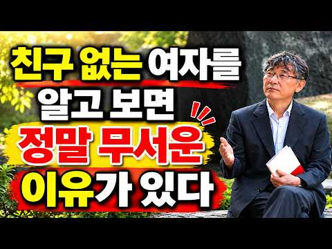
- 설명 앞부분: 🌿 【이시형 박사】친구 없는 여자는 왜 혼자가 편할까? 알고 보면 놀라운 심리 5가지｜인생 조언｜여자 심리｜인간관계 💭 “친구가 없는 여자는 정말 외로운 사람일까요? 알고 보면 전혀 다른 이유가 숨어 있을 수 있습니다.” 주변에 친구가 많지 않아도 늘 평온해 보이는 여성이 있습니다. 모임에 자주 나가지 않고, 혼자 밥을 먹거나 산책하는 것을 즐기며, 굳이 사람들과 어울리려고 애쓰지 않습니다. 누군가는 이런 모습을 보고 외롭거나 사교성이 부족하다고 생각합니다. 하지만 나이가 들수록 인간관계의 숫자보다 마음의 평안을 중요하게 여기는 …
- 같은 채널 평소 대비 ×65.9 (채널 최근 롱폼 중앙값 580회) · 평소 영상: 【이시형 박사】부자가 되려면 안 입는 옷과 속옷, 신발, 가방은 꼭 이렇게 버리세요. 모… (641회) / 【이시형 박사】부자들은 절대 아무 옷이나 입지 않습니다! 가방 속에 '이것' 하나만 넣어… (519회)
- 대본 없음 (설명) — 음성인식이 끝나면 도입부·흐름이 들어감
- 댓글 1/1: 좋은 점 — 영상 0 · 감사·응원 0 · 더 알고 싶은 것 0 · 아쉬운 점 — 영상 0 · 반박·불만 — 의견 다름 0 · 정치·사회 0 · 경험 공유 0 · 구독·다음 기대 0

### 4. 무조건 일시불로만 결제하는 사람들의 놀라운 심리와 인간관계 특징 7가지

- https://www.youtube.com/watch?v=MiCkhuXQ7Xs · 4와2 · 구독자 463 · 조회수 219,600 (×474.3, 하루 7,337.0) · 좋아요 1,051 (0.5%) · 12.7분 · 2026-10-12 · 주제 묶음 2. 인간관계·처세 · 형식 정보·해설 (그 밖) · 폴더 `W_MiCkhuXQ7Xs` (웹 승인)
- 썸네일: 
- 같은 채널 평소 대비 ×92.5 (채널 최근 롱폼 중앙값 2,375회) · 평소 영상: 남의 말 한마디에 하루 종일 무너지는 사람들의 7가지 특징과 해결법 (2,375회) / 연락처는 가득한데 연락할 사람이 없는 진짜 이유 5가지 (2,431회)
- 대본 없음 (없음) — 음성인식이 끝나면 도입부·흐름이 들어감
- 댓글 186/186: 좋은 점 — 영상 5 · 감사·응원 3 · 더 알고 싶은 것 1 · 아쉬운 점 — 영상 0 · 반박·불만 — 의견 다름 4 · 정치·사회 0 · 경험 공유 33 · 구독·다음 기대 0
  - 좋은 점 — 영상 👍30 “좋은 내용이네요. 딱 저예요.집도 대출없이 현금으로 사고 차도 그래요. 돈이 많아서가 아니고 가진 현금에 맞춰 집이든 차든 사요. 누군가 밥을 자꾸 사주거나 선물을 받으면 마음이 불편해요. 일이나 사람관계도 애매하고 결론이 나지 않으면 불편해서 서둘러 결론을 내려하는…”
  - 좋은 점 — 영상 👍11 “작은것도 약속개념이 정확한 성격입니다 맞는 말씀이시네요”
  - 감사·응원 👍0 “좋은점~ 나쁜점 ~고쳐야할점~ 배려해야할점~특히 상대가 우리 일시불의 마음을~ 이해하고 오해하지 않게 설명해주셔서 감사합니다 ~😊”
  - 감사·응원 👍0 “좋은 내용 감사합니다!!!”
  - 더 알고 싶은 것 👍0 “좋은 내용이네요. 그런데 지인중에 신용카드는 먼저 쓰고 추후에 대금 나가는게 싫어서 직불카드만 쓰는 친구가 있어요. 심지어 빚이 싫어서 은행대출도 아예 없는 친구. 다음에는 직불카드만 쓰고, 대출도 안받는 유형의 특징도 한번 다뤄주세요.”
  - 반박·불만 — 의견 다름 👍0 “할부면 그달 소비와 지출 파악이 제대로 안된다 내 아는 지인 남자는 할부인생인데 2년전 할부들이 항상 도래되어있어 월 결제가 항상 400 이 넘는다는.. 연봉도 높은거도아닌데..ㄷㄷㄷ 그 와이프도 비슷”
  - 반박·불만 — 의견 다름 👍0 “이 주제는 민족, 그 사회, 국가 전통, 정서와 관계가 있아보여요. 미국은 일시불 ~국가가 아닙니다. 철저하게 매달 일부 금액을 지불하는 ~국가 개입해요. 이게 신용사회(Credit) 추구이며, 소비 사회로 ~! 돈은 저축하기보다 소비하라~! 박통이 5 개년 계획을 …”
  - 경험 공유 👍124 “나도 일시불 선호함 이유는 깔끔 하잖아”
  - 경험 공유 👍83 “나도 적극 동감, 절대 웬만해선 할부안함.”

### 5. 60부터는 친구 필요없다 ｜ 노후에 인간관계 너무 애쓰지 마라 ｜ 고독을 즐기는 방법 I I 인간관계 I 행복한노후 I 삶의지혜 I 오디오북

- https://www.youtube.com/watch?v=VHgnX1mHrj0 · 인생의 따뜻한 쉼표 · 구독자 294 · 조회수 81,467 (×277.1, 하루 4,229.2) · 좋아요 325 (0.4%) · 24.4분 · 2026-10-23 · 주제 묶음 2. 인간관계·처세 · 형식 수면·낭독·오디오북 (잠잘 때·명언) · 폴더 `W_VHgnX1mHrj0` (웹 승인)
- 썸네일: 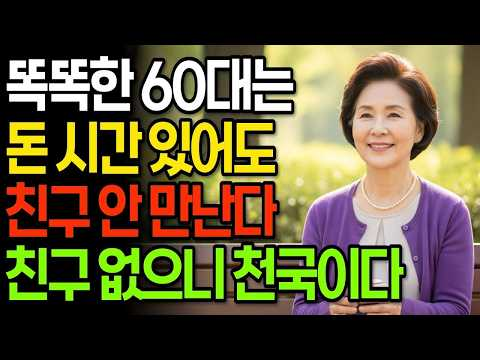
- 설명 앞부분: 나이가 들수록 더욱 소중해지는 건강과 삶의 지혜. 행복한 노후를 위한 따뜻한 조언과 유익한 이야기를 만나보세요. 오늘도 편안하고 행복한 하루 보내세요. 🌷
- 같은 채널 평소 대비 ×40,733.5 (채널 최근 롱폼 중앙값 2회) · 평소 영상: 노후에 친구가 필요없는 이유 5가지 I 인간관계 I 행복한노후 I 삶의지혜 I 오디오북 (2회) / 결혼한 자녀들이 추석 명절에 부모 집에 오는 게 싫은 진짜 이유, 명절의 진짜 의미와 부… (2회)
- 대본 없음 (설명) — 음성인식이 끝나면 도입부·흐름이 들어감
- 댓글 9/9: 좋은 점 — 영상 0 · 감사·응원 3 · 더 알고 싶은 것 0 · 아쉬운 점 — 영상 0 · 반박·불만 — 의견 다름 0 · 정치·사회 0 · 경험 공유 0 · 구독·다음 기대 0
  - 감사·응원 👍10 “60중반 오랜 인연들 작년 연말 카톡에서 나왔어요 마음은 참 많이 가벼워졌네요 만나서 허탈느끼고 공허함 느끼며 의미없는 시간 감정소모 이제그만하고 나를 위해살기로 했어요 공감글 감사 합니다”
  - 감사·응원 👍0 “감사합니다 ❤”

### 6. 압도적인 간파력을 가진 사람들의 5가지 심리학적 특징(사람 보는 눈이 정확한 사람)

- https://www.youtube.com/watch?v=LPkzgfguXsE · 현실적인 심리학 · 구독자 1,880 · 조회수 241,841 (×128.6, 하루 25,430.5) · 좋아요 748 (0.3%) · 20.2분 · 2026-11-01 · 주제 묶음 1. 심리학 일반 · 형식 정보·해설 (그 밖) · 폴더 `W_LPkzgfguXsE` (웹 승인)
- 썸네일: 
- 챕터: 0:00 첫 만남에서부터 다른 사람 · 1:51 첫인상, 심리학은 뭐라고 할까 · 3:37 첫 번째 특징 – 말보다 행동 · 5:11 두 번째 특징 – 낱개가 아닌 전체 · 6:22 세 번째 특징 – 사람 너머의 자리 · 8:00 네 번째 특징 – 내 판단을 향한 질문 · 9:53 다섯 번째 특징 – 마지막 퍼즐 · 13:40 오늘부터 해 볼 세 가지 · 16:17 내 곁의 이야기 · 18:17 처음 질문으로 돌아가서
- 설명 앞부분: 친구 소개로 처음 만난 사람이 시원시원하게 말하는데, 한 사람만 웃으면서 듣기만 합니다. 헤어지는 길에 건넨 한마디, "좀 더 봐야 알겠다." 그 짧은 자리에서 그분은 대체 무엇을 본 걸까요? 압도적인 간파력을 가진 사람들의 다섯 가지 심리학적 특징을 심리학 연구로 풀어 봅니다. 날리니 암바디·로버트 로젠탈 – Half a Minute: 30초 미만의 무음 영상으로 교수 평가를 예측한 연구 (1993) 날리니 암바디·로버트 로젠탈 – Thin Slices of Expressive Behavior as Predictors of In…
- 같은 채널 평소 대비 ×51.2 (채널 최근 롱폼 중앙값 4,723회) · 평소 영상: X세대가 유독 혼자 다 해내는 심리학적 진짜 이유 (4,723회) / 자리 뜰 때 의자 꼭 집어넣는 사람의 심리학적 특징 3가지 (4,105회)
- 대본 없음 (설명) — 음성인식이 끝나면 도입부·흐름이 들어감
- 댓글 64/64: 좋은 점 — 영상 1 · 감사·응원 1 · 더 알고 싶은 것 0 · 아쉬운 점 — 영상 2 · 반박·불만 — 의견 다름 2 · 정치·사회 1 · 경험 공유 4 · 구독·다음 기대 0
  - 감사·응원 👍2 “1. 2. 3. 나의 성품이 나쁘지는 않았네요. 저는 제 자신에 성품이 모난 성품인가.?생각했습니다. 오늘 말씀 감사합니다. 건강챙기시면서 하세요.”
  - 아쉬운 점 — 영상 👍0 “<간파력을 가진 사람> 말이 아닌 반복되는 행동을 본다. 작은 신호를 하나씩이 아니라 전체의 결로 읽는다. 사람과 그 사람의 상황을 함께 본다. 자기 판단을 확인하려 하기 보다 의심해 본다. 편하게 이야기를 꺼내도록 끝까지 이야기를 듣는다. 말이 앞으로의 행동으로 어…”
  - 반박·불만 — 의견 다름 👍1 “사람은 변해가니까 이말도 정확한게 아니죠 하지만 좋은 지적입니다”
  - 정치·사회 👍9 “질문이 대답에 영향을 끼친다. 이게 여론조사가 실제 여론을 온전히 반영하지않는 이유중 하나다. 선거시즌이 되면 수없이 걸려오는 여론조사중 일부는 대충 생각없이 들어도 조사를 한다기보다는 여론을 형성하려는 의도가 다분한 질문이 많더라고.”
  - 경험 공유 👍12 “나도 다들 좋다하는데 쫌 아닌사람 있어 연예인 무슨느님 하는데 물론 자기 관리는 잘하는듯해 난 쫌 그래 차라리 탁씨가 난듯 해”

### 7. 솔직히, 저는 가족을 차단했습니다.｜나르시시스트 엄마와 거리두기 ｜K-장녀의 착한딸 컴플렉스

- https://www.youtube.com/watch?v=GTaEvNGiCjk · 난나야 · 구독자 320 · 조회수 56,269 (×175.8, 하루 4,254.4) · 좋아요 285 (0.5%) · 14.5분 · 2026-10-29 · 주제 묶음 5. 나르시시스트·가스라이팅 · 형식 정보·해설 (그 밖) · 폴더 `W_GTaEvNGiCjk` (웹 승인)
- 썸네일: 
- 같은 채널 평소 대비 ×79.7 (채널 최근 롱폼 중앙값 706회) · 평소 영상: 나르시시스트 부모 밑에서 자란 사람들의 5가지 특징｜착한 사람이 된 진짜 이유 (970회) / 왜 나는 늘 남을 돌보는 사람이 될까?｜남의 감정까지 책임지는 사람들의 3가지 특징 (H… (442회)
- 대본 없음 (없음) — 음성인식이 끝나면 도입부·흐름이 들어감
- 댓글 71/71: 좋은 점 — 영상 4 · 감사·응원 12 · 더 알고 싶은 것 2 · 아쉬운 점 — 영상 0 · 반박·불만 — 의견 다름 2 · 정치·사회 0 · 경험 공유 25 · 구독·다음 기대 0
  - 좋은 점 — 영상 👍24 “나르시시스트 엄마와 시아버지를 겪은 경험으로 알게된 것이 가장 앞에서 직격탄을 맞는 존재가 있기 때문에 다른 사람들은 동일한 정도의 상처를 받지 않는다는 것이었어요 내가 시집 일에서 완전히 발을 떼고, 남편이 전면에 나서면서야 비로소 남편은 자기 아버지가 얼마나 힘든…”
  - 좋은 점 — 영상 👍5 “저는부모님 두분다 나르예요. 연락 끊은지 저도 3년 됐는데 해방감과 같이 슬펐어요 그런데 영상보고 알았네요 ‘나도 언젠가는 제대로 된 사랑을 받겠지’ ‘언젠가는 두분이 어른스런 사랑을 주시겠지’했었나봐요. 그 이유모를 슬픔이 뭐지? 했는데 영상보고 알았네요. 아직도 …”
  - 감사·응원 👍24 “나르시시스트 엄마와 시아버지를 겪은 경험으로 알게된 것이 가장 앞에서 직격탄을 맞는 존재가 있기 때문에 다른 사람들은 동일한 정도의 상처를 받지 않는다는 것이었어요 내가 시집 일에서 완전히 발을 떼고, 남편이 전면에 나서면서야 비로소 남편은 자기 아버지가 얼마나 힘든…”
  - 감사·응원 👍13 “난 나야 님❤ 딸셋 엄마인 내가 난나야님을 안아주고 싶어 눈물이 났어요 "엄마 품에 안겨 눈물 흘리는걸 상상한다" 그랬을 때 내가 엄마되어 이쁜딸 가슴에 폭 안고 위로해주고 싶다는 생각에 ㅋ 난나야님 서울 살면 밥한끼 사주고 싶어요 내딸 친구들도 울집에 자고 가면 같…”
  - 더 알고 싶은 것 👍4 “저랑 정말 똑같아요. 제 기분을 정리해주시는 것 같아요. 저도 큰 계기가 생기고 나서야 말을 했더니 반응도 똑같아요. 미안해의 미자도 말 안하더라고요. 저희 엄마는 할머니 이야기를 했어요. 나는 우리 엄마(할머니)한테 안 그랬는데... 그런 말을 했어요. 이해가 안돼…”
  - 더 알고 싶은 것 👍3 “저도 같은 길을 걷고있어요. 혹시나 응급실에 가시거나 요양원에 가시거나 칠순 팔순 생신때는 어떻게 하실생각인가요? 집도 가깝고 가끔 아이들을 챙겨주셨던 기억이 남아있어서 미래를 어떡해야할지 정리가 안되어 불안합니다.. 친척들의 착한 장녀라는 프레임과 남동생은 더 나몰…”
  - 반박·불만 — 의견 다름 👍8 “지금에야 유투브에 이런 사연들도 많이 올라오고 상담정보도 넘치니 무엇이 문제였는지 깨닫게 되었지만, 오랫동안 모르고 살았어요. 어린 날에 받았던 뜬금없는 비난과 무수한 상처 속에서 소위 애어른이 되어 발달한 책임감 하나로 극도로 애를 쓰며 살았고, 그러다보니 사회적으…”
  - 경험 공유 👍24 “나르시시스트 엄마와 시아버지를 겪은 경험으로 알게된 것이 가장 앞에서 직격탄을 맞는 존재가 있기 때문에 다른 사람들은 동일한 정도의 상처를 받지 않는다는 것이었어요 내가 시집 일에서 완전히 발을 떼고, 남편이 전면에 나서면서야 비로소 남편은 자기 아버지가 얼마나 힘든…”
  - 경험 공유 👍14 “병원에 가니깐 cptsd라고 하더군요 어린시절 학대로 인해서 생긴거죠 영상 보는 내내 공감하면서 들었습니다 저도 연락끊은지 2년이 다돼가고, 병원, 약물치료, 심리상담도 같이 병행하면서 산지가 1년이 넘어가네요 그 과정에서 플라잉몽키들과 믿었던 사람들의 배신 참 힘들…”

### 8. 중년이 되면 왜 자꾸 산에 오르고 싶어질까｜등산하는 중년 남자의 진짜 속마음

- https://www.youtube.com/watch?v=7I072GCG1WU · 밤의 심리 서재 · 구독자 49 · 조회수 16,271 (×162.7, 하루 1,258.7) · 좋아요 101 (0.6%) · 6.9분 · 2026-10-29 · 주제 묶음 3. 자존감·감정·멘탈 · 형식 정보·해설 (그 밖) · 폴더 `W_7I072GCG1WU` (웹 승인)
- 썸네일: 
- 챕터: 0:00 토요일 새벽 다섯 시 반, 등산화 끈을 묶으며 · 0:56 밤의 심리 서재 · 1:02 나이 들수록 사람들은 산으로 간다 · 1:45 첫 번째 이유, 나아가고 있다는 게 보인다 · 2:48 두 번째 이유, 산에서는 생각이 멈춘다 · 3:53 세 번째 이유, 산 앞에서 내가 작아진다 · 4:55 네 번째 이유, 말하지 않아도 되는 시간 · 5:23 산이 주는 진짜 선물은 내려오는 길에 있다 · 5:59 정상에 꼭 오르지 않아도 됩니다
- 설명 앞부분: 중년이 되면 왜 자꾸 산에 오르고 싶어질까요. 토요일 새벽 다섯 시 반, 알람이 울리기도 전에 눈이 떠지고, 아내가 깰까 봐 조용히 등산화 끈을 묶습니다. 주중에는 그렇게 일어나기 힘들었는데, 산에 가는 날만은 몸이 먼저 일어납니다. 숨이 턱까지 차오르는데도, 정상에 서면 일주일 내내 가슴을 누르던 무언가가 가벼워집니다. 이 영상은 나이 들수록 산을 찾게 되는 중년의 마음을 심리학 연구로 풀어 드립니다. 성인 열 명 중 여덟 명이 한 달에 한 번 이상 산과 숲길을 찾는다는 산림청 조사, 작은 전진이 하루를 바꾼다는 하버드 경영대학…
- 같은 채널 평소 대비 ×396.9 (채널 최근 롱폼 중앙값 41회) · 평소 영상: 나이 들수록 친구가 줄어드는 진짜 이유｜중년의 인간관계 정리, 뇌과학이 밝힌 비밀 (58회) / 중년이 되면 왜 새벽 3시에 잠이 깰까｜그 시간의 걱정이 유난히 커지는 진짜 이유 (24회)
- 대본 없음 (설명) — 음성인식이 끝나면 도입부·흐름이 들어감
- 댓글 25/25: 좋은 점 — 영상 0 · 감사·응원 0 · 더 알고 싶은 것 0 · 아쉬운 점 — 영상 0 · 반박·불만 — 의견 다름 1 · 정치·사회 0 · 경험 공유 1 · 구독·다음 기대 0
  - 반박·불만 — 의견 다름 👍0 “세상에할일 없는 사람이 산이나 다니는거지. 그건 젊었을때 다니는거지.헛소리하지마세요 지랄하네. 그냥 산이나 다니세요.”
  - 경험 공유 👍6 “58세 ㅡ 35 년째 군대제대후 부터 등반을 시작했습니다 지금도 주말에는 20키로 이상 집근처 산들 종주하고 평일은 4일정도 집 앞산 7키로 오흐 5시부터 등반 운동합니다ㆍ앞으로 평생 80살까지는 충분하게 등반 하려고 합니다ㆍ아니 끝까지요 부부등반도 같이다니고요 10…”

### 9. 누구를 만나던 3가지 척 해라 ∣ 쇼펜하우어 ∣ 인간관계명언 ∣ 처세술 ∣

- https://www.youtube.com/watch?v=0tEc_K0czRw · 하루한번 · 구독자 195 · 조회수 47,420 (×243.2, 하루 2,366.1) · 좋아요 262 (0.5%) · 17.5분 · 2026-10-22 · 주제 묶음 2. 인간관계·처세 · 형식 정보·해설 (그 밖) · 폴더 `W_0tEc_K0czRw` (웹 승인)
- 썸네일: 
- 설명 앞부분: 타인의 무심한 말 한마디나 싸늘한 눈빛에 밤잠을 설친 적이 있으신가요? 우리는 종종 남들의 인정을 받아야만 가치 있는 존재가 된다고 믿으며, 그들의 시선에 얽매여 살아갑니다. 하지만 아르투ور 쇼펜하우어는 타인의 시선에 신경 쓰는 순간 우리는 그들의 손에 놀아나는 꼭두각시가 될 뿐이라고 강력하게 경고했습니다. 인간의 뇌는 진화론적 본능 때문에 타인의 평가에 지나치게 민감하게 반응하도록 설계되어 있습니다. 현대 사회에서도 이러한 본능은 우리를 불행의 구렁텅이로 밀어 넣는 쇠사슬로 작용합니다. 불필요한 비난이나 과도한 아부, 은근한 …
- 같은 채널 평소 대비 ×320.4 (채널 최근 롱폼 중앙값 148회) · 평소 영상: 당신을 함부로 대하는 사람에게 3초 만에 참교육하는 기선 제압의 기술 (162회) / 왜 똑똑한 사람들은 절대 타인에게 깊은 정을 주지 않을까-정약용 명언 (134회)
- 대본 없음 (설명) — 음성인식이 끝나면 도입부·흐름이 들어감
- 댓글 12/12: 좋은 점 — 영상 1 · 감사·응원 1 · 더 알고 싶은 것 0 · 아쉬운 점 — 영상 0 · 반박·불만 — 의견 다름 0 · 정치·사회 0 · 경험 공유 0 · 구독·다음 기대 0
  - 좋은 점 — 영상 👍1 “너절너절 구구절절 지겹다”
  - 감사·응원 👍4 “영상 감사합니다 ~~”

### 10. X세대가 유독 혼자 다 해내는 심리학적 이유

- https://www.youtube.com/watch?v=ObG5Hf_uTjc · 무진심리학 · 구독자 2,990 · 조회수 823,553 (×275.4, 하루 33,319.5) · 좋아요 5,661 (0.7%) · 8.1분 · 2026-10-17 · 주제 묶음 1. 심리학 일반 · 형식 정보·해설 (그 밖) · 폴더 `W_ObG5Hf_uTjc` (웹 승인)
- 썸네일: 
- 챕터: 0:00 아무도 이야기하지 않는 세대 · 0:27 열쇠를 목에 건 아이들 · 1:46 어른이 무너지는 걸 본 아이들 · 2:58 드러내지 않는 사람들 · 3:25 웃으며 넘기는 사람들 · 3:56 티 내지 않고 해내는 사람들 · 4:27 도움은 안 청하지만, 남은 돕는 사람들 · 4:59 직함보다 실력을 보는 사람들 · 5:19 여러 번 흔들린 사람들 · 6:01 애써서 알아낸 사람들 · 6:35 다르게 키우려는 부모들 · 7:02 다리 같은 세대에게
- 설명 앞부분: 혼자 해내는 게 당연했던 사람들이 있습니다. 목에 열쇠를 걸고 빈집 문을 열던 아이들, 외환위기 때 어른들이 무너지는 걸 지켜본 아이들, 그리고 지금은 부모님과 자식 사이에서 묵묵히 버티고 있는 사람들이요. 이 영상에서는 X세대가 왜 도움을 잘 청하지 않는지, 왜 늘 최악부터 대비하는지, 왜 티 내지 않고 일하는지를 그 시절의 장면과 심리학 연구로 풀어 봅니다. 마지막에는 아무도 해 주지 않았던 말을 전해 드립니다. 목에 열쇠를 걸고 빈집 문을 열던 기억이 있으신가요? 기억나는 삐삐 암호가 있다면 댓글로 남겨 주세요. 같은 기억을…
- 같은 채널 평소 대비 ×49.6 (채널 최근 롱폼 중앙값 16,590회) · 평소 영상: 생일을 평범한 날처럼 보내는 사람들의 심리 (11,073회) / 다 받아주던 사람이 한순간에 남이 되는 소름 돋는 이유 (6,347회)
- 대본 없음 (설명) — 음성인식이 끝나면 도입부·흐름이 들어감
- 댓글 1,637/1,637: 좋은 점 — 영상 39 · 감사·응원 138 · 더 알고 싶은 것 8 · 아쉬운 점 — 영상 8 · 반박·불만 — 의견 다름 22 · 정치·사회 47 · 경험 공유 185 · 구독·다음 기대 0
  - 좋은 점 — 영상 👍146 “피자와 된장찌게를 같이먹을수있는세대!! 자식에게 기대지않겠다고하는 세대!! 가교같은세대라는말이 딱!공감되네… 어느덧 50대라니 실감이안난다…”
  - 좋은 점 — 영상 👍38 “83년생입니다.나이로따지면 x세대는 아니지만 많은부분이 와닿습니다.형님들 존경합니다 영포티라고 놀림받지만 앞으로도 열심히 살게요🎉❤”
  - 감사·응원 👍605 “X세대때문에 지금 한국의 경제가 유지되고 있죠. 나의 세대, 얘들아 화이팅!”
  - 감사·응원 👍547 “세상의 모든 X세대들. 우리 조금만 더 힘 냅시다. 화이팅.”
  - 더 알고 싶은 것 👍1 “서로가 노예 같다, 불쌍하다 자랑하는게 맞나요? 나이 상관 없이 다른 세대에 살아본게 없으니 결국 자기들이 힘들다고만 외치죠.”
  - 더 알고 싶은 것 👍0 “80년대생들도 분석해주세요”
  - 아쉬운 점 — 영상 👍61 “좋은 컨테츠 보니깐 갑자기 생각이 나네요. 그시절 X세대를 말해주는 광고가 있었죠. 리바이스 "난 나야" 부모와 다른 독립적으로 행동하고 판단하는... 좋은 컨텐츠 감사합니다!”
  - 아쉬운 점 — 영상 👍28 “12년개근입니다 SNS 하지 않습니다 부모님보다 덜 고생하고 지금의 자녀보다 더 편했던 것같습니다 매일매일 새로운 것들이 쏟아져서 지루하지 않았습니다 오히려 가장 축복받은 세대인거 같습니다 남은 인생도 더 가치있게...”
  - 반박·불만 — 의견 다름 👍1 “글쎄 옛말이 된건가 내가본 x세대들은 mz못지 않게 이기적이든데😂”
  - 반박·불만 — 의견 다름 👍1 “이젠 기득권이 되어버린 세대 정신승리용 영상 늙크크답게 사탕발린말이랑 AI좋아하노.... 샌드위치처럼 끼인 세대 어느 세대가 안 그러나요...ㅋㅋㅋㅋㅋ 각자 세대만의 다른 십자가를 짊어지고 살아가는것이지,... 특별한척 하진 맙시다.. 최소한 개화 이후 우리나라에서 …”
  - 정치·사회 👍715 “x세대는 정말 멀티플레이어입니다. 저도 20대때 국회도서관에 가서 줄 서서 복사해와서 워드프로세서로 리포트를 작성해봤고, 지금은 챗GPT를 이용합니다.”
  - 정치·사회 👍56 “다리 무너지고 백화점 무너지더니 나라가 무너지더라. 그 여파로 우리 집도 날아갔다.... 진짜 내 10~20대 힘들었네.ㅠㅠ”
  - 경험 공유 👍715 “x세대는 정말 멀티플레이어입니다. 저도 20대때 국회도서관에 가서 줄 서서 복사해와서 워드프로세서로 리포트를 작성해봤고, 지금은 챗GPT를 이용합니다.”
  - 경험 공유 👍690 “나라에서 원하는건 많은데 혜택은 없고 우리 윗세대는 나라를 일으켰다 인정받지만 우리세대는 그딴건 없고, 청년지원사업도 우리가 청년이던시절엔 없었고. 그러면서도 2030세대한테는 꿀빠는 세대라고 비난받고... 그냥 다 어렵고 억울하기만 하지만, 오늘도 출근합니다. 군대…”

### 11. 【이어령 교수의 조언】약속 장소에 늘 먼저 오는 사람, 절대 만만하게 보지 마세요! 99%가 모르는 소름 돋는 5가지 특징｜인간관계｜사람 보는 눈｜인생의 지혜

- https://www.youtube.com/watch?v=0oQyy-TiOu8 · 인생 후반의 지혜 · 구독자 1,270 · 조회수 221,772 (×174.6, 하루 13,856.7) · 좋아요 1,443 (0.7%) · 43.7분 · 2026-10-26 · 주제 묶음 2. 인간관계·처세 · 형식 인터뷰·강연·대담 (교수·의사·스님) · 폴더 `W_0oQyy-TiOu8` (웹 승인)
- 썸네일: 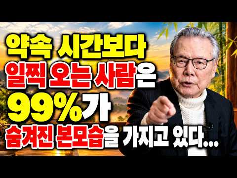
- 설명 앞부분: ⏰ 【이어령 교수의 조언】약속 장소에 늘 먼저 오는 사람, 절대 만만하게 보지 마세요! 99%가 모르는 소름 돋는 5가지 특징｜인간관계｜사람 보는 눈｜인생의 지혜 💭 “약속 장소에 항상 먼저 도착하는 사람, 그저 시간 약속을 잘 지키는 평범한 사람일까요?” 여러분 주변에도 약속 시간보다 10분, 20분씩 일찍 도착해 조용히 기다리는 사람이 있지 않으신가요? 특히 사람을 오래 만나고 인생을 살아갈수록 작은 행동 하나에서 그 사람의 가치관과 태도를 엿볼 때가 있습니다. 🔍 왜 어떤 사람은 약속 장소에 늘 먼저 도착할까요? 🤝 시간 약…
- 같은 채널 평소 대비 ×591.4 (채널 최근 롱폼 중앙값 375회) · 평소 영상: 【이어령 교수의 조언】부자들은 절대 빼놓지 않는 '이 식물'! 지금 당장 집에 들이세요!… (582회) / 【이어령 교수의 조언】푹 자는 게 좋은 줄 알았죠? 노년에 치매를 부르는 의외의 수면 습… (168회)
- 대본 없음 (설명) — 음성인식이 끝나면 도입부·흐름이 들어감
- 댓글 80/80: 좋은 점 — 영상 9 · 감사·응원 18 · 더 알고 싶은 것 1 · 아쉬운 점 — 영상 1 · 반박·불만 — 의견 다름 2 · 정치·사회 0 · 경험 공유 10 · 구독·다음 기대 0
  - 좋은 점 — 영상 👍11 “맞는말씀 인것 같아요 ~ 제가 항상 일찍 가는 습관 이였는데 늦을까봐 불안해 일찍가는거라 생각했는데 감사합니다 끝까지 경청 해야 할것 같아요”
  - 좋은 점 — 영상 👍3 “바쁘지만 행복합니다 도움이됐습니다 감사합니다🎉🎉🎉”
  - 감사·응원 👍15 “선생님 ! 제 속이 시원 합니다. 감사합니다 . 저는 첫 소절 부터 공유 했습니다 .”
  - 감사·응원 👍11 “맞는말씀 인것 같아요 ~ 제가 항상 일찍 가는 습관 이였는데 늦을까봐 불안해 일찍가는거라 생각했는데 감사합니다 끝까지 경청 해야 할것 같아요”
  - 더 알고 싶은 것 👍2 “저는 두 딸을 별 잔소리 하지않고 키웠는데 시간 만큼은 지키도록 지키면서 잔소리 해 댔습니다 지금 너무나 예쁘고 행복한 생활의 주인공들 입니다 관계가 있을까요?”
  - 반박·불만 — 의견 다름 👍0 “늦어도 자기호흡을 잃지 않으면 되겠네~ 일찍 가는게 절대가치는 아닌데...더구나 그까짓일로 우월하다고 여긴다면 진짜 모지리~”
  - 경험 공유 👍19 “저도 미리 미리 준비하는. 타입입니다”
  - 경험 공유 👍18 “내가 나를 편안하게 함이지요 허둥대는 사람을 보면 보는사람 이 불편해요”

### 12. 중년 여성이 절대 놓치면 안 되는 비밀 ∣ 외모 관리가 개별화의 시작인 이유 ∣ 칼 융

- https://www.youtube.com/watch?v=DMg2qh9Hsyo · 민경국 · 구독자 119 · 조회수 32,327 (×271.7, 하루 1,242.9) · 좋아요 282 (0.9%) · 31.1분 · 2026-10-16 · 주제 묶음 1. 심리학 일반 · 형식 인터뷰·강연·대담 (교수·의사·스님) · 폴더 `W_DMg2qh9Hsyo` (웹 승인)
- 썸네일: 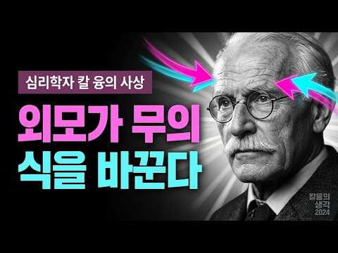
- 설명 앞부분: 매일 아침 거울 속 얼굴을 바라볼 때, 어떤 마음이 드시나요? 가족을 돌보고 수많은 역할을 해내느라 정작 나 자신은 낯설어졌다면, 그 짧은 순간에 잠시 머물러 보세요. 중년 여성에게 외모를 가꾸는 시간이 어떤 의미가 될 수 있는지, 칼 융의 심리학을 통해 함께 생각해 봅니다. 이 영상은 어머니, 아내, 딸이라는 역할 뒤로 밀려난 자신의 마음을 돌아보는 이야기입니다. 사회 속에서 쓰는 얼굴인 ‘페르소나’와 진짜 자신을 찾아가는 ‘개별화’의 관점으로, 중년 이후 느끼는 공허함과 거울 앞의 서먹함을 살펴봅니다. 익숙한 역할에 충실하면서…
- 같은 채널 평소 대비 ×323.3 (채널 최근 롱폼 중앙값 100회) · 평소 영상: 공감능력자가 사람들을 피하기 시작할 때 벌어지는 일 ∣ 융의 개성화 심리학 ∣ 칼 융 (100회) / 숨겨진 존중의 비밀 I 칼 융의 관점으로 보는 7가지 습관 I 칼 융 (82회)
- 대본 없음 (설명) — 음성인식이 끝나면 도입부·흐름이 들어감
- 댓글 5/5: 좋은 점 — 영상 1 · 감사·응원 1 · 더 알고 싶은 것 0 · 아쉬운 점 — 영상 0 · 반박·불만 — 의견 다름 0 · 정치·사회 0 · 경험 공유 0 · 구독·다음 기대 0
  - 좋은 점 — 영상 👍0 “너무 좋은 말씀입니다 잘 들었읍니다 감사합니다”
  - 감사·응원 👍0 “너무 좋은 말씀입니다 잘 들었읍니다 감사합니다”

### 13. 현명한 여자는 왜 이 5곳에 돈을 안 쓸까? 인생심리로 알아보는 소비의 비밀

- https://www.youtube.com/watch?v=physQpG98Ys · 인생심리노트 · 구독자 65 · 조회수 22,847 (×228.5, 하루 818.1) · 좋아요 90 (0.4%) · 22.9분 · 2026-10-14 · 주제 묶음 1. 심리학 일반 · 형식 정보·해설 (그 밖) · 폴더 `W_physQpG98Ys` (웹 승인)
- 썸네일: 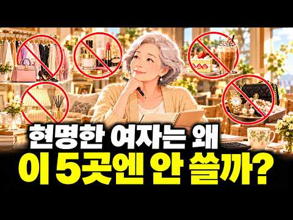
- 챕터: 0:00 매일 반복되는 작은 지출이 1년 뒤 큰돈이 되는 이유 · 1:09 하루 5천원이 180만 원으로 보이지 않는 심리 · 3:41 첫 번째, 습관처럼 마시는 카페 커피 · 5:53 두 번째, 돈을 쓰고도 기분이 가라앉는 미용실 · 8:15 세 번째, 싸다는 이유로 사게 되는 세일 매대 · 10:40 네 번째, 남의 시선 때문에 시작되는 소비의 도미노 · 16:46 다섯 번째, 체면 때문에 참석하는 모임과 관계 · 20:10 돈을 현명하게 쓰는 3가지 기준과 실천법 · 22:21 아끼는 것이 아니라 돈의 방향을 바꾸는 방법
- 설명 앞부분: 현명한 여자는 왜 이 5곳에 돈을 안 쓸까? 인생심리로 알아보는 소비의 비밀 🌿 매일 아무 생각 없이 쓰는 작은 돈, 정말 나에게 필요한 소비일까요? 이번 영상에서는 인생심리를 통해 현명한 사람들이 왜 카페, 미용실, 세일 매대, 남의 시선을 의식한 소비, 체면 때문에 나가는 모임을 다시 바라보는지 알아봅니다. 하루 5,000원처럼 작아 보이는 지출도 1년으로 묶어 보면 전혀 다른 금액이 될 수 있습니다. 무조건 아끼거나 소비를 끊는 이야기가 아닙니다. 돈을 쓰고 난 뒤 내 기분이 좋아지는지, 정말 필요한 소비였는지 살펴보고 내가…
- 같은 채널 평소 대비 ×10.5 (채널 최근 롱폼 중앙값 2,180회) · 평소 영상: 현명한 여자는 왜 돈을 아끼지 않는 곳이 따로 있을까? 인생심리가 밝힌 놀라운 소비의 비밀 (2,180회) / 왜 어떤 여자들은 나이 들수록 집을 비울까? ‘언젠가’를 내려놓는 인생심리 (3,017회)
- 대본 없음 (설명) — 음성인식이 끝나면 도입부·흐름이 들어감
- 댓글 2/2: 좋은 점 — 영상 0 · 감사·응원 0 · 더 알고 싶은 것 0 · 아쉬운 점 — 영상 0 · 반박·불만 — 의견 다름 0 · 정치·사회 0 · 경험 공유 0 · 구독·다음 기대 0

### 14. 약속마다 꼭 "10분 일찍" 나오는 사람들의 "공통점 4가지"

- https://www.youtube.com/watch?v=F9vxkgd2IyI · 심리쉽니 · 구독자 1,160 · 조회수 463,665 (×399.7, 하루 9,396.6) · 좋아요 2,979 (0.6%) · 11.4분 · 2026-09-23 · 주제 묶음 1. 심리학 일반 · 형식 정보·해설 (그 밖) · 폴더 `W_F9vxkgd2IyI` (웹 승인)
- 썸네일: 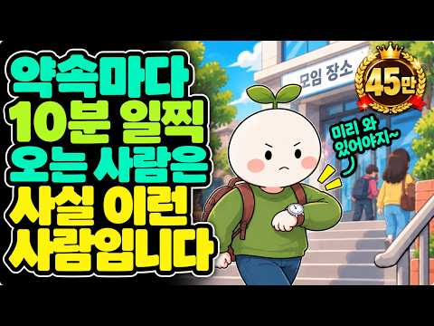
- 챕터: 0:00 인트로 · 1:16 기다리는 편이 더 편한 첫 번째 이유 · 3:31 약속을 다르게 받아들이는 두 번째 이유 · 5:42 미리 움직이게 되는 세 번째 심리 · 7:54 결국 시간을 먼저 쓰는 가장 큰 이유 · 10:33 마무리
- 설명 앞부분: 약속 시간이 2시인데 항상 20분, 30분 먼저 도착하는 사람이 있습니다. 조금 늦어도 큰일이 나는 것은 아닌데 왜 굳이 먼저 가서 기다리는 걸까요? 단순히 성실해서일 수도 있지만, 어떤 사람에게는 일찍 도착하는 습관이 예상하지 못한 상황을 줄이고 마음의 여유를 확보하는 방법이 되기도 합니다. 이번 영상에서는 약속보다 항상 일찍 도착하는 사람들이 시간을 어떻게 받아들이는지, 다른 사람의 시간을 왜 중요하게 생각하는지, 그리고 ‘일찍 도착하는 것’이 마음의 안정과 어떻게 연결될 수 있는지 이야기합니다. 여러분은 약속 장소에 일찍 도…
- 같은 채널 평소 대비 ×572.4 (채널 최근 롱폼 중앙값 810회) · 평소 영상: 이런 사람 생각났다면 오늘 "꼭 연락하세요" (810회) / 상처받고도 끝까지 참는 사람들의 진짜 심리 3가지 (820회)
- 대본 없음 (설명) — 음성인식이 끝나면 도입부·흐름이 들어감
- 댓글 367/367: 좋은 점 — 영상 7 · 감사·응원 4 · 더 알고 싶은 것 1 · 아쉬운 점 — 영상 2 · 반박·불만 — 의견 다름 1 · 정치·사회 0 · 경험 공유 63 · 구독·다음 기대 1
  - 좋은 점 — 영상 👍9 “전적으로 맞는 말씀입니다만 상대에 대한 배려심이 가장 큰 부분이라 생각합니다. 그래서 상대가 그 배려하는 마음을 가벼이 생각하는 것이 보이고, 반복되면 예상밖의 화를 내기도 하지요. 감사합니다.”
  - 좋은 점 — 영상 👍5 “30-1시간 일찍 가는 스타일인데요. 시계는 5분 빠르게 해놓는다 급할때에는 5분이 엄청 도움이 된다”
  - 감사·응원 👍9 “전적으로 맞는 말씀입니다만 상대에 대한 배려심이 가장 큰 부분이라 생각합니다. 그래서 상대가 그 배려하는 마음을 가벼이 생각하는 것이 보이고, 반복되면 예상밖의 화를 내기도 하지요. 감사합니다.”
  - 감사·응원 👍4 “말씀 한마디한마디가 제 이야기같아요 미처 몰랐던 나의모습을 보는것 같아요 조금 여유를 가져보는것도 도움될듯 감사합니다😊”
  - 더 알고 싶은 것 👍1 “매번 늦게도착하는 사람은 어떻게해야할까요?”
  - 아쉬운 점 — 영상 👍9 “전적으로 맞는 말씀입니다만 상대에 대한 배려심이 가장 큰 부분이라 생각합니다. 그래서 상대가 그 배려하는 마음을 가벼이 생각하는 것이 보이고, 반복되면 예상밖의 화를 내기도 하지요. 감사합니다.”
  - 아쉬운 점 — 영상 👍3 “요즘은 좀 늦게 가도 신경질 안냄. 이넘의 스마트폰 땜에 지루하지 않음.”
  - 반박·불만 — 의견 다름 👍1 “늦으라고 한것도 아닌데 서두른다??”
  - 경험 공유 👍70 “난 남이 늦는거 싫어서 나도 남에게 그렇게 폐끼치기 싫어서 그럽니다”
  - 경험 공유 👍32 “미국에서 살 때 미국사람들은 항상 약속 15분 일찍 도착하더군요. 처음에는 몰랐는데 그것이 상대방에 대한 예의인줄 나중에 알게 되었습니다. 그래서 저도 약속보다 일찍 도착하는 습관을 갖게 됐죠.”
  - 구독·다음 기대 👍40 “저는 항상 일찍가서 기다려요. 그래야 마음이 편해요”

### 15. 절대 먼저 연락 안 하지만 만나면 다정한 사람 심리 (싫어서가 아닙니다)

- https://www.youtube.com/watch?v=kTPr64XAJrQ · 마음 산책 · 구독자 142 · 조회수 18,648 (×131.3, 하루 1,035.4) · 좋아요 76 (0.4%) · 32분 · 2026-10-24 · 주제 묶음 1. 심리학 일반 · 형식 정보·해설 (그 밖) · 폴더 `W_kTPr64XAJrQ` (웹 승인)
- 썸네일: 
- 설명 앞부분: 카톡 대화방을 열면 늘 내가 먼저 보낸 질문뿐입니다. 돌아오는 답장은 짧은 한마디. 그런데 막상 만나면 눈을 맞추고 웃어 주고, 무심코 했던 말까지 기억해 줍니다. 만나면 이렇게 다정한 사람이 왜 먼저 연락은 하지 않을까요? 이번 영상에서는 ‘연락이 없는 것’과 ‘마음이 없는 것’을 같은 뜻으로 받아들이기 전에 살펴볼 이야기를 나눕니다. 먼저 연락하지 않는 사람을 무조건 밀당하는 사람, 차가운 사람이라고 단정하기보다 서로 다른 두 가지 유형으로 들여다봅니다. 연락하고 싶어도 쓸 힘이 부족한 사람과 먼저 연락할 필요를 잘 느끼지 않…
- 같은 채널 평소 대비 ×157.4 (채널 최근 롱폼 중앙값 118회) · 평소 영상: 이런 특징 있다면? 지능이 높은 사람들의 소름 돋는 공통점 (133회) / 사람 보는 눈이 좋은 사람은 친절보다 ‘이 순간’을 봅니다 (104회)
- 대본 없음 (설명) — 음성인식이 끝나면 도입부·흐름이 들어감
- 댓글 6/6: 좋은 점 — 영상 0 · 감사·응원 0 · 더 알고 싶은 것 0 · 아쉬운 점 — 영상 1 · 반박·불만 — 의견 다름 0 · 정치·사회 0 · 경험 공유 1 · 구독·다음 기대 0
  - 아쉬운 점 — 영상 👍1 “끝까지 보고 싶은데 영상이 너무 길다..”
  - 경험 공유 👍4 “저도 연락을 먼저 하지 않는데 초예민자입니다..ㅠ 어딜가면 주변 온습도부터 작은 기계소리들, 주변에서 나는 향기들. 상대방의 표정, 눈빛 너무 많은 것들이 느껴져요.. 근데 저는 이런걸 즐기는 편이긴 한데도 오후쯤 되면 정말 힘들때가 많아요😢 게다가 혼자 하고싶은게,…”

### 16. 60,70년대에 태어난 사람들이 조금 특별한 이유

- https://www.youtube.com/watch?v=cBslvnhVNvw · 심리학타임 · 구독자 2,450 · 조회수 636,961 (×260.0, 하루 17,526.7) · 좋아요 4,048 (0.6%) · 18.1분 · 2026-10-06 · 주제 묶음 1. 심리학 일반 · 형식 정보·해설 (그 밖) · 폴더 `W_cBslvnhVNvw` (웹 승인)
- 썸네일: 
- 챕터: 0:00 인트로 · 0:55 60, 70년대생은 대체 뭐가 그렇게 특별할까 · 1:45 첫 번째 이유 — 아날로그와 디지털을 모두 겪은 마지… · 3:31 두 번째 이유 — 내일은 오늘보다 나아진다고 믿으며 … · 4:32 열심히 산 믿음의 그림자 — 쉬는 게 불안한 사람들 · 5:27 세 번째 이유 — 위와 아래에서 동시에 끼인 세대 · 7:09 네 번째 이유 — 큰 위기를 여러 번 넘겨본 세대 · 8:31 다섯 번째 이유 — 표현은 서툴지만 마음은 누구보다 … · 9:23 실제 사례 — 58세 아버지와 30세 딸, 두 글자 … · 10:25 핵심 반전 — 장점이면서 동시에 짐인 다섯 가지 경험 · 11:17 옛날 노래 한 곡에 가슴이 먹먹해지는 이유 · 12:19 짐은 내려놓고 장점은 키우는 네 가지 원칙 · 12:31 원칙 1 — 두 세계의 통역사 되기 · 12:59 원칙 2 — 쉬는 것에 허락 내려주기 · 13:35 원칙 3 — 짐을 혼자 지지 않기 · 13:58 원칙 4 — 마음을 한 줄로 표현하기 · 14:26 원칙을 실천하면 벌어지는 변화 · 15:04 처음 이야기로 돌아가서 · 15:54 너무 참기만 했다고 자책하지 않아도 되는 이유 · 17:06 오늘 해볼 수 있는 작은 시도
- 설명 앞부분: 5가지 경험이 한 세대의 성격을 만들었습니다. 편지와 삐삐, 스마트폰까지 모두 건너온 60·70년대생이 특별한 이유는 나이가 아니라, 이 길을 건너왔기 때문입니다. 카세트테이프를 연필로 감던 아이가 지금은 키오스크 앞에서 척척 주문하는 어른이 되기까지. 아날로그와 디지털을 모두 겪은 세대, 위아래로 끼인 세대, 위기를 여러 번 넘긴 세대, 그리고 사랑을 "그래" 두 글자로 말하는 세대. 60, 70년대에 태어난 사람들이 조금 특별한 이유 5가지와, 짐은 내려놓고 장점은 키우는 방법을 쉽고 재미있게 풀어봅니다. 타임라인
- 같은 채널 평소 대비 ×372.7 (채널 최근 롱폼 중앙값 1,709회) · 평소 영상: 평생 모은돈, 나이들어 돈이 있다면 이 3가지에 먼저 쓰세요 (1,709회) / 인생이 잘 풀리는 사람들의 혼잣말 습관 ∣ 말이 씨가 된다"는 옛말, 뇌과학이 진짜로 증… (1,363회)
- 대본 없음 (설명) — 음성인식이 끝나면 도입부·흐름이 들어감
- 댓글 559/559: 좋은 점 — 영상 17 · 감사·응원 33 · 더 알고 싶은 것 4 · 아쉬운 점 — 영상 3 · 반박·불만 — 의견 다름 4 · 정치·사회 32 · 경험 공유 80 · 구독·다음 기대 1
  - 좋은 점 — 영상 👍16 “고난과 시련을 겪어도 특유의 회복탄력성(레질리언스)을 발휘하여 더더욱 분발하며 모든 어려움을 이겨내곤 했죠... 68년생인 저도 매우 공감이 가는 내용입니다. 😅 🎉”
  - 좋은 점 — 영상 👍14 “67년 양띠 100% 공감합니다”
  - 감사·응원 👍320 “62년 서울에서 태어나 국민학교 한 반에 80명 18반 까지 있어서 오전오후반 으로 공부한 추억이 있습니다, 겨울에 검은색 조개탄으로 난로를 피울 때 교실을 연기로 가득차게 되기도 했고 도시락도 못 싸오는 애들도 있었던 정말 가난한 나라였습니다. 지금 우리가 선진국이…”
  - 감사·응원 👍153 “어떻게 우리 세대를 이렇게 잘 표현 했을까!!! 감사합니다.”
  - 더 알고 싶은 것 👍1 “이런 영상 오래 기다렸어요. 내 마음이 쉴곳을 찾았네요. 이젠 나이먹고 너무 무뎌진, 옛생각에 눈물날까 창피하기도 하고ㅎ그저 다들, 모든 분들이 건강하고 행복하면 좋겠어요. 그거면됐죠. 여한이 없네요. 좋은영상 많이 만들어주세요😂”
  - 아쉬운 점 — 영상 👍16 “이 시대들은 펜팔이라는것도 경험한 세대들... 영어 좀 더 배원 볼려는 미명아래 해외펜팔 했던 60년대생들.. 영어 배운다고 미국 버지니아주 여학생과 펜팔 했던 기억이 아련 합니다. 버지아주 여학생이였고 제가 잘못 표현했던 영어 표현도 알려주고 그 여학생 집 전경이 …”
  - 아쉬운 점 — 영상 👍1 “동네 신작로에는 빨간 우체통이 있었고, 크리스마스가 되면 카드를 열심히 직접 만들고 크리스마스씰을 붙여 우체통에 넣거나, 직접 전해주곤 했었죠. 형광등을 깨어 가루로 만들고 밀가루로 풀을 만들어 섞어 연줄에 묻힌 뒤 연을 날려 서로 끊어내는 놀이도 하곤 했습니다. 공…”
  - 반박·불만 — 의견 다름 👍1 “아직도 번호를 기억하고 있네요.. 대동굴비 xxx-3529 여자 목소리 흉내 내면서 스위밍 좀 바꿔달라고 했던 기억.... 제대로 만나보지도 못하고 고딩때 한번,군대 가있을때 한번.. 그렇게 2번이나 끝이 났지만..귀가 얇던 그녀를 단 한번도 원망한적이 없었습니다..…”
  - 정치·사회 👍47 “저는 68년생인데 시골에서 태어나서 초가집에서 어린시절 살았어요.티비도 없었죠. 그러다 초등학교때 경기도로 이사왔는데, 학교에 학생들 너무 많아서 중고등학교때까지 한반에 70명가까이 있었어요그만큼 경쟁도 치열했지만 취업도 잘되었어요. 전쟁끝나고 부모세대가 대부분 가난…”
  - 정치·사회 👍8 “국민학교 시절엔 우리나라가 후진국이었고, 그걸 개발도상국이라 억지로 돌려 이야기 했고, 여름엔 수재민 겨울엔 화재민이 발생했어요. 여전히 골목엔 깡통을 들고 구걸을 하는 사람들도 있었지요. 그리고 미친듯 노력해서 나도 모르는 사이에 소니를 제치고, 니산을 제치고. 일…”
  - 경험 공유 👍147 “60,70년대생들 ==> 새마을 운동, 서울 올림픽을 경험했고... 주산-PC-AI, 공중전화-삐삐-피처폰-스마트폰을 다 경험해본 세대임.....”
  - 경험 공유 👍54 “61년생 시골촐신인데 갓을 쓴 할배를 보았고 호롱불 등잔밑에서 밥을 먹었고 여덟살때 처음으로 차를 보았던 내가 지금은 인프라 잘깔린 도시에서 테슬라를 몰고있으니 이거야 말로 상전벽해 아닌가.”
  - 구독·다음 기대 👍2 “구독합니다, 참고로 저는 1963년생😀”

### 17. 오래 가는 친구에게는 반드시 있는 '4가지' ∣ 나이 들수록 곁에 둘 사람을 구별하는 법 ∣ 인간관계 ∣ 인생조언 ∣ 심리학 ∣ 명언

- https://www.youtube.com/watch?v=dayGqPjUD_0 · 살다보니 봄날 · 구독자 1,330 · 조회수 109,189 (×82.1, 하루 8,522.4) · 좋아요 720 (0.7%) · 30.4분 · 2026-10-29 · 주제 묶음 2. 인간관계·처세 · 형식 정보·해설 (그 밖) · 폴더 `W_dayGqPjUD_0` (웹 승인)
- 썸네일: 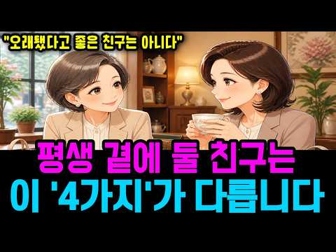
- 챕터: 0:00 30년 친구의 한마디가 마음에 남은 이유 · 1:20 오래된 친구 사이, 늘 먼저 베풀던 사람 · 3:35 호의가 당연해지기 시작한 순간 · 5:45 여행에서 드러난 한쪽으로 기운 관계 · 7:50 “네가 사는 게 맞지”라는 말의 의미 · 10:00 먼저 연락하고 챙기던 일을 멈춰 보다 · 12:15 한 달 만에 걸려온 친구의 뜻밖의 전화 · 14:25 다른 사람에게서도 보인 같은 모습 · 16:40 나를 좋아하는 걸까, 내 호의를 좋아하는 걸까 · 19:00 돈보다 중요한 것은 마음을 돌려주는 태도 · 21:15 인간관계에서 처음으로 선을 그어 보다 · 23:40 오래된 친구와 거리를 두고 알게 된 것 · 26:00 좋은 친구를 구별하는 네 가지 기준 · 29:00 노후 인간관계에서 정말 중요한 것
- 설명 앞부분: 30년 가까이 늘 밥을 사고 먼저 연락하던 친구에게, 어느 날 뜻밖의 말을 듣게 됩니다. 오래된 친구 관계였지만 호의가 당연해지면서 노후 인간관계에 서운함과 피로가 쌓이기 시작합니다. 이번 영상은 인간관계 거리두기와 좋은 친구를 구별하는 기준, 나이가 들수록 지켜야 할 관계의 선을 이야기합니다. 처음에는 밥값 몇 번의 문제라고 생각했습니다. 하지만 여행을 준비하는 일도, 연락을 먼저 하는 일도, 크고 작은 수고도 언제부턴가 한 사람의 몫처럼 굳어져 있었습니다. 오랜 친구에게 서운함을 느끼면서도 ‘내가 너무 계산적인 건 아닐까’ 하…
- 대본 없음 (설명) — 음성인식이 끝나면 도입부·흐름이 들어감
- 댓글 59/59: 좋은 점 — 영상 3 · 감사·응원 2 · 더 알고 싶은 것 0 · 아쉬운 점 — 영상 0 · 반박·불만 — 의견 다름 0 · 정치·사회 0 · 경험 공유 11 · 구독·다음 기대 0
  - 좋은 점 — 영상 👍17 “여럿이 만나면 나누어 낼 수 있지만 둘이 만나는데 밥값을 각자 내는 건 친구사이에서는 쉬운 일은 아닌 듯~~ 만나고 나면 기분이 좋지 않은 이런 친구는 손절해야죠. 주고받는 건 경제적인 것이 아니라 서로에게 맘을 써 주는 데서 찾아야 오랜 친구가 됩니다. 좋은 내용 …”
  - 좋은 점 — 영상 👍7 “제친구와는 번갈아 밥과 차를 삽니다 어느때부터인가 만남때마다 찌푸린얼굴 몸이 많이 안좋다는 처음은 그럴수있다 했지만 다음 또 그담도 냉냉한 그분위기 이게 뭘까를 길게 생각하지 않아도 난 안다 내가신도시로 좀더큰평수로이사하고 차를바꾸고 아이는 전문직에 안착하고 내게 명…”
  - 감사·응원 👍18 “남에게 받는걸 고맙게 생각하고 뭐라도 보답을 하려는 사람이 있나하면 그걸 당연히 받는 사람이 있더군요 형편이 좋으면서도 늘 대접받는 자리에 있던 사람들중에도 그런 사람들이 많은것같습니다”
  - 감사·응원 👍12 “나도 주변사람을 만나면 항상 내가 계산하고 얻어 먹어본적이 거의 없음. 주변인중 특히 나보다 나이 많은 언니 만나면 여행지도 내돈들이고 가서 식사까지 모두 제공 했는데 감사소리 거의 들어본적이 없다. 근데 요즘 이 언니라는 사람얘기가 우리집 남편 차로 자기 죽기전에 …”
  - 경험 공유 👍29 “내주변에도 그런 동생같은 친구가 있어요. 늘 동생이라고 얻어먹는것이 당연하다는 듯해서 내가 계산할 때마다 스트레스를 받아서 이제는 같이 먹으러 안다니려고 노력합니다. 그러니까 마음이 편해지네요.”
  - 경험 공유 👍21 “저는 부모님 장례치루고 손절했습니다 친구 부모님 장례식에 찾아가 위로했는데 우리부모님때는 안오더라구요 그리고 다음 만남에도 아무말도 없어서 그냥 손절했습니다”

### 18. 나이 들수록 가장 먼저 비워야 할 집안 4곳, 인생심리로 보면 충격적인 이유

- https://www.youtube.com/watch?v=Kuo4q6i7ELA · 인생심리노트 · 구독자 65 · 조회수 15,222 (×152.2, 하루 564.9) · 좋아요 139 (0.9%) · 27.8분 · 2026-10-15 · 주제 묶음 1. 심리학 일반 · 형식 정보·해설 (그 밖) · 폴더 `W_Kuo4q6i7ELA` (웹 승인)
- 썸네일: 
- 챕터: 0:00 집 안에 내가 결정하지 못한 자리가 생기는 이유 · 0:30 오늘 살펴볼 집안의 네 곳 · 1:44 부엌 정리가 마음과 결정 에너지에 미치는 영향 · 6:30 찬장과 냉장고에서 내 결정권 되찾기 · 8:43 현관과 옷장을 가볍게 만드는 방법 · 14:45 추억이 담긴 물건을 버리기 어려운 심리 · 16:24 추억을 지키며 물건을 보내는 세 가지 방법 · 20:35 베란다에 쌓인 자녀의 물건 정리하기 · 25:30 오늘 딱 한 곳부터 내 공간 되찾기
- 설명 앞부분: 나이 들수록 가장 먼저 비워야 할 집안 4곳, 인생심리로 보면 충격적인 이유 집 안에 오래 두었지만 한 번도 사용하지 않는 물건이 있으신가요? 이번 영상에서는 부엌, 현관과 옷장, 거실 장식장, 베란다까지 내가 결정할 수 있는 공간을 되찾는 방법을 알아봅니다. 무조건 버리는 정리가 아니라, 지금의 나에게 필요한 것과 추억을 담은 물건을 현명하게 바라보는 방법을 이야기합니다. 인생심리의 관점에서 작은 공간 하나를 정리하는 것이 마음과 일상에 어떤 변화를 줄 수 있는지 함께 살펴보세요. 오늘 딱 한 곳부터 시작해 보세요. 인생심리와 …
- 같은 채널 평소 대비 ×7.0 (채널 최근 롱폼 중앙값 2,180회) · 평소 영상: 현명한 여자는 왜 돈을 아끼지 않는 곳이 따로 있을까? 인생심리가 밝힌 놀라운 소비의 비밀 (2,180회) / 왜 어떤 여자들은 나이 들수록 집을 비울까? ‘언젠가’를 내려놓는 인생심리 (3,017회)
- 대본 없음 (설명) — 음성인식이 끝나면 도입부·흐름이 들어감
- 댓글 5/5: 좋은 점 — 영상 0 · 감사·응원 0 · 더 알고 싶은 것 0 · 아쉬운 점 — 영상 0 · 반박·불만 — 의견 다름 0 · 정치·사회 0 · 경험 공유 0 · 구독·다음 기대 0

### 19. 오래갈 커플은 연애 초반에 이미 보입니다

- https://www.youtube.com/watch?v=_qXY_0LvYCs · 생각탐구생활 · 구독자 1,340 · 조회수 252,334 (×188.3, 하루 7,456.4) · 좋아요 1,166 (0.5%) · 8.3분 · 2026-10-08 · 주제 묶음 8. 연애·부부 심리 · 형식 정보·해설 (그 밖) · 폴더 `W__qXY_0LvYCs` (웹 승인)
- 썸네일: 
- 챕터: 0:00 초반에 정해지는 것은 무엇인가 · 1:20 ① 첫 대화 뒤 남는 느낌 · 2:28 ② 다툼이 시작되는 방식 · 3:34 ③ 좋은 소식에 대한 반응 · 4:44 ④ 사소한 말에 돌아보는가 · 5:45 ⑤ 애정이 식는 속도 · 6:35 초반의 신호, 바꿀 수 있을까 · 7:46 정리
- 설명 앞부분: 오래갈 커플은 연애 초반에 이미 보입니다. 다만 조건표가 아니라 서로를 대하는 방식에서요. 100가지가 넘는 조건으로도 두 사람의 끌림은 예측하지 못했지만, 신혼부부 다툼의 첫 3분으로는 6년 뒤 이혼을 예측할 수 있었습니다. 첫 대화 뒤 남는 느낌, 다툼이 시작되는 방식, 좋은 소식에 대한 반응, 사소한 말에 돌아보는지, 애정이 식는 속도까지 연구로 확인한 신호 다섯 가지와, 그 신호를 바꿀 수 있는지를 정리했습니다. ⏱ 목차 📚 참고 연구 Joel, S., Eastwick, P. W., & Finkel, E. J. (2017)…
- 같은 채널 평소 대비 ×20.2 (채널 최근 롱폼 중앙값 12,492회) · 평소 영상: 정작 남자들한테 인기 없는 여자들이 모르는 것 (심리학 연구) (13,160회) / 남자가 점점 변하는 진짜 이유, 식어서가 아닙니다 (뇌과학) (11,823회)
- 대본 없음 (설명) — 음성인식이 끝나면 도입부·흐름이 들어감
- 댓글 33/33: 좋은 점 — 영상 4 · 감사·응원 3 · 더 알고 싶은 것 0 · 아쉬운 점 — 영상 0 · 반박·불만 — 의견 다름 0 · 정치·사회 0 · 경험 공유 3 · 구독·다음 기대 0
  - 좋은 점 — 영상 👍25 “유익한 영상덕에 배우고갑니다 감사합니다!”
  - 좋은 점 — 영상 👍12 “흥미롭게봤습니다! 많이 배우고 갑니다😊”
  - 감사·응원 👍25 “유익한 영상덕에 배우고갑니다 감사합니다!”
  - 감사·응원 👍1 “이 댓글을 자세히 봐줄 사람이 몇명이나 될지 모르지만 그래도 그 누군가에게 조금이나마 도움이 되길 바라면서 써내려봅니다. 저는 지금 남친과 5년 가까이 동안 연애를 하고 있습니다. 처음 남친을 만났을때는 좋은 감정은 거의 없었는데 제가 정말 힘들때 지금남친이 먼저 다…”
  - 경험 공유 👍1 “이 댓글을 자세히 봐줄 사람이 몇명이나 될지 모르지만 그래도 그 누군가에게 조금이나마 도움이 되길 바라면서 써내려봅니다. 저는 지금 남친과 5년 가까이 동안 연애를 하고 있습니다. 처음 남친을 만났을때는 좋은 감정은 거의 없었는데 제가 정말 힘들때 지금남친이 먼저 다…”

### 20. 작은 선물을 자꾸 주는 사람의 심리학적 특징

- https://www.youtube.com/watch?v=rL4yzXIKbNM · 현실적인 심리학 · 구독자 1,880 · 조회수 167,580 (×89.1, 하루 10,150.1) · 좋아요 362 (0.2%) · 20.6분 · 2026-10-25 · 주제 묶음 1. 심리학 일반 · 형식 정보·해설 (그 밖) · 폴더 `W_rL4yzXIKbNM` (웹 승인)
- 썸네일: 
- 챕터: 0:00 오프닝 · 0:39 한 선배의 아침 · 1:58 심리학이 본 건네는 마음 · 3:58 첫 번째 이유 · 6:39 두 번째 이유 · 10:11 세 번째 이유 · 13:43 이 습관을 다시 바라보기 · 14:39 오늘부터 해 볼 세 가지 · 16:17 우리 세대, 그리고 가까운 사람들 · 18:36 처음 질문으로 돌아가며
- 설명 앞부분: 작은 선물을 자꾸 건네는 사람은 주기만 하는 게 아닙니다. 본인도 모르는 사이에 무언가를 받고 있어요. 캔커피 하나, 사탕 한 줌을 자꾸 건네는 사람들의 숨은 공통점, 그 세 가지 이유를 심리학 연구로 풀어 드립니다. Elizabeth W. Dunn, Lara B. Aknin, Michael I. Norton – Spending Money on Others Promotes Happiness, Science 319 (2008) Lara B. Aknin 외 – Prosocial Spending and Well-Being: Cross-…
- 같은 채널 평소 대비 ×35.5 (채널 최근 롱폼 중앙값 4,723회) · 평소 영상: X세대가 유독 혼자 다 해내는 심리학적 진짜 이유 (4,723회) / 자리 뜰 때 의자 꼭 집어넣는 사람의 심리학적 특징 3가지 (4,105회)
- 대본 없음 (설명) — 음성인식이 끝나면 도입부·흐름이 들어감
- 댓글 33/33: 좋은 점 — 영상 1 · 감사·응원 3 · 더 알고 싶은 것 1 · 아쉬운 점 — 영상 0 · 반박·불만 — 의견 다름 1 · 정치·사회 0 · 경험 공유 3 · 구독·다음 기대 0
  - 좋은 점 — 영상 👍3 “유익하고 흥미로운 영상 감사합니다. ❤”
  - 감사·응원 👍3 “나도누구을주어야편해요좋은일이라니괜찬네요감사합니다”
  - 감사·응원 👍3 “유익하고 흥미로운 영상 감사합니다. ❤”
  - 더 알고 싶은 것 👍1 “부부사이에 대화가 점점 적어지는 이유가 궁금하네요~ 막연하게 알고 있긴하지만....”
  - 반박·불만 — 의견 다름 👍16 “예의상.. 도리상.. 착해서 베풀려고 남에게 쓰는거지. 행복때문 아닙니다. 돈쓰고 애쓰는사람한테 욕먹이지 말아요!”
  - 경험 공유 👍3 “나도누구을주어야편해요좋은일이라니괜찬네요감사합니다”
  - 경험 공유 👍1 “왜 가만히 있질못하나~ㅎㅎ 나도 모르던 마음을 일깨워주셔서 감사합니다❤”

### 21. 아무리 친해도 이 7가지는 자랑하지 마세요｜인간관계 ｜심리학 ㅣ인생조언ㅣ노후

- https://www.youtube.com/watch?v=_aC5sm4gXg4 · 가을빛 심리학 · 구독자 1,530 · 조회수 174,937 (×114.3, 하루 7,640.9) · 좋아요 619 (0.4%) · 13.8분 · 2026-10-19 · 주제 묶음 2. 인간관계·처세 · 형식 정보·해설 (그 밖) · 폴더 `W__aC5sm4gXg4` (웹 승인)
- 썸네일: 
- 설명 앞부분: 나이 들수록 친구에게 자랑하면 안 되는 7가지가 있습니다. 아무리 친한 친구라도 무심코 꺼낸 자랑 한마디에 마음이 멀어질 수 있습니다. 분명 좋은 소식을 나눴을 뿐인데, 왜 누군가는 불편해하고 오랜 인연이 서먹해지는 걸까요? 🍀 오늘 영상에서는 가까운 사람일수록 조심해야 할 7가지 자랑과 그 속에 숨겨진 인간관계 심리를 살펴봅니다. 심리학의 사회비교이론을 통해 가까운 사람의 성공이 때로는 왜 더 큰 비교심리를 일으키는지 알아보고, 좋은 소식을 나누면서도 소중한 인연을 지키는 방법을 함께 생각해 봅니다. 나이가 들수록 중요한 것은 …
- 같은 채널 평소 대비 ×160.2 (채널 최근 롱폼 중앙값 1,092회) · 평소 영상: 자리 일어날때 의자를 정리하는 사람의 특징 ㅣ오디오북ㅣ심리학ㅣ (1,092회) / 부자였다가 노후에 가난해지는 사람들의 5가지 심리 패턴 (1,148회)
- 대본 없음 (설명) — 음성인식이 끝나면 도입부·흐름이 들어감
- 댓글 98/98: 좋은 점 — 영상 3 · 감사·응원 2 · 더 알고 싶은 것 0 · 아쉬운 점 — 영상 0 · 반박·불만 — 의견 다름 0 · 정치·사회 0 · 경험 공유 4 · 구독·다음 기대 0
  - 좋은 점 — 영상 👍11 “너무 공감되네요 아무리 친해도 재산규모를 말할필요없는데 항상 입조심 해야겠더라구요 친한사일수록 더욱조심”
  - 좋은 점 — 영상 👍8 “나 자신을 돌아봅니다 감사합니다 유익한 영상 ❤”
  - 감사·응원 👍8 “나 자신을 돌아봅니다 감사합니다 유익한 영상 ❤”
  - 경험 공유 👍6 “살면서 경험해본 바, 결국 시기와 질투는 인간이 본성인거 같아요”
  - 경험 공유 👍1 “배려+자랑해봤자 상대방이 진심으로 축하해주지 않아요. 즉 그런 얘기 할필요 없는거죠.”

### 22. 집에 있는 것을 좋아하는 사람들의 7가지 심리적 특징

- https://www.youtube.com/watch?v=IAs1edgjR-8 · 조용한 심리 · 구독자 2,180 · 조회수 870,247 (×399.2, 하루 10,001.8) · 좋아요 4,033 (0.5%) · 21.6분 · 2026-08-16 · 주제 묶음 1. 심리학 일반 · 형식 정보·해설 (그 밖) · 폴더 `W_IAs1edgjR-8` (웹 승인)
- 썸네일: 
- 설명 앞부분: 사람들과 즐겁게 시간을 보내고 돌아왔는데도 이상하게 집에 오면 마음이 놓이시나요? 약속이 취소되었을 때 아쉬움보다 안도감이 들거나, 밖에서 시간을 보내는 것보다 집에서 조용히 쉬는 시간이 더 편하게 느껴질 때가 있습니다. 집에 있는 것을 좋아한다고 해서 반드시 사람을 싫어하거나 사회성이 부족한 것은 아닙니다. 사람마다 사회적 자극을 받아들이는 방식과 에너지를 회복하는 방법이 다르기 때문입니다. 이번 영상에서는 집에 있는 것을 좋아하는 사람들에게 나타날 수 있는 7가지 심리적 특징을 차분하게 살펴봅니다. 사람들과 함께한 뒤 혼자 있…
- 같은 채널 평소 대비 ×899.9 (채널 최근 롱폼 중앙값 967회) · 평소 영상: 유행을 따라가지 않는 사람들의 심리 (967회) / 사람보다 강아지나 고양이와 있을 때 더 편한 사람들의 심리｜사람이 싫어서가 아닙니다 (959회)
- 대본 없음 (설명) — 음성인식이 끝나면 도입부·흐름이 들어감
- 댓글 456/456: 좋은 점 — 영상 1 · 감사·응원 6 · 더 알고 싶은 것 1 · 아쉬운 점 — 영상 6 · 반박·불만 — 의견 다름 2 · 정치·사회 0 · 경험 공유 67 · 구독·다음 기대 2
  - 감사·응원 👍173 “유트브가 절친보다 더 즐거운시간 공유 ~~너무너무 감사”
  - 감사·응원 👍16 “매우 내성적인 남편이 직장에서는 아주 쾌활한 태도로 일을 잘하기 때문에 결혼 초부터 그가 퇴근하면 그냥 쉬도록 내버려두었죠. 은퇴 후에도 그런 편이죠. 지금은 우울증 약 없이도 잘 지냅니다. 혼자 알아서 잘 지내고 운동도 하고 공부도 하니까 고맙기만 합니다.”
  - 더 알고 싶은 것 👍0 “혼자가 좋은점은 누군가에게 비위를 맞춰 줄 필요가 없어니까 좋은점은 있죠 어짜피 많은 사람중에서 혼자가 되는거나 혼자서 집에 있는거나 혼자인건 마찬가지니까 잡아보면 착각이고 놓아보면 허무가 인생이라 했는데요 어느날 틀리지 않다는 생각이들면 그떄가 비로서 진짜 어른이 …”
  - 아쉬운 점 — 영상 👍27 “기빨리거나 지루하거나~”
  - 아쉬운 점 — 영상 👍4 “약 간만 짧게 하시면 구독자 늘듯 지금구독했는데 쫌 길어 지루감이 오네요 😅”
  - 반박·불만 — 의견 다름 👍0 “샵 에서 하루종일 있다가 집에가면 너무 너무 편하고 좋아요 사람들을 싫어하는건 아닌데 집이 너무 좋아 집을 깨끗하게 정리하고 예쁜 화초를 키우고 고양이와 가족들과 있으면 너무 행복합니다”
  - 반박·불만 — 의견 다름 👍0 “난 로또되면 안까먹을 자신있음. 왜? 집에만 있을꺼니깐...친구가 없는것도 아닌데 나이먹을수록 집에서 쉬는게 최고의 힐링임”
  - 경험 공유 👍886 “나도 집순이 눕순이😅 누가 내게 은둔형 외톨이라 해도 상관없음 혼자 있는 시간을 즐김😊”
  - 경험 공유 👍665 “나도 집에 있는게 제일 좋아요😅”
  - 구독·다음 기대 👍4 “약 간만 짧게 하시면 구독자 늘듯 지금구독했는데 쫌 길어 지루감이 오네요 😅”

### 23. 나이 들수록 똑똑한 여자들이 돈을 안 쓰게 되는 5곳

- https://www.youtube.com/watch?v=ebIXKQoHCys · 이지심리학채널 · 구독자 2,060 · 조회수 314,596 (×152.7, 하루 8,386.9) · 좋아요 1,271 (0.4%) · 19.7분 · 2026-10-04 · 주제 묶음 1. 심리학 일반 · 형식 정보·해설 (그 밖) · 폴더 `W_ebIXKQoHCys` (웹 승인)
- 썸네일: 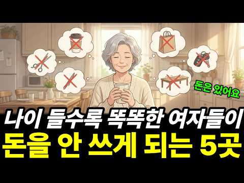
- 설명 앞부분: 통장에 돈이 있는데도 미용실 예약을 취소하고, 카페 앞을 그냥 지나치고, 모임 회비 공지 앞에서 망설이는 여자들. 형편이 나빠져서도, 짠순이가 돼서도 아닙니다. 돈을 내고도 기분이 좋아지지 않는 곳을 알아본 겁니다. 그 다섯 곳과, 아깝다는 마음이 궁상이 아니라 신호인 이유를 심리학으로 풀었습니다. 이 영상에서 다루는 내용 60대가 번 돈 중 쓰는 비율이 10년 사이 69.3%에서 62.4%로, 모든 세대 중 가장 크게 내려간 이유 돈 낼 때 마음이 따끔한 "지불의 고통" — 참아야 할 인색함이 아니라 계기판 경고등 첫 번째 곳,…
- 같은 채널 평소 대비 ×14.6 (채널 최근 롱폼 중앙값 21,614회) · 평소 영상: 나이 들수록 똑똑한 여자들이 끝까지 비우지 않는 5곳 (21,851회) / 나이 들수록 귀티 나는 사람들의 5가지 공통점 무조건 따라하세요#심리학#심리학채널#인간관… (21,376회)
- 대본 없음 (설명) — 음성인식이 끝나면 도입부·흐름이 들어감
- 댓글 58/58: 좋은 점 — 영상 2 · 감사·응원 1 · 더 알고 싶은 것 0 · 아쉬운 점 — 영상 0 · 반박·불만 — 의견 다름 0 · 정치·사회 0 · 경험 공유 6 · 구독·다음 기대 0
  - 좋은 점 — 영상 👍4 “나이가 들수록 돈을 많이 쓰는 것보다 어디에 써야 할지 아는 지혜가 더 중요한 것 같아요. 정말 공감되는 말씀입니다. 좋은 영상 감사합니다.”
  - 좋은 점 — 영상 👍0 “영상은 아주 좋고 이해하기 쉽습니다. 그런데 왜 어린 소녀의 이미지가 나오는 거죠?”
  - 감사·응원 👍4 “나이가 들수록 돈을 많이 쓰는 것보다 어디에 써야 할지 아는 지혜가 더 중요한 것 같아요. 정말 공감되는 말씀입니다. 좋은 영상 감사합니다.”
  - 경험 공유 👍38 “미용실이요. 새치염색 제가 합니다.”
  - 경험 공유 👍0 “저도 한번은 집에서 셀프염색하고 그다음은 미용실에서 염색하고 컷트합니다 남편은 미용실 가서 하라고 남편 돈써는 습관땜에 하~”

### 24. 결혼은 꼭 '이런' 사람과 하세요

- https://www.youtube.com/watch?v=OUiAqc2em1g · 마음세탁소 · 구독자 1,780 · 조회수 421,242 (×236.7, 하루 6,803.2) · 좋아요 2,039 (0.5%) · 10.7분 · 2026-09-10 · 주제 묶음 1. 심리학 일반 · 형식 심리 테스트·유형 고르기 · 폴더 `W_OUiAqc2em1g` (웹 승인)
- 썸네일: 
- 챕터: 0:00 신혼여행 직후 찾아온 뒤늦은 후회 · 0:52 조건만 보고 결혼하면 실패하는 이유 · 1:43 갈등 상황에서 드러나는 진짜 내면 · 2:31 연애 시절의 행동이 미래의 예고편인 이유 · 3:24 파국을 부르는 최악의 대화 방식 · 4:12 관계와 몸을 망치는 치명적인 태도 · 5:05 애착 유형으로 분석하는 상대방의 심리 · 5:51 겉보기엔 쿨해 보이지만 피해야 할 유형 · 6:48 최고의 배우자가 가진 뜻밖의 공통점 · 7:44 일상을 지탱하는 가장 강력한 성격 요인 · 8:40 원가족과의 관계를 통해 보는 미래 · 9:34 운명의 짝이라는 환상이 위험한 이유 · 10:26 결혼을 결심하게 만드는 진짜 기준 · 11:16 후회 없는 선택을 위한 마지막 조언
- 설명 앞부분: 설마 했던 그 사소한 행동이 평생의 후회로 돌아옵니다. 조건과 스펙만 보고 선택했다가 이혼 전문 상담소를 찾는 이들이 입을 모아 하는 진짜 후회는 무엇일까요? 34년 경력의 전문가들과 심리학 연구가 증명하는 '평생 함께할 진짜 내 사람' 가려내는 현실적인 기준을 공개합니다. 지금 옆에 있는 사람과의 미래가 고민된다면 이 영상의 신호들을 반드시 체크해보세요. ⏱ 타임라인 🎵Music provided by 브금대통령 🎵Track : 룰루~랄라~ - • [브금대통령](즐거운/산책/Picnic) 룰루~랄라~/Lulu~lala~ [...
- 같은 채널 평소 대비 ×265.8 (채널 최근 롱폼 중앙값 1,585회) · 평소 영상: 나를 더 좋아하게 만드는 5가지 심리기술 (1,657회) / 오래 가는 커플은 '이것'이 다릅니다 (1,513회)
- 대본 없음 (설명) — 음성인식이 끝나면 도입부·흐름이 들어감
- 댓글 193/193: 좋은 점 — 영상 3 · 감사·응원 6 · 더 알고 싶은 것 0 · 아쉬운 점 — 영상 2 · 반박·불만 — 의견 다름 4 · 정치·사회 1 · 경험 공유 25 · 구독·다음 기대 0
  - 좋은 점 — 영상 👍41 “결혼 하기전 돌싱남이 진짜 꿀팁 딱 하나 준다... 상대방이 남자던 여자던 일 욕심있는 사람 만나라.. 돈 개념이나 경제관념, 그리고 회사 회식, 야근, 일할때 연락 못하는것 이런것들을 이해해주는 사람을 만나라... 외모 이런건 알아서 하고 무조건 일욕심있고 회사던 …”
  - 좋은 점 — 영상 👍0 “좋은말씀감사요”
  - 감사·응원 👍54 “날이 갈수록 상대의 부족한 점만 보일거에요. 그건 상대도 마찬가지죠. 많이 부족한 나를 아무런 조건없이 사랑해주는 와이프도 그럴거란 얘기죠. 그래서 너무 고맙습니다. 저 또한 그 모자란 점을 평생 묻어두고 무덤까지 가져갈 생각입니다.”
  - 감사·응원 👍11 “남편 같은 분을 만나서 감사합니당 ㅎㅎ”
  - 아쉬운 점 — 영상 👍36 “그림도 너무 귀엽고 내용에 적절하게 다양하게 나와서 지루하지가 않네요. 집중해서 잘 들었습니당”
  - 아쉬운 점 — 영상 👍0 “이게 참 어려운게 10대 중후반부터 애초애 화가 나도 여자친구한테는 말을 예쁘게하려고 노력했음 이래이래해서 내가 지금 이러하다 그럼 받아들여놓고 또 그럼 ㅇㅇ 반복되는거임 상황이... 연애가 스트레스가 오지는걸 알고 안하게 되버림... 귀찮아..”
  - 반박·불만 — 의견 다름 👍0 “게으른여자 만나면 안됩니다. 고쳐쓰는거 아닙니다.. 게으른 여자 잠만 자는여자, 성욕도 없습니다. 물론 살림 안합니다. 출근 하면 옷 던지고 가방던지고 티비만 봅니다.”
  - 경험 공유 👍559 “대부분은 결혼 전에도 보였고, 분명히 봤을껀데, 애써 흐린눈 한거지. 만나온 시간이 있으니, 이제 내 나이가 있으니.. 내 상황이 이러니.. 등등... 온갖 정당화할 명분을 갖다붙이면서 이걸로 헤어지긴 좀 그래. 이정도는 내가 버틸 수 있을꺼야. 결혼하면 달라지겠지.…”
  - 경험 공유 👍216 “결혼직전의 모습이 보통 그 사람의 최고치다. 고쳐쓸 생각은 안하는게 좋다. 상대가 나를 잃지 않기 위해 노력할 만큼 나를 아주 열렬히 사랑하더라도 '변화' 를 이끌어 내는 것은 거의 불가능하다. 따라서 그 혹은 그녀에게서 내가 소화시킬 수 없는 모습이 나왔을 때 일단…”

### 25. 자리 뜰 때 의자 집어넣는 사람, 심리학적 특징 3가지

- https://www.youtube.com/watch?v=MUTQyEh7OSU · 어른이 심리학교 · 구독자 13,100 · 조회수 1,929,003 (×147.2, 하루 47,038.3) · 좋아요 10,894 (0.6%) · 11.9분 · 2026-10-01 · 주제 묶음 1. 심리학 일반 · 형식 브이로그·직접 해본 이야기 · 폴더 `W_MUTQyEh7OSU` (웹 승인)
- 썸네일: 
- 챕터: 0:00 훅 & 인트로 — 아주 작은 행동, 아주 큰 단서 · 0:00 왜 어떤 사람은 절대 의자를 그냥 두고 가지 않을까 · 0:00 공감 구간 — 우리가 미처 몰랐던 '배려의 무의식' · 0:00 첫 번째 특징 — 자신이 떠난 자리를 상상하는 사람 · 0:00 두 번째 특징 — 타인의 수고를 당연하게 여기지 않는… · 0:00 중간 점검 — 내 주변의 그 사람이 떠오르는 이유 · 0:00 세 번째 특징 — 시작보다 마무리를 소중히 여기는 사람 · 0:00 이 세 가지 특징, 관계에서 어떻게 드러나나 · 0:00 나도 그런 사람이 될 수 있을까 — 실천 가능한 작은… · 0:00 마무리 — 의자 하나가 알려준 것들
- 설명 앞부분: 자리를 뜰 때 의자를 집어넣는 사람, 그냥 예의 바른 사람일까요? 심리학에서는 이 3초짜리 행동이 그 사람의 내면 전체를 보여준다고 말합니다. 이 영상에서 알게 되는 것: 의자를 자연스럽게 밀어 넣는 사람이 가진 3가지 심리적 특징 무의식적 습관이 가치관과 연결되는 행동심리학 원리 나도 그런 사람이 될 수 있는 작고 실천 가능한 시작 🕒 타임라인:
- 같은 채널 평소 대비 ×645.3 (채널 최근 롱폼 중앙값 2,990회) · 평소 영상: 약속마다 10분 일찍 오는 사람, 사실 이런 심리입니다 (3,212회) / 연봉 올라도 씀씀이 안 늘리는 사람들, 사실 이런 심리입니다 (2,767회)
- 대본 없음 (설명) — 음성인식이 끝나면 도입부·흐름이 들어감
- 댓글 865/865: 좋은 점 — 영상 17 · 감사·응원 41 · 더 알고 싶은 것 0 · 아쉬운 점 — 영상 3 · 반박·불만 — 의견 다름 3 · 정치·사회 5 · 경험 공유 251 · 구독·다음 기대 1
  - 좋은 점 — 영상 👍70 “식당알바 하는 사람인데.. 매너있고 예의 있으신 분들은 꼭 정리해주심. 안정리하는 손님시키는 하는짓도 진~상이더라!!! 퉤~~~~”
  - 좋은 점 — 영상 👍4 “난 직원들 조금이라도 일 덜게.해주려고 한건데 맞는말씀이네요 같이사는 남의편은 29년 살면서 단 한번도 그런행동 본적없고 본인침대이불 매번 바닥까지 내려와 있어 외부인들보면 공강능력좋은편 집에선 0에가까워 근데 입으론 매번상대배려-.-”
  - 감사·응원 👍1,286 “저는 그냥 습관인데요. 의자를 밀어 넣어두는것 음식점에서 음식을 갖다주면 잘 먹겠습니다~ 또는 감사합니다~ 그리고 입을 닦은 냅킨은 식사후 나올때 휴지통에 넣고 나와요 잘보이려고 하는게 아니라 습관이고, 저에 딋모습이 누군가에게 지저분하게 보이는게 싫어서요 진짜 오래…”
  - 감사·응원 👍5 “뒷 정리는 현대인의 기본 매너 !!! 감사합니다.”
  - 아쉬운 점 — 영상 👍2 “그냥 보기 싫어서 ...근데 말이 너무 길어서 듣기 힘들다”
  - 아쉬운 점 — 영상 👍1 “Ai목소리아니어서 좋다요”
  - 정치·사회 👍3 “내 얘기다 나는 식당에서 밥 먹으면 식탁에 떨어진 쓰레기와 휴지 다 쓰레기통에 넣고 의자는 꼭 다시 넣는다.여행 가서 숙소에 묵을 때 펜션이든.리조트든 호텔이든 깨끗하게 청소하고 정리정돈 다 해 놓고 수건은 입구에 모아 놓고 쓰레기는 쓰레기장에 다 버리고 온다.길거리…”
  - 정치·사회 👍2 “오래전에 신문 에서 외국인들이 한국와서 놀라운것중에 하나 식당식탁위에 쓰레기 놓고 코푼휴지 놔두고 가는사람 음 90년도 쯤 화장실 한줄서기 할때쯤인가 그때부터 나는 테이블위 휴지 싹 쓰레기 통 넣고온다 서빙한 아이들 다 귀한아이들인데 알바한다고 고생하는데 어른이 되서…”
  - 경험 공유 👍499 “저도 식당에서 의자 집어넣고 옵니다”
  - 경험 공유 👍375 “의자 안넣으면 마음이 안편함 그냥 보기 좋음 누구 좋으라고 하기는 하지만 내가 보기 좋아서 하는게 큼”
  - 구독·다음 기대 👍1 “저도 거의 무조건반사인데, 소중함을 일깨워주셔서 좋은 콘텐츠 만들어주셔서 감사합니다. 구독합니다.”

### 26. 나이 들수록 똑똑한 여자들이 돈이 있어도 티 내지 않는 5곳

- https://www.youtube.com/watch?v=JlXH0rbA6J8 · 이지심리학채널 · 구독자 2,060 · 조회수 214,166 (×104.0, 하루 7,257.4) · 좋아요 814 (0.4%) · 19.8분 · 2026-10-12 · 주제 묶음 1. 심리학 일반 · 형식 정보·해설 (그 밖) · 폴더 `W_JlXH0rbA6J8` (웹 승인)
- 썸네일: 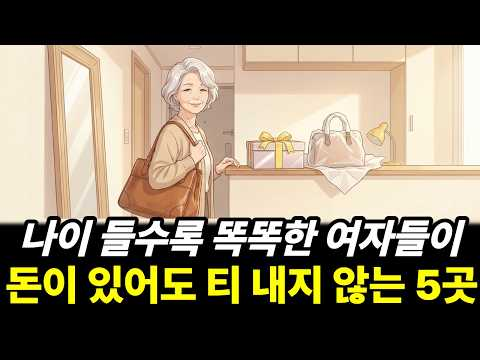
- 설명 앞부분: 딸이 사 준 새 명품 가방은 넣어 두고, 십오 년 든 낡은 가방을 들고 동창 모임에 나가는 여자가 있습니다. 통장에는 돈이 있어요. 형편이 어려워진 것도, 궁상도 아닙니다. 나이 들수록 똑똑한 여자들이 돈이 있어도 티 내지 않는 다섯 곳과, 그 자리에서 듣는 한마디에 뭐라고 답하는지를 심리학 연구로 풀었습니다. 이 영상에서 다루는 내용 젊을 때는 좋은 옷과 좋은 차가 일을 해 줬는데, 왜 지금은 다른가 — 금융자산 10억 원이 넘는 사람 중 스스로 부자라고 답한 사람은 셋 중 하나 (KB금융 2025) 첫 번째 곳, 차: 새 친구…
- 같은 채널 평소 대비 ×9.9 (채널 최근 롱폼 중앙값 21,614회) · 평소 영상: 나이 들수록 똑똑한 여자들이 끝까지 비우지 않는 5곳 (21,851회) / 나이 들수록 귀티 나는 사람들의 5가지 공통점 무조건 따라하세요#심리학#심리학채널#인간관… (21,376회)
- 대본 없음 (설명) — 음성인식이 끝나면 도입부·흐름이 들어감
- 댓글 32/32: 좋은 점 — 영상 0 · 감사·응원 2 · 더 알고 싶은 것 0 · 아쉬운 점 — 영상 0 · 반박·불만 — 의견 다름 2 · 정치·사회 0 · 경험 공유 2 · 구독·다음 기대 0
  - 반박·불만 — 의견 다름 👍20 “"부잔데 국산차 타고 소박하다"를 무슨 미덕인양 선동하는 방송들!부잔데 왜 궁상떨고,소박하게 살아?게다가 할머니 나이다 내일 죽어도 안 이상할 나이다 죽을때까지 에르메스만 들고 다녀도 낡지도 않을거다 그 나이면 남의 눈치를 왜 보냐?좋은 차 타서 내 안전을 우선하고 …”
  - 경험 공유 👍20 “"부잔데 국산차 타고 소박하다"를 무슨 미덕인양 선동하는 방송들!부잔데 왜 궁상떨고,소박하게 살아?게다가 할머니 나이다 내일 죽어도 안 이상할 나이다 죽을때까지 에르메스만 들고 다녀도 낡지도 않을거다 그 나이면 남의 눈치를 왜 보냐?좋은 차 타서 내 안전을 우선하고 …”

### 27. 친한 사이일수록 절대 보여주지 마세요｜나이 들수록 인간관계가 편해지는 5가지 거리 두기

- https://www.youtube.com/watch?v=OjfEteAhBQU · 하나둘 심리학 · 구독자 658 · 조회수 160,540 (×244.0, 하루 2,293.7) · 좋아요 548 (0.3%) · 16.2분 · 2026-09-02 · 주제 묶음 2. 인간관계·처세 · 형식 정보·해설 (그 밖) · 폴더 `W_OjfEteAhBQU` (웹 승인)
- 썸네일: 
- 설명 앞부분: 여러분의 경험도 댓글로 들려주세요. 같은 고민을 가진 분들에게 큰 위로가 될 수 있습니다. 해시태그 "본 영상은 심리학적 연구와 일반적인 경향성을 바 탕으로 제작되었습니다. 이는 전문적인 의학적 진 단이나 상담을 대신할 수 없으며, 심리적 어려움이 지속될 경우 반드시 관련 전문가의 도움을 받으시 길 권장합니다.“
- 같은 채널 평소 대비 ×65.3 (채널 최근 롱폼 중앙값 2,457회) · 평소 영상: 연말이 되기 전 반드시 거리를 둬야 할 사람의 5가지 특징 (2,781회) / 나이 들수록 착한 사람이 함부로 대접받지 않는 6가지 방법 (2,133회)
- 대본 없음 (설명) — 음성인식이 끝나면 도입부·흐름이 들어감
- 댓글 30/30: 좋은 점 — 영상 0 · 감사·응원 0 · 더 알고 싶은 것 0 · 아쉬운 점 — 영상 0 · 반박·불만 — 의견 다름 1 · 정치·사회 0 · 경험 공유 4 · 구독·다음 기대 0
  - 반박·불만 — 의견 다름 👍4 “친한사람은 오히려 할수있고 해도되죠~ 왜이리살림살이가 없어?하면 가난해서 그런것도 아닌데 응 나 최대한 간단히 해놓고살려고~ㅋ 청소하기도힘들다야 하고 넘기면 되는거고.. 그때그때맞게 적당히 받아넘김 되지. 일일이 다생각하고 피곤해서 어찌살아요ㅠ 그럼 누구한테말해요? …”
  - 경험 공유 👍21 “저도 친구들을 초대해서 하룻밤 재워줬더니 그 중 한 친구가 너네집 왜 이렇게 살림이 없냐고... 진~~~~~짜 살림살이 없다고.... 그 이후 다시는 친구를 집으로 부르지 않습니다.”
  - 경험 공유 👍4 “호주에 사는데 남의 집 사는게 뭐가 그리 궁금한지 꼭 한번 와서 밖에서 구경하고 거는 사람들이 있다군요. 그것도 모자라 나 모르게 다른 사람까지 데리고 와서 우리집 보여준 사람도 있어요. 어느날 사정이 생겨 특별히 친하다곤 할수없는 사람 차를 얻어타고 우리집 방향으로…”

### 28. “그냥 친절한 줄 알았는데…” 중년연애에서 놓치기 쉬운 8가지 호감 신호 ∣ 상대의 마음이 보이기 시작합니다

- https://www.youtube.com/watch?v=1WL8NI8wMlc · 숨겨진심리학TV · 구독자 133 · 조회수 23,081 (×173.5, 하루 452.7) · 좋아요 93 (0.4%) · 32.2분 · 2026-09-21 · 주제 묶음 3. 자존감·감정·멘탈 · 형식 사연·고민 상담 (썰·라디오) · 폴더 `W_1WL8NI8wMlc` (웹 승인)
- 썸네일: 
- 챕터: 0:00 친절인 줄 알았던 행동, 사실은 호감 신호일까? · 1:58 ① 이름을 자주 부르는 행동에 숨은 의미 · 4:51 ② 가벼운 접촉과 무의식적인 미러링 · 8:32 ③ 유독 부드러워지는 목소리와 밝은 반응 · 12:17 ④ 우리가 호감 신호를 놓치는 이유 · 16:01 ⑤ 머리카락, 시선, 동공에 나타나는 변화 · 21:35 ⑥ 대화를 길게 이어가고 떠나기 아쉬워하는 행동 · 24:42 ⑦ 서투름과 긴장, 그리고 모든 신호를 읽는 핵심 원리
- 설명 앞부분: “그 사람이 나에게만 유독 친절한 이유는 무엇일까요?” 중년연애에서는 말보다 행동에 마음이 먼저 드러나는 순간이 있습니다. 이름을 자주 불러주거나, 대화를 유난히 길게 이어가거나, 시선이 오래 머무는 작은 행동들까지도 상대의 감정을 보여주는 신호가 될 수 있습니다. 이번 영상에서는 중년연애에서 놓치기 쉬운 8가지 호감 신호를 쉽게 정리했습니다. 가벼운 접촉, 미러링, 목소리 변화, 시선, 대화 습관, 서투른 행동까지 일상에서 무심코 지나쳤던 행동들을 살펴봅니다. 특히 중요한 것은 한 가지 행동만으로 상대의 마음을 단정하지 않고, …
- 같은 채널 평소 대비 ×19.5 (채널 최근 롱폼 중앙값 1,185회) · 평소 영상: 3년이 지나서야 알았습니다… 그 여자가 보낸 중년연애 신호 7가지, 그때 왜 몰랐을까? (1,185회) / 말이 줄었는데 더 매력 있어진 이유｜나이 들수록 사람을 끌어당기는 5가지 변화 ∣ 중년연애 (1,235회)
- 대본 없음 (설명) — 음성인식이 끝나면 도입부·흐름이 들어감
- 댓글 2/2: 좋은 점 — 영상 0 · 감사·응원 0 · 더 알고 싶은 것 0 · 아쉬운 점 — 영상 0 · 반박·불만 — 의견 다름 0 · 정치·사회 0 · 경험 공유 0 · 구독·다음 기대 0

### 29. 가까운 사람에게만 유독 화내는 사람의 심리

- https://www.youtube.com/watch?v=2ej_Dk2tXKw · 솔직한 심리학 · 구독자 94 · 조회수 11,152 (×111.5, 하루 334.5) · 좋아요 54 (0.5%) · 9.1분 · 2026-10-09 · 주제 묶음 1. 심리학 일반 · 형식 정보·해설 (그 밖) · 폴더 `W_2ej_Dk2tXKw` (웹 승인)
- 썸네일: 
- 챕터: 0:00 밖에서는 참는데 집에서 터지는 이유 · 2:00 뇌는 하루 종일 감정을 억누르고 있었다 · 4:00 왜 하필 가족·연인한테만 터지는가 — 심리적 안전지대 · 6:00 반복되면 관계가 조용히 무너지기 시작한다 · 7:30 패턴을 바꾸는 현실적인 방법 — 감정 라벨링·지연 표현
- 설명 앞부분: 밖에서는 그렇게 잘 참으면서, 왜 집에 들어오는 순간 무너지는 걸까요? 😔 상사한테는 꾹 참고, 처음 보는 사람한테도 예의 바르게 대하면서, 정작 제일 오래 봐온 가족이나 연인한테는 왜 이렇게 쉽게 터져버리는 건지. 만만해서가 아니에요. 익숙해서도 아니에요. 오히려 정반대의 이유가 있습니다. 뇌가 그 사람을 가장 안전한 존재로 인식하기 때문이에요. 오늘 영상에서는 왜 가장 소중한 사람한테 가장 못되게 구는지, 그 심리적 구조와 패턴을 바꾸는 현실적인 방법까지 이야기해 드려요. 💡 ⏱️ 타임라인 📚 참고문헌 리버만, 매튜 외 (20…
- 같은 채널 평소 대비 ×4.7 (채널 최근 롱폼 중앙값 2,354회) · 평소 영상: 강아지가 자기 방석 놔두고 꼭 당신 침대에서 자려는 진짜 이유! 매일 밤 당신 곁을 고르… (3,859회) / 작은 생각 하나가 1년 뒤 당신의 삶을 완전히 바꿉니다. 아침에 일어나면 이 생각부터 하… (850회)
- 대본 없음 (설명) — 음성인식이 끝나면 도입부·흐름이 들어감
- 댓글 2/2: 좋은 점 — 영상 0 · 감사·응원 0 · 더 알고 싶은 것 0 · 아쉬운 점 — 영상 0 · 반박·불만 — 의견 다름 0 · 정치·사회 0 · 경험 공유 0 · 구독·다음 기대 0

### 30. 돈을 대하는 태도에서 사람의 본모습이 드러납니다 (무심코 하는 행동입니다)

- https://www.youtube.com/watch?v=szFksvTqnCg · 심리상자 · 구독자 3,180 · 조회수 135,191 (×42.5, 하루 10,292.3) · 좋아요 470 (0.4%) · 14.5분 · 2026-10-29 · 주제 묶음 1. 심리학 일반 · 형식 브이로그·직접 해본 이야기 · 폴더 `W_szFksvTqnCg` (웹 승인)
- 썸네일: 
- 설명 앞부분: 돈이 있어도 늘 부족하다고 느끼는 사람이 있습니다. 작은돈은 아끼면서 큰돈은 쉽게 쓰고, 남이 돈을 쓰면 낭비라고 하면서 자신의 소비에는 관대한 사람도 있습니다. 또 누군가 잘됐다는 소식을 들으면 진심으로 축하하기보다 운이 좋았을 뿐이라고 말하기도 합니다. 왜 이런 차이가 생기는 걸까요? 이 영상에서 다루는 내용 작은돈은 아끼면서 큰돈은 쉽게 쓰는 사람들의 심리 남에게 보여주기 위해 소비하는 사람들의 특징 남의 소비와 성공을 평가하고 깎아내리는 이유 형편이 나아져도 늘 돈이 부족하다고 느끼는 심리 오늘 이야기한 네 가지 행동 중 …
- 같은 채널 평소 대비 ×11.7 (채널 최근 롱폼 중앙값 11,591회) · 평소 영상: 새 차 살 돈이 있는데도 중고차를 고르는 사람들의 심리 (뇌구조가 다릅니다) (11,805회) / 34평 팔고 24평으로 간 사람들의 의외의 심리 (형편이 아니라 선택입니다) (11,377회)
- 대본 없음 (설명) — 음성인식이 끝나면 도입부·흐름이 들어감
- 댓글 21/21: 좋은 점 — 영상 2 · 감사·응원 1 · 더 알고 싶은 것 0 · 아쉬운 점 — 영상 0 · 반박·불만 — 의견 다름 1 · 정치·사회 0 · 경험 공유 2 · 구독·다음 기대 0
  - 감사·응원 👍9 “마지막 네 번째 '형편이 나아져도 여전히 돈이 부족하다고 느낀다'는 부분에서 무릎 탁 쳤습니다. 돈을 모으는 게 목적이 아니라, 돈으로 얻는 '안정감'과 '여유'가 진짜 목적인데 그걸 놓치고 있었네요. 감사합니다!”
  - 반박·불만 — 의견 다름 👍1 “그런사람이 바보이고 제정신이 아니죠”
  - 경험 공유 👍6 “누군가는 타인에게 자랑으로 본인의 행복을 느끼는 사람도 있음. 중요한 건 내가 진짜 어떤 사람인가를 본인 스스로가 알고 인생에서 적당히 당근과 채찍을 스스로에게 주며 불행하지 않게 잘 이끌어 가는 거지. 비록 남에게 보여지는 자랑을 위해 노력을 해서 성과를 내고 더큰…”
  - 경험 공유 👍0 “나는 상대방이 머라고 아는척하는게실어요 내가 하고싶어서하는건데 ㅎ 꼭 말안해도 아는척하고 트집잡는사람잇지요”

### 31. 대답하지 마라 무시해라 무례한 인간은 알아서 미친다 ∣ 쇼펜하우어처세술

- https://www.youtube.com/watch?v=gvB4ud2Ge2k · 품격 있는 처세 · 구독자 96 · 조회수 21,456 (×214.6, 하루 306.1) · 좋아요 147 (0.7%) · 21.4분 · 2026-09-02 · 주제 묶음 2. 인간관계·처세 · 형식 정보·해설 (그 밖) · 폴더 `W_gvB4ud2Ge2k` (웹 승인)
- 썸네일: 
- 설명 앞부분: 누군가 악의를 담아 던진 가시돋힌 한마디에 며칠 동안 밤잠을 설친 기억이 있으신가요? 대다수의 사람들은 억울함을 풀기 위해 상대의 잘못을 지적하거나 반박하며 내 무죄를 증명하려고 애씁니다. 하지만 쇼펜하우어의 철학에 따르면 이것이야말로 상대의 덫에 스스로 걸려드는 가장 어리석고 위험한 대처입니다. 타인의 무례함 속에는 고상한 동기란 존재하지 않으며 오직 자신의 열등감을 메우려는 비루한 충동만 가득하기 때문입니다. 무례한 인간들이 가장 견디지 못하는 것은 분노나 반박이 아니라 자신의 존재 자체가 완전히 지워지는 투명인간 취급입니다.…
- 같은 채널 평소 대비 ×165.7 (채널 최근 롱폼 중앙값 130회) · 평소 영상: 당장 손절해라! 인간 말종들이 공통적으로 하는 소름 돋는 행동 3가지 ㅣ쇼펜하우어인생론 … (144회) / "사람 아닌 사람에게까지 친절하지 마라" ∣ 무조건 착한 성격이 독이 되는 이유 ∣ 쇼펜… (115회)
- 대본 없음 (설명) — 음성인식이 끝나면 도입부·흐름이 들어감
- 댓글 2/2: 좋은 점 — 영상 0 · 감사·응원 0 · 더 알고 싶은 것 0 · 아쉬운 점 — 영상 0 · 반박·불만 — 의견 다름 0 · 정치·사회 0 · 경험 공유 0 · 구독·다음 기대 0

### 32. 중년의 마음과 달리 걸음에서 먼저 나이가 읽히는 까닭

- https://www.youtube.com/watch?v=ybZrubiy034 · 고요한심리학 · 구독자 128 · 조회수 14,010 (×109.5, 하루 367.0) · 좋아요 26 (0.2%) · 14.6분 · 2026-10-04 · 주제 묶음 3. 자존감·감정·멘탈 · 형식 정보·해설 (그 밖) · 폴더 `W_ybZrubiy034` (웹 승인)
- 썸네일: 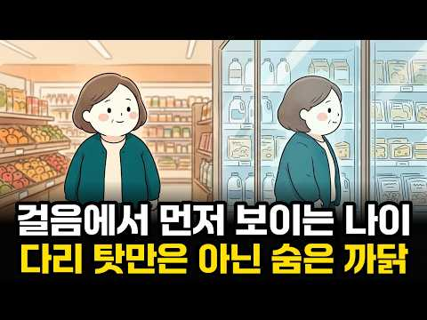
- 챕터: 0:00 유리문에 비친 낯선 걸음 · 0:53 딸이 찍어 준 영상 속 내 걸음 · 2:11 첫 번째 나이, 빛점 몇 개로 읽히는 나이 · 3:35 두 번째 나이, 마음이 느끼는 나이 · 6:11 세 번째 나이, 내가 믿는 나이 · 9:33 남을 읽던 눈이 나를 향할 때 · 11:20 유리문 앞에서 고르는 한 문장 · 13:17 다리로만 걷지 않는다는 것
- 설명 앞부분: 마트 유리문에 비친 내 걸음이 문득 낯설게 느껴진 적 있으신가요. 마음은 아직 한참 젊은데, 남들은 걸음에서 먼저 나이를 읽습니다. 그 어긋남은 정말 몸 때문만일까요? 이 영상은 세 가지 나이를 차례로 만나 봅니다. 빛점 몇 개로 된 걸음만 보고도 사람들이 나이와 인상을 매긴 실험, 오십 대 이상 영국인들이 실제보다 평균 아홉 해쯤 젊게 느낀다는 대규모 조사, 그리고 나이에 대한 믿음이 걸음 속도까지 바꾼 작은 실험까지. 남이 읽는 나이와 내가 느끼는 나이, 내가 믿는 나이가 어떻게 한 바퀴로 이어지는지 심리학 연구로 차분히 짚어…
- 같은 채널 평소 대비 ×55.8 (채널 최근 롱폼 중앙값 251회) · 평소 영상: 회피형이 사랑을 밀어내는 진짜 이유 (251회) / 남편 은퇴 후 생기는 답답함을 내 탓으로 돌리면 안 되는 이유 (250회)
- 대본 없음 (설명) — 음성인식이 끝나면 도입부·흐름이 들어감
- 댓글 3/3: 좋은 점 — 영상 0 · 감사·응원 0 · 더 알고 싶은 것 0 · 아쉬운 점 — 영상 0 · 반박·불만 — 의견 다름 0 · 정치·사회 0 · 경험 공유 0 · 구독·다음 기대 0

### 33. 늙을수록 친구를 손절하는 소름돋는 이유 ｜심리 ｜행동심리 ｜친구관계 ｜인간관계 ｜마인드 컨트롤 ｜자존감 ｜ 손절

- https://www.youtube.com/watch?v=4g_Vs_r46nU · 마음결 셋업 · 구독자 396 · 조회수 163,046 (×411.7, 하루 1,056.0) · 좋아요 812 (0.5%) · 8.5분 · 2026-06-09 · 주제 묶음 2. 인간관계·처세 · 형식 브이로그·직접 해본 이야기 · 폴더 `W_4g_Vs_r46nU` (웹 승인)
- 썸네일: 
- 설명 앞부분: "나이 먹을수록 인간관계 다 부질없다..." 혹시 요즘 주변에 사람이 사라지는 것 같아 씁쓸하거나 자책하고 계시진 않나요? 놀랍게도 나이 들수록 친구가 줄어드는 진짜 이유는 내가 괴팍해져서가 아니라, 우리의 뇌와 심리가 발동하는 아주 건강한 '생존 본능'이자 심리적 진화 과정입니다. 우리가 우정이라 믿었던 관계의 이면, 그리고 무례한 인간들에게 에너지를 뺏기지 않고 나를 지키며 인생을 우아하게 리셋하는 3가지 실천 법칙을 전해드립니다. 타인의 눈치를 보며 에너지를 쓰던 삶을 끝내고, 오롯이 나를 위한 진짜 자유를 맛보시길 바랍니다…
- 같은 채널 평소 대비 ×688.0 (채널 최근 롱폼 중앙값 237회) · 평소 영상: 부자들은 왜 일부러 '거지'처럼 보이려고 할까? ｜심리 ｜행동심리 ｜인간관계 ｜마인드 ｜… (237회) / 아무것도 하지않는 휴식이 필요한 소름돋는 이유 ｜심리 ｜행동심리 ｜사회생활 ｜노하우 ｜멘… (241회)
- 대본 없음 (설명) — 음성인식이 끝나면 도입부·흐름이 들어감
- 댓글 72/72: 좋은 점 — 영상 2 · 감사·응원 0 · 더 알고 싶은 것 0 · 아쉬운 점 — 영상 2 · 반박·불만 — 의견 다름 1 · 정치·사회 4 · 경험 공유 1 · 구독·다음 기대 0
  - 좋은 점 — 영상 👍7 “공감합니다. 정년퇴직했는데 모임에서 피곤한 질문. 1.요즘 뭐해? 2.애들은? 3.아픈데 없냐? 4.와이프하고 잘지내? 등등 모두 걱정해 주고 관심 가져주는 좋은 말 같은데 피곤하고 대답하기 싫어지며 자연스레 모임에 안나가게 되었다.”
  - 좋은 점 — 영상 👍6 “50대가 되면서 친구 후배가 다 정리되는 상황에 대해 마음이 불편했는데 참 와닿는 글이네요.”
  - 아쉬운 점 — 영상 👍13 “모임은 지루해욤😭😭 그냥 혼자 집에서 하고 싶은 거 하는 게 너무 재밌어욤🤗🤗”
  - 아쉬운 점 — 영상 👍0 “남편애들흉보는 얘길 맬반복해서 들어야합니다 그냥 감정쓰레기통이된듯해요 내시간을 왜 그런 쓰레기같은 얘길들어주는데 써야할까 바로 손절했어요”
  - 반박·불만 — 의견 다름 👍5 “그냥 들어주세요 친구가 자랑하면 아무에게나 자랑하는거아닙니다 자랑을 늘어놓는다면 그만큼 신뢰하고있다는것인데 그것조차 받아들일수없는 깜냥이라면 싹다 정리하시고 산에 들어가 혼자사시길”
  - 경험 공유 👍0 “인간은 사회적 동물이다. 사람냄새. 어울려서 살아야한다. 가슴이 따뜻한 사람을 만나고싶다 맥심광고카피. 이거 진짜 당연히 이래야된다는. 강요하는 주입식 고정관념입니다. 여기에 속으면 안되요 이딴것 믿다가는 옆에 사람이 있어도 항상외롭습니다. 죽을때까지 외로워요 내경우…”

### 34. 그녀의 호감은 이렇게 드러난다! 놓치기 쉬운 7가지 신호 ∣ 중년연애심리로 알아보는 진짜 관심의 표현 ∣ 중년 여자의 속마음

- https://www.youtube.com/watch?v=VhuAViRm1qs · 중년연애심리 · 구독자 376 · 조회수 49,914 (×132.8, 하루 979.8) · 좋아요 182 (0.4%) · 22.3분 · 2026-09-21 · 주제 묶음 1. 심리학 일반 · 형식 수면·낭독·오디오북 (잠잘 때·명언) · 폴더 `W_VhuAViRm1qs` (웹 승인)
- 썸네일: 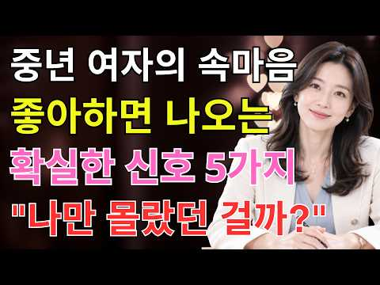
- 챕터: 0:00 여자의 친절과 진짜 호감, 어떻게 구별할까? · 2:10 첫 번째 신호: 눈과 시선 — 시선의 지속, 반복적인… · 6:11 두 번째 신호: 말투와 대화 — 목소리 변화, 긴 대… · 8:19 세 번째 신호: 무의식적 미러링 — 자세·표정·말투를… · 10:01 네 번째 신호: 질투 반응 — 다른 이성 이야기에 나… · 12:01 다섯 번째 신호: 당신 앞에서만 어색해지는 모습 — … · 14:51 여섯 번째 신호: 디지털 행동 — 먼저 연락하기, 빠… · 17:32 일곱 번째 신호: 미래를 함께 말하는 행동 — 약속·… · 19:17 7가지 신호 핵심 정리 — 하나의 행동보다 여러 신호… · 21:04 호감을 오해하지 않기 위한 마지막 체크포인트
- 설명 앞부분: 그녀의 호감은 이렇게 드러난다! 놓치기 쉬운 7가지 신호 ∣ 중년연애심리로 알아보는 진짜 관심의 표현 ∣ 중년 여자의 속마음 🌹 중년연애심리를 이해하면 상대방의 작은 행동과 대화 속에서 숨겨진 관심의 표현을 보다 차분하게 살펴볼 수 있습니다. 눈빛부터 말투, 대화 방식까지 어떤 변화가 나타나는지 함께 알아보세요. 👀 이번 영상에서는 중년연애심리 관점에서 눈맞춤과 시선, 말투의 변화, 무의식적인 미러링처럼 일상에서 발견할 수 있는 여러 행동을 정리했습니다. 단순한 친절과 호감의 차이를 생각해 보는 데 도움이 될 수 있습니다. 💬 특…
- 같은 채널 평소 대비 ×102.1 (채널 최근 롱폼 중앙값 489회) · 평소 영상: 50대 이후 부부관계, 오래보다 중요한 건 따로 있습니다｜중년연애심리 5가지 (528회) / 여자가 남자를 진심으로 좋아할 때 나타나는 결정적 신호 5가지 놓치면 후회합니다 ∣ 중년… (450회)
- 대본 없음 (설명) — 음성인식이 끝나면 도입부·흐름이 들어감
- 댓글 9/9: 좋은 점 — 영상 0 · 감사·응원 1 · 더 알고 싶은 것 0 · 아쉬운 점 — 영상 0 · 반박·불만 — 의견 다름 1 · 정치·사회 0 · 경험 공유 0 · 구독·다음 기대 0
  - 감사·응원 👍1 “감사합니다”
  - 반박·불만 — 의견 다름 👍1 “서로 말하지 안으면 느낌 만 가지고 해서는 안된다 깜박 갈이이야 말도안되는 소리”

### 35. 칼 융이 찾아낸, 중년 이후 다시 젊어지는 7가지 취미

- https://www.youtube.com/watch?v=LFTQP_pM_gQ · 심리의시간 · 구독자 550 · 조회수 105,469 (×191.8, 하루 1,407.9) · 좋아요 599 (0.6%) · 24.5분 · 2026-08-28 · 주제 묶음 2. 인간관계·처세 · 형식 정보·해설 (그 밖) · 폴더 `W_LFTQP_pM_gQ` (웹 승인)
- 썸네일: 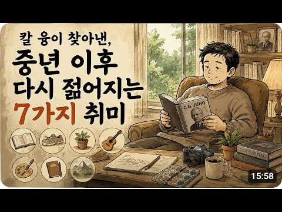
- 챕터: 0:00 25년 만의 동창회, 같은 나이 다른 얼굴 · 1:11 융이 말한 '인생의 오후' · 2:52 첫 번째 문 – 새로운 것을 배우기 · 4:21 두 번째 문 – 호기심을 들고 걷기 · 5:53 세 번째 문 – 마음이 닿는 대화 나누기 · 7:09 네 번째 문 – 누군가를 돕는 시간 만들기 · 8:24 다섯 번째 문 – 손으로 무언가 만들기 · 9:49 여섯 번째 문 – 쓸모없는 놀이에 진심이 되기 · 10:58 일곱 번째 문 – 내 안의 세계를 탐험하기 · 12:15 늙게 만드는 것은 나이가 아니다
- 설명 앞부분: 지난봄, 한 남자가 25년 만의 동창회에 나갔습니다. 분명 전부 같은 나이인데, 같은 나이로 보이지 않았습니다. 어떤 친구는 이미 노인의 얼굴이었고, 어떤 친구는 눈빛이 20대처럼 살아 있었습니다. 예일대 연구팀이 성인 660명을 23년간 추적한 결과, 나이 듦을 성장으로 받아들인 사람들은 쇠퇴로 여긴 사람들보다 평균 7.5년을 더 살았습니다. 금연보다도, 운동보다도 큰 차이였습니다. 100년 전 스위스의 정신과 의사 칼 융은 이 차이가 어디서 오는지 평생을 파고들었습니다. 그리고 인생 후반을 잘 사는 사람들에게서 공통점 하나를 …
- 같은 채널 평소 대비 ×24.5 (채널 최근 롱폼 중앙값 4,302회) · 평소 영상: 스윙은 그대로인데 5타가 줄었다｜메이저 4승 플로이드가 30년 전 남긴 스코어링 비결 5… (4,322회) / 10년 넘게 차 오래 타는 사람들 심리 (짠돌이가 아닙니다) (4,659회)
- 대본 없음 (설명) — 음성인식이 끝나면 도입부·흐름이 들어감
- 댓글 38/38: 좋은 점 — 영상 3 · 감사·응원 2 · 더 알고 싶은 것 0 · 아쉬운 점 — 영상 1 · 반박·불만 — 의견 다름 0 · 정치·사회 0 · 경험 공유 0 · 구독·다음 기대 0
  - 좋은 점 — 영상 👍5 “내용이 참 좋습니다.공감이 가고요.실천 .노력해야겠어요.감사합니다!🙏👍”
  - 좋은 점 — 영상 👍4 “좋은말씀 감사합니다 😊”
  - 감사·응원 👍5 “내용이 참 좋습니다.공감이 가고요.실천 .노력해야겠어요.감사합니다!🙏👍”
  - 감사·응원 👍4 “좋은말씀 감사합니다 😊”

### 36. 착하지만 무서울 정도로 수준 높은 사람 이런 사람이다 ∣ 정약용이 알려주는 6가지 내면 ∣ 인간관계 ∣ 정약용 명언 ∣ 착한사람 ∣ 처세술

- https://www.youtube.com/watch?v=CCDp0m8l9Ts · 다산의등불 · 구독자 2,150 · 조회수 325,482 (×151.4, 하루 5,469.4) · 좋아요 3,354 (1.0%) · 63.1분 · 2026-09-12 · 주제 묶음 2. 인간관계·처세 · 형식 수면·낭독·오디오북 (잠잘 때·명언) · 폴더 `W_CCDp0m8l9Ts` (웹 승인)
- 썸네일: 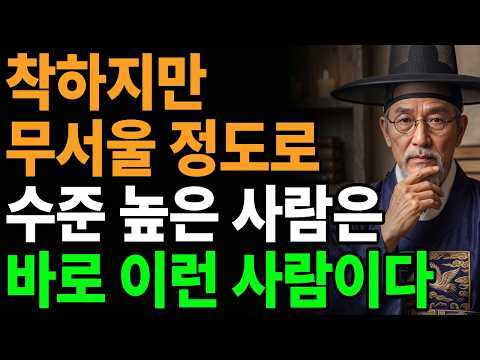
- 설명 앞부분: 당신 주변에 이런 사람이 있습니까? 평소에는 한없이 부드럽고, 웬만한 일에는 화도 내지 않습니다. 그런데 이상하게, 그 사람만은 함부로 대하기가 어렵습니다. 이 영상에서는 겉으로 착하고 순해 보이지만 절대 만만하게 볼 수 없는 사람들의 내면에서 작동하는 6가지 시스템을 해부합니다. 말의 소리가 아니라 구조를 읽는 사람의 비밀 분노에 등급을 매기는 절제의 힘 해명하지 않는 것이 왜 가장 강한 위치인지 소리 없이 떠나는 사람의 품격 만만하게 보는 사람의 잣대가 짧은 이유 존중이 되살아나는 역설적 구조 정약용은 18년 유배 생활 동안 …
- 같은 채널 평소 대비 ×55.4 (채널 최근 롱폼 중앙값 5,872회) · 평소 영상: 사람을 만나면 3가지 척만 해라 평생 원수도 내 편이된다 ∣ 정약용 명언 ∣ 인간관계 ∣… (6,284회) / 사람은 잘해주면 점점 무시합니다 딱 이행동 하나 바뀌면 태도가 달라집니다 ∣ 정약용 명언… (5,460회)
- 대본 없음 (설명) — 음성인식이 끝나면 도입부·흐름이 들어감
- 댓글 115/115: 좋은 점 — 영상 12 · 감사·응원 23 · 더 알고 싶은 것 0 · 아쉬운 점 — 영상 1 · 반박·불만 — 의견 다름 0 · 정치·사회 1 · 경험 공유 10 · 구독·다음 기대 0
  - 좋은 점 — 영상 👍16 “예전에는 무조건 참고 양보하는 사람이 좋은 사람이라고 생각했습니다. 그런데 시간이 지나면서 모든 사람에게 맞춰주는 것이 꼭 좋은 것은 아니라는 걸 배웠습니다. 친절하되 자신의 기준을 지키는 것이 정말 중요한 것 같습니다.”
  - 좋은 점 — 영상 👍5 “참 도움되는 말씀 실행 해야 겠어요”
  - 감사·응원 👍14 “녹차 한잔과 함께 듣는 귀한영상이 명상에 이르게 하니, 이 또한 감사하고 감사합니다 덕분에 맑은 마음 갖고 오늘을 시작해봅니다”
  - 감사·응원 👍7 “저도배웄다고 하는사람. 인데. 체구가 작아서. 그러지몰ㅈ라도. 동창회가면 유독 남에말에 자사에게 상관없는 대화인대도불구하고ㅈ남에말에. 꼭 끼어들어서 참견하는것뿐만 아니라. 자존심을 밟을정도로. 철저하게 무시하는 말을 해서. 늘동창회가면그런 여자동창 때문에 미ㅡㄹ 다툼…”
  - 아쉬운 점 — 영상 👍16 “화를 함부로 내는 건 안되지만 선을 넘거나 아닌 것은 참는 것보다 아니다라고 얘기하는게 나은 듯합니다. 굳이 변명은 안하더라도 아니다라고 해야 반복되지 않고 상대도 조심합니다.”
  - 정치·사회 👍0 “오해하지 마십시요^ 정말 주진우의원님이 말을해도 겉돌면서 계속골프를 대통령부부가 치고 잇습니다^ 제가 잘못한 건지요^”
  - 경험 공유 👍54 “만만하게 보이는것은 내가 얕아서가 아니라 상대의 자가 짧은것이다🎉”
  - 경험 공유 👍7 “해명은 상대의 법정에 서는 것, 나의 가치는 내가 정한다.”

### 37. 작은 선물을 자꾸 주는 사람의 심리. 당신도 그렇습니까? 일상심리학

- https://www.youtube.com/watch?v=2GxDRxV0T9w · 일상심리학 · 구독자 19,600 · 조회수 887,383 (×45.3, 하루 46,784.4) · 좋아요 4,828 (0.5%) · 23.7분 · 2026-10-23 · 주제 묶음 1. 심리학 일반 · 형식 브이로그·직접 해본 이야기 · 폴더 `W_2GxDRxV0T9w` (웹 승인)
- 썸네일: 
- 설명 앞부분: 만날 때마다 사탕 하나, 귤 하나를 손에 쥐여 주는 사람, 그냥 정이 많아서일까요? 건네는 사람은 작은 것이라 여기지만, 받는 사람에게는 짐작보다 훨씬 크게 닿고 있었습니다. 일상심리학을 찾아오신 모든 분들에게, 성장과 행복이 있기를 바랍니다. 🙏 이 영상이 도움이 되었다면, 영상 오른쪽 점 세 개 안에 있는 🩶 Thanks로 커피 한 잔 응원해 주세요. ☕ 다음 영상에 감사인사를 올려드립니다. ❤ 🔹 탐색자 2,990원 / 통찰자 5,990원 / 동반자 12,000원 일상심리학의 소중한 멤버, 김종근종근님, 주명순님, 김수미님,…
- 같은 채널 평소 대비 ×79.8 (채널 최근 롱폼 중앙값 11,119회) · 평소 영상: 의자 넣고 일어서는 사람의 놀라운 특징 ∣ 성실한 사람의 수명 연구 ∣ 일상심리학 (11,119회) / 사람을 오래 겪은 사람에게 보이는 그릇이 작은 사람의 특징 ∣ 일상심리학 (11,811회)
- 대본 없음 (설명) — 음성인식이 끝나면 도입부·흐름이 들어감
- 댓글 628/628: 좋은 점 — 영상 4 · 감사·응원 55 · 더 알고 싶은 것 0 · 아쉬운 점 — 영상 6 · 반박·불만 — 의견 다름 18 · 정치·사회 2 · 경험 공유 139 · 구독·다음 기대 0
  - 좋은 점 — 영상 👍1 “어릴때부터 많이 아팠어요 그러다보니 알게 모르게 사람들에게 피해를 준 적도 많았고 해서 내가 아주 사소한 도움이라도 받았다 생각들면 음료라도 하나 드리고 감사표시 하는게 습관처럼 됐고 지금까지”
  - 감사·응원 👍842 “시골에서 농사지은 대파 너무 많아 앞집에 나눠 줬는데 그즉시 초인종 울려 나가보니 배3개를 주셨다 감사한 마음으로 받아 배를 깍았는데...얼마나 오랫동안 냉장고에 있었는지 배가 물컹해서 먹을수가 없었다 그래도 뭐라도 주고 싶으셨나보다 하며 넘어갔고 몇달후 농사지은 풋…”
  - 감사·응원 👍399 “누가 작은거라고 내게 쥐어주면 너무 고맙던데요 그리고 담엔 나도 나누는 마음을 실천하자고 생긱합니다 예쁜마음이 긍정적으로 전파하더라는~”
  - 아쉬운 점 — 영상 👍23 “기분 좋게 주더라도 그게 반복되면 당연시 여기는 게 문제지”
  - 아쉬운 점 — 영상 👍10 “품목과 방법은 시대가 변했으니 변할수 있지만, 맥락과 마음은 그대로일것 같아요. 연구가 진행되던 때에는 설탕, 밀가루도 귀해서 아플때 약처럼먹고, 가진 사람들이 먹는거였기에 누구든 반가워했다면 요즘은 아이들마져 당뇨, 첨가물 걱정인 시대라 싫어할수 있고, 워낙 이런 …”
  - 반박·불만 — 의견 다름 👍122 “받는 사람이 다 좋아하는건 아닙니다”
  - 반박·불만 — 의견 다름 👍52 “주고싶은맘 일땐 내가 받아도 기분좋은걸로 냉장고에서 돌아다니다 먹기싫은거 말고 나도 미용실 했는데 봉지안것은 모르니 고맙다고 연신 말했는데 가고 열어보니 멸치냄새가 섞여있더라~~으악바로 버리고 그날이후 그 손님 바로 안봐지더라~~ 그날이후 느낀거 내가 받아 기분좋은것…”
  - 정치·사회 👍1 “학폭이 아닌데 왜 학폭이 라고 말씀 하시죠? 20대 초반에 친구와의 다툼이었다고 다 해결된걸 잘 되니까 학폭으로 프레임 씌워서 온 언론이 앞날이 창창한 청년의 앞길을 막은거죠😢 찢죄명 이 윤석열대통령을 내란으로 프레임 씌운거처럼 내란은 찣의 입법내란 인데😢두분 다 억…”
  - 경험 공유 👍640 “내가 못 먹는거 못하는거 남 주는거 아니다 고구마 한박스에서 이웃이건 친구건 줄때는 제일 좋고 실한것 만 준다”
  - 경험 공유 👍399 “누가 작은거라고 내게 쥐어주면 너무 고맙던데요 그리고 담엔 나도 나누는 마음을 실천하자고 생긱합니다 예쁜마음이 긍정적으로 전파하더라는~”

### 38. 《정약용 명언》 노후에 절대 대답하면 안 되는 '4가지' 질문. 입을 다물면 존경받는다. l 인생명언 l 행복한 노후 l 삶의지혜 l 인간관계

- https://www.youtube.com/watch?v=6Bit5jnPjHk · 관계의 품격 · 구독자 1,210 · 조회수 245,487 (×202.9, 하루 2,747.5) · 좋아요 2,642 (1.1%) · 28.5분 · 2026-08-14 · 주제 묶음 2. 인간관계·처세 · 형식 수면·낭독·오디오북 (잠잘 때·명언) · 폴더 `W_6Bit5jnPjHk` (웹 승인)
- 썸네일: 
- 챕터: 0:00 대답하는 순간 영원히 품위를 잃게 만드는 질문들이 있… · 3:26 모든 것에 답하고 모든 것을 잃은 원로의 이야기 · 7:31 "자신이 가진 재산 규모를 절대 밝히지 말고, 자녀 … · 12:11 "집 안에서 일어난 일은 절대 현관문 밖으로 새어 나… · 17:18 "고통을 드러내는 순간, 존중은 동정이 되고, 동정은… · 23:18 침묵은 공허함이 아니다. 그것은 증명할 것이 아무것도…
- 설명 앞부분: 정약용 선생께서 이르시길, 사람의 품격은 말하는 것이 아니라 말하지 않는 것에서 드러난다 하셨습니다. 나이가 들수록 우리는 무심코 던지는 질문에 진심을 다해 대답하곤 하지만, 그것이 바로 존경을 잃는 첫걸음입니다. 오늘 이 영상에서는 누구를 만나든 절대 답해서는 안 되는 '4가지 치명적인 질문'을 정약용 선생의 가르침을 통해 밝힙니다. "침묵할 줄 아는 자만이 진정한 존경을 받는다"—이 단순하지만 강력한 원칙이 당신의 남은 인생을 완전히 바꿔놓을 것입니다. 지금 이 순간부터 당신의 입은 곧 당신의 성곽이 됩니다.
- 같은 채널 평소 대비 ×2,134.7 (채널 최근 롱폼 중앙값 115회) · 평소 영상: 《정약용 명언》 늘그막에 운이 피어나는 여자의 ‘5가지 버릇', 늦복 터지는 노후의 비밀… (117회) / 《정약용 명언》 부자가 되는 여성이 즐겨 신는 신발 색깔 5가지. 이 색만 신어도 평생 … (117회)
- 대본 없음 (설명) — 음성인식이 끝나면 도입부·흐름이 들어감
- 댓글 277/277: 좋은 점 — 영상 11 · 감사·응원 30 · 더 알고 싶은 것 0 · 아쉬운 점 — 영상 1 · 반박·불만 — 의견 다름 1 · 정치·사회 0 · 경험 공유 12 · 구독·다음 기대 0
  - 좋은 점 — 영상 👍48 “제가 75년을 솔직한게 인간의 본부인줄 알고살았습니다 이제야 지금 말흠에공감합니다”
  - 좋은 점 — 영상 👍11 “나는 품격있는 사람이다 나는 나의경계를 지키는 사람이다 좋은 내용 감사합니다 🎉”
  - 감사·응원 👍27 “나는 품격 있는 사람이다. 나는 경계를 지키는 사람이다 감사합니다❤”
  - 감사·응원 👍19 “나는 품격있는사람이다ㆍ나는 내경계를 지킨다! 고맙습니다”
  - 아쉬운 점 — 영상 👍0 “이 말씀은 필자 개인의 생각을 말하고 있습니까? 정약용이 말한 저서를풀이한겁니까? 아니면 정약용 사진을 걸어놓고 그의 일부 생활 철학을 인용하고 있습니까? 먼저 말하는 내용의 출처가 궁금하군요.”
  - 반박·불만 — 의견 다름 👍1 “부부에갈등 자식에 부모는 칩착하지 말아야합니다 그리고 돈이란 문제가 아닙니다 있고 없고 첮째는”
  - 경험 공유 👍152 “제거 이런정보를 진작 알았으면 마음에 경계를 하고 남이 꼬치꼬치 묻는말에 대답을 해주지 말았을것을 많이 후회하고 있었습니다 전에는 제가 마음이 열려있는 사람이 였었는데 누가 저에게 질문이나 무엇을 물어보면 솔직하게 다 이야기 해주었습니다 그러나 나의약점을 알고난 사람…”
  - 경험 공유 👍48 “제가 75년을 솔직한게 인간의 본부인줄 알고살았습니다 이제야 지금 말흠에공감합니다”

### 39. 새 차만 사서 15년 타는 사람들, 이런 사람들입니다 (감가를 몰라서가 아닙니다)

- https://www.youtube.com/watch?v=Hf1bwdBLcj4 · 심리발견 · 구독자 8,210 · 조회수 592,050 (×72.1, 하루 15,867.1) · 좋아요 1,616 (0.3%) · 12.9분 · 2026-10-05 · 주제 묶음 1. 심리학 일반 · 형식 브이로그·직접 해본 이야기 · 폴더 `W_Hf1bwdBLcj4` (웹 승인)
- 썸네일: 
- 챕터: 0:00 그 사람, 바보가 아닙니다 · 1:08 보유 기간 — 감가상각표를 이기는 단 하나의 숫자 · 2:40 전 주인의 역사 — 중고차를 안 사는 진짜 이유 · 4:15 결정 한 번을 오래 쓰는 사람들 — 고민은 길게, 사… · 5:44 비교를 끊어버린 사람들 — 보여주는 물건에서 내가 쓰… · 7:13 아낀 돈은 어디로 가는가 — 남들과 다른 우선순위표 · 8:43 오래 타는 게 항상 정답은 아닙니다 — 수리비와 안전… · 10:04 그런데도 안 바꾸는 이유 — 감가가 아니라 적립 · 11:23 결국 차 이야기가 아니었습니다 — 그 숫자를 내가 정…
- 설명 앞부분: 신차를 뽑아 출고장 문을 나서는 순간, 몇백만 원이 공중으로 증발합니다. 모르는 사람이 없는 얘기죠. 그런데 그 얘기를 백 번 넘게 듣고도 굳이 새 차를 사서, 15년을 타는 사람들이 있습니다. 이 영상은 새 차를 사서 10년, 15년씩 타는 사람들의 계산기를 열어 봅니다. 감가상각표를 이기는 단 하나의 숫자, 중고차를 사지 않는 진짜 이유, 비교를 꺼 버린 방식, 그리고 차에서 아낀 돈이 어디로 가는지까지 차례로 따라갑니다. 그리고 이 이야기는 돈 얘기로 시작해서 전혀 다른 얘기로 끝납니다. 시세표에는 감가라고 적히는 그 시간이…
- 같은 채널 평소 대비 ×20.3 (채널 최근 롱폼 중앙값 29,132회) · 평소 영상: 당신이 그 브랜드를 고른 진짜 이유 (오토바이 브랜드별 심리 분석) (29,609회) / 등산에 빠지는 사람의 5단계, 끌려온 첫날부터 해탈까지 (28,656회)
- 대본 없음 (설명) — 음성인식이 끝나면 도입부·흐름이 들어감
- 댓글 679/679: 좋은 점 — 영상 6 · 감사·응원 9 · 더 알고 싶은 것 3 · 아쉬운 점 — 영상 1 · 반박·불만 — 의견 다름 6 · 정치·사회 1 · 경험 공유 109 · 구독·다음 기대 2
  - 좋은 점 — 영상 👍12 “2015년에 새차 사서 15만 키로 탔는데 나이가 60대 이다보니, 무조건 오래타는 것도 좋은것만은 아니라는 생각이 들어요. 몸도 젊을때 같지 않고요. 그래서 나이 들수록 안전장비를 갖춘 신형 차를 타는게 도움이 된다 생각해요. 차량의 도움으로 사고로 부터 도움도 받…”
  - 좋은 점 — 영상 👍2 “8년된 내 뉴라이즈 앞으로 7년 더 타야겠네요. 좋은 영상 감사합니다♡”
  - 감사·응원 👍23 “SM5 2006년식 25만키로 내년에는 쉬게 해줄 생각인데 울 아들 태우고 학원이네 여행이네 많이도 다녔네 고맙다 사고없이 우리가족 발이 되어줘서...”
  - 감사·응원 👍3 “12년식 소나타 타면서 부러움없이. 애정 가득 탔고 가끔 잔고장나서 속썩일때 욱했지만. 나한테. 돈도 많이 벌어다주고 내 자식들을 안전하게 운행해주고 내 취미생활에도 옆에서 날지켜준 우리 쏘붕이 너무 고맙고 이제 점점 널 보낼 시기가 오니까. 마음이 심란하고 다음 붕…”
  - 더 알고 싶은 것 👍0 “좋은 중고차를 골라서 15년 탄다면 어떤가요?”
  - 아쉬운 점 — 영상 👍0 “현기차 직원이면1.2년에 차 한대 살때 30% 할인 받고 삽니다..그러면 2년 타고 팔아도 본전이상 받고 또 삽니다..무한반복”
  - 반박·불만 — 의견 다름 👍2 “좀 웃기는 영상이네. 차 한대를 15년 타면 지겹지. 중고는 3년마다 바꾸면 5대를 타네. 게다가 늘 차령이 5~6년을 넘기지 않으니까 좋고. 게다가 취향에 맞게 돌아가며 타고. 그건 생각 안하나?”
  - 반박·불만 — 의견 다름 👍1 “3년된 중고차 사서 안바꾸고 계속 타는게 좋은거 아닌가요? 새차 + 15년 타는 사람과 중고차 + 3~5년 타는 사람을 비교하면 안되죠. 전제가 틀렸습니다. 감가 빠진 중고차 사는 사람과 새차 사는 사람을 비교하시고, 15년 타는 사람가 3~5년 타는 사람을 비교하셔…”
  - 경험 공유 👍55 “06년식 아반떼HD. 2013년 구입후 지금까지 타고 있습니다 13년전 4백주고 구입했었습니다”
  - 경험 공유 👍45 “2000년식 이에프소나타 26년째 타고 잇슴”
  - 구독·다음 기대 👍6 “너무 몰두해서 봤어요 구독했습니다 ㅎㅎ”
  - 구독·다음 기대 👍1 “운전하면서 들었는데 재밌네요ㅎㅎ 구독할게요!”

### 40. 지능이 높을수록 나이가 들면 친구를 정리 하는 이유

- https://www.youtube.com/watch?v=tMtPxonK_Uk · 단단한 인생 2막 · 구독자 455 · 조회수 87,125 (×191.5, 하루 838.6) · 좋아요 1,093 (1.2%) · 20분 · 2026-07-30 · 주제 묶음 2. 인간관계·처세 · 형식 정보·해설 (그 밖) · 폴더 `W_tMtPxonK_Uk` (웹 승인)
- 썸네일: 
- 챕터: 0:00 친구 연락이 한숨으로 변한 진짜 이유 · 1:12 우리가 맺어온 인연의 숨겨진 실체 · 2:05 나이 들수록 뇌가 남은 시간을 계산하는 방식 · 3:10 사회정서적 선택 이론: 넓은 관계에서 깊은 관계로 · 4:18 체력과 시간의 가치를 깨달을 때 생기는 변화 · 5:32 진짜 사회성이란 관계의 개수가 아닌 밀도 · 6:45 관계를 정리하지 못해 힘겨운 세 가지 유형
- 설명 앞부분: 나이 들수록 친구 만나는 게 귀찮고, 혼자 있는 시간이 더 편안하게 느껴지시나요? ☕ 많은 분들이 『내가 성격이 모나진 걸까』 고민하시지만, 심리학은 전혀 다른 답을 제시합니다. 뇌가 가장 똑똑하게 작동하고 있다는 증거이자, 내 삶의 진짜 우선순위를 찾아가는 과정이기 때문입니다. 불필요한 죄책감은 내려놓고, 나를 지키는 현명한 관계 정리법을 만나보세요. ✨ ⏱ 타임라인
- 같은 채널 평소 대비 ×402.4 (채널 최근 롱폼 중앙값 216회) · 평소 영상: 똑똑한 사람일수록 나이가 들면 인간관계를 끊어내는 이유 (251회) / 남의 시선 신경 안쓰는 사람이 잘되는 이유 니체의 마음가짐 (182회)
- 대본 없음 (설명) — 음성인식이 끝나면 도입부·흐름이 들어감
- 댓글 211/211: 좋은 점 — 영상 4 · 감사·응원 4 · 더 알고 싶은 것 1 · 아쉬운 점 — 영상 0 · 반박·불만 — 의견 다름 6 · 정치·사회 0 · 경험 공유 21 · 구독·다음 기대 0
  - 좋은 점 — 영상 👍5 “오늘 내용이 구구절절 옳은 내용입니다. 나이가 들수록, 나의 몸과 마음이 평안해야 친구와 주변도 챙길수 있습니다.”
  - 좋은 점 — 영상 👍2 “좋은 이야기 임니다 참고 하겠습니다”
  - 감사·응원 👍14 “감사합니다 그런 이유가 있었군요 저도 저만의 시간을 보내야겠어요 !”
  - 감사·응원 👍6 “현명하신 영상 감사합니다 신의축복 받으세요^^”
  - 더 알고 싶은 것 👍2 “무슨 이유가 있을까요? 모든생활에서 행동 이나 마음가짐에서 생각들이 많아지고 움직임도 둔해지고 살아온 과정들을 하나하나 반추해보는 시간이 남은 생의 시간 같을테니까”
  - 반박·불만 — 의견 다름 👍7 “결정적인 원인은 지적수준(학벌, 학력을 지칭하는 게 아닙니다)과 대화내용의 차이에서 현격한 이질감을 느끼기 때문입니다. 나이가 들어도 꾸준히 자기계발을 멈추지 않는 사람들 대부분 잡스러운 친구 안 만나지요. 잡스러운 일상적인 얘기와 신변얘기는 이들에게는 시간 낭비일 …”
  - 반박·불만 — 의견 다름 👍5 “친구에게 도움 받으려는 생각이 틀렸다.”
  - 경험 공유 👍15 “식구들 빼고 모든 사람이 내가 망하길 바란다.”
  - 경험 공유 👍14 “감사합니다 그런 이유가 있었군요 저도 저만의 시간을 보내야겠어요 !”

