# 심리 — 성공 사례 분석: 사례별 자세히 #1–#40

`analysis.md` 의 9번 (같은 # 번호). 자동 생성 — `tools/success_analysis.py` v1.6 (2026-11-11 13:47 UTC). ※ 연구·교육용 — 투자 권유가 아님.

### 1. 혹시 당신도?! 자리 뜰 때 의자 집어넣는 사람들의 의외의 심리학적 특징 3가지

- https://www.youtube.com/watch?v=ybPJ5t_VfUk · 마음의 반대편 · 구독자 1,510 · 조회수 1,210,324 (×801.5, 하루 50,050.7) · 좋아요 5,704 (0.5%) · 9.5분 · 2026-10-18 · 주제 묶음 1. 심리학 일반 · 형식 목록형 (N가지 특징·신호) · 폴더 `W_ybPJ5t_VfUk` (웹 승인)
- 썸네일: 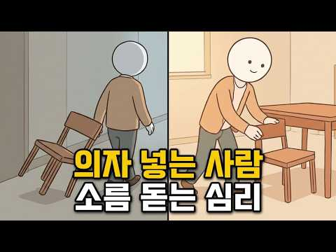
- 설명 앞부분: 카페나 식당을 나설 때 무의식적으로 의자를 집어넣는 행동에는 우리의 깊은 내면과 무의식이 담겨 있습니다. 이 영상에서는 의자를 넣는 사람들의 행동을 통해 타인을 향한 배려와 자기 통제력을 심리학적 관점에서 살펴봅니다. 우리가 무심코 하는 3초짜리 행동이 타인을 대하는 방식과 세상을 바라보는 태도를 어떻게 보여주는지 알아봅니다. 사소한 버릇 속에 숨겨진 인간의 진짜 내면과 무의식의 거울을 마주하는 시간이 될 것입니다. 일상적인 행동 하나로 자신과 타인의 숨겨진 심리를 이해하는 흥미로운 경험을 해보시길 바랍니다.
- 대본 없음 (설명) — 음성인식이 끝나면 도입부·흐름이 들어감
- 댓글 723/724: 좋은 점 — 영상 14 · 감사·응원 6 · 더 알고 싶은 것 9 · 아쉬운 점 — 영상 5 · 반박·불만 — 의견 다름 10 · 정치·사회 6 · 경험 공유 132 · 구독·다음 기대 1
  - 좋은 점 — 영상 👍160 “사용한 물건은 제자리에 놓으라고 배웠어요 유치원에서”
  - 좋은 점 — 영상 👍24 “국민학교때 선생님께 배웠지요 청소후에 그렇게마무리 해야했고”
  - 감사·응원 👍7 “맞은편 상대가 다리 꼬고 앉으면 그 발이 제 쪽의 바지에 닿는 경우가 많습니다. 그냥 참고만 있었는데 며칠 전 한 사람은 다리가 길어서 제 바지를 제대로 계속 툭툭 쳐서 "정말 미안한데 내 바지에 닿는다"고 하니까 기분 나빠하더라구요. 이 부분도 심리학적으로 해석해 …”
  - 감사·응원 👍3 “좋아 좋아 아주 좋아요 응원합니다”
  - 더 알고 싶은 것 👍1 “내가 그래서 왜 그러는지 궁금해서 왔어요 ㅋㅋ”
  - 더 알고 싶은 것 👍0 “의자를 제 자리에 놓고 모든 물건들이 딱딱 각마춰 놓아 두고 마을청소를 혼자 다니며 하는 사람이 샤워하는 날이 손에 비누 묻히는 날이고 텃밭을 파고 갈아사 흙먼지 묻은 옷으로 소파에 드러눕고 밥도 먹고 잘때도 기냥 잡니다노숙자처럼 옷을 갈아입지 않고 며칠을 보내고 잘…”
  - 아쉬운 점 — 영상 👍7 “맞은편 상대가 다리 꼬고 앉으면 그 발이 제 쪽의 바지에 닿는 경우가 많습니다. 그냥 참고만 있었는데 며칠 전 한 사람은 다리가 길어서 제 바지를 제대로 계속 툭툭 쳐서 "정말 미안한데 내 바지에 닿는다"고 하니까 기분 나빠하더라구요. 이 부분도 심리학적으로 해석해 …”
  - 아쉬운 점 — 영상 👍0 “서론이 너믜길어서 들을수가없네”
  - 반박·불만 — 의견 다름 👍0 “그냥 습관처럼 되어버렸지만 무의식적 행동아닙니다. 그렇게 해놓아야 한다고 생각해서 그리합니다.”
  - 반박·불만 — 의견 다름 👍0 “나도 외부에서 의자를 정리하는 스타일인데, 근데 난 집에서는 그렇게 정리하지 않아요. 그냥 널부러져 있어도 스트레스 안받는 스타일...ㅎㅎ 다만 밖에서는 웬지 그래야 편할 것 같은 생각때문에 그렇게 해요. 나만의 매너랄까? 굳이 남에게 보여주자는 뜻은 아닌데... 그…”
  - 정치·사회 👍0 “그행동은.선진국에서는.기본중의기본적행동이라서.어렸을때부터 몸에배어있지요.오히려 안그러는사람들의 행동을 이해할방법이없어요.뻔뻔하게.그냥일어나나갈수있는 용기가? 대단하게느껴짐..내가 앉았던자리.빌려썼으니 그대로해놓고가는게 기본아닌가요? 그게 무슨? 깔끔떤다고? 몸에붙어이…”
  - 정치·사회 👍0 “자기 앉았던 자리 깨끗이 하는 습관은 중국인과 나를 구분하는 것.ㅋㅋㅋ”
  - 경험 공유 👍516 “난 내가 착한 사람 이라고 생각하지 않음. 그저 내가 사용한 의자 안넣고, 내가 연 문 닫지 않으면 너무 거슬려서 그냥 못 지나침.”
  - 경험 공유 👍427 “카페든 식당이든 화장실이든 내가 머물렀던 자리를 지저분하게 하고 나오면 마음이 불펀함. 쓰레기 최대한 정리하고 의자 넣고 그냥 나만의 루틴임.”
  - 구독·다음 기대 👍0 “구독합니다 😊”

### 2. 운명적인 인연이라면 반드시 겪는 첫 번째 현상 ∣ 재회의 심리학

- https://www.youtube.com/watch?v=ZqhhYMJvrx4 · 연애심리다방 · 구독자 91 · 조회수 17,932 (×179.3, 하루 2,237.1) · 좋아요 157 (0.9%) · 8.7분 · 2026-11-03 · 주제 묶음 1. 심리학 일반 · 형식 심리테스트·자가진단 · 폴더 `W_ZqhhYMJvrx4` (웹 승인)
- 썸네일: 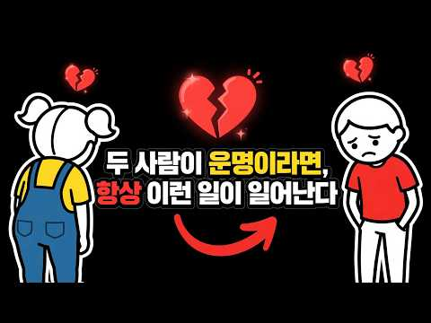
- 설명 앞부분: 운명적인 두 사람이 반드시 거치는 첫 번째 과정 ∣ 인연의 신호 운명으로 엮인 두 사람에게 가장 먼저 일어나는 한 가지 ∣ 재회의 심리학 안녕하세요, 여러분. 운명적인 두 사람에게 가장 먼저 일어나는 것은 달콤한 사랑이 아닌 '혼란과 단절'입니다. 본 영상에서는 운명적 인연 뒤에 감춰진 심리적 진실을 공개합니다. 왜 이별의 시기를 거치는지, 그리고 결국 다시 마주치기 직전 나타나는 공통된 신호 패턴은 무엇인지 설명합니다. 떨어져 있는 동안 서로를 성숙시키는 성장의 과정입니다. 지금 누군가가 문득 떠올랐다면, 이 영상은 바로 당신을…
- 대본 없음 (설명) — 음성인식이 끝나면 도입부·흐름이 들어감
- 댓글 3/3: 좋은 점 — 영상 0 · 감사·응원 0 · 더 알고 싶은 것 0 · 아쉬운 점 — 영상 1 · 반박·불만 — 의견 다름 1 · 정치·사회 0 · 경험 공유 0 · 구독·다음 기대 0
  - 아쉬운 점 — 영상 👍2 “칼융의 심리학내용 비스므리 하군요. 근데 그 과정들을 통해 꼭 재회로 이어진다는건 아닙니다. 약간 짜집기 같긴 하네요.”
  - 반박·불만 — 의견 다름 👍2 “칼융의 심리학내용 비스므리 하군요. 근데 그 과정들을 통해 꼭 재회로 이어진다는건 아닙니다. 약간 짜집기 같긴 하네요.”

### 3. 무조건 일시불로만 결제하는 사람들의 놀라운 심리와 인간관계 특징 7가지

- https://www.youtube.com/watch?v=MiCkhuXQ7Xs · 4와2 · 구독자 462 · 조회수 219,594 (×475.3, 하루 7,335.2) · 좋아요 1,051 (0.5%) · 12.7분 · 2026-10-12 · 주제 묶음 2. 인간관계·대화 · 형식 목록형 (N가지 특징·신호) · 폴더 `W_MiCkhuXQ7Xs` (웹 승인)
- 썸네일: 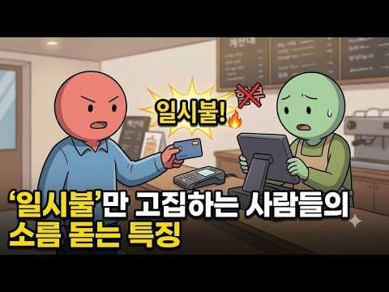
- 대본 없음 (없음) — 음성인식이 끝나면 도입부·흐름이 들어감
- 댓글 186/186: 좋은 점 — 영상 5 · 감사·응원 3 · 더 알고 싶은 것 1 · 아쉬운 점 — 영상 0 · 반박·불만 — 의견 다름 4 · 정치·사회 0 · 경험 공유 33 · 구독·다음 기대 0
  - 좋은 점 — 영상 👍30 “좋은 내용이네요. 딱 저예요.집도 대출없이 현금으로 사고 차도 그래요. 돈이 많아서가 아니고 가진 현금에 맞춰 집이든 차든 사요. 누군가 밥을 자꾸 사주거나 선물을 받으면 마음이 불편해요. 일이나 사람관계도 애매하고 결론이 나지 않으면 불편해서 서둘러 결론을 내려하는…”
  - 좋은 점 — 영상 👍11 “작은것도 약속개념이 정확한 성격입니다 맞는 말씀이시네요”
  - 감사·응원 👍0 “좋은점~ 나쁜점 ~고쳐야할점~ 배려해야할점~특히 상대가 우리 일시불의 마음을~ 이해하고 오해하지 않게 설명해주셔서 감사합니다 ~😊”
  - 감사·응원 👍0 “좋은 내용 감사합니다!!!”
  - 더 알고 싶은 것 👍0 “좋은 내용이네요. 그런데 지인중에 신용카드는 먼저 쓰고 추후에 대금 나가는게 싫어서 직불카드만 쓰는 친구가 있어요. 심지어 빚이 싫어서 은행대출도 아예 없는 친구. 다음에는 직불카드만 쓰고, 대출도 안받는 유형의 특징도 한번 다뤄주세요.”
  - 반박·불만 — 의견 다름 👍0 “절반은 맞고 절반은 틀렸습니다 이런 사람들은 남이 할부를 하든 말든 신경 안씀니다 그리고 내가 한번 밥값 지불했다고 댓가를 바라지 않습니다 열번 만나 열번을 쓰야 마음이 편합니다 그리고 가장 중요한게 신용카드를 지갑에 넣고 다니지 않습니다 현금과 체크카드 사용합니다”
  - 반박·불만 — 의견 다름 👍0 “할부면 그달 소비와 지출 파악이 제대로 안된다 내 아는 지인 남자는 할부인생인데 2년전 할부들이 항상 도래되어있어 월 결제가 항상 400 이 넘는다는.. 연봉도 높은거도아닌데..ㄷㄷㄷ 그 와이프도 비슷”
  - 경험 공유 👍124 “나도 일시불 선호함 이유는 깔끔 하잖아”
  - 경험 공유 👍83 “나도 적극 동감, 절대 웬만해선 할부안함.”

### 4. 압도적인 간파력을 가진 사람들의 5가지 심리학적 특징(사람 보는 눈이 정확한 사람)

- https://www.youtube.com/watch?v=LPkzgfguXsE · 현실적인 심리학 · 구독자 1,880 · 조회수 241,862 (×128.7, 하루 25,417.1) · 좋아요 748 (0.3%) · 20.2분 · 2026-11-01 · 주제 묶음 1. 심리학 일반 · 형식 목록형 (N가지 특징·신호) · 폴더 `W_LPkzgfguXsE` (웹 승인)
- 썸네일: 
- 챕터: 0:00 첫 만남에서부터 다른 사람 · 1:51 첫인상, 심리학은 뭐라고 할까 · 3:37 첫 번째 특징 – 말보다 행동 · 5:11 두 번째 특징 – 낱개가 아닌 전체 · 6:22 세 번째 특징 – 사람 너머의 자리 · 8:00 네 번째 특징 – 내 판단을 향한 질문 · 9:53 다섯 번째 특징 – 마지막 퍼즐 · 13:40 오늘부터 해 볼 세 가지 · 16:17 내 곁의 이야기 · 18:17 처음 질문으로 돌아가서
- 설명 앞부분: 친구 소개로 처음 만난 사람이 시원시원하게 말하는데, 한 사람만 웃으면서 듣기만 합니다. 헤어지는 길에 건넨 한마디, "좀 더 봐야 알겠다." 그 짧은 자리에서 그분은 대체 무엇을 본 걸까요? 압도적인 간파력을 가진 사람들의 다섯 가지 심리학적 특징을 심리학 연구로 풀어 봅니다. 날리니 암바디·로버트 로젠탈 – Half a Minute: 30초 미만의 무음 영상으로 교수 평가를 예측한 연구 (1993) 날리니 암바디·로버트 로젠탈 – Thin Slices of Expressive Behavior as Predictors of In…
- 대본 없음 (설명) — 음성인식이 끝나면 도입부·흐름이 들어감
- 댓글 65/64: 좋은 점 — 영상 1 · 감사·응원 1 · 더 알고 싶은 것 0 · 아쉬운 점 — 영상 2 · 반박·불만 — 의견 다름 2 · 정치·사회 1 · 경험 공유 5 · 구독·다음 기대 0
  - 감사·응원 👍2 “1. 2. 3. 나의 성품이 나쁘지는 않았네요. 저는 제 자신에 성품이 모난 성품인가.?생각했습니다. 오늘 말씀 감사합니다. 건강챙기시면서 하세요.”
  - 아쉬운 점 — 영상 👍0 “<간파력을 가진 사람> 말이 아닌 반복되는 행동을 본다. 작은 신호를 하나씩이 아니라 전체의 결로 읽는다. 사람과 그 사람의 상황을 함께 본다. 자기 판단을 확인하려 하기 보다 의심해 본다. 편하게 이야기를 꺼내도록 끝까지 이야기를 듣는다. 말이 앞으로의 행동으로 어…”
  - 반박·불만 — 의견 다름 👍1 “사람은 변해가니까 이말도 정확한게 아니죠 하지만 좋은 지적입니다”
  - 정치·사회 👍9 “질문이 대답에 영향을 끼친다. 이게 여론조사가 실제 여론을 온전히 반영하지않는 이유중 하나다. 선거시즌이 되면 수없이 걸려오는 여론조사중 일부는 대충 생각없이 들어도 조사를 한다기보다는 여론을 형성하려는 의도가 다분한 질문이 많더라고.”
  - 경험 공유 👍12 “나도 다들 좋다하는데 쫌 아닌사람 있어 연예인 무슨느님 하는데 물론 자기 관리는 잘하는듯해 난 쫌 그래 차라리 탁씨가 난듯 해”
  - 경험 공유 👍0 “그럼 잘알겠네.내가 단한번도 친구로 생각한적없다는걸.”

### 5. 솔직히, 저는 가족을 차단했습니다.｜나르시시스트 엄마와 거리두기 ｜K-장녀의 착한딸 컴플렉스

- https://www.youtube.com/watch?v=GTaEvNGiCjk · 난나야 · 구독자 320 · 조회수 56,283 (×175.9, 하루 4,253.6) · 좋아요 286 (0.5%) · 14.5분 · 2026-10-29 · 주제 묶음 4. 나쁜 사람 알아보기 · 형식 목록형 (N가지 특징·신호) · 폴더 `W_GTaEvNGiCjk` (웹 승인)
- 썸네일: 
- 대본 없음 (없음) — 음성인식이 끝나면 도입부·흐름이 들어감
- 댓글 71/71: 좋은 점 — 영상 4 · 감사·응원 12 · 더 알고 싶은 것 2 · 아쉬운 점 — 영상 0 · 반박·불만 — 의견 다름 2 · 정치·사회 0 · 경험 공유 25 · 구독·다음 기대 0
  - 좋은 점 — 영상 👍24 “나르시시스트 엄마와 시아버지를 겪은 경험으로 알게된 것이 가장 앞에서 직격탄을 맞는 존재가 있기 때문에 다른 사람들은 동일한 정도의 상처를 받지 않는다는 것이었어요 내가 시집 일에서 완전히 발을 떼고, 남편이 전면에 나서면서야 비로소 남편은 자기 아버지가 얼마나 힘든…”
  - 좋은 점 — 영상 👍5 “저는부모님 두분다 나르예요. 연락 끊은지 저도 3년 됐는데 해방감과 같이 슬펐어요 그런데 영상보고 알았네요 ‘나도 언젠가는 제대로 된 사랑을 받겠지’ ‘언젠가는 두분이 어른스런 사랑을 주시겠지’했었나봐요. 그 이유모를 슬픔이 뭐지? 했는데 영상보고 알았네요. 아직도 …”
  - 감사·응원 👍24 “나르시시스트 엄마와 시아버지를 겪은 경험으로 알게된 것이 가장 앞에서 직격탄을 맞는 존재가 있기 때문에 다른 사람들은 동일한 정도의 상처를 받지 않는다는 것이었어요 내가 시집 일에서 완전히 발을 떼고, 남편이 전면에 나서면서야 비로소 남편은 자기 아버지가 얼마나 힘든…”
  - 감사·응원 👍13 “난 나야 님❤ 딸셋 엄마인 내가 난나야님을 안아주고 싶어 눈물이 났어요 "엄마 품에 안겨 눈물 흘리는걸 상상한다" 그랬을 때 내가 엄마되어 이쁜딸 가슴에 폭 안고 위로해주고 싶다는 생각에 ㅋ 난나야님 서울 살면 밥한끼 사주고 싶어요 내딸 친구들도 울집에 자고 가면 같…”
  - 더 알고 싶은 것 👍4 “저랑 정말 똑같아요. 제 기분을 정리해주시는 것 같아요. 저도 큰 계기가 생기고 나서야 말을 했더니 반응도 똑같아요. 미안해의 미자도 말 안하더라고요. 저희 엄마는 할머니 이야기를 했어요. 나는 우리 엄마(할머니)한테 안 그랬는데... 그런 말을 했어요. 이해가 안돼…”
  - 더 알고 싶은 것 👍3 “저도 같은 길을 걷고있어요. 혹시나 응급실에 가시거나 요양원에 가시거나 칠순 팔순 생신때는 어떻게 하실생각인가요? 집도 가깝고 가끔 아이들을 챙겨주셨던 기억이 남아있어서 미래를 어떡해야할지 정리가 안되어 불안합니다.. 친척들의 착한 장녀라는 프레임과 남동생은 더 나몰…”
  - 반박·불만 — 의견 다름 👍8 “지금에야 유투브에 이런 사연들도 많이 올라오고 상담정보도 넘치니 무엇이 문제였는지 깨닫게 되었지만, 오랫동안 모르고 살았어요. 어린 날에 받았던 뜬금없는 비난과 무수한 상처 속에서 소위 애어른이 되어 발달한 책임감 하나로 극도로 애를 쓰며 살았고, 그러다보니 사회적으…”
  - 경험 공유 👍24 “나르시시스트 엄마와 시아버지를 겪은 경험으로 알게된 것이 가장 앞에서 직격탄을 맞는 존재가 있기 때문에 다른 사람들은 동일한 정도의 상처를 받지 않는다는 것이었어요 내가 시집 일에서 완전히 발을 떼고, 남편이 전면에 나서면서야 비로소 남편은 자기 아버지가 얼마나 힘든…”
  - 경험 공유 👍14 “병원에 가니깐 cptsd라고 하더군요 어린시절 학대로 인해서 생긴거죠 영상 보는 내내 공감하면서 들었습니다 저도 연락끊은지 2년이 다돼가고, 병원, 약물치료, 심리상담도 같이 병행하면서 산지가 1년이 넘어가네요 그 과정에서 플라잉몽키들과 믿었던 사람들의 배신 참 힘들…”

### 6. 여자 친구 셋이 만나면 유독 한 사람이 외로워지는 이유｜친구 관계의 숨은 심리

- https://www.youtube.com/watch?v=DArI-hAS0jo · 하나둘 심리학 · 구독자 658 · 조회수 127,727 (×194.1, 하루 8,472.1) · 좋아요 315 (0.2%) · 13.6분 · 2026-10-27 · 주제 묶음 1. 심리학 일반 · 형식 오디오북·책 요약 · 폴더 `W_DArI-hAS0jo` (웹 승인)
- 썸네일: 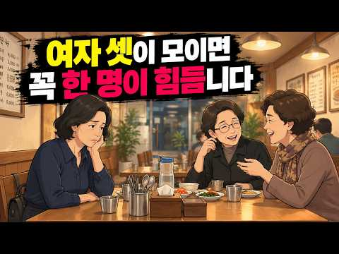
- 설명 앞부분: 오랜만에 반가운 마음으로 나간 세 사람의 모임, 이상하게 집에 돌아오는 길에는 마음 한구석이 헛헛하고 피로했던 적 있으신가요? 네모난 식탁에 둘러앉는 순간부터 묘하게 갈라지는 시선, 나만 모르는 둘만의 대화와 쇼핑 이야기, 그리고 내 말 한마디는 그저 남의 말을 꺼내기 위한 마중물처럼 흩어져 버리는 순간들. 우리는 이럴 때 "내가 말주변이 없나?", "저 둘이 나보다 더 친한가?" 하며 스스로를 탓하곤 합니다. 하지만 이것은 여러분의 탓도, 친구들이 악당이라서 그런 것도 아닙니다. 인간관계에서 '셋'이라는 숫자는 조금만 균형이 흔…
- 대본 없음 (설명) — 음성인식이 끝나면 도입부·흐름이 들어감
- 댓글 67/67: 좋은 점 — 영상 0 · 감사·응원 0 · 더 알고 싶은 것 0 · 아쉬운 점 — 영상 0 · 반박·불만 — 의견 다름 4 · 정치·사회 0 · 경험 공유 10 · 구독·다음 기대 0
  - 반박·불만 — 의견 다름 👍6 “그런 느낌이 한 두번이 아닌데 꼭 셋이 만나야 할 이유가 있나? 따로 둘이 만나던지…아님 안 만나던지….스트레스 받으며 친구를 만나야 하나?”
  - 반박·불만 — 의견 다름 👍3 “아... 저 형님들하고 만날때 처음으로 소외감느꼈어요. 원래 셋이든 넷이든 지인들에게 서운한 적 없었는데, 첨 느껴봤네요. 두 분만 아는 이야기하면 자연스럽게 저는 소외되더라구요... 일부러 그러시는건 절대 아닌데, 자연스럽게 그렇게 됩니다.”
  - 경험 공유 👍25 “치고 들어가서 나도 알려죠 해서 잘 말해주면 괜찮은데 단답만 하고 나는눈도 안마주치고 자기네들끼리 티키타카 내가물어도 단답만 한다면 예전엔 요번만 참아야지 담에 안보던가🎉 그랬는데 이제는 집에 일있다고 빨리 도망나옴 집에가서 청소하는게 더 시간 알참 그리고 사십대초반…”
  - 경험 공유 👍18 “난 오히려 더 편하던데 내가 직접적으로 대화에 참여하는 것보다 간접적인 상황에 놓인 상태가 더 편함 대화에 적극적으로 참여하다보면 피곤해지고 은근 스트레스가 장난 아님ᆢ 적극적으로 대화한다고 해서 서로 맘이 맞는것도 아니고 더 친한것도 아님 오히려 대화하다가 기분 상…”

### 7. 누구를 만나던 3가지 척 해라 ∣ 쇼펜하우어 ∣ 인간관계명언 ∣ 처세술 ∣

- https://www.youtube.com/watch?v=0tEc_K0czRw · 하루한번 · 구독자 195 · 조회수 47,419 (×243.2, 하루 2,365.4) · 좋아요 262 (0.5%) · 17.5분 · 2026-10-22 · 주제 묶음 2. 인간관계·대화 · 형식 오디오북·책 요약 · 폴더 `W_0tEc_K0czRw` (웹 승인)
- 썸네일: 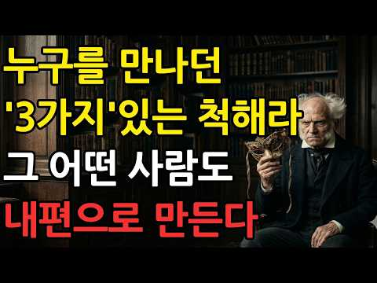
- 설명 앞부분: 타인의 무심한 말 한마디나 싸늘한 눈빛에 밤잠을 설친 적이 있으신가요? 우리는 종종 남들의 인정을 받아야만 가치 있는 존재가 된다고 믿으며, 그들의 시선에 얽매여 살아갑니다. 하지만 아르투ور 쇼펜하우어는 타인의 시선에 신경 쓰는 순간 우리는 그들의 손에 놀아나는 꼭두각시가 될 뿐이라고 강력하게 경고했습니다. 인간의 뇌는 진화론적 본능 때문에 타인의 평가에 지나치게 민감하게 반응하도록 설계되어 있습니다. 현대 사회에서도 이러한 본능은 우리를 불행의 구렁텅이로 밀어 넣는 쇠사슬로 작용합니다. 불필요한 비난이나 과도한 아부, 은근한 …
- 대본 없음 (설명) — 음성인식이 끝나면 도입부·흐름이 들어감
- 댓글 12/12: 좋은 점 — 영상 1 · 감사·응원 1 · 더 알고 싶은 것 0 · 아쉬운 점 — 영상 0 · 반박·불만 — 의견 다름 0 · 정치·사회 0 · 경험 공유 0 · 구독·다음 기대 0
  - 좋은 점 — 영상 👍1 “너절너절 구구절절 지겹다”
  - 감사·응원 👍4 “영상 감사합니다 ~~”

### 8. X세대가 유독 혼자 다 해내는 심리학적 이유

- https://www.youtube.com/watch?v=ObG5Hf_uTjc · 무진심리학 · 구독자 2,990 · 조회수 823,556 (×275.4, 하루 33,310.6) · 좋아요 5,661 (0.7%) · 8.1분 · 2026-10-17 · 주제 묶음 1. 심리학 일반 · 형식 정보·해설 (그 밖) · 폴더 `W_ObG5Hf_uTjc` (웹 승인)
- 썸네일: 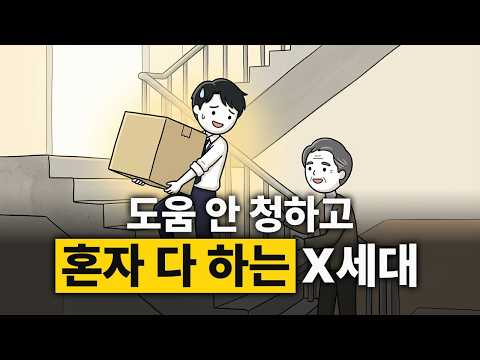
- 챕터: 0:00 아무도 이야기하지 않는 세대 · 0:27 열쇠를 목에 건 아이들 · 1:46 어른이 무너지는 걸 본 아이들 · 2:58 드러내지 않는 사람들 · 3:25 웃으며 넘기는 사람들 · 3:56 티 내지 않고 해내는 사람들 · 4:27 도움은 안 청하지만, 남은 돕는 사람들 · 4:59 직함보다 실력을 보는 사람들 · 5:19 여러 번 흔들린 사람들 · 6:01 애써서 알아낸 사람들 · 6:35 다르게 키우려는 부모들 · 7:02 다리 같은 세대에게
- 설명 앞부분: 혼자 해내는 게 당연했던 사람들이 있습니다. 목에 열쇠를 걸고 빈집 문을 열던 아이들, 외환위기 때 어른들이 무너지는 걸 지켜본 아이들, 그리고 지금은 부모님과 자식 사이에서 묵묵히 버티고 있는 사람들이요. 이 영상에서는 X세대가 왜 도움을 잘 청하지 않는지, 왜 늘 최악부터 대비하는지, 왜 티 내지 않고 일하는지를 그 시절의 장면과 심리학 연구로 풀어 봅니다. 마지막에는 아무도 해 주지 않았던 말을 전해 드립니다. 목에 열쇠를 걸고 빈집 문을 열던 기억이 있으신가요? 기억나는 삐삐 암호가 있다면 댓글로 남겨 주세요. 같은 기억을…
- 대본 없음 (설명) — 음성인식이 끝나면 도입부·흐름이 들어감
- 댓글 1,636/1,637: 좋은 점 — 영상 39 · 감사·응원 138 · 더 알고 싶은 것 8 · 아쉬운 점 — 영상 8 · 반박·불만 — 의견 다름 22 · 정치·사회 47 · 경험 공유 185 · 구독·다음 기대 0
  - 좋은 점 — 영상 👍146 “피자와 된장찌게를 같이먹을수있는세대!! 자식에게 기대지않겠다고하는 세대!! 가교같은세대라는말이 딱!공감되네… 어느덧 50대라니 실감이안난다…”
  - 좋은 점 — 영상 👍38 “83년생입니다.나이로따지면 x세대는 아니지만 많은부분이 와닿습니다.형님들 존경합니다 영포티라고 놀림받지만 앞으로도 열심히 살게요🎉❤”
  - 감사·응원 👍605 “X세대때문에 지금 한국의 경제가 유지되고 있죠. 나의 세대, 얘들아 화이팅!”
  - 감사·응원 👍547 “세상의 모든 X세대들. 우리 조금만 더 힘 냅시다. 화이팅.”
  - 더 알고 싶은 것 👍1 “서로가 노예 같다, 불쌍하다 자랑하는게 맞나요? 나이 상관 없이 다른 세대에 살아본게 없으니 결국 자기들이 힘들다고만 외치죠.”
  - 더 알고 싶은 것 👍0 “80년대생들도 분석해주세요”
  - 아쉬운 점 — 영상 👍61 “좋은 컨테츠 보니깐 갑자기 생각이 나네요. 그시절 X세대를 말해주는 광고가 있었죠. 리바이스 "난 나야" 부모와 다른 독립적으로 행동하고 판단하는... 좋은 컨텐츠 감사합니다!”
  - 아쉬운 점 — 영상 👍28 “12년개근입니다 SNS 하지 않습니다 부모님보다 덜 고생하고 지금의 자녀보다 더 편했던 것같습니다 매일매일 새로운 것들이 쏟아져서 지루하지 않았습니다 오히려 가장 축복받은 세대인거 같습니다 남은 인생도 더 가치있게...”
  - 반박·불만 — 의견 다름 👍1 “글쎄 옛말이 된건가 내가본 x세대들은 mz못지 않게 이기적이든데😂”
  - 반박·불만 — 의견 다름 👍1 “이젠 기득권이 되어버린 세대 정신승리용 영상 늙크크답게 사탕발린말이랑 AI좋아하노.... 샌드위치처럼 끼인 세대 어느 세대가 안 그러나요...ㅋㅋㅋㅋㅋ 각자 세대만의 다른 십자가를 짊어지고 살아가는것이지,... 특별한척 하진 맙시다.. 최소한 개화 이후 우리나라에서 …”
  - 정치·사회 👍715 “x세대는 정말 멀티플레이어입니다. 저도 20대때 국회도서관에 가서 줄 서서 복사해와서 워드프로세서로 리포트를 작성해봤고, 지금은 챗GPT를 이용합니다.”
  - 정치·사회 👍56 “다리 무너지고 백화점 무너지더니 나라가 무너지더라. 그 여파로 우리 집도 날아갔다.... 진짜 내 10~20대 힘들었네.ㅠㅠ”
  - 경험 공유 👍715 “x세대는 정말 멀티플레이어입니다. 저도 20대때 국회도서관에 가서 줄 서서 복사해와서 워드프로세서로 리포트를 작성해봤고, 지금은 챗GPT를 이용합니다.”
  - 경험 공유 👍690 “나라에서 원하는건 많은데 혜택은 없고 우리 윗세대는 나라를 일으켰다 인정받지만 우리세대는 그딴건 없고, 청년지원사업도 우리가 청년이던시절엔 없었고. 그러면서도 2030세대한테는 꿀빠는 세대라고 비난받고... 그냥 다 어렵고 억울하기만 하지만, 오늘도 출근합니다. 군대…”

### 9. 절대 먼저 연락 안 하지만 만나면 다정한 사람 심리 (싫어서가 아닙니다)

- https://www.youtube.com/watch?v=kTPr64XAJrQ · 마음 산책 · 구독자 142 · 조회수 18,648 (×131.3, 하루 1,035.1) · 좋아요 76 (0.4%) · 32분 · 2026-10-24 · 주제 묶음 1. 심리학 일반 · 형식 목록형 (N가지 특징·신호) · 폴더 `W_kTPr64XAJrQ` (웹 승인)
- 썸네일: 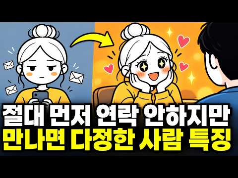
- 설명 앞부분: 카톡 대화방을 열면 늘 내가 먼저 보낸 질문뿐입니다. 돌아오는 답장은 짧은 한마디. 그런데 막상 만나면 눈을 맞추고 웃어 주고, 무심코 했던 말까지 기억해 줍니다. 만나면 이렇게 다정한 사람이 왜 먼저 연락은 하지 않을까요? 이번 영상에서는 ‘연락이 없는 것’과 ‘마음이 없는 것’을 같은 뜻으로 받아들이기 전에 살펴볼 이야기를 나눕니다. 먼저 연락하지 않는 사람을 무조건 밀당하는 사람, 차가운 사람이라고 단정하기보다 서로 다른 두 가지 유형으로 들여다봅니다. 연락하고 싶어도 쓸 힘이 부족한 사람과 먼저 연락할 필요를 잘 느끼지 않…
- 대본 없음 (설명) — 음성인식이 끝나면 도입부·흐름이 들어감
- 댓글 6/6: 좋은 점 — 영상 0 · 감사·응원 0 · 더 알고 싶은 것 0 · 아쉬운 점 — 영상 1 · 반박·불만 — 의견 다름 0 · 정치·사회 0 · 경험 공유 1 · 구독·다음 기대 0
  - 아쉬운 점 — 영상 👍1 “끝까지 보고 싶은데 영상이 너무 길다..”
  - 경험 공유 👍4 “저도 연락을 먼저 하지 않는데 초예민자입니다..ㅠ 어딜가면 주변 온습도부터 작은 기계소리들, 주변에서 나는 향기들. 상대방의 표정, 눈빛 너무 많은 것들이 느껴져요.. 근데 저는 이런걸 즐기는 편이긴 한데도 오후쯤 되면 정말 힘들때가 많아요😢 게다가 혼자 하고싶은게,…”

### 10. 60,70년대에 태어난 사람들이 조금 특별한 이유

- https://www.youtube.com/watch?v=cBslvnhVNvw · 심리학타임 · 구독자 2,450 · 조회수 636,961 (×260.0, 하루 17,523.5) · 좋아요 4,048 (0.6%) · 18.1분 · 2026-10-06 · 주제 묶음 3. 자존감·마음 · 형식 오디오북·책 요약 · 폴더 `W_cBslvnhVNvw` (웹 승인)
- 썸네일: 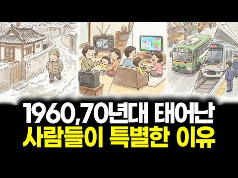
- 챕터: 0:00 인트로 · 0:55 60, 70년대생은 대체 뭐가 그렇게 특별할까 · 1:45 첫 번째 이유 — 아날로그와 디지털을 모두 겪은 마지… · 3:31 두 번째 이유 — 내일은 오늘보다 나아진다고 믿으며 … · 4:32 열심히 산 믿음의 그림자 — 쉬는 게 불안한 사람들 · 5:27 세 번째 이유 — 위와 아래에서 동시에 끼인 세대 · 7:09 네 번째 이유 — 큰 위기를 여러 번 넘겨본 세대 · 8:31 다섯 번째 이유 — 표현은 서툴지만 마음은 누구보다 … · 9:23 실제 사례 — 58세 아버지와 30세 딸, 두 글자 … · 10:25 핵심 반전 — 장점이면서 동시에 짐인 다섯 가지 경험 · 11:17 옛날 노래 한 곡에 가슴이 먹먹해지는 이유 · 12:19 짐은 내려놓고 장점은 키우는 네 가지 원칙 · 12:31 원칙 1 — 두 세계의 통역사 되기 · 12:59 원칙 2 — 쉬는 것에 허락 내려주기 · 13:35 원칙 3 — 짐을 혼자 지지 않기 · 13:58 원칙 4 — 마음을 한 줄로 표현하기 · 14:26 원칙을 실천하면 벌어지는 변화 · 15:04 처음 이야기로 돌아가서 · 15:54 너무 참기만 했다고 자책하지 않아도 되는 이유 · 17:06 오늘 해볼 수 있는 작은 시도
- 설명 앞부분: 5가지 경험이 한 세대의 성격을 만들었습니다. 편지와 삐삐, 스마트폰까지 모두 건너온 60·70년대생이 특별한 이유는 나이가 아니라, 이 길을 건너왔기 때문입니다. 카세트테이프를 연필로 감던 아이가 지금은 키오스크 앞에서 척척 주문하는 어른이 되기까지. 아날로그와 디지털을 모두 겪은 세대, 위아래로 끼인 세대, 위기를 여러 번 넘긴 세대, 그리고 사랑을 "그래" 두 글자로 말하는 세대. 60, 70년대에 태어난 사람들이 조금 특별한 이유 5가지와, 짐은 내려놓고 장점은 키우는 방법을 쉽고 재미있게 풀어봅니다. 타임라인
- 대본 없음 (설명) — 음성인식이 끝나면 도입부·흐름이 들어감
- 댓글 559/559: 좋은 점 — 영상 17 · 감사·응원 33 · 더 알고 싶은 것 4 · 아쉬운 점 — 영상 3 · 반박·불만 — 의견 다름 4 · 정치·사회 32 · 경험 공유 80 · 구독·다음 기대 1
  - 좋은 점 — 영상 👍16 “고난과 시련을 겪어도 특유의 회복탄력성(레질리언스)을 발휘하여 더더욱 분발하며 모든 어려움을 이겨내곤 했죠... 68년생인 저도 매우 공감이 가는 내용입니다. 😅 🎉”
  - 좋은 점 — 영상 👍14 “67년 양띠 100% 공감합니다”
  - 감사·응원 👍320 “62년 서울에서 태어나 국민학교 한 반에 80명 18반 까지 있어서 오전오후반 으로 공부한 추억이 있습니다, 겨울에 검은색 조개탄으로 난로를 피울 때 교실을 연기로 가득차게 되기도 했고 도시락도 못 싸오는 애들도 있었던 정말 가난한 나라였습니다. 지금 우리가 선진국이…”
  - 감사·응원 👍153 “어떻게 우리 세대를 이렇게 잘 표현 했을까!!! 감사합니다.”
  - 더 알고 싶은 것 👍1 “이런 영상 오래 기다렸어요. 내 마음이 쉴곳을 찾았네요. 이젠 나이먹고 너무 무뎌진, 옛생각에 눈물날까 창피하기도 하고ㅎ그저 다들, 모든 분들이 건강하고 행복하면 좋겠어요. 그거면됐죠. 여한이 없네요. 좋은영상 많이 만들어주세요😂”
  - 아쉬운 점 — 영상 👍16 “이 시대들은 펜팔이라는것도 경험한 세대들... 영어 좀 더 배원 볼려는 미명아래 해외펜팔 했던 60년대생들.. 영어 배운다고 미국 버지니아주 여학생과 펜팔 했던 기억이 아련 합니다. 버지아주 여학생이였고 제가 잘못 표현했던 영어 표현도 알려주고 그 여학생 집 전경이 …”
  - 아쉬운 점 — 영상 👍1 “동네 신작로에는 빨간 우체통이 있었고, 크리스마스가 되면 카드를 열심히 직접 만들고 크리스마스씰을 붙여 우체통에 넣거나, 직접 전해주곤 했었죠. 형광등을 깨어 가루로 만들고 밀가루로 풀을 만들어 섞어 연줄에 묻힌 뒤 연을 날려 서로 끊어내는 놀이도 하곤 했습니다. 공…”
  - 반박·불만 — 의견 다름 👍1 “아직도 번호를 기억하고 있네요.. 대동굴비 xxx-3529 여자 목소리 흉내 내면서 스위밍 좀 바꿔달라고 했던 기억.... 제대로 만나보지도 못하고 고딩때 한번,군대 가있을때 한번.. 그렇게 2번이나 끝이 났지만..귀가 얇던 그녀를 단 한번도 원망한적이 없었습니다..…”
  - 정치·사회 👍47 “저는 68년생인데 시골에서 태어나서 초가집에서 어린시절 살았어요.티비도 없었죠. 그러다 초등학교때 경기도로 이사왔는데, 학교에 학생들 너무 많아서 중고등학교때까지 한반에 70명가까이 있었어요그만큼 경쟁도 치열했지만 취업도 잘되었어요. 전쟁끝나고 부모세대가 대부분 가난…”
  - 정치·사회 👍8 “국민학교 시절엔 우리나라가 후진국이었고, 그걸 개발도상국이라 억지로 돌려 이야기 했고, 여름엔 수재민 겨울엔 화재민이 발생했어요. 여전히 골목엔 깡통을 들고 구걸을 하는 사람들도 있었지요. 그리고 미친듯 노력해서 나도 모르는 사이에 소니를 제치고, 니산을 제치고. 일…”
  - 경험 공유 👍147 “60,70년대생들 ==> 새마을 운동, 서울 올림픽을 경험했고... 주산-PC-AI, 공중전화-삐삐-피처폰-스마트폰을 다 경험해본 세대임.....”
  - 경험 공유 👍54 “61년생 시골촐신인데 갓을 쓴 할배를 보았고 호롱불 등잔밑에서 밥을 먹었고 여덟살때 처음으로 차를 보았던 내가 지금은 인프라 잘깔린 도시에서 테슬라를 몰고있으니 이거야 말로 상전벽해 아닌가.”
  - 구독·다음 기대 👍2 “구독합니다, 참고로 저는 1963년생😀”

### 11. 【이시형 박사】 남자가 평생 미치도록 사랑하는 여자는 따로 있다｜당신도 해당될까 결정적 5가지 특징｜인간관계｜인생철학

- https://www.youtube.com/watch?v=PcAIV7N3Rjc · 배짱 있는 노년 · 구독자 1,120 · 조회수 51,159 (×45.7, 하루 6,951.1) · 좋아요 465 (0.9%) · 85.8분 · 2026-11-04 · 주제 묶음 2. 인간관계·대화 · 형식 목록형 (N가지 특징·신호) · 폴더 `W_PcAIV7N3Rjc` (웹 승인)
- 썸네일: 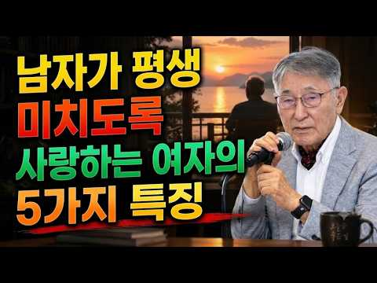
- 설명 앞부분: 남자가 나이가 들어서도 오랫동안 사랑하고 싶은 여자는 어떤 사람일까요? 이번 영상에서는 남자의 마음을 움직이고 깊은 사랑을 오래도록 이어 가는 여성의 5가지 특징을 알아봅니다. 외모보다 중요한 내면의 매력과 서로를 존중하는 태도, 그리고 행복한 관계를 만들어 가는 지혜를 함께 살펴봅니다. 진정한 사랑은 서로를 이해하고 아껴 주는 마음에서 시작됩니다. 여러분은 어떤 특징을 가장 중요하게 생각하시나요? 끝까지 시청하시고 댓글로 의견을 나눠 주세요.
- 대본 없음 (설명) — 음성인식이 끝나면 도입부·흐름이 들어감
- 댓글 22/22: 좋은 점 — 영상 3 · 감사·응원 6 · 더 알고 싶은 것 1 · 아쉬운 점 — 영상 2 · 반박·불만 — 의견 다름 0 · 정치·사회 0 · 경험 공유 1 · 구독·다음 기대 0
  - 좋은 점 — 영상 👍2 “좋은 말씀 한마디 한마디 존경함니다 추카추카 드림니다 🎉🎉🎉🎉🎉”
  - 좋은 점 — 영상 👍2 “좋은말씀 감사합니다 존경 합니다”
  - 감사·응원 👍10 “박사님 존경의 말씀 감사합니다 잘새겨듣겠습니다 아무도모르고살아 왔네요❤❤❤”
  - 감사·응원 👍8 “그런데 배우자가 내가 하는것마타 20년이상 살았는데 다~싫어한다면요 힘빠집니다 그림도,공예작가도 노래도 춤도 자녀와 제가다니는 대학교 입학도 다 반대했었죠~ 자녀의꿈 보컬도 남편의 반대로 딸과저는 많은걸 포기했습니다 남편은 집에오면 게임밖에 안합니다 저는뒤늦게 깨달았…”
  - 더 알고 싶은 것 👍0 “결혼은 남녀 두사람이 서로를 가족처럼 성장하는 동안 가족들이 싸우며 또는 즐거운 행복감에 겨안고 하며 희노애락을 나누는 경험이 란 것이 상대를 이해할수 있다고 노인이 되니 알 것 같습니다. 소개대로 잠시 지내며 서로를 알지 못한체로 중매결혼들이 이혼으로 많이 결단됩니…”
  - 아쉬운 점 — 영상 👍6 “네 이시형박사님 안녕하세요? 어느새 105세 되셨네요 잘 살아오셨습니다 지금은 120세 시대라고 합니다 박사님! 앞으로 130세까지 정정팔팔 지금처럼 영원하세요 항상 감사드립니다 할렐루야아멘 ♤♤♤♤♤♤♤”
  - 아쉬운 점 — 영상 👍0 “사설이 너무길어서 집중이 안됩니다”
  - 경험 공유 👍8 “그런데 배우자가 내가 하는것마타 20년이상 살았는데 다~싫어한다면요 힘빠집니다 그림도,공예작가도 노래도 춤도 자녀와 제가다니는 대학교 입학도 다 반대했었죠~ 자녀의꿈 보컬도 남편의 반대로 딸과저는 많은걸 포기했습니다 남편은 집에오면 게임밖에 안합니다 저는뒤늦게 깨달았…”

### 12. 작은 선물을 자꾸 주는 사람의 심리학적 특징

- https://www.youtube.com/watch?v=rL4yzXIKbNM · 현실적인 심리학 · 구독자 1,880 · 조회수 167,580 (×89.1, 하루 10,146.6) · 좋아요 362 (0.2%) · 20.6분 · 2026-10-25 · 주제 묶음 1. 심리학 일반 · 형식 목록형 (N가지 특징·신호) · 폴더 `W_rL4yzXIKbNM` (웹 승인)
- 썸네일: 
- 챕터: 0:00 오프닝 · 0:39 한 선배의 아침 · 1:58 심리학이 본 건네는 마음 · 3:58 첫 번째 이유 · 6:39 두 번째 이유 · 10:11 세 번째 이유 · 13:43 이 습관을 다시 바라보기 · 14:39 오늘부터 해 볼 세 가지 · 16:17 우리 세대, 그리고 가까운 사람들 · 18:36 처음 질문으로 돌아가며
- 설명 앞부분: 작은 선물을 자꾸 건네는 사람은 주기만 하는 게 아닙니다. 본인도 모르는 사이에 무언가를 받고 있어요. 캔커피 하나, 사탕 한 줌을 자꾸 건네는 사람들의 숨은 공통점, 그 세 가지 이유를 심리학 연구로 풀어 드립니다. Elizabeth W. Dunn, Lara B. Aknin, Michael I. Norton – Spending Money on Others Promotes Happiness, Science 319 (2008) Lara B. Aknin 외 – Prosocial Spending and Well-Being: Cross-…
- 대본 없음 (설명) — 음성인식이 끝나면 도입부·흐름이 들어감
- 댓글 33/33: 좋은 점 — 영상 1 · 감사·응원 3 · 더 알고 싶은 것 1 · 아쉬운 점 — 영상 0 · 반박·불만 — 의견 다름 1 · 정치·사회 0 · 경험 공유 3 · 구독·다음 기대 0
  - 좋은 점 — 영상 👍3 “유익하고 흥미로운 영상 감사합니다. ❤”
  - 감사·응원 👍3 “나도누구을주어야편해요좋은일이라니괜찬네요감사합니다”
  - 감사·응원 👍3 “유익하고 흥미로운 영상 감사합니다. ❤”
  - 더 알고 싶은 것 👍1 “부부사이에 대화가 점점 적어지는 이유가 궁금하네요~ 막연하게 알고 있긴하지만....”
  - 반박·불만 — 의견 다름 👍16 “예의상.. 도리상.. 착해서 베풀려고 남에게 쓰는거지. 행복때문 아닙니다. 돈쓰고 애쓰는사람한테 욕먹이지 말아요!”
  - 경험 공유 👍3 “나도누구을주어야편해요좋은일이라니괜찬네요감사합니다”
  - 경험 공유 👍1 “왜 가만히 있질못하나~ㅎㅎ 나도 모르던 마음을 일깨워주셔서 감사합니다❤”

### 13. 아무리 친해도 이 7가지는 자랑하지 마세요｜인간관계 ｜심리학 ㅣ인생조언ㅣ노후

- https://www.youtube.com/watch?v=_aC5sm4gXg4 · 가을빛 심리학 · 구독자 1,530 · 조회수 174,935 (×114.3, 하루 7,638.6) · 좋아요 619 (0.4%) · 13.8분 · 2026-10-19 · 주제 묶음 2. 인간관계·대화 · 형식 오디오북·책 요약 · 폴더 `W__aC5sm4gXg4` (웹 승인)
- 썸네일: 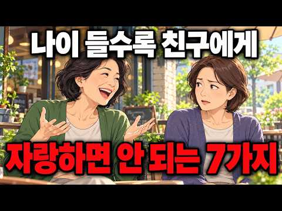
- 설명 앞부분: 나이 들수록 친구에게 자랑하면 안 되는 7가지가 있습니다. 아무리 친한 친구라도 무심코 꺼낸 자랑 한마디에 마음이 멀어질 수 있습니다. 분명 좋은 소식을 나눴을 뿐인데, 왜 누군가는 불편해하고 오랜 인연이 서먹해지는 걸까요? 🍀 오늘 영상에서는 가까운 사람일수록 조심해야 할 7가지 자랑과 그 속에 숨겨진 인간관계 심리를 살펴봅니다. 심리학의 사회비교이론을 통해 가까운 사람의 성공이 때로는 왜 더 큰 비교심리를 일으키는지 알아보고, 좋은 소식을 나누면서도 소중한 인연을 지키는 방법을 함께 생각해 봅니다. 나이가 들수록 중요한 것은 …
- 대본 없음 (설명) — 음성인식이 끝나면 도입부·흐름이 들어감
- 댓글 98/98: 좋은 점 — 영상 3 · 감사·응원 2 · 더 알고 싶은 것 0 · 아쉬운 점 — 영상 0 · 반박·불만 — 의견 다름 0 · 정치·사회 0 · 경험 공유 4 · 구독·다음 기대 0
  - 좋은 점 — 영상 👍11 “너무 공감되네요 아무리 친해도 재산규모를 말할필요없는데 항상 입조심 해야겠더라구요 친한사일수록 더욱조심”
  - 좋은 점 — 영상 👍8 “나 자신을 돌아봅니다 감사합니다 유익한 영상 ❤”
  - 감사·응원 👍8 “나 자신을 돌아봅니다 감사합니다 유익한 영상 ❤”
  - 경험 공유 👍6 “살면서 경험해본 바, 결국 시기와 질투는 인간이 본성인거 같아요”
  - 경험 공유 👍1 “배려+자랑해봤자 상대방이 진심으로 축하해주지 않아요. 즉 그런 얘기 할필요 없는거죠.”

### 14. 집에 있는 것을 좋아하는 사람들의 7가지 심리적 특징

- https://www.youtube.com/watch?v=IAs1edgjR-8 · 조용한 심리 · 구독자 2,180 · 조회수 870,247 (×399.2, 하루 10,001.1) · 좋아요 4,033 (0.5%) · 21.6분 · 2026-08-16 · 주제 묶음 1. 심리학 일반 · 형식 목록형 (N가지 특징·신호) · 폴더 `W_IAs1edgjR-8` (웹 승인)
- 썸네일: 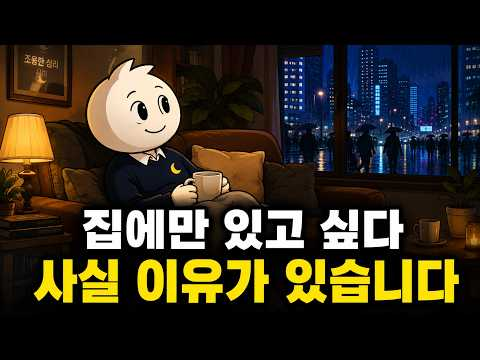
- 설명 앞부분: 사람들과 즐겁게 시간을 보내고 돌아왔는데도 이상하게 집에 오면 마음이 놓이시나요? 약속이 취소되었을 때 아쉬움보다 안도감이 들거나, 밖에서 시간을 보내는 것보다 집에서 조용히 쉬는 시간이 더 편하게 느껴질 때가 있습니다. 집에 있는 것을 좋아한다고 해서 반드시 사람을 싫어하거나 사회성이 부족한 것은 아닙니다. 사람마다 사회적 자극을 받아들이는 방식과 에너지를 회복하는 방법이 다르기 때문입니다. 이번 영상에서는 집에 있는 것을 좋아하는 사람들에게 나타날 수 있는 7가지 심리적 특징을 차분하게 살펴봅니다. 사람들과 함께한 뒤 혼자 있…
- 대본 없음 (설명) — 음성인식이 끝나면 도입부·흐름이 들어감
- 댓글 456/456: 좋은 점 — 영상 1 · 감사·응원 6 · 더 알고 싶은 것 1 · 아쉬운 점 — 영상 6 · 반박·불만 — 의견 다름 2 · 정치·사회 0 · 경험 공유 67 · 구독·다음 기대 2
  - 감사·응원 👍173 “유트브가 절친보다 더 즐거운시간 공유 ~~너무너무 감사”
  - 감사·응원 👍16 “매우 내성적인 남편이 직장에서는 아주 쾌활한 태도로 일을 잘하기 때문에 결혼 초부터 그가 퇴근하면 그냥 쉬도록 내버려두었죠. 은퇴 후에도 그런 편이죠. 지금은 우울증 약 없이도 잘 지냅니다. 혼자 알아서 잘 지내고 운동도 하고 공부도 하니까 고맙기만 합니다.”
  - 더 알고 싶은 것 👍0 “혼자가 좋은점은 누군가에게 비위를 맞춰 줄 필요가 없어니까 좋은점은 있죠 어짜피 많은 사람중에서 혼자가 되는거나 혼자서 집에 있는거나 혼자인건 마찬가지니까 잡아보면 착각이고 놓아보면 허무가 인생이라 했는데요 어느날 틀리지 않다는 생각이들면 그떄가 비로서 진짜 어른이 …”
  - 아쉬운 점 — 영상 👍27 “기빨리거나 지루하거나~”
  - 아쉬운 점 — 영상 👍4 “약 간만 짧게 하시면 구독자 늘듯 지금구독했는데 쫌 길어 지루감이 오네요 😅”
  - 반박·불만 — 의견 다름 👍0 “샵 에서 하루종일 있다가 집에가면 너무 너무 편하고 좋아요 사람들을 싫어하는건 아닌데 집이 너무 좋아 집을 깨끗하게 정리하고 예쁜 화초를 키우고 고양이와 가족들과 있으면 너무 행복합니다”
  - 반박·불만 — 의견 다름 👍0 “난 로또되면 안까먹을 자신있음. 왜? 집에만 있을꺼니깐...친구가 없는것도 아닌데 나이먹을수록 집에서 쉬는게 최고의 힐링임”
  - 경험 공유 👍886 “나도 집순이 눕순이😅 누가 내게 은둔형 외톨이라 해도 상관없음 혼자 있는 시간을 즐김😊”
  - 경험 공유 👍665 “나도 집에 있는게 제일 좋아요😅”
  - 구독·다음 기대 👍4 “약 간만 짧게 하시면 구독자 늘듯 지금구독했는데 쫌 길어 지루감이 오네요 😅”

### 15. 자리 뜰 때 의자 집어넣는 사람, 심리학적 특징 3가지

- https://www.youtube.com/watch?v=MUTQyEh7OSU · 어른이 심리학교 · 구독자 13,100 · 조회수 1,929,003 (×147.2, 하루 47,031.4) · 좋아요 10,894 (0.6%) · 11.9분 · 2026-10-01 · 주제 묶음 1. 심리학 일반 · 형식 목록형 (N가지 특징·신호) · 폴더 `W_MUTQyEh7OSU` (웹 승인)
- 썸네일: 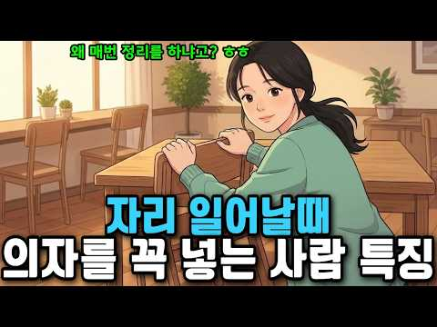
- 챕터: 0:00 훅 & 인트로 — 아주 작은 행동, 아주 큰 단서 · 0:00 왜 어떤 사람은 절대 의자를 그냥 두고 가지 않을까 · 0:00 공감 구간 — 우리가 미처 몰랐던 '배려의 무의식' · 0:00 첫 번째 특징 — 자신이 떠난 자리를 상상하는 사람 · 0:00 두 번째 특징 — 타인의 수고를 당연하게 여기지 않는… · 0:00 중간 점검 — 내 주변의 그 사람이 떠오르는 이유 · 0:00 세 번째 특징 — 시작보다 마무리를 소중히 여기는 사람 · 0:00 이 세 가지 특징, 관계에서 어떻게 드러나나 · 0:00 나도 그런 사람이 될 수 있을까 — 실천 가능한 작은… · 0:00 마무리 — 의자 하나가 알려준 것들
- 설명 앞부분: 자리를 뜰 때 의자를 집어넣는 사람, 그냥 예의 바른 사람일까요? 심리학에서는 이 3초짜리 행동이 그 사람의 내면 전체를 보여준다고 말합니다. 이 영상에서 알게 되는 것: 의자를 자연스럽게 밀어 넣는 사람이 가진 3가지 심리적 특징 무의식적 습관이 가치관과 연결되는 행동심리학 원리 나도 그런 사람이 될 수 있는 작고 실천 가능한 시작 🕒 타임라인:
- 대본 없음 (설명) — 음성인식이 끝나면 도입부·흐름이 들어감
- 댓글 866/865: 좋은 점 — 영상 17 · 감사·응원 41 · 더 알고 싶은 것 0 · 아쉬운 점 — 영상 3 · 반박·불만 — 의견 다름 3 · 정치·사회 5 · 경험 공유 251 · 구독·다음 기대 1
  - 좋은 점 — 영상 👍70 “식당알바 하는 사람인데.. 매너있고 예의 있으신 분들은 꼭 정리해주심. 안정리하는 손님시키는 하는짓도 진~상이더라!!! 퉤~~~~”
  - 좋은 점 — 영상 👍4 “난 직원들 조금이라도 일 덜게.해주려고 한건데 맞는말씀이네요 같이사는 남의편은 29년 살면서 단 한번도 그런행동 본적없고 본인침대이불 매번 바닥까지 내려와 있어 외부인들보면 공강능력좋은편 집에선 0에가까워 근데 입으론 매번상대배려-.-”
  - 감사·응원 👍1,286 “저는 그냥 습관인데요. 의자를 밀어 넣어두는것 음식점에서 음식을 갖다주면 잘 먹겠습니다~ 또는 감사합니다~ 그리고 입을 닦은 냅킨은 식사후 나올때 휴지통에 넣고 나와요 잘보이려고 하는게 아니라 습관이고, 저에 딋모습이 누군가에게 지저분하게 보이는게 싫어서요 진짜 오래…”
  - 감사·응원 👍5 “뒷 정리는 현대인의 기본 매너 !!! 감사합니다.”
  - 아쉬운 점 — 영상 👍2 “그냥 보기 싫어서 ...근데 말이 너무 길어서 듣기 힘들다”
  - 아쉬운 점 — 영상 👍1 “Ai목소리아니어서 좋다요”
  - 정치·사회 👍3 “내 얘기다 나는 식당에서 밥 먹으면 식탁에 떨어진 쓰레기와 휴지 다 쓰레기통에 넣고 의자는 꼭 다시 넣는다.여행 가서 숙소에 묵을 때 펜션이든.리조트든 호텔이든 깨끗하게 청소하고 정리정돈 다 해 놓고 수건은 입구에 모아 놓고 쓰레기는 쓰레기장에 다 버리고 온다.길거리…”
  - 정치·사회 👍2 “오래전에 신문 에서 외국인들이 한국와서 놀라운것중에 하나 식당식탁위에 쓰레기 놓고 코푼휴지 놔두고 가는사람 음 90년도 쯤 화장실 한줄서기 할때쯤인가 그때부터 나는 테이블위 휴지 싹 쓰레기 통 넣고온다 서빙한 아이들 다 귀한아이들인데 알바한다고 고생하는데 어른이 되서…”
  - 경험 공유 👍499 “저도 식당에서 의자 집어넣고 옵니다”
  - 경험 공유 👍375 “의자 안넣으면 마음이 안편함 그냥 보기 좋음 누구 좋으라고 하기는 하지만 내가 보기 좋아서 하는게 큼”
  - 구독·다음 기대 👍1 “저도 거의 무조건반사인데, 소중함을 일깨워주셔서 좋은 콘텐츠 만들어주셔서 감사합니다. 구독합니다.”

### 16. 친한 사이일수록 절대 보여주지 마세요｜나이 들수록 인간관계가 편해지는 5가지 거리 두기

- https://www.youtube.com/watch?v=OjfEteAhBQU · 하나둘 심리학 · 구독자 658 · 조회수 160,578 (×244.0, 하루 2,294.0) · 좋아요 548 (0.3%) · 16.2분 · 2026-09-02 · 주제 묶음 2. 인간관계·대화 · 형식 오디오북·책 요약 · 폴더 `W_OjfEteAhBQU` (웹 승인)
- 썸네일: 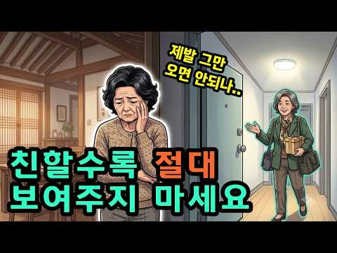
- 설명 앞부분: 여러분의 경험도 댓글로 들려주세요. 같은 고민을 가진 분들에게 큰 위로가 될 수 있습니다. 해시태그 "본 영상은 심리학적 연구와 일반적인 경향성을 바 탕으로 제작되었습니다. 이는 전문적인 의학적 진 단이나 상담을 대신할 수 없으며, 심리적 어려움이 지속될 경우 반드시 관련 전문가의 도움을 받으시 길 권장합니다.“
- 대본 없음 (설명) — 음성인식이 끝나면 도입부·흐름이 들어감
- 댓글 30/30: 좋은 점 — 영상 0 · 감사·응원 0 · 더 알고 싶은 것 0 · 아쉬운 점 — 영상 0 · 반박·불만 — 의견 다름 1 · 정치·사회 0 · 경험 공유 4 · 구독·다음 기대 0
  - 반박·불만 — 의견 다름 👍4 “친한사람은 오히려 할수있고 해도되죠~ 왜이리살림살이가 없어?하면 가난해서 그런것도 아닌데 응 나 최대한 간단히 해놓고살려고~ㅋ 청소하기도힘들다야 하고 넘기면 되는거고.. 그때그때맞게 적당히 받아넘김 되지. 일일이 다생각하고 피곤해서 어찌살아요ㅠ 그럼 누구한테말해요? …”
  - 경험 공유 👍21 “저도 친구들을 초대해서 하룻밤 재워줬더니 그 중 한 친구가 너네집 왜 이렇게 살림이 없냐고... 진~~~~~짜 살림살이 없다고.... 그 이후 다시는 친구를 집으로 부르지 않습니다.”
  - 경험 공유 👍4 “호주에 사는데 남의 집 사는게 뭐가 그리 궁금한지 꼭 한번 와서 밖에서 구경하고 거는 사람들이 있다군요. 그것도 모자라 나 모르게 다른 사람까지 데리고 와서 우리집 보여준 사람도 있어요. 어느날 사정이 생겨 특별히 친하다곤 할수없는 사람 차를 얻어타고 우리집 방향으로…”

### 17. 가까운 사람에게만 유독 화내는 사람의 심리

- https://www.youtube.com/watch?v=2ej_Dk2tXKw · 솔직한 심리학 · 구독자 94 · 조회수 11,152 (×111.5, 하루 334.4) · 좋아요 54 (0.5%) · 9.1분 · 2026-10-09 · 주제 묶음 1. 심리학 일반 · 형식 정보·해설 (그 밖) · 폴더 `W_2ej_Dk2tXKw` (웹 승인)
- 썸네일: 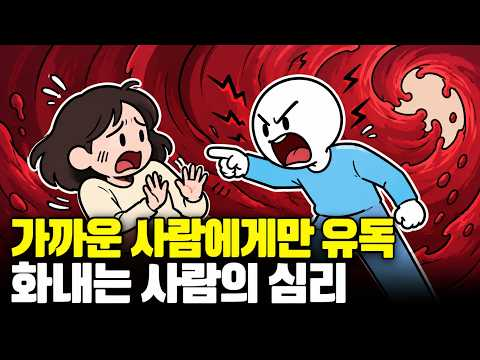
- 챕터: 0:00 밖에서는 참는데 집에서 터지는 이유 · 2:00 뇌는 하루 종일 감정을 억누르고 있었다 · 4:00 왜 하필 가족·연인한테만 터지는가 — 심리적 안전지대 · 6:00 반복되면 관계가 조용히 무너지기 시작한다 · 7:30 패턴을 바꾸는 현실적인 방법 — 감정 라벨링·지연 표현
- 설명 앞부분: 밖에서는 그렇게 잘 참으면서, 왜 집에 들어오는 순간 무너지는 걸까요? 😔 상사한테는 꾹 참고, 처음 보는 사람한테도 예의 바르게 대하면서, 정작 제일 오래 봐온 가족이나 연인한테는 왜 이렇게 쉽게 터져버리는 건지. 만만해서가 아니에요. 익숙해서도 아니에요. 오히려 정반대의 이유가 있습니다. 뇌가 그 사람을 가장 안전한 존재로 인식하기 때문이에요. 오늘 영상에서는 왜 가장 소중한 사람한테 가장 못되게 구는지, 그 심리적 구조와 패턴을 바꾸는 현실적인 방법까지 이야기해 드려요. 💡 ⏱️ 타임라인 📚 참고문헌 리버만, 매튜 외 (20…
- 대본 없음 (설명) — 음성인식이 끝나면 도입부·흐름이 들어감
- 댓글 2/2: 좋은 점 — 영상 0 · 감사·응원 0 · 더 알고 싶은 것 0 · 아쉬운 점 — 영상 0 · 반박·불만 — 의견 다름 0 · 정치·사회 0 · 경험 공유 0 · 구독·다음 기대 0

### 18. 돈을 대하는 태도에서 사람의 본모습이 드러납니다 (무심코 하는 행동입니다)

- https://www.youtube.com/watch?v=szFksvTqnCg · 심리상자 · 구독자 3,180 · 조회수 135,191 (×42.5, 하루 10,287.7) · 좋아요 470 (0.4%) · 14.5분 · 2026-10-29 · 주제 묶음 2. 인간관계·대화 · 형식 목록형 (N가지 특징·신호) · 폴더 `W_szFksvTqnCg` (웹 승인)
- 썸네일: 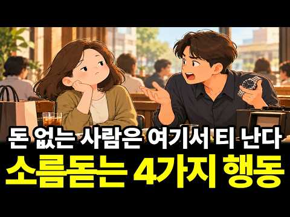
- 설명 앞부분: 돈이 있어도 늘 부족하다고 느끼는 사람이 있습니다. 작은돈은 아끼면서 큰돈은 쉽게 쓰고, 남이 돈을 쓰면 낭비라고 하면서 자신의 소비에는 관대한 사람도 있습니다. 또 누군가 잘됐다는 소식을 들으면 진심으로 축하하기보다 운이 좋았을 뿐이라고 말하기도 합니다. 왜 이런 차이가 생기는 걸까요? 이 영상에서 다루는 내용 작은돈은 아끼면서 큰돈은 쉽게 쓰는 사람들의 심리 남에게 보여주기 위해 소비하는 사람들의 특징 남의 소비와 성공을 평가하고 깎아내리는 이유 형편이 나아져도 늘 돈이 부족하다고 느끼는 심리 오늘 이야기한 네 가지 행동 중 …
- 대본 없음 (설명) — 음성인식이 끝나면 도입부·흐름이 들어감
- 댓글 21/21: 좋은 점 — 영상 2 · 감사·응원 1 · 더 알고 싶은 것 0 · 아쉬운 점 — 영상 0 · 반박·불만 — 의견 다름 1 · 정치·사회 0 · 경험 공유 2 · 구독·다음 기대 0
  - 감사·응원 👍9 “마지막 네 번째 '형편이 나아져도 여전히 돈이 부족하다고 느낀다'는 부분에서 무릎 탁 쳤습니다. 돈을 모으는 게 목적이 아니라, 돈으로 얻는 '안정감'과 '여유'가 진짜 목적인데 그걸 놓치고 있었네요. 감사합니다!”
  - 반박·불만 — 의견 다름 👍1 “그런사람이 바보이고 제정신이 아니죠”
  - 경험 공유 👍6 “누군가는 타인에게 자랑으로 본인의 행복을 느끼는 사람도 있음. 중요한 건 내가 진짜 어떤 사람인가를 본인 스스로가 알고 인생에서 적당히 당근과 채찍을 스스로에게 주며 불행하지 않게 잘 이끌어 가는 거지. 비록 남에게 보여지는 자랑을 위해 노력을 해서 성과를 내고 더큰…”
  - 경험 공유 👍0 “나는 상대방이 머라고 아는척하는게실어요 내가 하고싶어서하는건데 ㅎ 꼭 말안해도 아는척하고 트집잡는사람잇지요”

### 19. 이렇게 3번만 하면 까먹는게 더 어려워지는 뇌과학 공부법 (공부가 재능이 아닌 진짜 이유)

- https://www.youtube.com/watch?v=xvG7WXVL5HE · 자존감클라쓰 : 자클 · 구독자 2,210 · 조회수 596,595 (×269.9, 하루 7,020.9) · 좋아요 2,784 (0.5%) · 15.7분 · 2026-08-18 · 주제 묶음 1. 심리학 일반 · 형식 오디오북·책 요약 · 폴더 `W_xvG7WXVL5HE` (웹 승인)
- 썸네일: 
- 챕터: 0:00 공부를 망치는 위험한 신호, '끄덕임' · 1:06 회독 수가 실력이라는 착각 (유창성 착각) · 2:12 뇌 과학 실험이 증명한 진짜 공부법 (로디거 교수 연… · 3:05 아는 것과 익숙한 것을 착각하는 이유 · 4:20 단순 회독과 형광팬의 함정 · 5:50 기억력이 좋은 사람들의 비밀 (저장 강도 vs 인출 … · 7:51 런던 택시 기사들의 뇌가 커진 이유 (후천적 천재) · 9:27 당장 실천할 수 있는 3가지 인출 타임 · 11:11 왜 아무도 이 방법을 알려주지 않았을까? · 12:47 하루 3초의 인출이 만들어내는 압도적 차이 · 14:36 지금 영상이 끝나기 전, 당신이 해야 할 일
- 설명 앞부분: 공부할 땐 다 안다고 착각하는 '유창성 착각'에서 벗어나세요! 책을 덮고 딱 3초간 인출하는 습관 하나로 뇌의 해마를 자극하여 장기 기억으로 전환하는 인지심리학 기반 공부법을 공개합니다. 🚨 자존감클라쓰(자클) 채널은 무너지지 않는 단단한 자기를 만들고 싶은 분들을 위한 곳입니다. Copyright © 2026 자존감클라쓰. All Rights Reserved. Unauthorized reproduction is strictly prohibited.
- 대본 없음 (설명) — 음성인식이 끝나면 도입부·흐름이 들어감
- 댓글 61/60: 좋은 점 — 영상 7 · 감사·응원 10 · 더 알고 싶은 것 0 · 아쉬운 점 — 영상 0 · 반박·불만 — 의견 다름 0 · 정치·사회 1 · 경험 공유 6 · 구독·다음 기대 0
  - 좋은 점 — 영상 👍6 “와 먼저 정말 좋은영상 감사해요 예전에 시도해본 방법이에요 책을 읽고나서 덮은 후 백지에 그 내용을 적어보려했다가 막상 쓸수없었어서 실패 그 이후론 다시 시도조차 못했었는데 오늘부터 부담없이 입력직후 1번만이라도 해봐야겠어요 입력1번 출력3번 이것도 꼭 기억해야겠어요…”
  - 좋은 점 — 영상 👍3 “참 좋은 내용의 영상입니다 머리속을 창고라고 할때 창고를 정리하지 않으면 뒤죽박죽 쌓여서 물건을 찾을 수 없지요 뇌는 수평적으로 넓은 창고라서 쌓을 필요가 없다고 생각합니다 그저 지도의 길 처럼 뭔가를 가져다 놓고 길을 내는 게 중요하죠 길이 끊어지면 이으면 되고 길…”
  - 감사·응원 👍11 “포스트잇을 준비했어요. 책장넘기기전 확인. 감사합니다. 50대 간호대학생입니다”
  - 감사·응원 👍9 “자격증 시험 공부 중인 육학년인데 이 영상 숙지해서 해볼거예요. 감사해요.”
  - 정치·사회 👍2 “어느정도는 인정~ 단 학습에 관해서만. 수십년을 못 만난 고향 친구들은 생각하면 그냥 이름이 생각나고 첫눈에 반한 이성의 이름...전번은 그냥 인각되고... 태어난지 4~5년짜리가 수개국어를 하고 피아노도 능숙하게 치고...이런건 해마 길들이기하고는 ? 노력도..방법…”
  - 경험 공유 👍13 “와 !! 지금듣고 해봤는데 .. 한장 읽고 이해는 하는데 정리해서 말할수가 없네.. 이해하는것과 분출하는것이 이렇게 다르다니....”
  - 경험 공유 👍6 “와 먼저 정말 좋은영상 감사해요 예전에 시도해본 방법이에요 책을 읽고나서 덮은 후 백지에 그 내용을 적어보려했다가 막상 쓸수없었어서 실패 그 이후론 다시 시도조차 못했었는데 오늘부터 부담없이 입력직후 1번만이라도 해봐야겠어요 입력1번 출력3번 이것도 꼭 기억해야겠어요…”

### 20. 요즘 사람들 카페도 미용실도 안가요. 돈 있어도 소비를 줄이는 진짜 이유

- https://www.youtube.com/watch?v=lY7Ma2Utzd4 · 심리상자 · 구독자 3,180 · 조회수 477,683 (×150.2, 하루 8,664.0) · 좋아요 2,080 (0.4%) · 17.3분 · 2026-09-17 · 주제 묶음 1. 심리학 일반 · 형식 정보·해설 (그 밖) · 폴더 `W_lY7Ma2Utzd4` (웹 승인)
- 썸네일: 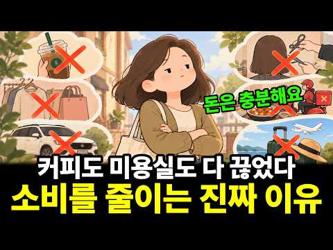
- 설명 앞부분: 돈이 없어서 소비를 줄이는 것이 아닙니다. 요즘은 돈이 있어도 굳이 사지 않는 사람들이 늘고 있습니다. 매일 마시던 커피를 줄이고, 미용실에 가는 횟수를 줄이고, 배달과 쇼핑도 자연스럽게 줄입니다. 그런데 이들의 공통점은 단순히 돈을 아끼는 것이 아닙니다. 남들이 무엇을 사는지보다 내가 정말 필요한 것이 무엇인지 생각하기 시작했다는 것입니다. 커피 한 잔, 옷 한 벌, 외식 한 끼처럼 작은 소비를 줄이는 과정에서 우리는 자신의 가치관과 소비 기준을 다시 발견하게 됩니다. 이번 영상에서는 소비를 줄이는 사람들에게 나타나는 심리와 그…
- 대본 없음 (설명) — 음성인식이 끝나면 도입부·흐름이 들어감
- 댓글 169/169: 좋은 점 — 영상 5 · 감사·응원 1 · 더 알고 싶은 것 3 · 아쉬운 점 — 영상 0 · 반박·불만 — 의견 다름 3 · 정치·사회 4 · 경험 공유 15 · 구독·다음 기대 0
  - 좋은 점 — 영상 👍23 “유익한 채널이네요”
  - 좋은 점 — 영상 👍5 “구구절절 제 얘기하는것 같네요. 아맞아 내마음, 내생각이 이랬던거야..하면서 말로 정리해주시니 다시 한번더 마음에 새겨지네요. "가치에 집중!" 과거에는 별생각없이 매일커피는 기본, 외식, 배달,쇼핑했는데.. 이제는 아니에요. 처음엔 식비좀 아껴보자하고 시작했는데 이…”
  - 감사·응원 👍1 “감사합니다”
  - 반박·불만 — 의견 다름 👍325 “아닙니다 주택에 몰빵해서 이자 많이내고 물가는 점점 더 많이 올라가니 지갑을 닫는겁니다.”
  - 반박·불만 — 의견 다름 👍0 “아닌데 한국여자들은 더 많이 소비 하던데... 내 아는 친구와 만나 벡화점 스타벅스 갔는데 평일인데도 자리가 없던데 그리고 대부분 여자들 이던데... 명품 매장들도 여자 순님들 많고 그래서 확실히 알았지 백화점은 여자들이 고객이란 걸...ㅋㅋㅋㅋㅋㅋㅋㅋㅋ”
  - 정치·사회 👍24 “집에서 직선거리 100미터 내 미용실이 20개가 넘음. 미친거지 번화가라서 그런것도 있지만 그래도 말이되나싶음”
  - 정치·사회 👍4 “곳간에서 인심난다고 그냥 나라가 가난해진거다.”
  - 경험 공유 👍142 “꼭필요한것만 사는것 정말중요한것같아요.물건이 너무많아 찾는데 에너지 다쓰고,열받아 죽을뻔....그후 미니멀라이프 7년째 실천중입니다~ 장바구니 들고다니기, 포장용그릇 갖고다니기 등 실천중입니다^^”
  - 경험 공유 👍64 “비싼카페 가는 거 싫어하고 염색 내가하고 헤어도 집에서 컷트함 손재주가 좋은편”

### 21. 하버드 신경과학자들도 경악한 불교의 비밀 듣는 순간 뇌가 바뀝니다

- https://www.youtube.com/watch?v=Qb2Xxt6REx4 · 부처님 말씀 · 구독자 1,450 · 조회수 70,964 (×48.9, 하루 3,924.0) · 좋아요 2,268 (3.2%) · 33.3분 · 2026-10-24 · 주제 묶음 1. 심리학 일반 · 형식 정보·해설 (그 밖) · 폴더 `W_Qb2Xxt6REx4` (웹 승인)
- 썸네일: 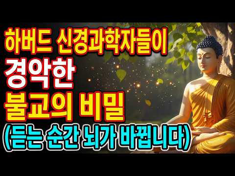
- 챕터: 0:00 과열된 뇌를 식히는 첫 번째 깨달음 — 생각의 노예에… · 10:13 결과의 집착을 끊어내는 두 번째 깨달음 — 머무는 바… · 18:43 뇌가 만들어낸 환상 — '나'라는 가장 무거운 짐 내… · 26:23 상처를 꿈처럼 흘려보내는 마지막 지혜 — 일체유위법과…
- 설명 앞부분: 하버드 신경과학자들도 경악한 불교의 비밀, 들어보셨나요? 금강경 속 단 한 문장이 당신의 세로토닌을 바꾼다는 사실, 믿기 어려우시죠? 이 영상에서는 신경과학자가 직접 설명하는 금강경의 놀라운 힘과, 그 한 문장이 뇌와 마음을 어떻게 바꾸는지 과학적으로 풀어드립니다. 이 영상을 보면: 금강경 한 문장이 왜 강력한지 알게 됩니다 세로토닌(행복 호르몬)과 마음공부의 연결고리를 이해하게 됩니다 불안, 우울, 집착에서 벗어나는 실제적인 방법을 얻을 수 있습니다 불교의 지혜가 현대 뇌과학으로 어떻게 증명되는지 확인하게 됩니다 많은 분들이 “…
- 대본 없음 (설명) — 음성인식이 끝나면 도입부·흐름이 들어감
- 댓글 0/45: 좋은 점 — 영상 0 · 감사·응원 0 · 더 알고 싶은 것 0 · 아쉬운 점 — 영상 0 · 반박·불만 — 의견 다름 0 · 정치·사회 0 · 경험 공유 0 · 구독·다음 기대 0

### 22. 늙을수록 친구를 손절하는 소름돋는 이유 ｜심리 ｜행동심리 ｜친구관계 ｜인간관계 ｜마인드 컨트롤 ｜자존감 ｜ 손절

- https://www.youtube.com/watch?v=4g_Vs_r46nU · 마음결 셋업 · 구독자 396 · 조회수 163,046 (×411.7, 하루 1,056.0) · 좋아요 812 (0.5%) · 8.5분 · 2026-06-09 · 주제 묶음 1. 심리학 일반 · 형식 정보·해설 (그 밖) · 폴더 `W_4g_Vs_r46nU` (웹 승인)
- 썸네일: 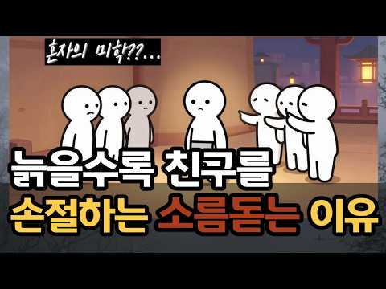
- 설명 앞부분: "나이 먹을수록 인간관계 다 부질없다..." 혹시 요즘 주변에 사람이 사라지는 것 같아 씁쓸하거나 자책하고 계시진 않나요? 놀랍게도 나이 들수록 친구가 줄어드는 진짜 이유는 내가 괴팍해져서가 아니라, 우리의 뇌와 심리가 발동하는 아주 건강한 '생존 본능'이자 심리적 진화 과정입니다. 우리가 우정이라 믿었던 관계의 이면, 그리고 무례한 인간들에게 에너지를 뺏기지 않고 나를 지키며 인생을 우아하게 리셋하는 3가지 실천 법칙을 전해드립니다. 타인의 눈치를 보며 에너지를 쓰던 삶을 끝내고, 오롯이 나를 위한 진짜 자유를 맛보시길 바랍니다…
- 대본 없음 (설명) — 음성인식이 끝나면 도입부·흐름이 들어감
- 댓글 72/72: 좋은 점 — 영상 2 · 감사·응원 0 · 더 알고 싶은 것 0 · 아쉬운 점 — 영상 2 · 반박·불만 — 의견 다름 1 · 정치·사회 4 · 경험 공유 1 · 구독·다음 기대 0
  - 좋은 점 — 영상 👍7 “공감합니다. 정년퇴직했는데 모임에서 피곤한 질문. 1.요즘 뭐해? 2.애들은? 3.아픈데 없냐? 4.와이프하고 잘지내? 등등 모두 걱정해 주고 관심 가져주는 좋은 말 같은데 피곤하고 대답하기 싫어지며 자연스레 모임에 안나가게 되었다.”
  - 좋은 점 — 영상 👍6 “50대가 되면서 친구 후배가 다 정리되는 상황에 대해 마음이 불편했는데 참 와닿는 글이네요.”
  - 아쉬운 점 — 영상 👍13 “모임은 지루해욤😭😭 그냥 혼자 집에서 하고 싶은 거 하는 게 너무 재밌어욤🤗🤗”
  - 아쉬운 점 — 영상 👍0 “남편애들흉보는 얘길 맬반복해서 들어야합니다 그냥 감정쓰레기통이된듯해요 내시간을 왜 그런 쓰레기같은 얘길들어주는데 써야할까 바로 손절했어요”
  - 반박·불만 — 의견 다름 👍5 “그냥 들어주세요 친구가 자랑하면 아무에게나 자랑하는거아닙니다 자랑을 늘어놓는다면 그만큼 신뢰하고있다는것인데 그것조차 받아들일수없는 깜냥이라면 싹다 정리하시고 산에 들어가 혼자사시길”
  - 경험 공유 👍0 “인간은 사회적 동물이다. 사람냄새. 어울려서 살아야한다. 가슴이 따뜻한 사람을 만나고싶다 맥심광고카피. 이거 진짜 당연히 이래야된다는. 강요하는 주입식 고정관념입니다. 여기에 속으면 안되요 이딴것 믿다가는 옆에 사람이 있어도 항상외롭습니다. 죽을때까지 외로워요 내경우…”

### 23. 작은 선물을 자꾸 주는 사람의 심리. 당신도 그렇습니까? 일상심리학

- https://www.youtube.com/watch?v=2GxDRxV0T9w · 일상심리학 · 구독자 19,600 · 조회수 887,511 (×45.3, 하루 46,776.4) · 좋아요 4,829 (0.5%) · 23.7분 · 2026-10-23 · 주제 묶음 1. 심리학 일반 · 형식 오디오북·책 요약 · 폴더 `W_2GxDRxV0T9w` (웹 승인)
- 썸네일: 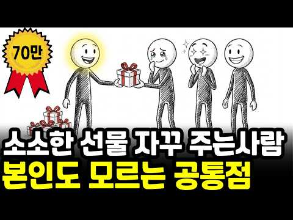
- 설명 앞부분: 만날 때마다 사탕 하나, 귤 하나를 손에 쥐여 주는 사람, 그냥 정이 많아서일까요? 건네는 사람은 작은 것이라 여기지만, 받는 사람에게는 짐작보다 훨씬 크게 닿고 있었습니다. 일상심리학을 찾아오신 모든 분들에게, 성장과 행복이 있기를 바랍니다. 🙏 이 영상이 도움이 되었다면, 영상 오른쪽 점 세 개 안에 있는 🩶 Thanks로 커피 한 잔 응원해 주세요. ☕ 다음 영상에 감사인사를 올려드립니다. ❤ 🔹 탐색자 2,990원 / 통찰자 5,990원 / 동반자 12,000원 일상심리학의 소중한 멤버, 김종근종근님, 주명순님, 김수미님,…
- 대본 없음 (설명) — 음성인식이 끝나면 도입부·흐름이 들어감
- 댓글 630/628: 좋은 점 — 영상 4 · 감사·응원 55 · 더 알고 싶은 것 0 · 아쉬운 점 — 영상 6 · 반박·불만 — 의견 다름 18 · 정치·사회 2 · 경험 공유 139 · 구독·다음 기대 0
  - 좋은 점 — 영상 👍1 “어릴때부터 많이 아팠어요 그러다보니 알게 모르게 사람들에게 피해를 준 적도 많았고 해서 내가 아주 사소한 도움이라도 받았다 생각들면 음료라도 하나 드리고 감사표시 하는게 습관처럼 됐고 지금까지”
  - 감사·응원 👍846 “시골에서 농사지은 대파 너무 많아 앞집에 나눠 줬는데 그즉시 초인종 울려 나가보니 배3개를 주셨다 감사한 마음으로 받아 배를 깍았는데...얼마나 오랫동안 냉장고에 있었는지 배가 물컹해서 먹을수가 없었다 그래도 뭐라도 주고 싶으셨나보다 하며 넘어갔고 몇달후 농사지은 풋…”
  - 감사·응원 👍401 “누가 작은거라고 내게 쥐어주면 너무 고맙던데요 그리고 담엔 나도 나누는 마음을 실천하자고 생긱합니다 예쁜마음이 긍정적으로 전파하더라는~”
  - 아쉬운 점 — 영상 👍23 “기분 좋게 주더라도 그게 반복되면 당연시 여기는 게 문제지”
  - 아쉬운 점 — 영상 👍10 “품목과 방법은 시대가 변했으니 변할수 있지만, 맥락과 마음은 그대로일것 같아요. 연구가 진행되던 때에는 설탕, 밀가루도 귀해서 아플때 약처럼먹고, 가진 사람들이 먹는거였기에 누구든 반가워했다면 요즘은 아이들마져 당뇨, 첨가물 걱정인 시대라 싫어할수 있고, 워낙 이런 …”
  - 반박·불만 — 의견 다름 👍123 “받는 사람이 다 좋아하는건 아닙니다”
  - 반박·불만 — 의견 다름 👍52 “주고싶은맘 일땐 내가 받아도 기분좋은걸로 냉장고에서 돌아다니다 먹기싫은거 말고 나도 미용실 했는데 봉지안것은 모르니 고맙다고 연신 말했는데 가고 열어보니 멸치냄새가 섞여있더라~~으악바로 버리고 그날이후 그 손님 바로 안봐지더라~~ 그날이후 느낀거 내가 받아 기분좋은것…”
  - 정치·사회 👍1 “학폭이 아닌데 왜 학폭이 라고 말씀 하시죠? 20대 초반에 친구와의 다툼이었다고 다 해결된걸 잘 되니까 학폭으로 프레임 씌워서 온 언론이 앞날이 창창한 청년의 앞길을 막은거죠😢 찢죄명 이 윤석열대통령을 내란으로 프레임 씌운거처럼 내란은 찣의 입법내란 인데😢두분 다 억…”
  - 경험 공유 👍643 “내가 못 먹는거 못하는거 남 주는거 아니다 고구마 한박스에서 이웃이건 친구건 줄때는 제일 좋고 실한것 만 준다”
  - 경험 공유 👍401 “누가 작은거라고 내게 쥐어주면 너무 고맙던데요 그리고 담엔 나도 나누는 마음을 실천하자고 생긱합니다 예쁜마음이 긍정적으로 전파하더라는~”

### 24. 《정약용 명언》 노후에 절대 대답하면 안 되는 '4가지' 질문. 입을 다물면 존경받는다. l 인생명언 l 행복한 노후 l 삶의지혜 l 인간관계

- https://www.youtube.com/watch?v=6Bit5jnPjHk · 관계의 품격 · 구독자 1,210 · 조회수 245,487 (×202.9, 하루 2,747.3) · 좋아요 2,642 (1.1%) · 28.5분 · 2026-08-14 · 주제 묶음 2. 인간관계·대화 · 형식 오디오북·책 요약 · 폴더 `W_6Bit5jnPjHk` (웹 승인)
- 썸네일: 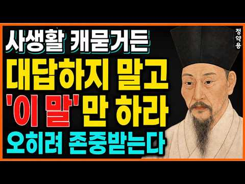
- 챕터: 0:00 대답하는 순간 영원히 품위를 잃게 만드는 질문들이 있… · 3:26 모든 것에 답하고 모든 것을 잃은 원로의 이야기 · 7:31 "자신이 가진 재산 규모를 절대 밝히지 말고, 자녀 … · 12:11 "집 안에서 일어난 일은 절대 현관문 밖으로 새어 나… · 17:18 "고통을 드러내는 순간, 존중은 동정이 되고, 동정은… · 23:18 침묵은 공허함이 아니다. 그것은 증명할 것이 아무것도…
- 설명 앞부분: 정약용 선생께서 이르시길, 사람의 품격은 말하는 것이 아니라 말하지 않는 것에서 드러난다 하셨습니다. 나이가 들수록 우리는 무심코 던지는 질문에 진심을 다해 대답하곤 하지만, 그것이 바로 존경을 잃는 첫걸음입니다. 오늘 이 영상에서는 누구를 만나든 절대 답해서는 안 되는 '4가지 치명적인 질문'을 정약용 선생의 가르침을 통해 밝힙니다. "침묵할 줄 아는 자만이 진정한 존경을 받는다"—이 단순하지만 강력한 원칙이 당신의 남은 인생을 완전히 바꿔놓을 것입니다. 지금 이 순간부터 당신의 입은 곧 당신의 성곽이 됩니다.
- 대본 없음 (설명) — 음성인식이 끝나면 도입부·흐름이 들어감
- 댓글 277/277: 좋은 점 — 영상 11 · 감사·응원 30 · 더 알고 싶은 것 0 · 아쉬운 점 — 영상 1 · 반박·불만 — 의견 다름 1 · 정치·사회 0 · 경험 공유 12 · 구독·다음 기대 0
  - 좋은 점 — 영상 👍48 “제가 75년을 솔직한게 인간의 본부인줄 알고살았습니다 이제야 지금 말흠에공감합니다”
  - 좋은 점 — 영상 👍11 “나는 품격있는 사람이다 나는 나의경계를 지키는 사람이다 좋은 내용 감사합니다 🎉”
  - 감사·응원 👍27 “나는 품격 있는 사람이다. 나는 경계를 지키는 사람이다 감사합니다❤”
  - 감사·응원 👍19 “나는 품격있는사람이다ㆍ나는 내경계를 지킨다! 고맙습니다”
  - 아쉬운 점 — 영상 👍0 “이 말씀은 필자 개인의 생각을 말하고 있습니까? 정약용이 말한 저서를풀이한겁니까? 아니면 정약용 사진을 걸어놓고 그의 일부 생활 철학을 인용하고 있습니까? 먼저 말하는 내용의 출처가 궁금하군요.”
  - 반박·불만 — 의견 다름 👍1 “부부에갈등 자식에 부모는 칩착하지 말아야합니다 그리고 돈이란 문제가 아닙니다 있고 없고 첮째는”
  - 경험 공유 👍152 “제거 이런정보를 진작 알았으면 마음에 경계를 하고 남이 꼬치꼬치 묻는말에 대답을 해주지 말았을것을 많이 후회하고 있었습니다 전에는 제가 마음이 열려있는 사람이 였었는데 누가 저에게 질문이나 무엇을 물어보면 솔직하게 다 이야기 해주었습니다 그러나 나의약점을 알고난 사람…”
  - 경험 공유 👍48 “제가 75년을 솔직한게 인간의 본부인줄 알고살았습니다 이제야 지금 말흠에공감합니다”

### 25. 재수 1년을 끌고 간 10초짜리 습관 ∣ ADHD 정신과 의사

- https://www.youtube.com/watch?v=G8lBmJpXwfs · 정신없는 정신과 의사 정재균 · 구독자 4,620 · 조회수 290,947 (×63.0, 하루 10,453.3) · 좋아요 4,280 (1.5%) · 8.9분 · 2026-10-14 · 주제 묶음 6. 정신건강 · 형식 인터뷰·강연·대담 (전문가) · 폴더 `W_G8lBmJpXwfs` (웹 승인)
- 썸네일: 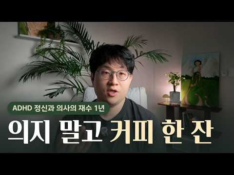
- 챕터: 0:00 의지로는 안 되던 재수 1년 · 1:12 매일 아침이 협상이었어요 · 2:23 딴생각해도 몸은 알아요: 습관이라는 자동 조종 · 3:31 ① 첫 동작 하나만 정하기 · 4:51 ② 일과 일 사이, 틈에 심기 · 6:06 ③ 무너진 날엔 최소 루틴 · 6:50 습관은 21일? 실제로는 66일 · 7:52 오늘, 틈 하나에 동작 하나 · 8:19 마무리
- 설명 앞부분: "오늘은 좀 쉴까?" "내일 더 열심히 하면 되지." 매일 아침 이렇게 스스로와 협상하고 계신가요? 의전원 재수를 하던 1년, 저는 공부하라고 하는 사람도, 간섭하는 사람도 없었어요. 시간도 충분했고요. 그런데 안 됐어요. 그땐 제가 의지가 약한 사람인 줄 알았습니다. 그 1년을 끌고 간 건 거창한 계획이 아니었어요. 아침에 외출복 입고 커피 사러 나가기. 딱 그것 하나였습니다. 그게 왜 통했는지는 한참 뒤, 제가 ADHD라는 걸 알고 나서야 보이더라고요. 이번 영상에서 다루는 내용 ADHD 뇌가 '지루한 일을 끝낸 뿌듯함'을 약…
- 대본 없음 (설명) — 음성인식이 끝나면 도입부·흐름이 들어감
- 댓글 198/198: 좋은 점 — 영상 24 · 감사·응원 30 · 더 알고 싶은 것 12 · 아쉬운 점 — 영상 5 · 반박·불만 — 의견 다름 3 · 정치·사회 1 · 경험 공유 33 · 구독·다음 기대 0
  - 좋은 점 — 영상 👍15 “선생님. 기존채널 구독중이었는데 몇달동안 새영상이 안올라와서 무슨일이 있으신건가? 많이 걱정하고 많이기다렸습니다. 가족중에 ADHD인이 있어서 이해하는데 정말 큰 도움이 됐었습니다. 다시 와주셔서 정말 고맙습니다!! 새채널도 대박나시길 기원합니다.”
  - 좋은 점 — 영상 👍13 “저는 잠에서 깬 직후가 가장 힘들어요 해야할 일을 하기 보다, 유튜브나 릴스를 보면서 시간을 보내고, 무너지는 날은 유튜브만 보다가 하루를 다 보내기도 합니다. 출근하는 날도 내가 일어나지 않으면 안되는 시간 직전까지 미루다 딱 맞춰 나가기도 해요. 요즘은 이직을 위…”
  - 감사·응원 👍22 “이 영상보고 제가 성인 adhd 인 걸 확신했습니다 제가 게으른건 아닌데뭔가 시작하기가 힘들고 하려고 했던 시간에 시작을 못하면 아침8시에도 하루가 망한 느낌이여서.. 무기력해지더라구요.. 루틴이 있는건 아무생각없이 해내는데.. 루틴이 없는데 해야하는건 ..시작도 힘…”
  - 감사·응원 👍15 “선생님. 기존채널 구독중이었는데 몇달동안 새영상이 안올라와서 무슨일이 있으신건가? 많이 걱정하고 많이기다렸습니다. 가족중에 ADHD인이 있어서 이해하는데 정말 큰 도움이 됐었습니다. 다시 와주셔서 정말 고맙습니다!! 새채널도 대박나시길 기원합니다.”
  - 더 알고 싶은 것 👍5 “티셔츠 입은 의사.. 솔직한 말투의 의사.. 너무 새롭고 내용도 단순 명료해서 완전 빠져들어서 들었습니다!!! 앞으로도 잘 부탁드려요!!!🎉”
  - 더 알고 싶은 것 👍3 “잘 이해 안가는 부분이 있는데요, "야간 당직 끝난 다음 날 집에 들어가기 전에 커피숍 들르기 커피 한 잔 들고 집에 들어가면 그 날은 좀 달랐어요 완전히 무너지지는 않았어요" 이게 어떤 이유에서 그런건가요? 그리고 야간 당직 끝난 다음 날 집에 들어갈 때 커피를 사…”
  - 아쉬운 점 — 영상 👍73 “이런 거 진짜 효과 좋아요. 저도 미루고 미루다가 밤 늦게 겨우 외출하거나 학교 집 반복이 습관이었는데 의무적으로 일찍 나가는 스케줄 만들고 학교 끝나도 카페에서 할 일 하다가 오는 루틴 만드니까 좋더라고요”
  - 아쉬운 점 — 영상 👍4 “adhd로 콘서타 N년간 먹는 중인데, 학창시절에 이런 걸 알았더라면 .. 방치된 환경이라 항상 아쉬움이 남지만 남은 삶 잘 극복해봐야겠지요 지금도 업무시간인데 ......”
  - 반박·불만 — 의견 다름 👍294 “이 영상보고 집앞에 정신의학과 한번 뭐있나 검색해봤는데 원장님 얼굴이 똑같이 생겨서 뭔가 했더니 같은 사람이였어.. 아니 이런 말도 안되는 우연이 있나..? 충격적이네”
  - 반박·불만 — 의견 다름 👍22 “이 영상보고 제가 성인 adhd 인 걸 확신했습니다 제가 게으른건 아닌데뭔가 시작하기가 힘들고 하려고 했던 시간에 시작을 못하면 아침8시에도 하루가 망한 느낌이여서.. 무기력해지더라구요.. 루틴이 있는건 아무생각없이 해내는데.. 루틴이 없는데 해야하는건 ..시작도 힘…”
  - 경험 공유 👍294 “이 영상보고 집앞에 정신의학과 한번 뭐있나 검색해봤는데 원장님 얼굴이 똑같이 생겨서 뭔가 했더니 같은 사람이였어.. 아니 이런 말도 안되는 우연이 있나..? 충격적이네”
  - 경험 공유 👍171 “이런 디테일한 설명은 수많은 경험과 실패, 자아성찰을 하지 않고서는 나올 수 없죠. 제 얘기하시는 것 같아서 깜짝 놀랐습니다. 저도 의식적으로 장소를 바꾸고, 미팅을 만들어서 데드라인을 만들고, 저를 움직일만한 무언가를 정해서 하거든요. 일과 일 사이 증발하는 것도 …”

### 26. “가해자는 아주 악질적인 나르시시스트의 모습을…” 나르시시스트 전문 변호사들이 말하는 ‘강서구 고문 살인사건’ ∣ [나르상담소]

- https://www.youtube.com/watch?v=Oiw0rhVy5qc · 리걸 어벤져스 : 당신의 법률 파트너 · 구독자 3,780 · 조회수 89,617 (×23.7, 하루 8,260.3) · 좋아요 332 (0.4%) · 23분 · 2026-10-31 · 주제 묶음 4. 나쁜 사람 알아보기 · 형식 정보·해설 (그 밖) · 폴더 `W_Oiw0rhVy5qc` (웹 승인)
- 썸네일: 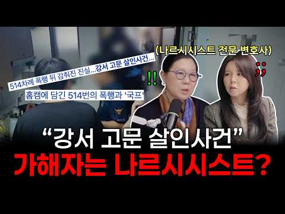
- 챕터: 0:00 하이라이트 · 0:30 오프닝 · 2:11 사건 소개 · 4:35 사건을 접하고 처음 든 생각 · 7:30 가해자의 ‘왕국’과 ‘규칙’ · 10:41 가해자는 강약약강? · 12:08 ‘처벌’이라는 이름 하에 가해진 폭력 · 15:05 피해자가 도망치지 못했던 이유 · 18:32 어느 시점부터 외부 도움을 요청해야 할까? · 21:14 가해자의 집에서 발견된 심리학 서적? · 21:48 엔딩
- 설명 앞부분: 슈가스퀘어의 박지영, 남하나 변호사가 말하는 ‘강서구 고문 살인사건’ 가해자의 행동을 악성 나르시시즘의 관점에서 분석합니다. ⏰ 타임 스탬프 [상담 예약 안내]
- 대본 없음 (설명) — 음성인식이 끝나면 도입부·흐름이 들어감
- 댓글 61/61: 좋은 점 — 영상 1 · 감사·응원 1 · 더 알고 싶은 것 1 · 아쉬운 점 — 영상 0 · 반박·불만 — 의견 다름 3 · 정치·사회 2 · 경험 공유 8 · 구독·다음 기대 0
  - 좋은 점 — 영상 👍1 “유익했습니다❤ 끔찍한 사건 시사점이 너무도 많았습니다ㅠㅠ”
  - 감사·응원 👍2 “나라가 병들었다 한국은 희망이 없다! 뉴스여기저기 나오고 나라가 뒤집힐사건인데. 뉴스한줄안나오고 늙은연예인 죽을나이되서 죽은건! 여기저기 뉴스다나오고! ㅋㅋㅋ 그냥 그것이알고싶다하고 이렇게 언급해주는 유튜버들이 감사할따름이다”
  - 더 알고 싶은 것 👍58 “정말 대한민국 정치하시는 선생님들 부탁드립니다! 전병훈사건! 그냥넘어가지 마세요! 제가 그것이알고싶다 30년넘께 보면서! 잔인하고 끔찍한 학대 많이 봤습니다! 그런데! 전병훈사건은 정말 잔인합니다! 731부대도 울고갈 잔인한사건입니다! 심리적통제로 도망도못가게하고! …”
  - 반박·불만 — 의견 다름 👍58 “정말 대한민국 정치하시는 선생님들 부탁드립니다! 전병훈사건! 그냥넘어가지 마세요! 제가 그것이알고싶다 30년넘께 보면서! 잔인하고 끔찍한 학대 많이 봤습니다! 그런데! 전병훈사건은 정말 잔인합니다! 731부대도 울고갈 잔인한사건입니다! 심리적통제로 도망도못가게하고! …”
  - 반박·불만 — 의견 다름 👍25 “말다툼이 아니죠 일방적으로 시비거는거고 말도 안되는 규칙을 못 지키면 폭행하는거예요”
  - 정치·사회 👍2 “나라가 병들었다 한국은 희망이 없다! 뉴스여기저기 나오고 나라가 뒤집힐사건인데. 뉴스한줄안나오고 늙은연예인 죽을나이되서 죽은건! 여기저기 뉴스다나오고! ㅋㅋㅋ 그냥 그것이알고싶다하고 이렇게 언급해주는 유튜버들이 감사할따름이다”
  - 경험 공유 👍58 “정말 대한민국 정치하시는 선생님들 부탁드립니다! 전병훈사건! 그냥넘어가지 마세요! 제가 그것이알고싶다 30년넘께 보면서! 잔인하고 끔찍한 학대 많이 봤습니다! 그런데! 전병훈사건은 정말 잔인합니다! 731부대도 울고갈 잔인한사건입니다! 심리적통제로 도망도못가게하고! …”
  - 경험 공유 👍12 “도와주세요 악성나르와 이혼중이고 악성나르의 폭행과 아이앞 특수상해로 형사도 진행중인데 법무법인 2곳을 선임 계속 해외여행간다고 거짓말후 해외근무 1년계약후 출국해 또 연장신청을 넣고 기간은 2년을 넘어 3년에 접어듭니다 상간은 파탄이후 관계라고 거짓말로 일관하는데도 …”

### 27. "정서적으로 미성숙한 부모" 밑에서 자란 사람들이 평생 겪는 것 4가지

- https://www.youtube.com/watch?v=aUeE9FV0qto · 기분 관리소 · 구독자 615 · 조회수 114,202 (×185.7, 하루 1,330.9) · 좋아요 1,005 (0.9%) · 10.8분 · 2026-08-17 · 주제 묶음 7. 가족·부모 · 형식 목록형 (N가지 특징·신호) · 폴더 `W_aUeE9FV0qto` (웹 승인)
- 썸네일: 
- 챕터: 0:00 차 안에서 무거워진 마음 · 1:21 이유 하나. 걱정의 얼굴을 한 것들 · 2:57 이유 둘. 내 감정이 틀렸다고 배웠어요 · 4:37 이유 셋. 어릴 때 이미 어른 역할을 했어요 · 6:05 이유 넷. 그 집에선 나이가 사라져요 · 9:54 다음에 다녀오실 때, 세 가지만 · 11:17 마무리
- 설명 앞부분: 📝 설명란 부모님 만나고 오면 별일 없었는데 이상하게 며칠이 무거운 적 있으신가요. 싸운 것도 아니고 나쁜 말을 들은 것도 아닌데요. 걱정의 얼굴을 하고 있어서 화도 못 냈던 말들, 내 감정이 틀렸다고 배우게 된 과정, 어릴 때 이미 어른 역할을 맡았던 아이, 그리고 그 집에만 들어가면 나이가 사라지는 이유까지 하나씩 풀어봅니다. 부모님을 탓하는 이야기가 아닙니다. ⏱ 챕터 Barber, B. K. (1996). Parental psychological control: Revisiting a neglected construct. …
- 대본 없음 (설명) — 음성인식이 끝나면 도입부·흐름이 들어감
- 댓글 153/153: 좋은 점 — 영상 9 · 감사·응원 10 · 더 알고 싶은 것 1 · 아쉬운 점 — 영상 0 · 반박·불만 — 의견 다름 8 · 정치·사회 0 · 경험 공유 35 · 구독·다음 기대 0
  - 좋은 점 — 영상 👍38 “영상이 알고리즘에 떠서 정지없이 봤는데 정확히 저의 얘기여서 눈물이 났습니다. 또 한편으로는 저의 마음이 왜 그랬는지 해석을 들은 것 같아 조금은 명쾌해졌네요. 다만, 아쉬운 부분도 있어서 짚고 싶습니다. 이런 심리영상에서는 자꾸 '부모님이 나쁘다는게 아니에요', '…”
  - 좋은 점 — 영상 👍11 “부모도 미성숙하고 자녀도 미성숙한겁니다.. 그 부모님도 미성숙한 부모님 밑에서 배운 거 없이 부모가 되었겠지요.. 우리 세대는 많이 배웠고 또 배우고자 하면 배울 수 있는 채널이 무궁무진하니 스스로 성숙해지자구요..”
  - 감사·응원 👍38 “영상이 알고리즘에 떠서 정지없이 봤는데 정확히 저의 얘기여서 눈물이 났습니다. 또 한편으로는 저의 마음이 왜 그랬는지 해석을 들은 것 같아 조금은 명쾌해졌네요. 다만, 아쉬운 부분도 있어서 짚고 싶습니다. 이런 심리영상에서는 자꾸 '부모님이 나쁘다는게 아니에요', '…”
  - 감사·응원 👍9 “그래서 내가 자존감이 낮은 사람으로 살아왔어.ㅠㅠ 나에게 늘 부정적으로,핀잔하고, 트집잡고, 칭찬은 절대로 안한다. 고맙다고 않하고, 미안하다는 말도? 더럽게 안한다. 그녀가 ㅠㅠ 가장 가까운 사람을 통해서, 저주의 영이 들어갔다는 그말을, 나는 어느날 부터, 납득하…”
  - 반박·불만 — 의견 다름 👍61 “크..남보다 못한 부모란 인간. 특히 엄마. ㅋㅋ 살 찌니까 왜 그렇게 살 쪘냐고 꼽주더니 살 빼니까 이젠 어디 아프냐며 얼굴이 왜 그러냐며 병자 취급..ㅋ 영상의 죄책감 주기, 애정 조건 걸기, 불안 심어주기, 감정 틀렸다고 하기 전부 다를 평생 나에게 하던 인간.…”
  - 반박·불만 — 의견 다름 👍55 “감정을 틀렸다하기. 진짜 복장터짐. 내 감정이 그렇다는데 아니라고 자꾸 말함. 근데 진짜 나도 중년의 나이가 되어도 내 감정보다 내가 틀렸나? 내 감정이 틀렸나? 계속 되묻게됨. 근데 나중에 깨닫는다 내 찜찜했던 감정이 진짜였다는걸 상대가 무례했다는걸 늦게 알게되더라…”
  - 경험 공유 👍257 “보고 싶어서 전화하고 싶다가 살포시 내려놔요 통화 이후에 몰려들 슬픔과 분노,상실을 겪고싶지 않아서요 진짜 좋은 부모는 자식 마음에 자채감을 들지 않게 하는 부모라 생각해요”
  - 경험 공유 👍181 “우리 엄마가 이랬지. 본인 마음에 안들면 집 오지말라고 해놓고서는 아무일도 없었다듯이 연락오길래 전화안받음..어릴 때 갑자기 본인 뜻대로 안되면 소리 빽빽 지르고 알고 보니 내가 정서적 학대를 받고 자란거였음ㅠ”

### 28. 마음공부 10년 저 처럼 뻘짓 하지말고, 그냥 이책 보세요

- https://www.youtube.com/watch?v=KEymuZOLZEU · 마음공간TOK · 구독자 4,460 · 조회수 259,375 (×58.2, 하루 9,631.2) · 좋아요 1,475 (0.6%) · 8.8분 · 2026-10-15 · 주제 묶음 3. 자존감·마음 · 형식 정보·해설 (그 밖) · 폴더 `W_KEymuZOLZEU` (웹 승인)
- 썸네일: 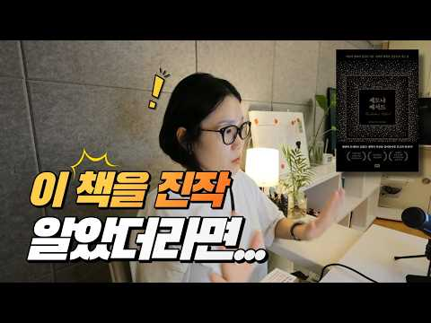
- 챕터: 0:00 10년 마음공부 후 깨달은 시행착오와 책 추천 시작 · 0:30 마음공부 입문 계기가 된 데이비드 호킨스 박사 《의식… · 1:10 머리로만 쌓은 지식(앎아리)의 함정과 깨달음의 허상 · 2:18 상태를 아는 것보다 "어떻게 갈 것인가?"가 중요한 … · 3:04 10년의 방황을 막아주는 마법 같은 책, 《세도나 메… · 3:16 인간의 4가지 근원적 욕구란? · 4:02 📖 [책 낭독] 어디에도 소속되지 못하는 이유: '분… · 6:07 📖 [책 낭독] 외로움과 연결감의 비밀: '하나 되려… · 7:51 근원적 욕구를 흘려보내고 제로 포인트로 가는 법 · 8:32 마음공부 필독서 《세도나 메서드》 마무리 추천
- 설명 앞부분: 안녕하세요, 마음공간 톡의 정소영입니다! 제가 마음공부를 시작한 지 어느덧 10년이라는 시간이 흘렀습니다. 돌아보면 깨달은 분들의 책을 읽으며 머리로만 지식을 쌓고, 타인을 평가하고 판단하느라 참 많은 시행착오(뻘짓)를 겪었던 것 같아요. 깨달은 상태가 어떤지 아는 것보다 더 중요한 것은 "어떻게 그곳으로 갈 수 있는가?" 입니다. 머리로만 만들어낸 허상을 넘어, 내 마음의 지도가 되어줄 단 한 권의 책, 바로 《세도나 메서드》를 강력 추천합니다! 오늘 영상에서는 《세도나 메서드》 7장에 나오는 인간의 4가지 근원적 욕구 중에서도…
- 대본 없음 (설명) — 음성인식이 끝나면 도입부·흐름이 들어감
- 댓글 196/196: 좋은 점 — 영상 3 · 감사·응원 14 · 더 알고 싶은 것 2 · 아쉬운 점 — 영상 2 · 반박·불만 — 의견 다름 3 · 정치·사회 0 · 경험 공유 14 · 구독·다음 기대 0
  - 좋은 점 — 영상 👍13 “우연히 들어왔는데요,, 비슷하게 10년하고 있는데, 깨닫고자 하는 마음도 내려놓다 보면,, 도움이 되는 듯 합니다. 정답은 없는 것 같습니다. 명상, 요가, 나 스스로를 사랑하고, 내 인생을 사랑하는 마음이 도움이 되고 있습니다.”
  - 좋은 점 — 영상 👍2 “무묘앙 에오를 검색해서 공부해보시기 바랍니다. 사실 공부하거나 굳이 깨달으려할 필요도 없습니다. 영성공부할땡때의 함정입니다. 간단한 질문 하나 던져볼까요. 원래부터 영원불멸의 완벽한 영혼들이라면서, 왜 이렇게 고통을 반복하며 성숙해져야 할까요? 원래 완벽한데. 웃기지…”
  - 감사·응원 👍131 “사람마다 다 틀림니다 금강경을 보고도 깨닫고 ,법화경을 보고도 깨닫고, 선사들 한마디에도 깨닫고 , 엽집 아저씨 말이나 아줌마 말에도 깨닫습니다 남편의 화난 모습보고도 깨달를수 있습니다 깨닫고 보면 세상에 고맙지 않은게 없지요! 😅😇😌🙏 얼마나 간절히 공부했나에 따라…”
  - 감사·응원 👍16 “영상 감사합니다. 마음공부하면 붓다의 가르침이 특효죠. 마음은 있는 것도 없는 것도 아니고 조건끼리 연기될때 생기고 조건이 다하면 사라지는 것처럼 그래서 있는 것도 없는 것도 아니다 라고 했습니다. 그래서 마음은 공부하는 게 아니라 보는 것이라했습니다. 지금 일어나는…”
  - 더 알고 싶은 것 👍6 “사실 깨달았다는 사람들이 말하는 깨달음의 대상이 무엇이며, 결과적으로 무엇을 몰랐다가 알게 되었는지? 모를 때는 어떻게 생각하고 행동했는데, 알게 된 이후에는 어떻게 변했는지 궁금합니다. 한편, 애써 노력하여 지식을 쌓아가는 알음알이로는 그 상태에 이르기는 어렵지 않…”
  - 아쉬운 점 — 영상 👍5 “저도 데이비드 호킨스 박사님 의식혁명 책 읽고 큰 임팩트를 받았는데 반갑네요 박사님 나머지 책도 전부 구입하고 지금도 반복해서 읽고 있습니다.😊”
  - 아쉬운 점 — 영상 👍2 “무묘앙 에오를 검색해서 공부해보시기 바랍니다. 사실 공부하거나 굳이 깨달으려할 필요도 없습니다. 영성공부할땡때의 함정입니다. 간단한 질문 하나 던져볼까요. 원래부터 영원불멸의 완벽한 영혼들이라면서, 왜 이렇게 고통을 반복하며 성숙해져야 할까요? 원래 완벽한데. 웃기지…”
  - 반박·불만 — 의견 다름 👍2 “무묘앙 에오를 검색해서 공부해보시기 바랍니다. 사실 공부하거나 굳이 깨달으려할 필요도 없습니다. 영성공부할땡때의 함정입니다. 간단한 질문 하나 던져볼까요. 원래부터 영원불멸의 완벽한 영혼들이라면서, 왜 이렇게 고통을 반복하며 성숙해져야 할까요? 원래 완벽한데. 웃기지…”
  - 반박·불만 — 의견 다름 👍1 “인생의 굴곡을 심하게 겪고,이제 50의중반에서 분리를 생각하는 입장에서 볼때, 분리욕구는 떠미는것처럼 강한 느낌을 받는다? 다른 사람으로부터 떨어지는 것을 원한다? 다른사람들 속에서 아주 뛰어나길 원한다? 쉽사리 내용이 가슴에 스며들지 않네요. 그냥 책 소개만 하시는…”
  - 경험 공유 👍7 “책으로는 깨닫기 힘들어요.ㅠ.ㅠ주어진 환경에 따라 다르겠지만.저는 암환자이면서 절에서 봉사하는 법당 보살이예요.글자를 읽음으로서 경전 내용 이해하지만 내가 법당에서 또는 납골당에서 청소하거나 신도들 기도초 이름 써 줄 때,경전도 다 무용지물로 느껴질 때 있어요.ㅠ.ㅠ…”
  - 경험 공유 👍6 “그 책을 읽어보진 않았지만 지금 소개하는 내용으로봐선 바로 문제점이 보입니다. 분리되고 싶은 욕구 혹은 하나되고 싶은 욕구라고 분류를 시켜놓았는데 그런게 없어요. 그건 나를 알아주세요의 한모습일 뿐입니다. 사람은 목록을 몇개 딱 만들어놓고 4가지로 분류할수 있습니다라…”

### 29. 지능이 높을수록 나이가 들면 친구를 정리 하는 이유

- https://www.youtube.com/watch?v=tMtPxonK_Uk · 단단한 인생 2막 · 구독자 455 · 조회수 87,125 (×191.5, 하루 838.5) · 좋아요 1,093 (1.2%) · 20분 · 2026-07-30 · 주제 묶음 2. 인간관계·대화 · 형식 오디오북·책 요약 · 폴더 `W_tMtPxonK_Uk` (웹 승인)
- 썸네일: 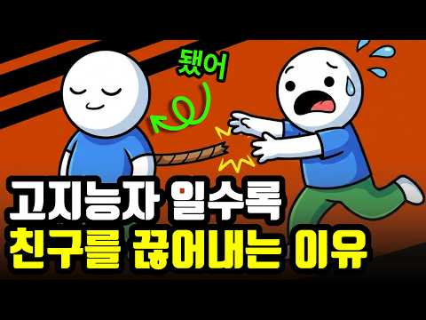
- 챕터: 0:00 친구 연락이 한숨으로 변한 진짜 이유 · 1:12 우리가 맺어온 인연의 숨겨진 실체 · 2:05 나이 들수록 뇌가 남은 시간을 계산하는 방식 · 3:10 사회정서적 선택 이론: 넓은 관계에서 깊은 관계로 · 4:18 체력과 시간의 가치를 깨달을 때 생기는 변화 · 5:32 진짜 사회성이란 관계의 개수가 아닌 밀도 · 6:45 관계를 정리하지 못해 힘겨운 세 가지 유형
- 설명 앞부분: 나이 들수록 친구 만나는 게 귀찮고, 혼자 있는 시간이 더 편안하게 느껴지시나요? ☕ 많은 분들이 『내가 성격이 모나진 걸까』 고민하시지만, 심리학은 전혀 다른 답을 제시합니다. 뇌가 가장 똑똑하게 작동하고 있다는 증거이자, 내 삶의 진짜 우선순위를 찾아가는 과정이기 때문입니다. 불필요한 죄책감은 내려놓고, 나를 지키는 현명한 관계 정리법을 만나보세요. ✨ ⏱ 타임라인
- 대본 없음 (설명) — 음성인식이 끝나면 도입부·흐름이 들어감
- 댓글 211/211: 좋은 점 — 영상 4 · 감사·응원 4 · 더 알고 싶은 것 1 · 아쉬운 점 — 영상 0 · 반박·불만 — 의견 다름 6 · 정치·사회 0 · 경험 공유 21 · 구독·다음 기대 0
  - 좋은 점 — 영상 👍5 “오늘 내용이 구구절절 옳은 내용입니다. 나이가 들수록, 나의 몸과 마음이 평안해야 친구와 주변도 챙길수 있습니다.”
  - 좋은 점 — 영상 👍2 “좋은 이야기 임니다 참고 하겠습니다”
  - 감사·응원 👍14 “감사합니다 그런 이유가 있었군요 저도 저만의 시간을 보내야겠어요 !”
  - 감사·응원 👍6 “현명하신 영상 감사합니다 신의축복 받으세요^^”
  - 더 알고 싶은 것 👍2 “무슨 이유가 있을까요? 모든생활에서 행동 이나 마음가짐에서 생각들이 많아지고 움직임도 둔해지고 살아온 과정들을 하나하나 반추해보는 시간이 남은 생의 시간 같을테니까”
  - 반박·불만 — 의견 다름 👍7 “결정적인 원인은 지적수준(학벌, 학력을 지칭하는 게 아닙니다)과 대화내용의 차이에서 현격한 이질감을 느끼기 때문입니다. 나이가 들어도 꾸준히 자기계발을 멈추지 않는 사람들 대부분 잡스러운 친구 안 만나지요. 잡스러운 일상적인 얘기와 신변얘기는 이들에게는 시간 낭비일 …”
  - 반박·불만 — 의견 다름 👍5 “친구에게 도움 받으려는 생각이 틀렸다.”
  - 경험 공유 👍15 “식구들 빼고 모든 사람이 내가 망하길 바란다.”
  - 경험 공유 👍14 “감사합니다 그런 이유가 있었군요 저도 저만의 시간을 보내야겠어요 !”

### 30. 잘해줄수록 무시당하는 진짜 이유｜목소리 높이지 않고 존중받는 3가지 방법

- https://www.youtube.com/watch?v=YsYFkKuAj-Y · 행복한 마음읽기 · 구독자 2,580 · 조회수 516,911 (×200.3, 하루 4,504.3) · 좋아요 3,808 (0.7%) · 27.8분 · 2026-07-19 · 주제 묶음 기타 · 형식 목록형 (N가지 특징·신호) · 폴더 `W_YsYFkKuAj-Y` (웹 승인)
- 썸네일: 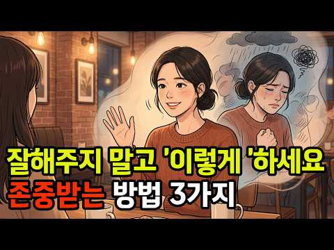
- 설명 앞부분: 나는 분명 마음을 다해 잘해줬는데, 돌아온 건 고맙다는 말이 아니라 당연하다는 얼굴이었습니다. 그 순간 마음이 쿵 하고 내려앉았던 적, 한 번쯤 있으실 겁니다. 그런데 그건 여러분이 못나서도, 성격이 유별나서도 아닙니다. 사람의 마음이 원래 그렇게 움직이도록 되어 있기 때문입니다. 이 영상에서는 왜 잘해줄수록 오히려 함부로 대해지는지, 그 마음의 구조를 찬찬히 풀어봅니다. 그리고 그 흐름을 조용히 뒤집는 세 가지 이야기를 함께 나눠보려 합니다. 바꿔야 할 건 상대가 아니라, 나 자신을 대하는 방식일지도 모릅니다. 이런 분들께 권합…
- 대본 없음 (설명) — 음성인식이 끝나면 도입부·흐름이 들어감
- 댓글 186/180: 좋은 점 — 영상 8 · 감사·응원 14 · 더 알고 싶은 것 1 · 아쉬운 점 — 영상 4 · 반박·불만 — 의견 다름 1 · 정치·사회 1 · 경험 공유 13 · 구독·다음 기대 2
  - 좋은 점 — 영상 👍6 “정말 공감되는 내용입니다. 잘해주는 것이 항상 존중으로 돌아오는 것은 아닌 것 같아요. 오히려 자신의 기준과 경계를 분명하게 세우는 것이 진정한 존중을 만드는 방법인 것 같습니다. 좋은 내용 잘 보고 갑니다”
  - 좋은 점 — 영상 👍6 “좋은말씀 감사합니다, 주변에 자주 있는일에요, 참고하겠습니다, ❤”
  - 감사·응원 👍21 “제 경우는 어릴때부터 많이 아파서 주변에 알게 모르게 피해를 많이 줬어요 그래서 밥을 사거나 선물을 하거나 하는 경우가 많았는데 지금도 아픈건 그대로 그래서 상대에게 도움받은 게 있으면 간단하게라도 감사 표시를 합니다 그래서인지 남에게 뭘 주는게 습관처럼 됐어요 대가…”
  - 감사·응원 👍6 “딱 내가 이번에 당햇던거네요 근데 그런사람은 손절이 답이예요 사람 변하지않아요 원래 인성이 나쁜거죠 감사합니다”
  - 더 알고 싶은 것 👍5 “잘대해주니 진짜 고마워 할줄을 모르더라구요 거기에 휘둘리지않고 시집책을 내었습니다 1집 명자의 삶의 여정 2집 내가 바라본 나 3집 행복한 삶을 위하여 . 네이버에서 구매가능하니 많은응원 부탁드립니다 ♡”
  - 아쉬운 점 — 영상 👍117 “<잘해줄수록 만만해지는 심리 구조> 행복한 마음 읽기 1.호의가 점점 의무가 되는 이유? 받는 사람에게는 똑같은 게 반복되면 적응되어 그 가치와 감동이 점점 줄어든다 => 습관화, 쾌락 적응 반복되면 그게 원래 그런 것, 당연히 받는 것으로 바뀐다 => 안 해 주면 …”
  - 아쉬운 점 — 영상 👍4 “서두가 너무 길어!”
  - 반박·불만 — 의견 다름 👍1 “AI님~~암말 안하고싶은데 넘 답답해서 댓글 달고 싶어지네요ㅋ 사람은 다양합니다.. 받고싶기도하고 주고 싶기도하고. 남을 살피는 그 시간에 차라리 내가 하고 싶은건 하고 안하고싶으면 안하며 생각을 너무 남을 보는 습관은 좋은게 아닙니다. 집착귀가 붙습니다 ㅋㅋ 그럴 …”
  - 경험 공유 👍117 “<잘해줄수록 만만해지는 심리 구조> 행복한 마음 읽기 1.호의가 점점 의무가 되는 이유? 받는 사람에게는 똑같은 게 반복되면 적응되어 그 가치와 감동이 점점 줄어든다 => 습관화, 쾌락 적응 반복되면 그게 원래 그런 것, 당연히 받는 것으로 바뀐다 => 안 해 주면 …”
  - 경험 공유 👍64 “66세 소꿉친구가 가장가까운친구이죠 최근 무리한 요구가 심하게 늘어나서 단절했어요 그래서 상처를 많이 받았죠 지난시간보면 사업을하는 입장에서 늘 내가 더 베풀었어요 그러다보니 선을 넘어 자꾸 요구 하는거예요 아 마음은 아팠지만 이렇게 거리두고 있습니다”
  - 구독·다음 기대 👍2 “동감합니다 잘해줬는데 상처가되어서 오더라구요~ 손절해야합니다 안그럼 계속 반복 내가상처받습니다 매일봐야되는 관계라면 거리두기를 해야죠”
  - 구독·다음 기대 👍2 “내용 넘 좋으네요~ 구독하고 갑니다~^^”

### 31. 친구가 하나둘 사라졌습니다… 결국 제가 인간관계를 정리한 이유

- https://www.youtube.com/watch?v=DTTARHT4swk · 어쩌다마흔 · 구독자 2,000 · 조회수 59,269 (×29.6, 하루 3,441.0) · 좋아요 278 (0.5%) · 10.4분 · 2026-10-25 · 주제 묶음 2. 인간관계·대화 · 형식 정보·해설 (그 밖) · 폴더 `W_DTTARHT4swk` (웹 승인)
- 썸네일: 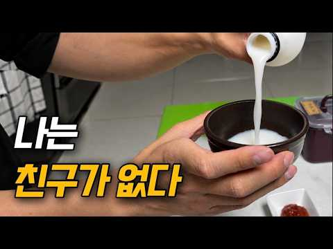
- 설명 앞부분: 서른 살 무렵부터 자연스럽게 멀어지는 사람들이 생겼고, 어느 순간부터는 제가 직접 관계를 정리하기 시작했습니다. 오래 알았다는 이유만으로 계속 만나야 하는 걸까요? 친구가 많다고 꼭 행복한 것도 아니고, 친구가 적다고 잘못 살고 있는 것도 아니겠죠. 나이가 들면서 달라진 인간관계, 여러분은 어떻게 생각하시나요? Created with Vrew
- 대본 없음 (설명) — 음성인식이 끝나면 도입부·흐름이 들어감
- 댓글 149/150: 좋은 점 — 영상 2 · 감사·응원 3 · 더 알고 싶은 것 2 · 아쉬운 점 — 영상 0 · 반박·불만 — 의견 다름 0 · 정치·사회 0 · 경험 공유 9 · 구독·다음 기대 1
  - 좋은 점 — 영상 👍1 “유익한 시간이었어요”
  - 좋은 점 — 영상 👍1 “저도 53인데 정리된다는 말을 이해 못했습니다.그러나 살다보니 다 부질없단 생각이 들었습니다.”
  - 감사·응원 👍10 “인천 토박이인데. 정말 만나는 사람만 만나게 되네요. 마흔이 넘다보니 미리 약속이 잡히는 것초차 피곤해질때가 많아요. 정말 아무일 없는 일상이 가장 좋은 나이대가 되는거 같습니다. 오늘 영상도 고맙습니다. 힘찬 한주보내셔요.”
  - 감사·응원 👍4 “자연스런 현상입니다. 63세 인데 40대까지는 모임도 많고 총무도 맡고 친구가 재산 같았죠. 세월이 흐르면서 자연스럽게 하나 둘 멀어지고 이제는 네명(ㅂㄹ친구)만 가끔 만납니다. 혼자가 편하고 행복힙니다. 물론 집사람하고 국내외 여행 다니는게 행복하고 혼자 차벅도 다…”
  - 더 알고 싶은 것 👍3 “우왕 저 회세트 어디서 사나요?”
  - 더 알고 싶은 것 👍1 “저도 이런 영상 찍어보고싶은데요 영상 촬영하실때 어떤 카메라로 촬영하시고 편집 프로그램은 어떤 걸로 사용 하셨나요? 따로 녹음하시는거죠?”
  - 경험 공유 👍4 “저희 할아버지께서 생전에 주말마다 어릴적 친구분들과 함께 점심 드시는게 인생의 큰 낙이었던걸 보면 사람마다 친구의 필요성이 다르겠죠”
  - 경험 공유 👍3 “저도 친구가 없어서 구독하고 갑니다”
  - 구독·다음 기대 👍3 “저도 친구가 없어서 구독하고 갑니다”

### 32. 사람들을 무시하는 것의 힘 ∣ 정신적 강인함과 자기 통제를 위한 스토아학파의 비결

- https://www.youtube.com/watch?v=gfvjmKh50r0 · 스토아의 시선 · 구독자 901 · 조회수 20,724 (×23.0, 하루 1,487.4) · 좋아요 190 (0.9%) · 46.3분 · 2026-10-28 · 주제 묶음 1. 심리학 일반 · 형식 정보·해설 (그 밖) · 폴더 `W_gfvjmKh50r0` (웹 승인)
- 썸네일: 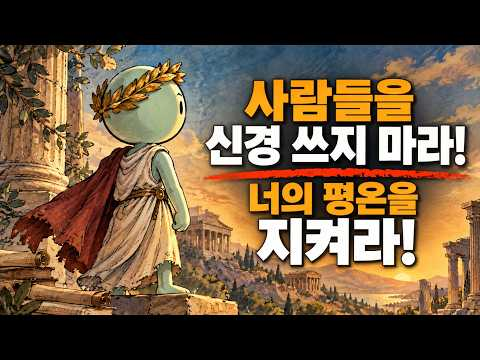
- 설명 앞부분: 타인을 무시하는 것의 힘 ∣ 정신적 강인함과 자기 통제를 위한 스토아 철학의 비밀 타인의 의견이나 모욕, 혹은 부정적인 태도 때문에 상처받고 있다면, 이 영상이 당신의 사고방식을 완전히 바꿔줄 것입니다. 스토아 철학을 다룬 이 강력한 가이드를 통해, 타인을 무시하는 것이 가진 진정한 힘을 배우고, 마르쿠스 아우렐리우스나 에픽테토스와 같은 고대 스토아 철학자들이 어떻게 감정을 완벽하게 통제했는지 알아보세요. 부정적인 것을 무시하는 것은 나약함이 아니라, 오히려 강인함입니다. 누군가를 무시하는 것이 강력한 이유 사람들을 무시하는 심리…
- 대본 없음 (설명) — 음성인식이 끝나면 도입부·흐름이 들어감
- 댓글 2/2: 좋은 점 — 영상 0 · 감사·응원 1 · 더 알고 싶은 것 0 · 아쉬운 점 — 영상 0 · 반박·불만 — 의견 다름 0 · 정치·사회 0 · 경험 공유 0 · 구독·다음 기대 0
  - 감사·응원 👍3 “침묵.... 무대응... 그리고 연습... 마침내 통제권까지 참쉽지않은방법입니다.. 감사합니다..”

### 33. 할부 절대 안 하는 사람들, 사실 이런 사람들입니다 (돈이 많아서가 아닙니다)

- https://www.youtube.com/watch?v=SNkw97CWG5I · 심리학한줌 · 구독자 14,700 · 조회수 1,663,203 (×113.1, 하루 24,144.7) · 좋아요 7,421 (0.4%) · 20.4분 · 2026-09-03 · 주제 묶음 1. 심리학 일반 · 형식 정보·해설 (그 밖) · 폴더 `W_SNkw97CWG5I` (웹 승인)
- 썸네일: 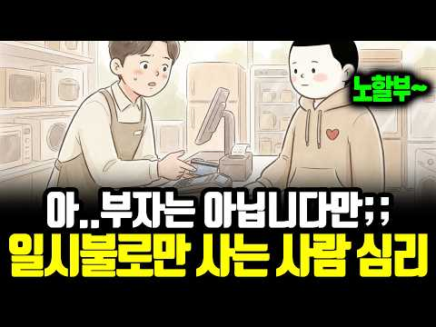
- 설명 앞부분: 할부 몇 개월로 해드릴까요? 어떤 사람들은 고민 없이 대답합니다. 일시불이요. 무이자라고 해도 똑같습니다. 돈이 많아서일까요? 이 영상에서는 할부를 절대 안 하는 사람들의 심리를 들여다봅니다. 모든 게 월 단위로 팔리는 시대에 이 사람들이 지키고 있는 것, 그리고 무이자 할부조차 거절하는 진짜 이유까지요.
- 대본 없음 (설명) — 음성인식이 끝나면 도입부·흐름이 들어감
- 댓글 3,265/3,263: 좋은 점 — 영상 38 · 감사·응원 25 · 더 알고 싶은 것 17 · 아쉬운 점 — 영상 15 · 반박·불만 — 의견 다름 60 · 정치·사회 5 · 경험 공유 591 · 구독·다음 기대 5
  - 좋은 점 — 영상 👍25 “이거 정말 좋은 영상이다. 할부? 소비조장이지. 아이들이 봐야한다”
  - 좋은 점 — 영상 👍10 “참 좋은 내용입니다^^”
  - 감사·응원 👍25 “집도 차도 모든것 일시불로 끝냈음 ㅡ 빚이란 생각때문에 절대 할부 않음 ㅡ 의외로 나와같은 분들 많네... 동지같은 느낌이랄까 ..모두들 성공한 삶입니다. 파이팅ㅇㅇㅇㅇㅇ!!!”
  - 감사·응원 👍12 “저 같은 사람이 주위에는 없는데, 넓게 보면 드문드문 있나 봅니다. 영상 보면서 깜짝 놀랐습니다. 좋은 동영상 감사합니다.^^”
  - 더 알고 싶은 것 👍1 “저는 집을 살때도 차를 살때도 현금이나 일시불로 삽니다. 돈이 많아서도 아닙니다. 저같은 사람은 어떤 사람인가요?”
  - 더 알고 싶은 것 👍0 “그럼 선생님들께서는 집은 대출 얼마까지 가능하세요? 저도 빚을 싫어하는 타입인데 집 구매하려니 대출을 얼마까지 해야하나 감이 안와서 같은 성향들인것 같아서 여쭤봅니다. 댓 부탁드려요”
  - 아쉬운 점 — 영상 👍7 “부자 되려면 일단 신용카드 없애세요 체크카드도 고민을 두번 째는 부부가 사랑하는 관계라야 부자로 가는 기본입니다 이 두가지를 실천하고 시간을 기다리셔요 그러면 노후 건강과 흔들리지 않는 부를 얻습니다. 지루한 실천을~~~”
  - 아쉬운 점 — 영상 👍2 “맞아요. 그래서 저는 신용카드 대신 체크카드만 씁니다. 자동차를 사도 구입전용적금통장을 만들어서 일시불로 구입하는 방식이죠. 왜 그러는지 특별한 느낌이 없었는데 이 채널을 보니 깨달음이 오네요. 저도 주택이외의 빚은 정말로 싫어합니다. 경제적인 지루함. 맘에 와 닿습…”
  - 반박·불만 — 의견 다름 👍29 “이런 분들이 차도 15~20년씩 탑니다. 그리고 남들보다 늦게 갖는게 아닙니다. 한 템포 늦춰 더 좋은 물건으로 가는 경우도 많습니다.”
  - 반박·불만 — 의견 다름 👍7 “문제의 핵심은 할부냐 일시불이냐가 아닙니다. 꼭 필요한 물건만 구입하느냐? 안사도 되는 물건까지 구입하느냐?하는 구매 습관입니다. 우리 사회에서 소비는 단순히 물건을 사는 행위를 넘어 그 사람의 사회적 지위까지 나타내는 일입니다. 일상적으로 필요한 물건을 구입하는 것…”
  - 정치·사회 👍0 “할부가 나쁘기만 할까? 예전 한 중국인은 넓고 쾌적한 아파트에 살기위해 허리띠를 졸라매고 죽어라 일만 했다. 드디어 60살이 넘?어서야 겨우 내집마련을? 하고 주름딘 얼굴에 웃음을 띄었다. 지구반대편 미국인, 넓고 쾌적한 아파트에?살고싶어 할부로 아파트를 구매했다. …”
  - 정치·사회 👍0 “아 각 정부는 나쁜 빚입니다. 감당할수없는 빚을 계속 돌려막기하는중.”
  - 경험 공유 👍383 “제가 사는 방식하고 똑같네요.. 재산이 많지는 않지만 마음은 여유가 있습니다 ㅎ”
  - 경험 공유 👍220 “내가 그런데 무조껀 일시불 빚지는걸 싫어해서 가지고싶은물건있으면 돈 모아서 사고”
  - 구독·다음 기대 👍2 “헐 대박! 제가 그래요 할부해본적 없고 무조건 일시불이고 그마저도 귀찮아서 신용카드 없이 체크카드만 쓴지 20년차에요 ㅎ 돈이 넘치게 많아서도 아닌 다음달에 나갈돈 계산하기 귀찮아서요 ㅋ 일시불이나 돈이 없으면 안사고 돈이 모이고나면 씁니다 ㅎ 차도 현금으로 사구요 …”
  - 구독·다음 기대 👍0 “완전정답 통찰력 ㄷㄷ 구독박고 갑니당”

### 34. 죽기 전 내 집을 정리해야 하는 진짜 이유 (니체의 비움 철학)ㅣ죽음의 문턱에서 바라본 내 집의 진짜 모습 (인생 성찰)

- https://www.youtube.com/watch?v=BQbfaiK9ENU · 마음계단 · 구독자 477 · 조회수 56,570 (×118.6, 하루 776.8) · 좋아요 456 (0.8%) · 18.4분 · 2026-08-30 · 주제 묶음 기타 · 형식 오디오북·책 요약 · 폴더 `W_BQbfaiK9ENU` (웹 승인)
- 썸네일: 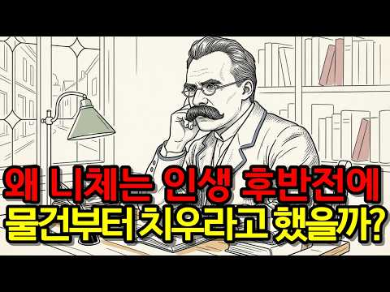
- 챕터: 0:00 프롤로그: 언젠가 남겨질 집을 바라보며 · 2:34 1장. 욕망을 줄인다는 것의 진짜 의미 · 4:59 2장. 남에게 보여주지 않는 삶의 평온함 · 7:12 3장. 닫힌 서랍과 마음의 공간 · 9:41 4장. 나이 들수록 놓기 힘든 이유 · 11:47 5장. 두려움 대신 선택하는 단순한 삶 · 14:50 6장. 짐이 아닌 사랑을 남기는 법 · 16:42 에필로그: 비울 때 비로소 남는 것들
- 설명 앞부분: "언젠가 쓰겠지" 하고 쌓아둔 집안의 물건들, 그 안에 켜켜이 쌓인 세월과 감정의 무게를 느껴보신 적 있나요? 내가 떠난 뒤 남겨질 짐들을 생각하며 시작된 비움의 여정. 철학자 니체의 지혜를 통해 물건뿐만 아니라 인간관계, 체면, 자식에 대한 기대까지 내려놓고 삶이 가벼워지는 진짜 자유를 만나보세요. 🌿 오늘, 서랍 하나를 열어 마음의 짐을 덜어내시길 바랍니다. ✨ ⏳ 타임코드 해시태그 & 키워드 [숏 키워드] [롱테일 키워드]
- 대본 없음 (설명) — 음성인식이 끝나면 도입부·흐름이 들어감
- 댓글 39/39: 좋은 점 — 영상 1 · 감사·응원 0 · 더 알고 싶은 것 0 · 아쉬운 점 — 영상 1 · 반박·불만 — 의견 다름 0 · 정치·사회 0 · 경험 공유 5 · 구독·다음 기대 0
  - 좋은 점 — 영상 👍3 “유익한 내용 잘 들었습니다!!!”
  - 아쉬운 점 — 영상 👍2 “저는 계속 버리고 우리집 아이들은 계속 가지고 들어오고.. 무한반복이에요 ㅋ”
  - 경험 공유 👍20 “서른 후반인데 저도 가볍게 살고 싶고.. 집도 깔끔하게 살고 싶다는 생각으로 이 영상을 봤어요!. 저희 집엔 자잘한 물건이 많아서 정리를 계속해야 하는데 그게 스트레스예요 하나하나 놓아봐야 겠어요 !.....”
  - 경험 공유 👍3 “이런 생각은 안해봤네요. 근데 내집은 내것이고 내집안에 내물건들을 가지고 있는데 누가 치울것을 생각해서 민망해서 계속 내집안을 정리해야한다.비우면서 지내야한다. 내집이 편안해질수 있을지..,. 가끔 그런생각은 들어요. 저는 제생각들을 사건들을 핸드폰노트에 적는 습관이…”

### 35. 남자가 절대로 떠나지 못하는 여자 특징 ∣ 20년 차 상담심리전문가가 말하는 관계의 비밀

- https://www.youtube.com/watch?v=0RcXdW8QbJk · 김은주 박사 심리 볕뉘 · 구독자 266 · 조회수 41,077 (×154.4, 하루 429.5) · 좋아요 370 (0.9%) · 7분 · 2026-08-07 · 주제 묶음 1. 심리학 일반 · 형식 인터뷰·강연·대담 (전문가) · 폴더 `W_0RcXdW8QbJk` (웹 승인)
- 썸네일: 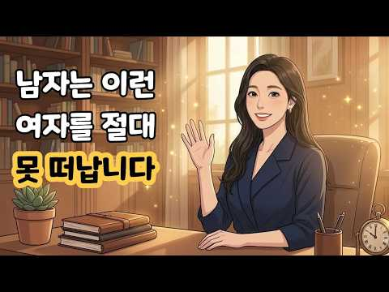
- 챕터: 0:00 오프닝: 남자가 질리지 않고 오래 사랑하는 진짜 이유 · 1:25 첫 번째: 내 마음의 '상처받은 아이'를 스스로 다독… · 3:40 두 번째: 잔소리 대신 어른의 목소리로 '투명하게 요… · 6:10 세 번째: 남자의 마음속 '천진난만한 아이'를 꺼내주… · 8:30 마무리: "나도 괜찮고, 너도 괜찮다" (I'm OK…
- 설명 앞부분: 처음에는 뜨겁게 반했다가도 시간이 지나면 차갑게 식어버리는 연애 때문에 고민이신가요? 안녕하세요, 상담심리전문가입니다. 상담실을 찾아오시는 많은 분들이 "어떻게 해야 남자가 나를 오랫동안 깊이 사랑해 줄까요?"라는 질문을 하십니다. 단순한 밀당이나 외모의 관리보다 훨씬 더 근본적인 비결은 바로 '교류분석(Transactional Analysis) 심리학'에서 말하는 마음의 역동에 있습니다. 남자가 한 여자에게 평생 곁에 머물고 싶다고 느끼는 진짜 이유는 무엇일까요? 이번 영상에서는 수많은 연인과 부부 상담 현장의 실제 사례를 바탕…
- 대본 없음 (설명) — 음성인식이 끝나면 도입부·흐름이 들어감
- 댓글 14/14: 좋은 점 — 영상 1 · 감사·응원 0 · 더 알고 싶은 것 0 · 아쉬운 점 — 영상 0 · 반박·불만 — 의견 다름 0 · 정치·사회 0 · 경험 공유 0 · 구독·다음 기대 0
  - 좋은 점 — 영상 👍1 “정말 잘들었어요.유익한얘기입니다”

### 36. 착하지만 무서울 정도로 생각 레벨 높은 사람들의 5가지 심리적 특징

- https://www.youtube.com/watch?v=CFUR6ySGi7A · 심리세포 · 구독자 13,400 · 조회수 551,089 (×41.1, 하루 21,216.8) · 좋아요 2,235 (0.4%) · 5.5분 · 2026-10-16 · 주제 묶음 1. 심리학 일반 · 형식 목록형 (N가지 특징·신호) · 폴더 `W_CFUR6ySGi7A` (웹 승인)
- 썸네일: 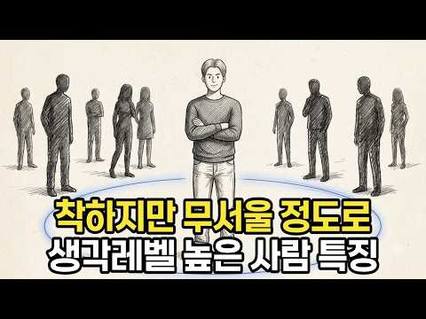
- 챕터: 0:00 오프닝 - 착한데 무서운 사람의 정체 · 0:29 1. 말하기 전에 먼저 멈춰서 깊이 살핀다 (감각처리… · 1:21 2. 다정함과 만만함의 차이를 분명히 안다 (기버 이… · 2:18 3. 신뢰가 깨지면 화내는 대신 조용히 거리를 둔다 … · 3:05 4. 감정에 휩쓸리는 순간에도 한 발 떨어져서 본다 … · 3:51 5. 깊이 생각하는 만큼 혼자 감당하는 무게도 크다 … · 4:47 클로징
- 설명 앞부분: 착하다는 말을 들으면서도 이상하게 아무도 함부로 대하지 못하는 사람이 있습니다. 늘 웃고 배려하는데, 어느 순간 "이 사람은 내가 모르는 것까지 다 알고 있는 게 아닐까" 하는 서늘함이 스쳐 가는 사람. 오늘 영상에서는 착하지만 무서울 정도로 생각 레벨이 높은 사람들이 왜 그렇게 보이는지, 그 이면에 숨겨진 심리적 이유 다섯 가지에 대해 살펴봅니다. ⏱ 타임라인 📚 참고 이론 및 연구 감각처리 민감성 (일레인 아론 & 아서 아론, 1997) 기버 이론 (애덤 그랜트, 『기브 앤 테이크』, 2013) 부정성 우위 (로이 바우마이스터…
- 대본 없음 (설명) — 음성인식이 끝나면 도입부·흐름이 들어감
- 댓글 184/184: 좋은 점 — 영상 2 · 감사·응원 4 · 더 알고 싶은 것 0 · 아쉬운 점 — 영상 0 · 반박·불만 — 의견 다름 5 · 정치·사회 0 · 경험 공유 16 · 구독·다음 기대 0
  - 좋은 점 — 영상 👍0 “아주 좋은 영상이다”
  - 감사·응원 👍8 “와 내 이야기네요.. 약간 소름돋았음요.. 댓글에 사람들아 우리 힘내자”
  - 감사·응원 👍1 “감사합니다”
  - 반박·불만 — 의견 다름 👍1 “어? 저네요? ㅋㅋ 근데 심리세포님의 영상은 마치 저를 모델로 만들어내는 것 같은 느낌의 이야기를 하네요 ㅋㅋ 모든지 다 맞다고 하는 사람은 아닌데 진짜 영상들의 95퍼이상은 다 맞아떨어짐 신기하게도 그런 사람이 많은가 봅니다 ㅋㅋ”
  - 반박·불만 — 의견 다름 👍0 “여기서 완전 내 이야기잖아 하신분들 99퍼는 아닙니다ㅋㅋㅋㅋ”
  - 경험 공유 👍137 “헉.. 접니다.. 객관적으로 날 돌아보고 내 말, 감정, 행동 반추해보고 수정하고, 타인에게는 기본적으로 양보하고 내가 할 수 있는 선에서 맞춰주되 설정한 선을 내가 경험상으로 정한 횟수 이상 넘어버면 조용히 거리두고 정리합니다..”
  - 경험 공유 👍101 “이 영상을 보시는 분들, 좀 더 내려놓고 자신을 그대로 받아들였으면 좋겠습니다. 사람마다 또 다르겠지만 많은 상황을 인지하는만큼 책임감이 강하다는 걸 알고 있어요. 또 내가 나쁜건 아닌지, 너무 계산적인건 아닌지 걱정하시는 분도 계시겠죠. 걱정하지 않아도 됩니다. 상…”

### 37. 나이 들수록 혼자가 편해지는 이유 ∣ 중년의 인간관계와 외로움 ∣ 감성 오디오북 ∣ 중년의 삶 ∣ 인생 이야기

- https://www.youtube.com/watch?v=IcgXhzDgIjg · 소리품은밤 | 감성 오디오북 · 구독자 730 · 조회수 69,684 (×95.5, 하루 1,124.6) · 좋아요 462 (0.7%) · 45.9분 · 2026-09-10 · 주제 묶음 2. 인간관계·대화 · 형식 수면·낭독 (잠잘 때 듣는) · 폴더 `W_IcgXhzDgIjg` (웹 승인)
- 썸네일: 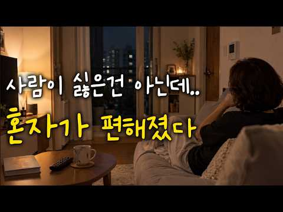
- 설명 앞부분: 나이가 들수록 사람을 만나는 시간보다 혼자 있는 시간이 편해질 때가 있습니다. 외로운 건 아닌데 문득 마음 한구석이 허전해지는 이유를 조용히 이야기합니다. 혼자가 편해진 중년의 마음과 달라진 인간관계를 담은 감성 오디오북입니다.
- 대본 없음 (설명) — 음성인식이 끝나면 도입부·흐름이 들어감
- 댓글 23/23: 좋은 점 — 영상 0 · 감사·응원 1 · 더 알고 싶은 것 0 · 아쉬운 점 — 영상 0 · 반박·불만 — 의견 다름 1 · 정치·사회 0 · 경험 공유 0 · 구독·다음 기대 0
  - 감사·응원 👍0 “잘듣고갑니다 감사합니다”
  - 반박·불만 — 의견 다름 👍10 “백프로 공감가는 말씀입니다 누구를 만날때는 마음의 부담과. 헤어지는 시간까지. 괜한 긴장감이 연속이고 집에오면. 마음과 몸이편하고 만사가 해방감이 들고 그렇다고 사람이 싫은건 아닌데. ❤❤❤”

### 38. [연휴 특선] 룸메 셋이 전부 나르시시스트인 하숙집 ∣ 나르시시즘 하우스 전편 정주행 [EP.1~6]

- https://www.youtube.com/watch?v=DcqJEjkRqDc · 나르시시즘 하우스 Narcissism House · 구독자 152 · 조회수 11,212 (×73.8, 하루 229.2) · 좋아요 18 (0.2%) · 60.2분 · 2026-09-23 · 주제 묶음 4. 나쁜 사람 알아보기 · 형식 사연·상황극 · 폴더 `W_DcqJEjkRqDc` (웹 승인)
- 썸네일: 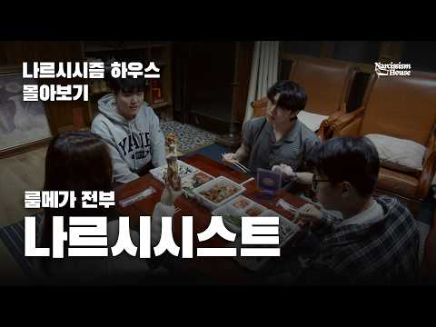
- 챕터: 0:00 1화 · 9:52 2화 · 17:43 3화 · 30:55 4화 · 42:37 5화 · 50:54 6화
- 설명 앞부분: 연출 ∣ 이예준 촬영감독 ∣ 민성욱 PD•개퍼 ∣ 허윤 장소협조 ∣ 오손도손스튜디오 본 콘텐츠의 BGM 중 일부는 생성형 인공지능 서비스(Suno AI)를 활용하여 제작되었습니다.
- 대본 없음 (설명) — 음성인식이 끝나면 도입부·흐름이 들어감
- 댓글 7/7: 좋은 점 — 영상 0 · 감사·응원 2 · 더 알고 싶은 것 1 · 아쉬운 점 — 영상 0 · 반박·불만 — 의견 다름 0 · 정치·사회 0 · 경험 공유 2 · 구독·다음 기대 0
  - 감사·응원 👍6 “안녕하세요! 나르시시즘 하우스의 연출을 맡은 (꼬마PD) 이예준입니다. 예능 종류만 하다가 처음으로 이런 스크립트 장르의 작업을 하게 되었는데, 너무 재밌고 뜻깊은 도전이었던 것 같습니다! 열심히 만들었으니 많은 관심과 시청 부탁드려요😂 행복한 추석 보내시길 바랍니다…”
  - 감사·응원 👍3 “16:42 저의 최애는 이곳 .. 순수하게 애드립이 생겨서 안 써도 찍어달라고 한건데 찍을때의 그 즐거움이 그대로 담긴 것 같어용 나르시시스트 하우스 지금까지 시청해주신 분들 감사합니다❤”
  - 더 알고 싶은 것 👍6 “안녕하세요! 나르시시즘 하우스의 연출을 맡은 (꼬마PD) 이예준입니다. 예능 종류만 하다가 처음으로 이런 스크립트 장르의 작업을 하게 되었는데, 너무 재밌고 뜻깊은 도전이었던 것 같습니다! 열심히 만들었으니 많은 관심과 시청 부탁드려요😂 행복한 추석 보내시길 바랍니다…”
  - 경험 공유 👍6 “안녕하세요! 나르시시즘 하우스의 연출을 맡은 (꼬마PD) 이예준입니다. 예능 종류만 하다가 처음으로 이런 스크립트 장르의 작업을 하게 되었는데, 너무 재밌고 뜻깊은 도전이었던 것 같습니다! 열심히 만들었으니 많은 관심과 시청 부탁드려요😂 행복한 추석 보내시길 바랍니다…”
  - 경험 공유 👍2 “안녕하세요! 선우 역을 맡은 배우 최현호입니다! 좋고 훌륭한 분들과 함께 할 수 있어서 너무 행복했습니다🥹 23:37 이 부분은 현장에서도 너무 웃으면서 찍었던 기억이 있는데 그 분위기가 잘 담긴 것 같아서 너무 좋았습니다! 29:17 저도 보면서 너무 웃었던 부분 …”

### 39. 과부의 외로움이 만든 금기, 아들 친구와의 치명적 관계

- https://www.youtube.com/watch?v=XIy6ePtbU6A · Thoughts · 구독자 680 · 조회수 52,577 (×77.3, 하루 976.4) · 좋아요 147 (0.3%) · 41.4분 · 2026-09-18 · 주제 묶음 2. 인간관계·대화 · 형식 사연·상황극 · 폴더 `W_XIy6ePtbU6A` (웹 승인)
- 썸네일: 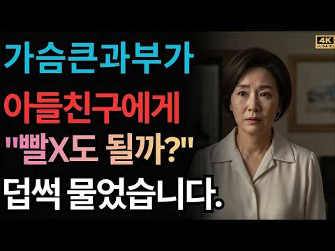
- 대본 없음 (없음) — 음성인식이 끝나면 도입부·흐름이 들어감
- 댓글 3/3: 좋은 점 — 영상 0 · 감사·응원 0 · 더 알고 싶은 것 0 · 아쉬운 점 — 영상 0 · 반박·불만 — 의견 다름 1 · 정치·사회 0 · 경험 공유 0 · 구독·다음 기대 0
  - 반박·불만 — 의견 다름 👍2 “뭔 말도안되는 소리 횡설수설 하는거여 ㅋㅋ 😂😂😂”

### 40. 요양보호사가 전하는 노년의 외로움과 가족 관계 이야기｜12년 현장의 경험

- https://www.youtube.com/watch?v=BdZegIY9E2o · 백세의 비밀 · 구독자 3,620 · 조회수 207,203 (×57.2, 하루 5,186.1) · 좋아요 2,939 (1.4%) · 49분 · 2026-10-02 · 주제 묶음 2. 인간관계·대화 · 형식 오디오북·책 요약 · 폴더 `W_BdZegIY9E2o` (웹 승인)
- 썸네일: 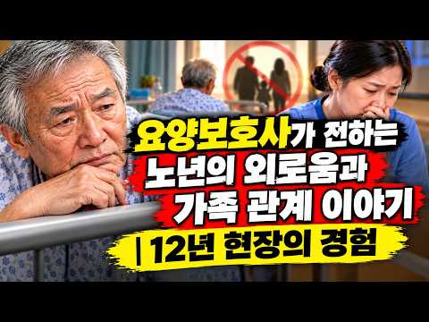
- 설명 앞부분: 왜 어떤 노인은 늘 가족의 발길이 이어지고, 어떤 노인은 오랫동안 홀로 병상을 지킬까요? 12년간 수많은 노인의 마지막 시간을 함께한 요양보호사는 놀라운 공통점을 발견했습니다. 그 진실은 돈도, 성공도 아닌 우리의 삶과 인간관계를 다시 돌아보게 합니다. 이번 영상에서는 요양보호사가 직접 병상에서 목격한 실제 이야기와 함께, 자녀와 부모의 관계가 시간이 흐르며 어떻게 달라지는지 깊이 살펴봅니다. 노후를 후회 없이 살아가기 위해 지금 우리가 무엇을 준비해야 하는지 함께 생각해 보세요. 🤍 *"사랑은 받은 만큼 기억되지 않습니다. 함께…
- 대본 없음 (설명) — 음성인식이 끝나면 도입부·흐름이 들어감
- 댓글 114/114: 좋은 점 — 영상 11 · 감사·응원 29 · 더 알고 싶은 것 0 · 아쉬운 점 — 영상 2 · 반박·불만 — 의견 다름 0 · 정치·사회 1 · 경험 공유 13 · 구독·다음 기대 0
  - 좋은 점 — 영상 👍58 “핵심은 우리도 받아보지 못한일이라! 공감100% 꼭 나를두고 하시는 말씀 감사합니다 저도 바꿔보려구요 용돈 잘 받고 잘쓰고있다구요^^”
  - 좋은 점 — 영상 👍22 “공감합니다 부모로서 자식한테 마음아프게하고 민폐를 끼칠까봐 아무리형편이 어려워도, 아무리 아파도그저 자식만 건강하고 잘지내 면된다싶어 ,괜찮다라고 얘기할수밖에 없는게 부모마음이라오 ! 듣고보니깐 ,괜찮다라는 말을 이제 자제해야 되겠다는 생각이드네 ᆢㅎㅎ”
  - 감사·응원 👍58 “핵심은 우리도 받아보지 못한일이라! 공감100% 꼭 나를두고 하시는 말씀 감사합니다 저도 바꿔보려구요 용돈 잘 받고 잘쓰고있다구요^^”
  - 감사·응원 👍27 “제가 매일하는말 괜찮다! 입니다 그래놓고 뒤에서는서운하다 고했지요 이제부터 그랬구나! 고맙다! 로 바꾸려고 연습해 바야겠네요”
  - 아쉬운 점 — 영상 👍19 “Ai로 타이핑을 하시나 적혀있는 자막이 집중에 방해되네요.”
  - 아쉬운 점 — 영상 👍0 “영상의 주인공은 여잔데 음성은 남잔가 ㅠㅠ AI스토리 짜집기 관심없음ㅡ으로”
  - 정치·사회 👍1 “근대 중국인 목소리네요”
  - 경험 공유 👍58 “핵심은 우리도 받아보지 못한일이라! 공감100% 꼭 나를두고 하시는 말씀 감사합니다 저도 바꿔보려구요 용돈 잘 받고 잘쓰고있다구요^^”
  - 경험 공유 👍27 “제가 매일하는말 괜찮다! 입니다 그래놓고 뒤에서는서운하다 고했지요 이제부터 그랬구나! 고맙다! 로 바꾸려고 연습해 바야겠네요”

