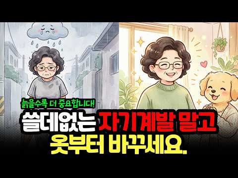
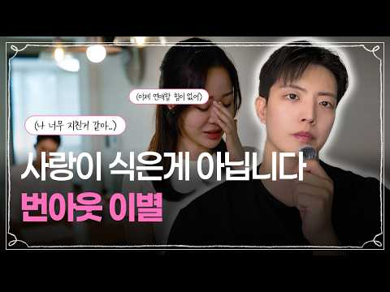
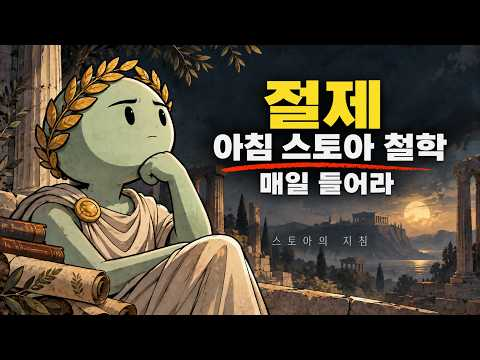
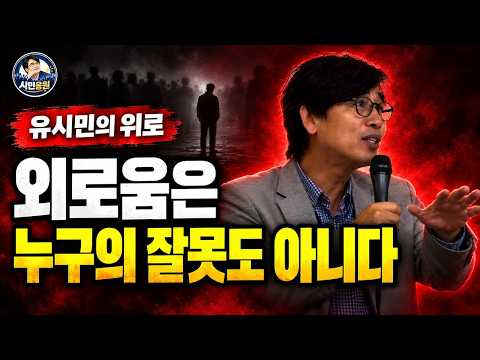
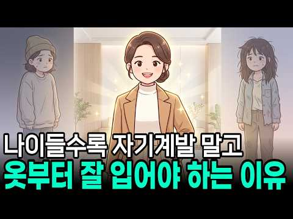
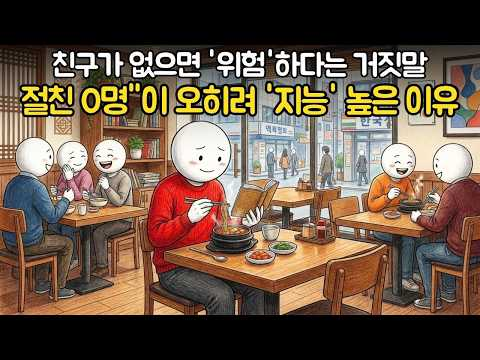

# 심리 — 성공 사례 분석: 사례별 자세히 #41–#80

`analysis.md` 의 9번 (같은 # 번호). 자동 생성 — `tools/success_analysis.py` v1.6 (2026-11-11 13:47 UTC). ※ 연구·교육용 — 투자 권유가 아님.

### 41. 결혼 안 하고 혼자 사는 남자들의 진짜 심리 (외롭지 않아요)

- https://www.youtube.com/watch?v=yetWf56cVOM · 본능의심리학 · 구독자 6,640 · 조회수 539,725 (×81.3, 하루 9,333.3) · 좋아요 3,593 (0.7%) · 13.7분 · 2026-09-14 · 주제 묶음 1. 심리학 일반 · 형식 정보·해설 (그 밖) · 폴더 `W_yetWf56cVOM` (웹 승인)
- 썸네일: 
- 대본 없음 (없음) — 음성인식이 끝나면 도입부·흐름이 들어감
- 댓글 1,577/1,577: 좋은 점 — 영상 19 · 감사·응원 18 · 더 알고 싶은 것 12 · 아쉬운 점 — 영상 18 · 반박·불만 — 의견 다름 30 · 정치·사회 8 · 경험 공유 204 · 구독·다음 기대 2
  - 좋은 점 — 영상 👍27 “아침에 그 누구의 간섭도 없이 달달한 모닝 커피 한잔 마실때가 참 행복합니다~~^^ 영상 감사히 잘 보았고 많은 내용에 공감 또 공감합니다 ㅎㅎ”
  - 좋은 점 — 영상 👍1 “40초반인데 외로움 전혀 없습니다. 영상내용처럼 친한친구도 있고 부모님도 있다는 생각에 안정감도 가지고 퇴근후 뭐든 조금 하면 잘시간이라 시간도 없습니다. 좋은내용이라 구독 누르고 갑니다”
  - 감사·응원 👍27 “아침에 그 누구의 간섭도 없이 달달한 모닝 커피 한잔 마실때가 참 행복합니다~~^^ 영상 감사히 잘 보았고 많은 내용에 공감 또 공감합니다 ㅎㅎ”
  - 감사·응원 👍21 “40세 은퇴가 꿈이였음. 배당주 세팅 후 현실이 됨. 자유롭고 자주적으로 모든걸 스스로 컨트롤 할 수 있음에 감사하다 ❤”
  - 더 알고 싶은 것 👍0 “젊을때야 좋지 나이들어서도 같은 마음일지는 궁금하네요.여기 60.70대 미혼인 어르신들이 만족을 한다고 하셔야 좋은건데 아직 들어본작이 없어서.”
  - 더 알고 싶은 것 👍0 “혼자가 좋은데 자식이 궁금하긴해. 물론 애 키우는 과정과 환경조성이 험난한것을 알기에 그 전과정을 경험할순 없을것 같고 단지 내 자식이 어떤 외모와 목소리를 가졌을지 궁금하다는거.”
  - 아쉬운 점 — 영상 👍1 “솔직히 혼자 있는 생활이 너무 편하긴해~ 내가 하고 싶은대로 하고 사는거에 너무 길들여짐... 자고 싶을때 자고 일어나고 싶을때 일어나고 늦게 들어와도 되고 안들어와도 되고 새벽에 불쑥 나가도 되고 우리 어머니도 그러시더라 요즘 같이 좋은 세상에 결혼 안해도 돈만 있…”
  - 아쉬운 점 — 영상 👍1 “그냥 이젠 생각도.. 좀 더 지루하지 않을뿐?”
  - 반박·불만 — 의견 다름 👍24 “결코 혼자가 아닙니다. 우리에게는 독수리 오형제가 항상 함께 합니다.”
  - 반박·불만 — 의견 다름 👍23 “저도 혼자 사는 남성입니다. 원래 술담배커피탄산라면 을 안 해서 그런지 유흥에도 전혀 관심이 없고, 연애도 관심이 없었습니다. 그렇다고 해서 게이나 그런 취향도 아닙니다. 군복무 할때도 2년동안 월급 한푼도 안 쓰고 모아서 제대할 정도니 특별히 욕구불만 스트레스도 없…”
  - 정치·사회 👍1 “와 진짜 연휴에 갑자기 치킨먹고 싶어서 황올 닭다리만 있는걸로 시켜서 먹고 편하게 있다가 밀린 설거지 하면서 들었는데.. 너무 공감됩니다. 30대 후반에 들어가고 있는데, 솔직히 경제적으로 불편함 하나도 없으면서 (오히려 풍요롭고), 집도 작은 빌라지만 있고, 운동하…”
  - 정치·사회 👍1 “사회적 문제에서 비롯된것이 남성들을 깨운것입니다. 남성이 혼자가 편하다는걸 느끼기 시작한건 아이러니 하게도 남성을 탓하며 몰아붙이고 고립시켰던 페미들과 와 그걸 선동하고 지지했던 정부 영향이 제일 큽니다 남자들이 여자없이도 살수 있구나 여자가 없으니 더 편하구나 라는…”
  - 경험 공유 👍256 “결혼도해봤고, 이혼도해봤지만 삶의 만족도는 싱글이 압도적으로 높습니다. 내나이 50대중반.”
  - 경험 공유 👍165 “또래들이 결혼을 할 시즌에 너도나도 할 것 없이 갈 무렵 자칫 나도 휩쓸려 크게 마음에도 없는 여성과 갈 뻔했는데 지금 생각하면 아찔합니다.”
  - 구독·다음 기대 👍1 “50대중반 기혼남자입니다 혼자가 좋를때도있고 둘이있어 좋을때도 있습니다 결혼후 후회할때도있고 혼자있고싶를때도 있습니다 결혼의 정답은 없는것같습니다 솔로남녀 돌싱여러분 결혼은 필수가라ㅣ아닌 선택인것같아요 좋은인연만나세요 재미있게 시청하고갑니다 구독하고갑니다”
  - 구독·다음 기대 👍0 “40대 중반 미혼남입니다. 기혼자들을 약 올리고 싶은 게 아니라 진짜 행복합니다. 삼성 이재용 회장 보다 제가 더 행복하다고 생각합니다. 정신승리가 아니라 진짜 행복합니다. 매주 주말이 기다려집니다. 버킷리스트 채우느라 너무 즐겁습니다. 100대 명산 뿌수기, 유투브…”

### 42. 만나기만 하면 얻어먹는 사람, 계속 만나도 될까요? ∣ 이런 관계는 정리하세요ㅣ인생조언ㅣ노후준비ㅣ삶의지혜ㅣ시니어ㅣ오디오북ㅣ

- https://www.youtube.com/watch?v=E1BISMVYakc · 마음 안부 · 구독자 4,810 · 조회수 255,662 (×53.1, 하루 6,226.9) · 좋아요 773 (0.3%) · 33.3분 · 2026-10-01 · 주제 묶음 2. 인간관계·대화 · 형식 오디오북·책 요약 · 폴더 `W_E1BISMVYakc` (웹 승인)
- 썸네일: 
- 설명 앞부분: 만나기만 하면 밥값 계산할 때 슬쩍 빠지는 사람, 계속 만나야 할까요? 돈 몇 만 원의 문제가 아니라, 내 호의를 당연하게 여기고 고마움을 잊어버린 사람들의 관계 신호를 살펴봅니다. 나이 들수록 마음 지치지 않고 지혜롭게 인간관계 거리를 두는 기준을 확인해보세요. 💡 오늘의 이야기 핵심 한두 번 얻어먹는 것과 매번 당연하게 생각하는 것의 차이 내가 아무것도 해주지 않을 때 비로소 보이는 그 사람의 진짜 본모습 형편이 어려운 것과 마음이 가벼운 사람을 구분하는 법 상처받지 않고 자연스럽게 내 삶의 선을 긋는 법 💬여러분 곁에도 만날…
- 대본 없음 (설명) — 음성인식이 끝나면 도입부·흐름이 들어감
- 댓글 196/196: 좋은 점 — 영상 2 · 감사·응원 4 · 더 알고 싶은 것 2 · 아쉬운 점 — 영상 0 · 반박·불만 — 의견 다름 2 · 정치·사회 0 · 경험 공유 32 · 구독·다음 기대 0
  - 좋은 점 — 영상 👍1 “친구을만나서좋은정보받고.대화하다보면 친구가안좋은일있었다면.위로차원에서.너속시끄러웠겠네?슬쩍일어나.먼저가서계산한다.친구많이필요없다.2명이면족하더라.나이들면쓸대없이바쁘다.복지관가야지.자식집돌봐야지 친구만날시간많지않다.서로가.ㅡ 70먹은할매인데.유머있고남말안하고.벼처럼익은…”
  - 감사·응원 👍4 “배고프지 않냐며 상대방이 결국 밥을 사게끔 유도하고 사줘도 당연시 여기며 고맙다는 한마디 말도 없는 인간이 있었어요. 거기다 내가 사는 국물있는 요리에 먹던 젖가락을 넣고 잠깐 다른거하는데 온 정이 뚝떨. 그 요리에 손도 못댔네요ㅠ”
  - 감사·응원 👍1 “정년 퇴사한 분이 있는데 근무할 때도 워낙 얌체처럼 힘든 일은 안해서 팀장한테 찍히고 동료들한테도 따돌림 받아서 결국 3층에서 쫓겨나서 1층으로 내려간 사람이긴 했는데... 나랑은 그냥 그럭저럭 지냈음. 퇴직 후 밥 한 번 먹자고 해서 만났는데ㅋㅋ 아예 돈 낼 생각을…”
  - 더 알고 싶은 것 👍12 “저도 비슷한 경험을 한 적이 있는데 매번 메뉴 선택도 가장 비싼 것을 고르고 결제는 늘~~~~~안 하죠. 정말 그 속내가 궁금해요. 돈이 없으면 모임이나 만남을 자제해야 하는 거 아닌가요?”
  - 더 알고 싶은 것 👍1 “저도 정말 궁금합니다. 왜 매번 얻어먹는지 ..”
  - 반박·불만 — 의견 다름 👍104 “저도 이런 친구가 있어요. 밥값 낼땐 늘 뒤로 물러서있고 커피값은 그나마 친구가 내긴 하는데 항상 밥값이 커피의 두배 이상이라는 거죠. 형편이 어려운것도 아닌데 마치 남녀가 데이트할 때 밥은 남자, 커피는 여자가. 같은 느낌인거죠. 우린 둘다 여자입니다. 결국 제 마…”
  - 반박·불만 — 의견 다름 👍22 “두번얻어먹으면 한번정도는사야지 형편이어려운사람한테사는것은 밥값이아깝지는아닌데 형편도괸찮은데 얻어만먹는사람은 손절하고싶더라고요 내가 호구가되는기분이들고 만날때마다 기분이별로안좋고 얄밉더라고요 세번삿는데 한번도안사는사람은 손절함”
  - 경험 공유 👍104 “저도 이런 친구가 있어요. 밥값 낼땐 늘 뒤로 물러서있고 커피값은 그나마 친구가 내긴 하는데 항상 밥값이 커피의 두배 이상이라는 거죠. 형편이 어려운것도 아닌데 마치 남녀가 데이트할 때 밥은 남자, 커피는 여자가. 같은 느낌인거죠. 우린 둘다 여자입니다. 결국 제 마…”
  - 경험 공유 👍48 “33년을 이런 사람 있었지. 못살지도 않아. 결국 부모님 돌아가실 때 조의금도 안 내더라... 내가 연락 안 하니까, 연락 안 와...”

### 43. 아기들이 유독 쳐다보는 사람의 정체｜발달심리학이 밝힌 '아기를 끌어당기는 사람'의 공통점

- https://www.youtube.com/watch?v=twn0MZBC1eg · 심리 톡톡 · 구독자 27,500 · 조회수 945,516 (×34.4, 하루 34,945.6) · 좋아요 3,274 (0.4%) · 14.1분 · 2026-10-15 · 주제 묶음 1. 심리학 일반 · 형식 목록형 (N가지 특징·신호) · 폴더 `W_twn0MZBC1eg` (웹 승인)
- 썸네일: 
- 챕터: 0:00 들어가며 · 0:57 ①번 특징 · 3:32 ②번 특징 · 6:18 ③번 특징 · 8:49 ④번 특징 · 11:00 ⑤번 특징 · 13:23 정리
- 설명 앞부분: 어디를 가든 아기와 눈이 잘 마주치는 편인 사람이 있습니다. 혹시 당신이 그런 편이라면, 이런 장면이 익숙하실 겁니다. 병원 대기실에서도, 동네 마트 계산 줄에서도, 장소는 매번 다른데 아기는 꼭 당신을 찾아냅니다. 처음에는 우연이겠거니 했는데, 같은 일이 몇 번 반복되면 슬슬 궁금해집니다. 아기들 눈에는 내 얼굴이 어떻게 보이길래. 아기에게는 거짓말이라는 게 없습니다. 예의상 쳐다봐 주는 법도, 좋은 척하는 법도 모릅니다. 아기의 눈은 본능이 이끄는 대로만 움직입니다. 그래서 아기의 시선이 어딘가에 머문다면, 그건 우연도 가식도…
- 대본 없음 (설명) — 음성인식이 끝나면 도입부·흐름이 들어감
- 댓글 472/470: 좋은 점 — 영상 3 · 감사·응원 8 · 더 알고 싶은 것 2 · 아쉬운 점 — 영상 0 · 반박·불만 — 의견 다름 7 · 정치·사회 4 · 경험 공유 67 · 구독·다음 기대 0
  - 좋은 점 — 영상 👍54 “항상 왜그럴까 신기했는데 세상 첨보는 아이들이 저보면 인사를 해요 심지어 마스크 쓰고 지나가도 아는체를 해요 '안녕하세요~'라고 해요 응 안녕~하고 받아주긴 하는데 쟤가 날 아나? 어디서 봤나? 한번은 엄마랑 아이가 마주오는데 좁은길이라 피한다고 옆기둥 뒤로 피했는데…”
  - 좋은 점 — 영상 👍0 “제목에 놀랐어요 궁금하던 게 떠서 이제 궁금증이 풀렸😊 어느 정도는 그럴 거라 예상은 했어요 좋은 영상 감사합니다❤”
  - 감사·응원 👍361 “안녕하세요 민머리입니다 어딜가나 아이가 쳐다봅니다 감사합니다”
  - 감사·응원 👍2 “좋게 평가해줘서 감사합니다. 나는 그동안 아기들이 나 쳐다봐서 지긋지긋했는데, 조금은 위로가 되네요....”
  - 더 알고 싶은 것 👍0 “유독 개가 짖는 사람의 정체도 알려주세요”
  - 반박·불만 — 의견 다름 👍32 “글쎄, 아기들이 잘쳐다본다. 개나 고양이도 잘 따른다. 모두가 본능적인 끌림을 아는것 같다.”
  - 반박·불만 — 의견 다름 👍1 “저는 잘생기거나 좋은 인상이 아닌데 아기들 같은 공간에 있으면 뚫어지게 쳐다보는 경우가 많음.”
  - 정치·사회 👍55 “아기가 싫어하는 얼굴은 이재명같은 얼굴이란거네”
  - 정치·사회 👍3 “당신 머리속엔 이재명대통령님만 담겨있나? 기가막히고 신기하네 돌았나?”
  - 경험 공유 👍236 “내가 아기들을 많이 좋아해서 그마음이 전달되었나 했네요”
  - 경험 공유 👍54 “항상 왜그럴까 신기했는데 세상 첨보는 아이들이 저보면 인사를 해요 심지어 마스크 쓰고 지나가도 아는체를 해요 '안녕하세요~'라고 해요 응 안녕~하고 받아주긴 하는데 쟤가 날 아나? 어디서 봤나? 한번은 엄마랑 아이가 마주오는데 좁은길이라 피한다고 옆기둥 뒤로 피했는데…”

### 44. 혼자 밥 먹고 혼자 여행하는 사람이 오히려 강한 이유 ∣ 심리학 ∣ 혼밥 ∣ 인간관계 ∣

- https://www.youtube.com/watch?v=HycNvXj_axk · 브라보 인생후반전 · 구독자 8,530 · 조회수 490,898 (×57.5, 하루 10,137.9) · 좋아요 2,362 (0.5%) · 25.1분 · 2026-09-23 · 주제 묶음 2. 인간관계·대화 · 형식 목록형 (N가지 특징·신호) · 폴더 `W_HycNvXj_axk` (웹 승인)
- 썸네일: 
- 챕터: 0:00 혼자인 사람이 더 강합니다 · 1:38 우리는 혼자인 것을 이상하게 배웠습니다 · 4:50 기다리기만 하면 내 삶이 지나간다는 것 · 7:14 처음으로 혼자 해봅니다 · 9:53 혼자 있는 동안 자기 자신을 만나기 시작합니다 · 12:26 그리고 뜻밖의 사실을 발견합니다 · 14:41 혼자일 수 있는 힘에는 대가도 있습니다 · 17:09 다시 사람들 속으로 돌아왔을 때 · 19:27 진짜 강함은 혼자서도 괜찮은 것 · 22:29 혼자여도 괜찮은 사람
- 설명 앞부분: 혼자 밥을 먹고, 혼자 여행을 떠나는 사람을 보면 어떤 생각이 드시나요? 외로운 사람일 거라고 생각하셨다면, 오늘 영상을 끝까지 봐주세요. 혼자를 두려워하지 않는 사람은 생각보다 훨씬 단단한 사람입니다. 스포트라이트 효과, 자기결정성 이론, 자기효능감, 애착 이론까지 심리학이 말하는 '혼자여도 괜찮은 사람'의 진짜 모습을 함께 들여다봅니다. 여러분의 혼자 경험도 댓글로 들려주세요 🙂 ⏱️ 타임라인 ⚠️ 면책조항 본 영상은 심리학 이론을 대중적으로 쉽게 풀어 설명한 콘텐츠로, 전문적인 심리 상담이나 진단을 대체하지 않습니다. 관계나…
- 대본 없음 (설명) — 음성인식이 끝나면 도입부·흐름이 들어감
- 댓글 397/395: 좋은 점 — 영상 5 · 감사·응원 10 · 더 알고 싶은 것 0 · 아쉬운 점 — 영상 4 · 반박·불만 — 의견 다름 2 · 정치·사회 1 · 경험 공유 20 · 구독·다음 기대 1
  - 좋은 점 — 영상 👍2 “벌써부터...실천하고 행복느끼고있답니다 댓글참여하신분들내용 공감합니다 즐건인생 멋진인생들살아갑시다”
  - 좋은 점 — 영상 👍2 “공감합니다”
  - 감사·응원 👍7 “영상 보고 용기내어 한 번 도전 해 볼께요~ 감사드립니다~ 좋아요 구독 누르고 갑니다~😊”
  - 감사·응원 👍5 “혼자 산책할때. 가장 행복합니다ㅡ감사합니다ㅡ지난 날 몰랐던 감정입니다”
  - 아쉬운 점 — 영상 👍2 “자주하다보면 지루.지겨움 심심함도 봅니다 혼자놀이도 여유로움과 금전도 따라가네요”
  - 아쉬운 점 — 영상 👍1 “여자이고 왜소해서 혼자 잘 안다니는 집순이였는데 낚시여행 좋아하는 남편때문에 낚시 보고 기다리기 지루해 언젠가부터 차나 스쿠터타고 혼자 그 관광지 쇼핑 박물관 영화관 식당 다니기 시작함 약간 믿는구석?이 누가 친구없냐 외롭지않냐 물어보면 남편이 근처에서 낚시한다고 하…”
  - 반박·불만 — 의견 다름 👍1 “처음엔 혼자가 어색했는데 결혼하면 와이프가 잘챙겨주겠거니했지... 근데 아니더라고 점점더 밥을 얻어먹기는커녕 같이외식하는것도 어려움 혼자 먹다보니 이제는 네x버지도 계정에 분류별로 맛집 리스트 만들어놓고 도장깨듯 가서 스스로 맛평가하고 맛집 리스트만듬 단, 혼밥먹을수…”
  - 정치·사회 👍1 “잘은 모르겠지만 우리나라사람처럼 남한테 영향을 받는 나라가 있을지요. 끊임없이 타인과 비교하고 어쩌면 유행에 그토록민감한것도. 그유행의 가치를 알고 따라하는이는 몇이나 될지. 자기스스로 빛나면 되는것을.”
  - 경험 공유 👍35 “혼자있는게 편한건 사실 😊 먹고 자도 아무할 사람 없고 내가 🚪 열고 💩 싸도 볼 인간 없다는게 자유다. 누구랑 있어야 행복한건 절대 아니다”
  - 경험 공유 👍22 “내가 먹고 싶은거 마음대로 먹을수 있어 좋아요”
  - 구독·다음 기대 👍3 “좋아요와 하이프를 요청하는 태도가 동의를 구하시네요 느낌이 좋아 구독하고 갑니다 ❤”

### 45. 나이들수록 쓸데없는 자기계발 말고 옷부터 잘 입으세요, 이걸 모르면 평생 무시당합니다 ∣ 중년 ∣ 노년심리 ∣ 인간관계

- https://www.youtube.com/watch?v=SywUlmRKlhg · 이유가 있는 사람들 · 구독자 104 · 조회수 13,802 (×132.7, 하루 123.4) · 좋아요 0 (0.0%) · 11.3분 · 2026-07-22 · 주제 묶음 2. 인간관계·대화 · 형식 정보·해설 (그 밖) · 폴더 `W_SywUlmRKlhg` (웹 승인)
- 썸네일: 
- 설명 앞부분: 👕 나이가 들수록 사람들은 옷을 보는 것이 아니라, 나를 어떻게 대하는 사람인지를 먼저 읽습니다. 오늘 영상에서는 왜 자기계발보다 먼저 옷장을 돌아봐야 하는지, 심리학과 실제 사례를 통해 함께 이야기해 봅니다. 오늘 밤, 옷장 속 ‘일을 다 마친 옷’ 한 벌을 은퇴시켜 보세요. 생각보다 큰 변화가 시작될지도 모릅니다. 💬 여러분은 내일 가장 먼저 은퇴시키고 싶은 옷이 있으신가요? 댓글로 함께 이야기 나눠주세요.
- 대본 없음 (설명) — 음성인식이 끝나면 도입부·흐름이 들어감
- 댓글 9/9: 좋은 점 — 영상 0 · 감사·응원 0 · 더 알고 싶은 것 0 · 아쉬운 점 — 영상 0 · 반박·불만 — 의견 다름 0 · 정치·사회 0 · 경험 공유 1 · 구독·다음 기대 0
  - 경험 공유 👍0 “단정하게 자기에게 맞는 옷 입으신 분보면 대략적인 성격이나 인성이 보이더라구요. 저도 평상시에는 일때문에 편하게 입다가 날 챙기고 싶은 날에는 단정하고 좋은 옷 꺼내 입습니다. 그럼 그날 하루가 좋은 기분으로 시작되어서 좋아요”

### 46. "애쓰지 않아도 인생이 술술~ 풀려요." 몰입 창조 루프 / 인생책

- https://www.youtube.com/watch?v=5SOqevvDKic · 달콤하게성장 · 구독자 10,900 · 조회수 433,255 (×39.8, 하루 12,571.3) · 좋아요 2,537 (0.6%) · 16.8분 · 2026-10-07 · 주제 묶음 3. 자존감·마음 · 형식 정보·해설 (그 밖) · 폴더 `W_5SOqevvDKic` (웹 승인)
- 썸네일: 
- 챕터: 0:00 저를 극적으로 변화시킨 책들의 공통점 · 0:43 제 인생이 극적으로 변한 이야기 · 2:00 가장 힘들었던 시기에 경험한 ‘몰입’ · 3:03 몰입이 빠른 성장과 행복을 만드는 이유 · 3:49 “더 열심히”가 아니라 “어떻게 즐기며 성장할까?” · 5:17 인생을 바꾼 책들이 하나의 ‘성장 루프’로 연결되다 · 6:12 ① 몰입 — 황농문 『몰입』 & 미하이 칙센트미하이 … · 7:12 ② 원씽 — 게리 켈러 『원씽(The ONE Thin… · 8:16 ③ 레버리지 — 롭 무어 『레버리지』 · 10:00 ④ 실행 — 그랜트 카돈 『10배의 법칙』 · 11:06 ⑤ 아웃풋 — 램군 『아웃풋 법칙』 · 12:32 다섯 가지 원리가 하나의 성장 루프로 작동하는 방법 · 13:29 이 책들을 함께 읽어야 하는 이유 · 14:04 의지가 아니라 ‘시스템과 환경’이 중요한 이유 · 14:18 저를 변화시킨 독서·글쓰기·운동·꾸준함 · 14:54 독서와 글쓰기를 습관으로 만드는 ‘데일리 아이덴티티’ · 16:00 AI 시대, 독서와 글쓰기가 생존인 이유
- 설명 앞부분: 인생책을 만나면 삶의 방향이 달라질 수 있습니다. 이 영상은 제가 직접 경험한 몰입과 창조의 힘, 그리고 삶을 바꿔준 5권의 인생책에 관한 이야기입니다. 암 투병 중 글쓰기에 몰입하면서 저는 상황이 힘들어도 행복할 수 있다는 것을 처음 경험했습니다. 그 경험은 더 열심히 자신을 밀어붙이는 자기계발이 아니라, 나를 자연스럽게 끌어당기는 것을 찾는 새로운 자기계발의 출발점이 되었습니다. 『몰입』과 『몰입의 즐거움』을 통해 행복과 성장을 동시에 만드는 몰입의 원리를 이해하게 되었습니다. 『원씽』에서는 가장 중요한 한 가지를 선택하고 반…
- 대본 없음 (설명) — 음성인식이 끝나면 도입부·흐름이 들어감
- 댓글 95/95: 좋은 점 — 영상 2 · 감사·응원 18 · 더 알고 싶은 것 2 · 아쉬운 점 — 영상 0 · 반박·불만 — 의견 다름 2 · 정치·사회 0 · 경험 공유 8 · 구독·다음 기대 2
  - 좋은 점 — 영상 👍2 “좋은 내용 감사합니다”
  - 좋은 점 — 영상 👍1 “저도 올해 1월에 황농문 교수님을 알게 되었는데 책은 읽지 않고 사 놓기만 했거든요..그런데 올해 힘든일이 너무 많아서 마음공부 관련된 무의식 등 그런 책도 읽고 명상도 하면서 시간을 보냈는데요.. 엇그제 책장에 꽃혀 있던 교수님 몰입 책이 눈에 들어 왔어요. 그래서…”
  - 감사·응원 👍23 “제가 다 읽었던 책들이네요. 제가 이 책들을 읽고 지금 내 삶에 잘 활용해 나가고 있나 봅니다. 감사합니다!”
  - 감사·응원 👍10 “알고리즘 뜬 이유가 있겠죠 감사합니다 ❤”
  - 더 알고 싶은 것 👍7 “사람들이 가장어렵게 생각하는 것은 어떻게 자신이 선택을 하고 그것이 성장님의 발전할 계기가 되었는 책또한 어떤 선택이 있었나요? 영상을 지켜보면서 가장깊이 느꼈던것은 성장님의 내면에 던지는 질문이 결국 그길을 찾아주는 것 같아요 진리가 너희를 자유케하리니! 서로다른 …”
  - 반박·불만 — 의견 다름 👍2 “이 땅의 행복은 잠깐입니다. 우리는 하나님이 창조하시고 보시기에 좋았더라. 주님을 성경대로 믿으면 이 땅의 것은 모두 해결되고 이 땅에서 가장행복하게 살다가 영원한 천국에 들어갑니다. 이건 그냥 지나가는 얘기가 아닙니다. 마귀는 하나님 없이 이 땅에서 잘 살게 지옥에…”
  - 경험 공유 👍23 “제가 다 읽었던 책들이네요. 제가 이 책들을 읽고 지금 내 삶에 잘 활용해 나가고 있나 봅니다. 감사합니다!”
  - 경험 공유 👍8 “꽤오랜시간이흘렀네요 몰입책을사고 아는교수님강의에참석해가며 내자신을 변화시켜보고자했었는데 ᆢ 계속꺽이는삶에 잊고살았네요ㅠㅠ 지금 제나이64살ㅡ 다시시작해보려합니다 감사합니다”
  - 구독·다음 기대 👍2 “일자 무식이가 구독합니다 지금시간부터 26년.10월18일12시14분 몰입합니다”

### 47. 멘탈이 강한 사람들의 공통된 습관 ∣ 나이 들수록 흔들리지 않는 법 ∣ 쇼펜하우어 ∣ 오디오북 ∣ 인생론 ∣ 인생수업 ∣ 명언 ∣ 통찰 ∣ 철학 ∣ 틀어놓고 주…

- https://www.youtube.com/watch?v=FsA8DIfbmjQ · 오늘도 철학합니다 · 구독자 9,810 · 조회수 223,022 (×22.7, 하루 11,177.1) · 좋아요 1,750 (0.8%) · 46분 · 2026-10-22 · 주제 묶음 3. 자존감·마음 · 형식 수면·낭독 (잠잘 때 듣는) · 폴더 `W_FsA8DIfbmjQ` (웹 승인)
- 썸네일: 
- 챕터: 0:00 시작 · 0:18 기대를 낮추면 마음이 단단해진다 · 2:40 혼자 있는 시간을 즐길 줄 안다 · 4:55 남의 머릿속에 내 집을 짓지 않는다 · 7:09 바꿀 수 없는 일은 그 자리에서 내려놓는다 · 9:12 아침의 첫 시간을 지킨다 · 11:12 마음보다 몸을 먼저 돌본다 · 13:15 걱정은 감정이 아니라 숫자로 따진다 · 15:20 지나간 도둑을 다시 부르지 않는다 · 17:25 분노를 얼굴에 싣지 않는다 · 19:27 말을 아끼는 사람이 무너지지 않는다 · 21:22 사람에게 많은 것을 바라지 않는다 · 23:27 비교의 눈길을 아래로 돌린다 · 25:20 명랑함이 찾아오면 문을 활짝 연다 · 27:19 삶의 테두리를 작게 그린다 · 29:15 맑은 날에 우산을 챙긴다 · 31:17 남의 머리가 아니라 내 머리로 생각한다 · 33:20 거절을 미안해하지 않는다 · 35:15 내 그릇의 모양을 안다 · 37:13 운명의 장난 앞에서 피식 웃는다
- 설명 앞부분: 비관주의 철학자 쇼펜하우어는 어떻게 평생 흔들리지 않는 마음을 지켰을까요. 멘탈이 강한 사람들은 상처를 덜 받는 것이 아니라, 상처가 오래 머물 자리를 내주지 않습니다. 기대를 낮추는 법, 혼자 있는 시간, 말을 아끼는 지혜, 바꿀 수 없는 일을 내려놓는 용기까지. 쇼펜하우어의 문장으로 정리한 마음 습관을 들려드립니다. 잠들기 전, 산책길에, 조용히 틀어 두고 들어 보세요 인생을 해결하려 들기보다, 이해하려 애쓸 때 우리는 조금 더 자유로워집니다. 이 채널은 철학자들의 사유와 명언을 통해 삶을 덜 무겁게, 조금 더 깊이 바라보는 …
- 대본 없음 (설명) — 음성인식이 끝나면 도입부·흐름이 들어감
- 댓글 70/70: 좋은 점 — 영상 5 · 감사·응원 18 · 더 알고 싶은 것 0 · 아쉬운 점 — 영상 2 · 반박·불만 — 의견 다름 0 · 정치·사회 0 · 경험 공유 1 · 구독·다음 기대 0
  - 좋은 점 — 영상 👍5 “감사합니다❤❤🎉🎉"비교의 눈길을 아래에 놓겠습니다. " 참 좋은 말씀이셨어요.🎉🎉❤❤”
  - 좋은 점 — 영상 👍3 “굽은 나무를 펴려다 부러진다 와닿네요”
  - 감사·응원 👍6 “비교는 감사를 깨우는 거울로 사용하기~~ 넘 귀하고 좋은말입니다.”
  - 감사·응원 👍6 “바꿀수없는것은 체념한다!! 바꿀수있는일은지금하고 바꿀수없는것은 내려놓는다!! 아침시간 잘 보내기~~ 감사합니다 ❤”
  - 아쉬운 점 — 영상 👍1 “좋은 말씀인데 광고가 넘 많아서 그만듣게 하는군요”
  - 아쉬운 점 — 영상 👍1 “광고가 너무 많군요”
  - 경험 공유 👍1 “내가 지금껏 그리살아온것 같습니다”

### 48. 결국 예쁜 여자도 이 남자한테는 매달립니다.(심리학적으로 증명된 이유) ∣황혼인생2막 ∣중년자기개발 ∣노후멋진인생 ∣오디오북

- https://www.youtube.com/watch?v=JDJoW4x1DME · 인생2막 심리학 · 구독자 3,980 · 조회수 408,161 (×102.5, 하루 4,425.8) · 좋아요 3,406 (0.8%) · 19.1분 · 2026-08-11 · 주제 묶음 1. 심리학 일반 · 형식 오디오북·책 요약 · 폴더 `W_JDJoW4x1DME` (웹 승인)
- 썸네일: 
- 챕터: 0:00 인트로 — 그 남자는 잘생기지 않았다 · 2:27 [본론 1] — 흔들리지 않는 남자의 정체 · 6:09 [본론 2] — 조건 좋은 남자들이 놓치는 것 · 10:18 [본론 3] — 여자가 스스로 확신하게 만드는 순간 · 14:38 [본론 4(결론)] — 당신은 이미 그 남자다
- 설명 앞부분: 중년 남자 심리, 예쁜 여자도 매달리게 만드는 진짜 이유가 있습니다. 애착이론과 희소성 원칙, 그리고 경계선 심리학으로 밝혀낸 잘난 남자들의 공통된 심리적 무기 세 가지를 실전 사례와 함께 공개합니다. 조건이 아니라 태도가 관계를 결정짓는다는 사실, 50대·60대 남성이라면 오늘 반드시 알아야 할 연애 심리학입니다. 연애강사 미스터가 13년간 상담하며 검증한 원리를 지금 확인하세요. 1. 존 볼비 (1969). 『애착과 상실 1권: 애착』. 베이직북스. → 영상 내 '애착이론' 및 안정형·불안형 애착 개념 참고 2. 메리 에인스워…
- 대본 없음 (설명) — 음성인식이 끝나면 도입부·흐름이 들어감
- 댓글 118/118: 좋은 점 — 영상 1 · 감사·응원 1 · 더 알고 싶은 것 1 · 아쉬운 점 — 영상 3 · 반박·불만 — 의견 다름 7 · 정치·사회 0 · 경험 공유 1 · 구독·다음 기대 2
  - 감사·응원 👍1 “감사합니다”
  - 더 알고 싶은 것 👍2 “10만큼 궁금한데 100만큼 숨길때 웃음나죠....”
  - 아쉬운 점 — 영상 👍7 “서론이 너무 길...다”
  - 아쉬운 점 — 영상 👍5 “어쩔수 없이 좋아요 눌렀고 방송봤지만 평가를 한다면 D점수 또는 E점수 수준 여기저기 방송내용 짜집기에 GPT 대본까지 짜집기 난 지하철역 노숙자인데 노숙자들이 많이 좋아한다 오래오래 노숙자 할것같다”
  - 반박·불만 — 의견 다름 👍36 “아니 무슨 남자 인생은 여자를 얻기 위해 존재하나요?? 어떤 책에서 여자는 도시락 같은 존재라 했죠. 가지고 있으면 귀찮고 없으면 아쉬운 딱 그 정도입니다. 자신을 위해 사세요. 인생은 여자나 다른 사람을 위해 사는 게 아닙니다. 자신이 이루고자 하는 일에 성취를 추…”
  - 반박·불만 — 의견 다름 👍12 “말도안되는소리 초연함은 좀 가까워지고난 다음의 일입니다 첫째 외모 둘째 재력입니다 속마음은 눈에 보이지않아요 그리고 그건 나중 일입니다”
  - 경험 공유 👍2 “지금은 여자들이 많이 남을걸? 내가 은퇴했거든”
  - 구독·다음 기대 👍1 “밀고 댕기는 50대60대 연애학개론 잘보고갑니다 구독하고 갑니다 ❤❤❤❤”
  - 구독·다음 기대 👍0 “2026년 10월22일 21시 구독하고있어요”

### 49. 5수 끝 변호사시험 합격 ∣ 절망 속 나를 살린 멘탈 관리법 (방효경변호사)

- https://www.youtube.com/watch?v=1lCW8DyBbmI · 쎈언니방변 방효경변호사 · 구독자 1,090 · 조회수 79,436 (×72.9, 하루 1,167.7) · 좋아요 896 (1.1%) · 23.2분 · 2026-09-04 · 주제 묶음 3. 자존감·마음 · 형식 정보·해설 (그 밖) · 폴더 `W_1lCW8DyBbmI` (웹 승인)
- 썸네일: 
- 챕터: 0:00 프롤로그 (가장 절망적이었던 순간) · 1:58 늘 성공만 하던 삶, 그리고 로스쿨에서 만난 첫 실패! · 6:01 변호사시험의 가혹함과 '오탈제' · 8:52 4점 차 4번째 낙방과 마지막 기회라는 극한의 압박감 · 11:16 마지막 시험 도전! 극심한 슬럼프, 결과에 대한 집착. · 14:50 길고양이 삼남매가 찾아준 뜻밖의 해탈과 행복 · 19:42 수험생활 멘탈 관리의 2가지 핵심 · 22:33 마무리 및 응원의 메시지
- 설명 앞부분: 고양이들이 방효경 변호사를 살렸다?! 4번의 낙방, 5번째 합격. 방효경 변호사가 인생의 가장 어두운 터널을 지나고 있는 여러분에게 보내는 수험생 멘탈 관리법! 자존감이 바닥을 찍고, 경제적인 사정까지 맞물려... 내 인생의 모든 어려움이 한꺼번에 몰려왔던 그 때... 제가 결국 포기하지 않고 해낼 수 있었던, 흙수저 수험생이 해탈에 이르렀던 과정! 저의 기적같은 이야기를 소개합니다. 부디 여러분에게도 작은 기적이 일어나 평온함과 행복이 함께 하기를.
- 대본 없음 (설명) — 음성인식이 끝나면 도입부·흐름이 들어감
- 댓글 203/203: 좋은 점 — 영상 6 · 감사·응원 36 · 더 알고 싶은 것 8 · 아쉬운 점 — 영상 0 · 반박·불만 — 의견 다름 3 · 정치·사회 2 · 경험 공유 27 · 구독·다음 기대 0
  - 좋은 점 — 영상 👍3 “저도 늦은나이에 꿈이생겨 시험을위해 공부중인데, 도움이 많이 되었어요! 진인사대천명! 결과에대한 집착을 내려놓고 매일의 소소한 행복들을 챙기고 감사하며 열심히 공부해보도록하겠습니다 감사해용❤ 저도 냥이들 키우는데 정말이지 사랑이에요”
  - 좋은 점 — 영상 👍3 “그쵸 변호사님 얘기 정말 공감돼요❤ 저도 저희 강아지를 제가 중학교때 우울증 겪다가(학폭 탓에... 그래서 지금도 또래 애들과 소위 어른들한테 원한이 커요) 데려왔는데 그 친구 온 이후로 다 잘풀렸던 기억이 나요 덕분에 지금도 잘살고 있어요😊”
  - 감사·응원 👍50 “중순이때부터 애청했어요. 이 분 그때 편의점에서 알바도 했던걸로 알아요. 진짜 열심히 사셔서 응원했는데 합격했다는 소식에 진심 내 친구일처럼 기뻤었네요. 우리 별이가 벌써 9살이돼 나보다 더 안좋은 신체 나이를 가졌지만 이 아이 마지막까지 내가 지켜줬음 좋겠네요.”
  - 감사·응원 👍25 “오늘 알고리즘이 마침 뜨네요~ 저도 9급공무원 시험 5년정도 준비했는데 올해 운좋게 필기시험 합격했는데 면접에서 탈락했습니다 ㅜㅜ 오늘 결과 받고 생각 정리하다가 유튜브 켰는데 알림이뜨네요~ 저도 나이도 좀 있고 집에 도움없이 알바병행하면서 시험준비했는데 참 힘든네요…”
  - 더 알고 싶은 것 👍6 “5번째 변시에서 합격했을 때 주변분들 반응 어땠는지 궁금해요 로스쿨 동기생들 중에 이미 변호사 돼서 활동하는 친구들이 정말 내 일처럼 엄청 기뻐했을거 같아요”
  - 더 알고 싶은 것 👍3 “혹시 어느 고등학교 나오셨는지 여쭤봐도될까요? 비학군지 고등학교일까요? 로스쿨 전까지는 공부한 결과 다 나왔다고 하셔서요... 명문대 출신들도 고등학교 때 슬럼프나 결과 안나오는 경우 한번씩은 겪는데ㅜㅜ”
  - 반박·불만 — 의견 다름 👍15 “마지막 변시를 준비하는 수험생입니다. 시험을 4개월 여 앞둔 요즘 더위가 수그러들고 날씨가 좋아지니... 바깥 세상 사람들은 좋은 계절이 왔다며 좋아하시는 분들이 많겠지만... 마지막 시험을 앞 둔 수험생 입장에선 이제 진짜 얼마 안 남았구나... 라는 생각에 쉽사리…”
  - 반박·불만 — 의견 다름 👍2 “실례되는 질문일 것 같긴한데... 혹시 adhd 관련 증상은 없으신가요? 저도 학창시절부터 벼락치기로 성적이 잘 나왔고 운 좋게 sky 중 하나 들어왔는데 전문직 시험 진입하고 무기력증이 심하게 온 상태입니다... 변호사님처럼 성격이 외향적이지도 못하고 특별히 노는걸…”
  - 정치·사회 👍1 “윤석열도 9수만에 사시 붙었다는데 5수가 별겁니까?ㅋㅋㅋㅋㅋ”
  - 경험 공유 👍50 “중순이때부터 애청했어요. 이 분 그때 편의점에서 알바도 했던걸로 알아요. 진짜 열심히 사셔서 응원했는데 합격했다는 소식에 진심 내 친구일처럼 기뻤었네요. 우리 별이가 벌써 9살이돼 나보다 더 안좋은 신체 나이를 가졌지만 이 아이 마지막까지 내가 지켜줬음 좋겠네요.”
  - 경험 공유 👍25 “오늘 알고리즘이 마침 뜨네요~ 저도 9급공무원 시험 5년정도 준비했는데 올해 운좋게 필기시험 합격했는데 면접에서 탈락했습니다 ㅜㅜ 오늘 결과 받고 생각 정리하다가 유튜브 켰는데 알림이뜨네요~ 저도 나이도 좀 있고 집에 도움없이 알바병행하면서 시험준비했는데 참 힘든네요…”

### 50. 당신이 조용히 손절 당하는 이유 (w. 민음사 조아란 부장님) ∣ 불량학생 EP.05

- https://www.youtube.com/watch?v=T2NTB0ItLAE · 이페오카카 · 구독자 12,900 · 조회수 301,012 (×23.3, 하루 13,698.5) · 좋아요 3,416 (1.1%) · 32.7분 · 2026-10-20 · 주제 묶음 2. 인간관계·대화 · 형식 정보·해설 (그 밖) · 폴더 `W_T2NTB0ItLAE` (웹 승인)
- 썸네일: 
- 챕터: 0:00 수업 맛보기 · 0:21 불량학생 근황 · 1:02 오늘의 쌤, 민음사 조아란 부장님 · 3:54 수업 주제, 관계 · 4:05 선배일 때와 후배일 때 · 5:35 오래된 동료 · 8:31 귀인은 누구? · 12:16 그들의 랄부 친구 · 16:05 다양한 인맥 관리 · 20:36 사회적 호위대 모델 · 22:36 이런저런 손절 · 24:59 고민선도부 · 30:37 최후의 불량학생은? · 31:21 다음 수업 예고 · 31:53 물 들어올 때 노 젓자
- 설명 앞부분: 관: 계 계: (개)어려움 💰매주 화요일 저녁 7시! 금융 갱생 교실로 초대합니다. 💲댓글 이벤트💲 💰이벤트 기간 참여기간: 10/20 ~ 10/27 당첨발표: 10/30 💰참여방법 ※ 이벤트 유의사항 본 이벤트는 당사 사정에 따라 사전 고지 없이 변경 또는 조기 종료될 수 있어요. 경품 지급 시점을 기준으로 다음의 경우 당첨 대상에서 제외돼요. 비정상적인 방법으로 참여 시 추첨 대상에서 제외되며, 별도 안내 없이 당첨이 취소될 수 있어요. 경품 발송을 위해 당첨되신 고객분들의 개인정보 수집을 요청할 수 있어요. 이벤트 당첨은 1…
- 대본 없음 (설명) — 음성인식이 끝나면 도입부·흐름이 들어감
- 댓글 432/431: 좋은 점 — 영상 38 · 감사·응원 13 · 더 알고 싶은 것 3 · 아쉬운 점 — 영상 0 · 반박·불만 — 의견 다름 3 · 정치·사회 0 · 경험 공유 34 · 구독·다음 기대 10
  - 좋은 점 — 영상 👍578 “진짜 셋 다 말 안듣게 생겼는데 의외로 수업도 잘 듣고 같이 듣는 나한테도 유익함 ㅈㅂ 사라지지 말고 계속 해주세요 개 재밋음”
  - 좋은 점 — 영상 👍289 “쇼츠 좀 잘 찍어내면 진짜 잘 될듯 유익하고 재밌는 채널 별로 없음ㅜㅜ”
  - 감사·응원 👍10 “저 경청하고 받아들이는 태도가 너무 좋음 늘 응원해🌸”
  - 감사·응원 👍3 “처음에는 그냥 웃긴 힙합 웹예능인가 하고 봤는데 갈수록 주제도 좋아지고 게스트도 다양해서 은근 중독성 있네요ㅎㅎㅎ 이번에는 인간관계 얘기가 많아서 특히 공감하면서 봤어요 😭 나이 들수록 친구 관계나 사회생활에서 애매하게 멀어지는 순간이 생기는데 그런 감정도 자연스러운…”
  - 더 알고 싶은 것 👍5 “아 진차 너무 웃기고 유익해요,, 30분이 짧아서 아쉬울 만큼!!! 이런 조합, 주제로 더 많이 만들어주세요🥹🥹”
  - 더 알고 싶은 것 👍1 “민음사에선 대체 어떤 인력들이 일하고 있는거죠?(p)”
  - 반박·불만 — 의견 다름 👍3 “처음에는 그냥 웃긴 힙합 웹예능인가 하고 봤는데 갈수록 주제도 좋아지고 게스트도 다양해서 은근 중독성 있네요ㅎㅎㅎ 이번에는 인간관계 얘기가 많아서 특히 공감하면서 봤어요 😭 나이 들수록 친구 관계나 사회생활에서 애매하게 멀어지는 순간이 생기는데 그런 감정도 자연스러운…”
  - 반박·불만 — 의견 다름 👍0 “5화 키드밀리 : 교양있는 조아란부장님께 새깅을 권유할뿐만아니라 메이슨홈에게 줄무늬 팬티공개를 부추긴 후 “나는 저정도는 진짜 싫어”라며 간사하게 발을 뺀 장면. 너무 불량해서 말도안나옵니다.”
  - 경험 공유 👍201 “킫밀,제이슨홈은 방송하는거 같은데 제프리 항상 되게 진심같고 ㅋㅋㅋㅋㅋㅋㅋㅋㅋ 아 뭐야 제프리 성장기보는거같아ㅋㅋㅋㅋㅋㅋ 아부 호스트들이랑 케미넘 좋고 ㅠ 한번 더나와줘용 이번편 나도 대화끼고싶음ㅋㅋㅋㅋ”
  - 경험 공유 👍70 “저 진짜 힙합에 너무 관심없고 선입견 있던 타입이라서 요즘 힙한 래퍼가 말하는 (?) 모습도 처음 보는 사람인데 아부 덕분에 처음 접했습니다! 오히려 너무 다른 의미로 선한 사람들이라는 생각을 가졌고 내가 더 퇴색된 생각을 가진게 아닌가 하고 영상 정주행 시작합니다.…”
  - 구독·다음 기대 👍70 “저 진짜 힙합에 너무 관심없고 선입견 있던 타입이라서 요즘 힙한 래퍼가 말하는 (?) 모습도 처음 보는 사람인데 아부 덕분에 처음 접했습니다! 오히려 너무 다른 의미로 선한 사람들이라는 생각을 가졌고 내가 더 퇴색된 생각을 가진게 아닌가 하고 영상 정주행 시작합니다.…”
  - 구독·다음 기대 👍21 “ㅋㅋㅋㅋ 처음엔 조합이 너무 신선해서 보기 시작했는데, 웃다가 인간관계에 대해 진지하게 생각하게 되는 영상인거 같아요. 특히 사회적 호위대 모델 부분이, 인간관계가 어렵다고 느낄 때 무조건 많은 사람과 친하게 지내려고 하기보다, 힘들 때 내 편이 되어주는 사람들과 서…”

### 51. 사랑이 식은게 아닌 지친 번아웃 이별

- https://www.youtube.com/watch?v=gZoQDI3k1J8 · 마로엘 Maroel · 구독자 298 · 조회수 24,529 (×82.3, 하루 314.2) · 좋아요 231 (0.9%) · 7.7분 · 2026-08-25 · 주제 묶음 6. 정신건강 · 형식 정보·해설 (그 밖) · 폴더 `W_gZoQDI3k1J8` (웹 승인)
- 썸네일: 
- 설명 앞부분: 사랑이 식은게 아닙니다 너무 지쳐버린겁니다.
- 대본 없음 (설명) — 음성인식이 끝나면 도입부·흐름이 들어감
- 댓글 84/84: 좋은 점 — 영상 3 · 감사·응원 19 · 더 알고 싶은 것 8 · 아쉬운 점 — 영상 2 · 반박·불만 — 의견 다름 1 · 정치·사회 0 · 경험 공유 25 · 구독·다음 기대 0
  - 좋은 점 — 영상 👍8 “연애하던 중 상대방이 번아웃이 왔습니다. 저는 무슨 힘든 일이 있는지 물어보고 서로 위로해주며 같이 대화하고 싶었는데 상대는 본인의 힘든 일을 말하지 않는 타입이었습니다. 어떻게든 도움을 주고 싶었지만 아예 대화가 안되는 것을 겪고 도움이 못 된다는 사실에 무기력함이…”
  - 좋은 점 — 영상 👍2 “안녕하세요 마로엘님, 영상 잘 보고 있습니다. 여유가 되신다면, 제 사연을 봐주시고 조언해주시면 큰 도움이 될 것 같습니다. 저는 30대초 여자, 상대는 20대 후 남자입니다. 약 10개월 간 교제했고 그중 6개월은 동거했어요. 헤어진지는 세달이 안됐습니다. 상대는 …”
  - 감사·응원 👍8 “친구랑 이 얘기 했었는데 실제로 있네요 번아웃 이별이요.. 저 막말 들으면서 헤어져가지구 너무 힘들었는데 이 영상 보니까 위로 되네요 ㅎㅎ 가치 없는 사람이 아니라는 말이 참 따뜻해져요 감사합니다”
  - 감사·응원 👍4 “안녕하세요 마로엘님.. 너무 긴 내용이고 하지만 혼자서 이해하고 기다릴려니 답답하고 힘들어서 번아웃으로 인한 이별에 대해 궁금해서 조심스럽게 질문드립니다.. 7년 정도 장기연애를 해온 커플이고, 몇 달 전 상대방이 직장과 개인적인 스트레스가 많이 누적되어 정서적으로 …”
  - 더 알고 싶은 것 👍4 “안녕하세요 마로엘님.. 너무 긴 내용이고 하지만 혼자서 이해하고 기다릴려니 답답하고 힘들어서 번아웃으로 인한 이별에 대해 궁금해서 조심스럽게 질문드립니다.. 7년 정도 장기연애를 해온 커플이고, 몇 달 전 상대방이 직장과 개인적인 스트레스가 많이 누적되어 정서적으로 …”
  - 더 알고 싶은 것 👍3 “안녕하세요 5년 반 넘게 연애했는데 며칠전 헤어지고 너무 힘들어서 댓글 씁니다.. 상대가 여러 스트레스가 극에 달하면서 저에 대한 스트레스까진 수용하기 어렵다고 판단해서 저에 대해 마음정리를 했다고 하며 헤어지자고 했습니다. 너무 힘들어서 친구에게 얘기했더니 그렇게 …”
  - 아쉬운 점 — 영상 👍6 “장거리연애로 1년 2개월정도 사귄사이입니다. 서로 거의 첫연애고 남자친구는 당시 취준중이었고 저도 취준생이었습니다. 자기공부에 신경쓰느라 점점 연락이 줄어들고 제가 계속 서운해하는 입장이었는데 나중에는 제가 방해만 되는 사람이라고도 표현했구요. 그래도 남자친구가 저를…”
  - 아쉬운 점 — 영상 👍1 “반복되는 문제들, 취업 문제로 헤어지게 됐는데 일단 저는 그 반복되는 문제들이 무엇이었는지 정확하게 몰라요 만나서 통보받았는데 한달 뒤에 제가 연락해서 얼굴봤는데 제가 뭐냐고 물어보니꺼 헤어질 때 다 설명했다고 더이상 말하기 싫대요 그리고 통보할때 자기 말만 한 것 …”
  - 반박·불만 — 의견 다름 👍4 “번아웃이별 ..저한테 해당되네요..너무지쳐서 헤어지자했어요. 장거리연애였고 주말마다 만났어요.거의 주말부부처럼 지냈었죠.마음은 떠난게아닌데 제가 왜지쳤는지도 모르더라구요.방치 방임은 물론 난 희생 기다림 인내 데이트비용부담 감정적 안정 그는 내가 해주는 것들은 당연하…”
  - 경험 공유 👍22 “8년 사귀고 동거했었는데 번아웃,상황이별 당했습니다 회사에 일이 많아지고 피로감이 심해졌다며 너무 갑자기 헤어짐 당했습니다 평소에 데이트도 잘안했습니다 8년만났는데 한번도 안싸워봤습니다 헤어진날 그자리에서 한번 붙잡았고 두달이나 넘었는데 이제 그사람 놔줘야겠죠 저는 …”
  - 경험 공유 👍8 “친구랑 이 얘기 했었는데 실제로 있네요 번아웃 이별이요.. 저 막말 들으면서 헤어져가지구 너무 힘들었는데 이 영상 보니까 위로 되네요 ㅎㅎ 가치 없는 사람이 아니라는 말이 참 따뜻해져요 감사합니다”

### 52. 친한 사람들과 여행 갔다가 사이가 틀어지는 진짜 이유(feat. 심리학) ∣ 갈등심리학 ∣ 우정 ∣

- https://www.youtube.com/watch?v=xk46_2WsjMk · 브라보 인생후반전 · 구독자 8,530 · 조회수 522,743 (×61.3, 하루 8,791.0) · 좋아요 1,891 (0.4%) · 25.2분 · 2026-09-12 · 주제 묶음 1. 심리학 일반 · 형식 인터뷰·강연·대담 (전문가) · 폴더 `W_xk46_2WsjMk` (웹 승인)
- 썸네일: 
- 챕터: 0:00 인트로 · 1:41 1단계. 평소엔 정말 친한 사이였다 · 4:11 2단계. 여행에는 생각보다 많은 배려가 필요하다 · 6:50 3단계. 처음엔 모든 것이 좋았다 · 10:18 4단계. 작은 불편함이 쌓이기 시작한다 · 12:48 5단계. 결국 참았던 사람이 폭발한다 · 15:12 6단계. 싸움보다 더 무서운 침묵이 시작된다 · 17:43 7단계. 우리는 그 사람의 '본성'을 판단하기 시작한다 · 20:30 8단계. 여행이 끝난 뒤, 관계의 거리가 달라진다 · 23:16 아웃트로
- 설명 앞부분: 평소엔 그렇게 편했던 친구가, 여행 한 번 다녀온 뒤부터 왜 이상하게 불편해질까요? 돈 쓰는 방식, 시간 약속, 사소한 의견 차이... 여행이라는 낯선 스트레스 상황은 평소엔 절대 보이지 않던 그 사람의 진짜 모습을 드러냅니다. 이 영상에서는 여행 후 관계가 틀어지는 심리적 이유를, 존 가트맨의 갈등 연구를 바탕으로 하나씩 풀어드립니다. 여러분은 여행에서 누구의 진짜 모습을 보셨나요? 댓글로 여러분의 이야기를 들려주세요. ⏱ 타임라인 ⚠️면책조항(Disclaimer) 이 영상은 심리학 연구와 이론을 바탕으로 재구성한 일반적인 정보…
- 대본 없음 (설명) — 음성인식이 끝나면 도입부·흐름이 들어감
- 댓글 302/302: 좋은 점 — 영상 10 · 감사·응원 2 · 더 알고 싶은 것 2 · 아쉬운 점 — 영상 1 · 반박·불만 — 의견 다름 7 · 정치·사회 0 · 경험 공유 28 · 구독·다음 기대 0
  - 좋은 점 — 영상 👍41 “친구랑 여행 갔다가 사이 나빠진 사람이 저 말고도 많은가 보네요. 😅 좋은 영상 잘 봤습니다.”
  - 좋은 점 — 영상 👍8 “저도 친한 친구와 여행을 갔다가 돌아온 뒤 한동안 어색해진 적이 있습니다. 여행 전에는 정말 잘 맞는다고 생각했는데 돈 쓰는 방식, 시간 개념, 피곤할 때의 태도가 너무 다르더군요. 그때부터 친한 것과 함께 생활할 수 있는 것은 다른 문제라는 걸 배웠습니다.”
  - 감사·응원 👍2 “감사합니다 ..ㅎ”
  - 감사·응원 👍1 “통찰력 있는 유익한 영상 감사드립니다”
  - 더 알고 싶은 것 👍20 “30년지기 친구 처음이자 마지막 유럽패키지 여행이후 손절.. 한 친구가 주도를 했죠. 딸부잣집 막내라 언니들로부터 줏어들은 풍월로 말투마다 자신이 보는 세상이 전부요 옳다는식의.. 잠도 동전던지기로 매일 다른 사람과 때론 연속으로 같은 사람과 자게 되는것도 그친구 였…”
  - 더 알고 싶은 것 👍2 “얼마나 속상하셨으면 긴 글을 쓰셨을까요? 이해합니다”
  - 아쉬운 점 — 영상 👍47 “30년넘게 알고지낸사이 평소 등산 과 국내여행 짧게 참 많은것을 함께 했던 교회 친구였죠.둘이서 나눈대화며 맛집경험등 우린정말 함께 했던것들이 넘 많았죠.주변뿐 아니라 남편들마저 부러워할만큼 소문난? 친구같은 교우 였어요.몇년간 함께 돈을모아 한달간 유럽여행을 갔어요…”
  - 반박·불만 — 의견 다름 👍25 “감정기복이 심해서 막 웃다가 조금이라도 거슬리면 몇시간씩 말도 안하고 짜증내서 사람 불편하게 하고(그 원인이 지가 해외체류기간 계산 잘못해서 로밍 끊긴거를 엄청 짜증내고 열폭함 ㅜㅠ) 돈은 한푼도 손해보려하지 않으면서 (7년동안 밥은 커녕 커피한잔을 안사더라~^^) …”
  - 반박·불만 — 의견 다름 👍20 “30년지기 친구 처음이자 마지막 유럽패키지 여행이후 손절.. 한 친구가 주도를 했죠. 딸부잣집 막내라 언니들로부터 줏어들은 풍월로 말투마다 자신이 보는 세상이 전부요 옳다는식의.. 잠도 동전던지기로 매일 다른 사람과 때론 연속으로 같은 사람과 자게 되는것도 그친구 였…”
  - 경험 공유 👍93 “맞아요ㆍ저도 여행갔다와서 절교했습니다ㆍ생각만 해도 진절머리나요ㆍ”
  - 경험 공유 👍74 “팁을 하나 공유하자면~가까울수록 그 여행 끝으로 손절하고 싶지 않을수록~방 따로 쓰면 됩니다. 몆 년 전에 여행 갈 때 친한 분이랑 반배낭 팀에 합류해서 20여 일 가까이 여행하게 되었는데 전 싱글 차지 내고 각방 쓰자, 힘든 여행일수록 퇴근이 필요하다. 했는데 상대…”

### 53. 손주가 잘되는 집은 조부모의 '이것'이 확실히 다릅니다｜맞벌이 자녀를 돕는 조부모의 현명한 손주 돌보기

- https://www.youtube.com/watch?v=ErLgZ7x-Jzo · 육아는아빠가 · 구독자 17,000 · 조회수 124,441 (×7.3, 하루 14,867.5) · 좋아요 689 (0.5%) · 11.1분 · 2026-11-03 · 주제 묶음 7. 가족·부모 · 형식 정보·해설 (그 밖) · 폴더 `W_ErLgZ7x-Jzo` (웹 승인)
- 썸네일: 
- 설명 앞부분: 자녀교육, 아이훈육, 사회성, 자존감, 생활습관, 감정조절, 자기조절은 어릴 때부터 가정에서 만들어집니다. 이번 영상에서는 영유아부터 초등 저학년까지 아이의 감정은 받아주되 행동에는 분명한 기준을 세우고, 일관된 규칙과 생활 루틴으로 사회성과 자존감을 함께 키우는 방법을 알려드립니다. 특히 맞벌이 자녀를 대신해 손주를 돌보는 조부모님이라면 떼쓰기, 유튜브·스마트폰, 식사, 숙제, 공공장소 훈육에 바로 적용해보실 수 있습니다. 사랑은 충분히 주고, 기준은 분명하게. 손주가 밖에서도 사랑받는 아이로 자라도록 함께 배워보세요.
- 대본 없음 (설명) — 음성인식이 끝나면 도입부·흐름이 들어감
- 댓글 17/17: 좋은 점 — 영상 0 · 감사·응원 3 · 더 알고 싶은 것 1 · 아쉬운 점 — 영상 0 · 반박·불만 — 의견 다름 0 · 정치·사회 0 · 경험 공유 0 · 구독·다음 기대 0
  - 감사·응원 👍5 “구독과 좋아요 응원합니다 👍”
  - 감사·응원 👍5 “감사합니다 ^^”
  - 더 알고 싶은 것 👍5 “돌아다니며 밥 먹는 아이 어떻게 고칠 수 있을까요?”

### 54. "반복이 수학 자존감을 만들어준다고 믿어요" ∣ 매쓰플랫 플랫멤버스 마스터클럽 김세철 선생님

- https://www.youtube.com/watch?v=mfa4AuIBqfg · 매쓰플랫 Mathflat · 구독자 4,010 · 조회수 324,920 (×81.0, 하루 3,354.2) · 좋아요 18 (0.0%) · 6.4분 · 2026-08-06 · 주제 묶음 3. 자존감·마음 · 형식 심리테스트·자가진단 · 폴더 `W_mfa4AuIBqfg` (웹 승인)
- 썸네일: 
- 설명 앞부분: 매일 진행하는 일일 테스트와 학생 맞춤형 교재 제작까지, 매쓰플랫 수학문제은행 하나로 해결! 반복학습으로 공부 효과를 극대화하는 이그잼 맞춤 수학학원 김세철 선생님의 노하우를 확인해보세요. 일일테스트, 자체교재 고민 맞춤 상담&영상에서 공개되지 않은 노하우를 담은 비법노트 증정 🎉매쓰플랫 마스터클럽 인터뷰 시리즈 댓글 이벤트 🎉 마스터클럽 인터뷰 영상을 보고 댓글을 남겨주시면 경품을 드립니다. 📅 이벤트 기간 9월 10일(목) 🎬 참여 방법 매쓰플랫 유튜브 채널에서 마스터클럽 인터뷰 영상 시청 영상 댓글에 [자유 형식 예시: 가장…
- 대본 없음 (설명) — 음성인식이 끝나면 도입부·흐름이 들어감
- 댓글 18/18: 좋은 점 — 영상 3 · 감사·응원 1 · 더 알고 싶은 것 0 · 아쉬운 점 — 영상 3 · 반박·불만 — 의견 다름 0 · 정치·사회 0 · 경험 공유 0 · 구독·다음 기대 0
  - 좋은 점 — 영상 👍5 “반복이 결국 실력을 만든다는 말이 가장 오래 남았습니다. 특히 학생이 열일곱 번 물어보면 열여덟 번 가르쳐준다는 교육 철학이 정말 인상 깊었어요. 아이들마다 이해하는 속도가 다르다는 것을 인정하고 끝까지 기다려주는 선생님이 좋은 선생님이라는 생각이 들었습니다. 교재를…”
  - 좋은 점 — 영상 👍3 “학생 입장에서 생각하며 교재를 만든다는 부분이 정말 공감됐어요. 한 번에 이해하지 못해도 끝까지 기다려주고 반복해서 가르쳐주는 자세가 진짜 교육이라는 생각이 들었습니다. 좋은 강의 잘 보고 갑니다!”
  - 감사·응원 👍0 “반복이 수학 자존감을 만든다는 말씀 참 와닿네요. 작은 성공이 쌓여야 아이가 수학을 두려워하지 않게 되죠. 좋은 철학 나눠주셔서 감사합니다 🙌”
  - 아쉬운 점 — 영상 👍5 “반복이 결국 실력을 만든다는 말이 가장 오래 남았습니다. 특히 학생이 열일곱 번 물어보면 열여덟 번 가르쳐준다는 교육 철학이 정말 인상 깊었어요. 아이들마다 이해하는 속도가 다르다는 것을 인정하고 끝까지 기다려주는 선생님이 좋은 선생님이라는 생각이 들었습니다. 교재를…”
  - 아쉬운 점 — 영상 👍3 “학생 입장에서 생각하며 교재를 만든다는 부분이 정말 공감됐어요. 한 번에 이해하지 못해도 끝까지 기다려주고 반복해서 가르쳐주는 자세가 진짜 교육이라는 생각이 들었습니다. 좋은 강의 잘 보고 갑니다!”

### 55. 여자가 놓치기 싫어하는 남자의 치명적인 매력 4가지｜연애심리로 알아보는 중년 남자의 진짜 인기 비결

- https://www.youtube.com/watch?v=nCkkjoNGsk4 · 사랑의 비밀노트 · 구독자 1,070 · 조회수 42,286 (×39.5, 하루 881.8) · 좋아요 218 (0.5%) · 26.4분 · 2026-09-24 · 주제 묶음 5. 연애·애착 · 형식 오디오북·책 요약 · 폴더 `W_nCkkjoNGsk4` (웹 승인)
- 썸네일: 
- 챕터: 0:00 분명한 호감보다 알듯 말듯한 남자에게 더 끌리는 이유 · 1:39 밀고 당기기의 함정과 우리 세대 남자들의 고민 · 4:22 첫 번째: 관심은 한 번 분명히, 그다음엔 한 발 물… · 8:58 두 번째: 무조건 맞장구 대신 진짜 반응하기 + 침묵… · 14:11 세 번째: 나만의 세계를 채우고 상대를 초대하기 · 17:34 네 번째: 상대를 진짜로 들여다보는 질문의 힘 · 20:41 연구 함정 풀이 + 네 가지가 독이 되는 경우 · 23:52 오늘부터 바로 실천할 세 가지 · 24:41 핵심 정리
- 설명 앞부분: 여자가 놓치기 싫어하는 남자의 치명적인 매력 4가지｜연애심리로 알아보는 중년 남자의 진짜 인기 비결 💘 나이가 들어도 사랑받는 남자는 특별한 조건이 있습니다. 돈이나 외모보다 중요한 것은 상대의 마음을 이해하는 방법입니다. 이 영상에서는 여성의 마음이 움직이는 이유를 연애심리 관점에서 살펴보고, 중년 남성이 더욱 매력적으로 보이는 4가지 특징을 알아봅니다. ✨ 관심을 표현하는 방법 ✨ 부담을 주지 않는 거리 조절 ✨ 나만의 삶을 가진 남자의 매력 ✨ 상대를 진심으로 바라보는 대화법 많은 사람들이 오해하는 밀고 당기기의 진짜 의미와…
- 대본 없음 (설명) — 음성인식이 끝나면 도입부·흐름이 들어감
- 댓글 10/10: 좋은 점 — 영상 0 · 감사·응원 0 · 더 알고 싶은 것 0 · 아쉬운 점 — 영상 0 · 반박·불만 — 의견 다름 0 · 정치·사회 0 · 경험 공유 0 · 구독·다음 기대 0

### 56. 남자가 스스로 더 잘하게 되는 여자의 특징 (연애심리)

- https://www.youtube.com/watch?v=zxP7GUqMmpY · 심리해킹 · 구독자 1,280 · 조회수 176,683 (×138.0, 하루 991.8) · 좋아요 1,251 (0.7%) · 10.2분 · 2026-05-17 · 주제 묶음 5. 연애·애착 · 형식 목록형 (N가지 특징·신호) · 폴더 `W_zxP7GUqMmpY` (웹 승인)
- 썸네일: 
- 설명 앞부분: 남자는 왜 어떤 여자에게 오래 머물고 싶어지고, 왜 어떤 관계에서는 점점 멀어지는지에 대한 심리 구조를 풀어낸 영상입니다. 단순히 “잘해주면 사랑받는다”는 방식이 아니라, 남자의 뇌가 관계 안에서 어떤 순간에 안정감과 특별함을 느끼는지를 심리학적으로 설명합니다. 영상에서는 남자가 사랑받는다고 느끼는 핵심 요소로 존중, 인정, 신뢰, 안정감, 그리고 자기 삶을 가진 여자의 매력을 다룹니다. 특히 남자의 약한 모습을 받아주는 태도, 통제보다 신뢰를 주는 관계, 그리고 남자 중심이 아닌 자신의 삶을 유지하는 여자가 왜 더 오래 사랑받는…
- 대본 없음 (설명) — 음성인식이 끝나면 도입부·흐름이 들어감
- 댓글 35/35: 좋은 점 — 영상 2 · 감사·응원 0 · 더 알고 싶은 것 0 · 아쉬운 점 — 영상 0 · 반박·불만 — 의견 다름 0 · 정치·사회 0 · 경험 공유 5 · 구독·다음 기대 0
  - 좋은 점 — 영상 👍13 “내용이 참 좋고~ 귀에 쏙쏙 들리는 목소리톤도 너무 좋아서 끝까지 경청하게 됩니다 구독 좋아요^^”
  - 좋은 점 — 영상 👍0 “대박입니다 꽉채운연애5년 현 결혼전제로 동거시작한 사실상 거의 사실혼이라해도 무방한.. 근데 1년째 정말 아무것도아닌걸로 미친듯이싸우고 말안하고 이거보면서 내얘기하는거같아서 ㅎㅎ 참기가차네요 ㅎㅎ 키는 나군요 ㅎㅎ 참나 ㅎㅎ 남자라는 동물은 참 ㅎ 도움많이됐습니다 노…”
  - 경험 공유 👍32 “남자가 여자에게 안정감을 안주니 내가 남자에게 안끌립니다”
  - 경험 공유 👍3 “우리남편이그래습니다”

### 57. 왜 그 사람은 먼저 연락하지 않을까? 상대가 먼저 연락하게 만드는 8가지 심리 기술

- https://www.youtube.com/watch?v=fn0-W21JndI · 마음이 보이는 심리학 · 구독자 2,640 · 조회수 157,814 (×59.8, 하루 1,997.8) · 좋아요 804 (0.5%) · 19.8분 · 2026-08-24 · 주제 묶음 1. 심리학 일반 · 형식 목록형 (N가지 특징·신호) · 폴더 `W_fn0-W21JndI` (웹 승인)
- 썸네일: 
- 설명 앞부분: 항상 내가 먼저 연락하는 연애, 지치셨나요? 이 영상에서는 심리학 연구에 기반한 8가지 기술로 기울어진 관계의 균형을 바로잡는 방법을 알려드립니다. 피크-엔드 법칙, 자이가르닉 효과, 벤저민 프랭클린 효과, 획득-상실 이론, 내집단 편향까지. 검증된 심리학 원리를 연애에 바로 적용할 수 있도록 쉽게 풀어냈습니다. 상대를 밀어내거나 게임하는 게 아닙니다. 상대에게 나를 생각할 여백과 연락할 이유를 만들어 주는 것. 그리고 내 삶의 주도권을 되찾는 것. 그게 이 영상의 핵심입니다. 연락의 방향이 바뀌면 관계의 구조가 바뀝니다. 위키백…
- 대본 없음 (설명) — 음성인식이 끝나면 도입부·흐름이 들어감
- 댓글 32/32: 좋은 점 — 영상 4 · 감사·응원 1 · 더 알고 싶은 것 0 · 아쉬운 점 — 영상 2 · 반박·불만 — 의견 다름 0 · 정치·사회 0 · 경험 공유 0 · 구독·다음 기대 0
  - 좋은 점 — 영상 👍58 “그렇게 관심받는것도 한때인데 고마운줄 모르고 지내다 막상 사라지고나면 남는것은 허전함과 고요함뿐 주는 상대의 마음을 한 번 더 헤아려보게되는 밤입니다 좋은 영상 잘봤습니다”
  - 좋은 점 — 영상 👍5 “신기하게 구구절절 맞는얘기라 씁쓸하네 ㅎㅎ 괜히 더 보고싶은 조용한 밤이구나”
  - 감사·응원 👍2 “아주 큰 도움이 됐습니다. 감사합니다. 🎉”
  - 아쉬운 점 — 영상 👍16 “절정의 타이밍에 끝내버리기..아 벌써 아쉬움..다음에 또 이야기하고 싶다.. 이사람과 더 있고 싶었는데. 다음화 예고.. 자이가르닉 효과. 결말을 못 본 드라마. 다음에 만나서 얘기해줄께. 적당한 시간 뒤 답장하기.. 자기만의 세계가 있는 사람. 신경써야 하는 사람.…”
  - 아쉬운 점 — 영상 👍2 “4:10 이런건 좀 의문 입니다. 그 시간을 어떻게 느낄지 그 기다리는 시간 마저도 행복하고 즐거운 여운으로 느낄 수 있게 만들고 함께 있는 것 만으로도 즐거운 시간으로 남기는게 성숙한 사람이 아닐까 합니다. 갈 수록 성숙한 사랑은 없어지고, 이런 영상처럼 아쉬움과 …”

### 58. 통찰력이 뛰어난 사람이 유독 외로운 5가지 심리적 이유

- https://www.youtube.com/watch?v=StM4IstW8R0 · 심리세포 · 구독자 13,400 · 조회수 740,233 (×55.2, 하루 9,873.2) · 좋아요 4,290 (0.6%) · 5.3분 · 2026-08-28 · 주제 묶음 1. 심리학 일반 · 형식 목록형 (N가지 특징·신호) · 폴더 `W_StM4IstW8R0` (웹 승인)
- 썸네일: 
- 챕터: 0:00 인트로 – 통찰력과 외로움, 무슨 관계가 있을까? · 0:33 첫 번째 이유 – 지식의 저주 · 1:25 두 번째 이유 – 공감 정확성과 관계 만족도 · 2:15 세 번째 이유 – 감각처리민감성 이론 · 3:08 네 번째 이유 – 지능과 사교 빈도의 역설 · 3:53 다섯 번째 이유 – 경험에 대한 개방성 · 4:46 클로징 – 외로움은 부족함이 아니라 깊이의 증거입니다
- 설명 앞부분: 남들보다 먼저 보고, 먼저 느끼는데… 왜 이렇게 외로울까요? 통찰력이 좋다는 건 축복 같지만, 사실 그 이면엔 아무도 알려주지 않은 심리학적 이유가 숨어 있습니다. 이 영상에서는 통찰력이 뛰어난 사람들이 유난히 외로움을 느끼는 5가지 심리적·뇌과학적 이유를 알아봅니다.. ⏱ 타임라인 Camerer, C., Loewenstein, G., & Weber, M. (1989). The Curse of Knowledge in Economic Settings: An Experimental Analysis. Journal of Politica…
- 대본 없음 (설명) — 음성인식이 끝나면 도입부·흐름이 들어감
- 댓글 1,121/1,121: 좋은 점 — 영상 27 · 감사·응원 25 · 더 알고 싶은 것 9 · 아쉬운 점 — 영상 18 · 반박·불만 — 의견 다름 35 · 정치·사회 18 · 경험 공유 167 · 구독·다음 기대 0
  - 좋은 점 — 영상 👍36 “너무나 피로합니다ㅠㅠ 장점보다 단점이 너무 큼... 이게 밥 벌어먹고 사는데 그닥 도움되는 것도 아니고 쓸데없이 인간관계가 피곤하게만 느껴짐.”
  - 좋은 점 — 영상 👍2 “쇼펜하우어가 죽기 직전까지 100번 강조한 인간관계 레전드 명언, 1. 좋은 사람 하나가 인생을 바꾸고, 나쁜 사람 하나가 인생을 송두리째 망가트린다. 2. 주변에 사람이 많아질수록 행복할 거라고 생각하지만 사람이 많아진 만큼 문제도 많아진다. 3. 인간은 대부분 타…”
  - 감사·응원 👍3 “영상 감사합니다. 저는 그냥 외로운 건데, 통찰력이 뛰어나서 그렇다고 하기로 했습니다.”
  - 감사·응원 👍1 “확실히 내 핸드폰은 나의 개인 대화나 검색을 다 파악하고 있구나… 무섭기도 한데 오늘은 정말 감사하다.. 남들은 지식/경제력 등 유니크함의 측면에서 1프로니 3프로니 10프로니 하는 거 동경하지만 그것은 사실 저주가 아닐까 이젠 남이 안 받아줘도 난 내 할 일 열심히…”
  - 더 알고 싶은 것 👍16 “깊은 대화가 통하는 사람. 저도 찾고있는데 정말 잘 없어요.. 저만 느끼는게 아니였군요 외로워서 사람만나러 모임에 나가도 정말 가벼운게 느껴졌습니다. 나도 아무생각없이 웃고싶다는 생각을 많이 했던거같아요. 언젠가는 찾을수있을까요? 삶을 바라보는 눈이 비슷한 사람을 찾…”
  - 더 알고 싶은 것 👍1 “타고난 통찰력 가진 사람의 한계가 정말 많아요. 후천적으로 몇가지 방법으로도 통찰력을 가지게 될 수 있는데 그럴 경우는 선천적 통찰력을 가진 사람들이 가진 단점을 단점을 많이 극복하기도 하지요. 선천적인 사람은 통찰력이나 지능을 자기 자신에게는 사용하지 못한다는 아이…”
  - 아쉬운 점 — 영상 👍31 “영상을 다 듣고 나니 오히려 ‘통찰력 있는 사람이 왜 외로운가’를 설명한다기보다, 예민함·과도한 생각·소통의 어려움·혼자 있는 걸 선호하는 성향을 전부 ‘통찰력이 뛰어나서 그렇다’는 방향으로 묶어주는 느낌​이 강함. 첫 번째로 지식의 저주는 ‘내가 이미 알고 있는 정…”
  - 아쉬운 점 — 영상 👍2 “글쓰는거보면 높게쳐줘야 통찰력도 뛰어난게아니라 통찰력만 뛰어난 낙오자들인거같은데 인간관계에서 핵심만보는게 진짜 능력부족인건데 댓글쓰는 심리도 뻔히보이는데 댓글쓰는사람들은 얼마나 못난거야 걍 지들의 못난부분이 다른사람도 똑같다고 심리기전도 똑같다고보는걸까?? 책한권읽은…”
  - 반박·불만 — 의견 다름 👍27 “이 영상을 보고 공감하는 당신, 착각에서 빠져나오세요. 당신은 그런 사람이 아닙니다.”
  - 반박·불만 — 의견 다름 👍13 “통찰이 있다는 것은 정보와 정보 사이의 연관성을 인식하고 각각의 분리된 요소보다 전체의 시스템을 이해하는 그 감각 자체를 의미하기도 합니다. 이 영상에 달리는 뭇 댓글들의 주장처럼 단지 남들과 관점이나 관심사가 조금 다른 경우를 얘기하는 것이 아니죠. 나와 다른 상대…”
  - 정치·사회 👍1 “우파들의 뇌와 좌파들의 뇌 여기서 말하는 우파는 진짜 우파임”
  - 정치·사회 👍1 “광활한 우주 바닷가 모래알 보다도 작은 지구라는 행성에서 사악하고 악마 같은 인간들이 존재를 하지, 지구의 모든 인간들은 다 강력한 범죄자들이며, 지구란 행성은 인간들의 감옥이다. 또한, 빈껍데기에 불과한 육체는 제2의 감옥이니라, 그래서 삶이 고되고 힘듦이 다 여기…”
  - 경험 공유 👍39 “여기 댓글 다는 사람들 또한 누군가에게 읽혀가며 살겠지 그런데도 이 영상에 바넘효과를 느끼며 마치 내 얘기인양 이입할테고 과연 정말 통찰력을 가지고 괴로워하는 사람이 몇이나 있을까? 일단 나도 외로움을 갖고 살아가지만 절대 통찰력이 뛰어나서는 아닌거같다 정도에 따라 …”
  - 경험 공유 👍36 “그래서 나도 일부러 흐린눈 하게 되고, 말하려다 말게 되는 순간이 많아짐. 피곤해질까봐.”

### 59. 나를 손절하려는 사람이 미리 보내는 신호 - 정신과 의사

- https://www.youtube.com/watch?v=2BNzTFYnW24 · 인생승진 Life Up!! · 구독자 10,800 · 조회수 413,526 (×38.3, 하루 7,376.8) · 좋아요 1,245 (0.3%) · 10.6분 · 2026-09-16 · 주제 묶음 6. 정신건강 · 형식 인터뷰·강연·대담 (전문가) · 폴더 `W_2BNzTFYnW24` (웹 승인)
- 썸네일: 
- 설명 앞부분: 누군가를 손절해 본 적도, 누군가에게 손절당해 본 적도 있으시죠. 우리는 언제 누군가를 손절하기로 결정할까요? 그 시점은 생각보다 훨씬 앞인데요. 오늘은 나를 손절하기로 결심한 사람이 어떤 신호를 보내는지, 그리고 관계가 어디서부터 끝나기 시작하는지 이야기해보려고 합니다.
- 대본 없음 (설명) — 음성인식이 끝나면 도입부·흐름이 들어감
- 댓글 246/246: 좋은 점 — 영상 3 · 감사·응원 5 · 더 알고 싶은 것 3 · 아쉬운 점 — 영상 2 · 반박·불만 — 의견 다름 6 · 정치·사회 0 · 경험 공유 40 · 구독·다음 기대 0
  - 좋은 점 — 영상 👍18 “틀린 말 없네. 이미 마음 속으로는 결정이 끝난 상태. 각 보면서 타이밍 재다 확 끊어버리는 일만 남은거지... 그것만 기다리는거😅”
  - 좋은 점 — 영상 👍1 “좋은말씀 감사합니다.”
  - 감사·응원 👍5 “나는 상대방을 손절한게 아니라 삶이 지쳤었는데, 그때의 나를 오해하고 내가 상대를 손절한줄 알았던 사람이 있는가 하면, 나에게 괜찮냐고 안부를 묻고 내가 사람에게 거리를 둔만큼 그 공간을 내어 주는 사람이 있었음. 정신적으로 지치면 어떤 배려도 못하게 됨. 그걸 알아…”
  - 감사·응원 👍2 “흠. 선생님 말씀에서 어느 정도 힌트는 얻었네요. 감사합니다.”
  - 더 알고 싶은 것 👍10 “관계가 지친 사람을 어떻게 대해야 할까요? 그냥 조용히 지켜봐 주나요? 아니면 더 적극적으로 다가가야하나요?”
  - 더 알고 싶은 것 👍1 “가족간에도 손절하려는 사람이 있을까요?”
  - 아쉬운 점 — 영상 👍65 “바쁘다고 말하는데 계속 전화질, 문자질 좀 고만해라. 소름끼친다. 그걸 바뻐서 정신적으로 힘든 사인으로 받아들이고 용기내라 문자질, 힘들어 보인다 위로의 전화질이라고 쉴때 전화. 빨리 회복해서 니 감정 쓰레기 받아내라고,,, 너무 소름끼침.”
  - 아쉬운 점 — 영상 👍4 “좋은 사람인데 뭔가 통화하면 내가 공감 할수 없는 진지한 이야기를 너무 길게 해서 기가 빨림. 그래서인지 저도 모르게 전화 안해져요. 그런데 오랜만에 전화해서 자기한테 연락을 안했다며 서운하다 하죠. 얼굴 보자고 하고. 난감합니다. 싫어하는 건 아닌데 통화는 별로. …”
  - 반박·불만 — 의견 다름 👍4 “무언가 표현할떄는 차라리 괜찮은거지 진짜 아무래도 상관없는 사람에겐 아무말도 안하는데 맞지 않음?”
  - 반박·불만 — 의견 다름 👍4 “좋은 사람인데 뭔가 통화하면 내가 공감 할수 없는 진지한 이야기를 너무 길게 해서 기가 빨림. 그래서인지 저도 모르게 전화 안해져요. 그런데 오랜만에 전화해서 자기한테 연락을 안했다며 서운하다 하죠. 얼굴 보자고 하고. 난감합니다. 싫어하는 건 아닌데 통화는 별로. …”
  - 경험 공유 👍59 “전화를 항상 제가 먼저하는데 상대방이 안받는 경우들이 종종 생기고 그날이 아니여도 부재중 전화가 확인되면 전화를 해줘야한다고 생각이 드는데 몇달이 되도록 제가 연락하지않으면 연락을 안하더라고요. 그래서 몇번을 제가 불쾌감이 있었어도 아무렇지않게 전화하면 전화는 받아요…”
  - 경험 공유 👍31 “손절당하고 나도 손절하는거죠뭐”

### 60. [정약용 명언] 인복 많으려면 잘해주지 마라 미친듯이 ‘이 말’만 무조건 하면 된다 ∣ 정약용 ∣ 오디오북 ∣ 인생명언 ∣ 인간관계 ∣ 인복 ∣ 시니어조언 ∣ …

- https://www.youtube.com/watch?v=WsJxckYQlcA · 공감의샘 · 구독자 8,980 · 조회수 320,186 (×35.7, 하루 6,107.2) · 좋아요 4,688 (1.5%) · 38.3분 · 2026-09-19 · 주제 묶음 2. 인간관계·대화 · 형식 오디오북·책 요약 · 폴더 `W_WsJxckYQlcA` (웹 승인)
- 썸네일: 
- 챕터: 0:00 인복은 타고나는 것일까? · 2:03 첫 번째. 밑 빠진 호구에 정성 붓기는 이제 그만! · 9:11 두 번째. 입을 닫으면 인복이 터지고, 입을 열면 사… · 16:28 세 번째. 칭찬에 속아 춤추다 다리에 쥐 난 사연 · 23:14 인복을 밀어내는 세 가지 대화 습관 · 24:36 첫 번째 대화법. 잘 보이려 애쓰지 않아도 사람이 끌… · 29:22 두 번째 대화법. 사람 줄어들까 두려워 마라, 진정한… · 35:45 인복을 부르는 대화법 총정리와 품격 있는 인생을 위한… · 21:05 ~ 30:10 ∣ 세 번째 이야기: 입을 닫으면 인복… · 30:10 ~ 38:18 ∣ 후반부: 인복을 불러오는 2가지 핵…
- 설명 앞부분: 인복이 많은 사람들의 비밀은 무작정 남을 칭찬하거나 나를 희생하는 데 있지 않습니다. 오히려 나를 지키는 단단한 선을 세우고 상대방을 존중하는 따뜻한 질문에 있습니다. 나를 낮추며 애쓰는 비위 맞추기는 상대에게 감정적 부담과 오만함만 남깁니다. 다산 정약용 선생의 지혜와 심리학 연구로 참된 사람의 복을 불러오는 법을 전합니다. 남에게만 좋은 사람이 되려 애쓰지 마시고 세상에서 가장 먼저 나 자신을 귀하게 대하세요. 내가 내 울타리를 단단하고 당당하게 세울 때 비로소 당신의 가치를 알아주는 귀인이 찾아옵니다. 오늘 영상을 통해 인간…
- 대본 없음 (설명) — 음성인식이 끝나면 도입부·흐름이 들어감
- 댓글 651/651: 좋은 점 — 영상 12 · 감사·응원 33 · 더 알고 싶은 것 2 · 아쉬운 점 — 영상 1 · 반박·불만 — 의견 다름 0 · 정치·사회 0 · 경험 공유 26 · 구독·다음 기대 0
  - 좋은 점 — 영상 👍54 “주의에 내맘같지않은 사람들때문에 많은 상처를빋고 살았어요.잘해주면 잘해줄수록 당연한듯. 더바라고 살더군요. 참 웃기지요~ *공감의샘* 을듣고있는중 제얘기를 하는듯~ 그렇지만 저는 상대의 비유를 맞추려거나 듣기좋으라고 한말은 없었습니다. 다만 제 진심을담아서 얘기했지요…”
  - 좋은 점 — 영상 👍38 “꼭 맞는말씀 하시네요. 이제라도 정신차리고 .조금만해야지. 너무큰상처만 돌아오더라구요.명심할께요.”
  - 감사·응원 👍54 “주의에 내맘같지않은 사람들때문에 많은 상처를빋고 살았어요.잘해주면 잘해줄수록 당연한듯. 더바라고 살더군요. 참 웃기지요~ *공감의샘* 을듣고있는중 제얘기를 하는듯~ 그렇지만 저는 상대의 비유를 맞추려거나 듣기좋으라고 한말은 없었습니다. 다만 제 진심을담아서 얘기했지요…”
  - 감사·응원 👍51 “제 자신을 돌아봅니다.감사합니다♡”
  - 더 알고 싶은 것 👍6 “2 진심으로 감사드립니다. 인복을 많이 받고싶습니다. 부탁드립니다. 감사합니다.”
  - 더 알고 싶은 것 👍1 “정말 소중하며 앞으로 살아가면서 깨우쳐야하는 디테일한것들을. 가르처주셨어 감사드리며 내용들이 모두 하나하나 감동으로 가슴에 완전와닿네요 이젠 사람들을 대할때 이렇게 하면 너무나 큰도음이 되어 저에겐 유익할껏같아요 계속좋은말씀 올려주셔요~^♡^❤❤❤🎉🎉🎉😅”
  - 아쉬운 점 — 영상 👍1 “광고가 왜이리 길게 지속되냐. 구독과 좋아요를 취소합니다.”
  - 경험 공유 👍89 “저도 늘 남을위해 살았는데 이제부터는 저를위해 살고싶어요”
  - 경험 공유 👍69 “불편함을 깨기위해 저의 실수나 부족한부분을 겸손한듯 말하곤 했는데 알고보니 상대는 저를 낮춰보고 쉽게 보더라구요. 오히려 이런부분은 안하는게 맞고 말을 아끼고 상황을 내가 분위기전환하려 애쓰지않고 맞지않는 사람은 만나지않으니 맘미 편하고 좋더라구요. 누구보다 존중할 …”

### 61. 나르시시스트가 되는 이유 ∣ 정신과 의사가 본 2가지 성장환경

- https://www.youtube.com/watch?v=0zbHoy3g4A4 · 정신과 의사 형원장 · 구독자 1,170 · 조회수 104,227 (×89.1, 하루 685.3) · 좋아요 903 (0.9%) · 6.7분 · 2026-06-12 · 주제 묶음 4. 나쁜 사람 알아보기 · 형식 인터뷰·강연·대담 (전문가) · 폴더 `W_0zbHoy3g4A4` (웹 승인)
- 썸네일: 
- 챕터: 0:00 시작 · 1:10 어린 시절의 영향 · 1:34 조건부 사랑을 받아서? · 3:14 유리 같은 자존감 · 3:45 사랑받지 못한 영향?
- 대본 없음 (없음) — 음성인식이 끝나면 도입부·흐름이 들어감
- 댓글 236/236: 좋은 점 — 영상 6 · 감사·응원 9 · 더 알고 싶은 것 3 · 아쉬운 점 — 영상 1 · 반박·불만 — 의견 다름 8 · 정치·사회 2 · 경험 공유 25 · 구독·다음 기대 0
  - 좋은 점 — 영상 👍28 “극단적으로 오직 나!나!나! 나다!!하는 신념이 있고 입버릇처럼 나는 알지~~! 라는 말로 수시로 상대방의 말을 끊는 사람이 주변에 있어서 피로감이 있어요...나르일까요😢😢😢 그리고 상대가 처음엔 나르가 아닌줄 알았는데 알고보니 내현 나르의 특성에 부합되더라구요😢 내…”
  - 좋은 점 — 영상 👍5 “나르시시트 아빠때문에 인생이 파도였습니다. 지금도 괴로울 때가 있어요. 그래도 알려주셔서 감사합니다”
  - 감사·응원 👍28 “극단적으로 오직 나!나!나! 나다!!하는 신념이 있고 입버릇처럼 나는 알지~~! 라는 말로 수시로 상대방의 말을 끊는 사람이 주변에 있어서 피로감이 있어요...나르일까요😢😢😢 그리고 상대가 처음엔 나르가 아닌줄 알았는데 알고보니 내현 나르의 특성에 부합되더라구요😢 내…”
  - 감사·응원 👍5 “나르시시트 아빠때문에 인생이 파도였습니다. 지금도 괴로울 때가 있어요. 그래도 알려주셔서 감사합니다”
  - 더 알고 싶은 것 👍28 “극단적으로 오직 나!나!나! 나다!!하는 신념이 있고 입버릇처럼 나는 알지~~! 라는 말로 수시로 상대방의 말을 끊는 사람이 주변에 있어서 피로감이 있어요...나르일까요😢😢😢 그리고 상대가 처음엔 나르가 아닌줄 알았는데 알고보니 내현 나르의 특성에 부합되더라구요😢 내…”
  - 더 알고 싶은 것 👍3 “내가 나르시시스트라고 생각되는 사람은 어떻게 살아야 할까요? 솔직히 사람 성격이 쉽게 변하는 것도 아니고, 이미 굳어진 나르적 성격을 고치는 방법이 있을까요? 저는 내 생각이 어떻건 간에 그냥 말을 안 하고 입을 다무는 방법을 택했어요. 속으로는 상대방을 욕하며”
  - 아쉬운 점 — 영상 👍6 “우리집은 엄마랑 동생이 나르같아요 특징을 보니 여기다 제가 겪은 일을 나열하기엔 너무 길고 유튜브 검색창에 사랑과전쟁 (엄마 그리고 딸 ) 이라는 영상 있어요 (혈압 높으신 분들 시청금지) 영상 거기 나오는 아들&&엄마 우리집이랑 99%똑같음 한가지만 이야기하면 아들…”
  - 반박·불만 — 의견 다름 👍144 “우리나라의 양면성 같다고 생각합니다,,,,,,,,,,,,,,, 말도 안 되는 경제 발전 뒤에는 나르시시스트가 너무 많음ㅜㅡㅠㅜㅠㅜㅜㅠ 잘 되면 외현, 안 되면 내현”
  - 반박·불만 — 의견 다름 👍10 “제가 남매(어린이들)따로 개인교습하는데 여아가 너무 심한 나르인데 다른 아이는 정말 착하고 예의 바른데여... 어머니도 매우 에의 바르시고. 나르 아이는 악마인가 싶을 정도인데...전 양육 과정때문이라는데 경험을 통해 딱 동의 못하겠어요...”
  - 정치·사회 👍165 “나라가 힘들고 회사다니기 힘들고 학교다니기 힘들고 사는게 힘든이유는? 나르시시스트와 소시오패스가 너무 많기 때문이죠.”
  - 경험 공유 👍45 “나르 부모에게서 자랐고 완벽하지 않으면 버림 받는다는 생각 한적 있습니다 하지만 어느 순간에 번아웃이 왔고 다 내려 놓은 후에 내 부족한 모습도 받아들이게 되었어요 이제는 사람들에게 제 약한 모습도 보여 줄 수 있습니다 꼭 나르 부모에게서 자란다고 모두가 나르가 되는…”
  - 경험 공유 👍12 “우리남편 정서적 돌봄을 못 받았던것 같네요 학교에서 1등해도 칭찬받은적이 없데요 현재는 모든걸 잘된건 자기 덕이고 잘못된건 모두 아내 탓만해요 자기 합리화 투사 엄청 합니다 자아성찰은 죽을때까지 없을것 같구요 대화하다보면 억울해서 미칠것 같아요 시부모님 두분다 묵뚝뚝…”

### 62. 부처님 말씀: 생각을 줄이면 괴로움도 저절로 사라집니다 ∣ 마음 편하고 행복하게 사는 비결

- https://www.youtube.com/watch?v=Zv0s2c-Py9o · 불교의 영험함 · 구독자 1,750 · 조회수 23,296 (×13.3, 하루 1,015.9) · 좋아요 175 (0.8%) · 214.7분 · 2026-10-19 · 주제 묶음 3. 자존감·마음 · 형식 정보·해설 (그 밖) · 폴더 `W_Zv0s2c-Py9o` (웹 승인)
- 썸네일: 
- 대본 없음 (없음) — 음성인식이 끝나면 도입부·흐름이 들어감
- 댓글 9/9: 좋은 점 — 영상 0 · 감사·응원 4 · 더 알고 싶은 것 0 · 아쉬운 점 — 영상 0 · 반박·불만 — 의견 다름 0 · 정치·사회 0 · 경험 공유 0 · 구독·다음 기대 0
  - 감사·응원 👍2 “나무아미타불 관세음보살 부처님 감사드립니다”
  - 감사·응원 👍1 “관세음보살 관세음보살 관세음보살 모든일이잘풀리고만사형통하게해주세요감사합니다살아갈힘을주세요🙏🙏🙏🙏🙏”

### 63. 모든 남자가 자신도 모르게 찾는 여자 ∣ 남성 심리 ∣ 칼 융

- https://www.youtube.com/watch?v=J4Nf4oosnt8 · 여자를 위한 남성심리 · 구독자 292 · 조회수 11,145 (×38.2, 하루 165.5) · 좋아요 136 (1.2%) · 21.7분 · 2026-09-05 · 주제 묶음 1. 심리학 일반 · 형식 정보·해설 (그 밖) · 폴더 `W_J4Nf4oosnt8` (웹 승인)
- 썸네일: 
- 설명 앞부분: 모든 남자가 자신도 모르게 찾는 여자 ∣ 남성 심리 ∣ 칼 융 💫 모든 남자가 자신도 모르게 찾는 여자는 과연 어떤 사람일까요? 단순히 외모가 뛰어나거나 매력적인 여성을 뜻하는 것이 아닙니다. 칼 융의 심리학에서는 남성의 무의식 속에 존재하는 여성적 이미지, 즉 ‘아니마(Anima)’가 사랑과 끌림, 관계의 선택에 깊은 영향을 준다고 설명합니다. 🧠 이번 영상에서는 남성 심리와 칼 융의 분석심리학을 바탕으로, 왜 어떤 여성은 특별한 이유 없이도 강한 인상을 남기고 오랫동안 잊히지 않는지 살펴봅니다. ✨ 이번 영상에서 다룰 내용: …
- 대본 없음 (설명) — 음성인식이 끝나면 도입부·흐름이 들어감
- 댓글 8/8: 좋은 점 — 영상 0 · 감사·응원 2 · 더 알고 싶은 것 0 · 아쉬운 점 — 영상 0 · 반박·불만 — 의견 다름 0 · 정치·사회 0 · 경험 공유 2 · 구독·다음 기대 0
  - 감사·응원 👍0 “네알겠슴니다 감사합니다 선생님”
  - 감사·응원 👍0 “남성의 무의식 속에 존재하는 여성상과 남성 심리를 칼 융의 관점에서 정말 깊이 있게 풀어주셨네요. 단순히 외적인 끌림을 넘어 내면의 깊이를 돌아보게 만드는 뜻깊은 영상입니다. 좋은 콘텐츠 감사합니다! 🙏✨”
  - 경험 공유 👍0 “선생님 제가 말했습니다 그런데 선생님의 절 제거 까지 한다고 했잖아요,,전 이미 다 알아요, 미카엘 애도 있습니다, 또 저하고, 말할때 록금으로 합니다 , 그래서 ,선생님하고 말한겁니다 ,,너무 잘알겠습니다”
  - 경험 공유 👍0 “도는 벌면 있습니다 지금도 행복하게 잘 지내고 있어요, 저는 요리로,, 여기저기 찾아요, 그리고 내가 아무리 있어도, 하늘에서 돈도 아들을 감옥에서 집에 오긴커넝 그런일은 여기서도 족합니다,, 선생님 난 바보가 않입니다, 미카엘 절 사랑한다면 대한민국에 오라고 하세요…”

### 64. HSP들 당장 드루와..예민+불안러들 멘탈관리용 책 추천하러 왔다

- https://www.youtube.com/watch?v=WGDslk67vNQ · 마루코는 30살 · 구독자 2,870 · 조회수 81,169 (×28.3, 하루 1,534.1) · 좋아요 1,083 (1.3%) · 15.6분 · 2026-09-19 · 주제 묶음 3. 자존감·마음 · 형식 오디오북·책 요약 · 폴더 `W_WGDslk67vNQ` (웹 승인)
- 썸네일: 
- 챕터: 0:00 intro · 0:07 아주 짧은 근황 업뎃 · 0:39 오늘의 주제 · 1:29 다독인 아님 주의 · 1:53 첫번째 책 · 3:01 최애 문장들 · 3:11 최애 문장(1) · 4:20 최애문장(2) · 5:46 최애문장(3) · 7:04 가장 좋았던 점 · 8:17 두번째 책 · 9:19 최애문장(1) · 9:42 최애문장(2) · 10:32 최애문장(3) · 11:24 가장 좋았던 점 · 11:37 마지막 책 · 14:23 마무리
- 설명 앞부분: 오늘도 영상 봐주셔서 고맙슙니다 여러분💗
- 대본 없음 (설명) — 음성인식이 끝나면 도입부·흐름이 들어감
- 댓글 25/25: 좋은 점 — 영상 1 · 감사·응원 0 · 더 알고 싶은 것 2 · 아쉬운 점 — 영상 0 · 반박·불만 — 의견 다름 0 · 정치·사회 0 · 경험 공유 4 · 구독·다음 기대 0
  - 좋은 점 — 영상 👍0 “유익해요 ㅎㅎ”
  - 더 알고 싶은 것 👍2 “책추천 영상에서 뜬금없지만 나시탑 어디건지 궁금합니다.. 알려주실수있으실까효??”
  - 더 알고 싶은 것 👍1 “인간관계론 출판사 다영하던데 어디 출판사껄로 읽는 게 좋을까요??”
  - 경험 공유 👍4 “저도 허리디스크 터지니 멘탈진짜 무너지더라고요,,, 아픈건 둘째치고 아무것도 못한다는 그런 생각이 계속맴도니 넘 힘들었네요”
  - 경험 공유 👍1 “자기관리론 진짜 좋아요 저도 몇 번 읽은 책!”

### 65. 서울대 의사가 외롭고 사람이 두려운 이유 [심리상담 풀영상]

- https://www.youtube.com/watch?v=u7BS3D_Sylo · 김지은의 뇌와 마음 · 구독자 12,900 · 조회수 193,181 (×15.0, 하루 6,870.9) · 좋아요 1,054 (0.5%) · 48.4분 · 2026-10-14 · 주제 묶음 1. 심리학 일반 · 형식 인터뷰·강연·대담 (전문가) · 폴더 `W_u7BS3D_Sylo` (웹 승인)
- 썸네일: 
- 설명 앞부분: 🌟김지은 교수님 상담 프로그램 우리는 종종 심리적 어려움의 해결책을 조언이나 구체적인 지침에서 찾으려 합니다. 방송에서 유명인들이 제시하는 명쾌한 해답이 매력적으로 보이는 이유이기도 합니다. 제가 생각하는 상담의 진정한 힘은, 특정한 지시보다 어떤 맥락에서 어떤 만남이 이루어지는가에 있는 경우가 많습니다. 판단 받지 않는 진솔하고 수용적인 신뢰의 맥락 속에서 스스로 두려움을 견뎌낼 때, 새로운 감정이 생겨나 진정으로 삶으로 향할 수 있는 힘이 생기기도 합니다. 이런 접근의 바탕에는 사람 안에 자신의 삶을 이해하고 더 나아갈 수 있…
- 대본 없음 (설명) — 음성인식이 끝나면 도입부·흐름이 들어감
- 댓글 192/192: 좋은 점 — 영상 8 · 감사·응원 36 · 더 알고 싶은 것 1 · 아쉬운 점 — 영상 1 · 반박·불만 — 의견 다름 3 · 정치·사회 1 · 경험 공유 29 · 구독·다음 기대 0
  - 좋은 점 — 영상 👍30 “사람이 다 잘할 수 없습니다. 본인이 잘하는 걸로 잘 먹고 살면 그만이에요. 돈 잘 버니 요리 못하면 맛있는 거 사먹으면 되는 거고 도우미 고용해서 할 수도 있는 건데 지난날 요리 못한 게 당연히 처음해본 거 못할 수 있는 거에요. 누구보다 공부도 잘해서 의대까지 가…”
  - 좋은 점 — 영상 👍23 “엄마를 많이 사랑하셨나봐요. 엄마를 위해 엄마가 부탁한걸 못해서 거기서 오는 좌절감이 큰것 같아요 엄마의 빈자리도 불안했을거고.. 저는 아이가 느꼈을 감정 너무 이해돼요 그동안 쌓여있던 감정이 그사건으로 드러난듯. 가정사는 모르겠지만”
  - 감사·응원 👍244 “가벼운 마음으로 갔다가 생각보다 많이 꺼내고 왔어요. 독립적이고 싶다는 말 안에 버림받고 싶지 않다는 마음이 붙어 있었다는 거. 그날 처음 알았어요. 선생님, 감사했어요. 다음에 또 봬요. 그땐 6대 4 해볼게요.”
  - 감사·응원 👍100 “친구가 떠난거에 대한 과도한 자책을 하시는군요. 자신의 부족함이나 완벽하지 않아서가 아니고 어릴적 그 혼란스러운 환경속에서도 최선을 다해 버더온 아이였고, 당시 느껐던 버림 받음에 대한 공포와 자책감이 지금까지 남아있기 때문입니다. 누군가가 떠난것은 그 친구의 사정이…”
  - 더 알고 싶은 것 👍3 “선생님에게 상담 치료 받으려면 어떻게 해야 하나요?”
  - 아쉬운 점 — 영상 👍62 “선생님의 솔직함이 범인들에게는 정말 큰 위안이되고.사는게 크게 다르지않은것.그게 삶의 큰기대와 실망이 없이 살게되어 가벼워집니다.정말 고맙습니다!”
  - 반박·불만 — 의견 다름 👍100 “친구가 떠난거에 대한 과도한 자책을 하시는군요. 자신의 부족함이나 완벽하지 않아서가 아니고 어릴적 그 혼란스러운 환경속에서도 최선을 다해 버더온 아이였고, 당시 느껐던 버림 받음에 대한 공포와 자책감이 지금까지 남아있기 때문입니다. 누군가가 떠난것은 그 친구의 사정이…”
  - 경험 공유 👍55 “원장님, 그 친구를 위해서가 아니라 자기 자신을 위해서 하루하루 행복하게 보내시길 바라요. 우정의 서사는 얼마든지 다시 쓸 수 있어요. 중년에 만난 친구는 또 얼마나 새로운데요. 그렇게 새로운 관계를 만들다 보면 옛친구와 다시 마주할 수 있을 거에요. 그 친구도 오랜…”
  - 경험 공유 👍54 “자립심? 독립심? 천성이 착하신분인가봐요. 저라면 왜 이거까지 시키지? 나한테 뭘 해준게 있다고? 아빠의 국을 왜 내가 만들어줘야하지? 나도 보살핌을 받이야하는 존잰데 내가 왜 아빠를 보살펴야하지? 이런 생각에 억울할거 같은데요.”

### 66. 인간관계에 지쳐 마음이 힘들 때 : 멘탈관리 마인드셋 영상

- https://www.youtube.com/watch?v=Qtn1XXIylOQ · 하루울림 · 구독자 1,160 · 조회수 10,439 (×9.0, 하루 574.9) · 좋아요 138 (1.3%) · 5.4분 · 2026-10-24 · 주제 묶음 2. 인간관계·대화 · 형식 오디오북·책 요약 · 폴더 `W_Qtn1XXIylOQ` (웹 승인)
- 썸네일: 
- 설명 앞부분: 인간관계 정리가 필요할 만큼 지친 마음을 다스리는 법을 알려드립니다. 상처받은 마음을 내려놓고 평온을 되찾는 구체적인 방법을 확인해보세요. ⚠️ 댓글 안내 출연자 및 타인을 향한 무분별한 비방, 욕설, 악의적인 댓글은 무통보 삭제될 수 있습니다.
- 대본 없음 (설명) — 음성인식이 끝나면 도입부·흐름이 들어감
- 댓글 7/7: 좋은 점 — 영상 1 · 감사·응원 0 · 더 알고 싶은 것 1 · 아쉬운 점 — 영상 0 · 반박·불만 — 의견 다름 0 · 정치·사회 0 · 경험 공유 1 · 구독·다음 기대 0
  - 좋은 점 — 영상 👍0 “고백 실패 또는 헤어짐 상태에도 도움이 되는 말 인 듯 하네요.”
  - 더 알고 싶은 것 👍0 “임금체불하는 회사는 어떻게 해야 하나요?”
  - 경험 공유 👍0 “내남편이 나보다 가족을 택한다해도, 나는 내가할수있는 사랑을 끝의끝까지하겠다 인생 살아보자 어차피 항상 웃을수만은 없다는거 알고있다. 인생은 고된것.”

### 67. 매일 아침 마음을 다스리는 10가지 스토아학파의 원칙 (매일 실천하세요) - 스토아학파

- https://www.youtube.com/watch?v=n4I-pbYzUM4 · 스토아의 길 · 구독자 2,210 · 조회수 43,652 (×19.8, 하루 1,093.1) · 좋아요 384 (0.9%) · 42.5분 · 2026-10-02 · 주제 묶음 3. 자존감·마음 · 형식 오디오북·책 요약 · 폴더 `W_n4I-pbYzUM4` (웹 승인)
- 썸네일: 
- 설명 앞부분: 매일 아침 마음을 다스리는 10가지 스토아학파의 원칙 (매일 실천하세요) 활기차게 하루를 시작하세요. 세상이 당신을 휘두르기 전에 먼저 당신의 마음을 주도하십시오. 마르쿠스 아우렐리우스, 세네카, 에픽테토스의 가르침에서 영감을 얻은 이 10가지 스토아학파의 아침 원칙은 자기 절제력을 기르고, 방해 요소를 제거하며, 매일의 시작을 유리한 기회로 바꾸는 데 도움을 줄 것입니다. 불안감이나 의욕 저하, 혹은 생각의 굴레에 갇힌 채 아침을 맞이하는 데 지치셨나요? 그렇다면 이 영상을 새로운 아침 루틴으로 삼아보세요. 아침을 지배하고, 인…
- 대본 없음 (설명) — 음성인식이 끝나면 도입부·흐름이 들어감
- 댓글 27/27: 좋은 점 — 영상 1 · 감사·응원 3 · 더 알고 싶은 것 0 · 아쉬운 점 — 영상 0 · 반박·불만 — 의견 다름 0 · 정치·사회 0 · 경험 공유 2 · 구독·다음 기대 0
  - 좋은 점 — 영상 👍0 “음성을 쫌 바꾸는거는 불가한가요? 너무 좋은 내용인데 남자음성이 너무 거슬립니다 쇳소리나서 아침에는 정말 들을 수가 없어요”
  - 감사·응원 👍4 “나는 목적을 가지고 일어난다 오늘은 나의것이다 매일매일이 내 인생 최고의 날이다 감사합니다 축복입니다 사랑합니다 🎉🎉🎉”
  - 감사·응원 👍2 “감사합니다”
  - 경험 공유 👍1 “미래의 내가 지금의 나를 지켜 보고 있다.”
  - 경험 공유 👍1 “내가 받은 가장 커다란 선물은 오늘입니다.”

### 68. 외로움은 누구의 잘못도 아니다, 유시민이 말하는 외로움과 열등감을 넘는 법

- https://www.youtube.com/watch?v=nPrLrMpBEdo · 시민응원 · 구독자 5,540 · 조회수 24,433 (×4.4, 하루 2,735.3) · 좋아요 281 (1.1%) · 15.7분 · 2026-11-02 · 주제 묶음 3. 자존감·마음 · 형식 오디오북·책 요약 · 폴더 `W_nPrLrMpBEdo` (웹 승인)
- 썸네일: 
- 챕터: 0:00 원래 소통은 안 되는 게 정상 · 0:05 소통은 원래 어렵다 · 0:46 Q1. 가장 힘든 두 감정 · 2:41 Q2. 누구의 잘못도 없는 외로움 · 7:07 Q3. 소통은 원래 어렵다 · 10:22 Q4. 사랑은 소유가 아니다 · 13:03 Q5. 열등감을 넘는 법 · 14:46 유시민의 생각
- 설명 앞부분: "원래 소통은 안 되는 게 정상이에요. 일부라도 소통이 되면 그것이 기적이에요." 혼자 있다고 외로운 게 아니라, 통하지 않을 때 외롭다. 유시민 작가가 외로움을 털어놓은 대학생에게 건넨 대답입니다. 2013년 부산 한국해양대학교 강연 「자기다운 삶(어떻게 살 것인가)」의 첫머리와 질의응답을 시민응원이 해설·분석합니다. 지난 영상 「얼굴이 대답한다」에 이어지는 두 번째 이야기입니다. 유시민 작가의 대답은 자르지 않고 끝까지 듣고, 대목마다 배경과 사실을 덧붙였습니다. 가장 힘든 두 감정 외로움은 지금을, 열등감은 내일을 무너뜨린다…
- 대본 없음 (설명) — 음성인식이 끝나면 도입부·흐름이 들어감
- 댓글 14/14: 좋은 점 — 영상 1 · 감사·응원 0 · 더 알고 싶은 것 0 · 아쉬운 점 — 영상 0 · 반박·불만 — 의견 다름 0 · 정치·사회 1 · 경험 공유 0 · 구독·다음 기대 0
  - 정치·사회 👍0 “왜 지금 그렇게 외로운 열등감으로 이재명을 공격하나요?”

### 69. 새 차 한 번도 안 사본 사람들, 중고차만 타는 심리 (돈이 없어서가 아닙니다)

- https://www.youtube.com/watch?v=LPV-iqsq2xE · 심리학한줌 · 구독자 14,700 · 조회수 435,427 (×29.6, 하루 7,039.2) · 좋아요 1,876 (0.4%) · 23.6분 · 2026-09-10 · 주제 묶음 1. 심리학 일반 · 형식 정보·해설 (그 밖) · 폴더 `W_LPV-iqsq2xE` (웹 승인)
- 썸네일: 
- 설명 앞부분: 차 바꿀 때가 됐는데 또 중고차 매물을 봅니다. 새 차 살 돈은 통장에 그대로 있습니다. 평생 새 차를 한 번도 안 사본 사람들. 형편 때문일까요? 심리학자들은 정반대로 봅니다. 이 영상에서는 중고차만 타는 사람들의 심리를 들여다봅니다. 새 차가 출고장을 나서는 순간 벌어지는 일부터, 신차 매장의 조명과 리본이 파는 것의 정체, 그리고 이 사람들이 20년 동안 통장에 남기는 것까지요.
- 대본 없음 (설명) — 음성인식이 끝나면 도입부·흐름이 들어감
- 댓글 848/848: 좋은 점 — 영상 13 · 감사·응원 16 · 더 알고 싶은 것 6 · 아쉬운 점 — 영상 2 · 반박·불만 — 의견 다름 23 · 정치·사회 2 · 경험 공유 95 · 구독·다음 기대 0
  - 좋은 점 — 영상 👍2 “진짜 공감합니다”
  - 좋은 점 — 영상 👍1 “영상 내용 및 전개과정이 맛있네요 좋은 영상 만들어주셔서 감사해요”
  - 감사·응원 👍120 “Yf택시부활 49만키로 370만원주고사서 8년 고장하나없이타다가 폐차비 150받아서 220만원으로 8년잘타고 ev6풀옵 중고로삼 평생 택부살라햇는데 장거리많이뛰니까 acc좋네요 중고로사는이유는 돈이없어서입니다감사합니다”
  - 감사·응원 👍80 “진짜 새차 사주시는 분께는 감사...”
  - 더 알고 싶은 것 👍1 “다음으로 중고차 절대 안사고 새차만 사는 사람 시점으로 이야기 해주세요”
  - 더 알고 싶은 것 👍0 “중고차만 사는 사람들? 사람들이 과연 차를 바꾸는 것을 얼마나 바꿀까요? 보통 10년이상 타는 사람도 흔하고 15년 이상도 타는데, 인생에 4-5번이나 바꾸려나? 중고차를 산다고 차를 자주 바꾸면 돈을 더 들텐데...중고차를 산다고 해서 자주 바꾸지 않으니, 차를 잘…”
  - 아쉬운 점 — 영상 👍0 “유튜버 목소리가 고저장단이 없어 매우 지루하네 AI인가.......... 만 2년반 된차 중고을 샀는데 여자분이 몰더 차라 내장이 담배냄새도 없고. 외장도 흠집도 없고 엔진룸을 보니 팔려고 닦은 티 없이 말끔해서 바로 구매했네요 sm520 새차 구매이후 중고차 잘 골…”
  - 아쉬운 점 — 영상 👍0 “1년만에 싫증날게 뻔한 차 할부값내고싶지 않음ㆍ 드림카라면 모를까 ㆍ 차는 전액 현금 신차급 중고가 편함”
  - 반박·불만 — 의견 다름 👍52 “면허따고 20년 넘도록 중고차만 구입했네요. 새차사서 쓸데없이 민감해지고 스트레스 받는 게 싫어서 중고차를 구입해서 타고 있습니다. 돈많이 생기면 새차는 글쎄요...차라리 집을 사는데 보태는게 맞다고 생각합니다. 남의 시선에 맞추지 말고 그냥 소모품이라고 생각해서 맘…”
  - 반박·불만 — 의견 다름 👍14 “전 아닙니다. 진짜 가난해서 중고차 탑니다.”
  - 정치·사회 👍0 “윤통은 김문수 지지해달라고 했지 국힘 지지해달라고 한 적 없음”
  - 경험 공유 👍75 “새차사서 14년째 타고 있습니다 😅”
  - 경험 공유 👍6 “차라도 좀 새거 타보자!!! 차빼고 내가 타는 모든게 헌거다!!!”

### 70. 뇌가 달라지는 혼잣말의 비밀, 인생을 바꾸는 뇌과학의 원리

- https://www.youtube.com/watch?v=N9VBE85m_bo · 뇌생각 심리학 · 구독자 8,200 · 조회수 411,736 (×50.2, 하루 3,430.6) · 좋아요 9,697 (2.4%) · 13.1분 · 2026-07-14 · 주제 묶음 1. 심리학 일반 · 형식 정보·해설 (그 밖) · 폴더 `W_N9VBE85m_bo` (웹 승인)
- 썸네일: 
- 챕터: 0:00 ☕ 커피 한 잔 쏟은 아침, 툭 튀어나온 그 한마디 · 1:50 📺 내 하루의 리모컨은 누가 쥐고 있을까? · 2:53 💰 세계 최고 부자가 매일 반복하는 그 말 · 4:04 🔀 똑같은 하루가 완전히 달라지는 이유 · 4:38 📚 세 번 미끄러진 그분에게 찾아온 반전 · 5:26 🧠 실험실에서 밝혀진 놀라운 3일의 비밀 · 7:02 🔊 왜 '소리 내서' 말해야 할까 · 7:41 💡 첫 번째 방법 — 이선 크로스의 처방 · 9:21 🚪 두 번째 방법 — 두 글자로 열리는 문 · 9:53 ⭐ 세 번째 방법 — 잠들기 전 3분의 기적
- 설명 앞부분: ☕ 아침에 커피 한 잔 쏟았을 뿐인데… 왜 그 한마디가 하루 종일 나를 따라다닐까요? "아이고, 내가 하는 일이 그렇지 뭐." "그럼 그렇지, 내가 뭘 제대로 하는 게 있나." 혹시 오늘 아침에도, 자기도 모르게 이런 말이 툭 나오셨나요? 😔 여러분이 유독 덤벙거려서도, 하는 일마다 안 풀려서도 아닙니다. 그 한마디에는요, 우리가 몰랐던 뇌의 비밀이 숨어 있어요. 🧠✨ 🎬 이 영상에서 나누는 이야기 "말이 씨가 된다"는 옛말, 뇌과학이 진짜로 증명한 이유 ✅ 내 하루를 바꾸는 뇌 속 리모컨 '망상 활성계'의 정체 ✅ 빌 게이츠가 …
- 대본 없음 (설명) — 음성인식이 끝나면 도입부·흐름이 들어감
- 댓글 540/540: 좋은 점 — 영상 46 · 감사·응원 135 · 더 알고 싶은 것 6 · 아쉬운 점 — 영상 2 · 반박·불만 — 의견 다름 1 · 정치·사회 0 · 경험 공유 18 · 구독·다음 기대 2
  - 좋은 점 — 영상 👍91 “참 좋은 영상입니다. 수많은 성공학, 영성책들을 과학적 근거를 들어 아주 간단하고 쉽게 잘 요약한 액기스 같은 영상입니다. 거짓과 부풀림이 난무하는 유튜브에 이런 영상도 있네요. 좋은 영상 감사 드리고 앞으로도 사람들을 이롭게 하는 좋은 영상 많이 부탁드립니다.”
  - 좋은 점 — 영상 👍15 “감사함니다 비 많이 오는 시절 임니다 건강 잘 챙기시구 좋은 영상 잘 듣고 감니다”
  - 감사·응원 👍129 “난 정말 운이좋아.. 그러니까 나이 7ㅣ 인데 일을하고있지. 왼쪽무릎이 아픈데 .. 걸을수있으니 감사하네”
  - 감사·응원 👍91 “참 좋은 영상입니다. 수많은 성공학, 영성책들을 과학적 근거를 들어 아주 간단하고 쉽게 잘 요약한 액기스 같은 영상입니다. 거짓과 부풀림이 난무하는 유튜브에 이런 영상도 있네요. 좋은 영상 감사 드리고 앞으로도 사람들을 이롭게 하는 좋은 영상 많이 부탁드립니다.”
  - 더 알고 싶은 것 👍91 “참 좋은 영상입니다. 수많은 성공학, 영성책들을 과학적 근거를 들어 아주 간단하고 쉽게 잘 요약한 액기스 같은 영상입니다. 거짓과 부풀림이 난무하는 유튜브에 이런 영상도 있네요. 좋은 영상 감사 드리고 앞으로도 사람들을 이롭게 하는 좋은 영상 많이 부탁드립니다.”
  - 더 알고 싶은 것 👍9 “그런게 연습으로 되나요? 예수님 믿으시면 저절로 말이 변해요❤❤”
  - 아쉬운 점 — 영상 👍39 “오늘도 다시 듣습니다.. 반복해서 들어야 생각이 납니다. "너는 참 복 많다.인덕이 많다" 하는 말이.. 돌아가신 어머니께서 해주시는 것 같아요..진짜 느껴져요”
  - 아쉬운 점 — 영상 👍1 “🎉정말 명강이었네요.. 이미 알고 있는 내용이기도 했지만 속으로만 확언을 하고 있었는데 아침에 강의 듣고 좋아서 입밖으로 긍정말을 한번 실천해보자 생각했어요. 오늘 체육대회에서 5만원 상품권 응모를 했는데 받고 싶은 마음에 나는 운이 좋다. 당첨되길 바라며 제 이름을…”
  - 반박·불만 — 의견 다름 👍2 “참으로 신기해요 지금까지 살면서 이 영상을 본것도 아닌데 합습하듯이 살고 있었네요 1. ㅇㅇ야! 스스로 내이름을 부르며 너 잘 해내고 있어 2.아직이지만 언젠가 이뤄질거야 3.그날 있었던 일 중에서 다소 안 좋았더라도 이만해서 다행이야. 사소한 것에도 이건 기적이야.…”
  - 경험 공유 👍109 “여호와는 나의목자시니 내가부족함이 없으리로다!!🙏”
  - 경험 공유 👍22 “오늘 좋았던 일 1.오늘 온양 장날구경가려고 계획했는데 날씨가 맑고 화창했슴 2.온양온천행 고속버스를 타고보니 옆자리가 비어서 편하게 갔슴 3.온천시설을 리모델링 했는지 무척 깨끗해져서 기분이 좋았슴 4.온양시내버스에서 목발을 하신분이 타서 나도 72살이지만 자리를 …”
  - 구독·다음 기대 👍20 “형민! 너는 고시원에서 혼자 살고있지만 1.편히 쉴곳이 있어서 고맙습니다 2.매일 일할곳이 있어서 고맙습니다 3.아픈데가 없이 건강해서 고맙습니다 4.아침에 창문열고 하늘을 볼수있어 고맙습니다 5.오늘은 친구와점심약속이있어서 기다려집니다 이 역시 고맙습니다❤”
  - 구독·다음 기대 👍1 “좋은말씀과정보 감사합니다 처음 들어왔는데 좋아서 구독합니다”

### 71. 나이들수록 자기계발 말고 옷부터 잘 입어야 하는 이유｜단정한 옷차림이 주는 효과｜뇌과학｜심리｜마음가짐

- https://www.youtube.com/watch?v=iAZ6Wf1L790 · 달래다 심리학 · 구독자 827 · 조회수 39,404 (×47.6, 하루 338.4) · 좋아요 484 (1.2%) · 12.9분 · 2026-07-17 · 주제 묶음 3. 자존감·마음 · 형식 정보·해설 (그 밖) · 폴더 `W_iAZ6Wf1L790` (웹 승인)
- 썸네일: 
- 챕터: 0:00 버스 유리에 비친 낯선 노인, 알고보니..? · 2:29 같은 길에서 유독 달라 보이는 사람의 비밀 · 3:56 편한 옷만 남은 옷장, 왜 이렇게 됐을까 · 6:01 옷이 먼저 나한테 보내는 신호 — 착의 인지 · 7:36 남 눈치 보며 살았는데 정작 나는 못 챙겼다 · 9:36 오늘부터 딱 하나만 바꿔보는 법
- 설명 앞부분: 나이 들수록 쓸데없는 자기계발에 매달리기보다, 옷부터 잘 입어야 하는 진짜 이유를 이야기합니다. 편하게만 입던 옷차림이 어떻게 나를 10살 더 늙어 보이게 만드는지, 그리고 옷 한 벌이 어떻게 사람의 인상과 자존감, 그리고 대접까지 바꿔놓는지 심리학 연구와 함께 풀어드립니다. 같은 나이인데 유독 달라 보이는 사람, 주변에 한 명쯤 있으시죠. 그 차이는 옷값이 아니라 '자기 자신을 대접하는 마음'에서 나옵니다. 60대, 70대일수록 왜 옷차림이 더 중요해지는지, 오늘 영상에서 확인해 보세요. 다 보고 나면 내일 아침 옷장을 여는 마…
- 대본 없음 (설명) — 음성인식이 끝나면 도입부·흐름이 들어감
- 댓글 40/40: 좋은 점 — 영상 0 · 감사·응원 2 · 더 알고 싶은 것 0 · 아쉬운 점 — 영상 0 · 반박·불만 — 의견 다름 0 · 정치·사회 0 · 경험 공유 0 · 구독·다음 기대 0
  - 감사·응원 👍3 “감사합니다 앞으로 나에게 존대하며살겟습니다”

### 72. 친했던 친구가 나이들수록 불편해지는 진짜 이유 ∣ 심리학이 밝힌 과학적 이유

- https://www.youtube.com/watch?v=O5jemCtVpp0 · 지혜이정표 · 구독자 5,050 · 조회수 239,974 (×47.5, 하루 2,008.2) · 좋아요 818 (0.3%) · 29.3분 · 2026-07-14 · 주제 묶음 1. 심리학 일반 · 형식 정보·해설 (그 밖) · 폴더 `W_O5jemCtVpp0` (웹 승인)
- 썸네일: 
- 설명 앞부분: 삼십 년 알고 지낸 친구인데, 만나고 돌아오면 반가움보다 피곤이 먼저 옵니다. 싫은 건 아니에요. 미운 것도 아니고요. 근데 어느 순간부터 같이 있으면 편하지가 않은 거예요. 이 영상에서는 오래된 친구가 왜 불편해지는지, 그 안에 어떤 심리학적 구조가 숨어 있는지 이야기합니다. 결혼 전에는 왜 몰랐을까? 던바의 '우정의 7가지 기둥'과 가치관 충돌의 구조 불편한 우정이 건강에 미치는 영향 (미시간주립대 6년 추적 연구) 카스텐슨 교수의 사회정서적 선택 이론 이 나이에 진짜 맞는 친구는 어디서, 어떻게 만날 수 있는지 Kalmijn…
- 대본 없음 (설명) — 음성인식이 끝나면 도입부·흐름이 들어감
- 댓글 100/100: 좋은 점 — 영상 2 · 감사·응원 6 · 더 알고 싶은 것 0 · 아쉬운 점 — 영상 1 · 반박·불만 — 의견 다름 0 · 정치·사회 0 · 경험 공유 16 · 구독·다음 기대 0
  - 좋은 점 — 영상 👍8 “끊지도 않고 매달리지도 않고.. 이 구절이 와닿네요 애씀이 필요한 만남은 이제 피하게 됩니다 편안한 친구 한두명이면 충분~”
  - 감사·응원 👍9 “40년 친구가 있어요 10년은 안 만났죠 제가 그만 만나자고 했거든요 넘 외로워서.. 제가 먼저 연락한지 6년째.. 여전히 안 맞지만 맞추어 가고 있담니다 그런데 3주일 전에 전라도 장수에 갈일 있어서 집 오는길에 친구네 친정이 무주 라서 휴게소 들러 빵 사고 용돈 …”
  - 감사·응원 👍2 “좋아요 감사합니다”
  - 아쉬운 점 — 영상 👍3 “으 내용 너무 길고 진부하다”
  - 경험 공유 👍18 “그래서 나이들수록 보고싶은데 내가보고싶은건 그때00지 절대지금의00는될수없음을 깨닭고 그냥 말뿐인 밥한번먹자.언제꼭보자라는 습관성인사만 하게되더군요.”
  - 경험 공유 👍15 “맏며느리 34년차. 지긋지긋하다. 21살 차이나는 시어머니랑 같이 늙어가네ㅠ 주제이탈 죄송😢”

### 73. 힘든 삶에서, 괴롭지 않기 위한 인지심리학적 대처법

- https://www.youtube.com/watch?v=HJXEgD2m2r8 · 홍승주의 디스턴싱 · 구독자 29,400 · 조회수 499,969 (×17.0, 하루 11,622.9) · 좋아요 2,572 (0.5%) · 26.5분 · 2026-09-29 · 주제 묶음 1. 심리학 일반 · 형식 정보·해설 (그 밖) · 폴더 `W_HJXEgD2m2r8` (웹 승인)
- 썸네일: 
- 챕터: 0:00 #1. 고통스러운 인간 · 1:26 #2. 삶 자체가 어느 정도는 힘들 수밖에 없습니다 · 4:03 #3. 생각은 고통을 만듭니다 · 9:54 #4. 자아도 고통을 만듭니다 · 12:37 #5. 고통의 보편성을 분명히 보기 · 17:56 #6. 고통에 고통을 더하지 않기 · 20:38 #7. 고통을 다시 바라보기
- 설명 앞부분: 서울의대 출신 의사가 만든 디지털 인지치료 프로그램, 디스턴싱 인간은 자신의 삶을 변화시킬 역량과 잠재성을 가지고 있습니다. 우리는 사람들이 스스로의 치료자가 되도록 돕습니다. ⏰ 타임스탬프
- 대본 없음 (설명) — 음성인식이 끝나면 도입부·흐름이 들어감
- 댓글 163/163: 좋은 점 — 영상 21 · 감사·응원 28 · 더 알고 싶은 것 5 · 아쉬운 점 — 영상 1 · 반박·불만 — 의견 다름 0 · 정치·사회 0 · 경험 공유 20 · 구독·다음 기대 1
  - 좋은 점 — 영상 👍14 “선생님의 강의는 상투적이지 않고 새로운 관점으로 신선하고 매우 유용합니다 큰 도움이 됩니다.앞으로도 잘 부탁드립니다. 필기하면서 복기하며 잘 듣고 있습니다 감사드립니다 😊”
  - 좋은 점 — 영상 👍12 “불교에서 이야기하는 알아차림과 궤를 같이하는 것 같습니다. 내용이 매우 알차고 많은 도움이 되네요! 감사합니다”
  - 감사·응원 👍72 “선생님 영상이 다른 심리학 채널과 다른 점은 개별적인 사례 접근 보다는 큰 틀에서의 접근인 점인 것 같아요. 그래서 아 사람은 원래 그렇구나.. 개인적으로 불편한 일일 순 있지만 심각한 일은 아니구나 싶어져요. 그래서 안도되는 마음도 가집니다. 오늘도 영상 감사합니다.”
  - 감사·응원 👍28 “큰 위로가 되었습니다. 대학 졸업반부터 엄마의 병간호를 통해 헤쳐나가야할 무서운 사회생활로부터 도망쳤는데 엄마가 돌아가시고나니 나에게 남은건 없이 나이만 먹었더군요. 어머니의 부재로 인한 두려움과 외로움과 고통. 사회적 위치에서 무능함에 대한 공포와 고통. 허우적거리…”
  - 더 알고 싶은 것 👍14 “선생님의 강의는 상투적이지 않고 새로운 관점으로 신선하고 매우 유용합니다 큰 도움이 됩니다.앞으로도 잘 부탁드립니다. 필기하면서 복기하며 잘 듣고 있습니다 감사드립니다 😊”
  - 더 알고 싶은 것 👍6 “오늘도 좋은 영상 감사합니다. 강박성 성격이랑 일중독에 대해서도 다뤄주시면 좋을것같아요!”
  - 경험 공유 👍64 “삶에 '희망'이 없을 때 정신은 무너지는 것 같습니다. 내일이 오늘보다 나아질꺼라는 희망, 나도 어디가서 1인분은 하고 살 수 있을꺼란 희망... 희망은 도파민 같아요. 내가 마음 속에 그리고 바라는 것을 이룰 수 있다는 그 불씨가 피어나기 시직할 때, 우리는 역경 …”
  - 경험 공유 👍19 “커다란 상실들을 겪고 마음이 괴로워 치료받고 있는 사람입니다 오늘 병원가서 약물을 조절하고 왔네요 너무 지쳐서 가슴이 두근거려 가만히 누워 영상을 듣는데 위로가 되었어요 감사합니다”
  - 구독·다음 기대 👍2 “목소리차분하게 설명해주셔서 좋네요 구독했어요”

### 74. 누구든 끌어당기는 심리학적 방법 (절대 악용하지 마세요) ∣ 연애 다크심리학

- https://www.youtube.com/watch?v=1owmdus3_pw · 숨겨진심리학 · 구독자 37,500 · 조회수 366,686 (×9.8, 하루 14,755.9) · 좋아요 2,549 (0.7%) · 25.7분 · 2026-10-17 · 주제 묶음 1. 심리학 일반 · 형식 목록형 (N가지 특징·신호) · 폴더 `W_1owmdus3_pw` (웹 승인)
- 썸네일: 
- 설명 앞부분: 잘해 줄수록 밀리는 이유가 있습니다. 심리학에서 매력은 결정이 아니라 반응이고, 반응이 일어나는 조건은 세 가지입니다. 귀하고(희소성), 다르고(대조), 나한테만 왔다고 느끼게(상호성). 잘해 주기만 하는 사람은 이 세 조건을 전부 거꾸로 만듭니다. 이 세 조건 위에서 누구든 끌어당기는 사람들의 공통점 일곱 가지를 정리했습니다. 항목마다 연구와 진짜·흉내 구분법, 그리고 당신이 할 일 하나가 있습니다. 일곱 번째는 앞의 여섯 개를 전부 가짜로 만들거나 전부 진짜로 만드는 것입니다. 참고 연구 Worchel, Lee & Adewol…
- 대본 없음 (설명) — 음성인식이 끝나면 도입부·흐름이 들어감
- 댓글 102/101: 좋은 점 — 영상 6 · 감사·응원 2 · 더 알고 싶은 것 4 · 아쉬운 점 — 영상 0 · 반박·불만 — 의견 다름 2 · 정치·사회 0 · 경험 공유 11 · 구독·다음 기대 1
  - 좋은 점 — 영상 👍4 “여러분 이 내용 퀄리티가 장난 아닙니다ㅋ 꼭 연구해보고 나를 빗대어보고 이런 사람이 되게끔 노력해봐요 너무 좋은 내용이네요 건강한 개인을 넘어 건강한 사회까지도 될 수 있는 내용들입니다”
  - 좋은 점 — 영상 👍4 “팬입니다~ 🥰❤️ 사람의 마음을 움직이는 건 거창한 말이나 특별한 기술이 아니라, 결국 상대를 진심으로 이해하고 존중하는 마음이라는 생각이 들었어요. 처음에는 사람을 끌어당기는 심리학적 방법이 궁금해서 영상을 보기 시작했는데, 다 보고 나니 오히려 제 자신을 돌아보게…”
  - 감사·응원 👍4 “팬입니다~ 🥰❤️ 사람의 마음을 움직이는 건 거창한 말이나 특별한 기술이 아니라, 결국 상대를 진심으로 이해하고 존중하는 마음이라는 생각이 들었어요. 처음에는 사람을 끌어당기는 심리학적 방법이 궁금해서 영상을 보기 시작했는데, 다 보고 나니 오히려 제 자신을 돌아보게…”
  - 더 알고 싶은 것 👍4 “팬입니다~ 🥰❤️ 사람의 마음을 움직이는 건 거창한 말이나 특별한 기술이 아니라, 결국 상대를 진심으로 이해하고 존중하는 마음이라는 생각이 들었어요. 처음에는 사람을 끌어당기는 심리학적 방법이 궁금해서 영상을 보기 시작했는데, 다 보고 나니 오히려 제 자신을 돌아보게…”
  - 더 알고 싶은 것 👍2 “자기 삶이 있으니 연락이 안 되고, 상대 반응을 신경 안 쓰니 예측대로 안 움직이고, 인정이 필요하지 않으니 안 갈구하고, 대가를 안 바라니 그냥 주고, 거절이 안 두려우니 약점을 보여도 상관없고, 세상이 궁금하니 사람도 궁금하다.”
  - 반박·불만 — 의견 다름 👍4 “여러분 이 내용 퀄리티가 장난 아닙니다ㅋ 꼭 연구해보고 나를 빗대어보고 이런 사람이 되게끔 노력해봐요 너무 좋은 내용이네요 건강한 개인을 넘어 건강한 사회까지도 될 수 있는 내용들입니다”
  - 반박·불만 — 의견 다름 👍1 “결혼한 사람으로서 별로 동의 안됩니다. 심리학을 따져서 사귀는 사람과 과연 맺어질수 있을까....? 아니면 그냥 많은 사람을 문어다리처럼 사귀고 싶나??? 그렇다면 필요하겠네요. 그런 사람 중에 정말 친한 친구이자 동반자를 과연 만날지는 모르겠지만”
  - 경험 공유 👍5 “제 특징인데 인기 많았던 이유를 알 것 같아요. 이성도 그랬지만 동성들도 저를 좋아해요. (따라하고 관찰당하는 느낌에 가깝지만) 사실 인간의 메커니즘을 이해하면 굉장히 납득가능하고 설명가능한 내용이라고 생각해요. 제가 좋아했던 사람들도 돌이켜보니 이런 점들이 다분했던…”
  - 경험 공유 👍4 “이거 어려운이유가 뭔지알음? 그냥 껍데기로만 이런척하고 저렇게 말하고가아니라 진짜로 바쁘고 열심히살고 상대가 배울만한 사람이 되라는거임. 내가 무리에서 존중받는 사람이 되면내 무관심역시 내가 바빠서 자연스럽게 나오는것이되고 꾸민것이 아니게됨. 그런데 이게 아주 힘든일…”
  - 구독·다음 기대 👍4 “팬입니다~ 🥰❤️ 사람의 마음을 움직이는 건 거창한 말이나 특별한 기술이 아니라, 결국 상대를 진심으로 이해하고 존중하는 마음이라는 생각이 들었어요. 처음에는 사람을 끌어당기는 심리학적 방법이 궁금해서 영상을 보기 시작했는데, 다 보고 나니 오히려 제 자신을 돌아보게…”

### 75. 단기간에 확 친해지는 법 4가지

- https://www.youtube.com/watch?v=yGsOqn4ky4I · 김덤덤 · 구독자 7,630 · 조회수 220,950 (×29.0, 하루 2,985.2) · 좋아요 3,919 (1.8%) · 4.9분 · 2026-08-29 · 주제 묶음 기타 · 형식 목록형 (N가지 특징·신호) · 폴더 `W_yGsOqn4ky4I` (웹 승인)
- 썸네일: 
- 챕터: 0:00 1. 정보 말고 감정을 나누기 · 0:32 2. 특별한 존재로 느끼게 하는 법 · 1:05 3. 같이 겪기 · 1:35 대화의 한계 · 2:31 4. 만나게 하는 법 · 3:06 연락하는 법 1 · 3:28 연락하는 법 2 · 4:00 제일 중요한 것
- 설명 앞부분: 친하다는 건 결국, 내가 상대를 알고 상대도 나를 아는 겁니다. 그럼 사람을 가장 빠르게 알아가는 가장 확실한 방법은 무언가를 같이 경험하는 겁니다.
- 대본 없음 (설명) — 음성인식이 끝나면 도입부·흐름이 들어감
- 댓글 87/87: 좋은 점 — 영상 4 · 감사·응원 5 · 더 알고 싶은 것 1 · 아쉬운 점 — 영상 0 · 반박·불만 — 의견 다름 1 · 정치·사회 0 · 경험 공유 9 · 구독·다음 기대 2
  - 좋은 점 — 영상 👍10 “이 영상은 진짜 사회성없는 사람들이랑 한마디도 못하는 그런 완전 내향형인 사람들한테 도움되는 영상일듯. 일반사람들이 이거 썻다간 상대방이 너무 피곤해짐”
  - 좋은 점 — 영상 👍0 “그동안 막연히 갖고 있던 생각들을 5분짜리로 정리해 주셨네요 가끔 기억나면 다시 봐야겠습니다 도움이 됐습니다”
  - 감사·응원 👍12 “사람들을 많이 만나고와도 한편으로는 외로운 느낌이 든 이유를 알았다... 진짜 내 모습을 보여주지 못했기 때문에 ㅠ 다음엔 내 안에 있는 모습을 조금씩 더 오픈해볼까합니다. 감사합니담다디담~❤”
  - 감사·응원 👍3 “처음 친해질 때 연락도 하면 더 친해질 수 있잖아요. 근데 연락을 어떻게 해야할지 모르겠어요. 꼭 이성에게 연락하겠다가 아니라 사람으로서 연락을 이어가는 법에 대해 영상 다뤄주시면 감사하겠습니다. 또 관계 유지 방법도 다루면 좋을거 같아요”
  - 더 알고 싶은 것 👍3 “처음 친해질 때 연락도 하면 더 친해질 수 있잖아요. 근데 연락을 어떻게 해야할지 모르겠어요. 꼭 이성에게 연락하겠다가 아니라 사람으로서 연락을 이어가는 법에 대해 영상 다뤄주시면 감사하겠습니다. 또 관계 유지 방법도 다루면 좋을거 같아요”
  - 경험 공유 👍218 “내가 너무 힘들땐 힘든 얘기 해준 친구가 고마운걸 알면서도 몸과 뇌가 거부하더라 안들어줬다고 서운해하진 말자”
  - 경험 공유 👍121 “저도 그런 사람인데 너무 빨리 친해지니까 나중에 가서 할말이 없더라고요 전 이런 성격 때문에 관계를 유지하기가 훨씬 어렵습니다.. 개인적으론 역시 천천히 각자의 속도대로 친해지는게 훨씬 베스트라고 생각합니다..”
  - 구독·다음 기대 👍3 “오 왜 알고리즘이 추천했는진 몰라도 맨인블랙 선글라스에서 약간 신뢰가 떨어졌는데 내용은 꽤 알차군요 구독했습니다😂”
  - 구독·다음 기대 👍0 “형 구독했어요. 사랑해요❤”

### 76. 절친이 없는 사람들의 심리

- https://www.youtube.com/watch?v=MJTKsZ_jsUs · 마음 지식 창고 · 구독자 554 · 조회수 33,114 (×59.8, 하루 205.7) · 좋아요 785 (2.4%) · 20.9분 · 2026-06-03 · 주제 묶음 1. 심리학 일반 · 형식 인터뷰·강연·대담 (전문가) · 폴더 `W_MJTKsZ_jsUs` (웹 승인)
- 썸네일: 
- 설명 앞부분: 주변에 마음을 터놓을 '절친'이 없어서 고민이신가요? 혹은 혼자인 것이 더 편하지만 사회적 시선 때문에 불안함을 느끼시나요? 오늘 영상에서는 절친이 없는 사람들의 심층적인 심리 구조와 그들이 관계보다 중요하게 생각하는 가치에 대해 분석해 봅니다. 단순히 사회성이 부족해서가 아니라, 오히려 자기 객관화가 뛰어나거나 독립적인 성향을 가진 경우도 많습니다. ● 왜 나이가 들수록 절친을 사귀기 어려워질까? ● 절친이 없는 사람들의 성격적 특징과 장점 ● 외로움과 고독의 차이, 그리고 건강한 인간관계의 정의 인간관계의 양보다 질, 그리고 …
- 대본 없음 (설명) — 음성인식이 끝나면 도입부·흐름이 들어감
- 댓글 125/125: 좋은 점 — 영상 4 · 감사·응원 4 · 더 알고 싶은 것 0 · 아쉬운 점 — 영상 0 · 반박·불만 — 의견 다름 1 · 정치·사회 0 · 경험 공유 17 · 구독·다음 기대 0
  - 좋은 점 — 영상 👍4 “꼭 맞는 말씀이다. 제가 절친이 없어요. 근데 거기에 들어가는 시간을 제자신을 강화하는데 쓴답니다. 딱 맞는 말씀을 해 주셔서 감사합니다.”
  - 좋은 점 — 영상 👍2 “외로운 게 아니라 고독을 즐기는 것뿐, 진짜 성공은 나 자신과 잘 지내는 거라는 걸 배우고 갑니다. 마음이 참 편안해지네요.”
  - 감사·응원 👍4 “꼭 맞는 말씀이다. 제가 절친이 없어요. 근데 거기에 들어가는 시간을 제자신을 강화하는데 쓴답니다. 딱 맞는 말씀을 해 주셔서 감사합니다.”
  - 감사·응원 👍1 “영상 좋아요 고맙습니다”
  - 경험 공유 👍151 “나를 위해 달려올 친구가 없다는 건 내가 달려갈 친구도 없다는 편한 상태란 것.”
  - 경험 공유 👍15 “나이 먹고 지능이 높아지는 사람은 친구들 뭐든 멀어질수밖에 없다. 다른 사람과 내가 수준이 다르다는걸 깨닫게 된거니깐...”

### 77. 매력을 잃지 않으면서 남자 앞에서 감정을 조절하는 방법 ∣ 칼 융

- https://www.youtube.com/watch?v=2Xe2ATb6VI8 · 마음의 깊이 · 구독자 1,170 · 조회수 35,756 (×30.6, 하루 424.1) · 좋아요 343 (1.0%) · 37.4분 · 2026-08-19 · 주제 묶음 3. 자존감·마음 · 형식 정보·해설 (그 밖) · 폴더 `W_2Xe2ATb6VI8` (웹 승인)
- 썸네일: 
- 설명 앞부분: 남자 앞에서 감정을 조절하고 내면의 평정심을 유지하는 것은 감정을 숨기거나 억누르는 것이 아니라, 자신의 감정을 이해하고 스스로 선택할 수 있는 심리적 힘에서 시작됩니다. 이번 영상에서는 칼 융의 분석심리학적 관점을 바탕으로 감정에 휘둘리지 않으면서도 진솔함과 매력을 잃지 않는 방법을 깊이 있게 살펴봅니다. 우리는 때때로 강한 감정을 진정한 사랑이나 친밀감이라고 착각합니다. 하지만 준비되지 않은 순간에 불안, 서운함, 기대, 애정을 한꺼번에 쏟아내면 상대에게 부담을 주거나 관계 속에서 감정적 의존이 커질 수 있습니다. 중요한 것은…
- 대본 없음 (설명) — 음성인식이 끝나면 도입부·흐름이 들어감
- 댓글 10/10: 좋은 점 — 영상 1 · 감사·응원 3 · 더 알고 싶은 것 0 · 아쉬운 점 — 영상 1 · 반박·불만 — 의견 다름 0 · 정치·사회 0 · 경험 공유 0 · 구독·다음 기대 0
  - 좋은 점 — 영상 👍0 “매력을 유지하면서도 감정을 지혜롭게 조절하는 방법을 칼 융의 심리학으로 정말 깊이 있게 설명해주셨네요. 타인에게 휘둘리지 않고 내면의 중심을 잡는 데 큰 도움이 되는 영상입니다. 좋은 콘텐츠 감사합니다! 🙏✨”
  - 감사·응원 👍1 “나는 하나님의 말씀 속에 은혜을 봅니다 실례합니다 감사합니다 실례합니다 감사합니다 실례합니다”
  - 감사·응원 👍1 “하늘어머님 하늘아버지 임재안에 신실하신 성품을 성령님 더깊은 ❤사랑 으로 소망 믿음으로 이끌어 일깨워 주심에 감사합니다 실례합니다 감사합니다 실례합니다 감사합니다”
  - 아쉬운 점 — 영상 👍0 “세라다.너도 밀당 원해….실망이야 너도 그 평범한 남자에 한명이라니 알았어”

### 78. 사별 스트레스는 인간의 신체를 어디까지 무너뜨릴 수 있을까

- https://www.youtube.com/watch?v=LQKzsAU_yxk · 수진배 Jinbae’s Vlog · 구독자 15,800 · 조회수 252,309 (×16.0, 하루 5,628.9) · 좋아요 1,371 (0.5%) · 27.8분 · 2026-09-27 · 주제 묶음 6. 정신건강 · 형식 정보·해설 (그 밖) · 폴더 `W_LQKzsAU_yxk` (웹 승인)
- 썸네일: 
- 설명 앞부분: 안녕하세요, 진배입니다. 그동안 채널에 올라왔던 소소한 일상 영상들을 보시며 제가 어떤 시간들을 통과해 왔는지 궁금해하셨던 분들이 계셨을 텐데, 오늘은 오랜 시간 묵묵히 기다려주신 분들께 제 오랜 비밀이자 기묘했던 기록을 털어놓으려 합니다. 사랑하는 사람, 주로 배우자나 가족을 잃은 뒤 유족이 겪게 되는 복합적인 고통을 '사별 스트레스'라고 부릅니다. 저는 이 사별 스트레스를 남들보다 조금 더 지독하게 겪어낸 편이었습니다. 뇌와 마음이 무너지니, 온몸의 신경과 잇몸, 심장까지 제멋대로 비명을 지르기 시작하더군요. 기억조차 온전하지…
- 대본 없음 (설명) — 음성인식이 끝나면 도입부·흐름이 들어감
- 댓글 112/112: 좋은 점 — 영상 2 · 감사·응원 29 · 더 알고 싶은 것 2 · 아쉬운 점 — 영상 0 · 반박·불만 — 의견 다름 0 · 정치·사회 1 · 경험 공유 31 · 구독·다음 기대 2
  - 좋은 점 — 영상 👍5 “스스로 목숨을 끊고 싶은 사람에게도 많이 도움이 될 영상이네요 영상 만들어주셔서 감사합니다.”
  - 좋은 점 — 영상 👍0 “좋았던 일, 아팠던 일 다시금 생각하고 이야기하는 일이 쉽지 않지만 진배님이 앞으로 나아가는데 도움이 될 것 같아요. 정말 현명하게 행복을 향해 나아가고 있는 것 같아서 좋아요!”
  - 감사·응원 👍237 “저도 45살에 남편을 작년에 잃었어요 ㅠ 연애 7년 결혼생활 13년 20년을 함께 했네요. 전 아이들이 2명있어서 이게 다행인지 불행인지 ㅠ 전 살아야하는이유가 분명해서 슬픔도 몰랐던것 같아요 !! 이제 좋은분 만나서 행복한 가정 이루길 기도합니다 !! 행복하세요❤아…”
  - 감사·응원 👍107 “수진배님 저는 40대에 아내를 잃은 상황으로 방송을 보다 ... 사별이라는 슬픔... 저도 제아내 잃었을때..귀와 눈이 시력이 안보였었어요... 지금은 좀 좋아졌습니다. 왜 나에게 이런 고통을... 아무도 그 고통 간접적으로 위로하나 그들은 모릅니다 본인말고는.,..…”
  - 더 알고 싶은 것 👍7 “진배님 영상을 보다가 조금 궁금해서 댓글 남겨봐요! 길에서 길고양이 똥은 생각보다 거의 잘 보이지 않아요. 😅 고양이는 배변 후 모래나 흙으로 덮어서 자신의 냄새를 감추려는 습성이 있기때문이죠 또한 고양이 똥 역시 시간이지나 수분이 마르면 냄새가 거의 안나는편입니다.…”
  - 더 알고 싶은 것 👍1 “그간 너무나 고생이 많으셨네요..저도 큰 트라우마로 부정맥을 갖게되었는데 이런 큰 스트레스로 심장에 이상이 오는게 저만 그런게 아니었군요.. 실례가 안된다면 부정맥종류는 무엇이었고 치료방안이 있을까요?”
  - 경험 공유 👍237 “저도 45살에 남편을 작년에 잃었어요 ㅠ 연애 7년 결혼생활 13년 20년을 함께 했네요. 전 아이들이 2명있어서 이게 다행인지 불행인지 ㅠ 전 살아야하는이유가 분명해서 슬픔도 몰랐던것 같아요 !! 이제 좋은분 만나서 행복한 가정 이루길 기도합니다 !! 행복하세요❤아…”
  - 경험 공유 👍107 “수진배님 저는 40대에 아내를 잃은 상황으로 방송을 보다 ... 사별이라는 슬픔... 저도 제아내 잃었을때..귀와 눈이 시력이 안보였었어요... 지금은 좀 좋아졌습니다. 왜 나에게 이런 고통을... 아무도 그 고통 간접적으로 위로하나 그들은 모릅니다 본인말고는.,..…”
  - 구독·다음 기대 👍18 “예전부터 수진배님 팬이에요 예전에도 좋아했고 지금도 좋아해요 여전히 수진배님의 밝고 긍정적인 에너지가 남아 있어요 힘내세요..”
  - 구독·다음 기대 👍1 “인스타에서 우연히 보고 구독해서 영상 정주행했어요, 점점 밝아지시는 것 같아 다행입니다. 저도 항상 응원하고 지켜보겠습니다! 더없이 행복해지시길 간절히 바랄게요 진배님🪽🤍”

### 79. 책을 많이 읽어도 다 까먹는 이유: 뇌과학이 증명한 '상위 1%' 독서법

- https://www.youtube.com/watch?v=SvaeYOay0Kc · 그리는 심리학 · 구독자 4,910 · 조회수 275,184 (×56.0, 하루 1,698.5) · 좋아요 4,866 (1.8%) · 16.6분 · 2026-06-02 · 주제 묶음 1. 심리학 일반 · 형식 정보·해설 (그 밖) · 폴더 `W_SvaeYOay0Kc` (웹 승인)
- 썸네일: 
- 챕터: 0:00 책을 덮고 10분 뒤, 당신의 뇌가 정지하는 이유 · 2:15 텍스트 정보를 99% 삭제하는 '해마'의 소름 돋는 … · 4:02 현대인을 바보로 만드는 가장 무서운 적, '유창성 착… · 6:18 카톡 알림 1초가 당신의 뇌(작업 기억)에 가하는 융… · 8:10 솔루션 ① 뇌에 의도적인 고통을 가하라 (능동적 회상) · 9:45 솔루션 ② 천재 물리학자의 절대 비기 (파인만 기법과… · 11:20 솔루션 ③ 망각의 중력을 이겨내는 고속도로 (분산 반… · 13:05 스키밍 독서를 멈추고 지능의 통제권을 되찾는 법
- 설명 앞부분: 1시간 동안 집중해서 책을 읽었는데, 책을 덮자마자 머릿속이 하얗게 백지가 되시나요? 그건 당신의 머리가 나빠서가 아니라, 뇌가 당신을 완벽하게 속이고 있는 '유창성 착각' 때문입니다. 우리의 뇌는 수백만 년 동안 생존에 직결된 시각과 감정만 기억하도록 진화했습니다. 하얀 종이 위의 고상한 텍스트는 뇌의 입장에서 '가차 없이 버려야 할 쓰레기 정보'일 뿐입니다. 특히 작가가 친절하게 써둔 글을 눈으로 매끄럽게 읽으며 밑줄을 긋는 행위는, 내 뇌에 지식이 쌓였다고 착각하게 만드는 가장 악랄한 함정입니다. 오늘 '그리는 심리학'에서는…
- 대본 없음 (설명) — 음성인식이 끝나면 도입부·흐름이 들어감
- 댓글 261/261: 좋은 점 — 영상 18 · 감사·응원 29 · 더 알고 싶은 것 3 · 아쉬운 점 — 영상 9 · 반박·불만 — 의견 다름 2 · 정치·사회 0 · 경험 공유 8 · 구독·다음 기대 0
  - 좋은 점 — 영상 👍45 “아이고! 좋은 내용인데 배경음악이 너무 커서 잘 안들려요. 배경 음악좀 줄여주시면 더 좋겠어요..”
  - 좋은 점 — 영상 👍6 “좋고 유익한 정보인데 배경음악이 너무 커서 집중이 안됩니다 그래도 좋아요 눌러요”
  - 감사·응원 👍5 “그림이 정말 친절하네요. 잘 듣게되네요 감사합니다 😊”
  - 감사·응원 👍5 “영상 감사 합니다 참조 왜 책을 읽어도 기억하지 못할까? 유창성 착각(Fluency Illusion): 작가가 쓴 글을 눈으로 매끄럽게 읽으며 고개를 끄덕이는 행위가 마치 지식을 내 것으로 만들었다고 뇌를 속이는 현상입니다 뇌의 생존 기제: 우리 뇌는 생존에 직결된 …”
  - 더 알고 싶은 것 👍0 “책의 종류가 워낙 많아서 이런 훈련을 하기에 적합한 책을 몇권 추천해 주시면 더 도움이 될거 같아요.”
  - 더 알고 싶은 것 👍0 “배경음악 없는 버전으로 부탁드립니다.”
  - 아쉬운 점 — 영상 👍3 “메시지는 좋은데 ai 이미지가 아쉽네요. 그냥 평범한 풍경사진이나 올려주면 어떨까요. 내용 공김되서 좋았습니다.”
  - 아쉬운 점 — 영상 👍3 “BGM 때문에 못 듣겠네요. 아쉽네요.”
  - 반박·불만 — 의견 다름 👍2 “아닌데요 잘만 기억하는데”
  - 반박·불만 — 의견 다름 👍0 “ㅎㅎㅎ 좋습니다 여기서 중요한건 그 도마가 작다는데. ㅋ. 맞는거 같아요. 그건 의식무대 겠죠. 그도마에 계속 올려놓는게 중요하다고 보고요. 화상인데 꼭 고통속에 화상만이 있는건ㅊ아닙니다 술로싱킹으로 고통을 최소화하며 그과정을 이겨내는 방법도 있다고 생각합니다. 다만…”
  - 경험 공유 👍19 “남에게 직접 가르쳐 보면 내가 얼만큼 알고 이해하고 있는지 알게 된다.”
  - 경험 공유 👍2 “4분 까지 듣다가 내가 이걸 왜 보고있지 생각이 듬. 목도리도 졸립고 배경음도 졸립고”

### 80. 요양원에 자식들 발 끊긴 부모 특징 #정신과 #정신과의사 #가족 #부모갈등 #부부갈등 #관계 #형제갈등 #심리상담

- https://www.youtube.com/watch?v=w86qO4EjXWM · Dr.전미경의 닥전TV · 구독자 29,400 · 조회수 221,809 (×7.5, 하루 10,079.7) · 좋아요 1,252 (0.6%) · 21.8분 · 2026-10-20 · 주제 묶음 6. 정신건강 · 형식 인터뷰·강연·대담 (전문가) · 폴더 `W_w86qO4EjXWM` (웹 승인)
- 썸네일: 
- 설명 앞부분: ❝25년간 10만 명의 삶을 바꾼 전미경 원장의 소통 처방전❞ 📕『멈출수록 관계가 살아나는 말 심리』 출간! 🖐️이런 순간, 한 번이라도 있었다면 이 책이 당신의 말을 바꿔드립니다! 인간관계에서 말로 인한 갈등을 반복하는 사람 말이 의도와 다르게 전달되어 오해받는 사람 대화 습관을 바꾸고 싶지만, 구체적인 방법을 모르는 사람 가까운 사람일수록 말이 더 어려운 사람 사과해야 할 순간에 말문이 막히는 사람 애쓸수록 오해만 쌓이는 당신을 위한 1초의 멈춤, 소통의 관점을 바꾸는 대화 심리학 지금 서점에서 만나보세요!
- 대본 없음 (설명) — 음성인식이 끝나면 도입부·흐름이 들어감
- 댓글 210/210: 좋은 점 — 영상 16 · 감사·응원 21 · 더 알고 싶은 것 3 · 아쉬운 점 — 영상 3 · 반박·불만 — 의견 다름 4 · 정치·사회 1 · 경험 공유 44 · 구독·다음 기대 2
  - 좋은 점 — 영상 👍77 “이 좋은 영상을 봐야할 부모는 안보고 피해자인 자식들만 본다는 사실 ㅜ,ㅜ 여기나오는 모든 대사들은 토씨도 다르지않게 귀에 박히도록 말햇던 나의 부모”
  - 좋은 점 — 영상 👍19 “맞는말씀.... 한국 부모세대들 부끄러운줄 모르고. 공짜 우대 넘 좋아한다...젊은세대들도 부모대산을 자기꺼로 착각하는 공짜심리...그지심리.”
  - 감사·응원 👍89 “영상감사합니다. 저는 비록 등대같은 믿을만한 부모와의 관계를 못겪고 나이들었지만, 제 자녀들에게 짐되지않고 언제든 쉬어갈수있는 편안하고 안전한 엄마로 살다가기위해 노력중입니다. 늘 안쓰럽고 사랑스럽고 고맙고 자랑스런 아이들.. 저에겐 너무나 소중한.”
  - 감사·응원 👍34 “떠나간 자식을 기다리지말자구요 아이들도 그들의 삶이 있기에 아프면 돈가지고 내발로 병원가구요 속이허하면 내 돈가지고 먹고싶으거 사먹고 심심하면 밖에나가서 무작정 걸어요 그럼 행복호르몬이 나와요 각장 알아서 살아가야죠 안오면 사정이있나보다 오면 와줘서 고맙다 하고 갈때…”
  - 더 알고 싶은 것 👍6 “선생님 목소리가 너무 떨리고 빨라요 천천히 또박또박 부탁드립니다”
  - 더 알고 싶은 것 👍0 “너무말씀을 잘하셔서 이해가 쏙쏙되요.맞는얘기같거든요. 그러나 요즘 세대 부모-자식관계가 더힘든것같아요 앞으로도 성인자녀와의 관계 조언부탁드려요.tv서 인기많은 매스컴의사샘보다 더 도움되요. 저는 자식에게 모든걸 희생했는데 돌아온 댓가는불효자식으로 된것같아 맘아파하고있…”
  - 아쉬운 점 — 영상 👍44 “시부모님 계시는 요양원에 안 가는 이유는 마음을 내주고 신경을 쓰면 하녀로 부린다. 인간 대 인간의 관계 성립이 불가능한 사람들. 이런 경험이 반복되니, 남편에게 효도하라고 했다.”
  - 아쉬운 점 — 영상 👍6 “선생님 목소리가 너무 떨리고 빨라요 천천히 또박또박 부탁드립니다”
  - 반박·불만 — 의견 다름 👍228 “부모라고 다 부모가 아닙니다 자식 인생을 제일 막는 악마일 수도 있어요 제 삶의 가장 큰 후회는 부모와 빨리 손절하고 내 꿈대로 살지 못한 잃어버린 세월입니다. 젊은 친구들 내 부모가 정상적이지 않다면 버리고 뛰쳐 나가세요. 그래야 살 수 있습니다.”
  - 반박·불만 — 의견 다름 👍11 “구구절절 모두 맞는 말씀만 하셔서 너무나 잘 들었습니다. 그런데 정작 들어야 할 부모들은 대부분 잘 모르시더라고요. 즉 자녀를 소유하고 투자해서 평생 소유하면서 투자금 회수하는 관계로 만들어요. 아니라고 말하는, 좋아 보이는[또는 좋은] 부모들도 대부분(90% 이상)…”
  - 경험 공유 👍89 “영상감사합니다. 저는 비록 등대같은 믿을만한 부모와의 관계를 못겪고 나이들었지만, 제 자녀들에게 짐되지않고 언제든 쉬어갈수있는 편안하고 안전한 엄마로 살다가기위해 노력중입니다. 늘 안쓰럽고 사랑스럽고 고맙고 자랑스런 아이들.. 저에겐 너무나 소중한.”
  - 경험 공유 👍24 “넌 니아빠닮아서 그런다 니까짓게 뭘하겠니 넌 내 노후보험이다 넌 알아서 잘살거다 그러니 ㅇㅇ 이한테 양보해라 니주제에 무슨 학원이니 너 병원비때문에 니아빠한테 내가 구걸했다. 못배운자식이 효도한다해서 너 일부러 공부안시켰다. 엄청뿌듯한 표정과 목소리로 내앞에서 한말.…”
  - 구독·다음 기대 👍3 “알고리즘으로 떠서 우연히 보다가 구구절절 맞는 말씀만 하시길래... 구독하고 갑니다❤”
  - 구독·다음 기대 👍2 “정말 시원하네요. 바로 구독눌렀습니다”

