# 심리 — 성공 사례 분석: 사례별 자세히 #41–#80

`analysis.md` 의 9번 (같은 # 번호). 자동 생성 — `tools/success_analysis.py` v1.6 (2026-11-12 04:38 UTC). ※ 연구·교육용 — 투자 권유가 아님.

### 41. 5수 끝 변호사시험 합격 ∣ 절망 속 나를 살린 멘탈 관리법 (방효경변호사)

- https://www.youtube.com/watch?v=1lCW8DyBbmI · 쎈언니방변 방효경변호사 · 구독자 1,090 · 조회수 79,436 (×72.9, 하루 1,167.7) · 좋아요 896 (1.1%) · 23.2분 · 2026-09-04 · 주제 묶음 3. 자존감·마음 · 형식 정보·해설 (그 밖) · 폴더 `W_1lCW8DyBbmI` (웹 승인)
- 썸네일: 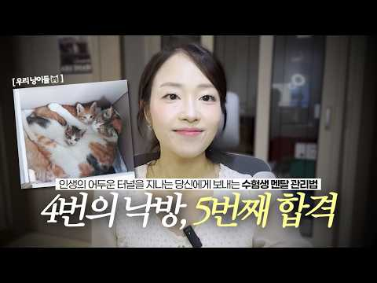
- 챕터: 0:00 프롤로그 (가장 절망적이었던 순간) · 1:58 늘 성공만 하던 삶, 그리고 로스쿨에서 만난 첫 실패! · 6:01 변호사시험의 가혹함과 '오탈제' · 8:52 4점 차 4번째 낙방과 마지막 기회라는 극한의 압박감 · 11:16 마지막 시험 도전! 극심한 슬럼프, 결과에 대한 집착. · 14:50 길고양이 삼남매가 찾아준 뜻밖의 해탈과 행복 · 19:42 수험생활 멘탈 관리의 2가지 핵심 · 22:33 마무리 및 응원의 메시지
- 설명 앞부분: 고양이들이 방효경 변호사를 살렸다?! 4번의 낙방, 5번째 합격. 방효경 변호사가 인생의 가장 어두운 터널을 지나고 있는 여러분에게 보내는 수험생 멘탈 관리법! 자존감이 바닥을 찍고, 경제적인 사정까지 맞물려... 내 인생의 모든 어려움이 한꺼번에 몰려왔던 그 때... 제가 결국 포기하지 않고 해낼 수 있었던, 흙수저 수험생이 해탈에 이르렀던 과정! 저의 기적같은 이야기를 소개합니다. 부디 여러분에게도 작은 기적이 일어나 평온함과 행복이 함께 하기를.
- 대본 없음 (설명) — 음성인식이 끝나면 도입부·흐름이 들어감
- 댓글 203/203: 좋은 점 — 영상 6 · 감사·응원 36 · 더 알고 싶은 것 8 · 아쉬운 점 — 영상 0 · 반박·불만 — 의견 다름 3 · 정치·사회 2 · 경험 공유 27 · 구독·다음 기대 0
  - 좋은 점 — 영상 👍3 “저도 늦은나이에 꿈이생겨 시험을위해 공부중인데, 도움이 많이 되었어요! 진인사대천명! 결과에대한 집착을 내려놓고 매일의 소소한 행복들을 챙기고 감사하며 열심히 공부해보도록하겠습니다 감사해용❤ 저도 냥이들 키우는데 정말이지 사랑이에요”
  - 좋은 점 — 영상 👍3 “그쵸 변호사님 얘기 정말 공감돼요❤ 저도 저희 강아지를 제가 중학교때 우울증 겪다가(학폭 탓에... 그래서 지금도 또래 애들과 소위 어른들한테 원한이 커요) 데려왔는데 그 친구 온 이후로 다 잘풀렸던 기억이 나요 덕분에 지금도 잘살고 있어요😊”
  - 감사·응원 👍50 “중순이때부터 애청했어요. 이 분 그때 편의점에서 알바도 했던걸로 알아요. 진짜 열심히 사셔서 응원했는데 합격했다는 소식에 진심 내 친구일처럼 기뻤었네요. 우리 별이가 벌써 9살이돼 나보다 더 안좋은 신체 나이를 가졌지만 이 아이 마지막까지 내가 지켜줬음 좋겠네요.”
  - 감사·응원 👍25 “오늘 알고리즘이 마침 뜨네요~ 저도 9급공무원 시험 5년정도 준비했는데 올해 운좋게 필기시험 합격했는데 면접에서 탈락했습니다 ㅜㅜ 오늘 결과 받고 생각 정리하다가 유튜브 켰는데 알림이뜨네요~ 저도 나이도 좀 있고 집에 도움없이 알바병행하면서 시험준비했는데 참 힘든네요…”
  - 더 알고 싶은 것 👍6 “5번째 변시에서 합격했을 때 주변분들 반응 어땠는지 궁금해요 로스쿨 동기생들 중에 이미 변호사 돼서 활동하는 친구들이 정말 내 일처럼 엄청 기뻐했을거 같아요”
  - 더 알고 싶은 것 👍3 “혹시 어느 고등학교 나오셨는지 여쭤봐도될까요? 비학군지 고등학교일까요? 로스쿨 전까지는 공부한 결과 다 나왔다고 하셔서요... 명문대 출신들도 고등학교 때 슬럼프나 결과 안나오는 경우 한번씩은 겪는데ㅜㅜ”
  - 반박·불만 — 의견 다름 👍15 “마지막 변시를 준비하는 수험생입니다. 시험을 4개월 여 앞둔 요즘 더위가 수그러들고 날씨가 좋아지니... 바깥 세상 사람들은 좋은 계절이 왔다며 좋아하시는 분들이 많겠지만... 마지막 시험을 앞 둔 수험생 입장에선 이제 진짜 얼마 안 남았구나... 라는 생각에 쉽사리…”
  - 반박·불만 — 의견 다름 👍2 “실례되는 질문일 것 같긴한데... 혹시 adhd 관련 증상은 없으신가요? 저도 학창시절부터 벼락치기로 성적이 잘 나왔고 운 좋게 sky 중 하나 들어왔는데 전문직 시험 진입하고 무기력증이 심하게 온 상태입니다... 변호사님처럼 성격이 외향적이지도 못하고 특별히 노는걸…”
  - 정치·사회 👍1 “윤석열도 9수만에 사시 붙었다는데 5수가 별겁니까?ㅋㅋㅋㅋㅋ”
  - 경험 공유 👍50 “중순이때부터 애청했어요. 이 분 그때 편의점에서 알바도 했던걸로 알아요. 진짜 열심히 사셔서 응원했는데 합격했다는 소식에 진심 내 친구일처럼 기뻤었네요. 우리 별이가 벌써 9살이돼 나보다 더 안좋은 신체 나이를 가졌지만 이 아이 마지막까지 내가 지켜줬음 좋겠네요.”
  - 경험 공유 👍25 “오늘 알고리즘이 마침 뜨네요~ 저도 9급공무원 시험 5년정도 준비했는데 올해 운좋게 필기시험 합격했는데 면접에서 탈락했습니다 ㅜㅜ 오늘 결과 받고 생각 정리하다가 유튜브 켰는데 알림이뜨네요~ 저도 나이도 좀 있고 집에 도움없이 알바병행하면서 시험준비했는데 참 힘든네요…”

### 42. 당신이 조용히 손절 당하는 이유 (w. 민음사 조아란 부장님) ∣ 불량학생 EP.05

- https://www.youtube.com/watch?v=T2NTB0ItLAE · 이페오카카 · 구독자 12,900 · 조회수 301,012 (×23.3, 하루 13,698.5) · 좋아요 3,416 (1.1%) · 32.7분 · 2026-10-20 · 주제 묶음 2. 인간관계·대화 · 형식 정보·해설 (그 밖) · 폴더 `W_T2NTB0ItLAE` (웹 승인)
- 썸네일: 
- 챕터: 0:00 수업 맛보기 · 0:21 불량학생 근황 · 1:02 오늘의 쌤, 민음사 조아란 부장님 · 3:54 수업 주제, 관계 · 4:05 선배일 때와 후배일 때 · 5:35 오래된 동료 · 8:31 귀인은 누구? · 12:16 그들의 랄부 친구 · 16:05 다양한 인맥 관리 · 20:36 사회적 호위대 모델 · 22:36 이런저런 손절 · 24:59 고민선도부 · 30:37 최후의 불량학생은? · 31:21 다음 수업 예고 · 31:53 물 들어올 때 노 젓자
- 설명 앞부분: 관: 계 계: (개)어려움 💰매주 화요일 저녁 7시! 금융 갱생 교실로 초대합니다. 💲댓글 이벤트💲 💰이벤트 기간 참여기간: 10/20 ~ 10/27 당첨발표: 10/30 💰참여방법 ※ 이벤트 유의사항 본 이벤트는 당사 사정에 따라 사전 고지 없이 변경 또는 조기 종료될 수 있어요. 경품 지급 시점을 기준으로 다음의 경우 당첨 대상에서 제외돼요. 비정상적인 방법으로 참여 시 추첨 대상에서 제외되며, 별도 안내 없이 당첨이 취소될 수 있어요. 경품 발송을 위해 당첨되신 고객분들의 개인정보 수집을 요청할 수 있어요. 이벤트 당첨은 1…
- 대본 없음 (설명) — 음성인식이 끝나면 도입부·흐름이 들어감
- 댓글 432/431: 좋은 점 — 영상 38 · 감사·응원 13 · 더 알고 싶은 것 3 · 아쉬운 점 — 영상 0 · 반박·불만 — 의견 다름 3 · 정치·사회 0 · 경험 공유 34 · 구독·다음 기대 10
  - 좋은 점 — 영상 👍578 “진짜 셋 다 말 안듣게 생겼는데 의외로 수업도 잘 듣고 같이 듣는 나한테도 유익함 ㅈㅂ 사라지지 말고 계속 해주세요 개 재밋음”
  - 좋은 점 — 영상 👍289 “쇼츠 좀 잘 찍어내면 진짜 잘 될듯 유익하고 재밌는 채널 별로 없음ㅜㅜ”
  - 감사·응원 👍10 “저 경청하고 받아들이는 태도가 너무 좋음 늘 응원해🌸”
  - 감사·응원 👍3 “처음에는 그냥 웃긴 힙합 웹예능인가 하고 봤는데 갈수록 주제도 좋아지고 게스트도 다양해서 은근 중독성 있네요ㅎㅎㅎ 이번에는 인간관계 얘기가 많아서 특히 공감하면서 봤어요 😭 나이 들수록 친구 관계나 사회생활에서 애매하게 멀어지는 순간이 생기는데 그런 감정도 자연스러운…”
  - 더 알고 싶은 것 👍5 “아 진차 너무 웃기고 유익해요,, 30분이 짧아서 아쉬울 만큼!!! 이런 조합, 주제로 더 많이 만들어주세요🥹🥹”
  - 더 알고 싶은 것 👍1 “민음사에선 대체 어떤 인력들이 일하고 있는거죠?(p)”
  - 반박·불만 — 의견 다름 👍3 “처음에는 그냥 웃긴 힙합 웹예능인가 하고 봤는데 갈수록 주제도 좋아지고 게스트도 다양해서 은근 중독성 있네요ㅎㅎㅎ 이번에는 인간관계 얘기가 많아서 특히 공감하면서 봤어요 😭 나이 들수록 친구 관계나 사회생활에서 애매하게 멀어지는 순간이 생기는데 그런 감정도 자연스러운…”
  - 반박·불만 — 의견 다름 👍0 “5화 키드밀리 : 교양있는 조아란부장님께 새깅을 권유할뿐만아니라 메이슨홈에게 줄무늬 팬티공개를 부추긴 후 “나는 저정도는 진짜 싫어”라며 간사하게 발을 뺀 장면. 너무 불량해서 말도안나옵니다.”
  - 경험 공유 👍201 “킫밀,제이슨홈은 방송하는거 같은데 제프리 항상 되게 진심같고 ㅋㅋㅋㅋㅋㅋㅋㅋㅋ 아 뭐야 제프리 성장기보는거같아ㅋㅋㅋㅋㅋㅋ 아부 호스트들이랑 케미넘 좋고 ㅠ 한번 더나와줘용 이번편 나도 대화끼고싶음ㅋㅋㅋㅋ”
  - 경험 공유 👍70 “저 진짜 힙합에 너무 관심없고 선입견 있던 타입이라서 요즘 힙한 래퍼가 말하는 (?) 모습도 처음 보는 사람인데 아부 덕분에 처음 접했습니다! 오히려 너무 다른 의미로 선한 사람들이라는 생각을 가졌고 내가 더 퇴색된 생각을 가진게 아닌가 하고 영상 정주행 시작합니다.…”
  - 구독·다음 기대 👍70 “저 진짜 힙합에 너무 관심없고 선입견 있던 타입이라서 요즘 힙한 래퍼가 말하는 (?) 모습도 처음 보는 사람인데 아부 덕분에 처음 접했습니다! 오히려 너무 다른 의미로 선한 사람들이라는 생각을 가졌고 내가 더 퇴색된 생각을 가진게 아닌가 하고 영상 정주행 시작합니다.…”
  - 구독·다음 기대 👍21 “ㅋㅋㅋㅋ 처음엔 조합이 너무 신선해서 보기 시작했는데, 웃다가 인간관계에 대해 진지하게 생각하게 되는 영상인거 같아요. 특히 사회적 호위대 모델 부분이, 인간관계가 어렵다고 느낄 때 무조건 많은 사람과 친하게 지내려고 하기보다, 힘들 때 내 편이 되어주는 사람들과 서…”

### 43. 친한 사람들과 여행 갔다가 사이가 틀어지는 진짜 이유(feat. 심리학) ∣ 갈등심리학 ∣ 우정 ∣

- https://www.youtube.com/watch?v=xk46_2WsjMk · 브라보 인생후반전 · 구독자 8,530 · 조회수 522,743 (×61.3, 하루 8,791.0) · 좋아요 1,891 (0.4%) · 25.2분 · 2026-09-12 · 주제 묶음 1. 심리학 일반 · 형식 인터뷰·강연·대담 (전문가) · 폴더 `W_xk46_2WsjMk` (웹 승인)
- 썸네일: 
- 챕터: 0:00 인트로 · 1:41 1단계. 평소엔 정말 친한 사이였다 · 4:11 2단계. 여행에는 생각보다 많은 배려가 필요하다 · 6:50 3단계. 처음엔 모든 것이 좋았다 · 10:18 4단계. 작은 불편함이 쌓이기 시작한다 · 12:48 5단계. 결국 참았던 사람이 폭발한다 · 15:12 6단계. 싸움보다 더 무서운 침묵이 시작된다 · 17:43 7단계. 우리는 그 사람의 '본성'을 판단하기 시작한다 · 20:30 8단계. 여행이 끝난 뒤, 관계의 거리가 달라진다 · 23:16 아웃트로
- 설명 앞부분: 평소엔 그렇게 편했던 친구가, 여행 한 번 다녀온 뒤부터 왜 이상하게 불편해질까요? 돈 쓰는 방식, 시간 약속, 사소한 의견 차이... 여행이라는 낯선 스트레스 상황은 평소엔 절대 보이지 않던 그 사람의 진짜 모습을 드러냅니다. 이 영상에서는 여행 후 관계가 틀어지는 심리적 이유를, 존 가트맨의 갈등 연구를 바탕으로 하나씩 풀어드립니다. 여러분은 여행에서 누구의 진짜 모습을 보셨나요? 댓글로 여러분의 이야기를 들려주세요. ⏱ 타임라인 ⚠️면책조항(Disclaimer) 이 영상은 심리학 연구와 이론을 바탕으로 재구성한 일반적인 정보…
- 대본 없음 (설명) — 음성인식이 끝나면 도입부·흐름이 들어감
- 댓글 302/302: 좋은 점 — 영상 10 · 감사·응원 2 · 더 알고 싶은 것 2 · 아쉬운 점 — 영상 1 · 반박·불만 — 의견 다름 7 · 정치·사회 0 · 경험 공유 28 · 구독·다음 기대 0
  - 좋은 점 — 영상 👍41 “친구랑 여행 갔다가 사이 나빠진 사람이 저 말고도 많은가 보네요. 😅 좋은 영상 잘 봤습니다.”
  - 좋은 점 — 영상 👍8 “저도 친한 친구와 여행을 갔다가 돌아온 뒤 한동안 어색해진 적이 있습니다. 여행 전에는 정말 잘 맞는다고 생각했는데 돈 쓰는 방식, 시간 개념, 피곤할 때의 태도가 너무 다르더군요. 그때부터 친한 것과 함께 생활할 수 있는 것은 다른 문제라는 걸 배웠습니다.”
  - 감사·응원 👍2 “감사합니다 ..ㅎ”
  - 감사·응원 👍1 “통찰력 있는 유익한 영상 감사드립니다”
  - 더 알고 싶은 것 👍20 “30년지기 친구 처음이자 마지막 유럽패키지 여행이후 손절.. 한 친구가 주도를 했죠. 딸부잣집 막내라 언니들로부터 줏어들은 풍월로 말투마다 자신이 보는 세상이 전부요 옳다는식의.. 잠도 동전던지기로 매일 다른 사람과 때론 연속으로 같은 사람과 자게 되는것도 그친구 였…”
  - 더 알고 싶은 것 👍2 “얼마나 속상하셨으면 긴 글을 쓰셨을까요? 이해합니다”
  - 아쉬운 점 — 영상 👍47 “30년넘게 알고지낸사이 평소 등산 과 국내여행 짧게 참 많은것을 함께 했던 교회 친구였죠.둘이서 나눈대화며 맛집경험등 우린정말 함께 했던것들이 넘 많았죠.주변뿐 아니라 남편들마저 부러워할만큼 소문난? 친구같은 교우 였어요.몇년간 함께 돈을모아 한달간 유럽여행을 갔어요…”
  - 반박·불만 — 의견 다름 👍25 “감정기복이 심해서 막 웃다가 조금이라도 거슬리면 몇시간씩 말도 안하고 짜증내서 사람 불편하게 하고(그 원인이 지가 해외체류기간 계산 잘못해서 로밍 끊긴거를 엄청 짜증내고 열폭함 ㅜㅠ) 돈은 한푼도 손해보려하지 않으면서 (7년동안 밥은 커녕 커피한잔을 안사더라~^^) …”
  - 반박·불만 — 의견 다름 👍20 “30년지기 친구 처음이자 마지막 유럽패키지 여행이후 손절.. 한 친구가 주도를 했죠. 딸부잣집 막내라 언니들로부터 줏어들은 풍월로 말투마다 자신이 보는 세상이 전부요 옳다는식의.. 잠도 동전던지기로 매일 다른 사람과 때론 연속으로 같은 사람과 자게 되는것도 그친구 였…”
  - 경험 공유 👍93 “맞아요ㆍ저도 여행갔다와서 절교했습니다ㆍ생각만 해도 진절머리나요ㆍ”
  - 경험 공유 👍74 “팁을 하나 공유하자면~가까울수록 그 여행 끝으로 손절하고 싶지 않을수록~방 따로 쓰면 됩니다. 몆 년 전에 여행 갈 때 친한 분이랑 반배낭 팀에 합류해서 20여 일 가까이 여행하게 되었는데 전 싱글 차지 내고 각방 쓰자, 힘든 여행일수록 퇴근이 필요하다. 했는데 상대…”

### 44. 손주가 잘되는 집은 조부모의 '이것'이 확실히 다릅니다｜맞벌이 자녀를 돕는 조부모의 현명한 손주 돌보기

- https://www.youtube.com/watch?v=ErLgZ7x-Jzo · 육아는아빠가 · 구독자 17,000 · 조회수 124,441 (×7.3, 하루 14,867.5) · 좋아요 689 (0.5%) · 11.1분 · 2026-11-03 · 주제 묶음 7. 가족·부모 · 형식 정보·해설 (그 밖) · 폴더 `W_ErLgZ7x-Jzo` (웹 승인)
- 썸네일: 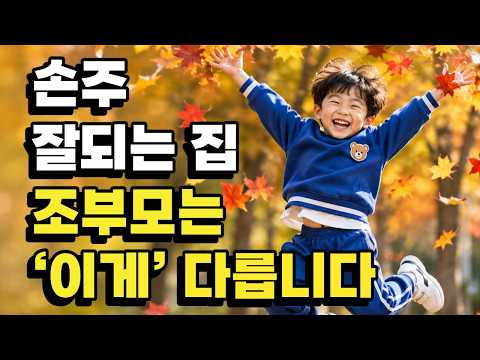
- 설명 앞부분: 자녀교육, 아이훈육, 사회성, 자존감, 생활습관, 감정조절, 자기조절은 어릴 때부터 가정에서 만들어집니다. 이번 영상에서는 영유아부터 초등 저학년까지 아이의 감정은 받아주되 행동에는 분명한 기준을 세우고, 일관된 규칙과 생활 루틴으로 사회성과 자존감을 함께 키우는 방법을 알려드립니다. 특히 맞벌이 자녀를 대신해 손주를 돌보는 조부모님이라면 떼쓰기, 유튜브·스마트폰, 식사, 숙제, 공공장소 훈육에 바로 적용해보실 수 있습니다. 사랑은 충분히 주고, 기준은 분명하게. 손주가 밖에서도 사랑받는 아이로 자라도록 함께 배워보세요.
- 대본 없음 (설명) — 음성인식이 끝나면 도입부·흐름이 들어감
- 댓글 17/17: 좋은 점 — 영상 0 · 감사·응원 3 · 더 알고 싶은 것 1 · 아쉬운 점 — 영상 0 · 반박·불만 — 의견 다름 0 · 정치·사회 0 · 경험 공유 0 · 구독·다음 기대 0
  - 감사·응원 👍5 “구독과 좋아요 응원합니다 👍”
  - 감사·응원 👍5 “감사합니다 ^^”
  - 더 알고 싶은 것 👍5 “돌아다니며 밥 먹는 아이 어떻게 고칠 수 있을까요?”

### 45. "반복이 수학 자존감을 만들어준다고 믿어요" ∣ 매쓰플랫 플랫멤버스 마스터클럽 김세철 선생님

- https://www.youtube.com/watch?v=mfa4AuIBqfg · 매쓰플랫 Mathflat · 구독자 4,010 · 조회수 324,920 (×81.0, 하루 3,354.2) · 좋아요 18 (0.0%) · 6.4분 · 2026-08-06 · 주제 묶음 3. 자존감·마음 · 형식 심리테스트·자가진단 · 폴더 `W_mfa4AuIBqfg` (웹 승인)
- 썸네일: 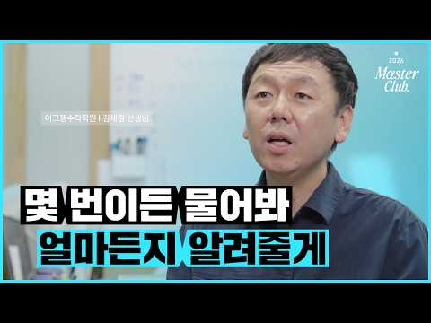
- 설명 앞부분: 매일 진행하는 일일 테스트와 학생 맞춤형 교재 제작까지, 매쓰플랫 수학문제은행 하나로 해결! 반복학습으로 공부 효과를 극대화하는 이그잼 맞춤 수학학원 김세철 선생님의 노하우를 확인해보세요. 일일테스트, 자체교재 고민 맞춤 상담&영상에서 공개되지 않은 노하우를 담은 비법노트 증정 🎉매쓰플랫 마스터클럽 인터뷰 시리즈 댓글 이벤트 🎉 마스터클럽 인터뷰 영상을 보고 댓글을 남겨주시면 경품을 드립니다. 📅 이벤트 기간 9월 10일(목) 🎬 참여 방법 매쓰플랫 유튜브 채널에서 마스터클럽 인터뷰 영상 시청 영상 댓글에 [자유 형식 예시: 가장…
- 대본 없음 (설명) — 음성인식이 끝나면 도입부·흐름이 들어감
- 댓글 18/18: 좋은 점 — 영상 3 · 감사·응원 1 · 더 알고 싶은 것 0 · 아쉬운 점 — 영상 3 · 반박·불만 — 의견 다름 0 · 정치·사회 0 · 경험 공유 0 · 구독·다음 기대 0
  - 좋은 점 — 영상 👍5 “반복이 결국 실력을 만든다는 말이 가장 오래 남았습니다. 특히 학생이 열일곱 번 물어보면 열여덟 번 가르쳐준다는 교육 철학이 정말 인상 깊었어요. 아이들마다 이해하는 속도가 다르다는 것을 인정하고 끝까지 기다려주는 선생님이 좋은 선생님이라는 생각이 들었습니다. 교재를…”
  - 좋은 점 — 영상 👍3 “학생 입장에서 생각하며 교재를 만든다는 부분이 정말 공감됐어요. 한 번에 이해하지 못해도 끝까지 기다려주고 반복해서 가르쳐주는 자세가 진짜 교육이라는 생각이 들었습니다. 좋은 강의 잘 보고 갑니다!”
  - 감사·응원 👍0 “반복이 수학 자존감을 만든다는 말씀 참 와닿네요. 작은 성공이 쌓여야 아이가 수학을 두려워하지 않게 되죠. 좋은 철학 나눠주셔서 감사합니다 🙌”
  - 아쉬운 점 — 영상 👍5 “반복이 결국 실력을 만든다는 말이 가장 오래 남았습니다. 특히 학생이 열일곱 번 물어보면 열여덟 번 가르쳐준다는 교육 철학이 정말 인상 깊었어요. 아이들마다 이해하는 속도가 다르다는 것을 인정하고 끝까지 기다려주는 선생님이 좋은 선생님이라는 생각이 들었습니다. 교재를…”
  - 아쉬운 점 — 영상 👍3 “학생 입장에서 생각하며 교재를 만든다는 부분이 정말 공감됐어요. 한 번에 이해하지 못해도 끝까지 기다려주고 반복해서 가르쳐주는 자세가 진짜 교육이라는 생각이 들었습니다. 좋은 강의 잘 보고 갑니다!”

### 46. 남자가 스스로 더 잘하게 되는 여자의 특징 (연애심리)

- https://www.youtube.com/watch?v=zxP7GUqMmpY · 심리해킹 · 구독자 1,280 · 조회수 176,683 (×138.0, 하루 991.8) · 좋아요 1,251 (0.7%) · 10.2분 · 2026-05-17 · 주제 묶음 5. 연애·애착 · 형식 목록형 (N가지 특징·신호) · 폴더 `W_zxP7GUqMmpY` (웹 승인)
- 썸네일: 
- 설명 앞부분: 남자는 왜 어떤 여자에게 오래 머물고 싶어지고, 왜 어떤 관계에서는 점점 멀어지는지에 대한 심리 구조를 풀어낸 영상입니다. 단순히 “잘해주면 사랑받는다”는 방식이 아니라, 남자의 뇌가 관계 안에서 어떤 순간에 안정감과 특별함을 느끼는지를 심리학적으로 설명합니다. 영상에서는 남자가 사랑받는다고 느끼는 핵심 요소로 존중, 인정, 신뢰, 안정감, 그리고 자기 삶을 가진 여자의 매력을 다룹니다. 특히 남자의 약한 모습을 받아주는 태도, 통제보다 신뢰를 주는 관계, 그리고 남자 중심이 아닌 자신의 삶을 유지하는 여자가 왜 더 오래 사랑받는…
- 대본 없음 (설명) — 음성인식이 끝나면 도입부·흐름이 들어감
- 댓글 35/35: 좋은 점 — 영상 2 · 감사·응원 0 · 더 알고 싶은 것 0 · 아쉬운 점 — 영상 0 · 반박·불만 — 의견 다름 0 · 정치·사회 0 · 경험 공유 5 · 구독·다음 기대 0
  - 좋은 점 — 영상 👍13 “내용이 참 좋고~ 귀에 쏙쏙 들리는 목소리톤도 너무 좋아서 끝까지 경청하게 됩니다 구독 좋아요^^”
  - 좋은 점 — 영상 👍0 “대박입니다 꽉채운연애5년 현 결혼전제로 동거시작한 사실상 거의 사실혼이라해도 무방한.. 근데 1년째 정말 아무것도아닌걸로 미친듯이싸우고 말안하고 이거보면서 내얘기하는거같아서 ㅎㅎ 참기가차네요 ㅎㅎ 키는 나군요 ㅎㅎ 참나 ㅎㅎ 남자라는 동물은 참 ㅎ 도움많이됐습니다 노…”
  - 경험 공유 👍32 “남자가 여자에게 안정감을 안주니 내가 남자에게 안끌립니다”
  - 경험 공유 👍3 “우리남편이그래습니다”

### 47. 왜 그 사람은 먼저 연락하지 않을까? 상대가 먼저 연락하게 만드는 8가지 심리 기술

- https://www.youtube.com/watch?v=fn0-W21JndI · 마음이 보이는 심리학 · 구독자 2,640 · 조회수 157,814 (×59.8, 하루 1,997.8) · 좋아요 804 (0.5%) · 19.8분 · 2026-08-24 · 주제 묶음 1. 심리학 일반 · 형식 목록형 (N가지 특징·신호) · 폴더 `W_fn0-W21JndI` (웹 승인)
- 썸네일: 
- 설명 앞부분: 항상 내가 먼저 연락하는 연애, 지치셨나요? 이 영상에서는 심리학 연구에 기반한 8가지 기술로 기울어진 관계의 균형을 바로잡는 방법을 알려드립니다. 피크-엔드 법칙, 자이가르닉 효과, 벤저민 프랭클린 효과, 획득-상실 이론, 내집단 편향까지. 검증된 심리학 원리를 연애에 바로 적용할 수 있도록 쉽게 풀어냈습니다. 상대를 밀어내거나 게임하는 게 아닙니다. 상대에게 나를 생각할 여백과 연락할 이유를 만들어 주는 것. 그리고 내 삶의 주도권을 되찾는 것. 그게 이 영상의 핵심입니다. 연락의 방향이 바뀌면 관계의 구조가 바뀝니다. 위키백…
- 대본 없음 (설명) — 음성인식이 끝나면 도입부·흐름이 들어감
- 댓글 32/32: 좋은 점 — 영상 4 · 감사·응원 1 · 더 알고 싶은 것 0 · 아쉬운 점 — 영상 2 · 반박·불만 — 의견 다름 0 · 정치·사회 0 · 경험 공유 0 · 구독·다음 기대 0
  - 좋은 점 — 영상 👍58 “그렇게 관심받는것도 한때인데 고마운줄 모르고 지내다 막상 사라지고나면 남는것은 허전함과 고요함뿐 주는 상대의 마음을 한 번 더 헤아려보게되는 밤입니다 좋은 영상 잘봤습니다”
  - 좋은 점 — 영상 👍5 “신기하게 구구절절 맞는얘기라 씁쓸하네 ㅎㅎ 괜히 더 보고싶은 조용한 밤이구나”
  - 감사·응원 👍2 “아주 큰 도움이 됐습니다. 감사합니다. 🎉”
  - 아쉬운 점 — 영상 👍16 “절정의 타이밍에 끝내버리기..아 벌써 아쉬움..다음에 또 이야기하고 싶다.. 이사람과 더 있고 싶었는데. 다음화 예고.. 자이가르닉 효과. 결말을 못 본 드라마. 다음에 만나서 얘기해줄께. 적당한 시간 뒤 답장하기.. 자기만의 세계가 있는 사람. 신경써야 하는 사람.…”
  - 아쉬운 점 — 영상 👍2 “4:10 이런건 좀 의문 입니다. 그 시간을 어떻게 느낄지 그 기다리는 시간 마저도 행복하고 즐거운 여운으로 느낄 수 있게 만들고 함께 있는 것 만으로도 즐거운 시간으로 남기는게 성숙한 사람이 아닐까 합니다. 갈 수록 성숙한 사랑은 없어지고, 이런 영상처럼 아쉬움과 …”

### 48. 통찰력이 뛰어난 사람이 유독 외로운 5가지 심리적 이유

- https://www.youtube.com/watch?v=StM4IstW8R0 · 심리세포 · 구독자 13,400 · 조회수 740,233 (×55.2, 하루 9,873.2) · 좋아요 4,290 (0.6%) · 5.3분 · 2026-08-28 · 주제 묶음 1. 심리학 일반 · 형식 목록형 (N가지 특징·신호) · 폴더 `W_StM4IstW8R0` (웹 승인)
- 썸네일: 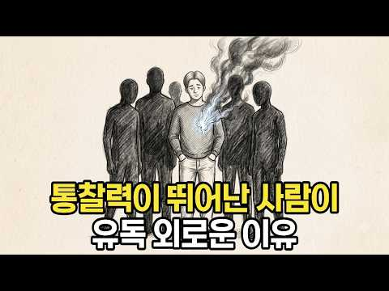
- 챕터: 0:00 인트로 – 통찰력과 외로움, 무슨 관계가 있을까? · 0:33 첫 번째 이유 – 지식의 저주 · 1:25 두 번째 이유 – 공감 정확성과 관계 만족도 · 2:15 세 번째 이유 – 감각처리민감성 이론 · 3:08 네 번째 이유 – 지능과 사교 빈도의 역설 · 3:53 다섯 번째 이유 – 경험에 대한 개방성 · 4:46 클로징 – 외로움은 부족함이 아니라 깊이의 증거입니다
- 설명 앞부분: 남들보다 먼저 보고, 먼저 느끼는데… 왜 이렇게 외로울까요? 통찰력이 좋다는 건 축복 같지만, 사실 그 이면엔 아무도 알려주지 않은 심리학적 이유가 숨어 있습니다. 이 영상에서는 통찰력이 뛰어난 사람들이 유난히 외로움을 느끼는 5가지 심리적·뇌과학적 이유를 알아봅니다.. ⏱ 타임라인 Camerer, C., Loewenstein, G., & Weber, M. (1989). The Curse of Knowledge in Economic Settings: An Experimental Analysis. Journal of Politica…
- 대본 없음 (설명) — 음성인식이 끝나면 도입부·흐름이 들어감
- 댓글 1,121/1,121: 좋은 점 — 영상 27 · 감사·응원 25 · 더 알고 싶은 것 9 · 아쉬운 점 — 영상 18 · 반박·불만 — 의견 다름 35 · 정치·사회 18 · 경험 공유 167 · 구독·다음 기대 0
  - 좋은 점 — 영상 👍36 “너무나 피로합니다ㅠㅠ 장점보다 단점이 너무 큼... 이게 밥 벌어먹고 사는데 그닥 도움되는 것도 아니고 쓸데없이 인간관계가 피곤하게만 느껴짐.”
  - 좋은 점 — 영상 👍2 “쇼펜하우어가 죽기 직전까지 100번 강조한 인간관계 레전드 명언, 1. 좋은 사람 하나가 인생을 바꾸고, 나쁜 사람 하나가 인생을 송두리째 망가트린다. 2. 주변에 사람이 많아질수록 행복할 거라고 생각하지만 사람이 많아진 만큼 문제도 많아진다. 3. 인간은 대부분 타…”
  - 감사·응원 👍3 “영상 감사합니다. 저는 그냥 외로운 건데, 통찰력이 뛰어나서 그렇다고 하기로 했습니다.”
  - 감사·응원 👍1 “확실히 내 핸드폰은 나의 개인 대화나 검색을 다 파악하고 있구나… 무섭기도 한데 오늘은 정말 감사하다.. 남들은 지식/경제력 등 유니크함의 측면에서 1프로니 3프로니 10프로니 하는 거 동경하지만 그것은 사실 저주가 아닐까 이젠 남이 안 받아줘도 난 내 할 일 열심히…”
  - 더 알고 싶은 것 👍16 “깊은 대화가 통하는 사람. 저도 찾고있는데 정말 잘 없어요.. 저만 느끼는게 아니였군요 외로워서 사람만나러 모임에 나가도 정말 가벼운게 느껴졌습니다. 나도 아무생각없이 웃고싶다는 생각을 많이 했던거같아요. 언젠가는 찾을수있을까요? 삶을 바라보는 눈이 비슷한 사람을 찾…”
  - 더 알고 싶은 것 👍1 “타고난 통찰력 가진 사람의 한계가 정말 많아요. 후천적으로 몇가지 방법으로도 통찰력을 가지게 될 수 있는데 그럴 경우는 선천적 통찰력을 가진 사람들이 가진 단점을 단점을 많이 극복하기도 하지요. 선천적인 사람은 통찰력이나 지능을 자기 자신에게는 사용하지 못한다는 아이…”
  - 아쉬운 점 — 영상 👍31 “영상을 다 듣고 나니 오히려 ‘통찰력 있는 사람이 왜 외로운가’를 설명한다기보다, 예민함·과도한 생각·소통의 어려움·혼자 있는 걸 선호하는 성향을 전부 ‘통찰력이 뛰어나서 그렇다’는 방향으로 묶어주는 느낌​이 강함. 첫 번째로 지식의 저주는 ‘내가 이미 알고 있는 정…”
  - 아쉬운 점 — 영상 👍2 “글쓰는거보면 높게쳐줘야 통찰력도 뛰어난게아니라 통찰력만 뛰어난 낙오자들인거같은데 인간관계에서 핵심만보는게 진짜 능력부족인건데 댓글쓰는 심리도 뻔히보이는데 댓글쓰는사람들은 얼마나 못난거야 걍 지들의 못난부분이 다른사람도 똑같다고 심리기전도 똑같다고보는걸까?? 책한권읽은…”
  - 반박·불만 — 의견 다름 👍27 “이 영상을 보고 공감하는 당신, 착각에서 빠져나오세요. 당신은 그런 사람이 아닙니다.”
  - 반박·불만 — 의견 다름 👍13 “통찰이 있다는 것은 정보와 정보 사이의 연관성을 인식하고 각각의 분리된 요소보다 전체의 시스템을 이해하는 그 감각 자체를 의미하기도 합니다. 이 영상에 달리는 뭇 댓글들의 주장처럼 단지 남들과 관점이나 관심사가 조금 다른 경우를 얘기하는 것이 아니죠. 나와 다른 상대…”
  - 정치·사회 👍1 “우파들의 뇌와 좌파들의 뇌 여기서 말하는 우파는 진짜 우파임”
  - 정치·사회 👍1 “광활한 우주 바닷가 모래알 보다도 작은 지구라는 행성에서 사악하고 악마 같은 인간들이 존재를 하지, 지구의 모든 인간들은 다 강력한 범죄자들이며, 지구란 행성은 인간들의 감옥이다. 또한, 빈껍데기에 불과한 육체는 제2의 감옥이니라, 그래서 삶이 고되고 힘듦이 다 여기…”
  - 경험 공유 👍39 “여기 댓글 다는 사람들 또한 누군가에게 읽혀가며 살겠지 그런데도 이 영상에 바넘효과를 느끼며 마치 내 얘기인양 이입할테고 과연 정말 통찰력을 가지고 괴로워하는 사람이 몇이나 있을까? 일단 나도 외로움을 갖고 살아가지만 절대 통찰력이 뛰어나서는 아닌거같다 정도에 따라 …”
  - 경험 공유 👍36 “그래서 나도 일부러 흐린눈 하게 되고, 말하려다 말게 되는 순간이 많아짐. 피곤해질까봐.”

### 49. 나를 손절하려는 사람이 미리 보내는 신호 - 정신과 의사

- https://www.youtube.com/watch?v=2BNzTFYnW24 · 인생승진 Life Up!! · 구독자 10,800 · 조회수 413,526 (×38.3, 하루 7,376.8) · 좋아요 1,245 (0.3%) · 10.6분 · 2026-09-16 · 주제 묶음 6. 정신건강 · 형식 인터뷰·강연·대담 (전문가) · 폴더 `W_2BNzTFYnW24` (웹 승인)
- 썸네일: 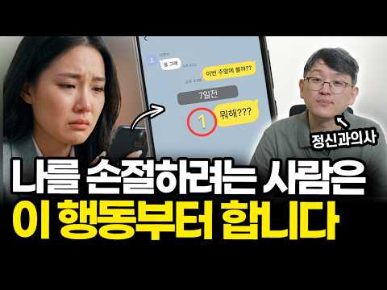
- 설명 앞부분: 누군가를 손절해 본 적도, 누군가에게 손절당해 본 적도 있으시죠. 우리는 언제 누군가를 손절하기로 결정할까요? 그 시점은 생각보다 훨씬 앞인데요. 오늘은 나를 손절하기로 결심한 사람이 어떤 신호를 보내는지, 그리고 관계가 어디서부터 끝나기 시작하는지 이야기해보려고 합니다.
- 대본 없음 (설명) — 음성인식이 끝나면 도입부·흐름이 들어감
- 댓글 246/246: 좋은 점 — 영상 3 · 감사·응원 5 · 더 알고 싶은 것 3 · 아쉬운 점 — 영상 2 · 반박·불만 — 의견 다름 6 · 정치·사회 0 · 경험 공유 40 · 구독·다음 기대 0
  - 좋은 점 — 영상 👍18 “틀린 말 없네. 이미 마음 속으로는 결정이 끝난 상태. 각 보면서 타이밍 재다 확 끊어버리는 일만 남은거지... 그것만 기다리는거😅”
  - 좋은 점 — 영상 👍1 “좋은말씀 감사합니다.”
  - 감사·응원 👍5 “나는 상대방을 손절한게 아니라 삶이 지쳤었는데, 그때의 나를 오해하고 내가 상대를 손절한줄 알았던 사람이 있는가 하면, 나에게 괜찮냐고 안부를 묻고 내가 사람에게 거리를 둔만큼 그 공간을 내어 주는 사람이 있었음. 정신적으로 지치면 어떤 배려도 못하게 됨. 그걸 알아…”
  - 감사·응원 👍2 “흠. 선생님 말씀에서 어느 정도 힌트는 얻었네요. 감사합니다.”
  - 더 알고 싶은 것 👍10 “관계가 지친 사람을 어떻게 대해야 할까요? 그냥 조용히 지켜봐 주나요? 아니면 더 적극적으로 다가가야하나요?”
  - 더 알고 싶은 것 👍1 “가족간에도 손절하려는 사람이 있을까요?”
  - 아쉬운 점 — 영상 👍65 “바쁘다고 말하는데 계속 전화질, 문자질 좀 고만해라. 소름끼친다. 그걸 바뻐서 정신적으로 힘든 사인으로 받아들이고 용기내라 문자질, 힘들어 보인다 위로의 전화질이라고 쉴때 전화. 빨리 회복해서 니 감정 쓰레기 받아내라고,,, 너무 소름끼침.”
  - 아쉬운 점 — 영상 👍4 “좋은 사람인데 뭔가 통화하면 내가 공감 할수 없는 진지한 이야기를 너무 길게 해서 기가 빨림. 그래서인지 저도 모르게 전화 안해져요. 그런데 오랜만에 전화해서 자기한테 연락을 안했다며 서운하다 하죠. 얼굴 보자고 하고. 난감합니다. 싫어하는 건 아닌데 통화는 별로. …”
  - 반박·불만 — 의견 다름 👍4 “무언가 표현할떄는 차라리 괜찮은거지 진짜 아무래도 상관없는 사람에겐 아무말도 안하는데 맞지 않음?”
  - 반박·불만 — 의견 다름 👍4 “좋은 사람인데 뭔가 통화하면 내가 공감 할수 없는 진지한 이야기를 너무 길게 해서 기가 빨림. 그래서인지 저도 모르게 전화 안해져요. 그런데 오랜만에 전화해서 자기한테 연락을 안했다며 서운하다 하죠. 얼굴 보자고 하고. 난감합니다. 싫어하는 건 아닌데 통화는 별로. …”
  - 경험 공유 👍59 “전화를 항상 제가 먼저하는데 상대방이 안받는 경우들이 종종 생기고 그날이 아니여도 부재중 전화가 확인되면 전화를 해줘야한다고 생각이 드는데 몇달이 되도록 제가 연락하지않으면 연락을 안하더라고요. 그래서 몇번을 제가 불쾌감이 있었어도 아무렇지않게 전화하면 전화는 받아요…”
  - 경험 공유 👍31 “손절당하고 나도 손절하는거죠뭐”

### 50. [정약용 명언] 인복 많으려면 잘해주지 마라 미친듯이 ‘이 말’만 무조건 하면 된다 ∣ 정약용 ∣ 오디오북 ∣ 인생명언 ∣ 인간관계 ∣ 인복 ∣ 시니어조언 ∣ …

- https://www.youtube.com/watch?v=WsJxckYQlcA · 공감의샘 · 구독자 8,980 · 조회수 320,186 (×35.7, 하루 6,107.2) · 좋아요 4,688 (1.5%) · 38.3분 · 2026-09-19 · 주제 묶음 2. 인간관계·대화 · 형식 오디오북·책 요약 · 폴더 `W_WsJxckYQlcA` (웹 승인)
- 썸네일: 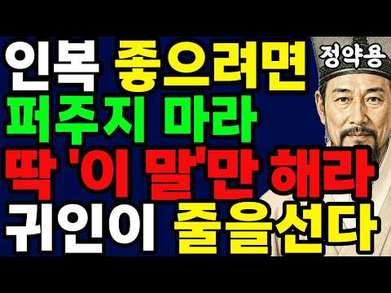
- 챕터: 0:00 인복은 타고나는 것일까? · 2:03 첫 번째. 밑 빠진 호구에 정성 붓기는 이제 그만! · 9:11 두 번째. 입을 닫으면 인복이 터지고, 입을 열면 사… · 16:28 세 번째. 칭찬에 속아 춤추다 다리에 쥐 난 사연 · 23:14 인복을 밀어내는 세 가지 대화 습관 · 24:36 첫 번째 대화법. 잘 보이려 애쓰지 않아도 사람이 끌… · 29:22 두 번째 대화법. 사람 줄어들까 두려워 마라, 진정한… · 35:45 인복을 부르는 대화법 총정리와 품격 있는 인생을 위한… · 21:05 ~ 30:10 ∣ 세 번째 이야기: 입을 닫으면 인복… · 30:10 ~ 38:18 ∣ 후반부: 인복을 불러오는 2가지 핵…
- 설명 앞부분: 인복이 많은 사람들의 비밀은 무작정 남을 칭찬하거나 나를 희생하는 데 있지 않습니다. 오히려 나를 지키는 단단한 선을 세우고 상대방을 존중하는 따뜻한 질문에 있습니다. 나를 낮추며 애쓰는 비위 맞추기는 상대에게 감정적 부담과 오만함만 남깁니다. 다산 정약용 선생의 지혜와 심리학 연구로 참된 사람의 복을 불러오는 법을 전합니다. 남에게만 좋은 사람이 되려 애쓰지 마시고 세상에서 가장 먼저 나 자신을 귀하게 대하세요. 내가 내 울타리를 단단하고 당당하게 세울 때 비로소 당신의 가치를 알아주는 귀인이 찾아옵니다. 오늘 영상을 통해 인간…
- 대본 없음 (설명) — 음성인식이 끝나면 도입부·흐름이 들어감
- 댓글 651/651: 좋은 점 — 영상 12 · 감사·응원 33 · 더 알고 싶은 것 2 · 아쉬운 점 — 영상 1 · 반박·불만 — 의견 다름 0 · 정치·사회 0 · 경험 공유 26 · 구독·다음 기대 0
  - 좋은 점 — 영상 👍54 “주의에 내맘같지않은 사람들때문에 많은 상처를빋고 살았어요.잘해주면 잘해줄수록 당연한듯. 더바라고 살더군요. 참 웃기지요~ *공감의샘* 을듣고있는중 제얘기를 하는듯~ 그렇지만 저는 상대의 비유를 맞추려거나 듣기좋으라고 한말은 없었습니다. 다만 제 진심을담아서 얘기했지요…”
  - 좋은 점 — 영상 👍38 “꼭 맞는말씀 하시네요. 이제라도 정신차리고 .조금만해야지. 너무큰상처만 돌아오더라구요.명심할께요.”
  - 감사·응원 👍54 “주의에 내맘같지않은 사람들때문에 많은 상처를빋고 살았어요.잘해주면 잘해줄수록 당연한듯. 더바라고 살더군요. 참 웃기지요~ *공감의샘* 을듣고있는중 제얘기를 하는듯~ 그렇지만 저는 상대의 비유를 맞추려거나 듣기좋으라고 한말은 없었습니다. 다만 제 진심을담아서 얘기했지요…”
  - 감사·응원 👍51 “제 자신을 돌아봅니다.감사합니다♡”
  - 더 알고 싶은 것 👍6 “2 진심으로 감사드립니다. 인복을 많이 받고싶습니다. 부탁드립니다. 감사합니다.”
  - 더 알고 싶은 것 👍1 “정말 소중하며 앞으로 살아가면서 깨우쳐야하는 디테일한것들을. 가르처주셨어 감사드리며 내용들이 모두 하나하나 감동으로 가슴에 완전와닿네요 이젠 사람들을 대할때 이렇게 하면 너무나 큰도음이 되어 저에겐 유익할껏같아요 계속좋은말씀 올려주셔요~^♡^❤❤❤🎉🎉🎉😅”
  - 아쉬운 점 — 영상 👍1 “광고가 왜이리 길게 지속되냐. 구독과 좋아요를 취소합니다.”
  - 경험 공유 👍89 “저도 늘 남을위해 살았는데 이제부터는 저를위해 살고싶어요”
  - 경험 공유 👍69 “불편함을 깨기위해 저의 실수나 부족한부분을 겸손한듯 말하곤 했는데 알고보니 상대는 저를 낮춰보고 쉽게 보더라구요. 오히려 이런부분은 안하는게 맞고 말을 아끼고 상황을 내가 분위기전환하려 애쓰지않고 맞지않는 사람은 만나지않으니 맘미 편하고 좋더라구요. 누구보다 존중할 …”

### 51. 나르시시스트가 되는 이유 ∣ 정신과 의사가 본 2가지 성장환경

- https://www.youtube.com/watch?v=0zbHoy3g4A4 · 정신과 의사 형원장 · 구독자 1,170 · 조회수 104,227 (×89.1, 하루 685.3) · 좋아요 903 (0.9%) · 6.7분 · 2026-06-12 · 주제 묶음 4. 나쁜 사람 알아보기 · 형식 인터뷰·강연·대담 (전문가) · 폴더 `W_0zbHoy3g4A4` (웹 승인)
- 썸네일: 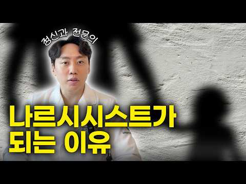
- 챕터: 0:00 시작 · 1:10 어린 시절의 영향 · 1:34 조건부 사랑을 받아서? · 3:14 유리 같은 자존감 · 3:45 사랑받지 못한 영향?
- 대본 없음 (없음) — 음성인식이 끝나면 도입부·흐름이 들어감
- 댓글 236/236: 좋은 점 — 영상 6 · 감사·응원 9 · 더 알고 싶은 것 3 · 아쉬운 점 — 영상 1 · 반박·불만 — 의견 다름 8 · 정치·사회 2 · 경험 공유 25 · 구독·다음 기대 0
  - 좋은 점 — 영상 👍28 “극단적으로 오직 나!나!나! 나다!!하는 신념이 있고 입버릇처럼 나는 알지~~! 라는 말로 수시로 상대방의 말을 끊는 사람이 주변에 있어서 피로감이 있어요...나르일까요😢😢😢 그리고 상대가 처음엔 나르가 아닌줄 알았는데 알고보니 내현 나르의 특성에 부합되더라구요😢 내…”
  - 좋은 점 — 영상 👍5 “나르시시트 아빠때문에 인생이 파도였습니다. 지금도 괴로울 때가 있어요. 그래도 알려주셔서 감사합니다”
  - 감사·응원 👍28 “극단적으로 오직 나!나!나! 나다!!하는 신념이 있고 입버릇처럼 나는 알지~~! 라는 말로 수시로 상대방의 말을 끊는 사람이 주변에 있어서 피로감이 있어요...나르일까요😢😢😢 그리고 상대가 처음엔 나르가 아닌줄 알았는데 알고보니 내현 나르의 특성에 부합되더라구요😢 내…”
  - 감사·응원 👍5 “나르시시트 아빠때문에 인생이 파도였습니다. 지금도 괴로울 때가 있어요. 그래도 알려주셔서 감사합니다”
  - 더 알고 싶은 것 👍28 “극단적으로 오직 나!나!나! 나다!!하는 신념이 있고 입버릇처럼 나는 알지~~! 라는 말로 수시로 상대방의 말을 끊는 사람이 주변에 있어서 피로감이 있어요...나르일까요😢😢😢 그리고 상대가 처음엔 나르가 아닌줄 알았는데 알고보니 내현 나르의 특성에 부합되더라구요😢 내…”
  - 더 알고 싶은 것 👍3 “내가 나르시시스트라고 생각되는 사람은 어떻게 살아야 할까요? 솔직히 사람 성격이 쉽게 변하는 것도 아니고, 이미 굳어진 나르적 성격을 고치는 방법이 있을까요? 저는 내 생각이 어떻건 간에 그냥 말을 안 하고 입을 다무는 방법을 택했어요. 속으로는 상대방을 욕하며”
  - 아쉬운 점 — 영상 👍6 “우리집은 엄마랑 동생이 나르같아요 특징을 보니 여기다 제가 겪은 일을 나열하기엔 너무 길고 유튜브 검색창에 사랑과전쟁 (엄마 그리고 딸 ) 이라는 영상 있어요 (혈압 높으신 분들 시청금지) 영상 거기 나오는 아들&&엄마 우리집이랑 99%똑같음 한가지만 이야기하면 아들…”
  - 반박·불만 — 의견 다름 👍144 “우리나라의 양면성 같다고 생각합니다,,,,,,,,,,,,,,, 말도 안 되는 경제 발전 뒤에는 나르시시스트가 너무 많음ㅜㅡㅠㅜㅠㅜㅜㅠ 잘 되면 외현, 안 되면 내현”
  - 반박·불만 — 의견 다름 👍10 “제가 남매(어린이들)따로 개인교습하는데 여아가 너무 심한 나르인데 다른 아이는 정말 착하고 예의 바른데여... 어머니도 매우 에의 바르시고. 나르 아이는 악마인가 싶을 정도인데...전 양육 과정때문이라는데 경험을 통해 딱 동의 못하겠어요...”
  - 정치·사회 👍165 “나라가 힘들고 회사다니기 힘들고 학교다니기 힘들고 사는게 힘든이유는? 나르시시스트와 소시오패스가 너무 많기 때문이죠.”
  - 경험 공유 👍45 “나르 부모에게서 자랐고 완벽하지 않으면 버림 받는다는 생각 한적 있습니다 하지만 어느 순간에 번아웃이 왔고 다 내려 놓은 후에 내 부족한 모습도 받아들이게 되었어요 이제는 사람들에게 제 약한 모습도 보여 줄 수 있습니다 꼭 나르 부모에게서 자란다고 모두가 나르가 되는…”
  - 경험 공유 👍12 “우리남편 정서적 돌봄을 못 받았던것 같네요 학교에서 1등해도 칭찬받은적이 없데요 현재는 모든걸 잘된건 자기 덕이고 잘못된건 모두 아내 탓만해요 자기 합리화 투사 엄청 합니다 자아성찰은 죽을때까지 없을것 같구요 대화하다보면 억울해서 미칠것 같아요 시부모님 두분다 묵뚝뚝…”

### 52. HSP들 당장 드루와..예민+불안러들 멘탈관리용 책 추천하러 왔다

- https://www.youtube.com/watch?v=WGDslk67vNQ · 마루코는 30살 · 구독자 2,870 · 조회수 81,169 (×28.3, 하루 1,534.1) · 좋아요 1,083 (1.3%) · 15.6분 · 2026-09-19 · 주제 묶음 3. 자존감·마음 · 형식 오디오북·책 요약 · 폴더 `W_WGDslk67vNQ` (웹 승인)
- 썸네일: 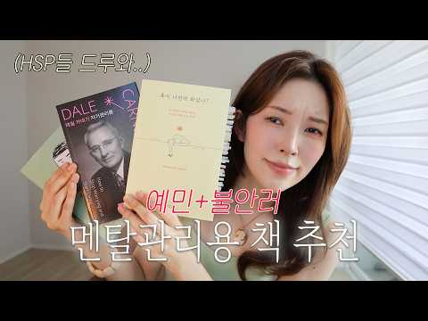
- 챕터: 0:00 intro · 0:07 아주 짧은 근황 업뎃 · 0:39 오늘의 주제 · 1:29 다독인 아님 주의 · 1:53 첫번째 책 · 3:01 최애 문장들 · 3:11 최애 문장(1) · 4:20 최애문장(2) · 5:46 최애문장(3) · 7:04 가장 좋았던 점 · 8:17 두번째 책 · 9:19 최애문장(1) · 9:42 최애문장(2) · 10:32 최애문장(3) · 11:24 가장 좋았던 점 · 11:37 마지막 책 · 14:23 마무리
- 설명 앞부분: 오늘도 영상 봐주셔서 고맙슙니다 여러분💗
- 대본 없음 (설명) — 음성인식이 끝나면 도입부·흐름이 들어감
- 댓글 25/25: 좋은 점 — 영상 1 · 감사·응원 0 · 더 알고 싶은 것 2 · 아쉬운 점 — 영상 0 · 반박·불만 — 의견 다름 0 · 정치·사회 0 · 경험 공유 4 · 구독·다음 기대 0
  - 좋은 점 — 영상 👍0 “유익해요 ㅎㅎ”
  - 더 알고 싶은 것 👍2 “책추천 영상에서 뜬금없지만 나시탑 어디건지 궁금합니다.. 알려주실수있으실까효??”
  - 더 알고 싶은 것 👍1 “인간관계론 출판사 다영하던데 어디 출판사껄로 읽는 게 좋을까요??”
  - 경험 공유 👍4 “저도 허리디스크 터지니 멘탈진짜 무너지더라고요,,, 아픈건 둘째치고 아무것도 못한다는 그런 생각이 계속맴도니 넘 힘들었네요”
  - 경험 공유 👍1 “자기관리론 진짜 좋아요 저도 몇 번 읽은 책!”

### 53. 서울대 의사가 외롭고 사람이 두려운 이유 [심리상담 풀영상]

- https://www.youtube.com/watch?v=u7BS3D_Sylo · 김지은의 뇌와 마음 · 구독자 12,900 · 조회수 193,181 (×15.0, 하루 6,870.9) · 좋아요 1,054 (0.5%) · 48.4분 · 2026-10-14 · 주제 묶음 1. 심리학 일반 · 형식 인터뷰·강연·대담 (전문가) · 폴더 `W_u7BS3D_Sylo` (웹 승인)
- 썸네일: 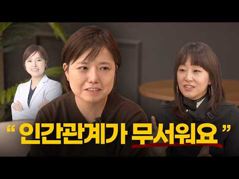
- 설명 앞부분: 🌟김지은 교수님 상담 프로그램 우리는 종종 심리적 어려움의 해결책을 조언이나 구체적인 지침에서 찾으려 합니다. 방송에서 유명인들이 제시하는 명쾌한 해답이 매력적으로 보이는 이유이기도 합니다. 제가 생각하는 상담의 진정한 힘은, 특정한 지시보다 어떤 맥락에서 어떤 만남이 이루어지는가에 있는 경우가 많습니다. 판단 받지 않는 진솔하고 수용적인 신뢰의 맥락 속에서 스스로 두려움을 견뎌낼 때, 새로운 감정이 생겨나 진정으로 삶으로 향할 수 있는 힘이 생기기도 합니다. 이런 접근의 바탕에는 사람 안에 자신의 삶을 이해하고 더 나아갈 수 있…
- 대본 없음 (설명) — 음성인식이 끝나면 도입부·흐름이 들어감
- 댓글 192/192: 좋은 점 — 영상 8 · 감사·응원 36 · 더 알고 싶은 것 1 · 아쉬운 점 — 영상 1 · 반박·불만 — 의견 다름 3 · 정치·사회 1 · 경험 공유 29 · 구독·다음 기대 0
  - 좋은 점 — 영상 👍30 “사람이 다 잘할 수 없습니다. 본인이 잘하는 걸로 잘 먹고 살면 그만이에요. 돈 잘 버니 요리 못하면 맛있는 거 사먹으면 되는 거고 도우미 고용해서 할 수도 있는 건데 지난날 요리 못한 게 당연히 처음해본 거 못할 수 있는 거에요. 누구보다 공부도 잘해서 의대까지 가…”
  - 좋은 점 — 영상 👍23 “엄마를 많이 사랑하셨나봐요. 엄마를 위해 엄마가 부탁한걸 못해서 거기서 오는 좌절감이 큰것 같아요 엄마의 빈자리도 불안했을거고.. 저는 아이가 느꼈을 감정 너무 이해돼요 그동안 쌓여있던 감정이 그사건으로 드러난듯. 가정사는 모르겠지만”
  - 감사·응원 👍244 “가벼운 마음으로 갔다가 생각보다 많이 꺼내고 왔어요. 독립적이고 싶다는 말 안에 버림받고 싶지 않다는 마음이 붙어 있었다는 거. 그날 처음 알았어요. 선생님, 감사했어요. 다음에 또 봬요. 그땐 6대 4 해볼게요.”
  - 감사·응원 👍100 “친구가 떠난거에 대한 과도한 자책을 하시는군요. 자신의 부족함이나 완벽하지 않아서가 아니고 어릴적 그 혼란스러운 환경속에서도 최선을 다해 버더온 아이였고, 당시 느껐던 버림 받음에 대한 공포와 자책감이 지금까지 남아있기 때문입니다. 누군가가 떠난것은 그 친구의 사정이…”
  - 더 알고 싶은 것 👍3 “선생님에게 상담 치료 받으려면 어떻게 해야 하나요?”
  - 아쉬운 점 — 영상 👍62 “선생님의 솔직함이 범인들에게는 정말 큰 위안이되고.사는게 크게 다르지않은것.그게 삶의 큰기대와 실망이 없이 살게되어 가벼워집니다.정말 고맙습니다!”
  - 반박·불만 — 의견 다름 👍100 “친구가 떠난거에 대한 과도한 자책을 하시는군요. 자신의 부족함이나 완벽하지 않아서가 아니고 어릴적 그 혼란스러운 환경속에서도 최선을 다해 버더온 아이였고, 당시 느껐던 버림 받음에 대한 공포와 자책감이 지금까지 남아있기 때문입니다. 누군가가 떠난것은 그 친구의 사정이…”
  - 경험 공유 👍55 “원장님, 그 친구를 위해서가 아니라 자기 자신을 위해서 하루하루 행복하게 보내시길 바라요. 우정의 서사는 얼마든지 다시 쓸 수 있어요. 중년에 만난 친구는 또 얼마나 새로운데요. 그렇게 새로운 관계를 만들다 보면 옛친구와 다시 마주할 수 있을 거에요. 그 친구도 오랜…”
  - 경험 공유 👍54 “자립심? 독립심? 천성이 착하신분인가봐요. 저라면 왜 이거까지 시키지? 나한테 뭘 해준게 있다고? 아빠의 국을 왜 내가 만들어줘야하지? 나도 보살핌을 받이야하는 존잰데 내가 왜 아빠를 보살펴야하지? 이런 생각에 억울할거 같은데요.”

### 54. 새 차 한 번도 안 사본 사람들, 중고차만 타는 심리 (돈이 없어서가 아닙니다)

- https://www.youtube.com/watch?v=LPV-iqsq2xE · 심리학한줌 · 구독자 14,700 · 조회수 435,427 (×29.6, 하루 7,039.2) · 좋아요 1,876 (0.4%) · 23.6분 · 2026-09-10 · 주제 묶음 1. 심리학 일반 · 형식 정보·해설 (그 밖) · 폴더 `W_LPV-iqsq2xE` (웹 승인)
- 썸네일: 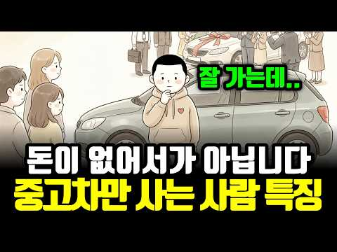
- 설명 앞부분: 차 바꿀 때가 됐는데 또 중고차 매물을 봅니다. 새 차 살 돈은 통장에 그대로 있습니다. 평생 새 차를 한 번도 안 사본 사람들. 형편 때문일까요? 심리학자들은 정반대로 봅니다. 이 영상에서는 중고차만 타는 사람들의 심리를 들여다봅니다. 새 차가 출고장을 나서는 순간 벌어지는 일부터, 신차 매장의 조명과 리본이 파는 것의 정체, 그리고 이 사람들이 20년 동안 통장에 남기는 것까지요.
- 대본 없음 (설명) — 음성인식이 끝나면 도입부·흐름이 들어감
- 댓글 848/848: 좋은 점 — 영상 13 · 감사·응원 16 · 더 알고 싶은 것 6 · 아쉬운 점 — 영상 2 · 반박·불만 — 의견 다름 23 · 정치·사회 2 · 경험 공유 95 · 구독·다음 기대 0
  - 좋은 점 — 영상 👍2 “진짜 공감합니다”
  - 좋은 점 — 영상 👍1 “영상 내용 및 전개과정이 맛있네요 좋은 영상 만들어주셔서 감사해요”
  - 감사·응원 👍120 “Yf택시부활 49만키로 370만원주고사서 8년 고장하나없이타다가 폐차비 150받아서 220만원으로 8년잘타고 ev6풀옵 중고로삼 평생 택부살라햇는데 장거리많이뛰니까 acc좋네요 중고로사는이유는 돈이없어서입니다감사합니다”
  - 감사·응원 👍80 “진짜 새차 사주시는 분께는 감사...”
  - 더 알고 싶은 것 👍1 “다음으로 중고차 절대 안사고 새차만 사는 사람 시점으로 이야기 해주세요”
  - 더 알고 싶은 것 👍0 “중고차만 사는 사람들? 사람들이 과연 차를 바꾸는 것을 얼마나 바꿀까요? 보통 10년이상 타는 사람도 흔하고 15년 이상도 타는데, 인생에 4-5번이나 바꾸려나? 중고차를 산다고 차를 자주 바꾸면 돈을 더 들텐데...중고차를 산다고 해서 자주 바꾸지 않으니, 차를 잘…”
  - 아쉬운 점 — 영상 👍0 “유튜버 목소리가 고저장단이 없어 매우 지루하네 AI인가.......... 만 2년반 된차 중고을 샀는데 여자분이 몰더 차라 내장이 담배냄새도 없고. 외장도 흠집도 없고 엔진룸을 보니 팔려고 닦은 티 없이 말끔해서 바로 구매했네요 sm520 새차 구매이후 중고차 잘 골…”
  - 아쉬운 점 — 영상 👍0 “1년만에 싫증날게 뻔한 차 할부값내고싶지 않음ㆍ 드림카라면 모를까 ㆍ 차는 전액 현금 신차급 중고가 편함”
  - 반박·불만 — 의견 다름 👍52 “면허따고 20년 넘도록 중고차만 구입했네요. 새차사서 쓸데없이 민감해지고 스트레스 받는 게 싫어서 중고차를 구입해서 타고 있습니다. 돈많이 생기면 새차는 글쎄요...차라리 집을 사는데 보태는게 맞다고 생각합니다. 남의 시선에 맞추지 말고 그냥 소모품이라고 생각해서 맘…”
  - 반박·불만 — 의견 다름 👍14 “전 아닙니다. 진짜 가난해서 중고차 탑니다.”
  - 정치·사회 👍0 “윤통은 김문수 지지해달라고 했지 국힘 지지해달라고 한 적 없음”
  - 경험 공유 👍75 “새차사서 14년째 타고 있습니다 😅”
  - 경험 공유 👍6 “차라도 좀 새거 타보자!!! 차빼고 내가 타는 모든게 헌거다!!!”

### 55. 뇌가 달라지는 혼잣말의 비밀, 인생을 바꾸는 뇌과학의 원리

- https://www.youtube.com/watch?v=N9VBE85m_bo · 뇌생각 심리학 · 구독자 8,200 · 조회수 411,736 (×50.2, 하루 3,430.6) · 좋아요 9,697 (2.4%) · 13.1분 · 2026-07-14 · 주제 묶음 1. 심리학 일반 · 형식 정보·해설 (그 밖) · 폴더 `W_N9VBE85m_bo` (웹 승인)
- 썸네일: 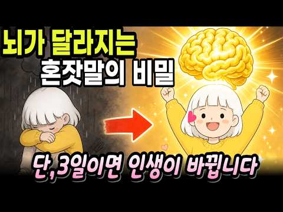
- 챕터: 0:00 ☕ 커피 한 잔 쏟은 아침, 툭 튀어나온 그 한마디 · 1:50 📺 내 하루의 리모컨은 누가 쥐고 있을까? · 2:53 💰 세계 최고 부자가 매일 반복하는 그 말 · 4:04 🔀 똑같은 하루가 완전히 달라지는 이유 · 4:38 📚 세 번 미끄러진 그분에게 찾아온 반전 · 5:26 🧠 실험실에서 밝혀진 놀라운 3일의 비밀 · 7:02 🔊 왜 '소리 내서' 말해야 할까 · 7:41 💡 첫 번째 방법 — 이선 크로스의 처방 · 9:21 🚪 두 번째 방법 — 두 글자로 열리는 문 · 9:53 ⭐ 세 번째 방법 — 잠들기 전 3분의 기적
- 설명 앞부분: ☕ 아침에 커피 한 잔 쏟았을 뿐인데… 왜 그 한마디가 하루 종일 나를 따라다닐까요? "아이고, 내가 하는 일이 그렇지 뭐." "그럼 그렇지, 내가 뭘 제대로 하는 게 있나." 혹시 오늘 아침에도, 자기도 모르게 이런 말이 툭 나오셨나요? 😔 여러분이 유독 덤벙거려서도, 하는 일마다 안 풀려서도 아닙니다. 그 한마디에는요, 우리가 몰랐던 뇌의 비밀이 숨어 있어요. 🧠✨ 🎬 이 영상에서 나누는 이야기 "말이 씨가 된다"는 옛말, 뇌과학이 진짜로 증명한 이유 ✅ 내 하루를 바꾸는 뇌 속 리모컨 '망상 활성계'의 정체 ✅ 빌 게이츠가 …
- 대본 없음 (설명) — 음성인식이 끝나면 도입부·흐름이 들어감
- 댓글 540/540: 좋은 점 — 영상 46 · 감사·응원 135 · 더 알고 싶은 것 6 · 아쉬운 점 — 영상 2 · 반박·불만 — 의견 다름 1 · 정치·사회 0 · 경험 공유 18 · 구독·다음 기대 2
  - 좋은 점 — 영상 👍91 “참 좋은 영상입니다. 수많은 성공학, 영성책들을 과학적 근거를 들어 아주 간단하고 쉽게 잘 요약한 액기스 같은 영상입니다. 거짓과 부풀림이 난무하는 유튜브에 이런 영상도 있네요. 좋은 영상 감사 드리고 앞으로도 사람들을 이롭게 하는 좋은 영상 많이 부탁드립니다.”
  - 좋은 점 — 영상 👍15 “감사함니다 비 많이 오는 시절 임니다 건강 잘 챙기시구 좋은 영상 잘 듣고 감니다”
  - 감사·응원 👍129 “난 정말 운이좋아.. 그러니까 나이 7ㅣ 인데 일을하고있지. 왼쪽무릎이 아픈데 .. 걸을수있으니 감사하네”
  - 감사·응원 👍91 “참 좋은 영상입니다. 수많은 성공학, 영성책들을 과학적 근거를 들어 아주 간단하고 쉽게 잘 요약한 액기스 같은 영상입니다. 거짓과 부풀림이 난무하는 유튜브에 이런 영상도 있네요. 좋은 영상 감사 드리고 앞으로도 사람들을 이롭게 하는 좋은 영상 많이 부탁드립니다.”
  - 더 알고 싶은 것 👍91 “참 좋은 영상입니다. 수많은 성공학, 영성책들을 과학적 근거를 들어 아주 간단하고 쉽게 잘 요약한 액기스 같은 영상입니다. 거짓과 부풀림이 난무하는 유튜브에 이런 영상도 있네요. 좋은 영상 감사 드리고 앞으로도 사람들을 이롭게 하는 좋은 영상 많이 부탁드립니다.”
  - 더 알고 싶은 것 👍9 “그런게 연습으로 되나요? 예수님 믿으시면 저절로 말이 변해요❤❤”
  - 아쉬운 점 — 영상 👍39 “오늘도 다시 듣습니다.. 반복해서 들어야 생각이 납니다. "너는 참 복 많다.인덕이 많다" 하는 말이.. 돌아가신 어머니께서 해주시는 것 같아요..진짜 느껴져요”
  - 아쉬운 점 — 영상 👍1 “🎉정말 명강이었네요.. 이미 알고 있는 내용이기도 했지만 속으로만 확언을 하고 있었는데 아침에 강의 듣고 좋아서 입밖으로 긍정말을 한번 실천해보자 생각했어요. 오늘 체육대회에서 5만원 상품권 응모를 했는데 받고 싶은 마음에 나는 운이 좋다. 당첨되길 바라며 제 이름을…”
  - 반박·불만 — 의견 다름 👍2 “참으로 신기해요 지금까지 살면서 이 영상을 본것도 아닌데 합습하듯이 살고 있었네요 1. ㅇㅇ야! 스스로 내이름을 부르며 너 잘 해내고 있어 2.아직이지만 언젠가 이뤄질거야 3.그날 있었던 일 중에서 다소 안 좋았더라도 이만해서 다행이야. 사소한 것에도 이건 기적이야.…”
  - 경험 공유 👍109 “여호와는 나의목자시니 내가부족함이 없으리로다!!🙏”
  - 경험 공유 👍22 “오늘 좋았던 일 1.오늘 온양 장날구경가려고 계획했는데 날씨가 맑고 화창했슴 2.온양온천행 고속버스를 타고보니 옆자리가 비어서 편하게 갔슴 3.온천시설을 리모델링 했는지 무척 깨끗해져서 기분이 좋았슴 4.온양시내버스에서 목발을 하신분이 타서 나도 72살이지만 자리를 …”
  - 구독·다음 기대 👍20 “형민! 너는 고시원에서 혼자 살고있지만 1.편히 쉴곳이 있어서 고맙습니다 2.매일 일할곳이 있어서 고맙습니다 3.아픈데가 없이 건강해서 고맙습니다 4.아침에 창문열고 하늘을 볼수있어 고맙습니다 5.오늘은 친구와점심약속이있어서 기다려집니다 이 역시 고맙습니다❤”
  - 구독·다음 기대 👍1 “좋은말씀과정보 감사합니다 처음 들어왔는데 좋아서 구독합니다”

### 56. 친했던 친구가 나이들수록 불편해지는 진짜 이유 ∣ 심리학이 밝힌 과학적 이유

- https://www.youtube.com/watch?v=O5jemCtVpp0 · 지혜이정표 · 구독자 5,050 · 조회수 239,974 (×47.5, 하루 2,008.2) · 좋아요 818 (0.3%) · 29.3분 · 2026-07-14 · 주제 묶음 1. 심리학 일반 · 형식 정보·해설 (그 밖) · 폴더 `W_O5jemCtVpp0` (웹 승인)
- 썸네일: 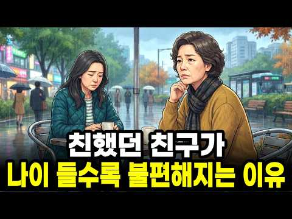
- 설명 앞부분: 삼십 년 알고 지낸 친구인데, 만나고 돌아오면 반가움보다 피곤이 먼저 옵니다. 싫은 건 아니에요. 미운 것도 아니고요. 근데 어느 순간부터 같이 있으면 편하지가 않은 거예요. 이 영상에서는 오래된 친구가 왜 불편해지는지, 그 안에 어떤 심리학적 구조가 숨어 있는지 이야기합니다. 결혼 전에는 왜 몰랐을까? 던바의 '우정의 7가지 기둥'과 가치관 충돌의 구조 불편한 우정이 건강에 미치는 영향 (미시간주립대 6년 추적 연구) 카스텐슨 교수의 사회정서적 선택 이론 이 나이에 진짜 맞는 친구는 어디서, 어떻게 만날 수 있는지 Kalmijn…
- 대본 없음 (설명) — 음성인식이 끝나면 도입부·흐름이 들어감
- 댓글 100/100: 좋은 점 — 영상 2 · 감사·응원 6 · 더 알고 싶은 것 0 · 아쉬운 점 — 영상 1 · 반박·불만 — 의견 다름 0 · 정치·사회 0 · 경험 공유 16 · 구독·다음 기대 0
  - 좋은 점 — 영상 👍8 “끊지도 않고 매달리지도 않고.. 이 구절이 와닿네요 애씀이 필요한 만남은 이제 피하게 됩니다 편안한 친구 한두명이면 충분~”
  - 감사·응원 👍9 “40년 친구가 있어요 10년은 안 만났죠 제가 그만 만나자고 했거든요 넘 외로워서.. 제가 먼저 연락한지 6년째.. 여전히 안 맞지만 맞추어 가고 있담니다 그런데 3주일 전에 전라도 장수에 갈일 있어서 집 오는길에 친구네 친정이 무주 라서 휴게소 들러 빵 사고 용돈 …”
  - 감사·응원 👍2 “좋아요 감사합니다”
  - 아쉬운 점 — 영상 👍3 “으 내용 너무 길고 진부하다”
  - 경험 공유 👍18 “그래서 나이들수록 보고싶은데 내가보고싶은건 그때00지 절대지금의00는될수없음을 깨닭고 그냥 말뿐인 밥한번먹자.언제꼭보자라는 습관성인사만 하게되더군요.”
  - 경험 공유 👍15 “맏며느리 34년차. 지긋지긋하다. 21살 차이나는 시어머니랑 같이 늙어가네ㅠ 주제이탈 죄송😢”

### 57. 힘든 삶에서, 괴롭지 않기 위한 인지심리학적 대처법

- https://www.youtube.com/watch?v=HJXEgD2m2r8 · 홍승주의 디스턴싱 · 구독자 29,400 · 조회수 499,969 (×17.0, 하루 11,622.9) · 좋아요 2,572 (0.5%) · 26.5분 · 2026-09-29 · 주제 묶음 1. 심리학 일반 · 형식 정보·해설 (그 밖) · 폴더 `W_HJXEgD2m2r8` (웹 승인)
- 썸네일: 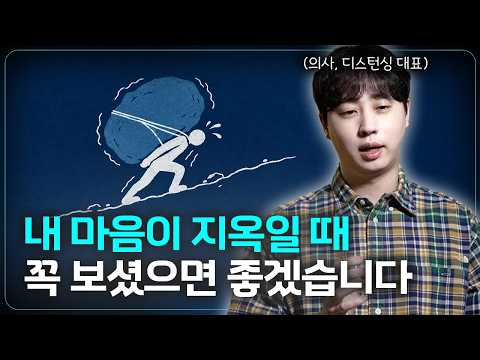
- 챕터: 0:00 #1. 고통스러운 인간 · 1:26 #2. 삶 자체가 어느 정도는 힘들 수밖에 없습니다 · 4:03 #3. 생각은 고통을 만듭니다 · 9:54 #4. 자아도 고통을 만듭니다 · 12:37 #5. 고통의 보편성을 분명히 보기 · 17:56 #6. 고통에 고통을 더하지 않기 · 20:38 #7. 고통을 다시 바라보기
- 설명 앞부분: 서울의대 출신 의사가 만든 디지털 인지치료 프로그램, 디스턴싱 인간은 자신의 삶을 변화시킬 역량과 잠재성을 가지고 있습니다. 우리는 사람들이 스스로의 치료자가 되도록 돕습니다. ⏰ 타임스탬프
- 대본 없음 (설명) — 음성인식이 끝나면 도입부·흐름이 들어감
- 댓글 163/163: 좋은 점 — 영상 21 · 감사·응원 28 · 더 알고 싶은 것 5 · 아쉬운 점 — 영상 1 · 반박·불만 — 의견 다름 0 · 정치·사회 0 · 경험 공유 20 · 구독·다음 기대 1
  - 좋은 점 — 영상 👍14 “선생님의 강의는 상투적이지 않고 새로운 관점으로 신선하고 매우 유용합니다 큰 도움이 됩니다.앞으로도 잘 부탁드립니다. 필기하면서 복기하며 잘 듣고 있습니다 감사드립니다 😊”
  - 좋은 점 — 영상 👍12 “불교에서 이야기하는 알아차림과 궤를 같이하는 것 같습니다. 내용이 매우 알차고 많은 도움이 되네요! 감사합니다”
  - 감사·응원 👍72 “선생님 영상이 다른 심리학 채널과 다른 점은 개별적인 사례 접근 보다는 큰 틀에서의 접근인 점인 것 같아요. 그래서 아 사람은 원래 그렇구나.. 개인적으로 불편한 일일 순 있지만 심각한 일은 아니구나 싶어져요. 그래서 안도되는 마음도 가집니다. 오늘도 영상 감사합니다.”
  - 감사·응원 👍28 “큰 위로가 되었습니다. 대학 졸업반부터 엄마의 병간호를 통해 헤쳐나가야할 무서운 사회생활로부터 도망쳤는데 엄마가 돌아가시고나니 나에게 남은건 없이 나이만 먹었더군요. 어머니의 부재로 인한 두려움과 외로움과 고통. 사회적 위치에서 무능함에 대한 공포와 고통. 허우적거리…”
  - 더 알고 싶은 것 👍14 “선생님의 강의는 상투적이지 않고 새로운 관점으로 신선하고 매우 유용합니다 큰 도움이 됩니다.앞으로도 잘 부탁드립니다. 필기하면서 복기하며 잘 듣고 있습니다 감사드립니다 😊”
  - 더 알고 싶은 것 👍6 “오늘도 좋은 영상 감사합니다. 강박성 성격이랑 일중독에 대해서도 다뤄주시면 좋을것같아요!”
  - 경험 공유 👍64 “삶에 '희망'이 없을 때 정신은 무너지는 것 같습니다. 내일이 오늘보다 나아질꺼라는 희망, 나도 어디가서 1인분은 하고 살 수 있을꺼란 희망... 희망은 도파민 같아요. 내가 마음 속에 그리고 바라는 것을 이룰 수 있다는 그 불씨가 피어나기 시직할 때, 우리는 역경 …”
  - 경험 공유 👍19 “커다란 상실들을 겪고 마음이 괴로워 치료받고 있는 사람입니다 오늘 병원가서 약물을 조절하고 왔네요 너무 지쳐서 가슴이 두근거려 가만히 누워 영상을 듣는데 위로가 되었어요 감사합니다”
  - 구독·다음 기대 👍2 “목소리차분하게 설명해주셔서 좋네요 구독했어요”

### 58. 누구든 끌어당기는 심리학적 방법 (절대 악용하지 마세요) ∣ 연애 다크심리학

- https://www.youtube.com/watch?v=1owmdus3_pw · 숨겨진심리학 · 구독자 37,500 · 조회수 366,686 (×9.8, 하루 14,755.9) · 좋아요 2,549 (0.7%) · 25.7분 · 2026-10-17 · 주제 묶음 1. 심리학 일반 · 형식 목록형 (N가지 특징·신호) · 폴더 `W_1owmdus3_pw` (웹 승인)
- 썸네일: 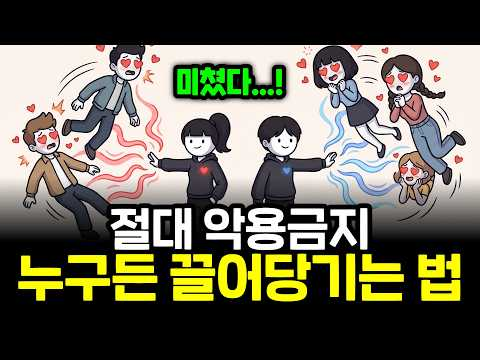
- 설명 앞부분: 잘해 줄수록 밀리는 이유가 있습니다. 심리학에서 매력은 결정이 아니라 반응이고, 반응이 일어나는 조건은 세 가지입니다. 귀하고(희소성), 다르고(대조), 나한테만 왔다고 느끼게(상호성). 잘해 주기만 하는 사람은 이 세 조건을 전부 거꾸로 만듭니다. 이 세 조건 위에서 누구든 끌어당기는 사람들의 공통점 일곱 가지를 정리했습니다. 항목마다 연구와 진짜·흉내 구분법, 그리고 당신이 할 일 하나가 있습니다. 일곱 번째는 앞의 여섯 개를 전부 가짜로 만들거나 전부 진짜로 만드는 것입니다. 참고 연구 Worchel, Lee & Adewol…
- 대본 없음 (설명) — 음성인식이 끝나면 도입부·흐름이 들어감
- 댓글 102/101: 좋은 점 — 영상 6 · 감사·응원 2 · 더 알고 싶은 것 4 · 아쉬운 점 — 영상 0 · 반박·불만 — 의견 다름 2 · 정치·사회 0 · 경험 공유 11 · 구독·다음 기대 1
  - 좋은 점 — 영상 👍4 “여러분 이 내용 퀄리티가 장난 아닙니다ㅋ 꼭 연구해보고 나를 빗대어보고 이런 사람이 되게끔 노력해봐요 너무 좋은 내용이네요 건강한 개인을 넘어 건강한 사회까지도 될 수 있는 내용들입니다”
  - 좋은 점 — 영상 👍4 “팬입니다~ 🥰❤️ 사람의 마음을 움직이는 건 거창한 말이나 특별한 기술이 아니라, 결국 상대를 진심으로 이해하고 존중하는 마음이라는 생각이 들었어요. 처음에는 사람을 끌어당기는 심리학적 방법이 궁금해서 영상을 보기 시작했는데, 다 보고 나니 오히려 제 자신을 돌아보게…”
  - 감사·응원 👍4 “팬입니다~ 🥰❤️ 사람의 마음을 움직이는 건 거창한 말이나 특별한 기술이 아니라, 결국 상대를 진심으로 이해하고 존중하는 마음이라는 생각이 들었어요. 처음에는 사람을 끌어당기는 심리학적 방법이 궁금해서 영상을 보기 시작했는데, 다 보고 나니 오히려 제 자신을 돌아보게…”
  - 더 알고 싶은 것 👍4 “팬입니다~ 🥰❤️ 사람의 마음을 움직이는 건 거창한 말이나 특별한 기술이 아니라, 결국 상대를 진심으로 이해하고 존중하는 마음이라는 생각이 들었어요. 처음에는 사람을 끌어당기는 심리학적 방법이 궁금해서 영상을 보기 시작했는데, 다 보고 나니 오히려 제 자신을 돌아보게…”
  - 더 알고 싶은 것 👍2 “자기 삶이 있으니 연락이 안 되고, 상대 반응을 신경 안 쓰니 예측대로 안 움직이고, 인정이 필요하지 않으니 안 갈구하고, 대가를 안 바라니 그냥 주고, 거절이 안 두려우니 약점을 보여도 상관없고, 세상이 궁금하니 사람도 궁금하다.”
  - 반박·불만 — 의견 다름 👍4 “여러분 이 내용 퀄리티가 장난 아닙니다ㅋ 꼭 연구해보고 나를 빗대어보고 이런 사람이 되게끔 노력해봐요 너무 좋은 내용이네요 건강한 개인을 넘어 건강한 사회까지도 될 수 있는 내용들입니다”
  - 반박·불만 — 의견 다름 👍1 “결혼한 사람으로서 별로 동의 안됩니다. 심리학을 따져서 사귀는 사람과 과연 맺어질수 있을까....? 아니면 그냥 많은 사람을 문어다리처럼 사귀고 싶나??? 그렇다면 필요하겠네요. 그런 사람 중에 정말 친한 친구이자 동반자를 과연 만날지는 모르겠지만”
  - 경험 공유 👍5 “제 특징인데 인기 많았던 이유를 알 것 같아요. 이성도 그랬지만 동성들도 저를 좋아해요. (따라하고 관찰당하는 느낌에 가깝지만) 사실 인간의 메커니즘을 이해하면 굉장히 납득가능하고 설명가능한 내용이라고 생각해요. 제가 좋아했던 사람들도 돌이켜보니 이런 점들이 다분했던…”
  - 경험 공유 👍4 “이거 어려운이유가 뭔지알음? 그냥 껍데기로만 이런척하고 저렇게 말하고가아니라 진짜로 바쁘고 열심히살고 상대가 배울만한 사람이 되라는거임. 내가 무리에서 존중받는 사람이 되면내 무관심역시 내가 바빠서 자연스럽게 나오는것이되고 꾸민것이 아니게됨. 그런데 이게 아주 힘든일…”
  - 구독·다음 기대 👍4 “팬입니다~ 🥰❤️ 사람의 마음을 움직이는 건 거창한 말이나 특별한 기술이 아니라, 결국 상대를 진심으로 이해하고 존중하는 마음이라는 생각이 들었어요. 처음에는 사람을 끌어당기는 심리학적 방법이 궁금해서 영상을 보기 시작했는데, 다 보고 나니 오히려 제 자신을 돌아보게…”

### 59. 단기간에 확 친해지는 법 4가지

- https://www.youtube.com/watch?v=yGsOqn4ky4I · 김덤덤 · 구독자 7,630 · 조회수 220,950 (×29.0, 하루 2,985.2) · 좋아요 3,919 (1.8%) · 4.9분 · 2026-08-29 · 주제 묶음 기타 · 형식 목록형 (N가지 특징·신호) · 폴더 `W_yGsOqn4ky4I` (웹 승인)
- 썸네일: 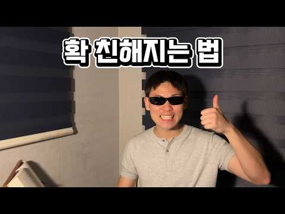
- 챕터: 0:00 1. 정보 말고 감정을 나누기 · 0:32 2. 특별한 존재로 느끼게 하는 법 · 1:05 3. 같이 겪기 · 1:35 대화의 한계 · 2:31 4. 만나게 하는 법 · 3:06 연락하는 법 1 · 3:28 연락하는 법 2 · 4:00 제일 중요한 것
- 설명 앞부분: 친하다는 건 결국, 내가 상대를 알고 상대도 나를 아는 겁니다. 그럼 사람을 가장 빠르게 알아가는 가장 확실한 방법은 무언가를 같이 경험하는 겁니다.
- 대본 없음 (설명) — 음성인식이 끝나면 도입부·흐름이 들어감
- 댓글 87/87: 좋은 점 — 영상 4 · 감사·응원 5 · 더 알고 싶은 것 1 · 아쉬운 점 — 영상 0 · 반박·불만 — 의견 다름 1 · 정치·사회 0 · 경험 공유 9 · 구독·다음 기대 2
  - 좋은 점 — 영상 👍10 “이 영상은 진짜 사회성없는 사람들이랑 한마디도 못하는 그런 완전 내향형인 사람들한테 도움되는 영상일듯. 일반사람들이 이거 썻다간 상대방이 너무 피곤해짐”
  - 좋은 점 — 영상 👍0 “그동안 막연히 갖고 있던 생각들을 5분짜리로 정리해 주셨네요 가끔 기억나면 다시 봐야겠습니다 도움이 됐습니다”
  - 감사·응원 👍12 “사람들을 많이 만나고와도 한편으로는 외로운 느낌이 든 이유를 알았다... 진짜 내 모습을 보여주지 못했기 때문에 ㅠ 다음엔 내 안에 있는 모습을 조금씩 더 오픈해볼까합니다. 감사합니담다디담~❤”
  - 감사·응원 👍3 “처음 친해질 때 연락도 하면 더 친해질 수 있잖아요. 근데 연락을 어떻게 해야할지 모르겠어요. 꼭 이성에게 연락하겠다가 아니라 사람으로서 연락을 이어가는 법에 대해 영상 다뤄주시면 감사하겠습니다. 또 관계 유지 방법도 다루면 좋을거 같아요”
  - 더 알고 싶은 것 👍3 “처음 친해질 때 연락도 하면 더 친해질 수 있잖아요. 근데 연락을 어떻게 해야할지 모르겠어요. 꼭 이성에게 연락하겠다가 아니라 사람으로서 연락을 이어가는 법에 대해 영상 다뤄주시면 감사하겠습니다. 또 관계 유지 방법도 다루면 좋을거 같아요”
  - 경험 공유 👍218 “내가 너무 힘들땐 힘든 얘기 해준 친구가 고마운걸 알면서도 몸과 뇌가 거부하더라 안들어줬다고 서운해하진 말자”
  - 경험 공유 👍121 “저도 그런 사람인데 너무 빨리 친해지니까 나중에 가서 할말이 없더라고요 전 이런 성격 때문에 관계를 유지하기가 훨씬 어렵습니다.. 개인적으론 역시 천천히 각자의 속도대로 친해지는게 훨씬 베스트라고 생각합니다..”
  - 구독·다음 기대 👍3 “오 왜 알고리즘이 추천했는진 몰라도 맨인블랙 선글라스에서 약간 신뢰가 떨어졌는데 내용은 꽤 알차군요 구독했습니다😂”
  - 구독·다음 기대 👍0 “형 구독했어요. 사랑해요❤”

### 60. 사별 스트레스는 인간의 신체를 어디까지 무너뜨릴 수 있을까

- https://www.youtube.com/watch?v=LQKzsAU_yxk · 수진배 Jinbae’s Vlog · 구독자 15,800 · 조회수 252,309 (×16.0, 하루 5,628.9) · 좋아요 1,371 (0.5%) · 27.8분 · 2026-09-27 · 주제 묶음 6. 정신건강 · 형식 정보·해설 (그 밖) · 폴더 `W_LQKzsAU_yxk` (웹 승인)
- 썸네일: 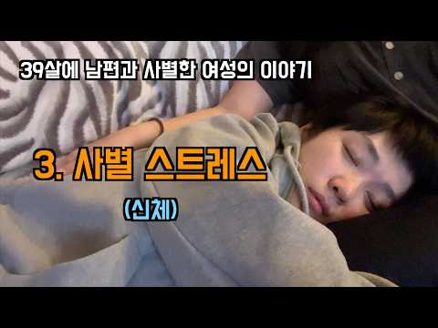
- 설명 앞부분: 안녕하세요, 진배입니다. 그동안 채널에 올라왔던 소소한 일상 영상들을 보시며 제가 어떤 시간들을 통과해 왔는지 궁금해하셨던 분들이 계셨을 텐데, 오늘은 오랜 시간 묵묵히 기다려주신 분들께 제 오랜 비밀이자 기묘했던 기록을 털어놓으려 합니다. 사랑하는 사람, 주로 배우자나 가족을 잃은 뒤 유족이 겪게 되는 복합적인 고통을 '사별 스트레스'라고 부릅니다. 저는 이 사별 스트레스를 남들보다 조금 더 지독하게 겪어낸 편이었습니다. 뇌와 마음이 무너지니, 온몸의 신경과 잇몸, 심장까지 제멋대로 비명을 지르기 시작하더군요. 기억조차 온전하지…
- 대본 없음 (설명) — 음성인식이 끝나면 도입부·흐름이 들어감
- 댓글 112/112: 좋은 점 — 영상 2 · 감사·응원 29 · 더 알고 싶은 것 2 · 아쉬운 점 — 영상 0 · 반박·불만 — 의견 다름 0 · 정치·사회 1 · 경험 공유 31 · 구독·다음 기대 2
  - 좋은 점 — 영상 👍5 “스스로 목숨을 끊고 싶은 사람에게도 많이 도움이 될 영상이네요 영상 만들어주셔서 감사합니다.”
  - 좋은 점 — 영상 👍0 “좋았던 일, 아팠던 일 다시금 생각하고 이야기하는 일이 쉽지 않지만 진배님이 앞으로 나아가는데 도움이 될 것 같아요. 정말 현명하게 행복을 향해 나아가고 있는 것 같아서 좋아요!”
  - 감사·응원 👍237 “저도 45살에 남편을 작년에 잃었어요 ㅠ 연애 7년 결혼생활 13년 20년을 함께 했네요. 전 아이들이 2명있어서 이게 다행인지 불행인지 ㅠ 전 살아야하는이유가 분명해서 슬픔도 몰랐던것 같아요 !! 이제 좋은분 만나서 행복한 가정 이루길 기도합니다 !! 행복하세요❤아…”
  - 감사·응원 👍107 “수진배님 저는 40대에 아내를 잃은 상황으로 방송을 보다 ... 사별이라는 슬픔... 저도 제아내 잃었을때..귀와 눈이 시력이 안보였었어요... 지금은 좀 좋아졌습니다. 왜 나에게 이런 고통을... 아무도 그 고통 간접적으로 위로하나 그들은 모릅니다 본인말고는.,..…”
  - 더 알고 싶은 것 👍7 “진배님 영상을 보다가 조금 궁금해서 댓글 남겨봐요! 길에서 길고양이 똥은 생각보다 거의 잘 보이지 않아요. 😅 고양이는 배변 후 모래나 흙으로 덮어서 자신의 냄새를 감추려는 습성이 있기때문이죠 또한 고양이 똥 역시 시간이지나 수분이 마르면 냄새가 거의 안나는편입니다.…”
  - 더 알고 싶은 것 👍1 “그간 너무나 고생이 많으셨네요..저도 큰 트라우마로 부정맥을 갖게되었는데 이런 큰 스트레스로 심장에 이상이 오는게 저만 그런게 아니었군요.. 실례가 안된다면 부정맥종류는 무엇이었고 치료방안이 있을까요?”
  - 경험 공유 👍237 “저도 45살에 남편을 작년에 잃었어요 ㅠ 연애 7년 결혼생활 13년 20년을 함께 했네요. 전 아이들이 2명있어서 이게 다행인지 불행인지 ㅠ 전 살아야하는이유가 분명해서 슬픔도 몰랐던것 같아요 !! 이제 좋은분 만나서 행복한 가정 이루길 기도합니다 !! 행복하세요❤아…”
  - 경험 공유 👍107 “수진배님 저는 40대에 아내를 잃은 상황으로 방송을 보다 ... 사별이라는 슬픔... 저도 제아내 잃었을때..귀와 눈이 시력이 안보였었어요... 지금은 좀 좋아졌습니다. 왜 나에게 이런 고통을... 아무도 그 고통 간접적으로 위로하나 그들은 모릅니다 본인말고는.,..…”
  - 구독·다음 기대 👍18 “예전부터 수진배님 팬이에요 예전에도 좋아했고 지금도 좋아해요 여전히 수진배님의 밝고 긍정적인 에너지가 남아 있어요 힘내세요..”
  - 구독·다음 기대 👍1 “인스타에서 우연히 보고 구독해서 영상 정주행했어요, 점점 밝아지시는 것 같아 다행입니다. 저도 항상 응원하고 지켜보겠습니다! 더없이 행복해지시길 간절히 바랄게요 진배님🪽🤍”

### 61. 책을 많이 읽어도 다 까먹는 이유: 뇌과학이 증명한 '상위 1%' 독서법

- https://www.youtube.com/watch?v=SvaeYOay0Kc · 그리는 심리학 · 구독자 4,910 · 조회수 275,184 (×56.0, 하루 1,698.5) · 좋아요 4,866 (1.8%) · 16.6분 · 2026-06-02 · 주제 묶음 1. 심리학 일반 · 형식 정보·해설 (그 밖) · 폴더 `W_SvaeYOay0Kc` (웹 승인)
- 썸네일: 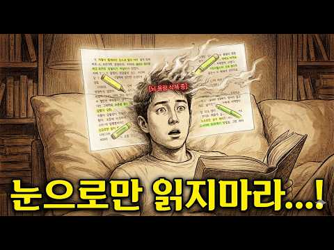
- 챕터: 0:00 책을 덮고 10분 뒤, 당신의 뇌가 정지하는 이유 · 2:15 텍스트 정보를 99% 삭제하는 '해마'의 소름 돋는 … · 4:02 현대인을 바보로 만드는 가장 무서운 적, '유창성 착… · 6:18 카톡 알림 1초가 당신의 뇌(작업 기억)에 가하는 융… · 8:10 솔루션 ① 뇌에 의도적인 고통을 가하라 (능동적 회상) · 9:45 솔루션 ② 천재 물리학자의 절대 비기 (파인만 기법과… · 11:20 솔루션 ③ 망각의 중력을 이겨내는 고속도로 (분산 반… · 13:05 스키밍 독서를 멈추고 지능의 통제권을 되찾는 법
- 설명 앞부분: 1시간 동안 집중해서 책을 읽었는데, 책을 덮자마자 머릿속이 하얗게 백지가 되시나요? 그건 당신의 머리가 나빠서가 아니라, 뇌가 당신을 완벽하게 속이고 있는 '유창성 착각' 때문입니다. 우리의 뇌는 수백만 년 동안 생존에 직결된 시각과 감정만 기억하도록 진화했습니다. 하얀 종이 위의 고상한 텍스트는 뇌의 입장에서 '가차 없이 버려야 할 쓰레기 정보'일 뿐입니다. 특히 작가가 친절하게 써둔 글을 눈으로 매끄럽게 읽으며 밑줄을 긋는 행위는, 내 뇌에 지식이 쌓였다고 착각하게 만드는 가장 악랄한 함정입니다. 오늘 '그리는 심리학'에서는…
- 대본 없음 (설명) — 음성인식이 끝나면 도입부·흐름이 들어감
- 댓글 261/261: 좋은 점 — 영상 18 · 감사·응원 29 · 더 알고 싶은 것 3 · 아쉬운 점 — 영상 9 · 반박·불만 — 의견 다름 2 · 정치·사회 0 · 경험 공유 8 · 구독·다음 기대 0
  - 좋은 점 — 영상 👍45 “아이고! 좋은 내용인데 배경음악이 너무 커서 잘 안들려요. 배경 음악좀 줄여주시면 더 좋겠어요..”
  - 좋은 점 — 영상 👍6 “좋고 유익한 정보인데 배경음악이 너무 커서 집중이 안됩니다 그래도 좋아요 눌러요”
  - 감사·응원 👍5 “그림이 정말 친절하네요. 잘 듣게되네요 감사합니다 😊”
  - 감사·응원 👍5 “영상 감사 합니다 참조 왜 책을 읽어도 기억하지 못할까? 유창성 착각(Fluency Illusion): 작가가 쓴 글을 눈으로 매끄럽게 읽으며 고개를 끄덕이는 행위가 마치 지식을 내 것으로 만들었다고 뇌를 속이는 현상입니다 뇌의 생존 기제: 우리 뇌는 생존에 직결된 …”
  - 더 알고 싶은 것 👍0 “책의 종류가 워낙 많아서 이런 훈련을 하기에 적합한 책을 몇권 추천해 주시면 더 도움이 될거 같아요.”
  - 더 알고 싶은 것 👍0 “배경음악 없는 버전으로 부탁드립니다.”
  - 아쉬운 점 — 영상 👍3 “메시지는 좋은데 ai 이미지가 아쉽네요. 그냥 평범한 풍경사진이나 올려주면 어떨까요. 내용 공김되서 좋았습니다.”
  - 아쉬운 점 — 영상 👍3 “BGM 때문에 못 듣겠네요. 아쉽네요.”
  - 반박·불만 — 의견 다름 👍2 “아닌데요 잘만 기억하는데”
  - 반박·불만 — 의견 다름 👍0 “ㅎㅎㅎ 좋습니다 여기서 중요한건 그 도마가 작다는데. ㅋ. 맞는거 같아요. 그건 의식무대 겠죠. 그도마에 계속 올려놓는게 중요하다고 보고요. 화상인데 꼭 고통속에 화상만이 있는건ㅊ아닙니다 술로싱킹으로 고통을 최소화하며 그과정을 이겨내는 방법도 있다고 생각합니다. 다만…”
  - 경험 공유 👍19 “남에게 직접 가르쳐 보면 내가 얼만큼 알고 이해하고 있는지 알게 된다.”
  - 경험 공유 👍2 “4분 까지 듣다가 내가 이걸 왜 보고있지 생각이 듬. 목도리도 졸립고 배경음도 졸립고”

### 62. 요양원에 자식들 발 끊긴 부모 특징 #정신과 #정신과의사 #가족 #부모갈등 #부부갈등 #관계 #형제갈등 #심리상담

- https://www.youtube.com/watch?v=w86qO4EjXWM · Dr.전미경의 닥전TV · 구독자 29,400 · 조회수 221,809 (×7.5, 하루 10,079.7) · 좋아요 1,252 (0.6%) · 21.8분 · 2026-10-20 · 주제 묶음 6. 정신건강 · 형식 인터뷰·강연·대담 (전문가) · 폴더 `W_w86qO4EjXWM` (웹 승인)
- 썸네일: 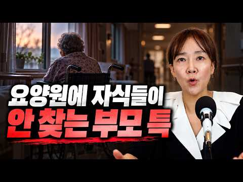
- 설명 앞부분: ❝25년간 10만 명의 삶을 바꾼 전미경 원장의 소통 처방전❞ 📕『멈출수록 관계가 살아나는 말 심리』 출간! 🖐️이런 순간, 한 번이라도 있었다면 이 책이 당신의 말을 바꿔드립니다! 인간관계에서 말로 인한 갈등을 반복하는 사람 말이 의도와 다르게 전달되어 오해받는 사람 대화 습관을 바꾸고 싶지만, 구체적인 방법을 모르는 사람 가까운 사람일수록 말이 더 어려운 사람 사과해야 할 순간에 말문이 막히는 사람 애쓸수록 오해만 쌓이는 당신을 위한 1초의 멈춤, 소통의 관점을 바꾸는 대화 심리학 지금 서점에서 만나보세요!
- 대본 없음 (설명) — 음성인식이 끝나면 도입부·흐름이 들어감
- 댓글 210/210: 좋은 점 — 영상 16 · 감사·응원 21 · 더 알고 싶은 것 3 · 아쉬운 점 — 영상 3 · 반박·불만 — 의견 다름 4 · 정치·사회 1 · 경험 공유 44 · 구독·다음 기대 2
  - 좋은 점 — 영상 👍77 “이 좋은 영상을 봐야할 부모는 안보고 피해자인 자식들만 본다는 사실 ㅜ,ㅜ 여기나오는 모든 대사들은 토씨도 다르지않게 귀에 박히도록 말햇던 나의 부모”
  - 좋은 점 — 영상 👍19 “맞는말씀.... 한국 부모세대들 부끄러운줄 모르고. 공짜 우대 넘 좋아한다...젊은세대들도 부모대산을 자기꺼로 착각하는 공짜심리...그지심리.”
  - 감사·응원 👍89 “영상감사합니다. 저는 비록 등대같은 믿을만한 부모와의 관계를 못겪고 나이들었지만, 제 자녀들에게 짐되지않고 언제든 쉬어갈수있는 편안하고 안전한 엄마로 살다가기위해 노력중입니다. 늘 안쓰럽고 사랑스럽고 고맙고 자랑스런 아이들.. 저에겐 너무나 소중한.”
  - 감사·응원 👍34 “떠나간 자식을 기다리지말자구요 아이들도 그들의 삶이 있기에 아프면 돈가지고 내발로 병원가구요 속이허하면 내 돈가지고 먹고싶으거 사먹고 심심하면 밖에나가서 무작정 걸어요 그럼 행복호르몬이 나와요 각장 알아서 살아가야죠 안오면 사정이있나보다 오면 와줘서 고맙다 하고 갈때…”
  - 더 알고 싶은 것 👍6 “선생님 목소리가 너무 떨리고 빨라요 천천히 또박또박 부탁드립니다”
  - 더 알고 싶은 것 👍0 “너무말씀을 잘하셔서 이해가 쏙쏙되요.맞는얘기같거든요. 그러나 요즘 세대 부모-자식관계가 더힘든것같아요 앞으로도 성인자녀와의 관계 조언부탁드려요.tv서 인기많은 매스컴의사샘보다 더 도움되요. 저는 자식에게 모든걸 희생했는데 돌아온 댓가는불효자식으로 된것같아 맘아파하고있…”
  - 아쉬운 점 — 영상 👍44 “시부모님 계시는 요양원에 안 가는 이유는 마음을 내주고 신경을 쓰면 하녀로 부린다. 인간 대 인간의 관계 성립이 불가능한 사람들. 이런 경험이 반복되니, 남편에게 효도하라고 했다.”
  - 아쉬운 점 — 영상 👍6 “선생님 목소리가 너무 떨리고 빨라요 천천히 또박또박 부탁드립니다”
  - 반박·불만 — 의견 다름 👍228 “부모라고 다 부모가 아닙니다 자식 인생을 제일 막는 악마일 수도 있어요 제 삶의 가장 큰 후회는 부모와 빨리 손절하고 내 꿈대로 살지 못한 잃어버린 세월입니다. 젊은 친구들 내 부모가 정상적이지 않다면 버리고 뛰쳐 나가세요. 그래야 살 수 있습니다.”
  - 반박·불만 — 의견 다름 👍11 “구구절절 모두 맞는 말씀만 하셔서 너무나 잘 들었습니다. 그런데 정작 들어야 할 부모들은 대부분 잘 모르시더라고요. 즉 자녀를 소유하고 투자해서 평생 소유하면서 투자금 회수하는 관계로 만들어요. 아니라고 말하는, 좋아 보이는[또는 좋은] 부모들도 대부분(90% 이상)…”
  - 경험 공유 👍89 “영상감사합니다. 저는 비록 등대같은 믿을만한 부모와의 관계를 못겪고 나이들었지만, 제 자녀들에게 짐되지않고 언제든 쉬어갈수있는 편안하고 안전한 엄마로 살다가기위해 노력중입니다. 늘 안쓰럽고 사랑스럽고 고맙고 자랑스런 아이들.. 저에겐 너무나 소중한.”
  - 경험 공유 👍24 “넌 니아빠닮아서 그런다 니까짓게 뭘하겠니 넌 내 노후보험이다 넌 알아서 잘살거다 그러니 ㅇㅇ 이한테 양보해라 니주제에 무슨 학원이니 너 병원비때문에 니아빠한테 내가 구걸했다. 못배운자식이 효도한다해서 너 일부러 공부안시켰다. 엄청뿌듯한 표정과 목소리로 내앞에서 한말.…”
  - 구독·다음 기대 👍3 “알고리즘으로 떠서 우연히 보다가 구구절절 맞는 말씀만 하시길래... 구독하고 갑니다❤”
  - 구독·다음 기대 👍2 “정말 시원하네요. 바로 구독눌렀습니다”

### 63. 남자가 당신을 잃을까봐 두려워하게 만드는 방법 (심리학 연구)

- https://www.youtube.com/watch?v=M-T3i9HqKig · 숨겨진심리학 · 구독자 37,500 · 조회수 762,218 (×20.3, 하루 12,748.3) · 좋아요 4,725 (0.6%) · 13.4분 · 2026-09-12 · 주제 묶음 1. 심리학 일반 · 형식 정보·해설 (그 밖) · 폴더 `W_M-T3i9HqKig` (웹 승인)
- 썸네일: 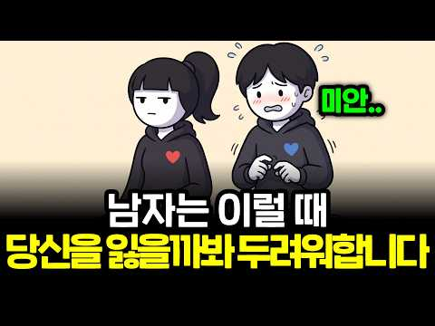
- 챕터: 0:00 더 잘해주기보다 필요한 관계의 균형 · 2:05 내 삶의 세계 계속 돌리기 · 3:15 챙김이 당연한 의무가 되지 않게 하기 · 4:14 거절할 수 있는 경계 세우기 · 5:51 다른 사람이 아닌 다른 삶 보여주기 · 6:55 확신을 구걸하기보다 나의 기한 갖기 · 8:13 독립적인 미래 계획 말하기 · 9:20 작은 부탁과 상호적인 투자 · 12:15 상대의 반응과 선택 존중하기
- 설명 앞부분: 남자가 당신을 잃을까봐 두려워하는 순간은 더 잘해줄 때 오지 않습니다. 정반대입니다. 남자의 사랑을 확정시키는 '잃을 수 있다는 자각'을 조종 없이 만드는 일곱 가지 방법과, 대부분의 여자가 하는 정반대 행동을 알려드립니다. 이 영상은 카너먼의 손실 회피 연구, 헬렌 피셔의 뇌 영상 연구, 쾌락 적응 연구, 몰로이의 11년 결혼 조사, 러스벌트의 투자 모델, 프랭클린 효과, 스탠리의 헌신 연구를 참고해 제작했습니다. 타임스탬프 관계의 표현 방식에는 개인차가 있습니다. 한 가지 신호로 마음을 단정하기보다 맥락과 반복되는 행동을 함께…
- 대본 없음 (설명) — 음성인식이 끝나면 도입부·흐름이 들어감
- 댓글 190/189: 좋은 점 — 영상 8 · 감사·응원 1 · 더 알고 싶은 것 1 · 아쉬운 점 — 영상 3 · 반박·불만 — 의견 다름 3 · 정치·사회 0 · 경험 공유 26 · 구독·다음 기대 0
  - 좋은 점 — 영상 👍12 “그냥 혼자 있는거 잘하고 본인 일 열심히하라는 말입니다 구구절절 얘기가 길어서 그런거지 남자한테 목메고 남자 생기면 남자가 본인 삶의 1순위 인것처럼 시녀노릇 하지 말란겁니다 ㅠ 맘껏 사랑하세요 계산 하지도 마시구요 근데 그만큼 본인 자신도 사랑하란 소리”
  - 좋은 점 — 영상 👍5 “깨닫고 갑니다 저한텐 도움됐어요”
  - 감사·응원 👍120 “다른건 다 둘째치고 진심 부탁하는거랑 돈 쓰게하는거는 진짜 찐인듯.. 전남친은 제가 진심으로 더 챙겨주고 엄마같이 더 챙겨주면 오히려 나를 못 놓겠지? 했는데 ㅋㅋㅋ 물론 저거때문은 아니지만 결국 잠수이별엔딩이고 지금 현남친도 언젠간 헤어질 수 있겠죠 당연히 근데 지…”
  - 더 알고 싶은 것 👍0 “이걸 구지 노력하지 않아도 원래 내 자신이 독립적인 성향이라서....왜 내 남자가 초조해보이지 이게 궁금해서 영상을 봤는데 나도 모르게 하고 있어서 미안했다”
  - 아쉬운 점 — 영상 👍16 “사랑하는데..남자가 너무 잘해주니까 살짝 나는 여유가 있는거지...항상 먼저 연락 오다보니 내가 먼저 연락할일이 없음..그러다 진짜 급해서 연락하니 엄청 좋아함...하여튼 항상 타이밍이 남자가 빠름...이러다보니 무심하지 않은데 무심한듯 하고 이런게 반복되다보니 그냥…”
  - 아쉬운 점 — 영상 👍12 “그냥 혼자 있는거 잘하고 본인 일 열심히하라는 말입니다 구구절절 얘기가 길어서 그런거지 남자한테 목메고 남자 생기면 남자가 본인 삶의 1순위 인것처럼 시녀노릇 하지 말란겁니다 ㅠ 맘껏 사랑하세요 계산 하지도 마시구요 근데 그만큼 본인 자신도 사랑하란 소리”
  - 반박·불만 — 의견 다름 👍6 “아니 저걸 모르는게 아닌데 진짜 너무 사랑하면 저게 안됨.. 사람 성향 차이가 매우매우 큰거같긴함”
  - 반박·불만 — 의견 다름 👍0 “일부러 그런건 아닌데 자영업 하면서 장사공부하고 모임하고 집에 들어가면 가족들하고 수다 떠느라 연락 잘 못하고 가끔 친구도 만나고 그렇게 사니까 남친이 되게 불안해했음 그때는 왜 그렇게 불안해 하는지 이해가 안갔는데 이거 보니까 알겠네요 부작용으로”
  - 경험 공유 👍745 “이런거 의미 없는거 같아요 여기잇는걸 모두 다 하는데도 헤어지자는 남자가 잇고 여기서 말하는거처럼 안떠나는 남자가 있어요 그냥 날 얼마나 진심으로 생각하는지 남자에 따라서 다 틀린거 같아요 그리고 항상 헤어진 후에 연락오죠. 그냥 내가 뭘 해도 날 떠나질 않을 남자 …”
  - 경험 공유 👍696 “모르고있었는데 다 하고있었네요 제가 독립적인 성향이고 칼같은 성격이라 의도치않게 긴장감을 줬나봐요 매번 제가 어떤걸 할지 말하고 있고 제 삶이 더중요해서 남자친구만나는것보다 제 시간을 챙기려고 했고 남자친구가 약속취소하거나 자기멋대로 보러온다하면 거절했어요 제 시간을…”

### 64. 단절의 시대, 외로움에 휘둘리지 않는 법

- https://www.youtube.com/watch?v=hnuDs_pSI7M · 도래기책방 · 구독자 11,100 · 조회수 89,868 (×8.1, 하루 3,755.0) · 좋아요 1,244 (1.4%) · 15.4분 · 2026-10-18 · 주제 묶음 기타 · 형식 정보·해설 (그 밖) · 폴더 `W_hnuDs_pSI7M` (웹 승인)
- 썸네일: 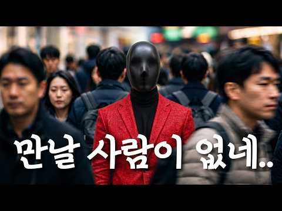
- 챕터: 0:00 만날 사람이 없네.. · 1:16 Part 1. 우리는 왜 외로움을 느끼는가? · 3:40 Part 2. 나 자신과 진짜 관계를 맺는 법 · 7:30 Part 3. 먼저 마주할 용기 · 10:59 Part 4. 내 삶에서 외로움을 완전히 지워버린 방법
- 설명 앞부분: 주말 저녁, 스마트폰을 켜면 다들 활기차게 살아가는 것 같은데 왜 나만 덩그러니 혼자인 것 같을까요? 카톡 친구 목록은 수백 명이 넘는데, 막상 마음을 툭 터놓고 '뭐해? 한잔하자'고 부를 사람은 단 한 명도 없는 씁쓸함. 어쩌면 우리는 수많은 연결 속에 살아가면서도, 가장 지독한 고립을 겪고 있는지 모릅니다. 수년 동안 만성적인 외로움과 피해의식에 시달렸던 제가, 어떻게 남의 시선에서 벗어나 내 삶의 주도권을 되찾고 이 공허함을 완전히 끊어낼 수 있었는지 그 경험담을 털어놓습니다. 외로움이라는 감정이 우리에게 보내는 진짜 경고 …
- 대본 없음 (설명) — 음성인식이 끝나면 도입부·흐름이 들어감
- 댓글 182/182: 좋은 점 — 영상 18 · 감사·응원 27 · 더 알고 싶은 것 4 · 아쉬운 점 — 영상 3 · 반박·불만 — 의견 다름 2 · 정치·사회 1 · 경험 공유 26 · 구독·다음 기대 1
  - 좋은 점 — 영상 👍67 “저는 10대임에도 외로움에 시달리며 고등학교 생활을 하고있습니다. 정말 살면서 본 영상, 살면서 들은 말 중에서도 최고였던 것 같습니다. 항상 남에 대해서만 고민하고 남의 입장만을 고려하고 나의 근처사람이 어떤사람인지만을 알기위해 노력했습니다. 그리고 그 과정에서 ‘…”
  - 좋은 점 — 영상 👍12 “안 그래도 요즘 인간관계 자체에 회의감과 공허함 외로움을 느꼈었는데요.. 항상 남의 시선에 맞춰서만 살아왔더라고요. 그래서 그런지 나 자신이 남지도 않은 것 같고 뭐가 내 모습인지도 내가 뭘 할 때 행복하고 즐거운지도 잘 모르겠었는데.. 이 영상 보고 덕분에 많은 위…”
  - 감사·응원 👍67 “저는 10대임에도 외로움에 시달리며 고등학교 생활을 하고있습니다. 정말 살면서 본 영상, 살면서 들은 말 중에서도 최고였던 것 같습니다. 항상 남에 대해서만 고민하고 남의 입장만을 고려하고 나의 근처사람이 어떤사람인지만을 알기위해 노력했습니다. 그리고 그 과정에서 ‘…”
  - 감사·응원 👍12 “안 그래도 요즘 인간관계 자체에 회의감과 공허함 외로움을 느꼈었는데요.. 항상 남의 시선에 맞춰서만 살아왔더라고요. 그래서 그런지 나 자신이 남지도 않은 것 같고 뭐가 내 모습인지도 내가 뭘 할 때 행복하고 즐거운지도 잘 모르겠었는데.. 이 영상 보고 덕분에 많은 위…”
  - 더 알고 싶은 것 👍4 “원래 댓글 잘 안 다는 사람인데, 이번 영상을 보고 난 뒤에는 말해야겠습니다. 도래기책방님은 저의 걱정을 완벽히 해소해주셨고 더 나은 사람으로 바뀌게 해줄 열쇠를 건네주셨습니다. 저도 도래기책방님 같은 사람이 되고 싶네요. 저 뿐만 아니라 많은 사람들이 뒤에서 응원할…”
  - 더 알고 싶은 것 👍3 “안녕하세요 도래기 책방님 얼마 전부터 알고리즘에 떠 주기적으로 챙겨보고 있는 대학생입니다. 요즘 들어 자존감도 별로 없고 살아가는 것의 이유는 뭘까 등 고민을 많이 했었는데 이 채널을 보면서 도움이 많이 되었습니다. 영상의 흡입력이 너무 좋아서 하나하나 소중하게 2배…”
  - 아쉬운 점 — 영상 👍2 “좀 아이러니 하게 웃긴 이야기 이지만 저 같은 경우는 평소 모습과 친해진 뒤 모습이 180도 다릅니다. 이 영상 완전 공감하며, 저 또한 아웃사이더 끝판왕 이기에 혼자 밥먹는게 편해요. 하지만, 왜인지, 어째서, 여성들은 그런 모습에 안달하고 쫒아다닐정도로 저를 좋아…”
  - 아쉬운 점 — 영상 👍1 “평생동안 외로움이란 감정을 느낀 게 어릴 때 집에 혼자 있었을 때와 젊을 때 연인들과 헤어지고 잠시잠시 밖에는 없었던 듯ㅋㅋ 친구들도 많았고 연애도 끊임없이 해오다가 나이가 들어가면서 서서히 친구들도 자발적으로 서서히 다 끊고 연애도 끊고 혼자서 이런 저런 취미생활들…”
  - 반박·불만 — 의견 다름 👍26 “40대 이상 되면 이미 있는 인간관계도 필요없는건 끊어내고 정리해야되고 50대 이후로는 죽을때까지 혼자 또는 가족뿐이라 생각하면 됩니다. 어차피 인생은 혼자 와서 혼자 가는 겁니다 인간관계 아무 의미 없습니다. 45억년 지구 역사에서 우리네 인생은 하루살이처럼 잠시 …”
  - 반박·불만 — 의견 다름 👍1 “말도 안되는 편집기술, 스토리텔링, 목소리를 가진 분도 어려움을 겪었군요..”
  - 정치·사회 👍2 “만나고 싶은 사람들이 없음... 내주변엔... 거짓말 잘하는 사람... 돈에 너무 인색한 사람.... 자기 이야기만 하는 사람.... 배려는 1도없고 이기적인사람..... 좌파들 거짓선동에 환장하는 사람들..등등”
  - 경험 공유 👍26 “40대 이상 되면 이미 있는 인간관계도 필요없는건 끊어내고 정리해야되고 50대 이후로는 죽을때까지 혼자 또는 가족뿐이라 생각하면 됩니다. 어차피 인생은 혼자 와서 혼자 가는 겁니다 인간관계 아무 의미 없습니다. 45억년 지구 역사에서 우리네 인생은 하루살이처럼 잠시 …”
  - 경험 공유 👍12 “안 그래도 요즘 인간관계 자체에 회의감과 공허함 외로움을 느꼈었는데요.. 항상 남의 시선에 맞춰서만 살아왔더라고요. 그래서 그런지 나 자신이 남지도 않은 것 같고 뭐가 내 모습인지도 내가 뭘 할 때 행복하고 즐거운지도 잘 모르겠었는데.. 이 영상 보고 덕분에 많은 위…”
  - 구독·다음 기대 👍3 “공감하고 구독했습니다. 앞으로 출퇴근 걷는 길에 좋은 친구가 생긴 것 같아 기대됩니다.”

### 65. 자존감 높은 사람들이 무서울 정도로 잘하는 습관 4가지 ∣ 자존감 ∣ 심리학 ∣ 멘탈관리 ∣ 감정조절

- https://www.youtube.com/watch?v=B_rOPX-oLQM · 오늘도심리 · 구독자 1,710 · 조회수 92,088 (×53.9, 하루 554.7) · 좋아요 1,840 (2.0%) · 11.9분 · 2026-05-29 · 주제 묶음 1. 심리학 일반 · 형식 목록형 (N가지 특징·신호) · 폴더 `W_B_rOPX-oLQM` (웹 승인)
- 썸네일: 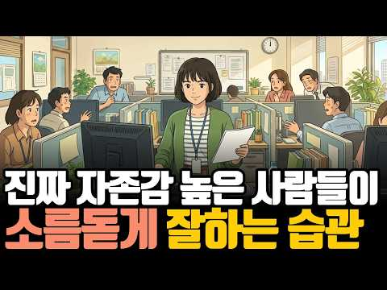
- 챕터: 0:00 자존감 높은 사람들의 충격적인 공통점 · 0:56 왜 우리는 남의 말에 쉽게 흔들릴까? · 1:34 첫 번째 습관 — 상황을 분리하는 능력 · 2:34 남의 감정에 휘둘리지 않는 사람들의 특징 · 4:46 실수해도 무너지지 않는 사람들의 심리 · 6:13 자존감 높은 사람들의 멘탈 관리법 · 7:11 행복한 사람들의 뇌 사용법 · 8:27 뇌과학으로 보는 자존감의 비밀 · 9:39 자존감을 높이는 가장 현실적인 방법 · 10:39 타인의 시선에서 벗어나는 법
- 설명 앞부분: 누군가의 말 한마디에 하루 종일 마음이 흔들린 적 있으신가요? 왜 어떤 사람은 비난에도 무너지지 않고, 어떤 사람은 작은 말에도 깊게 상처받을까요? 이번 영상에서는 심리학과 뇌과학을 통해 자존감 높은 사람들이 실제로 사용하는 4가지 강력한 습관을 알려드립니다. 이 영상을 끝까지 보시면 타인의 말에 쉽게 흔들리던 마음에서 벗어나 스스로를 단단하게 지키는 방법을 알게 되실 겁니다. 오늘도심리는 마음을 억지로 고치는 채널이 아닙니다. 심리학과 뇌과학을 통해 ‘나를 이해하는 힘’을 함께 키워가는 공간입니다. ⏰ 타임라인 오늘 영상이 마음…
- 대본 없음 (설명) — 음성인식이 끝나면 도입부·흐름이 들어감
- 댓글 82/82: 좋은 점 — 영상 5 · 감사·응원 9 · 더 알고 싶은 것 0 · 아쉬운 점 — 영상 1 · 반박·불만 — 의견 다름 0 · 정치·사회 0 · 경험 공유 6 · 구독·다음 기대 1
  - 좋은 점 — 영상 👍55 “전 4가지 다 가지고 있네요. 😅😂 근데 전 4번째는 그냥 된 것이 아니라 고난을 통해 하나님을 인격적으로 경험하고 하나님이 나와 함께 하심을 알기에 평밤한 일상 모든 것이 그저 감사하기에 할 수있습니다. 좋은 영상 감사합니다. 구독신청하고 갑니다”
  - 좋은 점 — 영상 👍13 “유튜브의 순기능이네요. 좋은 영상 잘 봤습니다!”
  - 감사·응원 👍55 “전 4가지 다 가지고 있네요. 😅😂 근데 전 4번째는 그냥 된 것이 아니라 고난을 통해 하나님을 인격적으로 경험하고 하나님이 나와 함께 하심을 알기에 평밤한 일상 모든 것이 그저 감사하기에 할 수있습니다. 좋은 영상 감사합니다. 구독신청하고 갑니다”
  - 감사·응원 👍20 “1. 상황분리 2. 우아한 무관심 ㅡ 반송 처리 3. 내 실수 인정하고 고침 4. 조건 없는 기분 선언 감사해요 🎉”
  - 아쉬운 점 — 영상 👍22 “눈치 일도 없는 뻔뻔한 사람도 있더라구요. 진짜 잘못했으면 고치고 반성도 해야하는데.”
  - 경험 공유 👍153 “자존감높은 사람은 수없는 반복상처로 혼자서 단단해진결과다 내가 그렇다😅”
  - 경험 공유 👍60 “육해공군 공수전 겪고 나니 .지금의 내가 되어 있드라구요😊😊”
  - 구독·다음 기대 👍4 “어렵다..뇌가 나를 지배하니..내가 나를 알아야지ㅠ 힘든세상..구독하고 갑니다”

### 66. 절대 먼저 연락 안 하는 사람의 진짜 심리 - 정신과 의사

- https://www.youtube.com/watch?v=lSB7a9jsQJY · 인생승진 Life Up!! · 구독자 10,800 · 조회수 83,294 (×7.7, 하루 3,199.1) · 좋아요 373 (0.4%) · 16.9분 · 2026-10-16 · 주제 묶음 6. 정신건강 · 형식 인터뷰·강연·대담 (전문가) · 폴더 `W_lSB7a9jsQJY` (웹 승인)
- 썸네일: 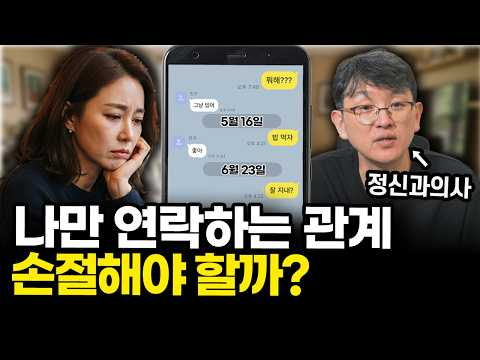
- 설명 앞부분: 항상 내가 먼저 연락해야 하는 사람, 한두 명씩 있으시죠. 내가 안 하면 몇 달이 가도 소식이 없는 사람. 이 사람, 나를 싫어하는 걸까요? 이 관계, 정리해야 할까요? 오늘은 먼저 연락하지 않는 사람에 대해 이야기 나누어 보려 합니다.
- 대본 없음 (설명) — 음성인식이 끝나면 도입부·흐름이 들어감
- 댓글 77/77: 좋은 점 — 영상 2 · 감사·응원 2 · 더 알고 싶은 것 0 · 아쉬운 점 — 영상 2 · 반박·불만 — 의견 다름 2 · 정치·사회 0 · 경험 공유 18 · 구독·다음 기대 0
  - 좋은 점 — 영상 👍0 “구구절절 공감합니다”
  - 감사·응원 👍5 “내향이고 1、2번 모두 해당하니 나이먹을수록 누구에게 연락하기가 힘들어지네요😢 바쁜시간 아닐지, 부담스러워하지 않을지..그렇지만 오랜동안 연락이 끊긴 친구에게도 여전히 애정을 갖고있고 연결감을 느낍니다. 그리고 연락 오면 엄청 반갑게 답하고 호들갑 떱니다 ㅎㅎ 연락 …”
  - 감사·응원 👍4 “선생님,잘 들었습니다 구독 좋아요 눌렀습니다 ❤🎉감사합니다 😊”
  - 아쉬운 점 — 영상 👍1 “난 모든 관계에서 연락 잘 안함 특히 카톡은... 광고가 너무 많아서 확인 잘 안함 대신 문자는 잘 받음 요즘은 다 카톡해서 나같은 사람 없을듯”
  - 아쉬운 점 — 영상 👍1 “여러방면시도햇다가 안해도되겟다 손놔버리니 자연스럽게 끈어지더라구요 필요할때만 연락오는연락도 받아주니 아무것도아니게되고 결국 혼자지치는관계 인간관계 모든게 지치게되는거같아요 아무렇지않다가도 갑자기 후폭풍처럼 몰려와요 다시무덤덤해지고무한반복”
  - 반박·불만 — 의견 다름 👍5 “내향이고 1、2번 모두 해당하니 나이먹을수록 누구에게 연락하기가 힘들어지네요😢 바쁜시간 아닐지, 부담스러워하지 않을지..그렇지만 오랜동안 연락이 끊긴 친구에게도 여전히 애정을 갖고있고 연결감을 느낍니다. 그리고 연락 오면 엄청 반갑게 답하고 호들갑 떱니다 ㅎㅎ 연락 …”
  - 반박·불만 — 의견 다름 👍1 “선생님 제성격이 먼저하든 안하든 크게신경쓰는편은 아닌데 친구들중에 한명한테는 제가일방적으로 연락해요 사람이다보니 서운하다가도 카톡하면 답장도 정성스럽게 길게문자해요 하지만 먼저연락은안해요 솔직히 나만일방적이다보니 지금은 어떻게해야되나 생각이많아집니다”
  - 경험 공유 👍69 “먼저연락하냐 안하냐가 중요한게아님 ㅋㅋ 내가 먼저했을때 상대방의 반응이다 기다렸다는듯이 볼려고하거나 바로답이오고 반겨주는사람은 괜찮음”
  - 경험 공유 👍35 “내가 신경이 쓰이면 손절, 아무렇지 않으면 유지”

### 67. 뇌가 느끼는 쾌락 순위 (5위~1위) 마약 제외 I 뇌과학

- https://www.youtube.com/watch?v=_7LDEUO48YA · 뉴마인드 · 구독자 47,900 · 조회수 1,042,351 (×21.8, 하루 13,719.8) · 좋아요 3,825 (0.4%) · 6.4분 · 2026-08-27 · 주제 묶음 1. 심리학 일반 · 형식 목록형 (N가지 특징·신호) · 폴더 `W__7LDEUO48YA` (웹 승인)
- 썸네일: 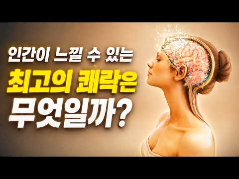
- 설명 앞부분: 마약이나 약물을 제외하고, 과학 연구에서 밝혀진 인간이 경험할 수 있는 강력한 자연적 쾌락 5가지를 5위부터 1위까지 살펴보겠습니다. 참고 자료: Berridge KC, Kringelbach ML. *Building a neuroscience of pleasure and well-being.* Psychology of Well-Being, 2011. Castro DC, Berridge KC. *Opioid Hedonic Hotspot in Nucleus Accumbens Shell: Mu, Delta, and Kappa Maps …
- 대본 없음 (설명) — 음성인식이 끝나면 도입부·흐름이 들어감
- 댓글 537/533: 좋은 점 — 영상 6 · 감사·응원 8 · 더 알고 싶은 것 3 · 아쉬운 점 — 영상 4 · 반박·불만 — 의견 다름 2 · 정치·사회 6 · 경험 공유 27 · 구독·다음 기대 0
  - 좋은 점 — 영상 👍24 “보람만큼 큰 쾌락이 있을까요?, 열심히 도움되는 무엇을 하고나서,, 다른 사람들이 그것으로 도움을 받고 기뻐할 때, 느끼는 행복 !,,”
  - 좋은 점 — 영상 👍11 “이번 주도 유익하고 재미있는 영상 감사합니다. 일상에서 기쁨, 즐거움, 재미, 행복에 대해서는 끊임없이 생각하고 갈구하면서도, 정작 ‘쾌락’에 대해서는 깊이 생각해 본 적이 있었던가? 하는 의문이 들었습니다. 그래서 오늘 영상이 더욱 흥미롭게 느껴졌습니다. 영상에서도…”
  - 감사·응원 👍11 “이번 주도 유익하고 재미있는 영상 감사합니다. 일상에서 기쁨, 즐거움, 재미, 행복에 대해서는 끊임없이 생각하고 갈구하면서도, 정작 ‘쾌락’에 대해서는 깊이 생각해 본 적이 있었던가? 하는 의문이 들었습니다. 그래서 오늘 영상이 더욱 흥미롭게 느껴졌습니다. 영상에서도…”
  - 감사·응원 👍5 “감사합니다 :)”
  - 더 알고 싶은 것 👍24 “보람만큼 큰 쾌락이 있을까요?, 열심히 도움되는 무엇을 하고나서,, 다른 사람들이 그것으로 도움을 받고 기뻐할 때, 느끼는 행복 !,,”
  - 더 알고 싶은 것 👍11 “이번 주도 유익하고 재미있는 영상 감사합니다. 일상에서 기쁨, 즐거움, 재미, 행복에 대해서는 끊임없이 생각하고 갈구하면서도, 정작 ‘쾌락’에 대해서는 깊이 생각해 본 적이 있었던가? 하는 의문이 들었습니다. 그래서 오늘 영상이 더욱 흥미롭게 느껴졌습니다. 영상에서도…”
  - 아쉬운 점 — 영상 👍1 “해결해보고싶은숙제가 힘들어서 포기하고싶을때 게속 반복해서 방법을 찾아서 정리했을때 그게답이고 비젼이. 혁실할때 찾아오는 쾌감은 s0x로 찾을수없는 그무엇이상!”
  - 아쉬운 점 — 영상 👍0 “1위 마약 2위 도박 3위 쌕스.자위행위 4위 흡연 음식 5위 낚시 자전거 등산 등등 육체활동”
  - 정치·사회 👍1 “이 정권이 무너지는 날이 최고의 쾌락”
  - 정치·사회 👍0 “이재명과 공선당종간나 반동분다새끼들 다 쳐 죽였을때?”
  - 경험 공유 👍345 “내가 주식팔고나서 폭락했을때”
  - 경험 공유 👍22 “내가 땅을 사서 사촌이 배 아플 때”

### 68. 외로움이 몸서리 쳐도 14년된 친구를 손절하고 나서야 깨달았습니다 :미국 이민 20년, 인간관계에서 배운 것

- https://www.youtube.com/watch?v=NBBUKWKa3Y4 · 비우는 삶 · 구독자 2,240 · 조회수 72,448 (×32.3, 하루 639.8) · 좋아요 1,424 (2.0%) · 6.5분 · 2026-07-21 · 주제 묶음 2. 인간관계·대화 · 형식 오디오북·책 요약 · 폴더 `W_NBBUKWKa3Y4` (웹 승인)
- 썸네일: 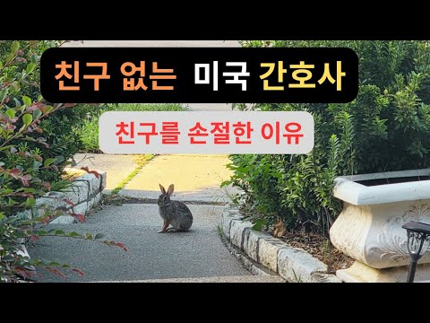
- 설명 앞부분: 미국에 살면서 가장 힘들었던 건 영어도, 돈도 아니었습니다. 외로웠고, 그래서 사람을 너무 쉽게 믿었습니다. 13년 친구를 손절하고, 병원에서 만난 사람들과의 관계를 정리하면서 비로소 깨달았습니다. 잘해주는 것과 이용당하는 것은 종이 한 장 차이라는 것을요. 혹시 지금도 외로워서 억지로 관계를 붙잡고 계신가요? 이 영상이 누군가에게는 작은 위로가 되었으면 좋겠습니다. 감사합니다.
- 대본 없음 (설명) — 음성인식이 끝나면 도입부·흐름이 들어감
- 댓글 462/462: 좋은 점 — 영상 20 · 감사·응원 29 · 더 알고 싶은 것 2 · 아쉬운 점 — 영상 2 · 반박·불만 — 의견 다름 8 · 정치·사회 2 · 경험 공유 95 · 구독·다음 기대 2
  - 좋은 점 — 영상 👍15 “원래 한국인이 그래요..외국에 살면 외로워 한인을 사귀지만 거의 뒷끝이 않좋읍니다.. 항상 이용 당하는 느낌. 이나라 출신은 이게 생존기술이며 본인은 매우 똑똑하다고 생각합니다. 마음을 주지 마세요.. 왜 그런지는 알지만 그만 언급할께요.. 참고로 ‘ 노컷 조선 왕조…”
  - 좋은 점 — 영상 👍11 “보통 친구로서 다정한것보다 도움이 필요해서가 많더라고요ㅜㅜ 사람 정 쉽게주는거 아니더라고요 정쉽게 줘서 괜이 상처받고 그럴필요업다고봅니다 ㅜㅜ 특이동성은요 -아마몸도줘야 끈적해지려나-”
  - 감사·응원 👍62 “쓸데없는 인간관계는 빨리 끊는게 좋아요~ 열번 잘해주다 한번 섭섭하게 하면 나쁜사람 되는게 인간의 본성! 호의가 권리가 됩니다. 남에게 피해 안끼치면서 이기적으로 사세요. 인간관계 나이 먹어갈수록 필요없어 지니 혼자서 잘 노는 방법을 찾으세요! 저는 64년생이고 첫째…”
  - 감사·응원 👍38 “너무 착하게 사셨네요. 처음부터 친구가 아니고, 그저 이용만 했을 뿐. 지금이라도 손절했으니 그나마 다행이라고... 생각하시고 힘내십시오.”
  - 더 알고 싶은 것 👍0 “어느 대학을 나온 사람이죠?”
  - 아쉬운 점 — 영상 👍6 “저도 미국 간호사 입니다. 너무 제 얘기 같아 공감가네요. 사람의 본성이 그런가 봅니다. 호의가 반복되면 권리인줄 아는.”
  - 아쉬운 점 — 영상 👍2 “그런 일들은 말을 해야 친구도 다음에 안그러겠죠 알아온 시간이 있으실건데 아쉽습니다”
  - 반박·불만 — 의견 다름 👍6 “해외 나가서 한국인들 조심하라는 말이 괜히 생긴게 아닙니다. 다른 민족들도 물론 서로 사기치고 이용해먹는 사람들이 있지만, 한인사회는 그게 너무 극단적이고 일상화되있어서 다른 민족들도 다 혀를 내두를 정도.”
  - 반박·불만 — 의견 다름 👍4 “안녕하세요 출근 길에 우연히듣고 댓글올려요 저도 미국 플로리다 병원방사선사로 20년넘게근무하고잇어요 한번은 단골다니던카센터동생이 혹시 아는동생이 있는데 간호사자격은땃는데 유학생신분이라 이력서 를넣어도 취직이안된다하길래 도와주실수 있을까요 하고물어서 내가힘닿는데로 이력…”
  - 정치·사회 👍1 “너무 공감되어 댓글 남깁니다.ㅎㅎ 저도 일본유학중에 같은 힌국인 친구들이 몇명 있었는데 다 손절했습니다. 한명은 자기가 돈 필요할때마다 10만원 30만원 소액으로 빌려달라고 할때만 연락하거나, 막상 제가 연락하면 잘 받지도 않고, 톡도 3번 이상 오고간적이 없네요. …”
  - 경험 공유 👍95 “여러번 잘해줘보면 본성이 보여요 전 안좋은 본성이 느껴지면 바로 손절해요 그럼 제가 상처 받을 일이 없어 지더라구요 !!!”
  - 경험 공유 👍54 “타인들이 희한하게 다 알고 있습니다. 님이 엄청 외로움을 타고 있다는 것을요. 그래서 친구가 필요하다는것을 다 알고 있습니다. 내가 연락 않해도 님이 연락할 꺼라는거 알고 있습니다. 사람이 천성이라는게 있더라구요. 천성이 착한 사람이 근데 얼마나 되겠어요? 가난하다고…”
  - 구독·다음 기대 👍9 “외국에서 더 외로우시겠어요..근데 여기서도 비슷해요.. 많이 친한척하면서 호들갑 떠는 친구사이도 보면 별볼일 없더라구요.. 목소리 편해서 구독해요.”

### 69. 부모 장례식장에서 눈물 안 나는 자식 특징 _ 당신 잘못이 아닙니다 #정신과 #정신과의사 #가족 #부모갈등 #부부갈등 #관계 #형제갈등 #심리상담

- https://www.youtube.com/watch?v=oUiNW0U5Z9Y · Dr.전미경의 닥전TV · 구독자 29,400 · 조회수 373,754 (×12.7, 하루 8,125.9) · 좋아요 2,440 (0.7%) · 23.1분 · 2026-09-26 · 주제 묶음 6. 정신건강 · 형식 인터뷰·강연·대담 (전문가) · 폴더 `W_oUiNW0U5Z9Y` (웹 승인)
- 썸네일: 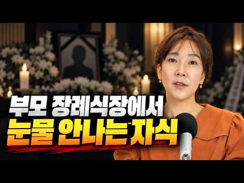
- 설명 앞부분: ❝25년간 10만 명의 삶을 바꾼 전미경 원장의 소통 처방전❞ 📕『멈출수록 관계가 살아나는 말 심리』 출간! 🖐️이런 순간, 한 번이라도 있었다면 이 책이 당신의 말을 바꿔드립니다! 인간관계에서 말로 인한 갈등을 반복하는 사람 말이 의도와 다르게 전달되어 오해받는 사람 대화 습관을 바꾸고 싶지만, 구체적인 방법을 모르는 사람 가까운 사람일수록 말이 더 어려운 사람 사과해야 할 순간에 말문이 막히는 사람 애쓸수록 오해만 쌓이는 당신을 위한 1초의 멈춤, 소통의 관점을 바꾸는 대화 심리학 지금 서점에서 만나보세요!
- 대본 없음 (설명) — 음성인식이 끝나면 도입부·흐름이 들어감
- 댓글 496/504: 좋은 점 — 영상 22 · 감사·응원 46 · 더 알고 싶은 것 0 · 아쉬운 점 — 영상 1 · 반박·불만 — 의견 다름 17 · 정치·사회 1 · 경험 공유 115 · 구독·다음 기대 6
  - 좋은 점 — 영상 👍131 “장례식에 눈물이 안나오는게 오랜시간 남몰래 흘렸기 때문 이란 말에 공감이 가네요”
  - 좋은 점 — 영상 👍80 “정말로 와닿는 말씀이라 잘 들었어요 안 그래도 얼마전 엄마가 돌아가셨는데 전혀 슬프지가 않아서 제가 어디가 잘못된 건가 스스로 궁금 했거든요. 자식의 도리와 의무는 다 했지만 애착은 없는 관계 바로 제 경우 같아요. 받은 거라곤 19세 때까지 먹여주고 재워 준 거, …”
  - 감사·응원 👍284 “제가 싸이코가 아님을 확인하고 갑니다. 그리고 저와 같은 분들이 많으시다는 것에 안도가 되네요.감사합니다”
  - 감사·응원 👍164 “이런말씀을 해주는 선생님이 계시다니,,이제 숨이 좀 쉬어지네요ㅜㅜ 감사합니다”
  - 반박·불만 — 의견 다름 👍104 “부모라고 다 같은 부모가 아닙니다 이걸 일반적인 사람들에겐 아무리 설명해도 모르는 것 같아요 그래서 설명하지 않습니다 부모가 죽었으면 다리 뻗고 자겠다는 생각 안해본 사람은 모릅니다”
  - 반박·불만 — 의견 다름 👍39 “평생 부모님 사랑을 받아본적이 없어요..부모님도 저한테 뭘 해준적도 없고 저도 손벌린적도 없고 그렇다고 못사는 집도 아닙니다.. 일평생 아들아들만 하고 그 아들이 보다 7살이나 어린데 저한테 욕지거리를 하더라구요...저는 가족이 있어도 없다고 생각하고 평생을 외롭게 …”
  - 정치·사회 👍32 “그와 반대인 놈도 있습니다. 도리는 없고. 권리만 있는. 제. 조카놈이 그렇습니다. 암 걸린 엄마 한번도 안찾아오더니. 지엄마. 하늘나라가도 장례식장도. 안오던 놈이. 재산정리하러 나타나는거 보고. 기암했네요. 아들이라면 끔찍하게 생각하고 혼자. 대학도 적성에. 안 …”
  - 경험 공유 👍448 “더 아픈건 제가 부모가 되어보니, 나의 부모가 더욱 이해가 안되더군요 분노가 더 폭발 했습니다.”
  - 경험 공유 👍284 “제가 싸이코가 아님을 확인하고 갑니다. 그리고 저와 같은 분들이 많으시다는 것에 안도가 되네요.감사합니다”
  - 구독·다음 기대 👍38 “누워서 듣는데 눈물이 나네요~ 답답했던 마음이 조금은 풀리는 것 같아요! 감사합니다♡다음 영상 기다려요~~”
  - 구독·다음 기대 👍9 “다음 영상 기다려집니다!! 잘 봤습니다, 감사합니다”

### 70. 사랑받고 자란 사람은 이런 데서 티가 납니다. 의외의 행동 6가지

- https://www.youtube.com/watch?v=2t0zuR72DIE · 친절한심리학 · 구독자 22,000 · 조회수 212,009 (×9.6, 하루 5,737.5) · 좋아요 2,048 (1.0%) · 15.9분 · 2026-10-05 · 주제 묶음 2. 인간관계·대화 · 형식 목록형 (N가지 특징·신호) · 폴더 `W_2t0zuR72DIE` (웹 승인)
- 썸네일: 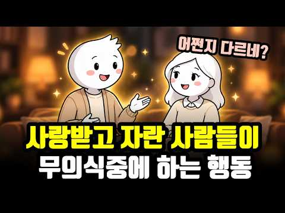
- 챕터: 0:00 사랑받고 자란 티는 의외의 순간에 납니다 · 0:55 같은 상황, 누구는 불안하고 누구는 편안한 이유 · 1:35 첫 번째, 의외로 남의 호의를 잘 받는다 · 4:12 두 번째, 싸움이 끝난 뒤 상대를 벌주지 않는다 · 6:32 세 번째, "나라면 안 그럴 텐데"를 쉽게 말하지 않… · 8:39 네 번째, 누구 탓보다 이제 어떻게 할지를 찾는다 · 10:36 다섯 번째, 좋은 것을 혼자 움켜쥐지 않는다 · 12:33 여섯 번째, 가까운 사람일수록 함부로 대하지 않는다 · 14:17 여섯 가지의 공통점 · 14:56 사랑을 덜 받았다고 느끼는 분들께
- 설명 앞부분: 사랑을 많이 받고 자란 사람은 의외로 티가 납니다. 밝게 웃을 때가 아니라, 누가 잘해줄 때, 싸운 다음 날, 일이 꼬인 순간처럼 별것 아닌 순간에요. 같은 상황에서도 누구는 불안하고, 누구는 이상할 만큼 편안한 이유는 뭘까요? 애착과 부모의 온정에 관한 심리학 연구를 바탕으로, 사랑받고 자란 사람들이 자기도 모르게 하는 행동 6가지를 정리했습니다. 어린 시절에 충분히 받지 못했어도 괜찮아요. 이 편안함은 지금부터도 만들어갈 수 있으니까요. [ 타임라인 ]
- 대본 없음 (설명) — 음성인식이 끝나면 도입부·흐름이 들어감
- 댓글 75/75: 좋은 점 — 영상 3 · 감사·응원 4 · 더 알고 싶은 것 0 · 아쉬운 점 — 영상 0 · 반박·불만 — 의견 다름 2 · 정치·사회 0 · 경험 공유 15 · 구독·다음 기대 0
  - 좋은 점 — 영상 👍20 “전부 공감합니다. 전 저 여섯가지가 다 제게 있어서 의식하지 못했는데 영상 보고나니 부모님께 의외로 사랑 많이 받고 자랐던 거라는 걸 새삼 깨달았네요. 특히 6번 가까울 수록 선을 지켜야 한다는 거 정말 공감하는데 나이를 먹을 수록 친해지면 친하다는 이유로 저 선을 …”
  - 좋은 점 — 영상 👍1 “사랑과 안정적인 태도와 관계를 잘 설명해주셔서 감사합니다! 😊”
  - 감사·응원 👍1 “감사합니다❤ 사랑과 축복을 보냅니다❤”
  - 감사·응원 👍1 “사랑과 안정적인 태도와 관계를 잘 설명해주셔서 감사합니다! 😊”
  - 반박·불만 — 의견 다름 👍29 “잘 받는다~?당연한건 아니죠 받은만큼 베플어야죠~ 그걸 싸가지 ~”
  - 경험 공유 👍211 “1. 잘 받는다 2. 싸울 때 제대로 싸우고 푼다.(회복력) 3. 화가 지나간 후 자기 자리로 돌아온다. 상대가 그렇게 느꼈다는 걸 받아준다.(안정애착) 4. 문제가 생기면 거기 오래 머물지 않고 문제중심적 해결능력이 있다. 내가 할 수 있는 것 5. 좋은 것을 굳이…”
  - 경험 공유 👍31 “나도 친구한테 아낌없이 줬는데~ 지식도 진실도~ 돌아오는건 배신!!!”

### 71. 우울증 치료 6년하고 깨달은 마음의 진리

- https://www.youtube.com/watch?v=BxrMEkahOXE · 민고영 · 구독자 20,100 · 조회수 432,115 (×21.5, 하루 5,147.1) · 좋아요 5,065 (1.2%) · 11.3분 · 2026-08-19 · 주제 묶음 6. 정신건강 · 형식 정보·해설 (그 밖) · 폴더 `W_BxrMEkahOXE` (웹 승인)
- 썸네일: 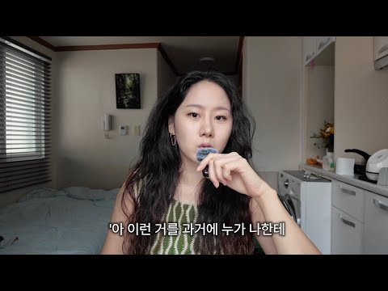
- 챕터: 0:00 오늘의 주제 · 0:42 1.부정적인 감정을 없앨 수 없다. 그리고 꼭 없애야… · 4:25 2.자극과 반응 사이에는 틈이 있다. · 7:30 3.머리가 이해하는 것과 마음이 믿게 되는 것은 다르…
- 설명 앞부분: 일러스트 by Seo Jung (Sammie) Yoon
- 대본 없음 (설명) — 음성인식이 끝나면 도입부·흐름이 들어감
- 댓글 452/452: 좋은 점 — 영상 48 · 감사·응원 63 · 더 알고 싶은 것 17 · 아쉬운 점 — 영상 3 · 반박·불만 — 의견 다름 9 · 정치·사회 0 · 경험 공유 93 · 구독·다음 기대 1
  - 좋은 점 — 영상 👍412 “생각이 과거로 갈 때 우울이 생깁니다. 생각은 내 의지와 상관 없이 끊임없이 올라옵니다. 그 때 그 생각들을 회피하거나 억압하지 말고 그대로 느껴주고 생각을 바라봐 주세요.. 해결되지 않은 부정적 감정들이 올라올 때마다 계속 느껴주면 어느새 그 감정은 힘을 잃고 저절…”
  - 좋은 점 — 영상 👍147 “알아차림 배워보세요 마음을 계속 보고있으면 마음과 생각이 내가 하는게 아니라 자동으로 돌아가는 거라는걸 알게되고, 보는 순간 비 동일시가 되면서 휘둘리지 않게 됩니다. 마음이 떠오르면 떠오르는데로 감정의 도가니 속에서 살다가 그걸 메타인지 처럼 바라볼수 있게 되더라구…”
  - 감사·응원 👍55 “티내지는 않는데 생각보다 주변에 심적으로 고통받으시는 분들이 많더라구요... 다들 잘 이겨내시길 마음 속으로 응원합니다.”
  - 감사·응원 👍32 “물질세상에 길들여지며 온갖 습이 내 자아를 덮어놨더라고요 생각과습관 모든게 내가아닌거 같은걸느껴 마음공부를 시작해보니 저깊숙이 내가 묻혀있는걸 발견하고 온전히 나로 살아가기로 했어요 응원합니다”
  - 더 알고 싶은 것 👍2 “동네 성당 가면 돼요. 어느 동네든 성당은 꼭 있어요. 그리고 성당의 입구에는 늘 성모마리아 석상이 있습니다. 그 앞에서 눈을 감고 물어보세요. '제가 왜 살아야 하는지 그 이유를 알려주세요.'라고. 그럼 해답을 주실 겁니다. 뭐가 먹고 싶어지든 어디를 가고 싶어지든…”
  - 더 알고 싶은 것 👍2 “저도 만성우울이 있어서 브린텔렉스(항우울제) 복용하며 살아가는데요, 민고영님 제일 첫번째영상 썸네일의 표정을 짓는 순간이 많으신가요?? 유튜브 영상은 전반적으로 다 무표정해보이시는데, 실제 삶에서는 웃는순간이 많으신지 궁금합니다😊”
  - 아쉬운 점 — 영상 👍0 “전 아직 인생쪼렙 학생이지만 부정적인 감정이 찾아와도 내 스스로가 감당할수있을때 진정으로 행복할수있다는말 너무공감돼요..진짜 인생의 진리같은 명언을 고영님한테 처음 듣네요! 저 이 멘토 메모해서 친구들한테 엣햄!하고 폼잡고 써먹어도되죠?ㅋㅎㅎ🤓📝 말씀대로 부정적인 감…”
  - 아쉬운 점 — 영상 👍0 “목소리가 너무 좋으세요 얼굴도 예쁘시구요 말씀도 너무 조리있게 잘하셔서 정속으로 봤습니다 좋은 내용 전달 감사드려요 힘받고 갑니다!”
  - 반박·불만 — 의견 다름 👍1,216 “저 알고리즘으로 들어왔는데 음.. 딴 얘기일수도 있지만 원룸에 사는게 사람 우울하게 만드는거도 큰거 같아요 저는 지방에서 서울 상경하면서 고시원 원룸 전전하면서 살았었는데 계속 우울증 달고 살다가 햇빛 잘드는 투룸으로 가니까 정말 많이 나아졌어요.. 어이없을 정도로 …”
  - 반박·불만 — 의견 다름 👍89 “저는 고등학생 때 부터 과민성 대장증후군과 불안장애가 왔었고 그당시엔 제가 불안장애가 있는지도 과민성 대장증후군이 유산균을 먹을게 아니라 불안장애 약을 먹으면 됬는지도 몰랐습니다. 초중학교 내내 반에서 제일 시끄럽고 전교임원까지 하는 활발한 성격은 다 무너지고 모든 …”
  - 경험 공유 👍412 “생각이 과거로 갈 때 우울이 생깁니다. 생각은 내 의지와 상관 없이 끊임없이 올라옵니다. 그 때 그 생각들을 회피하거나 억압하지 말고 그대로 느껴주고 생각을 바라봐 주세요.. 해결되지 않은 부정적 감정들이 올라올 때마다 계속 느껴주면 어느새 그 감정은 힘을 잃고 저절…”
  - 경험 공유 👍290 “저도 그래서 심리안정이 안되고 자꾸 분노할바에야 그 감정을 자주 만들어내는 친구 ? 를 끊었어요 ㅠ”
  - 구독·다음 기대 👍0 “목소리도 너무 좋고 내용이 공감되서 구독해요😊”

### 72. 배우자와 말만 하면 싸운다면 꼭 보세요｜관계를 살리는 심리학 7가지

- https://www.youtube.com/watch?v=ZbPijVInhtY · 별별 심리 · 구독자 3,870 · 조회수 147,519 (×38.1, 하루 976.6) · 좋아요 1,815 (1.2%) · 37.5분 · 2026-06-13 · 주제 묶음 1. 심리학 일반 · 형식 목록형 (N가지 특징·신호) · 폴더 `W_ZbPijVInhtY` (웹 승인)
- 썸네일: 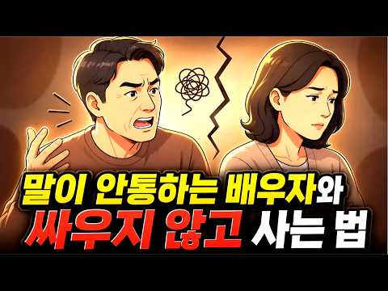
- 설명 앞부분: 배우자에게 "내 마음 좀 알아줘"라고 말해본 적 있으신가요. 그 말이 왜 자꾸 싸움으로 번졌는지, 왜 컵 하나에 20년 치 서운함이 터졌는지, 차분히 풀어드립니다. 말이 안 통하는 집은 시끄러워서 무너지는 게 아니었습니다. 한 사람이 더 이상 말하지 않게 되면서 무너지더라구요. 그 침묵이 평화일까요. 포기일까요. 오늘 식탁에서 꺼낼 첫 마디가 한 줄 달라지는 일곱 가지 길. 비슷한 마음으로 오늘을 통과하고 계신 분이라면 댓글에 한 줄 남겨주세요. 📚 참고 자료 Gottman, J. M., & Levenson, R. W. (1992…
- 대본 없음 (설명) — 음성인식이 끝나면 도입부·흐름이 들어감
- 댓글 157/157: 좋은 점 — 영상 7 · 감사·응원 12 · 더 알고 싶은 것 0 · 아쉬운 점 — 영상 1 · 반박·불만 — 의견 다름 2 · 정치·사회 0 · 경험 공유 14 · 구독·다음 기대 1
  - 좋은 점 — 영상 👍7 “상담하는데 도움이 될 것 같아요.”
  - 좋은 점 — 영상 👍5 “영상 참 좋은 내용인데 공감능력 제로에 자기밖에 모르는 사람에겐 안통해요 내 옆에 진짜 나쁜 놈이 있는데 이혼도 안해주고 물귀신 처럼 나를 끌고 다니며 괴롭힙니다 미안한 것도 모르고 자신이 뭘 잘못했는지도 몰라요”
  - 감사·응원 👍25 “서로가 상대방을 제압하고ㅠ자기 말을 고분고분 든는 소나 가축같이 생각하며 말버르장머리가 명령조인 사이는 친할래야 친해질 수 없음 ㅡ 서로감사의 마음이 항상 있어야 함 그래야 말이ㅜ이쁘게 나오고 공감의 말이 나옴 ㅡ 그러면 서로 좋아짐”
  - 감사·응원 👍5 “배우고 갑니다 감사합니다 😊”
  - 아쉬운 점 — 영상 👍0 “10분만 얘기하자 한집사는 동업자 정서적홍수 분당 10박수가 넘는다면 조심 지금얘기하면 말이격해질것같으니 다시얘기하자 반복되는패턴에 결말은 똑같다 추격회피패턴 내기말할때 폰을보면 나를무시하는느낌이 들어 외로운사람도 있다 (나피곤해) 내가중요하지않은것 같다 나 불안해 …”
  - 반박·불만 — 의견 다름 👍4 “말도 안되고 연애도 거부하면 답없다”
  - 경험 공유 👍59 “결혼 24년 중 각 방 사용한지 10년 넘었는데, 이해받지 못하고 살아왔는데, 필요한 용건만 말하는데, 서로 다름을 인정하고 다투지 않으려고, 불만을 얘기하지 않음. 딱히 불만도 없음. 하나뿐인 자식이 보물이라 자식 위주로 살고 있음. 그래서 웃을 일이 또 생김.😂 …”
  - 경험 공유 👍12 “에휴....남의 일 같지 않내...꼭 두달전 우리부부 모습이 저랬지.부부싸움?? 그거 손뼉도 부딪혀야 소리나는법...안 부딪히면 됩니다. 거 싸워서 이겨봐야 뭐해...덕 될것 하나도 없더라. 내 주장 말하다가 아내가 다른 소리하면 그래 그럴수도 있겠내 해버리면 그걸로…”
  - 구독·다음 기대 👍0 “10분만 얘기하자 한집사는 동업자 정서적홍수 분당 10박수가 넘는다면 조심 지금얘기하면 말이격해질것같으니 다시얘기하자 반복되는패턴에 결말은 똑같다 추격회피패턴 내기말할때 폰을보면 나를무시하는느낌이 들어 외로운사람도 있다 (나피곤해) 내가중요하지않은것 같다 나 불안해 …”

### 73. 잠으로 현실 도피? ‘도피 수면’에서 벗어나는 방법

- https://www.youtube.com/watch?v=HAqwaViT1tU · 홍승주의 디스턴싱 · 구독자 29,400 · 조회수 539,143 (×18.3, 하루 7,284.1) · 좋아요 5,319 (1.0%) · 19분 · 2026-08-29 · 주제 묶음 2. 인간관계·대화 · 형식 정보·해설 (그 밖) · 폴더 `W_HAqwaViT1tU` (웹 승인)
- 썸네일: 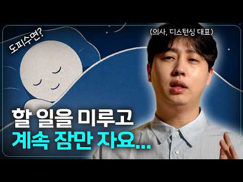
- 챕터: 0:00 1) 잠이 와서 자는 걸까? 깨어 있기 싫어 자는 걸… · 1:18 2) 핵심은 ‘수면’이 아니라 ‘도피’ · 3:43 3) 내 수면은 도피가 맞을까? · 6:30 4) 훈련 1. ‘수면 충동’이 생기는 순간을 기록하기 · 8:25 5) 훈련 2. 더도 말고 덜도 말고 딱 10분 수면… · 9:42 6) 훈련 3. ‘자지 않기’가 아니라 ‘딱 하나 하… · 11:30 7) 훈련 4. 잠이 해주던 일을 다른 행동에게 맡기기 · 14:02 8) 훈련 5. 깨어 있을 이유 늘리기 · 16:33 9) 수면을 나쁘게 생각하지 말자
- 설명 앞부분: 서울의대 출신 의사가 만든 디지털 인지치료 프로그램, 디스턴싱 인간은 자신의 삶을 변화시킬 역량과 잠재성을 가지고 있습니다. 우리는 사람들이 스스로의 치료자가 되도록 돕습니다. ⏰ 타임스탬프
- 대본 없음 (설명) — 음성인식이 끝나면 도입부·흐름이 들어감
- 댓글 274/274: 좋은 점 — 영상 16 · 감사·응원 22 · 더 알고 싶은 것 8 · 아쉬운 점 — 영상 5 · 반박·불만 — 의견 다름 1 · 정치·사회 0 · 경험 공유 50 · 구독·다음 기대 2
  - 좋은 점 — 영상 👍97 “도피수면 3년 차에서 다시 어느 정도 정상적으로 돌아온? 사람입니다. 항상 눈이 떠져도 현실을 마주하기 싫어서 포기하고 오후 늦게까지 자고 또 자면서 회피했던 사람이라, 영상 보면서 제가 느꼈던 것과 비슷한 점이 좀 있네요.. 한명이라도 더 도움이 되었으면 하는 바램…”
  - 좋은 점 — 영상 👍15 “도피수면의 해결방법에 대해 잘 배웠습니다. 감사합니다.”
  - 감사·응원 👍175 “제가 완벽주의 성향도 강하고, 두려움도 정말 크게 느끼는 성격이라, 중요한 시험 준비를 하고 있는 지난 몇 년 동안 불안감+압박감+두려움 때문에 잠을 정말 많이 자는 날이 많았어요. 사실 이번 8월이 유독 가장 심했어서, 힘겹게 극복 중이었는데 선생님 영상이 마침 올…”
  - 감사·응원 👍36 “현재 수험생활 중입니다. 공부를 해야지 해야지 하면서 하다가, 밤늦게 자고 늦게 일어납니다. 이게 그냥 적절한 수면시간이면 저도 딱히 걱정하지 않을 것 같습니다. 근데 늦게 일어나고 나서 오늘도 늦게 일어났네, 공부시간 또 줄어들겠다... 하면서 후회하고, 그러면서 …”
  - 더 알고 싶은 것 👍36 “현재 수험생활 중입니다. 공부를 해야지 해야지 하면서 하다가, 밤늦게 자고 늦게 일어납니다. 이게 그냥 적절한 수면시간이면 저도 딱히 걱정하지 않을 것 같습니다. 근데 늦게 일어나고 나서 오늘도 늦게 일어났네, 공부시간 또 줄어들겠다... 하면서 후회하고, 그러면서 …”
  - 더 알고 싶은 것 👍1 “폰 중독도 다뤄주세요,, 쇼츠를 너무 많이보고 있는 나자신”
  - 아쉬운 점 — 영상 👍1 “예전에 이러다가 요즘 다시 이런 상태가 심해지고 계속 반복되고 있는데 이게 도피수면이었군요.. 마침 이 영상이 떠서 보고 나니 조금은 문제의 원인에 대해 해소가 된 것 같아요 선생님 혹시 병원도 운영하고 계신지 여쭤봐도 될까요? 해외에서는 이런 영상에 의지하거나 방법…”
  - 아쉬운 점 — 영상 👍0 “정말 좋은 정보 알려주셔서 감사합니다. 저는 전문직 시험을 준비하고 있는데, 이전에 직장생활하면서 주중에는 3~4시간 주말에는 8시간 공부하는 습관을 갖고 있었는데 직장과 병행하다 보니, 어느순간 그 리듬이 깨지고 원하는 목표에 도달하지 못하니 회피형 수면과 대인관계…”
  - 반박·불만 — 의견 다름 👍0 “요즘 자꾸 잘 시간이 아닌데 잠이 와서 현실 도피인가 싶었는데 딱 이런 영상이 알고리즘에 뜨네요 해결 방법들 알려주셔서 감사합니다❤ 잘 극복해보겠습니다❤”
  - 경험 공유 👍175 “제가 완벽주의 성향도 강하고, 두려움도 정말 크게 느끼는 성격이라, 중요한 시험 준비를 하고 있는 지난 몇 년 동안 불안감+압박감+두려움 때문에 잠을 정말 많이 자는 날이 많았어요. 사실 이번 8월이 유독 가장 심했어서, 힘겹게 극복 중이었는데 선생님 영상이 마침 올…”
  - 경험 공유 👍97 “도피수면 3년 차에서 다시 어느 정도 정상적으로 돌아온? 사람입니다. 항상 눈이 떠져도 현실을 마주하기 싫어서 포기하고 오후 늦게까지 자고 또 자면서 회피했던 사람이라, 영상 보면서 제가 느꼈던 것과 비슷한 점이 좀 있네요.. 한명이라도 더 도움이 되었으면 하는 바램…”
  - 구독·다음 기대 👍4 “많은 도움이 돼요. 매일 디스턴싱채널에 들어옵니다. 다음 영상 늘 기다려요! ^^ 좋은 영상늘 감사합니다👍”

### 74. 인생을 바꾸고싶다면 안 쓰는 물건부터 당장 버리세요 ㅣ 60세까지는 아까워도 다 버려야하는 진짜 이유

- https://www.youtube.com/watch?v=XTueIYuM2aY · 뇌생각 심리학 · 구독자 8,200 · 조회수 231,079 (×28.2, 하루 1,992.5) · 좋아요 3,096 (1.3%) · 14.2분 · 2026-07-18 · 주제 묶음 1. 심리학 일반 · 형식 정보·해설 (그 밖) · 폴더 `W_XTueIYuM2aY` (웹 승인)
- 썸네일: 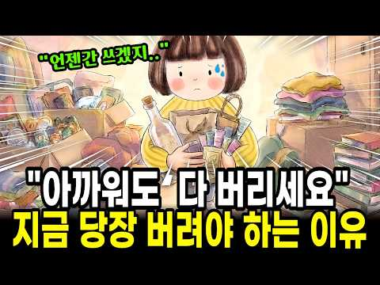
- 설명 앞부분: 아까워도 다 버리세요 🧹 지금 당장 정리해야 하는 뇌과학적 이유 "분명히 버렸는데 왜 또 그대로일까요?" 🤔 차곡차곡 모아둔 종이가방, 깨끗이 씻어 줄 세워둔 유리병, 지퍼백에 담긴 화장품 샘플들… 아까워서 도무지 손이 안 가는 그 서랍, 혹시 여러분도 하나쯤 있으신가요? 🗄 오늘 이야기는요, 물건을 못 버리는 게 결코 여러분이 게으르거나 미련해서가 아니라는 데서 시작합니다. 우리 뇌는 익숙한 물건을 버릴 때 마치 몸이 아픈 것처럼 반응한다고 해요. 그래서 손이 얼어붙는 게 당연했던 거예요. 💛 ✨ 이 영상에서 함께 나누는 이야기…
- 대본 없음 (설명) — 음성인식이 끝나면 도입부·흐름이 들어감
- 댓글 190/190: 좋은 점 — 영상 6 · 감사·응원 6 · 더 알고 싶은 것 0 · 아쉬운 점 — 영상 1 · 반박·불만 — 의견 다름 0 · 정치·사회 0 · 경험 공유 15 · 구독·다음 기대 0
  - 좋은 점 — 영상 👍14 “좋은 얘기 감사합니다. 저도 정리가 잘안되네요. 지금보다 여유있었던 젊은날 가지고 있던것들에 잡착이있어 아직도 못비우고 끌어안고 살고 있어 매일 심란하게 걱정하고 고민하는 삶을 살고 있거든요. 이젠 비워야지하면서도 그게 쉽게 안되는게 외로워서 강박이라서 아까워서라는 …”
  - 좋은 점 — 영상 👍11 “최근 몇년만에 다시 미니멀 도전중인데 예전에 내가 왜 미니멀을 하고싶었는지 기억이 안났거든요. 이런저런 영상도 와닿지않았는데 드디어 발견!! 몇번이고 더 돌려보고 다시도전해보겠습니다.”
  - 감사·응원 👍14 “간결하게 정돈된 삶❤ 감사합니다❤ 비우고 나면 개운해지는 ❤ 여러분께 바로 지금 좋은일이 생깁니다❤”
  - 감사·응원 👍14 “좋은 얘기 감사합니다. 저도 정리가 잘안되네요. 지금보다 여유있었던 젊은날 가지고 있던것들에 잡착이있어 아직도 못비우고 끌어안고 살고 있어 매일 심란하게 걱정하고 고민하는 삶을 살고 있거든요. 이젠 비워야지하면서도 그게 쉽게 안되는게 외로워서 강박이라서 아까워서라는 …”
  - 경험 공유 👍17 “저도 마니 버렸는데 더 버릴게 없나 늘 봅니다”
  - 경험 공유 👍16 “저희엄마가 쓰레기 수집가 수준입니다”

### 75. 최명기는 틱장애입니다

- https://www.youtube.com/watch?v=kAEfOJgXS0s · 최명기의 마음 편한 TV · 구독자 41,600 · 조회수 428,018 (×10.3, 하루 9,940.6) · 좋아요 5,389 (1.3%) · 19.6분 · 2026-09-29 · 주제 묶음 기타 · 형식 인터뷰·강연·대담 (전문가) · 폴더 `W_kAEfOJgXS0s` (웹 승인)
- 썸네일: 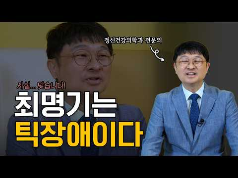
- 설명 앞부분: 저 최명기 사실 틱장애 맞습니다 최명기 원장님의 정신 건강 이야기 매주 화요일 오후 5시 업로드됩니다
- 대본 없음 (설명) — 음성인식이 끝나면 도입부·흐름이 들어감
- 댓글 999/999: 좋은 점 — 영상 113 · 감사·응원 286 · 더 알고 싶은 것 34 · 아쉬운 점 — 영상 2 · 반박·불만 — 의견 다름 5 · 정치·사회 6 · 경험 공유 143 · 구독·다음 기대 44
  - 좋은 점 — 영상 👍740 “한번도 거슬려본적이 없습니다 좋은말씀 항상 감사드려요❤”
  - 좋은 점 — 영상 👍369 “말씀하실 때 내용이 너무 좋아서 눈깜빡이시는 것도 몰랐어요. 항상 좋은 말씀 감사해요.”
  - 감사·응원 👍740 “한번도 거슬려본적이 없습니다 좋은말씀 항상 감사드려요❤”
  - 감사·응원 👍398 “사람만 좋아보이는데 요 응원합니다”
  - 더 알고 싶은 것 👍26 “선생님 말씀은 솔직하고 현실적이라 늘 마음에 와닿는 것 같아요. 이런 영상까지 친절히 올려주시다니! 오히려 더 가까워진 것 같아 좋은 걸요 ☺️ 도움 많이 받고 있습니다. 앞으로도 좋은 영상 많이 부탁드려요!”
  - 더 알고 싶은 것 👍22 “원장님!! 지금처럼 계속 쭈욱~~ 유트브랑 방송 많이 부탁드립니다 🙏😊”
  - 아쉬운 점 — 영상 👍0 “원장님 멋지세요❤구독합니다! 목소리에 따스함이 느껴져요 힘들때 위로되는 말씀 감사합니다😊 뻔한얘기말고 사이다 발언들으면 속이 뻥뚫려용ㅎㅎ 다른사람들 말 신경쓰지 마시고 지금처럼 힘이되주세요🎉❤ 원장님 최고❤❤❤❤”
  - 아쉬운 점 — 영상 👍0 “원장님, 직접 올리신 영상 혹은 방송을 통해 전해주시는 통찰력 있는 말씀과 폭포수처럼 시원한 해결책, 종종 저와 같은 생각을 발견하게 되어 최근에 팬이 되었어요. 그리고 내원해서 원장님의 프로페셔널하면서도 인간적인 모습, 겸손하신 모습을 보게 되었어요. 어젯밤 며칠 …”
  - 반박·불만 — 의견 다름 👍3 “전혀 못느꼈어요.아무 문제 아닙니다.선생님 팬이에요😊”
  - 반박·불만 — 의견 다름 👍0 “원장님 참 귀여우셔~ 남한테 피하주는것도 아닌데 뭔상관이래요.ㅎㅎ일일 드라마도 아닌데 굳이굳이 보면서 험담하는건 이해하기 힘들어요.”
  - 정치·사회 👍1 “뇌활동이 많아서 처리하는 거라고 생각하고 있어요 저는ㅎㅎ 윤석렬 대통령의 소위 도리도리(?)도 그런 것 같구. 누구나가 집중하는 동안 그런일이 벌어질 수 있다고 생각합니다. 다른 사람들은 그 정도의 고도화된 뇌활동 안해서 안 나타나는 거예요ㅎㅎㅎ 그리고 귀여우세요~!”
  - 정치·사회 👍1 “한국 메스컴이 문제네요 요즘은 잘생긴 의사분들만 패널로 나오시던데 다들 성형에 피부도 하시는건지..? 다양성이 존중되는 나라가 되기를 희망합니다 이렇게 환자의 맘을 누구보다 잘 이해하시는 분이 티비에 나오셔야죠.”
  - 경험 공유 👍162 “선생님 팬이에요~~ 의료계의 법륜스님이라는 별명 넘 어울리세요! 언젠가 저도 상담가고 싶네요”
  - 경험 공유 👍150 “저희 부부는 좋아하다못해 존경합니다 남편이 병원원장인데 병원처방전 잘읽고있어요 인생공부 잘 하고있어요 정말 지혜로우세요 감사해요🎉”
  - 구독·다음 기대 👍257 “최명기 원장님 팬입니다. 솔직”
  - 구독·다음 기대 👍215 “하이고😢😢사람들 참..잔혹하네요😢😢 전 선생님 팬입니다. 항상 속시원한 대답을 해줘서 맘에 듭니다😊”

### 76. 진짜 나를 사랑하는 방법#이지영 #명언 #동기부여

- https://www.youtube.com/watch?v=HQYWZjH2eEc · 마인드 컴파일 · 구독자 6,500 · 조회수 194,265 (×29.9, 하루 1,538.7) · 좋아요 3,894 (2.0%) · 8.3분 · 2026-07-08 · 주제 묶음 3. 자존감·마음 · 형식 오디오북·책 요약 · 폴더 `W_HQYWZjH2eEc` (웹 승인)
- 썸네일: 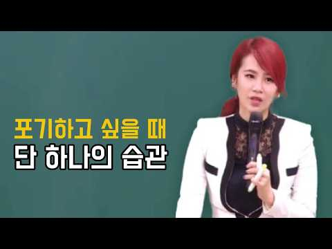
- 설명 앞부분: 힘들고 지칠 때마다 "이번 판은 리셋하고 다음에 다시 시작할까?"라는 유혹이 찾아옵니다. 스트레스 절벽 앞에서 도망치고 싶어지는 건 자연스러운 감정입니다. 하지만 지금 회피하면, 앞으로 마주할 인생의 수많은 기회 앞에서도 똑같이 도망치는 결정을 내리게 됩니다. 무작정 자신을 혹사하며 독해질 필요는 없습니다. 세상이 정해둔 기준 대신, 내가 스스로를 통제할 수 있는 '나만의 작은 룰'을 세우고 지켜나가세요. 오늘 해야 할 일을 묵묵히 해내며 10년 후의 내 미래에 긍정적인 주문을 걸어야 합니다. 눈앞의 유혹과 시련에 흔들리지 마세요…
- 대본 없음 (설명) — 음성인식이 끝나면 도입부·흐름이 들어감
- 댓글 92/92: 좋은 점 — 영상 4 · 감사·응원 17 · 더 알고 싶은 것 0 · 아쉬운 점 — 영상 1 · 반박·불만 — 의견 다름 1 · 정치·사회 0 · 경험 공유 10 · 구독·다음 기대 0
  - 좋은 점 — 영상 👍34 “2번의 이직, 결과적으로 높은 연봉과 안정적 일자리를 얻었지만 되돌아보면 정말 얻은걸까? 혹시 포기하면서 여기까지 온건 아닐까라는 생각을 자주하곤 하는 40대중반입니다. 50대를 준비하는 요새... 기존의 포기하고 리셋하는 버릇 고쳐보려합니다. 지금까지는 운이 좋아 …”
  - 좋은 점 — 영상 👍1 “이지영 쌤.. 너무 좋으신 분 늘 배워갑니다. 영상 감사합니다. 🙏🏻”
  - 감사·응원 👍480 “35살 아줌마입니다 진짜 진짜 저게 맞는말이에요 진짜에요 평생을 나는 못하는 사람이지 한계짓고 도전하면서도 난 안될거같은데 라는 생각으로 살앗습니다 그러다보니 금방 포기하게 되고 결국이나이까지 이룬거하나 없더라구요 근데 이아줌마가 아이를 낳고 자식앞에 떳떳하고 싶더라…”
  - 감사·응원 👍9 “너도 울고 싶었구나. 그래 많이 고맙다.”
  - 경험 공유 👍480 “35살 아줌마입니다 진짜 진짜 저게 맞는말이에요 진짜에요 평생을 나는 못하는 사람이지 한계짓고 도전하면서도 난 안될거같은데 라는 생각으로 살앗습니다 그러다보니 금방 포기하게 되고 결국이나이까지 이룬거하나 없더라구요 근데 이아줌마가 아이를 낳고 자식앞에 떳떳하고 싶더라…”
  - 경험 공유 👍45 “40대 되니깐 나를 토닥일수 있는건 나밖에 없음... 그냥 나를 토닥이면서 또 기회가 올거야 괜찮아. 이말로 마음을 다잡고 추스려야 함... 천천히 가자. 하면서 계속 부딪혀야 하더라. 피하지말고. 나도 이룬게 크게 없지만 좀 마음을 고쳐먹으니, 아주 조금 편해지고 …”

### 77. '이런' 취미를 반드시 가져라. 혼자 있어도 평생 행복하다 ∣ 쇼펜하우어 인생조언 #현실조언 #동기부여 #마인드셋

- https://www.youtube.com/watch?v=E0XTT7j4g3Q · 부자 패턴 연구소  · 구독자 10,800 · 조회수 259,916 (×24.1, 하루 2,547.1) · 좋아요 3,005 (1.2%) · 16.5분 · 2026-08-01 · 주제 묶음 3. 자존감·마음 · 형식 오디오북·책 요약 · 폴더 `W_E0XTT7j4g3Q` (웹 승인)
- 썸네일: 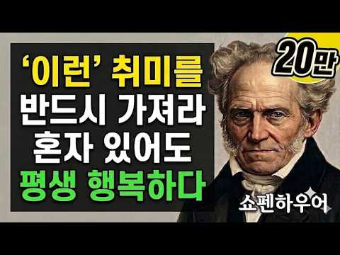
- 챕터: 0:00 나이 들어 혼자 있어도 평생 즐겁게 살아가는 법 · 1:15 쇼펜하우어가 경고한 가짜 취미와 지루함의 고통 · 2:40 고독한 취미를 가질 때 인간관계의 주도권이 생기는 이유 · 4:10 60세 정년퇴직 남성이 혼자만의 성전에서 왕이 된 실… · 6:20 사례로 본 쇼펜하우어의 '내면 가치 체계' 전환 · 8:05 현대 심리학과 뇌과학이 입증한 몰입의 행복 메커니즘 · 10:15 몸과 마음을 정화하는 쇼펜하우어의 정적인 산책 루틴 · 11:50 노년의 영혼을 가을 결실처럼 만드는 배움의 기쁨 · 13:30 타인의 눈치를 내려놓고 진짜 나를 채우는 삶의 정리 · 15:10 쇼펜하우어가 남긴 마지막 당부와 3가지 핵심 지혜 · 16:31 영상 종료
- 설명 앞부분: "이 포스팅은 쿠팡 파트너스 활동의 일환으로, 이에 따른 일정액의 수수료를 제공받습니다." 살다 보면 퇴직 후 나이가 들면서 외로움과 공허함에 시달리거나, 당장 무슨 취미를 가져야 할지 막막할 때가 있습니다. 남들에게 보여주기 위한 가짜 취미나 외향적인 모임에만 의존하다 보면, 타인이 떠나고 체력이 떨어지는 순간 삶이 무너져 내립니다. 19세기 철학자 아르투어 쇼펜하우어는 인간이 나이 들수록 반드시 가져야 할 단 하나의 취미는 타인의 시선에서 벗어나 내면의 영혼을 채우는 취미라고 강조합니다. 혼자 있는 고독을 온전히 누리고, 내면…
- 대본 없음 (설명) — 음성인식이 끝나면 도입부·흐름이 들어감
- 댓글 74/74: 좋은 점 — 영상 2 · 감사·응원 9 · 더 알고 싶은 것 0 · 아쉬운 점 — 영상 3 · 반박·불만 — 의견 다름 0 · 정치·사회 1 · 경험 공유 4 · 구독·다음 기대 0
  - 좋은 점 — 영상 👍10 “너무 좋은 말씀 감사드립니다..~~^^”
  - 좋은 점 — 영상 👍4 “좋은정보에감사드립니다.”
  - 감사·응원 👍42 “혼자 있을때 가장 행복한것 같습니다. 주변정리 개끗하게 하고 컴을 마주하고 그림도 그리고 복지관등 에서 늘 공부 합니다.오는길은 전철2정거장 걸어서 오구요 잘하고 있군요. 하루에 한줄 글쓰기도 시도 하렵니다. 되도록 책을 가까이 하려 합니다 영상 감사드립니다~!”
  - 감사·응원 👍10 “너무 좋은 말씀 감사드립니다..~~^^”
  - 아쉬운 점 — 영상 👍20 “인생은 고통과 지루함을 오가는 시계추와 같다.”
  - 아쉬운 점 — 영상 👍3 “열심히 일하고 주말 하루 낚시”
  - 정치·사회 👍0 “대륜이냐? 좋겠다. 사회 책임져야 하니.... ㅎㅎㅎ 대통령 출마해. ㅎㅎㅎ”
  - 경험 공유 👍5 “저도 혼자하는 편인데 ... 가끔은 혼자가 불안할때도 있지요 그래도 혼자 즐기는 모든것이 행복하답니다. 책보고 요리하고 산책 필사...등등 뭔가 삶이 갈증날땐 무작정 발바닥 부르트도록 복잡한 거리를 걷기도하고요~~~”
  - 경험 공유 👍3 “제가 존경하는 쇼펜 하우어 형님, 칼 융 형님 감사합니다”

### 78. 자존감 높은 손주는 가정에서 '이 말'을 주로 듣습니다｜맞벌이 자녀를 돕는 조부모의 현명한 손주 돌보기

- https://www.youtube.com/watch?v=UWcGH7Nog6Q · 육아는아빠가 · 구독자 17,000 · 조회수 200,179 (×11.8, 하루 3,974.2) · 좋아요 1,782 (0.9%) · 18.6분 · 2026-09-22 · 주제 묶음 3. 자존감·마음 · 형식 정보·해설 (그 밖) · 폴더 `W_UWcGH7Nog6Q` (웹 승인)
- 썸네일: 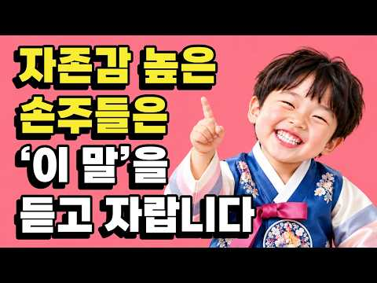
- 설명 앞부분: 자존감 높은 아이, 아이 자존감 높이는 법, 부모의 말습관과 칭찬법이 궁금하신가요? 손주 육아와 조부모 육아에서 중요한 것은 “잘했어”, “최고야”라는 칭찬보다 아이가 “나는 해볼 수 있어”라고 느끼게 해주는 말입니다. 자존감 높은 손주로 키우는 대화법, 아이가 실패했을 때 해줘야 할 말, 친구 때문에 속상해할 때의 감정코칭, 그리고 사랑해서 모든 것을 대신해주기보다 자기효능감과 독립심을 키워주는 방법을 실제 육아 상황으로 알려드립니다. 맞벌이 자녀를 대신해 손주를 돌보는 조부모님과 아이의 자존감, 자신감, 자기주도성을 키우고 싶…
- 대본 없음 (설명) — 음성인식이 끝나면 도입부·흐름이 들어감
- 댓글 50/50: 좋은 점 — 영상 5 · 감사·응원 11 · 더 알고 싶은 것 3 · 아쉬운 점 — 영상 1 · 반박·불만 — 의견 다름 0 · 정치·사회 0 · 경험 공유 2 · 구독·다음 기대 0
  - 좋은 점 — 영상 👍3 “선생님 7세 손녀 케어 하고 있는데 정말 유익한 교육 강의 입니다”
  - 좋은 점 — 영상 👍3 “5세 쌍둥이 외손녀들을 아침 저녁으로 돌봐주고 있습니다. 선생님의 말씀 완전 공감됩니다. 과잉보호하지 않고 스스로 해보도록 유도해주고 느긋하게 기다려주는데 젊은 날의 바빴던 제 모습을 반성해요. 자기 마음을 들여다보게 하고 마음을 지키는 힘을 길러주고 싶습니다. 좀 …”
  - 감사·응원 👍9 “잘 배우고 있습니다 감사합니다 ^^”
  - 감사·응원 👍3 “영상 매번 잘보고 배우고 느끼고 반성하고 있답니다 감사합니다”
  - 더 알고 싶은 것 👍6 “자신감을높이는말 불안감이있을때해주는말 손주가마음을잘표현하지 안을때해주는말 알려주세요”
  - 더 알고 싶은 것 👍5 “우리 손주는 "할머니 제가 다할수있어요" 손도 못대게 해요. 모든걸 직접. 자기식탁 싹싹 치우고 해줄게 없어 섭섭해요. 밖에서도 지저분하면 뛰어가서 정리하고 닦아놓고 그래요. 단지, 책읽어 달라 맛있는거 달라 그것만 부탁합니다. 안되는것도 이해시키면 금방 따라하는데 …”
  - 아쉬운 점 — 영상 👍1 “광고가 너무너무 길어서~”
  - 경험 공유 👍5 “우리 손주는 "할머니 제가 다할수있어요" 손도 못대게 해요. 모든걸 직접. 자기식탁 싹싹 치우고 해줄게 없어 섭섭해요. 밖에서도 지저분하면 뛰어가서 정리하고 닦아놓고 그래요. 단지, 책읽어 달라 맛있는거 달라 그것만 부탁합니다. 안되는것도 이해시키면 금방 따라하는데 …”
  - 경험 공유 👍3 “웃으면서 말씀하시니 저도 웃으면서 듣게 되니 기분이 좋아요^^ 구체적인 행동으로 인정과 칭찬하도록 오늘도 노력하겠습니다. 감사합니다”

### 79. 매일 똑같이 사는 게 무서운 진짜 이유

- https://www.youtube.com/watch?v=PaiW1albOrA · 이런철학 (Perspective Lab) · 구독자 12,600 · 조회수 373,608 (×29.6, 하루 2,894.0) · 좋아요 9,714 (2.6%) · 5.3분 · 2026-07-05 · 주제 묶음 기타 · 형식 정보·해설 (그 밖) · 폴더 `W_PaiW1albOrA` (웹 승인)
- 썸네일: 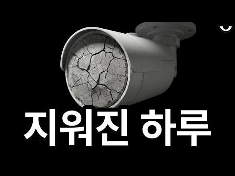
- 챕터: 0:00 당신은 지금 코를 보고 있습니다 · 0:23 어른이 될수록 시간이 빨리 가는 이유 · 0:39 어른이 된다는 것에 대한 불편한 진실 · 0:58 빅토르 시클롭스키: 익숙함은 삶을 지운다 · 1:16 사물은 기호로 대체된다 · 1:43 보르헤스: 기억의 천재 푸네스 · 2:13 예측 부호화: 뇌는 세상을 예측한다 · 2:32 출퇴근길 2시간이 사라지는 이유 · 2:43 효율을 얻은 대가로 잃어버린 감각 · 3:17 설명 깊이의 착각: 익숙한 것을 안다고 믿는 오류 · 4:20 새로운 풍경보다 필요한 것 · 4:39 시클롭스키: 예술은 삶의 감각을 회복하기 위해 존재한다 · 4:51 어른이 된다는 것의 다른 의미 · 5:02 익숙한 세계를 다시 낯설게 바라보는 일
- 설명 앞부분: 어릴 땐 그렇게 느리던 하루. 그런데 어른이 된 뒤, 시간은 미친 듯이 빨리 사라집니다. 우리는 왜 나이가 들수록 “올해도 벌써 끝났네”라고 말하게 될까요? 정말 시간이 빨라진 걸까요, 아니면 우리의 뇌가 반복되는 하루를 조용히 지워버리고 있는 걸까요? 이번 영상에서는 러시아 사상가 빅토르 시클롭스키의 ‘낯설게 하기’, 보르헤스의 『기억의 천재 푸네스』, 그리고 뇌과학의 예측 부호화 관점을 통해 어른이 된다는 것의 불편한 의미를 들여다봅니다. 우리가 겪는 시간의 가속은 단순한 바쁨이 아닙니다. 경험이 쌓여, 익숙해진 세계를 더 이…
- 대본 없음 (설명) — 음성인식이 끝나면 도입부·흐름이 들어감
- 댓글 449/449: 좋은 점 — 영상 10 · 감사·응원 19 · 더 알고 싶은 것 1 · 아쉬운 점 — 영상 14 · 반박·불만 — 의견 다름 10 · 정치·사회 0 · 경험 공유 19 · 구독·다음 기대 0
  - 좋은 점 — 영상 👍89 “밋밋한 시간은 아무것도 알려주지 않는다. 밋밋한 시간 이라는 것을 다시 돌려말하면 단순히 사건이 없거나 부족한 상태가 아니라, 그 어느것에 대해서도 스스로 생각하지 않는 시간의 모습이라 봐도 무방하다. - “당신의 밤은 흐른다” (남우현 저) 이 책이 떠오르는 영상이…”
  - 좋은 점 — 영상 👍3 “생각이 말이 되고, 말이 행동이 되고, 행동이 습관이 되고, 습관이 성격이 되고, 성격이 운명이 되어, 당신의 삶을 결정 짓습니다. 기쁨을 나누면 질투가 되고, 슬픔을 나누면 약점이 된다. 배려가 계속되면 권리인줄 알고, 도움이 계속되면 호구인줄 안다. 이것이 인간관…”
  - 감사·응원 👍89 “밋밋한 시간은 아무것도 알려주지 않는다. 밋밋한 시간 이라는 것을 다시 돌려말하면 단순히 사건이 없거나 부족한 상태가 아니라, 그 어느것에 대해서도 스스로 생각하지 않는 시간의 모습이라 봐도 무방하다. - “당신의 밤은 흐른다” (남우현 저) 이 책이 떠오르는 영상이…”
  - 감사·응원 👍7 “덕분에 영상 내용은 모르겠고 코만 보게 됐습니다. 감사합니다.”
  - 더 알고 싶은 것 👍1 “몰입을 해도 시간은 빨리 흐르는데 뭐가 다를까요? 익숙함은 숙달되었다는건 아닐까요?”
  - 아쉬운 점 — 영상 👍675 “공부해라 배우면 까먹고 또 까먹고 아주 무한반복이다 ㅋㅋㅋ 늘 새로운데 짜릿하진않아 ㅋㅋㅋㅋㅋㅋ”
  - 아쉬운 점 — 영상 👍186 “30,40대만 그런게 아니라 10,20대도 다 똑같습니다. 늘 같은 학교,학원,집의 반복되는 삶. 대학동안은 잠깐 새롭겠지만 군대가면 반복되는 일과와 새로운 병신같은 짓을하는 놈들을 보는 삶. 그리고 군에 나와 취업을위한 몸부림의 반복. 취업하면 또 잠깐 새롭겠지만 …”
  - 반박·불만 — 의견 다름 👍14 “진짜 명작입니다.. 헛소리하는 댓글들 치워버리십쇼”
  - 반박·불만 — 의견 다름 👍1 “저는 자동차를 운전하면서 신고를 위해서 거의 매번 제가 운전한 블랙박스 영상을 돌려보는데, 운전할때는 다 보인다고 생각했지만 막상 돌려보면 새로운걸 보는게 한두번이 아닙니다. 드론 날리고 촬영한 영상 볼 때도 마찬가지구요. 인간은 100% 자기가 다 감지하고 느낀다 …”
  - 경험 공유 👍36 “학생때 시험 볼때가 생각납니다 시험을 잘 봐야하는 애들은 남은 기간이 너무 짧다고 느끼는 애들도 있었고 시험이 불안한 애들은 너무 금방 돌아온다고 하거나 차라리 빨리 끝내고 방학이 왔으면 좋겠다고 하루하루 불안해서 너무 길게 느껴진다고 한 애들도 있었죠 성적을 증명하…”
  - 경험 공유 👍31 “내가 매일 새로운 야동을 찾는 이유”

### 80. 당신은 결코 죽음을 경험하지 못한다 ∣ 뇌과학이 밝혀낸 충격적인 진실 ∣ 과학다큐

- https://www.youtube.com/watch?v=6NglAKAd91o · 몰랐던 사실 · 구독자 8,190 · 조회수 278,552 (×34.0, 하루 1,870.0) · 좋아요 4,246 (1.5%) · 54.6분 · 2026-06-15 · 주제 묶음 1. 심리학 일반 · 형식 정보·해설 (그 밖) · 폴더 `W_6NglAKAd91o` (웹 승인)
- 썸네일: 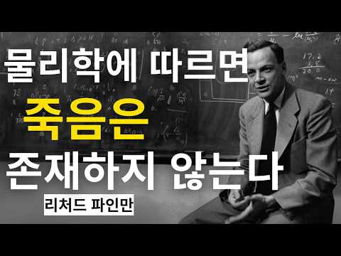
- 챕터: 0:00 죽음과 의식에 대한 가장 큰 질문 · 3:15 우리는 왜 죽음을 두려워하는가? · 6:42 뇌과학이 밝힌 의식의 본질 · 10:18 전신마취가 보여주는 놀라운 사실 · 14:55 죽음에 대한 흔한 오해와 진실 · 19:30 철학자들이 바라본 죽음의 의미 · 24:08 시간과 의식의 관계 분석 · 29:47 죽음을 이해하면 삶이 달라지는 이유 · 35:12 당신은 결코 죽음을 경험하지 못한다 · 40:00 삶과 죽음에 대한 최종 결론
- 설명 앞부분: 당신은 결코 죽음을 경험하지 못한다 ∣ 뇌과학이 밝혀낸 충격적인 진실 ∣ 과학다큐 죽음은 정말 우리가 상상하는 것처럼 끝없는 어둠일까요? 많은 사람들은 죽음을 의식이 사라진 뒤에도 계속되는 공허한 상태라고 생각합니다. 하지만 이번 과학다큐에서는 현대 뇌과학과 철학, 그리고 물리학의 관점을 통해 죽음에 대한 가장 근본적인 오해를 파헤칩니다. 전신마취를 경험한 사람들은 종종 시간이 완전히 사라진 것처럼 느꼈다고 말합니다. 이번 과학다큐는 이러한 현상을 통해 의식이 어떻게 현실과 시간을 만들어내는지 설명하며, 왜 인간은 자신의 죽음을 …
- 대본 없음 (설명) — 음성인식이 끝나면 도입부·흐름이 들어감
- 댓글 307/307: 좋은 점 — 영상 2 · 감사·응원 9 · 더 알고 싶은 것 2 · 아쉬운 점 — 영상 2 · 반박·불만 — 의견 다름 1 · 정치·사회 0 · 경험 공유 21 · 구독·다음 기대 1
  - 좋은 점 — 영상 👍71 “시간의 흐름이 착시이고 죽음이 소멸이 아닌 특정 좌표에 꽂히는 완성된 기록이라는 설명에 눈물이 핑 돕니다. 얼마 전 천시록 봤을 때도 명리학에서 말하는 대운의 흐름이나 인연의 끝은 사라지는 게 아니라 시공간에 새겨진 마디라고 했거든요. 떠나간 소중한 이들이 우주 어딘…”
  - 좋은 점 — 영상 👍1 “너무나도 수준높고 좋은 영상이네요 감사합니다~🎉🎉🎉”
  - 감사·응원 👍5 “어쩌다 뇌를 갖고 살게 된거야 ㅋ 그냥 감사하게 살다 가면 되는 겨~”
  - 감사·응원 👍5 “양적완화하여 가계부채 청산하고 세금절약하여 국민배당금 월150만원 이상 노인수당 월70만원 지급하고 결혼부 설립하여 연애수당 월 20만원 결혼수당 1억 출산수당 5,000만원 주택구입 2억 전업주부 월100만원 지급하고 다자녀 부모는 취업에 우선순위를 주는 공영제하고…”
  - 더 알고 싶은 것 👍0 “모두의 시간이 다르다.상대적이다 ~ 전 저의 삶이 미래에 대한 많은 경험을 하며 살아와서 시간이 선형적이지 않다고 생각해온 사람입니다.내용 너무 감사합니다 ~ 그렇다면 저는 미래를 보거나 어린시절의 그동네가 현재 바뀐형태를 꿈으로 볼 수있는 현상등 미래를 볼수있는 능…”
  - 아쉬운 점 — 영상 👍7 “왠만하면 댓글 안다는데 너덜 너덜 과학상식 짜집기 그이상도 이하도 아니군요 도대체 무슨 얘기가 하고 싶은겁니다”
  - 아쉬운 점 — 영상 👍0 “영상을 좀 짧게 만들거나 나눠서 하세요. 너무 길어서 보기 싫네요..”
  - 반박·불만 — 의견 다름 👍0 “물리학자가 아니니 무슨 소리하느냐? 너는 내가 詩를 을프면 내뜻을 이해하겠느뇨? 헛소리 그만 하라! 말하는 너도 모르면 서 떠들지 마라!”
  - 경험 공유 👍17 “내가 좋아하는 콘텐츠 ㅎㅎ”
  - 경험 공유 👍6 “내가 죽고없어면 즉 이세상도 존재하지않는다”

