# 심리 — 성공 사례 분석: 사례별 자세히 #41–#80

`analysis.md` 의 9번 (같은 # 번호). 자동 생성 — `tools/success_analysis.py` v1.6 (2026-11-11 13:32 UTC). ※ 연구·교육용 — 투자 권유가 아님.

### 41. 지능이 높을수록 나이가 들면 친구를 정리 하는 이유

- https://www.youtube.com/watch?v=tMtPxonK_Uk · 단단한 인생 2막 · 구독자 455 · 조회수 87,125 (×191.5, 하루 838.6) · 좋아요 1,093 (1.2%) · 20분 · 2026-07-30 · 주제 묶음 2. 인간관계·처세 · 형식 정보·해설 (그 밖) · 폴더 `W_tMtPxonK_Uk` (웹 승인)
- 썸네일: 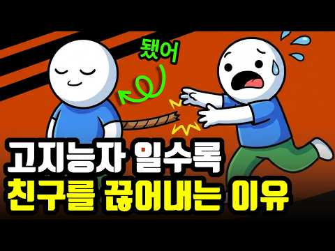
- 챕터: 0:00 친구 연락이 한숨으로 변한 진짜 이유 · 1:12 우리가 맺어온 인연의 숨겨진 실체 · 2:05 나이 들수록 뇌가 남은 시간을 계산하는 방식 · 3:10 사회정서적 선택 이론: 넓은 관계에서 깊은 관계로 · 4:18 체력과 시간의 가치를 깨달을 때 생기는 변화 · 5:32 진짜 사회성이란 관계의 개수가 아닌 밀도 · 6:45 관계를 정리하지 못해 힘겨운 세 가지 유형
- 설명 앞부분: 나이 들수록 친구 만나는 게 귀찮고, 혼자 있는 시간이 더 편안하게 느껴지시나요? ☕ 많은 분들이 『내가 성격이 모나진 걸까』 고민하시지만, 심리학은 전혀 다른 답을 제시합니다. 뇌가 가장 똑똑하게 작동하고 있다는 증거이자, 내 삶의 진짜 우선순위를 찾아가는 과정이기 때문입니다. 불필요한 죄책감은 내려놓고, 나를 지키는 현명한 관계 정리법을 만나보세요. ✨ ⏱ 타임라인
- 같은 채널 평소 대비 ×402.4 (채널 최근 롱폼 중앙값 216회) · 평소 영상: 똑똑한 사람일수록 나이가 들면 인간관계를 끊어내는 이유 (251회) / 남의 시선 신경 안쓰는 사람이 잘되는 이유 니체의 마음가짐 (182회)
- 대본 없음 (설명) — 음성인식이 끝나면 도입부·흐름이 들어감
- 댓글 211/211: 좋은 점 — 영상 4 · 감사·응원 4 · 더 알고 싶은 것 1 · 아쉬운 점 — 영상 0 · 반박·불만 — 의견 다름 6 · 정치·사회 0 · 경험 공유 21 · 구독·다음 기대 0
  - 좋은 점 — 영상 👍5 “오늘 내용이 구구절절 옳은 내용입니다. 나이가 들수록, 나의 몸과 마음이 평안해야 친구와 주변도 챙길수 있습니다.”
  - 좋은 점 — 영상 👍2 “좋은 이야기 임니다 참고 하겠습니다”
  - 감사·응원 👍14 “감사합니다 그런 이유가 있었군요 저도 저만의 시간을 보내야겠어요 !”
  - 감사·응원 👍6 “현명하신 영상 감사합니다 신의축복 받으세요^^”
  - 더 알고 싶은 것 👍2 “무슨 이유가 있을까요? 모든생활에서 행동 이나 마음가짐에서 생각들이 많아지고 움직임도 둔해지고 살아온 과정들을 하나하나 반추해보는 시간이 남은 생의 시간 같을테니까”
  - 반박·불만 — 의견 다름 👍7 “결정적인 원인은 지적수준(학벌, 학력을 지칭하는 게 아닙니다)과 대화내용의 차이에서 현격한 이질감을 느끼기 때문입니다. 나이가 들어도 꾸준히 자기계발을 멈추지 않는 사람들 대부분 잡스러운 친구 안 만나지요. 잡스러운 일상적인 얘기와 신변얘기는 이들에게는 시간 낭비일 …”
  - 반박·불만 — 의견 다름 👍5 “친구에게 도움 받으려는 생각이 틀렸다.”
  - 경험 공유 👍15 “식구들 빼고 모든 사람이 내가 망하길 바란다.”
  - 경험 공유 👍14 “감사합니다 그런 이유가 있었군요 저도 저만의 시간을 보내야겠어요 !”

### 42. 친구 하나 없어도 잘 사는 50대 남자들의 공통점 (외톨이가 아닙니다)

- https://www.youtube.com/watch?v=iTtU5cKxAK0 · 본능의심리학 · 구독자 6,640 · 조회수 573,915 (×86.4, 하루 12,219.2) · 좋아요 2,040 (0.4%) · 20.3분 · 2026-09-25 · 주제 묶음 2. 인간관계·처세 · 형식 정보·해설 (그 밖) · 폴더 `W_iTtU5cKxAK0` (웹 승인)
- 썸네일: 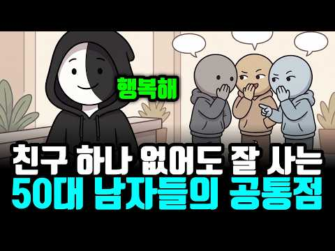
- 설명 앞부분: 한 달 내내 친구와 약속이 없는데 누구보다 편안한 50대 남자들이 있습니다. 외톨이일까요. 연구는 다르게 말합니다. 친구 수와 외로움은 서로 다른 문제이고, 친구 없이 잘 사는 남자들에게는 다섯 가지 공통점이 있습니다. 스스로 고른 혼자, 인사하는 얼굴들, 몰두하는 일, 비교하지 않는 기준, 그리고 비상구 한 명. 40대 친구 편의 반대편 이야기입니다.
- 같은 채널 평소 대비 ×32.4 (채널 최근 롱폼 중앙값 17,693회) · 평소 영상: 아내 먼저 보내고 혼자 사는 50대 남자들이 재혼을 안 하는 진짜 이유 (못 잊어서가 아… (17,953회) / 인간관계 다 정리하고 오히려 행복해진 50대 남자들의 공통점 (냉정해진 게 아닙니다) (17,433회)
- 대본 없음 (설명) — 음성인식이 끝나면 도입부·흐름이 들어감
- 댓글 394/394: 좋은 점 — 영상 5 · 감사·응원 3 · 더 알고 싶은 것 3 · 아쉬운 점 — 영상 5 · 반박·불만 — 의견 다름 9 · 정치·사회 1 · 경험 공유 51 · 구독·다음 기대 0
  - 좋은 점 — 영상 👍0 “50중반입니다. 전 10년전부터 이렇게 살아왔네요. 이제 못돌아갑니다. 이 자유마저 없으면 못살거 같거든요. 먼저 했던 좋은 정보들도 공유하고 싶어도 결국 주변에 모이는 사람들은 목적이 다 있던군요. 인생 어차피 혼자 간다. 생각으로 앞으로도 나를 위해 많이 시간투자…”
  - 좋은 점 — 영상 👍0 “내나이59 서서히인간들정리된다 그리고빠르게혼자사는법을배워라 여러사람들만나서에너지소비할필요없다 난~어릴데하고싶은바이커를탄다 신세계다 나이가들면깊이있게사는게조은거같다 그리고하나~나이들수로개끗하게다녀라 옷은신경써입어라 나이먹어도멋있게다녀라 인생이제는자신을위해살나이다 에네지…”
  - 감사·응원 👍18 “사람 만나면 기 빨린다, 혼자가 좋다, 새로운 식당 생기면 가보고 계절 바뀌면, 옷 몇벌사서 노숙자들에게 나눠주고, 내 도움 필요한곳에 도움을 줄수있으니 얼마나 감사한 일인가, 현재 66세”
  - 감사·응원 👍3 “영상 감사합니다”
  - 더 알고 싶은 것 👍0 “내년이면 환갑이네...;; 근데..원래 친구 란게 참 묘합니다..몰랐다가 알았다가 친해졌다가 또 헤어지기도 합니다..친구란 내맘에 새겨지는 좋고 나쁘고의 그 중간이 친구인거 같습니다.. 나를 위해 있는 친구 과연 있을까요? 다 사람은 이용가치로 친구를 두는겁니다..술…”
  - 더 알고 싶은 것 👍0 “무슨 이야기 하나 궁금해서 듣다가 나가는 50대 ㅋㅋㅋ”
  - 아쉬운 점 — 영상 👍5 “아침 6시에 일어나서 조깅하고 샤워 후 아침 먹고 청소로 하루를 시작해 내가 좋아하는 독서만 해도 하루가 금방 지나가고 취미로 낚시를 다니면 늘 산과 바다를 보며 새로운 사람들과 상황들이 생겨서 지루함이 없다. 즐겁고 바쁘다. 술, 담배 끊은 지 오래~”
  - 아쉬운 점 — 영상 👍1 “50대 나임.쉬는날 낚시가고 등산가고.도서관가고.저녁에 운동하고 하루가 넘 바쁘다.외롭다는 말도 생각도 안듬.오로지 나를 위해 시간보냄.그러다가 친구가 부르면 달려감.단 먼저 약속 안함”
  - 반박·불만 — 의견 다름 👍8 “살아가는 데 반드시 친구가 필요한 것은 아닙니다.”
  - 반박·불만 — 의견 다름 👍5 “여러분은 sns나 커뮤니티를 합니까? 그렇다면 진정한 의미의 혼자가 아닙니다. 단순히 인간 상대하는게 싫은것일뿐.”
  - 정치·사회 👍0 “그 동안 이 나라가 인간관계 가스라이팅을 오지게 한거임 젊을 때나 친구 만나면 자기 주관 달라도 서로 맞춰주고 즐겁게 놀지 나이 먹으면 자기 주관 확고해져서 절대 자기 주장 안 굽힘 이제 가치관도 안 맞는데 그거 들어주는거도 고통임 그냥 내할거 하고 가족이나 챙기며 …”
  - 경험 공유 👍254 “지금 내모습이네 그많던 인맥이나 술자리들 40댸 중반부터 왜 내가 불편한 일들에 시간쓰고 스트레스를 받아야하나 생각으로 하나하나 정리하고 지금은 거의 그런자리를 피하고 일마치고 운동하고 주말이면 취미생활 1년에 한두번 혼자 해외여행... 여러가지 취미생활로 항상 시간…”
  - 경험 공유 👍14 “세상에 내가 잘되면 진심으로 기뻐해주는 사람은 부모님밖에 없음 친구고 지랄이고 타인이 잘되면 배아픈게 인간 본성임”

### 43. 《정약용 인생조언》 성공할수록 가까운 사람에게 절대 말하지 말아야 할 5가지

- https://www.youtube.com/watch?v=iA14z5h29LY · 인생 한마디 · 구독자 295 · 조회수 39,377 (×133.5, 하루 534.3) · 좋아요 430 (1.1%) · 37.2분 · 2026-08-29 · 주제 묶음 1. 심리학 일반 · 형식 정보·해설 (그 밖) · 폴더 `W_iA14z5h29LY` (웹 승인)
- 썸네일: 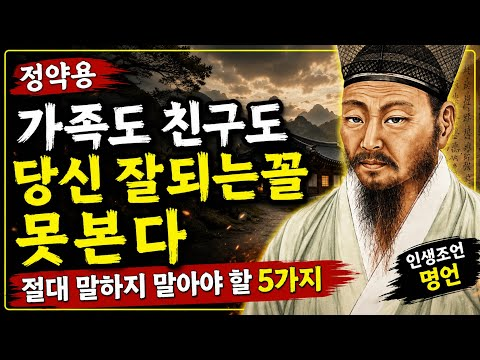
- 설명 앞부분: 사람이 성공할수록 모든 것을 주변 사람들에게 이야기해야 할까요? 정약용의 지혜를 통해 인간관계에서 지켜야 할 말과 행동, 그리고 나 자신을 보호하는 방법을 알아봅니다. 가족과 친구처럼 가까운 사람이라도 반드시 말하지 않아야 할 것들이 있습니다. 오늘 영상에서는 성공과 인간관계에서 후회하지 않기 위해 꼭 알아야 할 5가지 중요한 인생의 지혜를 소개합니다. 끝까지 시청하시고 여러분의 삶과 인간관계에 도움이 되는 지혜를 얻어가세요. 🙏
- 같은 채널 평소 대비 ×114.8 (채널 최근 롱폼 중앙값 343회) · 평소 영상: 누구를 만나든 ‘이 3가지’만 하세요｜원수도 내 편으로 만드는 정약용의 인간관계 지혜 (343회) / 본성이 드러나는 순간! 절대 곁에 두면 안 되는 사람의 말버릇 5가지 ∣ 심리학 ∣ 인생… (344회)
- 대본 없음 (설명) — 음성인식이 끝나면 도입부·흐름이 들어감
- 댓글 26/26: 좋은 점 — 영상 0 · 감사·응원 3 · 더 알고 싶은 것 0 · 아쉬운 점 — 영상 0 · 반박·불만 — 의견 다름 0 · 정치·사회 0 · 경험 공유 0 · 구독·다음 기대 1
  - 감사·응원 👍4 “감사합니다”
  - 감사·응원 👍3 “선생님 소중한 관계를 지키기 위해 영상 공유 끝까지 시청합니다 감사합니다 좋아요 구독합니다 ❤❤❤”
  - 구독·다음 기대 👍3 “선생님 소중한 관계를 지키기 위해 영상 공유 끝까지 시청합니다 감사합니다 좋아요 구독합니다 ❤❤❤”

### 44. 잘해줄수록 무시당하는 진짜 이유｜목소리 높이지 않고 존중받는 3가지 방법

- https://www.youtube.com/watch?v=YsYFkKuAj-Y · 행복한 마음읽기 · 구독자 2,580 · 조회수 516,904 (×200.3, 하루 4,504.5) · 좋아요 3,808 (0.7%) · 27.8분 · 2026-07-19 · 주제 묶음 기타 · 형식 정보·해설 (그 밖) · 폴더 `W_YsYFkKuAj-Y` (웹 승인)
- 썸네일: 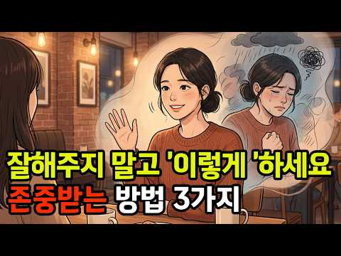
- 설명 앞부분: 나는 분명 마음을 다해 잘해줬는데, 돌아온 건 고맙다는 말이 아니라 당연하다는 얼굴이었습니다. 그 순간 마음이 쿵 하고 내려앉았던 적, 한 번쯤 있으실 겁니다. 그런데 그건 여러분이 못나서도, 성격이 유별나서도 아닙니다. 사람의 마음이 원래 그렇게 움직이도록 되어 있기 때문입니다. 이 영상에서는 왜 잘해줄수록 오히려 함부로 대해지는지, 그 마음의 구조를 찬찬히 풀어봅니다. 그리고 그 흐름을 조용히 뒤집는 세 가지 이야기를 함께 나눠보려 합니다. 바꿔야 할 건 상대가 아니라, 나 자신을 대하는 방식일지도 모릅니다. 이런 분들께 권합…
- 같은 채널 평소 대비 ×84.4 (채널 최근 롱폼 중앙값 6,127회) · 평소 영상: 나이 들수록 형제와 멀어지는 진짜 이유｜심리학과 연구가 밝힌 5가지 (6,346회) / 남의 눈치 안보고 이기적으로 살아도 되는 이유 ∣ 쇼펜하우어·에픽테토스·장자가 남긴 인생… (5,908회)
- 대본 없음 (설명) — 음성인식이 끝나면 도입부·흐름이 들어감
- 댓글 180/180: 좋은 점 — 영상 8 · 감사·응원 14 · 더 알고 싶은 것 1 · 아쉬운 점 — 영상 4 · 반박·불만 — 의견 다름 1 · 정치·사회 1 · 경험 공유 13 · 구독·다음 기대 2
  - 좋은 점 — 영상 👍6 “정말 공감되는 내용입니다. 잘해주는 것이 항상 존중으로 돌아오는 것은 아닌 것 같아요. 오히려 자신의 기준과 경계를 분명하게 세우는 것이 진정한 존중을 만드는 방법인 것 같습니다. 좋은 내용 잘 보고 갑니다”
  - 좋은 점 — 영상 👍6 “좋은말씀 감사합니다, 주변에 자주 있는일에요, 참고하겠습니다, ❤”
  - 감사·응원 👍21 “제 경우는 어릴때부터 많이 아파서 주변에 알게 모르게 피해를 많이 줬어요 그래서 밥을 사거나 선물을 하거나 하는 경우가 많았는데 지금도 아픈건 그대로 그래서 상대에게 도움받은 게 있으면 간단하게라도 감사 표시를 합니다 그래서인지 남에게 뭘 주는게 습관처럼 됐어요 대가…”
  - 감사·응원 👍6 “딱 내가 이번에 당햇던거네요 근데 그런사람은 손절이 답이예요 사람 변하지않아요 원래 인성이 나쁜거죠 감사합니다”
  - 더 알고 싶은 것 👍5 “잘대해주니 진짜 고마워 할줄을 모르더라구요 거기에 휘둘리지않고 시집책을 내었습니다 1집 명자의 삶의 여정 2집 내가 바라본 나 3집 행복한 삶을 위하여 . 네이버에서 구매가능하니 많은응원 부탁드립니다 ♡”
  - 아쉬운 점 — 영상 👍116 “<잘해줄수록 만만해지는 심리 구조> 행복한 마음 읽기 1.호의가 점점 의무가 되는 이유? 받는 사람에게는 똑같은 게 반복되면 적응되어 그 가치와 감동이 점점 줄어든다 => 습관화, 쾌락 적응 반복되면 그게 원래 그런 것, 당연히 받는 것으로 바뀐다 => 안 해 주면 …”
  - 아쉬운 점 — 영상 👍4 “서두가 너무 길어!”
  - 반박·불만 — 의견 다름 👍1 “AI님~~암말 안하고싶은데 넘 답답해서 댓글 달고 싶어지네요ㅋ 사람은 다양합니다.. 받고싶기도하고 주고 싶기도하고. 남을 살피는 그 시간에 차라리 내가 하고 싶은건 하고 안하고싶으면 안하며 생각을 너무 남을 보는 습관은 좋은게 아닙니다. 집착귀가 붙습니다 ㅋㅋ 그럴 …”
  - 경험 공유 👍116 “<잘해줄수록 만만해지는 심리 구조> 행복한 마음 읽기 1.호의가 점점 의무가 되는 이유? 받는 사람에게는 똑같은 게 반복되면 적응되어 그 가치와 감동이 점점 줄어든다 => 습관화, 쾌락 적응 반복되면 그게 원래 그런 것, 당연히 받는 것으로 바뀐다 => 안 해 주면 …”
  - 경험 공유 👍64 “66세 소꿉친구가 가장가까운친구이죠 최근 무리한 요구가 심하게 늘어나서 단절했어요 그래서 상처를 많이 받았죠 지난시간보면 사업을하는 입장에서 늘 내가 더 베풀었어요 그러다보니 선을 넘어 자꾸 요구 하는거예요 아 마음은 아팠지만 이렇게 거리두고 있습니다”
  - 구독·다음 기대 👍2 “동감합니다 잘해줬는데 상처가되어서 오더라구요~ 손절해야합니다 안그럼 계속 반복 내가상처받습니다 매일봐야되는 관계라면 거리두기를 해야죠”
  - 구독·다음 기대 👍2 “내용 넘 좋으네요~ 구독하고 갑니다~^^”

### 45. 친구가 하나둘 사라졌습니다… 결국 제가 인간관계를 정리한 이유

- https://www.youtube.com/watch?v=DTTARHT4swk · 어쩌다마흔 · 구독자 2,000 · 조회수 59,269 (×29.6, 하루 3,442.2) · 좋아요 278 (0.5%) · 10.4분 · 2026-10-25 · 주제 묶음 2. 인간관계·처세 · 형식 정보·해설 (그 밖) · 폴더 `W_DTTARHT4swk` (웹 승인)
- 썸네일: 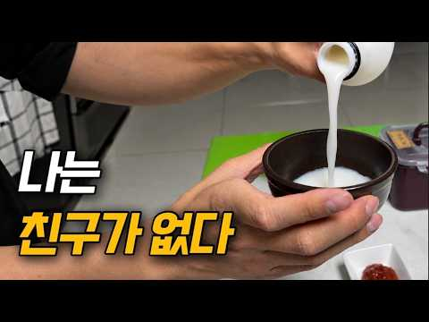
- 설명 앞부분: 서른 살 무렵부터 자연스럽게 멀어지는 사람들이 생겼고, 어느 순간부터는 제가 직접 관계를 정리하기 시작했습니다. 오래 알았다는 이유만으로 계속 만나야 하는 걸까요? 친구가 많다고 꼭 행복한 것도 아니고, 친구가 적다고 잘못 살고 있는 것도 아니겠죠. 나이가 들면서 달라진 인간관계, 여러분은 어떻게 생각하시나요? Created with Vrew
- 같은 채널 평소 대비 ×7.0 (채널 최근 롱폼 중앙값 8,424회) · 평소 영상: 내 돈은 왜 녹았을까? 환율의 무서움 (8,634회) / 40대 유부남, 월 500만원 모으려고 이것부터 끊었습니다 (8,714회)
- 대본 없음 (설명) — 음성인식이 끝나면 도입부·흐름이 들어감
- 댓글 150/150: 좋은 점 — 영상 2 · 감사·응원 3 · 더 알고 싶은 것 2 · 아쉬운 점 — 영상 0 · 반박·불만 — 의견 다름 0 · 정치·사회 0 · 경험 공유 9 · 구독·다음 기대 1
  - 좋은 점 — 영상 👍1 “유익한 시간이었어요”
  - 좋은 점 — 영상 👍1 “저도 53인데 정리된다는 말을 이해 못했습니다.그러나 살다보니 다 부질없단 생각이 들었습니다.”
  - 감사·응원 👍10 “인천 토박이인데. 정말 만나는 사람만 만나게 되네요. 마흔이 넘다보니 미리 약속이 잡히는 것초차 피곤해질때가 많아요. 정말 아무일 없는 일상이 가장 좋은 나이대가 되는거 같습니다. 오늘 영상도 고맙습니다. 힘찬 한주보내셔요.”
  - 감사·응원 👍4 “자연스런 현상입니다. 63세 인데 40대까지는 모임도 많고 총무도 맡고 친구가 재산 같았죠. 세월이 흐르면서 자연스럽게 하나 둘 멀어지고 이제는 네명(ㅂㄹ친구)만 가끔 만납니다. 혼자가 편하고 행복힙니다. 물론 집사람하고 국내외 여행 다니는게 행복하고 혼자 차벅도 다…”
  - 더 알고 싶은 것 👍3 “우왕 저 회세트 어디서 사나요?”
  - 더 알고 싶은 것 👍1 “저도 이런 영상 찍어보고싶은데요 영상 촬영하실때 어떤 카메라로 촬영하시고 편집 프로그램은 어떤 걸로 사용 하셨나요? 따로 녹음하시는거죠?”
  - 경험 공유 👍4 “저희 할아버지께서 생전에 주말마다 어릴적 친구분들과 함께 점심 드시는게 인생의 큰 낙이었던걸 보면 사람마다 친구의 필요성이 다르겠죠”
  - 경험 공유 👍3 “저도 친구가 없어서 구독하고 갑니다”
  - 구독·다음 기대 👍3 “저도 친구가 없어서 구독하고 갑니다”

### 46. 나이 들수록 친구가 멀어지는 이유, 가까운 사이일수록 더 숨겨야 할 '3가지' ∣ 인생조언 ∣ 인간관계 ∣ 심리학 ∣ 명언

- https://www.youtube.com/watch?v=0pulTIYroFA · 살다보니 봄날 · 구독자 1,330 · 조회수 74,904 (×56.3, 하루 2,238.0) · 좋아요 1,050 (1.4%) · 36.8분 · 2026-10-08 · 주제 묶음 2. 인간관계·처세 · 형식 수면·낭독·오디오북 (잠잘 때·명언) · 폴더 `W_0pulTIYroFA` (웹 승인)
- 썸네일: 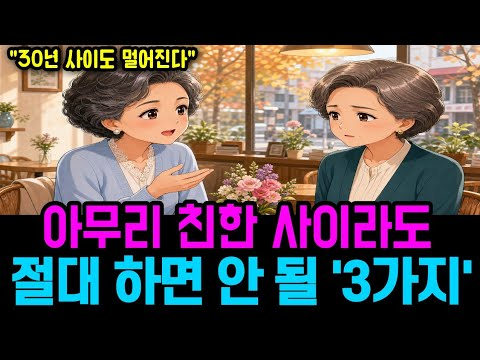
- 챕터: 0:00 오래된 친구가 멀어지는 뜻밖의 이유 · 1:40 노년 친구관계에서 숨겨야 할 세 가지 마음 · 3:00 친구 자랑 앞에서 작아지는 마음 · 5:30 비교가 친구와의 갈등을 만드는 순간 · 8:20 사진 뒤에 숨은 친구의 진짜 사정 · 10:35 비교하는 마음을 다스리는 세 가지 방법 · 12:50 가까운 친구에게 생기는 질투 · 15:30 걱정인 척 나온 가시 돋친 말 · 18:10 육십 년 우정이 멀어진 이유 · 20:45 친구의 좋은 일을 진심으로 축하하는 법 · 23:35 “다 너 잘되라고”라는 충고의 함정 · 26:20 옳은 말이 친구의 자존심을 상하게 할 때 · 29:10 노후 인간관계에서 꼭 필요한 존중 · 32:00 오래된 우정을 지키는 따뜻한 세 마디 · 34:20 나이 들어서도 곁에 사람을 남기는 마음
- 설명 앞부분: 나이가 들수록 오래된 친구와의 관계가 더 편해질 것 같지만, 비교와 질투, 지나친 충고는 친구와의 갈등을 만들고 오랜 우정까지 조용히 멀어지게 할 수 있습니다. 이번 영상은 세 사람의 이야기를 통해 노년 친구관계에서 왜 가까운 사람일수록 말조심이 필요한지, 그리고 노후 인간관계에서 무엇을 지켜야 하는지 돌아봅니다. 친구의 자식 자랑을 들을 때 괜히 내 삶이 초라해지고, 친구가 잘되는 모습을 보며 마음 한구석이 불편해지거나, 걱정이라는 이름으로 꼭 하지 않아도 될 말을 건넬 때가 있습니다. 처음에는 대수롭지 않은 감정처럼 보여도 그…
- 대본 없음 (설명) — 음성인식이 끝나면 도입부·흐름이 들어감
- 댓글 47/47: 좋은 점 — 영상 3 · 감사·응원 5 · 더 알고 싶은 것 0 · 아쉬운 점 — 영상 2 · 반박·불만 — 의견 다름 0 · 정치·사회 0 · 경험 공유 6 · 구독·다음 기대 0
  - 좋은 점 — 영상 👍37 “진정한 친구는 없는것 같애요~ 감사합니다 좋은말씀들🎉🎉🎉”
  - 좋은 점 — 영상 👍9 “경희씨처럼 저도 친구들 사이에서 작아지는 요즘입니다 유익한 영상.. 감사합니다^^”
  - 감사·응원 👍37 “진정한 친구는 없는것 같애요~ 감사합니다 좋은말씀들🎉🎉🎉”
  - 감사·응원 👍13 “이채널은 왜 내마음을 읽는거같지?? 내가 요즘 고민하는 문제만 올려주네요 여러번 반복해서 듣고 마음에 새기겠습니다 고맙고 감사해요”
  - 아쉬운 점 — 영상 👍14 “식구들끼리도 그렇고 친구들끼리도 그렇고 모이면 우리 이야기를 하면 되는데 왜 모든식구 소식을 알리고 이야기하는지~ 모든식구이야기하다 전 지루해서 모임안가게 되더라구요 우리나이때 삶을 이야기하고픈데 말입니다”
  - 아쉬운 점 — 영상 👍13 “이채널은 왜 내마음을 읽는거같지?? 내가 요즘 고민하는 문제만 올려주네요 여러번 반복해서 듣고 마음에 새기겠습니다 고맙고 감사해요”
  - 경험 공유 👍21 “주는 상처 없는데도 본인 시샘으로 받는 상처 친구도 뭣도 아니다 상대가 눈치없이 반복 자랑하면 앗싸 오늘도 밥사는 거지? 하면 되지 안 좋은 일 있으면 내가 사주면서 위로하면 되고 요즘 그렇게 눈치없이 자랑하는 사람도 없더만 다 본인의 열등감이 문제”
  - 경험 공유 👍18 “인간의 마음이란게 참 그렇네 친구라면서 내가 더 잘난거같으면 갑자기 남의 자랑도 너그러워지고 자기가 초라하게 느낄땐 모임에도 뚱하고.. 할머니 나이가 되도 그렇다는게 씁쓸하네.. 그런사람만 그런거겠지??”

### 47. 사람들을 무시하는 것의 힘 ∣ 정신적 강인함과 자기 통제를 위한 스토아학파의 비결

- https://www.youtube.com/watch?v=gfvjmKh50r0 · 스토아의 시선 · 구독자 901 · 조회수 20,730 (×23.0, 하루 1,488.5) · 좋아요 190 (0.9%) · 46.3분 · 2026-10-28 · 주제 묶음 1. 심리학 일반 · 형식 정보·해설 (그 밖) · 폴더 `W_gfvjmKh50r0` (웹 승인)
- 썸네일: 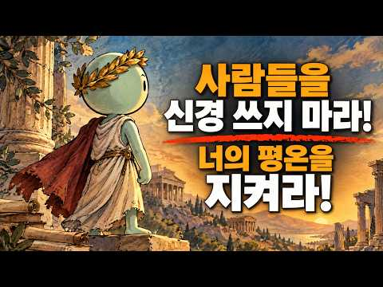
- 설명 앞부분: 타인을 무시하는 것의 힘 ∣ 정신적 강인함과 자기 통제를 위한 스토아 철학의 비밀 타인의 의견이나 모욕, 혹은 부정적인 태도 때문에 상처받고 있다면, 이 영상이 당신의 사고방식을 완전히 바꿔줄 것입니다. 스토아 철학을 다룬 이 강력한 가이드를 통해, 타인을 무시하는 것이 가진 진정한 힘을 배우고, 마르쿠스 아우렐리우스나 에픽테토스와 같은 고대 스토아 철학자들이 어떻게 감정을 완벽하게 통제했는지 알아보세요. 부정적인 것을 무시하는 것은 나약함이 아니라, 오히려 강인함입니다. 누군가를 무시하는 것이 강력한 이유 사람들을 무시하는 심리…
- 같은 채널 평소 대비 ×1.5 (채널 최근 롱폼 중앙값 14,258회) · 평소 영상: 매일 아침 해야 할 10가지 (스토아학파식 아침 루틴) ∣ 스토아주의 (15,379회) / 당신의 정신, 신체, 마음을 재건해 줄 3가지 냉혹한 스토아학파의 규칙 ∣ 스토아학파 동… (13,136회)
- 대본 없음 (설명) — 음성인식이 끝나면 도입부·흐름이 들어감
- 댓글 2/2: 좋은 점 — 영상 0 · 감사·응원 1 · 더 알고 싶은 것 0 · 아쉬운 점 — 영상 0 · 반박·불만 — 의견 다름 0 · 정치·사회 0 · 경험 공유 0 · 구독·다음 기대 0
  - 감사·응원 👍3 “침묵.... 무대응... 그리고 연습... 마침내 통제권까지 참쉽지않은방법입니다.. 감사합니다..”

### 48. 할부 절대 안 하는 사람들, 사실 이런 사람들입니다 (돈이 많아서가 아닙니다)

- https://www.youtube.com/watch?v=SNkw97CWG5I · 심리학한줌 · 구독자 14,700 · 조회수 1,663,169 (×113.1, 하루 24,146.3) · 좋아요 7,421 (0.4%) · 20.4분 · 2026-09-03 · 주제 묶음 1. 심리학 일반 · 형식 정보·해설 (그 밖) · 폴더 `W_SNkw97CWG5I` (웹 승인)
- 썸네일: 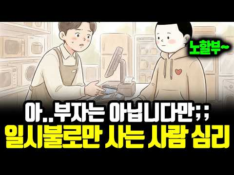
- 설명 앞부분: 할부 몇 개월로 해드릴까요? 어떤 사람들은 고민 없이 대답합니다. 일시불이요. 무이자라고 해도 똑같습니다. 돈이 많아서일까요? 이 영상에서는 할부를 절대 안 하는 사람들의 심리를 들여다봅니다. 모든 게 월 단위로 팔리는 시대에 이 사람들이 지키고 있는 것, 그리고 무이자 할부조차 거절하는 진짜 이유까지요.
- 같은 채널 평소 대비 ×72.6 (채널 최근 롱폼 중앙값 22,914회) · 평소 영상: 집·주방·옷, 적게 사고 오래 쓰는 사람들의 공통점 (총정리) (23,925회) / 혼자 있어도 외롭지 않은 사람들, 이런 사람들입니다 (사람을 싫어하는 게 아닙니다) (21,902회)
- 대본 없음 (설명) — 음성인식이 끝나면 도입부·흐름이 들어감
- 댓글 3,263/3,263: 좋은 점 — 영상 38 · 감사·응원 25 · 더 알고 싶은 것 17 · 아쉬운 점 — 영상 15 · 반박·불만 — 의견 다름 60 · 정치·사회 5 · 경험 공유 591 · 구독·다음 기대 5
  - 좋은 점 — 영상 👍25 “이거 정말 좋은 영상이다. 할부? 소비조장이지. 아이들이 봐야한다”
  - 좋은 점 — 영상 👍10 “참 좋은 내용입니다^^”
  - 감사·응원 👍25 “집도 차도 모든것 일시불로 끝냈음 ㅡ 빚이란 생각때문에 절대 할부 않음 ㅡ 의외로 나와같은 분들 많네... 동지같은 느낌이랄까 ..모두들 성공한 삶입니다. 파이팅ㅇㅇㅇㅇㅇ!!!”
  - 감사·응원 👍12 “저 같은 사람이 주위에는 없는데, 넓게 보면 드문드문 있나 봅니다. 영상 보면서 깜짝 놀랐습니다. 좋은 동영상 감사합니다.^^”
  - 더 알고 싶은 것 👍1 “저는 집을 살때도 차를 살때도 현금이나 일시불로 삽니다. 돈이 많아서도 아닙니다. 저같은 사람은 어떤 사람인가요?”
  - 더 알고 싶은 것 👍0 “그럼 선생님들께서는 집은 대출 얼마까지 가능하세요? 저도 빚을 싫어하는 타입인데 집 구매하려니 대출을 얼마까지 해야하나 감이 안와서 같은 성향들인것 같아서 여쭤봅니다. 댓 부탁드려요”
  - 아쉬운 점 — 영상 👍7 “부자 되려면 일단 신용카드 없애세요 체크카드도 고민을 두번 째는 부부가 사랑하는 관계라야 부자로 가는 기본입니다 이 두가지를 실천하고 시간을 기다리셔요 그러면 노후 건강과 흔들리지 않는 부를 얻습니다. 지루한 실천을~~~”
  - 아쉬운 점 — 영상 👍2 “맞아요. 그래서 저는 신용카드 대신 체크카드만 씁니다. 자동차를 사도 구입전용적금통장을 만들어서 일시불로 구입하는 방식이죠. 왜 그러는지 특별한 느낌이 없었는데 이 채널을 보니 깨달음이 오네요. 저도 주택이외의 빚은 정말로 싫어합니다. 경제적인 지루함. 맘에 와 닿습…”
  - 반박·불만 — 의견 다름 👍29 “이런 분들이 차도 15~20년씩 탑니다. 그리고 남들보다 늦게 갖는게 아닙니다. 한 템포 늦춰 더 좋은 물건으로 가는 경우도 많습니다.”
  - 반박·불만 — 의견 다름 👍7 “문제의 핵심은 할부냐 일시불이냐가 아닙니다. 꼭 필요한 물건만 구입하느냐? 안사도 되는 물건까지 구입하느냐?하는 구매 습관입니다. 우리 사회에서 소비는 단순히 물건을 사는 행위를 넘어 그 사람의 사회적 지위까지 나타내는 일입니다. 일상적으로 필요한 물건을 구입하는 것…”
  - 정치·사회 👍0 “할부가 나쁘기만 할까? 예전 한 중국인은 넓고 쾌적한 아파트에 살기위해 허리띠를 졸라매고 죽어라 일만 했다. 드디어 60살이 넘?어서야 겨우 내집마련을? 하고 주름딘 얼굴에 웃음을 띄었다. 지구반대편 미국인, 넓고 쾌적한 아파트에?살고싶어 할부로 아파트를 구매했다. …”
  - 정치·사회 👍0 “아 각 정부는 나쁜 빚입니다. 감당할수없는 빚을 계속 돌려막기하는중.”
  - 경험 공유 👍383 “제가 사는 방식하고 똑같네요.. 재산이 많지는 않지만 마음은 여유가 있습니다 ㅎ”
  - 경험 공유 👍220 “내가 그런데 무조껀 일시불 빚지는걸 싫어해서 가지고싶은물건있으면 돈 모아서 사고”
  - 구독·다음 기대 👍2 “헐 대박! 제가 그래요 할부해본적 없고 무조건 일시불이고 그마저도 귀찮아서 신용카드 없이 체크카드만 쓴지 20년차에요 ㅎ 돈이 넘치게 많아서도 아닌 다음달에 나갈돈 계산하기 귀찮아서요 ㅋ 일시불이나 돈이 없으면 안사고 돈이 모이고나면 씁니다 ㅎ 차도 현금으로 사구요 …”
  - 구독·다음 기대 👍0 “완전정답 통찰력 ㄷㄷ 구독박고 갑니당”

### 49. 50대 이후, 유독 젊어 보이는 사람들의 7가지 공통점

- https://www.youtube.com/watch?v=RkvmpZJbebM · 몽글심리학 · 구독자 2,810 · 조회수 261,840 (×93.2, 하루 4,599.6) · 좋아요 1,175 (0.4%) · 29.4분 · 2026-09-15 · 주제 묶음 1. 심리학 일반 · 형식 정보·해설 (그 밖) · 폴더 `W_RkvmpZJbebM` (웹 승인)
- 썸네일: 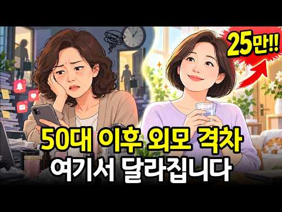
- 설명 앞부분: 50대 이후, 같은 나이인데도 유독 젊어 보이는 사람이 있습니다. 비싼 화장품을 쓰거나 피부과를 자주 다녀서만은 아닙니다. 오히려 차이는 하루 동안 얼마나 많은 감정과 에너지를 불필요한 곳에 쓰고 있는지에서 시작될 수 있습니다. 답 없는 문자를 계속 확인하고, 남의 좋은 소식을 내 삶과 비교하고, 상대의 표정 하나까지 신경 쓰고, 힘들어도 “괜찮아”라고 말하고, 잠을 줄이면서까지 무언가를 더하려고 하는 생활. 이런 작은 습관들이 매일 반복되면 몸과 표정에는 생각보다 많은 긴장이 쌓입니다. 이번 영상에서는 미경 씨와 은정 씨의 하루…
- 같은 채널 평소 대비 ×57.0 (채널 최근 롱폼 중앙값 4,593회) · 평소 영상: "밥 한 끼면 충분합니다, 그 사람의 진짜 인격이 보이거든요" ∣ 식사 자리에서 드러나는… (4,594회) / 집을 깨끗하게 유지하는 사람들ㅣ소름 돋는 심리ㅣ뇌과학·도파민 회로·인생 주도권 (4,592회)
- 대본 없음 (설명) — 음성인식이 끝나면 도입부·흐름이 들어감
- 댓글 70/70: 좋은 점 — 영상 2 · 감사·응원 6 · 더 알고 싶은 것 0 · 아쉬운 점 — 영상 2 · 반박·불만 — 의견 다름 2 · 정치·사회 0 · 경험 공유 9 · 구독·다음 기대 0
  - 감사·응원 👍34 “감사드립니다 😙 지나친 감정소모를 하지말아야 하는데ᆢ😢”
  - 감사·응원 👍32 “병수발 같은 소리. 제가 여지껏 살면서 본건, 젊어보이는 이유는 딱 하나예요. 타고난겁니다. 나머진 부수적인거. 특히 나이가 들수록 젊음의 차이는 그 기반에서 나와요. 리프팅시술, 각종 레이져 해봤자 원래 나이 보이구 요. ㅡ좋은 유전자 주신 부모님께 감사하며 사세요…”
  - 아쉬운 점 — 영상 👍14 “뭔 얘기가 팩트가 없네. 지루하다”
  - 아쉬운 점 — 영상 👍0 “뭐래는거야 좋은말인데 지루”
  - 반박·불만 — 의견 다름 👍54 “웃기는 소리다. 천사 아닌데 간병이 얼마나 스트레스인데 말도 안되는 궤변이고 모순이다.피부는 타고나는거다.”
  - 반박·불만 — 의견 다름 👍3 “피부는 타고나지만 주름이 안생기는건 아니죠.^^”
  - 경험 공유 👍63 “맨날 거울 보면서 어디 주름 안 생겼나 한숨만 쉬었는데 갱년기 오면서 몸도 마음도 예전 같지 않다 보니 더 신경 쓰였던 것 같아요ㅠ 리플로퀸 알게 된 뒤로 꾸준히 챙겨 먹고 있는데 전보다 갱년기 때 느끼던 불편함도 덜한 느낌이고 컨디션도 한결 나아져서 그런지 요즘 주…”
  - 경험 공유 👍32 “병수발 같은 소리. 제가 여지껏 살면서 본건, 젊어보이는 이유는 딱 하나예요. 타고난겁니다. 나머진 부수적인거. 특히 나이가 들수록 젊음의 차이는 그 기반에서 나와요. 리프팅시술, 각종 레이져 해봤자 원래 나이 보이구 요. ㅡ좋은 유전자 주신 부모님께 감사하며 사세요…”

### 50. 죽기 전 내 집을 정리해야 하는 진짜 이유 (니체의 비움 철학)ㅣ죽음의 문턱에서 바라본 내 집의 진짜 모습 (인생 성찰)

- https://www.youtube.com/watch?v=BQbfaiK9ENU · 마음계단 · 구독자 477 · 조회수 56,570 (×118.6, 하루 776.9) · 좋아요 456 (0.8%) · 18.4분 · 2026-08-30 · 주제 묶음 기타 · 형식 정보·해설 (그 밖) · 폴더 `W_BQbfaiK9ENU` (웹 승인)
- 썸네일: 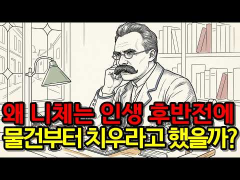
- 챕터: 0:00 프롤로그: 언젠가 남겨질 집을 바라보며 · 2:34 1장. 욕망을 줄인다는 것의 진짜 의미 · 4:59 2장. 남에게 보여주지 않는 삶의 평온함 · 7:12 3장. 닫힌 서랍과 마음의 공간 · 9:41 4장. 나이 들수록 놓기 힘든 이유 · 11:47 5장. 두려움 대신 선택하는 단순한 삶 · 14:50 6장. 짐이 아닌 사랑을 남기는 법 · 16:42 에필로그: 비울 때 비로소 남는 것들
- 설명 앞부분: "언젠가 쓰겠지" 하고 쌓아둔 집안의 물건들, 그 안에 켜켜이 쌓인 세월과 감정의 무게를 느껴보신 적 있나요? 내가 떠난 뒤 남겨질 짐들을 생각하며 시작된 비움의 여정. 철학자 니체의 지혜를 통해 물건뿐만 아니라 인간관계, 체면, 자식에 대한 기대까지 내려놓고 삶이 가벼워지는 진짜 자유를 만나보세요. 🌿 오늘, 서랍 하나를 열어 마음의 짐을 덜어내시길 바랍니다. ✨ ⏳ 타임코드 해시태그 & 키워드 [숏 키워드] [롱테일 키워드]
- 같은 채널 평소 대비 ×62.5 (채널 최근 롱폼 중앙값 904회) · 평소 영상: 다이어트, 운동, 자기계발 3일 만에 포기하는 심리학적 이유 l 끈기 없다고 자책하기 전… (959회) / 어르신 노리는 말의 패턴 6가지 알면 안 당합니다ㅣ은퇴 후 첫 번째로 잃는 건 돈이 아닙… (850회)
- 대본 없음 (설명) — 음성인식이 끝나면 도입부·흐름이 들어감
- 댓글 39/39: 좋은 점 — 영상 1 · 감사·응원 0 · 더 알고 싶은 것 0 · 아쉬운 점 — 영상 1 · 반박·불만 — 의견 다름 0 · 정치·사회 0 · 경험 공유 5 · 구독·다음 기대 0
  - 좋은 점 — 영상 👍3 “유익한 내용 잘 들었습니다!!!”
  - 아쉬운 점 — 영상 👍2 “저는 계속 버리고 우리집 아이들은 계속 가지고 들어오고.. 무한반복이에요 ㅋ”
  - 경험 공유 👍20 “서른 후반인데 저도 가볍게 살고 싶고.. 집도 깔끔하게 살고 싶다는 생각으로 이 영상을 봤어요!. 저희 집엔 자잘한 물건이 많아서 정리를 계속해야 하는데 그게 스트레스예요 하나하나 놓아봐야 겠어요 !.....”
  - 경험 공유 👍3 “이런 생각은 안해봤네요. 근데 내집은 내것이고 내집안에 내물건들을 가지고 있는데 누가 치울것을 생각해서 민망해서 계속 내집안을 정리해야한다.비우면서 지내야한다. 내집이 편안해질수 있을지..,. 가끔 그런생각은 들어요. 저는 제생각들을 사건들을 핸드폰노트에 적는 습관이…”

### 51. 남자가 절대로 떠나지 못하는 여자 특징 ∣ 20년 차 상담심리전문가가 말하는 관계의 비밀

- https://www.youtube.com/watch?v=0RcXdW8QbJk · 김은주 박사 심리 볕뉘 · 구독자 266 · 조회수 41,077 (×154.4, 하루 429.5) · 좋아요 370 (0.9%) · 7분 · 2026-08-07 · 주제 묶음 1. 심리학 일반 · 형식 인터뷰·강연·대담 (교수·의사·스님) · 폴더 `W_0RcXdW8QbJk` (웹 승인)
- 썸네일: 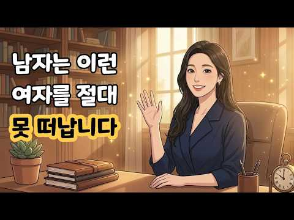
- 챕터: 0:00 오프닝: 남자가 질리지 않고 오래 사랑하는 진짜 이유 · 1:25 첫 번째: 내 마음의 '상처받은 아이'를 스스로 다독… · 3:40 두 번째: 잔소리 대신 어른의 목소리로 '투명하게 요… · 6:10 세 번째: 남자의 마음속 '천진난만한 아이'를 꺼내주… · 8:30 마무리: "나도 괜찮고, 너도 괜찮다" (I'm OK…
- 설명 앞부분: 처음에는 뜨겁게 반했다가도 시간이 지나면 차갑게 식어버리는 연애 때문에 고민이신가요? 안녕하세요, 상담심리전문가입니다. 상담실을 찾아오시는 많은 분들이 "어떻게 해야 남자가 나를 오랫동안 깊이 사랑해 줄까요?"라는 질문을 하십니다. 단순한 밀당이나 외모의 관리보다 훨씬 더 근본적인 비결은 바로 '교류분석(Transactional Analysis) 심리학'에서 말하는 마음의 역동에 있습니다. 남자가 한 여자에게 평생 곁에 머물고 싶다고 느끼는 진짜 이유는 무엇일까요? 이번 영상에서는 수많은 연인과 부부 상담 현장의 실제 사례를 바탕…
- 같은 채널 평소 대비 ×107.5 (채널 최근 롱폼 중앙값 382회) · 평소 영상: 헤어진 후 연락하는 남자, 대체 무슨 마음일까? 전남친 심리 3가지 (382회) / 결혼 전 반드시 확인해야 할 3가지｜평생 함께할 사람인지 알아보는 심리상담 (321회)
- 대본 없음 (설명) — 음성인식이 끝나면 도입부·흐름이 들어감
- 댓글 14/14: 좋은 점 — 영상 1 · 감사·응원 0 · 더 알고 싶은 것 0 · 아쉬운 점 — 영상 0 · 반박·불만 — 의견 다름 0 · 정치·사회 0 · 경험 공유 0 · 구독·다음 기대 0
  - 좋은 점 — 영상 👍1 “정말 잘들었어요.유익한얘기입니다”

### 52. 나이 들수록 혼자가 편해지는 이유 ∣ 중년의 인간관계와 외로움 ∣ 감성 오디오북 ∣ 중년의 삶 ∣ 인생 이야기

- https://www.youtube.com/watch?v=IcgXhzDgIjg · 소리품은밤 | 감성 오디오북 · 구독자 730 · 조회수 69,684 (×95.5, 하루 1,124.7) · 좋아요 462 (0.7%) · 45.9분 · 2026-09-10 · 주제 묶음 2. 인간관계·처세 · 형식 수면·낭독·오디오북 (잠잘 때·명언) · 폴더 `W_IcgXhzDgIjg` (웹 승인)
- 썸네일: 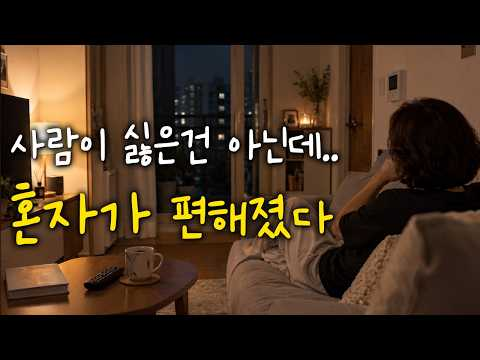
- 설명 앞부분: 나이가 들수록 사람을 만나는 시간보다 혼자 있는 시간이 편해질 때가 있습니다. 외로운 건 아닌데 문득 마음 한구석이 허전해지는 이유를 조용히 이야기합니다. 혼자가 편해진 중년의 마음과 달라진 인간관계를 담은 감성 오디오북입니다.
- 같은 채널 평소 대비 ×20.6 (채널 최근 롱폼 중앙값 3,386회) · 평소 영상: 나이 들수록 인간관계를 가볍게 해야 하는 이유 ∣ 50대 60대 인생 이야기 ∣ 감성 오… (3,937회) / 나이 들수록 느껴지는 세월｜세월이 흐른 뒤 알게 된 마음 ∣ 감성 오디오북 ∣ 중년의 삶… (2,834회)
- 대본 없음 (설명) — 음성인식이 끝나면 도입부·흐름이 들어감
- 댓글 23/23: 좋은 점 — 영상 0 · 감사·응원 1 · 더 알고 싶은 것 0 · 아쉬운 점 — 영상 0 · 반박·불만 — 의견 다름 1 · 정치·사회 0 · 경험 공유 0 · 구독·다음 기대 0
  - 감사·응원 👍0 “잘듣고갑니다 감사합니다”
  - 반박·불만 — 의견 다름 👍10 “백프로 공감가는 말씀입니다 누구를 만날때는 마음의 부담과. 헤어지는 시간까지. 괜한 긴장감이 연속이고 집에오면. 마음과 몸이편하고 만사가 해방감이 들고 그렇다고 사람이 싫은건 아닌데. ❤❤❤”

### 53. [연휴 특선] 룸메 셋이 전부 나르시시스트인 하숙집 ∣ 나르시시즘 하우스 전편 정주행 [EP.1~6]

- https://www.youtube.com/watch?v=DcqJEjkRqDc · 나르시시즘 하우스 Narcissism House · 구독자 152 · 조회수 11,212 (×73.8, 하루 229.2) · 좋아요 18 (0.2%) · 60.2분 · 2026-09-23 · 주제 묶음 5. 나르시시스트·가스라이팅 · 형식 인터뷰·강연·대담 (교수·의사·스님) · 폴더 `W_DcqJEjkRqDc` (웹 승인)
- 썸네일: 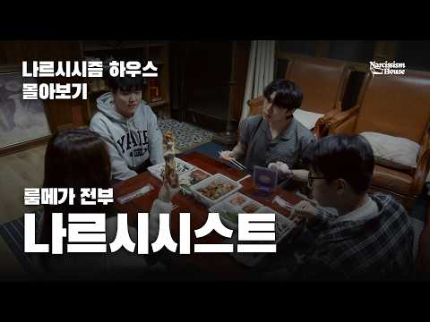
- 챕터: 0:00 1화 · 9:52 2화 · 17:43 3화 · 30:55 4화 · 42:37 5화 · 50:54 6화
- 설명 앞부분: 연출 ∣ 이예준 촬영감독 ∣ 민성욱 PD•개퍼 ∣ 허윤 장소협조 ∣ 오손도손스튜디오 본 콘텐츠의 BGM 중 일부는 생성형 인공지능 서비스(Suno AI)를 활용하여 제작되었습니다.
- 같은 채널 평소 대비 ×8.0 (채널 최근 롱폼 중앙값 1,404회) · 평소 영상: 그린라이트? (1,626회) / 수돗물 스킨케어 (1,182회)
- 대본 없음 (설명) — 음성인식이 끝나면 도입부·흐름이 들어감
- 댓글 7/7: 좋은 점 — 영상 0 · 감사·응원 2 · 더 알고 싶은 것 1 · 아쉬운 점 — 영상 0 · 반박·불만 — 의견 다름 0 · 정치·사회 0 · 경험 공유 2 · 구독·다음 기대 0
  - 감사·응원 👍6 “안녕하세요! 나르시시즘 하우스의 연출을 맡은 (꼬마PD) 이예준입니다. 예능 종류만 하다가 처음으로 이런 스크립트 장르의 작업을 하게 되었는데, 너무 재밌고 뜻깊은 도전이었던 것 같습니다! 열심히 만들었으니 많은 관심과 시청 부탁드려요😂 행복한 추석 보내시길 바랍니다…”
  - 감사·응원 👍3 “16:42 저의 최애는 이곳 .. 순수하게 애드립이 생겨서 안 써도 찍어달라고 한건데 찍을때의 그 즐거움이 그대로 담긴 것 같어용 나르시시스트 하우스 지금까지 시청해주신 분들 감사합니다❤”
  - 더 알고 싶은 것 👍6 “안녕하세요! 나르시시즘 하우스의 연출을 맡은 (꼬마PD) 이예준입니다. 예능 종류만 하다가 처음으로 이런 스크립트 장르의 작업을 하게 되었는데, 너무 재밌고 뜻깊은 도전이었던 것 같습니다! 열심히 만들었으니 많은 관심과 시청 부탁드려요😂 행복한 추석 보내시길 바랍니다…”
  - 경험 공유 👍6 “안녕하세요! 나르시시즘 하우스의 연출을 맡은 (꼬마PD) 이예준입니다. 예능 종류만 하다가 처음으로 이런 스크립트 장르의 작업을 하게 되었는데, 너무 재밌고 뜻깊은 도전이었던 것 같습니다! 열심히 만들었으니 많은 관심과 시청 부탁드려요😂 행복한 추석 보내시길 바랍니다…”
  - 경험 공유 👍2 “안녕하세요! 선우 역을 맡은 배우 최현호입니다! 좋고 훌륭한 분들과 함께 할 수 있어서 너무 행복했습니다🥹 23:37 이 부분은 현장에서도 너무 웃으면서 찍었던 기억이 있는데 그 분위기가 잘 담긴 것 같아서 너무 좋았습니다! 29:17 저도 보면서 너무 웃었던 부분 …”

### 54. 첫째 vs 둘째 vs 막내 – 출생 순서가 결정하는 성격의 비밀

- https://www.youtube.com/watch?v=StvjFnMGvxA · 나를 읽다 · 구독자 54 · 조회수 11,737 (×117.4, 하루 146.1) · 좋아요 24 (0.2%) · 9.8분 · 2026-08-23 · 주제 묶음 6. 성격·유형 · 형식 심리 테스트·유형 고르기 · 폴더 `W_StvjFnMGvxA` (웹 승인)
- 썸네일: 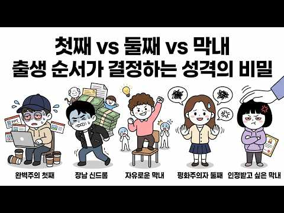
- 챕터: 0:00 인트로 – 첫째세요, 막내세요? · 0:22 9위 첫째 – 칭찬에 목마른 숨은 완벽주의자 · 1:24 8위 둘째 – 눈치 백단의 평화주의자 · 2:20 7위 막내 – 규칙을 깨는 자유로운 영혼 · 3:18 6위 첫째 – 은근한 보수주의자, 규칙의 수호자 · 4:14 5위 둘째 – 선택받은 가족을 찾는 인맥의 달인 · 5:08 4위 막내 – 타인의 감정을 조종하는 은밀한 전략가 · 6:05 3위 첫째 – 모든 짐을 떠안는 K-장녀·장남 신드롬 · 7:02 2위 둘째 – 강한 자립심을 품은 조용한 반항아 · 7:58 1위 막내 – 진지하게 받아들여지지 않는 것에 대한 … · 8:57 마무리 – 출생 순서는 출발선일 뿐
- 설명 앞부분: 혈액형, MBTI만큼이나 궁금한 그 질문 — "혹시 첫째세요?" 출생 순서가 우리 성격에 남긴 흔적을 심리학적으로 파헤쳐 봤습니다. 완벽주의 첫째부터 평화주의자 둘째, 자유로운 막내까지, 9가지 성격 유형 중 내 이야기는 몇 위에 있을까요? 댓글로 여러분의 출생 순서를 알려주세요! 시청해 주셔서 감사합니다. 오늘도 좋은 하루 보내세요 😊
- 같은 채널 평소 대비 ×63.8 (채널 최근 롱폼 중앙값 184회) · 평소 영상: 말 안 해도 티 나는 거짓말쟁이의 습관 10가지 (184회) / 눈만 봐도 알 수 있는 관상학적 재물운 신호 9가지 (193회)
- 대본 없음 (설명) — 음성인식이 끝나면 도입부·흐름이 들어감
- 댓글 3/3: 좋은 점 — 영상 0 · 감사·응원 0 · 더 알고 싶은 것 0 · 아쉬운 점 — 영상 0 · 반박·불만 — 의견 다름 0 · 정치·사회 0 · 경험 공유 0 · 구독·다음 기대 0

### 55. 요양보호사가 전하는 노년의 외로움과 가족 관계 이야기｜12년 현장의 경험

- https://www.youtube.com/watch?v=BdZegIY9E2o · 백세의 비밀 · 구독자 3,620 · 조회수 207,204 (×57.2, 하루 5,186.9) · 좋아요 2,939 (1.4%) · 49분 · 2026-10-02 · 주제 묶음 3. 자존감·감정·멘탈 · 형식 정보·해설 (그 밖) · 폴더 `W_BdZegIY9E2o` (웹 승인)
- 썸네일: 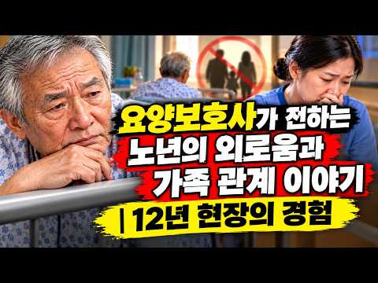
- 설명 앞부분: 왜 어떤 노인은 늘 가족의 발길이 이어지고, 어떤 노인은 오랫동안 홀로 병상을 지킬까요? 12년간 수많은 노인의 마지막 시간을 함께한 요양보호사는 놀라운 공통점을 발견했습니다. 그 진실은 돈도, 성공도 아닌 우리의 삶과 인간관계를 다시 돌아보게 합니다. 이번 영상에서는 요양보호사가 직접 병상에서 목격한 실제 이야기와 함께, 자녀와 부모의 관계가 시간이 흐르며 어떻게 달라지는지 깊이 살펴봅니다. 노후를 후회 없이 살아가기 위해 지금 우리가 무엇을 준비해야 하는지 함께 생각해 보세요. 🤍 *"사랑은 받은 만큼 기억되지 않습니다. 함께…
- 같은 채널 평소 대비 ×20.0 (채널 최근 롱폼 중앙값 10,375회) · 평소 영상: 통장에 얼마 있냐는 자식의 물음에 81세 아버지가 남긴 말 (10,375회) / 나이 들수록 예금은 어디에 둬야 할까? 76세 노인의 방법이 너무 현명했습니다 (7,362회)
- 대본 없음 (설명) — 음성인식이 끝나면 도입부·흐름이 들어감
- 댓글 114/114: 좋은 점 — 영상 11 · 감사·응원 29 · 더 알고 싶은 것 0 · 아쉬운 점 — 영상 2 · 반박·불만 — 의견 다름 0 · 정치·사회 1 · 경험 공유 13 · 구독·다음 기대 0
  - 좋은 점 — 영상 👍58 “핵심은 우리도 받아보지 못한일이라! 공감100% 꼭 나를두고 하시는 말씀 감사합니다 저도 바꿔보려구요 용돈 잘 받고 잘쓰고있다구요^^”
  - 좋은 점 — 영상 👍22 “공감합니다 부모로서 자식한테 마음아프게하고 민폐를 끼칠까봐 아무리형편이 어려워도, 아무리 아파도그저 자식만 건강하고 잘지내 면된다싶어 ,괜찮다라고 얘기할수밖에 없는게 부모마음이라오 ! 듣고보니깐 ,괜찮다라는 말을 이제 자제해야 되겠다는 생각이드네 ᆢㅎㅎ”
  - 감사·응원 👍58 “핵심은 우리도 받아보지 못한일이라! 공감100% 꼭 나를두고 하시는 말씀 감사합니다 저도 바꿔보려구요 용돈 잘 받고 잘쓰고있다구요^^”
  - 감사·응원 👍27 “제가 매일하는말 괜찮다! 입니다 그래놓고 뒤에서는서운하다 고했지요 이제부터 그랬구나! 고맙다! 로 바꾸려고 연습해 바야겠네요”
  - 아쉬운 점 — 영상 👍19 “Ai로 타이핑을 하시나 적혀있는 자막이 집중에 방해되네요.”
  - 아쉬운 점 — 영상 👍0 “영상의 주인공은 여잔데 음성은 남잔가 ㅠㅠ AI스토리 짜집기 관심없음ㅡ으로”
  - 정치·사회 👍1 “근대 중국인 목소리네요”
  - 경험 공유 👍58 “핵심은 우리도 받아보지 못한일이라! 공감100% 꼭 나를두고 하시는 말씀 감사합니다 저도 바꿔보려구요 용돈 잘 받고 잘쓰고있다구요^^”
  - 경험 공유 👍27 “제가 매일하는말 괜찮다! 입니다 그래놓고 뒤에서는서운하다 고했지요 이제부터 그랬구나! 고맙다! 로 바꾸려고 연습해 바야겠네요”

### 56. 혼자 사는 50대 남자들이 연애를 안 하는 진짜 이유 (여자가 싫은 게 아닙니다)

- https://www.youtube.com/watch?v=TDozpW4vvL4 · 본능의심리학 · 구독자 6,640 · 조회수 229,269 (×34.5, 하루 8,795.6) · 좋아요 1,612 (0.7%) · 14.8분 · 2026-10-16 · 주제 묶음 8. 연애·부부 심리 · 형식 정보·해설 (그 밖) · 폴더 `W_TDozpW4vvL4` (웹 승인)
- 썸네일: 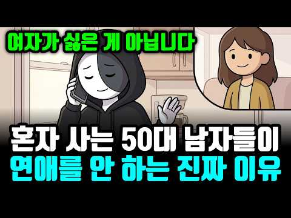
- 설명 앞부분: 혼자 사는 50대 남자들은 왜 연애를 하지 않을까요? 중년 남성의 연애와 재혼, 외로움에 대한 고민을 다섯 가지 이유로 풀어봅니다. 여자가 싫어서가 아니라, 혼자 사는 삶이 편해진 사람들의 이야기입니다. 이혼 3년째, 소개 자리에 다섯 번 나갔습니다. 양육비와 집 명의, 재혼 계획을 묻는 자리에서 좋은 사람들을 만났지만, 집에 돌아오면 소파에 두 시간을 누워 있었습니다. 누군가를 만나는 일이 왜 이렇게 지치는 걸까요? 이 영상에서 나누는 이야기 설렘보다 현실적인 조건을 조율하게 되는 50대의 연애 관계에 필요한 시간과 에너지를 이…
- 같은 채널 평소 대비 ×13.0 (채널 최근 롱폼 중앙값 17,693회) · 평소 영상: 아내 먼저 보내고 혼자 사는 50대 남자들이 재혼을 안 하는 진짜 이유 (못 잊어서가 아… (17,953회) / 인간관계 다 정리하고 오히려 행복해진 50대 남자들의 공통점 (냉정해진 게 아닙니다) (17,433회)
- 대본 없음 (설명) — 음성인식이 끝나면 도입부·흐름이 들어감
- 댓글 342/342: 좋은 점 — 영상 7 · 감사·응원 7 · 더 알고 싶은 것 3 · 아쉬운 점 — 영상 4 · 반박·불만 — 의견 다름 2 · 정치·사회 3 · 경험 공유 29 · 구독·다음 기대 0
  - 좋은 점 — 영상 👍13 “유투버님께서 잘 정리해 주셨네요. 진짜 나이먹고 여자 잘못만나면 ㅈ됩니다. 노년 인생까지 날려버릴수 있습니다. 아..생각만해도 끔찍해..ㅠ 주변을 둘러봐도 제정신인 여편네들이 별로 없음.”
  - 좋은 점 — 영상 👍2 “좋은 영상인데 뒷부분에 비현실적인 사족을 다셨군요. 50대쯤 되면 질좋은 관계 같은건 불가능합니다. 모두가 자신의 울타리가 있어서 공유할 것이 사라집니다. 시간을 포함해서요 여자형제와의 전화통화요? 맨날 조카얘기 부모얘기 형제얘기 쳇바퀴입니다. 왜? 그거 말고 할 말…”
  - 감사·응원 👍12 “결혼 못 하고 오십대 중반이 되었으니 어떻게 보느냐에 따라 실패한 인생으로 보일 수 있다. 혼잣몸이라 적당히 모은 돈이 있어 작년에 퇴직하고 좋아하는 산과 도서관과 체육관에서 하루를 보낸다. 관리한 몸에 재산도 좀 있고 얼굴도 평타는 치니 모임이나 주변 싱글녀들이 대…”
  - 감사·응원 👍10 “재혼가정 입니다 저쪽 자식들 친자식처럼 대해줘도 감사한것 모릅니다 머리검은 짐승은 거두지 말라 라는 말에 공감하는 한사람 편이 혼자 사세요 그게 인생입니다”
  - 더 알고 싶은 것 👍0 “50초 혼자산지 2년째 너무 좋습니다~ 영상의 이유 거의 맞고 댓글들에도 대부분 공감이 감니다.. 다만 한가지 60대 70대 되서도 혼자인 모습을 상상해 보면.. 그래도 등 긁어줄 동반자 하나 있어야 하나? 하는 생각이 남아있습니다~ 선배님들 많은 조언 부탁합니다~”
  - 더 알고 싶은 것 👍0 “노회하고 꼼꼼한 영상이긴 한데 중요한 핵심을 놓쳐네요 .아무리 나이든 남자라도 늙은 여자를 상대로는 설래지가 않는 겁니다. 사고실험으로 상대를 젊은 여자 라고 바꿔봐요. 줄어든 테스토스테론이고 뭐고 금방 되살아납니다. 그럴려면 딸뻘을 만나야겠죠 그럴러면 상당한 능력과…”
  - 아쉬운 점 — 영상 👍9 “결혼할뻔한 여자 3명 있었지.20대중반에 지방사는 동갑여자였는데 그집 외척들이 하도 설쳐대는게 질려서 내가 포기.20대 후반에 만난 한살 연상 여자는 정말 잘맞았고 반동거 까지 했는데 장모가 정신병력이 있어서 울집에서 반대.40대 초에 20대 중반여자를 만났는데 그냥…”
  - 아쉬운 점 — 영상 👍1 “작은 아파트 하나에 꾸미고 청소하고 먹고싶은거 만들어 먹고 등산 낚시 헬스 하면서 보내는 시간이 너무 행복 합니다”
  - 반박·불만 — 의견 다름 👍72 “72년생.....쭉~ 혼자 삶....../.......강북에 10억정도... 자가소유외, 현금 및 주식 18억......./ 그렇다고 부자라는건 아닙니다...강남에 집 한채 못사니까요...../...근데 연애도 실컷 해봤고....또 할 수도 있고....그 외에 할 것…”
  - 반박·불만 — 의견 다름 👍0 “노회하고 꼼꼼한 영상이긴 한데 중요한 핵심을 놓쳐네요 .아무리 나이든 남자라도 늙은 여자를 상대로는 설래지가 않는 겁니다. 사고실험으로 상대를 젊은 여자 라고 바꿔봐요. 줄어든 테스토스테론이고 뭐고 금방 되살아납니다. 그럴려면 딸뻘을 만나야겠죠 그럴러면 상당한 능력과…”
  - 정치·사회 👍8 “이혼후 아들양육 다 키워놓으니 나만 위해 사는 시간이 행복해요. 그동안 열심히 산 지갑으로 따뜻한 남쪽나라가면 즐기며 살수있어요. 굳이 비위맞취가며 반갈죽 당할염려도 없고... 즐기다 남은건 자식들에게 온전히 주려합니다.”
  - 정치·사회 👍3 “40대 돌씽입니다 아이도 없고 갈라선거라 주변에서 늘상 듣는말이네요 그렇게 가만히 두지를 않습니다 지금 여자를 안만나고 싶은건 아니지만 만나면 그렇게 피곤합니다 즐거움 vs 귀차니즘 싸움인데 나이가 드니 연애의 즐거움 보다는 오히려 불편함이 더 큽니다 막상 연애를 해…”
  - 경험 공유 👍72 “72년생.....쭉~ 혼자 삶....../.......강북에 10억정도... 자가소유외, 현금 및 주식 18억......./ 그렇다고 부자라는건 아닙니다...강남에 집 한채 못사니까요...../...근데 연애도 실컷 해봤고....또 할 수도 있고....그 외에 할 것…”
  - 경험 공유 👍29 “외로움의 답은 연애도 결혼도 자식도 아니다. 결혼 20년차 50대가 말한다. 배우자, 자식있어도 외록고 돈벌어야하니 힘들다. 내 삶이없다. 내 인생 20년갈아넣고행복할수있다면 결혼하고 자식낳아라. 청춘 금방순삭되고 기다리는건 돈없으면 비참한노후일뿐이다. 돈을 모아라.…”

### 57. 만나기만 하면 얻어먹는 사람, 계속 만나도 될까요? ∣ 이런 관계는 정리하세요ㅣ인생조언ㅣ노후준비ㅣ삶의지혜ㅣ시니어ㅣ오디오북ㅣ

- https://www.youtube.com/watch?v=E1BISMVYakc · 마음 안부 · 구독자 4,810 · 조회수 255,666 (×53.1, 하루 6,227.9) · 좋아요 773 (0.3%) · 33.3분 · 2026-10-01 · 주제 묶음 1. 심리학 일반 · 형식 수면·낭독·오디오북 (잠잘 때·명언) · 폴더 `W_E1BISMVYakc` (웹 승인)
- 썸네일: 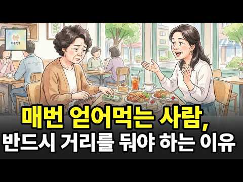
- 설명 앞부분: 만나기만 하면 밥값 계산할 때 슬쩍 빠지는 사람, 계속 만나야 할까요? 돈 몇 만 원의 문제가 아니라, 내 호의를 당연하게 여기고 고마움을 잊어버린 사람들의 관계 신호를 살펴봅니다. 나이 들수록 마음 지치지 않고 지혜롭게 인간관계 거리를 두는 기준을 확인해보세요. 💡 오늘의 이야기 핵심 한두 번 얻어먹는 것과 매번 당연하게 생각하는 것의 차이 내가 아무것도 해주지 않을 때 비로소 보이는 그 사람의 진짜 본모습 형편이 어려운 것과 마음이 가벼운 사람을 구분하는 법 상처받지 않고 자연스럽게 내 삶의 선을 긋는 법 💬여러분 곁에도 만날…
- 같은 채널 평소 대비 ×10.7 (채널 최근 롱폼 중앙값 23,978회) · 평소 영상: 60대 이후 돈이 줄줄 새는 사람들은 꼭 이런 데 씁니다 ∣ 노후 생활비를 지키는 6가지… (24,292회) / 60대 이후, 좋은 차를 타야 하는 진짜 이유｜60대 이후 달라지는 자동차 선택 기준ㅣ인… (23,663회)
- 대본 없음 (설명) — 음성인식이 끝나면 도입부·흐름이 들어감
- 댓글 196/196: 좋은 점 — 영상 2 · 감사·응원 4 · 더 알고 싶은 것 2 · 아쉬운 점 — 영상 0 · 반박·불만 — 의견 다름 2 · 정치·사회 0 · 경험 공유 32 · 구독·다음 기대 0
  - 좋은 점 — 영상 👍1 “친구을만나서좋은정보받고.대화하다보면 친구가안좋은일있었다면.위로차원에서.너속시끄러웠겠네?슬쩍일어나.먼저가서계산한다.친구많이필요없다.2명이면족하더라.나이들면쓸대없이바쁘다.복지관가야지.자식집돌봐야지 친구만날시간많지않다.서로가.ㅡ 70먹은할매인데.유머있고남말안하고.벼처럼익은…”
  - 감사·응원 👍3 “배고프지 않냐며 상대방이 결국 밥을 사게끔 유도하고 사줘도 당연시 여기며 고맙다는 한마디 말도 없는 인간이 있었어요. 거기다 내가 사는 국물있는 요리에 먹던 젖가락을 넣고 잠깐 다른거하는데 온 정이 뚝떨. 그 요리에 손도 못댔네요ㅠ”
  - 감사·응원 👍1 “정년 퇴사한 분이 있는데 근무할 때도 워낙 얌체처럼 힘든 일은 안해서 팀장한테 찍히고 동료들한테도 따돌림 받아서 결국 3층에서 쫓겨나서 1층으로 내려간 사람이긴 했는데... 나랑은 그냥 그럭저럭 지냈음. 퇴직 후 밥 한 번 먹자고 해서 만났는데ㅋㅋ 아예 돈 낼 생각을…”
  - 더 알고 싶은 것 👍12 “저도 비슷한 경험을 한 적이 있는데 매번 메뉴 선택도 가장 비싼 것을 고르고 결제는 늘~~~~~안 하죠. 정말 그 속내가 궁금해요. 돈이 없으면 모임이나 만남을 자제해야 하는 거 아닌가요?”
  - 더 알고 싶은 것 👍1 “저도 정말 궁금합니다. 왜 매번 얻어먹는지 ..”
  - 반박·불만 — 의견 다름 👍103 “저도 이런 친구가 있어요. 밥값 낼땐 늘 뒤로 물러서있고 커피값은 그나마 친구가 내긴 하는데 항상 밥값이 커피의 두배 이상이라는 거죠. 형편이 어려운것도 아닌데 마치 남녀가 데이트할 때 밥은 남자, 커피는 여자가. 같은 느낌인거죠. 우린 둘다 여자입니다. 결국 제 마…”
  - 반박·불만 — 의견 다름 👍22 “두번얻어먹으면 한번정도는사야지 형편이어려운사람한테사는것은 밥값이아깝지는아닌데 형편도괸찮은데 얻어만먹는사람은 손절하고싶더라고요 내가 호구가되는기분이들고 만날때마다 기분이별로안좋고 얄밉더라고요 세번삿는데 한번도안사는사람은 손절함”
  - 경험 공유 👍103 “저도 이런 친구가 있어요. 밥값 낼땐 늘 뒤로 물러서있고 커피값은 그나마 친구가 내긴 하는데 항상 밥값이 커피의 두배 이상이라는 거죠. 형편이 어려운것도 아닌데 마치 남녀가 데이트할 때 밥은 남자, 커피는 여자가. 같은 느낌인거죠. 우린 둘다 여자입니다. 결국 제 마…”
  - 경험 공유 👍48 “33년을 이런 사람 있었지. 못살지도 않아. 결국 부모님 돌아가실 때 조의금도 안 내더라... 내가 연락 안 하니까, 연락 안 와...”

### 58. 여자 호감신호 만드는 필살법

- https://www.youtube.com/watch?v=Fje_-CmUoJU · 연애데이터 노노 · 구독자 13,000 · 조회수 694,028 (×53.4, 하루 16,577.9) · 좋아요 4,256 (0.6%) · 9.1분 · 2026-09-30 · 주제 묶음 7. 말투·호감 · 형식 정보·해설 (그 밖) · 폴더 `W_Fje_-CmUoJU` (웹 승인)
- 썸네일: 
- 챕터: 0:00 여자가 찐으로 좋아하는 남자의 특징 ("막대한다"의 … · 0:34 소개팅 후 무조건 잘해주면 안 되는 이유 (호감 신호… · 1:09 여자가 먼저 연락하고 다가오게 만드는 연애 심리 · 2:58 매력있는 남자들의 비밀: "작은 건 져주고 큰 건 지… · 4:05 썸녀에게 호감 신호가 올 때 반드시 지켜야 할 3가지… · 5:15 여자들이 극혐하는 최악의 밀당 3가지 (제발 이러지 … · 6:19 예쁜 여자 마음을 흔드는 칭찬법 & 센스있는 대화 스킬 · 7:48 여자는 정말 막대해야 좋아할까? (오늘의 핵심 요약) · 8:21 팩트폭행 연애 자가진단 (나는 호구일까, 매력남일까?)
- 같은 채널 평소 대비 ×42.8 (채널 최근 롱폼 중앙값 16,228회) · 평소 영상: 여자가 남자를 대할 때 여자의 원초적 본능 [충격 주의] (16,228회) / 여자 마음 사로잡는 방법 3가지 (16,080회)
- 대본 없음 (없음) — 음성인식이 끝나면 도입부·흐름이 들어감
- 댓글 924/924: 좋은 점 — 영상 12 · 감사·응원 20 · 더 알고 싶은 것 6 · 아쉬운 점 — 영상 3 · 반박·불만 — 의견 다름 16 · 정치·사회 4 · 경험 공유 60 · 구독·다음 기대 0
  - 좋은 점 — 영상 👍46 “걍 사람한테 큰 기대를 안하면 됨 단순명쾌해지면 됨”
  - 좋은 점 — 영상 👍1 “잘 배웠어요 나도 모르게 끄덕끄덕 근데 잘생겨질 때까지 환생할래요”
  - 감사·응원 👍30 “막대했더니 고소 당했습니다. 감사합니다”
  - 감사·응원 👍2 “감사합니다 말씀하신대로 막대하다가 바로 연락 끊겼습니다.”
  - 더 알고 싶은 것 👍2 “가장 중요한 얘기 해줄께. 흔히들 연애에서 티키타카가 잘 되는 사람이 늘 1순위 잖아. 이걸 이끌어 내는 법 알려준다. 말을 잘 못하는 사람일 수록 이 방법이 유효하다. 대화를 리드해 간다는 건 말을 많이 하란 게 아니라 공감될만한 화제와 주제를 이끌어 내란 거다. …”
  - 더 알고 싶은 것 👍2 “술취한 여자 다루는 법 좀 알려주세요..”
  - 아쉬운 점 — 영상 👍0 “비즈니스 관계 맺나? 그게 무슨 사랑이야 성적욕망을 위해 계산적인 전략 밀당이라는 가식적인 태도로 원하는 목표를 달성하기위한 저급한 거짓낚시 수단일뿐 양쪽모두가 있는그대로인 나를 보여주고 지금 이 순간 나의마음을 진실되게 표현 하며 교감하고 소통을 해야지 사랑의마음은…”
  - 아쉬운 점 — 영상 👍0 “싹 다 아주 제대로 꿰고 있으시네요. 전 중년 아재인데~ 제가 지금껏 살아오면서 뼈로 느껴온 것들을 줄줄 읊는 수준. 나쁜 남자까진 아녀도 너무 착한 남자 즉 그냥 센스 꽝인 핵노잼남은 되지 말아야겠죠. 전 그쪽 이치(?)에 통달하다시피 한 상태인데 나이와 능력, 내…”
  - 반박·불만 — 의견 다름 👍4 “어쩌라는건지 그냥 애초에 잘생기면 먼저 연락옴 저딴거 다 헛소리임”
  - 반박·불만 — 의견 다름 👍2 “남친 사귀려는 여자분들 명심하세요. 성은 음양에 맞게 평등해야합니다. 남친은 당신들에게 무조건 맞춰줘야하는 존재가 아닙니다. 미래에 인생의 동반자일 뿐입니다. 당신들도 공주가 맞고 공주행세해도 됩니다. 그런데 남친을 항상 자기에게 맞춰줘야하는 존재처럼 생각하지 마세요…”
  - 정치·사회 👍1 “여자많이 만나다보면 질릴때가 있다 그정도까지 이여자 저여자 많이만나봐라 인생공부도되고 쓸데없는 환상에서 빨리눈을뜰수있다 남자들아 호구짓하지말고 가장 높은곳에서 아래를내려다보듯 연애를해라 여자의대한 신비로울것 하나없고 나중가면 그냥귀찮은 존재가될수도있고 정말 괜찮은 여…”
  - 정치·사회 👍0 “이래서 옛 조상들이 여자한테는 참정권 안줬나보다”
  - 경험 공유 👍13 “정확히 다 맞는말인데 나이먹으면 저 딴걸 내가 왜 계산까지해가며 밀당을해야되지 귀찮아서 안함 호감신호 보내놓고 멀어지는거 느껴지면 그냥 버림”
  - 경험 공유 👍2 “내가 여자 많이 만나면서 느낀거 "내 인생의 1순위는 너가 아니고,내 삶이야" 이걸 느끼게 해줘야 여자도 이 남자에 대한 정복감 같은거 느껴서 더 집착함”

### 59. 아기들이 유독 쳐다보는 사람의 정체｜발달심리학이 밝힌 '아기를 끌어당기는 사람'의 공통점

- https://www.youtube.com/watch?v=twn0MZBC1eg · 심리 톡톡 · 구독자 27,500 · 조회수 945,423 (×34.4, 하루 34,950.0) · 좋아요 3,274 (0.4%) · 14.1분 · 2026-10-15 · 주제 묶음 1. 심리학 일반 · 형식 정보·해설 (그 밖) · 폴더 `W_twn0MZBC1eg` (웹 승인)
- 썸네일: 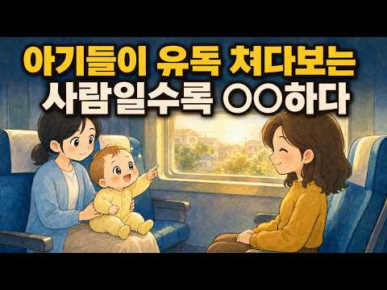
- 챕터: 0:00 들어가며 · 0:57 ①번 특징 · 3:32 ②번 특징 · 6:18 ③번 특징 · 8:49 ④번 특징 · 11:00 ⑤번 특징 · 13:23 정리
- 설명 앞부분: 어디를 가든 아기와 눈이 잘 마주치는 편인 사람이 있습니다. 혹시 당신이 그런 편이라면, 이런 장면이 익숙하실 겁니다. 병원 대기실에서도, 동네 마트 계산 줄에서도, 장소는 매번 다른데 아기는 꼭 당신을 찾아냅니다. 처음에는 우연이겠거니 했는데, 같은 일이 몇 번 반복되면 슬슬 궁금해집니다. 아기들 눈에는 내 얼굴이 어떻게 보이길래. 아기에게는 거짓말이라는 게 없습니다. 예의상 쳐다봐 주는 법도, 좋은 척하는 법도 모릅니다. 아기의 눈은 본능이 이끄는 대로만 움직입니다. 그래서 아기의 시선이 어딘가에 머문다면, 그건 우연도 가식도…
- 같은 채널 평소 대비 ×70.4 (채널 최근 롱폼 중앙값 13,428회) · 평소 영상: 조용한데 인기 많은 사람들의 특징 (13,428회) / 진짜 똑똑한 사람들은 유독 '바보인 척'을 합니다 (13,185회)
- 대본 없음 (설명) — 음성인식이 끝나면 도입부·흐름이 들어감
- 댓글 470/470: 좋은 점 — 영상 3 · 감사·응원 8 · 더 알고 싶은 것 2 · 아쉬운 점 — 영상 0 · 반박·불만 — 의견 다름 7 · 정치·사회 4 · 경험 공유 67 · 구독·다음 기대 0
  - 좋은 점 — 영상 👍54 “항상 왜그럴까 신기했는데 세상 첨보는 아이들이 저보면 인사를 해요 심지어 마스크 쓰고 지나가도 아는체를 해요 '안녕하세요~'라고 해요 응 안녕~하고 받아주긴 하는데 쟤가 날 아나? 어디서 봤나? 한번은 엄마랑 아이가 마주오는데 좁은길이라 피한다고 옆기둥 뒤로 피했는데…”
  - 좋은 점 — 영상 👍0 “제목에 놀랐어요 궁금하던 게 떠서 이제 궁금증이 풀렸😊 어느 정도는 그럴 거라 예상은 했어요 좋은 영상 감사합니다❤”
  - 감사·응원 👍359 “안녕하세요 민머리입니다 어딜가나 아이가 쳐다봅니다 감사합니다”
  - 감사·응원 👍2 “좋게 평가해줘서 감사합니다. 나는 그동안 아기들이 나 쳐다봐서 지긋지긋했는데, 조금은 위로가 되네요....”
  - 더 알고 싶은 것 👍0 “유독 개가 짖는 사람의 정체도 알려주세요”
  - 반박·불만 — 의견 다름 👍32 “글쎄, 아기들이 잘쳐다본다. 개나 고양이도 잘 따른다. 모두가 본능적인 끌림을 아는것 같다.”
  - 반박·불만 — 의견 다름 👍1 “저는 잘생기거나 좋은 인상이 아닌데 아기들 같은 공간에 있으면 뚫어지게 쳐다보는 경우가 많음.”
  - 정치·사회 👍55 “아기가 싫어하는 얼굴은 이재명같은 얼굴이란거네”
  - 정치·사회 👍3 “당신 머리속엔 이재명대통령님만 담겨있나? 기가막히고 신기하네 돌았나?”
  - 경험 공유 👍235 “내가 아기들을 많이 좋아해서 그마음이 전달되었나 했네요”
  - 경험 공유 👍54 “항상 왜그럴까 신기했는데 세상 첨보는 아이들이 저보면 인사를 해요 심지어 마스크 쓰고 지나가도 아는체를 해요 '안녕하세요~'라고 해요 응 안녕~하고 받아주긴 하는데 쟤가 날 아나? 어디서 봤나? 한번은 엄마랑 아이가 마주오는데 좁은길이라 피한다고 옆기둥 뒤로 피했는데…”

### 60. 남자 잘 다루는 여자: 사랑 받는다고 느끼는 진짜 언어

- https://www.youtube.com/watch?v=Q4TO7jz0nCE · 마음세탁소 · 구독자 1,780 · 조회수 140,417 (×78.9, 하루 2,230.5) · 좋아요 1,119 (0.8%) · 11.6분 · 2026-09-09 · 주제 묶음 8. 연애·부부 심리 · 형식 심리 테스트·유형 고르기 · 폴더 `W_Q4TO7jz0nCE` (웹 승인)
- 썸네일: 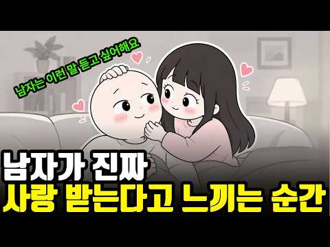
- 설명 앞부분: 남자는 어떤 순간에 여자에게 사랑받고 있다고 느낄까요? 연애를 하다 보면 분명 서로 좋아하는데도 상대방이 사랑을 충분히 느끼지 못하는 경우가 있습니다. 반대로 특별히 대단한 행동을 하지 않았는데도, 여자의 작은 행동 하나에 남자는 깊은 사랑과 안정감을 느끼기도 하죠. 이번 영상에서는 남자의 연애심리를 바탕으로, 남자가 여자에게 사랑받고 있다고 느끼는 순간들을 알아봅니다. 말 한마디, 사소한 배려, 관심을 표현하는 방식처럼 별것 아닌 것처럼 보이는 행동이 남자에게는 생각보다 큰 의미로 다가올 수 있습니다. 남자가 사랑받는다고 느끼는…
- 같은 채널 평소 대비 ×88.6 (채널 최근 롱폼 중앙값 1,585회) · 평소 영상: 나를 더 좋아하게 만드는 5가지 심리기술 (1,657회) / 오래 가는 커플은 '이것'이 다릅니다 (1,513회)
- 대본 없음 (설명) — 음성인식이 끝나면 도입부·흐름이 들어감
- 댓글 83/83: 좋은 점 — 영상 2 · 감사·응원 6 · 더 알고 싶은 것 2 · 아쉬운 점 — 영상 0 · 반박·불만 — 의견 다름 1 · 정치·사회 0 · 경험 공유 15 · 구독·다음 기대 0
  - 경험 공유 👍68 “딱 우리 남편이야기 인 거 같다.. 듣기만해도 너무 피곤하다. 그냥 혼자살면서 여기저기서 인정받고살지 왜 결혼해서 와이프를 이렇게 피곤하게 만드나.”
  - 경험 공유 👍51 “내가 남~편과 아들넘하고 살아보니 기빨림이 장난 아니예요. 그냥 냅두고 내중심으로 살고 한번씩 방향만 조언해주고 힘쓰는거 도와달라하고 그러고 사는게 내 정신건강에 이로워요 😅 뭐 속고 있는게 있을거 같긴 해요. 나중 알면 d진다고 엄포놓긴 하는데. 이제 기빨림이 싫어…”

### 61. 여자가 끌리는 남자는 따로 있습니다｜50대 이후 더 강해지는 8가지 연애심리와 매력

- https://www.youtube.com/watch?v=cgxJvqtZ5RU · 사랑의 비밀노트 · 구독자 1,070 · 조회수 79,817 (×74.6, 하루 1,331.8) · 좋아요 555 (0.7%) · 23.6분 · 2026-09-12 · 주제 묶음 1. 심리학 일반 · 형식 사연·고민 상담 (썰·라디오) · 폴더 `W_cgxJvqtZ5RU` (웹 승인)
- 썸네일: 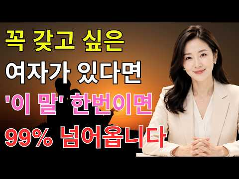
- 챕터: 0:00 50대 이후 더 강해지는 매력 · 1:51 행복한 관계의 비밀 · 3:15 ① 안정된 눈빛 · 5:38 ② 진심 어린 경청 · 7:03 ③ 차분한 목소리와 따뜻한 말 · 9:36 ④ 여유 있는 대화 리듬 · 11:05 ⑤ 안심시키는 존재감 · 12:54 ⑥ 진짜 미소의 힘 · 15:10 ⑦ 기억에 남는 작은 행동 · 16:22 ⑧ 삶의 경험에서 나온 깊이 · 18:43 8가지 매력과 관계를 바꾸는 작은 시작
- 설명 앞부분: 여자가 끌리는 남자는 따로 있습니다｜50대 이후 더 강해지는 8가지 연애심리와 매력 여자가 끌리는 남자에게는 특별한 공통점이 있습니다. 50대 이후에는 젊음이나 외모보다 안정된 눈빛, 진심 어린 경청, 차분한 목소리, 따뜻한 말, 여유 있는 대화가 더 깊은 매력으로 다가올 수 있습니다. 이번 영상에서는 50대 이후 사람을 자연스럽게 끌어당기는 8가지 연애심리를 알아봅니다. 작은 미소와 행동부터 상대를 편안하게 만드는 존재감, 오랜 삶의 경험에서 나오는 깊이까지 함께 살펴봅니다. 지금 혼자 지내는 시간이 많더라도 늦지 않았습니다. …
- 같은 채널 평소 대비 ×139.1 (채널 최근 롱폼 중앙값 574회) · 평소 영상: 여자가 나에게 확실히 마음을 열었을 때 보내는 7가지 신호｜친절과 호감을 구별하는 연애심리 (574회) / 마음이 떠난 남자는 헤어질 때 이것을 절대 하지 않습니다｜연애심리가 알려주는 마지막 신호 (543회)
- 대본 없음 (설명) — 음성인식이 끝나면 도입부·흐름이 들어감
- 댓글 7/7: 좋은 점 — 영상 2 · 감사·응원 2 · 더 알고 싶은 것 0 · 아쉬운 점 — 영상 0 · 반박·불만 — 의견 다름 0 · 정치·사회 0 · 경험 공유 1 · 구독·다음 기대 0
  - 좋은 점 — 영상 👍2 “좋네요 아주 좋은 내용과 아주좋은 목소리 강녕하세요”
  - 좋은 점 — 영상 👍1 “진심 으 로 좋은 말씀 잘 들어 씀이 다 감사합니다”
  - 감사·응원 👍1 “진심 으 로 좋은 말씀 잘 들어 씀이 다 감사합니다”
  - 경험 공유 👍1 “사랑해서연애한김복희누나를30년하루도잊지않고있다2살연상34세던누나인천부평서첫눈에반해우린서로좋아하고넘사랑했었다제주도가고향색시하고아름답던미모매력이넘치던누나이별을했다차라리만나지않았으면했다넘가슴아프다행복했던지난둘만의연애했던시간과추억들가슴속에담고산다치유되지못한체가슴에병이되어살아…”

### 62. 혼자 밥 먹고 혼자 여행하는 사람이 오히려 강한 이유 ∣ 심리학 ∣ 혼밥 ∣ 인간관계 ∣

- https://www.youtube.com/watch?v=HycNvXj_axk · 브라보 인생후반전 · 구독자 8,530 · 조회수 490,880 (×57.5, 하루 10,138.9) · 좋아요 2,362 (0.5%) · 25.1분 · 2026-09-23 · 주제 묶음 2. 인간관계·처세 · 형식 정보·해설 (그 밖) · 폴더 `W_HycNvXj_axk` (웹 승인)
- 썸네일: 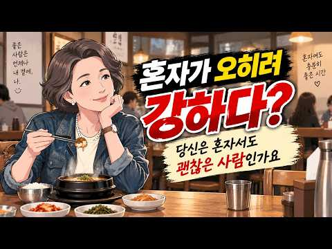
- 챕터: 0:00 혼자인 사람이 더 강합니다 · 1:38 우리는 혼자인 것을 이상하게 배웠습니다 · 4:50 기다리기만 하면 내 삶이 지나간다는 것 · 7:14 처음으로 혼자 해봅니다 · 9:53 혼자 있는 동안 자기 자신을 만나기 시작합니다 · 12:26 그리고 뜻밖의 사실을 발견합니다 · 14:41 혼자일 수 있는 힘에는 대가도 있습니다 · 17:09 다시 사람들 속으로 돌아왔을 때 · 19:27 진짜 강함은 혼자서도 괜찮은 것 · 22:29 혼자여도 괜찮은 사람
- 설명 앞부분: 혼자 밥을 먹고, 혼자 여행을 떠나는 사람을 보면 어떤 생각이 드시나요? 외로운 사람일 거라고 생각하셨다면, 오늘 영상을 끝까지 봐주세요. 혼자를 두려워하지 않는 사람은 생각보다 훨씬 단단한 사람입니다. 스포트라이트 효과, 자기결정성 이론, 자기효능감, 애착 이론까지 심리학이 말하는 '혼자여도 괜찮은 사람'의 진짜 모습을 함께 들여다봅니다. 여러분의 혼자 경험도 댓글로 들려주세요 🙂 ⏱️ 타임라인 ⚠️ 면책조항 본 영상은 심리학 이론을 대중적으로 쉽게 풀어 설명한 콘텐츠로, 전문적인 심리 상담이나 진단을 대체하지 않습니다. 관계나…
- 같은 채널 평소 대비 ×595.0 (채널 최근 롱폼 중앙값 825회) · 평소 영상: 60세에 열어본 어머니의 낡은 수첩, 결국 오열했습니다 ∣ 심리학 ∣ 은퇴 후 삶 ∣ 마… (825회) / 착한 사람이 어느 순간 차가워지는 이유, 사실 그전에 이미 끝났습니다 ∣ 심리학 ∣ 인간… (815회)
- 대본 없음 (설명) — 음성인식이 끝나면 도입부·흐름이 들어감
- 댓글 395/395: 좋은 점 — 영상 5 · 감사·응원 10 · 더 알고 싶은 것 0 · 아쉬운 점 — 영상 4 · 반박·불만 — 의견 다름 2 · 정치·사회 1 · 경험 공유 20 · 구독·다음 기대 1
  - 좋은 점 — 영상 👍2 “벌써부터...실천하고 행복느끼고있답니다 댓글참여하신분들내용 공감합니다 즐건인생 멋진인생들살아갑시다”
  - 좋은 점 — 영상 👍2 “공감합니다”
  - 감사·응원 👍7 “영상 보고 용기내어 한 번 도전 해 볼께요~ 감사드립니다~ 좋아요 구독 누르고 갑니다~😊”
  - 감사·응원 👍5 “혼자 산책할때. 가장 행복합니다ㅡ감사합니다ㅡ지난 날 몰랐던 감정입니다”
  - 아쉬운 점 — 영상 👍2 “자주하다보면 지루.지겨움 심심함도 봅니다 혼자놀이도 여유로움과 금전도 따라가네요”
  - 아쉬운 점 — 영상 👍1 “여자이고 왜소해서 혼자 잘 안다니는 집순이였는데 낚시여행 좋아하는 남편때문에 낚시 보고 기다리기 지루해 언젠가부터 차나 스쿠터타고 혼자 그 관광지 쇼핑 박물관 영화관 식당 다니기 시작함 약간 믿는구석?이 누가 친구없냐 외롭지않냐 물어보면 남편이 근처에서 낚시한다고 하…”
  - 반박·불만 — 의견 다름 👍1 “처음엔 혼자가 어색했는데 결혼하면 와이프가 잘챙겨주겠거니했지... 근데 아니더라고 점점더 밥을 얻어먹기는커녕 같이외식하는것도 어려움 혼자 먹다보니 이제는 네x버지도 계정에 분류별로 맛집 리스트 만들어놓고 도장깨듯 가서 스스로 맛평가하고 맛집 리스트만듬 단, 혼밥먹을수…”
  - 정치·사회 👍1 “잘은 모르겠지만 우리나라사람처럼 남한테 영향을 받는 나라가 있을지요. 끊임없이 타인과 비교하고 어쩌면 유행에 그토록민감한것도. 그유행의 가치를 알고 따라하는이는 몇이나 될지. 자기스스로 빛나면 되는것을.”
  - 경험 공유 👍35 “혼자있는게 편한건 사실 😊 먹고 자도 아무할 사람 없고 내가 🚪 열고 💩 싸도 볼 인간 없다는게 자유다. 누구랑 있어야 행복한건 절대 아니다”
  - 경험 공유 👍22 “내가 먹고 싶은거 마음대로 먹을수 있어 좋아요”
  - 구독·다음 기대 👍3 “좋아요와 하이프를 요청하는 태도가 동의를 구하시네요 느낌이 좋아 구독하고 갑니다 ❤”

### 63. [남성 심리] 사실 못 숨깁니다… 남자가 너무 좋아 괴로울 때 '무의식'에 드러나는 행동 7가지

- https://www.youtube.com/watch?v=LrkZ7mJWO3A · 칼 융 철학 · 구독자 2,330 · 조회수 117,966 (×50.6, 하루 2,746.8) · 좋아요 512 (0.4%) · 81.4분 · 2026-09-29 · 주제 묶음 1. 심리학 일반 · 형식 정보·해설 (그 밖) · 폴더 `W_LrkZ7mJWO3A` (웹 승인)
- 썸네일: 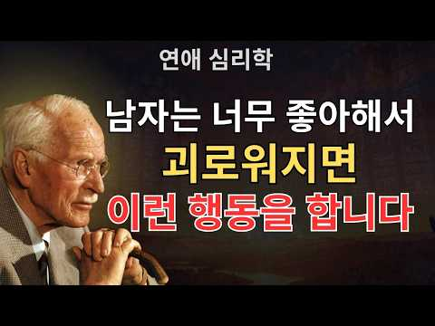
- 설명 앞부분: [남성 심리] 사실 못 숨깁니다… 남자가 너무 좋아 괴로울 때 '무의식'에 드러나는 행동 7가지 어느 날 갑자기 평소와 달라진 그의 눈빛과 태도, 혹시 눈치채신 적 있나요? 그 알 수 없는 어색함과 위화감은 결코 우연이 아닐 수 있습니다. 남자가 한 여자를 너무나도 깊이 사랑하게 되어, 마음이 부서질 듯 괴로워하고 있다는 강력한 신호일지도 모르거든요! 남성은 본래 감정을 말로 표현하는 것에 서툰 생물입니다. 그래서 좋아하는 마음이 커져 스스로를 통제할 수 없는 '폭풍' 같은 상태가 되면, 본인도 모르는 사이에 툭툭 행동으로 튀어나…
- 같은 채널 평소 대비 ×13.3 (채널 최근 롱폼 중앙값 8,896회) · 평소 영상: 여자들은 아직 모릅니다… 착하고 다정한 남자가 절대 말하지 않는 ‘본심’ 15가지 (9,011회) / "다 티 납니다" 연하남이 진짜 반했을 때 절대 못 숨기는 ‘이 태도’ [남성 심리] (8,781회)
- 대본 없음 (설명) — 음성인식이 끝나면 도입부·흐름이 들어감
- 댓글 27/27: 좋은 점 — 영상 1 · 감사·응원 1 · 더 알고 싶은 것 0 · 아쉬운 점 — 영상 1 · 반박·불만 — 의견 다름 0 · 정치·사회 0 · 경험 공유 0 · 구독·다음 기대 0
  - 좋은 점 — 영상 👍8 “와 너무 큰도움이 되네요 그남자가 이상한짓을 자꾸해서 밀어냈는데 너무 좋아해서 그런거라니ㅋ도대체 알수없는 말들을 던지거나 허세를 부리거나 뜬금 다른남자 이야기에 승질내고 트집잡다가 갑자기 비싼 선물을 하고 너무 스트레스받아서 선을그었어요ㅋ 다시 연락오면 이제는 다정하…”
  - 감사·응원 👍2 “수고하셨습니다 사랑합니다 축복합니다 감사합니다 🙏 ❤❤”
  - 아쉬운 점 — 영상 👍7 “길어서 패스~~”

### 64. 멘탈이 강한 사람들의 공통된 습관 ∣ 나이 들수록 흔들리지 않는 법 ∣ 쇼펜하우어 ∣ 오디오북 ∣ 인생론 ∣ 인생수업 ∣ 명언 ∣ 통찰 ∣ 철학 ∣ 틀어놓고 주…

- https://www.youtube.com/watch?v=FsA8DIfbmjQ · 오늘도 철학합니다 · 구독자 9,810 · 조회수 222,945 (×22.7, 하루 11,176.5) · 좋아요 1,750 (0.8%) · 46분 · 2026-10-22 · 주제 묶음 1. 심리학 일반 · 형식 수면·낭독·오디오북 (잠잘 때·명언) · 폴더 `W_FsA8DIfbmjQ` (웹 승인)
- 썸네일: 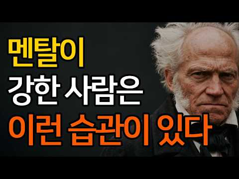
- 챕터: 0:00 시작 · 0:18 기대를 낮추면 마음이 단단해진다 · 2:40 혼자 있는 시간을 즐길 줄 안다 · 4:55 남의 머릿속에 내 집을 짓지 않는다 · 7:09 바꿀 수 없는 일은 그 자리에서 내려놓는다 · 9:12 아침의 첫 시간을 지킨다 · 11:12 마음보다 몸을 먼저 돌본다 · 13:15 걱정은 감정이 아니라 숫자로 따진다 · 15:20 지나간 도둑을 다시 부르지 않는다 · 17:25 분노를 얼굴에 싣지 않는다 · 19:27 말을 아끼는 사람이 무너지지 않는다 · 21:22 사람에게 많은 것을 바라지 않는다 · 23:27 비교의 눈길을 아래로 돌린다 · 25:20 명랑함이 찾아오면 문을 활짝 연다 · 27:19 삶의 테두리를 작게 그린다 · 29:15 맑은 날에 우산을 챙긴다 · 31:17 남의 머리가 아니라 내 머리로 생각한다 · 33:20 거절을 미안해하지 않는다 · 35:15 내 그릇의 모양을 안다 · 37:13 운명의 장난 앞에서 피식 웃는다
- 설명 앞부분: 비관주의 철학자 쇼펜하우어는 어떻게 평생 흔들리지 않는 마음을 지켰을까요. 멘탈이 강한 사람들은 상처를 덜 받는 것이 아니라, 상처가 오래 머물 자리를 내주지 않습니다. 기대를 낮추는 법, 혼자 있는 시간, 말을 아끼는 지혜, 바꿀 수 없는 일을 내려놓는 용기까지. 쇼펜하우어의 문장으로 정리한 마음 습관을 들려드립니다. 잠들기 전, 산책길에, 조용히 틀어 두고 들어 보세요 인생을 해결하려 들기보다, 이해하려 애쓸 때 우리는 조금 더 자유로워집니다. 이 채널은 철학자들의 사유와 명언을 통해 삶을 덜 무겁게, 조금 더 깊이 바라보는 …
- 같은 채널 평소 대비 ×7.3 (채널 최근 롱폼 중앙값 30,363회) · 평소 영상: 웃는 얼굴로 당신을 무너뜨리는 사람들 ∣ 무조건 피해야 할 교활한 사람의 특징 ∣ 쇼펜하… (30,363회) / 이런 사람에게 절대 잘해주지 마라 ∣ 잘해줄수록 당신을 만만하게 봅니다 ∣ 니체의 인간관… (19,304회)
- 대본 없음 (설명) — 음성인식이 끝나면 도입부·흐름이 들어감
- 댓글 70/70: 좋은 점 — 영상 5 · 감사·응원 18 · 더 알고 싶은 것 0 · 아쉬운 점 — 영상 2 · 반박·불만 — 의견 다름 0 · 정치·사회 0 · 경험 공유 1 · 구독·다음 기대 0
  - 좋은 점 — 영상 👍5 “감사합니다❤❤🎉🎉"비교의 눈길을 아래에 놓겠습니다. " 참 좋은 말씀이셨어요.🎉🎉❤❤”
  - 좋은 점 — 영상 👍2 “굽은 나무를 펴려다 부러진다 와닿네요”
  - 감사·응원 👍6 “비교는 감사를 깨우는 거울로 사용하기~~ 넘 귀하고 좋은말입니다.”
  - 감사·응원 👍6 “바꿀수없는것은 체념한다!! 바꿀수있는일은지금하고 바꿀수없는것은 내려놓는다!! 아침시간 잘 보내기~~ 감사합니다 ❤”
  - 아쉬운 점 — 영상 👍1 “좋은 말씀인데 광고가 넘 많아서 그만듣게 하는군요”
  - 아쉬운 점 — 영상 👍1 “광고가 너무 많군요”
  - 경험 공유 👍1 “내가 지금껏 그리살아온것 같습니다”

### 65. 결국 예쁜 여자도 이 남자한테는 매달립니다.(심리학적으로 증명된 이유) ∣황혼인생2막 ∣중년자기개발 ∣노후멋진인생 ∣오디오북

- https://www.youtube.com/watch?v=JDJoW4x1DME · 인생2막 심리학 · 구독자 3,980 · 조회수 408,129 (×102.5, 하루 4,425.7) · 좋아요 3,406 (0.8%) · 19.1분 · 2026-08-11 · 주제 묶음 1. 심리학 일반 · 형식 수면·낭독·오디오북 (잠잘 때·명언) · 폴더 `W_JDJoW4x1DME` (웹 승인)
- 썸네일: 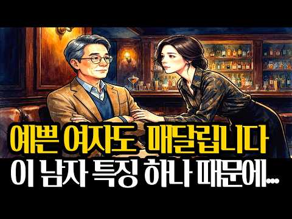
- 챕터: 0:00 인트로 — 그 남자는 잘생기지 않았다 · 2:27 [본론 1] — 흔들리지 않는 남자의 정체 · 6:09 [본론 2] — 조건 좋은 남자들이 놓치는 것 · 10:18 [본론 3] — 여자가 스스로 확신하게 만드는 순간 · 14:38 [본론 4(결론)] — 당신은 이미 그 남자다
- 설명 앞부분: 중년 남자 심리, 예쁜 여자도 매달리게 만드는 진짜 이유가 있습니다. 애착이론과 희소성 원칙, 그리고 경계선 심리학으로 밝혀낸 잘난 남자들의 공통된 심리적 무기 세 가지를 실전 사례와 함께 공개합니다. 조건이 아니라 태도가 관계를 결정짓는다는 사실, 50대·60대 남성이라면 오늘 반드시 알아야 할 연애 심리학입니다. 연애강사 미스터가 13년간 상담하며 검증한 원리를 지금 확인하세요. 1. 존 볼비 (1969). 『애착과 상실 1권: 애착』. 베이직북스. → 영상 내 '애착이론' 및 안정형·불안형 애착 개념 참고 2. 메리 에인스워…
- 같은 채널 평소 대비 ×197.6 (채널 최근 롱폼 중앙값 2,066회) · 평소 영상: 50 넘어 만만해진 남자가 '이 한마디' 던지자 무례한 사람이 벌벌 떤 이유... ∣황혼… (2,343회) / 무서울 정도로 마음이 편안한 사람들이 절대 하지 않는 '이 행동' ∣황혼인생2막 ∣중년자… (1,788회)
- 대본 없음 (설명) — 음성인식이 끝나면 도입부·흐름이 들어감
- 댓글 118/118: 좋은 점 — 영상 1 · 감사·응원 1 · 더 알고 싶은 것 1 · 아쉬운 점 — 영상 3 · 반박·불만 — 의견 다름 7 · 정치·사회 0 · 경험 공유 1 · 구독·다음 기대 2
  - 감사·응원 👍1 “감사합니다”
  - 더 알고 싶은 것 👍2 “10만큼 궁금한데 100만큼 숨길때 웃음나죠....”
  - 아쉬운 점 — 영상 👍7 “서론이 너무 길...다”
  - 아쉬운 점 — 영상 👍5 “어쩔수 없이 좋아요 눌렀고 방송봤지만 평가를 한다면 D점수 또는 E점수 수준 여기저기 방송내용 짜집기에 GPT 대본까지 짜집기 난 지하철역 노숙자인데 노숙자들이 많이 좋아한다 오래오래 노숙자 할것같다”
  - 반박·불만 — 의견 다름 👍36 “아니 무슨 남자 인생은 여자를 얻기 위해 존재하나요?? 어떤 책에서 여자는 도시락 같은 존재라 했죠. 가지고 있으면 귀찮고 없으면 아쉬운 딱 그 정도입니다. 자신을 위해 사세요. 인생은 여자나 다른 사람을 위해 사는 게 아닙니다. 자신이 이루고자 하는 일에 성취를 추…”
  - 반박·불만 — 의견 다름 👍12 “말도안되는소리 초연함은 좀 가까워지고난 다음의 일입니다 첫째 외모 둘째 재력입니다 속마음은 눈에 보이지않아요 그리고 그건 나중 일입니다”
  - 경험 공유 👍2 “지금은 여자들이 많이 남을걸? 내가 은퇴했거든”
  - 구독·다음 기대 👍1 “밀고 댕기는 50대60대 연애학개론 잘보고갑니다 구독하고 갑니다 ❤❤❤❤”
  - 구독·다음 기대 👍0 “2026년 10월22일 21시 구독하고있어요”

### 66. 사랑이 식은게 아닌 지친 번아웃 이별

- https://www.youtube.com/watch?v=gZoQDI3k1J8 · 마로엘 Maroel · 구독자 298 · 조회수 24,529 (×82.3, 하루 314.3) · 좋아요 231 (0.9%) · 7.7분 · 2026-08-25 · 주제 묶음 4. 우울·불안·정신건강 · 형식 정보·해설 (그 밖) · 폴더 `W_gZoQDI3k1J8` (웹 승인)
- 썸네일: 
- 설명 앞부분: 사랑이 식은게 아닙니다 너무 지쳐버린겁니다.
- 같은 채널 평소 대비 ×8.2 (채널 최근 롱폼 중앙값 3,001회) · 평소 영상: 헤어진 연인을 가장 빨리 잊는법 (3,383회) / 헤어졌는데 차단 안 하는 이유 (2,619회)
- 대본 없음 (설명) — 음성인식이 끝나면 도입부·흐름이 들어감
- 댓글 84/84: 좋은 점 — 영상 3 · 감사·응원 19 · 더 알고 싶은 것 8 · 아쉬운 점 — 영상 2 · 반박·불만 — 의견 다름 1 · 정치·사회 0 · 경험 공유 25 · 구독·다음 기대 0
  - 좋은 점 — 영상 👍8 “연애하던 중 상대방이 번아웃이 왔습니다. 저는 무슨 힘든 일이 있는지 물어보고 서로 위로해주며 같이 대화하고 싶었는데 상대는 본인의 힘든 일을 말하지 않는 타입이었습니다. 어떻게든 도움을 주고 싶었지만 아예 대화가 안되는 것을 겪고 도움이 못 된다는 사실에 무기력함이…”
  - 좋은 점 — 영상 👍2 “안녕하세요 마로엘님, 영상 잘 보고 있습니다. 여유가 되신다면, 제 사연을 봐주시고 조언해주시면 큰 도움이 될 것 같습니다. 저는 30대초 여자, 상대는 20대 후 남자입니다. 약 10개월 간 교제했고 그중 6개월은 동거했어요. 헤어진지는 세달이 안됐습니다. 상대는 …”
  - 감사·응원 👍8 “친구랑 이 얘기 했었는데 실제로 있네요 번아웃 이별이요.. 저 막말 들으면서 헤어져가지구 너무 힘들었는데 이 영상 보니까 위로 되네요 ㅎㅎ 가치 없는 사람이 아니라는 말이 참 따뜻해져요 감사합니다”
  - 감사·응원 👍4 “안녕하세요 마로엘님.. 너무 긴 내용이고 하지만 혼자서 이해하고 기다릴려니 답답하고 힘들어서 번아웃으로 인한 이별에 대해 궁금해서 조심스럽게 질문드립니다.. 7년 정도 장기연애를 해온 커플이고, 몇 달 전 상대방이 직장과 개인적인 스트레스가 많이 누적되어 정서적으로 …”
  - 더 알고 싶은 것 👍4 “안녕하세요 마로엘님.. 너무 긴 내용이고 하지만 혼자서 이해하고 기다릴려니 답답하고 힘들어서 번아웃으로 인한 이별에 대해 궁금해서 조심스럽게 질문드립니다.. 7년 정도 장기연애를 해온 커플이고, 몇 달 전 상대방이 직장과 개인적인 스트레스가 많이 누적되어 정서적으로 …”
  - 더 알고 싶은 것 👍3 “안녕하세요 5년 반 넘게 연애했는데 며칠전 헤어지고 너무 힘들어서 댓글 씁니다.. 상대가 여러 스트레스가 극에 달하면서 저에 대한 스트레스까진 수용하기 어렵다고 판단해서 저에 대해 마음정리를 했다고 하며 헤어지자고 했습니다. 너무 힘들어서 친구에게 얘기했더니 그렇게 …”
  - 아쉬운 점 — 영상 👍6 “장거리연애로 1년 2개월정도 사귄사이입니다. 서로 거의 첫연애고 남자친구는 당시 취준중이었고 저도 취준생이었습니다. 자기공부에 신경쓰느라 점점 연락이 줄어들고 제가 계속 서운해하는 입장이었는데 나중에는 제가 방해만 되는 사람이라고도 표현했구요. 그래도 남자친구가 저를…”
  - 아쉬운 점 — 영상 👍1 “반복되는 문제들, 취업 문제로 헤어지게 됐는데 일단 저는 그 반복되는 문제들이 무엇이었는지 정확하게 몰라요 만나서 통보받았는데 한달 뒤에 제가 연락해서 얼굴봤는데 제가 뭐냐고 물어보니꺼 헤어질 때 다 설명했다고 더이상 말하기 싫대요 그리고 통보할때 자기 말만 한 것 …”
  - 반박·불만 — 의견 다름 👍4 “번아웃이별 ..저한테 해당되네요..너무지쳐서 헤어지자했어요. 장거리연애였고 주말마다 만났어요.거의 주말부부처럼 지냈었죠.마음은 떠난게아닌데 제가 왜지쳤는지도 모르더라구요.방치 방임은 물론 난 희생 기다림 인내 데이트비용부담 감정적 안정 그는 내가 해주는 것들은 당연하…”
  - 경험 공유 👍22 “8년 사귀고 동거했었는데 번아웃,상황이별 당했습니다 회사에 일이 많아지고 피로감이 심해졌다며 너무 갑자기 헤어짐 당했습니다 평소에 데이트도 잘안했습니다 8년만났는데 한번도 안싸워봤습니다 헤어진날 그자리에서 한번 붙잡았고 두달이나 넘었는데 이제 그사람 놔줘야겠죠 저는 …”
  - 경험 공유 👍8 “친구랑 이 얘기 했었는데 실제로 있네요 번아웃 이별이요.. 저 막말 들으면서 헤어져가지구 너무 힘들었는데 이 영상 보니까 위로 되네요 ㅎㅎ 가치 없는 사람이 아니라는 말이 참 따뜻해져요 감사합니다”

### 67. 친한 사람들과 여행 갔다가 사이가 틀어지는 진짜 이유(feat. 심리학) ∣ 갈등심리학 ∣ 우정 ∣

- https://www.youtube.com/watch?v=xk46_2WsjMk · 브라보 인생후반전 · 구독자 8,530 · 조회수 522,689 (×61.3, 하루 8,791.0) · 좋아요 1,891 (0.4%) · 25.2분 · 2026-09-12 · 주제 묶음 1. 심리학 일반 · 형식 인터뷰·강연·대담 (교수·의사·스님) · 폴더 `W_xk46_2WsjMk` (웹 승인)
- 썸네일: 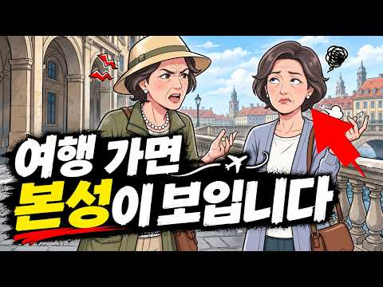
- 챕터: 0:00 인트로 · 1:41 1단계. 평소엔 정말 친한 사이였다 · 4:11 2단계. 여행에는 생각보다 많은 배려가 필요하다 · 6:50 3단계. 처음엔 모든 것이 좋았다 · 10:18 4단계. 작은 불편함이 쌓이기 시작한다 · 12:48 5단계. 결국 참았던 사람이 폭발한다 · 15:12 6단계. 싸움보다 더 무서운 침묵이 시작된다 · 17:43 7단계. 우리는 그 사람의 '본성'을 판단하기 시작한다 · 20:30 8단계. 여행이 끝난 뒤, 관계의 거리가 달라진다 · 23:16 아웃트로
- 설명 앞부분: 평소엔 그렇게 편했던 친구가, 여행 한 번 다녀온 뒤부터 왜 이상하게 불편해질까요? 돈 쓰는 방식, 시간 약속, 사소한 의견 차이... 여행이라는 낯선 스트레스 상황은 평소엔 절대 보이지 않던 그 사람의 진짜 모습을 드러냅니다. 이 영상에서는 여행 후 관계가 틀어지는 심리적 이유를, 존 가트맨의 갈등 연구를 바탕으로 하나씩 풀어드립니다. 여러분은 여행에서 누구의 진짜 모습을 보셨나요? 댓글로 여러분의 이야기를 들려주세요. ⏱ 타임라인 ⚠️면책조항(Disclaimer) 이 영상은 심리학 연구와 이론을 바탕으로 재구성한 일반적인 정보…
- 같은 채널 평소 대비 ×633.6 (채널 최근 롱폼 중앙값 825회) · 평소 영상: 60세에 열어본 어머니의 낡은 수첩, 결국 오열했습니다 ∣ 심리학 ∣ 은퇴 후 삶 ∣ 마… (825회) / 착한 사람이 어느 순간 차가워지는 이유, 사실 그전에 이미 끝났습니다 ∣ 심리학 ∣ 인간… (815회)
- 대본 없음 (설명) — 음성인식이 끝나면 도입부·흐름이 들어감
- 댓글 302/302: 좋은 점 — 영상 10 · 감사·응원 2 · 더 알고 싶은 것 2 · 아쉬운 점 — 영상 1 · 반박·불만 — 의견 다름 7 · 정치·사회 0 · 경험 공유 28 · 구독·다음 기대 0
  - 좋은 점 — 영상 👍41 “친구랑 여행 갔다가 사이 나빠진 사람이 저 말고도 많은가 보네요. 😅 좋은 영상 잘 봤습니다.”
  - 좋은 점 — 영상 👍8 “저도 친한 친구와 여행을 갔다가 돌아온 뒤 한동안 어색해진 적이 있습니다. 여행 전에는 정말 잘 맞는다고 생각했는데 돈 쓰는 방식, 시간 개념, 피곤할 때의 태도가 너무 다르더군요. 그때부터 친한 것과 함께 생활할 수 있는 것은 다른 문제라는 걸 배웠습니다.”
  - 감사·응원 👍2 “감사합니다 ..ㅎ”
  - 감사·응원 👍1 “통찰력 있는 유익한 영상 감사드립니다”
  - 더 알고 싶은 것 👍20 “30년지기 친구 처음이자 마지막 유럽패키지 여행이후 손절.. 한 친구가 주도를 했죠. 딸부잣집 막내라 언니들로부터 줏어들은 풍월로 말투마다 자신이 보는 세상이 전부요 옳다는식의.. 잠도 동전던지기로 매일 다른 사람과 때론 연속으로 같은 사람과 자게 되는것도 그친구 였…”
  - 더 알고 싶은 것 👍2 “얼마나 속상하셨으면 긴 글을 쓰셨을까요? 이해합니다”
  - 아쉬운 점 — 영상 👍47 “30년넘게 알고지낸사이 평소 등산 과 국내여행 짧게 참 많은것을 함께 했던 교회 친구였죠.둘이서 나눈대화며 맛집경험등 우린정말 함께 했던것들이 넘 많았죠.주변뿐 아니라 남편들마저 부러워할만큼 소문난? 친구같은 교우 였어요.몇년간 함께 돈을모아 한달간 유럽여행을 갔어요…”
  - 반박·불만 — 의견 다름 👍25 “감정기복이 심해서 막 웃다가 조금이라도 거슬리면 몇시간씩 말도 안하고 짜증내서 사람 불편하게 하고(그 원인이 지가 해외체류기간 계산 잘못해서 로밍 끊긴거를 엄청 짜증내고 열폭함 ㅜㅠ) 돈은 한푼도 손해보려하지 않으면서 (7년동안 밥은 커녕 커피한잔을 안사더라~^^) …”
  - 반박·불만 — 의견 다름 👍20 “30년지기 친구 처음이자 마지막 유럽패키지 여행이후 손절.. 한 친구가 주도를 했죠. 딸부잣집 막내라 언니들로부터 줏어들은 풍월로 말투마다 자신이 보는 세상이 전부요 옳다는식의.. 잠도 동전던지기로 매일 다른 사람과 때론 연속으로 같은 사람과 자게 되는것도 그친구 였…”
  - 경험 공유 👍93 “맞아요ㆍ저도 여행갔다와서 절교했습니다ㆍ생각만 해도 진절머리나요ㆍ”
  - 경험 공유 👍74 “팁을 하나 공유하자면~가까울수록 그 여행 끝으로 손절하고 싶지 않을수록~방 따로 쓰면 됩니다. 몆 년 전에 여행 갈 때 친한 분이랑 반배낭 팀에 합류해서 20여 일 가까이 여행하게 되었는데 전 싱글 차지 내고 각방 쓰자, 힘든 여행일수록 퇴근이 필요하다. 했는데 상대…”

### 68. 60대인 당신이 속물이라서 가난한 친구가 불편해지는 것이 아닌 이유

- https://www.youtube.com/watch?v=Fn1bh-lwmJA · 내 누군지 아나? · 구독자 6,660 · 조회수 717,315 (×107.7, 하루 6,461.7) · 좋아요 3,020 (0.4%) · 28.2분 · 2026-07-23 · 주제 묶음 기타 · 형식 정보·해설 (그 밖) · 폴더 `W_Fn1bh-lwmJA` (웹 승인)
- 썸네일: 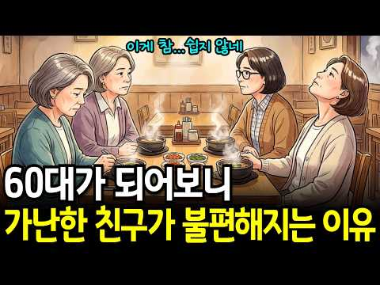
- 챕터: 0:00 도입 · 0:47 그날 국밥집에서 굳어버린 공기 · 4:50 왜 하필 60대에 불편해질까 · 9:18 우정이라는 시소, 형평이론 · 12:56 밥값으로 계산되는 한국의 우정 · 17:04 3주 뒤, 내가 그 친구가 되었다 · 21:03 계산기를 끄는 처방 3가지 · 26:57 정산을 멈출 줄 아는 사람들
- 설명 앞부분: 60대에 접어드니 어쩐지 그 친구가 불편해지셨나요? 😮‍💨 돈으로 사람을 가르는 것 같아 아무한테도 말 못 하고 혼자 자책만 하고 계셨다면, 오늘 이야기가 그 마음의 진짜 정체를 알려드릴 거예요. 🌱 당신이 속물이 된 게 아니라, 두 사람 사이의 저울이 고장 난 것뿐입니다. ✨ 이 영상에서 다루는 내용 20대엔 형편이 달라도 괜찮았는데, 왜 하필 60대에 불편해지는지 그 이유를 알게 됩니다 🔑 심리학 형평이론으로, 덜 받은 사람만이 아니라 **더 받은 사람도 똑같이 불편한 이유**를 이해하게 됩니다 ⚖ "그냥 국밥이나 먹지"라는 …
- 같은 채널 평소 대비 ×267.4 (채널 최근 롱폼 중앙값 2,682회) · 평소 영상: 한국 엄마들이 평생동안 들러리만 서고 있는 진짜 이유 (2,790회) / 자식이 부모를 끊게 만드는 말 3가지, 세 번째에서 관계가 끝납니다 (2,575회)
- 대본 없음 (설명) — 음성인식이 끝나면 도입부·흐름이 들어감
- 댓글 361/361: 좋은 점 — 영상 8 · 감사·응원 9 · 더 알고 싶은 것 0 · 아쉬운 점 — 영상 5 · 반박·불만 — 의견 다름 4 · 정치·사회 0 · 경험 공유 58 · 구독·다음 기대 0
  - 좋은 점 — 영상 👍120 “60대가 되니 가난한 친구가 불편해지는 이유가 단순히 돈 때문만은 아니라는 말에 공감합니다. 나이가 들수록 인간관계와 친구관계도 정말 달라지는 것 같아요”
  - 좋은 점 — 영상 👍14 “사고의 뒤틀림을 반영한 좋은 영상이네. 알아서 어렵게 살아주니 ㄸㅋ”
  - 감사·응원 👍8 “좋은 내용 감사합니다 ❤”
  - 감사·응원 👍7 “감사함과 고마움이 없는 행위를하는 생명들을 베푸는 생명들이 싫어하고, 고마움과 감사를하는 은혜를알고 행위를하는 생명들을 베푸는 생명들이 좋아한다!”
  - 아쉬운 점 — 영상 👍3 “다소 좀 지루하네요..간단명료하게 풀어내심이 좋겠습니다.. 듣다가 지나갑니다.”
  - 아쉬운 점 — 영상 👍1 “심각했던 친구들 이야기를 듣고 있는데 40년 먹이고 입혀줬던 친구가 정신을 못차리고 먹기만,,. 4,5번의 반복되고 모임 해체 한명은 생활 보호 대상자 한명은 수 백억친구... 이 부자친구가 40년 넘게 먹이고 입히던 친구...손절.. 얻어 먹은 친구가 40년 만에 …”
  - 반박·불만 — 의견 다름 👍47 “글쎄요 ᆢ밥값 회비 이런거 보다는 화제나 인품들이 맘에 안 맞으면 불편하죠 그리고 사는건 굳이 일일이 보고 안하고 얼버무려야 해요 자랑은 자제하고 힘듦도 잘 소화하는 관조적 태도를 유지하고 굳이 피차 형편은 다를수밖에 없는데 서로 양해할 수 있는 범위가 어디까지인지는…”
  - 반박·불만 — 의견 다름 👍23 “무례는 말투나 태도에서 나오지 거절이 무례한건 아닙니다.”
  - 경험 공유 👍429 “내가 갑자기 생활이 어려워지니 모든 만남 연락을 나 스스로 끊게 되네요. 다른 사람에게 피해주기 싫어서요”
  - 경험 공유 👍404 “저도 나이 들어보니 친구 형편 생각해서 내가 거의 사는 편인데 이제 든 생각은 내가 어리석었다는 생각이 들더라구요 바라고 한건 아니지만 다 부질 없다는 결론에 도달 했어요”

### 69. 귀티 나는 중년의 비밀 — 얼굴 평온함은 피부가 아니라 태도에서 옵니다

- https://www.youtube.com/watch?v=VzZtm-KS6fM · 생활심리연구소 · 구독자 126 · 조회수 17,358 (×137.8, 하루 121.4) · 좋아요 188 (1.1%) · 13분 · 2026-06-21 · 주제 묶음 2. 인간관계·처세 · 형식 정보·해설 (그 밖) · 폴더 `W_VzZtm-KS6fM` (웹 승인)
- 썸네일: 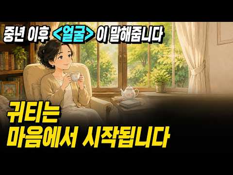
- 설명 앞부분: 아무리 피부과를 다녀도 얼굴이 팍팍해 보이는 이유, 피부가 아니라 마음의 태도 때문입니다. 심리학이 밝힌 귀티 나는 중년의 5가지 심리 비밀을 확인하세요. 심리학이 밝힌 표정을 굳게 만드는 5가지 내면 패턴과 오늘부터 바꿀 수 있는 실천법을 알려드립니다. 아무리 피부과를 다니고 값비싼 크림을 발라도 얼굴의 분위기가 바뀌지 않는 이유, 궁금하지 않으셨나요? 같은 나이대라도 어떤 분들은 보는 것만으로 마음이 편안해지는 평온한 얼굴을 갖고 있고, 또 어떤 분들은 아무리 꾸며도 왠지 무겁고 굳어 보이는 표정이 남아 있습니다. 그 차이를 …
- 같은 채널 평소 대비 ×609.1 (채널 최근 롱폼 중앙값 28회) · 평소 영상: 자랑 한 번 안 했는데 왜 나만 질투받을까 — 조용히 성과내는 사람이 가장 미움받는 3가… (29회) / 50대가 기억력 나쁜 건 나이 탓이 아닙니다 (뇌과학이 밝힌 3가지 진짜 이유) (28회)
- 대본 없음 (설명) — 음성인식이 끝나면 도입부·흐름이 들어감
- 댓글 2/2: 좋은 점 — 영상 0 · 감사·응원 0 · 더 알고 싶은 것 0 · 아쉬운 점 — 영상 0 · 반박·불만 — 의견 다름 0 · 정치·사회 0 · 경험 공유 0 · 구독·다음 기대 0

### 70. 이어령 교수의 조언: 60부터는 친구가 없어도 괜찮습니다ㅣ노후엔 인간관계에 너무 애쓰지 마세요ㅣ외로움을 편안하게 즐기는 법ㅣ노년지혜ㅣ철학이야기

- https://www.youtube.com/watch?v=Zv4u9JLdyTM · 나답게 늙어가기 · 구독자 7,570 · 조회수 364,925 (×48.2, 하루 7,126.4) · 좋아요 2,659 (0.7%) · 35.1분 · 2026-09-21 · 주제 묶음 2. 인간관계·처세 · 형식 인터뷰·강연·대담 (교수·의사·스님) · 폴더 `W_Zv4u9JLdyTM` (웹 승인)
- 썸네일: 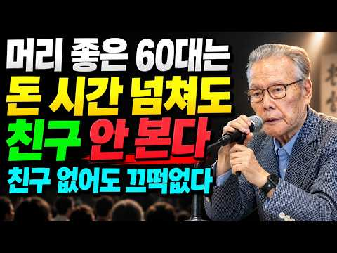
- 설명 앞부분: 【이어령 교수의 조언】 60부터는 친구가 없어도 괜찮습니다ㅣ노후엔 인간관계에 너무 애쓰지 마세요ㅣ외로움을 편안하게 즐기는 법ㅣ노년지혜ㅣ철학이야기 왜 60세 이후에는 친구가 많아야 행복하다는 생각에서 벗어나도 괜찮을까요? 이 영상에서는 이어령 교수의 삶의 철학과 시선으로, 나이가 들수록 인간관계에 지나치게 애쓰지 않고 혼자 있는 시간을 편안하게 받아들이는 지혜에 대해 깊이 있게 생각해 봅니다. 특히 모든 사람과 좋은 관계를 유지하려는 부담에서 벗어나는 법, 더 이상 맞지 않는 관계를 자연스럽게 정리하는 법, 타인의 시선과 기대에 휘…
- 같은 채널 평소 대비 ×28.2 (채널 최근 롱폼 중앙값 12,961회) · 평소 영상: 이어령 교수의 조언: 60부터 무조건 베풀면 후회합니다ㅣ남보다 나를 먼저 챙겨야 하는 이… (12,961회) / 이어령 교수의 조언: 늙어서는 조금 대충 살아도 괜찮습니다ㅣ힘을 빼고 사는 어르신들이 오… (13,283회)
- 대본 없음 (설명) — 음성인식이 끝나면 도입부·흐름이 들어감
- 댓글 178/178: 좋은 점 — 영상 24 · 감사·응원 29 · 더 알고 싶은 것 3 · 아쉬운 점 — 영상 4 · 반박·불만 — 의견 다름 5 · 정치·사회 0 · 경험 공유 11 · 구독·다음 기대 0
  - 좋은 점 — 영상 👍71 “ㅡ하루좋은습관ㅡ 1.아침루틴-산책 (신선한공기-스트래칭) 2.손으로-요리. 빵.그림 (이순간에집중-명상) 과정을 즐김-뿌듯-행복 3.글쓰기-내감정 치유효과(손편지) 4.자연속에서시간 (공기 바람 숲 햇살. 나뭇잎 나무 새 꽃) 5.30분~1시간 아무것도하지않기 6.나…”
  - 좋은 점 — 영상 👍12 “공감합니다!! 좋은말씀 고맙습니다 ❤”
  - 감사·응원 👍71 “ㅡ하루좋은습관ㅡ 1.아침루틴-산책 (신선한공기-스트래칭) 2.손으로-요리. 빵.그림 (이순간에집중-명상) 과정을 즐김-뿌듯-행복 3.글쓰기-내감정 치유효과(손편지) 4.자연속에서시간 (공기 바람 숲 햇살. 나뭇잎 나무 새 꽃) 5.30분~1시간 아무것도하지않기 6.나…”
  - 감사·응원 👍18 “모두다 실천합니다 자연과나무와 바다가 잇는곳에서 노년을 보냅니다 감사합니다”
  - 더 알고 싶은 것 👍3 “이어령교수님이 말씀하신거 맞나요? 내용은 공감하는데ᆢ”
  - 더 알고 싶은 것 👍0 “이거정말 이어령 교수님 말씀 맞나요?”
  - 아쉬운 점 — 영상 👍2 “제시해주신 유튜브 영상은 AI 생성 음성(TTS)과 AI 기반 콘텐츠 기획으로 제작된 영상입니다. 주요 판별 이유 1. AI 생성 음성 (TTS - Text-to-Speech) 단조로운 억양 및 리듬: 문장 시작부터 끝까지 톤의 변화가 없으며, 정서적 고저나 한숨, …”
  - 아쉬운 점 — 영상 👍0 “이 이야기가 자기 입맛에 맞는 분들의 클릭을 유도하는 Al 로 생성한 이어령과는 아무 관련 없는 창작 낚시 물 ,,,, (낚시물이라 한건 이어령을 빙자한 거짓이므로) 세상에 일들이 맞고 틀린건 사람에 따라 다르다 ~ 결국 이글이 맘에든 분들은 그들의 내면 성향을 말해…”
  - 반박·불만 — 의견 다름 👍64 “이어령 교수의 직접적인 조언이 아닙니다. 유명인의 이름을 빌려 클릭률을 높이기 위한 마케팅 방식입니다”
  - 반박·불만 — 의견 다름 👍0 “모두 다 참 좋은 말씀입니다. 이렇게 사는 것도 좋을 것 같습니다. 그러나 세상의 어떤 말도 진리는 아닙니다. 조선 시대 사람들이 현대의 우리들이 살고 있는 방식을 안다면, 그렇게 살지는 않았을 겁니다. 우리들도 마찬가지입니다. 현대 또는 미래의 세상 사람들이 어떻게…”
  - 경험 공유 👍26 “70대, 아무도 안만나고 혼자 살고 있어요.7년째, 너무너무 편하고 내할일 하며 자신을 아끼고 즐거우니 너무 좋아요.❤🎉😂”
  - 경험 공유 👍22 “노년은자연을경험해보세요.설레임입니다”

### 71. 60대 이후 내 형편을 자세히 말하면 안 되는 6가지 이유ㅣ인생조언ㅣ노후준비ㅣ처세술ㅣ인간관계ㅣ삶의지혜ㅣ시니어ㅣ오디오북ㅣ

- https://www.youtube.com/watch?v=RsreeiZhYw0 · 마음 안부 · 구독자 4,810 · 조회수 128,623 (×26.7, 하루 4,424.2) · 좋아요 530 (0.4%) · 28.2분 · 2026-10-13 · 주제 묶음 2. 인간관계·처세 · 형식 수면·낭독·오디오북 (잠잘 때·명언) · 폴더 `W_RsreeiZhYw0` (웹 승인)
- 썸네일: 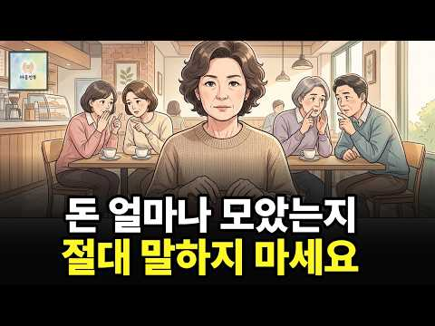
- 설명 앞부분: 60대 이후에는 왜 내 형편과 통장 사정을 함부로 털어놓으면 안 될까요? 🤫 가까운 이웃이나 친척, 심지어 자식에게조차 내 사정을 자세히 밝히는 순간 생각지도 못한 시기와 오해, 그리고 금전적인 어려움이 찾아오곤 합니다. 💔 오늘 마음안부에서는 내 삶과 평온을 지키는 '침묵의 지혜 6가지'를 담담하게 전해드립니다. 🌿 💬내 형편이나 통장 사정을 주변에 털어놓았다가 속상했거나 아쉬웠던 경험이 있으신가요? 여러분은 나이 들수록 내 사정을 어디까지 밝히는 게 좋다고 생각하시나요? 여러분의 소중한 경험과 생각을 댓글로 편하게 나눠주세요!…
- 같은 채널 평소 대비 ×5.4 (채널 최근 롱폼 중앙값 23,978회) · 평소 영상: 60대 이후 돈이 줄줄 새는 사람들은 꼭 이런 데 씁니다 ∣ 노후 생활비를 지키는 6가지… (24,292회) / 60대 이후, 좋은 차를 타야 하는 진짜 이유｜60대 이후 달라지는 자동차 선택 기준ㅣ인… (23,663회)
- 대본 없음 (설명) — 음성인식이 끝나면 도입부·흐름이 들어감
- 댓글 29/29: 좋은 점 — 영상 1 · 감사·응원 1 · 더 알고 싶은 것 0 · 아쉬운 점 — 영상 0 · 반박·불만 — 의견 다름 0 · 정치·사회 0 · 경험 공유 1 · 구독·다음 기대 0
  - 좋은 점 — 영상 👍6 “들어도 지겹지가 않고 공감이 가네요 오늘도 많이 배우고 갑니다”
  - 감사·응원 👍6 “엄마도 못가르쳐주는 이런 정보 감사합니다 😊”
  - 경험 공유 👍8 “많이 가진거 부러울뿐이죠. 그렇다고. 질투할 꺼까지있나요. 없는친구보단. 더 낮습 니다. 적어도. 내가 자주 밥값 안내잖아요. 식구도 마찬가지. 없는 형제들 맨날 돈꼬달라 지긋지긋”

### 72. 60세 넘으면 친구가 없어도 괜찮습니다… 노후에 인간관계에 애쓰지 말아야 할 진짜 이유｜혼자가 편해지는 법｜노년의 지혜｜오디오북

- https://www.youtube.com/watch?v=Nyrz_g-xVzs · 백세건강 명의 · 구독자 365 · 조회수 17,134 (×46.9, 하루 318.2) · 좋아요 141 (0.8%) · 117.5분 · 2026-09-18 · 주제 묶음 2. 인간관계·처세 · 형식 수면·낭독·오디오북 (잠잘 때·명언) · 폴더 `W_Nyrz_g-xVzs` (웹 승인)
- 썸네일: 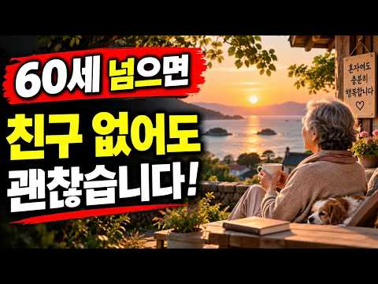
- 설명 앞부분: 60세가 넘으면 인간관계를 바라보는 마음도 조금씩 달라집니다. 젊을 때는 친구가 많아야 행복하고, 사람들과 자주 어울려야 외롭지 않다고 생각했지만 나이가 들수록 깨닫게 됩니다. **억지로 이어가는 관계보다 마음 편한 하루가 더 소중할 수 있다는 것을요. 이번 영상에서는 노후에 인간관계 때문에 지나치게 애쓰지 않아도 되는 이유와, 혼자 있는 시간을 외로움이 아닌 **편안함과 자유로움으로 바꾸는 방법**에 대해 이야기합니다. 만나고 돌아오면 유난히 피곤한 사람, 필요할 때만 연락하는 사람, 끊임없이 비교하고 자랑하는 사람, 내 마음을…
- 같은 채널 평소 대비 ×111.3 (채널 최근 롱폼 중앙값 154회) · 평소 영상: 60·70대 여러분, 큰일 났습니다! 우리가 알던 노후가 완전히 사라지고 있습니다! 반드… (154회) / 60세 넘었다면 연락 끊긴 친구에게 먼저 연락하지 마세요! 단, '이 사람'만은 절대 놓… (152회)
- 대본 없음 (설명) — 음성인식이 끝나면 도입부·흐름이 들어감
- 댓글 10/10: 좋은 점 — 영상 0 · 감사·응원 2 · 더 알고 싶은 것 0 · 아쉬운 점 — 영상 0 · 반박·불만 — 의견 다름 1 · 정치·사회 0 · 경험 공유 1 · 구독·다음 기대 0
  - 감사·응원 👍6 “나답게 사는것이 최고 남과 비교하지 말고 인간답게 사는것 덕분입니다 감사합니다😊”
  - 감사·응원 👍4 “좋은 👍 내용의글 올려주셔서 감사합니다 올은 말씀 동감합니다 😊응원합니다 ~^^”
  - 반박·불만 — 의견 다름 👍0 “혼자있써도 외롭지않아요 저는친구라고해도 속깊은이야기 속상한이야기 자식자랑이야기 안합니다 한다고해도 사람이알아주나요 아닙니다 상대방귀만즐겁게해줄뿐인걸살아가면서알게되더라구요 사람오래사귀여보면 스트레스받는날도있고 마음으로상처받는 말들있고그리고힘들어하고 지금은혼자유튜브가 친…”
  - 경험 공유 👍7 “고독 속에서 어울려야해요.이 세상에 나와 100%맞는 사람은 없죠.쇼펜하우어의 고슴도치 일화처럼 가까이하면 찔리고 멀리하면 추워요.아무리 친해도 적당한 거리 유지하면서 가끔씩 만나면 좋아요.맘에 안 들어도 만나고 ....... 내맘에 들어도 어느순간 또 실망해서 멀어…”

### 73. 중년 이후 자식에게 흔들리는 엄마와 존경받는 엄마의 소름 돋는 심리학적 차이ㅣ자식에게 존경받는 엄마가 되는 방법… 99%가 모르는 비밀

- https://www.youtube.com/watch?v=I1dI35HdZm0 · 마음의 탐험 · 구독자 208 · 조회수 30,029 (×144.4, 하루 178.7) · 좋아요 591 (2.0%) · 30.1분 · 2026-05-27 · 주제 묶음 1. 심리학 일반 · 형식 사연·고민 상담 (썰·라디오) · 폴더 `W_I1dI35HdZm0` (웹 승인)
- 썸네일: 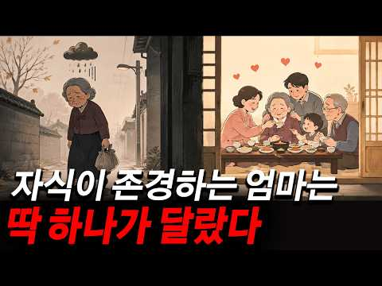
- 설명 앞부분: 중년 이후의 삶 속에서 점점 ‘엄마’라는 역할만 남아 버린 한 여성의 이야기를 통해, 가족 안에서 사라져 가는 자신의 마음을 다시 바라보게 되는 시간을 담았습니다. 충남 천안에 사는 김순자 여사는 가족을 위해 35년을 살아왔지만, 어느 순간 스스로가 투명한 사람이 된 듯한 외로움을 느끼게 됩니다. 이 영상은 단순한 가족 이야기가 아니라, 많은 어머니와 시니어 세대가 공감할 수 있는 ‘모호한 상실감’과 자기 회복의 과정을 조용히 풀어냅니다. 자식에게 흔들리는 엄마와 존경받는 엄마의 차이, 자기 자신을 위한 작은 선택의 중요성, 그리…
- 같은 채널 평소 대비 ×247.2 (채널 최근 롱폼 중앙값 122회) · 평소 영상: 내 불행을 은근히 바라는 가까운 사람들… 반드시 알아야 할 소름 돋는 신호 7가지 (123회) / 평생 참은 화는 사라진 게 아닙니다… 가슴 속에 쌓여 화병이 된 어르신을 살린 종이 한 … (120회)
- 대본 없음 (설명) — 음성인식이 끝나면 도입부·흐름이 들어감
- 댓글 15/15: 좋은 점 — 영상 0 · 감사·응원 1 · 더 알고 싶은 것 0 · 아쉬운 점 — 영상 0 · 반박·불만 — 의견 다름 0 · 정치·사회 0 · 경험 공유 0 · 구독·다음 기대 0
  - 감사·응원 👍6 “감사합니다.”

### 74. 결혼한 자식이 집에 왔을 때 부모가 절대 하면 안 되는 행동 3가지

- https://www.youtube.com/watch?v=N-NEDjLBA34 · 송선생의심리 · 구독자 5,720 · 조회수 483,168 (×84.5, 하루 4,783.4) · 좋아요 3,486 (0.7%) · 12.2분 · 2026-08-02 · 주제 묶음 8. 연애·부부 심리 · 형식 정보·해설 (그 밖) · 폴더 `W_N-NEDjLBA34` (웹 승인)
- 썸네일: 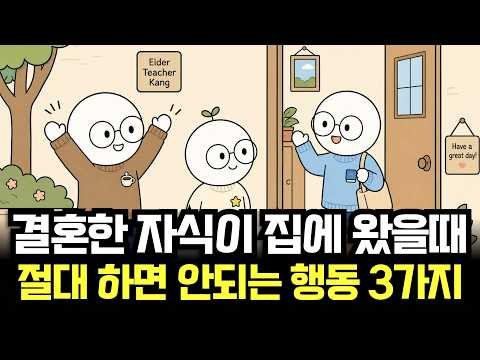
- 같은 채널 평소 대비 ×300.9 (채널 최근 롱폼 중앙값 1,606회) · 평소 영상: 가족 단톡방에서 부모가 절대 하면 안 되는 말 3가지 (1,658회) / 부모님 돌아가시고 형제가 남처럼 되는집 (1,554회)
- 대본 없음 (없음) — 음성인식이 끝나면 도입부·흐름이 들어감
- 댓글 223/223: 좋은 점 — 영상 9 · 감사·응원 8 · 더 알고 싶은 것 0 · 아쉬운 점 — 영상 1 · 반박·불만 — 의견 다름 7 · 정치·사회 0 · 경험 공유 18 · 구독·다음 기대 1
  - 좋은 점 — 영상 👍13 “부모노릇 참 힘드네 그러면서도 지들 필요할때나 힘들땐 그런 적절한 거리를 유지안하지. 자식들도 그럼 부모 도움 필요할때 돈필요할때 애봐달라할때 재산물려 받을때도 그렇게 격식따지고 할말안할말 다 딱딱구분해서 선넘지 말아야지. 부모가 먼저 물어보기전엔 말 꺼내지말고.. …”
  - 좋은 점 — 영상 👍0 “어이구 부모자시간에 무슨 눈치보듯사냐! 좋은말도 싫은말도 오갈수있는게 가족인데 무슨듣기좋고 눈치보며 살게하냐?”
  - 감사·응원 👍5 “왔구나 얼굴보니좋다 오늘와줘서고맙다 담에맘편할때 또와~”
  - 감사·응원 👍2 “이래서 평생 공부해야 하는 이유! 정말 감사합니다! 아들이 28살이라 가슴에 깊이 새겨넣고 실천하며 살겠습니다!”
  - 반박·불만 — 의견 다름 👍6 “아닌데요 오면 반갑고 가면 더 반갑고~”
  - 반박·불만 — 의견 다름 👍1 “두번째는 진짜 아닌데 선을 그어 주세요 제발”
  - 경험 공유 👍76 “에휴 저희는 시댁에 가면 밥상차리고, 시댁집청소까지 다했는데 요즘은 며느리가 손님 이네요.”
  - 경험 공유 👍43 “나는 딸. 친정부모님 여동생 집에서 사시는데 아프심. 바리바리 음식만들어 맞벌이 여동생집 부모님 찾아뵈었는데 어느날 보니 내가 동생네 주방에서 일만하고 내자식도 거기서 날 돕고 있더라. 내가 내여동생과 부모를 위해 동생남편까지 극진히 대접했더니 나뿐아니라 내자식 내남…”
  - 구독·다음 기대 👍1 “아주 틀린말은 아니지만, 부모에게 기대할게 있는 자식이라면 저런 대가리 굵어진 헛소리 절대 못함.”

### 75. 여자가 놓치기 싫어하는 남자의 치명적인 매력 4가지｜연애심리로 알아보는 중년 남자의 진짜 인기 비결

- https://www.youtube.com/watch?v=nCkkjoNGsk4 · 사랑의 비밀노트 · 구독자 1,070 · 조회수 42,286 (×39.5, 하루 882.0) · 좋아요 218 (0.5%) · 26.4분 · 2026-09-24 · 주제 묶음 1. 심리학 일반 · 형식 사연·고민 상담 (썰·라디오) · 폴더 `W_nCkkjoNGsk4` (웹 승인)
- 썸네일: 
- 챕터: 0:00 분명한 호감보다 알듯 말듯한 남자에게 더 끌리는 이유 · 1:39 밀고 당기기의 함정과 우리 세대 남자들의 고민 · 4:22 첫 번째: 관심은 한 번 분명히, 그다음엔 한 발 물… · 8:58 두 번째: 무조건 맞장구 대신 진짜 반응하기 + 침묵… · 14:11 세 번째: 나만의 세계를 채우고 상대를 초대하기 · 17:34 네 번째: 상대를 진짜로 들여다보는 질문의 힘 · 20:41 연구 함정 풀이 + 네 가지가 독이 되는 경우 · 23:52 오늘부터 바로 실천할 세 가지 · 24:41 핵심 정리
- 설명 앞부분: 여자가 놓치기 싫어하는 남자의 치명적인 매력 4가지｜연애심리로 알아보는 중년 남자의 진짜 인기 비결 💘 나이가 들어도 사랑받는 남자는 특별한 조건이 있습니다. 돈이나 외모보다 중요한 것은 상대의 마음을 이해하는 방법입니다. 이 영상에서는 여성의 마음이 움직이는 이유를 연애심리 관점에서 살펴보고, 중년 남성이 더욱 매력적으로 보이는 4가지 특징을 알아봅니다. ✨ 관심을 표현하는 방법 ✨ 부담을 주지 않는 거리 조절 ✨ 나만의 삶을 가진 남자의 매력 ✨ 상대를 진심으로 바라보는 대화법 많은 사람들이 오해하는 밀고 당기기의 진짜 의미와…
- 같은 채널 평소 대비 ×75.7 (채널 최근 롱폼 중앙값 558회) · 평소 영상: 여자가 나에게 확실히 마음을 열었을 때 보내는 7가지 신호｜친절과 호감을 구별하는 연애심리 (574회) / 마음이 떠난 남자는 헤어질 때 이것을 절대 하지 않습니다｜연애심리가 알려주는 마지막 신호 (543회)
- 대본 없음 (설명) — 음성인식이 끝나면 도입부·흐름이 들어감
- 댓글 10/10: 좋은 점 — 영상 0 · 감사·응원 0 · 더 알고 싶은 것 0 · 아쉬운 점 — 영상 0 · 반박·불만 — 의견 다름 0 · 정치·사회 0 · 경험 공유 0 · 구독·다음 기대 0

### 76. 남자가 스스로 더 잘하게 되는 여자의 특징 (연애심리)

- https://www.youtube.com/watch?v=zxP7GUqMmpY · 심리해킹 · 구독자 1,280 · 조회수 176,674 (×138.0, 하루 991.8) · 좋아요 1,251 (0.7%) · 10.2분 · 2026-05-17 · 주제 묶음 1. 심리학 일반 · 형식 정보·해설 (그 밖) · 폴더 `W_zxP7GUqMmpY` (웹 승인)
- 썸네일: 
- 설명 앞부분: 남자는 왜 어떤 여자에게 오래 머물고 싶어지고, 왜 어떤 관계에서는 점점 멀어지는지에 대한 심리 구조를 풀어낸 영상입니다. 단순히 “잘해주면 사랑받는다”는 방식이 아니라, 남자의 뇌가 관계 안에서 어떤 순간에 안정감과 특별함을 느끼는지를 심리학적으로 설명합니다. 영상에서는 남자가 사랑받는다고 느끼는 핵심 요소로 존중, 인정, 신뢰, 안정감, 그리고 자기 삶을 가진 여자의 매력을 다룹니다. 특히 남자의 약한 모습을 받아주는 태도, 통제보다 신뢰를 주는 관계, 그리고 남자 중심이 아닌 자신의 삶을 유지하는 여자가 왜 더 오래 사랑받는…
- 같은 채널 평소 대비 ×461.3 (채널 최근 롱폼 중앙값 383회) · 평소 영상: 연애가 변하는 진짜 이유 (사랑이 식은 게 아닙니다) (395회) / 사람 심리를 이해하면 인간관계가 쉬워집니다 (소듬돋는 심리학) (332회)
- 대본 없음 (설명) — 음성인식이 끝나면 도입부·흐름이 들어감
- 댓글 35/35: 좋은 점 — 영상 2 · 감사·응원 0 · 더 알고 싶은 것 0 · 아쉬운 점 — 영상 0 · 반박·불만 — 의견 다름 0 · 정치·사회 0 · 경험 공유 5 · 구독·다음 기대 0
  - 좋은 점 — 영상 👍13 “내용이 참 좋고~ 귀에 쏙쏙 들리는 목소리톤도 너무 좋아서 끝까지 경청하게 됩니다 구독 좋아요^^”
  - 좋은 점 — 영상 👍0 “대박입니다 꽉채운연애5년 현 결혼전제로 동거시작한 사실상 거의 사실혼이라해도 무방한.. 근데 1년째 정말 아무것도아닌걸로 미친듯이싸우고 말안하고 이거보면서 내얘기하는거같아서 ㅎㅎ 참기가차네요 ㅎㅎ 키는 나군요 ㅎㅎ 참나 ㅎㅎ 남자라는 동물은 참 ㅎ 도움많이됐습니다 노…”
  - 경험 공유 👍32 “남자가 여자에게 안정감을 안주니 내가 남자에게 안끌립니다”
  - 경험 공유 👍3 “우리남편이그래습니다”

### 77. 여자가 마음을 완전히 열었을 때 보이는 5가지 신호 ∣ 중년연애 ∣ 연애심리 ∣ 여자심리 ∣ 건강채널

- https://www.youtube.com/watch?v=QF-rrNHfc_4 · 남녀건강심리연구소 · 구독자 604 · 조회수 23,728 (×39.3, 하루 465.8) · 좋아요 215 (0.9%) · 21.7분 · 2026-09-21 · 주제 묶음 8. 연애·부부 심리 · 형식 정보·해설 (그 밖) · 폴더 `W_QF-rrNHfc_4` (웹 승인)
- 썸네일: 
- 챕터: 0:00 45cm로 알아보는 여자의 마음과 친밀감의 기준 · 2:03 친밀 영역에 들어오는 행동이 의미하는 것 · 3:20 첫 번째 신호, 스스로 거리를 좁히는 행동 · 5:26 두 번째 신호, 사적인 공간을 공유하는 행동 · 7:53 세 번째 신호, 상대의 단점까지 자연스럽게 받아들이는… · 10:38 네 번째 신호, 헤어짐을 미루고 함께 있고 싶어 하는… · 13:23 다섯 번째 신호, 신체 접촉을 자연스럽게 받아들이는 … · 15:34 관심이 없을 때 나타나는 반대 신호와 무너진 신뢰를 …
- 설명 앞부분: 여자가 마음을 완전히 열었을 때 보이는 5가지 신호 ∣ 중년연애 ∣ 연애심리 ∣ 여자심리 ∣ 건강채널 여자의 마음을 말보다 행동으로 이해하는 방법을 알아봅니다. 이번 영상에서는 45cm라는 친밀 영역을 중심으로 여자가 마음을 열었을 때 나타날 수 있는 다섯 가지 행동 신호를 살펴봅니다. 스스로 거리를 좁히는 행동부터 사적인 공간을 공유하는 모습, 상대의 단점을 받아들이는 태도, 헤어짐을 미루는 행동, 자연스러운 신체 접촉까지 핵심 내용을 정리했습니다. 또한 휴대폰을 자주 확인하거나 대화를 피상적으로 유지하는 등 관심이 낮을 때 나…
- 같은 채널 평소 대비 ×4.1 (채널 최근 롱폼 중앙값 5,857회) · 평소 영상: 50대 여성의 호감신호 9가지, 말보다 행동이 먼저입니다 ∣ 건강채널 (5,857회) / 여자가 사랑에 빠지는 속도가 다른 이유 ∣ 건강채널 (6,061회)
- 대본 없음 (설명) — 음성인식이 끝나면 도입부·흐름이 들어감
- 댓글 4/4: 좋은 점 — 영상 0 · 감사·응원 0 · 더 알고 싶은 것 0 · 아쉬운 점 — 영상 0 · 반박·불만 — 의견 다름 0 · 정치·사회 0 · 경험 공유 0 · 구독·다음 기대 0

### 78. 남자가 알아야 할 여자의 본능 ∣ 진화심리학과 여성의 무의식

- https://www.youtube.com/watch?v=vTbAMIR5gFw · 더나은남자 · 구독자 7,180 · 조회수 336,567 (×46.9, 하루 5,441.5) · 좋아요 2,529 (0.8%) · 10.1분 · 2026-09-10 · 주제 묶음 1. 심리학 일반 · 형식 정보·해설 (그 밖) · 폴더 `W_vTbAMIR5gFw` (웹 승인)
- 썸네일: 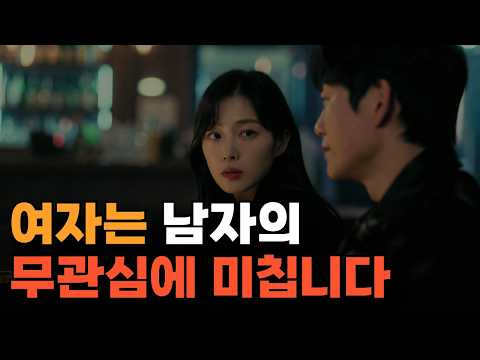
- 챕터: 0:00 여자의 사랑이 남자와 다른 이유 · 0:34 여자는 남자를 '더 많이' 원한다 · 1:10 남자는 사랑이 일부, 여자는 전부 · 1:49 먼저 공을 넘겨라 · 2:46 먼저 건네되, 다 퍼주진 마라 · 3:25 다 퍼주면 매력이 사라지는 이유 · 4:13 너무 쉽게 다 얻으면 값이 떨어진다 · 4:38 인류에 새겨진 본능 · 4:52 원시시대 여자가 원한 강한 남자 · 5:22 적당히 막아설 때 여자는 안심한다 · 6:10 여자가 떠보는 것 · 7:10 한번 실망시켜 보라 · 7:37 5년이 아니라 5주 만에 아는 법 · 8:31 거절당하면 끌림이 오히려 커진다 · 9:01 연애에도 적당한 양념이 필요하다 · 9:19 여자가 살짝 더 좋아하는 균형 · 9:46 세 가지 원칙
- 설명 앞부분: 남자의 무관심이 여성에게 매력적으로 느껴지는 진짜 이유를 아시나요? 왜 여성이 남자의 매달림보다 한 발 물러설 때 더 강한 관심을 보이는지 본능적인 심리 메커니즘을 분석합니다. 연애 관계에서 남자의 무관심이 상대방의 심리에 어떤 영향을 미치는지 구체적으로 다룹니다. 단순히 상대를 방치하는 것이 아니라, 수십만 년간 여성 DNA에 새겨진 본능을 이해함으로써 건강한 관계를 맺는 방법을 설명합니다. 많은 남성이 오해하는 부분인 무관심과 무시의 명확한 차이를 구분하는 법을 배우게 됩니다. 이 영상은 자신의 연애 방식을 되돌아보고 더 매력…
- 같은 채널 평소 대비 ×32.1 (채널 최근 롱폼 중앙값 10,491회) · 평소 영상: 1달이면 충분합니다. 이 간단한 방법으로 이상형 여자 만났습니다 (10,491회) / 이렇게만 하면 연애 무조건 합니다. 너무 똑똑하려고 하지 마세요 (9,853회)
- 대본 없음 (설명) — 음성인식이 끝나면 도입부·흐름이 들어감
- 댓글 223/223: 좋은 점 — 영상 4 · 감사·응원 5 · 더 알고 싶은 것 1 · 아쉬운 점 — 영상 1 · 반박·불만 — 의견 다름 7 · 정치·사회 2 · 경험 공유 26 · 구독·다음 기대 1
  - 좋은 점 — 영상 👍12 “이 영상의 내용은 이론적으로 얘기하자면 과거부터 통용되어오는 고양이노끈이지 프레임의 중요성이기도하고 좋은 내용인데 실전을 질리도록뛰어야 관심줄때 분위기차갑게만들때 언제인지 감이 옴”
  - 좋은 점 — 영상 👍0 “이런거 따라하면B급입 고로 C급들은 따라해야한다 차은우(존나인기많은애)가 이런거 생각할까? 차은우가 이걸 알고 따라해서인기가 많을까? 앞뒤가 다른거다 이런거 고민하고 있다면 그냥 멋있어지는걸 고민하는게 낫다 다만 무서울정도로 끔찍한 행동패턴과 실력 (사실 연애실력이란…”
  - 감사·응원 👍1 “처음부터 끝까지 지혜로운 알짜베기 나누어 주셔서 감사합니다.”
  - 감사·응원 👍1 “여자한테 무관심햇다가 세상에 무관심받고 있습니니다 감사합니다”
  - 반박·불만 — 의견 다름 👍0 “아닌데 난 여친이랑 반대인데..”
  - 반박·불만 — 의견 다름 👍0 “남자는 여자 나이랑 외모 성격 본다 뭐 능력도 보겠지만 진짜 그리고 남자는 본능적으로 어린여자 좋아한다고 하드라 아무리 여자가 활발하고 꽥꽥해도(?) 스킨쉽 등 애정행위할때 남자가 리드하게 된다고 하드라 나두 듣고 놀람 뭐 일반화는 아닌데 대체로 이런듯”
  - 정치·사회 👍0 “4:10 이미 이런모습 다보여주고 쉬운모습 보여버린 상황에선 어떻게 해야할까요? 막 주도권 다쥐겠다 이게아니라 조금이라도 여기서 개선시키기 위해서요 저는 20대후반 상대는 7살연상 외국인 이에요”
  - 경험 공유 👍24 “저는 이렇게 제 삶 유지하면서 잘 하고 있었는데 여자친구가 자꾸 데려다주라는 등 바라는 게 너무 많으며 서운해하는데 어느정도까지 맞춰야할지 모르겠네요.. 저도 제 삶이 중요한데”
  - 경험 공유 👍17 “ㅋㅋ전제는 내가 좋아하는 그 여자가 나한테 관심이있어야함”
  - 구독·다음 기대 👍1 “구독누르고갑니다”

### 79. 통찰력이 뛰어난 사람이 유독 외로운 5가지 심리적 이유

- https://www.youtube.com/watch?v=StM4IstW8R0 · 심리세포 · 구독자 13,400 · 조회수 740,226 (×55.2, 하루 9,873.9) · 좋아요 4,290 (0.6%) · 5.3분 · 2026-08-28 · 주제 묶음 1. 심리학 일반 · 형식 정보·해설 (그 밖) · 폴더 `W_StM4IstW8R0` (웹 승인)
- 썸네일: 
- 챕터: 0:00 인트로 – 통찰력과 외로움, 무슨 관계가 있을까? · 0:33 첫 번째 이유 – 지식의 저주 · 1:25 두 번째 이유 – 공감 정확성과 관계 만족도 · 2:15 세 번째 이유 – 감각처리민감성 이론 · 3:08 네 번째 이유 – 지능과 사교 빈도의 역설 · 3:53 다섯 번째 이유 – 경험에 대한 개방성 · 4:46 클로징 – 외로움은 부족함이 아니라 깊이의 증거입니다
- 설명 앞부분: 남들보다 먼저 보고, 먼저 느끼는데… 왜 이렇게 외로울까요? 통찰력이 좋다는 건 축복 같지만, 사실 그 이면엔 아무도 알려주지 않은 심리학적 이유가 숨어 있습니다. 이 영상에서는 통찰력이 뛰어난 사람들이 유난히 외로움을 느끼는 5가지 심리적·뇌과학적 이유를 알아봅니다.. ⏱ 타임라인 Camerer, C., Loewenstein, G., & Weber, M. (1989). The Curse of Knowledge in Economic Settings: An Experimental Analysis. Journal of Politica…
- 같은 채널 평소 대비 ×80.9 (채널 최근 롱폼 중앙값 9,152회) · 평소 영상: 사랑받은 티가 나는 사람들의 5가지 특징 (9,897회) / 감정 소모 없이 우아하게 인연을 정리하는 사람들의 심리 (8,407회)
- 대본 없음 (설명) — 음성인식이 끝나면 도입부·흐름이 들어감
- 댓글 1,121/1,121: 좋은 점 — 영상 27 · 감사·응원 25 · 더 알고 싶은 것 9 · 아쉬운 점 — 영상 18 · 반박·불만 — 의견 다름 35 · 정치·사회 18 · 경험 공유 167 · 구독·다음 기대 0
  - 좋은 점 — 영상 👍36 “너무나 피로합니다ㅠㅠ 장점보다 단점이 너무 큼... 이게 밥 벌어먹고 사는데 그닥 도움되는 것도 아니고 쓸데없이 인간관계가 피곤하게만 느껴짐.”
  - 좋은 점 — 영상 👍2 “쇼펜하우어가 죽기 직전까지 100번 강조한 인간관계 레전드 명언, 1. 좋은 사람 하나가 인생을 바꾸고, 나쁜 사람 하나가 인생을 송두리째 망가트린다. 2. 주변에 사람이 많아질수록 행복할 거라고 생각하지만 사람이 많아진 만큼 문제도 많아진다. 3. 인간은 대부분 타…”
  - 감사·응원 👍3 “영상 감사합니다. 저는 그냥 외로운 건데, 통찰력이 뛰어나서 그렇다고 하기로 했습니다.”
  - 감사·응원 👍1 “확실히 내 핸드폰은 나의 개인 대화나 검색을 다 파악하고 있구나… 무섭기도 한데 오늘은 정말 감사하다.. 남들은 지식/경제력 등 유니크함의 측면에서 1프로니 3프로니 10프로니 하는 거 동경하지만 그것은 사실 저주가 아닐까 이젠 남이 안 받아줘도 난 내 할 일 열심히…”
  - 더 알고 싶은 것 👍16 “깊은 대화가 통하는 사람. 저도 찾고있는데 정말 잘 없어요.. 저만 느끼는게 아니였군요 외로워서 사람만나러 모임에 나가도 정말 가벼운게 느껴졌습니다. 나도 아무생각없이 웃고싶다는 생각을 많이 했던거같아요. 언젠가는 찾을수있을까요? 삶을 바라보는 눈이 비슷한 사람을 찾…”
  - 더 알고 싶은 것 👍1 “타고난 통찰력 가진 사람의 한계가 정말 많아요. 후천적으로 몇가지 방법으로도 통찰력을 가지게 될 수 있는데 그럴 경우는 선천적 통찰력을 가진 사람들이 가진 단점을 단점을 많이 극복하기도 하지요. 선천적인 사람은 통찰력이나 지능을 자기 자신에게는 사용하지 못한다는 아이…”
  - 아쉬운 점 — 영상 👍31 “영상을 다 듣고 나니 오히려 ‘통찰력 있는 사람이 왜 외로운가’를 설명한다기보다, 예민함·과도한 생각·소통의 어려움·혼자 있는 걸 선호하는 성향을 전부 ‘통찰력이 뛰어나서 그렇다’는 방향으로 묶어주는 느낌​이 강함. 첫 번째로 지식의 저주는 ‘내가 이미 알고 있는 정…”
  - 아쉬운 점 — 영상 👍2 “글쓰는거보면 높게쳐줘야 통찰력도 뛰어난게아니라 통찰력만 뛰어난 낙오자들인거같은데 인간관계에서 핵심만보는게 진짜 능력부족인건데 댓글쓰는 심리도 뻔히보이는데 댓글쓰는사람들은 얼마나 못난거야 걍 지들의 못난부분이 다른사람도 똑같다고 심리기전도 똑같다고보는걸까?? 책한권읽은…”
  - 반박·불만 — 의견 다름 👍27 “이 영상을 보고 공감하는 당신, 착각에서 빠져나오세요. 당신은 그런 사람이 아닙니다.”
  - 반박·불만 — 의견 다름 👍13 “통찰이 있다는 것은 정보와 정보 사이의 연관성을 인식하고 각각의 분리된 요소보다 전체의 시스템을 이해하는 그 감각 자체를 의미하기도 합니다. 이 영상에 달리는 뭇 댓글들의 주장처럼 단지 남들과 관점이나 관심사가 조금 다른 경우를 얘기하는 것이 아니죠. 나와 다른 상대…”
  - 정치·사회 👍1 “우파들의 뇌와 좌파들의 뇌 여기서 말하는 우파는 진짜 우파임”
  - 정치·사회 👍1 “광활한 우주 바닷가 모래알 보다도 작은 지구라는 행성에서 사악하고 악마 같은 인간들이 존재를 하지, 지구의 모든 인간들은 다 강력한 범죄자들이며, 지구란 행성은 인간들의 감옥이다. 또한, 빈껍데기에 불과한 육체는 제2의 감옥이니라, 그래서 삶이 고되고 힘듦이 다 여기…”
  - 경험 공유 👍39 “여기 댓글 다는 사람들 또한 누군가에게 읽혀가며 살겠지 그런데도 이 영상에 바넘효과를 느끼며 마치 내 얘기인양 이입할테고 과연 정말 통찰력을 가지고 괴로워하는 사람이 몇이나 있을까? 일단 나도 외로움을 갖고 살아가지만 절대 통찰력이 뛰어나서는 아닌거같다 정도에 따라 …”
  - 경험 공유 👍36 “그래서 나도 일부러 흐린눈 하게 되고, 말하려다 말게 되는 순간이 많아짐. 피곤해질까봐.”

### 80. 중년 여성이 보내는 호감 신호 9가지｜건강채널 ∣ 중년사랑 ∣ 인생지혜

- https://www.youtube.com/watch?v=yuE3QPpOL1U · 남녀건강심리연구소 · 구독자 604 · 조회수 26,406 (×43.7, 하루 433.0) · 좋아요 409 (1.6%) · 27.6분 · 2026-09-11 · 주제 묶음 7. 말투·호감 · 형식 수면·낭독·오디오북 (잠잘 때·명언) · 폴더 `W_yuE3QPpOL1U` (웹 승인)
- 썸네일: 
- 챕터: 0:00 중년 연애에서 놓치기 쉬운 호감 신호 · 1:35 물리적 거리를 허용하는 행동 · 4:34 그루밍과 자연스러운 스킨십 · 7:32 오래 머무는 시선과 눈맞춤 · 10:23 무의식적인 미러링 행동 · 12:37 손과 체온을 언급하는 신호 · 15:21 호감이 있을 때 달라지는 목소리 · 17:33 술자리, 침묵, 스마트폰으로 확인하는 마지막 호감 신호
- 설명 앞부분: 중년 여성이 보내는 호감 신호 9가지｜건강채널 ∣ 중년사랑 ∣ 인생지혜 중년의 사랑은 말보다 작은 행동과 눈빛에 마음이 먼저 드러납니다. 건강채널에서 소개하는 9가지 호감 신호를 통해 상대가 보내는 미묘한 마음을 알아보세요. 가까운 거리를 편안하게 받아들이는 행동부터 자연스러운 스킨십, 오래 머무는 눈맞춤, 무의식적인 미러링까지 건강채널에서 자세히 살펴봅니다. 손과 체온에 대한 언급, 달라지는 목소리도 중요한 신호가 될 수 있습니다. 술자리에서 편안한 모습을 보여주는 행동과 둘만의 침묵, 스마트폰을 내려놓는 순간까지 건강채널에서 …
- 같은 채널 평소 대비 ×4.5 (채널 최근 롱폼 중앙값 5,857회) · 평소 영상: 50대 여성의 호감신호 9가지, 말보다 행동이 먼저입니다 ∣ 건강채널 (5,857회) / 여자가 사랑에 빠지는 속도가 다른 이유 ∣ 건강채널 (6,061회)
- 대본 없음 (설명) — 음성인식이 끝나면 도입부·흐름이 들어감
- 댓글 6/6: 좋은 점 — 영상 1 · 감사·응원 2 · 더 알고 싶은 것 0 · 아쉬운 점 — 영상 0 · 반박·불만 — 의견 다름 0 · 정치·사회 0 · 경험 공유 0 · 구독·다음 기대 0
  - 좋은 점 — 영상 👍2 “좋은정보 감사합니다”
  - 감사·응원 👍2 “좋은정보 감사합니다”
  - 감사·응원 👍1 “영상물감사합니다”

