# 심리 — 성공 사례 분석: 사례별 자세히 #81–#120

`analysis.md` 의 9번 (같은 # 번호). 자동 생성 — `tools/success_analysis.py` v1.6 (2026-11-11 13:47 UTC). ※ 연구·교육용 — 투자 권유가 아님.

### 81. 남자가 당신을 잃을까봐 두려워하게 만드는 방법 (심리학 연구)

- https://www.youtube.com/watch?v=M-T3i9HqKig · 숨겨진심리학 · 구독자 37,500 · 조회수 762,218 (×20.3, 하루 12,748.3) · 좋아요 4,725 (0.6%) · 13.4분 · 2026-09-12 · 주제 묶음 1. 심리학 일반 · 형식 정보·해설 (그 밖) · 폴더 `W_M-T3i9HqKig` (웹 승인)
- 썸네일: 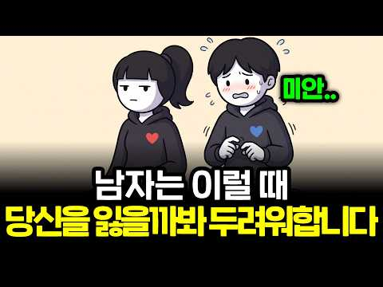
- 챕터: 0:00 더 잘해주기보다 필요한 관계의 균형 · 2:05 내 삶의 세계 계속 돌리기 · 3:15 챙김이 당연한 의무가 되지 않게 하기 · 4:14 거절할 수 있는 경계 세우기 · 5:51 다른 사람이 아닌 다른 삶 보여주기 · 6:55 확신을 구걸하기보다 나의 기한 갖기 · 8:13 독립적인 미래 계획 말하기 · 9:20 작은 부탁과 상호적인 투자 · 12:15 상대의 반응과 선택 존중하기
- 설명 앞부분: 남자가 당신을 잃을까봐 두려워하는 순간은 더 잘해줄 때 오지 않습니다. 정반대입니다. 남자의 사랑을 확정시키는 '잃을 수 있다는 자각'을 조종 없이 만드는 일곱 가지 방법과, 대부분의 여자가 하는 정반대 행동을 알려드립니다. 이 영상은 카너먼의 손실 회피 연구, 헬렌 피셔의 뇌 영상 연구, 쾌락 적응 연구, 몰로이의 11년 결혼 조사, 러스벌트의 투자 모델, 프랭클린 효과, 스탠리의 헌신 연구를 참고해 제작했습니다. 타임스탬프 관계의 표현 방식에는 개인차가 있습니다. 한 가지 신호로 마음을 단정하기보다 맥락과 반복되는 행동을 함께…
- 대본 없음 (설명) — 음성인식이 끝나면 도입부·흐름이 들어감
- 댓글 190/189: 좋은 점 — 영상 8 · 감사·응원 1 · 더 알고 싶은 것 1 · 아쉬운 점 — 영상 3 · 반박·불만 — 의견 다름 3 · 정치·사회 0 · 경험 공유 26 · 구독·다음 기대 0
  - 좋은 점 — 영상 👍12 “그냥 혼자 있는거 잘하고 본인 일 열심히하라는 말입니다 구구절절 얘기가 길어서 그런거지 남자한테 목메고 남자 생기면 남자가 본인 삶의 1순위 인것처럼 시녀노릇 하지 말란겁니다 ㅠ 맘껏 사랑하세요 계산 하지도 마시구요 근데 그만큼 본인 자신도 사랑하란 소리”
  - 좋은 점 — 영상 👍5 “깨닫고 갑니다 저한텐 도움됐어요”
  - 감사·응원 👍120 “다른건 다 둘째치고 진심 부탁하는거랑 돈 쓰게하는거는 진짜 찐인듯.. 전남친은 제가 진심으로 더 챙겨주고 엄마같이 더 챙겨주면 오히려 나를 못 놓겠지? 했는데 ㅋㅋㅋ 물론 저거때문은 아니지만 결국 잠수이별엔딩이고 지금 현남친도 언젠간 헤어질 수 있겠죠 당연히 근데 지…”
  - 더 알고 싶은 것 👍0 “이걸 구지 노력하지 않아도 원래 내 자신이 독립적인 성향이라서....왜 내 남자가 초조해보이지 이게 궁금해서 영상을 봤는데 나도 모르게 하고 있어서 미안했다”
  - 아쉬운 점 — 영상 👍16 “사랑하는데..남자가 너무 잘해주니까 살짝 나는 여유가 있는거지...항상 먼저 연락 오다보니 내가 먼저 연락할일이 없음..그러다 진짜 급해서 연락하니 엄청 좋아함...하여튼 항상 타이밍이 남자가 빠름...이러다보니 무심하지 않은데 무심한듯 하고 이런게 반복되다보니 그냥…”
  - 아쉬운 점 — 영상 👍12 “그냥 혼자 있는거 잘하고 본인 일 열심히하라는 말입니다 구구절절 얘기가 길어서 그런거지 남자한테 목메고 남자 생기면 남자가 본인 삶의 1순위 인것처럼 시녀노릇 하지 말란겁니다 ㅠ 맘껏 사랑하세요 계산 하지도 마시구요 근데 그만큼 본인 자신도 사랑하란 소리”
  - 반박·불만 — 의견 다름 👍6 “아니 저걸 모르는게 아닌데 진짜 너무 사랑하면 저게 안됨.. 사람 성향 차이가 매우매우 큰거같긴함”
  - 반박·불만 — 의견 다름 👍0 “일부러 그런건 아닌데 자영업 하면서 장사공부하고 모임하고 집에 들어가면 가족들하고 수다 떠느라 연락 잘 못하고 가끔 친구도 만나고 그렇게 사니까 남친이 되게 불안해했음 그때는 왜 그렇게 불안해 하는지 이해가 안갔는데 이거 보니까 알겠네요 부작용으로”
  - 경험 공유 👍745 “이런거 의미 없는거 같아요 여기잇는걸 모두 다 하는데도 헤어지자는 남자가 잇고 여기서 말하는거처럼 안떠나는 남자가 있어요 그냥 날 얼마나 진심으로 생각하는지 남자에 따라서 다 틀린거 같아요 그리고 항상 헤어진 후에 연락오죠. 그냥 내가 뭘 해도 날 떠나질 않을 남자 …”
  - 경험 공유 👍696 “모르고있었는데 다 하고있었네요 제가 독립적인 성향이고 칼같은 성격이라 의도치않게 긴장감을 줬나봐요 매번 제가 어떤걸 할지 말하고 있고 제 삶이 더중요해서 남자친구만나는것보다 제 시간을 챙기려고 했고 남자친구가 약속취소하거나 자기멋대로 보러온다하면 거절했어요 제 시간을…”

### 82. 단절의 시대, 외로움에 휘둘리지 않는 법

- https://www.youtube.com/watch?v=hnuDs_pSI7M · 도래기책방 · 구독자 11,100 · 조회수 89,868 (×8.1, 하루 3,755.0) · 좋아요 1,244 (1.4%) · 15.4분 · 2026-10-18 · 주제 묶음 기타 · 형식 정보·해설 (그 밖) · 폴더 `W_hnuDs_pSI7M` (웹 승인)
- 썸네일: 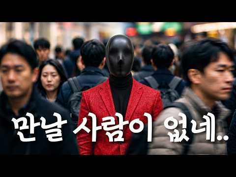
- 챕터: 0:00 만날 사람이 없네.. · 1:16 Part 1. 우리는 왜 외로움을 느끼는가? · 3:40 Part 2. 나 자신과 진짜 관계를 맺는 법 · 7:30 Part 3. 먼저 마주할 용기 · 10:59 Part 4. 내 삶에서 외로움을 완전히 지워버린 방법
- 설명 앞부분: 주말 저녁, 스마트폰을 켜면 다들 활기차게 살아가는 것 같은데 왜 나만 덩그러니 혼자인 것 같을까요? 카톡 친구 목록은 수백 명이 넘는데, 막상 마음을 툭 터놓고 '뭐해? 한잔하자'고 부를 사람은 단 한 명도 없는 씁쓸함. 어쩌면 우리는 수많은 연결 속에 살아가면서도, 가장 지독한 고립을 겪고 있는지 모릅니다. 수년 동안 만성적인 외로움과 피해의식에 시달렸던 제가, 어떻게 남의 시선에서 벗어나 내 삶의 주도권을 되찾고 이 공허함을 완전히 끊어낼 수 있었는지 그 경험담을 털어놓습니다. 외로움이라는 감정이 우리에게 보내는 진짜 경고 …
- 대본 없음 (설명) — 음성인식이 끝나면 도입부·흐름이 들어감
- 댓글 182/182: 좋은 점 — 영상 18 · 감사·응원 27 · 더 알고 싶은 것 4 · 아쉬운 점 — 영상 3 · 반박·불만 — 의견 다름 2 · 정치·사회 1 · 경험 공유 26 · 구독·다음 기대 1
  - 좋은 점 — 영상 👍67 “저는 10대임에도 외로움에 시달리며 고등학교 생활을 하고있습니다. 정말 살면서 본 영상, 살면서 들은 말 중에서도 최고였던 것 같습니다. 항상 남에 대해서만 고민하고 남의 입장만을 고려하고 나의 근처사람이 어떤사람인지만을 알기위해 노력했습니다. 그리고 그 과정에서 ‘…”
  - 좋은 점 — 영상 👍12 “안 그래도 요즘 인간관계 자체에 회의감과 공허함 외로움을 느꼈었는데요.. 항상 남의 시선에 맞춰서만 살아왔더라고요. 그래서 그런지 나 자신이 남지도 않은 것 같고 뭐가 내 모습인지도 내가 뭘 할 때 행복하고 즐거운지도 잘 모르겠었는데.. 이 영상 보고 덕분에 많은 위…”
  - 감사·응원 👍67 “저는 10대임에도 외로움에 시달리며 고등학교 생활을 하고있습니다. 정말 살면서 본 영상, 살면서 들은 말 중에서도 최고였던 것 같습니다. 항상 남에 대해서만 고민하고 남의 입장만을 고려하고 나의 근처사람이 어떤사람인지만을 알기위해 노력했습니다. 그리고 그 과정에서 ‘…”
  - 감사·응원 👍12 “안 그래도 요즘 인간관계 자체에 회의감과 공허함 외로움을 느꼈었는데요.. 항상 남의 시선에 맞춰서만 살아왔더라고요. 그래서 그런지 나 자신이 남지도 않은 것 같고 뭐가 내 모습인지도 내가 뭘 할 때 행복하고 즐거운지도 잘 모르겠었는데.. 이 영상 보고 덕분에 많은 위…”
  - 더 알고 싶은 것 👍4 “원래 댓글 잘 안 다는 사람인데, 이번 영상을 보고 난 뒤에는 말해야겠습니다. 도래기책방님은 저의 걱정을 완벽히 해소해주셨고 더 나은 사람으로 바뀌게 해줄 열쇠를 건네주셨습니다. 저도 도래기책방님 같은 사람이 되고 싶네요. 저 뿐만 아니라 많은 사람들이 뒤에서 응원할…”
  - 더 알고 싶은 것 👍3 “안녕하세요 도래기 책방님 얼마 전부터 알고리즘에 떠 주기적으로 챙겨보고 있는 대학생입니다. 요즘 들어 자존감도 별로 없고 살아가는 것의 이유는 뭘까 등 고민을 많이 했었는데 이 채널을 보면서 도움이 많이 되었습니다. 영상의 흡입력이 너무 좋아서 하나하나 소중하게 2배…”
  - 아쉬운 점 — 영상 👍2 “좀 아이러니 하게 웃긴 이야기 이지만 저 같은 경우는 평소 모습과 친해진 뒤 모습이 180도 다릅니다. 이 영상 완전 공감하며, 저 또한 아웃사이더 끝판왕 이기에 혼자 밥먹는게 편해요. 하지만, 왜인지, 어째서, 여성들은 그런 모습에 안달하고 쫒아다닐정도로 저를 좋아…”
  - 아쉬운 점 — 영상 👍1 “평생동안 외로움이란 감정을 느낀 게 어릴 때 집에 혼자 있었을 때와 젊을 때 연인들과 헤어지고 잠시잠시 밖에는 없었던 듯ㅋㅋ 친구들도 많았고 연애도 끊임없이 해오다가 나이가 들어가면서 서서히 친구들도 자발적으로 서서히 다 끊고 연애도 끊고 혼자서 이런 저런 취미생활들…”
  - 반박·불만 — 의견 다름 👍26 “40대 이상 되면 이미 있는 인간관계도 필요없는건 끊어내고 정리해야되고 50대 이후로는 죽을때까지 혼자 또는 가족뿐이라 생각하면 됩니다. 어차피 인생은 혼자 와서 혼자 가는 겁니다 인간관계 아무 의미 없습니다. 45억년 지구 역사에서 우리네 인생은 하루살이처럼 잠시 …”
  - 반박·불만 — 의견 다름 👍1 “말도 안되는 편집기술, 스토리텔링, 목소리를 가진 분도 어려움을 겪었군요..”
  - 정치·사회 👍2 “만나고 싶은 사람들이 없음... 내주변엔... 거짓말 잘하는 사람... 돈에 너무 인색한 사람.... 자기 이야기만 하는 사람.... 배려는 1도없고 이기적인사람..... 좌파들 거짓선동에 환장하는 사람들..등등”
  - 경험 공유 👍26 “40대 이상 되면 이미 있는 인간관계도 필요없는건 끊어내고 정리해야되고 50대 이후로는 죽을때까지 혼자 또는 가족뿐이라 생각하면 됩니다. 어차피 인생은 혼자 와서 혼자 가는 겁니다 인간관계 아무 의미 없습니다. 45억년 지구 역사에서 우리네 인생은 하루살이처럼 잠시 …”
  - 경험 공유 👍12 “안 그래도 요즘 인간관계 자체에 회의감과 공허함 외로움을 느꼈었는데요.. 항상 남의 시선에 맞춰서만 살아왔더라고요. 그래서 그런지 나 자신이 남지도 않은 것 같고 뭐가 내 모습인지도 내가 뭘 할 때 행복하고 즐거운지도 잘 모르겠었는데.. 이 영상 보고 덕분에 많은 위…”
  - 구독·다음 기대 👍3 “공감하고 구독했습니다. 앞으로 출퇴근 걷는 길에 좋은 친구가 생긴 것 같아 기대됩니다.”

### 83. 자존감 높은 사람들이 무서울 정도로 잘하는 습관 4가지 ∣ 자존감 ∣ 심리학 ∣ 멘탈관리 ∣ 감정조절

- https://www.youtube.com/watch?v=B_rOPX-oLQM · 오늘도심리 · 구독자 1,710 · 조회수 92,088 (×53.9, 하루 554.7) · 좋아요 1,840 (2.0%) · 11.9분 · 2026-05-29 · 주제 묶음 1. 심리학 일반 · 형식 목록형 (N가지 특징·신호) · 폴더 `W_B_rOPX-oLQM` (웹 승인)
- 썸네일: 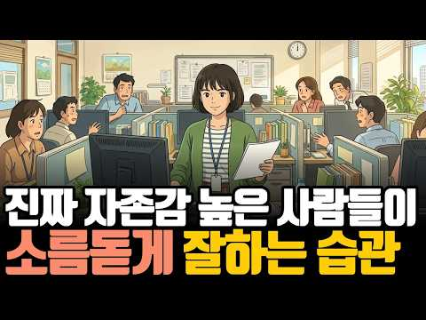
- 챕터: 0:00 자존감 높은 사람들의 충격적인 공통점 · 0:56 왜 우리는 남의 말에 쉽게 흔들릴까? · 1:34 첫 번째 습관 — 상황을 분리하는 능력 · 2:34 남의 감정에 휘둘리지 않는 사람들의 특징 · 4:46 실수해도 무너지지 않는 사람들의 심리 · 6:13 자존감 높은 사람들의 멘탈 관리법 · 7:11 행복한 사람들의 뇌 사용법 · 8:27 뇌과학으로 보는 자존감의 비밀 · 9:39 자존감을 높이는 가장 현실적인 방법 · 10:39 타인의 시선에서 벗어나는 법
- 설명 앞부분: 누군가의 말 한마디에 하루 종일 마음이 흔들린 적 있으신가요? 왜 어떤 사람은 비난에도 무너지지 않고, 어떤 사람은 작은 말에도 깊게 상처받을까요? 이번 영상에서는 심리학과 뇌과학을 통해 자존감 높은 사람들이 실제로 사용하는 4가지 강력한 습관을 알려드립니다. 이 영상을 끝까지 보시면 타인의 말에 쉽게 흔들리던 마음에서 벗어나 스스로를 단단하게 지키는 방법을 알게 되실 겁니다. 오늘도심리는 마음을 억지로 고치는 채널이 아닙니다. 심리학과 뇌과학을 통해 ‘나를 이해하는 힘’을 함께 키워가는 공간입니다. ⏰ 타임라인 오늘 영상이 마음…
- 대본 없음 (설명) — 음성인식이 끝나면 도입부·흐름이 들어감
- 댓글 82/82: 좋은 점 — 영상 5 · 감사·응원 9 · 더 알고 싶은 것 0 · 아쉬운 점 — 영상 1 · 반박·불만 — 의견 다름 0 · 정치·사회 0 · 경험 공유 6 · 구독·다음 기대 1
  - 좋은 점 — 영상 👍55 “전 4가지 다 가지고 있네요. 😅😂 근데 전 4번째는 그냥 된 것이 아니라 고난을 통해 하나님을 인격적으로 경험하고 하나님이 나와 함께 하심을 알기에 평밤한 일상 모든 것이 그저 감사하기에 할 수있습니다. 좋은 영상 감사합니다. 구독신청하고 갑니다”
  - 좋은 점 — 영상 👍13 “유튜브의 순기능이네요. 좋은 영상 잘 봤습니다!”
  - 감사·응원 👍55 “전 4가지 다 가지고 있네요. 😅😂 근데 전 4번째는 그냥 된 것이 아니라 고난을 통해 하나님을 인격적으로 경험하고 하나님이 나와 함께 하심을 알기에 평밤한 일상 모든 것이 그저 감사하기에 할 수있습니다. 좋은 영상 감사합니다. 구독신청하고 갑니다”
  - 감사·응원 👍20 “1. 상황분리 2. 우아한 무관심 ㅡ 반송 처리 3. 내 실수 인정하고 고침 4. 조건 없는 기분 선언 감사해요 🎉”
  - 아쉬운 점 — 영상 👍22 “눈치 일도 없는 뻔뻔한 사람도 있더라구요. 진짜 잘못했으면 고치고 반성도 해야하는데.”
  - 경험 공유 👍153 “자존감높은 사람은 수없는 반복상처로 혼자서 단단해진결과다 내가 그렇다😅”
  - 경험 공유 👍60 “육해공군 공수전 겪고 나니 .지금의 내가 되어 있드라구요😊😊”
  - 구독·다음 기대 👍4 “어렵다..뇌가 나를 지배하니..내가 나를 알아야지ㅠ 힘든세상..구독하고 갑니다”

### 84. 연애심리, 말보다 먼저 드러나는 진심… 단 6초의 스킨십이 관계를 바꿉니다

- https://www.youtube.com/watch?v=lWlkEiCIv-Y · 사랑의 비밀노트 · 구독자 1,070 · 조회수 22,883 (×21.4, 하루 322.2) · 좋아요 239 (1.0%) · 21.9분 · 2026-09-01 · 주제 묶음 5. 연애·애착 · 형식 사연·상황극 · 폴더 `W_lWlkEiCIv-Y` (웹 승인)
- 썸네일: 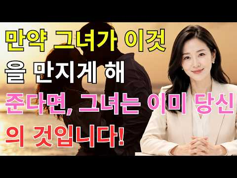
- 설명 앞부분: 연애심리, 말보다 먼저 드러나는 진심… 단 6초의 스킨십이 관계를 바꿉니다 ❤️ 말보다 먼저 진심을 보여주는 것은 우리의 몸입니다. 이번 영상에서는 연애심리 관점에서 눈빛, 표정, 목소리, 스킨십에 숨겨진 감정의 신호를 알아봅니다. 특히 6초의 따뜻한 접촉, 애착 유형, 호흡 동기화가 관계에 어떤 의미를 주는지도 함께 살펴봅니다. 💞 연애심리의 핵심은 상대를 바꾸는 기술이 아니라, 서로에게 편안함과 안전함을 주는 것입니다. 오늘 사랑하는 사람의 곁에 조용히 앉아 손을 잡아보세요. 말보다 따뜻한 행동 하나가 더 깊은 사랑을 전할 수…
- 대본 없음 (설명) — 음성인식이 끝나면 도입부·흐름이 들어감
- 댓글 4/4: 좋은 점 — 영상 0 · 감사·응원 0 · 더 알고 싶은 것 0 · 아쉬운 점 — 영상 0 · 반박·불만 — 의견 다름 0 · 정치·사회 0 · 경험 공유 0 · 구독·다음 기대 0

### 85. 절대 먼저 연락 안 하는 사람의 진짜 심리 - 정신과 의사

- https://www.youtube.com/watch?v=lSB7a9jsQJY · 인생승진 Life Up!! · 구독자 10,800 · 조회수 83,294 (×7.7, 하루 3,199.1) · 좋아요 373 (0.4%) · 16.9분 · 2026-10-16 · 주제 묶음 6. 정신건강 · 형식 인터뷰·강연·대담 (전문가) · 폴더 `W_lSB7a9jsQJY` (웹 승인)
- 썸네일: 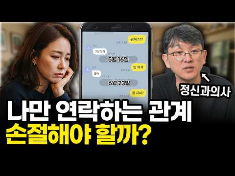
- 설명 앞부분: 항상 내가 먼저 연락해야 하는 사람, 한두 명씩 있으시죠. 내가 안 하면 몇 달이 가도 소식이 없는 사람. 이 사람, 나를 싫어하는 걸까요? 이 관계, 정리해야 할까요? 오늘은 먼저 연락하지 않는 사람에 대해 이야기 나누어 보려 합니다.
- 대본 없음 (설명) — 음성인식이 끝나면 도입부·흐름이 들어감
- 댓글 77/77: 좋은 점 — 영상 2 · 감사·응원 2 · 더 알고 싶은 것 0 · 아쉬운 점 — 영상 2 · 반박·불만 — 의견 다름 2 · 정치·사회 0 · 경험 공유 18 · 구독·다음 기대 0
  - 좋은 점 — 영상 👍0 “구구절절 공감합니다”
  - 감사·응원 👍5 “내향이고 1、2번 모두 해당하니 나이먹을수록 누구에게 연락하기가 힘들어지네요😢 바쁜시간 아닐지, 부담스러워하지 않을지..그렇지만 오랜동안 연락이 끊긴 친구에게도 여전히 애정을 갖고있고 연결감을 느낍니다. 그리고 연락 오면 엄청 반갑게 답하고 호들갑 떱니다 ㅎㅎ 연락 …”
  - 감사·응원 👍4 “선생님,잘 들었습니다 구독 좋아요 눌렀습니다 ❤🎉감사합니다 😊”
  - 아쉬운 점 — 영상 👍1 “난 모든 관계에서 연락 잘 안함 특히 카톡은... 광고가 너무 많아서 확인 잘 안함 대신 문자는 잘 받음 요즘은 다 카톡해서 나같은 사람 없을듯”
  - 아쉬운 점 — 영상 👍1 “여러방면시도햇다가 안해도되겟다 손놔버리니 자연스럽게 끈어지더라구요 필요할때만 연락오는연락도 받아주니 아무것도아니게되고 결국 혼자지치는관계 인간관계 모든게 지치게되는거같아요 아무렇지않다가도 갑자기 후폭풍처럼 몰려와요 다시무덤덤해지고무한반복”
  - 반박·불만 — 의견 다름 👍5 “내향이고 1、2번 모두 해당하니 나이먹을수록 누구에게 연락하기가 힘들어지네요😢 바쁜시간 아닐지, 부담스러워하지 않을지..그렇지만 오랜동안 연락이 끊긴 친구에게도 여전히 애정을 갖고있고 연결감을 느낍니다. 그리고 연락 오면 엄청 반갑게 답하고 호들갑 떱니다 ㅎㅎ 연락 …”
  - 반박·불만 — 의견 다름 👍1 “선생님 제성격이 먼저하든 안하든 크게신경쓰는편은 아닌데 친구들중에 한명한테는 제가일방적으로 연락해요 사람이다보니 서운하다가도 카톡하면 답장도 정성스럽게 길게문자해요 하지만 먼저연락은안해요 솔직히 나만일방적이다보니 지금은 어떻게해야되나 생각이많아집니다”
  - 경험 공유 👍69 “먼저연락하냐 안하냐가 중요한게아님 ㅋㅋ 내가 먼저했을때 상대방의 반응이다 기다렸다는듯이 볼려고하거나 바로답이오고 반겨주는사람은 괜찮음”
  - 경험 공유 👍35 “내가 신경이 쓰이면 손절, 아무렇지 않으면 유지”

### 86. 뇌가 느끼는 쾌락 순위 (5위~1위) 마약 제외 I 뇌과학

- https://www.youtube.com/watch?v=_7LDEUO48YA · 뉴마인드 · 구독자 47,900 · 조회수 1,042,351 (×21.8, 하루 13,719.8) · 좋아요 3,825 (0.4%) · 6.4분 · 2026-08-27 · 주제 묶음 1. 심리학 일반 · 형식 목록형 (N가지 특징·신호) · 폴더 `W__7LDEUO48YA` (웹 승인)
- 썸네일: 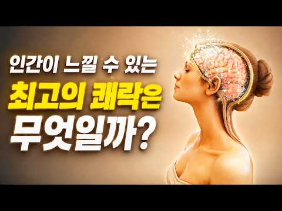
- 설명 앞부분: 마약이나 약물을 제외하고, 과학 연구에서 밝혀진 인간이 경험할 수 있는 강력한 자연적 쾌락 5가지를 5위부터 1위까지 살펴보겠습니다. 참고 자료: Berridge KC, Kringelbach ML. *Building a neuroscience of pleasure and well-being.* Psychology of Well-Being, 2011. Castro DC, Berridge KC. *Opioid Hedonic Hotspot in Nucleus Accumbens Shell: Mu, Delta, and Kappa Maps …
- 대본 없음 (설명) — 음성인식이 끝나면 도입부·흐름이 들어감
- 댓글 537/533: 좋은 점 — 영상 6 · 감사·응원 8 · 더 알고 싶은 것 3 · 아쉬운 점 — 영상 4 · 반박·불만 — 의견 다름 2 · 정치·사회 6 · 경험 공유 27 · 구독·다음 기대 0
  - 좋은 점 — 영상 👍24 “보람만큼 큰 쾌락이 있을까요?, 열심히 도움되는 무엇을 하고나서,, 다른 사람들이 그것으로 도움을 받고 기뻐할 때, 느끼는 행복 !,,”
  - 좋은 점 — 영상 👍11 “이번 주도 유익하고 재미있는 영상 감사합니다. 일상에서 기쁨, 즐거움, 재미, 행복에 대해서는 끊임없이 생각하고 갈구하면서도, 정작 ‘쾌락’에 대해서는 깊이 생각해 본 적이 있었던가? 하는 의문이 들었습니다. 그래서 오늘 영상이 더욱 흥미롭게 느껴졌습니다. 영상에서도…”
  - 감사·응원 👍11 “이번 주도 유익하고 재미있는 영상 감사합니다. 일상에서 기쁨, 즐거움, 재미, 행복에 대해서는 끊임없이 생각하고 갈구하면서도, 정작 ‘쾌락’에 대해서는 깊이 생각해 본 적이 있었던가? 하는 의문이 들었습니다. 그래서 오늘 영상이 더욱 흥미롭게 느껴졌습니다. 영상에서도…”
  - 감사·응원 👍5 “감사합니다 :)”
  - 더 알고 싶은 것 👍24 “보람만큼 큰 쾌락이 있을까요?, 열심히 도움되는 무엇을 하고나서,, 다른 사람들이 그것으로 도움을 받고 기뻐할 때, 느끼는 행복 !,,”
  - 더 알고 싶은 것 👍11 “이번 주도 유익하고 재미있는 영상 감사합니다. 일상에서 기쁨, 즐거움, 재미, 행복에 대해서는 끊임없이 생각하고 갈구하면서도, 정작 ‘쾌락’에 대해서는 깊이 생각해 본 적이 있었던가? 하는 의문이 들었습니다. 그래서 오늘 영상이 더욱 흥미롭게 느껴졌습니다. 영상에서도…”
  - 아쉬운 점 — 영상 👍1 “해결해보고싶은숙제가 힘들어서 포기하고싶을때 게속 반복해서 방법을 찾아서 정리했을때 그게답이고 비젼이. 혁실할때 찾아오는 쾌감은 s0x로 찾을수없는 그무엇이상!”
  - 아쉬운 점 — 영상 👍0 “1위 마약 2위 도박 3위 쌕스.자위행위 4위 흡연 음식 5위 낚시 자전거 등산 등등 육체활동”
  - 정치·사회 👍1 “이 정권이 무너지는 날이 최고의 쾌락”
  - 정치·사회 👍0 “이재명과 공선당종간나 반동분다새끼들 다 쳐 죽였을때?”
  - 경험 공유 👍345 “내가 주식팔고나서 폭락했을때”
  - 경험 공유 👍22 “내가 땅을 사서 사촌이 배 아플 때”

### 87. 외로움이 몸서리 쳐도 14년된 친구를 손절하고 나서야 깨달았습니다 :미국 이민 20년, 인간관계에서 배운 것

- https://www.youtube.com/watch?v=NBBUKWKa3Y4 · 비우는 삶 · 구독자 2,240 · 조회수 72,448 (×32.3, 하루 639.8) · 좋아요 1,424 (2.0%) · 6.5분 · 2026-07-21 · 주제 묶음 2. 인간관계·대화 · 형식 오디오북·책 요약 · 폴더 `W_NBBUKWKa3Y4` (웹 승인)
- 썸네일: 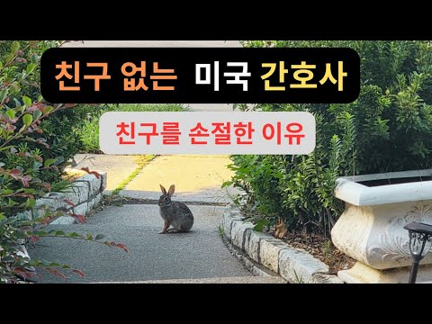
- 설명 앞부분: 미국에 살면서 가장 힘들었던 건 영어도, 돈도 아니었습니다. 외로웠고, 그래서 사람을 너무 쉽게 믿었습니다. 13년 친구를 손절하고, 병원에서 만난 사람들과의 관계를 정리하면서 비로소 깨달았습니다. 잘해주는 것과 이용당하는 것은 종이 한 장 차이라는 것을요. 혹시 지금도 외로워서 억지로 관계를 붙잡고 계신가요? 이 영상이 누군가에게는 작은 위로가 되었으면 좋겠습니다. 감사합니다.
- 대본 없음 (설명) — 음성인식이 끝나면 도입부·흐름이 들어감
- 댓글 462/462: 좋은 점 — 영상 20 · 감사·응원 29 · 더 알고 싶은 것 2 · 아쉬운 점 — 영상 2 · 반박·불만 — 의견 다름 8 · 정치·사회 2 · 경험 공유 95 · 구독·다음 기대 2
  - 좋은 점 — 영상 👍15 “원래 한국인이 그래요..외국에 살면 외로워 한인을 사귀지만 거의 뒷끝이 않좋읍니다.. 항상 이용 당하는 느낌. 이나라 출신은 이게 생존기술이며 본인은 매우 똑똑하다고 생각합니다. 마음을 주지 마세요.. 왜 그런지는 알지만 그만 언급할께요.. 참고로 ‘ 노컷 조선 왕조…”
  - 좋은 점 — 영상 👍11 “보통 친구로서 다정한것보다 도움이 필요해서가 많더라고요ㅜㅜ 사람 정 쉽게주는거 아니더라고요 정쉽게 줘서 괜이 상처받고 그럴필요업다고봅니다 ㅜㅜ 특이동성은요 -아마몸도줘야 끈적해지려나-”
  - 감사·응원 👍62 “쓸데없는 인간관계는 빨리 끊는게 좋아요~ 열번 잘해주다 한번 섭섭하게 하면 나쁜사람 되는게 인간의 본성! 호의가 권리가 됩니다. 남에게 피해 안끼치면서 이기적으로 사세요. 인간관계 나이 먹어갈수록 필요없어 지니 혼자서 잘 노는 방법을 찾으세요! 저는 64년생이고 첫째…”
  - 감사·응원 👍38 “너무 착하게 사셨네요. 처음부터 친구가 아니고, 그저 이용만 했을 뿐. 지금이라도 손절했으니 그나마 다행이라고... 생각하시고 힘내십시오.”
  - 더 알고 싶은 것 👍0 “어느 대학을 나온 사람이죠?”
  - 아쉬운 점 — 영상 👍6 “저도 미국 간호사 입니다. 너무 제 얘기 같아 공감가네요. 사람의 본성이 그런가 봅니다. 호의가 반복되면 권리인줄 아는.”
  - 아쉬운 점 — 영상 👍2 “그런 일들은 말을 해야 친구도 다음에 안그러겠죠 알아온 시간이 있으실건데 아쉽습니다”
  - 반박·불만 — 의견 다름 👍6 “해외 나가서 한국인들 조심하라는 말이 괜히 생긴게 아닙니다. 다른 민족들도 물론 서로 사기치고 이용해먹는 사람들이 있지만, 한인사회는 그게 너무 극단적이고 일상화되있어서 다른 민족들도 다 혀를 내두를 정도.”
  - 반박·불만 — 의견 다름 👍4 “안녕하세요 출근 길에 우연히듣고 댓글올려요 저도 미국 플로리다 병원방사선사로 20년넘게근무하고잇어요 한번은 단골다니던카센터동생이 혹시 아는동생이 있는데 간호사자격은땃는데 유학생신분이라 이력서 를넣어도 취직이안된다하길래 도와주실수 있을까요 하고물어서 내가힘닿는데로 이력…”
  - 정치·사회 👍1 “너무 공감되어 댓글 남깁니다.ㅎㅎ 저도 일본유학중에 같은 힌국인 친구들이 몇명 있었는데 다 손절했습니다. 한명은 자기가 돈 필요할때마다 10만원 30만원 소액으로 빌려달라고 할때만 연락하거나, 막상 제가 연락하면 잘 받지도 않고, 톡도 3번 이상 오고간적이 없네요. …”
  - 경험 공유 👍95 “여러번 잘해줘보면 본성이 보여요 전 안좋은 본성이 느껴지면 바로 손절해요 그럼 제가 상처 받을 일이 없어 지더라구요 !!!”
  - 경험 공유 👍54 “타인들이 희한하게 다 알고 있습니다. 님이 엄청 외로움을 타고 있다는 것을요. 그래서 친구가 필요하다는것을 다 알고 있습니다. 내가 연락 않해도 님이 연락할 꺼라는거 알고 있습니다. 사람이 천성이라는게 있더라구요. 천성이 착한 사람이 근데 얼마나 되겠어요? 가난하다고…”
  - 구독·다음 기대 👍9 “외국에서 더 외로우시겠어요..근데 여기서도 비슷해요.. 많이 친한척하면서 호들갑 떠는 친구사이도 보면 별볼일 없더라구요.. 목소리 편해서 구독해요.”

### 88. 부모 장례식장에서 눈물 안 나는 자식 특징 _ 당신 잘못이 아닙니다 #정신과 #정신과의사 #가족 #부모갈등 #부부갈등 #관계 #형제갈등 #심리상담

- https://www.youtube.com/watch?v=oUiNW0U5Z9Y · Dr.전미경의 닥전TV · 구독자 29,400 · 조회수 373,754 (×12.7, 하루 8,125.9) · 좋아요 2,440 (0.7%) · 23.1분 · 2026-09-26 · 주제 묶음 6. 정신건강 · 형식 인터뷰·강연·대담 (전문가) · 폴더 `W_oUiNW0U5Z9Y` (웹 승인)
- 썸네일: 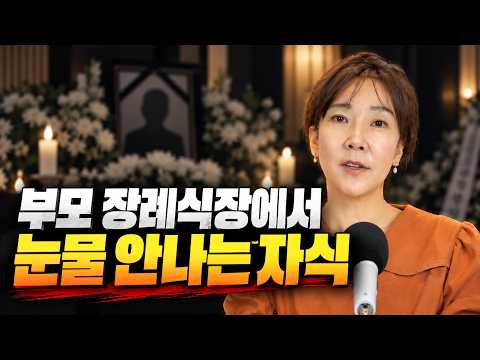
- 설명 앞부분: ❝25년간 10만 명의 삶을 바꾼 전미경 원장의 소통 처방전❞ 📕『멈출수록 관계가 살아나는 말 심리』 출간! 🖐️이런 순간, 한 번이라도 있었다면 이 책이 당신의 말을 바꿔드립니다! 인간관계에서 말로 인한 갈등을 반복하는 사람 말이 의도와 다르게 전달되어 오해받는 사람 대화 습관을 바꾸고 싶지만, 구체적인 방법을 모르는 사람 가까운 사람일수록 말이 더 어려운 사람 사과해야 할 순간에 말문이 막히는 사람 애쓸수록 오해만 쌓이는 당신을 위한 1초의 멈춤, 소통의 관점을 바꾸는 대화 심리학 지금 서점에서 만나보세요!
- 대본 없음 (설명) — 음성인식이 끝나면 도입부·흐름이 들어감
- 댓글 496/504: 좋은 점 — 영상 22 · 감사·응원 46 · 더 알고 싶은 것 0 · 아쉬운 점 — 영상 1 · 반박·불만 — 의견 다름 17 · 정치·사회 1 · 경험 공유 115 · 구독·다음 기대 6
  - 좋은 점 — 영상 👍131 “장례식에 눈물이 안나오는게 오랜시간 남몰래 흘렸기 때문 이란 말에 공감이 가네요”
  - 좋은 점 — 영상 👍80 “정말로 와닿는 말씀이라 잘 들었어요 안 그래도 얼마전 엄마가 돌아가셨는데 전혀 슬프지가 않아서 제가 어디가 잘못된 건가 스스로 궁금 했거든요. 자식의 도리와 의무는 다 했지만 애착은 없는 관계 바로 제 경우 같아요. 받은 거라곤 19세 때까지 먹여주고 재워 준 거, …”
  - 감사·응원 👍284 “제가 싸이코가 아님을 확인하고 갑니다. 그리고 저와 같은 분들이 많으시다는 것에 안도가 되네요.감사합니다”
  - 감사·응원 👍164 “이런말씀을 해주는 선생님이 계시다니,,이제 숨이 좀 쉬어지네요ㅜㅜ 감사합니다”
  - 반박·불만 — 의견 다름 👍104 “부모라고 다 같은 부모가 아닙니다 이걸 일반적인 사람들에겐 아무리 설명해도 모르는 것 같아요 그래서 설명하지 않습니다 부모가 죽었으면 다리 뻗고 자겠다는 생각 안해본 사람은 모릅니다”
  - 반박·불만 — 의견 다름 👍39 “평생 부모님 사랑을 받아본적이 없어요..부모님도 저한테 뭘 해준적도 없고 저도 손벌린적도 없고 그렇다고 못사는 집도 아닙니다.. 일평생 아들아들만 하고 그 아들이 보다 7살이나 어린데 저한테 욕지거리를 하더라구요...저는 가족이 있어도 없다고 생각하고 평생을 외롭게 …”
  - 정치·사회 👍32 “그와 반대인 놈도 있습니다. 도리는 없고. 권리만 있는. 제. 조카놈이 그렇습니다. 암 걸린 엄마 한번도 안찾아오더니. 지엄마. 하늘나라가도 장례식장도. 안오던 놈이. 재산정리하러 나타나는거 보고. 기암했네요. 아들이라면 끔찍하게 생각하고 혼자. 대학도 적성에. 안 …”
  - 경험 공유 👍448 “더 아픈건 제가 부모가 되어보니, 나의 부모가 더욱 이해가 안되더군요 분노가 더 폭발 했습니다.”
  - 경험 공유 👍284 “제가 싸이코가 아님을 확인하고 갑니다. 그리고 저와 같은 분들이 많으시다는 것에 안도가 되네요.감사합니다”
  - 구독·다음 기대 👍38 “누워서 듣는데 눈물이 나네요~ 답답했던 마음이 조금은 풀리는 것 같아요! 감사합니다♡다음 영상 기다려요~~”
  - 구독·다음 기대 👍9 “다음 영상 기다려집니다!! 잘 봤습니다, 감사합니다”

### 89. 나이가 들수록 인간관계가 어려워지는 이유

- https://www.youtube.com/watch?v=QeeNrWYaQkY · 신춘 · 구독자 1,640 · 조회수 10,764 (×6.6, 하루 452.3) · 좋아요 54 (0.5%) · 6.9분 · 2026-10-18 · 주제 묶음 2. 인간관계·대화 · 형식 정보·해설 (그 밖) · 폴더 `W_QeeNrWYaQkY` (웹 승인)
- 썸네일: 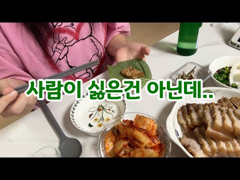
- 설명 앞부분: 이번 영상에는 처음으로 제 목소리를 담아봤어요. 평범한 일상 속에서 문득 떠오른 생각들을 혼잣말처럼 기록해 봅니다. 🤍 오늘도 보러 와주셔서 감사합니다.
- 대본 없음 (설명) — 음성인식이 끝나면 도입부·흐름이 들어감
- 댓글 34/34: 좋은 점 — 영상 1 · 감사·응원 3 · 더 알고 싶은 것 0 · 아쉬운 점 — 영상 1 · 반박·불만 — 의견 다름 0 · 정치·사회 0 · 경험 공유 4 · 구독·다음 기대 0
  - 좋은 점 — 영상 👍1 “신춘님 저번영상 잘봣습니다 ㅎㅎ 저랑 동갑이신것같은데 35살 어케보면 저랑 똑같으시네여 저도 몇몇사람들외 말을 잘안하거든여 또 어떤사람들한테 말을 붙엿는데 나중가면 그사람이 오지랖부리고 해서 정말 친하지않으면 저도 친목질은 잘안해서 공감되네여 ㅋㅋ 그리고 저도 신춘님…”
  - 감사·응원 👍3 “오늘 영상 공감포인트들이 넘 많네요🥹 사람 눈치보고 예민한 기질인 저는 그 분위기 공기가 달라지는거까지 인지를해서 상대방 배려하는데 상대는 그러지않을때.. 좀 회의감 들긴하죠ㅠ 나중엔 내가 예민한가 하고 내탓하규 있고.. 그리고 감자칼로 과일깎는거 저도 그래욬ㅋㅋㅋ …”
  - 감사·응원 👍0 “오늘도 영상 잘보고 갑니다 오늘 하루 즐겁게 보내세요 항상 응원합니다”
  - 경험 공유 👍3 “오늘 영상 공감포인트들이 넘 많네요🥹 사람 눈치보고 예민한 기질인 저는 그 분위기 공기가 달라지는거까지 인지를해서 상대방 배려하는데 상대는 그러지않을때.. 좀 회의감 들긴하죠ㅠ 나중엔 내가 예민한가 하고 내탓하규 있고.. 그리고 감자칼로 과일깎는거 저도 그래욬ㅋㅋㅋ …”
  - 경험 공유 👍1 “저도 혼자가 편할때가 많은거 같아요... 대인관계가 어렵네요”

### 90. 사랑받고 자란 사람은 이런 데서 티가 납니다. 의외의 행동 6가지

- https://www.youtube.com/watch?v=2t0zuR72DIE · 친절한심리학 · 구독자 22,000 · 조회수 212,009 (×9.6, 하루 5,737.5) · 좋아요 2,048 (1.0%) · 15.9분 · 2026-10-05 · 주제 묶음 2. 인간관계·대화 · 형식 목록형 (N가지 특징·신호) · 폴더 `W_2t0zuR72DIE` (웹 승인)
- 썸네일: 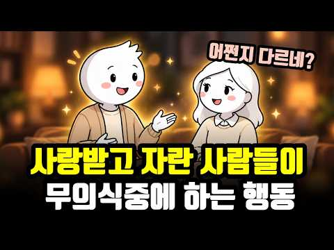
- 챕터: 0:00 사랑받고 자란 티는 의외의 순간에 납니다 · 0:55 같은 상황, 누구는 불안하고 누구는 편안한 이유 · 1:35 첫 번째, 의외로 남의 호의를 잘 받는다 · 4:12 두 번째, 싸움이 끝난 뒤 상대를 벌주지 않는다 · 6:32 세 번째, "나라면 안 그럴 텐데"를 쉽게 말하지 않… · 8:39 네 번째, 누구 탓보다 이제 어떻게 할지를 찾는다 · 10:36 다섯 번째, 좋은 것을 혼자 움켜쥐지 않는다 · 12:33 여섯 번째, 가까운 사람일수록 함부로 대하지 않는다 · 14:17 여섯 가지의 공통점 · 14:56 사랑을 덜 받았다고 느끼는 분들께
- 설명 앞부분: 사랑을 많이 받고 자란 사람은 의외로 티가 납니다. 밝게 웃을 때가 아니라, 누가 잘해줄 때, 싸운 다음 날, 일이 꼬인 순간처럼 별것 아닌 순간에요. 같은 상황에서도 누구는 불안하고, 누구는 이상할 만큼 편안한 이유는 뭘까요? 애착과 부모의 온정에 관한 심리학 연구를 바탕으로, 사랑받고 자란 사람들이 자기도 모르게 하는 행동 6가지를 정리했습니다. 어린 시절에 충분히 받지 못했어도 괜찮아요. 이 편안함은 지금부터도 만들어갈 수 있으니까요. [ 타임라인 ]
- 대본 없음 (설명) — 음성인식이 끝나면 도입부·흐름이 들어감
- 댓글 75/75: 좋은 점 — 영상 3 · 감사·응원 4 · 더 알고 싶은 것 0 · 아쉬운 점 — 영상 0 · 반박·불만 — 의견 다름 2 · 정치·사회 0 · 경험 공유 15 · 구독·다음 기대 0
  - 좋은 점 — 영상 👍20 “전부 공감합니다. 전 저 여섯가지가 다 제게 있어서 의식하지 못했는데 영상 보고나니 부모님께 의외로 사랑 많이 받고 자랐던 거라는 걸 새삼 깨달았네요. 특히 6번 가까울 수록 선을 지켜야 한다는 거 정말 공감하는데 나이를 먹을 수록 친해지면 친하다는 이유로 저 선을 …”
  - 좋은 점 — 영상 👍1 “사랑과 안정적인 태도와 관계를 잘 설명해주셔서 감사합니다! 😊”
  - 감사·응원 👍1 “감사합니다❤ 사랑과 축복을 보냅니다❤”
  - 감사·응원 👍1 “사랑과 안정적인 태도와 관계를 잘 설명해주셔서 감사합니다! 😊”
  - 반박·불만 — 의견 다름 👍29 “잘 받는다~?당연한건 아니죠 받은만큼 베플어야죠~ 그걸 싸가지 ~”
  - 경험 공유 👍211 “1. 잘 받는다 2. 싸울 때 제대로 싸우고 푼다.(회복력) 3. 화가 지나간 후 자기 자리로 돌아온다. 상대가 그렇게 느꼈다는 걸 받아준다.(안정애착) 4. 문제가 생기면 거기 오래 머물지 않고 문제중심적 해결능력이 있다. 내가 할 수 있는 것 5. 좋은 것을 굳이…”
  - 경험 공유 👍31 “나도 친구한테 아낌없이 줬는데~ 지식도 진실도~ 돌아오는건 배신!!!”

### 91. 우울증 치료 6년하고 깨달은 마음의 진리

- https://www.youtube.com/watch?v=BxrMEkahOXE · 민고영 · 구독자 20,100 · 조회수 432,115 (×21.5, 하루 5,147.1) · 좋아요 5,065 (1.2%) · 11.3분 · 2026-08-19 · 주제 묶음 6. 정신건강 · 형식 정보·해설 (그 밖) · 폴더 `W_BxrMEkahOXE` (웹 승인)
- 썸네일: 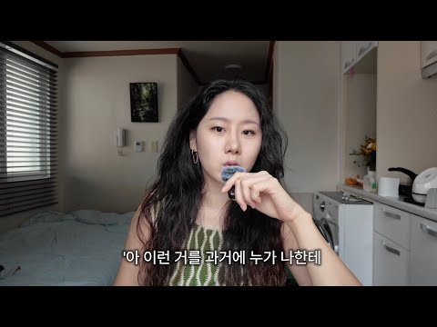
- 챕터: 0:00 오늘의 주제 · 0:42 1.부정적인 감정을 없앨 수 없다. 그리고 꼭 없애야… · 4:25 2.자극과 반응 사이에는 틈이 있다. · 7:30 3.머리가 이해하는 것과 마음이 믿게 되는 것은 다르…
- 설명 앞부분: 일러스트 by Seo Jung (Sammie) Yoon
- 대본 없음 (설명) — 음성인식이 끝나면 도입부·흐름이 들어감
- 댓글 452/452: 좋은 점 — 영상 48 · 감사·응원 63 · 더 알고 싶은 것 17 · 아쉬운 점 — 영상 3 · 반박·불만 — 의견 다름 9 · 정치·사회 0 · 경험 공유 93 · 구독·다음 기대 1
  - 좋은 점 — 영상 👍412 “생각이 과거로 갈 때 우울이 생깁니다. 생각은 내 의지와 상관 없이 끊임없이 올라옵니다. 그 때 그 생각들을 회피하거나 억압하지 말고 그대로 느껴주고 생각을 바라봐 주세요.. 해결되지 않은 부정적 감정들이 올라올 때마다 계속 느껴주면 어느새 그 감정은 힘을 잃고 저절…”
  - 좋은 점 — 영상 👍147 “알아차림 배워보세요 마음을 계속 보고있으면 마음과 생각이 내가 하는게 아니라 자동으로 돌아가는 거라는걸 알게되고, 보는 순간 비 동일시가 되면서 휘둘리지 않게 됩니다. 마음이 떠오르면 떠오르는데로 감정의 도가니 속에서 살다가 그걸 메타인지 처럼 바라볼수 있게 되더라구…”
  - 감사·응원 👍55 “티내지는 않는데 생각보다 주변에 심적으로 고통받으시는 분들이 많더라구요... 다들 잘 이겨내시길 마음 속으로 응원합니다.”
  - 감사·응원 👍32 “물질세상에 길들여지며 온갖 습이 내 자아를 덮어놨더라고요 생각과습관 모든게 내가아닌거 같은걸느껴 마음공부를 시작해보니 저깊숙이 내가 묻혀있는걸 발견하고 온전히 나로 살아가기로 했어요 응원합니다”
  - 더 알고 싶은 것 👍2 “동네 성당 가면 돼요. 어느 동네든 성당은 꼭 있어요. 그리고 성당의 입구에는 늘 성모마리아 석상이 있습니다. 그 앞에서 눈을 감고 물어보세요. '제가 왜 살아야 하는지 그 이유를 알려주세요.'라고. 그럼 해답을 주실 겁니다. 뭐가 먹고 싶어지든 어디를 가고 싶어지든…”
  - 더 알고 싶은 것 👍2 “저도 만성우울이 있어서 브린텔렉스(항우울제) 복용하며 살아가는데요, 민고영님 제일 첫번째영상 썸네일의 표정을 짓는 순간이 많으신가요?? 유튜브 영상은 전반적으로 다 무표정해보이시는데, 실제 삶에서는 웃는순간이 많으신지 궁금합니다😊”
  - 아쉬운 점 — 영상 👍0 “전 아직 인생쪼렙 학생이지만 부정적인 감정이 찾아와도 내 스스로가 감당할수있을때 진정으로 행복할수있다는말 너무공감돼요..진짜 인생의 진리같은 명언을 고영님한테 처음 듣네요! 저 이 멘토 메모해서 친구들한테 엣햄!하고 폼잡고 써먹어도되죠?ㅋㅎㅎ🤓📝 말씀대로 부정적인 감…”
  - 아쉬운 점 — 영상 👍0 “목소리가 너무 좋으세요 얼굴도 예쁘시구요 말씀도 너무 조리있게 잘하셔서 정속으로 봤습니다 좋은 내용 전달 감사드려요 힘받고 갑니다!”
  - 반박·불만 — 의견 다름 👍1,216 “저 알고리즘으로 들어왔는데 음.. 딴 얘기일수도 있지만 원룸에 사는게 사람 우울하게 만드는거도 큰거 같아요 저는 지방에서 서울 상경하면서 고시원 원룸 전전하면서 살았었는데 계속 우울증 달고 살다가 햇빛 잘드는 투룸으로 가니까 정말 많이 나아졌어요.. 어이없을 정도로 …”
  - 반박·불만 — 의견 다름 👍89 “저는 고등학생 때 부터 과민성 대장증후군과 불안장애가 왔었고 그당시엔 제가 불안장애가 있는지도 과민성 대장증후군이 유산균을 먹을게 아니라 불안장애 약을 먹으면 됬는지도 몰랐습니다. 초중학교 내내 반에서 제일 시끄럽고 전교임원까지 하는 활발한 성격은 다 무너지고 모든 …”
  - 경험 공유 👍412 “생각이 과거로 갈 때 우울이 생깁니다. 생각은 내 의지와 상관 없이 끊임없이 올라옵니다. 그 때 그 생각들을 회피하거나 억압하지 말고 그대로 느껴주고 생각을 바라봐 주세요.. 해결되지 않은 부정적 감정들이 올라올 때마다 계속 느껴주면 어느새 그 감정은 힘을 잃고 저절…”
  - 경험 공유 👍290 “저도 그래서 심리안정이 안되고 자꾸 분노할바에야 그 감정을 자주 만들어내는 친구 ? 를 끊었어요 ㅠ”
  - 구독·다음 기대 👍0 “목소리도 너무 좋고 내용이 공감되서 구독해요😊”

### 92. 배우자와 말만 하면 싸운다면 꼭 보세요｜관계를 살리는 심리학 7가지

- https://www.youtube.com/watch?v=ZbPijVInhtY · 별별 심리 · 구독자 3,870 · 조회수 147,519 (×38.1, 하루 976.6) · 좋아요 1,815 (1.2%) · 37.5분 · 2026-06-13 · 주제 묶음 1. 심리학 일반 · 형식 목록형 (N가지 특징·신호) · 폴더 `W_ZbPijVInhtY` (웹 승인)
- 썸네일: 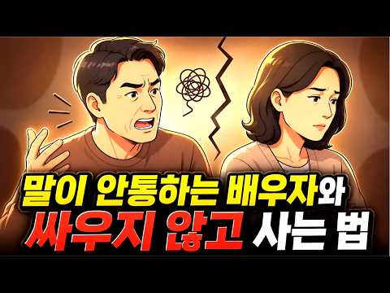
- 설명 앞부분: 배우자에게 "내 마음 좀 알아줘"라고 말해본 적 있으신가요. 그 말이 왜 자꾸 싸움으로 번졌는지, 왜 컵 하나에 20년 치 서운함이 터졌는지, 차분히 풀어드립니다. 말이 안 통하는 집은 시끄러워서 무너지는 게 아니었습니다. 한 사람이 더 이상 말하지 않게 되면서 무너지더라구요. 그 침묵이 평화일까요. 포기일까요. 오늘 식탁에서 꺼낼 첫 마디가 한 줄 달라지는 일곱 가지 길. 비슷한 마음으로 오늘을 통과하고 계신 분이라면 댓글에 한 줄 남겨주세요. 📚 참고 자료 Gottman, J. M., & Levenson, R. W. (1992…
- 대본 없음 (설명) — 음성인식이 끝나면 도입부·흐름이 들어감
- 댓글 157/157: 좋은 점 — 영상 7 · 감사·응원 12 · 더 알고 싶은 것 0 · 아쉬운 점 — 영상 1 · 반박·불만 — 의견 다름 2 · 정치·사회 0 · 경험 공유 14 · 구독·다음 기대 1
  - 좋은 점 — 영상 👍7 “상담하는데 도움이 될 것 같아요.”
  - 좋은 점 — 영상 👍5 “영상 참 좋은 내용인데 공감능력 제로에 자기밖에 모르는 사람에겐 안통해요 내 옆에 진짜 나쁜 놈이 있는데 이혼도 안해주고 물귀신 처럼 나를 끌고 다니며 괴롭힙니다 미안한 것도 모르고 자신이 뭘 잘못했는지도 몰라요”
  - 감사·응원 👍25 “서로가 상대방을 제압하고ㅠ자기 말을 고분고분 든는 소나 가축같이 생각하며 말버르장머리가 명령조인 사이는 친할래야 친해질 수 없음 ㅡ 서로감사의 마음이 항상 있어야 함 그래야 말이ㅜ이쁘게 나오고 공감의 말이 나옴 ㅡ 그러면 서로 좋아짐”
  - 감사·응원 👍5 “배우고 갑니다 감사합니다 😊”
  - 아쉬운 점 — 영상 👍0 “10분만 얘기하자 한집사는 동업자 정서적홍수 분당 10박수가 넘는다면 조심 지금얘기하면 말이격해질것같으니 다시얘기하자 반복되는패턴에 결말은 똑같다 추격회피패턴 내기말할때 폰을보면 나를무시하는느낌이 들어 외로운사람도 있다 (나피곤해) 내가중요하지않은것 같다 나 불안해 …”
  - 반박·불만 — 의견 다름 👍4 “말도 안되고 연애도 거부하면 답없다”
  - 경험 공유 👍59 “결혼 24년 중 각 방 사용한지 10년 넘었는데, 이해받지 못하고 살아왔는데, 필요한 용건만 말하는데, 서로 다름을 인정하고 다투지 않으려고, 불만을 얘기하지 않음. 딱히 불만도 없음. 하나뿐인 자식이 보물이라 자식 위주로 살고 있음. 그래서 웃을 일이 또 생김.😂 …”
  - 경험 공유 👍12 “에휴....남의 일 같지 않내...꼭 두달전 우리부부 모습이 저랬지.부부싸움?? 그거 손뼉도 부딪혀야 소리나는법...안 부딪히면 됩니다. 거 싸워서 이겨봐야 뭐해...덕 될것 하나도 없더라. 내 주장 말하다가 아내가 다른 소리하면 그래 그럴수도 있겠내 해버리면 그걸로…”
  - 구독·다음 기대 👍0 “10분만 얘기하자 한집사는 동업자 정서적홍수 분당 10박수가 넘는다면 조심 지금얘기하면 말이격해질것같으니 다시얘기하자 반복되는패턴에 결말은 똑같다 추격회피패턴 내기말할때 폰을보면 나를무시하는느낌이 들어 외로운사람도 있다 (나피곤해) 내가중요하지않은것 같다 나 불안해 …”

### 93. 잠으로 현실 도피? ‘도피 수면’에서 벗어나는 방법

- https://www.youtube.com/watch?v=HAqwaViT1tU · 홍승주의 디스턴싱 · 구독자 29,400 · 조회수 539,143 (×18.3, 하루 7,284.1) · 좋아요 5,319 (1.0%) · 19분 · 2026-08-29 · 주제 묶음 2. 인간관계·대화 · 형식 정보·해설 (그 밖) · 폴더 `W_HAqwaViT1tU` (웹 승인)
- 썸네일: 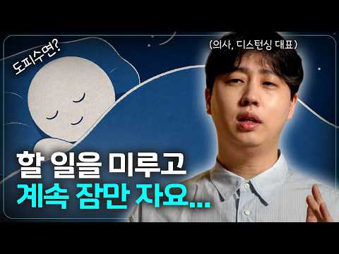
- 챕터: 0:00 1) 잠이 와서 자는 걸까? 깨어 있기 싫어 자는 걸… · 1:18 2) 핵심은 ‘수면’이 아니라 ‘도피’ · 3:43 3) 내 수면은 도피가 맞을까? · 6:30 4) 훈련 1. ‘수면 충동’이 생기는 순간을 기록하기 · 8:25 5) 훈련 2. 더도 말고 덜도 말고 딱 10분 수면… · 9:42 6) 훈련 3. ‘자지 않기’가 아니라 ‘딱 하나 하… · 11:30 7) 훈련 4. 잠이 해주던 일을 다른 행동에게 맡기기 · 14:02 8) 훈련 5. 깨어 있을 이유 늘리기 · 16:33 9) 수면을 나쁘게 생각하지 말자
- 설명 앞부분: 서울의대 출신 의사가 만든 디지털 인지치료 프로그램, 디스턴싱 인간은 자신의 삶을 변화시킬 역량과 잠재성을 가지고 있습니다. 우리는 사람들이 스스로의 치료자가 되도록 돕습니다. ⏰ 타임스탬프
- 대본 없음 (설명) — 음성인식이 끝나면 도입부·흐름이 들어감
- 댓글 274/274: 좋은 점 — 영상 16 · 감사·응원 22 · 더 알고 싶은 것 8 · 아쉬운 점 — 영상 5 · 반박·불만 — 의견 다름 1 · 정치·사회 0 · 경험 공유 50 · 구독·다음 기대 2
  - 좋은 점 — 영상 👍97 “도피수면 3년 차에서 다시 어느 정도 정상적으로 돌아온? 사람입니다. 항상 눈이 떠져도 현실을 마주하기 싫어서 포기하고 오후 늦게까지 자고 또 자면서 회피했던 사람이라, 영상 보면서 제가 느꼈던 것과 비슷한 점이 좀 있네요.. 한명이라도 더 도움이 되었으면 하는 바램…”
  - 좋은 점 — 영상 👍15 “도피수면의 해결방법에 대해 잘 배웠습니다. 감사합니다.”
  - 감사·응원 👍175 “제가 완벽주의 성향도 강하고, 두려움도 정말 크게 느끼는 성격이라, 중요한 시험 준비를 하고 있는 지난 몇 년 동안 불안감+압박감+두려움 때문에 잠을 정말 많이 자는 날이 많았어요. 사실 이번 8월이 유독 가장 심했어서, 힘겹게 극복 중이었는데 선생님 영상이 마침 올…”
  - 감사·응원 👍36 “현재 수험생활 중입니다. 공부를 해야지 해야지 하면서 하다가, 밤늦게 자고 늦게 일어납니다. 이게 그냥 적절한 수면시간이면 저도 딱히 걱정하지 않을 것 같습니다. 근데 늦게 일어나고 나서 오늘도 늦게 일어났네, 공부시간 또 줄어들겠다... 하면서 후회하고, 그러면서 …”
  - 더 알고 싶은 것 👍36 “현재 수험생활 중입니다. 공부를 해야지 해야지 하면서 하다가, 밤늦게 자고 늦게 일어납니다. 이게 그냥 적절한 수면시간이면 저도 딱히 걱정하지 않을 것 같습니다. 근데 늦게 일어나고 나서 오늘도 늦게 일어났네, 공부시간 또 줄어들겠다... 하면서 후회하고, 그러면서 …”
  - 더 알고 싶은 것 👍1 “폰 중독도 다뤄주세요,, 쇼츠를 너무 많이보고 있는 나자신”
  - 아쉬운 점 — 영상 👍1 “예전에 이러다가 요즘 다시 이런 상태가 심해지고 계속 반복되고 있는데 이게 도피수면이었군요.. 마침 이 영상이 떠서 보고 나니 조금은 문제의 원인에 대해 해소가 된 것 같아요 선생님 혹시 병원도 운영하고 계신지 여쭤봐도 될까요? 해외에서는 이런 영상에 의지하거나 방법…”
  - 아쉬운 점 — 영상 👍0 “정말 좋은 정보 알려주셔서 감사합니다. 저는 전문직 시험을 준비하고 있는데, 이전에 직장생활하면서 주중에는 3~4시간 주말에는 8시간 공부하는 습관을 갖고 있었는데 직장과 병행하다 보니, 어느순간 그 리듬이 깨지고 원하는 목표에 도달하지 못하니 회피형 수면과 대인관계…”
  - 반박·불만 — 의견 다름 👍0 “요즘 자꾸 잘 시간이 아닌데 잠이 와서 현실 도피인가 싶었는데 딱 이런 영상이 알고리즘에 뜨네요 해결 방법들 알려주셔서 감사합니다❤ 잘 극복해보겠습니다❤”
  - 경험 공유 👍175 “제가 완벽주의 성향도 강하고, 두려움도 정말 크게 느끼는 성격이라, 중요한 시험 준비를 하고 있는 지난 몇 년 동안 불안감+압박감+두려움 때문에 잠을 정말 많이 자는 날이 많았어요. 사실 이번 8월이 유독 가장 심했어서, 힘겹게 극복 중이었는데 선생님 영상이 마침 올…”
  - 경험 공유 👍97 “도피수면 3년 차에서 다시 어느 정도 정상적으로 돌아온? 사람입니다. 항상 눈이 떠져도 현실을 마주하기 싫어서 포기하고 오후 늦게까지 자고 또 자면서 회피했던 사람이라, 영상 보면서 제가 느꼈던 것과 비슷한 점이 좀 있네요.. 한명이라도 더 도움이 되었으면 하는 바램…”
  - 구독·다음 기대 👍4 “많은 도움이 돼요. 매일 디스턴싱채널에 들어옵니다. 다음 영상 늘 기다려요! ^^ 좋은 영상늘 감사합니다👍”

### 94. 인생을 바꾸고싶다면 안 쓰는 물건부터 당장 버리세요 ㅣ 60세까지는 아까워도 다 버려야하는 진짜 이유

- https://www.youtube.com/watch?v=XTueIYuM2aY · 뇌생각 심리학 · 구독자 8,200 · 조회수 231,079 (×28.2, 하루 1,992.5) · 좋아요 3,096 (1.3%) · 14.2분 · 2026-07-18 · 주제 묶음 1. 심리학 일반 · 형식 정보·해설 (그 밖) · 폴더 `W_XTueIYuM2aY` (웹 승인)
- 썸네일: 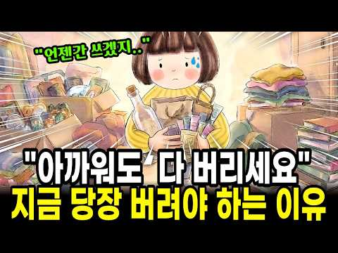
- 설명 앞부분: 아까워도 다 버리세요 🧹 지금 당장 정리해야 하는 뇌과학적 이유 "분명히 버렸는데 왜 또 그대로일까요?" 🤔 차곡차곡 모아둔 종이가방, 깨끗이 씻어 줄 세워둔 유리병, 지퍼백에 담긴 화장품 샘플들… 아까워서 도무지 손이 안 가는 그 서랍, 혹시 여러분도 하나쯤 있으신가요? 🗄 오늘 이야기는요, 물건을 못 버리는 게 결코 여러분이 게으르거나 미련해서가 아니라는 데서 시작합니다. 우리 뇌는 익숙한 물건을 버릴 때 마치 몸이 아픈 것처럼 반응한다고 해요. 그래서 손이 얼어붙는 게 당연했던 거예요. 💛 ✨ 이 영상에서 함께 나누는 이야기…
- 대본 없음 (설명) — 음성인식이 끝나면 도입부·흐름이 들어감
- 댓글 190/190: 좋은 점 — 영상 6 · 감사·응원 6 · 더 알고 싶은 것 0 · 아쉬운 점 — 영상 1 · 반박·불만 — 의견 다름 0 · 정치·사회 0 · 경험 공유 15 · 구독·다음 기대 0
  - 좋은 점 — 영상 👍14 “좋은 얘기 감사합니다. 저도 정리가 잘안되네요. 지금보다 여유있었던 젊은날 가지고 있던것들에 잡착이있어 아직도 못비우고 끌어안고 살고 있어 매일 심란하게 걱정하고 고민하는 삶을 살고 있거든요. 이젠 비워야지하면서도 그게 쉽게 안되는게 외로워서 강박이라서 아까워서라는 …”
  - 좋은 점 — 영상 👍11 “최근 몇년만에 다시 미니멀 도전중인데 예전에 내가 왜 미니멀을 하고싶었는지 기억이 안났거든요. 이런저런 영상도 와닿지않았는데 드디어 발견!! 몇번이고 더 돌려보고 다시도전해보겠습니다.”
  - 감사·응원 👍14 “간결하게 정돈된 삶❤ 감사합니다❤ 비우고 나면 개운해지는 ❤ 여러분께 바로 지금 좋은일이 생깁니다❤”
  - 감사·응원 👍14 “좋은 얘기 감사합니다. 저도 정리가 잘안되네요. 지금보다 여유있었던 젊은날 가지고 있던것들에 잡착이있어 아직도 못비우고 끌어안고 살고 있어 매일 심란하게 걱정하고 고민하는 삶을 살고 있거든요. 이젠 비워야지하면서도 그게 쉽게 안되는게 외로워서 강박이라서 아까워서라는 …”
  - 경험 공유 👍17 “저도 마니 버렸는데 더 버릴게 없나 늘 봅니다”
  - 경험 공유 👍16 “저희엄마가 쓰레기 수집가 수준입니다”

### 95. 사람 보는 눈이 정확한 사람들의 7가지 비밀 심리

- https://www.youtube.com/watch?v=C6oXNfwg3jw · 어른이 심리학교 · 구독자 13,100 · 조회수 37,824 (×2.9, 하루 3,147.9) · 좋아요 207 (0.5%) · 13.6분 · 2026-10-30 · 주제 묶음 1. 심리학 일반 · 형식 목록형 (N가지 특징·신호) · 폴더 `W_C6oXNfwg3jw` (웹 승인)
- 썸네일: 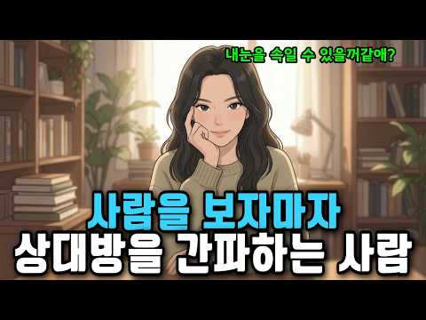
- 챕터: 0:00 훅 & 인트로 — 그 사람, 처음부터 뭔가 달랐다 · 1:11 왜 우리는 사람을 자꾸 잘못 볼까 — 뇌의 구조적 맹점 · 2:27 특징 1 — 그들은 말이 아니라 '타이밍'을 듣는다 · 3:51 특징 2 — 그들은 '일관성의 균열'을 포착한다 · 5:17 특징 3 — 그들은 '편한 자리'에서 상대의 본모습을… · 6:42 특징 4 — 그들은 상대가 '무엇을 피하는지'를 읽는다 · 8:07 특징 5 — 그들은 자신의 감정을 정보로 사용한다 · 9:19 특징 6 — 그들은 상대가 아닌 '관계 속 나'를 함… · 10:46 특징 7 — 그들은 판단을 끝내지 않는 사람들이다 · 12:10 마무리 — 간파력은 날카로움이 아니라 깊은 관심이다
- 설명 앞부분: 첫 만남에서 이미 '뭔가 이상하다' 느꼈는데, 나중에 결국 맞았던 경험 있으신가요? 사람 보는 눈이 정확한 사람들은 말이 아닌 전혀 다른 것을 보고 있었습니다. 이 영상에서 알게 되는 것: 왜 우리 뇌는 구조적으로 사람을 잘못 볼 수밖에 없는지 간파력 높은 사람들이 대화에서 실제로 주목하는 7가지 포인트 상대의 말이 아닌 '타이밍·균열·회피·감정'을 읽는 구체적 방법 🕒 타임라인:
- 대본 없음 (설명) — 음성인식이 끝나면 도입부·흐름이 들어감
- 댓글 0/6 (다 받지 못함): 좋은 점 — 영상 0 · 감사·응원 0 · 더 알고 싶은 것 0 · 아쉬운 점 — 영상 0 · 반박·불만 — 의견 다름 0 · 정치·사회 0 · 경험 공유 0 · 구독·다음 기대 0

### 96. 최명기는 틱장애입니다

- https://www.youtube.com/watch?v=kAEfOJgXS0s · 최명기의 마음 편한 TV · 구독자 41,600 · 조회수 428,018 (×10.3, 하루 9,940.6) · 좋아요 5,389 (1.3%) · 19.6분 · 2026-09-29 · 주제 묶음 기타 · 형식 인터뷰·강연·대담 (전문가) · 폴더 `W_kAEfOJgXS0s` (웹 승인)
- 썸네일: 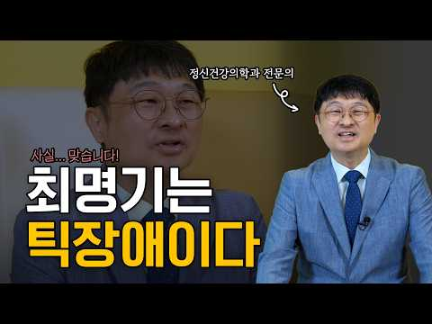
- 설명 앞부분: 저 최명기 사실 틱장애 맞습니다 최명기 원장님의 정신 건강 이야기 매주 화요일 오후 5시 업로드됩니다
- 대본 없음 (설명) — 음성인식이 끝나면 도입부·흐름이 들어감
- 댓글 999/999: 좋은 점 — 영상 113 · 감사·응원 286 · 더 알고 싶은 것 34 · 아쉬운 점 — 영상 2 · 반박·불만 — 의견 다름 5 · 정치·사회 6 · 경험 공유 143 · 구독·다음 기대 44
  - 좋은 점 — 영상 👍740 “한번도 거슬려본적이 없습니다 좋은말씀 항상 감사드려요❤”
  - 좋은 점 — 영상 👍369 “말씀하실 때 내용이 너무 좋아서 눈깜빡이시는 것도 몰랐어요. 항상 좋은 말씀 감사해요.”
  - 감사·응원 👍740 “한번도 거슬려본적이 없습니다 좋은말씀 항상 감사드려요❤”
  - 감사·응원 👍398 “사람만 좋아보이는데 요 응원합니다”
  - 더 알고 싶은 것 👍26 “선생님 말씀은 솔직하고 현실적이라 늘 마음에 와닿는 것 같아요. 이런 영상까지 친절히 올려주시다니! 오히려 더 가까워진 것 같아 좋은 걸요 ☺️ 도움 많이 받고 있습니다. 앞으로도 좋은 영상 많이 부탁드려요!”
  - 더 알고 싶은 것 👍22 “원장님!! 지금처럼 계속 쭈욱~~ 유트브랑 방송 많이 부탁드립니다 🙏😊”
  - 아쉬운 점 — 영상 👍0 “원장님 멋지세요❤구독합니다! 목소리에 따스함이 느껴져요 힘들때 위로되는 말씀 감사합니다😊 뻔한얘기말고 사이다 발언들으면 속이 뻥뚫려용ㅎㅎ 다른사람들 말 신경쓰지 마시고 지금처럼 힘이되주세요🎉❤ 원장님 최고❤❤❤❤”
  - 아쉬운 점 — 영상 👍0 “원장님, 직접 올리신 영상 혹은 방송을 통해 전해주시는 통찰력 있는 말씀과 폭포수처럼 시원한 해결책, 종종 저와 같은 생각을 발견하게 되어 최근에 팬이 되었어요. 그리고 내원해서 원장님의 프로페셔널하면서도 인간적인 모습, 겸손하신 모습을 보게 되었어요. 어젯밤 며칠 …”
  - 반박·불만 — 의견 다름 👍3 “전혀 못느꼈어요.아무 문제 아닙니다.선생님 팬이에요😊”
  - 반박·불만 — 의견 다름 👍0 “원장님 참 귀여우셔~ 남한테 피하주는것도 아닌데 뭔상관이래요.ㅎㅎ일일 드라마도 아닌데 굳이굳이 보면서 험담하는건 이해하기 힘들어요.”
  - 정치·사회 👍1 “뇌활동이 많아서 처리하는 거라고 생각하고 있어요 저는ㅎㅎ 윤석렬 대통령의 소위 도리도리(?)도 그런 것 같구. 누구나가 집중하는 동안 그런일이 벌어질 수 있다고 생각합니다. 다른 사람들은 그 정도의 고도화된 뇌활동 안해서 안 나타나는 거예요ㅎㅎㅎ 그리고 귀여우세요~!”
  - 정치·사회 👍1 “한국 메스컴이 문제네요 요즘은 잘생긴 의사분들만 패널로 나오시던데 다들 성형에 피부도 하시는건지..? 다양성이 존중되는 나라가 되기를 희망합니다 이렇게 환자의 맘을 누구보다 잘 이해하시는 분이 티비에 나오셔야죠.”
  - 경험 공유 👍162 “선생님 팬이에요~~ 의료계의 법륜스님이라는 별명 넘 어울리세요! 언젠가 저도 상담가고 싶네요”
  - 경험 공유 👍150 “저희 부부는 좋아하다못해 존경합니다 남편이 병원원장인데 병원처방전 잘읽고있어요 인생공부 잘 하고있어요 정말 지혜로우세요 감사해요🎉”
  - 구독·다음 기대 👍257 “최명기 원장님 팬입니다. 솔직”
  - 구독·다음 기대 👍215 “하이고😢😢사람들 참..잔혹하네요😢😢 전 선생님 팬입니다. 항상 속시원한 대답을 해줘서 맘에 듭니다😊”

### 97. 진짜 나를 사랑하는 방법#이지영 #명언 #동기부여

- https://www.youtube.com/watch?v=HQYWZjH2eEc · 마인드 컴파일 · 구독자 6,500 · 조회수 194,265 (×29.9, 하루 1,538.7) · 좋아요 3,894 (2.0%) · 8.3분 · 2026-07-08 · 주제 묶음 3. 자존감·마음 · 형식 오디오북·책 요약 · 폴더 `W_HQYWZjH2eEc` (웹 승인)
- 썸네일: 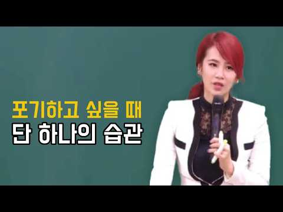
- 설명 앞부분: 힘들고 지칠 때마다 "이번 판은 리셋하고 다음에 다시 시작할까?"라는 유혹이 찾아옵니다. 스트레스 절벽 앞에서 도망치고 싶어지는 건 자연스러운 감정입니다. 하지만 지금 회피하면, 앞으로 마주할 인생의 수많은 기회 앞에서도 똑같이 도망치는 결정을 내리게 됩니다. 무작정 자신을 혹사하며 독해질 필요는 없습니다. 세상이 정해둔 기준 대신, 내가 스스로를 통제할 수 있는 '나만의 작은 룰'을 세우고 지켜나가세요. 오늘 해야 할 일을 묵묵히 해내며 10년 후의 내 미래에 긍정적인 주문을 걸어야 합니다. 눈앞의 유혹과 시련에 흔들리지 마세요…
- 대본 없음 (설명) — 음성인식이 끝나면 도입부·흐름이 들어감
- 댓글 92/92: 좋은 점 — 영상 4 · 감사·응원 17 · 더 알고 싶은 것 0 · 아쉬운 점 — 영상 1 · 반박·불만 — 의견 다름 1 · 정치·사회 0 · 경험 공유 10 · 구독·다음 기대 0
  - 좋은 점 — 영상 👍34 “2번의 이직, 결과적으로 높은 연봉과 안정적 일자리를 얻었지만 되돌아보면 정말 얻은걸까? 혹시 포기하면서 여기까지 온건 아닐까라는 생각을 자주하곤 하는 40대중반입니다. 50대를 준비하는 요새... 기존의 포기하고 리셋하는 버릇 고쳐보려합니다. 지금까지는 운이 좋아 …”
  - 좋은 점 — 영상 👍1 “이지영 쌤.. 너무 좋으신 분 늘 배워갑니다. 영상 감사합니다. 🙏🏻”
  - 감사·응원 👍480 “35살 아줌마입니다 진짜 진짜 저게 맞는말이에요 진짜에요 평생을 나는 못하는 사람이지 한계짓고 도전하면서도 난 안될거같은데 라는 생각으로 살앗습니다 그러다보니 금방 포기하게 되고 결국이나이까지 이룬거하나 없더라구요 근데 이아줌마가 아이를 낳고 자식앞에 떳떳하고 싶더라…”
  - 감사·응원 👍9 “너도 울고 싶었구나. 그래 많이 고맙다.”
  - 경험 공유 👍480 “35살 아줌마입니다 진짜 진짜 저게 맞는말이에요 진짜에요 평생을 나는 못하는 사람이지 한계짓고 도전하면서도 난 안될거같은데 라는 생각으로 살앗습니다 그러다보니 금방 포기하게 되고 결국이나이까지 이룬거하나 없더라구요 근데 이아줌마가 아이를 낳고 자식앞에 떳떳하고 싶더라…”
  - 경험 공유 👍45 “40대 되니깐 나를 토닥일수 있는건 나밖에 없음... 그냥 나를 토닥이면서 또 기회가 올거야 괜찮아. 이말로 마음을 다잡고 추스려야 함... 천천히 가자. 하면서 계속 부딪혀야 하더라. 피하지말고. 나도 이룬게 크게 없지만 좀 마음을 고쳐먹으니, 아주 조금 편해지고 …”

### 98. '이런' 취미를 반드시 가져라. 혼자 있어도 평생 행복하다 ∣ 쇼펜하우어 인생조언 #현실조언 #동기부여 #마인드셋

- https://www.youtube.com/watch?v=E0XTT7j4g3Q · 부자 패턴 연구소  · 구독자 10,800 · 조회수 259,916 (×24.1, 하루 2,547.1) · 좋아요 3,005 (1.2%) · 16.5분 · 2026-08-01 · 주제 묶음 3. 자존감·마음 · 형식 오디오북·책 요약 · 폴더 `W_E0XTT7j4g3Q` (웹 승인)
- 썸네일: 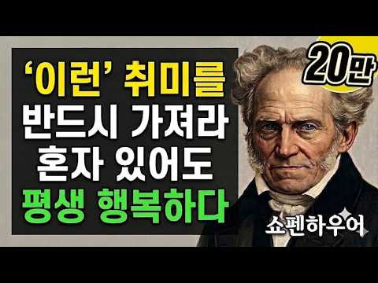
- 챕터: 0:00 나이 들어 혼자 있어도 평생 즐겁게 살아가는 법 · 1:15 쇼펜하우어가 경고한 가짜 취미와 지루함의 고통 · 2:40 고독한 취미를 가질 때 인간관계의 주도권이 생기는 이유 · 4:10 60세 정년퇴직 남성이 혼자만의 성전에서 왕이 된 실… · 6:20 사례로 본 쇼펜하우어의 '내면 가치 체계' 전환 · 8:05 현대 심리학과 뇌과학이 입증한 몰입의 행복 메커니즘 · 10:15 몸과 마음을 정화하는 쇼펜하우어의 정적인 산책 루틴 · 11:50 노년의 영혼을 가을 결실처럼 만드는 배움의 기쁨 · 13:30 타인의 눈치를 내려놓고 진짜 나를 채우는 삶의 정리 · 15:10 쇼펜하우어가 남긴 마지막 당부와 3가지 핵심 지혜 · 16:31 영상 종료
- 설명 앞부분: "이 포스팅은 쿠팡 파트너스 활동의 일환으로, 이에 따른 일정액의 수수료를 제공받습니다." 살다 보면 퇴직 후 나이가 들면서 외로움과 공허함에 시달리거나, 당장 무슨 취미를 가져야 할지 막막할 때가 있습니다. 남들에게 보여주기 위한 가짜 취미나 외향적인 모임에만 의존하다 보면, 타인이 떠나고 체력이 떨어지는 순간 삶이 무너져 내립니다. 19세기 철학자 아르투어 쇼펜하우어는 인간이 나이 들수록 반드시 가져야 할 단 하나의 취미는 타인의 시선에서 벗어나 내면의 영혼을 채우는 취미라고 강조합니다. 혼자 있는 고독을 온전히 누리고, 내면…
- 대본 없음 (설명) — 음성인식이 끝나면 도입부·흐름이 들어감
- 댓글 74/74: 좋은 점 — 영상 2 · 감사·응원 9 · 더 알고 싶은 것 0 · 아쉬운 점 — 영상 3 · 반박·불만 — 의견 다름 0 · 정치·사회 1 · 경험 공유 4 · 구독·다음 기대 0
  - 좋은 점 — 영상 👍10 “너무 좋은 말씀 감사드립니다..~~^^”
  - 좋은 점 — 영상 👍4 “좋은정보에감사드립니다.”
  - 감사·응원 👍42 “혼자 있을때 가장 행복한것 같습니다. 주변정리 개끗하게 하고 컴을 마주하고 그림도 그리고 복지관등 에서 늘 공부 합니다.오는길은 전철2정거장 걸어서 오구요 잘하고 있군요. 하루에 한줄 글쓰기도 시도 하렵니다. 되도록 책을 가까이 하려 합니다 영상 감사드립니다~!”
  - 감사·응원 👍10 “너무 좋은 말씀 감사드립니다..~~^^”
  - 아쉬운 점 — 영상 👍20 “인생은 고통과 지루함을 오가는 시계추와 같다.”
  - 아쉬운 점 — 영상 👍3 “열심히 일하고 주말 하루 낚시”
  - 정치·사회 👍0 “대륜이냐? 좋겠다. 사회 책임져야 하니.... ㅎㅎㅎ 대통령 출마해. ㅎㅎㅎ”
  - 경험 공유 👍5 “저도 혼자하는 편인데 ... 가끔은 혼자가 불안할때도 있지요 그래도 혼자 즐기는 모든것이 행복하답니다. 책보고 요리하고 산책 필사...등등 뭔가 삶이 갈증날땐 무작정 발바닥 부르트도록 복잡한 거리를 걷기도하고요~~~”
  - 경험 공유 👍3 “제가 존경하는 쇼펜 하우어 형님, 칼 융 형님 감사합니다”

### 99. 자존감 높은 손주는 가정에서 '이 말'을 주로 듣습니다｜맞벌이 자녀를 돕는 조부모의 현명한 손주 돌보기

- https://www.youtube.com/watch?v=UWcGH7Nog6Q · 육아는아빠가 · 구독자 17,000 · 조회수 200,179 (×11.8, 하루 3,974.2) · 좋아요 1,782 (0.9%) · 18.6분 · 2026-09-22 · 주제 묶음 3. 자존감·마음 · 형식 정보·해설 (그 밖) · 폴더 `W_UWcGH7Nog6Q` (웹 승인)
- 썸네일: 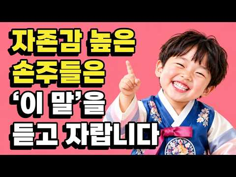
- 설명 앞부분: 자존감 높은 아이, 아이 자존감 높이는 법, 부모의 말습관과 칭찬법이 궁금하신가요? 손주 육아와 조부모 육아에서 중요한 것은 “잘했어”, “최고야”라는 칭찬보다 아이가 “나는 해볼 수 있어”라고 느끼게 해주는 말입니다. 자존감 높은 손주로 키우는 대화법, 아이가 실패했을 때 해줘야 할 말, 친구 때문에 속상해할 때의 감정코칭, 그리고 사랑해서 모든 것을 대신해주기보다 자기효능감과 독립심을 키워주는 방법을 실제 육아 상황으로 알려드립니다. 맞벌이 자녀를 대신해 손주를 돌보는 조부모님과 아이의 자존감, 자신감, 자기주도성을 키우고 싶…
- 대본 없음 (설명) — 음성인식이 끝나면 도입부·흐름이 들어감
- 댓글 50/50: 좋은 점 — 영상 5 · 감사·응원 11 · 더 알고 싶은 것 3 · 아쉬운 점 — 영상 1 · 반박·불만 — 의견 다름 0 · 정치·사회 0 · 경험 공유 2 · 구독·다음 기대 0
  - 좋은 점 — 영상 👍3 “선생님 7세 손녀 케어 하고 있는데 정말 유익한 교육 강의 입니다”
  - 좋은 점 — 영상 👍3 “5세 쌍둥이 외손녀들을 아침 저녁으로 돌봐주고 있습니다. 선생님의 말씀 완전 공감됩니다. 과잉보호하지 않고 스스로 해보도록 유도해주고 느긋하게 기다려주는데 젊은 날의 바빴던 제 모습을 반성해요. 자기 마음을 들여다보게 하고 마음을 지키는 힘을 길러주고 싶습니다. 좀 …”
  - 감사·응원 👍9 “잘 배우고 있습니다 감사합니다 ^^”
  - 감사·응원 👍3 “영상 매번 잘보고 배우고 느끼고 반성하고 있답니다 감사합니다”
  - 더 알고 싶은 것 👍6 “자신감을높이는말 불안감이있을때해주는말 손주가마음을잘표현하지 안을때해주는말 알려주세요”
  - 더 알고 싶은 것 👍5 “우리 손주는 "할머니 제가 다할수있어요" 손도 못대게 해요. 모든걸 직접. 자기식탁 싹싹 치우고 해줄게 없어 섭섭해요. 밖에서도 지저분하면 뛰어가서 정리하고 닦아놓고 그래요. 단지, 책읽어 달라 맛있는거 달라 그것만 부탁합니다. 안되는것도 이해시키면 금방 따라하는데 …”
  - 아쉬운 점 — 영상 👍1 “광고가 너무너무 길어서~”
  - 경험 공유 👍5 “우리 손주는 "할머니 제가 다할수있어요" 손도 못대게 해요. 모든걸 직접. 자기식탁 싹싹 치우고 해줄게 없어 섭섭해요. 밖에서도 지저분하면 뛰어가서 정리하고 닦아놓고 그래요. 단지, 책읽어 달라 맛있는거 달라 그것만 부탁합니다. 안되는것도 이해시키면 금방 따라하는데 …”
  - 경험 공유 👍3 “웃으면서 말씀하시니 저도 웃으면서 듣게 되니 기분이 좋아요^^ 구체적인 행동으로 인정과 칭찬하도록 오늘도 노력하겠습니다. 감사합니다”

### 100. 매일 똑같이 사는 게 무서운 진짜 이유

- https://www.youtube.com/watch?v=PaiW1albOrA · 이런철학 (Perspective Lab) · 구독자 12,600 · 조회수 373,608 (×29.6, 하루 2,894.0) · 좋아요 9,714 (2.6%) · 5.3분 · 2026-07-05 · 주제 묶음 기타 · 형식 정보·해설 (그 밖) · 폴더 `W_PaiW1albOrA` (웹 승인)
- 썸네일: 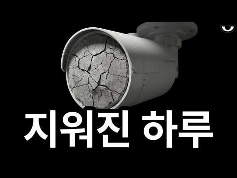
- 챕터: 0:00 당신은 지금 코를 보고 있습니다 · 0:23 어른이 될수록 시간이 빨리 가는 이유 · 0:39 어른이 된다는 것에 대한 불편한 진실 · 0:58 빅토르 시클롭스키: 익숙함은 삶을 지운다 · 1:16 사물은 기호로 대체된다 · 1:43 보르헤스: 기억의 천재 푸네스 · 2:13 예측 부호화: 뇌는 세상을 예측한다 · 2:32 출퇴근길 2시간이 사라지는 이유 · 2:43 효율을 얻은 대가로 잃어버린 감각 · 3:17 설명 깊이의 착각: 익숙한 것을 안다고 믿는 오류 · 4:20 새로운 풍경보다 필요한 것 · 4:39 시클롭스키: 예술은 삶의 감각을 회복하기 위해 존재한다 · 4:51 어른이 된다는 것의 다른 의미 · 5:02 익숙한 세계를 다시 낯설게 바라보는 일
- 설명 앞부분: 어릴 땐 그렇게 느리던 하루. 그런데 어른이 된 뒤, 시간은 미친 듯이 빨리 사라집니다. 우리는 왜 나이가 들수록 “올해도 벌써 끝났네”라고 말하게 될까요? 정말 시간이 빨라진 걸까요, 아니면 우리의 뇌가 반복되는 하루를 조용히 지워버리고 있는 걸까요? 이번 영상에서는 러시아 사상가 빅토르 시클롭스키의 ‘낯설게 하기’, 보르헤스의 『기억의 천재 푸네스』, 그리고 뇌과학의 예측 부호화 관점을 통해 어른이 된다는 것의 불편한 의미를 들여다봅니다. 우리가 겪는 시간의 가속은 단순한 바쁨이 아닙니다. 경험이 쌓여, 익숙해진 세계를 더 이…
- 대본 없음 (설명) — 음성인식이 끝나면 도입부·흐름이 들어감
- 댓글 449/449: 좋은 점 — 영상 10 · 감사·응원 19 · 더 알고 싶은 것 1 · 아쉬운 점 — 영상 14 · 반박·불만 — 의견 다름 10 · 정치·사회 0 · 경험 공유 19 · 구독·다음 기대 0
  - 좋은 점 — 영상 👍89 “밋밋한 시간은 아무것도 알려주지 않는다. 밋밋한 시간 이라는 것을 다시 돌려말하면 단순히 사건이 없거나 부족한 상태가 아니라, 그 어느것에 대해서도 스스로 생각하지 않는 시간의 모습이라 봐도 무방하다. - “당신의 밤은 흐른다” (남우현 저) 이 책이 떠오르는 영상이…”
  - 좋은 점 — 영상 👍3 “생각이 말이 되고, 말이 행동이 되고, 행동이 습관이 되고, 습관이 성격이 되고, 성격이 운명이 되어, 당신의 삶을 결정 짓습니다. 기쁨을 나누면 질투가 되고, 슬픔을 나누면 약점이 된다. 배려가 계속되면 권리인줄 알고, 도움이 계속되면 호구인줄 안다. 이것이 인간관…”
  - 감사·응원 👍89 “밋밋한 시간은 아무것도 알려주지 않는다. 밋밋한 시간 이라는 것을 다시 돌려말하면 단순히 사건이 없거나 부족한 상태가 아니라, 그 어느것에 대해서도 스스로 생각하지 않는 시간의 모습이라 봐도 무방하다. - “당신의 밤은 흐른다” (남우현 저) 이 책이 떠오르는 영상이…”
  - 감사·응원 👍7 “덕분에 영상 내용은 모르겠고 코만 보게 됐습니다. 감사합니다.”
  - 더 알고 싶은 것 👍1 “몰입을 해도 시간은 빨리 흐르는데 뭐가 다를까요? 익숙함은 숙달되었다는건 아닐까요?”
  - 아쉬운 점 — 영상 👍675 “공부해라 배우면 까먹고 또 까먹고 아주 무한반복이다 ㅋㅋㅋ 늘 새로운데 짜릿하진않아 ㅋㅋㅋㅋㅋㅋ”
  - 아쉬운 점 — 영상 👍186 “30,40대만 그런게 아니라 10,20대도 다 똑같습니다. 늘 같은 학교,학원,집의 반복되는 삶. 대학동안은 잠깐 새롭겠지만 군대가면 반복되는 일과와 새로운 병신같은 짓을하는 놈들을 보는 삶. 그리고 군에 나와 취업을위한 몸부림의 반복. 취업하면 또 잠깐 새롭겠지만 …”
  - 반박·불만 — 의견 다름 👍14 “진짜 명작입니다.. 헛소리하는 댓글들 치워버리십쇼”
  - 반박·불만 — 의견 다름 👍1 “저는 자동차를 운전하면서 신고를 위해서 거의 매번 제가 운전한 블랙박스 영상을 돌려보는데, 운전할때는 다 보인다고 생각했지만 막상 돌려보면 새로운걸 보는게 한두번이 아닙니다. 드론 날리고 촬영한 영상 볼 때도 마찬가지구요. 인간은 100% 자기가 다 감지하고 느낀다 …”
  - 경험 공유 👍36 “학생때 시험 볼때가 생각납니다 시험을 잘 봐야하는 애들은 남은 기간이 너무 짧다고 느끼는 애들도 있었고 시험이 불안한 애들은 너무 금방 돌아온다고 하거나 차라리 빨리 끝내고 방학이 왔으면 좋겠다고 하루하루 불안해서 너무 길게 느껴진다고 한 애들도 있었죠 성적을 증명하…”
  - 경험 공유 👍31 “내가 매일 새로운 야동을 찾는 이유”

### 101. 당신은 결코 죽음을 경험하지 못한다 ∣ 뇌과학이 밝혀낸 충격적인 진실 ∣ 과학다큐

- https://www.youtube.com/watch?v=6NglAKAd91o · 몰랐던 사실 · 구독자 8,190 · 조회수 278,552 (×34.0, 하루 1,870.0) · 좋아요 4,246 (1.5%) · 54.6분 · 2026-06-15 · 주제 묶음 1. 심리학 일반 · 형식 정보·해설 (그 밖) · 폴더 `W_6NglAKAd91o` (웹 승인)
- 썸네일: 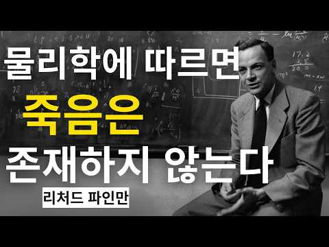
- 챕터: 0:00 죽음과 의식에 대한 가장 큰 질문 · 3:15 우리는 왜 죽음을 두려워하는가? · 6:42 뇌과학이 밝힌 의식의 본질 · 10:18 전신마취가 보여주는 놀라운 사실 · 14:55 죽음에 대한 흔한 오해와 진실 · 19:30 철학자들이 바라본 죽음의 의미 · 24:08 시간과 의식의 관계 분석 · 29:47 죽음을 이해하면 삶이 달라지는 이유 · 35:12 당신은 결코 죽음을 경험하지 못한다 · 40:00 삶과 죽음에 대한 최종 결론
- 설명 앞부분: 당신은 결코 죽음을 경험하지 못한다 ∣ 뇌과학이 밝혀낸 충격적인 진실 ∣ 과학다큐 죽음은 정말 우리가 상상하는 것처럼 끝없는 어둠일까요? 많은 사람들은 죽음을 의식이 사라진 뒤에도 계속되는 공허한 상태라고 생각합니다. 하지만 이번 과학다큐에서는 현대 뇌과학과 철학, 그리고 물리학의 관점을 통해 죽음에 대한 가장 근본적인 오해를 파헤칩니다. 전신마취를 경험한 사람들은 종종 시간이 완전히 사라진 것처럼 느꼈다고 말합니다. 이번 과학다큐는 이러한 현상을 통해 의식이 어떻게 현실과 시간을 만들어내는지 설명하며, 왜 인간은 자신의 죽음을 …
- 대본 없음 (설명) — 음성인식이 끝나면 도입부·흐름이 들어감
- 댓글 307/307: 좋은 점 — 영상 2 · 감사·응원 9 · 더 알고 싶은 것 2 · 아쉬운 점 — 영상 2 · 반박·불만 — 의견 다름 1 · 정치·사회 0 · 경험 공유 21 · 구독·다음 기대 1
  - 좋은 점 — 영상 👍71 “시간의 흐름이 착시이고 죽음이 소멸이 아닌 특정 좌표에 꽂히는 완성된 기록이라는 설명에 눈물이 핑 돕니다. 얼마 전 천시록 봤을 때도 명리학에서 말하는 대운의 흐름이나 인연의 끝은 사라지는 게 아니라 시공간에 새겨진 마디라고 했거든요. 떠나간 소중한 이들이 우주 어딘…”
  - 좋은 점 — 영상 👍1 “너무나도 수준높고 좋은 영상이네요 감사합니다~🎉🎉🎉”
  - 감사·응원 👍5 “어쩌다 뇌를 갖고 살게 된거야 ㅋ 그냥 감사하게 살다 가면 되는 겨~”
  - 감사·응원 👍5 “양적완화하여 가계부채 청산하고 세금절약하여 국민배당금 월150만원 이상 노인수당 월70만원 지급하고 결혼부 설립하여 연애수당 월 20만원 결혼수당 1억 출산수당 5,000만원 주택구입 2억 전업주부 월100만원 지급하고 다자녀 부모는 취업에 우선순위를 주는 공영제하고…”
  - 더 알고 싶은 것 👍0 “모두의 시간이 다르다.상대적이다 ~ 전 저의 삶이 미래에 대한 많은 경험을 하며 살아와서 시간이 선형적이지 않다고 생각해온 사람입니다.내용 너무 감사합니다 ~ 그렇다면 저는 미래를 보거나 어린시절의 그동네가 현재 바뀐형태를 꿈으로 볼 수있는 현상등 미래를 볼수있는 능…”
  - 아쉬운 점 — 영상 👍7 “왠만하면 댓글 안다는데 너덜 너덜 과학상식 짜집기 그이상도 이하도 아니군요 도대체 무슨 얘기가 하고 싶은겁니다”
  - 아쉬운 점 — 영상 👍0 “영상을 좀 짧게 만들거나 나눠서 하세요. 너무 길어서 보기 싫네요..”
  - 반박·불만 — 의견 다름 👍0 “물리학자가 아니니 무슨 소리하느냐? 너는 내가 詩를 을프면 내뜻을 이해하겠느뇨? 헛소리 그만 하라! 말하는 너도 모르면 서 떠들지 마라!”
  - 경험 공유 👍17 “내가 좋아하는 콘텐츠 ㅎㅎ”
  - 경험 공유 👍6 “내가 죽고없어면 즉 이세상도 존재하지않는다”

### 102. 가까운 사람을 함부로 집에 들이면 안 되는 이유

- https://www.youtube.com/watch?v=yBqfGeVTFZE · 인생다시쓰기 · 구독자 9,230 · 조회수 152,743 (×16.6, 하루 2,077.7) · 좋아요 1,118 (0.7%) · 17분 · 2026-08-29 · 주제 묶음 2. 인간관계·대화 · 형식 정보·해설 (그 밖) · 폴더 `W_yBqfGeVTFZE` (웹 승인)
- 썸네일: 
- 챕터: 0:00 집에 몇 번 들였을 뿐인데 왜 불편해질까 · 3:08 집은 내가 말하지 않은 것까지 보여준다 · 5:56 한 번 허용된 것이 ‘당연한 권리’가 되는 순간 · 8:19 내 집인데도 피곤해지는 진짜 이유 · 9:55 옛집의 사랑채와 카페가 편한 이유 · 12:20 가까운 사이일수록 필요한 집의 경계
- 설명 앞부분: 친구 집 방문이 불편하게 느껴진 적 있나요? 인간관계 스트레스가 쌓이는 이유와 타인과의 생활 습관 차이를 현명하게 대처하는 법을 알아봅니다. 친한 사이일수록 사소한 생활 방식의 차이가 갈등의 씨앗이 되기도 합니다. 처음에는 단순한 제안으로 시작된 일들이 어떻게 개인의 심리적 불편함으로 이어지는지, 그리고 이러한 대인관계 갈등을 어떻게 해석해야 할지 구체적인 사례를 통해 살펴봅니다. 특히 타인의 공간에 머물며 느끼는 미묘한 거리감에 대해 깊이 있게 다룹니다. 이 영상은 친구의 집을 방문할 때마다 불편함을 느꼈던 분들을 위한 내용입니…
- 대본 없음 (설명) — 음성인식이 끝나면 도입부·흐름이 들어감
- 댓글 66/66: 좋은 점 — 영상 4 · 감사·응원 1 · 더 알고 싶은 것 0 · 아쉬운 점 — 영상 1 · 반박·불만 — 의견 다름 0 · 정치·사회 0 · 경험 공유 10 · 구독·다음 기대 0
  - 좋은 점 — 영상 👍57 “가까운 사이라고 해서 항상 내 편인 것은 아닌 것 같아요. 믿었던 사람에게 상처받는 일이 더 아프다는 말이 마음에 와닿았습니다. 좋은 사람과 좋은 거리를 유지하는 지혜가 필요하네요.”
  - 좋은 점 — 영상 👍35 “좋은내용 잘보구 갑니다”
  - 감사·응원 👍0 “가까운 사이라고 해서 무조건 믿고 집 안까지 허락해서는 안 된다는 말씀이 마음에 남습니다. 결국 내 공간과 평온을 지키는 것도 현명하게 나를 돌보는 방법이라는 생각이 듭니다. 좋은 말씀 감사합니다.”
  - 경험 공유 👍16 “내집은 나만 있고싶다 나는 부모자식 형제들 방문도 싫다 나도 안가고 니들도 오지마라 제발 집은 나만의 안식처다 서로 방해하지말자 서로 자기공간은침해하지말고 명절이니 생일이니 그런 기념일 챙기는것도 밖에서 밥먹고 차마시고 각자집으로 가자 자식들이 자고가는것도 놉 호텔잡…”
  - 경험 공유 👍16 “제친구는 제가 야근가고 없는집에 재워달라고 부덕부덕 떼를써는거를 제가 거절했더니 섭섭하다고 빈집에 좀재워주면 어떠냐고 따지더나구요 사는게 서민이라 금고도없고 끼고다니는 팔찌반지목걸이등등 화장대 서랍에 보관중이고 통장이며 등등 들고 출근할수도없고 내가 있을면 몰라도 안…”

### 103. 부정적인 생각을 완전히 없애줄 7가지 냉철한 스토아학파의 법칙 - 마음을 재설계하라 ∣ 스토아학파

- https://www.youtube.com/watch?v=m-dEVtGzOfE · 스토아의 길 · 구독자 2,210 · 조회수 14,238 (×6.4, 하루 492.1) · 좋아요 147 (1.0%) · 26.5분 · 2026-10-13 · 주제 묶음 3. 자존감·마음 · 형식 오디오북·책 요약 · 폴더 `W_m-dEVtGzOfE` (웹 승인)
- 썸네일: 
- 설명 앞부분: 부정적 사고를 완전히 없애줄 7가지 강력한 스토아 법칙 - 마음을 재설계하세요 ∣ 스토아주의 당신의 마음은 고장 난 것이 아니라, 잘못 프로그래밍된 것입니다. 이 영상에서는 부정적 사고를 끊어내고, 감정적 반응을 재설정하며, 평온과 명료함을 위해 마음을 재설계하는 데 도움이 될 7가지 강력한 스토아 법칙을 소개합니다. 마르쿠스 아우렐리우스, 에픽테토스, 세네카의 강인한 정신력에서 영감을 받은 이 영상은 단순히 '긍정적으로 생각하라'는 조언이 아닙니다. 흔들리지 않는 내면의 절제력을 기르는 방법에 관한 것입니다. 🔱 불안, 과도한 …
- 대본 없음 (설명) — 음성인식이 끝나면 도입부·흐름이 들어감
- 댓글 3/3: 좋은 점 — 영상 1 · 감사·응원 2 · 더 알고 싶은 것 0 · 아쉬운 점 — 영상 0 · 반박·불만 — 의견 다름 0 · 정치·사회 0 · 경험 공유 0 · 구독·다음 기대 0
  - 좋은 점 — 영상 👍0 “좋은영상 감사합니다..”
  - 감사·응원 👍0 “감사합니다 감정 표현 감사합니다”
  - 감사·응원 👍0 “좋은영상 감사합니다..”

### 104. 카톡친구 1800명 여자들이 인간관계 정병 퇴치해드림

- https://www.youtube.com/watch?v=KqizGOaHdNI · 이제 잘 시간 · 구독자 2,200 · 조회수 30,511 (×13.9, 하루 469.4) · 좋아요 482 (1.6%) · 15.9분 · 2026-09-07 · 주제 묶음 2. 인간관계·대화 · 형식 정보·해설 (그 밖) · 폴더 `W_KqizGOaHdNI` (웹 승인)
- 썸네일: 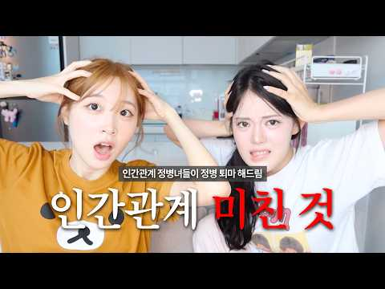
- 챕터: 0:00 Intro · 0:20 우리가 인간관계를 힘들어했던 이유 · 3:03 인간관계 힘듦을 극복해나간 과정 · 6:12 좋은 사람은 어떤 사람일까 · 9:53 인간관계와 바운더리 · 13:08 어떤 마음으로 인간관계를 형성해야 할까
- 설명 앞부분: [조잘조잘 타임라인]
- 대본 없음 (설명) — 음성인식이 끝나면 도입부·흐름이 들어감
- 댓글 23/23: 좋은 점 — 영상 3 · 감사·응원 2 · 더 알고 싶은 것 1 · 아쉬운 점 — 영상 0 · 반박·불만 — 의견 다름 0 · 정치·사회 0 · 경험 공유 3 · 구독·다음 기대 0
  - 좋은 점 — 영상 👍1 “와 너무 좋은 말들.. 요즘 인간관계로 고민이 정말정말 많고 고민이 너무 많아졌는데 딱 정리해주셔서 말씀해주신 것같아요”
  - 좋은 점 — 영상 👍1 “진짜 유익한 거 같아요 감사해요”
  - 감사·응원 👍1 “진짜 유익한 거 같아요 감사해요”
  - 감사·응원 👍0 “감사합니다”
  - 더 알고 싶은 것 👍0 “카메라 어떤 걸로 찍으셨는지 궁금해요!! 색감이 너무 얘뻐요 ㅎㅎ”
  - 경험 공유 👍4 “언니들 영상 너무 잘보고있는 고등학생입니다 아직 연애를 해본 적이 없어서ㅠㅠㅠ 인간관계가 주제인 영상이 올라오기만을 기다렷어요❤❤❤ 저도 생각이 진짜 많은 편이여서 혼자 생각하고 혼자 상처받는 편인데 언니들 덕분에 반성 많이 햇읍니다 나를 잘 모르는데 어떻게 남 생각…”
  - 경험 공유 👍2 “언니 이번년도 돼서 친해진 친구가 있는데 정말 친해지고 자주 만나고 이야기도 자주한 친구인데 계속 진지한 이야기를 할 때마다 저한테 너가 아직 어렵다, 너의 눈치를 정말 많이 본다 이런 이야기를 매번 하는데 처음에는 진지하게 계속 경청하고 고칠 부분이 있는지도 물어보…”

### 105. 자식은 부모의 사랑보다 이것을 기억합니다 ㅣ부모자식관계 ㅣ좋은 부모 ㅣ자식교육 ㅣ훈육 ㅣ애착이론

- https://www.youtube.com/watch?v=G9sJxVqt-H0 · 오늘은 심리학 · 구독자 40,600 · 조회수 816,233 (×20.1, 하루 8,253.9) · 좋아요 11,684 (1.4%) · 9.9분 · 2026-08-04 · 주제 묶음 2. 인간관계·대화 · 형식 정보·해설 (그 밖) · 폴더 `W_G9sJxVqt-H0` (웹 승인)
- 썸네일: 
- 챕터: 0:00 자녀는 부모의 사랑보다 이것을 기억합니다 · 2:18 부모가 가장 많이 하는 착각 · 4:47 애착이론이 말하는 평생 관계의 비밀 · 7:36 자녀가 부모에게 마음을 닫는 진짜 이유 · 10:28 평생 내 편이 되는 부모의 대화법 · 13:35 사랑보다 중요한 심리적 안전기지 · 16:24 자녀의 마음을 잃지 않는 부모의 공통점 · 18:40 오늘부터 바로 실천할 수 있는 한 가지
- 설명 앞부분: 자식은 부모가 자신을 얼마나 사랑했는지보다, 부모 곁에서 어떤 감정을 느끼며 자랐는지를 더 오래 기억합니다. 많은 부모는 사랑만 충분하면 자녀는 평생 내 편이 되어줄 것이라고 믿습니다. 하지만 심리학은 전혀 다른 이야기를 합니다. 자녀는 부모의 희생보다 '부모와 함께 있을 때 느꼈던 감정'​을 기억합니다. 왜 어떤 자녀는 성인이 되어서도 가장 먼저 부모를 찾고, 어떤 자녀는 점점 멀어질까요? 이번 영상에서는 애착이론과 발달심리학을 바탕으로, 자녀가 평생 부모를 신뢰하게 되는 진짜 이유와 부모들이 무심코 반복하는 치명적인 실수를 함…
- 대본 없음 (설명) — 음성인식이 끝나면 도입부·흐름이 들어감
- 댓글 698/698: 좋은 점 — 영상 21 · 감사·응원 32 · 더 알고 싶은 것 6 · 아쉬운 점 — 영상 2 · 반박·불만 — 의견 다름 13 · 정치·사회 0 · 경험 공유 91 · 구독·다음 기대 1
  - 좋은 점 — 영상 👍50 “어릴 때나 성장기에는 자유롭게, 하고싶은 걸 하면서 살 수 있게 해주는 부모가 최고지요. 그런데 자식도 결혼하고 또 자신의 자식을 갖게 되면 드디어 부모의 사랑을 느끼게 됩니다. 사랑의 행위마저 귀찮게 여기던 마음은 어디로 사라지고, 부모가 준 사랑을 기억하게 됩니다…”
  - 좋은 점 — 영상 👍3 “신생아때 먹여달라고 재워 달라고 놀아달라고 울음으로 표현하는데 과연 난 얼마나 진심으로 최선을 다해서 반응했나 생각 해보셨으면 하는 생각도 있는데.. 그건 취향의 문제가 아니고 생존의 문제였는데 부모가 원할 때만 반응한다는 게 애 입장에서는 얼마나 공포스럽고 불안했을…”
  - 감사·응원 👍94 “자녀를 내편으로 만들려 하지마세요. 자녀편이 되어주세요. 마음을 울립니다. ㅜㅜ 감사합니다 😊”
  - 감사·응원 👍5 “새끼가 성장 할 때까지 부모의 희생을 담보로 한다. 부모의 책임을 다 하기 위해 노력하고 애정하는 마음을 자식에게 가졌다면 이런 심리학적 요소가 먼저일 리 없고 다만, 참고로 하라는 말이다. 가장 중요한 부분을 행하지 않고, 또 그것을 훌륭하다 인정하지 않고 심리따위…”
  - 더 알고 싶은 것 👍12 “그런데 자녀가 걀혼해서 본인 효자 효녀이고 부모와 너무 가까우면 배우자가 힘들어져요. 그건 어떻게 해결하죠?”
  - 더 알고 싶은 것 👍5 “글쎄, 제 생각에는 시대에 좀 뒤떨어지는 생각 같기는 하네요. _과연 사회는 어느 방향으로 흘러 가고 있을까요? 아직 한국적인 동양사상에서 벗어나지 못해서 그럴 수도 있지만 전세계적인 추세는 나혼자산다예요. ~가족과의 관계가 그렇게 중요하지 않아 지고 있구요. 부모님…”
  - 아쉬운 점 — 영상 👍0 “서론너무길다”
  - 반박·불만 — 의견 다름 👍5 “글쎄, 제 생각에는 시대에 좀 뒤떨어지는 생각 같기는 하네요. _과연 사회는 어느 방향으로 흘러 가고 있을까요? 아직 한국적인 동양사상에서 벗어나지 못해서 그럴 수도 있지만 전세계적인 추세는 나혼자산다예요. ~가족과의 관계가 그렇게 중요하지 않아 지고 있구요. 부모님…”
  - 반박·불만 — 의견 다름 👍1 “그리워하는 순간은 부모가 모든 문제를 8:34 해결해 줬던 기억이 아닙니다. 자신의 8:37 이야기를 끝까지 들어주던 순간 실수를 8:40 해도 내 편이 되어 주던 순간 세상이 8:43 등을 돌린 것 같을 때 단 한 8:44 사람만은 믿어 주던 순간입니다. 8:47 …”
  - 경험 공유 👍136 “오 나 쫌 그런 듯.. 고2 딸이 기말고사 망쳤다고 징징대다가 근데 엄마는 내가 60점 맞았대도 날 똑같이 대할거지? 그러길래 당연하지 0점 맞아도 똑같다고 하니까 왜냐길래 빵점 맞아도 내 딸이 아닌게 아니고 그렇다고 너란 사람이 빵점은 아니니까 라고 했더니 감동이라…”
  - 경험 공유 👍63 “내가 널 어떻게 키웠는데 이게 제일 문제되는 태도”
  - 구독·다음 기대 👍39 “구독누르고가요^^ 맞는것같네요. 뭘해주는것보다도 힘들때 내편이돼주었던 기억이 나이가 들러서도 잊을수없을것같아요. 안타깝게도 대한민국부모님들은 체면이나 주의시선 비교 경쟁 이런것땜에 자식의 실패나 힘들때 보듬아주고 내편이 돼주시지만은 않는듯하네요ㅠㅠ”

### 106. 남자가 진짜 사랑에 빠졌을 때 무의식적으로 하는 행동 6단계 (뇌과학 기반)ㅣ연애심리ㅣ남자심리ㅣ심리분석

- https://www.youtube.com/watch?v=__ks8rhsPvM · 심리조각 · 구독자 10,900 · 조회수 328,525 (×30.1, 하루 2,191.1) · 좋아요 3,104 (0.9%) · 8.8분 · 2026-06-14 · 주제 묶음 5. 연애·애착 · 형식 목록형 (N가지 특징·신호) · 폴더 `W___ks8rhsPvM` (웹 승인)
- 썸네일: 
- 챕터: 0:00 남자가 잊지 못하는 여자의 특징 · 0:29 8.2초의 마법 vs 4초의 외면 · 0:59 1단계: 몸이 먼저 반응하는 본능적 각성 · 1:48 2단계: 도파민이 폭발하는 라포 형성기 · 3:06 3단계: 가면을 벗고 약점을 드러내다 (자기 개방) · 3:50 4단계: 갑자기 차가워지는 충격적인 뇌과학적 이유 · 5:20 5단계: '나'에서 '우리'로 변하는 일상의 통합 · 6:10 6단계: 다른 여자를 보지 않는 완전한 헌신
- 설명 앞부분: 남자가 여자한테 반하는 데 걸리는 시간은 단 8.2초. 하지만 진짜 사랑이 되기 위해서는 반드시 '이 위기'를 거쳐야 합니다. 잘해주던 남자가 갑자기 거리를 두는 이유, 뇌과학 기반으로 남자의 심리를 분석해드립니다. 남자가 여자에게 반하는 과정은 단순한 감정이 아닌 아주 정밀한 심리 단계입니다. 시각적 끌림에서 시작해 도파민이 분비되고, 자기 개방을 넘어 호르몬 충돌이라는 내면의 갈등을 겪게 됩니다. 갑자기 차가워진 남자 때문에 상처받으셨나요? 이 영상을 통해 남자의 본능적인 회피 반응의 진짜 이유와 완전한 헌신으로 나아가는 6단…
- 대본 없음 (설명) — 음성인식이 끝나면 도입부·흐름이 들어감
- 댓글 246/246: 좋은 점 — 영상 4 · 감사·응원 6 · 더 알고 싶은 것 9 · 아쉬운 점 — 영상 0 · 반박·불만 — 의견 다름 3 · 정치·사회 0 · 경험 공유 30 · 구독·다음 기대 0
  - 좋은 점 — 영상 👍55 “여잔데.. 저 남자가 공감이 가는 내용이네요...”
  - 좋은 점 — 영상 👍25 “저는 여자인데 영상 속 남자가 공감이 가네요!”
  - 감사·응원 👍2 “Ebs 선생님 목소리랑 닮았어요 ㅎㅎ그냥 그렇다구요 ㅎㅎ 좋은 내용 감사합니다”
  - 감사·응원 👍1 “우리오빠 순서를 거쳐온거군요 회피할때 나 쌍욕도 나오던데ᆢ 지금은 6단계ᆢ 너무 고맙고 사랑스러워요^^^”
  - 더 알고 싶은 것 👍6 “속얘기를 한다는 게 마음을 연 거라는 건 알겠는데 그게 친구로서인지 이성으로서인지는 어떻게 아나요? 알게된 지(친해진 지) 얼마 안 됐는데 속얘기를 하는 사람이 있어서 헷갈리네요 저는 그 분께 호감이 있거든요”
  - 더 알고 싶은 것 👍6 “4단계에서 어떻게 안정적으로 수용하죠??”
  - 반박·불만 — 의견 다름 👍27 “남자인데 전혀 아닙니다. 에효. 이런거 볼 시간에 운동을 하세요.”
  - 반박·불만 — 의견 다름 👍19 “글쎄요.진짜 놓치기싫은 여자를 만났을땐 저런 애매한 태도 보이지못하던데요? 그때 여자가 떠나갈까봐요. 회피형인지 그냥 맘식은건지 어떻게 구분하는지.ㅎㅎㅎ”
  - 경험 공유 👍1,981 “오늘신랑이 변기청소했다니까 왜 그런더러운걸 만졌냐고 다시는 하지말라네요 진짜 오늘 신랑에게 고마운 일이 있어서 해봤거든요 우리신랑은 나를 귀하게여겨주고 말을 이쁘게합니다 첫눈에나를보고 반해서 6개월을 하루도안빠지고 왕복4시간운전 진짜하루도 안빠졌어요 지금결혼 10년차…”
  - 경험 공유 👍26 “4단계때는 어떻게 행동해야하나요.. 얼마전 갑자기 차가워져서 저도 더이상 다가가지 않으니 다시 저에게 잘해줘요 혼란스러워요”

### 107. 여자 심리, 남자들이 모르는 소름 돋는 호감 신호 7가지｜연애심리학

- https://www.youtube.com/watch?v=6vphF76_Qgs · 연애심리가이드 · 구독자 2,160 · 조회수 29,858 (×13.8, 하루 403.6) · 좋아요 211 (0.7%) · 34.4분 · 2026-08-29 · 주제 묶음 5. 연애·애착 · 형식 목록형 (N가지 특징·신호) · 폴더 `W_6vphF76_Qgs` (웹 승인)
- 썸네일: 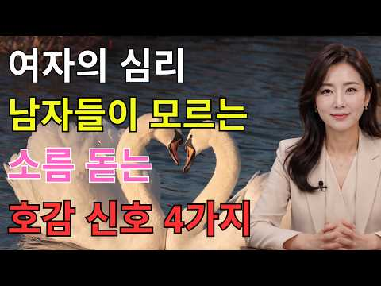
- 챕터: 0:00 호감 신호를 놓치는 이유와 핵심 포인트 · 1:48 남자가 비언어적 호감 신호를 읽기 어려운 이유 · 4:35 첫 번째 증거: 눈빛과 시선 변화 · 8:18 두 번째 증거: 말투와 대화 방식의 변화 · 12:04 질투 반응으로 확인하는 숨은 호감 · 14:30 세 번째 증거: 몸이 보내는 무의식적 신호 · 20:34 네 번째 증거: 사소한 기억과 미래 계획 · 26:06 다섯 번째 증거: 약한 모습을 보여주는 신뢰 · 30:09 다섯 가지 호감 신호 총정리와 클러스터 규칙 · 31:47 호감 신호를 확인했다면 자연스럽게 다가가는 방법 · 33:59 마무리 및 다음 영상 예고
- 설명 앞부분: 여자 심리, 남자들이 모르는 소름 돋는 호감 신호 7가지｜연애심리학 💗 여자가 진심으로 좋아할 때 무의식적으로 드러나는 호감 신호는 무엇일까요? 이 영상에서는 연애심리학을 바탕으로 눈빛, 말투, 질투, 몸짓, 기억과 미래에 대한 행동까지 남자들이 놓치기 쉬운 신호를 알아봅니다. 👀 한 가지 행동만으로 판단하지 않고 여러 신호가 반복되는 패턴을 살펴보세요. 연애심리학 관점에서 단순한 친절과 진짜 호감의 차이도 쉽게 정리했습니다. ❤️ 상대의 마음을 섣불리 단정하기보다 자연스럽게 관찰하며 연애심리학의 핵심 신호를 확인해 보세요. 연애…
- 대본 없음 (설명) — 음성인식이 끝나면 도입부·흐름이 들어감
- 댓글 3/3: 좋은 점 — 영상 0 · 감사·응원 0 · 더 알고 싶은 것 0 · 아쉬운 점 — 영상 0 · 반박·불만 — 의견 다름 0 · 정치·사회 0 · 경험 공유 0 · 구독·다음 기대 0

### 108. 99%는 모르는, 상처를 많이 받은 사람들의 숨겨진 특징

- https://www.youtube.com/watch?v=8o9cBCZoneg · 심리 인사이트 · 구독자 1,610 · 조회수 34,465 (×21.4, 하루 284.2) · 좋아요 1,219 (3.5%) · 12.3분 · 2026-07-13 · 주제 묶음 3. 자존감·마음 · 형식 목록형 (N가지 특징·신호) · 폴더 `W_8o9cBCZoneg` (웹 승인)
- 썸네일: 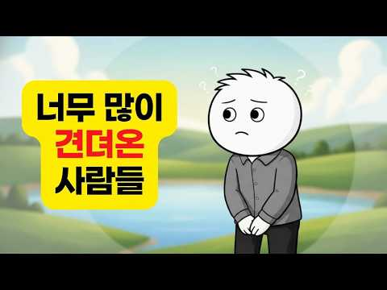
- 설명 앞부분: 삶이 너무 힘들었음에도 아무렇지 않은 척 살아가는 사람들이 있습니다. 늘 묵묵하고, 감정을 드러내지 않으며, 모든 고통을 혼자 감당하는 사람들. 하지만 그들의 침묵은 진정한 강인함일까요, 아니면 오랫동안 반복된 상처가 만들어낸 생존 방식일까요? 이번 영상에서는 만성적인 스트레스와 깊은 상처가 인간의 뇌와 심리에 어떤 변화를 일으키는지, 왜 어떤 사람들은 도움을 거부하고 모든 것을 혼자 해결하려 하는지, 그리고 감정 억압과 진정한 회복탄력성의 차이를 심리학과 신경과학의 관점에서 함께 살펴봅니다. 혹시 당신도 감정을 표현하기보다 참는…
- 대본 없음 (설명) — 음성인식이 끝나면 도입부·흐름이 들어감
- 댓글 158/158: 좋은 점 — 영상 3 · 감사·응원 14 · 더 알고 싶은 것 1 · 아쉬운 점 — 영상 0 · 반박·불만 — 의견 다름 1 · 정치·사회 0 · 경험 공유 11 · 구독·다음 기대 1
  - 좋은 점 — 영상 👍5 “덕분에 잘 보구 갑니다. 좋은 영상 감사합니다.”
  - 좋은 점 — 영상 👍1 “제가 살아오며 느낀 마음을 잘 묘사해주셔서 놀랐어요. 타인과 연결을 받아들이기가 어려웠고 쉬는 것에 큰 죄의식을 느끼면서 살았는데 시나브로 조금씩 바꿔서 삶을 살아가고 있습니다. 과거의 저를 이해하는데 큰 도움이 되었습니다. 깊이 공감되는 내용 영상으로 만들어서 설명…”
  - 감사·응원 👍89 “제 마음을 알아주는거 같아서 위로가 되네요 감사합니다”
  - 감사·응원 👍72 “뇌야 고맙다.. 그동안 수고했고, 앞으로는 조금 더 힘 빼고 일하자...”
  - 더 알고 싶은 것 👍2 “이 감정 억압을 . 감정을 받아들이는 것을 어려워 할 때 . 취약해진다는 것이 공포스러울 때 . 불안정회피형 애착일 때.. 어린시절부터 상처받고 싶지 않은 방어기제인 사람일 때. 쉬면 불안하고 평온한 상태가 어색할 때 고통스러운 상황으로 들어갈 때. 조절장애가 온 기…”
  - 반박·불만 — 의견 다름 👍0 “거트로 이게 아니죠... 석을픈 이것도 아니고... Ai로 만들었어도 확인 검수는 하고 좀 올리세요. 이게 뭡니까?”
  - 경험 공유 👍4 “그동안 나를 지키기 위해 작동했던 방어기제에게 "지금까지 고생 많았다. 이제는 내가 널 지켜줄게. 상처받게 내버려두지 않을거야. 지금의 난 ㅈㄴ 강하거든" 이라고 아주 말해줬어요 감정을 적절히 조절하는 방법을 배워야 할 단계에 온 것 같아요”
  - 경험 공유 👍3 “내가 어떤지 남편, 가족들 보다 나의 마음을 들여다 봐 주는것 같아 좋으면서 많이 먹먹하네요”
  - 구독·다음 기대 👍0 “나의강점상태를알았네요 나자신의자책과혼란에서벗어날수있겠네요~ ㅎ 감사해요~~ ❤ ^^ ㅋ 목소리넘좋으세요~❤❤ 구독해요~~ 감사감사~~”

### 109. 인생을 바꾸고 싶다면 안쓰는 물건부터 버리세요! 65세까지는 아까워도 버려야 하는 진짜 이유! 뇌과학으로 본 비움의 과학

- https://www.youtube.com/watch?v=BjKVokKepsU · 바로쓰는 심리학 · 구독자 27,100 · 조회수 722,141 (×26.6, 하루 4,627.7) · 좋아요 13,266 (1.8%) · 15.2분 · 2026-06-08 · 주제 묶음 1. 심리학 일반 · 형식 정보·해설 (그 밖) · 폴더 `W_BjKVokKepsU` (웹 승인)
- 썸네일: 
- 챕터: 0:00 옷장은 꽉 찼는데 입을 옷이 없는 아이러니 · 0:36 당신이 이상한 게 아니다: 물건을 버릴 때 뇌에서 일… · 2:21 안 쓰는 물건이 우리의 뇌와 일상을 무너뜨리는 과학적… · 4:30 만성 피로의 주범, 집안 물건 밀도와 스트레스 호르몬… · 5:31 우리가 번번이 버리기에 실패하는 3가지 심리적 덫 · 8:35 쓰지도 않는 물건을 안고 사는 것이 진짜 '큰 손실'… · 9:40 인생의 무게를 줄여줄 강력한 비움의 기준 3가지 · 11:53 비움이 가져다주는 인생 후반전의 기적과 여백의 미학 · 13:54 [오늘의 미션] 꽉 막힌 인생을 풀어줄 '5분 타이머…
- 설명 앞부분: "왜 우리 집은 채워도 채워도 입을 옷이 없고, 정리는 이토록 힘들까요?" 매번 옷장 앞에서 한숨 쉬며 "내가 게을러서, 의지가 약해서 정리를 못 하나" 자책하셨다면 오늘 영상을 꼭 보셔야 합니다. 단언컨대 당신의 잘못이 아닙니다. 인생의 후반전, 복잡한 머릿속을 비우고 맑은 여백을 되찾고 싶으신가요? 대부분의 사람들이 반대로 알고 있는 '버리기 실전 기준 3가지'를 통해 오늘 딱 5분 만에 내 인생의 무게를 가볍게 만드는 마법을 경험해 보세요! ⏱️ 타임라인 (Chapters) AI로 제작된 콘텐츠입니다.
- 대본 없음 (설명) — 음성인식이 끝나면 도입부·흐름이 들어감
- 댓글 634/634: 좋은 점 — 영상 14 · 감사·응원 27 · 더 알고 싶은 것 0 · 아쉬운 점 — 영상 0 · 반박·불만 — 의견 다름 7 · 정치·사회 0 · 경험 공유 78 · 구독·다음 기대 1
  - 좋은 점 — 영상 👍66 “지금 열심히 지난 57년간의 인생을 정리하고 있는데, 과감하게 버릴 수 있는 용기를 받았습니다.. 좋은 내용 감사합니다. 😊”
  - 좋은 점 — 영상 👍21 “제 나이 45살이예요, 저도 한번 물건 사면, 비싸게 샀는데 본전 생각나고 의미부여하고 언젠가는 쓸꺼같고 돈주고 다시 사기 아깝고 살빼면 다시 입을수있을꺼 같고, 이러한 이유때문에 그동안 옷이며 물건이며 엄청 쌓아두고 살았어요, 근데 내가 왜 이렇게 살아야하나 싶은 …”
  - 감사·응원 👍66 “지금 열심히 지난 57년간의 인생을 정리하고 있는데, 과감하게 버릴 수 있는 용기를 받았습니다.. 좋은 내용 감사합니다. 😊”
  - 감사·응원 👍9 “어쩜 내놓으시는 영상마다 힐링이 되는지 모르겠어요 감사합니다❤”
  - 반박·불만 — 의견 다름 👍4 “내 와이프때문에 미치겠다 옷장을 혼자 10칸이 터지도록 다쓴다 그럼에도 10박스는 더있고 도저히 못버텨 각방쓰는데 방에 들어가면 옷 천지다 심지어 택도 안뗀것도 있다 너 정신병이라고 일주에 3번은 싸운다 와이프 집도 마찬가지다 와이프 오빠가 결혼하면서 나갔는데 사정이…”
  - 반박·불만 — 의견 다름 👍2 “남 얘기가 아닙니다 저도 사실 잘 못버리는데 특히 살이 쪄서 못입는 옷을 살 빼서? 입으려 보관하는데 반성합니다 오늘 좀 버려야겠네요”
  - 경험 공유 👍1,153 “60대 중반인데.. 내가 추구하는 삶은 이건데.. 와이프가 비닐봉지 하나도 못버리게해서 삶이 항상 피곤합니다.. 프라이팬이 닳아서 새로 산 뒤 헌것들은 절대 안버리고.. 이걸 가정의 평화를 위해서 계속 못본척하면서 늙어가고 있네요 허허허”
  - 경험 공유 👍258 “못 버리는건 병이라고 생각중 난 70대 할매 너무 잘 버려서 영감왈 나도 갖다 버리것네! 마음이 복잡할때 찾아서 하나라도 버리면 가벼움을 느낌 그런데 영감은 아무것도 못 버리고 쌓아놓는 성질 평생의 스트레스 몰래 버리면 화내고 삐지고 ㅋ”
  - 구독·다음 기대 👍1 “도움이 많이 되었습니다 감사합니다 구독하고 갑니다 또만나요😅😅😊”

### 110. 가만히 있어도 유독 질투받는 사람들의 무서운 특징 (자격지심 무력화하는 법)

- https://www.youtube.com/watch?v=az1K9ymu-Og · 바른 심리학 · 구독자 8,350 · 조회수 222,279 (×26.6, 하루 1,398.6) · 좋아요 2,391 (1.1%) · 11.3분 · 2026-06-05 · 주제 묶음 4. 나쁜 사람 알아보기 · 형식 목록형 (N가지 특징·신호) · 폴더 `W_az1K9ymu-Og` (웹 승인)
- 썸네일: 
- 설명 앞부분: 잘난 척한 적도 없는데 왜 질투받을까요? 조용히 내 일을 했을 뿐인데 견제당하는 사람들의 공통점과 인간관계 심리를 알아봅니다. 가만히 있어도 질투받는 사람들의 특징, 지금 확인해보세요. 타임라인 개인의 상황에 따라 해석은 달라질 수 있으며, 특정인을 판단하거나 진단하기 위한 목적은 아닙니다.
- 대본 없음 (설명) — 음성인식이 끝나면 도입부·흐름이 들어감
- 댓글 370/370: 좋은 점 — 영상 6 · 감사·응원 21 · 더 알고 싶은 것 2 · 아쉬운 점 — 영상 3 · 반박·불만 — 의견 다름 8 · 정치·사회 6 · 경험 공유 57 · 구독·다음 기대 1
  - 좋은 점 — 영상 👍12 “드라마 "슬의생"에서 5인방을 5무로 평가하면서 이익준(조정석)에 대해 꼬인 것이 없다는 말이 마음에 와닿더라고요... 콤플렉스를 갖는 사람들이 남에게 열등감을 많이 느끼고 시기질투어린 행동을 많이 한다는 것을 요즘 많이 보고 있습니다.”
  - 좋은 점 — 영상 👍10 “정말 좋은 정보 고맙네요 알고는 잇엇지만 이정도 로 타깃이되는줄 ㆍㆍㆍ 거의 흔들리지 않는 편이라서 돈도없고 명문대 출신도 아닌데 전 미움받아서 혼자잇는게 편해요 삼삼오오 잇는것도 좋치만 울나라사람들 장점보다 서로모이면 부정이 사람에 내재속 깊숙이 수며드는 물같은 거…”
  - 감사·응원 👍478 “직장에서 일도 안하는 사람들이 꼭 모여서 일도 안하고 밤에 초과근무 끊고 놀기만하면서 정작 정시 출퇴근하면서 일만 하는 저 보고 일 열심히 안한다고 말하고 다닙니다. 사실 제가 여기서 사업 공모 신청이나 업무 관련해서도 탁월한 성과를 내는 편인데 그럴때마다 그들은 자…”
  - 감사·응원 👍252 “40년친구들이 내가 성공하니 축하는 커녕 질투만 하는 친구들보고 엄청 충격받았다ᆢ진정한 친구는 없구나ᆢ 성공하기까지 남들 쉴때 일하고 남들 잘때 일하면서 성공했는데 ᆢ다 필요없다ᆢ아내와 자식들만 날 응원해주면 된다”
  - 아쉬운 점 — 영상 👍7 “살면서 진짜친구 만나는거 힘들다고하죠 슬픈일엔 진정으로 같이 슬퍼해주고 위로해주던 친구도 기쁜일엔 진정으로 기뻐해주기 힘들다고 “그래 축하해”하면서도 속으로 찜찜해하는 느낌 다들 느껴보셨을꺼예요; 그래서 저는 다르게 살기로 했어요 제게 좋은 친구가 나타나길 기다리기 …”
  - 아쉬운 점 — 영상 👍2 “가장 가까웠고 믿었던 사람이 딱 저랬다. 그게 반복되니 난 걍 즐기게 되더라.”
  - 반박·불만 — 의견 다름 👍91 “찌질한 인간들은..혼자서는 남의욕도 못해요..이런부류들은 일단 모여서 헛소리를 합니다. 없는말 만들어내고. 누가 카더라하고. 모여서 행동하는것들은 내면이 결핍된자들입니다..”
  - 반박·불만 — 의견 다름 👍10 “정말 좋은 정보 고맙네요 알고는 잇엇지만 이정도 로 타깃이되는줄 ㆍㆍㆍ 거의 흔들리지 않는 편이라서 돈도없고 명문대 출신도 아닌데 전 미움받아서 혼자잇는게 편해요 삼삼오오 잇는것도 좋치만 울나라사람들 장점보다 서로모이면 부정이 사람에 내재속 깊숙이 수며드는 물같은 거…”
  - 정치·사회 👍3 “정치권도 지금 마찬가지임... 정청래도 지금 저 왕따랑 똑같은 상황임... 권리당원들한테 제일 많이 인정받고 있는게 정청래인데... 검찰 보완수사권 폐지 1인1표제 검찰개혁에 제일 열심히였던건 정청래 추미애임... 근데 주변 586운동권 계파정치질 하는 세력들은 정청…”
  - 정치·사회 👍1 “좌파들의 기본속성. 나보다 잘난 사람들이 열심히 노력해서 얻은 경제적 부를 평응아라는 이름으로 뺏어 하는 일 없이 놀고 시간낭비한 다수에게 나눠줘야 한다는 생각. 단 타고난 조건으로 노력해도 성취하기 어려운 이들에게는 국가적 차원에서 복지정책을 펴야죠. 그 경우는 제…”
  - 경험 공유 👍478 “직장에서 일도 안하는 사람들이 꼭 모여서 일도 안하고 밤에 초과근무 끊고 놀기만하면서 정작 정시 출퇴근하면서 일만 하는 저 보고 일 열심히 안한다고 말하고 다닙니다. 사실 제가 여기서 사업 공모 신청이나 업무 관련해서도 탁월한 성과를 내는 편인데 그럴때마다 그들은 자…”
  - 경험 공유 👍283 “내가 일하면서 느낀게 뭐냐면 열심히 잘하는 사람은 질투 안함 꼭 잔머리 굴리고 쉬운것만 할려고하고 그러면서 직장 탓하는 인간들이 딱 저럼 정말 유치하기 짝이없음”
  - 구독·다음 기대 👍0 “구독하고 갑니다 해결방법 안내도 좋고 구독자 댓글 수준도 높네요”

### 111. 항상 집이 깨끗한 사람들의 놀라운 특징 : 뇌를 바꾸고 부를 끌어당기는 정리의 뇌과학

- https://www.youtube.com/watch?v=NV6XEbHUFQU · 최적화 심리학 · 구독자 12,200 · 조회수 303,938 (×24.9, 하루 2,033.4) · 좋아요 6,375 (2.1%) · 10.7분 · 2026-06-14 · 주제 묶음 1. 심리학 일반 · 형식 목록형 (N가지 특징·신호) · 폴더 `W_NV6XEbHUFQU` (웹 승인)
- 썸네일: 
- 챕터: 0:00 쉬어도 피곤한 사람과 깨끗한 집을 유지하는 사람의 뇌… · 0:50 나중에'를 없애 뇌의 배터리를 아끼는 법 (자이가르닉… · 3:09 청소를 노동이 아닌 '뇌 리셋(재부팅)'으로 활용하기 · 5:51 의욕을 기다리지 않고 먼저 움직이는 기술 (행동 활성… · 8:43 부와 성공을 끌어당기는 능력의 정체 (내적 통제성과 …
- 설명 앞부분: 분명 주말 내내 누워서 쉬었는데, 이상하게 마음 한구석이 무겁고 월요일 아침에 더 지치시나요? 더 자도, 더 쉬어도 피로가 풀리지 않는다면 그건 당신이 게으른 탓이 아닙니다. 늘 모델하우스처럼 깔끔한 집을 유지하는 사람들은 우리와 '의지력'이나 '타고난 성격'이 다른 것이 아닙니다. 단지 '뇌를 쓰는 방식'이 다를 뿐입니다. 오늘 영상에서는 뇌과학과 심리학(자이가르닉 효과, 프린스턴대 fMRI 연구, UCLA 코르티솔 연구)을 통해 항상 집이 깨끗한 사람들이 가진 소름 돋는 '이 능력'의 정체를 밝힙니다. 의지력을 단 한 방울도 …
- 대본 없음 (설명) — 음성인식이 끝나면 도입부·흐름이 들어감
- 댓글 320/320: 좋은 점 — 영상 22 · 감사·응원 14 · 더 알고 싶은 것 1 · 아쉬운 점 — 영상 1 · 반박·불만 — 의견 다름 2 · 정치·사회 0 · 경험 공유 26 · 구독·다음 기대 1
  - 좋은 점 — 영상 👍33 “집이 깨끗하면 뇌도 깨끗해지죠. 보통 우리 방 상태가 지금의 자신의 뇌상태라고 보면 됩니다. 좋은 영상 잘 봤습니다!”
  - 좋은 점 — 영상 👍5 “울남편은 정리정돈 안되어있고 좀만 지저분하면 지×랄 발광 주변 사람을 피말립니다..저랑 친한 여자도 무지하게 깔끔한데 울 남편이랑 똑같은 성격을 갖고 있습니다 매일 헤어질 생각만 하고 있습니다 쳐×숩는건 열라 좋아하면서 매일 정리정돈을 강조하다못해..못배웠는니 근본은…”
  - 감사·응원 👍12 “아하 그렇구나 내가 피곤하지 않는 이유구나 항시 깨끗깨끗 하거든요 감사감사 합니다”
  - 감사·응원 👍7 “감사합니다 ❤❤❤”
  - 더 알고 싶은 것 👍3 “너무 공감되서 구독좋아요 눌렀네요 다음에도 좋은 영상부탁드립니다😅”
  - 아쉬운 점 — 영상 👍1 “옳소. Ai목소리임? 좋네요.”
  - 반박·불만 — 의견 다름 👍19 “잘 치우는 사람도 귀찮은 감정은 똑같아요~특별한 뇌구조라서가 아니라 일이 쌓이면 더 많은 에너지를 써야한다는 걸 알기 때문이예요! 그리고 의욕도 리듬이 있어요.조금의 차이지만 의욕이 생기는 날 더 많이 치우고 정리하고 에너지 없는날은 적게 움직입니다. 이 영상은 진실…”
  - 반박·불만 — 의견 다름 👍1 “그때 그때 마다 정리하고 치워야 해요 하루 이틀 지나면 더 하기싫어져요 그리고 무언가 하기싫다는건 마음도 건강도 약해졌다는 증거에요 사실 게을러서 그런게 아닙니다 제가 경험했어요”
  - 경험 공유 👍99 “저도 항상 물건은 제자리에”
  - 경험 공유 👍42 “"이 집에는 언제와도 괞찮아!" 내 친구가, 자기 친구를 데리고 우리 집을 방문해서 하는 말이다. 나는 대청소하기 힘들어서, 미루지 않고 바로 치운다. 그래서 갑작스런 방문도 환영이다😊”
  - 구독·다음 기대 👍1 “나이가드니 마음으로는 단순하게 정리를 잘하고 싶은데,잘 안되요 오늘 도움이 많이 되었고, 구독했어요😂”

### 112. 인생은 결국 혼자입니다 외로움 없이 행복하게 살아가는 7가지 방법 ∣ 김형석 독립기념관장

- https://www.youtube.com/watch?v=v_1LXZktL2g · poke vingador · 구독자 2,640 · 조회수 70,450 (×26.7, 하루 435.8) · 좋아요 1,742 (2.5%) · 63.4분 · 2026-06-02 · 주제 묶음 3. 자존감·마음 · 형식 인터뷰·강연·대담 (전문가) · 폴더 `W_v_1LXZktL2g` (웹 승인)
- 썸네일: 
- 설명 앞부분: 인생은 결국 혼자입니다 외로움 없이 행복하게 살아가는 7가지 방법 ∣ 김형석 독립기념관장
- 대본 없음 (설명) — 음성인식이 끝나면 도입부·흐름이 들어감
- 댓글 319/319: 좋은 점 — 영상 31 · 감사·응원 116 · 더 알고 싶은 것 2 · 아쉬운 점 — 영상 1 · 반박·불만 — 의견 다름 0 · 정치·사회 0 · 경험 공유 5 · 구독·다음 기대 1
  - 좋은 점 — 영상 👍23 “교수님 어쩜 이렇게 다 옳은 말씀만 하시는지 참 뼈에 와 닿습니다 저도 70 왔는데 혼자 된지 20년이 넘었습니다 다 하시는 말씀마따나 옳은 말씀 참 하나도 틀린 말 없네요”
  - 좋은 점 — 영상 👍6 “교수님 너무너무감사합니다 좋은말씀잘듣고갑니다^^”
  - 감사·응원 👍15 “미국 달라스에서 사는 76 세 여성입니다 매일 듣고 있습니다 감사합니다.”
  - 감사·응원 👍15 “선생님 감사합니다.(76세) 항상 경청하고 있습니다.”
  - 더 알고 싶은 것 👍2 “네보귀한말씀종종알려주세요감사합니 39:34 다”
  - 더 알고 싶은 것 👍2 “안녕하세요? 요즘 박사님 말씀듣고 너무나 행복하게 살아갑니다. 3년째 치매 엄마 간병을 하고 있는데 요즘같이 이렇게 행복한 적이 없었습니다. 박사님 말씀을 들으면서 자신감이 생기고 하나님과의 괸계도 더 깊어지는듯 합니다. 그저 감사하다는 말씀 드리고 싶어 댓글 올립니…”
  - 아쉬운 점 — 영상 👍0 “이 영상은 김 교수와 아무 상관이 없다. 사기꾼이 영상 편집하고 AI 목소리 넣어서 사람들 속이고, 유튭에서 돈 받는 사기 행위이다. 븅신이 넘쳐나서, 사기꾼이 날뛴다. 말과 입이 안 맞는다.”
  - 경험 공유 👍23 “교수님 어쩜 이렇게 다 옳은 말씀만 하시는지 참 뼈에 와 닿습니다 저도 70 왔는데 혼자 된지 20년이 넘었습니다 다 하시는 말씀마따나 옳은 말씀 참 하나도 틀린 말 없네요”
  - 경험 공유 👍11 “누구나 혼로서기는 기본이고 스스로의 책임입니다. 홀로서기 못하면 어떤 환경도 적응이 되지 않습니다. 저도 때론 고독을 느낄때가 있고 우울할땐 외곡된 생각도 해보지만 쓸데없는 생각이라고 느낍니다. 내가 견뎌야하는 현실이고 나의 몫입니다. 어느누구도 해결 해 줄수없는 나…”
  - 구독·다음 기대 👍15 “미국 달라스에서 사는 76 세 여성입니다 매일 듣고 있습니다 감사합니다.”

### 113. 10년 넘은 친구도 한순간에 끊어내는 사람들의 결정적 특징 (손절의 뇌구조)

- https://www.youtube.com/watch?v=7yhehYw6oDc · 토닥교수의 심리학 · 구독자 26,700 · 조회수 394,021 (×14.8, 하루 4,379.7) · 좋아요 3,072 (0.8%) · 14.6분 · 2026-08-13 · 주제 묶음 2. 인간관계·대화 · 형식 목록형 (N가지 특징·신호) · 폴더 `W_7yhehYw6oDc` (웹 승인)
- 썸네일: 
- 챕터: 0:00 인트로 — 관계를 칼같이 끊는 사람, 정말 냉정한가 · 1:13 칼같이 정리하는 사람의 진짜 내면 — 소수에게 쏟는 … · 3:45 사회적 교환 이론 — 관계 불균형이 보내는 신호 · 5:35 이들이 마지막 선을 넘게 되는 결정적 기준 · 7:34 왜 싸우지 않고 조용히 사라지는가 · 9:06 애매한 태도가 단호한 거절보다 잔인한 이유 · 11:24 진짜 외로움은 관계 안에 이미 있었다 · 13:20 관계 정리 = 나에게 맞는 관계를 다시 선택하는 것
- 설명 앞부분: 관계를 한 번 정리하면 절대 뒤돌아보지 않는 사람, 주변에 한 명쯤 있으시죠. 대부분 "정 없다, 냉정하다"라고 판단하지만, 이 사람들의 진짜 내면은 정반대입니다. 오늘 영상을 끝까지 보시면, 왜 관계를 칼같이 끊는 사람이 오히려 정이 가장 깊은 사람인지 완전히 새로 이해하게 되실 겁니다. 이 영상에서는 관계를 칼같이 정리하는 사람들의 심리를 인간관계 심리학 관점에서 하나씩 해부합니다. 왜 이들이 아무에게나 정을 나누지 않는지, 사회적 교환 이론으로 본 관계 불균형의 신호는 무엇인지, 실수를 대하는 태도가 왜 신뢰의 결정적 기준이…
- 대본 없음 (설명) — 음성인식이 끝나면 도입부·흐름이 들어감
- 댓글 431/431: 좋은 점 — 영상 15 · 감사·응원 9 · 더 알고 싶은 것 2 · 아쉬운 점 — 영상 5 · 반박·불만 — 의견 다름 14 · 정치·사회 1 · 경험 공유 51 · 구독·다음 기대 0
  - 좋은 점 — 영상 👍27 “좋은 영상 감사합니다🙏 글자 하나 틀리지 않고 정확합니다. 모든 순간 진심을 다했고 수없이 상대방과 저에게 시간을 주었습니다. 결국 의미가 사라지면 관계를 정리하고 미련도 후회도 없습니다. 상대방도 잘 살기를 바라지만, 저와의 인연은 여기까지 입니다. 저의 인생에서 …”
  - 좋은 점 — 영상 👍15 “너무 좋은 영상이네요 나이50 되어보니 너무 가까이간 제잘못이라 생각하고 이제 적당히 친하게 지내려고 합니다”
  - 감사·응원 👍44 “Isfj 딱 제 얘기네요. 정이 많고 사람 좋아하지만 어느순간 그 사람과의 선이 생기고 제 맘속에서 칼같이 잘라내더라구요. 그뒤로 서서히 멀어질때도 있고 바로 끝낼때도 있어요. 하지만 후회해본적이 진짜 한번도 없어요. 결국 인생은 혼자 스스로 살아내야 하는 거라고 생…”
  - 감사·응원 👍27 “좋은 영상 감사합니다🙏 글자 하나 틀리지 않고 정확합니다. 모든 순간 진심을 다했고 수없이 상대방과 저에게 시간을 주었습니다. 결국 의미가 사라지면 관계를 정리하고 미련도 후회도 없습니다. 상대방도 잘 살기를 바라지만, 저와의 인연은 여기까지 입니다. 저의 인생에서 …”
  - 더 알고 싶은 것 👍18 “내 속에 언제 들어오셨나요? 소름”
  - 더 알고 싶은 것 👍0 “가족하고는 어떨까요? 가족중 어느 한사람과의 마찰로 온 가족들과의 서로간의 불편함으로 인해 다른가족들의 평화를 위해 손절한 것은 어떤가요? 물론 부모님은 돌아가신후이고 금전적 관계는 전혀 아님 🤔”
  - 아쉬운 점 — 영상 👍18 “지각, 실수해놓고 사과없이 오히려 뻔뻔한 태도면 그냥 이유불문 손절하세요. 사람 안변합니다.”
  - 아쉬운 점 — 영상 👍4 “1. AI 목소리 지겹다.. 2. 이 영상 보고 또 본인이라고 댓글 달린다. 3. 심리를 파고드는 유튜브가 돈이 된다.”
  - 반박·불만 — 의견 다름 👍1,542 “칼 같이 ? 아닙니다 오랜시간 고민하고 배려했던겁니다”
  - 반박·불만 — 의견 다름 👍4 “딱 저네요. 한번 아닌 사람은 절대 아닙니다. 왜냐면 최대한 배려해줬기 때문에, 미련이 없습니다.”
  - 정치·사회 👍0 “좌파 지인들은 싹다 끊으니 삶이 나아지더라.”
  - 경험 공유 👍13 “진심 제가 하고픈 얘기들 ㅠㅠ”
  - 경험 공유 👍6 “나도 비슷”

### 114. "나를 통제한다? 저는 돌아버려요" 통제가 안 먹히는 강철멘탈 4명의 생존법 l 기준이탈모임 EP.3

- https://www.youtube.com/watch?v=Eir2GhnFJdc · 강남언니 · 구독자 46,800 · 조회수 657,039 (×14.0, 하루 7,550.8) · 좋아요 6,902 (1.1%) · 53.3분 · 2026-08-16 · 주제 묶음 3. 자존감·마음 · 형식 정보·해설 (그 밖) · 폴더 `W_Eir2GhnFJdc` (웹 승인)
- 썸네일: 
- 챕터: 0:00 하이라이트 · 1:01 게소 🎸 팟캐스트계 유느님 · 1:48 다들 기다린 “통제” · 2:27 통제의 경계선 · 3:55 통제형의 쓰레기 멘트 TOP3 👑 · 5:47 네 취향은 틀렸어 ❌ · 7:12 통제의 반대말? · 9:26 SNS 키보드 통제러 · 12:57 본가 가면 생기는 일 🚎 · 14:36 좋은 교육은 뭘까? · 15:27 김간지 길들이는 법 😼 · 15:42 거짓말 만렙이 되.. · 16:56 아영의 상경썰 🚅 · 17:31 진경이 워홀 간 이유 · 18:15 부모님은 왜 그럴까? · 20:54 방치와 통제, 한 끗 차이 · 22:36 통제 대신 필요한 건? · 23:07 진경이 엄마가 된다면 🧡 · 24:06 각자의 첫 휴대폰 썰📱 · 26:34 "사랑해서 그래"의 함정 💔
- 설명 앞부분: 모두가 기다린 그 주제 "통제” 연애·가족·직장에서 겪은 통제형 인간 썰부터 감정 통제하는 각자의 유쾌한 방법까지 🎵 통제를 전격 해부한 기준이탈모임이 궁금하다면? 오늘은 담백하면서도 거침없는 입담으로 사랑받는 '김간지'님과 함께했습니다. 🧡 매주 일요일 오후 6시 공개!
- 대본 없음 (설명) — 음성인식이 끝나면 도입부·흐름이 들어감
- 댓글 767/767: 좋은 점 — 영상 20 · 감사·응원 25 · 더 알고 싶은 것 8 · 아쉬운 점 — 영상 6 · 반박·불만 — 의견 다름 16 · 정치·사회 4 · 경험 공유 113 · 구독·다음 기대 0
  - 좋은 점 — 영상 👍420 “통제 간섭 참견 오지랖 호들갑 << 이거싫어하는 사람들은 한국에서 살기 힘듦 오늘 영상 하나부터열까지 다 공감되네..”
  - 좋은 점 — 영상 👍276 “엄마가 나르+통제형이라서 영상 내용들 정말 한 문장도 빠짐없이 다 공감되네요.. 자꾸 엄마 욕?하게 되는것 까지도..ㅠㅋㅋ 근데 통제형 엄마밑에서 크지 않은 사람들은 왜 이렇게 발작버튼 눌려하는지 이해 못 하더라구요.. 그래도 나만 이런 생각하는게 아니구나 싶어서 영…”
  - 감사·응원 👍276 “엄마가 나르+통제형이라서 영상 내용들 정말 한 문장도 빠짐없이 다 공감되네요.. 자꾸 엄마 욕?하게 되는것 까지도..ㅠㅋㅋ 근데 통제형 엄마밑에서 크지 않은 사람들은 왜 이렇게 발작버튼 눌려하는지 이해 못 하더라구요.. 그래도 나만 이런 생각하는게 아니구나 싶어서 영…”
  - 감사·응원 👍36 “영상 보면서 많은 생각이 듭니다. 사실, 저는 적당한 방목형으로 자랐어요. 다 저희집처럼 이런 줄 알았는데 고등학교 때 친구들이랑 대화하면서 우리집이랑 너무 다르다는 것을 알게 되었어요. 친구들이 정말 힘들어 보이더라고요😢 엄마는 제 외모에 대해서 한번도 통제하는 말…”
  - 더 알고 싶은 것 👍276 “엄마가 나르+통제형이라서 영상 내용들 정말 한 문장도 빠짐없이 다 공감되네요.. 자꾸 엄마 욕?하게 되는것 까지도..ㅠㅋㅋ 근데 통제형 엄마밑에서 크지 않은 사람들은 왜 이렇게 발작버튼 눌려하는지 이해 못 하더라구요.. 그래도 나만 이런 생각하는게 아니구나 싶어서 영…”
  - 더 알고 싶은 것 👍1 “06:25 호프 불호인데 불호라고 말하는 사람들 때문에 내 취향은 아니었어 라고 말하는 것도 눈치 보인다는 말 개공감!!!!!!! ㅜㅜ 왜 님들 때문에 멀쩡히 취향 교류하고 싶은 사람들도 이상한 취향 통제충으로 만드는 건지....... 나는 내가 취향이 아닌만큼 다른…”
  - 아쉬운 점 — 영상 👍7 “독립하고나서 깨달았다 부모님 집에서 살면서 부모님이 사주는 옷과 밥을 먹으면서 통제하지 말라는 이중적인 (뻔뻔한) 생각은 하지말자. 부모님의 룰이 불편하게 느껴지는 순간 자연스럽게 독립하면 되고, 부모님 집에 갔을때는 그들의 룰을 따른다. 저는 이제는 엄마가 밥먹으라…”
  - 반박·불만 — 의견 다름 👍84 “통제에 대한 고찰 내가 부모의 입장이 안돼봐서 얼만큼의 통제가 적절한지는 모르겠으나 소위말하는 나르시시스트 엄마+무관심한 아빠를 둔 사람으로서 나르시시스트에게 평생 통제를 당하면 굉장히 불안정한 어른으로.. 아니 겉은 어른이지만 아무것도 못하고 자기자심을 믿지 못하는…”
  - 반박·불만 — 의견 다름 👍64 “진짜 숨이 턱턱 막히네 영상에서 말한 모든 걸 다 상대가 들어달란 게 아닙니다.. 통제라는 주제에 대해 이제는 논의를 할 때가 왔고 거기에 고통받는 사람들은 자기들만의 생각을 솔직하게 나누겠다는 거지 솔직히 댓글들도 다 관계에 있어 통제를 당연시하고 영상을 바라보는 …”
  - 정치·사회 👍353 “이런 이야기 나올때마다 느끼는데 걍 한국이라는 나라가 특수성이 너무 강하다.. ㅋㅋㅋ 문화,경제,정치,사회 모든게 남들 200년동안 성장했던게 50년으로 단기압축 되버려서 그동안 레벨업에만 신경쓰고 정작 팔다리 거덜난건 모른척했다가 더이상 모른척 할수없을정도로 곪았던…”
  - 정치·사회 👍1 “확실히 한국이 그 꼰대성 발언이나 개인간 선넘는 일이 좀 더 잦음. 외국인 동료들과 일하면서 나이가 몇이던 ㄸㄹㅇ는 있었지만 꼰대성 발언, 무시, 통제하고 지말이 맞다는 비율이 더 적었음. 오 그래? 와우 니생각 멋지다 ㅇㅇ, 니 생각도 일리있네 근데 난 다르다고 생…”
  - 경험 공유 👍1,235 “진지충으로서 말하자면 가끔 한번쯤은 자기감정에 대해 한발짝 멀리서 관망해보는게 필요함 사랑이라 생각했는데 우월감이었고 우정이라고 생각했는데 질투였던 적이 있었음... 내가 상대의 뭔가가 마음에 안든다면 과연 그게 상대의 책임인지 생각해보고 상대에게 개선을 요구할 권리…”
  - 경험 공유 👍438 “통제 극혐인 내가 항상 하는 말 -> 아 내가 알아서할게”

### 115. 똑똑한 사람은 손절할 때 이것을 절대 하지 않는다 (심리학적 분석)

- https://www.youtube.com/watch?v=33-g3TpuawA · 토닥교수의 심리학 · 구독자 26,700 · 조회수 264,059 (×9.9, 하루 4,246.5) · 좋아요 1,133 (0.4%) · 19.5분 · 2026-09-10 · 주제 묶음 1. 심리학 일반 · 형식 목록형 (N가지 특징·신호) · 폴더 `W_33-g3TpuawA` (웹 승인)
- 썸네일: 
- 챕터: 0:00 인트로 — 진짜 똑똑한 사람의 손절은 방식이 다르다 · 4:48 특징 1 — 서두르지 않고 조용히 오래 지켜본다 · 6:44 특징 2 — 상대를 내 입맛에 맞게 고쳐 쓰지 않는다 · 7:51 특징 3 — 말 대신 '거리'를 설계한다 · 9:49 특징 4 — 명분은 준비하되 남 탓은 하지 않는다 · 11:16 특징 5 — "무슨 일 있어?"에 설명하지 않는다 · 13:48 같은 방법, 왜 결과는 정반대인가 — 내 마음 상태 … · 16:45 손절 전에 꼭 생각해봐야 할 것들
- 설명 앞부분: 관계 정리했다가 오히려 뒷말·소문·후폭풍에 더 시달린 적 있으신가요? 진짜 똑똑한 사람들의 손절은 방식 자체가 다릅니다. 말로 끝내는 게 아니라 '거리'를 설계하기 때문에, 오래된 관계도 상처 없이 조용히 마무리됩니다. 오늘 이 5가지 원칙을 알고 나면, 지금 미루던 그 관계 정리가 오늘 저녁부터 완전히 다르게 보이실 겁니다. 이 영상에서는 인간관계 정리를 뒷말 없이 깔끔하게 완성하는 사람들의 다섯 가지 공통 원칙을 정리했습니다. 우리가 어른의 태도라 배워 온 만나서 얘기하기·터뜨리기·잠수 타기가 왜 매번 실패로 끝나는지, 그리고…
- 대본 없음 (설명) — 음성인식이 끝나면 도입부·흐름이 들어감
- 댓글 62/62: 좋은 점 — 영상 0 · 감사·응원 0 · 더 알고 싶은 것 1 · 아쉬운 점 — 영상 2 · 반박·불만 — 의견 다름 7 · 정치·사회 0 · 경험 공유 14 · 구독·다음 기대 0
  - 아쉬운 점 — 영상 👍8 “5가지 정리좀 해주세요 너무길어서ㅠ”
  - 아쉬운 점 — 영상 👍1 “그냥 연락 받지마 그럼 저절로 떨어져 나간다. 너무 길어.”
  - 반박·불만 — 의견 다름 👍12 “그냥 신경 안쓰고 정리합니다 뭐 대단한 인생도 아닌데 대강 삽니다”
  - 반박·불만 — 의견 다름 👍1 “똑똑한거 아닙니다~”
  - 경험 공유 👍31 “내가 똑똑했구나 ㅋㅋㅋ 잘하고 있었어~~~^^ 지금은 정말 좋은사람들과 단단히 지내며 행복해❤”
  - 경험 공유 👍11 “청약 당첨되서 이사간다고하니 축하는 커녕 싫은티 팍팍 내길래 그 때부터 마음속 손절 시작했었지요 2년 지난 후 이사간 뒤로는 연락없더라구요 그 사이 손절하기 위해 천천히 관계 정리 들어갔었던게 상대방도 눈치챘었나봅니다 전화오면 놓쳤다가 톡 보내거나. 늘 저만보면 남편…”

### 116. 감추는 마음이 치르는 대가의 심리학 ∣ 너새니얼 호손 '주홍글씨' 완벽 해설

- https://www.youtube.com/watch?v=Kdl4DYCm2Bk · 밀리언마인드 A million mind · 구독자 20,400 · 조회수 188,336 (×9.2, 하루 2,985.1) · 좋아요 2,202 (1.2%) · 48분 · 2026-09-09 · 주제 묶음 1. 심리학 일반 · 형식 수면·낭독 (잠잘 때 듣는) · 폴더 `W_Kdl4DYCm2Bk` (웹 승인)
- 썸네일: 
- 챕터: 0:00 광장의 처형대 · 9:52 이름을 버린 남자 · 17:56 존경받는 사람 · 26:37 밤의 처형대 · 35:35 축제일
- 설명 앞부분: 🕯 광장 한가운데 세워진 여자가 있었습니다. 가슴에는 붉은 글자 A가 달려 있었고, 그녀는 아이 아버지의 이름을 끝내 말하지 않았습니다. 죄가 드러난 사람과 죄를 감춘 사람. 마을이 벌한 것은 한 사람이었지만, 무너진 사람은 따로 있었습니다. 감춘 채로 사는 데도 값이 든다는 것을, 이 소설은 조용히 보여줍니다. 📖 너새니얼 호손이 1850년에 남긴 이 작품을 한 편에 담았습니다. 지금 내가 무엇을 감추고 있는지, 한 번쯤 돌아보게 되는 이야기입니다.
- 대본 없음 (설명) — 음성인식이 끝나면 도입부·흐름이 들어감
- 댓글 57/57: 좋은 점 — 영상 2 · 감사·응원 11 · 더 알고 싶은 것 0 · 아쉬운 점 — 영상 0 · 반박·불만 — 의견 다름 0 · 정치·사회 0 · 경험 공유 2 · 구독·다음 기대 0
  - 좋은 점 — 영상 👍16 “잘 들었읍니다. 끝까지 잘 들었어요.. 차분한 목소리로 읽어주셔서 더 귀에 잘들어오네요. 감사합니다!!”
  - 좋은 점 — 영상 👍3 “귀한 영상 잘 보았습니다 🎉영상도 참 예쁘네요 🎉읽고 싶었던 책을 나이가 드니 또 이렇게 만나네요 🎉굳이 활자로 꼭 읽어야 할 이유는 ? 없지요 이런 세상에서 !! 생각이 모두 다르겠지만 !! 갠적으로 죄무자성종심기(罪無自性從心起)는 죄는 본래 고유한 성질이 없으며 …”
  - 감사·응원 👍22 “아이를 안고 있는 헤스터, 사실이라면 딥스데일을 닮아 있지 않았을까? 1983년, 멕시코 만사니요항에서 6개월 된 아이를 안고 온 여인이 있었다. 메스티조 여인이었지만 아이는 선장님을 닮아있었다. 나다니엘 호돈의 ‘큰바위 얼굴’은 나에게 평생 동안 영향을 미치고 있는…”
  - 감사·응원 👍16 “잘 들었읍니다. 끝까지 잘 들었어요.. 차분한 목소리로 읽어주셔서 더 귀에 잘들어오네요. 감사합니다!!”
  - 경험 공유 👍57 “영적으로 보면 세계인은 하나로 연결된 가족입니다. 인간으로 태어나 누구나 죄를 짓고 살아갑니다. 남 욕하는 것도.. 비웃는 것도.. 탓하는 것도.. 원망하는 것도.. 알고 보면 모두 죄에 속합니다. 다른 사람을 용서할 때 내가 쌓은 업보도 사라집니다. 용서는 마음으로…”
  - 경험 공유 👍23 “드러난 죄와 숨긴 죄 다윗도 죄를 짓고 숨기려다 선지자 나단을 통해 죄가 드러났습니다 평양 대부흥도 우월감에 도취된 한 선교사의 회개로 부터 시작되었습니다 그리고 교회는 회개를 통해 하나님을 경험했습니다 지금도 그런 세상에 살고 있다고 믿습니다 드러난 죄와 숨긴 죄로…”

### 117. 단 3일 만에 뇌를 리셋하고 무서울정도로 인생을 바꾸는 혼잣말의 뇌과학 비밀, 인생이 잘 풀리는 사람들은 말의힘을 알고 있습니다

- https://www.youtube.com/watch?v=-oYkAO58LSE · 바로쓰는 심리학 · 구독자 27,100 · 조회수 524,013 (×19.3, 하루 3,940.7) · 좋아요 9,963 (1.9%) · 12.1분 · 2026-07-01 · 주제 묶음 1. 심리학 일반 · 형식 정보·해설 (그 밖) · 폴더 `W_-oYkAO58LSE` (웹 승인)
- 썸네일: 
- 챕터: 0:00 하루의 운을 결정하는 진짜 원인, 혼잣말 · 1:45 뇌의 정보 필터 '망상활성계'가 작동하는 원리 · 3:38 혼잣말이 우리의 몸과 뇌 활동 패턴(fMRI)을 바꾸… · 5:01 당장 멈춰야 할, 인생을 정체시키는 무서운 3가지 단어 · 8:12 우리가 나쁜 말 습관을 쉽게 고치지 못했던 이유 · 8:32 단 3일 만에 뇌를 리셋하는 4가지 실전 말하기 기술 · 11:24 오늘 밤 당장 실천하는 가장 힘 있는 타이밍과 작은 …
- 설명 앞부분: "아침에 눈뜰 때부터 왠지 기분이 좋고 일이 술술 풀리는 날이 있는가 하면, 반대로 되는 일이 하나도 없고 자잘한 실수가 반복되는 날이 있죠. 우리는 이것을 흔히 '그날의 운' 때문이라고 생각합니다.오늘 영상에서는 우리의 인생을 멈추게 만들었던 무서운 세 단어의 정체와 함께, 단 3일 만에 뇌의 필터를 완전히 리셋하고 인생을 바꾸는 4가지 실전 말하기 기술을 소개해 드립니다. ⏳ 타임라인 (Timestamp) ⚖️ 면책 문구 (Disclaimer)[면책 문구] 본 영상은 뇌과학 및 심리학 연구 자료를 바탕으로 제작된 대중적 정보 …
- 대본 없음 (설명) — 음성인식이 끝나면 도입부·흐름이 들어감
- 댓글 149/149: 좋은 점 — 영상 6 · 감사·응원 49 · 더 알고 싶은 것 1 · 아쉬운 점 — 영상 2 · 반박·불만 — 의견 다름 1 · 정치·사회 0 · 경험 공유 10 · 구독·다음 기대 0
  - 좋은 점 — 영상 👍55 “좋은 말씀 감사합니다 ~ 전 늘 복이많다고 생각하고 말을 매일 하고 있는 사람인데, 말처럼 복이 많습니다 ~ 모두들 늘 배우는 자세로 복많은 인생 됩시다~~”
  - 좋은 점 — 영상 👍3 “매우 유익한 영상입니다. 감사합니다. 🎉 나는 만물의 주 그리스도 예수닝을 점점 더 잘 알아가고 있다.”
  - 감사·응원 👍132 “맞아요. 엄청 힘든시기에는 늘 부정적이었어요. 그러다 정신차리고 항상웃고 감사하고 살았더니 좋은 일들이 굴러들어오더라구요. 모두들 밝게 감사하며 살아봅시다.”
  - 감사·응원 👍55 “좋은 말씀 감사합니다 ~ 전 늘 복이많다고 생각하고 말을 매일 하고 있는 사람인데, 말처럼 복이 많습니다 ~ 모두들 늘 배우는 자세로 복많은 인생 됩시다~~”
  - 더 알고 싶은 것 👍1 “뭔 부연설명이 이렇게 많아요. 핵심만 알려주세요.”
  - 아쉬운 점 — 영상 👍2 “반복해서보고 있습니다. 😊”
  - 아쉬운 점 — 영상 👍1 “뭔 부연설명이 이렇게 많아요. 핵심만 알려주세요.”
  - 반박·불만 — 의견 다름 👍0 “🟩🟩 우리의 인생을 무의식적으로 정체시키는 '인생을 망치는 무서운 세 단어'로 다음을 꼽고 있습니다. 1. "모르겠다": 습관적으로 이 말을 뱉는 순간, 뇌는 문제 해결을 위한 사고 회로를 즉시 꺼버립니다. 정말 모르는 상황이라도 "글쎄요, 한번 찾아볼게요"와 같이 …”
  - 경험 공유 👍34 “나는 무엇이든 잘할수 있어 그래서 열심히 공부하고 노력하는거야 그리고 나는 주님이 나를 인도하시고 주님이 내안에 성령 으로 오셔서 동행 하시니 내가 하는 일들이 주님이 주관하셔서 성공 으로 이끌어 주실거야 나는 주님 의 편이니까 주님도 내편이 되실거야 할렐루야 아멘”
  - 경험 공유 👍18 “기독교에서는 그럴 기도라고 합니다. 저도 아침에 제일 먼저 베란다에가서 하늘 올려다보고 하느님 오늘도 착하게 살겠읍니다. 오늘도 제가 가장 좋아하는 하늘색 하늘을 볼 수 있게 해주셔서 (숨쉬게 해주셔서) 고맙습니다………라고 소리내서 말하고 하루를 시작합니다,”

### 118. 연애심리｜여자가 돈과 마음을 바치게 만드는 5가지 강력한 심리 기술｜발타자르 그라시안 인간관계 지혜

- https://www.youtube.com/watch?v=SUd5zM33DsM · 여자심리연구소 · 구독자 3,970 · 조회수 47,112 (×11.9, 하루 561.2) · 좋아요 838 (1.8%) · 26.8분 · 2026-08-19 · 주제 묶음 2. 인간관계·대화 · 형식 인터뷰·강연·대담 (전문가) · 폴더 `W_SUd5zM33DsM` (웹 승인)
- 썸네일: 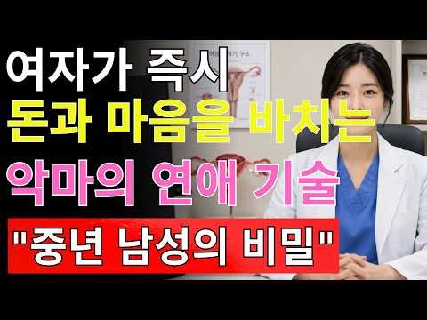
- 챕터: 0:00 여자에게 무시당하지 않는 남자가 되는 심리 기술의 핵… · 1:06 잘해 주는 남자가 오히려 매력을 잃는 이유와 인간관계… · 2:45 첫 번째 기술: 쉽게 잡히는 사람이 되지 않는 방법과… · 6:54 두 번째 기술: 감정을 모두 보여주지 않고 상대의 호… · 10:00 세 번째 기술: 가끔 사라지는 것이 관계에 미치는 심… · 13:49 네 번째 기술: 상대에게 완전히 읽히지 않는 깊이 있… · 18:51 다섯 번째 기술: 침묵으로 감정을 조절하고 관계의 주… · 24:10 다섯 가지 심리 기술 총정리와 더 가치 있는 사람이 … · 26:21 자신의 가치를 높이고 더 나은 인간관계를 만드는 마지…
- 설명 앞부분: 연애심리｜여자가 돈과 마음을 바치게 만드는 5가지 강력한 심리 기술｜발타자르 그라시안 인간관계 지혜 💡 사람의 마음을 움직이는 힘은 외모나 돈이 아니라 연애심리와 인간관계를 이해하는 지혜에서 시작됩니다. 이 영상에서는 발타자르 그라시안의 철학과 심리 원리를 바탕으로 상대에게 쉽게 무시당하지 않고 자신의 가치를 높이는 방법을 알려드립니다. 🔥 연애심리를 이해하면 왜 너무 잘해주는 사람이 오히려 매력을 잃는지, 적절한 거리 조절과 감정 표현이 왜 중요한지 알 수 있습니다. 🧠 이번 영상에서는 첫째, 쉽게 잡히는 사람이 되지 않는 방법…
- 대본 없음 (설명) — 음성인식이 끝나면 도입부·흐름이 들어감
- 댓글 13/13: 좋은 점 — 영상 0 · 감사·응원 0 · 더 알고 싶은 것 0 · 아쉬운 점 — 영상 0 · 반박·불만 — 의견 다름 0 · 정치·사회 0 · 경험 공유 0 · 구독·다음 기대 0

### 119. 부모가 인간관계를 정리해야 하는 이유!

- https://www.youtube.com/watch?v=vOEAYCpaxDY · 이다랑의 육아낫얼론  · 구독자 2,770 · 조회수 10,063 (×3.6, 하루 381.3) · 좋아요 59 (0.6%) · 32.3분 · 2026-10-16 · 주제 묶음 2. 인간관계·대화 · 형식 정보·해설 (그 밖) · 폴더 `W_vOEAYCpaxDY` (웹 승인)
- 썸네일: 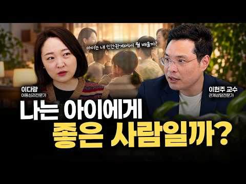
- 챕터: 0:00 인트로 · 0:35 다랑쌤도 손절을? 점점 복잡해지는 인간관계 · 1:16 인간관계, 모두와 잘 지내는 게 좋지 않을까요? · 1:59 부모의 인간관계가 육아에 미치는 영향 · 4:30 『관계의 그릇』 이헌주 교수님을 만나다 · 5:34 곁에 두면 좋지 않은 사람① 투사하는 사람 · 7:09 내가 투사를 당하고 있다는 신호 · 8:18 가까운 사람이 나에게 투사할 때 알아차리는 법 · 10:20 곁에 두면 좋지 않은 사람② 이기적인 사람 · 11:06 곁에 두면 좋은 사람의 기준 3가지 · 16:08 좋은 부모의 기준은 무엇일까요? · 17:30 나의 ‘관계의 원’ 그려보기 · 21:33 관계를 정리한다는 것의 의미 · 24:35 부모가 인간관계를 정리해야 하는 이유 · 27:06 아이에게 좋은 부모가 되려면? · 30:54 관계의 원 & 아이와의 관계 체크리스트 이렇게 해보세… · 31:49 11월에는 어떤 이야기를 나눌까요?
- 설명 앞부분: 부모의 인간관계는 나에게만 영향을 주는 것이 아니라, 결국 아이와의 관계에도 이어집니다. 지금 내 곁의 사람들을 돌아보고, 누구에게 얼마나 마음과 에너지를 쓰고 있는지 함께 점검해보세요. 영상을 보시고 나서 부모님들께서 해보실 수 있도록 영상의 내용을 생각하면서 ‘관계의 원’을 그려보고, '아이와의 관계'도 한번 체크해보세요! 🎁 10월 영상 도서증정 이벤트 🎁 10월 25일까지 영상을 보고 느낀 점이나 기억에 남은 내용을 댓글로 남겨주세요! 댓글을 남겨주신 분들 중 3분을 선정해 이헌주교수님의 [관계의 그릇] 책을 보내드립니다.…
- 대본 없음 (설명) — 음성인식이 끝나면 도입부·흐름이 들어감
- 댓글 23/23: 좋은 점 — 영상 7 · 감사·응원 6 · 더 알고 싶은 것 0 · 아쉬운 점 — 영상 0 · 반박·불만 — 의견 다름 0 · 정치·사회 0 · 경험 공유 1 · 구독·다음 기대 0
  - 좋은 점 — 영상 👍6 “맞아요! 에너지는 한정되어 있는데, 부모가 되고서는 최우선으로 아이들을 챙기다보니, 에너지를 효율적으로 쓰는게 정말 중요한것 같아요! 내가 싫어하는 사람의 유형이 아이에게 될 수 있다는 멘트가 정말 딱 와닿네요! 관계의 원을 해보고 아이에게도 곁에 두고 싶은 사람으로…”
  - 좋은 점 — 영상 👍4 “'관계의 원' 꼭 해봐야겠어요! 실질적인 도움이 되는 이야기라 더욱 뜻깊었습니다. 감사합니다. ^^”
  - 감사·응원 👍6 “맞아요! 에너지는 한정되어 있는데, 부모가 되고서는 최우선으로 아이들을 챙기다보니, 에너지를 효율적으로 쓰는게 정말 중요한것 같아요! 내가 싫어하는 사람의 유형이 아이에게 될 수 있다는 멘트가 정말 딱 와닿네요! 관계의 원을 해보고 아이에게도 곁에 두고 싶은 사람으로…”
  - 감사·응원 👍4 “'관계의 원' 꼭 해봐야겠어요! 실질적인 도움이 되는 이야기라 더욱 뜻깊었습니다. 감사합니다. ^^”
  - 경험 공유 👍6 “맞아요! 에너지는 한정되어 있는데, 부모가 되고서는 최우선으로 아이들을 챙기다보니, 에너지를 효율적으로 쓰는게 정말 중요한것 같아요! 내가 싫어하는 사람의 유형이 아이에게 될 수 있다는 멘트가 정말 딱 와닿네요! 관계의 원을 해보고 아이에게도 곁에 두고 싶은 사람으로…”

### 120. [100분 통합본] 매력은 어떻게 만들어지는가 ∣ 관계의 미학

- https://www.youtube.com/watch?v=CcAjwzTjuuE · 관계의 미학 · 구독자 7,210 · 조회수 123,170 (×17.1, 하루 978.1) · 좋아요 2,447 (2.0%) · 105.9분 · 2026-07-08 · 주제 묶음 2. 인간관계·대화 · 형식 오디오북·책 요약 · 폴더 `W_CcAjwzTjuuE` (웹 승인)
- 썸네일: 
- 설명 앞부분: 사람의 매력은 얼굴에서 시작될까요? 우리는 첫인상을 외모로 판단하지만, 시간이 지날수록 사람을 기억하게 만드는 것은 얼굴이 아니라 태도, 분위기, 그리고 삶의 품격입니다. 이번 영상은 관계의 미학에서 많은 사랑을 받았던 이야기들을 하나로 엮은 100분 통합본입니다. 외모, 귀티, 분위기, 그리고 진정한 매력에 관한 이야기를 차분한 낭독과 함께 끝까지 만나보세요. 이 영상이 여러분의 하루에 작은 사색의 시간이 되기를 바랍니다. ※ 본 영상은 관계의 미학 채널의 기존 콘텐츠를 주제별로 재구성한 통합본입니다. 📖 관계의 미학은 사람과 …
- 대본 없음 (설명) — 음성인식이 끝나면 도입부·흐름이 들어감
- 댓글 60/60: 좋은 점 — 영상 9 · 감사·응원 12 · 더 알고 싶은 것 0 · 아쉬운 점 — 영상 1 · 반박·불만 — 의견 다름 1 · 정치·사회 0 · 경험 공유 2 · 구독·다음 기대 0
  - 좋은 점 — 영상 👍51 “정말 공감합니다 저도 60세 주부인데요 나이들수록 냄새관리가 젤 중요해요 손주들도 냄새없고 예쁜 할머니를 좋아해요 운동하고 피부관리 하고 있어요ᆢ손자 손녀에게 잘 보이려고요~^^ 지금부터는 나에게 만 투자하려고요 매일 행복 합니다”
  - 좋은 점 — 영상 👍38 “매력도 능력이다. 진짜 맞는 말씀 입니다.~^^🎉”
  - 감사·응원 👍27 “와우..! 공감하고 .. 가다듬어진 것의 모습 이죠..! 부단한 노력이 필요 합니다! 저또한 .. 그리해서 53세 되었습니다. 감사합니다!^^ 🎉❤❤❤❤❤❤❤🎉”
  - 감사·응원 👍16 “깊은 철학 감사합니다.”
  - 아쉬운 점 — 영상 👍1 “말이 너무길다. 지로하게만든다”
  - 반박·불만 — 의견 다름 👍7 “내용은 좋은데 목소리가 잠와요 짧은영상도 아닌데 귀에 쏙쏙 들어오도록 시원하고 똑똑히 들리는 아주 청량한 목소리로 해주시면 좀더 듣는데 경청할것같네요.”
  - 경험 공유 👍51 “정말 공감합니다 저도 60세 주부인데요 나이들수록 냄새관리가 젤 중요해요 손주들도 냄새없고 예쁜 할머니를 좋아해요 운동하고 피부관리 하고 있어요ᆢ손자 손녀에게 잘 보이려고요~^^ 지금부터는 나에게 만 투자하려고요 매일 행복 합니다”
  - 경험 공유 👍20 “맞는 것 같아요 편한 청바지 입을때의 나의 모습과 정장차림의 나의모습이 내가 느끼기에도 다르더라구요 😅”

