# 심리 — 성공 사례 분석: 사례별 자세히 #81–#106

`analysis.md` 의 9번 (같은 # 번호). 자동 생성 — `tools/success_analysis.py` v1.6 (2026-11-12 04:38 UTC). ※ 연구·교육용 — 투자 권유가 아님.

### 81. 가까운 사람을 함부로 집에 들이면 안 되는 이유

- https://www.youtube.com/watch?v=yBqfGeVTFZE · 인생다시쓰기 · 구독자 9,230 · 조회수 152,743 (×16.6, 하루 2,077.7) · 좋아요 1,118 (0.7%) · 17분 · 2026-08-29 · 주제 묶음 2. 인간관계·대화 · 형식 정보·해설 (그 밖) · 폴더 `W_yBqfGeVTFZE` (웹 승인)
- 썸네일: 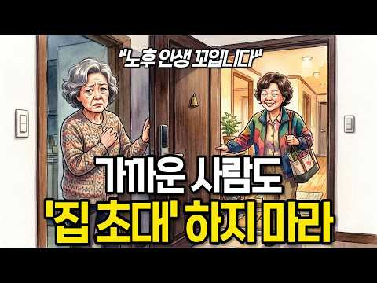
- 챕터: 0:00 집에 몇 번 들였을 뿐인데 왜 불편해질까 · 3:08 집은 내가 말하지 않은 것까지 보여준다 · 5:56 한 번 허용된 것이 ‘당연한 권리’가 되는 순간 · 8:19 내 집인데도 피곤해지는 진짜 이유 · 9:55 옛집의 사랑채와 카페가 편한 이유 · 12:20 가까운 사이일수록 필요한 집의 경계
- 설명 앞부분: 친구 집 방문이 불편하게 느껴진 적 있나요? 인간관계 스트레스가 쌓이는 이유와 타인과의 생활 습관 차이를 현명하게 대처하는 법을 알아봅니다. 친한 사이일수록 사소한 생활 방식의 차이가 갈등의 씨앗이 되기도 합니다. 처음에는 단순한 제안으로 시작된 일들이 어떻게 개인의 심리적 불편함으로 이어지는지, 그리고 이러한 대인관계 갈등을 어떻게 해석해야 할지 구체적인 사례를 통해 살펴봅니다. 특히 타인의 공간에 머물며 느끼는 미묘한 거리감에 대해 깊이 있게 다룹니다. 이 영상은 친구의 집을 방문할 때마다 불편함을 느꼈던 분들을 위한 내용입니…
- 대본 없음 (설명) — 음성인식이 끝나면 도입부·흐름이 들어감
- 댓글 66/66: 좋은 점 — 영상 4 · 감사·응원 1 · 더 알고 싶은 것 0 · 아쉬운 점 — 영상 1 · 반박·불만 — 의견 다름 0 · 정치·사회 0 · 경험 공유 10 · 구독·다음 기대 0
  - 좋은 점 — 영상 👍57 “가까운 사이라고 해서 항상 내 편인 것은 아닌 것 같아요. 믿었던 사람에게 상처받는 일이 더 아프다는 말이 마음에 와닿았습니다. 좋은 사람과 좋은 거리를 유지하는 지혜가 필요하네요.”
  - 좋은 점 — 영상 👍35 “좋은내용 잘보구 갑니다”
  - 감사·응원 👍0 “가까운 사이라고 해서 무조건 믿고 집 안까지 허락해서는 안 된다는 말씀이 마음에 남습니다. 결국 내 공간과 평온을 지키는 것도 현명하게 나를 돌보는 방법이라는 생각이 듭니다. 좋은 말씀 감사합니다.”
  - 경험 공유 👍16 “내집은 나만 있고싶다 나는 부모자식 형제들 방문도 싫다 나도 안가고 니들도 오지마라 제발 집은 나만의 안식처다 서로 방해하지말자 서로 자기공간은침해하지말고 명절이니 생일이니 그런 기념일 챙기는것도 밖에서 밥먹고 차마시고 각자집으로 가자 자식들이 자고가는것도 놉 호텔잡…”
  - 경험 공유 👍16 “제친구는 제가 야근가고 없는집에 재워달라고 부덕부덕 떼를써는거를 제가 거절했더니 섭섭하다고 빈집에 좀재워주면 어떠냐고 따지더나구요 사는게 서민이라 금고도없고 끼고다니는 팔찌반지목걸이등등 화장대 서랍에 보관중이고 통장이며 등등 들고 출근할수도없고 내가 있을면 몰라도 안…”

### 82. 자식은 부모의 사랑보다 이것을 기억합니다 ㅣ부모자식관계 ㅣ좋은 부모 ㅣ자식교육 ㅣ훈육 ㅣ애착이론

- https://www.youtube.com/watch?v=G9sJxVqt-H0 · 오늘은 심리학 · 구독자 40,600 · 조회수 816,233 (×20.1, 하루 8,253.9) · 좋아요 11,684 (1.4%) · 9.9분 · 2026-08-04 · 주제 묶음 2. 인간관계·대화 · 형식 정보·해설 (그 밖) · 폴더 `W_G9sJxVqt-H0` (웹 승인)
- 썸네일: 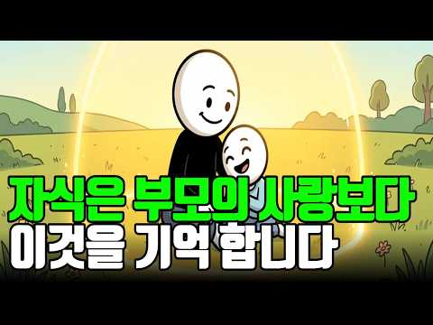
- 챕터: 0:00 자녀는 부모의 사랑보다 이것을 기억합니다 · 2:18 부모가 가장 많이 하는 착각 · 4:47 애착이론이 말하는 평생 관계의 비밀 · 7:36 자녀가 부모에게 마음을 닫는 진짜 이유 · 10:28 평생 내 편이 되는 부모의 대화법 · 13:35 사랑보다 중요한 심리적 안전기지 · 16:24 자녀의 마음을 잃지 않는 부모의 공통점 · 18:40 오늘부터 바로 실천할 수 있는 한 가지
- 설명 앞부분: 자식은 부모가 자신을 얼마나 사랑했는지보다, 부모 곁에서 어떤 감정을 느끼며 자랐는지를 더 오래 기억합니다. 많은 부모는 사랑만 충분하면 자녀는 평생 내 편이 되어줄 것이라고 믿습니다. 하지만 심리학은 전혀 다른 이야기를 합니다. 자녀는 부모의 희생보다 '부모와 함께 있을 때 느꼈던 감정'​을 기억합니다. 왜 어떤 자녀는 성인이 되어서도 가장 먼저 부모를 찾고, 어떤 자녀는 점점 멀어질까요? 이번 영상에서는 애착이론과 발달심리학을 바탕으로, 자녀가 평생 부모를 신뢰하게 되는 진짜 이유와 부모들이 무심코 반복하는 치명적인 실수를 함…
- 대본 없음 (설명) — 음성인식이 끝나면 도입부·흐름이 들어감
- 댓글 698/698: 좋은 점 — 영상 21 · 감사·응원 32 · 더 알고 싶은 것 6 · 아쉬운 점 — 영상 2 · 반박·불만 — 의견 다름 13 · 정치·사회 0 · 경험 공유 91 · 구독·다음 기대 1
  - 좋은 점 — 영상 👍50 “어릴 때나 성장기에는 자유롭게, 하고싶은 걸 하면서 살 수 있게 해주는 부모가 최고지요. 그런데 자식도 결혼하고 또 자신의 자식을 갖게 되면 드디어 부모의 사랑을 느끼게 됩니다. 사랑의 행위마저 귀찮게 여기던 마음은 어디로 사라지고, 부모가 준 사랑을 기억하게 됩니다…”
  - 좋은 점 — 영상 👍3 “신생아때 먹여달라고 재워 달라고 놀아달라고 울음으로 표현하는데 과연 난 얼마나 진심으로 최선을 다해서 반응했나 생각 해보셨으면 하는 생각도 있는데.. 그건 취향의 문제가 아니고 생존의 문제였는데 부모가 원할 때만 반응한다는 게 애 입장에서는 얼마나 공포스럽고 불안했을…”
  - 감사·응원 👍94 “자녀를 내편으로 만들려 하지마세요. 자녀편이 되어주세요. 마음을 울립니다. ㅜㅜ 감사합니다 😊”
  - 감사·응원 👍5 “새끼가 성장 할 때까지 부모의 희생을 담보로 한다. 부모의 책임을 다 하기 위해 노력하고 애정하는 마음을 자식에게 가졌다면 이런 심리학적 요소가 먼저일 리 없고 다만, 참고로 하라는 말이다. 가장 중요한 부분을 행하지 않고, 또 그것을 훌륭하다 인정하지 않고 심리따위…”
  - 더 알고 싶은 것 👍12 “그런데 자녀가 걀혼해서 본인 효자 효녀이고 부모와 너무 가까우면 배우자가 힘들어져요. 그건 어떻게 해결하죠?”
  - 더 알고 싶은 것 👍5 “글쎄, 제 생각에는 시대에 좀 뒤떨어지는 생각 같기는 하네요. _과연 사회는 어느 방향으로 흘러 가고 있을까요? 아직 한국적인 동양사상에서 벗어나지 못해서 그럴 수도 있지만 전세계적인 추세는 나혼자산다예요. ~가족과의 관계가 그렇게 중요하지 않아 지고 있구요. 부모님…”
  - 아쉬운 점 — 영상 👍0 “서론너무길다”
  - 반박·불만 — 의견 다름 👍5 “글쎄, 제 생각에는 시대에 좀 뒤떨어지는 생각 같기는 하네요. _과연 사회는 어느 방향으로 흘러 가고 있을까요? 아직 한국적인 동양사상에서 벗어나지 못해서 그럴 수도 있지만 전세계적인 추세는 나혼자산다예요. ~가족과의 관계가 그렇게 중요하지 않아 지고 있구요. 부모님…”
  - 반박·불만 — 의견 다름 👍1 “그리워하는 순간은 부모가 모든 문제를 8:34 해결해 줬던 기억이 아닙니다. 자신의 8:37 이야기를 끝까지 들어주던 순간 실수를 8:40 해도 내 편이 되어 주던 순간 세상이 8:43 등을 돌린 것 같을 때 단 한 8:44 사람만은 믿어 주던 순간입니다. 8:47 …”
  - 경험 공유 👍136 “오 나 쫌 그런 듯.. 고2 딸이 기말고사 망쳤다고 징징대다가 근데 엄마는 내가 60점 맞았대도 날 똑같이 대할거지? 그러길래 당연하지 0점 맞아도 똑같다고 하니까 왜냐길래 빵점 맞아도 내 딸이 아닌게 아니고 그렇다고 너란 사람이 빵점은 아니니까 라고 했더니 감동이라…”
  - 경험 공유 👍63 “내가 널 어떻게 키웠는데 이게 제일 문제되는 태도”
  - 구독·다음 기대 👍39 “구독누르고가요^^ 맞는것같네요. 뭘해주는것보다도 힘들때 내편이돼주었던 기억이 나이가 들러서도 잊을수없을것같아요. 안타깝게도 대한민국부모님들은 체면이나 주의시선 비교 경쟁 이런것땜에 자식의 실패나 힘들때 보듬아주고 내편이 돼주시지만은 않는듯하네요ㅠㅠ”

### 83. 남자가 진짜 사랑에 빠졌을 때 무의식적으로 하는 행동 6단계 (뇌과학 기반)ㅣ연애심리ㅣ남자심리ㅣ심리분석

- https://www.youtube.com/watch?v=__ks8rhsPvM · 심리조각 · 구독자 10,900 · 조회수 328,525 (×30.1, 하루 2,191.1) · 좋아요 3,104 (0.9%) · 8.8분 · 2026-06-14 · 주제 묶음 5. 연애·애착 · 형식 목록형 (N가지 특징·신호) · 폴더 `W___ks8rhsPvM` (웹 승인)
- 썸네일: 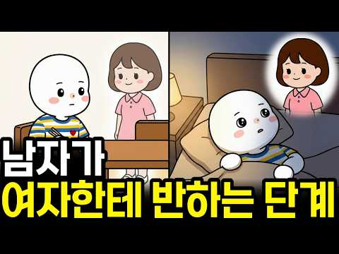
- 챕터: 0:00 남자가 잊지 못하는 여자의 특징 · 0:29 8.2초의 마법 vs 4초의 외면 · 0:59 1단계: 몸이 먼저 반응하는 본능적 각성 · 1:48 2단계: 도파민이 폭발하는 라포 형성기 · 3:06 3단계: 가면을 벗고 약점을 드러내다 (자기 개방) · 3:50 4단계: 갑자기 차가워지는 충격적인 뇌과학적 이유 · 5:20 5단계: '나'에서 '우리'로 변하는 일상의 통합 · 6:10 6단계: 다른 여자를 보지 않는 완전한 헌신
- 설명 앞부분: 남자가 여자한테 반하는 데 걸리는 시간은 단 8.2초. 하지만 진짜 사랑이 되기 위해서는 반드시 '이 위기'를 거쳐야 합니다. 잘해주던 남자가 갑자기 거리를 두는 이유, 뇌과학 기반으로 남자의 심리를 분석해드립니다. 남자가 여자에게 반하는 과정은 단순한 감정이 아닌 아주 정밀한 심리 단계입니다. 시각적 끌림에서 시작해 도파민이 분비되고, 자기 개방을 넘어 호르몬 충돌이라는 내면의 갈등을 겪게 됩니다. 갑자기 차가워진 남자 때문에 상처받으셨나요? 이 영상을 통해 남자의 본능적인 회피 반응의 진짜 이유와 완전한 헌신으로 나아가는 6단…
- 대본 없음 (설명) — 음성인식이 끝나면 도입부·흐름이 들어감
- 댓글 246/246: 좋은 점 — 영상 4 · 감사·응원 6 · 더 알고 싶은 것 9 · 아쉬운 점 — 영상 0 · 반박·불만 — 의견 다름 3 · 정치·사회 0 · 경험 공유 30 · 구독·다음 기대 0
  - 좋은 점 — 영상 👍55 “여잔데.. 저 남자가 공감이 가는 내용이네요...”
  - 좋은 점 — 영상 👍25 “저는 여자인데 영상 속 남자가 공감이 가네요!”
  - 감사·응원 👍2 “Ebs 선생님 목소리랑 닮았어요 ㅎㅎ그냥 그렇다구요 ㅎㅎ 좋은 내용 감사합니다”
  - 감사·응원 👍1 “우리오빠 순서를 거쳐온거군요 회피할때 나 쌍욕도 나오던데ᆢ 지금은 6단계ᆢ 너무 고맙고 사랑스러워요^^^”
  - 더 알고 싶은 것 👍6 “속얘기를 한다는 게 마음을 연 거라는 건 알겠는데 그게 친구로서인지 이성으로서인지는 어떻게 아나요? 알게된 지(친해진 지) 얼마 안 됐는데 속얘기를 하는 사람이 있어서 헷갈리네요 저는 그 분께 호감이 있거든요”
  - 더 알고 싶은 것 👍6 “4단계에서 어떻게 안정적으로 수용하죠??”
  - 반박·불만 — 의견 다름 👍27 “남자인데 전혀 아닙니다. 에효. 이런거 볼 시간에 운동을 하세요.”
  - 반박·불만 — 의견 다름 👍19 “글쎄요.진짜 놓치기싫은 여자를 만났을땐 저런 애매한 태도 보이지못하던데요? 그때 여자가 떠나갈까봐요. 회피형인지 그냥 맘식은건지 어떻게 구분하는지.ㅎㅎㅎ”
  - 경험 공유 👍1,981 “오늘신랑이 변기청소했다니까 왜 그런더러운걸 만졌냐고 다시는 하지말라네요 진짜 오늘 신랑에게 고마운 일이 있어서 해봤거든요 우리신랑은 나를 귀하게여겨주고 말을 이쁘게합니다 첫눈에나를보고 반해서 6개월을 하루도안빠지고 왕복4시간운전 진짜하루도 안빠졌어요 지금결혼 10년차…”
  - 경험 공유 👍26 “4단계때는 어떻게 행동해야하나요.. 얼마전 갑자기 차가워져서 저도 더이상 다가가지 않으니 다시 저에게 잘해줘요 혼란스러워요”

### 84. 인생을 바꾸고 싶다면 안쓰는 물건부터 버리세요! 65세까지는 아까워도 버려야 하는 진짜 이유! 뇌과학으로 본 비움의 과학

- https://www.youtube.com/watch?v=BjKVokKepsU · 바로쓰는 심리학 · 구독자 27,100 · 조회수 722,141 (×26.6, 하루 4,627.7) · 좋아요 13,266 (1.8%) · 15.2분 · 2026-06-08 · 주제 묶음 1. 심리학 일반 · 형식 정보·해설 (그 밖) · 폴더 `W_BjKVokKepsU` (웹 승인)
- 썸네일: 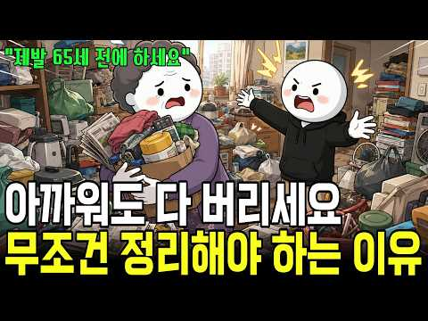
- 챕터: 0:00 옷장은 꽉 찼는데 입을 옷이 없는 아이러니 · 0:36 당신이 이상한 게 아니다: 물건을 버릴 때 뇌에서 일… · 2:21 안 쓰는 물건이 우리의 뇌와 일상을 무너뜨리는 과학적… · 4:30 만성 피로의 주범, 집안 물건 밀도와 스트레스 호르몬… · 5:31 우리가 번번이 버리기에 실패하는 3가지 심리적 덫 · 8:35 쓰지도 않는 물건을 안고 사는 것이 진짜 '큰 손실'… · 9:40 인생의 무게를 줄여줄 강력한 비움의 기준 3가지 · 11:53 비움이 가져다주는 인생 후반전의 기적과 여백의 미학 · 13:54 [오늘의 미션] 꽉 막힌 인생을 풀어줄 '5분 타이머…
- 설명 앞부분: "왜 우리 집은 채워도 채워도 입을 옷이 없고, 정리는 이토록 힘들까요?" 매번 옷장 앞에서 한숨 쉬며 "내가 게을러서, 의지가 약해서 정리를 못 하나" 자책하셨다면 오늘 영상을 꼭 보셔야 합니다. 단언컨대 당신의 잘못이 아닙니다. 인생의 후반전, 복잡한 머릿속을 비우고 맑은 여백을 되찾고 싶으신가요? 대부분의 사람들이 반대로 알고 있는 '버리기 실전 기준 3가지'를 통해 오늘 딱 5분 만에 내 인생의 무게를 가볍게 만드는 마법을 경험해 보세요! ⏱️ 타임라인 (Chapters) AI로 제작된 콘텐츠입니다.
- 대본 없음 (설명) — 음성인식이 끝나면 도입부·흐름이 들어감
- 댓글 634/634: 좋은 점 — 영상 14 · 감사·응원 27 · 더 알고 싶은 것 0 · 아쉬운 점 — 영상 0 · 반박·불만 — 의견 다름 7 · 정치·사회 0 · 경험 공유 78 · 구독·다음 기대 1
  - 좋은 점 — 영상 👍66 “지금 열심히 지난 57년간의 인생을 정리하고 있는데, 과감하게 버릴 수 있는 용기를 받았습니다.. 좋은 내용 감사합니다. 😊”
  - 좋은 점 — 영상 👍21 “제 나이 45살이예요, 저도 한번 물건 사면, 비싸게 샀는데 본전 생각나고 의미부여하고 언젠가는 쓸꺼같고 돈주고 다시 사기 아깝고 살빼면 다시 입을수있을꺼 같고, 이러한 이유때문에 그동안 옷이며 물건이며 엄청 쌓아두고 살았어요, 근데 내가 왜 이렇게 살아야하나 싶은 …”
  - 감사·응원 👍66 “지금 열심히 지난 57년간의 인생을 정리하고 있는데, 과감하게 버릴 수 있는 용기를 받았습니다.. 좋은 내용 감사합니다. 😊”
  - 감사·응원 👍9 “어쩜 내놓으시는 영상마다 힐링이 되는지 모르겠어요 감사합니다❤”
  - 반박·불만 — 의견 다름 👍4 “내 와이프때문에 미치겠다 옷장을 혼자 10칸이 터지도록 다쓴다 그럼에도 10박스는 더있고 도저히 못버텨 각방쓰는데 방에 들어가면 옷 천지다 심지어 택도 안뗀것도 있다 너 정신병이라고 일주에 3번은 싸운다 와이프 집도 마찬가지다 와이프 오빠가 결혼하면서 나갔는데 사정이…”
  - 반박·불만 — 의견 다름 👍2 “남 얘기가 아닙니다 저도 사실 잘 못버리는데 특히 살이 쪄서 못입는 옷을 살 빼서? 입으려 보관하는데 반성합니다 오늘 좀 버려야겠네요”
  - 경험 공유 👍1,153 “60대 중반인데.. 내가 추구하는 삶은 이건데.. 와이프가 비닐봉지 하나도 못버리게해서 삶이 항상 피곤합니다.. 프라이팬이 닳아서 새로 산 뒤 헌것들은 절대 안버리고.. 이걸 가정의 평화를 위해서 계속 못본척하면서 늙어가고 있네요 허허허”
  - 경험 공유 👍258 “못 버리는건 병이라고 생각중 난 70대 할매 너무 잘 버려서 영감왈 나도 갖다 버리것네! 마음이 복잡할때 찾아서 하나라도 버리면 가벼움을 느낌 그런데 영감은 아무것도 못 버리고 쌓아놓는 성질 평생의 스트레스 몰래 버리면 화내고 삐지고 ㅋ”
  - 구독·다음 기대 👍1 “도움이 많이 되었습니다 감사합니다 구독하고 갑니다 또만나요😅😅😊”

### 85. 가만히 있어도 유독 질투받는 사람들의 무서운 특징 (자격지심 무력화하는 법)

- https://www.youtube.com/watch?v=az1K9ymu-Og · 바른 심리학 · 구독자 8,350 · 조회수 222,279 (×26.6, 하루 1,398.6) · 좋아요 2,391 (1.1%) · 11.3분 · 2026-06-05 · 주제 묶음 4. 나쁜 사람 알아보기 · 형식 목록형 (N가지 특징·신호) · 폴더 `W_az1K9ymu-Og` (웹 승인)
- 썸네일: 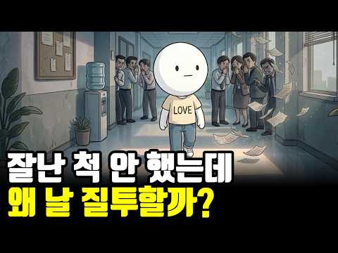
- 설명 앞부분: 잘난 척한 적도 없는데 왜 질투받을까요? 조용히 내 일을 했을 뿐인데 견제당하는 사람들의 공통점과 인간관계 심리를 알아봅니다. 가만히 있어도 질투받는 사람들의 특징, 지금 확인해보세요. 타임라인 개인의 상황에 따라 해석은 달라질 수 있으며, 특정인을 판단하거나 진단하기 위한 목적은 아닙니다.
- 대본 없음 (설명) — 음성인식이 끝나면 도입부·흐름이 들어감
- 댓글 370/370: 좋은 점 — 영상 6 · 감사·응원 21 · 더 알고 싶은 것 2 · 아쉬운 점 — 영상 3 · 반박·불만 — 의견 다름 8 · 정치·사회 6 · 경험 공유 57 · 구독·다음 기대 1
  - 좋은 점 — 영상 👍12 “드라마 "슬의생"에서 5인방을 5무로 평가하면서 이익준(조정석)에 대해 꼬인 것이 없다는 말이 마음에 와닿더라고요... 콤플렉스를 갖는 사람들이 남에게 열등감을 많이 느끼고 시기질투어린 행동을 많이 한다는 것을 요즘 많이 보고 있습니다.”
  - 좋은 점 — 영상 👍10 “정말 좋은 정보 고맙네요 알고는 잇엇지만 이정도 로 타깃이되는줄 ㆍㆍㆍ 거의 흔들리지 않는 편이라서 돈도없고 명문대 출신도 아닌데 전 미움받아서 혼자잇는게 편해요 삼삼오오 잇는것도 좋치만 울나라사람들 장점보다 서로모이면 부정이 사람에 내재속 깊숙이 수며드는 물같은 거…”
  - 감사·응원 👍478 “직장에서 일도 안하는 사람들이 꼭 모여서 일도 안하고 밤에 초과근무 끊고 놀기만하면서 정작 정시 출퇴근하면서 일만 하는 저 보고 일 열심히 안한다고 말하고 다닙니다. 사실 제가 여기서 사업 공모 신청이나 업무 관련해서도 탁월한 성과를 내는 편인데 그럴때마다 그들은 자…”
  - 감사·응원 👍252 “40년친구들이 내가 성공하니 축하는 커녕 질투만 하는 친구들보고 엄청 충격받았다ᆢ진정한 친구는 없구나ᆢ 성공하기까지 남들 쉴때 일하고 남들 잘때 일하면서 성공했는데 ᆢ다 필요없다ᆢ아내와 자식들만 날 응원해주면 된다”
  - 아쉬운 점 — 영상 👍7 “살면서 진짜친구 만나는거 힘들다고하죠 슬픈일엔 진정으로 같이 슬퍼해주고 위로해주던 친구도 기쁜일엔 진정으로 기뻐해주기 힘들다고 “그래 축하해”하면서도 속으로 찜찜해하는 느낌 다들 느껴보셨을꺼예요; 그래서 저는 다르게 살기로 했어요 제게 좋은 친구가 나타나길 기다리기 …”
  - 아쉬운 점 — 영상 👍2 “가장 가까웠고 믿었던 사람이 딱 저랬다. 그게 반복되니 난 걍 즐기게 되더라.”
  - 반박·불만 — 의견 다름 👍91 “찌질한 인간들은..혼자서는 남의욕도 못해요..이런부류들은 일단 모여서 헛소리를 합니다. 없는말 만들어내고. 누가 카더라하고. 모여서 행동하는것들은 내면이 결핍된자들입니다..”
  - 반박·불만 — 의견 다름 👍10 “정말 좋은 정보 고맙네요 알고는 잇엇지만 이정도 로 타깃이되는줄 ㆍㆍㆍ 거의 흔들리지 않는 편이라서 돈도없고 명문대 출신도 아닌데 전 미움받아서 혼자잇는게 편해요 삼삼오오 잇는것도 좋치만 울나라사람들 장점보다 서로모이면 부정이 사람에 내재속 깊숙이 수며드는 물같은 거…”
  - 정치·사회 👍3 “정치권도 지금 마찬가지임... 정청래도 지금 저 왕따랑 똑같은 상황임... 권리당원들한테 제일 많이 인정받고 있는게 정청래인데... 검찰 보완수사권 폐지 1인1표제 검찰개혁에 제일 열심히였던건 정청래 추미애임... 근데 주변 586운동권 계파정치질 하는 세력들은 정청…”
  - 정치·사회 👍1 “좌파들의 기본속성. 나보다 잘난 사람들이 열심히 노력해서 얻은 경제적 부를 평응아라는 이름으로 뺏어 하는 일 없이 놀고 시간낭비한 다수에게 나눠줘야 한다는 생각. 단 타고난 조건으로 노력해도 성취하기 어려운 이들에게는 국가적 차원에서 복지정책을 펴야죠. 그 경우는 제…”
  - 경험 공유 👍478 “직장에서 일도 안하는 사람들이 꼭 모여서 일도 안하고 밤에 초과근무 끊고 놀기만하면서 정작 정시 출퇴근하면서 일만 하는 저 보고 일 열심히 안한다고 말하고 다닙니다. 사실 제가 여기서 사업 공모 신청이나 업무 관련해서도 탁월한 성과를 내는 편인데 그럴때마다 그들은 자…”
  - 경험 공유 👍283 “내가 일하면서 느낀게 뭐냐면 열심히 잘하는 사람은 질투 안함 꼭 잔머리 굴리고 쉬운것만 할려고하고 그러면서 직장 탓하는 인간들이 딱 저럼 정말 유치하기 짝이없음”
  - 구독·다음 기대 👍0 “구독하고 갑니다 해결방법 안내도 좋고 구독자 댓글 수준도 높네요”

### 86. 항상 집이 깨끗한 사람들의 놀라운 특징 : 뇌를 바꾸고 부를 끌어당기는 정리의 뇌과학

- https://www.youtube.com/watch?v=NV6XEbHUFQU · 최적화 심리학 · 구독자 12,200 · 조회수 303,938 (×24.9, 하루 2,033.4) · 좋아요 6,375 (2.1%) · 10.7분 · 2026-06-14 · 주제 묶음 1. 심리학 일반 · 형식 목록형 (N가지 특징·신호) · 폴더 `W_NV6XEbHUFQU` (웹 승인)
- 썸네일: 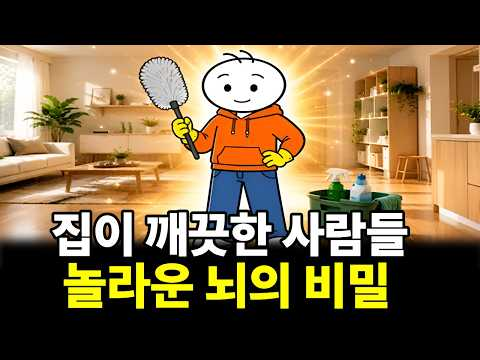
- 챕터: 0:00 쉬어도 피곤한 사람과 깨끗한 집을 유지하는 사람의 뇌… · 0:50 나중에'를 없애 뇌의 배터리를 아끼는 법 (자이가르닉… · 3:09 청소를 노동이 아닌 '뇌 리셋(재부팅)'으로 활용하기 · 5:51 의욕을 기다리지 않고 먼저 움직이는 기술 (행동 활성… · 8:43 부와 성공을 끌어당기는 능력의 정체 (내적 통제성과 …
- 설명 앞부분: 분명 주말 내내 누워서 쉬었는데, 이상하게 마음 한구석이 무겁고 월요일 아침에 더 지치시나요? 더 자도, 더 쉬어도 피로가 풀리지 않는다면 그건 당신이 게으른 탓이 아닙니다. 늘 모델하우스처럼 깔끔한 집을 유지하는 사람들은 우리와 '의지력'이나 '타고난 성격'이 다른 것이 아닙니다. 단지 '뇌를 쓰는 방식'이 다를 뿐입니다. 오늘 영상에서는 뇌과학과 심리학(자이가르닉 효과, 프린스턴대 fMRI 연구, UCLA 코르티솔 연구)을 통해 항상 집이 깨끗한 사람들이 가진 소름 돋는 '이 능력'의 정체를 밝힙니다. 의지력을 단 한 방울도 …
- 대본 없음 (설명) — 음성인식이 끝나면 도입부·흐름이 들어감
- 댓글 320/320: 좋은 점 — 영상 22 · 감사·응원 14 · 더 알고 싶은 것 1 · 아쉬운 점 — 영상 1 · 반박·불만 — 의견 다름 2 · 정치·사회 0 · 경험 공유 26 · 구독·다음 기대 1
  - 좋은 점 — 영상 👍33 “집이 깨끗하면 뇌도 깨끗해지죠. 보통 우리 방 상태가 지금의 자신의 뇌상태라고 보면 됩니다. 좋은 영상 잘 봤습니다!”
  - 좋은 점 — 영상 👍5 “울남편은 정리정돈 안되어있고 좀만 지저분하면 지×랄 발광 주변 사람을 피말립니다..저랑 친한 여자도 무지하게 깔끔한데 울 남편이랑 똑같은 성격을 갖고 있습니다 매일 헤어질 생각만 하고 있습니다 쳐×숩는건 열라 좋아하면서 매일 정리정돈을 강조하다못해..못배웠는니 근본은…”
  - 감사·응원 👍12 “아하 그렇구나 내가 피곤하지 않는 이유구나 항시 깨끗깨끗 하거든요 감사감사 합니다”
  - 감사·응원 👍7 “감사합니다 ❤❤❤”
  - 더 알고 싶은 것 👍3 “너무 공감되서 구독좋아요 눌렀네요 다음에도 좋은 영상부탁드립니다😅”
  - 아쉬운 점 — 영상 👍1 “옳소. Ai목소리임? 좋네요.”
  - 반박·불만 — 의견 다름 👍19 “잘 치우는 사람도 귀찮은 감정은 똑같아요~특별한 뇌구조라서가 아니라 일이 쌓이면 더 많은 에너지를 써야한다는 걸 알기 때문이예요! 그리고 의욕도 리듬이 있어요.조금의 차이지만 의욕이 생기는 날 더 많이 치우고 정리하고 에너지 없는날은 적게 움직입니다. 이 영상은 진실…”
  - 반박·불만 — 의견 다름 👍1 “그때 그때 마다 정리하고 치워야 해요 하루 이틀 지나면 더 하기싫어져요 그리고 무언가 하기싫다는건 마음도 건강도 약해졌다는 증거에요 사실 게을러서 그런게 아닙니다 제가 경험했어요”
  - 경험 공유 👍99 “저도 항상 물건은 제자리에”
  - 경험 공유 👍42 “"이 집에는 언제와도 괞찮아!" 내 친구가, 자기 친구를 데리고 우리 집을 방문해서 하는 말이다. 나는 대청소하기 힘들어서, 미루지 않고 바로 치운다. 그래서 갑작스런 방문도 환영이다😊”
  - 구독·다음 기대 👍1 “나이가드니 마음으로는 단순하게 정리를 잘하고 싶은데,잘 안되요 오늘 도움이 많이 되었고, 구독했어요😂”

### 87. 인생은 결국 혼자입니다 외로움 없이 행복하게 살아가는 7가지 방법 ∣ 김형석 독립기념관장

- https://www.youtube.com/watch?v=v_1LXZktL2g · poke vingador · 구독자 2,640 · 조회수 70,450 (×26.7, 하루 435.8) · 좋아요 1,742 (2.5%) · 63.4분 · 2026-06-02 · 주제 묶음 3. 자존감·마음 · 형식 인터뷰·강연·대담 (전문가) · 폴더 `W_v_1LXZktL2g` (웹 승인)
- 썸네일: 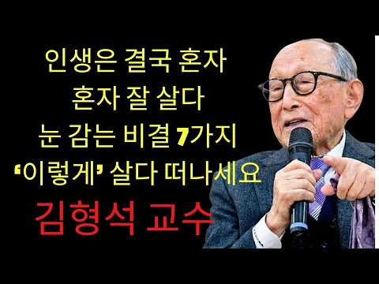
- 설명 앞부분: 인생은 결국 혼자입니다 외로움 없이 행복하게 살아가는 7가지 방법 ∣ 김형석 독립기념관장
- 대본 없음 (설명) — 음성인식이 끝나면 도입부·흐름이 들어감
- 댓글 319/319: 좋은 점 — 영상 31 · 감사·응원 116 · 더 알고 싶은 것 2 · 아쉬운 점 — 영상 1 · 반박·불만 — 의견 다름 0 · 정치·사회 0 · 경험 공유 5 · 구독·다음 기대 1
  - 좋은 점 — 영상 👍23 “교수님 어쩜 이렇게 다 옳은 말씀만 하시는지 참 뼈에 와 닿습니다 저도 70 왔는데 혼자 된지 20년이 넘었습니다 다 하시는 말씀마따나 옳은 말씀 참 하나도 틀린 말 없네요”
  - 좋은 점 — 영상 👍6 “교수님 너무너무감사합니다 좋은말씀잘듣고갑니다^^”
  - 감사·응원 👍15 “미국 달라스에서 사는 76 세 여성입니다 매일 듣고 있습니다 감사합니다.”
  - 감사·응원 👍15 “선생님 감사합니다.(76세) 항상 경청하고 있습니다.”
  - 더 알고 싶은 것 👍2 “네보귀한말씀종종알려주세요감사합니 39:34 다”
  - 더 알고 싶은 것 👍2 “안녕하세요? 요즘 박사님 말씀듣고 너무나 행복하게 살아갑니다. 3년째 치매 엄마 간병을 하고 있는데 요즘같이 이렇게 행복한 적이 없었습니다. 박사님 말씀을 들으면서 자신감이 생기고 하나님과의 괸계도 더 깊어지는듯 합니다. 그저 감사하다는 말씀 드리고 싶어 댓글 올립니…”
  - 아쉬운 점 — 영상 👍0 “이 영상은 김 교수와 아무 상관이 없다. 사기꾼이 영상 편집하고 AI 목소리 넣어서 사람들 속이고, 유튭에서 돈 받는 사기 행위이다. 븅신이 넘쳐나서, 사기꾼이 날뛴다. 말과 입이 안 맞는다.”
  - 경험 공유 👍23 “교수님 어쩜 이렇게 다 옳은 말씀만 하시는지 참 뼈에 와 닿습니다 저도 70 왔는데 혼자 된지 20년이 넘었습니다 다 하시는 말씀마따나 옳은 말씀 참 하나도 틀린 말 없네요”
  - 경험 공유 👍11 “누구나 혼로서기는 기본이고 스스로의 책임입니다. 홀로서기 못하면 어떤 환경도 적응이 되지 않습니다. 저도 때론 고독을 느낄때가 있고 우울할땐 외곡된 생각도 해보지만 쓸데없는 생각이라고 느낍니다. 내가 견뎌야하는 현실이고 나의 몫입니다. 어느누구도 해결 해 줄수없는 나…”
  - 구독·다음 기대 👍15 “미국 달라스에서 사는 76 세 여성입니다 매일 듣고 있습니다 감사합니다.”

### 88. 10년 넘은 친구도 한순간에 끊어내는 사람들의 결정적 특징 (손절의 뇌구조)

- https://www.youtube.com/watch?v=7yhehYw6oDc · 토닥교수의 심리학 · 구독자 26,700 · 조회수 394,021 (×14.8, 하루 4,379.7) · 좋아요 3,072 (0.8%) · 14.6분 · 2026-08-13 · 주제 묶음 2. 인간관계·대화 · 형식 목록형 (N가지 특징·신호) · 폴더 `W_7yhehYw6oDc` (웹 승인)
- 썸네일: 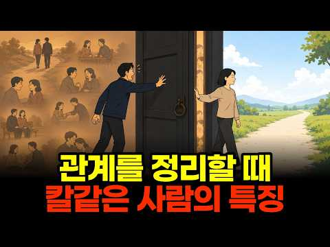
- 챕터: 0:00 인트로 — 관계를 칼같이 끊는 사람, 정말 냉정한가 · 1:13 칼같이 정리하는 사람의 진짜 내면 — 소수에게 쏟는 … · 3:45 사회적 교환 이론 — 관계 불균형이 보내는 신호 · 5:35 이들이 마지막 선을 넘게 되는 결정적 기준 · 7:34 왜 싸우지 않고 조용히 사라지는가 · 9:06 애매한 태도가 단호한 거절보다 잔인한 이유 · 11:24 진짜 외로움은 관계 안에 이미 있었다 · 13:20 관계 정리 = 나에게 맞는 관계를 다시 선택하는 것
- 설명 앞부분: 관계를 한 번 정리하면 절대 뒤돌아보지 않는 사람, 주변에 한 명쯤 있으시죠. 대부분 "정 없다, 냉정하다"라고 판단하지만, 이 사람들의 진짜 내면은 정반대입니다. 오늘 영상을 끝까지 보시면, 왜 관계를 칼같이 끊는 사람이 오히려 정이 가장 깊은 사람인지 완전히 새로 이해하게 되실 겁니다. 이 영상에서는 관계를 칼같이 정리하는 사람들의 심리를 인간관계 심리학 관점에서 하나씩 해부합니다. 왜 이들이 아무에게나 정을 나누지 않는지, 사회적 교환 이론으로 본 관계 불균형의 신호는 무엇인지, 실수를 대하는 태도가 왜 신뢰의 결정적 기준이…
- 대본 없음 (설명) — 음성인식이 끝나면 도입부·흐름이 들어감
- 댓글 431/431: 좋은 점 — 영상 15 · 감사·응원 9 · 더 알고 싶은 것 2 · 아쉬운 점 — 영상 5 · 반박·불만 — 의견 다름 14 · 정치·사회 1 · 경험 공유 51 · 구독·다음 기대 0
  - 좋은 점 — 영상 👍27 “좋은 영상 감사합니다🙏 글자 하나 틀리지 않고 정확합니다. 모든 순간 진심을 다했고 수없이 상대방과 저에게 시간을 주었습니다. 결국 의미가 사라지면 관계를 정리하고 미련도 후회도 없습니다. 상대방도 잘 살기를 바라지만, 저와의 인연은 여기까지 입니다. 저의 인생에서 …”
  - 좋은 점 — 영상 👍15 “너무 좋은 영상이네요 나이50 되어보니 너무 가까이간 제잘못이라 생각하고 이제 적당히 친하게 지내려고 합니다”
  - 감사·응원 👍44 “Isfj 딱 제 얘기네요. 정이 많고 사람 좋아하지만 어느순간 그 사람과의 선이 생기고 제 맘속에서 칼같이 잘라내더라구요. 그뒤로 서서히 멀어질때도 있고 바로 끝낼때도 있어요. 하지만 후회해본적이 진짜 한번도 없어요. 결국 인생은 혼자 스스로 살아내야 하는 거라고 생…”
  - 감사·응원 👍27 “좋은 영상 감사합니다🙏 글자 하나 틀리지 않고 정확합니다. 모든 순간 진심을 다했고 수없이 상대방과 저에게 시간을 주었습니다. 결국 의미가 사라지면 관계를 정리하고 미련도 후회도 없습니다. 상대방도 잘 살기를 바라지만, 저와의 인연은 여기까지 입니다. 저의 인생에서 …”
  - 더 알고 싶은 것 👍18 “내 속에 언제 들어오셨나요? 소름”
  - 더 알고 싶은 것 👍0 “가족하고는 어떨까요? 가족중 어느 한사람과의 마찰로 온 가족들과의 서로간의 불편함으로 인해 다른가족들의 평화를 위해 손절한 것은 어떤가요? 물론 부모님은 돌아가신후이고 금전적 관계는 전혀 아님 🤔”
  - 아쉬운 점 — 영상 👍18 “지각, 실수해놓고 사과없이 오히려 뻔뻔한 태도면 그냥 이유불문 손절하세요. 사람 안변합니다.”
  - 아쉬운 점 — 영상 👍4 “1. AI 목소리 지겹다.. 2. 이 영상 보고 또 본인이라고 댓글 달린다. 3. 심리를 파고드는 유튜브가 돈이 된다.”
  - 반박·불만 — 의견 다름 👍1,542 “칼 같이 ? 아닙니다 오랜시간 고민하고 배려했던겁니다”
  - 반박·불만 — 의견 다름 👍4 “딱 저네요. 한번 아닌 사람은 절대 아닙니다. 왜냐면 최대한 배려해줬기 때문에, 미련이 없습니다.”
  - 정치·사회 👍0 “좌파 지인들은 싹다 끊으니 삶이 나아지더라.”
  - 경험 공유 👍13 “진심 제가 하고픈 얘기들 ㅠㅠ”
  - 경험 공유 👍6 “나도 비슷”

### 89. "나를 통제한다? 저는 돌아버려요" 통제가 안 먹히는 강철멘탈 4명의 생존법 l 기준이탈모임 EP.3

- https://www.youtube.com/watch?v=Eir2GhnFJdc · 강남언니 · 구독자 46,800 · 조회수 657,039 (×14.0, 하루 7,550.8) · 좋아요 6,902 (1.1%) · 53.3분 · 2026-08-16 · 주제 묶음 3. 자존감·마음 · 형식 정보·해설 (그 밖) · 폴더 `W_Eir2GhnFJdc` (웹 승인)
- 썸네일: 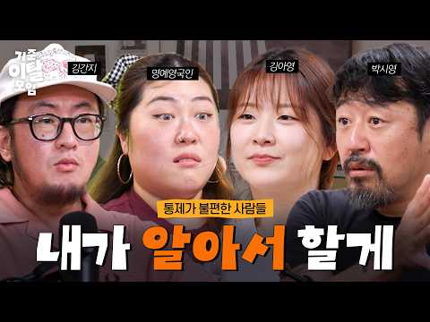
- 챕터: 0:00 하이라이트 · 1:01 게소 🎸 팟캐스트계 유느님 · 1:48 다들 기다린 “통제” · 2:27 통제의 경계선 · 3:55 통제형의 쓰레기 멘트 TOP3 👑 · 5:47 네 취향은 틀렸어 ❌ · 7:12 통제의 반대말? · 9:26 SNS 키보드 통제러 · 12:57 본가 가면 생기는 일 🚎 · 14:36 좋은 교육은 뭘까? · 15:27 김간지 길들이는 법 😼 · 15:42 거짓말 만렙이 되.. · 16:56 아영의 상경썰 🚅 · 17:31 진경이 워홀 간 이유 · 18:15 부모님은 왜 그럴까? · 20:54 방치와 통제, 한 끗 차이 · 22:36 통제 대신 필요한 건? · 23:07 진경이 엄마가 된다면 🧡 · 24:06 각자의 첫 휴대폰 썰📱 · 26:34 "사랑해서 그래"의 함정 💔
- 설명 앞부분: 모두가 기다린 그 주제 "통제” 연애·가족·직장에서 겪은 통제형 인간 썰부터 감정 통제하는 각자의 유쾌한 방법까지 🎵 통제를 전격 해부한 기준이탈모임이 궁금하다면? 오늘은 담백하면서도 거침없는 입담으로 사랑받는 '김간지'님과 함께했습니다. 🧡 매주 일요일 오후 6시 공개!
- 대본 없음 (설명) — 음성인식이 끝나면 도입부·흐름이 들어감
- 댓글 767/767: 좋은 점 — 영상 20 · 감사·응원 25 · 더 알고 싶은 것 8 · 아쉬운 점 — 영상 6 · 반박·불만 — 의견 다름 16 · 정치·사회 4 · 경험 공유 113 · 구독·다음 기대 0
  - 좋은 점 — 영상 👍420 “통제 간섭 참견 오지랖 호들갑 << 이거싫어하는 사람들은 한국에서 살기 힘듦 오늘 영상 하나부터열까지 다 공감되네..”
  - 좋은 점 — 영상 👍276 “엄마가 나르+통제형이라서 영상 내용들 정말 한 문장도 빠짐없이 다 공감되네요.. 자꾸 엄마 욕?하게 되는것 까지도..ㅠㅋㅋ 근데 통제형 엄마밑에서 크지 않은 사람들은 왜 이렇게 발작버튼 눌려하는지 이해 못 하더라구요.. 그래도 나만 이런 생각하는게 아니구나 싶어서 영…”
  - 감사·응원 👍276 “엄마가 나르+통제형이라서 영상 내용들 정말 한 문장도 빠짐없이 다 공감되네요.. 자꾸 엄마 욕?하게 되는것 까지도..ㅠㅋㅋ 근데 통제형 엄마밑에서 크지 않은 사람들은 왜 이렇게 발작버튼 눌려하는지 이해 못 하더라구요.. 그래도 나만 이런 생각하는게 아니구나 싶어서 영…”
  - 감사·응원 👍36 “영상 보면서 많은 생각이 듭니다. 사실, 저는 적당한 방목형으로 자랐어요. 다 저희집처럼 이런 줄 알았는데 고등학교 때 친구들이랑 대화하면서 우리집이랑 너무 다르다는 것을 알게 되었어요. 친구들이 정말 힘들어 보이더라고요😢 엄마는 제 외모에 대해서 한번도 통제하는 말…”
  - 더 알고 싶은 것 👍276 “엄마가 나르+통제형이라서 영상 내용들 정말 한 문장도 빠짐없이 다 공감되네요.. 자꾸 엄마 욕?하게 되는것 까지도..ㅠㅋㅋ 근데 통제형 엄마밑에서 크지 않은 사람들은 왜 이렇게 발작버튼 눌려하는지 이해 못 하더라구요.. 그래도 나만 이런 생각하는게 아니구나 싶어서 영…”
  - 더 알고 싶은 것 👍1 “06:25 호프 불호인데 불호라고 말하는 사람들 때문에 내 취향은 아니었어 라고 말하는 것도 눈치 보인다는 말 개공감!!!!!!! ㅜㅜ 왜 님들 때문에 멀쩡히 취향 교류하고 싶은 사람들도 이상한 취향 통제충으로 만드는 건지....... 나는 내가 취향이 아닌만큼 다른…”
  - 아쉬운 점 — 영상 👍7 “독립하고나서 깨달았다 부모님 집에서 살면서 부모님이 사주는 옷과 밥을 먹으면서 통제하지 말라는 이중적인 (뻔뻔한) 생각은 하지말자. 부모님의 룰이 불편하게 느껴지는 순간 자연스럽게 독립하면 되고, 부모님 집에 갔을때는 그들의 룰을 따른다. 저는 이제는 엄마가 밥먹으라…”
  - 반박·불만 — 의견 다름 👍84 “통제에 대한 고찰 내가 부모의 입장이 안돼봐서 얼만큼의 통제가 적절한지는 모르겠으나 소위말하는 나르시시스트 엄마+무관심한 아빠를 둔 사람으로서 나르시시스트에게 평생 통제를 당하면 굉장히 불안정한 어른으로.. 아니 겉은 어른이지만 아무것도 못하고 자기자심을 믿지 못하는…”
  - 반박·불만 — 의견 다름 👍64 “진짜 숨이 턱턱 막히네 영상에서 말한 모든 걸 다 상대가 들어달란 게 아닙니다.. 통제라는 주제에 대해 이제는 논의를 할 때가 왔고 거기에 고통받는 사람들은 자기들만의 생각을 솔직하게 나누겠다는 거지 솔직히 댓글들도 다 관계에 있어 통제를 당연시하고 영상을 바라보는 …”
  - 정치·사회 👍353 “이런 이야기 나올때마다 느끼는데 걍 한국이라는 나라가 특수성이 너무 강하다.. ㅋㅋㅋ 문화,경제,정치,사회 모든게 남들 200년동안 성장했던게 50년으로 단기압축 되버려서 그동안 레벨업에만 신경쓰고 정작 팔다리 거덜난건 모른척했다가 더이상 모른척 할수없을정도로 곪았던…”
  - 정치·사회 👍1 “확실히 한국이 그 꼰대성 발언이나 개인간 선넘는 일이 좀 더 잦음. 외국인 동료들과 일하면서 나이가 몇이던 ㄸㄹㅇ는 있었지만 꼰대성 발언, 무시, 통제하고 지말이 맞다는 비율이 더 적었음. 오 그래? 와우 니생각 멋지다 ㅇㅇ, 니 생각도 일리있네 근데 난 다르다고 생…”
  - 경험 공유 👍1,235 “진지충으로서 말하자면 가끔 한번쯤은 자기감정에 대해 한발짝 멀리서 관망해보는게 필요함 사랑이라 생각했는데 우월감이었고 우정이라고 생각했는데 질투였던 적이 있었음... 내가 상대의 뭔가가 마음에 안든다면 과연 그게 상대의 책임인지 생각해보고 상대에게 개선을 요구할 권리…”
  - 경험 공유 👍438 “통제 극혐인 내가 항상 하는 말 -> 아 내가 알아서할게”

### 90. 똑똑한 사람은 손절할 때 이것을 절대 하지 않는다 (심리학적 분석)

- https://www.youtube.com/watch?v=33-g3TpuawA · 토닥교수의 심리학 · 구독자 26,700 · 조회수 264,059 (×9.9, 하루 4,246.5) · 좋아요 1,133 (0.4%) · 19.5분 · 2026-09-10 · 주제 묶음 1. 심리학 일반 · 형식 목록형 (N가지 특징·신호) · 폴더 `W_33-g3TpuawA` (웹 승인)
- 썸네일: 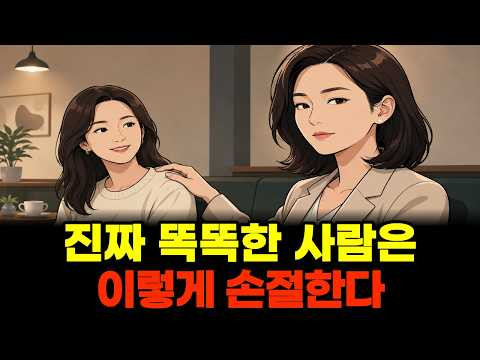
- 챕터: 0:00 인트로 — 진짜 똑똑한 사람의 손절은 방식이 다르다 · 4:48 특징 1 — 서두르지 않고 조용히 오래 지켜본다 · 6:44 특징 2 — 상대를 내 입맛에 맞게 고쳐 쓰지 않는다 · 7:51 특징 3 — 말 대신 '거리'를 설계한다 · 9:49 특징 4 — 명분은 준비하되 남 탓은 하지 않는다 · 11:16 특징 5 — "무슨 일 있어?"에 설명하지 않는다 · 13:48 같은 방법, 왜 결과는 정반대인가 — 내 마음 상태 … · 16:45 손절 전에 꼭 생각해봐야 할 것들
- 설명 앞부분: 관계 정리했다가 오히려 뒷말·소문·후폭풍에 더 시달린 적 있으신가요? 진짜 똑똑한 사람들의 손절은 방식 자체가 다릅니다. 말로 끝내는 게 아니라 '거리'를 설계하기 때문에, 오래된 관계도 상처 없이 조용히 마무리됩니다. 오늘 이 5가지 원칙을 알고 나면, 지금 미루던 그 관계 정리가 오늘 저녁부터 완전히 다르게 보이실 겁니다. 이 영상에서는 인간관계 정리를 뒷말 없이 깔끔하게 완성하는 사람들의 다섯 가지 공통 원칙을 정리했습니다. 우리가 어른의 태도라 배워 온 만나서 얘기하기·터뜨리기·잠수 타기가 왜 매번 실패로 끝나는지, 그리고…
- 대본 없음 (설명) — 음성인식이 끝나면 도입부·흐름이 들어감
- 댓글 62/62: 좋은 점 — 영상 0 · 감사·응원 0 · 더 알고 싶은 것 1 · 아쉬운 점 — 영상 2 · 반박·불만 — 의견 다름 7 · 정치·사회 0 · 경험 공유 14 · 구독·다음 기대 0
  - 아쉬운 점 — 영상 👍8 “5가지 정리좀 해주세요 너무길어서ㅠ”
  - 아쉬운 점 — 영상 👍1 “그냥 연락 받지마 그럼 저절로 떨어져 나간다. 너무 길어.”
  - 반박·불만 — 의견 다름 👍12 “그냥 신경 안쓰고 정리합니다 뭐 대단한 인생도 아닌데 대강 삽니다”
  - 반박·불만 — 의견 다름 👍1 “똑똑한거 아닙니다~”
  - 경험 공유 👍31 “내가 똑똑했구나 ㅋㅋㅋ 잘하고 있었어~~~^^ 지금은 정말 좋은사람들과 단단히 지내며 행복해❤”
  - 경험 공유 👍11 “청약 당첨되서 이사간다고하니 축하는 커녕 싫은티 팍팍 내길래 그 때부터 마음속 손절 시작했었지요 2년 지난 후 이사간 뒤로는 연락없더라구요 그 사이 손절하기 위해 천천히 관계 정리 들어갔었던게 상대방도 눈치챘었나봅니다 전화오면 놓쳤다가 톡 보내거나. 늘 저만보면 남편…”

### 91. 항상 집이 깨끗한 사람들은 '이 능력'이 특별하다?

- https://www.youtube.com/watch?v=vzendmOOrc8 · 어른이 심리학교 · 구독자 13,100 · 조회수 308,466 (×23.6, 하루 1,960.4) · 좋아요 3,648 (1.2%) · 11.2분 · 2026-06-07 · 주제 묶음 3. 자존감·마음 · 형식 정보·해설 (그 밖) · 폴더 `W_vzendmOOrc8` (웹 승인)
- 썸네일: 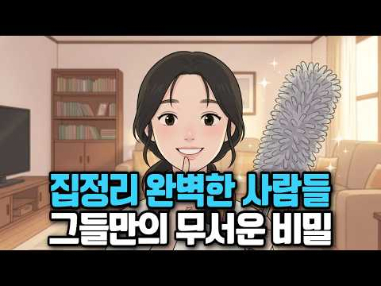
- 챕터: 0:00 충격적 현실 - 깨끗한 집의 비밀 · 1:20 당신이 놓친 뇌의 숨겨진 메커니즘 · 2:56 당신만 그런 게 아닙니다 · 4:11 깨끗한 집 사람들의 뇌가 다른 이유 · 5:58 뇌과학이 증명한 선순환의 비밀 · 7:50 오늘부터 바로 시작하는 뇌 재프로그래밍 · 9:33 당신의 뇌를 바꿀 첫 걸음
- 설명 앞부분: 항상 깨끗한 집을 유지하는 사람들의 뇌구조가 일반인과 완전히 다르다는 충격적인 뇌과학 연구 결과! 정리를 못하는 건 성격이 아니라 뇌의 문제였습니다. 이 영상에서 알게 되는 것: 깨끗한 집 사람들의 뇌가 다른 진짜 이유 정리정돈을 못하는 뇌과학적 원인 뇌를 재프로그래밍하는 실전 방법 🕒 타임라인:
- 대본 없음 (설명) — 음성인식이 끝나면 도입부·흐름이 들어감
- 댓글 239/239: 좋은 점 — 영상 15 · 감사·응원 14 · 더 알고 싶은 것 5 · 아쉬운 점 — 영상 0 · 반박·불만 — 의견 다름 0 · 정치·사회 0 · 경험 공유 28 · 구독·다음 기대 0
  - 좋은 점 — 영상 👍121 “스트레스가 느껴질때, 머리가 복잡해질때 정리와 청소를 합니다 하나씩 정리된공간을 보면 성취감과 쾌감으로 기분이 풀리고, 마음이 안정됩니다”
  - 좋은 점 — 영상 👍17 “정리가 잘된 집에가면 묘지에 들어간 기분 들어요. 뭔가 박제된 기분이 압박감을 느낍니다. 적당히 어질러져 있어도 정서상 좋아요.”
  - 감사·응원 👍178 “엊그제는 친구없는 여자가 무서운이유 어제는 감사합니다 라고 자주 말하는 여자가 무서운이유 오늘은ㅋㅋ 집안 정리 잘 하는 여자의 무서의특징.. 정말 나란 여자 얼만큼 무서운지 감도 안옴😂😂😂”
  - 감사·응원 👍24 “며칠 전 창고를 비우면서 봉고트럭 가득 쓰레기를 버리고 지금은 보이는 안 사용하는 물건들은 다 버리고 있습니다. 소유욕을 없에고 .. 아직도 도파민 때문에 종종 옷도 구매하지만 버리는게 더 많아지고 있어서 마음에 안정이 오고 있습니다. 다들 화이팅”
  - 더 알고 싶은 것 👍2 “아런 영상은 어떻게 만드나요? 수업에 쓰고 싶은데 좀 알려주세요.”
  - 더 알고 싶은 것 👍1 “혹시 영어로 된 영상도 있을까요?”
  - 경험 공유 👍59 “나도 정리가 안되면 아무것도 시작못함”
  - 경험 공유 👍54 “저도 무기력 해봤었고 개인적인 성향은 완벽주의 칼각 같은 성향이였지만. 세월을 살다보니 우울증이고 무기력이고 그 시초전 시발점이 귀찮아서 미루는 행위에서 나 좀 상태가 안 좋으려나 보다 싶더군요. 하루30분이든 늘 꾸준히 특히 주방이 청결해야 돈도 아끼고 여튼 청소는…”

### 92. 감추는 마음이 치르는 대가의 심리학 ∣ 너새니얼 호손 '주홍글씨' 완벽 해설

- https://www.youtube.com/watch?v=Kdl4DYCm2Bk · 밀리언마인드 A million mind · 구독자 20,400 · 조회수 188,336 (×9.2, 하루 2,985.1) · 좋아요 2,202 (1.2%) · 48분 · 2026-09-09 · 주제 묶음 1. 심리학 일반 · 형식 수면·낭독 (잠잘 때 듣는) · 폴더 `W_Kdl4DYCm2Bk` (웹 승인)
- 썸네일: 
- 챕터: 0:00 광장의 처형대 · 9:52 이름을 버린 남자 · 17:56 존경받는 사람 · 26:37 밤의 처형대 · 35:35 축제일
- 설명 앞부분: 🕯 광장 한가운데 세워진 여자가 있었습니다. 가슴에는 붉은 글자 A가 달려 있었고, 그녀는 아이 아버지의 이름을 끝내 말하지 않았습니다. 죄가 드러난 사람과 죄를 감춘 사람. 마을이 벌한 것은 한 사람이었지만, 무너진 사람은 따로 있었습니다. 감춘 채로 사는 데도 값이 든다는 것을, 이 소설은 조용히 보여줍니다. 📖 너새니얼 호손이 1850년에 남긴 이 작품을 한 편에 담았습니다. 지금 내가 무엇을 감추고 있는지, 한 번쯤 돌아보게 되는 이야기입니다.
- 대본 없음 (설명) — 음성인식이 끝나면 도입부·흐름이 들어감
- 댓글 57/57: 좋은 점 — 영상 2 · 감사·응원 11 · 더 알고 싶은 것 0 · 아쉬운 점 — 영상 0 · 반박·불만 — 의견 다름 0 · 정치·사회 0 · 경험 공유 2 · 구독·다음 기대 0
  - 좋은 점 — 영상 👍16 “잘 들었읍니다. 끝까지 잘 들었어요.. 차분한 목소리로 읽어주셔서 더 귀에 잘들어오네요. 감사합니다!!”
  - 좋은 점 — 영상 👍3 “귀한 영상 잘 보았습니다 🎉영상도 참 예쁘네요 🎉읽고 싶었던 책을 나이가 드니 또 이렇게 만나네요 🎉굳이 활자로 꼭 읽어야 할 이유는 ? 없지요 이런 세상에서 !! 생각이 모두 다르겠지만 !! 갠적으로 죄무자성종심기(罪無自性從心起)는 죄는 본래 고유한 성질이 없으며 …”
  - 감사·응원 👍22 “아이를 안고 있는 헤스터, 사실이라면 딥스데일을 닮아 있지 않았을까? 1983년, 멕시코 만사니요항에서 6개월 된 아이를 안고 온 여인이 있었다. 메스티조 여인이었지만 아이는 선장님을 닮아있었다. 나다니엘 호돈의 ‘큰바위 얼굴’은 나에게 평생 동안 영향을 미치고 있는…”
  - 감사·응원 👍16 “잘 들었읍니다. 끝까지 잘 들었어요.. 차분한 목소리로 읽어주셔서 더 귀에 잘들어오네요. 감사합니다!!”
  - 경험 공유 👍57 “영적으로 보면 세계인은 하나로 연결된 가족입니다. 인간으로 태어나 누구나 죄를 짓고 살아갑니다. 남 욕하는 것도.. 비웃는 것도.. 탓하는 것도.. 원망하는 것도.. 알고 보면 모두 죄에 속합니다. 다른 사람을 용서할 때 내가 쌓은 업보도 사라집니다. 용서는 마음으로…”
  - 경험 공유 👍23 “드러난 죄와 숨긴 죄 다윗도 죄를 짓고 숨기려다 선지자 나단을 통해 죄가 드러났습니다 평양 대부흥도 우월감에 도취된 한 선교사의 회개로 부터 시작되었습니다 그리고 교회는 회개를 통해 하나님을 경험했습니다 지금도 그런 세상에 살고 있다고 믿습니다 드러난 죄와 숨긴 죄로…”

### 93. 단 3일 만에 뇌를 리셋하고 무서울정도로 인생을 바꾸는 혼잣말의 뇌과학 비밀, 인생이 잘 풀리는 사람들은 말의힘을 알고 있습니다

- https://www.youtube.com/watch?v=-oYkAO58LSE · 바로쓰는 심리학 · 구독자 27,100 · 조회수 524,013 (×19.3, 하루 3,940.7) · 좋아요 9,963 (1.9%) · 12.1분 · 2026-07-01 · 주제 묶음 1. 심리학 일반 · 형식 정보·해설 (그 밖) · 폴더 `W_-oYkAO58LSE` (웹 승인)
- 썸네일: 
- 챕터: 0:00 하루의 운을 결정하는 진짜 원인, 혼잣말 · 1:45 뇌의 정보 필터 '망상활성계'가 작동하는 원리 · 3:38 혼잣말이 우리의 몸과 뇌 활동 패턴(fMRI)을 바꾸… · 5:01 당장 멈춰야 할, 인생을 정체시키는 무서운 3가지 단어 · 8:12 우리가 나쁜 말 습관을 쉽게 고치지 못했던 이유 · 8:32 단 3일 만에 뇌를 리셋하는 4가지 실전 말하기 기술 · 11:24 오늘 밤 당장 실천하는 가장 힘 있는 타이밍과 작은 …
- 설명 앞부분: "아침에 눈뜰 때부터 왠지 기분이 좋고 일이 술술 풀리는 날이 있는가 하면, 반대로 되는 일이 하나도 없고 자잘한 실수가 반복되는 날이 있죠. 우리는 이것을 흔히 '그날의 운' 때문이라고 생각합니다.오늘 영상에서는 우리의 인생을 멈추게 만들었던 무서운 세 단어의 정체와 함께, 단 3일 만에 뇌의 필터를 완전히 리셋하고 인생을 바꾸는 4가지 실전 말하기 기술을 소개해 드립니다. ⏳ 타임라인 (Timestamp) ⚖️ 면책 문구 (Disclaimer)[면책 문구] 본 영상은 뇌과학 및 심리학 연구 자료를 바탕으로 제작된 대중적 정보 …
- 대본 없음 (설명) — 음성인식이 끝나면 도입부·흐름이 들어감
- 댓글 149/149: 좋은 점 — 영상 6 · 감사·응원 49 · 더 알고 싶은 것 1 · 아쉬운 점 — 영상 2 · 반박·불만 — 의견 다름 1 · 정치·사회 0 · 경험 공유 10 · 구독·다음 기대 0
  - 좋은 점 — 영상 👍55 “좋은 말씀 감사합니다 ~ 전 늘 복이많다고 생각하고 말을 매일 하고 있는 사람인데, 말처럼 복이 많습니다 ~ 모두들 늘 배우는 자세로 복많은 인생 됩시다~~”
  - 좋은 점 — 영상 👍3 “매우 유익한 영상입니다. 감사합니다. 🎉 나는 만물의 주 그리스도 예수닝을 점점 더 잘 알아가고 있다.”
  - 감사·응원 👍132 “맞아요. 엄청 힘든시기에는 늘 부정적이었어요. 그러다 정신차리고 항상웃고 감사하고 살았더니 좋은 일들이 굴러들어오더라구요. 모두들 밝게 감사하며 살아봅시다.”
  - 감사·응원 👍55 “좋은 말씀 감사합니다 ~ 전 늘 복이많다고 생각하고 말을 매일 하고 있는 사람인데, 말처럼 복이 많습니다 ~ 모두들 늘 배우는 자세로 복많은 인생 됩시다~~”
  - 더 알고 싶은 것 👍1 “뭔 부연설명이 이렇게 많아요. 핵심만 알려주세요.”
  - 아쉬운 점 — 영상 👍2 “반복해서보고 있습니다. 😊”
  - 아쉬운 점 — 영상 👍1 “뭔 부연설명이 이렇게 많아요. 핵심만 알려주세요.”
  - 반박·불만 — 의견 다름 👍0 “🟩🟩 우리의 인생을 무의식적으로 정체시키는 '인생을 망치는 무서운 세 단어'로 다음을 꼽고 있습니다. 1. "모르겠다": 습관적으로 이 말을 뱉는 순간, 뇌는 문제 해결을 위한 사고 회로를 즉시 꺼버립니다. 정말 모르는 상황이라도 "글쎄요, 한번 찾아볼게요"와 같이 …”
  - 경험 공유 👍34 “나는 무엇이든 잘할수 있어 그래서 열심히 공부하고 노력하는거야 그리고 나는 주님이 나를 인도하시고 주님이 내안에 성령 으로 오셔서 동행 하시니 내가 하는 일들이 주님이 주관하셔서 성공 으로 이끌어 주실거야 나는 주님 의 편이니까 주님도 내편이 되실거야 할렐루야 아멘”
  - 경험 공유 👍18 “기독교에서는 그럴 기도라고 합니다. 저도 아침에 제일 먼저 베란다에가서 하늘 올려다보고 하느님 오늘도 착하게 살겠읍니다. 오늘도 제가 가장 좋아하는 하늘색 하늘을 볼 수 있게 해주셔서 (숨쉬게 해주셔서) 고맙습니다………라고 소리내서 말하고 하루를 시작합니다,”

### 94. [100분 통합본] 매력은 어떻게 만들어지는가 ∣ 관계의 미학

- https://www.youtube.com/watch?v=CcAjwzTjuuE · 관계의 미학 · 구독자 7,210 · 조회수 123,170 (×17.1, 하루 978.1) · 좋아요 2,447 (2.0%) · 105.9분 · 2026-07-08 · 주제 묶음 2. 인간관계·대화 · 형식 오디오북·책 요약 · 폴더 `W_CcAjwzTjuuE` (웹 승인)
- 썸네일: 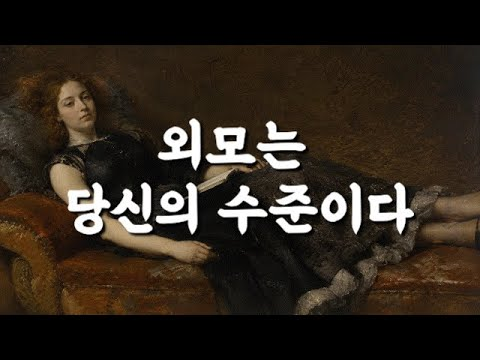
- 설명 앞부분: 사람의 매력은 얼굴에서 시작될까요? 우리는 첫인상을 외모로 판단하지만, 시간이 지날수록 사람을 기억하게 만드는 것은 얼굴이 아니라 태도, 분위기, 그리고 삶의 품격입니다. 이번 영상은 관계의 미학에서 많은 사랑을 받았던 이야기들을 하나로 엮은 100분 통합본입니다. 외모, 귀티, 분위기, 그리고 진정한 매력에 관한 이야기를 차분한 낭독과 함께 끝까지 만나보세요. 이 영상이 여러분의 하루에 작은 사색의 시간이 되기를 바랍니다. ※ 본 영상은 관계의 미학 채널의 기존 콘텐츠를 주제별로 재구성한 통합본입니다. 📖 관계의 미학은 사람과 …
- 대본 없음 (설명) — 음성인식이 끝나면 도입부·흐름이 들어감
- 댓글 60/60: 좋은 점 — 영상 9 · 감사·응원 12 · 더 알고 싶은 것 0 · 아쉬운 점 — 영상 1 · 반박·불만 — 의견 다름 1 · 정치·사회 0 · 경험 공유 2 · 구독·다음 기대 0
  - 좋은 점 — 영상 👍51 “정말 공감합니다 저도 60세 주부인데요 나이들수록 냄새관리가 젤 중요해요 손주들도 냄새없고 예쁜 할머니를 좋아해요 운동하고 피부관리 하고 있어요ᆢ손자 손녀에게 잘 보이려고요~^^ 지금부터는 나에게 만 투자하려고요 매일 행복 합니다”
  - 좋은 점 — 영상 👍38 “매력도 능력이다. 진짜 맞는 말씀 입니다.~^^🎉”
  - 감사·응원 👍27 “와우..! 공감하고 .. 가다듬어진 것의 모습 이죠..! 부단한 노력이 필요 합니다! 저또한 .. 그리해서 53세 되었습니다. 감사합니다!^^ 🎉❤❤❤❤❤❤❤🎉”
  - 감사·응원 👍16 “깊은 철학 감사합니다.”
  - 아쉬운 점 — 영상 👍1 “말이 너무길다. 지로하게만든다”
  - 반박·불만 — 의견 다름 👍7 “내용은 좋은데 목소리가 잠와요 짧은영상도 아닌데 귀에 쏙쏙 들어오도록 시원하고 똑똑히 들리는 아주 청량한 목소리로 해주시면 좀더 듣는데 경청할것같네요.”
  - 경험 공유 👍51 “정말 공감합니다 저도 60세 주부인데요 나이들수록 냄새관리가 젤 중요해요 손주들도 냄새없고 예쁜 할머니를 좋아해요 운동하고 피부관리 하고 있어요ᆢ손자 손녀에게 잘 보이려고요~^^ 지금부터는 나에게 만 투자하려고요 매일 행복 합니다”
  - 경험 공유 👍20 “맞는 것 같아요 편한 청바지 입을때의 나의 모습과 정장차림의 나의모습이 내가 느끼기에도 다르더라구요 😅”

### 95. 성공한 사람들이 매일 운동하는 진짜 이유 (뇌과학이 밝힌 놀라운 변화) 뇌과학 ∣ 자기개발 ∣ 동기부여 ∣ 심리학

- https://www.youtube.com/watch?v=sspCBqfVhFw · 최적화 심리학 · 구독자 12,200 · 조회수 259,449 (×21.3, 하루 1,652.8) · 좋아요 5,795 (2.2%) · 17.9분 · 2026-06-07 · 주제 묶음 1. 심리학 일반 · 형식 목록형 (N가지 특징·신호) · 폴더 `W_sspCBqfVhFw` (웹 승인)
- 썸네일: 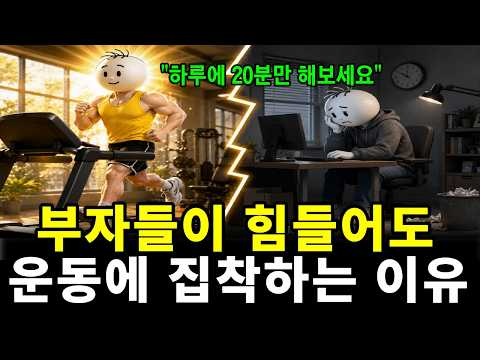
- 설명 앞부분: 혹시 요즘 부쩍 깜빡거리고, 머릿속이 안개 낀 듯 멍하신가요? 이 영상에서는 성공한 사람들이 왜 그토록 매일 운동에 집착하는지, 그 진짜 이유를 뇌과학으로 풀어드립니다. 운동이 분비시키는 '뇌의 기적의 비료' BDNF부터, 근육이 뇌에 보내는 신호, 그리고 단 하루 20분의 움직임이 어떻게 뇌와 자신감, 활력까지 되살리는지 차근차근 보여드립니다. 끝까지 보시면, 오늘 당장 무엇부터 시작해야 할지 분명해지실 겁니다. 이런 분들께 추천합니다 자꾸 깜빡거리고 머리가 멍해 고민이신 분 무기력하고 의욕이 없어 자꾸 자신을 탓하게 되는 분 …
- 대본 없음 (설명) — 음성인식이 끝나면 도입부·흐름이 들어감
- 댓글 303/303: 좋은 점 — 영상 18 · 감사·응원 36 · 더 알고 싶은 것 5 · 아쉬운 점 — 영상 1 · 반박·불만 — 의견 다름 2 · 정치·사회 0 · 경험 공유 10 · 구독·다음 기대 3
  - 좋은 점 — 영상 👍82 “늘 의지박약 이라고 생각했는데 몸을 움직이면 의지가 생긴다는 말이 와닿네요 위로가 됩니다 다시 용기내볼께요”
  - 좋은 점 — 영상 👍12 “좋은 정보 감사합니다 지금 이 순간부터 실행에 옮게 볼께요. 천천히 가는 것을 두려워 말고 멈추는 것 만을 두려워하라”
  - 감사·응원 👍12 “좋은 정보 감사합니다 지금 이 순간부터 실행에 옮게 볼께요. 천천히 가는 것을 두려워 말고 멈추는 것 만을 두려워하라”
  - 감사·응원 👍7 “와~~ 내 얘기하는줄... 나이들어 자꾸 단어가 생각이 안나서 나이들어 그런갑따했는데 그게 아니군요. 정보 감사합니다.”
  - 더 알고 싶은 것 👍1 “팀쿡도 스트레스 많겠죠? 이 스트레스를 어떻게 해소하는지도 좀 알려주세요 인생은 결국 스트레스 아닌가요?”
  - 더 알고 싶은 것 👍1 “너무 오래 앉아있는 우리 고등 아이들ㅠ 아침에 걸어서 학교 가는것 말고는 뭘 하면 좋을까요?학교 고1인데도 체육시간도 자율로 할때가 많더라구요ㅠ”
  - 아쉬운 점 — 영상 👍6 “운동은 강도가 아니라 빈도다!! 사람 목소리가 너무 좋네요!! Ai가 아니고”
  - 경험 공유 👍75 “습관적으로 지친 몸을 이끌고 크로스핏 박스로 7년째 출석합니다. 정신이 육체를 지배합니다.”
  - 경험 공유 👍34 “나도 멍게인가 뇌가 거의 기능을 안하는듯”
  - 구독·다음 기대 👍4 “보건소 운동처방사입니다. 요즘 치매 예방 교육을 위해 공부를 하면 할수록 결국에는 운동의 중요성이 더욱 확실해집니다. 많은 분들이 이 영상을 보셨음 좋겠어요. 홈쇼핑서 약 사드시지말고… 특히 멍게의 예시 너무 좋았습니다! 구독하고 갑니당❤”
  - 구독·다음 기대 👍4 “구독합니다 ❤❤❤감사합니다”

### 96. 변호사와 고대생이 해주는 현실 고민상담

- https://www.youtube.com/watch?v=YQ_hSUHVYl0 · 소윤을말해봐 · 구독자 17,200 · 조회수 188,611 (×11.0, 하루 2,274.4) · 좋아요 2,560 (1.4%) · 22.3분 · 2026-08-20 · 주제 묶음 6. 정신건강 · 형식 정보·해설 (그 밖) · 폴더 `W_YQ_hSUHVYl0` (웹 승인)
- 썸네일: 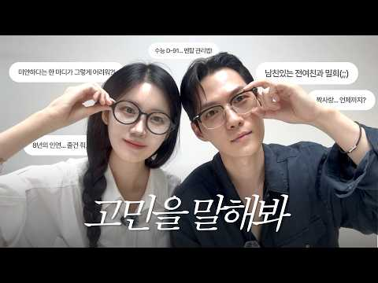
- 챕터: 0:00 Intro · 1:16 8년의 인연... 놔줘야할까? · 2:32 어장치는 남자 심리, 남자가 말하는 '연애할 수 없는… · 6:14 남친있는 전여친과의 부적절한 만남 · 9:07 미안하다는 말이... 그렇게 어려워? · 12:12 수능 D-91, 멘탈 관리 하는법 · 14:42 대학이 인생에서 그렇게 중요한가? · 17:57 여행vs저축, 내가 좋아하는 일에 대한 소비
- 설명 앞부분: 이번 영상은 하트시그널5에 같이 출연한 준현오빠와 고민상담소를 열어보았습니다. 인간관계부터 짝사랑, 연애와 이별, 수능과 대학, 여행까지 정말 다양한 고민들을 들고 왔습니다! 💭 여러 고민들을 보면서 마음이 아프기도, 제가 고민하는 것들이 겹쳐서 공감이 가기도 했는데요. 사실 고민의 종류는 다 달라도 결국 우리는 지금보다 조금 더 잘 살아보고 싶어서 고민하는 거잖아요! 무언가를 고민하고 있다는 것 자체가 이미 더 나은 내가 되기 위해 생각하고 있다는 뜻일지도 몰라요. 저희의 이야기가 모두 정답은 아니겠지만… 이 영상을 통해 조금이…
- 대본 없음 (설명) — 음성인식이 끝나면 도입부·흐름이 들어감
- 댓글 224/224: 좋은 점 — 영상 5 · 감사·응원 11 · 더 알고 싶은 것 5 · 아쉬운 점 — 영상 1 · 반박·불만 — 의견 다름 0 · 정치·사회 0 · 경험 공유 8 · 구독·다음 기대 2
  - 좋은 점 — 영상 👍18 “너무 대답이 똑똑하고 명쾌해서 재밌다 역시 뇌섹남 뇌섹녀 최고!!”
  - 좋은 점 — 영상 👍12 “예쁜 사람들이 참 예쁘고.지혜롭게 말씀을 잘하셔서 엄마뻘 되는 저도 배우고갑니다❤ 소윤씨.유튜브, 준현씨 새일터 . .모두 번창하길 바래요😊”
  - 감사·응원 👍8 “준현옵 진짜진짜 아쉬워 응원해요”
  - 감사·응원 👍5 “핱시에서도 주옥같은 대화어록을 남겨준 두 분...진지하게 함께 고민해주신거 감동이예요^^ 소윤님 개인적으로 학교 후배라 나혼자 괜히 더 정이 감 ㅎㅎ 응원할께요❤”
  - 더 알고 싶은 것 👍2 “유경님 우열니믄 언제 나오시나요~^ 빨리 불러주시길 부탁드립니다 영상 잘봤어요~홧팅 응원합니다”
  - 더 알고 싶은 것 👍0 “소윤님 생각은 진짜 늘 너무 좋아요 🥹 이런 콘텐츠 너무 감사합니다! 앞으로 브이로그나 다른 콘텐츠도 더 자주 올려주셨으면 좋겠어요 ㅎㅎ 그리고 우리 퀸 준현이도 더 많이 보고 싶어요 ㅠㅠ💗”
  - 아쉬운 점 — 영상 👍0 “준현님 되게 차분하신 분이셨구나 유경이랑 있을때의 그 바이브가 특별했던게 맞았나봐요 제가다 아쉽네요”
  - 경험 공유 👍12 “예쁜 사람들이 참 예쁘고.지혜롭게 말씀을 잘하셔서 엄마뻘 되는 저도 배우고갑니다❤ 소윤씨.유튜브, 준현씨 새일터 . .모두 번창하길 바래요😊”
  - 경험 공유 👍6 “내가 좋아했던 두분~~^^♡ 남여 중 최고 호감~~♡♡”
  - 구독·다음 기대 👍8 “오랜만에 예쁜 순정토끼와 핱시 종방 후 더 멋있어진 퀸준현의 영상을 보니까 흐뭇하네요. 하트시그널5는 연애교과서 같아서, 힘든 연애로 고민이신 분들은 티빙으로 최소 2번 이상 정주행하시길 추천합니다. 퀸준현님, 개업 축하드리고 대박나시길 기원합니다❤”
  - 구독·다음 기대 👍4 “만명 추카해요❤❤❤❤❤ 핱시 정주행 3번째~~마니 배워요~~❤”

### 97. 🌙틀어놓고 주무세요 '타인은 지옥이다' 인간관계 피로를 단번에 끊어내는 샤르트르의 밤

- https://www.youtube.com/watch?v=-593UnQhVPM · 잠결에듣는세계사 · 구독자 40,100 · 조회수 201,430 (×5.0, 하루 5,046.9) · 좋아요 1,192 (0.6%) · 84.1분 · 2026-10-02 · 주제 묶음 2. 인간관계·대화 · 형식 수면·낭독 (잠잘 때 듣는) · 폴더 `W_-593UnQhVPM` (웹 승인)
- 썸네일: 
- 설명 앞부분: "타인은 지옥이다." 20세기 실존주의의 거장 장 폴 샤르트르가 남긴 이 날카로운 선언의 진짜 의미를 알고 계십니까? 타인의 시선이라는 감옥에 갇혀 진정한 나 자신을 잃어버린 현대인들에게 샤르트르는 인생의 주도권을 되찾는 단 하나의 해답을 제시합니다. 잠 못 이루는 밤, 끝없는 인간관계의 피로와 불안을 잠재우고 내면의 완전한 자유를 마주하는 철학적 통찰을 만나보세요.
- 대본 없음 (설명) — 음성인식이 끝나면 도입부·흐름이 들어감
- 댓글 65/65: 좋은 점 — 영상 1 · 감사·응원 0 · 더 알고 싶은 것 0 · 아쉬운 점 — 영상 0 · 반박·불만 — 의견 다름 1 · 정치·사회 2 · 경험 공유 2 · 구독·다음 기대 0
  - 반박·불만 — 의견 다름 👍1 “자기가 신이 아닌데 어떻게 신의 뜻이 무엇이지 아나요 자신이 신의 뜻을 안다고 생각하는 사고의 오류. 한계를 극복하지 못한 망상가 였습니다 사르트르는”
  - 정치·사회 👍32 “한국 정치 소설가 한강이란 다르구나... 625를 북침 항미원조전쟁 ... 중국인 가튼 3류 소설가.. 노벨상도 중국화 되는듯.. 중국이 세계 제패하면 한강이 조선자치구 서기 될려나 기대해 봅니다”
  - 경험 공유 👍1 “보리스 파스테르나크가..이미 노벨문학상 거부 했었죠. 시대상황적으로 할 얘기는 많은데..암튼 그렇습니다. 흠.. 그렇습니다.”

### 98. [EP.12] 인지심리학자 김경일 교수가 본 한국 문화의 특수성 (feat.이탈리아 절대 못 돌아간다는 크리스티나)ㅣ비정상수다

- https://www.youtube.com/watch?v=AmNYmxOZSDA · 파도파도 스튜디오 · 구독자 30,100 · 조회수 378,057 (×12.6, 하루 3,634.6) · 좋아요 6,082 (1.6%) · 31.6분 · 2026-07-30 · 주제 묶음 1. 심리학 일반 · 형식 인터뷰·강연·대담 (전문가) · 폴더 `W_AmNYmxOZSDA` (웹 승인)
- 썸네일: 
- 대본 없음 (없음) — 음성인식이 끝나면 도입부·흐름이 들어감
- 댓글 206/206: 좋은 점 — 영상 4 · 감사·응원 8 · 더 알고 싶은 것 4 · 아쉬운 점 — 영상 2 · 반박·불만 — 의견 다름 2 · 정치·사회 13 · 경험 공유 18 · 구독·다음 기대 1
  - 좋은 점 — 영상 👍128 “와 전문가가 오시니깐 분석을 해주셔서 더 유익했어요~~ 재밌네요~ 이런 비교 분석 좋아해서 비정상회담 프로 참 좋아했는데 ㅎㅎㅎ 그리운 프로”
  - 좋은 점 — 영상 👍7 “너무 너무 유익하고 재미있는 내용이였어요^^ 잘 보고 갑니다^^😊”
  - 감사·응원 👍48 “아시아에서 돌려 말하기가 특화된 나라는 오히려 일본과 중국입니다. 난세가 길고 무인들이 정권을 쥐는 경우가 많았기 때문에 솔직하게 이야기하면 그야말로 목이 달아나기 일쑤였어요. 반면에 우리나라는 1000년 왕조인 신라를 예외로 치더라도 한 왕조가 500년은 갈 정도로…”
  - 감사·응원 👍16 “크리스티나님 응원합니다 ~~~^^”
  - 더 알고 싶은 것 👍22 “식사문화가 다른건 알겠는데 코스요리도 알고 어떤코스인줄 알겠는데 우린 배고파서 식사하러 간거니까 답답하거든여 먹는데 시간많이 안걸리니까... 그래서 좀 궁금해서 그런데 다른 유럽 예를들어 이탈리아 사람들은 그런 코스가 나오는 식당을 갈때는 식사말고 다른 기대 하는게 …”
  - 더 알고 싶은 것 👍5 “너무 궁금한게 저 교수님이 진짜 어려운 단어들을 쓰고 있는데 양옆 두 분이 백프로 이해하는지 그게 궁금해요. 오랫동안 한국에 살지만 단어가 사실 많이 어려운건 우리도 어렵거든요. 근데 쉽게 말하지 않고 어려운 말들 자연스럽게 쓰는데도 잘 이해해 보이는게 부럽달까요? …”
  - 아쉬운 점 — 영상 👍10 “24년전에 캐나다 살아봤었는데, 그 시절에, "서구권(캐나다)은 지루한 천국, 한국은 재미있는 지옥" 이라고 나도 했던 말인데.... ㅎㅎ”
  - 아쉬운 점 — 영상 👍0 “수많은 침략을 당한 역사가 이리 만든게 아닐까??? 파괴되고 빼앗끼고~죽임을 당하고~~그걸 복구하고~다른 침략을 대비해야하고~~이런게 반복되어 DNA에 각인된???? 암내나는 특성은 호랑이에게 솎아져 없다졌다는 속설처럼???????”
  - 반박·불만 — 의견 다름 👍0 “섭외 잘못하신 듯. 심리학자의 얼굴이 아닙니다. 웃는 눈 하고 있는 사람을 가까이 해서 좋을것이 전혀 없다는거 인생좀 살아본 사람이면 죄다 아는 사실.”
  - 정치·사회 👍101 “한국에 잘 적응해서 살아가는 대한외국인분들 보면 모국과 비슷한 점을 찾아서 적응하시는 것 같더라고요.”
  - 정치·사회 👍75 “정말 예전과 달라진건 단순히 외국인들이 많이 보이는 수준이 아니라 아기 혹은 아이들을 동반해서 돌아다니는 가족단위의 케이스들이 정말 많아졌다는거 그 분들이 여행을 온것인지 이민이나 귀화인지 노동자 가족인지 미군 가족인지 거기까지는 모르겠으나 어쨌든 가족단위로 돌아다니…”
  - 경험 공유 👍381 “나도 첫 일본 여행가서 ,, 여기가 내 세상이다 하고 한 달 살기 하러 갔는데....2주 만에 돌아옴 ... 어디가 좋다 싫다 떠나서 그냥 한국이 너무 편해ㅜㅜ”
  - 경험 공유 👍21 “재미있는 지옥이 저도 좋아용😊😊❤❤❤”
  - 구독·다음 기대 👍12 “줄리안과 크리스티나. 두분 너무너무 좋아요. 오늘이 채널 처음 들어 왔는데 두분이 이곳에 게셨군요, 구독합니다 ㅎㅎㅎ”

### 99. 자식을 망치고 부모를 파멸시키는 ‘한 집 살이’의 심리학 l 부모자식갈등 ㅣ관계심리 ㅣ인간관계 ㅣ가족갈등 ㅣ가족심리 ㅣ치유심리학 ㅣ분리독립

- https://www.youtube.com/watch?v=P065MMfxPhE · 치유심리학 · 구독자 17,200 · 조회수 331,541 (×19.3, 하루 1,906.4) · 좋아요 6,957 (2.1%) · 10분 · 2026-05-21 · 주제 묶음 2. 인간관계·대화 · 형식 정보·해설 (그 밖) · 폴더 `W_P065MMfxPhE` (웹 승인)
- 썸네일: 
- 챕터: 0:00 인트로: 내 집인데도 자녀 눈치 보며 숨이 막히는 진… · 1:00 본론 1: 성인 자녀와 함께 살 때 뇌에서 일어나는 … · 2:05 본론 2: 자식을 불구로 만드는 과보호, '가학적 친… · 3:08 솔루션 1: 물리적 공간 분리와 감정적 '타인 선언'… · 4:12 솔루션 2: 부모의 에너지 과녁 바꾸기와 학습된 무기… · 5:15 아웃트로: 세상에서 가장 아름다운 이별, 온전한 홀로…
- 설명 앞부분: 매일 아침 눈을 뜨면 집에 무거운 침묵이 흐르고, 다 자란 자녀의 눈치를 보느라 내 집인데도 마음 편히 쉬지 못하고 계시진 않나요. 밥은 먹었는지, 출근은 잘했는지 던지는 평범한 안부 인사조차 어느새 잔소리가 되어 날카로운 대립으로 돌아오곤 합니다. 내 모든 것을 바쳐 키운 내 자식인데, 왜 성인이 된 지금은 한 공간에 있는 것 자체가 숨이 막히고 서로에게 상처가 되는 걸까요. 많은 부모님이 이것을 단순한 세대 갈등이나 자녀의 성격 탓으로 돌리지만, 사실 이것은 의지의 문제가 아닙니다. 성인이 된 인간의 무의식은 전혀 다른 생존 …
- 대본 없음 (설명) — 음성인식이 끝나면 도입부·흐름이 들어감
- 댓글 618/618: 좋은 점 — 영상 11 · 감사·응원 22 · 더 알고 싶은 것 4 · 아쉬운 점 — 영상 1 · 반박·불만 — 의견 다름 11 · 정치·사회 5 · 경험 공유 69 · 구독·다음 기대 1
  - 좋은 점 — 영상 👍6 “처음부터 끝까지 너무 맞는 말이라서 소름이 돋아요. 완전 남동생과 엄마의 관계를 관찰하고 얘기하는 듯 똑같아요. 정말 좋은 내용 입니다.”
  - 좋은 점 — 영상 👍1 “많은 것을 느끼게 하는 유익한 내용이였습니다. 구독과 좋아요 누르고 갑니다 감나합니다.”
  - 감사·응원 👍15 “세빠지게 밥해주고 과일차려주고 빨래해주고 내삶이 고단해도 노력했는데 세자녀들은 모두 자신들만의 공간을 찿아 떠나더군요. 독립을 감사하게 생각해야하는데도 빈둥지증후군으로 아직도 힘들어요. 내삶이 바보같다는 생각이 어리섞게도 들더군요. 너무 집중해서 오랜세월 노예처럼 살…”
  - 감사·응원 👍4 “완전공감 입니다 감사합니다”
  - 더 알고 싶은 것 👍7 “부모도 모시면 안되는건가요? 생각해보면 인류는 대가족 집단체제였는데 이건 어떻게 해석해야할까요?”
  - 더 알고 싶은 것 👍0 “일하고있는 성인이된 자녀에게 같이 살면서 월세를 받는것은 어떤가요? 😊”
  - 아쉬운 점 — 영상 👍135 “독립한 자녀가 가정을 이루고, 시부모 지원없이 직장 근처의 집을 구입했습니다. 그런데 시부모가 아들 며느리가 사는 지역에 이사오고 싶어하고, 애를 키워달라고 요구한 적도 없는데 키워준다고 합니다. 아들이 정중하게 거절했더니 아들에게 화내고 소리치는 시어머니의 심리는 …”
  - 반박·불만 — 의견 다름 👍5 “성인이 되면 더 이상 나의 아이가 아닙니다. 같이 사는건 좋지 않습니다”
  - 반박·불만 — 의견 다름 👍2 “성인 이후 부모님하고 같이 산지 20년이 넘었습니다 스트레스 받다가 생명의 위협을 느껴본적도 있습니다 부모님하고 사는데 뭔 스트레스이니 생명의 위협이니 말도 안되는 소리 같죠? 나이 먹으면 먹을수록 부모님과 같이 살아본 사람이라면 뭔지 알겁니다”
  - 정치·사회 👍16 “선진국에선 이런 문제 방지 위해 20세가 되면 정부에서 월세 지원금 이 나오죠. 독립해서 나 가라고.”
  - 정치·사회 👍5 “그런데 현재정부가 월세전세가격을 올려서 내보낼 돈이없다는~~~~”
  - 경험 공유 👍822 “딸 둘은 시집 가고 늦동이 아들이 서른 세살인데 같이 살다가 분가를 준비하고 있습니다 서울에 있는 아파트 팔아서 경기도로 가면서 아들 집 보증금 보태주고 나머지로 칠십이 된 우리 부부 노년에 쓰다가 가려구요 남편은 아들의 수입이 일정하지 않아 분가 시키는걸 썩 내켜하…”
  - 경험 공유 👍279 “친정엄마가 몸이불편하고 치매증있어서 모시고 사는데 온갖걸 다참견해서 매일이 싸움이네요. 엄마 모시려다가 스트레스로 내가 먼저 죽겠어요ㅠ”
  - 구독·다음 기대 👍2 “훌륭하신 말씀 감사합니다. 구독하고 가요.”

### 100. 연락 끊고 혼자 지내보면 알게 됩니다 ∣ 타인의 시선에서 완벽히 해방되는 '고독의 기술' ∣ 쇼펜하우어 ∣ 철학 ∣ 오디오북 ∣ 인간관계 인생조언

- https://www.youtube.com/watch?v=Blppz6jc4o4 · 늑대의 지혜 · 구독자 33,500 · 조회수 58,544 (×1.8, 하루 3,703.5) · 좋아요 311 (0.5%) · 138.1분 · 2026-10-26 · 주제 묶음 2. 인간관계·대화 · 형식 오디오북·책 요약 · 폴더 `W_Blppz6jc4o4` (웹 승인)
- 썸네일: 
- 설명 앞부분: 주말마다 모임에 나가 사람들과 어울리고 돌아온 밤, 뼈속까지 밀려오는 지독한 허탈감과 피로를 느껴본 적이 있으신가요? 사람들은 흔히 이를 '외로움'이라 부르며 더 많은 사람을 만나라고 조언하지만, 철학자 쇼펜하우어는 이것이야말로 인간을 파멸로 이끄는 가장 치명적인 착각이라고 경고합니다. 우리가 겪는 피로의 대다수는 육체적 노동이 아니라, 타인의 비위를 맞추고 시선을 의식하느라 소모하는 '감정적 에너지 낭비' 때문이기 때문입니다. 이 영상에서는 쇼펜하우어의 날카로운 통찰을 통해, 불필요한 인간관계의 소모전을 끝내고 오직 나 자신에게…
- 대본 없음 (설명) — 음성인식이 끝나면 도입부·흐름이 들어감
- 댓글 0/9 (다 받지 못함): 좋은 점 — 영상 0 · 감사·응원 0 · 더 알고 싶은 것 0 · 아쉬운 점 — 영상 0 · 반박·불만 — 의견 다름 0 · 정치·사회 0 · 경험 공유 0 · 구독·다음 기대 0

### 101. "결혼할 인연은 따로 있다" 평생 함께 할 '운명의 상대' 특징 5가지 (뇌과학 기반)

- https://www.youtube.com/watch?v=Cy9S2YeMLbw · 심리조각 · 구독자 10,900 · 조회수 196,827 (×18.1, 하루 1,191.6) · 좋아요 2,200 (1.1%) · 11.6분 · 2026-05-30 · 주제 묶음 1. 심리학 일반 · 형식 목록형 (N가지 특징·신호) · 폴더 `W_Cy9S2YeMLbw` (웹 승인)
- 썸네일: 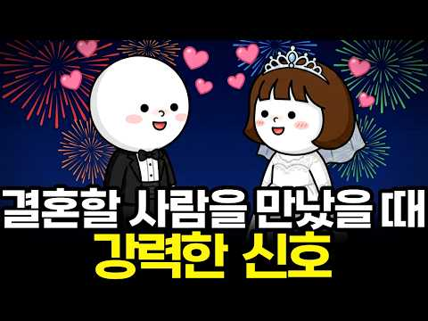
- 챕터: 0:00 어떤 사람 앞에서는 유독 피곤한 과학적 이유 · 0:31 설렘이 사라진 뇌, 사랑이 식은 걸까? · 1:43 뇌가 '결혼할 사람'을 심사하는 심리적 안전 반응 · 3:30 40년 연구로 밝혀진 갈등을 다루는 커플의 비밀 · 5:08 익숙함 vs 진짜 인연을 가르는 '자기 확장 이론' · 6:23 평생의 짝을 확인하는 5가지 결정적 테스트
- 설명 앞부분: 결혼할 인연은 따로 있다는 말 들어보셨죠. 평생 나와 함께 할 진짜 운명의 상대는 도대체 누구일까요? 연애 초기의 가슴 뛰는 설렘이 사라져 고민이신가요? 뇌과학 관점에서는 오히려 그때부터가 '진짜 운명의 상대'를 가려내는 골든타임입니다. 결혼할 인연을 만났을 때 뇌에서 보내는 결정적인 신호 5가지와 함께 운명의 상대의 특징에 대해서 알려드립니다. 처음 만났을 때 분비되던 도파민의 자리에 신뢰와 안정감의 호르몬인 옥시토신과 세로토닌이 채워질 때, 우리의 뇌는 이 사람과 평생을 함께해도 안전한지 본격적인 테스트를 시작합니다. 이번 영…
- 대본 없음 (설명) — 음성인식이 끝나면 도입부·흐름이 들어감
- 댓글 147/147: 좋은 점 — 영상 5 · 감사·응원 4 · 더 알고 싶은 것 6 · 아쉬운 점 — 영상 1 · 반박·불만 — 의견 다름 3 · 정치·사회 0 · 경험 공유 8 · 구독·다음 기대 0
  - 좋은 점 — 영상 👍6 “좋은영상 감사합니다(__)”
  - 감사·응원 👍6 “좋은영상 감사합니다(__)”
  - 더 알고 싶은 것 👍0 “결혼 몇살안에 해야되나요?”
  - 아쉬운 점 — 영상 👍0 “저 혼자 안정감 느끼고 있었고 갈등도 잘 해결하고 가치관도 달라도 잘 조율해가고 있다고 생각했는데 상대는 속마음을 숨기고 조용히 멀어질 준비를 하고 있었어요. 권태기 때문인지 그냥 저를 바꾸는 게 답이라고 생각했는지 자기 기준에 안 맞으니 5년 추억도 정이라고 하고 …”
  - 경험 공유 👍245 “상대를 만나서 내가 편하다면, 상대가 정말 많이 배려해주고 있다는 뜻이다. 왜냐? 세상에는 나와 100% 같은 사람이 없기 때문이다. 고로, 내가 편하다면 나도 상대를 편하게 해줘야되는 노력을 해야 된다. 관계란, 내가 편하다고 상대까지 편한게 절대 아니기 때문이다.”
  - 경험 공유 👍51 “처음 만났을때 편한게 좋은게 아니던데요. 하도 사람들이 처음 볼때부터 편한 사람이 진짜네 뭐네해서 그런 사람만 만났는데 처음 설레지도 않고 편하기만 하니 금방 질려요. 그래서 엄청 잘생기고 설레고 긴장되는 사람 만났는데 어차피 시간 지나면 다 편해져요. 그러니까 내 …”

### 102. 나이는 50대인데 대화는 초등학생... '정서적 미성숙자'의 소름 돋는 특징 3가지

- https://www.youtube.com/watch?v=YnliRtZUvvw · 어른의 심리 · 구독자 16,300 · 조회수 309,002 (×19.0, 하루 1,756.3) · 좋아요 4,065 (1.3%) · 16.2분 · 2026-05-19 · 주제 묶음 2. 인간관계·대화 · 형식 목록형 (N가지 특징·신호) · 폴더 `W_YnliRtZUvvw` (웹 승인)
- 썸네일: 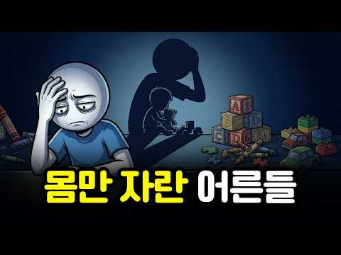
- 설명 앞부분: 나이는 50대인데 대화는 초등학생... '정서적 미성숙자'의 소름 돋는 특징 3가지 🌿 분명 내가 잘못한 것도 없는데, 그 사람과 통화만 끊고 나면 왜 이렇게 진이 빠지고 가슴이 답답할지 멍하니 앉아 계신 적이 있으신가요? 👤 대상이 시댁 어른이든, 배우자든, 직장 상사나 형제든 상관없습니다. 나이는 사십 대, 오십 대, 심지어 육십 대인데 대화의 결이 마치 자기밖에 모르는 어린아이와 같아 숨이 턱 막힌다면 그것은 당신의 착각이 아닙니다. 몸은 어른이지만 감정과 공감 영역은 어린 시절 어딘가에 멈춰 버린 '정서적 미성숙자'들을 마…
- 대본 없음 (설명) — 음성인식이 끝나면 도입부·흐름이 들어감
- 댓글 448/446: 좋은 점 — 영상 7 · 감사·응원 25 · 더 알고 싶은 것 2 · 아쉬운 점 — 영상 3 · 반박·불만 — 의견 다름 10 · 정치·사회 8 · 경험 공유 51 · 구독·다음 기대 0
  - 좋은 점 — 영상 👍13 “19살부터 직장생활중인 20대 중반 입니다 저는 주변에 저런 인간들만 있어서 그동안 그런 부류들이랑 싸우고 화내고 하다가 현재 우울증에 시달리고 있습니다 하지만 이 영상을 보고 왜 우울증에 걸렸는지 이해가 가네요 덕분에 우울증 치료에 조금이라도 도움이 될것같습니다 감…”
  - 좋은 점 — 영상 👍8 “자신의 힘든 점을 털어놓고 공감을 바라는 것도 아직도 미성숙한 존재라는 걸 방증한다 타인이 왜 너의 힘든 점을 공감해주는 게 당연하냐 힘든 얘기 들어주고 필요한 도움을 주면 고마운 거지 또 그렇게 솔루션을 제시하면 공감할 줄 모른다고 ㅈㄹ하는 게 진짜 미성숙한 거다 …”
  - 감사·응원 👍86 “절대 안변하고 남때문에 내가 이래 된거야 칭찬도 선물에 감사할줄도 모르죠 내가 그 감정 화풀이거든요 당한거죠 절대 안변해요 도망치세요”
  - 감사·응원 👍13 “19살부터 직장생활중인 20대 중반 입니다 저는 주변에 저런 인간들만 있어서 그동안 그런 부류들이랑 싸우고 화내고 하다가 현재 우울증에 시달리고 있습니다 하지만 이 영상을 보고 왜 우울증에 걸렸는지 이해가 가네요 덕분에 우울증 치료에 조금이라도 도움이 될것같습니다 감…”
  - 더 알고 싶은 것 👍14 “나이가 들어도 정서는 자라지 않을 수 있다는 말, 정말 소름입니다. 이 3가지 특징은 남 이야기 같지만 사실 우리 모두의 이야기일지도… 당신은 몇 개나 해당되나요?”
  - 더 알고 싶은 것 👍2 “정서적인 미성숙한 사람 보통 다들 어느정도있죠 정말 성숙한분들은 희귀품종 아닐까요? 하지만 병적인 정석적 미성숙자가 나르시시스트 아닐까요? 죽을때까지 치유하지 못하는 불치병이죠 14년째 결혼생활중인데..내가 잘못 살아온 나의 삶에 대한 댓가라 생각하고 그냥 하루하루 …”
  - 아쉬운 점 — 영상 👍11 “저는 영화던 음악이던 책이던 유튜브 영상이던 좋아하면 반복해서 보고 듣습니다 심리채널에 관심을 가지게된지가 한달전쯤인것같은데 그전엔 이런채널을 볼생각도 있는지도 모르고 살았네요 근데 저가 맘적으로 굉장히 힘든시기에 우연인지 필연인지 알게되었습니다 이런 심리채널이 있는…”
  - 아쉬운 점 — 영상 👍0 “이 영상의 내용과 의미는 사실 고대 그리스 철학자들 중에 그야말로 저명한 플라톤도 아리스토텔레스도 이런 인간들에 대하여 참지 못했다. 이 철없어 보이고 지능마저 모자라는 듯한 인간들에 대하여 고대 철학자들도 참지 못해 거리에서 그들을 향해 일갈하곤 했다!! 이 영상은…”
  - 반박·불만 — 의견 다름 👍10 “70대 80대 에도 쓰레기 인성 인간들 많아요. 나이가 벼슬이 아닙니다.”
  - 반박·불만 — 의견 다름 👍8 “나르시시스트들도 그러고 싶어서 그런건 아닙니다. 그들도 또 다른 아동학대 피해자들이죠. 성장기때 학교도 안 보내고 집에서 식모살이나 다름없는 생활.. 6 학년대 딸아이를 옷 홀딱 벗겨 쫓아냈던 외할머니... 그런 악행의 고리를 끊지 못하고 본인의 딸인 나에게 욕설과 …”
  - 정치·사회 👍4 “한국 문화는 효를 가장한.. 의무를 체계화 시키고 정당화시키는.. 문화가 뿌리가 깊습니다. 특히 나르들이 대접 받기 딱 좋은 조건이죠.. 미국이나 서양 보세요. 부모 감정 받이 위해 문제가 생길때 마다 쪼르르 달려가고 부르고 심부름 시키고 그러지 않아요 알아서 해야 …”
  - 정치·사회 👍3 “나르시시스트 성향 누구에게나 있을수 있지만 확실한건 정치적으로 볼 때 내란당애들이 대부분 나르시시스트 대표적으로 룬거니가 거의 사이코소시오에 가까운 나르시시스트임 룬석열과 그 주변 인물들도 더 마찬가지이고 계곡살인 이은해 이런것들과 똑같은 인간의 탈을 쓴 짐승들임 유…”
  - 경험 공유 👍86 “절대 안변하고 남때문에 내가 이래 된거야 칭찬도 선물에 감사할줄도 모르죠 내가 그 감정 화풀이거든요 당한거죠 절대 안변해요 도망치세요”
  - 경험 공유 👍50 “우리집 살아있는 노인네들이 딱 그수준입. 효도라는 감정을 강요하고 그게 유일한 자랑임. 폐렴 중증으로 앓고 있는 자녀에게 전화도 안함. 뒤늦게 폐렴이 무슨 병이냐고 본인이 더 아프다. 끝.”

### 103. 남편에게 처음 털어놓은 진짜 속마음... 부부상담 받고 왔습니다

- https://www.youtube.com/watch?v=ikT04M0fhEU · 어떠신지?!? · 구독자 45,100 · 조회수 99,156 (×2.2, 하루 4,718.2) · 좋아요 572 (0.6%) · 17.3분 · 2026-10-21 · 주제 묶음 3. 자존감·마음 · 형식 정보·해설 (그 밖) · 폴더 `W_ikT04M0fhEU` (웹 승인)
- 썸네일: 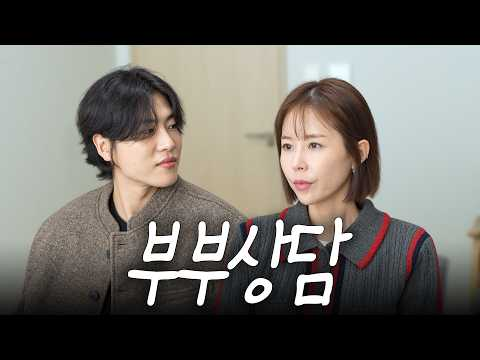
- 설명 앞부분: 안녕 파인이들!💛 오늘은 남편과 함께 마인드카페 심리상담센터에 다녀왔어요! 결혼하고 함께 지내면서 서로에 대해 많이 알고 있다고 생각했는데 이번 부부상담을 통해 몰랐던 서로의 성향과 속마음까지 알아볼 수 있었어요 서로를 사랑하고 아끼는 마음은 같지만 그 마음을 표현하고 받아들이는 방식은 참 다르더라고요 이번 상담을 통해 남편도 저도 서로를 조금 더 이해할 수 있었던 뜻깊은 시간이었습니다❤ 과연 저희 부부는 얼마나 다른 사람들일까요?🤔 파인이들도 오늘 영상 재미있게 봐주시고 댓글로 여러분의 생각도 들려주세요💛
- 대본 없음 (설명) — 음성인식이 끝나면 도입부·흐름이 들어감
- 댓글 0/113 (다 받지 못함): 좋은 점 — 영상 0 · 감사·응원 0 · 더 알고 싶은 것 0 · 아쉬운 점 — 영상 0 · 반박·불만 — 의견 다름 0 · 정치·사회 0 · 경험 공유 0 · 구독·다음 기대 0

### 104. 사람을 만나면 3가지 척하라 배신한 친구도 등 돌린 자식도 다시 돌아온다 ∣ 정약용 명언 ∣ 인간관계 ∣ 인생지혜 ∣ 친구관계 ∣ 처세술

- https://www.youtube.com/watch?v=tdp8oqX_xOo · 늘네편 · 구독자 13,900 · 조회수 254,239 (×18.3, 하루 1,448.7) · 좋아요 8,228 (3.2%) · 82.3분 · 2026-05-19 · 주제 묶음 2. 인간관계·대화 · 형식 오디오북·책 요약 · 폴더 `W_tdp8oqX_xOo` (웹 승인)
- 썸네일: 
- 설명 앞부분: 🌿 어제 만난 사람도 내 편으로 만드는 마법 같은 태도가 있습니다. 나이가 들수록 주변에 사람이 머물게 하려면 어떻게 해야 할까요? ✨ 오늘의 지혜 노트 🌸 사람을 끌어당기는 3가지 지혜 모르는 척 : 끝까지 귀 기울여 들어주며 상대를 주인공으로 만들어주기 약한 척 : 빈틈을 보여주어 상대방이 내게 다가올 수 있는 다리 놓아주기 고마운 척 : 아주 작은 호의라도 크게 기뻐하며 마음을 다해 감사하기 🌸 사람을 밀어내는 3가지 실수 잘난 척 : 묻지도 않은 자랑을 늘어놓아 상대방을 작아지게 만들기 아는 척 : 대화의 흐름을 끊고 내가…
- 대본 없음 (설명) — 음성인식이 끝나면 도입부·흐름이 들어감
- 댓글 742/742: 좋은 점 — 영상 30 · 감사·응원 95 · 더 알고 싶은 것 1 · 아쉬운 점 — 영상 1 · 반박·불만 — 의견 다름 2 · 정치·사회 0 · 경험 공유 9 · 구독·다음 기대 4
  - 좋은 점 — 영상 👍59 “시간을 내어 주는 사람이 되자 나를거두고 상대를 모시는 사람이 되자 많은 깨달음 줍니다 좋은말씀 감사합니다 잘난척(×) 바쁜척(×)아는척(×) 약한척(0) 모는척(0)고마운척(0)”
  - 좋은 점 — 영상 👍49 “나는 자기를 모시고 상대를 모시는 사람이다. 혼자가는 길은 외롭지만 함께 가는 길은 따듯합니다 새벽에 좋은 영상 감명 깊이 들었습니다.”
  - 감사·응원 👍59 “시간을 내어 주는 사람이 되자 나를거두고 상대를 모시는 사람이 되자 많은 깨달음 줍니다 좋은말씀 감사합니다 잘난척(×) 바쁜척(×)아는척(×) 약한척(0) 모는척(0)고마운척(0)”
  - 감사·응원 👍44 “정말 몰라서 못했던것들 늘 들으면서 많이 배우고 있습니다. 감사합니다”
  - 아쉬운 점 — 영상 👍1 “너무 길어요 세가지요점만 말해줘도 알것 같은데 부연설명이 많으니 들어도 요점이 뭔지 모르겠어요”
  - 반박·불만 — 의견 다름 👍0 “상대배려 하면 호구로보고 어이없는게 인긴사다 다부질없다”
  - 경험 공유 👍10 “사람을 떠나게 하는 말이나 행동보다, 사람을 다시 돌아오게 만든 경험이 있으신가요? 여러분의 소중한 경험이나 생각을 댓글로 함께 나눠주시면 많은 분들에게 큰 도움이 될 것입니다.”
  - 경험 공유 👍1 “참으로 감사 합니다 늘 내가 써 왔던 바쁘다였읍니다 참으로 도움이 되었고 나를 낮추고 상대를 모시는 마음이 되고 싶네요”
  - 구독·다음 기대 👍3 “오늘부터 열심히 실천하여 풍요로운 노년을 만들기를 기대합니다❤🎉😊”
  - 구독·다음 기대 👍3 “기대됩니다”

### 105. "복수는 이렇게 하는 겁니다" 정신과 의사가 알려주는 나르시시스트 복수

- https://www.youtube.com/watch?v=ELs2L4rM2kg · 멘탈주치의 수근 원장 · 구독자 6,510 · 조회수 98,010 (×15.1, 하루 662.7) · 좋아요 1,566 (1.6%) · 9분 · 2026-06-16 · 주제 묶음 4. 나쁜 사람 알아보기 · 형식 인터뷰·강연·대담 (전문가) · 폴더 `W_ELs2L4rM2kg` (웹 승인)
- 썸네일: 
- 설명 앞부분: 나르시시스트가 가장 견디지 못하는 것은 무엇일까요? 혹시 지금도 누군가 때문에 분노와 억울함에서 벗어나지 못하고 계시다면 이번 영상이 도움이 될 수 있습니다. 📱 임수근 원장님의 일상 & 콘텐츠 더 보기
- 대본 없음 (설명) — 음성인식이 끝나면 도입부·흐름이 들어감
- 댓글 249/249: 좋은 점 — 영상 8 · 감사·응원 13 · 더 알고 싶은 것 7 · 아쉬운 점 — 영상 2 · 반박·불만 — 의견 다름 4 · 정치·사회 0 · 경험 공유 27 · 구독·다음 기대 0
  - 좋은 점 — 영상 👍49 “,나르격어보셨나요훌륭하십니다.공감100프로”
  - 좋은 점 — 영상 👍30 “도움이 됩니다. 지긋지긋한 나르.. 이혼 과정도 너무 힘이드네요.”
  - 감사·응원 👍69 “저 6개월만에 이혼했어요 우울증 수면제 약먹고 원룸사는 시어머니 모시고 살재서 싫댔는데 욕하고 밖에 못나가게 해서요 한달에 삼십만원 생활비로 받고 기름값 핸드폰비 각종 자동이체 내기도 부족한 돈인데 계란이라도 사려고 십만원만 달랬더니 첫마디가 안된다 못박으며 수입과 …”
  - 감사·응원 👍16 “감사요. 그런데 그렇게 할 수록 삐뚤어진 방법으로 더 집착하니ㆍㆍㆍ에~휴~333”
  - 더 알고 싶은 것 👍2 “나르시스트랑 공포회피형은 어떻게 구분할 수 있나요??”
  - 더 알고 싶은 것 👍1 “진짜 궁금한데요, 나르는 선천적인건가요? 아니면 후천적으로 만들어지는 건가요? 궁금합니다. 열등감때문에 그렇게 나르가 되는 건지요.”
  - 아쉬운 점 — 영상 👍11 “공감 100퍼입니다. 저는. 심리학에 관심 많아서 나르 대처를 무척 잘햇는데. 회사분이.. 16년 당햇는데... 미치게 했는데 그걸. 참고 인내하는데 존경스러웟어요. 나중엔 부분탈모~~ 거짓모함.허황된 어그로 끌기. 거짓말후. 죄책감없음. 웃기고 웃긴데. .사람을 언…”
  - 아쉬운 점 — 영상 👍1 “나르시스트 아주 자존심 쎄고 사람 차별 아주 기회주의자 같아요!! 겉과속이 다른 이유없이 뒷통수 잘깐다 아주 빤뻔한 새끼에요 특히 교인들 딋통수 잘까요!!!”
  - 반박·불만 — 의견 다름 👍0 “너무많이오래버티었나바요.무관시으로나만의세계를사는것,무반응.무관심.어떠한상황에서도아무일아닌것처럼무관심.함께하지않는확고하고고요하게나만의삶에집중한다.숨소리도조용하게.심심하게해주는것괜찬은듯.어이없는현실.넘넘어이없어요.선생님말씀모두모두다겪어습니다.가능한얼굴안보고대화는꼭필요한말…”
  - 경험 공유 👍69 “저 6개월만에 이혼했어요 우울증 수면제 약먹고 원룸사는 시어머니 모시고 살재서 싫댔는데 욕하고 밖에 못나가게 해서요 한달에 삼십만원 생활비로 받고 기름값 핸드폰비 각종 자동이체 내기도 부족한 돈인데 계란이라도 사려고 십만원만 달랬더니 첫마디가 안된다 못박으며 수입과 …”
  - 경험 공유 👍10 “나는 진심이었는데 상대는 나르시시스트였어. 망가지기 직전에 내가 빠져나왔어”

### 106. 대화 잘하려면 이 말 자주하라 적도 내편되고 즉시 대접받는다 ∣ 정약용 명언 ∣ 인간관계 ∣ 대화법 ∣ 처세술 ∣ 인생지혜 ∣ 오디오북

- https://www.youtube.com/watch?v=JH2N6gHp_dw · 늘네편 · 구독자 13,900 · 조회수 210,450 (×15.1, 하루 1,398.3) · 좋아요 3,856 (1.8%) · 87.3분 · 2026-06-13 · 주제 묶음 2. 인간관계·대화 · 형식 오디오북·책 요약 · 폴더 `W_JH2N6gHp_dw` (웹 승인)
- 썸네일: 
- 설명 앞부분: 🌿 나이가 들수록 내 진심과 다르게 사람들과 엇나가 외로우셨나요? [ 사람의 마음을 여는 세 줄기 봄볕 같은 말 ] 존재를 밝히는 '알아봐 주는 말' 막연한 칭찬 대신 상대의 작은 수고와 변화를 구체적으로 짚어주고, 다정하게 이름을 불러주세요. 빈말이 아닌 진짜 관심이 사람을 살려냅니다. 마음을 두드리는 '물어봐 주는 말' 내 주장을 앞세워 충고하기보다 상대의 감정을 먼저 물어주세요. 그리고 대답할 때까지 따뜻한 침묵으로 기다려주는 것이 진정한 위로입니다. 자존심을 지켜주는 '세워 주는 말' 공은 양보하고, 실수는 덮어주며, 남들…
- 대본 없음 (설명) — 음성인식이 끝나면 도입부·흐름이 들어감
- 댓글 77/77: 좋은 점 — 영상 6 · 감사·응원 13 · 더 알고 싶은 것 0 · 아쉬운 점 — 영상 12 · 반박·불만 — 의견 다름 2 · 정치·사회 0 · 경험 공유 1 · 구독·다음 기대 0
  - 좋은 점 — 영상 👍5 “삶의 지혜를 배우고 갑니다”
  - 좋은 점 — 영상 👍5 “정말 귀한말씀 경청하면서 많이 배웠습시다 얼마남지 않은 삶이지만 존경받는 삶을 남기겠습니다”
  - 감사·응원 👍36 “< 늘 네편 > ( 곡괭이가 아니라 봄볕 입니다.) ( 한번 져주는것이 열번 이기는 것이다.) ( 남을 세워주는 사람이 가장 높이 선다. ) 참으로 , 주옥 과 같은 말씀 ! 가슴이 젖어 옵니다. 오늘도 다시 찾아와 다시 들어 보니 더 깊이 마음에 새겨 집니다. 고맙…”
  - 감사·응원 👍7 “감사합니다🥰”
  - 아쉬운 점 — 영상 👍17 “서론이 너무 길어서, 시간 낭비...”
  - 아쉬운 점 — 영상 👍15 “내용이 너무 지루하고 중언부언해서 따라하다가는 사람들이 다 싫어할듯ㅠ”
  - 반박·불만 — 의견 다름 👍3 “사람 거기서거기 믿을수없는게인간 그렇치만~~~~~ 나는 무조건 상대가어떤말을하든 좋은대화로바꾸거나 해석을좋은쪽의로틀어버려 긍정에말로들어버리고 다른말들은 무시하거나대꾸를하지않는다 내입에서나가는말은 무조건 긍정 즐거운말 웃기는말 기쁜말”
  - 경험 공유 👍1 “참보약 말입니다. 저희는 경남 촌입니다”

