# 심리 — 성공 사례 분석: 사례별 자세히 #81–#120

`analysis.md` 의 9번 (같은 # 번호). 자동 생성 — `tools/success_analysis.py` v1.6 (2026-11-11 13:41 UTC). ※ 연구·교육용 — 투자 권유가 아님.

### 81. 【심리학】식사 자리에서 그 사람의 진짜 성격이 드러난다｜식탁에서 나타나는 인간관계의 숨겨진 비밀

- https://www.youtube.com/watch?v=F-4LqdSYywM · 오늘의심리학 · 구독자 995 · 조회수 26,108 (×26.2, 하루 699.9) · 좋아요 62 (0.2%) · 12.2분 · 2026-10-05 · 주제 묶음 2. 인간관계·처세 · 형식 브이로그·직접 해본 이야기 · 폴더 `W_F-4LqdSYywM` (웹 승인)
- 썸네일: 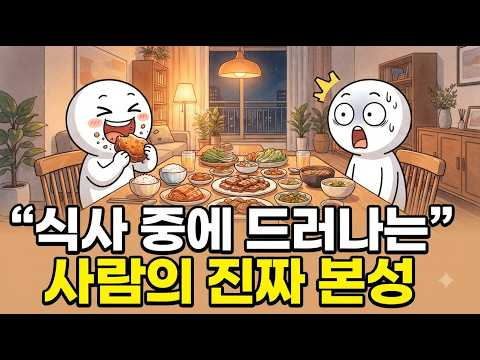
- 설명 앞부분: 사람의 진짜 성격은 말보다 행동에서 더 잘 드러납니다. 특히 우리가 아무렇지 않게 반복하는 식사 습관과 식탁에서의 행동에는 그 사람의 성격, 감정, 인간관계 방식이 자연스럽게 나타날 수 있습니다. 이번 영상에서는 식사 자리에서 드러나는 사람의 진짜 성격과 함께, 식탁에서 무심코 나타나는 행동이 인간관계에 어떤 의미를 가지고 있는지 심리학적인 관점에서 살펴봅니다. 🍽️ 음식을 먹는 속도가 유난히 빠르거나 느린 사람 🍽️ 다른 사람의 식사 방식에 지나치게 신경 쓰는 사람 🍽️ 식탁에서 대화를 주도하거나 거의 하지 않는 사람 🍽️ 함께…
- 같은 채널 평소 대비 ×13.8 (채널 최근 롱폼 중앙값 1,887회) · 평소 영상: 【심리학】왜 나에게만 유독 태도가 나쁠까?｜심리학이 밝혀낸 4가지 심리와 오늘부터 할 수… (2,111회) / 【심리학】유독 사람의 본성을 꿰뚫어 보는 사람들의 공통점｜첫 만남의 작은 위화감도 놓치지… (1,663회)
- 대본 없음 (설명) — 음성인식이 끝나면 도입부·흐름이 들어감
- 댓글 15/15: 좋은 점 — 영상 1 · 감사·응원 0 · 더 알고 싶은 것 0 · 아쉬운 점 — 영상 0 · 반박·불만 — 의견 다름 0 · 정치·사회 0 · 경험 공유 1 · 구독·다음 기대 0

### 82. 집에 있는 걸 좋아하는 사람들의 놀라운 심리｜심리학이 밝힌 진짜 이유

- https://www.youtube.com/watch?v=EDJ4-Ck5k4I · 심리 인사이트 · 구독자 1,610 · 조회수 132,026 (×82.0, 하루 1,116.5) · 좋아요 1,805 (1.4%) · 11.2분 · 2026-07-16 · 주제 묶음 1. 심리학 일반 · 형식 정보·해설 (그 밖) · 폴더 `W_EDJ4-Ck5k4I` (웹 승인)
- 썸네일: 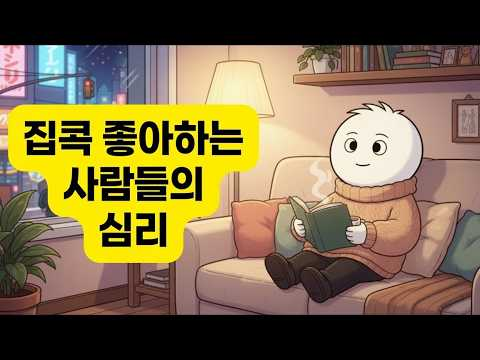
- 설명 앞부분: 사람들과 어울리는 것보다 집에서 보내는 시간이 더 행복하게 느껴지시나요? 많은 사람들은 집을 좋아하는 사람들을 내성적이거나 사회성이 부족하다고 생각합니다. 하지만 심리학은 전혀 다른 이야기를 들려줍니다. 이번 영상에서는 집순이와 집돌이가 집을 좋아하는 진짜 이유, 뇌가 외부 자극을 처리하는 방식, 도파민과 심리 메커니즘, 그리고 혼자 있는 시간이 정신 건강과 창의성에 미치는 영향을 심리학적 관점에서 쉽고 깊이 있게 설명합니다. 이 영상을 통해 다음과 같은 내용을 확인할 수 있습니다. 왜 어떤 사람은 집에서 가장 큰 행복을 느낄까?…
- 같은 채널 평소 대비 ×330.1 (채널 최근 롱폼 중앙값 400회) · 평소 영상: 심리학자도 놀란 7가지 특징｜평범하지 않은 사람만 가진 놀라운 신호 (400회) / X세대가 유난히 독립적인 진짜 이유｜심리학이 밝혀낸 놀라운 비밀 (413회)
- 대본 없음 (설명) — 음성인식이 끝나면 도입부·흐름이 들어감
- 댓글 259/259: 좋은 점 — 영상 4 · 감사·응원 17 · 더 알고 싶은 것 1 · 아쉬운 점 — 영상 4 · 반박·불만 — 의견 다름 3 · 정치·사회 0 · 경험 공유 23 · 구독·다음 기대 0
  - 좋은 점 — 영상 👍13 “딱 내 얘기 에요..아주 좋은 말씀 감사합니다..❤❤❤”
  - 좋은 점 — 영상 👍9 “나가서 활동을 해야 먹고살거나 먹고 사는 데 도움이 되니까 나가는 사람들이 대부분일테죠 집에서 혼자 있어도 경제적인 어려움이 없다는 것 부터가 복받은 인생인듯요”
  - 감사·응원 👍36 “돈 걱정 없이 집에 혼자 있을 수 있는 이생의 삶은 천국이라 생각합니다. 신에게 감사하는 삶이지만 혹 신이 부러워 할까 가끔 걱정됩니다. ㅎ”
  - 감사·응원 👍13 “딱 내 얘기 에요..아주 좋은 말씀 감사합니다..❤❤❤”
  - 더 알고 싶은 것 👍62 “내이야기인데 어떻게알았죠?”
  - 아쉬운 점 — 영상 👍0 “자막을 끌 수 있게 하든지, 아니면 자막을 검수하는 건 어떨까요? 내용은 좋은데 자막이 계속 신경을 거슬리게 해요”
  - 아쉬운 점 — 영상 👍0 “아니 내용이 너무 좋은데요 자막이 너무 … ㅜㅜ 발음대로 쓰여져서 그런가 이 부분이 너무 아쉬워요”
  - 반박·불만 — 의견 다름 👍2 “제 얘기 같아요...정신적 노동이 너무힘들어서 상대방이 만나자고 하면 숨고싶어요.. 그렇다고 사람이 싫은건 아닌데...외출하는과정이숙제로 다가오네요. 너무 배려만 하고 이해하고 맞춰줘서 그런가봐요...그냥 회사다니고 회사사람들과 웃고 떠들고 하는것만으로도 전 성공했다…”
  - 반박·불만 — 의견 다름 👍1 “외향적이였다가 나이 먹고나니 내향적으로 바뀜..별에별일을 다격다보니 멀하기도 전에 결과가 먼저보임..그러다보니 그냥 돈이나 모으면서 조용히 지내게 되더라..어차피 나가서 사람과 어울려봐야 결과가 빤히 보이거든~~ 인간관계 쉬운거 아닌데 나이먹고 진짜 친한친구 3명이면…”
  - 경험 공유 👍247 “저도 제 집이 제일 좋아요 아무리 넓고 호화스런 집도 부럽지 않아요 집에 있을 때 제일 편안하고 행복합니다”
  - 경험 공유 👍147 “나도집순입니다집이재일편하고혼자있는시간이편합니다”

### 83. [정약용 명언] 인복 많으려면 잘해주지 마라 미친듯이 ‘이 말’만 무조건 하면 된다 ∣ 정약용 ∣ 오디오북 ∣ 인생명언 ∣ 인간관계 ∣ 인복 ∣ 시니어조언 ∣ …

- https://www.youtube.com/watch?v=WsJxckYQlcA · 공감의샘 · 구독자 8,980 · 조회수 320,177 (×35.6, 하루 6,107.8) · 좋아요 4,688 (1.5%) · 38.3분 · 2026-09-19 · 주제 묶음 2. 인간관계·처세 · 형식 수면·낭독·오디오북 (잠잘 때·명언) · 폴더 `W_WsJxckYQlcA` (웹 승인)
- 썸네일: 
- 챕터: 0:00 인복은 타고나는 것일까? · 2:03 첫 번째. 밑 빠진 호구에 정성 붓기는 이제 그만! · 9:11 두 번째. 입을 닫으면 인복이 터지고, 입을 열면 사… · 16:28 세 번째. 칭찬에 속아 춤추다 다리에 쥐 난 사연 · 23:14 인복을 밀어내는 세 가지 대화 습관 · 24:36 첫 번째 대화법. 잘 보이려 애쓰지 않아도 사람이 끌… · 29:22 두 번째 대화법. 사람 줄어들까 두려워 마라, 진정한… · 35:45 인복을 부르는 대화법 총정리와 품격 있는 인생을 위한… · 21:05 ~ 30:10 ∣ 세 번째 이야기: 입을 닫으면 인복… · 30:10 ~ 38:18 ∣ 후반부: 인복을 불러오는 2가지 핵…
- 설명 앞부분: 인복이 많은 사람들의 비밀은 무작정 남을 칭찬하거나 나를 희생하는 데 있지 않습니다. 오히려 나를 지키는 단단한 선을 세우고 상대방을 존중하는 따뜻한 질문에 있습니다. 나를 낮추며 애쓰는 비위 맞추기는 상대에게 감정적 부담과 오만함만 남깁니다. 다산 정약용 선생의 지혜와 심리학 연구로 참된 사람의 복을 불러오는 법을 전합니다. 남에게만 좋은 사람이 되려 애쓰지 마시고 세상에서 가장 먼저 나 자신을 귀하게 대하세요. 내가 내 울타리를 단단하고 당당하게 세울 때 비로소 당신의 가치를 알아주는 귀인이 찾아옵니다. 오늘 영상을 통해 인간…
- 같은 채널 평소 대비 ×69.3 (채널 최근 롱폼 중앙값 4,622회) · 평소 영상: [정약용 명언] 형제마저도 나이 들수록 '남남'이 되는 이유. 이해하려고 애쓰지마라. l… (4,622회) / [정약용 명언] 누구를 만나든 '이런말'은 절대하지 마라 나를 우습게 본다, 무시당한다 … (5,837회)
- 대본 없음 (설명) — 음성인식이 끝나면 도입부·흐름이 들어감
- 댓글 651/651: 좋은 점 — 영상 12 · 감사·응원 33 · 더 알고 싶은 것 2 · 아쉬운 점 — 영상 1 · 반박·불만 — 의견 다름 0 · 정치·사회 0 · 경험 공유 26 · 구독·다음 기대 0
  - 좋은 점 — 영상 👍54 “주의에 내맘같지않은 사람들때문에 많은 상처를빋고 살았어요.잘해주면 잘해줄수록 당연한듯. 더바라고 살더군요. 참 웃기지요~ *공감의샘* 을듣고있는중 제얘기를 하는듯~ 그렇지만 저는 상대의 비유를 맞추려거나 듣기좋으라고 한말은 없었습니다. 다만 제 진심을담아서 얘기했지요…”
  - 좋은 점 — 영상 👍38 “꼭 맞는말씀 하시네요. 이제라도 정신차리고 .조금만해야지. 너무큰상처만 돌아오더라구요.명심할께요.”
  - 감사·응원 👍54 “주의에 내맘같지않은 사람들때문에 많은 상처를빋고 살았어요.잘해주면 잘해줄수록 당연한듯. 더바라고 살더군요. 참 웃기지요~ *공감의샘* 을듣고있는중 제얘기를 하는듯~ 그렇지만 저는 상대의 비유를 맞추려거나 듣기좋으라고 한말은 없었습니다. 다만 제 진심을담아서 얘기했지요…”
  - 감사·응원 👍51 “제 자신을 돌아봅니다.감사합니다♡”
  - 더 알고 싶은 것 👍6 “2 진심으로 감사드립니다. 인복을 많이 받고싶습니다. 부탁드립니다. 감사합니다.”
  - 더 알고 싶은 것 👍1 “정말 소중하며 앞으로 살아가면서 깨우쳐야하는 디테일한것들을. 가르처주셨어 감사드리며 내용들이 모두 하나하나 감동으로 가슴에 완전와닿네요 이젠 사람들을 대할때 이렇게 하면 너무나 큰도음이 되어 저에겐 유익할껏같아요 계속좋은말씀 올려주셔요~^♡^❤❤❤🎉🎉🎉😅”
  - 아쉬운 점 — 영상 👍1 “광고가 왜이리 길게 지속되냐. 구독과 좋아요를 취소합니다.”
  - 경험 공유 👍89 “저도 늘 남을위해 살았는데 이제부터는 저를위해 살고싶어요”
  - 경험 공유 👍69 “불편함을 깨기위해 저의 실수나 부족한부분을 겸손한듯 말하곤 했는데 알고보니 상대는 저를 낮춰보고 쉽게 보더라구요. 오히려 이런부분은 안하는게 맞고 말을 아끼고 상황을 내가 분위기전환하려 애쓰지않고 맞지않는 사람은 만나지않으니 맘미 편하고 좋더라구요. 누구보다 존중할 …”

### 84. 실제 우울증 환자들이 느끼는 세상은 이렇습니다

- https://www.youtube.com/watch?v=sWYKD54-BkQ · 홍승주의 디스턴싱 · 구독자 29,400 · 조회수 789,062 (×26.8, 하루 19,240.7) · 좋아요 2,957 (0.4%) · 27.5분 · 2026-10-01 · 주제 묶음 4. 우울·불안·정신건강 · 형식 정보·해설 (그 밖) · 폴더 `W_sWYKD54-BkQ` (웹 승인)
- 썸네일: 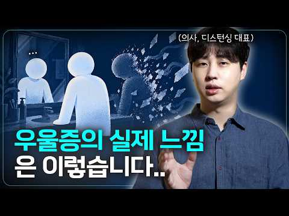
- 챕터: 0:00 #1. 우울증에 걸리면 어떤 느낌일까? · 2:03 #2. 몸에 중력이 더 강하게 작용합니다 · 3:58 #3. 좋아하던 것이 더 이상 좋지 않습니다 · 5:56 #4. 예전의 내가 사라진 것처럼 느껴집니다 · 7:57 #5. 머릿속의 생각도 내 뜻대로 움직이지 않습니다 · 10:29 #6. 우울증이 생기면 시간이 달라집니다 · 12:43 #7. 그리고 미래가 사라집니다 · 16:04 #8. 다른 사람들은 점점 멀어집니다 · 18:20 #9. 결국 우울증은 ‘슬픈 상태’보다 훨씬 큰 변화… · 20:11 #10. 그렇다면 회복된다는 것은 무엇일까요? · 24:46 내용정리
- 설명 앞부분: 서울의대 출신 의사가 만든 디지털 인지치료 프로그램, 디스턴싱 인간은 자신의 삶을 변화시킬 역량과 잠재성을 가지고 있습니다. 우리는 사람들이 스스로의 치료자가 되도록 돕습니다. ⏰ 타임스탬프
- 같은 채널 평소 대비 ×29.6 (채널 최근 롱폼 중앙값 26,632회) · 평소 영상: 약 없이도 우울증을 치료할 수 있을까? (27,527회) / "고기능 우울증"의 특징과 인지행동학적 해결법 (25,737회)
- 대본 없음 (설명) — 음성인식이 끝나면 도입부·흐름이 들어감
- 댓글 721/721: 좋은 점 — 영상 26 · 감사·응원 44 · 더 알고 싶은 것 12 · 아쉬운 점 — 영상 11 · 반박·불만 — 의견 다름 15 · 정치·사회 1 · 경험 공유 156 · 구독·다음 기대 0
  - 좋은 점 — 영상 👍71 “우울증이 심했을때 가끔 숨쉬기가 힘들었고, 유체이탈을 한 채로 나보다 살짝 뒤에서 나를 지켜보는 느낌? 심즈같은 인생 시뮬레이션 게임을 하는 느낌이 들었어요. 공허감이 너무 심해서 가슴에 구멍이 뚫린 느낌..? 도 들었었구요. 나를 둘러싼 세상이 빛을 잃은 흑백영화.…”
  - 좋은 점 — 영상 👍23 “저의 상태를 다른 이들에게 설명할때 좋은 영상이네요. 우울증 자체가 다양한 모습을 하고 있긴 하지만, 겪어보지 않은 사람들은 그게 뭔지 아예 감을 못잡는 경우가 대부분이더라구요. 축 쳐진 느낌으로만 받아들이는데 사실은 세상과 나와의 연결고리가 느슨해져서 생기는 작은 …”
  - 감사·응원 👍160 “대학원 중에 교수 때문에 우울증과 공황장애가 왔었고, 3년쯤 앓다가 일반적인 생활로 돌아올 수 있을 정도로 호전된 상태입니다. (회식 이후 제정신이 아닐 때 작성한 댓글이라 수정하였습니다.) 당시에 행정업무, 학회 관련 일, 교수 비서일 등 여타 대학원생들이 겪는 '…”
  - 감사·응원 👍31 “한참 우울증과 공황장애로 힘들었을때를 돌이켜 생각해보면 엄청 심했던 3개월이란 시간이 통째로 인생의 일부에서 지워진? 삭제된? 느낌이에요. 매일 소파에 누워서 한숨 한번 쉬었는데 해가 저물어가고 있고 정신 차리면 또 아침이고 그게 매일 반복이였어요 그러다 공황증세가 …”
  - 더 알고 싶은 것 👍1 “전 19살때부터 상담치료를 받으면서도 상담사분이 계속 정신과 상담 후 약물 치료와 병행하자고 하셨었는데 “원래 누구나 사는게 다 힘들고 죽고싶은거 아닌가 ? 나보다 힘든 사람들이 넘쳐나는데 왜 저렇게 오바하지 ” 싶었지만 결국 부모님 설득으로 20살때부터 10년이 넘…”
  - 더 알고 싶은 것 👍0 “가족중에 우울증에 걸린사람이 있습니다. 집밖에 나가는것 조차도 귀찮아 하는것 같습니다.상담치료를 권장해보고싶은데 오히려 상처가될까봐 말도 못꺼내고 있습니다..어떻게 얘길 해야할까요?”
  - 아쉬운 점 — 영상 👍160 “대학원 중에 교수 때문에 우울증과 공황장애가 왔었고, 3년쯤 앓다가 일반적인 생활로 돌아올 수 있을 정도로 호전된 상태입니다. (회식 이후 제정신이 아닐 때 작성한 댓글이라 수정하였습니다.) 당시에 행정업무, 학회 관련 일, 교수 비서일 등 여타 대학원생들이 겪는 '…”
  - 아쉬운 점 — 영상 👍31 “한참 우울증과 공황장애로 힘들었을때를 돌이켜 생각해보면 엄청 심했던 3개월이란 시간이 통째로 인생의 일부에서 지워진? 삭제된? 느낌이에요. 매일 소파에 누워서 한숨 한번 쉬었는데 해가 저물어가고 있고 정신 차리면 또 아침이고 그게 매일 반복이였어요 그러다 공황증세가 …”
  - 반박·불만 — 의견 다름 👍135 “죽을 용기로 살아라라는 말 제발 하지맙시다 용기가 아니라고 선택이 없는거라고 편해지고 싶어서 죽는것도 아닙니다 그런말 하는것도 구업 쌓는거예요”
  - 반박·불만 — 의견 다름 👍9 “우울증약을 먹은지도 20년이 되어간다 .. 내가 보기엔 거의 불치병인지도 모르겠다 .. 중간 중간 약을 끊어보고 잘 지낸 시간도 있기는 하다 그러나 뭔가 불행한 일이나 안좋은 환경이 조성되면 다시 되살아나서 약을 안먹으면 이유없는 불안 두려움 엉뚱한 행동을 하게 되고…”
  - 경험 공유 👍305 “그냥 다 필요없고 당장 지금 죽어도 좋다는 생각밖에 안듦. 죽었음 좋겠다, 죽으면 편하겠지, 왜 아직 살아있는거지, 뭐땜에 살아있는거지 이생각밖에 안남. 이순간 살아서 숨쉬고 있는게 제일 고통스러움. 왜 먹어야 하는지 식욕도 없음. 씻고싶지도 않음. 아무것도 하고 싶…”
  - 경험 공유 👍160 “대학원 중에 교수 때문에 우울증과 공황장애가 왔었고, 3년쯤 앓다가 일반적인 생활로 돌아올 수 있을 정도로 호전된 상태입니다. (회식 이후 제정신이 아닐 때 작성한 댓글이라 수정하였습니다.) 당시에 행정업무, 학회 관련 일, 교수 비서일 등 여타 대학원생들이 겪는 '…”

### 85. 60세가 넘으면 친구가 많을 필요 없습니다｜인간관계에 애쓸수록 노후가 피곤해지는 진짜 이유｜혼자 누리는 여유와 행복｜노년의 지혜

- https://www.youtube.com/watch?v=hI544usT4I8 · 노년의 지혜 · 구독자 258 · 조회수 11,303 (×43.8, 하루 168.8) · 좋아요 29 (0.3%) · 30.6분 · 2026-09-05 · 주제 묶음 2. 인간관계·처세 · 형식 정보·해설 (그 밖) · 폴더 `W_hI544usT4I8` (웹 승인)
- 썸네일: 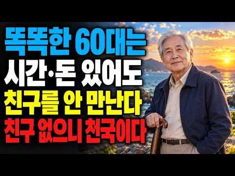
- 설명 앞부분: 60세가 넘으면 친구가 많아야 외롭지 않을까요? 꼭 그렇지는 않습니다. 사람의 숫자를 지키려고 마음에도 없는 모임에 나가고, 불편한 말을 참으며, 모든 관계에 최선을 다하다 보면 정작 내 마음이 먼저 지칠 수 있습니다. 이번 영상에서는 인간관계에 애쓸수록 노후가 피곤해지는 이유와 혼자서도 평온하고 행복하게 살아가는 노년의 지혜를 이야기합니다. 젊을 때는 직장과 사업, 자녀와 사회생활 때문에 많은 관계가 필요했습니다. 하지만 60세 이후에는 관계의 숫자보다 함께 있을 때 편안한지가 더 중요합니다. 만나고 돌아온 뒤 마음이 무겁다면 …
- 같은 채널 평소 대비 ×44.2 (채널 최근 롱폼 중앙값 256회) · 평소 영상: 어차피 누구나 죽습니다… 이제 고민과 걱정을 내려놓고 이렇게 사세요｜인생의 지혜｜노년의 … (276회) / 나이 들어 혼자여도 삶이 편안해지는 이유｜즐겁고 외롭지 않게 사는 5가지 방법｜노년의 지… (235회)
- 대본 없음 (설명) — 음성인식이 끝나면 도입부·흐름이 들어감
- 댓글 4/4: 좋은 점 — 영상 0 · 감사·응원 0 · 더 알고 싶은 것 0 · 아쉬운 점 — 영상 0 · 반박·불만 — 의견 다름 0 · 정치·사회 0 · 경험 공유 0 · 구독·다음 기대 0

### 86. 남자가 여자를 만만하게 볼 때 무의식적으로 하는 행동 5가지(행동심리학 관점)ㅣ연애심리ㅣ남자심리

- https://www.youtube.com/watch?v=PvrYmWUOzv0 · 심리조각 · 구독자 10,900 · 조회수 354,204 (×32.5, 하루 7,094.5) · 좋아요 2,433 (0.7%) · 14.8분 · 2026-09-22 · 주제 묶음 8. 연애·부부 심리 · 형식 정보·해설 (그 밖) · 폴더 `W_PvrYmWUOzv0` (웹 승인)
- 썸네일: 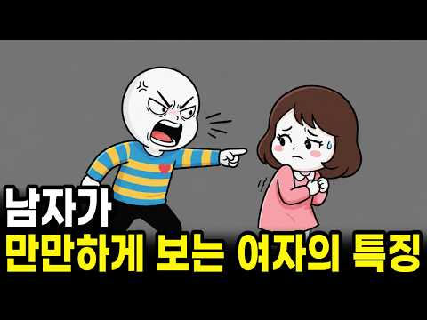
- 챕터: 0:00 남자가 여자를 만만하게 보기 시작하는 아주 사소한 순간 · 1:44 특징 1: 무조건 "괜찮아"라고 말하는 여자 (피플 … · 3:31 특징 2: 남자의 '엄마'가 되어버린 여자 (과잉 기… · 4:57 특징 3: 선을 넘어도 아무 일도 일어나지 않는 관계 · 6:35 특징 4: 자기 세계가 통째로 사라진 여자 (심리적 … · 7:32 특징 5: 서운함을 꾹 참다가 한꺼번에 터뜨리는 습관 · 8:42 남자가 당신을 만만하게 대하고 있다는 4가지 결정적 … · 10:04 전세 역전! 절대 만만하게 보지 못하게 만드는 5가지…
- 설명 앞부분: 남자가 갑가지 약속을 취소해도 "괜찮아, 푹 쉬어" 라고 하시나요? 무심코 던진 이 한마디가 당신을 '만만한 여자'로 만듭니다. 남자가 여자를 절대 만만하게 보지 못하게 만드는 심리학적 방법과 해결책을 공개합니다. 남자가 만만하다고 보는 여자는 수십 번의 작은 허락이 쌓여서 만들어집니다. 모든 상황에서 괜찮다고 양보하거나, 남자의 엄마처럼 모든 것을 챙겨주거나, 무례한 장난을 그저 웃어넘기는 행동들이 바로 치명적인 신호입니다. 임상심리학자 해리엇 브레이커가 경고한 '피플 플리징'의 위험성부터, 잃어버린 존중을 되찾고 전세를 역전시…
- 같은 채널 평소 대비 ×34.7 (채널 최근 롱폼 중앙값 10,210회) · 평소 영상: 이별 후 연락ㅣ전 연인의 연락, 재회 의사인지 어떻게 확인할까?ㅣ심리분석 (10,961회) / 남자가 '예쁘다'고 생각하는 여자 얼굴의 충격적인 진실(심리학 기반)ㅣ연애심리ㅣ남자심리 (9,460회)
- 대본 없음 (설명) — 음성인식이 끝나면 도입부·흐름이 들어감
- 댓글 303/303: 좋은 점 — 영상 7 · 감사·응원 10 · 더 알고 싶은 것 0 · 아쉬운 점 — 영상 3 · 반박·불만 — 의견 다름 4 · 정치·사회 0 · 경험 공유 21 · 구독·다음 기대 2
  - 좋은 점 — 영상 👍161 “이건 남녀관계에만 해당하는 얘기가 아님. 좋은 내용이네요.”
  - 좋은 점 — 영상 👍17 “전 결혼 43년째예요 신혼때 이걸 알았더라면 훨씬 나았을걸. 지금도 이 내용은 도움이 되겠네요 고마워요 정말 좋은 컨텐츠 다시한번 감사해요”
  - 감사·응원 👍54 “감사합니다 인간관계가 다 그런것같아요 이제 얘기해준부분 따라하면서 선을 넘는사람들.나를존중하지않으면 잊어버리지않고 꼭 그렇게 할거랍니다. 그리고 저런사람들과는 점점 거리도두고 만나지 않을거에요. 배려하지도 않을거구요. 좋은사람들과 함께 할래요”
  - 감사·응원 👍17 “전 결혼 43년째예요 신혼때 이걸 알았더라면 훨씬 나았을걸. 지금도 이 내용은 도움이 되겠네요 고마워요 정말 좋은 컨텐츠 다시한번 감사해요”
  - 아쉬운 점 — 영상 👍7 “선 안넘는 인격도 분명히 있다. 선을 넘었다 싶으면 한번정도는 얘기해보되, 반복이면 버려라. 물건도 처음부터 고장이면 그냥 버려야 될게 있고 살짝 고쳐야 될게 있지만 또 고장이나면 버려야 된다.”
  - 아쉬운 점 — 영상 👍2 “AI목소리 아니시죠? 😂 내용,딕션 넘좋아 구독좋아요 전체알람 누르고 시청합니다. 감사합니다 😂😂❤”
  - 반박·불만 — 의견 다름 👍249 “여성 잘못이 아닙니다. 저 남자에게 여성은 이미 중요한 존재가 아니거나 저 남자의 본성이 무례해서죠. 더 만날 필요가 없습니다. 무시하거나 무례한 행동에 대한 댓가는 있어야죠. 저런 남자랑 잘 되기위해서 뭘 애써 더 노력할 필요가 있나요? 이미 충분히 최대한 참으면서…”
  - 반박·불만 — 의견 다름 👍46 “<만만한 여자 5가지 특징> 1.모든 상황에서 괜찮다고 말하는 여자. 싫은 티를 내면 남자가 떠날까 봐 무서워서. 남자는 내가 어떻게 해도 곁에 남아 있을 사람이라고 믿고 마음대로 함. 위협을 느낄 때는 싸우거나 도망쳐야지 상대의 기분을 맞추면 안 됨. 어릴 때 눈치…”
  - 경험 공유 👍46 “<만만한 여자 5가지 특징> 1.모든 상황에서 괜찮다고 말하는 여자. 싫은 티를 내면 남자가 떠날까 봐 무서워서. 남자는 내가 어떻게 해도 곁에 남아 있을 사람이라고 믿고 마음대로 함. 위협을 느낄 때는 싸우거나 도망쳐야지 상대의 기분을 맞추면 안 됨. 어릴 때 눈치…”
  - 경험 공유 👍17 “전 결혼 43년째예요 신혼때 이걸 알았더라면 훨씬 나았을걸. 지금도 이 내용은 도움이 되겠네요 고마워요 정말 좋은 컨텐츠 다시한번 감사해요”
  - 구독·다음 기대 👍3 “구독합니다 ❤”

### 87. 나르시시스트가 되는 이유 ∣ 정신과 의사가 본 2가지 성장환경

- https://www.youtube.com/watch?v=0zbHoy3g4A4 · 정신과 의사 형원장 · 구독자 1,170 · 조회수 104,226 (×89.1, 하루 685.3) · 좋아요 903 (0.9%) · 6.7분 · 2026-06-12 · 주제 묶음 5. 나르시시스트·가스라이팅 · 형식 인터뷰·강연·대담 (교수·의사·스님) · 폴더 `W_0zbHoy3g4A4` (웹 승인)
- 썸네일: 
- 챕터: 0:00 시작 · 1:10 어린 시절의 영향 · 1:34 조건부 사랑을 받아서? · 3:14 유리 같은 자존감 · 3:45 사랑받지 못한 영향?
- 같은 채널 평소 대비 ×389.6 (채널 최근 롱폼 중앙값 268회) · 평소 영상: 《가능한 사랑》 개봉 기념｜이창동 감독 《초록물고기》, 막동은 왜 비극적인가 (296회) / 속초 여름휴가 1편🌊 생선구이 먹고 요트 타고 설악산까지 (239회)
- 대본 없음 (없음) — 음성인식이 끝나면 도입부·흐름이 들어감
- 댓글 236/236: 좋은 점 — 영상 6 · 감사·응원 9 · 더 알고 싶은 것 3 · 아쉬운 점 — 영상 1 · 반박·불만 — 의견 다름 8 · 정치·사회 2 · 경험 공유 25 · 구독·다음 기대 0
  - 좋은 점 — 영상 👍28 “극단적으로 오직 나!나!나! 나다!!하는 신념이 있고 입버릇처럼 나는 알지~~! 라는 말로 수시로 상대방의 말을 끊는 사람이 주변에 있어서 피로감이 있어요...나르일까요😢😢😢 그리고 상대가 처음엔 나르가 아닌줄 알았는데 알고보니 내현 나르의 특성에 부합되더라구요😢 내…”
  - 좋은 점 — 영상 👍5 “나르시시트 아빠때문에 인생이 파도였습니다. 지금도 괴로울 때가 있어요. 그래도 알려주셔서 감사합니다”
  - 감사·응원 👍28 “극단적으로 오직 나!나!나! 나다!!하는 신념이 있고 입버릇처럼 나는 알지~~! 라는 말로 수시로 상대방의 말을 끊는 사람이 주변에 있어서 피로감이 있어요...나르일까요😢😢😢 그리고 상대가 처음엔 나르가 아닌줄 알았는데 알고보니 내현 나르의 특성에 부합되더라구요😢 내…”
  - 감사·응원 👍5 “나르시시트 아빠때문에 인생이 파도였습니다. 지금도 괴로울 때가 있어요. 그래도 알려주셔서 감사합니다”
  - 더 알고 싶은 것 👍28 “극단적으로 오직 나!나!나! 나다!!하는 신념이 있고 입버릇처럼 나는 알지~~! 라는 말로 수시로 상대방의 말을 끊는 사람이 주변에 있어서 피로감이 있어요...나르일까요😢😢😢 그리고 상대가 처음엔 나르가 아닌줄 알았는데 알고보니 내현 나르의 특성에 부합되더라구요😢 내…”
  - 더 알고 싶은 것 👍3 “내가 나르시시스트라고 생각되는 사람은 어떻게 살아야 할까요? 솔직히 사람 성격이 쉽게 변하는 것도 아니고, 이미 굳어진 나르적 성격을 고치는 방법이 있을까요? 저는 내 생각이 어떻건 간에 그냥 말을 안 하고 입을 다무는 방법을 택했어요. 속으로는 상대방을 욕하며”
  - 아쉬운 점 — 영상 👍6 “우리집은 엄마랑 동생이 나르같아요 특징을 보니 여기다 제가 겪은 일을 나열하기엔 너무 길고 유튜브 검색창에 사랑과전쟁 (엄마 그리고 딸 ) 이라는 영상 있어요 (혈압 높으신 분들 시청금지) 영상 거기 나오는 아들&&엄마 우리집이랑 99%똑같음 한가지만 이야기하면 아들…”
  - 반박·불만 — 의견 다름 👍144 “우리나라의 양면성 같다고 생각합니다,,,,,,,,,,,,,,, 말도 안 되는 경제 발전 뒤에는 나르시시스트가 너무 많음ㅜㅡㅠㅜㅠㅜㅜㅠ 잘 되면 외현, 안 되면 내현”
  - 반박·불만 — 의견 다름 👍10 “제가 남매(어린이들)따로 개인교습하는데 여아가 너무 심한 나르인데 다른 아이는 정말 착하고 예의 바른데여... 어머니도 매우 에의 바르시고. 나르 아이는 악마인가 싶을 정도인데...전 양육 과정때문이라는데 경험을 통해 딱 동의 못하겠어요...”
  - 정치·사회 👍165 “나라가 힘들고 회사다니기 힘들고 학교다니기 힘들고 사는게 힘든이유는? 나르시시스트와 소시오패스가 너무 많기 때문이죠.”
  - 경험 공유 👍45 “나르 부모에게서 자랐고 완벽하지 않으면 버림 받는다는 생각 한적 있습니다 하지만 어느 순간에 번아웃이 왔고 다 내려 놓은 후에 내 부족한 모습도 받아들이게 되었어요 이제는 사람들에게 제 약한 모습도 보여 줄 수 있습니다 꼭 나르 부모에게서 자란다고 모두가 나르가 되는…”
  - 경험 공유 👍12 “우리남편 정서적 돌봄을 못 받았던것 같네요 학교에서 1등해도 칭찬받은적이 없데요 현재는 모든걸 잘된건 자기 덕이고 잘못된건 모두 아내 탓만해요 자기 합리화 투사 엄청 합니다 자아성찰은 죽을때까지 없을것 같구요 대화하다보면 억울해서 미칠것 같아요 시부모님 두분다 묵뚝뚝…”

### 88. 놓치면 평생 후회합니다! 중년 여성이 보내는 호감 신호와 연애의기술 8가지

- https://www.youtube.com/watch?v=mtqYYYhdJoI · 연애심리연구소 · 구독자 137 · 조회수 11,009 (×80.4, 하루 78.7) · 좋아요 128 (1.2%) · 27.2분 · 2026-06-24 · 주제 묶음 7. 말투·호감 · 형식 정보·해설 (그 밖) · 폴더 `W_mtqYYYhdJoI` (웹 승인)
- 썸네일: 
- 챕터: 0:00 중년 여성이 호감을 보낼 때 나타나는 변화 · 1:50 웃음을 숨기지 못하는 진짜 이유 · 4:30 먼저 공감하는 말투의 의미 · 7:25 작은 배려에 흔들리는 감정 · 10:15 근황을 자주 묻는 이유 · 12:50 함께 있는 시간을 늘리려는 행동 · 16:00 감정을 돌려서 표현하는 신호 · 18:40 칭찬에 달라지는 표정의 비밀 · 21:20 다음 만남을 기대하는 말의 의미
- 설명 앞부분: 놓치면 평생 후회합니다! 중년 여성이 보내는 호감 신호와 연애의기술 8가지 🌹 중년 이후 찾아오는 소중한 인연을 놓치고 싶지 않으신가요? 이번 영상에서는 중년 여성이 호감을 느낄 때 자연스럽게 나타나는 행동과 심리를 알아보며, 관계를 발전시키는 연애의기술 을 소개합니다. 😊 웃음을 숨기지 못하는 순간, 부드러워지는 말투, 작은 배려에 감동하는 모습까지 다양한 신호를 이해하면 상대의 진심을 더 쉽게 알아볼 수 있습니다. 이것은 중년의 연애의기술 에서 매우 중요한 부분입니다. 💌 또한 근황을 자주 묻거나 함께 있는 시간을 늘리려는 행…
- 같은 채널 평소 대비 ×48.6 (채널 최근 롱폼 중앙값 226회) · 평소 영상: 헤어지자는 말 없이 당신이 먼저 떠나길 바라는 사람의 5가지 신호 ∣ 연애의기술 (251회) / 60대 이후에도 배우자에게 사랑받는 비결! 뇌과학이 밝힌 건강과 행복의 연애의기술 (202회)
- 대본 없음 (설명) — 음성인식이 끝나면 도입부·흐름이 들어감
- 댓글 0/0: 좋은 점 — 영상 0 · 감사·응원 0 · 더 알고 싶은 것 0 · 아쉬운 점 — 영상 0 · 반박·불만 — 의견 다름 0 · 정치·사회 0 · 경험 공유 0 · 구독·다음 기대 0

### 89. 모든 남자가 자신도 모르게 찾는 여자 ∣ 남성 심리 ∣ 칼 융

- https://www.youtube.com/watch?v=J4Nf4oosnt8 · 여자를 위한 남성심리 · 구독자 292 · 조회수 11,145 (×38.2, 하루 165.5) · 좋아요 136 (1.2%) · 21.7분 · 2026-09-05 · 주제 묶음 1. 심리학 일반 · 형식 정보·해설 (그 밖) · 폴더 `W_J4Nf4oosnt8` (웹 승인)
- 썸네일: 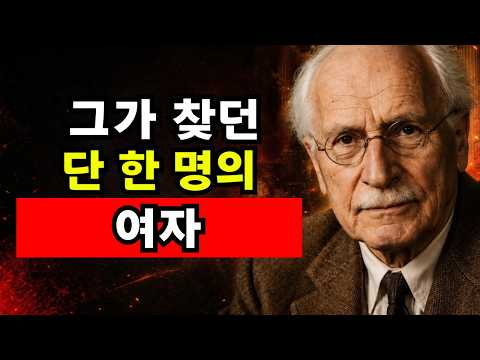
- 설명 앞부분: 모든 남자가 자신도 모르게 찾는 여자 ∣ 남성 심리 ∣ 칼 융 💫 모든 남자가 자신도 모르게 찾는 여자는 과연 어떤 사람일까요? 단순히 외모가 뛰어나거나 매력적인 여성을 뜻하는 것이 아닙니다. 칼 융의 심리학에서는 남성의 무의식 속에 존재하는 여성적 이미지, 즉 ‘아니마(Anima)’가 사랑과 끌림, 관계의 선택에 깊은 영향을 준다고 설명합니다. 🧠 이번 영상에서는 남성 심리와 칼 융의 분석심리학을 바탕으로, 왜 어떤 여성은 특별한 이유 없이도 강한 인상을 남기고 오랫동안 잊히지 않는지 살펴봅니다. ✨ 이번 영상에서 다룰 내용: …
- 같은 채널 평소 대비 ×4.8 (채널 최근 롱폼 중앙값 2,334회) · 평소 영상: 그는 당신을 무시하는 게 아니라 더 깊이 사랑에 빠지고 있다 ∣ 칼 융 (2,384회) / 남자가 강하게 끌릴 때 여자에게서 가장 먼저 보는 5가지 ∣ 남성 심리 ∣ 칼 융 (2,284회)
- 대본 없음 (설명) — 음성인식이 끝나면 도입부·흐름이 들어감
- 댓글 8/8: 좋은 점 — 영상 0 · 감사·응원 2 · 더 알고 싶은 것 0 · 아쉬운 점 — 영상 0 · 반박·불만 — 의견 다름 0 · 정치·사회 0 · 경험 공유 2 · 구독·다음 기대 0
  - 감사·응원 👍0 “네알겠슴니다 감사합니다 선생님”
  - 감사·응원 👍0 “남성의 무의식 속에 존재하는 여성상과 남성 심리를 칼 융의 관점에서 정말 깊이 있게 풀어주셨네요. 단순히 외적인 끌림을 넘어 내면의 깊이를 돌아보게 만드는 뜻깊은 영상입니다. 좋은 콘텐츠 감사합니다! 🙏✨”
  - 경험 공유 👍0 “선생님 제가 말했습니다 그런데 선생님의 절 제거 까지 한다고 했잖아요,,전 이미 다 알아요, 미카엘 애도 있습니다, 또 저하고, 말할때 록금으로 합니다 , 그래서 ,선생님하고 말한겁니다 ,,너무 잘알겠습니다”
  - 경험 공유 👍0 “도는 벌면 있습니다 지금도 행복하게 잘 지내고 있어요, 저는 요리로,, 여기저기 찾아요, 그리고 내가 아무리 있어도, 하늘에서 돈도 아들을 감옥에서 집에 오긴커넝 그런일은 여기서도 족합니다,, 선생님 난 바보가 않입니다, 미카엘 절 사랑한다면 대한민국에 오라고 하세요…”

### 90. “왜 저 사람은 아무렇지 않을까?” 감정적으로 안정된 사람들의 6가지 습관 ∣ 심리학

- https://www.youtube.com/watch?v=VARPtgv1PE8 · 실전 심리학 · 구독자 369 · 조회수 15,744 (×42.7, 하루 202.0) · 좋아요 97 (0.6%) · 14.8분 · 2026-08-25 · 주제 묶음 1. 심리학 일반 · 형식 정보·해설 (그 밖) · 폴더 `W_VARPtgv1PE8` (웹 승인)
- 썸네일: 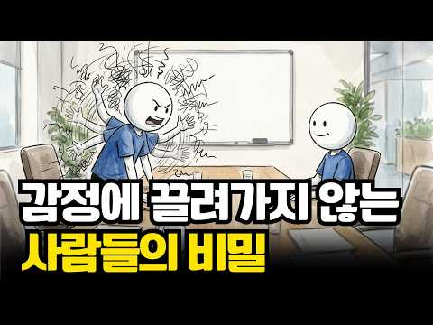
- 설명 앞부분: 왜 어떤 사람은 같은 일을 겪어도 쉽게 흔들리지 않을까요? 칭찬을 받아도 지나치게 들뜨지 않고, 다른 사람의 성공을 보며 자신을 초라하게 만들지 않고, 갈등이 생겨도 감정적으로 폭발하지 않는 사람들. 혼자 있는 시간을 편안하게 보내고, 필요할 때는 죄책감 없이 거절하고, 자신의 실수를 담담하게 인정하기도 합니다. 이런 사람들은 정말 감정이 없는 걸까요? 그렇지 않습니다. 그들도 화가 나고, 속상하고, 불안하고, 상처받습니다. 다만 감정이 자신을 끌고 가도록 내버려 두지 않는다는 차이가 있습니다. 이번 영상에서는 정서적으로 안정된 …
- 같은 채널 평소 대비 ×71.2 (채널 최근 롱폼 중앙값 221회) · 평소 영상: 말을 많이 안 해도 사람들이 좋아하는 사람들의 대화 습관 5가지 ∣ 심리학 (221회) / 통찰력이 뛰어난 사람들이 지독하게 외로운 … (239회)
- 대본 없음 (설명) — 음성인식이 끝나면 도입부·흐름이 들어감
- 댓글 2/2: 좋은 점 — 영상 1 · 감사·응원 1 · 더 알고 싶은 것 0 · 아쉬운 점 — 영상 0 · 반박·불만 — 의견 다름 0 · 정치·사회 0 · 경험 공유 0 · 구독·다음 기대 0
  - 좋은 점 — 영상 👍2 “영상 보면서 정말 많이 찔렸어요. 특히 2번, 남들이랑 비교하면서 저를 갉아먹던 시간이 참 많았거든요. 왜 나는 저 사람만큼 못할까 자책하고요. 근데 영상 보고 나니까 '다들 각자의 속도가 있구나' 싶어서 마음이 좀 편해지네요. 완벽하지 않아도 괜찮다는 말이 오늘 저…”
  - 감사·응원 👍2 “영상 보면서 정말 많이 찔렸어요. 특히 2번, 남들이랑 비교하면서 저를 갉아먹던 시간이 참 많았거든요. 왜 나는 저 사람만큼 못할까 자책하고요. 근데 영상 보고 나니까 '다들 각자의 속도가 있구나' 싶어서 마음이 좀 편해지네요. 완벽하지 않아도 괜찮다는 말이 오늘 저…”

### 91. HSP들 당장 드루와..예민+불안러들 멘탈관리용 책 추천하러 왔다

- https://www.youtube.com/watch?v=WGDslk67vNQ · 마루코는 30살 · 구독자 2,870 · 조회수 81,169 (×28.3, 하루 1,534.3) · 좋아요 1,083 (1.3%) · 15.6분 · 2026-09-19 · 주제 묶음 6. 성격·유형 · 형식 사연·고민 상담 (썰·라디오) · 폴더 `W_WGDslk67vNQ` (웹 승인)
- 썸네일: 
- 챕터: 0:00 intro · 0:07 아주 짧은 근황 업뎃 · 0:39 오늘의 주제 · 1:29 다독인 아님 주의 · 1:53 첫번째 책 · 3:01 최애 문장들 · 3:11 최애 문장(1) · 4:20 최애문장(2) · 5:46 최애문장(3) · 7:04 가장 좋았던 점 · 8:17 두번째 책 · 9:19 최애문장(1) · 9:42 최애문장(2) · 10:32 최애문장(3) · 11:24 가장 좋았던 점 · 11:37 마지막 책 · 14:23 마무리
- 설명 앞부분: 오늘도 영상 봐주셔서 고맙슙니다 여러분💗
- 같은 채널 평소 대비 ×12.0 (채널 최근 롱폼 중앙값 6,766회) · 평소 영상: 나만 취미 없어? 그래서 취미 어떻게 찾는건데요,,, (9,505회) / 까지 다 해본 30대 언니가 풀어주는 썰. (4,026회)
- 대본 없음 (설명) — 음성인식이 끝나면 도입부·흐름이 들어감
- 댓글 25/25: 좋은 점 — 영상 1 · 감사·응원 0 · 더 알고 싶은 것 2 · 아쉬운 점 — 영상 0 · 반박·불만 — 의견 다름 0 · 정치·사회 0 · 경험 공유 4 · 구독·다음 기대 0
  - 좋은 점 — 영상 👍0 “유익해요 ㅎㅎ”
  - 더 알고 싶은 것 👍2 “책추천 영상에서 뜬금없지만 나시탑 어디건지 궁금합니다.. 알려주실수있으실까효??”
  - 더 알고 싶은 것 👍1 “인간관계론 출판사 다영하던데 어디 출판사껄로 읽는 게 좋을까요??”
  - 경험 공유 👍4 “저도 허리디스크 터지니 멘탈진짜 무너지더라고요,,, 아픈건 둘째치고 아무것도 못한다는 그런 생각이 계속맴도니 넘 힘들었네요”
  - 경험 공유 👍1 “자기관리론 진짜 좋아요 저도 몇 번 읽은 책!”

### 92. 서울대 의사가 외롭고 사람이 두려운 이유 [심리상담 풀영상]

- https://www.youtube.com/watch?v=u7BS3D_Sylo · 김지은의 뇌와 마음 · 구독자 12,900 · 조회수 193,173 (×15.0, 하루 6,872.0) · 좋아요 1,054 (0.5%) · 48.4분 · 2026-10-14 · 주제 묶음 1. 심리학 일반 · 형식 인터뷰·강연·대담 (교수·의사·스님) · 폴더 `W_u7BS3D_Sylo` (웹 승인)
- 썸네일: 
- 설명 앞부분: 🌟김지은 교수님 상담 프로그램 우리는 종종 심리적 어려움의 해결책을 조언이나 구체적인 지침에서 찾으려 합니다. 방송에서 유명인들이 제시하는 명쾌한 해답이 매력적으로 보이는 이유이기도 합니다. 제가 생각하는 상담의 진정한 힘은, 특정한 지시보다 어떤 맥락에서 어떤 만남이 이루어지는가에 있는 경우가 많습니다. 판단 받지 않는 진솔하고 수용적인 신뢰의 맥락 속에서 스스로 두려움을 견뎌낼 때, 새로운 감정이 생겨나 진정으로 삶으로 향할 수 있는 힘이 생기기도 합니다. 이런 접근의 바탕에는 사람 안에 자신의 삶을 이해하고 더 나아갈 수 있…
- 같은 채널 평소 대비 ×47.2 (채널 최근 롱폼 중앙값 4,092회) · 평소 영상: 나르시시스트는 자존감 높은 사람들이 아닙니다. (4,677회) / 40대에 아이 셋 낳으면 인생이 변하나요? (4,805회)
- 대본 없음 (설명) — 음성인식이 끝나면 도입부·흐름이 들어감
- 댓글 192/192: 좋은 점 — 영상 8 · 감사·응원 36 · 더 알고 싶은 것 1 · 아쉬운 점 — 영상 1 · 반박·불만 — 의견 다름 3 · 정치·사회 1 · 경험 공유 29 · 구독·다음 기대 0
  - 좋은 점 — 영상 👍30 “사람이 다 잘할 수 없습니다. 본인이 잘하는 걸로 잘 먹고 살면 그만이에요. 돈 잘 버니 요리 못하면 맛있는 거 사먹으면 되는 거고 도우미 고용해서 할 수도 있는 건데 지난날 요리 못한 게 당연히 처음해본 거 못할 수 있는 거에요. 누구보다 공부도 잘해서 의대까지 가…”
  - 좋은 점 — 영상 👍23 “엄마를 많이 사랑하셨나봐요. 엄마를 위해 엄마가 부탁한걸 못해서 거기서 오는 좌절감이 큰것 같아요 엄마의 빈자리도 불안했을거고.. 저는 아이가 느꼈을 감정 너무 이해돼요 그동안 쌓여있던 감정이 그사건으로 드러난듯. 가정사는 모르겠지만”
  - 감사·응원 👍244 “가벼운 마음으로 갔다가 생각보다 많이 꺼내고 왔어요. 독립적이고 싶다는 말 안에 버림받고 싶지 않다는 마음이 붙어 있었다는 거. 그날 처음 알았어요. 선생님, 감사했어요. 다음에 또 봬요. 그땐 6대 4 해볼게요.”
  - 감사·응원 👍100 “친구가 떠난거에 대한 과도한 자책을 하시는군요. 자신의 부족함이나 완벽하지 않아서가 아니고 어릴적 그 혼란스러운 환경속에서도 최선을 다해 버더온 아이였고, 당시 느껐던 버림 받음에 대한 공포와 자책감이 지금까지 남아있기 때문입니다. 누군가가 떠난것은 그 친구의 사정이…”
  - 더 알고 싶은 것 👍3 “선생님에게 상담 치료 받으려면 어떻게 해야 하나요?”
  - 아쉬운 점 — 영상 👍62 “선생님의 솔직함이 범인들에게는 정말 큰 위안이되고.사는게 크게 다르지않은것.그게 삶의 큰기대와 실망이 없이 살게되어 가벼워집니다.정말 고맙습니다!”
  - 반박·불만 — 의견 다름 👍100 “친구가 떠난거에 대한 과도한 자책을 하시는군요. 자신의 부족함이나 완벽하지 않아서가 아니고 어릴적 그 혼란스러운 환경속에서도 최선을 다해 버더온 아이였고, 당시 느껐던 버림 받음에 대한 공포와 자책감이 지금까지 남아있기 때문입니다. 누군가가 떠난것은 그 친구의 사정이…”
  - 경험 공유 👍55 “원장님, 그 친구를 위해서가 아니라 자기 자신을 위해서 하루하루 행복하게 보내시길 바라요. 우정의 서사는 얼마든지 다시 쓸 수 있어요. 중년에 만난 친구는 또 얼마나 새로운데요. 그렇게 새로운 관계를 만들다 보면 옛친구와 다시 마주할 수 있을 거에요. 그 친구도 오랜…”
  - 경험 공유 👍54 “자립심? 독립심? 천성이 착하신분인가봐요. 저라면 왜 이거까지 시키지? 나한테 뭘 해준게 있다고? 아빠의 국을 왜 내가 만들어줘야하지? 나도 보살핌을 받이야하는 존잰데 내가 왜 아빠를 보살펴야하지? 이런 생각에 억울할거 같은데요.”

### 93. 인간관계에 지쳐 마음이 힘들 때 : 멘탈관리 마인드셋 영상

- https://www.youtube.com/watch?v=Qtn1XXIylOQ · 하루울림 · 구독자 1,150 · 조회수 10,439 (×9.1, 하루 575.1) · 좋아요 138 (1.3%) · 5.4분 · 2026-10-24 · 주제 묶음 2. 인간관계·처세 · 형식 수면·낭독·오디오북 (잠잘 때·명언) · 폴더 `W_Qtn1XXIylOQ` (웹 승인)
- 썸네일: 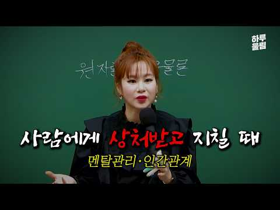
- 설명 앞부분: 인간관계 정리가 필요할 만큼 지친 마음을 다스리는 법을 알려드립니다. 상처받은 마음을 내려놓고 평온을 되찾는 구체적인 방법을 확인해보세요. ⚠️ 댓글 안내 출연자 및 타인을 향한 무분별한 비방, 욕설, 악의적인 댓글은 무통보 삭제될 수 있습니다.
- 대본 없음 (설명) — 음성인식이 끝나면 도입부·흐름이 들어감
- 댓글 7/7: 좋은 점 — 영상 1 · 감사·응원 0 · 더 알고 싶은 것 1 · 아쉬운 점 — 영상 0 · 반박·불만 — 의견 다름 0 · 정치·사회 0 · 경험 공유 1 · 구독·다음 기대 0
  - 좋은 점 — 영상 👍0 “고백 실패 또는 헤어짐 상태에도 도움이 되는 말 인 듯 하네요.”
  - 더 알고 싶은 것 👍0 “임금체불하는 회사는 어떻게 해야 하나요?”
  - 경험 공유 👍0 “내남편이 나보다 가족을 택한다해도, 나는 내가할수있는 사랑을 끝의끝까지하겠다 인생 살아보자 어차피 항상 웃을수만은 없다는거 알고있다. 인생은 고된것.”

### 94. 난 왜 이렇게 맨날 서운할까

- https://www.youtube.com/watch?v=HPxRqFYlbgY · 에니어시온 EnneaXion · 구독자 13,400 · 조회수 455,258 (×34.0, 하루 6,502.8) · 좋아요 5,116 (1.1%) · 33.2분 · 2026-09-02 · 주제 묶음 기타 · 형식 정보·해설 (그 밖) · 폴더 `W_HPxRqFYlbgY` (웹 승인)
- 썸네일: 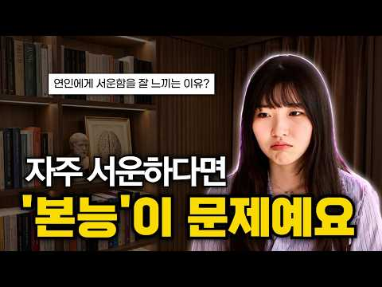
- 챕터: 0:00 인트로 · 1:55 본능이란 무엇인가 · 4:37 본능적 하위유형(subtypes) 설명: 자기보존(S… · 7:08 실전 — 상대 본능 알아보는 법 & 테스트 · 9:35 자기보존(SP) 유형의 연애 · 16:11 성적(SX) 유형의 연애 · 21:34 사회적(SO) 유형의 연애 · 26:40 세 번째 본능 — 당신의 사각지대(맹점) · 29:31 에니어그램 역유형(Counter Types) · 31:13 총정리
- 같은 채널 평소 대비 ×39.4 (채널 최근 롱폼 중앙값 11,543회) · 평소 영상: 다 귀찮고 피곤하고 아무것도 하기싫을 때 보세요 (11,543회) / 【역대급 충격】 치이카와 세계관이 사실은 현대판 《1984》인 소름 돋는 이유.. [치이… (18,349회)
- 대본 없음 (없음) — 음성인식이 끝나면 도입부·흐름이 들어감
- 댓글 253/253: 좋은 점 — 영상 31 · 감사·응원 28 · 더 알고 싶은 것 14 · 아쉬운 점 — 영상 2 · 반박·불만 — 의견 다름 4 · 정치·사회 0 · 경험 공유 37 · 구독·다음 기대 3
  - 좋은 점 — 영상 👍124 “저는 너무 쉽게 서운함을 느끼는 것 같아서 내가 문젠가 왜 자꾸 이렇게 섭섭하고 눈물이 많이 나지 했는데, 사람과 사람의 관계에서 감정의 눈높이가 안 맞는 사람이 너무 많아서 그런 것 같아요 좋은 영상 감사합니다 ☺️”
  - 좋은 점 — 영상 👍87 “아 나는 자기보존이랑 사회적 본능이 강했구나 여친은 자기보존이랑 성적 본능이 강한거 같고 뭔가 명쾌해진거 같네요 감사합니다”
  - 감사·응원 👍124 “저는 너무 쉽게 서운함을 느끼는 것 같아서 내가 문젠가 왜 자꾸 이렇게 섭섭하고 눈물이 많이 나지 했는데, 사람과 사람의 관계에서 감정의 눈높이가 안 맞는 사람이 너무 많아서 그런 것 같아요 좋은 영상 감사합니다 ☺️”
  - 감사·응원 👍87 “아 나는 자기보존이랑 사회적 본능이 강했구나 여친은 자기보존이랑 성적 본능이 강한거 같고 뭔가 명쾌해진거 같네요 감사합니다”
  - 더 알고 싶은 것 👍43 “세가지 다 거의 비슷한 수준으로 공감되는데 이건 어떤 경우일까요?”
  - 더 알고 싶은 것 👍3 “엇 그냥 생윤공부하는 재수생인데여 우연히 이 영상을 보고 생윤 공부중인데 아퀴나스 제시문에 자연법이란 인간의 합리적인 본성에 의존하는 법으로서 ••••••중략하고 제1의 자연 성향은 인간이 다른 모든 실체와 함께 소유하고 있는 자기보존능력이요. 제2의 자연 성향은 동…”
  - 아쉬운 점 — 영상 👍7 “잔남친이랑 내가 ㄹㅈㄷ 회피형이라서 오히려 엄청 잘맞았음 3년 내내 한번도 싸운적 없다가 딱 헤어질때 한번 서운한거 이야기 다하고 울고 감정정리하고 새벽 내내 이야기 하고 헤어짐 그래서 생각하는게 이렇게 잘맞으면서 깔끔하게 끝날 사람 못만날것 같다는 생각”
  - 아쉬운 점 — 영상 👍0 “내용은 괜찮아서 좋아요. 근데 발음이 이 새시는데 말의 속도도 빨라서 전달력이 떨어지는 점이 아쉽습니다.”
  - 반박·불만 — 의견 다름 👍5 “천생연분이라는 말이 괜히 있는 말이 아니죠. ㅎㅎ”
  - 반박·불만 — 의견 다름 👍2 “장기연애하고 자연스럽게 멀어지며 헤어졌는데 와 이영상보니까 사귀는동안 속상했던부분이 왜그랬는지 딱보이네요. 그사람의 잘못은 아닌데.. 서로의 잘못은 아닌데 계속 서운함들이 은은하게 쌓여왔었겠네요... 대박..”
  - 경험 공유 👍166 “연인이 없어서 서운하지만 저는 너무 성적본능 맞는 거 같습니다 ㅋㅋㅋ 꾸준하지 못하고, 한번 몰입할 걸 정하면 좀 미련 곰탱이 같아도 계속 그거 잘 못 벗어나고 저 고등학교 때는 “딱 누군가한테 내가 1순위면 좋겠다” 라는 거를 친구나 이성에게 바란 적이 있었습니다 😅”
  - 경험 공유 👍124 “저는 너무 쉽게 서운함을 느끼는 것 같아서 내가 문젠가 왜 자꾸 이렇게 섭섭하고 눈물이 많이 나지 했는데, 사람과 사람의 관계에서 감정의 눈높이가 안 맞는 사람이 너무 많아서 그런 것 같아요 좋은 영상 감사합니다 ☺️”
  - 구독·다음 기대 👍54 “통찰력이 엄청 높은 영상이네용 다른 사람과 나는 생각의 기둥이 달라서 이해하기 힘들고 같은 것을 봐도 다르게 이야기하고 내가 원하는 부분에서 자꾸 다른이야기를 할 수 있다는걸 인지하고는 있었지만 이렇게 확실히 구분한 정보를 얻으니 복잡했던 생각이 정리되는 느낌이네요 …”
  - 구독·다음 기대 👍2 “에니어시온님 오늘 처음 우연히 접하게 된 채널인데 먼저 교육의 대한 열정과 사람들과의 관계를 개선하고 좋은 세상을 만들어가시는 과정이 존경되고 결과가 기대됩니다. ^^ 혹시 시온님은 몇번 본능이 제일 강하신 타입이신지 궁금해서 물어보기만 합니다. 개인적인 부분이라 답…”

### 95. 새 차 한 번도 안 사본 사람들, 중고차만 타는 심리 (돈이 없어서가 아닙니다)

- https://www.youtube.com/watch?v=LPV-iqsq2xE · 심리학한줌 · 구독자 14,700 · 조회수 435,427 (×29.6, 하루 7,039.9) · 좋아요 1,876 (0.4%) · 23.6분 · 2026-09-10 · 주제 묶음 1. 심리학 일반 · 형식 정보·해설 (그 밖) · 폴더 `W_LPV-iqsq2xE` (웹 승인)
- 썸네일: 
- 설명 앞부분: 차 바꿀 때가 됐는데 또 중고차 매물을 봅니다. 새 차 살 돈은 통장에 그대로 있습니다. 평생 새 차를 한 번도 안 사본 사람들. 형편 때문일까요? 심리학자들은 정반대로 봅니다. 이 영상에서는 중고차만 타는 사람들의 심리를 들여다봅니다. 새 차가 출고장을 나서는 순간 벌어지는 일부터, 신차 매장의 조명과 리본이 파는 것의 정체, 그리고 이 사람들이 20년 동안 통장에 남기는 것까지요.
- 같은 채널 평소 대비 ×19.0 (채널 최근 롱폼 중앙값 22,914회) · 평소 영상: 집·주방·옷, 적게 사고 오래 쓰는 사람들의 공통점 (총정리) (23,925회) / 혼자 있어도 외롭지 않은 사람들, 이런 사람들입니다 (사람을 싫어하는 게 아닙니다) (21,902회)
- 대본 없음 (설명) — 음성인식이 끝나면 도입부·흐름이 들어감
- 댓글 848/848: 좋은 점 — 영상 13 · 감사·응원 16 · 더 알고 싶은 것 6 · 아쉬운 점 — 영상 2 · 반박·불만 — 의견 다름 23 · 정치·사회 2 · 경험 공유 95 · 구독·다음 기대 0
  - 좋은 점 — 영상 👍2 “진짜 공감합니다”
  - 좋은 점 — 영상 👍1 “영상 내용 및 전개과정이 맛있네요 좋은 영상 만들어주셔서 감사해요”
  - 감사·응원 👍120 “Yf택시부활 49만키로 370만원주고사서 8년 고장하나없이타다가 폐차비 150받아서 220만원으로 8년잘타고 ev6풀옵 중고로삼 평생 택부살라햇는데 장거리많이뛰니까 acc좋네요 중고로사는이유는 돈이없어서입니다감사합니다”
  - 감사·응원 👍80 “진짜 새차 사주시는 분께는 감사...”
  - 더 알고 싶은 것 👍1 “다음으로 중고차 절대 안사고 새차만 사는 사람 시점으로 이야기 해주세요”
  - 더 알고 싶은 것 👍0 “중고차만 사는 사람들? 사람들이 과연 차를 바꾸는 것을 얼마나 바꿀까요? 보통 10년이상 타는 사람도 흔하고 15년 이상도 타는데, 인생에 4-5번이나 바꾸려나? 중고차를 산다고 차를 자주 바꾸면 돈을 더 들텐데...중고차를 산다고 해서 자주 바꾸지 않으니, 차를 잘…”
  - 아쉬운 점 — 영상 👍0 “유튜버 목소리가 고저장단이 없어 매우 지루하네 AI인가.......... 만 2년반 된차 중고을 샀는데 여자분이 몰더 차라 내장이 담배냄새도 없고. 외장도 흠집도 없고 엔진룸을 보니 팔려고 닦은 티 없이 말끔해서 바로 구매했네요 sm520 새차 구매이후 중고차 잘 골…”
  - 아쉬운 점 — 영상 👍0 “1년만에 싫증날게 뻔한 차 할부값내고싶지 않음ㆍ 드림카라면 모를까 ㆍ 차는 전액 현금 신차급 중고가 편함”
  - 반박·불만 — 의견 다름 👍52 “면허따고 20년 넘도록 중고차만 구입했네요. 새차사서 쓸데없이 민감해지고 스트레스 받는 게 싫어서 중고차를 구입해서 타고 있습니다. 돈많이 생기면 새차는 글쎄요...차라리 집을 사는데 보태는게 맞다고 생각합니다. 남의 시선에 맞추지 말고 그냥 소모품이라고 생각해서 맘…”
  - 반박·불만 — 의견 다름 👍14 “전 아닙니다. 진짜 가난해서 중고차 탑니다.”
  - 정치·사회 👍0 “윤통은 김문수 지지해달라고 했지 국힘 지지해달라고 한 적 없음”
  - 경험 공유 👍75 “새차사서 14년째 타고 있습니다 😅”
  - 경험 공유 👍6 “차라도 좀 새거 타보자!!! 차빼고 내가 타는 모든게 헌거다!!!”

### 96. 외로움을 달래기 위해 시작한 점심 모임이 결국 내 가정을 무너뜨리기까지의 기록 ∣ 황혼 이혼의 위기 ∣ 우정의 파탄 ∣ 시니어의 외로움

- https://www.youtube.com/watch?v=Kpl0HUB7-uM · 노후 나침반 · 구독자 701 · 조회수 31,696 (×45.2, 하루 323.4) · 좋아요 681 (2.1%) · 37.1분 · 2026-08-05 · 주제 묶음 3. 자존감·감정·멘탈 · 형식 정보·해설 (그 밖) · 폴더 `W_Kpl0HUB7-uM` (웹 승인)
- 썸네일: 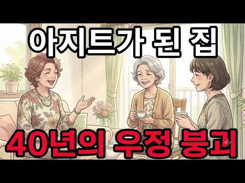
- 설명 앞부분: 65세 주부 마키가 커피값 600원으로 오른 카페 대신 집을 친구들에게 열어준 순간부터 지옥이 시작됐습니다. 정년 후 외로움을 메우려 거절 못 하는 성격 때문에 집이 무료 카페가 되고, 시간 도둑 친구들과 쌓이는 스트레스, 결국 남편의 “나가라”는 말까지. 시니어 인간관계의 함정과 경계 설정의 용기, 진짜 평화를 되찾는 방법을 이 영상에서 확인하세요. 혼자 서는 아름다움과 거절하는 용기를 배워보세요. 시니어인간관계,거절용기,정년후,경계설정,무료카페,집개방,인간관계스트레스,시니어친구,혼자시간,자기보호
- 같은 채널 평소 대비 ×87.4 (채널 최근 롱폼 중앙값 362회) · 평소 영상: 아내를 가정부처럼 대했던 남편의 최후. 이혼 후 진정한 행복을 찾은 64세 여성의 인생 … (371회) / 평생 독신으로 자유롭다고 생각했다… 64세, 아무도 없는 방에서 쓰러진 후 깨달은 진실과… (354회)
- 대본 없음 (설명) — 음성인식이 끝나면 도입부·흐름이 들어감
- 댓글 144/144: 좋은 점 — 영상 2 · 감사·응원 0 · 더 알고 싶은 것 1 · 아쉬운 점 — 영상 0 · 반박·불만 — 의견 다름 6 · 정치·사회 0 · 경험 공유 8 · 구독·다음 기대 0
  - 좋은 점 — 영상 👍10 “남편 폭언이 틀린게 없네요”
  - 좋은 점 — 영상 👍1 “그마음 충분히 이해합니다 결단도 잘 내리셨구요 잘배웠습니다”
  - 반박·불만 — 의견 다름 👍86 “남편이 계신데 친구들을 들였다구요. 말도안됨.”
  - 반박·불만 — 의견 다름 👍8 “말도 안됨...넘 비현실적임”
  - 경험 공유 👍55 “집에 있는 물건도 훔쳐갑니다. 친구고 뭐고 청하는 것 바보 짓입니다. 저희 아래아랫층에 친척이면서 친구가 이사를 왔더랍니다. 제가 음식 같은 걸 해서 가져다 주기도 했는데 값이 조금 나가는 그릇은 돌려주지 않는 겁니다. 어릴때만 봤기에 성격을 몰라서 한 두해 제법 친…”
  - 경험 공유 👍11 “내가이걸왜듣고있나”

### 97. 집을 항상 깨끗하게 유지하는 사람들의 소름 돋는 심리 ∣ 뇌과학·도파민 회로

- https://www.youtube.com/watch?v=e322NAUIdHE · 심리치트키 · 구독자 4,700 · 조회수 351,060 (×74.7, 하루 1,981.9) · 좋아요 5,289 (1.5%) · 12.7분 · 2026-05-18 · 주제 묶음 1. 심리학 일반 · 형식 정보·해설 (그 밖) · 폴더 `W_e322NAUIdHE` (웹 승인)
- 썸네일: 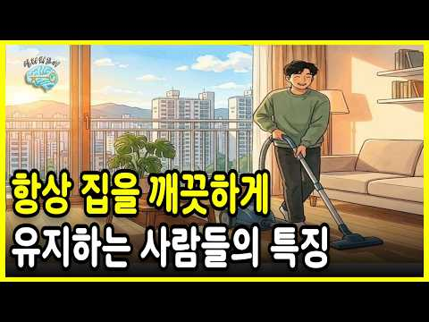
- 챕터: 0:00 프롤로그: 우리는 왜 청소 앞에서 무력해지는가? · 2:06 공간의 과학 · 4:51 매일 치우는 사람들의 신경학적 보상 3가지 · 7:35 동기 부여의 대전환 · 9:36 실천 심리학 : 행동 전략 3가지 · 11:08 정돈된 공간이 당신에게 건네는 위로
- 설명 앞부분: 피로한 하루를 마치고 현관문을 열었을 때, 어질러진 방을 보며 죄책감을 느끼신 적이 있으신가요? 우리 사회는 흔히 정리 정돈을 인격이나 성실함의 척도로 다루지만, 심리학과 신경과학의 시선은 다릅니다. 이번 영상에서는 어질러진 환경이 우리 뇌와 호르몬(코르티솔)에 가하는 보이지 않는 공격을 파헤치고, 의지력 없이도 공간을 돌보며 내면의 질서를 회복하는 '선순환의 3가지 심리 전략'을 전해드립니다. "공간을 정리하는 그 짧은 10분이, 하루 중 가장 고요하고 가장 나다운 시간이었음을 발견하게 될 것입니다." 오늘도 당신의 소중한 공간…
- 같은 채널 평소 대비 ×301.9 (채널 최근 롱폼 중앙값 1,163회) · 평소 영상: 착하지만, 절대 만만하지 않은 지능높은 사람 특징 6가지 (1,163회) / 당신의 곁에서 조용히 짐을 싸는 사람들 ∣ 인간관계 ∣ 이별신호 ∣ 마음공부 ∣ 동기부여 (975회)
- 대본 없음 (설명) — 음성인식이 끝나면 도입부·흐름이 들어감
- 댓글 332/332: 좋은 점 — 영상 10 · 감사·응원 10 · 더 알고 싶은 것 4 · 아쉬운 점 — 영상 3 · 반박·불만 — 의견 다름 0 · 정치·사회 0 · 경험 공유 50 · 구독·다음 기대 1
  - 좋은 점 — 영상 👍51 “하루동안 엉망된 집을 싹 치우고 기분좋게 잠들어요. 아침에 일어나 깔끔한 집을 보면 하루가 즐거워요. 여행이나 집을 비우기 전에도 청소, 정리 필수고 돌아왔을때 깔끔한 집을 보며 피로와 긴장이 싹 풀립니다. 의무가 아니라 스트레스 해소 목적이라 영상내용이 정말 공감되…”
  - 좋은 점 — 영상 👍3 “오십 대까지는 몸이 허약하고 바빠서 청소를 대충하고 살았 어요 요가하고 몸 과 마음이 건강해져 서 69세인데 요 65평의 이층 주택으로 이사오면서 거의매일 해도 피곤한 걸모르고 부지런하게 살아요 남편과 맛있는거 해 먹고 수영하고 젊을 때 못 누린 걸 누리고 사네요 맞…”
  - 감사·응원 👍2 “이 영상이 제 알고리즘에 뜨게 해주셔서 두손모아 감사드립니다..”
  - 감사·응원 👍2 “너무너무 공감합니다.정신건강측면에서 알려주셔서 감사합니다 ❤”
  - 더 알고 싶은 것 👍1 “지구는 매일 쓰레기더미로 더럽혀지고 생태계는 교란되거나 멸종되어가며 지구온난화로 더위에 죽을 지경인데 내 집 깨끗하게 한다는게 의미가 있을까요? 배달음식 시키지말고 일회용품 쓰지말고 제로웨이스트부터 실천합시다”
  - 아쉬운 점 — 영상 👍0 “66일… 저도 한번 해봐야겠어요. 목소리가 너무 차분해서 좋아요.”
  - 아쉬운 점 — 영상 👍0 “다른 사람에게 추천하고 싶은 영상이지만 너무 길어.”
  - 경험 공유 👍406 “나도 출근전 싹다 치우고 나옴 퇴근후 깨끗한 집에서 쉬고싶음”
  - 경험 공유 👍59 “잡다한 물건 많은거 제일 싫고 무조건 정리정돈 목숨검 돈주고 쓸데없는 쓰레기 안산다 씽크대, 화장대, 책상,식탁 에 물건 하나도 없어야됨. 그런데 우리집에 나만 이럼”
  - 구독·다음 기대 👍1 “좋은 이야기 감사합니다. 구독했습니다. 많은 조언이 되는 이야기들 잘 듣겠습니다.”

### 98. 뇌가 달라지는 혼잣말의 비밀, 인생을 바꾸는 뇌과학의 원리

- https://www.youtube.com/watch?v=N9VBE85m_bo · 뇌생각 심리학 · 구독자 8,200 · 조회수 411,703 (×50.2, 하루 3,430.6) · 좋아요 9,696 (2.4%) · 13.1분 · 2026-07-14 · 주제 묶음 1. 심리학 일반 · 형식 정보·해설 (그 밖) · 폴더 `W_N9VBE85m_bo` (웹 승인)
- 썸네일: 
- 챕터: 0:00 ☕ 커피 한 잔 쏟은 아침, 툭 튀어나온 그 한마디 · 1:50 📺 내 하루의 리모컨은 누가 쥐고 있을까? · 2:53 💰 세계 최고 부자가 매일 반복하는 그 말 · 4:04 🔀 똑같은 하루가 완전히 달라지는 이유 · 4:38 📚 세 번 미끄러진 그분에게 찾아온 반전 · 5:26 🧠 실험실에서 밝혀진 놀라운 3일의 비밀 · 7:02 🔊 왜 '소리 내서' 말해야 할까 · 7:41 💡 첫 번째 방법 — 이선 크로스의 처방 · 9:21 🚪 두 번째 방법 — 두 글자로 열리는 문 · 9:53 ⭐ 세 번째 방법 — 잠들기 전 3분의 기적
- 설명 앞부분: ☕ 아침에 커피 한 잔 쏟았을 뿐인데… 왜 그 한마디가 하루 종일 나를 따라다닐까요? "아이고, 내가 하는 일이 그렇지 뭐." "그럼 그렇지, 내가 뭘 제대로 하는 게 있나." 혹시 오늘 아침에도, 자기도 모르게 이런 말이 툭 나오셨나요? 😔 여러분이 유독 덤벙거려서도, 하는 일마다 안 풀려서도 아닙니다. 그 한마디에는요, 우리가 몰랐던 뇌의 비밀이 숨어 있어요. 🧠✨ 🎬 이 영상에서 나누는 이야기 "말이 씨가 된다"는 옛말, 뇌과학이 진짜로 증명한 이유 ✅ 내 하루를 바꾸는 뇌 속 리모컨 '망상 활성계'의 정체 ✅ 빌 게이츠가 …
- 같은 채널 평소 대비 ×165.9 (채널 최근 롱폼 중앙값 2,482회) · 평소 영상: 우울증도 아닌데 모든 게 귀찮고 피곤한 이유 (2,507회) / 존중받는 사람과 무시받는사람의 치명적인 말투 차이 2가지 (2,457회)
- 대본 없음 (설명) — 음성인식이 끝나면 도입부·흐름이 들어감
- 댓글 540/540: 좋은 점 — 영상 46 · 감사·응원 135 · 더 알고 싶은 것 6 · 아쉬운 점 — 영상 2 · 반박·불만 — 의견 다름 1 · 정치·사회 0 · 경험 공유 18 · 구독·다음 기대 2
  - 좋은 점 — 영상 👍90 “참 좋은 영상입니다. 수많은 성공학, 영성책들을 과학적 근거를 들어 아주 간단하고 쉽게 잘 요약한 액기스 같은 영상입니다. 거짓과 부풀림이 난무하는 유튜브에 이런 영상도 있네요. 좋은 영상 감사 드리고 앞으로도 사람들을 이롭게 하는 좋은 영상 많이 부탁드립니다.”
  - 좋은 점 — 영상 👍15 “감사함니다 비 많이 오는 시절 임니다 건강 잘 챙기시구 좋은 영상 잘 듣고 감니다”
  - 감사·응원 👍129 “난 정말 운이좋아.. 그러니까 나이 7ㅣ 인데 일을하고있지. 왼쪽무릎이 아픈데 .. 걸을수있으니 감사하네”
  - 감사·응원 👍90 “참 좋은 영상입니다. 수많은 성공학, 영성책들을 과학적 근거를 들어 아주 간단하고 쉽게 잘 요약한 액기스 같은 영상입니다. 거짓과 부풀림이 난무하는 유튜브에 이런 영상도 있네요. 좋은 영상 감사 드리고 앞으로도 사람들을 이롭게 하는 좋은 영상 많이 부탁드립니다.”
  - 더 알고 싶은 것 👍90 “참 좋은 영상입니다. 수많은 성공학, 영성책들을 과학적 근거를 들어 아주 간단하고 쉽게 잘 요약한 액기스 같은 영상입니다. 거짓과 부풀림이 난무하는 유튜브에 이런 영상도 있네요. 좋은 영상 감사 드리고 앞으로도 사람들을 이롭게 하는 좋은 영상 많이 부탁드립니다.”
  - 더 알고 싶은 것 👍9 “그런게 연습으로 되나요? 예수님 믿으시면 저절로 말이 변해요❤❤”
  - 아쉬운 점 — 영상 👍39 “오늘도 다시 듣습니다.. 반복해서 들어야 생각이 납니다. "너는 참 복 많다.인덕이 많다" 하는 말이.. 돌아가신 어머니께서 해주시는 것 같아요..진짜 느껴져요”
  - 아쉬운 점 — 영상 👍1 “🎉정말 명강이었네요.. 이미 알고 있는 내용이기도 했지만 속으로만 확언을 하고 있었는데 아침에 강의 듣고 좋아서 입밖으로 긍정말을 한번 실천해보자 생각했어요. 오늘 체육대회에서 5만원 상품권 응모를 했는데 받고 싶은 마음에 나는 운이 좋다. 당첨되길 바라며 제 이름을…”
  - 반박·불만 — 의견 다름 👍2 “참으로 신기해요 지금까지 살면서 이 영상을 본것도 아닌데 합습하듯이 살고 있었네요 1. ㅇㅇ야! 스스로 내이름을 부르며 너 잘 해내고 있어 2.아직이지만 언젠가 이뤄질거야 3.그날 있었던 일 중에서 다소 안 좋았더라도 이만해서 다행이야. 사소한 것에도 이건 기적이야.…”
  - 경험 공유 👍109 “여호와는 나의목자시니 내가부족함이 없으리로다!!🙏”
  - 경험 공유 👍22 “오늘 좋았던 일 1.오늘 온양 장날구경가려고 계획했는데 날씨가 맑고 화창했슴 2.온양온천행 고속버스를 타고보니 옆자리가 비어서 편하게 갔슴 3.온천시설을 리모델링 했는지 무척 깨끗해져서 기분이 좋았슴 4.온양시내버스에서 목발을 하신분이 타서 나도 72살이지만 자리를 …”
  - 구독·다음 기대 👍20 “형민! 너는 고시원에서 혼자 살고있지만 1.편히 쉴곳이 있어서 고맙습니다 2.매일 일할곳이 있어서 고맙습니다 3.아픈데가 없이 건강해서 고맙습니다 4.아침에 창문열고 하늘을 볼수있어 고맙습니다 5.오늘은 친구와점심약속이있어서 기다려집니다 이 역시 고맙습니다❤”
  - 구독·다음 기대 👍1 “좋은말씀과정보 감사합니다 처음 들어왔는데 좋아서 구독합니다”

### 99. 친구가 없어도 잘 사는 사람들, 사실 이런 심리입니다(오히려 편안합니다)

- https://www.youtube.com/watch?v=GV_KOGoAJ2M · 심리상자 · 구독자 3,180 · 조회수 23,991 (×7.5, 하루 1,322.9) · 좋아요 123 (0.5%) · 17분 · 2026-10-24 · 주제 묶음 1. 심리학 일반 · 형식 정보·해설 (그 밖) · 폴더 `W_GV_KOGoAJ2M` (웹 승인)
- 썸네일: 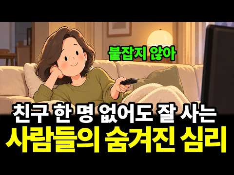
- 설명 앞부분: 친구가 없어서 외로운 것과, 혼자 있어도 편안한 것은 다릅니다. 모든 관계를 끝까지 붙잡아야 한다고 생각하지 않는 사람들은 인간관계를 바라보는 방식부터 다를 수 있습니다. 한때 소중했던 인연이 자연스럽게 멀어질 수도 있고, 관계를 억지로 이어가지 않아도 자신의 삶을 잘 살아갈 수 있습니다. 이 영상에서 다루는 내용 친구가 하나둘 멀어져도 크게 흔들리지 않는 사람들의 심리 사람을 만나고 난 뒤 자신의 마음을 살피는 이유 친구의 숫자로 자신의 가치를 판단하지 않는 태도 지나간 인연을 억지로 붙잡지 않는 시절인연의 의미 혼자 있는 시간…
- 같은 채널 평소 대비 ×2.1 (채널 최근 롱폼 중앙값 11,591회) · 평소 영상: 새 차 살 돈이 있는데도 중고차를 고르는 사람들의 심리 (뇌구조가 다릅니다) (11,805회) / 34평 팔고 24평으로 간 사람들의 의외의 심리 (형편이 아니라 선택입니다) (11,377회)
- 대본 없음 (설명) — 음성인식이 끝나면 도입부·흐름이 들어감
- 댓글 13/13: 좋은 점 — 영상 0 · 감사·응원 0 · 더 알고 싶은 것 2 · 아쉬운 점 — 영상 0 · 반박·불만 — 의견 다름 0 · 정치·사회 0 · 경험 공유 7 · 구독·다음 기대 0
  - 경험 공유 👍8 “고1인데 친구관계가 너무 힘들어요. 항상 친구랑 있으면 제가 재미없어서 그 친구도 나에게서 떠나가면 어떡하지라는 생각을 계속하게되요. 제가 매력이 없어서 친구가 없는걸까라는 생각도 많이 들어요 그나마 제일 편한 친구가 있었는데 그 친구마저 다른 친구들과 더 친 해지게…”
  - 경험 공유 👍7 “20대30대나 친구가좋죠 내가잘사는게 최고에요”

### 100. 친했던 친구가 나이들수록 불편해지는 진짜 이유 ∣ 심리학이 밝힌 과학적 이유

- https://www.youtube.com/watch?v=O5jemCtVpp0 · 지혜이정표 · 구독자 5,050 · 조회수 239,974 (×47.5, 하루 2,008.4) · 좋아요 818 (0.3%) · 29.3분 · 2026-07-14 · 주제 묶음 1. 심리학 일반 · 형식 정보·해설 (그 밖) · 폴더 `W_O5jemCtVpp0` (웹 승인)
- 썸네일: 
- 설명 앞부분: 삼십 년 알고 지낸 친구인데, 만나고 돌아오면 반가움보다 피곤이 먼저 옵니다. 싫은 건 아니에요. 미운 것도 아니고요. 근데 어느 순간부터 같이 있으면 편하지가 않은 거예요. 이 영상에서는 오래된 친구가 왜 불편해지는지, 그 안에 어떤 심리학적 구조가 숨어 있는지 이야기합니다. 결혼 전에는 왜 몰랐을까? 던바의 '우정의 7가지 기둥'과 가치관 충돌의 구조 불편한 우정이 건강에 미치는 영향 (미시간주립대 6년 추적 연구) 카스텐슨 교수의 사회정서적 선택 이론 이 나이에 진짜 맞는 친구는 어디서, 어떻게 만날 수 있는지 Kalmijn…
- 같은 채널 평소 대비 ×47.8 (채널 최근 롱폼 중앙값 5,016회) · 평소 영상: 나이들수록 뭘 해도 재미없는 진짜 이유 ∣ 당신 잘못이 아닙니다 (뇌과학이 밝힌 수치) (5,623회) / 잘 풀리는 사람들이 절대 털어놓지 않는 습관 하나 (4,409회)
- 대본 없음 (설명) — 음성인식이 끝나면 도입부·흐름이 들어감
- 댓글 100/100: 좋은 점 — 영상 2 · 감사·응원 6 · 더 알고 싶은 것 0 · 아쉬운 점 — 영상 1 · 반박·불만 — 의견 다름 0 · 정치·사회 0 · 경험 공유 16 · 구독·다음 기대 0
  - 좋은 점 — 영상 👍8 “끊지도 않고 매달리지도 않고.. 이 구절이 와닿네요 애씀이 필요한 만남은 이제 피하게 됩니다 편안한 친구 한두명이면 충분~”
  - 감사·응원 👍9 “40년 친구가 있어요 10년은 안 만났죠 제가 그만 만나자고 했거든요 넘 외로워서.. 제가 먼저 연락한지 6년째.. 여전히 안 맞지만 맞추어 가고 있담니다 그런데 3주일 전에 전라도 장수에 갈일 있어서 집 오는길에 친구네 친정이 무주 라서 휴게소 들러 빵 사고 용돈 …”
  - 감사·응원 👍2 “좋아요 감사합니다”
  - 아쉬운 점 — 영상 👍3 “으 내용 너무 길고 진부하다”
  - 경험 공유 👍18 “그래서 나이들수록 보고싶은데 내가보고싶은건 그때00지 절대지금의00는될수없음을 깨닭고 그냥 말뿐인 밥한번먹자.언제꼭보자라는 습관성인사만 하게되더군요.”
  - 경험 공유 👍15 “맏며느리 34년차. 지긋지긋하다. 21살 차이나는 시어머니랑 같이 늙어가네ㅠ 주제이탈 죄송😢”

### 101. 힘든 삶에서, 괴롭지 않기 위한 인지심리학적 대처법

- https://www.youtube.com/watch?v=HJXEgD2m2r8 · 홍승주의 디스턴싱 · 구독자 29,400 · 조회수 499,922 (×17.0, 하루 11,623.7) · 좋아요 2,572 (0.5%) · 26.5분 · 2026-09-29 · 주제 묶음 1. 심리학 일반 · 형식 정보·해설 (그 밖) · 폴더 `W_HJXEgD2m2r8` (웹 승인)
- 썸네일: 
- 챕터: 0:00 #1. 고통스러운 인간 · 1:26 #2. 삶 자체가 어느 정도는 힘들 수밖에 없습니다 · 4:03 #3. 생각은 고통을 만듭니다 · 9:54 #4. 자아도 고통을 만듭니다 · 12:37 #5. 고통의 보편성을 분명히 보기 · 17:56 #6. 고통에 고통을 더하지 않기 · 20:38 #7. 고통을 다시 바라보기
- 설명 앞부분: 서울의대 출신 의사가 만든 디지털 인지치료 프로그램, 디스턴싱 인간은 자신의 삶을 변화시킬 역량과 잠재성을 가지고 있습니다. 우리는 사람들이 스스로의 치료자가 되도록 돕습니다. ⏰ 타임스탬프
- 같은 채널 평소 대비 ×18.8 (채널 최근 롱폼 중앙값 26,632회) · 평소 영상: 약 없이도 우울증을 치료할 수 있을까? (27,527회) / "고기능 우울증"의 특징과 인지행동학적 해결법 (25,737회)
- 대본 없음 (설명) — 음성인식이 끝나면 도입부·흐름이 들어감
- 댓글 163/163: 좋은 점 — 영상 21 · 감사·응원 28 · 더 알고 싶은 것 5 · 아쉬운 점 — 영상 1 · 반박·불만 — 의견 다름 0 · 정치·사회 0 · 경험 공유 20 · 구독·다음 기대 1
  - 좋은 점 — 영상 👍14 “선생님의 강의는 상투적이지 않고 새로운 관점으로 신선하고 매우 유용합니다 큰 도움이 됩니다.앞으로도 잘 부탁드립니다. 필기하면서 복기하며 잘 듣고 있습니다 감사드립니다 😊”
  - 좋은 점 — 영상 👍12 “불교에서 이야기하는 알아차림과 궤를 같이하는 것 같습니다. 내용이 매우 알차고 많은 도움이 되네요! 감사합니다”
  - 감사·응원 👍72 “선생님 영상이 다른 심리학 채널과 다른 점은 개별적인 사례 접근 보다는 큰 틀에서의 접근인 점인 것 같아요. 그래서 아 사람은 원래 그렇구나.. 개인적으로 불편한 일일 순 있지만 심각한 일은 아니구나 싶어져요. 그래서 안도되는 마음도 가집니다. 오늘도 영상 감사합니다.”
  - 감사·응원 👍28 “큰 위로가 되었습니다. 대학 졸업반부터 엄마의 병간호를 통해 헤쳐나가야할 무서운 사회생활로부터 도망쳤는데 엄마가 돌아가시고나니 나에게 남은건 없이 나이만 먹었더군요. 어머니의 부재로 인한 두려움과 외로움과 고통. 사회적 위치에서 무능함에 대한 공포와 고통. 허우적거리…”
  - 더 알고 싶은 것 👍14 “선생님의 강의는 상투적이지 않고 새로운 관점으로 신선하고 매우 유용합니다 큰 도움이 됩니다.앞으로도 잘 부탁드립니다. 필기하면서 복기하며 잘 듣고 있습니다 감사드립니다 😊”
  - 더 알고 싶은 것 👍6 “오늘도 좋은 영상 감사합니다. 강박성 성격이랑 일중독에 대해서도 다뤄주시면 좋을것같아요!”
  - 경험 공유 👍62 “삶에 '희망'이 없을 때 정신은 무너지는 것 같습니다. 내일이 오늘보다 나아질꺼라는 희망, 나도 어디가서 1인분은 하고 살 수 있을꺼란 희망... 희망은 도파민 같아요. 내가 마음 속에 그리고 바라는 것을 이룰 수 있다는 그 불씨가 피어나기 시직할 때, 우리는 역경 …”
  - 경험 공유 👍19 “커다란 상실들을 겪고 마음이 괴로워 치료받고 있는 사람입니다 오늘 병원가서 약물을 조절하고 왔네요 너무 지쳐서 가슴이 두근거려 가만히 누워 영상을 듣는데 위로가 되었어요 감사합니다”
  - 구독·다음 기대 👍2 “목소리차분하게 설명해주셔서 좋네요 구독했어요”

### 102. 누구든 끌어당기는 심리학적 방법 (절대 악용하지 마세요) ∣ 연애 다크심리학

- https://www.youtube.com/watch?v=1owmdus3_pw · 숨겨진심리학 · 구독자 37,500 · 조회수 366,677 (×9.8, 하루 14,759.5) · 좋아요 2,549 (0.7%) · 25.7분 · 2026-10-17 · 주제 묶음 1. 심리학 일반 · 형식 정보·해설 (그 밖) · 폴더 `W_1owmdus3_pw` (웹 승인)
- 썸네일: 
- 설명 앞부분: 잘해 줄수록 밀리는 이유가 있습니다. 심리학에서 매력은 결정이 아니라 반응이고, 반응이 일어나는 조건은 세 가지입니다. 귀하고(희소성), 다르고(대조), 나한테만 왔다고 느끼게(상호성). 잘해 주기만 하는 사람은 이 세 조건을 전부 거꾸로 만듭니다. 이 세 조건 위에서 누구든 끌어당기는 사람들의 공통점 일곱 가지를 정리했습니다. 항목마다 연구와 진짜·흉내 구분법, 그리고 당신이 할 일 하나가 있습니다. 일곱 번째는 앞의 여섯 개를 전부 가짜로 만들거나 전부 진짜로 만드는 것입니다. 참고 연구 Worchel, Lee & Adewol…
- 같은 채널 평소 대비 ×11.2 (채널 최근 롱폼 중앙값 32,606회) · 평소 영상: 서로 좋아하는 두 사람 사이에서만 생기는 일 7가지 (당사자는 모르고 주변이 먼저 알아채… (32,606회) / 남자가 당신에게 안달 나게 만드는 방법 7가지 ∣ 연애심리학 (30,950회)
- 대본 없음 (설명) — 음성인식이 끝나면 도입부·흐름이 들어감
- 댓글 101/101: 좋은 점 — 영상 6 · 감사·응원 2 · 더 알고 싶은 것 4 · 아쉬운 점 — 영상 0 · 반박·불만 — 의견 다름 2 · 정치·사회 0 · 경험 공유 11 · 구독·다음 기대 1
  - 좋은 점 — 영상 👍4 “여러분 이 내용 퀄리티가 장난 아닙니다ㅋ 꼭 연구해보고 나를 빗대어보고 이런 사람이 되게끔 노력해봐요 너무 좋은 내용이네요 건강한 개인을 넘어 건강한 사회까지도 될 수 있는 내용들입니다”
  - 좋은 점 — 영상 👍4 “팬입니다~ 🥰❤️ 사람의 마음을 움직이는 건 거창한 말이나 특별한 기술이 아니라, 결국 상대를 진심으로 이해하고 존중하는 마음이라는 생각이 들었어요. 처음에는 사람을 끌어당기는 심리학적 방법이 궁금해서 영상을 보기 시작했는데, 다 보고 나니 오히려 제 자신을 돌아보게…”
  - 감사·응원 👍4 “팬입니다~ 🥰❤️ 사람의 마음을 움직이는 건 거창한 말이나 특별한 기술이 아니라, 결국 상대를 진심으로 이해하고 존중하는 마음이라는 생각이 들었어요. 처음에는 사람을 끌어당기는 심리학적 방법이 궁금해서 영상을 보기 시작했는데, 다 보고 나니 오히려 제 자신을 돌아보게…”
  - 더 알고 싶은 것 👍4 “팬입니다~ 🥰❤️ 사람의 마음을 움직이는 건 거창한 말이나 특별한 기술이 아니라, 결국 상대를 진심으로 이해하고 존중하는 마음이라는 생각이 들었어요. 처음에는 사람을 끌어당기는 심리학적 방법이 궁금해서 영상을 보기 시작했는데, 다 보고 나니 오히려 제 자신을 돌아보게…”
  - 더 알고 싶은 것 👍2 “자기 삶이 있으니 연락이 안 되고, 상대 반응을 신경 안 쓰니 예측대로 안 움직이고, 인정이 필요하지 않으니 안 갈구하고, 대가를 안 바라니 그냥 주고, 거절이 안 두려우니 약점을 보여도 상관없고, 세상이 궁금하니 사람도 궁금하다.”
  - 반박·불만 — 의견 다름 👍4 “여러분 이 내용 퀄리티가 장난 아닙니다ㅋ 꼭 연구해보고 나를 빗대어보고 이런 사람이 되게끔 노력해봐요 너무 좋은 내용이네요 건강한 개인을 넘어 건강한 사회까지도 될 수 있는 내용들입니다”
  - 반박·불만 — 의견 다름 👍1 “결혼한 사람으로서 별로 동의 안됩니다. 심리학을 따져서 사귀는 사람과 과연 맺어질수 있을까....? 아니면 그냥 많은 사람을 문어다리처럼 사귀고 싶나??? 그렇다면 필요하겠네요. 그런 사람 중에 정말 친한 친구이자 동반자를 과연 만날지는 모르겠지만”
  - 경험 공유 👍5 “제 특징인데 인기 많았던 이유를 알 것 같아요. 이성도 그랬지만 동성들도 저를 좋아해요. (따라하고 관찰당하는 느낌에 가깝지만) 사실 인간의 메커니즘을 이해하면 굉장히 납득가능하고 설명가능한 내용이라고 생각해요. 제가 좋아했던 사람들도 돌이켜보니 이런 점들이 다분했던…”
  - 경험 공유 👍4 “이거 어려운이유가 뭔지알음? 그냥 껍데기로만 이런척하고 저렇게 말하고가아니라 진짜로 바쁘고 열심히살고 상대가 배울만한 사람이 되라는거임. 내가 무리에서 존중받는 사람이 되면내 무관심역시 내가 바빠서 자연스럽게 나오는것이되고 꾸민것이 아니게됨. 그런데 이게 아주 힘든일…”
  - 구독·다음 기대 👍4 “팬입니다~ 🥰❤️ 사람의 마음을 움직이는 건 거창한 말이나 특별한 기술이 아니라, 결국 상대를 진심으로 이해하고 존중하는 마음이라는 생각이 들었어요. 처음에는 사람을 끌어당기는 심리학적 방법이 궁금해서 영상을 보기 시작했는데, 다 보고 나니 오히려 제 자신을 돌아보게…”

### 103. 단기간에 확 친해지는 법 4가지

- https://www.youtube.com/watch?v=yGsOqn4ky4I · 김덤덤 · 구독자 7,630 · 조회수 220,950 (×29.0, 하루 2,985.4) · 좋아요 3,919 (1.8%) · 4.9분 · 2026-08-29 · 주제 묶음 기타 · 형식 정보·해설 (그 밖) · 폴더 `W_yGsOqn4ky4I` (웹 승인)
- 썸네일: 
- 챕터: 0:00 1. 정보 말고 감정을 나누기 · 0:32 2. 특별한 존재로 느끼게 하는 법 · 1:05 3. 같이 겪기 · 1:35 대화의 한계 · 2:31 4. 만나게 하는 법 · 3:06 연락하는 법 1 · 3:28 연락하는 법 2 · 4:00 제일 중요한 것
- 설명 앞부분: 친하다는 건 결국, 내가 상대를 알고 상대도 나를 아는 겁니다. 그럼 사람을 가장 빠르게 알아가는 가장 확실한 방법은 무언가를 같이 경험하는 겁니다.
- 같은 채널 평소 대비 ×7.2 (채널 최근 롱폼 중앙값 30,589회) · 평소 영상: 사랑 받고 자란 사람들이 하는 4가지 (feat.사랑의 기술) (30,589회) / 은근 끌리는 사람 특징 4가지 feat.논문 6편 (41,564회)
- 대본 없음 (설명) — 음성인식이 끝나면 도입부·흐름이 들어감
- 댓글 87/87: 좋은 점 — 영상 4 · 감사·응원 5 · 더 알고 싶은 것 1 · 아쉬운 점 — 영상 0 · 반박·불만 — 의견 다름 1 · 정치·사회 0 · 경험 공유 9 · 구독·다음 기대 2
  - 좋은 점 — 영상 👍10 “이 영상은 진짜 사회성없는 사람들이랑 한마디도 못하는 그런 완전 내향형인 사람들한테 도움되는 영상일듯. 일반사람들이 이거 썻다간 상대방이 너무 피곤해짐”
  - 좋은 점 — 영상 👍0 “그동안 막연히 갖고 있던 생각들을 5분짜리로 정리해 주셨네요 가끔 기억나면 다시 봐야겠습니다 도움이 됐습니다”
  - 감사·응원 👍12 “사람들을 많이 만나고와도 한편으로는 외로운 느낌이 든 이유를 알았다... 진짜 내 모습을 보여주지 못했기 때문에 ㅠ 다음엔 내 안에 있는 모습을 조금씩 더 오픈해볼까합니다. 감사합니담다디담~❤”
  - 감사·응원 👍3 “처음 친해질 때 연락도 하면 더 친해질 수 있잖아요. 근데 연락을 어떻게 해야할지 모르겠어요. 꼭 이성에게 연락하겠다가 아니라 사람으로서 연락을 이어가는 법에 대해 영상 다뤄주시면 감사하겠습니다. 또 관계 유지 방법도 다루면 좋을거 같아요”
  - 더 알고 싶은 것 👍3 “처음 친해질 때 연락도 하면 더 친해질 수 있잖아요. 근데 연락을 어떻게 해야할지 모르겠어요. 꼭 이성에게 연락하겠다가 아니라 사람으로서 연락을 이어가는 법에 대해 영상 다뤄주시면 감사하겠습니다. 또 관계 유지 방법도 다루면 좋을거 같아요”
  - 경험 공유 👍218 “내가 너무 힘들땐 힘든 얘기 해준 친구가 고마운걸 알면서도 몸과 뇌가 거부하더라 안들어줬다고 서운해하진 말자”
  - 경험 공유 👍121 “저도 그런 사람인데 너무 빨리 친해지니까 나중에 가서 할말이 없더라고요 전 이런 성격 때문에 관계를 유지하기가 훨씬 어렵습니다.. 개인적으론 역시 천천히 각자의 속도대로 친해지는게 훨씬 베스트라고 생각합니다..”
  - 구독·다음 기대 👍3 “오 왜 알고리즘이 추천했는진 몰라도 맨인블랙 선글라스에서 약간 신뢰가 떨어졌는데 내용은 꽤 알차군요 구독했습니다😂”
  - 구독·다음 기대 👍0 “형 구독했어요. 사랑해요❤”

### 104. 아무리 친해도 빈손으로 절대 가지마십시오. 벗이라도 나를 이렇게 봅니다 ∣ 인생명언 ∣ 행복한 노후 ∣ 삶의 지혜 ∣ 인간관계 ∣ 처세술

- https://www.youtube.com/watch?v=ooEXk15TYs0 · 한마디 조언 · 구독자 2,520 · 조회수 79,922 (×31.7, 하루 945.7) · 좋아요 1,178 (1.5%) · 52.3분 · 2026-08-18 · 주제 묶음 2. 인간관계·처세 · 형식 수면·낭독·오디오북 (잠잘 때·명언) · 폴더 `W_ooEXk15TYs0` (웹 승인)
- 썸네일: 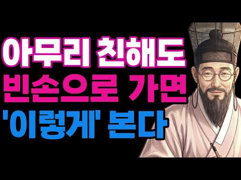
- 설명 앞부분: 누군가의 집을 방문하거나 모임에 나갈 때, 무심코 빈손으로 간 적 있으신가요? 가까운 사이일수록 "뭘 이런 걸 다 챙겨"라고 생각하기 쉽지만, 사람의 마음은 얄궂게도 손에 들린 아주 작은 것에 크게 움직입니다. 돈으로 환산할 수 없는 정성의 가치, 그리고 나이가 들수록 더 사랑받고 존경받는 어른이 되는 처세술을 만나보세요. ⚠️ AI 제작 콘텐츠 안내 ⚠ 본 영상에 사용된 음성, 이미지 및 일부 제작 과정에는 생성형 AI 기술이 활용되었습니다. 모든 콘텐츠는 채널 운영자의 기획과 편집 과정을 거쳐 제작되며, 시청자 여러분께 유익한…
- 같은 채널 평소 대비 ×71.6 (채널 최근 롱폼 중앙값 1,116회) · 평소 영상: 친할수록 절대 지인을 집에 부르지마라. ∣ 인생명언 ∣ 행복한 노후 ∣ 삶의 지혜 ∣ 인… (1,150회) / 혀가 잘려 나가도 이자랑 만은 절대 꺼내지마라 평생 원수된다 ∣ 정약용 명언 ∣ 오디오북… (1,081회)
- 대본 없음 (설명) — 음성인식이 끝나면 도입부·흐름이 들어감
- 댓글 72/72: 좋은 점 — 영상 4 · 감사·응원 5 · 더 알고 싶은 것 0 · 아쉬운 점 — 영상 0 · 반박·불만 — 의견 다름 1 · 정치·사회 0 · 경험 공유 4 · 구독·다음 기대 0
  - 좋은 점 — 영상 👍7 “잘 배웠습니다 감사합니다 ❤”
  - 좋은 점 — 영상 👍3 “좋은말씀감사 합니다”
  - 감사·응원 👍7 “잘 배웠습니다 감사합니다 ❤”
  - 감사·응원 👍7 “응원합니다”
  - 경험 공유 👍9 “저도 아이들 어릴때부터 그리 가르쳤습니다. 과자 한봉지를 가져가더라도 빈손으로 가면 안된다 라구요. 그집에 연세 많으신분이 있는지 어린아이가 있는지 등을 살펴 그에 맞게 준비해가라 합니다. 저역시 그리 행하고 있습니다.”
  - 경험 공유 👍2 “나도 친한친구 만난러 갈때 조그만한 과일 이라도 과자.음료라도선물해줘야겠다(그게 관계에서 오래 남는다)🎉🎉🎉내일부터 실천❤”

### 105. [남성 심리] 남자가 진짜 반했을 때 '무의식'으로 하는 기묘한 행동 10가지 (숨겨진 호감 신호)

- https://www.youtube.com/watch?v=HygTn8rDOUw · 칼 융 철학 · 구독자 2,330 · 조회수 37,151 (×15.9, 하루 845.7) · 좋아요 239 (0.6%) · 73.9분 · 2026-09-28 · 주제 묶음 1. 심리학 일반 · 형식 정보·해설 (그 밖) · 폴더 `W_HygTn8rDOUw` (웹 승인)
- 썸네일: 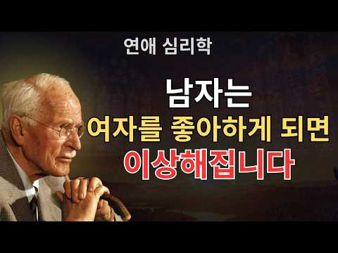
- 설명 앞부분: [남성 심리] 남자가 진짜 반했을 때 '무의식'으로 하는 기묘한 행동 10가지 (숨겨진 호감 신호) "어제까지는 다정했는데, 왜 갑자기 무뚝뚝해졌을까?" 당신을 헷갈리게 만드는 그 남자의 알 수 없는 행동들, 사실은 당신을 '너무 좋아해서' 고장 나버린 것일지도 모릅니다. 좋아하는 사람 앞에서 남자의 심리와 행동이 어떻게 변하는지 모르면, 서로 마음이 있으면서도 평생 엇갈리는 안타까운 상황이 발생할 수 있습니다. 평범하게 대하면 좋을 텐데 어째서인지 자꾸만 반대로 행동하고, 뚝딱거리는 남자의 수수께끼 같은 심리를 철저하게 파헤쳐 …
- 같은 채널 평소 대비 ×4.2 (채널 최근 롱폼 중앙값 8,896회) · 평소 영상: 여자들은 아직 모릅니다… 착하고 다정한 남자가 절대 말하지 않는 ‘본심’ 15가지 (9,011회) / "다 티 납니다" 연하남이 진짜 반했을 때 절대 못 숨기는 ‘이 태도’ [남성 심리] (8,781회)
- 대본 없음 (설명) — 음성인식이 끝나면 도입부·흐름이 들어감
- 댓글 6/6: 좋은 점 — 영상 0 · 감사·응원 0 · 더 알고 싶은 것 0 · 아쉬운 점 — 영상 0 · 반박·불만 — 의견 다름 0 · 정치·사회 0 · 경험 공유 0 · 구독·다음 기대 0

### 106. 매력을 잃지 않으면서 남자 앞에서 감정을 조절하는 방법 ∣ 칼 융

- https://www.youtube.com/watch?v=2Xe2ATb6VI8 · 마음의 깊이 · 구독자 1,170 · 조회수 35,756 (×30.6, 하루 424.2) · 좋아요 343 (1.0%) · 37.4분 · 2026-08-19 · 주제 묶음 3. 자존감·감정·멘탈 · 형식 정보·해설 (그 밖) · 폴더 `W_2Xe2ATb6VI8` (웹 승인)
- 썸네일: 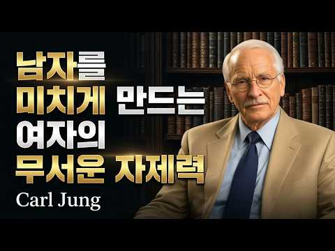
- 설명 앞부분: 남자 앞에서 감정을 조절하고 내면의 평정심을 유지하는 것은 감정을 숨기거나 억누르는 것이 아니라, 자신의 감정을 이해하고 스스로 선택할 수 있는 심리적 힘에서 시작됩니다. 이번 영상에서는 칼 융의 분석심리학적 관점을 바탕으로 감정에 휘둘리지 않으면서도 진솔함과 매력을 잃지 않는 방법을 깊이 있게 살펴봅니다. 우리는 때때로 강한 감정을 진정한 사랑이나 친밀감이라고 착각합니다. 하지만 준비되지 않은 순간에 불안, 서운함, 기대, 애정을 한꺼번에 쏟아내면 상대에게 부담을 주거나 관계 속에서 감정적 의존이 커질 수 있습니다. 중요한 것은…
- 같은 채널 평소 대비 ×30.2 (채널 최근 롱폼 중앙값 1,184회) · 평소 영상: 남자가 하루 종일 당신 생각만 하게 만드는 것 (이유도 모른 채) ∣ 칼 융 심리학 (1,184회) / 외모적인 끌림보다 남자의 존경심을 깨우는 태도 ∣ 칼 융 (1,208회)
- 대본 없음 (설명) — 음성인식이 끝나면 도입부·흐름이 들어감
- 댓글 10/10: 좋은 점 — 영상 1 · 감사·응원 3 · 더 알고 싶은 것 0 · 아쉬운 점 — 영상 1 · 반박·불만 — 의견 다름 0 · 정치·사회 0 · 경험 공유 0 · 구독·다음 기대 0
  - 좋은 점 — 영상 👍0 “매력을 유지하면서도 감정을 지혜롭게 조절하는 방법을 칼 융의 심리학으로 정말 깊이 있게 설명해주셨네요. 타인에게 휘둘리지 않고 내면의 중심을 잡는 데 큰 도움이 되는 영상입니다. 좋은 콘텐츠 감사합니다! 🙏✨”
  - 감사·응원 👍1 “나는 하나님의 말씀 속에 은혜을 봅니다 실례합니다 감사합니다 실례합니다 감사합니다 실례합니다”
  - 감사·응원 👍1 “하늘어머님 하늘아버지 임재안에 신실하신 성품을 성령님 더깊은 ❤사랑 으로 소망 믿음으로 이끌어 일깨워 주심에 감사합니다 실례합니다 감사합니다 실례합니다 감사합니다”
  - 아쉬운 점 — 영상 👍0 “세라다.너도 밀당 원해….실망이야 너도 그 평범한 남자에 한명이라니 알았어”

### 107. 한번 돌아서면 돌아보지 않는 사람의 심리

- https://www.youtube.com/watch?v=kL1_QtFbr2E · 생각의서재 · 구독자 2,420 · 조회수 126,131 (×52.1, 하루 842.1) · 좋아요 2,469 (2.0%) · 8.9분 · 2026-06-14 · 주제 묶음 1. 심리학 일반 · 형식 정보·해설 (그 밖) · 폴더 `W_kL1_QtFbr2E` (웹 승인)
- 썸네일: 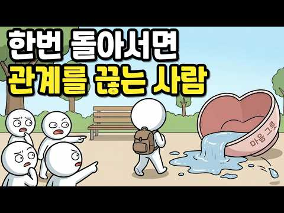
- 설명 앞부분: "한번 돌아서면 끝"이라는 말, 혹시 나한테 해당되는 것 같아서 클릭하셨나요? 그 사람이 차가워진 게 아닙니다. 마음이 다 소진된 겁니다. 이 영상은 오래 참다가 조용히 관계를 끊는 사람의 심리 메커니즘을 다룹니다. 왜 착한 사람일수록 한번 돌아서면 다시 돌아오지 않는지, 그 안에 어떤 감정의 단계가 있는지 함께 살펴봅니다. 지금 누군가를 끊기 직전이거나, 이미 조용히 떠난 자신을 이해하고 싶은 분께 닿기를 바랍니다. 본 영상은 심리학적 정보 제공을 목적으로 하며, 전문적인 상담이나 치료를 대체하지 않습니다. 본 영상은 생성형 A…
- 대본 없음 (설명) — 음성인식이 끝나면 도입부·흐름이 들어감
- 댓글 252/252: 좋은 점 — 영상 3 · 감사·응원 4 · 더 알고 싶은 것 1 · 아쉬운 점 — 영상 2 · 반박·불만 — 의견 다름 7 · 정치·사회 0 · 경험 공유 59 · 구독·다음 기대 0
  - 좋은 점 — 영상 👍33 “공감합니다..! 이기심 탐욕 물욕 자들은 손절하고 배려심 많고 기브앤테이크 ..! 모르는 사람은 페이드아웃 ..! 자기 자신을 다스릴줄 알아야 남도 다스리는 겁니다! 감사합니다.^^ 🎉❤❤❤❤❤❤❤🎉”
  - 좋은 점 — 영상 👍6 “이유는 있지. 굳이 말하고 이유를 설명하고 뭐 구구절절 말하고 싶지도 않고 그냥 삶도 힘든데 이어가고 싶지도 않다.”
  - 감사·응원 👍33 “공감합니다..! 이기심 탐욕 물욕 자들은 손절하고 배려심 많고 기브앤테이크 ..! 모르는 사람은 페이드아웃 ..! 자기 자신을 다스릴줄 알아야 남도 다스리는 겁니다! 감사합니다.^^ 🎉❤❤❤❤❤❤❤🎉”
  - 감사·응원 👍19 “우연히 접한글에서 너무 내맘을대변해주는글이라 20년 호구로 친구라고 여기며 살았던 내가 잘라내고 후회 반성 뒤돌라보고 괴로웠는데 위로를 받었읍니다 나를 친구가 아니라 필요하니까 곁에 있었던사람 띠어내니 한펀 홀가분 해지는 맘을위로받었읍니다 감사합니다”
  - 아쉬운 점 — 영상 👍1 “예전에는 내가 차갑고 정없는 사람인줄 알았다. 사람들이, 아니 정확하게는 한국인들이 다 그렇게 말했으니까. 하지만, 내 입장에서는 매번 미안해 할 짓을 왜 반복해서 저지르는지 이해가 되질 않았다. 소중한 관계면 서로에게 최선을 다하고 실수하지 않도록 배려하는 것이 정…”
  - 아쉬운 점 — 영상 👍0 “오랜 세월 관계를 가졋는데 배신을 당하거나 속았거나.. 그런 경우가 아니면 단절안한다 그러나 너무나 실망이 크면 단절로 가는것이다..”
  - 반박·불만 — 의견 다름 👍308 “다 떠나서 만났을때 불편하고 스트레스 받는 느낌이 들면 조용히 인연을 끊는게 정답임.. 스트레스 받을일이 한두가지가 아닌데 인간관계까지 스트레스 받는다는게..”
  - 반박·불만 — 의견 다름 👍3 “저는 상대방 안좋은 인간성 확인되면 바로 마음 돌립니다. 왜냐하면 안좋은 인간성은 고치기가 매우 어렵기 때문입니다. 그 사람의 안좋은 인간성은 그 사람의 사정이지 내가 알바가 아닙니다. 좋은 인연은 수준이 맞는 사람과 맺어야 효력을 발휘합니다. 반대의 경우는 앙심과 …”
  - 경험 공유 👍631 “내가 그런 유형인데. 절연하고 나면 죄책감이 드는게 아니라 해방감이 든다. 결국 이렇게 되는구나 싶어 좀 더 일찍 결단할걸 싶어짐. 무관심 해지면서 홀가분한 마음이 됨.”
  - 경험 공유 👍399 “더이상 그사람한테 감정 소모하기 싫은거죠. 나도 이제 힘들어. 굿바이~ ✋️”

### 108. 요양원에 자식들 발 끊긴 부모 특징 #정신과 #정신과의사 #가족 #부모갈등 #부부갈등 #관계 #형제갈등 #심리상담

- https://www.youtube.com/watch?v=w86qO4EjXWM · Dr.전미경의 닥전TV · 구독자 29,400 · 조회수 221,809 (×7.5, 하루 10,082.4) · 좋아요 1,252 (0.6%) · 21.8분 · 2026-10-20 · 주제 묶음 4. 우울·불안·정신건강 · 형식 인터뷰·강연·대담 (교수·의사·스님) · 폴더 `W_w86qO4EjXWM` (웹 승인)
- 썸네일: 
- 설명 앞부분: ❝25년간 10만 명의 삶을 바꾼 전미경 원장의 소통 처방전❞ 📕『멈출수록 관계가 살아나는 말 심리』 출간! 🖐️이런 순간, 한 번이라도 있었다면 이 책이 당신의 말을 바꿔드립니다! 인간관계에서 말로 인한 갈등을 반복하는 사람 말이 의도와 다르게 전달되어 오해받는 사람 대화 습관을 바꾸고 싶지만, 구체적인 방법을 모르는 사람 가까운 사람일수록 말이 더 어려운 사람 사과해야 할 순간에 말문이 막히는 사람 애쓸수록 오해만 쌓이는 당신을 위한 1초의 멈춤, 소통의 관점을 바꾸는 대화 심리학 지금 서점에서 만나보세요!
- 같은 채널 평소 대비 ×49.3 (채널 최근 롱폼 중앙값 4,496회) · 평소 영상: 정신과 전문의가 말하는 회피의 심리학 "둥글게 둥글게"가 관계를 죽이는 방법 #정신과 #… (5,133회) / 사이비가 종교가 되는 과정 #심리학 #심리상담 #사이비 #종교 #이단 (3,858회)
- 대본 없음 (설명) — 음성인식이 끝나면 도입부·흐름이 들어감
- 댓글 210/210: 좋은 점 — 영상 16 · 감사·응원 21 · 더 알고 싶은 것 3 · 아쉬운 점 — 영상 3 · 반박·불만 — 의견 다름 4 · 정치·사회 1 · 경험 공유 44 · 구독·다음 기대 2
  - 좋은 점 — 영상 👍77 “이 좋은 영상을 봐야할 부모는 안보고 피해자인 자식들만 본다는 사실 ㅜ,ㅜ 여기나오는 모든 대사들은 토씨도 다르지않게 귀에 박히도록 말햇던 나의 부모”
  - 좋은 점 — 영상 👍19 “맞는말씀.... 한국 부모세대들 부끄러운줄 모르고. 공짜 우대 넘 좋아한다...젊은세대들도 부모대산을 자기꺼로 착각하는 공짜심리...그지심리.”
  - 감사·응원 👍89 “영상감사합니다. 저는 비록 등대같은 믿을만한 부모와의 관계를 못겪고 나이들었지만, 제 자녀들에게 짐되지않고 언제든 쉬어갈수있는 편안하고 안전한 엄마로 살다가기위해 노력중입니다. 늘 안쓰럽고 사랑스럽고 고맙고 자랑스런 아이들.. 저에겐 너무나 소중한.”
  - 감사·응원 👍34 “떠나간 자식을 기다리지말자구요 아이들도 그들의 삶이 있기에 아프면 돈가지고 내발로 병원가구요 속이허하면 내 돈가지고 먹고싶으거 사먹고 심심하면 밖에나가서 무작정 걸어요 그럼 행복호르몬이 나와요 각장 알아서 살아가야죠 안오면 사정이있나보다 오면 와줘서 고맙다 하고 갈때…”
  - 더 알고 싶은 것 👍6 “선생님 목소리가 너무 떨리고 빨라요 천천히 또박또박 부탁드립니다”
  - 더 알고 싶은 것 👍0 “너무말씀을 잘하셔서 이해가 쏙쏙되요.맞는얘기같거든요. 그러나 요즘 세대 부모-자식관계가 더힘든것같아요 앞으로도 성인자녀와의 관계 조언부탁드려요.tv서 인기많은 매스컴의사샘보다 더 도움되요. 저는 자식에게 모든걸 희생했는데 돌아온 댓가는불효자식으로 된것같아 맘아파하고있…”
  - 아쉬운 점 — 영상 👍44 “시부모님 계시는 요양원에 안 가는 이유는 마음을 내주고 신경을 쓰면 하녀로 부린다. 인간 대 인간의 관계 성립이 불가능한 사람들. 이런 경험이 반복되니, 남편에게 효도하라고 했다.”
  - 아쉬운 점 — 영상 👍6 “선생님 목소리가 너무 떨리고 빨라요 천천히 또박또박 부탁드립니다”
  - 반박·불만 — 의견 다름 👍228 “부모라고 다 부모가 아닙니다 자식 인생을 제일 막는 악마일 수도 있어요 제 삶의 가장 큰 후회는 부모와 빨리 손절하고 내 꿈대로 살지 못한 잃어버린 세월입니다. 젊은 친구들 내 부모가 정상적이지 않다면 버리고 뛰쳐 나가세요. 그래야 살 수 있습니다.”
  - 반박·불만 — 의견 다름 👍11 “구구절절 모두 맞는 말씀만 하셔서 너무나 잘 들었습니다. 그런데 정작 들어야 할 부모들은 대부분 잘 모르시더라고요. 즉 자녀를 소유하고 투자해서 평생 소유하면서 투자금 회수하는 관계로 만들어요. 아니라고 말하는, 좋아 보이는[또는 좋은] 부모들도 대부분(90% 이상)…”
  - 경험 공유 👍89 “영상감사합니다. 저는 비록 등대같은 믿을만한 부모와의 관계를 못겪고 나이들었지만, 제 자녀들에게 짐되지않고 언제든 쉬어갈수있는 편안하고 안전한 엄마로 살다가기위해 노력중입니다. 늘 안쓰럽고 사랑스럽고 고맙고 자랑스런 아이들.. 저에겐 너무나 소중한.”
  - 경험 공유 👍24 “넌 니아빠닮아서 그런다 니까짓게 뭘하겠니 넌 내 노후보험이다 넌 알아서 잘살거다 그러니 ㅇㅇ 이한테 양보해라 니주제에 무슨 학원이니 너 병원비때문에 니아빠한테 내가 구걸했다. 못배운자식이 효도한다해서 너 일부러 공부안시켰다. 엄청뿌듯한 표정과 목소리로 내앞에서 한말.…”
  - 구독·다음 기대 👍3 “알고리즘으로 떠서 우연히 보다가 구구절절 맞는 말씀만 하시길래... 구독하고 갑니다❤”
  - 구독·다음 기대 👍2 “정말 시원하네요. 바로 구독눌렀습니다”

### 109. 남자가 당신을 잃을까봐 두려워하게 만드는 방법 (심리학 연구)

- https://www.youtube.com/watch?v=M-T3i9HqKig · 숨겨진심리학 · 구독자 37,500 · 조회수 761,975 (×20.3, 하루 12,745.7) · 좋아요 4,725 (0.6%) · 13.4분 · 2026-09-12 · 주제 묶음 1. 심리학 일반 · 형식 정보·해설 (그 밖) · 폴더 `W_M-T3i9HqKig` (웹 승인)
- 썸네일: 
- 챕터: 0:00 더 잘해주기보다 필요한 관계의 균형 · 2:05 내 삶의 세계 계속 돌리기 · 3:15 챙김이 당연한 의무가 되지 않게 하기 · 4:14 거절할 수 있는 경계 세우기 · 5:51 다른 사람이 아닌 다른 삶 보여주기 · 6:55 확신을 구걸하기보다 나의 기한 갖기 · 8:13 독립적인 미래 계획 말하기 · 9:20 작은 부탁과 상호적인 투자 · 12:15 상대의 반응과 선택 존중하기
- 설명 앞부분: 남자가 당신을 잃을까봐 두려워하는 순간은 더 잘해줄 때 오지 않습니다. 정반대입니다. 남자의 사랑을 확정시키는 '잃을 수 있다는 자각'을 조종 없이 만드는 일곱 가지 방법과, 대부분의 여자가 하는 정반대 행동을 알려드립니다. 이 영상은 카너먼의 손실 회피 연구, 헬렌 피셔의 뇌 영상 연구, 쾌락 적응 연구, 몰로이의 11년 결혼 조사, 러스벌트의 투자 모델, 프랭클린 효과, 스탠리의 헌신 연구를 참고해 제작했습니다. 타임스탬프 관계의 표현 방식에는 개인차가 있습니다. 한 가지 신호로 마음을 단정하기보다 맥락과 반복되는 행동을 함께…
- 같은 채널 평소 대비 ×22.5 (채널 최근 롱폼 중앙값 33,825회) · 평소 영상: 누구든 당신을 잊지 못하게 만드는 심리학적 방법 (절대 악용하지 마세요) ∣ 연애 다크심… (35,044회) / 서로 좋아하는 두 사람 사이에서만 생기는 일 7가지 (당사자는 모르고 주변이 먼저 알아채… (32,606회)
- 대본 없음 (설명) — 음성인식이 끝나면 도입부·흐름이 들어감
- 댓글 189/189: 좋은 점 — 영상 8 · 감사·응원 1 · 더 알고 싶은 것 1 · 아쉬운 점 — 영상 3 · 반박·불만 — 의견 다름 3 · 정치·사회 0 · 경험 공유 26 · 구독·다음 기대 0
  - 좋은 점 — 영상 👍12 “그냥 혼자 있는거 잘하고 본인 일 열심히하라는 말입니다 구구절절 얘기가 길어서 그런거지 남자한테 목메고 남자 생기면 남자가 본인 삶의 1순위 인것처럼 시녀노릇 하지 말란겁니다 ㅠ 맘껏 사랑하세요 계산 하지도 마시구요 근데 그만큼 본인 자신도 사랑하란 소리”
  - 좋은 점 — 영상 👍5 “깨닫고 갑니다 저한텐 도움됐어요”
  - 감사·응원 👍120 “다른건 다 둘째치고 진심 부탁하는거랑 돈 쓰게하는거는 진짜 찐인듯.. 전남친은 제가 진심으로 더 챙겨주고 엄마같이 더 챙겨주면 오히려 나를 못 놓겠지? 했는데 ㅋㅋㅋ 물론 저거때문은 아니지만 결국 잠수이별엔딩이고 지금 현남친도 언젠간 헤어질 수 있겠죠 당연히 근데 지…”
  - 더 알고 싶은 것 👍0 “이걸 구지 노력하지 않아도 원래 내 자신이 독립적인 성향이라서....왜 내 남자가 초조해보이지 이게 궁금해서 영상을 봤는데 나도 모르게 하고 있어서 미안했다”
  - 아쉬운 점 — 영상 👍16 “사랑하는데..남자가 너무 잘해주니까 살짝 나는 여유가 있는거지...항상 먼저 연락 오다보니 내가 먼저 연락할일이 없음..그러다 진짜 급해서 연락하니 엄청 좋아함...하여튼 항상 타이밍이 남자가 빠름...이러다보니 무심하지 않은데 무심한듯 하고 이런게 반복되다보니 그냥…”
  - 아쉬운 점 — 영상 👍12 “그냥 혼자 있는거 잘하고 본인 일 열심히하라는 말입니다 구구절절 얘기가 길어서 그런거지 남자한테 목메고 남자 생기면 남자가 본인 삶의 1순위 인것처럼 시녀노릇 하지 말란겁니다 ㅠ 맘껏 사랑하세요 계산 하지도 마시구요 근데 그만큼 본인 자신도 사랑하란 소리”
  - 반박·불만 — 의견 다름 👍6 “아니 저걸 모르는게 아닌데 진짜 너무 사랑하면 저게 안됨.. 사람 성향 차이가 매우매우 큰거같긴함”
  - 반박·불만 — 의견 다름 👍0 “일부러 그런건 아닌데 자영업 하면서 장사공부하고 모임하고 집에 들어가면 가족들하고 수다 떠느라 연락 잘 못하고 가끔 친구도 만나고 그렇게 사니까 남친이 되게 불안해했음 그때는 왜 그렇게 불안해 하는지 이해가 안갔는데 이거 보니까 알겠네요 부작용으로”
  - 경험 공유 👍745 “이런거 의미 없는거 같아요 여기잇는걸 모두 다 하는데도 헤어지자는 남자가 잇고 여기서 말하는거처럼 안떠나는 남자가 있어요 그냥 날 얼마나 진심으로 생각하는지 남자에 따라서 다 틀린거 같아요 그리고 항상 헤어진 후에 연락오죠. 그냥 내가 뭘 해도 날 떠나질 않을 남자 …”
  - 경험 공유 👍696 “모르고있었는데 다 하고있었네요 제가 독립적인 성향이고 칼같은 성격이라 의도치않게 긴장감을 줬나봐요 매번 제가 어떤걸 할지 말하고 있고 제 삶이 더중요해서 남자친구만나는것보다 제 시간을 챙기려고 했고 남자친구가 약속취소하거나 자기멋대로 보러온다하면 거절했어요 제 시간을…”

### 110. 단절의 시대, 외로움에 휘둘리지 않는 법

- https://www.youtube.com/watch?v=hnuDs_pSI7M · 도래기책방 · 구독자 11,100 · 조회수 89,869 (×8.1, 하루 3,756.0) · 좋아요 1,244 (1.4%) · 15.4분 · 2026-10-18 · 주제 묶음 3. 자존감·감정·멘탈 · 형식 정보·해설 (그 밖) · 폴더 `W_hnuDs_pSI7M` (웹 승인)
- 썸네일: 
- 챕터: 0:00 만날 사람이 없네.. · 1:16 Part 1. 우리는 왜 외로움을 느끼는가? · 3:40 Part 2. 나 자신과 진짜 관계를 맺는 법 · 7:30 Part 3. 먼저 마주할 용기 · 10:59 Part 4. 내 삶에서 외로움을 완전히 지워버린 방법
- 설명 앞부분: 주말 저녁, 스마트폰을 켜면 다들 활기차게 살아가는 것 같은데 왜 나만 덩그러니 혼자인 것 같을까요? 카톡 친구 목록은 수백 명이 넘는데, 막상 마음을 툭 터놓고 '뭐해? 한잔하자'고 부를 사람은 단 한 명도 없는 씁쓸함. 어쩌면 우리는 수많은 연결 속에 살아가면서도, 가장 지독한 고립을 겪고 있는지 모릅니다. 수년 동안 만성적인 외로움과 피해의식에 시달렸던 제가, 어떻게 남의 시선에서 벗어나 내 삶의 주도권을 되찾고 이 공허함을 완전히 끊어낼 수 있었는지 그 경험담을 털어놓습니다. 외로움이라는 감정이 우리에게 보내는 진짜 경고 …
- 같은 채널 평소 대비 ×133.1 (채널 최근 롱폼 중앙값 675회) · 평소 영상: 『데미안』 헤르만 헤세 Part.1 ∣ 방황하는 당신을 위한 고전 명작 필독서 (675회) / 99%가 모르는 인생게임의 법칙 ∣ 상위 0.1%의 5가지 마인드셋 (621회)
- 대본 없음 (설명) — 음성인식이 끝나면 도입부·흐름이 들어감
- 댓글 182/182: 좋은 점 — 영상 18 · 감사·응원 27 · 더 알고 싶은 것 4 · 아쉬운 점 — 영상 3 · 반박·불만 — 의견 다름 2 · 정치·사회 1 · 경험 공유 26 · 구독·다음 기대 1
  - 좋은 점 — 영상 👍67 “저는 10대임에도 외로움에 시달리며 고등학교 생활을 하고있습니다. 정말 살면서 본 영상, 살면서 들은 말 중에서도 최고였던 것 같습니다. 항상 남에 대해서만 고민하고 남의 입장만을 고려하고 나의 근처사람이 어떤사람인지만을 알기위해 노력했습니다. 그리고 그 과정에서 ‘…”
  - 좋은 점 — 영상 👍12 “안 그래도 요즘 인간관계 자체에 회의감과 공허함 외로움을 느꼈었는데요.. 항상 남의 시선에 맞춰서만 살아왔더라고요. 그래서 그런지 나 자신이 남지도 않은 것 같고 뭐가 내 모습인지도 내가 뭘 할 때 행복하고 즐거운지도 잘 모르겠었는데.. 이 영상 보고 덕분에 많은 위…”
  - 감사·응원 👍67 “저는 10대임에도 외로움에 시달리며 고등학교 생활을 하고있습니다. 정말 살면서 본 영상, 살면서 들은 말 중에서도 최고였던 것 같습니다. 항상 남에 대해서만 고민하고 남의 입장만을 고려하고 나의 근처사람이 어떤사람인지만을 알기위해 노력했습니다. 그리고 그 과정에서 ‘…”
  - 감사·응원 👍12 “안 그래도 요즘 인간관계 자체에 회의감과 공허함 외로움을 느꼈었는데요.. 항상 남의 시선에 맞춰서만 살아왔더라고요. 그래서 그런지 나 자신이 남지도 않은 것 같고 뭐가 내 모습인지도 내가 뭘 할 때 행복하고 즐거운지도 잘 모르겠었는데.. 이 영상 보고 덕분에 많은 위…”
  - 더 알고 싶은 것 👍4 “원래 댓글 잘 안 다는 사람인데, 이번 영상을 보고 난 뒤에는 말해야겠습니다. 도래기책방님은 저의 걱정을 완벽히 해소해주셨고 더 나은 사람으로 바뀌게 해줄 열쇠를 건네주셨습니다. 저도 도래기책방님 같은 사람이 되고 싶네요. 저 뿐만 아니라 많은 사람들이 뒤에서 응원할…”
  - 더 알고 싶은 것 👍3 “안녕하세요 도래기 책방님 얼마 전부터 알고리즘에 떠 주기적으로 챙겨보고 있는 대학생입니다. 요즘 들어 자존감도 별로 없고 살아가는 것의 이유는 뭘까 등 고민을 많이 했었는데 이 채널을 보면서 도움이 많이 되었습니다. 영상의 흡입력이 너무 좋아서 하나하나 소중하게 2배…”
  - 아쉬운 점 — 영상 👍2 “좀 아이러니 하게 웃긴 이야기 이지만 저 같은 경우는 평소 모습과 친해진 뒤 모습이 180도 다릅니다. 이 영상 완전 공감하며, 저 또한 아웃사이더 끝판왕 이기에 혼자 밥먹는게 편해요. 하지만, 왜인지, 어째서, 여성들은 그런 모습에 안달하고 쫒아다닐정도로 저를 좋아…”
  - 아쉬운 점 — 영상 👍1 “평생동안 외로움이란 감정을 느낀 게 어릴 때 집에 혼자 있었을 때와 젊을 때 연인들과 헤어지고 잠시잠시 밖에는 없었던 듯ㅋㅋ 친구들도 많았고 연애도 끊임없이 해오다가 나이가 들어가면서 서서히 친구들도 자발적으로 서서히 다 끊고 연애도 끊고 혼자서 이런 저런 취미생활들…”
  - 반박·불만 — 의견 다름 👍26 “40대 이상 되면 이미 있는 인간관계도 필요없는건 끊어내고 정리해야되고 50대 이후로는 죽을때까지 혼자 또는 가족뿐이라 생각하면 됩니다. 어차피 인생은 혼자 와서 혼자 가는 겁니다 인간관계 아무 의미 없습니다. 45억년 지구 역사에서 우리네 인생은 하루살이처럼 잠시 …”
  - 반박·불만 — 의견 다름 👍1 “말도 안되는 편집기술, 스토리텔링, 목소리를 가진 분도 어려움을 겪었군요..”
  - 정치·사회 👍2 “만나고 싶은 사람들이 없음... 내주변엔... 거짓말 잘하는 사람... 돈에 너무 인색한 사람.... 자기 이야기만 하는 사람.... 배려는 1도없고 이기적인사람..... 좌파들 거짓선동에 환장하는 사람들..등등”
  - 경험 공유 👍26 “40대 이상 되면 이미 있는 인간관계도 필요없는건 끊어내고 정리해야되고 50대 이후로는 죽을때까지 혼자 또는 가족뿐이라 생각하면 됩니다. 어차피 인생은 혼자 와서 혼자 가는 겁니다 인간관계 아무 의미 없습니다. 45억년 지구 역사에서 우리네 인생은 하루살이처럼 잠시 …”
  - 경험 공유 👍12 “안 그래도 요즘 인간관계 자체에 회의감과 공허함 외로움을 느꼈었는데요.. 항상 남의 시선에 맞춰서만 살아왔더라고요. 그래서 그런지 나 자신이 남지도 않은 것 같고 뭐가 내 모습인지도 내가 뭘 할 때 행복하고 즐거운지도 잘 모르겠었는데.. 이 영상 보고 덕분에 많은 위…”
  - 구독·다음 기대 👍3 “공감하고 구독했습니다. 앞으로 출퇴근 걷는 길에 좋은 친구가 생긴 것 같아 기대됩니다.”

### 111. 자존감 높은 사람들이 무서울 정도로 잘하는 습관 4가지 ∣ 자존감 ∣ 심리학 ∣ 멘탈관리 ∣ 감정조절

- https://www.youtube.com/watch?v=B_rOPX-oLQM · 오늘도심리 · 구독자 1,710 · 조회수 92,088 (×53.9, 하루 554.7) · 좋아요 1,840 (2.0%) · 11.9분 · 2026-05-29 · 주제 묶음 1. 심리학 일반 · 형식 정보·해설 (그 밖) · 폴더 `W_B_rOPX-oLQM` (웹 승인)
- 썸네일: 
- 챕터: 0:00 자존감 높은 사람들의 충격적인 공통점 · 0:56 왜 우리는 남의 말에 쉽게 흔들릴까? · 1:34 첫 번째 습관 — 상황을 분리하는 능력 · 2:34 남의 감정에 휘둘리지 않는 사람들의 특징 · 4:46 실수해도 무너지지 않는 사람들의 심리 · 6:13 자존감 높은 사람들의 멘탈 관리법 · 7:11 행복한 사람들의 뇌 사용법 · 8:27 뇌과학으로 보는 자존감의 비밀 · 9:39 자존감을 높이는 가장 현실적인 방법 · 10:39 타인의 시선에서 벗어나는 법
- 설명 앞부분: 누군가의 말 한마디에 하루 종일 마음이 흔들린 적 있으신가요? 왜 어떤 사람은 비난에도 무너지지 않고, 어떤 사람은 작은 말에도 깊게 상처받을까요? 이번 영상에서는 심리학과 뇌과학을 통해 자존감 높은 사람들이 실제로 사용하는 4가지 강력한 습관을 알려드립니다. 이 영상을 끝까지 보시면 타인의 말에 쉽게 흔들리던 마음에서 벗어나 스스로를 단단하게 지키는 방법을 알게 되실 겁니다. 오늘도심리는 마음을 억지로 고치는 채널이 아닙니다. 심리학과 뇌과학을 통해 ‘나를 이해하는 힘’을 함께 키워가는 공간입니다. ⏰ 타임라인 오늘 영상이 마음…
- 같은 채널 평소 대비 ×211.2 (채널 최근 롱폼 중앙값 436회) · 평소 영상: 정말 좋은 사람처럼 보이지만,,, 사실은 나를 서서히 망가뜨리는 사람들의 5가지 특징 (436회) / “논리적으로 말하고 싶은데 눈물이 먼저 나는 이유” 화나고 억울한데 왜 눈물이 날까? 심… (392회)
- 대본 없음 (설명) — 음성인식이 끝나면 도입부·흐름이 들어감
- 댓글 82/82: 좋은 점 — 영상 5 · 감사·응원 9 · 더 알고 싶은 것 0 · 아쉬운 점 — 영상 1 · 반박·불만 — 의견 다름 0 · 정치·사회 0 · 경험 공유 6 · 구독·다음 기대 1
  - 좋은 점 — 영상 👍55 “전 4가지 다 가지고 있네요. 😅😂 근데 전 4번째는 그냥 된 것이 아니라 고난을 통해 하나님을 인격적으로 경험하고 하나님이 나와 함께 하심을 알기에 평밤한 일상 모든 것이 그저 감사하기에 할 수있습니다. 좋은 영상 감사합니다. 구독신청하고 갑니다”
  - 좋은 점 — 영상 👍13 “유튜브의 순기능이네요. 좋은 영상 잘 봤습니다!”
  - 감사·응원 👍55 “전 4가지 다 가지고 있네요. 😅😂 근데 전 4번째는 그냥 된 것이 아니라 고난을 통해 하나님을 인격적으로 경험하고 하나님이 나와 함께 하심을 알기에 평밤한 일상 모든 것이 그저 감사하기에 할 수있습니다. 좋은 영상 감사합니다. 구독신청하고 갑니다”
  - 감사·응원 👍20 “1. 상황분리 2. 우아한 무관심 ㅡ 반송 처리 3. 내 실수 인정하고 고침 4. 조건 없는 기분 선언 감사해요 🎉”
  - 아쉬운 점 — 영상 👍22 “눈치 일도 없는 뻔뻔한 사람도 있더라구요. 진짜 잘못했으면 고치고 반성도 해야하는데.”
  - 경험 공유 👍153 “자존감높은 사람은 수없는 반복상처로 혼자서 단단해진결과다 내가 그렇다😅”
  - 경험 공유 👍60 “육해공군 공수전 겪고 나니 .지금의 내가 되어 있드라구요😊😊”
  - 구독·다음 기대 👍4 “어렵다..뇌가 나를 지배하니..내가 나를 알아야지ㅠ 힘든세상..구독하고 갑니다”

### 112. 본성 못된 사람이 자주 하는 말버릇 '6가지', 특히 1번 쓰레기다 ∣ 인간관계 조언 ∣ 인생 ∣ 명언 ∣ 행복 ∣ 정약용

- https://www.youtube.com/watch?v=pT3mDt8W7AQ · 철학산책 · 구독자 5,400 · 조회수 292,861 (×54.2, 하루 1,739.9) · 좋아요 6,115 (2.1%) · 36.5분 · 2026-05-27 · 주제 묶음 2. 인간관계·처세 · 형식 수면·낭독·오디오북 (잠잘 때·명언) · 폴더 `W_pT3mDt8W7AQ` (웹 승인)
- 썸네일: 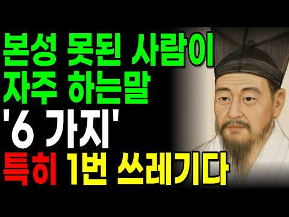
- 설명 앞부분: 인생을 살아가다 보면 잠깐 차 한 잔 마셨을 뿐인데 이상하게 기운이 빠지고 가슴이 답답해지는 사람이 있습니다. 반대로 짧은 대화만 나눠도 마음이 온돌방처럼 따뜻해지는 사람이 있지요. 조선 최고의 실학자 다산 정약용 선생은 18년의 유배 생활 동안 수많은 인간의 민낯을 바라보며 "사람의 본성은 평소 자주 하는 말에서 드러난다"고 경계하셨습니다. 오늘 영상에서는 정약용 선생의 깊은 지혜를 바탕으로, 내 곁에서 내 인생을 메말라가게 만드는 '반드시 멀리해야 할 사람들의 위험한 말버릇 6가지'를 소개해 드립니다. 나이가 들수록 인간관계가…
- 대본 없음 (설명) — 음성인식이 끝나면 도입부·흐름이 들어감
- 댓글 212/212: 좋은 점 — 영상 9 · 감사·응원 26 · 더 알고 싶은 것 2 · 아쉬운 점 — 영상 8 · 반박·불만 — 의견 다름 1 · 정치·사회 2 · 경험 공유 19 · 구독·다음 기대 0
  - 좋은 점 — 영상 👍38 “좋은말씀 감사합니다 ❤❤❤”
  - 좋은 점 — 영상 👍10 “감사합니다 부족한 생각들 한번뒤돌아봅니다 이런마음이면 행복이보입니다 말한마디라도 생각하면서 이왕이면 상대가 듣기좋은 말 써야겠습니다 날마다 좋은일만 가득하세요”
  - 감사·응원 👍81 “행여 내가 그러하지않는지 경청합니다 감사합니다”
  - 감사·응원 👍38 “좋은말씀 감사합니다 ❤❤❤”
  - 더 알고 싶은 것 👍8 “1994년7월달중사리모텔계모임계모임이아니라사기계모임경남하동진교지두레여자한테가정파탄사기몇십년괴롭히고지금도밤낮안가리고보이지안는해꼬지해고통스럽고몇십년지옥속에살고있다어쩌다난생처음계모임가사기꽃뱀알고부터내가사는게사는게아니다이일을어떻게해결했으면좋은지사기당한사람댓글올려주세요제가백천…”
  - 더 알고 싶은 것 👍1 “내 얼굴에 침 뱉지말자 너나 나나 톡 같은 흉 없는사람 없다 기빨려가면서까지 만날이유가 있을까요?”
  - 아쉬운 점 — 영상 👍23 “하아!! 서론이 너무길다!! 같은말 계속반복!! 왜 이러는 걸까요? 굳이 사람 지치게...”
  - 아쉬운 점 — 영상 👍11 “배움이 없는 삶 지루하죠”
  - 반박·불만 — 의견 다름 👍0 “정약용이 그리 훌륭한 사람인가? 웃기는 말이군!”
  - 정치·사회 👍0 “딱 종복. 좌파들이네”
  - 정치·사회 👍0 “또 공자얘기 ㅉ 한국에도 천재급위인들이 많은데 굳이 짱깨국 공자얘기 해야되것슈??”
  - 경험 공유 👍81 “행여 내가 그러하지않는지 경청합니다 감사합니다”
  - 경험 공유 👍43 “내 주위에 사람이 있는데 비산옷 비산음식 먹었다면서 온갓자랑다 하면서 말을너무 함부로 하고 그사람만 보면 짜증이 나고 너무 싫다 내가 생각하기엔 사람이 아니야”

### 113. 이어령 교수의 조언: 60살 넘으면 인간관계에 목맬 필요 없습니다ㅣ노후에 사람들과 잘 지내려고 너무 애쓰지 마세요ㅣ고독을 즐기는 지혜ㅣ삶의철학ㅣ노년의삶

- https://www.youtube.com/watch?v=BvNljBe63aE · 인생의 지혜 한마디 · 구독자 1,980 · 조회수 13,380 (×6.8, 하루 595.0) · 좋아요 51 (0.4%) · 32.9분 · 2026-10-19 · 주제 묶음 2. 인간관계·처세 · 형식 인터뷰·강연·대담 (교수·의사·스님) · 폴더 `W_BvNljBe63aE` (웹 승인)
- 썸네일: 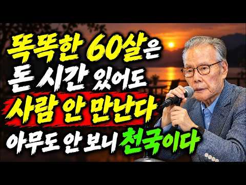
- 설명 앞부분: 【이어령 교수의 조언】 60살 넘으면 인간관계에 목맬 필요 없습니다ㅣ노후에 사람들과 잘 지내려고 너무 애쓰지 마세요ㅣ고독을 즐기는 지혜ㅣ삶의철학ㅣ노년의삶 왜 60살이 넘으면 사람들과 잘 지내려고 애쓰는 것보다 혼자만의 시간을 편안하게 즐기는 것이 중요할까요? 이 영상에서는 이어령 교수의 삶의 철학과 시선으로, 나이가 들수록 모든 사람과 좋은 관계를 유지하려 애쓰기보다 자신의 마음과 평온한 일상을 지키는 것이 왜 중요한지 깊이 있게 생각해 봅니다. 특히 노후에 인간관계로 지나치게 마음을 쓰지 않는 법, 다른 사람의 시선과 평가에서 …
- 같은 채널 평소 대비 ×8.7 (채널 최근 롱폼 중앙값 1,530회) · 평소 영상: 【이어령 교수의 조언】 결혼한 자녀에게는 이렇게 연락하세요｜부모를 더 존경하게 만드는 현… (1,582회) / 이어령 교수의 조언: 연락 없는 자녀에게 현명하게 대처하는 법ㅣ굳이 먼저 연락하지 않아도… (1,478회)
- 대본 없음 (설명) — 음성인식이 끝나면 도입부·흐름이 들어감
- 댓글 3/3: 좋은 점 — 영상 0 · 감사·응원 0 · 더 알고 싶은 것 0 · 아쉬운 점 — 영상 0 · 반박·불만 — 의견 다름 0 · 정치·사회 0 · 경험 공유 0 · 구독·다음 기대 0

### 114. "5년 만나도 설렌다" 시간이 갈수록 더 사랑받는 여자의 7가지 특징(뇌과학 기반)ㅣ연애심리ㅣ연애조언

- https://www.youtube.com/watch?v=dfHbE0x3kSc · 심리조각 · 구독자 10,900 · 조회수 263,242 (×24.1, 하루 3,252.8) · 좋아요 1,377 (0.5%) · 13분 · 2026-08-22 · 주제 묶음 1. 심리학 일반 · 형식 정보·해설 (그 밖) · 폴더 `W_dfHbE0x3kSc` (웹 승인)
- 썸네일: 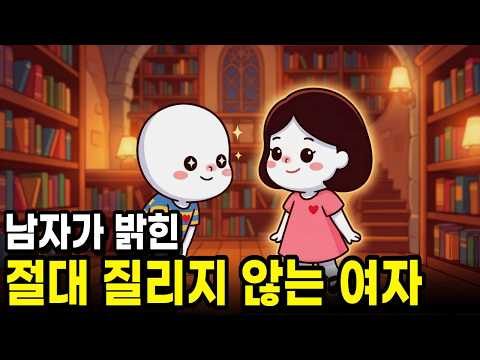
- 챕터: 0:00 남자가 '질렸다'고 말할 때 숨겨진 진짜 의미 · 0:39 뇌과학이 말하는 권태기의 원인 '습관화 현상' · 1:34 심리학자 아서 아론의 놀라운 커플 실험 · 2:31 특징 1: 자기 검열을 버리고 외부를 관찰하라 · 3:49 특징 2: 다 맞춰주면 지루해진다? '독립성'의 힘 · 5:28 특징 3: 상대를 시험하지 않는 명확한 소통법 · 6:41 특징 4: 차분하지만 단호하게 선 긋는 기술 · 7:53 특징 5: 감정 쓰레기통이 되지 않는 편안한 비율 · 9:00 특징 6: 관계를 단단하게 만드는 '공동 음미' 습관 · 9:25 특징 7: 칭찬을 기분 좋게 수용하는 태도 · 10:14 당장 오늘부터 실천 가능한 5가지 구체적 행동 지침
- 설명 앞부분: 예쁜 외모도 결국엔 뇌의 습관화 현상으로 인해 무뎌지기 마련입니다. 뇌과학과 심리학이 증명한 시간이 지나도 질리지 않는 여자, 시간이 갈수록 더 사랑받는 여자의 7가지 특징을 하나씩 알려드릴게요. 연애만 시작하면 왜 남자의 태도가 변할까요? 그것은 감정이 식어서가 아니라 예측 가능해졌을 때 나타나는 지루함 때문입니다. 심리학자 아서 아론의 실험을 통해 증명된, 절대 질리지 않는 여자의 비밀은 바로 '상대의 세계를 조금씩 넓혀주는 것'입니다. 과도한 자기 검열을 멈추고 독립성을 유지하며, 지혜롭고 차분하게 선을 긋는 소통 방식까지.…
- 같은 채널 평소 대비 ×24.0 (채널 최근 롱폼 중앙값 10,961회) · 평소 영상: 이별 후 연락ㅣ전 연인의 연락, 재회 의사인지 어떻게 확인할까?ㅣ심리분석 (10,961회) / 심리학이 밝혀낸, 무조건 쌍방 호감일 때 나타나는 결정적 순간 7가지ㅣ연애심리ㅣ행동심리학 (12,585회)
- 대본 없음 (설명) — 음성인식이 끝나면 도입부·흐름이 들어감
- 댓글 67/67: 좋은 점 — 영상 0 · 감사·응원 5 · 더 알고 싶은 것 1 · 아쉬운 점 — 영상 0 · 반박·불만 — 의견 다름 0 · 정치·사회 0 · 경험 공유 6 · 구독·다음 기대 0
  - 감사·응원 👍8 “그런거 다 필요없다 사랑하고 배려하며 아이가 태어나고 자라면서 나도 자라고,신랑도 자라서 더 괜찮은 어른이 되고...지금 30년째지만 지금도 서로 매일 사랑해~와 뽀뽀를 하고 안고 잔다 지금도 아파서 씻지도 못하고 거지같아도 이쁘다~귀엽다~사랑해를 입에 달고 살아요 …”
  - 더 알고 싶은 것 👍1 “이걸 미리 알았으면 권태기+사소한 갈등으로 헤어지지 않았을까요ㅠㅠ권태기나 결혼 얘기로 헤어진 커플이 건강하게 재회하는 법도 혹시 아시면 알려주세요!”
  - 경험 공유 👍8 “그런거 다 필요없다 사랑하고 배려하며 아이가 태어나고 자라면서 나도 자라고,신랑도 자라서 더 괜찮은 어른이 되고...지금 30년째지만 지금도 서로 매일 사랑해~와 뽀뽀를 하고 안고 잔다 지금도 아파서 씻지도 못하고 거지같아도 이쁘다~귀엽다~사랑해를 입에 달고 살아요 …”
  - 경험 공유 👍7 “5년만나도 설렌다? ㅎㅎ 20년 만나봐요^^^^^^^^^ 부부돼봐요 ㅋㅋㅋㅋㅋㅋㅋㅋ 9년연애해도 죽어라 좋아하고 쩔쩔매더니 결혼하고 10년차 되니 뭐^^^^^^ 하하하”

### 115. 절대 먼저 연락 안 하는 사람의 진짜 심리 - 정신과 의사

- https://www.youtube.com/watch?v=lSB7a9jsQJY · 인생승진 Life Up!! · 구독자 10,800 · 조회수 83,294 (×7.7, 하루 3,199.8) · 좋아요 373 (0.4%) · 16.9분 · 2026-10-16 · 주제 묶음 4. 우울·불안·정신건강 · 형식 인터뷰·강연·대담 (교수·의사·스님) · 폴더 `W_lSB7a9jsQJY` (웹 승인)
- 썸네일: 
- 설명 앞부분: 항상 내가 먼저 연락해야 하는 사람, 한두 명씩 있으시죠. 내가 안 하면 몇 달이 가도 소식이 없는 사람. 이 사람, 나를 싫어하는 걸까요? 이 관계, 정리해야 할까요? 오늘은 먼저 연락하지 않는 사람에 대해 이야기 나누어 보려 합니다.
- 같은 채널 평소 대비 ×15.5 (채널 최근 롱폼 중앙값 5,378회) · 평소 영상: 남들보다 유독 빨리 방전되는 사람들의 5가지 특징 - 정신과 의사 (9,110회) / 자기가 지친 줄도 모르고 사는 사람들의 공통점 - 정신과 의사 (17,096회)
- 대본 없음 (설명) — 음성인식이 끝나면 도입부·흐름이 들어감
- 댓글 77/77: 좋은 점 — 영상 2 · 감사·응원 2 · 더 알고 싶은 것 0 · 아쉬운 점 — 영상 2 · 반박·불만 — 의견 다름 2 · 정치·사회 0 · 경험 공유 18 · 구독·다음 기대 0
  - 좋은 점 — 영상 👍0 “구구절절 공감합니다”
  - 감사·응원 👍5 “내향이고 1、2번 모두 해당하니 나이먹을수록 누구에게 연락하기가 힘들어지네요😢 바쁜시간 아닐지, 부담스러워하지 않을지..그렇지만 오랜동안 연락이 끊긴 친구에게도 여전히 애정을 갖고있고 연결감을 느낍니다. 그리고 연락 오면 엄청 반갑게 답하고 호들갑 떱니다 ㅎㅎ 연락 …”
  - 감사·응원 👍4 “선생님,잘 들었습니다 구독 좋아요 눌렀습니다 ❤🎉감사합니다 😊”
  - 아쉬운 점 — 영상 👍1 “난 모든 관계에서 연락 잘 안함 특히 카톡은... 광고가 너무 많아서 확인 잘 안함 대신 문자는 잘 받음 요즘은 다 카톡해서 나같은 사람 없을듯”
  - 아쉬운 점 — 영상 👍1 “여러방면시도햇다가 안해도되겟다 손놔버리니 자연스럽게 끈어지더라구요 필요할때만 연락오는연락도 받아주니 아무것도아니게되고 결국 혼자지치는관계 인간관계 모든게 지치게되는거같아요 아무렇지않다가도 갑자기 후폭풍처럼 몰려와요 다시무덤덤해지고무한반복”
  - 반박·불만 — 의견 다름 👍5 “내향이고 1、2번 모두 해당하니 나이먹을수록 누구에게 연락하기가 힘들어지네요😢 바쁜시간 아닐지, 부담스러워하지 않을지..그렇지만 오랜동안 연락이 끊긴 친구에게도 여전히 애정을 갖고있고 연결감을 느낍니다. 그리고 연락 오면 엄청 반갑게 답하고 호들갑 떱니다 ㅎㅎ 연락 …”
  - 반박·불만 — 의견 다름 👍1 “선생님 제성격이 먼저하든 안하든 크게신경쓰는편은 아닌데 친구들중에 한명한테는 제가일방적으로 연락해요 사람이다보니 서운하다가도 카톡하면 답장도 정성스럽게 길게문자해요 하지만 먼저연락은안해요 솔직히 나만일방적이다보니 지금은 어떻게해야되나 생각이많아집니다”
  - 경험 공유 👍69 “먼저연락하냐 안하냐가 중요한게아님 ㅋㅋ 내가 먼저했을때 상대방의 반응이다 기다렸다는듯이 볼려고하거나 바로답이오고 반겨주는사람은 괜찮음”
  - 경험 공유 👍35 “내가 신경이 쓰이면 손절, 아무렇지 않으면 유지”

### 116. 친구를 만나면 이 3가지는 절대 말하지 마세요｜나이 들수록 관계가 멀어지는 이유

- https://www.youtube.com/watch?v=jAx12f5te_4 · 인생뷰티풀 · 구독자 4,920 · 조회수 17,541 (×3.6, 하루 1,455.5) · 좋아요 92 (0.5%) · 25.4분 · 2026-10-30 · 주제 묶음 2. 인간관계·처세 · 형식 사연·고민 상담 (썰·라디오) · 폴더 `W_jAx12f5te_4` (웹 승인)
- 썸네일: 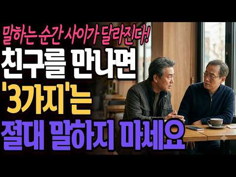
- 챕터: 0:00 친구 사이가 멀어지는 진짜 이유 · 2:07 돈의 정확한 숫자를 말하면 관계가 달라지는 이유 · 4:25 은퇴 후 친구끼리 비교가 더 민감해지는 이유 · 7:52 가족 이야기를 자세히 하면 위험한 이유 · 12:53 다른 친구의 말을 옮기면 신뢰가 무너지는 이유 · 16:58 오래가는 친구 사이에는 ‘말하지 않는 공간’이 있다
- 설명 앞부분: 오래된 친구일수록 무엇이든 솔직하게 말해야 한다고 생각하기 쉽습니다. 하지만 나이가 들수록 오히려 너무 자세히 말해서 관계가 불편해지는 경우가 있습니다. 연금이 얼마인지, 통장에 얼마나 있는지, 자식과 며느리 이야기는 어디까지 해야 하는지, 다른 친구가 나를 어떻게 평가했는지 정말 다 알아야 할까요? 이번 영상에서는 친구 사이에서 무심코 꺼낸 말이 왜 관계의 분위기와 서로를 바라보는 기준까지 바꿔버리는지 이야기합니다. 특히 나이가 들수록 정확한 돈 이야기, 가족의 민감한 이야기, 다른 친구가 한 말을 옮기는 행동이 왜 생각보다 오…
- 같은 채널 평소 대비 ×4.8 (채널 최근 롱폼 중앙값 3,624회) · 평소 영상: 나이 들수록 형제자매가 남처럼 느껴지는 진짜 이유 (3,624회) / 친한 사람들과 여행 가면 안 되는 이유｜오래된 친구일수록 더 위험한 이유 (4,027회)
- 대본 없음 (설명) — 음성인식이 끝나면 도입부·흐름이 들어감
- 댓글 2/2: 좋은 점 — 영상 0 · 감사·응원 0 · 더 알고 싶은 것 0 · 아쉬운 점 — 영상 0 · 반박·불만 — 의견 다름 0 · 정치·사회 0 · 경험 공유 0 · 구독·다음 기대 0

### 117. 남자 대부분이 모르는.. 여자의 추악한 본능

- https://www.youtube.com/watch?v=_AlXDV8R8i4 · 연애데이터 노노 · 구독자 13,000 · 조회수 312,050 (×24.0, 하루 3,720.2) · 좋아요 5,014 (1.6%) · 10.7분 · 2026-08-19 · 주제 묶음 8. 연애·부부 심리 · 형식 정보·해설 (그 밖) · 폴더 `W__AlXDV8R8i4` (웹 승인)
- 썸네일: 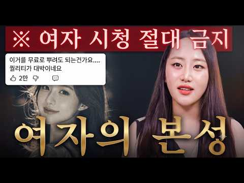
- 같은 채널 평소 대비 ×19.2 (채널 최근 롱폼 중앙값 16,228회) · 평소 영상: 여자가 남자를 대할 때 여자의 원초적 본능 [충격 주의] (16,228회) / 여자 마음 사로잡는 방법 3가지 (16,080회)
- 대본 없음 (없음) — 음성인식이 끝나면 도입부·흐름이 들어감
- 댓글 847/846: 좋은 점 — 영상 17 · 감사·응원 20 · 더 알고 싶은 것 9 · 아쉬운 점 — 영상 3 · 반박·불만 — 의견 다름 8 · 정치·사회 5 · 경험 공유 47 · 구독·다음 기대 2
  - 좋은 점 — 영상 👍25 “저런 여자의 어두운 본능은 놀랍게도 남자에 대한 두려움이 아직 남아있는 '어리고' 경험이 '적은' 여자에게선 상당부분 발현되지 않거나 억제되는 경우가 많습니다. 옛말 틀린것 하나 없죠”
  - 좋은 점 — 영상 👍18 “이야 왜 이렇게 말들이 다 맞냐ㅎ 오늘 한수 잘 배웠어요”
  - 감사·응원 👍9 “이제껏 많은 여자를 만나왔는데, 하나같이 전부 데이트비용은 거의 제가 70% 이상 냈던 것 같아요. 제가 궁금한건, 여자는 본인이 마음에 들어하는 남자라도 데이트비용을 많이 부담하지않으려고 하는게 본능인가요? 아니면 제가 호구라서 데이트비용을 많이 부담한건가요? 알려…”
  - 감사·응원 👍5 “정말 좋은정보 감사합니다 갑자기 과거의 그녀의 행동이 떠오르네요”
  - 더 알고 싶은 것 👍9 “이제껏 많은 여자를 만나왔는데, 하나같이 전부 데이트비용은 거의 제가 70% 이상 냈던 것 같아요. 제가 궁금한건, 여자는 본인이 마음에 들어하는 남자라도 데이트비용을 많이 부담하지않으려고 하는게 본능인가요? 아니면 제가 호구라서 데이트비용을 많이 부담한건가요? 알려…”
  - 더 알고 싶은 것 👍2 “안 그런 여자도 혹시 있을까요?”
  - 아쉬운 점 — 영상 👍0 “정정합니다. 여자의 본능이 아니고, 한국여자의 본능입니다.”
  - 아쉬운 점 — 영상 👍0 “저런 여자들하고는 손절하는게 조상이 도운거지 막긴 뭘막어 결혼하면 더 지옥일게 뻔한데 ㅉㅉㅉ”
  - 반박·불만 — 의견 다름 👍25 “말도안되는 연애 컨설팅 같은데 보면, 잘못한게 없어도 일단 너를 화나게 해서 미안하다. 라고 그녀의 기분을 인정해주라고 하던데 얼마나 개소리인지 참... ㅡㅡ;;”
  - 반박·불만 — 의견 다름 👍5 “이분 이렇게 이야기하구 남친분한테 똑같이 대하시는건 ...아니죠?😂”
  - 정치·사회 👍1 “현재 암탉이 울어서 나라가 망한 상태”
  - 정치·사회 👍1 “그것은 마치 중국북한공산당에게 한국우파가 초토화당하는 끔찍한 그림을 연상시킨다”
  - 경험 공유 👍198 “나 지금 그런 여자랑 40년째 살고 있어요. 점점더 심해져요. 사는게 너무 고통스러워요. 내일모래 70인데 왠만하면 이혼안하고 참고사는데 너무 힘드네요.”
  - 경험 공유 👍27 “내가 9년 만나면서 해어졌다 만났다 수십번을 했는데 지금와서 생각해보면 그녀는 날 길들이려하는데 난 계속 발버둥치면서 길들여지지 않으려 했던것같다 결국 탈출했다 난 절대 길들여지지않을 늑대니까”
  - 구독·다음 기대 👍1 “구독합니다 ㅋ”
  - 구독·다음 기대 👍0 “와~ 우연히 들어왔다가, 구독합니다.”

### 118. 매력적인 남자 되는 법! 중년 여성이 가장 먼저 반하는 5가지 비밀

- https://www.youtube.com/watch?v=EXhTjBR-79Y · 남자의 매력 TV · 구독자 2,280 · 조회수 62,431 (×27.4, 하루 651.2) · 좋아요 1,607 (2.6%) · 33.8분 · 2026-08-07 · 주제 묶음 7. 말투·호감 · 형식 정보·해설 (그 밖) · 폴더 `W_EXhTjBR-79Y` (웹 승인)
- 썸네일: 
- 설명 앞부분: 매력적인 남자 되는 법! 중년 여성이 가장 먼저 반하는 5가지 비밀 💎 매력적인 남자가 되는 것은 돈이나 외모가 아니라 작은 습관에서 시작됩니다. 이 영상에서는 중년 여성이 가장 중요하게 생각하는 청결, 경청, 매너, 진심 어린 칭찬, 유머 감각까지 5가지 핵심 매력을 자세히 소개합니다. 매력적인 남자, 매력적인 남자, 매력적인 남자, 매력적인 남자, 매력적인 남자가 되고 싶다면 끝까지 시청하세요. 오늘부터 바로 실천할 수 있는 방법으로 첫인상을 바꾸고, 더 좋은 인간관계와 자신감을 만들어 보세요. 작은 변화가 큰 매력을 완성합니…
- 같은 채널 평소 대비 ×143.2 (채널 최근 롱폼 중앙값 436회) · 평소 영상: 놓치면 평생 후회합니다｜진짜 좋은 남자·매력적인 남자를 알아보는 10가지 결정적 신호 (450회) / 남자가 좋아하는 여자 앞에서 절대 숨기지 못하는 7가지 행동｜매력적인 남자의 진짜 호감 … (422회)
- 대본 없음 (설명) — 음성인식이 끝나면 도입부·흐름이 들어감
- 댓글 37/37: 좋은 점 — 영상 2 · 감사·응원 4 · 더 알고 싶은 것 1 · 아쉬운 점 — 영상 0 · 반박·불만 — 의견 다름 1 · 정치·사회 0 · 경험 공유 0 · 구독·다음 기대 0
  - 좋은 점 — 영상 👍13 “아고 선생님 안녕하세요 반가워요 좋은말씀 해주시고 참잘들었습니다 감사합니다. 저에게. 인연을 만나면 꼭실천해서 선생님 에게. 전해드리겠습니다. 선생님 항상 건행하십시요 감사합니다 ❤❤❤”
  - 좋은 점 — 영상 👍4 “좋은 말씀 잘 들었읍니다 여성분에게 당연한 일이라고 생각 합니다 감사 합니다”
  - 감사·응원 👍13 “아고 선생님 안녕하세요 반가워요 좋은말씀 해주시고 참잘들었습니다 감사합니다. 저에게. 인연을 만나면 꼭실천해서 선생님 에게. 전해드리겠습니다. 선생님 항상 건행하십시요 감사합니다 ❤❤❤”
  - 감사·응원 👍6 “감사합니다”
  - 더 알고 싶은 것 👍3 “한마디로 여자를 공주대접하라는 말이네요. 공주대접을 해주고 싶지만, 그만큼 가치있는 여자를 본적이 없습니다. 무수리 같은 여자에게 공주대접을 해줘서 그여자를 기쁘게 해준들 그게 내게 무슨 득이 있을까요? 휴~우! 남자는 여자를 행복하게 만들어 주기 위해 존재하는 그런…”
  - 반박·불만 — 의견 다름 👍3 “女性이란. 깨지기쉬은 그릇입니다 그럼으로. 매사히 섬세하게 다루워야합니다 그러면 됩니다 이게 어려운게 아니죠 바로.... 기본 아니던가요~^^ 🎉🎉🎉 ❤❤❤❤❤ 오늘도 고맙습니다 Thank You....”

### 119. 외로움이 몸서리 쳐도 14년된 친구를 손절하고 나서야 깨달았습니다 :미국 이민 20년, 인간관계에서 배운 것

- https://www.youtube.com/watch?v=NBBUKWKa3Y4 · 비우는 삶 · 구독자 2,240 · 조회수 72,449 (×32.3, 하루 639.8) · 좋아요 1,424 (2.0%) · 6.5분 · 2026-07-21 · 주제 묶음 2. 인간관계·처세 · 형식 브이로그·직접 해본 이야기 · 폴더 `W_NBBUKWKa3Y4` (웹 승인)
- 썸네일: 
- 설명 앞부분: 미국에 살면서 가장 힘들었던 건 영어도, 돈도 아니었습니다. 외로웠고, 그래서 사람을 너무 쉽게 믿었습니다. 13년 친구를 손절하고, 병원에서 만난 사람들과의 관계를 정리하면서 비로소 깨달았습니다. 잘해주는 것과 이용당하는 것은 종이 한 장 차이라는 것을요. 혹시 지금도 외로워서 억지로 관계를 붙잡고 계신가요? 이 영상이 누군가에게는 작은 위로가 되었으면 좋겠습니다. 감사합니다.
- 같은 채널 평소 대비 ×8.0 (채널 최근 롱폼 중앙값 9,075회) · 평소 영상: 11년 차 미국 간호사, 아직도 영어 때문에 긴장합니다 (9,075회) / 11년째 밤에 미국 간호사가 일하는 이유 ∣ 나이트 근무의 장점/단점: 그녀가 밤일을 고… (9,365회)
- 대본 없음 (설명) — 음성인식이 끝나면 도입부·흐름이 들어감
- 댓글 462/462: 좋은 점 — 영상 20 · 감사·응원 29 · 더 알고 싶은 것 2 · 아쉬운 점 — 영상 2 · 반박·불만 — 의견 다름 8 · 정치·사회 2 · 경험 공유 95 · 구독·다음 기대 2
  - 좋은 점 — 영상 👍15 “원래 한국인이 그래요..외국에 살면 외로워 한인을 사귀지만 거의 뒷끝이 않좋읍니다.. 항상 이용 당하는 느낌. 이나라 출신은 이게 생존기술이며 본인은 매우 똑똑하다고 생각합니다. 마음을 주지 마세요.. 왜 그런지는 알지만 그만 언급할께요.. 참고로 ‘ 노컷 조선 왕조…”
  - 좋은 점 — 영상 👍11 “보통 친구로서 다정한것보다 도움이 필요해서가 많더라고요ㅜㅜ 사람 정 쉽게주는거 아니더라고요 정쉽게 줘서 괜이 상처받고 그럴필요업다고봅니다 ㅜㅜ 특이동성은요 -아마몸도줘야 끈적해지려나-”
  - 감사·응원 👍62 “쓸데없는 인간관계는 빨리 끊는게 좋아요~ 열번 잘해주다 한번 섭섭하게 하면 나쁜사람 되는게 인간의 본성! 호의가 권리가 됩니다. 남에게 피해 안끼치면서 이기적으로 사세요. 인간관계 나이 먹어갈수록 필요없어 지니 혼자서 잘 노는 방법을 찾으세요! 저는 64년생이고 첫째…”
  - 감사·응원 👍38 “너무 착하게 사셨네요. 처음부터 친구가 아니고, 그저 이용만 했을 뿐. 지금이라도 손절했으니 그나마 다행이라고... 생각하시고 힘내십시오.”
  - 더 알고 싶은 것 👍0 “어느 대학을 나온 사람이죠?”
  - 아쉬운 점 — 영상 👍6 “저도 미국 간호사 입니다. 너무 제 얘기 같아 공감가네요. 사람의 본성이 그런가 봅니다. 호의가 반복되면 권리인줄 아는.”
  - 아쉬운 점 — 영상 👍2 “그런 일들은 말을 해야 친구도 다음에 안그러겠죠 알아온 시간이 있으실건데 아쉽습니다”
  - 반박·불만 — 의견 다름 👍6 “해외 나가서 한국인들 조심하라는 말이 괜히 생긴게 아닙니다. 다른 민족들도 물론 서로 사기치고 이용해먹는 사람들이 있지만, 한인사회는 그게 너무 극단적이고 일상화되있어서 다른 민족들도 다 혀를 내두를 정도.”
  - 반박·불만 — 의견 다름 👍4 “안녕하세요 출근 길에 우연히듣고 댓글올려요 저도 미국 플로리다 병원방사선사로 20년넘게근무하고잇어요 한번은 단골다니던카센터동생이 혹시 아는동생이 있는데 간호사자격은땃는데 유학생신분이라 이력서 를넣어도 취직이안된다하길래 도와주실수 있을까요 하고물어서 내가힘닿는데로 이력…”
  - 정치·사회 👍1 “너무 공감되어 댓글 남깁니다.ㅎㅎ 저도 일본유학중에 같은 힌국인 친구들이 몇명 있었는데 다 손절했습니다. 한명은 자기가 돈 필요할때마다 10만원 30만원 소액으로 빌려달라고 할때만 연락하거나, 막상 제가 연락하면 잘 받지도 않고, 톡도 3번 이상 오고간적이 없네요. …”
  - 경험 공유 👍95 “여러번 잘해줘보면 본성이 보여요 전 안좋은 본성이 느껴지면 바로 손절해요 그럼 제가 상처 받을 일이 없어 지더라구요 !!!”
  - 경험 공유 👍54 “타인들이 희한하게 다 알고 있습니다. 님이 엄청 외로움을 타고 있다는 것을요. 그래서 친구가 필요하다는것을 다 알고 있습니다. 내가 연락 않해도 님이 연락할 꺼라는거 알고 있습니다. 사람이 천성이라는게 있더라구요. 천성이 착한 사람이 근데 얼마나 되겠어요? 가난하다고…”
  - 구독·다음 기대 👍9 “외국에서 더 외로우시겠어요..근데 여기서도 비슷해요.. 많이 친한척하면서 호들갑 떠는 친구사이도 보면 별볼일 없더라구요.. 목소리 편해서 구독해요.”

### 120. 중년 남자가 여자를 사랑할 때 무조건 나타나는 행동(40대 50대 연애)

- https://www.youtube.com/watch?v=3hYvKShmwM4 · 연연연애 · 구독자 39,500 · 조회수 78,062 (×2.0, 하루 11,236.1) · 좋아요 412 (0.5%) · 9.3분 · 2026-11-04 · 주제 묶음 8. 연애·부부 심리 · 형식 정보·해설 (그 밖) · 폴더 `W_3hYvKShmwM4` (웹 승인)
- 썸네일: 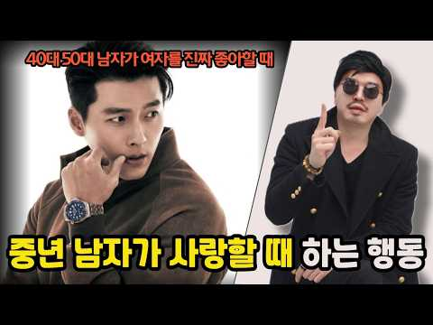
- 챕터: 0:00 중년 남자가 사랑과 심리 분석 · 1:19 중년 남자 사랑할 때 행동 · 4:25 중년 남자 심리 대처법 · 7:10 중년 연애 잘하는 법
- 설명 앞부분: 중년 남자가 여자를 사랑할 때 무조건 나타나는 행동에 대해서 남자 심리 및 연애 심리를 바탕을 근거로 해서 자세하게 분석합니다. 40대 연애 50대 연애에서 나타나는 사랑이 무엇이 다른지 그런 나이에 남자들은 어떤 사랑을 하는지 구체적 예시와 특징들을 담았습니다. 🚨타임 라인
- 같은 채널 평소 대비 ×3.6 (채널 최근 롱폼 중앙값 21,456회) · 평소 영상: 남자가 솔직하게 알려주는 속궁합 잘 맞는 여자 ∣ 사랑이 더 깊어지는 마법 (22,123회) / 진짜 제대로 알려주는 남자 꼬시는 법 3가지 불편한 진실 (남자 심리) (20,788회)
- 대본 없음 (설명) — 음성인식이 끝나면 도입부·흐름이 들어감
- 댓글 42/42: 좋은 점 — 영상 2 · 감사·응원 2 · 더 알고 싶은 것 1 · 아쉬운 점 — 영상 1 · 반박·불만 — 의견 다름 1 · 정치·사회 0 · 경험 공유 2 · 구독·다음 기대 0
  - 좋은 점 — 영상 👍11 “오늘 영상 너~~무 유익해서 좋구만요❤”
  - 좋은 점 — 영상 👍1 “오늘도좋은영상잘보고가요👋🐼😸”
  - 감사·응원 👍4 “왜이렇게 웃기신가요. 정말 웃기세요. 감사합니다.”
  - 감사·응원 👍1 “살짝 지루했는데 잘 봤어요 감사합니다”
  - 더 알고 싶은 것 👍1 “중년 남자인데나르시시스트였어요. 한달에 세번은 급발진 화내고 카톡 차단 당하는 식으로 열달을 참아왔어요. 어렵게 만난 사람이니까. 그런데 본인의 그 이상한 성격장애를 모르고 본인은 피해자 저는 가해자 프레임을 계속 만들어와서 방법이 없는걸 깨달았어요. 일반적인 연애랑…”
  - 아쉬운 점 — 영상 👍1 “살짝 지루했는데 잘 봤어요 감사합니다”
  - 경험 공유 👍0 “저는 정말 자존감이 너무상하고 챙피해서...일단,요약정리를 하자면...저는 50대고 그사람은60대입니다. 3.4년전부터 전화통화만하다가 내ㅡ생일날 몇일전에 만났습니다.전화통화할때는 온갖,말을 다ㅡ해놓고 막상, 만나고 나니...시큰둥하는 모습에 제가 눈치을 봐야 하는 …”

