# 심리 — 성공 사례 분석: 사례별 자세히 #121–#160

`analysis.md` 의 9번 (같은 # 번호). 자동 생성 — `tools/success_analysis.py` v1.6 (2026-11-11 13:32 UTC). ※ 연구·교육용 — 투자 권유가 아님.

### 121. 나이 들수록 외모를 꾸며야 하는 절대적인 이유 ∣ 쇼펜하우어 인생 조언

- https://www.youtube.com/watch?v=RUNL3SPtz6U · 부자 패턴 연구소  · 구독자 10,800 · 조회수 354,201 (×32.8, 하루 3,022.4) · 좋아요 4,423 (1.2%) · 16.4분 · 2026-07-17 · 주제 묶음 2. 인간관계·처세 · 형식 인터뷰·강연·대담 (교수·의사·스님) · 폴더 `W_RUNL3SPtz6U` (웹 승인)
- 썸네일: 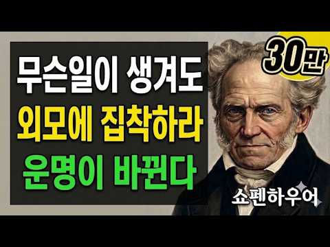
- 챕터: 0:00 인트로: 외모를 안 꾸며도 평범하게 살 수 있을 거란… · 1:45 [본론 1] 쇼펜하우어가 말하는 "외모는 가장 첫 번… · 4:10 외모를 방치했다가 대접까지 소홀해진 50대 남성의 뼈… · 6:20 무기력과 우울감을 외모 관리로 극복하고 인생 2막을 … · 8:15 [궁금증 해결] 도대체 외모를 얼마나 어떻게 꾸며야 … · 9:05 [솔루션] 3065 중장년층을 위한 즉각적인 외모 가… · 11:40 [본론 2] 나이 들수록 단정함이 곧 그 사람의 '인… · 13:50 [본론 3] 환경이 어려울수록 옷을 더 잘 입고 허리… · 15:10 아웃트로: 무슨 일이 있어도 나를 끝까지 귀하게 대하… · 16:22 영상 종료 및 구독자 감사 인사
- 설명 앞부분: ※ 본 영상은 인류 역사상 인간의 본성을 가장 날카롭게 꿰뚫어 본 위대한 철학자 아르투어 쇼펜하우어의 지혜를 바탕으로 구성되었습니다. "대충 평범하게 살면 되지, 굳이 외모를 가꿔야 하나?"라고 생각하고 계셨나요? 겉모습을 놓아버리는 순간, 내면의 자존감은 물론 세상이 나를 대하는 태도와 내 운명까지 함께 바닥으로 추락하게 됩니다. 당연히 내면이 외면보다 훨씬 중요하지만, 외모에 집착하는 일 역시 내 운명을 통째로 바꿀 만큼 매우 중요합니다. 쇼펜하우어는 “외모는 지성보다 먼저 나를 증명하는 가장 강력한 명함”이라고 경고합니다. …
- 같은 채널 평소 대비 ×48.3 (채널 최근 롱폼 중앙값 7,337회) · 평소 영상: [99%는 모른다] 자식도 아내도 아니다! 평생 행복한 사람은 '여기'에 기댄다 ∣ 쇼펜… (7,337회) / 진정한 행복은 단순한 삶에서 나온다. 평생 행복해지는 결정적인 3가지 방법! ∣ 쇼펜하우… (7,226회)
- 대본 없음 (설명) — 음성인식이 끝나면 도입부·흐름이 들어감
- 댓글 177/177: 좋은 점 — 영상 8 · 감사·응원 15 · 더 알고 싶은 것 1 · 아쉬운 점 — 영상 2 · 반박·불만 — 의견 다름 2 · 정치·사회 1 · 경험 공유 8 · 구독·다음 기대 0
  - 좋은 점 — 영상 👍7 “다 옳은말씀 입니다 외모를 가꾸는것은 자존감을 지키는일 이지요 남이 나를 어떻게 볼까가 먼저가 아니고 내가 나 자신을 어떻게 대하고 있는지가 보입니다 내면의 모양이 겉으로 표가 나는 법이지요 말씀대로 비싼옷을 입으라는 얘기가 아님을 당당하고 반듯한 자세 깨끗하고 단정…”
  - 좋은 점 — 영상 👍4 “쇼펜하우어의 철학을 현대적으로 재해석한 취지는 좋으나, 실제 원문과는 거리가 꽤 있는 내용이라 아쉽습니다. ​쇼펜하우어가 《아포리즘》 등에서 강조한 것은 신체적 건강과 내면의 고요함이지, 타인의 시선을 의식해 옷차림이나 외모에 집착하는 삶이 아닙니다. 오히려 그는 타…”
  - 감사·응원 👍36 “잘 경청 했습니다 감사 드려요~♡♡♡”
  - 감사·응원 👍19 “영상 감사드립니다. ^^❤”
  - 아쉬운 점 — 영상 👍4 “쇼펜하우어의 철학을 현대적으로 재해석한 취지는 좋으나, 실제 원문과는 거리가 꽤 있는 내용이라 아쉽습니다. ​쇼펜하우어가 《아포리즘》 등에서 강조한 것은 신체적 건강과 내면의 고요함이지, 타인의 시선을 의식해 옷차림이나 외모에 집착하는 삶이 아닙니다. 오히려 그는 타…”
  - 반박·불만 — 의견 다름 👍4 “쇼펜하우어의 철학을 현대적으로 재해석한 취지는 좋으나, 실제 원문과는 거리가 꽤 있는 내용이라 아쉽습니다. ​쇼펜하우어가 《아포리즘》 등에서 강조한 것은 신체적 건강과 내면의 고요함이지, 타인의 시선을 의식해 옷차림이나 외모에 집착하는 삶이 아닙니다. 오히려 그는 타…”
  - 정치·사회 👍3 “人必自侮然後 人侮之 (인필자모연후 인모지): 사람은 반드시 스스로를 업신여긴 뒤에야 남이 그를 업신여기고, 家必自毁而後 人毁之 (가필자훼이후 인훼지): 집안은 반드시 스스로를 망가뜨린 뒤에야 남이 그 집안을 무너뜨리며, 國必自伐而後 人伐之 (국필자벌이후 인벌지): 나…”
  - 경험 공유 👍46 “경험담인데 남에게 보여주기 위한게 아니라 나를 위해 (내가 나를 인정해가며) 관리 하다보면 굳이 말하지 않아도 주변이 다 알아봐요.”
  - 경험 공유 👍12 “현실을 정확하게 간파하신 말씀 이십니다. 눈으로 먼저 사람을 간파하고 내가 나를 내려놓으면 그것이 모두 내게 나의 가치인양 그렇게 돼 버립니다. 죽는 순간 까지 나를 사랑하며 가꾸면서 살렵니다 감사드립니다~!!”

### 122. 부모 장례식장에서 눈물 안 나는 자식 특징 _ 당신 잘못이 아닙니다 #정신과 #정신과의사 #가족 #부모갈등 #부부갈등 #관계 #형제갈등 #심리상담

- https://www.youtube.com/watch?v=oUiNW0U5Z9Y · Dr.전미경의 닥전TV · 구독자 29,400 · 조회수 373,754 (×12.7, 하루 8,126.9) · 좋아요 2,440 (0.7%) · 23.1분 · 2026-09-26 · 주제 묶음 4. 우울·불안·정신건강 · 형식 인터뷰·강연·대담 (교수·의사·스님) · 폴더 `W_oUiNW0U5Z9Y` (웹 승인)
- 썸네일: 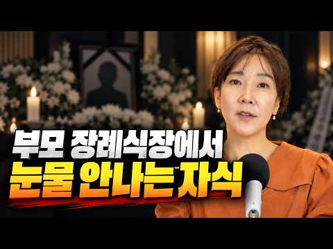
- 설명 앞부분: ❝25년간 10만 명의 삶을 바꾼 전미경 원장의 소통 처방전❞ 📕『멈출수록 관계가 살아나는 말 심리』 출간! 🖐️이런 순간, 한 번이라도 있었다면 이 책이 당신의 말을 바꿔드립니다! 인간관계에서 말로 인한 갈등을 반복하는 사람 말이 의도와 다르게 전달되어 오해받는 사람 대화 습관을 바꾸고 싶지만, 구체적인 방법을 모르는 사람 가까운 사람일수록 말이 더 어려운 사람 사과해야 할 순간에 말문이 막히는 사람 애쓸수록 오해만 쌓이는 당신을 위한 1초의 멈춤, 소통의 관점을 바꾸는 대화 심리학 지금 서점에서 만나보세요!
- 같은 채널 평소 대비 ×83.1 (채널 최근 롱폼 중앙값 4,496회) · 평소 영상: 정신과 전문의가 말하는 회피의 심리학 "둥글게 둥글게"가 관계를 죽이는 방법 #정신과 #… (5,133회) / 사이비가 종교가 되는 과정 #심리학 #심리상담 #사이비 #종교 #이단 (3,858회)
- 대본 없음 (설명) — 음성인식이 끝나면 도입부·흐름이 들어감
- 댓글 504/504: 좋은 점 — 영상 23 · 감사·응원 46 · 더 알고 싶은 것 0 · 아쉬운 점 — 영상 1 · 반박·불만 — 의견 다름 17 · 정치·사회 1 · 경험 공유 118 · 구독·다음 기대 6
  - 좋은 점 — 영상 👍131 “장례식에 눈물이 안나오는게 오랜시간 남몰래 흘렸기 때문 이란 말에 공감이 가네요”
  - 좋은 점 — 영상 👍80 “정말로 와닿는 말씀이라 잘 들었어요 안 그래도 얼마전 엄마가 돌아가셨는데 전혀 슬프지가 않아서 제가 어디가 잘못된 건가 스스로 궁금 했거든요. 자식의 도리와 의무는 다 했지만 애착은 없는 관계 바로 제 경우 같아요. 받은 거라곤 19세 때까지 먹여주고 재워 준 거, …”
  - 감사·응원 👍284 “제가 싸이코가 아님을 확인하고 갑니다. 그리고 저와 같은 분들이 많으시다는 것에 안도가 되네요.감사합니다”
  - 감사·응원 👍164 “이런말씀을 해주는 선생님이 계시다니,,이제 숨이 좀 쉬어지네요ㅜㅜ 감사합니다”
  - 반박·불만 — 의견 다름 👍104 “부모라고 다 같은 부모가 아닙니다 이걸 일반적인 사람들에겐 아무리 설명해도 모르는 것 같아요 그래서 설명하지 않습니다 부모가 죽었으면 다리 뻗고 자겠다는 생각 안해본 사람은 모릅니다”
  - 반박·불만 — 의견 다름 👍39 “평생 부모님 사랑을 받아본적이 없어요..부모님도 저한테 뭘 해준적도 없고 저도 손벌린적도 없고 그렇다고 못사는 집도 아닙니다.. 일평생 아들아들만 하고 그 아들이 보다 7살이나 어린데 저한테 욕지거리를 하더라구요...저는 가족이 있어도 없다고 생각하고 평생을 외롭게 …”
  - 정치·사회 👍32 “그와 반대인 놈도 있습니다. 도리는 없고. 권리만 있는. 제. 조카놈이 그렇습니다. 암 걸린 엄마 한번도 안찾아오더니. 지엄마. 하늘나라가도 장례식장도. 안오던 놈이. 재산정리하러 나타나는거 보고. 기암했네요. 아들이라면 끔찍하게 생각하고 혼자. 대학도 적성에. 안 …”
  - 경험 공유 👍448 “더 아픈건 제가 부모가 되어보니, 나의 부모가 더욱 이해가 안되더군요 분노가 더 폭발 했습니다.”
  - 경험 공유 👍284 “제가 싸이코가 아님을 확인하고 갑니다. 그리고 저와 같은 분들이 많으시다는 것에 안도가 되네요.감사합니다”
  - 구독·다음 기대 👍38 “누워서 듣는데 눈물이 나네요~ 답답했던 마음이 조금은 풀리는 것 같아요! 감사합니다♡다음 영상 기다려요~~”
  - 구독·다음 기대 👍9 “다음 영상 기다려집니다!! 잘 봤습니다, 감사합니다”

### 123. 나이가 들수록 인간관계가 어려워지는 이유

- https://www.youtube.com/watch?v=QeeNrWYaQkY · 신춘 · 구독자 1,640 · 조회수 10,764 (×6.6, 하루 452.4) · 좋아요 54 (0.5%) · 6.9분 · 2026-10-18 · 주제 묶음 2. 인간관계·처세 · 형식 브이로그·직접 해본 이야기 · 폴더 `W_QeeNrWYaQkY` (웹 승인)
- 썸네일: 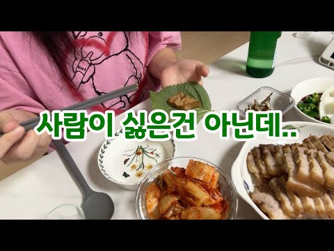
- 설명 앞부분: 이번 영상에는 처음으로 제 목소리를 담아봤어요. 평범한 일상 속에서 문득 떠오른 생각들을 혼잣말처럼 기록해 봅니다. 🤍 오늘도 보러 와주셔서 감사합니다.
- 같은 채널 평소 대비 ×2.9 (채널 최근 롱폼 중앙값 3,667회) · 평소 영상: 월 200따리 직장인, 결혼 가능할까요 (3,667회) / 200따리 직장인 직장에서 버티는 이유가 뭘까 (3,906회)
- 대본 없음 (설명) — 음성인식이 끝나면 도입부·흐름이 들어감
- 댓글 34/34: 좋은 점 — 영상 1 · 감사·응원 3 · 더 알고 싶은 것 0 · 아쉬운 점 — 영상 1 · 반박·불만 — 의견 다름 0 · 정치·사회 0 · 경험 공유 4 · 구독·다음 기대 0
  - 좋은 점 — 영상 👍1 “신춘님 저번영상 잘봣습니다 ㅎㅎ 저랑 동갑이신것같은데 35살 어케보면 저랑 똑같으시네여 저도 몇몇사람들외 말을 잘안하거든여 또 어떤사람들한테 말을 붙엿는데 나중가면 그사람이 오지랖부리고 해서 정말 친하지않으면 저도 친목질은 잘안해서 공감되네여 ㅋㅋ 그리고 저도 신춘님…”
  - 감사·응원 👍3 “오늘 영상 공감포인트들이 넘 많네요🥹 사람 눈치보고 예민한 기질인 저는 그 분위기 공기가 달라지는거까지 인지를해서 상대방 배려하는데 상대는 그러지않을때.. 좀 회의감 들긴하죠ㅠ 나중엔 내가 예민한가 하고 내탓하규 있고.. 그리고 감자칼로 과일깎는거 저도 그래욬ㅋㅋㅋ …”
  - 감사·응원 👍0 “오늘도 영상 잘보고 갑니다 오늘 하루 즐겁게 보내세요 항상 응원합니다”
  - 경험 공유 👍3 “오늘 영상 공감포인트들이 넘 많네요🥹 사람 눈치보고 예민한 기질인 저는 그 분위기 공기가 달라지는거까지 인지를해서 상대방 배려하는데 상대는 그러지않을때.. 좀 회의감 들긴하죠ㅠ 나중엔 내가 예민한가 하고 내탓하규 있고.. 그리고 감자칼로 과일깎는거 저도 그래욬ㅋㅋㅋ …”
  - 경험 공유 👍1 “저도 혼자가 편할때가 많은거 같아요... 대인관계가 어렵네요”

### 124. 사랑받고 자란 사람은 이런 데서 티가 납니다. 의외의 행동 6가지

- https://www.youtube.com/watch?v=2t0zuR72DIE · 친절한심리학 · 구독자 22,000 · 조회수 212,009 (×9.6, 하루 5,738.4) · 좋아요 2,048 (1.0%) · 15.9분 · 2026-10-05 · 주제 묶음 1. 심리학 일반 · 형식 정보·해설 (그 밖) · 폴더 `W_2t0zuR72DIE` (웹 승인)
- 썸네일: 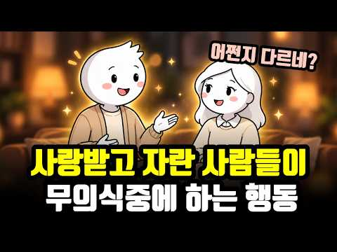
- 챕터: 0:00 사랑받고 자란 티는 의외의 순간에 납니다 · 0:55 같은 상황, 누구는 불안하고 누구는 편안한 이유 · 1:35 첫 번째, 의외로 남의 호의를 잘 받는다 · 4:12 두 번째, 싸움이 끝난 뒤 상대를 벌주지 않는다 · 6:32 세 번째, "나라면 안 그럴 텐데"를 쉽게 말하지 않… · 8:39 네 번째, 누구 탓보다 이제 어떻게 할지를 찾는다 · 10:36 다섯 번째, 좋은 것을 혼자 움켜쥐지 않는다 · 12:33 여섯 번째, 가까운 사람일수록 함부로 대하지 않는다 · 14:17 여섯 가지의 공통점 · 14:56 사랑을 덜 받았다고 느끼는 분들께
- 설명 앞부분: 사랑을 많이 받고 자란 사람은 의외로 티가 납니다. 밝게 웃을 때가 아니라, 누가 잘해줄 때, 싸운 다음 날, 일이 꼬인 순간처럼 별것 아닌 순간에요. 같은 상황에서도 누구는 불안하고, 누구는 이상할 만큼 편안한 이유는 뭘까요? 애착과 부모의 온정에 관한 심리학 연구를 바탕으로, 사랑받고 자란 사람들이 자기도 모르게 하는 행동 6가지를 정리했습니다. 어린 시절에 충분히 받지 못했어도 괜찮아요. 이 편안함은 지금부터도 만들어갈 수 있으니까요. [ 타임라인 ]
- 같은 채널 평소 대비 ×16.5 (채널 최근 롱폼 중앙값 12,870회) · 평소 영상: 운 좋은 사람들이 매일하는 비밀 습관 4가지 (심리학 연구 결과) (12,870회) / 누구에게나 존중받는 사람들의 3가지 공통 습관 (14,136회)
- 대본 없음 (설명) — 음성인식이 끝나면 도입부·흐름이 들어감
- 댓글 75/75: 좋은 점 — 영상 3 · 감사·응원 4 · 더 알고 싶은 것 0 · 아쉬운 점 — 영상 0 · 반박·불만 — 의견 다름 2 · 정치·사회 0 · 경험 공유 15 · 구독·다음 기대 0
  - 좋은 점 — 영상 👍20 “전부 공감합니다. 전 저 여섯가지가 다 제게 있어서 의식하지 못했는데 영상 보고나니 부모님께 의외로 사랑 많이 받고 자랐던 거라는 걸 새삼 깨달았네요. 특히 6번 가까울 수록 선을 지켜야 한다는 거 정말 공감하는데 나이를 먹을 수록 친해지면 친하다는 이유로 저 선을 …”
  - 좋은 점 — 영상 👍1 “사랑과 안정적인 태도와 관계를 잘 설명해주셔서 감사합니다! 😊”
  - 감사·응원 👍1 “감사합니다❤ 사랑과 축복을 보냅니다❤”
  - 감사·응원 👍1 “사랑과 안정적인 태도와 관계를 잘 설명해주셔서 감사합니다! 😊”
  - 반박·불만 — 의견 다름 👍29 “잘 받는다~?당연한건 아니죠 받은만큼 베플어야죠~ 그걸 싸가지 ~”
  - 경험 공유 👍211 “1. 잘 받는다 2. 싸울 때 제대로 싸우고 푼다.(회복력) 3. 화가 지나간 후 자기 자리로 돌아온다. 상대가 그렇게 느꼈다는 걸 받아준다.(안정애착) 4. 문제가 생기면 거기 오래 머물지 않고 문제중심적 해결능력이 있다. 내가 할 수 있는 것 5. 좋은 것을 굳이…”
  - 경험 공유 👍31 “나도 친구한테 아낌없이 줬는데~ 지식도 진실도~ 돌아오는건 배신!!!”

### 125. 우울증 치료 6년하고 깨달은 마음의 진리

- https://www.youtube.com/watch?v=BxrMEkahOXE · 민고영 · 구독자 20,100 · 조회수 432,081 (×21.5, 하루 5,147.0) · 좋아요 5,065 (1.2%) · 11.3분 · 2026-08-19 · 주제 묶음 3. 자존감·감정·멘탈 · 형식 정보·해설 (그 밖) · 폴더 `W_BxrMEkahOXE` (웹 승인)
- 썸네일: 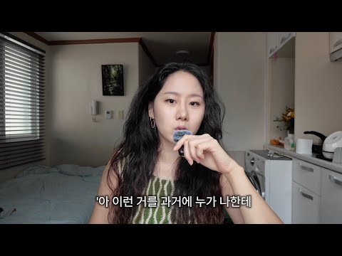
- 챕터: 0:00 오늘의 주제 · 0:42 1.부정적인 감정을 없앨 수 없다. 그리고 꼭 없애야… · 4:25 2.자극과 반응 사이에는 틈이 있다. · 7:30 3.머리가 이해하는 것과 마음이 믿게 되는 것은 다르…
- 설명 앞부분: 일러스트 by Seo Jung (Sammie) Yoon
- 같은 채널 평소 대비 ×28.9 (채널 최근 롱폼 중앙값 14,962회) · 평소 영상: 인생이 편해지고 나다워졌다 (방법 2가지) (14,962회) / 성형까지 했는데, 외모정병은 왜 안 끝날까? (16,802회)
- 대본 없음 (설명) — 음성인식이 끝나면 도입부·흐름이 들어감
- 댓글 452/452: 좋은 점 — 영상 48 · 감사·응원 63 · 더 알고 싶은 것 17 · 아쉬운 점 — 영상 3 · 반박·불만 — 의견 다름 9 · 정치·사회 0 · 경험 공유 93 · 구독·다음 기대 1
  - 좋은 점 — 영상 👍411 “생각이 과거로 갈 때 우울이 생깁니다. 생각은 내 의지와 상관 없이 끊임없이 올라옵니다. 그 때 그 생각들을 회피하거나 억압하지 말고 그대로 느껴주고 생각을 바라봐 주세요.. 해결되지 않은 부정적 감정들이 올라올 때마다 계속 느껴주면 어느새 그 감정은 힘을 잃고 저절…”
  - 좋은 점 — 영상 👍147 “알아차림 배워보세요 마음을 계속 보고있으면 마음과 생각이 내가 하는게 아니라 자동으로 돌아가는 거라는걸 알게되고, 보는 순간 비 동일시가 되면서 휘둘리지 않게 됩니다. 마음이 떠오르면 떠오르는데로 감정의 도가니 속에서 살다가 그걸 메타인지 처럼 바라볼수 있게 되더라구…”
  - 감사·응원 👍55 “티내지는 않는데 생각보다 주변에 심적으로 고통받으시는 분들이 많더라구요... 다들 잘 이겨내시길 마음 속으로 응원합니다.”
  - 감사·응원 👍32 “물질세상에 길들여지며 온갖 습이 내 자아를 덮어놨더라고요 생각과습관 모든게 내가아닌거 같은걸느껴 마음공부를 시작해보니 저깊숙이 내가 묻혀있는걸 발견하고 온전히 나로 살아가기로 했어요 응원합니다”
  - 더 알고 싶은 것 👍2 “동네 성당 가면 돼요. 어느 동네든 성당은 꼭 있어요. 그리고 성당의 입구에는 늘 성모마리아 석상이 있습니다. 그 앞에서 눈을 감고 물어보세요. '제가 왜 살아야 하는지 그 이유를 알려주세요.'라고. 그럼 해답을 주실 겁니다. 뭐가 먹고 싶어지든 어디를 가고 싶어지든…”
  - 더 알고 싶은 것 👍2 “저도 만성우울이 있어서 브린텔렉스(항우울제) 복용하며 살아가는데요, 민고영님 제일 첫번째영상 썸네일의 표정을 짓는 순간이 많으신가요?? 유튜브 영상은 전반적으로 다 무표정해보이시는데, 실제 삶에서는 웃는순간이 많으신지 궁금합니다😊”
  - 아쉬운 점 — 영상 👍0 “전 아직 인생쪼렙 학생이지만 부정적인 감정이 찾아와도 내 스스로가 감당할수있을때 진정으로 행복할수있다는말 너무공감돼요..진짜 인생의 진리같은 명언을 고영님한테 처음 듣네요! 저 이 멘토 메모해서 친구들한테 엣햄!하고 폼잡고 써먹어도되죠?ㅋㅎㅎ🤓📝 말씀대로 부정적인 감…”
  - 아쉬운 점 — 영상 👍0 “목소리가 너무 좋으세요 얼굴도 예쁘시구요 말씀도 너무 조리있게 잘하셔서 정속으로 봤습니다 좋은 내용 전달 감사드려요 힘받고 갑니다!”
  - 반박·불만 — 의견 다름 👍1,215 “저 알고리즘으로 들어왔는데 음.. 딴 얘기일수도 있지만 원룸에 사는게 사람 우울하게 만드는거도 큰거 같아요 저는 지방에서 서울 상경하면서 고시원 원룸 전전하면서 살았었는데 계속 우울증 달고 살다가 햇빛 잘드는 투룸으로 가니까 정말 많이 나아졌어요.. 어이없을 정도로 …”
  - 반박·불만 — 의견 다름 👍89 “저는 고등학생 때 부터 과민성 대장증후군과 불안장애가 왔었고 그당시엔 제가 불안장애가 있는지도 과민성 대장증후군이 유산균을 먹을게 아니라 불안장애 약을 먹으면 됬는지도 몰랐습니다. 초중학교 내내 반에서 제일 시끄럽고 전교임원까지 하는 활발한 성격은 다 무너지고 모든 …”
  - 경험 공유 👍411 “생각이 과거로 갈 때 우울이 생깁니다. 생각은 내 의지와 상관 없이 끊임없이 올라옵니다. 그 때 그 생각들을 회피하거나 억압하지 말고 그대로 느껴주고 생각을 바라봐 주세요.. 해결되지 않은 부정적 감정들이 올라올 때마다 계속 느껴주면 어느새 그 감정은 힘을 잃고 저절…”
  - 경험 공유 👍290 “저도 그래서 심리안정이 안되고 자꾸 분노할바에야 그 감정을 자주 만들어내는 친구 ? 를 끊었어요 ㅠ”
  - 구독·다음 기대 👍0 “목소리도 너무 좋고 내용이 공감되서 구독해요😊”

### 126. 사람을 만나면 손부터 봐라 본성이 모두 드러난다 특히 1번은 쓰레기다 ∣ 정약용명언 ∣ 인생조언 ∣ 인간관계 ∣ 처세술 ∣ 삶의지혜 ∣ 인간관계 I 오디오북

- https://www.youtube.com/watch?v=_OmpEiHbCwA · 거인들의서재 · 구독자 7,270 · 조회수 116,793 (×16.1, 하루 1,839.0) · 좋아요 3,839 (3.3%) · 69.3분 · 2026-09-08 · 주제 묶음 2. 인간관계·처세 · 형식 수면·낭독·오디오북 (잠잘 때·명언) · 폴더 `W__OmpEiHbCwA` (웹 승인)
- 썸네일: 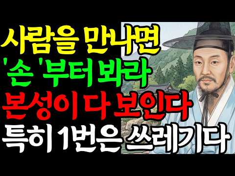
- 설명 앞부분: 다산 정약용 선생님은 사람을 알고 싶으면 얼굴을 보지 말고 손을 보라고 가르치셨습니다. 얼굴은 웃으면서 속일 수 있어도, 무의식적으로 움직이는 손에는 그 사람의 진짜 됨됨이와 본성이 고스란히 드러나기 때문입니다. 이 영상에서는 악수할 때 교묘하게 힘을 빼는 손, 대화 중 상대를 콕콕 가리키는 손가락, 밥값 계산할 때만 지갑에 느려지는 손, 아랫사람을 오라 가라 손짓으로 부르는 손 등 일상 속 사소한 손동작 10가지를 통해 상대방의 진짜 인성을 꿰뚫어 보는 법을 소개합니다. 그동안 겉모습이나 달콤한 말에 속아 사람에게 상처를 받으셨…
- 같은 채널 평소 대비 ×6.0 (채널 최근 롱폼 중앙값 19,599회) · 평소 영상: 돈 있는 여자와 없는 여자, 얼굴 '이 곳'만 보면 단번에 바로 알 수 있다 l 정약용 … (25,618회) / 거인들의 서재 밥 먹을때 이런 말하는 사람 절대 만나지 마라 특히 1번은 최악이다 ∣ 본… (13,580회)
- 대본 없음 (설명) — 음성인식이 끝나면 도입부·흐름이 들어감
- 댓글 64/64: 좋은 점 — 영상 7 · 감사·응원 13 · 더 알고 싶은 것 2 · 아쉬운 점 — 영상 2 · 반박·불만 — 의견 다름 1 · 정치·사회 2 · 경험 공유 1 · 구독·다음 기대 1
  - 좋은 점 — 영상 👍31 “인생에서 정말 좋은 말씀 늘 공부하고 배우고 알게 해 주셔서 감사합니다”
  - 좋은 점 — 영상 👍23 “정말 참 오랫만에 저의 인생에 도움이 되는 좋은 말씀 많이 들려주셔서 감사합니다ㆍ 유튜브에 지저분하고 저속하고 거짓과 위선으로 가득찬 글들이 너무 넘쳐나서 진짜 유튜브를 보기 싫을 때가 너무 많았는데 이런 주옥 같은 글도 있다니 정말 놀랍습니다ㆍ 그래서 구독을 눌렀습…”
  - 감사·응원 👍31 “인생에서 정말 좋은 말씀 늘 공부하고 배우고 알게 해 주셔서 감사합니다”
  - 감사·응원 👍23 “정말 참 오랫만에 저의 인생에 도움이 되는 좋은 말씀 많이 들려주셔서 감사합니다ㆍ 유튜브에 지저분하고 저속하고 거짓과 위선으로 가득찬 글들이 너무 넘쳐나서 진짜 유튜브를 보기 싫을 때가 너무 많았는데 이런 주옥 같은 글도 있다니 정말 놀랍습니다ㆍ 그래서 구독을 눌렀습…”
  - 더 알고 싶은 것 👍23 “정말 참 오랫만에 저의 인생에 도움이 되는 좋은 말씀 많이 들려주셔서 감사합니다ㆍ 유튜브에 지저분하고 저속하고 거짓과 위선으로 가득찬 글들이 너무 넘쳐나서 진짜 유튜브를 보기 싫을 때가 너무 많았는데 이런 주옥 같은 글도 있다니 정말 놀랍습니다ㆍ 그래서 구독을 눌렀습…”
  - 더 알고 싶은 것 👍3 “육백이십오 란말 맞나요?🎉”
  - 아쉬운 점 — 영상 👍7 “너무지루해요 ㅜㅠ”
  - 아쉬운 점 — 영상 👍1 “625 전쟁이라는 소리를 들으니까 더 듣기가 싫어졌네요 자기는 말에 대해서 이야기하면서 ai에게 맡겼다 하더라도 틀린 부분은 수정을 해야 함에도 불구하고 떠들어 대니까 아무 의미가 없어져 버렸구나 괜히 시간 아깝게 34분이나 소비했네요 수신제가 치국평천하 의미를...…”
  - 반박·불만 — 의견 다름 👍12 “손이 차가운 이유가 다 마음이 차가운 것은 아닙니다. 갑상선 증상이 있는 사람도 손이 항상 차갑습니다....😮”
  - 정치·사회 👍1 “이제명 대통령님 잘하고 계시는데 왜 왜 이상한 인간들이 말도안되는 소리를하는건지 괴물”
  - 정치·사회 👍0 “갑자기 이재명이가 왜 나와😢😢😢”
  - 구독·다음 기대 👍29 “6. 25 독란 일을 읽으면서, 육백 이십오 라고 낭독하는데 , 다음엔 올바로 읽기를 기대합니다.”

### 127. 【노후의 친구 관계】 마음의 외로움을 파고드는 '친절한 사람'이 뒤에서 저지른 끔찍한 배신이란?

- https://www.youtube.com/watch?v=sYOPy6dE7Uc · 황혼기를 헛되이 보내지 마세요 · 구독자 697 · 조회수 13,347 (×19.1, 하루 175.4) · 좋아요 63 (0.5%) · 22.5분 · 2026-08-27 · 주제 묶음 3. 자존감·감정·멘탈 · 형식 브이로그·직접 해본 이야기 · 폴더 `W_sYOPy6dE7Uc` (웹 승인)
- 썸네일: 
- 설명 앞부분: 지옥의 밑바닥에서 나를 끌어올려 준 그 손이, 사실은 나를 가장 어두운 곳으로 밀어 넣을 손이었다면? 남편을 떠나보내고 뼈가 시리도록 외로웠던 67세 이윤희 씨의 가슴 먹먹한 인간관계 이야기입니다. 텅 빈 일상 속에서 다가온 이웃 명숙 씨의 다정함은 얼어붙은 마음을 녹이는 봄볕 같았습니다. 하지만 그녀는 윤희 씨의 경제적 사정과 아픔을 동네 가십거리로 소비하고, 건강식품을 팔기 위해 접근한 가짜 다정함이었습니다. 상처를 안고 찾아간 수채화 교실의 장 선생님 역시, 친절을 가장해 윤희 씨의 소중한 작품을 표절하며 또 한 번 깊은 절…
- 같은 채널 평소 대비 ×4.2 (채널 최근 롱폼 중앙값 3,206회) · 평소 영상: 【황혼 맞선】 "타협하면 끝장입니다" 52세 두 여성의 1년 후 운명이 완벽하게 엇갈린 … (3,206회) / "어느새 보니, 아무도 남지 않았습니다…" 60대·70대에 '아무도 상대해 주지 않는 사… (3,983회)
- 대본 없음 (설명) — 음성인식이 끝나면 도입부·흐름이 들어감
- 댓글 3/3: 좋은 점 — 영상 1 · 감사·응원 0 · 더 알고 싶은 것 0 · 아쉬운 점 — 영상 0 · 반박·불만 — 의견 다름 0 · 정치·사회 0 · 경험 공유 1 · 구독·다음 기대 0
  - 좋은 점 — 영상 👍2 “좋은내용입니다 내가단단해지고 사람보는 눈이 생겨야 좋은 관계가 이루어질수 있는것 같습니다”
  - 경험 공유 👍2 “좋은내용입니다 내가단단해지고 사람보는 눈이 생겨야 좋은 관계가 이루어질수 있는것 같습니다”

### 128. 중년 여자가 들으면 마음이 열리는 칭찬 5가지 💕｜중년연애｜여자심리｜연애심리

- https://www.youtube.com/watch?v=qGgOC9nkdm4 · 여자심리연구소 · 구독자 3,970 · 조회수 67,624 (×17.0, 하루 980.5) · 좋아요 560 (0.8%) · 25.9분 · 2026-09-03 · 주제 묶음 8. 연애·부부 심리 · 형식 정보·해설 (그 밖) · 폴더 `W_qGgOC9nkdm4` (웹 승인)
- 썸네일: 
- 챕터: 0:00 중년 여성에게 외모 칭찬이 오히려 상처가 되는 이유 · 1:38 중년 여성의 마음을 여는 5가지 진짜 칭찬 · 2:08 나이를 언급하는 칭찬이 역효과를 내는 이유 · 5:22 외모보다 말투와 분위기를 알아봐 주는 칭찬 · 10:02 살아온 삶의 무게와 고생을 인정하는 칭찬 · 14:24 여자로서의 매력을 부담 없이 인정하는 방법 · 18:34 존재 자체를 인정하고 외로움을 덜어주는 한마디 · 22:10 가정을 따뜻하게 만드는 5가지 칭찬 총정리
- 설명 앞부분: 중년 여자가 들으면 마음이 열리는 칭찬 5가지 💕｜중년연애｜여자심리｜연애심리 💬 중년연애에서 진짜 중요한 것은 화려한 말보다 상대의 마음을 알아주는 진심입니다. 이 영상에서는 중년 여자의 마음을 움직이는 남자의 칭찬 5가지를 쉽게 알아봅니다. 🌿 연애심리를 통해 나이를 언급하는 칭찬이 왜 부담이 될 수 있는지 살펴봅니다. 💗 연애심리를 바탕으로 외모보다 말투와 분위기를 알아주는 방법을 알려드립니다. 🌷 연애심리에서 중요한 삶의 노력과 고생을 인정하는 말도 함께 소개합니다. ✨ 연애심리로 부담 없이 여성의 매력을 표현하는 방법을 알…
- 같은 채널 평소 대비 ×23.4 (채널 최근 롱폼 중앙값 2,889회) · 평소 영상: 여자가 답장을 늦게 하는 진짜 이유, 바쁨? 밀당? 거절? 마음은 여기서 드러납니다 ∣ … (2,889회) / 여자가 관심 없을 때 보내는 5가지 신호｜연애심리｜남자는 왜 끝까지 모를까 (2,466회)
- 대본 없음 (설명) — 음성인식이 끝나면 도입부·흐름이 들어감
- 댓글 17/17: 좋은 점 — 영상 0 · 감사·응원 2 · 더 알고 싶은 것 0 · 아쉬운 점 — 영상 1 · 반박·불만 — 의견 다름 0 · 정치·사회 0 · 경험 공유 0 · 구독·다음 기대 0
  - 감사·응원 👍3 “내용 좋으네요. 많이 참고가 되었습니다. 감사합니다.”
  - 감사·응원 👍1 “감사합니다”
  - 아쉬운 점 — 영상 👍0 “무슨 서론이 너무 길어요.”

### 129. "아직 절반 남았습니다" 50대 이후, 인생 후반전이 달라지는 사람들의 결정적 차이

- https://www.youtube.com/watch?v=U3FfaOiViYY · 심리충전소 · 구독자 21,400 · 조회수 208,443 (×9.7, 하루 5,275.7) · 좋아요 761 (0.4%) · 22.9분 · 2026-10-02 · 주제 묶음 1. 심리학 일반 · 형식 정보·해설 (그 밖) · 폴더 `W_U3FfaOiViYY` (웹 승인)
- 썸네일: 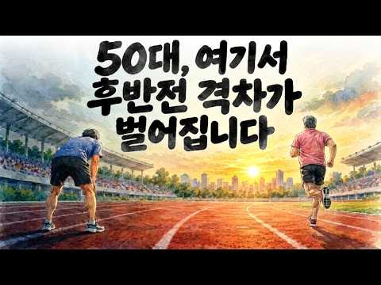
- 챕터: 0:00 쉰 살은 이제 중간 세대 · 1:48 노년의 문턱이 뒤로 물러났다 · 4:03 몸은 달력만큼 늙지 않았다 · 7:30 결실은 후반전에 온다 · 10:40 첫 번째 차이, 몸 · 14:02 두 번째 차이, 배움 · 17:19 세 번째 차이, 내 몫의 돈 · 21:05 후반전 작전판
- 설명 앞부분: 💡 대한민국 사람을 나이순으로 한 줄로 세우면, 한가운데 선 사람은 몇 살일까요? 1994년엔 스물아홉이 채 안 됐던 이 나이가 요즘은 마흔여섯입니다. 쉰 살은 이제 윗세대가 아니라 중간 세대인 거죠. 그런데 정작 쉰 살들은 이렇게 말합니다. 이 나이에 뭘 새로 하냐, 이제 슬슬 정리해야지. 백 세 시대라면 쉰은 딱 하프타임인데, 왜 우리는 경기가 끝나 간다고 느낄까요. 🔍 영상에서 확인하실 내용 (The Secrets) 노인들이 직접 꼽은 '노인이 되는 나이' 지나온 햇수가 아니라 남은 햇수로 나이를 세는 셈법 요즘 일흔둘의 몸…
- 같은 채널 평소 대비 ×128.5 (채널 최근 롱폼 중앙값 1,622회) · 평소 영상: “돈 자랑 안합니다” 50대 이후, 진짜 부자들이 오히려 조용한 이유 (1,867회) / "싸운 적도 없는데" 50대 이후, 형제와 남이 되는 진짜 이유 (1,376회)
- 대본 없음 (설명) — 음성인식이 끝나면 도입부·흐름이 들어감
- 댓글 22/22: 좋은 점 — 영상 0 · 감사·응원 1 · 더 알고 싶은 것 0 · 아쉬운 점 — 영상 0 · 반박·불만 — 의견 다름 0 · 정치·사회 0 · 경험 공유 0 · 구독·다음 기대 0

### 130. 인생을 바꾸고싶다면 안 쓰는 물건부터 당장 버리세요 ㅣ 60세까지는 아까워도 다 버려야하는 진짜 이유

- https://www.youtube.com/watch?v=XTueIYuM2aY · 뇌생각 심리학 · 구독자 8,200 · 조회수 231,076 (×28.2, 하루 1,992.6) · 좋아요 3,096 (1.3%) · 14.2분 · 2026-07-18 · 주제 묶음 1. 심리학 일반 · 형식 정보·해설 (그 밖) · 폴더 `W_XTueIYuM2aY` (웹 승인)
- 썸네일: 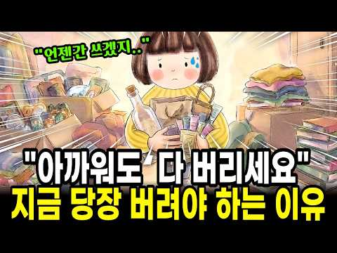
- 설명 앞부분: 아까워도 다 버리세요 🧹 지금 당장 정리해야 하는 뇌과학적 이유 "분명히 버렸는데 왜 또 그대로일까요?" 🤔 차곡차곡 모아둔 종이가방, 깨끗이 씻어 줄 세워둔 유리병, 지퍼백에 담긴 화장품 샘플들… 아까워서 도무지 손이 안 가는 그 서랍, 혹시 여러분도 하나쯤 있으신가요? 🗄 오늘 이야기는요, 물건을 못 버리는 게 결코 여러분이 게으르거나 미련해서가 아니라는 데서 시작합니다. 우리 뇌는 익숙한 물건을 버릴 때 마치 몸이 아픈 것처럼 반응한다고 해요. 그래서 손이 얼어붙는 게 당연했던 거예요. 💛 ✨ 이 영상에서 함께 나누는 이야기…
- 같은 채널 평소 대비 ×93.1 (채널 최근 롱폼 중앙값 2,482회) · 평소 영상: 우울증도 아닌데 모든 게 귀찮고 피곤한 이유 (2,507회) / 존중받는 사람과 무시받는사람의 치명적인 말투 차이 2가지 (2,457회)
- 대본 없음 (설명) — 음성인식이 끝나면 도입부·흐름이 들어감
- 댓글 190/190: 좋은 점 — 영상 6 · 감사·응원 6 · 더 알고 싶은 것 0 · 아쉬운 점 — 영상 1 · 반박·불만 — 의견 다름 0 · 정치·사회 0 · 경험 공유 15 · 구독·다음 기대 0
  - 좋은 점 — 영상 👍14 “좋은 얘기 감사합니다. 저도 정리가 잘안되네요. 지금보다 여유있었던 젊은날 가지고 있던것들에 잡착이있어 아직도 못비우고 끌어안고 살고 있어 매일 심란하게 걱정하고 고민하는 삶을 살고 있거든요. 이젠 비워야지하면서도 그게 쉽게 안되는게 외로워서 강박이라서 아까워서라는 …”
  - 좋은 점 — 영상 👍11 “최근 몇년만에 다시 미니멀 도전중인데 예전에 내가 왜 미니멀을 하고싶었는지 기억이 안났거든요. 이런저런 영상도 와닿지않았는데 드디어 발견!! 몇번이고 더 돌려보고 다시도전해보겠습니다.”
  - 감사·응원 👍14 “간결하게 정돈된 삶❤ 감사합니다❤ 비우고 나면 개운해지는 ❤ 여러분께 바로 지금 좋은일이 생깁니다❤”
  - 감사·응원 👍14 “좋은 얘기 감사합니다. 저도 정리가 잘안되네요. 지금보다 여유있었던 젊은날 가지고 있던것들에 잡착이있어 아직도 못비우고 끌어안고 살고 있어 매일 심란하게 걱정하고 고민하는 삶을 살고 있거든요. 이젠 비워야지하면서도 그게 쉽게 안되는게 외로워서 강박이라서 아까워서라는 …”
  - 경험 공유 👍17 “저도 마니 버렸는데 더 버릴게 없나 늘 봅니다”
  - 경험 공유 👍16 “저희엄마가 쓰레기 수집가 수준입니다”

### 131. 사람 보는 눈이 정확한 사람들의 7가지 비밀 심리

- https://www.youtube.com/watch?v=C6oXNfwg3jw · 어른이 심리학교 · 구독자 13,100 · 조회수 37,824 (×2.9, 하루 3,149.4) · 좋아요 207 (0.5%) · 13.6분 · 2026-10-30 · 주제 묶음 1. 심리학 일반 · 형식 브이로그·직접 해본 이야기 · 폴더 `W_C6oXNfwg3jw` (웹 승인)
- 썸네일: 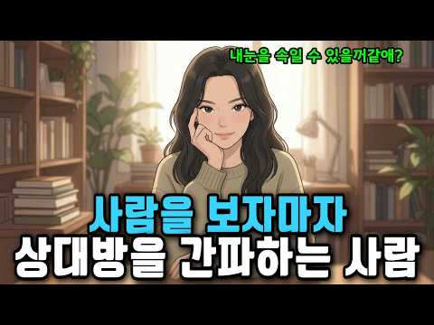
- 챕터: 0:00 훅 & 인트로 — 그 사람, 처음부터 뭔가 달랐다 · 1:11 왜 우리는 사람을 자꾸 잘못 볼까 — 뇌의 구조적 맹점 · 2:27 특징 1 — 그들은 말이 아니라 '타이밍'을 듣는다 · 3:51 특징 2 — 그들은 '일관성의 균열'을 포착한다 · 5:17 특징 3 — 그들은 '편한 자리'에서 상대의 본모습을… · 6:42 특징 4 — 그들은 상대가 '무엇을 피하는지'를 읽는다 · 8:07 특징 5 — 그들은 자신의 감정을 정보로 사용한다 · 9:19 특징 6 — 그들은 상대가 아닌 '관계 속 나'를 함… · 10:46 특징 7 — 그들은 판단을 끝내지 않는 사람들이다 · 12:10 마무리 — 간파력은 날카로움이 아니라 깊은 관심이다
- 설명 앞부분: 첫 만남에서 이미 '뭔가 이상하다' 느꼈는데, 나중에 결국 맞았던 경험 있으신가요? 사람 보는 눈이 정확한 사람들은 말이 아닌 전혀 다른 것을 보고 있었습니다. 이 영상에서 알게 되는 것: 왜 우리 뇌는 구조적으로 사람을 잘못 볼 수밖에 없는지 간파력 높은 사람들이 대화에서 실제로 주목하는 7가지 포인트 상대의 말이 아닌 '타이밍·균열·회피·감정'을 읽는 구체적 방법 🕒 타임라인:
- 같은 채널 평소 대비 ×12.7 (채널 최근 롱폼 중앙값 2,990회) · 평소 영상: 약속마다 10분 일찍 오는 사람, 사실 이런 심리입니다 (3,212회) / 연봉 올라도 씀씀이 안 늘리는 사람들, 사실 이런 심리입니다 (2,767회)
- 대본 없음 (설명) — 음성인식이 끝나면 도입부·흐름이 들어감
- 댓글 6/6: 좋은 점 — 영상 0 · 감사·응원 0 · 더 알고 싶은 것 0 · 아쉬운 점 — 영상 0 · 반박·불만 — 의견 다름 0 · 정치·사회 0 · 경험 공유 0 · 구독·다음 기대 0

### 132. 누가 날 우습게 보면 그냥 웃으며 '이 한마디' 해라 찍소리도 못한다 ∣ 정약용 명언 ∣ 오디오북 ∣ 삶의지혜 ∣ 인간관계

- https://www.youtube.com/watch?v=NQ8h_rRlatQ · 한마디 조언 · 구독자 2,520 · 조회수 86,376 (×34.3, 하루 593.6) · 좋아요 3,002 (3.5%) · 59.8분 · 2026-06-18 · 주제 묶음 2. 인간관계·처세 · 형식 수면·낭독·오디오북 (잠잘 때·명언) · 폴더 `W_NQ8h_rRlatQ` (웹 승인)
- 썸네일: 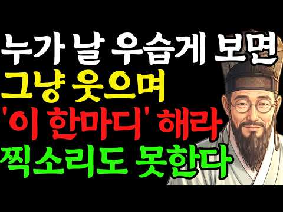
- 설명 앞부분: 누가 날 우습게 보면 화내지 말고 이렇게 대처하십시오 나를 우습게 보는 사람 때문에 상처받고 계신가요? 정약용의 지혜를 통해 무시하는 사람에게 화내지 않고도 품격 있게 대응하는 방법을 알아봅니다. 많은 사람들이 인간관계에서 참고, 양보하고, 배려하는 것이 미덕이라고 배워왔습니다. 하지만 지나친 친절은 때로 상대에게 만만함으로 비쳐질 수 있습니다. 이번 영상에서는 정약용의 가르침과 현대 심리학을 바탕으로, 나를 함부로 대하는 사람 앞에서도 흔들리지 않고 존중받는 어른의 처세술 10가지를 소개합니다. 무시당했을 때 바로 반응하지 않는…
- 같은 채널 평소 대비 ×77.4 (채널 최근 롱폼 중앙값 1,116회) · 평소 영상: 친할수록 절대 지인을 집에 부르지마라. ∣ 인생명언 ∣ 행복한 노후 ∣ 삶의 지혜 ∣ 인… (1,150회) / 혀가 잘려 나가도 이자랑 만은 절대 꺼내지마라 평생 원수된다 ∣ 정약용 명언 ∣ 오디오북… (1,081회)
- 대본 없음 (설명) — 음성인식이 끝나면 도입부·흐름이 들어감
- 댓글 74/74: 좋은 점 — 영상 6 · 감사·응원 9 · 더 알고 싶은 것 0 · 아쉬운 점 — 영상 3 · 반박·불만 — 의견 다름 2 · 정치·사회 0 · 경험 공유 4 · 구독·다음 기대 0
  - 좋은 점 — 영상 👍8 “잘 듣고 공감합니다.”
  - 좋은 점 — 영상 👍4 “좋은 영상 잘보고 구독과 좋아요 놓고갑니다 ❤❤❤🎉🎉”
  - 감사·응원 👍6 “요즘은 무언가를 더 가져야 행복해질 거라고만 생각하며 살아왔던 것 같습니다. 그런데 오늘 영상을 보면서 행복은 거창한 곳에 있는 게 아니라, 평범한 하루를 편안한 마음으로 살아가는 데 있다는 걸 다시 느꼈습니다. 참 따뜻한 이야기였습니다. 감사합니다.”
  - 감사·응원 👍4 “부동심 흔들리지 않는마음 한결같음이 사람을 모으고 변덕이 사람을 흩는다 감사합니다응원합니다❤”
  - 아쉬운 점 — 영상 👍4 “아유 서론이 너무길어 혼자하세요”
  - 아쉬운 점 — 영상 👍3 “친구사이에 은근히 깎아내릴때 굳이 따지자니 속좁은 사람으로 비춰질까봐 그냥 웃으며 넘기면 자꾸 반복되더라는..”
  - 반박·불만 — 의견 다름 👍6 “헛소리 하지말고 올바르게 하시기 바랍니다”
  - 반박·불만 — 의견 다름 👍2 “그 생요. 사실인 사실일까요? 하하 웃음문 나옴 나옵니다. 본질에 알고 말씀을 하시는 것이 옳지 않을까 생각합니다. 그 말은 아닙니다. 본인에 의해서 작품이죠. 이불은 명의 그런 능력을 가지고 있습니다. 상세하게 보십시오. 시가차고 어이가 없습니다. 여태까지 방해해 …”
  - 경험 공유 👍3 “ㅇㅖ. 지금들은. 정약용. 선생님에. 좋은말씀듣고. 저도. 또한. 세사람으로. 남곘읍니다. 정말. 감사함니다. 크나큰. 세사람으로. 거듭나곘읍니다. 좋아요. ,❤😂🎉😢😮”
  - 경험 공유 👍1 “저도 지금까지도 마음에 성처가심해서 며느리가 원수같아 용서가 안됩니다 용서하기가 너무힘들어 병이되었습니다”

### 133. 가까운 사람을 함부로 집에 들이면 안 되는 이유

- https://www.youtube.com/watch?v=yBqfGeVTFZE · 인생다시쓰기 · 구독자 9,230 · 조회수 152,743 (×16.6, 하루 2,077.9) · 좋아요 1,118 (0.7%) · 17분 · 2026-08-29 · 주제 묶음 1. 심리학 일반 · 형식 정보·해설 (그 밖) · 폴더 `W_yBqfGeVTFZE` (웹 승인)
- 썸네일: 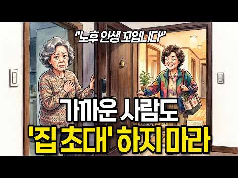
- 챕터: 0:00 집에 몇 번 들였을 뿐인데 왜 불편해질까 · 3:08 집은 내가 말하지 않은 것까지 보여준다 · 5:56 한 번 허용된 것이 ‘당연한 권리’가 되는 순간 · 8:19 내 집인데도 피곤해지는 진짜 이유 · 9:55 옛집의 사랑채와 카페가 편한 이유 · 12:20 가까운 사이일수록 필요한 집의 경계
- 설명 앞부분: 친구 집 방문이 불편하게 느껴진 적 있나요? 인간관계 스트레스가 쌓이는 이유와 타인과의 생활 습관 차이를 현명하게 대처하는 법을 알아봅니다. 친한 사이일수록 사소한 생활 방식의 차이가 갈등의 씨앗이 되기도 합니다. 처음에는 단순한 제안으로 시작된 일들이 어떻게 개인의 심리적 불편함으로 이어지는지, 그리고 이러한 대인관계 갈등을 어떻게 해석해야 할지 구체적인 사례를 통해 살펴봅니다. 특히 타인의 공간에 머물며 느끼는 미묘한 거리감에 대해 깊이 있게 다룹니다. 이 영상은 친구의 집을 방문할 때마다 불편함을 느꼈던 분들을 위한 내용입니…
- 같은 채널 평소 대비 ×13.4 (채널 최근 롱폼 중앙값 11,390회) · 평소 영상: 나이 들수록 악착같이 체력을 길러야 하는 이유 I 체력 떨어지면 삶이 줄어듭니다 (11,390회) / 한 살이라도 어릴 때 알았으면 좋았을 것들, 60대가 되어서야 보였습니다 (11,274회)
- 대본 없음 (설명) — 음성인식이 끝나면 도입부·흐름이 들어감
- 댓글 66/66: 좋은 점 — 영상 4 · 감사·응원 1 · 더 알고 싶은 것 0 · 아쉬운 점 — 영상 1 · 반박·불만 — 의견 다름 0 · 정치·사회 0 · 경험 공유 10 · 구독·다음 기대 0
  - 좋은 점 — 영상 👍57 “가까운 사이라고 해서 항상 내 편인 것은 아닌 것 같아요. 믿었던 사람에게 상처받는 일이 더 아프다는 말이 마음에 와닿았습니다. 좋은 사람과 좋은 거리를 유지하는 지혜가 필요하네요.”
  - 좋은 점 — 영상 👍35 “좋은내용 잘보구 갑니다”
  - 감사·응원 👍0 “가까운 사이라고 해서 무조건 믿고 집 안까지 허락해서는 안 된다는 말씀이 마음에 남습니다. 결국 내 공간과 평온을 지키는 것도 현명하게 나를 돌보는 방법이라는 생각이 듭니다. 좋은 말씀 감사합니다.”
  - 경험 공유 👍16 “내집은 나만 있고싶다 나는 부모자식 형제들 방문도 싫다 나도 안가고 니들도 오지마라 제발 집은 나만의 안식처다 서로 방해하지말자 서로 자기공간은침해하지말고 명절이니 생일이니 그런 기념일 챙기는것도 밖에서 밥먹고 차마시고 각자집으로 가자 자식들이 자고가는것도 놉 호텔잡…”
  - 경험 공유 👍16 “제친구는 제가 야근가고 없는집에 재워달라고 부덕부덕 떼를써는거를 제가 거절했더니 섭섭하다고 빈집에 좀재워주면 어떠냐고 따지더나구요 사는게 서민이라 금고도없고 끼고다니는 팔찌반지목걸이등등 화장대 서랍에 보관중이고 통장이며 등등 들고 출근할수도없고 내가 있을면 몰라도 안…”

### 134. 【김형석 교수】‘이 모습’ 보이면 당장 연을 끊어라. 아주 못된 사람이다 ∣ 현명한 인간관계 조언 ∣ 명언 ∣ 마음

- https://www.youtube.com/watch?v=ROumvyg2Z5c · 삶의 고백 · 구독자 15,200 · 조회수 175,105 (×11.5, 하루 3,128.6) · 좋아요 1,794 (1.0%) · 41.9분 · 2026-09-16 · 주제 묶음 2. 인간관계·처세 · 형식 수면·낭독·오디오북 (잠잘 때·명언) · 폴더 `W_ROumvyg2Z5c` (웹 승인)
- 썸네일: 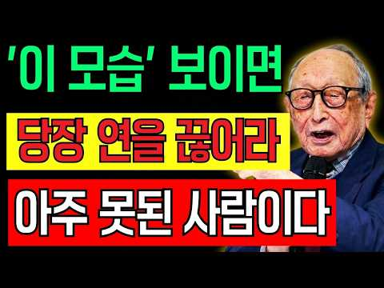
- 챕터: 0:00 나이가 들수록 더 중요한 사람 보는 눈 · 4:10 인간관계에서 조심해야 할 첫 번째 모습 · 10:35 이익이 사라지면 떠나는 사람의 본모습 · 18:20 은혜를 모르는 사람과 이간질하는 사람 · 27:45 약속과 태도에서 드러나는 사람의 됨됨이
- 설명 앞부분: 나이가 들수록 사람을 만나는 일은 조금 더 신중해집니다. 믿었던 사람에게 상처받고, 오랜 인연이 어느 순간 낯선 관계가 되어버리는 경험은 돈이나 물질로는 대신할 수 없는 깊은 아픔을 남깁니다. 이 영상에서는 정약용 선생이 삶 속에서 깨달았다고 전해지는 사람을 바라보는 지혜를 바탕으로, 우리가 가까이할 때 더욱 신중해야 할 사람들의 모습을 이야기합니다. 겉으로는 친절하지만 속마음이 다른 사람, 이익에 따라 관계를 맺고 떠나는 사람, 받은 은혜를 쉽게 잊는 사람, 사람 사이를 갈라놓는 사람, 약속을 가볍게 여기는 사람, 그리고 강한 …
- 같은 채널 평소 대비 ×18.0 (채널 최근 롱폼 중앙값 9,753회) · 평소 영상: 【김형석 교수】자식에게 서운할 때, 지혜로운 부모는 이렇게 합니다 (9,753회) / 【김형석 교수】나이 들수록 조언을 함부로 하지 말아야 하는 5가지 이유 (관계가 싹 끊어… (8,960회)
- 대본 없음 (설명) — 음성인식이 끝나면 도입부·흐름이 들어감
- 댓글 186/186: 좋은 점 — 영상 15 · 감사·응원 41 · 더 알고 싶은 것 0 · 아쉬운 점 — 영상 0 · 반박·불만 — 의견 다름 1 · 정치·사회 0 · 경험 공유 3 · 구독·다음 기대 1
  - 좋은 점 — 영상 👍3 “충남 아산에 살고있어요 박사님 좋은말씀 잘듣고있습니다”
  - 좋은 점 — 영상 👍2 “부산입니다 좋은 말씀입니다”
  - 감사·응원 👍5 “서울 하늘 밑에서 듣고있어요. 감사합니다.”
  - 감사·응원 👍2 “설명을 듣고 나니 왜 평소 관리가 중요한지 조금 더 이해가 됩니다. 감사합니다.”
  - 반박·불만 — 의견 다름 👍5 “사람보는 눈 그게 쉬운게 아닙니다 시간이 지나봐야 알게 됩니다 시간이 지나 하는 행동으로 알게 됩니다 마음 문을 너무 빨리 열지 마시라는 말씀 맞습니다”
  - 경험 공유 👍0 “67세 화물차기사 목천쿠팡센타 하차중 잠시쉬는시간에 듣고있내요 현재 비슷한 일 겪고있내요”
  - 경험 공유 👍0 “절에서 알게된 언니가 자기사상활에 대해선 전혀 예기하지 않고 자기궁금한점은 모두 묻고 어리다고 무시하고 조롱에 말꼬리잡아 빈정거리고 높은 사람 앞에서는 굽신굽신 전화도 주변에 사람있나없나 확인하고 .. 한2년을 참다 제가 모른척하니 하니 이야기가 필요할꺼 같다는걸 불…”
  - 구독·다음 기대 👍0 “뉴욕에서 교수님 말씀을 매일 듣고있습니다 감사합니다~~”

### 135. 대화 잘하는 사람은 '이 말'을 자주 합니다 ∣ 정약용 처세록 ∣ 삶의지혜 ∣ 오디오북

- https://www.youtube.com/watch?v=7dI0VFax6_s · 정약용 처세록 · 구독자 5,700 · 조회수 148,986 (×26.1, 하루 1,159.3) · 좋아요 2,848 (1.9%) · 41.5분 · 2026-07-05 · 주제 묶음 1. 심리학 일반 · 형식 수면·낭독·오디오북 (잠잘 때·명언) · 폴더 `W_7dI0VFax6_s` (웹 승인)
- 썸네일: 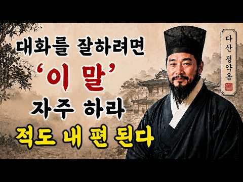
- 설명 앞부분: 사람을 얻는 사람과 사람을 잃는 사람의 차이는 의외로 작은 말 한마디에서 시작됩니다. 대화를 잘하는 사람은 말을 많이 하는 사람이 아닙니다. 상대를 설득하는 사람도 아닙니다. 상대의 마음을 먼저 이해하고, 존중하며, 편안하게 만드는 사람입니다. 정약용은 사람을 움직이는 것은 말재주가 아니라 마음을 헤아리는 태도라고 이야기했습니다. 이번 영상에서는 가족, 친구, 이웃과의 실제 이야기들을 통해 사람들이 자연스럽게 마음을 열게 만드는 대화의 비밀을 함께 살펴봅니다. 왜 어떤 사람에게는 자꾸 속마음을 털어놓게 되는지 대화를 잘하는 사람들…
- 같은 채널 평소 대비 ×105.6 (채널 최근 롱폼 중앙값 1,411회) · 평소 영상: 명절에 가족을 만나면 절대 ‘이 5가지 말’은 하지 마라, 좋은 사이도 멀어집니다｜정약용… (1,411회) / 겉은 착해 보여도 속은 교활한 뱀 같은 사람 특징｜정약용 처세록 ∣ 인생조언 ∣ 오디오북 (1,383회)
- 대본 없음 (설명) — 음성인식이 끝나면 도입부·흐름이 들어감
- 댓글 219/219: 좋은 점 — 영상 7 · 감사·응원 28 · 더 알고 싶은 것 0 · 아쉬운 점 — 영상 3 · 반박·불만 — 의견 다름 0 · 정치·사회 0 · 경험 공유 5 · 구독·다음 기대 0
  - 좋은 점 — 영상 👍33 “주위에 사람이 많았으면 하는 욕구가 있는, 그리고 외로움이 많은 분들에게는 도움이 될 내용인것 같습니다. 하지만 경청과 공감도 본인의 성격과 어느정도 맞아야 가능하지, 무조건 하는건 엄청난 감정소모로 이어지고 모임후 녹초가 되는 경험을 하실 수도 있어요ㅎ 오히려 본인…”
  - 좋은 점 — 영상 👍9 “좋은 이야기를 너무 길게 ....만들었네요. 3.4분으로 하세요....노래 한곡듣는 시간이면 좋아요...”
  - 감사·응원 👍8 “존중받는사람의로 기억나는 사람의되자 말씀 감사합니다 👍”
  - 감사·응원 👍8 “공감도 너무되고 지혜를 배웁니다 감사합니다❤”
  - 아쉬운 점 — 영상 👍9 “좋은 이야기를 너무 길게 ....만들었네요. 3.4분으로 하세요....노래 한곡듣는 시간이면 좋아요...”
  - 아쉬운 점 — 영상 👍2 “애기를 만들어 하는것같군 소설쓰는게 ᆢ 어떨지 ᆢ 지루 함 요점만 ᆢ 일목요연하게 정리 바람 ᆢ”
  - 경험 공유 👍7 “말을 어느 때에 해야 하는지를 알아야 합니다 내가 많이 안다고 시도 때도없이 상대방이 해야 하는 말까지 다 하는 사람, 정말 얄밉지요 그런 사람은 어딜가도 귀염 못 받고 밉상이지요 그래서 사람은 들고 날 때를 잘 알아야합니다”
  - 경험 공유 👍2 “1 .저도 그렇게 생각해요 옆에 있어서 열등감 느껴지는 사람은 좀 이상한 사람이구요 옆에 있을때 편안한 사람이 좋은 사람이예요 알고계셨죠? 알면서 그렇게 말씀하신거죠?”

### 136. 자식은 부모의 사랑보다 이것을 기억합니다 ㅣ부모자식관계 ㅣ좋은 부모 ㅣ자식교육 ㅣ훈육 ㅣ애착이론

- https://www.youtube.com/watch?v=G9sJxVqt-H0 · 오늘은 심리학 · 구독자 40,600 · 조회수 816,236 (×20.1, 하루 8,254.5) · 좋아요 11,684 (1.4%) · 9.9분 · 2026-08-04 · 주제 묶음 2. 인간관계·처세 · 형식 정보·해설 (그 밖) · 폴더 `W_G9sJxVqt-H0` (웹 승인)
- 썸네일: 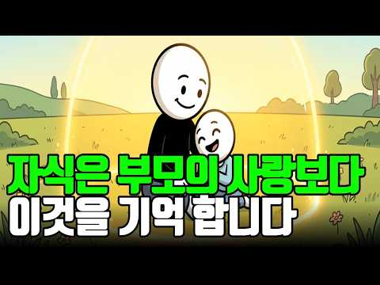
- 챕터: 0:00 자녀는 부모의 사랑보다 이것을 기억합니다 · 2:18 부모가 가장 많이 하는 착각 · 4:47 애착이론이 말하는 평생 관계의 비밀 · 7:36 자녀가 부모에게 마음을 닫는 진짜 이유 · 10:28 평생 내 편이 되는 부모의 대화법 · 13:35 사랑보다 중요한 심리적 안전기지 · 16:24 자녀의 마음을 잃지 않는 부모의 공통점 · 18:40 오늘부터 바로 실천할 수 있는 한 가지
- 설명 앞부분: 자식은 부모가 자신을 얼마나 사랑했는지보다, 부모 곁에서 어떤 감정을 느끼며 자랐는지를 더 오래 기억합니다. 많은 부모는 사랑만 충분하면 자녀는 평생 내 편이 되어줄 것이라고 믿습니다. 하지만 심리학은 전혀 다른 이야기를 합니다. 자녀는 부모의 희생보다 '부모와 함께 있을 때 느꼈던 감정'​을 기억합니다. 왜 어떤 자녀는 성인이 되어서도 가장 먼저 부모를 찾고, 어떤 자녀는 점점 멀어질까요? 이번 영상에서는 애착이론과 발달심리학을 바탕으로, 자녀가 평생 부모를 신뢰하게 되는 진짜 이유와 부모들이 무심코 반복하는 치명적인 실수를 함…
- 같은 채널 평소 대비 ×184.2 (채널 최근 롱폼 중앙값 4,431회) · 평소 영상: 60세 넘으면 이런 물건은 아까워도 정리하세요｜나이 들수록 집이 편해지는 이유 l 물건정… (4,431회) / 약속시간에 항상 늦는 사람 이유가 따로 있습니다 ㅣ약속ㅣ시간 ㅣ인간관계 ㅣ지각 ㅣ배려 ㅣ… (4,473회)
- 대본 없음 (설명) — 음성인식이 끝나면 도입부·흐름이 들어감
- 댓글 698/698: 좋은 점 — 영상 21 · 감사·응원 32 · 더 알고 싶은 것 6 · 아쉬운 점 — 영상 2 · 반박·불만 — 의견 다름 13 · 정치·사회 0 · 경험 공유 91 · 구독·다음 기대 1
  - 좋은 점 — 영상 👍50 “어릴 때나 성장기에는 자유롭게, 하고싶은 걸 하면서 살 수 있게 해주는 부모가 최고지요. 그런데 자식도 결혼하고 또 자신의 자식을 갖게 되면 드디어 부모의 사랑을 느끼게 됩니다. 사랑의 행위마저 귀찮게 여기던 마음은 어디로 사라지고, 부모가 준 사랑을 기억하게 됩니다…”
  - 좋은 점 — 영상 👍3 “신생아때 먹여달라고 재워 달라고 놀아달라고 울음으로 표현하는데 과연 난 얼마나 진심으로 최선을 다해서 반응했나 생각 해보셨으면 하는 생각도 있는데.. 그건 취향의 문제가 아니고 생존의 문제였는데 부모가 원할 때만 반응한다는 게 애 입장에서는 얼마나 공포스럽고 불안했을…”
  - 감사·응원 👍94 “자녀를 내편으로 만들려 하지마세요. 자녀편이 되어주세요. 마음을 울립니다. ㅜㅜ 감사합니다 😊”
  - 감사·응원 👍5 “새끼가 성장 할 때까지 부모의 희생을 담보로 한다. 부모의 책임을 다 하기 위해 노력하고 애정하는 마음을 자식에게 가졌다면 이런 심리학적 요소가 먼저일 리 없고 다만, 참고로 하라는 말이다. 가장 중요한 부분을 행하지 않고, 또 그것을 훌륭하다 인정하지 않고 심리따위…”
  - 더 알고 싶은 것 👍12 “그런데 자녀가 걀혼해서 본인 효자 효녀이고 부모와 너무 가까우면 배우자가 힘들어져요. 그건 어떻게 해결하죠?”
  - 더 알고 싶은 것 👍5 “글쎄, 제 생각에는 시대에 좀 뒤떨어지는 생각 같기는 하네요. _과연 사회는 어느 방향으로 흘러 가고 있을까요? 아직 한국적인 동양사상에서 벗어나지 못해서 그럴 수도 있지만 전세계적인 추세는 나혼자산다예요. ~가족과의 관계가 그렇게 중요하지 않아 지고 있구요. 부모님…”
  - 아쉬운 점 — 영상 👍0 “서론너무길다”
  - 반박·불만 — 의견 다름 👍5 “글쎄, 제 생각에는 시대에 좀 뒤떨어지는 생각 같기는 하네요. _과연 사회는 어느 방향으로 흘러 가고 있을까요? 아직 한국적인 동양사상에서 벗어나지 못해서 그럴 수도 있지만 전세계적인 추세는 나혼자산다예요. ~가족과의 관계가 그렇게 중요하지 않아 지고 있구요. 부모님…”
  - 반박·불만 — 의견 다름 👍1 “그리워하는 순간은 부모가 모든 문제를 8:34 해결해 줬던 기억이 아닙니다. 자신의 8:37 이야기를 끝까지 들어주던 순간 실수를 8:40 해도 내 편이 되어 주던 순간 세상이 8:43 등을 돌린 것 같을 때 단 한 8:44 사람만은 믿어 주던 순간입니다. 8:47 …”
  - 경험 공유 👍136 “오 나 쫌 그런 듯.. 고2 딸이 기말고사 망쳤다고 징징대다가 근데 엄마는 내가 60점 맞았대도 날 똑같이 대할거지? 그러길래 당연하지 0점 맞아도 똑같다고 하니까 왜냐길래 빵점 맞아도 내 딸이 아닌게 아니고 그렇다고 너란 사람이 빵점은 아니니까 라고 했더니 감동이라…”
  - 경험 공유 👍63 “내가 널 어떻게 키웠는데 이게 제일 문제되는 태도”
  - 구독·다음 기대 👍39 “구독누르고가요^^ 맞는것같네요. 뭘해주는것보다도 힘들때 내편이돼주었던 기억이 나이가 들러서도 잊을수없을것같아요. 안타깝게도 대한민국부모님들은 체면이나 주의시선 비교 경쟁 이런것땜에 자식의 실패나 힘들때 보듬아주고 내편이 돼주시지만은 않는듯하네요ㅠㅠ”

### 137. 여자가 남자를 좋아하면 무심코 드러나는 5가지｜연애심리｜중년연애

- https://www.youtube.com/watch?v=M37cLIqGfXA · 여자심리연구소 · 구독자 3,970 · 조회수 11,817 (×3.0, 하루 789.5) · 좋아요 121 (1.0%) · 36.8분 · 2026-10-27 · 주제 묶음 1. 심리학 일반 · 형식 정보·해설 (그 밖) · 폴더 `W_M37cLIqGfXA` (웹 승인)
- 썸네일: 
- 챕터: 0:00 중년 여성의 호감은 왜 목소리부터 달라질까? 놓치기 … · 3:50 중년 여성의 설렘이 더 조심스럽고 작은 신호로 나타나… · 5:15 첫 번째 신호｜마음이 끌리는 남자에게만 달라지는 목소… · 8:35 두 번째 신호｜피했다가 다시 돌아오는 눈길과 미소, … · 12:00 세 번째 신호｜그 남자가 오는 날에만 달라지는 차림과… · 15:04 네 번째 신호｜지나가듯 한 말을 기억하고 다시 묻는 … · 19:20 호감 신호를 잘못 읽는 두 가지 착각｜과잉 해석과 호… · 24:30 다섯 번째 신호｜남자의 말투와 표현을 무의식적으로 따… · 29:43 호감 신호를 알아챘다면 어떻게 해야 할까? 천천히 다…
- 설명 앞부분: 여자가 남자를 좋아하면 무심코 드러나는 5가지｜연애심리｜중년연애 💗 여자가 남자를 좋아하면 목소리, 눈빛, 표정, 행동에 작은 변화가 나타날 수 있습니다. 이 영상에서는 연애심리를 바탕으로 중년 여성에게 나타날 수 있는 5가지 호감 신호를 살펴봅니다. 👀 무심코 보내는 눈길과 말투, 상대의 말을 기억하는 행동까지 연애심리로 알아봅니다. 🌿 특히 중년연애에서는 조심스럽게 표현되는 감정을 연애심리 관점에서 천천히 살펴보는 것이 중요합니다. 💬 상대의 행동을 너무 빠르게 판단하지 않고 연애심리 속 숨은 의미를 이해해 보세요. ✨ 마지막…
- 같은 채널 평소 대비 ×4.4 (채널 최근 롱폼 중앙값 2,678회) · 평소 영상: 여자가 답장을 늦게 하는 진짜 이유, 바쁨? 밀당? 거절? 마음은 여기서 드러납니다 ∣ … (2,889회) / 여자가 관심 없을 때 보내는 5가지 신호｜연애심리｜남자는 왜 끝까지 모를까 (2,466회)
- 대본 없음 (설명) — 음성인식이 끝나면 도입부·흐름이 들어감
- 댓글 1/1: 좋은 점 — 영상 0 · 감사·응원 0 · 더 알고 싶은 것 0 · 아쉬운 점 — 영상 0 · 반박·불만 — 의견 다름 0 · 정치·사회 0 · 경험 공유 0 · 구독·다음 기대 0

### 138. 중년 여성이 아직 사랑을 원하는 이유 3가지｜연애심리학이 알려주는 숨겨진 감정 신호

- https://www.youtube.com/watch?v=BLepCTIOe6c · 연애심리가이드 · 구독자 2,160 · 조회수 19,913 (×9.2, 하루 415.2) · 좋아요 89 (0.4%) · 25.4분 · 2026-09-24 · 주제 묶음 1. 심리학 일반 · 형식 정보·해설 (그 밖) · 폴더 `W_BLepCTIOe6c` (웹 승인)
- 썸네일: 
- 챕터: 0:00 부부 사이 친밀감이 건강과 수명에 미치는 놀라운 영향… · 1:10 나이가 들며 사라지는 스킨십과 몸속 변화의 관계 · 1:47 옥시토신 호르몬이 혈압·스트레스·면역력에 미치는 효과 · 5:45 엔도르핀과 친밀감이 통증 완화에 도움 되는 원리 · 6:40 부부 친밀감이 뇌 건강과 기억력 유지에 미치는 영향 · 9:06 부부 관계가 심장·혈관 건강과 노화 관리에 미치는 효과 · 12:08 나이가 들어도 친밀감이 필요한 이유와 호르몬 변화 · 15:07 건강을 위한 실천법: 포옹 20초·산책 20분·대화 … · 17:24 함께하는 식사와 생활 습관이 만드는 행복 호르몬 · 21:44 부부 친밀감의 진짜 의미와 건강한 노후를 위한 메시지
- 설명 앞부분: 중년 여성이 아직 사랑을 원하는 이유 3가지｜연애심리학이 알려주는 숨겨진 감정 신호 🌿 나이가 들어도 사랑과 설렘은 사라지지 않습니다. 이번 영상에서는 연애심리학 관점에서 중년 여성의 감정 변화와 관계 속 특징을 알아봅니다. 💖 연애심리학을 통해 보이는 말투, 행동, 관심 표현 속 숨겨진 심리를 살펴보고, 건강한 관계를 만드는 방법을 함께 이야기합니다. ✨ 연애심리학은 단순한 호기심이 아니라 서로를 이해하는 중요한 열쇠가 될 수 있습니다. 🌸 중년의 사랑과 감정, 관계의 변화를 알고 싶다면 끝까지 시청해 보세요. 연애심리학으로 더…
- 같은 채널 평소 대비 ×33.4 (채널 최근 롱폼 중앙값 596회) · 평소 영상: 성욕이 강한 여자 특징 3가지｜연애심리학으로 밝혀낸 절대 숨길 수 없는 진짜 신호 (670회) / 여자가 이런 신호를 두세 번 보낸다면? 남자에게 보내는 숨은 마음의 신호 ∣ 연애심리학 (522회)
- 대본 없음 (설명) — 음성인식이 끝나면 도입부·흐름이 들어감
- 댓글 2/2: 좋은 점 — 영상 0 · 감사·응원 0 · 더 알고 싶은 것 0 · 아쉬운 점 — 영상 0 · 반박·불만 — 의견 다름 0 · 정치·사회 0 · 경험 공유 0 · 구독·다음 기대 0

### 139. 50대 중반부터 반드시 바꿔야 할 6가지 인생관 (심리학적 분석)

- https://www.youtube.com/watch?v=FAdyMV9r6fc · 토닥교수의 심리학 · 구독자 26,700 · 조회수 268,750 (×10.1, 하루 5,038.1) · 좋아요 981 (0.4%) · 20분 · 2026-09-19 · 주제 묶음 1. 심리학 일반 · 형식 인터뷰·강연·대담 (교수·의사·스님) · 폴더 `W_FAdyMV9r6fc` (웹 승인)
- 썸네일: 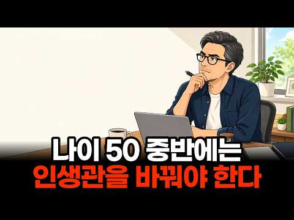
- 챕터: 0:00 인트로 — 오십 넘어 찾아오는 이상한 순간 · 0:47 오십 이후 반드시 다시 생각해야 할 6가지 · 1:03 하나 — 산을 내려가는 새로운 자세 · 3:11 둘 — 순위 경쟁에서 조용히 내려오기 · 5:51 셋 — 채우는 삶에서 선택하는 삶으로 · 8:20 넷 — 명함이 사라진 뒤의 나만의 세계 · 11:48 다섯 — 관계의 밀도를 다시 설계하기 · 14:46 여섯 — "언젠가"를 지우고 지금 실행하기 · 16:43 마무리 — 낡은 관성을 내려놓는 자유
- 설명 앞부분: 50 넘어서도 여전히 20·30대처럼 살고 계신가요? 그 익숙한 방식이야말로, 지금 여러분의 오십을 가장 무겁게 짓누르는 진짜 원인일지 모릅니다. 오늘 영상에서는 인생 후반전을 아름답게 이끄는 오십 중반 이후의 새로운 인생관 6가지를 정리했습니다. 끝까지 보시면, 오늘 밤 잠들기 전 마음에 얹혀 있던 헛헛함의 정체가 또렷하게 보이실 겁니다. 이 영상에서는 오십 이후에 반드시 다시 생각해봐야 할 6가지 인생관을 순서대로 짚어드립니다. 산을 오르던 방식으로 하산길을 뛰면 왜 무릎이 상하는지, 남과의 순위 경쟁과 어제의 나와 겨루는 성…
- 같은 채널 평소 대비 ×27.4 (채널 최근 롱폼 중앙값 9,823회) · 평소 영상: 사람들이 당신에게 기분 나쁜거 그대로 티 내는 진짜 속마음 ∣ 99%가 착각하는 이것 (… (9,823회) / 만만한 사람들과 존중받는 사람들이 가진 5가지 결정적 차이 (심리학적 분석) (9,904회)
- 대본 없음 (설명) — 음성인식이 끝나면 도입부·흐름이 들어감
- 댓글 23/23: 좋은 점 — 영상 1 · 감사·응원 7 · 더 알고 싶은 것 0 · 아쉬운 점 — 영상 1 · 반박·불만 — 의견 다름 2 · 정치·사회 0 · 경험 공유 1 · 구독·다음 기대 0
  - 좋은 점 — 영상 👍0 “50대 아재인데 정말 공감이 가네요 ㅎ 저부터 인생관을 바꾸어 보겠습니다~50대들 화이팅!”
  - 감사·응원 👍13 “52세. 사랑하는 어머니의 죽음을 겪으며 저의 삶의 방향과 우선순위가 정말 많이 바뀌었습니다. 영상 내용이 크게 공감이 되네요. 감사합니다”
  - 감사·응원 👍1 “지금 숨쉬고 살아있음에 감사합니다.그 누구도 모른다.내일 일을.”
  - 반박·불만 — 의견 다름 👍2 “50? 내가 58인디..글쎄..? 잉간은 생물이기에..항상 삶과 죽음이..공존 하는 삶을 산다. 요즘은 나이를 불문하고 지구 🌎 를 떠나는 사람들이 많다. 밤새 안녕 이라구..하루하루 살아있는거에.. 감솨하며..사는날까지.. 인생살이..잠꽌인거같다. 나는 마래소년 코…”
  - 반박·불만 — 의견 다름 👍0 “글쎄..그동안 애 키우느라 못한 것을 본격적으로 할 나이 아닐까”
  - 경험 공유 👍2 “50? 내가 58인디..글쎄..? 잉간은 생물이기에..항상 삶과 죽음이..공존 하는 삶을 산다. 요즘은 나이를 불문하고 지구 🌎 를 떠나는 사람들이 많다. 밤새 안녕 이라구..하루하루 살아있는거에.. 감솨하며..사는날까지.. 인생살이..잠꽌인거같다. 나는 마래소년 코…”

### 140. 돈 앞에서 끝나버린 친구관계, 12년 만에 다시 만났다

- https://www.youtube.com/watch?v=O7S9oD_S0rc · 볕드는날 · 구독자 1,920 · 조회수 38,992 (×20.3, 하루 361.1) · 좋아요 512 (1.3%) · 8.5분 · 2026-07-26 · 주제 묶음 2. 인간관계·처세 · 형식 사연·고민 상담 (썰·라디오) · 폴더 `W_O7S9oD_S0rc` (웹 승인)
- 썸네일: 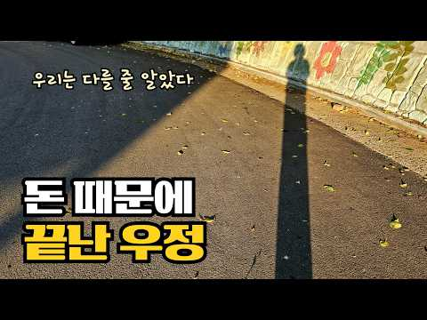
- 설명 앞부분: 평생 친구라고 믿었던 사람과 함께 시작한 동업. 돈 앞에서 변해버린 친구관계와 깊은 배신감, 그리고 12년 만의 재회. 인간관계와 신뢰에 대해 다시 생각하게 된 혼자 사는 일상 브이로그입니다
- 같은 채널 평소 대비 ×9.5 (채널 최근 롱폼 중앙값 4,113회) · 평소 영상: 비울수록 가벼워지는 삶의 무게, 50대 혼자 물건을 줄이며 살아가는 삶 (4,113회) / 혼자 사는 50대 일상｜무기력한 마음을 달래는 동네 산책 (3,754회)
- 대본 없음 (설명) — 음성인식이 끝나면 도입부·흐름이 들어감
- 댓글 92/92: 좋은 점 — 영상 0 · 감사·응원 2 · 더 알고 싶은 것 0 · 아쉬운 점 — 영상 0 · 반박·불만 — 의견 다름 2 · 정치·사회 0 · 경험 공유 4 · 구독·다음 기대 0
  - 감사·응원 👍25 “전 빌려준 건 5년이고 10년이고 무조건 90%는 받아 냅니다. 돈을 갚으려는 의도가 있는 사람은 조금씩이라도 입금하지만 입싹 닫는 인간은 아무리 적은 금액이라도 돌려주지지 않아요. 그리고 연락을 끊어버리는 경우가 대부분입니다. 절대로 돈은 빌려주는게 아닙니다. 그냥…”
  - 감사·응원 👍16 “영상 잘보고 구독 했어요 한번 배신한 친구는 손절이 답입니다 님 앞날 응원합니다”
  - 반박·불만 — 의견 다름 👍25 “전 빌려준 건 5년이고 10년이고 무조건 90%는 받아 냅니다. 돈을 갚으려는 의도가 있는 사람은 조금씩이라도 입금하지만 입싹 닫는 인간은 아무리 적은 금액이라도 돌려주지지 않아요. 그리고 연락을 끊어버리는 경우가 대부분입니다. 절대로 돈은 빌려주는게 아닙니다. 그냥…”
  - 반박·불만 — 의견 다름 👍2 “친구란 말도 쓰지 마세요 잘못되면 미안하다 참 어이없네요”
  - 경험 공유 👍46 “​저도 마음 맞는 지인이랑 같이 일했었는데, 직접 겪어보고 나니까 어른들이 하지 말라는 건 안 하는 게 정답이더라고요.😅”
  - 경험 공유 👍5 “저도 님처럼 진짜 어려서부터 친한 후배랑 동업 했었는데 결국 배신당하고 가게 저몰래 처분하고 도망감 진짜 아무리 절친이고 가족이라도 동업은 절대하지않아야 한다고 생각합니다”

### 141. 여자 심리, 남자들이 모르는 소름 돋는 호감 신호 7가지｜연애심리학

- https://www.youtube.com/watch?v=6vphF76_Qgs · 연애심리가이드 · 구독자 2,160 · 조회수 29,853 (×13.8, 하루 403.5) · 좋아요 211 (0.7%) · 34.4분 · 2026-08-29 · 주제 묶음 1. 심리학 일반 · 형식 정보·해설 (그 밖) · 폴더 `W_6vphF76_Qgs` (웹 승인)
- 썸네일: 
- 챕터: 0:00 호감 신호를 놓치는 이유와 핵심 포인트 · 1:48 남자가 비언어적 호감 신호를 읽기 어려운 이유 · 4:35 첫 번째 증거: 눈빛과 시선 변화 · 8:18 두 번째 증거: 말투와 대화 방식의 변화 · 12:04 질투 반응으로 확인하는 숨은 호감 · 14:30 세 번째 증거: 몸이 보내는 무의식적 신호 · 20:34 네 번째 증거: 사소한 기억과 미래 계획 · 26:06 다섯 번째 증거: 약한 모습을 보여주는 신뢰 · 30:09 다섯 가지 호감 신호 총정리와 클러스터 규칙 · 31:47 호감 신호를 확인했다면 자연스럽게 다가가는 방법 · 33:59 마무리 및 다음 영상 예고
- 설명 앞부분: 여자 심리, 남자들이 모르는 소름 돋는 호감 신호 7가지｜연애심리학 💗 여자가 진심으로 좋아할 때 무의식적으로 드러나는 호감 신호는 무엇일까요? 이 영상에서는 연애심리학을 바탕으로 눈빛, 말투, 질투, 몸짓, 기억과 미래에 대한 행동까지 남자들이 놓치기 쉬운 신호를 알아봅니다. 👀 한 가지 행동만으로 판단하지 않고 여러 신호가 반복되는 패턴을 살펴보세요. 연애심리학 관점에서 단순한 친절과 진짜 호감의 차이도 쉽게 정리했습니다. ❤️ 상대의 마음을 섣불리 단정하기보다 자연스럽게 관찰하며 연애심리학의 핵심 신호를 확인해 보세요. 연애…
- 같은 채널 평소 대비 ×44.6 (채널 최근 롱폼 중앙값 670회) · 평소 영상: 성욕이 강한 여자 특징 3가지｜연애심리학으로 밝혀낸 절대 숨길 수 없는 진짜 신호 (670회) / 황혼이혼, 갈라서면 정말 행복할까? 결국 후회하는 부부들이 놓친 3가지 ∣ 연애심리학 (690회)
- 대본 없음 (설명) — 음성인식이 끝나면 도입부·흐름이 들어감
- 댓글 3/3: 좋은 점 — 영상 0 · 감사·응원 0 · 더 알고 싶은 것 0 · 아쉬운 점 — 영상 0 · 반박·불만 — 의견 다름 0 · 정치·사회 0 · 경험 공유 0 · 구독·다음 기대 0

### 142. 인간은 결국 보고 싶은 것만 봅니다 ∣ 쇼펜하우어가 말하는 인간관계의 본질 ∣ 인생철학 ∣ 오디오북

- https://www.youtube.com/watch?v=sxcgQUCI0Xs · 철학담 · 구독자 2,220 · 조회수 38,723 (×17.4, 하루 414.1) · 좋아요 594 (1.5%) · 48.9분 · 2026-08-09 · 주제 묶음 2. 인간관계·처세 · 형식 수면·낭독·오디오북 (잠잘 때·명언) · 폴더 `W_sxcgQUCI0Xs` (웹 승인)
- 썸네일: 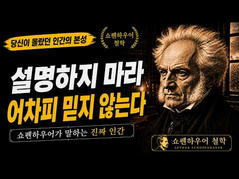
- 챕터: 0:00 인트로 – 아무리 설명해도 당신을 오해하는 사람이 있… · 5:41 첫 번째. 사람은 자신이 보고 싶은 당신을 봅니다 · 12:21 두 번째. 사람은 자신이 기대한 당신을 보고 싶어 합… · 19:45 세 번째. 한번 만들어진 평가는 쉽게 바뀌지 않습니다 · 27:17 네 번째. 타인의 평가에 매달릴수록 평온을 잃습니다 · 34:44 다섯 번째. 나를 제대로 보는 사람을 곁에 두십시오 · 43:17 마무리 – 모든 사람에게 이해받으려고 하지 마십시오
- 설명 앞부분: 사람은 왜 같은 사람을 보고도 전혀 다르게 판단할까요? 누군가는 당신을 좋은 사람이라고 하고, 누군가는 차갑다고 말합니다. 아무리 진심을 설명해도 끝까지 자신이 믿고 싶은 대로 당신을 판단하는 사람도 있습니다. 쇼펜하우어의 철학에서 중요한 개념 중 하나는 ‘표상’입니다. 우리는 세상을 완전히 있는 그대로 바라보는 것이 아니라, 자신의 경험과 인식이라는 틀을 통해 바라봅니다. 이번 영상에서는 쇼펜하우어의 철학을 통해 왜 사람은 보고 싶은 것만 보게 되는지, 왜 한번 만들어진 평가는 쉽게 바뀌지 않는지, 그리고 타인의 시선에서 자유로…
- 같은 채널 평소 대비 ×6.7 (채널 최근 롱폼 중앙값 5,821회) · 평소 영상: 남은 인생만큼은 애쓰며 살지 마세요｜평생 애써온 당신이 이제 내려놓아야 할 6가지｜쇼펜하… (5,821회) / 무례한 사람은 이렇게 상대하세요｜화내지 않고도 만만하게 보이지 않는 법｜쇼펜하우어 인간관계 (5,644회)
- 대본 없음 (설명) — 음성인식이 끝나면 도입부·흐름이 들어감
- 댓글 41/41: 좋은 점 — 영상 0 · 감사·응원 0 · 더 알고 싶은 것 0 · 아쉬운 점 — 영상 1 · 반박·불만 — 의견 다름 0 · 정치·사회 0 · 경험 공유 2 · 구독·다음 기대 0
  - 아쉬운 점 — 영상 👍2 “이놈의 ai음성 하고는..”
  - 경험 공유 👍33 “내가 너무 오래 머물렀구나. 나를 어떻게 생각하는지 몰랐기에 내 진심을 증명하려고 애를 썼다. 나눈 대화를 돌아보니 헛짓이었어. 떠난 지금이 행복하다.”
  - 경험 공유 👍3 “세일즈 에서 많이 연구되는 아이컨텍의 메커니즘 니가뭔대 설명질이야 이거거든 훈장질 이전에 경청 그리고 쓰디쓴 기다림 니편내편 내가 믿고 싶은걸 믿는다 내가 믿는건 반드시 옳아야되 이게 독심술의 요체다🎉”

### 143. 혼자 사는 X세대 중장년 남성의 심리학 완전 해설

- https://www.youtube.com/watch?v=dypjVHQsGwM · X세대 리플렉션 · 구독자 1,040 · 조회수 31,148 (×29.9, 하루 189.9) · 좋아요 413 (1.3%) · 25.3분 · 2026-05-31 · 주제 묶음 1. 심리학 일반 · 형식 정보·해설 (그 밖) · 폴더 `W_dypjVHQsGwM` (웹 승인)
- 썸네일: 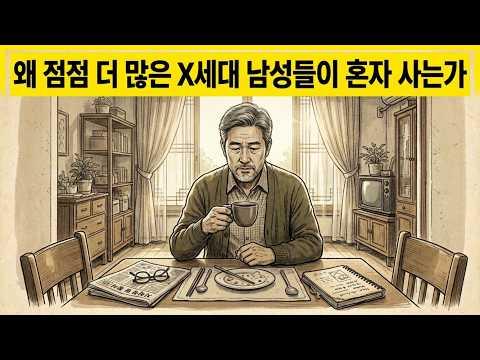
- 설명 앞부분: 혼자 사는 X세대 중장년 남성의 심리학 완전 해설은 점점 더 많은 X세대 남성들이 혼자 사는 삶을 선택하는 이유와 그 이면에 있는 감정적, 사회적, 심리적 요인을 탐구합니다. 이러한 삶의 방식이 그들의 행복, 독립성, 그리고 삶에 대한 태도에 어떤 영향을 미치는지 알아보세요. 이 영상에서는 혼자 사는 X세대 중장년 남성들의 심리를 깊이 있게 분석합니다. 그들의 가치관, 인생 경험, 그리고 관계, 가족, 독립성에 대한 변화된 생각을 살펴봅니다. 또한 고독과 독립적인 삶이 정신 건강, 정서적 회복력, 삶의 만족도, 그리고 개인의 정체…
- 같은 채널 평소 대비 ×215.6 (채널 최근 롱폼 중앙값 144회) · 평소 영상: 젊은 X세대의 심리학... 1973년~1980년 출생 (145회) / 왜 X세대는 우연히 2020년대를 살아남도록 훈련되었는가 (144회)
- 대본 없음 (설명) — 음성인식이 끝나면 도입부·흐름이 들어감
- 댓글 162/162: 좋은 점 — 영상 1 · 감사·응원 1 · 더 알고 싶은 것 0 · 아쉬운 점 — 영상 2 · 반박·불만 — 의견 다름 5 · 정치·사회 5 · 경험 공유 16 · 구독·다음 기대 0
  - 좋은 점 — 영상 👍0 “0ㅡ0건강,면역성에서 가장중요한게..공기다. 특히.. 본인이 가장 오래 머무는 실내공간의 공기가 맑은가..시멘트라돈가스와 화학가스에 오염되어 있는가에 따라서..호흡을통해..오염된 독성공기가 폐로들어가서 혈액을 오염시켜.. 병들이고, 독성화시키면서..혈액세포를 병들이고…”
  - 감사·응원 👍19 “아버지1928년생,ᆢ 1948년 해방국군입대, ..대가족 가장.., 난,92~93년도 군복무 세대(X세대), ᆢ전역후, 바로 취업과 ᆢ98년 IMF 외환 위기(국가 부도사건) ᆢ회사 허우적... 헐., 안타까운 세대 인듯, ᆢ힘내라., 이땅의 모든X세대 들이여...!…”
  - 반박·불만 — 의견 다름 👍3 “혼전 계약서 법적 효력 있으면 결혼률 올라갑니다ㅎㅎ 남자는 스펀서가 아닙니다 가족이지”
  - 반박·불만 — 의견 다름 👍0 “외롭지 않은 것이 아닙니다. 외롭지만 극복하기 위해 열심히 발버둥치면서 사는것입니다. 자꾸 할 일을 찾아야합니다. 자꾸 집밖으로 나갈 활동을 만드는게 좋습니다.”
  - 정치·사회 👍1 “저것들이 민주당 핵심 지지층.. 남녀떠나 영포티 영피프티들.. 정신들 좀 차려라..”
  - 정치·사회 👍0 “철딱서니가 없다는게 그리고 그걸 부끄러움,없이 얘기하는게 X세대다. 학창시절 민주 운동에는 쥐뿔 관심도 없다가 갑자기 민주투사로 변한 철떡서니들. 586들의 영원한 꼬붕 이자 50이 넘어도 그들에게 애기 취급 받는게 X들.. 그래도 재밌게는 살았잖아.니들이 이대남이라…”
  - 경험 공유 👍12 “시벌 나도 내가 왜 결혼이 하기 싫은지 모르겠어 남한테 피해주기도 받기도싫고 나를 희생못하겠어”
  - 경험 공유 👍4 “정답이 어딨노~ 내가 가는 길이 정답이다 생각하고 사는 거지~~”

### 144. 99%는 모르는, 상처를 많이 받은 사람들의 숨겨진 특징

- https://www.youtube.com/watch?v=8o9cBCZoneg · 심리 인사이트 · 구독자 1,610 · 조회수 34,465 (×21.4, 하루 284.2) · 좋아요 1,219 (3.5%) · 12.3분 · 2026-07-13 · 주제 묶음 1. 심리학 일반 · 형식 정보·해설 (그 밖) · 폴더 `W_8o9cBCZoneg` (웹 승인)
- 썸네일: 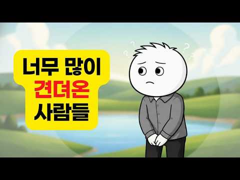
- 설명 앞부분: 삶이 너무 힘들었음에도 아무렇지 않은 척 살아가는 사람들이 있습니다. 늘 묵묵하고, 감정을 드러내지 않으며, 모든 고통을 혼자 감당하는 사람들. 하지만 그들의 침묵은 진정한 강인함일까요, 아니면 오랫동안 반복된 상처가 만들어낸 생존 방식일까요? 이번 영상에서는 만성적인 스트레스와 깊은 상처가 인간의 뇌와 심리에 어떤 변화를 일으키는지, 왜 어떤 사람들은 도움을 거부하고 모든 것을 혼자 해결하려 하는지, 그리고 감정 억압과 진정한 회복탄력성의 차이를 심리학과 신경과학의 관점에서 함께 살펴봅니다. 혹시 당신도 감정을 표현하기보다 참는…
- 같은 채널 평소 대비 ×86.2 (채널 최근 롱폼 중앙값 400회) · 평소 영상: 심리학자도 놀란 7가지 특징｜평범하지 않은 사람만 가진 놀라운 신호 (400회) / X세대가 유난히 독립적인 진짜 이유｜심리학이 밝혀낸 놀라운 비밀 (413회)
- 대본 없음 (설명) — 음성인식이 끝나면 도입부·흐름이 들어감
- 댓글 158/158: 좋은 점 — 영상 3 · 감사·응원 14 · 더 알고 싶은 것 1 · 아쉬운 점 — 영상 0 · 반박·불만 — 의견 다름 1 · 정치·사회 0 · 경험 공유 11 · 구독·다음 기대 1
  - 좋은 점 — 영상 👍5 “덕분에 잘 보구 갑니다. 좋은 영상 감사합니다.”
  - 좋은 점 — 영상 👍1 “제가 살아오며 느낀 마음을 잘 묘사해주셔서 놀랐어요. 타인과 연결을 받아들이기가 어려웠고 쉬는 것에 큰 죄의식을 느끼면서 살았는데 시나브로 조금씩 바꿔서 삶을 살아가고 있습니다. 과거의 저를 이해하는데 큰 도움이 되었습니다. 깊이 공감되는 내용 영상으로 만들어서 설명…”
  - 감사·응원 👍89 “제 마음을 알아주는거 같아서 위로가 되네요 감사합니다”
  - 감사·응원 👍72 “뇌야 고맙다.. 그동안 수고했고, 앞으로는 조금 더 힘 빼고 일하자...”
  - 더 알고 싶은 것 👍2 “이 감정 억압을 . 감정을 받아들이는 것을 어려워 할 때 . 취약해진다는 것이 공포스러울 때 . 불안정회피형 애착일 때.. 어린시절부터 상처받고 싶지 않은 방어기제인 사람일 때. 쉬면 불안하고 평온한 상태가 어색할 때 고통스러운 상황으로 들어갈 때. 조절장애가 온 기…”
  - 반박·불만 — 의견 다름 👍0 “거트로 이게 아니죠... 석을픈 이것도 아니고... Ai로 만들었어도 확인 검수는 하고 좀 올리세요. 이게 뭡니까?”
  - 경험 공유 👍4 “그동안 나를 지키기 위해 작동했던 방어기제에게 "지금까지 고생 많았다. 이제는 내가 널 지켜줄게. 상처받게 내버려두지 않을거야. 지금의 난 ㅈㄴ 강하거든" 이라고 아주 말해줬어요 감정을 적절히 조절하는 방법을 배워야 할 단계에 온 것 같아요”
  - 경험 공유 👍3 “내가 어떤지 남편, 가족들 보다 나의 마음을 들여다 봐 주는것 같아 좋으면서 많이 먹먹하네요”
  - 구독·다음 기대 👍0 “나의강점상태를알았네요 나자신의자책과혼란에서벗어날수있겠네요~ ㅎ 감사해요~~ ❤ ^^ ㅋ 목소리넘좋으세요~❤❤ 구독해요~~ 감사감사~~”

### 145. 사귈수록 남자가 더 빠져드는 여자의 비밀 (시간이 지날수록 더 예뻐 보이기까지 하는 이유)

- https://www.youtube.com/watch?v=tHBWqlJPGxU · 사강이 · 구독자 13,500 · 조회수 60,794 (×4.5, 하루 2,337.3) · 좋아요 626 (1.0%) · 20.8분 · 2026-10-16 · 주제 묶음 2. 인간관계·처세 · 형식 정보·해설 (그 밖) · 폴더 `W_tHBWqlJPGxU` (웹 승인)
- 썸네일: 
- 챕터: 0:00 야, 내 여자친구 진짜 예쁘지 않냐..? · 1:38 시간이 지나면 설렘은 줄어든다는데, 왜 어떤 사람은 … · 2:59 잘 아는 사람의 얼굴은 다르게 보인다 · 6:22 그래도 결국 처음 예뻤던 사람이 계속 예쁜 거 아닌가? · 8:03 어린 왕자의 장미 · 10:44 시간을 써야만 보이는 것들이 있다 · 12:56 그럼 난 뭘 해야할까? 1. 그 사람이 자기를 좋아하… · 14:30 그럼 난 뭘 해야할까? 2. 둘 만의 의식을 만들기 · 15:34 그럼 난 뭘 해야할까? 3. 그 사람의 일상에 밀밭을… · 17:01 처음엔 평범했던 것들도 시간을 쓰고 마음을 쓰면 나만… · 20:34 Outro.
- 설명 앞부분: 💌이 중 3개 이상 걸리면, 다음 연애도 똑같이 무너집니다. 연애를 시작할 때 제일 먼저 알아야 할 5가지 포인트, 카톡 채널 친구추가하면 "대체 불가능한 연애 설계 파일" 바로 드려요 사귈수록 더 빠져들고, 시간이 지날수록 더 예뻐 보이는 여자에게는 어떤 비밀이 있을까요? 사람은 단순히 얼굴만 보고 상대의 매력을 판단하지 않습니다. 함께 쌓은 기억과 경험, 호감과 존중이 상대를 바라보는 눈까지 바꾸기도 하죠. 이번 영상에서는 시간이 지날수록 더 매력적으로 느껴지는 이유를 심리학 연구와 『어린 왕자』의 장미 이야기를 통해 살펴봅니…
- 같은 채널 평소 대비 ×4.8 (채널 최근 롱폼 중앙값 12,616회) · 평소 영상: 남자가 서운한 걸 알아서 고치게 만드는 말 한마디 (남자들은 '이 말'에 굉장히 약합니다) (12,616회) / 남자는 설레는 여자랑 연애하고, 결국 '이런 여자'랑 끝까지 갑니다 (99%가 모르는 차… (12,771회)
- 대본 없음 (설명) — 음성인식이 끝나면 도입부·흐름이 들어감
- 댓글 33/33: 좋은 점 — 영상 5 · 감사·응원 5 · 더 알고 싶은 것 0 · 아쉬운 점 — 영상 3 · 반박·불만 — 의견 다름 0 · 정치·사회 0 · 경험 공유 2 · 구독·다음 기대 0
  - 좋은 점 — 영상 👍12 “무심결에 들어왔다가 인생에 대해 돌아보게 되는 명강의 듣고가요! 말씀 너무 잘하세요..”
  - 좋은 점 — 영상 👍7 “현남친이랑 썸탈 때 사강이님 1퍼센트 여자 영상으로 처음 알게됐는데, 이제는 제가 연애에서도 영상 속의 당당한 여자처럼 행동하고 생각하게 된 거 같아서 감사의 말씀 드리고 싶어요. 물론 연애말고 지금 제 삶이 졸업 준비와 시험 공부로 재미가 없지만 열심히 제 삶을 꾸…”
  - 감사·응원 👍7 “현남친이랑 썸탈 때 사강이님 1퍼센트 여자 영상으로 처음 알게됐는데, 이제는 제가 연애에서도 영상 속의 당당한 여자처럼 행동하고 생각하게 된 거 같아서 감사의 말씀 드리고 싶어요. 물론 연애말고 지금 제 삶이 졸업 준비와 시험 공부로 재미가 없지만 열심히 제 삶을 꾸…”
  - 감사·응원 👍5 “좋은 영상 감사합니다”
  - 아쉬운 점 — 영상 👍20 “맞아요 사람은 환경과 자신이 처한 상황에 따라 변하나봐요 오늘 몇년전에는 그렇게 절절하고 반복해서 듣던 노래가 지금은 너무 별로라서 깜짝 놀랐어요”
  - 아쉬운 점 — 영상 👍14 “다 좋은데 부거 설명이 너무 길어요 빨리 돌리기 백번함”
  - 경험 공유 👍7 “현남친이랑 썸탈 때 사강이님 1퍼센트 여자 영상으로 처음 알게됐는데, 이제는 제가 연애에서도 영상 속의 당당한 여자처럼 행동하고 생각하게 된 거 같아서 감사의 말씀 드리고 싶어요. 물론 연애말고 지금 제 삶이 졸업 준비와 시험 공부로 재미가 없지만 열심히 제 삶을 꾸…”
  - 경험 공유 👍1 “어린왕자 내가 제일 좋아하는 문구네요 좋은 조언입니다”

### 146. 50대 이후, 무너지는 사람과 단단해지는 사람의 결정적 차이

- https://www.youtube.com/watch?v=i_iV0vG7OFA · 심리충전소 · 구독자 21,400 · 조회수 271,724 (×12.7, 하루 3,696.4) · 좋아요 1,238 (0.5%) · 21.4분 · 2026-08-29 · 주제 묶음 1. 심리학 일반 · 형식 정보·해설 (그 밖) · 폴더 `W_i_iV0vG7OFA` (웹 승인)
- 썸네일: 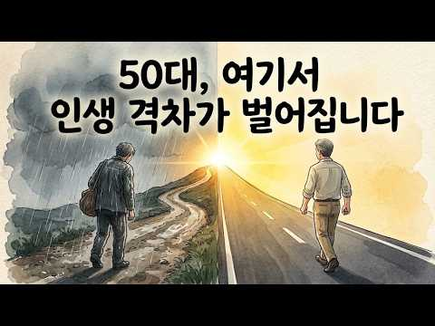
- 챕터: 0:00 왜 밤마다 억울할까 · 3:37 뇌가 적는 상실의 기록 · 5:09 쉰 이후 찾아오는 위기 · 7:28 정산되지 않은 마음의 대가 · 10:54 시작은 마음이 아니라 몸이다 · 16:47 나는 이름을 지운 사람인가 · 19:18 스스로 내리는 마지막 판결
- 설명 앞부분: 💡 같은 나이, 같은 동네에 사는 두 사람이 있습니다. 한 사람은 눕자마자 잠이 들고, 다른 한 사람은 불을 껐는데 십 년 전 그 장면이 또 떠오릅니다. 두 사람이 나이 들어 잃은 건 비슷했습니다. 회사도, 자식도, 건강도요. 그런데 오 년 뒤에 보면 완전히 다른 곳에 서 있습니다. 격차는 여기서 벌어집니다. 재산이 아니라, 잠들기 전 그 몇 분에서요. 겪어본 사람이 다음 충격에 덜 흔들리고, 덜 겪어본 사람이 더 오래 그 자리에 머무는 이유. 그리고 억울함을 지우지 않고도 그 밤을 끝내는 방법을 이야기합니다. 🔍 영상에서 확인하…
- 같은 채널 평소 대비 ×167.6 (채널 최근 롱폼 중앙값 1,622회) · 평소 영상: “돈 자랑 안합니다” 50대 이후, 진짜 부자들이 오히려 조용한 이유 (1,867회) / "싸운 적도 없는데" 50대 이후, 형제와 남이 되는 진짜 이유 (1,376회)
- 대본 없음 (설명) — 음성인식이 끝나면 도입부·흐름이 들어감
- 댓글 44/44: 좋은 점 — 영상 1 · 감사·응원 8 · 더 알고 싶은 것 0 · 아쉬운 점 — 영상 0 · 반박·불만 — 의견 다름 0 · 정치·사회 0 · 경험 공유 5 · 구독·다음 기대 0
  - 좋은 점 — 영상 👍2 “판결하고 끝냈어요 재판은 그때 그때 판결하고 끝냅니다 이젠 내 이름으로 인생살아갑니다 좋은 내용 잘들었습니다”
  - 감사·응원 👍113 “72년 쥐띠입니다. 두아이 재수없이 원하는대학 입해해서 졸업과 동시에 다 취업되고 와이프랑도 원만하고 간당간당하지만 25년째 중소기업에 다니고 있네요. 남들 그렇듯이 사직서를 늘 맘속에 품고 다녔는데 지금은 아침 5시반에 집에서 나올때마다 내일할 직장이 있다는게 감사…”
  - 감사·응원 👍13 “감사합니다.50입니다.정말이네요...제 이야기인거 같습니다.지금은 하나씩 찾고 있습니다.~^^~”
  - 경험 공유 👍113 “72년 쥐띠입니다. 두아이 재수없이 원하는대학 입해해서 졸업과 동시에 다 취업되고 와이프랑도 원만하고 간당간당하지만 25년째 중소기업에 다니고 있네요. 남들 그렇듯이 사직서를 늘 맘속에 품고 다녔는데 지금은 아침 5시반에 집에서 나올때마다 내일할 직장이 있다는게 감사…”
  - 경험 공유 👍0 “72년 6월생. 공대 기계공학과 석사 졸업하고 직장 생활 15년 후 45에 박사공부 49에 졸업해 연구 개발 회사 설립 운영 5년째로 12.3 내란에 개발 프로젝트 취소에 매출 취소되고 작년에 사기도 당하고 매우 어려운 상황입니다. 기업 M&A, 매각과 함께 개발 프…”

### 147. 인생을 바꾸고 싶다면 안쓰는 물건부터 버리세요! 65세까지는 아까워도 버려야 하는 진짜 이유! 뇌과학으로 본 비움의 과학

- https://www.youtube.com/watch?v=BjKVokKepsU · 바로쓰는 심리학 · 구독자 27,100 · 조회수 722,120 (×26.6, 하루 4,627.8) · 좋아요 13,266 (1.8%) · 15.2분 · 2026-06-08 · 주제 묶음 1. 심리학 일반 · 형식 정보·해설 (그 밖) · 폴더 `W_BjKVokKepsU` (웹 승인)
- 썸네일: 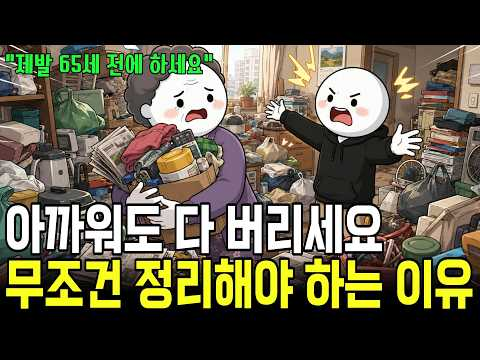
- 챕터: 0:00 옷장은 꽉 찼는데 입을 옷이 없는 아이러니 · 0:36 당신이 이상한 게 아니다: 물건을 버릴 때 뇌에서 일… · 2:21 안 쓰는 물건이 우리의 뇌와 일상을 무너뜨리는 과학적… · 4:30 만성 피로의 주범, 집안 물건 밀도와 스트레스 호르몬… · 5:31 우리가 번번이 버리기에 실패하는 3가지 심리적 덫 · 8:35 쓰지도 않는 물건을 안고 사는 것이 진짜 '큰 손실'… · 9:40 인생의 무게를 줄여줄 강력한 비움의 기준 3가지 · 11:53 비움이 가져다주는 인생 후반전의 기적과 여백의 미학 · 13:54 [오늘의 미션] 꽉 막힌 인생을 풀어줄 '5분 타이머…
- 설명 앞부분: "왜 우리 집은 채워도 채워도 입을 옷이 없고, 정리는 이토록 힘들까요?" 매번 옷장 앞에서 한숨 쉬며 "내가 게을러서, 의지가 약해서 정리를 못 하나" 자책하셨다면 오늘 영상을 꼭 보셔야 합니다. 단언컨대 당신의 잘못이 아닙니다. 인생의 후반전, 복잡한 머릿속을 비우고 맑은 여백을 되찾고 싶으신가요? 대부분의 사람들이 반대로 알고 있는 '버리기 실전 기준 3가지'를 통해 오늘 딱 5분 만에 내 인생의 무게를 가볍게 만드는 마법을 경험해 보세요! ⏱️ 타임라인 (Chapters) AI로 제작된 콘텐츠입니다.
- 같은 채널 평소 대비 ×35.3 (채널 최근 롱폼 중앙값 20,442회) · 평소 영상: 이렇게 생각하기 시작하면 인생이 술술 잘 풀립니다 ! 멘탈이 강한 사람들은 나쁜 일이 생… (20,617회) / 존중받는 사람이 절대로 하지 않는 다섯가지 차이 (20,266회)
- 대본 없음 (설명) — 음성인식이 끝나면 도입부·흐름이 들어감
- 댓글 634/634: 좋은 점 — 영상 14 · 감사·응원 27 · 더 알고 싶은 것 0 · 아쉬운 점 — 영상 0 · 반박·불만 — 의견 다름 7 · 정치·사회 0 · 경험 공유 78 · 구독·다음 기대 1
  - 좋은 점 — 영상 👍66 “지금 열심히 지난 57년간의 인생을 정리하고 있는데, 과감하게 버릴 수 있는 용기를 받았습니다.. 좋은 내용 감사합니다. 😊”
  - 좋은 점 — 영상 👍21 “제 나이 45살이예요, 저도 한번 물건 사면, 비싸게 샀는데 본전 생각나고 의미부여하고 언젠가는 쓸꺼같고 돈주고 다시 사기 아깝고 살빼면 다시 입을수있을꺼 같고, 이러한 이유때문에 그동안 옷이며 물건이며 엄청 쌓아두고 살았어요, 근데 내가 왜 이렇게 살아야하나 싶은 …”
  - 감사·응원 👍66 “지금 열심히 지난 57년간의 인생을 정리하고 있는데, 과감하게 버릴 수 있는 용기를 받았습니다.. 좋은 내용 감사합니다. 😊”
  - 감사·응원 👍9 “어쩜 내놓으시는 영상마다 힐링이 되는지 모르겠어요 감사합니다❤”
  - 반박·불만 — 의견 다름 👍4 “내 와이프때문에 미치겠다 옷장을 혼자 10칸이 터지도록 다쓴다 그럼에도 10박스는 더있고 도저히 못버텨 각방쓰는데 방에 들어가면 옷 천지다 심지어 택도 안뗀것도 있다 너 정신병이라고 일주에 3번은 싸운다 와이프 집도 마찬가지다 와이프 오빠가 결혼하면서 나갔는데 사정이…”
  - 반박·불만 — 의견 다름 👍2 “남 얘기가 아닙니다 저도 사실 잘 못버리는데 특히 살이 쪄서 못입는 옷을 살 빼서? 입으려 보관하는데 반성합니다 오늘 좀 버려야겠네요”
  - 경험 공유 👍1,153 “60대 중반인데.. 내가 추구하는 삶은 이건데.. 와이프가 비닐봉지 하나도 못버리게해서 삶이 항상 피곤합니다.. 프라이팬이 닳아서 새로 산 뒤 헌것들은 절대 안버리고.. 이걸 가정의 평화를 위해서 계속 못본척하면서 늙어가고 있네요 허허허”
  - 경험 공유 👍258 “못 버리는건 병이라고 생각중 난 70대 할매 너무 잘 버려서 영감왈 나도 갖다 버리것네! 마음이 복잡할때 찾아서 하나라도 버리면 가벼움을 느낌 그런데 영감은 아무것도 못 버리고 쌓아놓는 성질 평생의 스트레스 몰래 버리면 화내고 삐지고 ㅋ”
  - 구독·다음 기대 👍1 “도움이 많이 되었습니다 감사합니다 구독하고 갑니다 또만나요😅😅😊”

### 148. 나이 들면서 유독 표정이 편안한 사람들의 놀라운 공통 심리 5가지

- https://www.youtube.com/watch?v=ezanOZKTOqQ · 감성늪 · 구독자 3,820 · 조회수 115,517 (×30.2, 하루 643.8) · 좋아요 1,827 (1.6%) · 14.5분 · 2026-05-15 · 주제 묶음 1. 심리학 일반 · 형식 정보·해설 (그 밖) · 폴더 `W_ezanOZKTOqQ` (웹 승인)
- 썸네일: 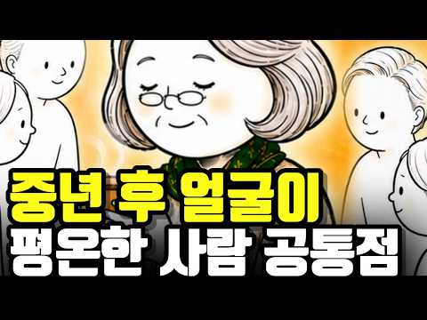
- 챕터: 0:00 얼굴이 편안한 사람들의 공통점 · 1:26 첫 번째. 억지로 관계에 맞추지 않는다 · 3:26 두 번째. 비교를 시작하지 않는다 · 5:53 세 번째. 안 되는 걸 붙잡지 않는다 · 7:37 네 번째. 체면 때문에 무거워지지 않는다 · 10:09 다섯 번째. 힘들었던 과거를 원망하지 않는다 · 12:05 지금 나는 어떤 사람인지 체크해보기 · 13:08 나이 들수록 얼굴이 달라지는 이유 · 14:09 다음 이야기 예고 — 중년 이후 관계를 멀어지게 만드…
- 설명 앞부분: 50대 60대 이후 주변에 보면 얼굴이 편안해지는 사람들에겐 공통점이 있습니다. 돈도, 운도 아닌 ‘이 다섯 가지’를 내려놓은 사람들이었어요. 중년 이후 점점 마음이 편해지는 사람들의 심리와 뇌과학. 오늘 영상에서 확인해보세요. 🕒 타임스탬프 하버드 성인발달 연구 (관계의 질과 행복·건강의 연관성) 중년 이후 감정 회복과 스트레스 반응 연구 비교 심리와 스트레스 호르몬 반응 연구 노년기 인간관계와 정서 안정 관련 연구 감정 조절 및 자기 해석 방식에 대한 심리학 연구 사회적 고립과 인지 기능 관련 연구 ⚠️ 시청 전 유의사항 및 …
- 대본 없음 (설명) — 음성인식이 끝나면 도입부·흐름이 들어감
- 댓글 99/99: 좋은 점 — 영상 4 · 감사·응원 12 · 더 알고 싶은 것 1 · 아쉬운 점 — 영상 0 · 반박·불만 — 의견 다름 1 · 정치·사회 0 · 경험 공유 6 · 구독·다음 기대 0
  - 좋은 점 — 영상 👍87 “지금, 가난해서 참 좋아요... ^^ 예전에 돈이 좀 있을 때는 돈 빌려달라는 가족, 친구, 지인들이 많았는데... 있는 돈 다 털어 가난한 나라로 선교가신 선교사님들께 다 보내드리고 난 후 저에게 돈이 없다는 걸 알고난 후에, 인간관계가 정리됐어요...ㅋ~ 인간성 …”
  - 좋은 점 — 영상 👍15 “좋은 내용 입니다❤❤”
  - 감사·응원 👍87 “지금, 가난해서 참 좋아요... ^^ 예전에 돈이 좀 있을 때는 돈 빌려달라는 가족, 친구, 지인들이 많았는데... 있는 돈 다 털어 가난한 나라로 선교가신 선교사님들께 다 보내드리고 난 후 저에게 돈이 없다는 걸 알고난 후에, 인간관계가 정리됐어요...ㅋ~ 인간성 …”
  - 감사·응원 👍42 “스트레스를 주던 대인관계 정리를 하고나니 만사에 편해졌네여 감사”
  - 더 알고 싶은 것 👍1 “20년 넘게 아이들 키우며 친하게 지낸 지인, 우리아이 우울증으로 인해 학교생활이 힘든걸 잘 알면서 만나거나 통화하면 궁금해서 넘 물어보는데 정말이지 나의 가슴아픈 상처를 후벼파는것 같아서 말하기도 힘들어지더군요 궁금해하는 표정이 넘 생생하게 자꾸 떠올라 힘이듭니다.…”
  - 반박·불만 — 의견 다름 👍1 “20년 넘게 아이들 키우며 친하게 지낸 지인, 우리아이 우울증으로 인해 학교생활이 힘든걸 잘 알면서 만나거나 통화하면 궁금해서 넘 물어보는데 정말이지 나의 가슴아픈 상처를 후벼파는것 같아서 말하기도 힘들어지더군요 궁금해하는 표정이 넘 생생하게 자꾸 떠올라 힘이듭니다.…”
  - 경험 공유 👍87 “지금, 가난해서 참 좋아요... ^^ 예전에 돈이 좀 있을 때는 돈 빌려달라는 가족, 친구, 지인들이 많았는데... 있는 돈 다 털어 가난한 나라로 선교가신 선교사님들께 다 보내드리고 난 후 저에게 돈이 없다는 걸 알고난 후에, 인간관계가 정리됐어요...ㅋ~ 인간성 …”
  - 경험 공유 👍12 “맞아요 공감합니다 잘했다 소리들으며 젊은시절을맞추며 살았어요 가까운주위사람들은 나의희생을 당연히여기더라구요 참고살아온삶이 어느날폭발하는날이 오더라구요 시집.친정식구 모두에게 선언 했어요 나도이제 나를위해 살아야겠다고 나도행복하고 싶다고~~ 이젠 솔직하게 하고싶은말 하…”

### 149. 항상 집이 깨끗한 사람들의 놀라운 특징 : 뇌를 바꾸고 부를 끌어당기는 정리의 뇌과학

- https://www.youtube.com/watch?v=NV6XEbHUFQU · 최적화 심리학 · 구독자 12,200 · 조회수 303,949 (×24.9, 하루 2,033.5) · 좋아요 6,375 (2.1%) · 10.7분 · 2026-06-14 · 주제 묶음 1. 심리학 일반 · 형식 정보·해설 (그 밖) · 폴더 `W_NV6XEbHUFQU` (웹 승인)
- 썸네일: 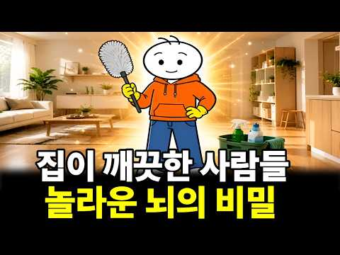
- 챕터: 0:00 쉬어도 피곤한 사람과 깨끗한 집을 유지하는 사람의 뇌… · 0:50 나중에'를 없애 뇌의 배터리를 아끼는 법 (자이가르닉… · 3:09 청소를 노동이 아닌 '뇌 리셋(재부팅)'으로 활용하기 · 5:51 의욕을 기다리지 않고 먼저 움직이는 기술 (행동 활성… · 8:43 부와 성공을 끌어당기는 능력의 정체 (내적 통제성과 …
- 설명 앞부분: 분명 주말 내내 누워서 쉬었는데, 이상하게 마음 한구석이 무겁고 월요일 아침에 더 지치시나요? 더 자도, 더 쉬어도 피로가 풀리지 않는다면 그건 당신이 게으른 탓이 아닙니다. 늘 모델하우스처럼 깔끔한 집을 유지하는 사람들은 우리와 '의지력'이나 '타고난 성격'이 다른 것이 아닙니다. 단지 '뇌를 쓰는 방식'이 다를 뿐입니다. 오늘 영상에서는 뇌과학과 심리학(자이가르닉 효과, 프린스턴대 fMRI 연구, UCLA 코르티솔 연구)을 통해 항상 집이 깨끗한 사람들이 가진 소름 돋는 '이 능력'의 정체를 밝힙니다. 의지력을 단 한 방울도 …
- 같은 채널 평소 대비 ×63.6 (채널 최근 롱폼 중앙값 4,776회) · 평소 영상: 좋은 부부는 사랑보다 중요한 '이것'을 지킵니다. 부부부 사이 절대 하면 안 되는 말 ∣… (4,776회) / 집에 있는 것을 좋아하는 사람들의 놀라운 심리 ｜심리학이 밝힌 뇌과학적 이유 (4,256회)
- 대본 없음 (설명) — 음성인식이 끝나면 도입부·흐름이 들어감
- 댓글 320/320: 좋은 점 — 영상 22 · 감사·응원 14 · 더 알고 싶은 것 1 · 아쉬운 점 — 영상 1 · 반박·불만 — 의견 다름 2 · 정치·사회 0 · 경험 공유 26 · 구독·다음 기대 1
  - 좋은 점 — 영상 👍33 “집이 깨끗하면 뇌도 깨끗해지죠. 보통 우리 방 상태가 지금의 자신의 뇌상태라고 보면 됩니다. 좋은 영상 잘 봤습니다!”
  - 좋은 점 — 영상 👍5 “울남편은 정리정돈 안되어있고 좀만 지저분하면 지×랄 발광 주변 사람을 피말립니다..저랑 친한 여자도 무지하게 깔끔한데 울 남편이랑 똑같은 성격을 갖고 있습니다 매일 헤어질 생각만 하고 있습니다 쳐×숩는건 열라 좋아하면서 매일 정리정돈을 강조하다못해..못배웠는니 근본은…”
  - 감사·응원 👍12 “아하 그렇구나 내가 피곤하지 않는 이유구나 항시 깨끗깨끗 하거든요 감사감사 합니다”
  - 감사·응원 👍7 “감사합니다 ❤❤❤”
  - 더 알고 싶은 것 👍3 “너무 공감되서 구독좋아요 눌렀네요 다음에도 좋은 영상부탁드립니다😅”
  - 아쉬운 점 — 영상 👍1 “옳소. Ai목소리임? 좋네요.”
  - 반박·불만 — 의견 다름 👍19 “잘 치우는 사람도 귀찮은 감정은 똑같아요~특별한 뇌구조라서가 아니라 일이 쌓이면 더 많은 에너지를 써야한다는 걸 알기 때문이예요! 그리고 의욕도 리듬이 있어요.조금의 차이지만 의욕이 생기는 날 더 많이 치우고 정리하고 에너지 없는날은 적게 움직입니다. 이 영상은 진실…”
  - 반박·불만 — 의견 다름 👍1 “그때 그때 마다 정리하고 치워야 해요 하루 이틀 지나면 더 하기싫어져요 그리고 무언가 하기싫다는건 마음도 건강도 약해졌다는 증거에요 사실 게을러서 그런게 아닙니다 제가 경험했어요”
  - 경험 공유 👍99 “저도 항상 물건은 제자리에”
  - 경험 공유 👍42 “"이 집에는 언제와도 괞찮아!" 내 친구가, 자기 친구를 데리고 우리 집을 방문해서 하는 말이다. 나는 대청소하기 힘들어서, 미루지 않고 바로 치운다. 그래서 갑작스런 방문도 환영이다😊”
  - 구독·다음 기대 👍1 “나이가드니 마음으로는 단순하게 정리를 잘하고 싶은데,잘 안되요 오늘 도움이 많이 되었고, 구독했어요😂”

### 150. 인생은 결국 혼자입니다 외로움 없이 행복하게 살아가는 7가지 방법 ∣ 김형석 독립기념관장

- https://www.youtube.com/watch?v=v_1LXZktL2g · poke vingador · 구독자 2,640 · 조회수 70,450 (×26.7, 하루 435.8) · 좋아요 1,742 (2.5%) · 63.4분 · 2026-06-02 · 주제 묶음 3. 자존감·감정·멘탈 · 형식 인터뷰·강연·대담 (교수·의사·스님) · 폴더 `W_v_1LXZktL2g` (웹 승인)
- 썸네일: 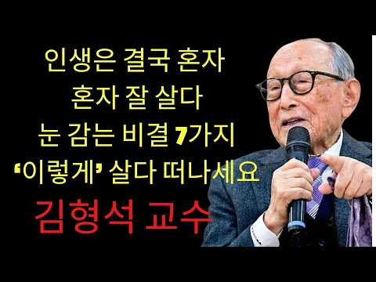
- 설명 앞부분: 인생은 결국 혼자입니다 외로움 없이 행복하게 살아가는 7가지 방법 ∣ 김형석 독립기념관장
- 같은 채널 평소 대비 ×219.5 (채널 최근 롱폼 중앙값 321회) · 평소 영상: 노년에 용돈 주는 자식이 가장 무서운 자식입니다｜돈으로 부모를 조종하는 자식의 숨겨진 속… (321회) / 이른 아침 이 6가지 습관을 당장 멈추세요｜노인의 건강을 무너뜨리는 충격적인 진실 ∣ 김… (335회)
- 대본 없음 (설명) — 음성인식이 끝나면 도입부·흐름이 들어감
- 댓글 319/319: 좋은 점 — 영상 31 · 감사·응원 116 · 더 알고 싶은 것 2 · 아쉬운 점 — 영상 1 · 반박·불만 — 의견 다름 0 · 정치·사회 0 · 경험 공유 5 · 구독·다음 기대 1
  - 좋은 점 — 영상 👍23 “교수님 어쩜 이렇게 다 옳은 말씀만 하시는지 참 뼈에 와 닿습니다 저도 70 왔는데 혼자 된지 20년이 넘었습니다 다 하시는 말씀마따나 옳은 말씀 참 하나도 틀린 말 없네요”
  - 좋은 점 — 영상 👍6 “교수님 너무너무감사합니다 좋은말씀잘듣고갑니다^^”
  - 감사·응원 👍15 “미국 달라스에서 사는 76 세 여성입니다 매일 듣고 있습니다 감사합니다.”
  - 감사·응원 👍15 “선생님 감사합니다.(76세) 항상 경청하고 있습니다.”
  - 더 알고 싶은 것 👍2 “네보귀한말씀종종알려주세요감사합니 39:34 다”
  - 더 알고 싶은 것 👍2 “안녕하세요? 요즘 박사님 말씀듣고 너무나 행복하게 살아갑니다. 3년째 치매 엄마 간병을 하고 있는데 요즘같이 이렇게 행복한 적이 없었습니다. 박사님 말씀을 들으면서 자신감이 생기고 하나님과의 괸계도 더 깊어지는듯 합니다. 그저 감사하다는 말씀 드리고 싶어 댓글 올립니…”
  - 아쉬운 점 — 영상 👍0 “이 영상은 김 교수와 아무 상관이 없다. 사기꾼이 영상 편집하고 AI 목소리 넣어서 사람들 속이고, 유튭에서 돈 받는 사기 행위이다. 븅신이 넘쳐나서, 사기꾼이 날뛴다. 말과 입이 안 맞는다.”
  - 경험 공유 👍23 “교수님 어쩜 이렇게 다 옳은 말씀만 하시는지 참 뼈에 와 닿습니다 저도 70 왔는데 혼자 된지 20년이 넘었습니다 다 하시는 말씀마따나 옳은 말씀 참 하나도 틀린 말 없네요”
  - 경험 공유 👍11 “누구나 혼로서기는 기본이고 스스로의 책임입니다. 홀로서기 못하면 어떤 환경도 적응이 되지 않습니다. 저도 때론 고독을 느낄때가 있고 우울할땐 외곡된 생각도 해보지만 쓸데없는 생각이라고 느낍니다. 내가 견뎌야하는 현실이고 나의 몫입니다. 어느누구도 해결 해 줄수없는 나…”
  - 구독·다음 기대 👍15 “미국 달라스에서 사는 76 세 여성입니다 매일 듣고 있습니다 감사합니다.”

### 151. 10년 넘은 친구도 한순간에 끊어내는 사람들의 결정적 특징 (손절의 뇌구조)

- https://www.youtube.com/watch?v=7yhehYw6oDc · 토닥교수의 심리학 · 구독자 26,700 · 조회수 394,021 (×14.8, 하루 4,380.0) · 좋아요 3,072 (0.8%) · 14.6분 · 2026-08-13 · 주제 묶음 1. 심리학 일반 · 형식 인터뷰·강연·대담 (교수·의사·스님) · 폴더 `W_7yhehYw6oDc` (웹 승인)
- 썸네일: 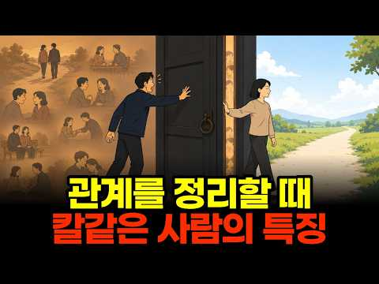
- 챕터: 0:00 인트로 — 관계를 칼같이 끊는 사람, 정말 냉정한가 · 1:13 칼같이 정리하는 사람의 진짜 내면 — 소수에게 쏟는 … · 3:45 사회적 교환 이론 — 관계 불균형이 보내는 신호 · 5:35 이들이 마지막 선을 넘게 되는 결정적 기준 · 7:34 왜 싸우지 않고 조용히 사라지는가 · 9:06 애매한 태도가 단호한 거절보다 잔인한 이유 · 11:24 진짜 외로움은 관계 안에 이미 있었다 · 13:20 관계 정리 = 나에게 맞는 관계를 다시 선택하는 것
- 설명 앞부분: 관계를 한 번 정리하면 절대 뒤돌아보지 않는 사람, 주변에 한 명쯤 있으시죠. 대부분 "정 없다, 냉정하다"라고 판단하지만, 이 사람들의 진짜 내면은 정반대입니다. 오늘 영상을 끝까지 보시면, 왜 관계를 칼같이 끊는 사람이 오히려 정이 가장 깊은 사람인지 완전히 새로 이해하게 되실 겁니다. 이 영상에서는 관계를 칼같이 정리하는 사람들의 심리를 인간관계 심리학 관점에서 하나씩 해부합니다. 왜 이들이 아무에게나 정을 나누지 않는지, 사회적 교환 이론으로 본 관계 불균형의 신호는 무엇인지, 실수를 대하는 태도가 왜 신뢰의 결정적 기준이…
- 같은 채널 평소 대비 ×40.1 (채널 최근 롱폼 중앙값 9,823회) · 평소 영상: 사람들이 당신에게 기분 나쁜거 그대로 티 내는 진짜 속마음 ∣ 99%가 착각하는 이것 (… (9,823회) / 만만한 사람들과 존중받는 사람들이 가진 5가지 결정적 차이 (심리학적 분석) (9,904회)
- 대본 없음 (설명) — 음성인식이 끝나면 도입부·흐름이 들어감
- 댓글 431/431: 좋은 점 — 영상 15 · 감사·응원 9 · 더 알고 싶은 것 2 · 아쉬운 점 — 영상 5 · 반박·불만 — 의견 다름 14 · 정치·사회 1 · 경험 공유 51 · 구독·다음 기대 0
  - 좋은 점 — 영상 👍27 “좋은 영상 감사합니다🙏 글자 하나 틀리지 않고 정확합니다. 모든 순간 진심을 다했고 수없이 상대방과 저에게 시간을 주었습니다. 결국 의미가 사라지면 관계를 정리하고 미련도 후회도 없습니다. 상대방도 잘 살기를 바라지만, 저와의 인연은 여기까지 입니다. 저의 인생에서 …”
  - 좋은 점 — 영상 👍15 “너무 좋은 영상이네요 나이50 되어보니 너무 가까이간 제잘못이라 생각하고 이제 적당히 친하게 지내려고 합니다”
  - 감사·응원 👍44 “Isfj 딱 제 얘기네요. 정이 많고 사람 좋아하지만 어느순간 그 사람과의 선이 생기고 제 맘속에서 칼같이 잘라내더라구요. 그뒤로 서서히 멀어질때도 있고 바로 끝낼때도 있어요. 하지만 후회해본적이 진짜 한번도 없어요. 결국 인생은 혼자 스스로 살아내야 하는 거라고 생…”
  - 감사·응원 👍27 “좋은 영상 감사합니다🙏 글자 하나 틀리지 않고 정확합니다. 모든 순간 진심을 다했고 수없이 상대방과 저에게 시간을 주었습니다. 결국 의미가 사라지면 관계를 정리하고 미련도 후회도 없습니다. 상대방도 잘 살기를 바라지만, 저와의 인연은 여기까지 입니다. 저의 인생에서 …”
  - 더 알고 싶은 것 👍18 “내 속에 언제 들어오셨나요? 소름”
  - 더 알고 싶은 것 👍0 “가족하고는 어떨까요? 가족중 어느 한사람과의 마찰로 온 가족들과의 서로간의 불편함으로 인해 다른가족들의 평화를 위해 손절한 것은 어떤가요? 물론 부모님은 돌아가신후이고 금전적 관계는 전혀 아님 🤔”
  - 아쉬운 점 — 영상 👍18 “지각, 실수해놓고 사과없이 오히려 뻔뻔한 태도면 그냥 이유불문 손절하세요. 사람 안변합니다.”
  - 아쉬운 점 — 영상 👍4 “1. AI 목소리 지겹다.. 2. 이 영상 보고 또 본인이라고 댓글 달린다. 3. 심리를 파고드는 유튜브가 돈이 된다.”
  - 반박·불만 — 의견 다름 👍1,542 “칼 같이 ? 아닙니다 오랜시간 고민하고 배려했던겁니다”
  - 반박·불만 — 의견 다름 👍4 “딱 저네요. 한번 아닌 사람은 절대 아닙니다. 왜냐면 최대한 배려해줬기 때문에, 미련이 없습니다.”
  - 정치·사회 👍0 “좌파 지인들은 싹다 끊으니 삶이 나아지더라.”
  - 경험 공유 👍13 “진심 제가 하고픈 얘기들 ㅠㅠ”
  - 경험 공유 👍6 “나도 비슷”

### 152. 이어령 교수의 조언: 60살 넘으면 인간관계에 목맬 필요 없습니다ㅣ노후에 사람들과 잘 지내려고 너무 애쓰지 마세요ㅣ고독을 즐기는 지혜ㅣ삶의철학ㅣ노년의삶

- https://www.youtube.com/watch?v=Hihg_Qi2tzc · 나답게 늙어가기 · 구독자 7,570 · 조회수 48,959 (×6.5, 하루 1,221.2) · 좋아요 507 (1.0%) · 32.9분 · 2026-10-02 · 주제 묶음 2. 인간관계·처세 · 형식 인터뷰·강연·대담 (교수·의사·스님) · 폴더 `W_Hihg_Qi2tzc` (웹 승인)
- 썸네일: 
- 설명 앞부분: 【이어령 교수의 조언】 60살 넘으면 인간관계에 목맬 필요 없습니다ㅣ노후에 사람들과 잘 지내려고 너무 애쓰지 마세요ㅣ고독을 즐기는 지혜ㅣ삶의철학ㅣ노년의삶 왜 60살이 넘으면 사람들과 잘 지내려고 애쓰는 것보다 혼자만의 시간을 편안하게 즐기는 것이 중요할까요? 이 영상에서는 이어령 교수의 삶의 철학과 시선으로, 나이가 들수록 모든 사람과 좋은 관계를 유지하려 애쓰기보다 자신의 마음과 평온한 일상을 지키는 것이 왜 중요한지 깊이 있게 생각해 봅니다. 특히 노후에 인간관계로 지나치게 마음을 쓰지 않는 법, 다른 사람의 시선과 평가에서 …
- 같은 채널 평소 대비 ×3.8 (채널 최근 롱폼 중앙값 12,961회) · 평소 영상: 이어령 교수의 조언: 60부터 무조건 베풀면 후회합니다ㅣ남보다 나를 먼저 챙겨야 하는 이… (12,961회) / 이어령 교수의 조언: 늙어서는 조금 대충 살아도 괜찮습니다ㅣ힘을 빼고 사는 어르신들이 오… (13,283회)
- 대본 없음 (설명) — 음성인식이 끝나면 도입부·흐름이 들어감
- 댓글 37/37: 좋은 점 — 영상 3 · 감사·응원 9 · 더 알고 싶은 것 0 · 아쉬운 점 — 영상 0 · 반박·불만 — 의견 다름 0 · 정치·사회 0 · 경험 공유 2 · 구독·다음 기대 0
  - 좋은 점 — 영상 👍7 “나이가 들수록 모든 사람과 잘 지내려고 애쓰기보다 내 마음의 평온을 지키는 것이 중요하다는 말씀에 깊이 공감했습니다. 혼자 있는 시간도 편안하게 받아들이는 지혜를 배울 수 있어 좋았습니다. 좋은 영상 감사합니다.”
  - 좋은 점 — 영상 👍1 “나이가 들수록 모든 사람에게 인정받으려 애쓰기보다 혼자 있는 시간도 편안하게 받아들이는 지혜가 필요하다는 말씀에 공감했습니다. 마음을 편안하게 돌아볼 수 있는 좋은 내용이었습니다. 감사합니다.”
  - 감사·응원 👍8 “제 얘기 하는줄 알았습니다. 많아 위로받았습니다. 주말에 한번 울리지 않는 핸드폰을 보며 내가 모자르고 나쁜 사람인지 알았습니다. 이제 나를 위해 돈을 쓰고 모으고 나를 사랑하기로 했습니다. 내가 못난게 아니라는걸 깨닫게 해주셨습니다. 감사합니다.”
  - 감사·응원 👍7 “나이가 들수록 모든 사람과 잘 지내려고 애쓰기보다 내 마음의 평온을 지키는 것이 중요하다는 말씀에 깊이 공감했습니다. 혼자 있는 시간도 편안하게 받아들이는 지혜를 배울 수 있어 좋았습니다. 좋은 영상 감사합니다.”
  - 경험 공유 👍8 “제 얘기 하는줄 알았습니다. 많아 위로받았습니다. 주말에 한번 울리지 않는 핸드폰을 보며 내가 모자르고 나쁜 사람인지 알았습니다. 이제 나를 위해 돈을 쓰고 모으고 나를 사랑하기로 했습니다. 내가 못난게 아니라는걸 깨닫게 해주셨습니다. 감사합니다.”
  - 경험 공유 👍0 “핸드폰을 보며 내가 모자르고”

### 153. 어리숙해 보여도 절대 만만하게 볼 수 없는 사람, 여우처럼 교활한 인간마저 한 수 접게 만드는 무서운 처세술과 압도적인 판단력

- https://www.youtube.com/watch?v=7C6wk0aKx_c · 바람의 스승 · 구독자 4,170 · 조회수 13,682 (×3.3, 하루 669.8) · 좋아요 77 (0.6%) · 17.2분 · 2026-10-21 · 주제 묶음 1. 심리학 일반 · 형식 브이로그·직접 해본 이야기 · 폴더 `W_7C6wk0aKx_c` (웹 승인)
- 썸네일: 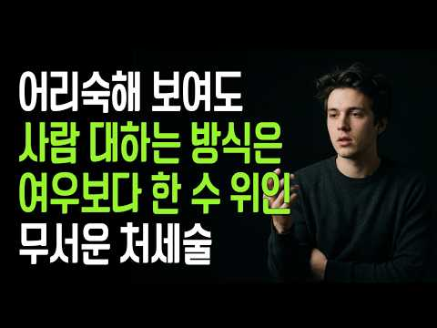
- 설명 앞부분: 사람을 겉모습만 보고 판단하는 사람들은 때로 가장 큰 실수를 저지릅니다. 말투가 부드럽고 순해 보인다는 이유로 만만하게 여기지만, 세상에는 어리숙해 보여도 사람을 대하는 방식만큼은 누구보다 노련하고 치밀한 사람들이 있습니다. 이들은 상대의 속셈을 알아도 쉽게 감정을 드러내지 않으며, 자신을 얕잡아보는 사람 앞에서도 굳이 영리함을 증명하려 하지 않습니다. 사람의 마음을 편안하게 만들면서도 자신의 속내는 함부로 드러내지 않고, 결정적인 순간에는 놀라울 만큼 냉철한 판단력과 단호함을 보여줍니다. 진짜 고수는 상대를 이기려고 애쓰지 않습…
- 같은 채널 평소 대비 ×2.5 (채널 최근 롱폼 중앙값 5,565회) · 평소 영상: 바보인 줄 알고 만만하게 봤다가 속을 알고 나면 감히 함부로 못 하는 사람, 생각의 깊이… (5,946회) / 만만해 보여서 얕봤는데 알고 보면 여우보다 더 영악한 진짜 고단수 (5,184회)
- 대본 없음 (설명) — 음성인식이 끝나면 도입부·흐름이 들어감
- 댓글 7/7: 좋은 점 — 영상 0 · 감사·응원 0 · 더 알고 싶은 것 0 · 아쉬운 점 — 영상 0 · 반박·불만 — 의견 다름 0 · 정치·사회 0 · 경험 공유 0 · 구독·다음 기대 0

### 154. 남자가 진짜 좋아하면 나타나는 무의식 행동 7가지 ∣ 연애심리 ∣ 행동심리학

- https://www.youtube.com/watch?v=tbpcv9vAwhk · 여울심리 · 구독자 607 · 조회수 14,881 (×24.5, 하루 91.9) · 좋아요 101 (0.7%) · 16분 · 2026-06-02 · 주제 묶음 1. 심리학 일반 · 형식 정보·해설 (그 밖) · 폴더 `W_tbpcv9vAwhk` (웹 승인)
- 썸네일: 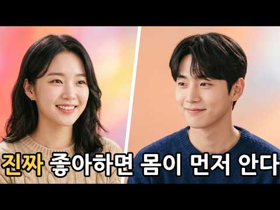
- 설명 앞부분: 말 한마디 없어도, 몸이 먼저 말하고 있어요. 좋아한다고 직접 말하지 않아도, 진짜 마음은 무의식 행동에서 먼저 새어 나와요. 오늘은 남자가 진짜 좋아할 때 본인도 모르게 나타나는 행동 7가지를 현대 심리학 연구와 프로이트 발달심리학을 통해 이야기해 봤어요. 헷갈렸던 그 남자의 행동, 오늘 영상으로 조금 더 선명해지길 바라요. 기억하지 않아도 될 것들을 기억한다 자신의 이야기를 평소보다 많이 한다 연락의 질이 달라진다 내가 힘들 때 가장 먼저 나타난다 눈이 자꾸 웃는다 나의 편의를 먼저 생각한다 다음을 만들려고 한다 🎧 더 깊은 …
- 같은 채널 평소 대비 ×4.9 (채널 최근 롱폼 중앙값 3,046회) · 평소 영상: 남자가 진짜 좋아하면 숨길 수 없는 행동 7가지 (3,046회) / 아무리 숨겨도 진심이면 반드시 나오는 행동 7가지 (2,980회)
- 대본 없음 (설명) — 음성인식이 끝나면 도입부·흐름이 들어감
- 댓글 0/0: 좋은 점 — 영상 0 · 감사·응원 0 · 더 알고 싶은 것 0 · 아쉬운 점 — 영상 0 · 반박·불만 — 의견 다름 0 · 정치·사회 0 · 경험 공유 0 · 구독·다음 기대 0

### 155. 【김형석 교수】서운할수록 거리를 두고 '이렇게'만 해라 상대가 먼저쩔쩔맨다 ∣명언 ∣오디오북 ∣노후준비 ∣인간관계 명언

- https://www.youtube.com/watch?v=fKSnvhbOoTw · 삶의 고백 · 구독자 15,200 · 조회수 235,431 (×15.5, 하루 2,286.6) · 좋아요 2,825 (1.2%) · 46.3분 · 2026-07-31 · 주제 묶음 2. 인간관계·처세 · 형식 수면·낭독·오디오북 (잠잘 때·명언) · 폴더 `W_fKSnvhbOoTw` (웹 승인)
- 썸네일: 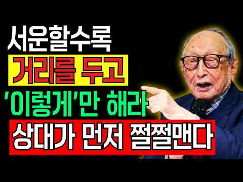
- 챕터: 0:00 호의가 계속되면 권리인 줄 아는 사람들 · 0:00 상처받지 않고 조용히 관계의 선을 긋는 법 · 0:00 서운함을 말로 꺼내면 '빚 독촉장'이 되는 이유 · 0:00 참는 것이 미덕이 아닐 때, 단호하게 나를 지키는 한… · 0:00 다한 인연을 미련 없이 놓아주어야 하는 이유
- 설명 앞부분: 평생을 먼저 양보하고 헌신하며 살았는데, 돌아온 건 귀찮아하는 눈빛뿐이라 허망함을 느끼신 적 있으십니까? 가장 많이 베푼 사람이 가장 먼저 외면당하는 4060 세대의 현실이 참으로 아프게 다가옵니다. 김형석 교수의 철학을 빌려, 어른의 진짜 처세법인 '침묵의 지혜'를 전합니다. 이번 영상에서는 내가 늘 베풀던 호의를 말없이 멈추었을 때 비로소 일어나는 관계의 변화를 이야기합니다. 억울함을 호소하는 대신 조용히 선을 긋는 법, 참아야 할 때와 단호하게 입을 열어 내 존엄을 지켜야 할 때를 구분하는 지혜를 담았습니다. 다한 인연을 비…
- 같은 채널 평소 대비 ×22.6 (채널 최근 롱폼 중앙값 10,436회) · 평소 영상: 【김형석 교수】나중에 부모를 버리는 자식에겐 어릴 때부터 '이것'이 나타납니다 ∣ 절대 … (11,120회) / 【김형석 교수】자식에게 서운할 때, 지혜로운 부모는 이렇게 합니다 (9,753회)
- 대본 없음 (설명) — 음성인식이 끝나면 도입부·흐름이 들어감
- 댓글 425/425: 좋은 점 — 영상 12 · 감사·응원 54 · 더 알고 싶은 것 2 · 아쉬운 점 — 영상 2 · 반박·불만 — 의견 다름 1 · 정치·사회 0 · 경험 공유 27 · 구독·다음 기대 0
  - 좋은 점 — 영상 👍4 “저도 먼저 배려하고 참아서 병이 됩니다. 좋은말씀 감사합니다”
  - 좋은 점 — 영상 👍4 “선생님 안녕하세요 ~ 우연히 듣게되었는데 듣고 또 들었습니다 삶의 깊은 진리를 알려주셔서 감사합니다. 참고 지나다보면 알아주겠지 했는데.. 나부터 나를 아껴주고 돌봐야겠다는 마음을 담아봅니다. 알아달라는 변명보다 내 생각을 감정빼고 전달하는 연습부터 해야겠어요 감사합…”
  - 감사·응원 👍20 “참는것만이 답이아니네요 감사합니다. 🎉건강하세요”
  - 감사·응원 👍18 “교수님 영양제 같은 귀한 말씀 감사 드립니다..🎉🎉”
  - 더 알고 싶은 것 👍0 “교수님 낭독이 맞나요? 숨참과 속도가 100세분 같지않아요”
  - 더 알고 싶은 것 👍0 “선생님 절에 다니는 언니가 시간이지날수록 처음에는 외면 하다 다음은 무시 다음은 질투 다음 조롱하는 사람을 어떻게 해야 할까요? 사람이다 하며 대하는데 계속 부딪혀야 하는데...”
  - 아쉬운 점 — 영상 👍5 “교수님 40년 전에 기업에서 강의 들은적 있습니다ᆢ 그때 교수님 60대인듯요 철업던 그땐 좀 지루했었는데ᆢ 60대인 지금은 참 좋습니다 ㅋㅋ 건강하셔요~♡♡”
  - 반박·불만 — 의견 다름 👍3 “딱 제 얘기네요 회사에서 주인의식을 넘어 모든 일들이 눈에 들어오고 그모든 일거리를 스스로 찾아 근무시간 휴일없이 월급이 늦어져도 어떤일도 거절하지않고 열심히 발바닥이 굳어지고 열이나고 발가락이 휘어져 아파도 몸이 이곳 저곳 신호를 보내 아파도 늘 아무렇지 않은채 웃…”
  - 경험 공유 👍51 “저는 부모형제한테 서운함이 있어요 제가 다리가 불편한데도 엄마가 아플때 옆에서 몇달씩 간호를 했고한달에 보름을 볼정도로 옆에있었고 암이 였을때도 두달을 남편하고 간호를하면서 운동을시켰는데 그과정에서 억지로하다보니 저희한테 서운함이 있었는지 다른형제한테 이말저말 이간질…”
  - 경험 공유 👍13 “내가 그렇게 하도록 허락했다는 말이 가슴에 팍 꽂혔어요”

### 156. 강아지의 1순위는 바로 '이 사람' (행동심리학이 알려드립니다)

- https://www.youtube.com/watch?v=rdRMbIVlBFM · 실천 심리학 · 구독자 11,900 · 조회수 272,581 (×22.9, 하루 1,782.4) · 좋아요 2,590 (0.9%) · 9.8분 · 2026-06-11 · 주제 묶음 1. 심리학 일반 · 형식 정보·해설 (그 밖) · 폴더 `W_rdRMbIVlBFM` (웹 승인)
- 썸네일: 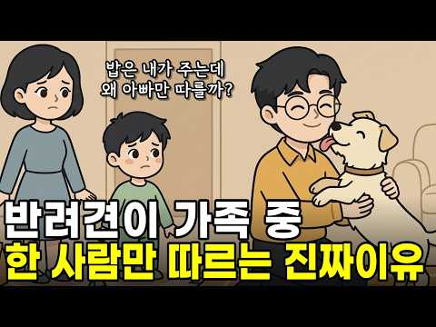
- 설명 앞부분: "밥은 내가 주는데… 왜 너는 늘 엄마야?" 가족 모두가 똑같이 사랑으로 돌보는데, 유독 한 사람에게만 껌딱지처럼 달라붙는 우리 집 강아지. 그렇다면 강아지는 도대체 무엇을 기준으로, 가족 중 단 한 사람을 자신의 '최애'로 선택하는 걸까요? 이번 영상에서는 강아지가 가족 중 한 사람을 특별히 따르는 이유를 행동심리학 관점에서 살펴봅니다. 영상에서 다루는 내용 강아지가 가장 사랑하는 사람을 알아보는 0.5초 신호 밥 주는 사람보다 더 중요한 ‘안전 기지’의 의미 강아지가 특정 가족에게만 붙어 있는 심리적 이유 강아지와 더 깊은 신…
- 같은 채널 평소 대비 ×320.7 (채널 최근 롱폼 중앙값 850회) · 평소 영상: 강아지 사진을 수백 장 찍고도 못 지우는 진짜 이유 (877회) / 내가 울면 강아지가 곁에 오는 이유, 정말 내 슬픔을 아는 걸까? ∣ 우리가 몰랐던 반려… (823회)
- 대본 없음 (설명) — 음성인식이 끝나면 도입부·흐름이 들어감
- 댓글 128/128: 좋은 점 — 영상 2 · 감사·응원 4 · 더 알고 싶은 것 2 · 아쉬운 점 — 영상 2 · 반박·불만 — 의견 다름 0 · 정치·사회 0 · 경험 공유 26 · 구독·다음 기대 1
  - 좋은 점 — 영상 👍7 “유익한 영상 감사합니다. 궁금증이 풀렸네요.”
  - 좋은 점 — 영상 👍2 “애들 사춘기에 도움되라고 작은 강이지를 키우기 시작한지 1년이 넘었는데 지금은 완전 제(아빠) 껌딱지에요~ 너무 사랑스러워 제가 갱년기에 도움을 받고 있어요~”
  - 감사·응원 👍7 “유익한 영상 감사합니다. 궁금증이 풀렸네요.”
  - 감사·응원 👍3 “와!!!!!!우리 막내 구름이 행동이 영상보고 이해가 됐네요!!!!!!!감사합니다^^”
  - 더 알고 싶은 것 👍13 “우리 강아쥐는 까매서 왼쪽 눈썹이 안보임...표정변화를 보고싶은데..나보고 미친듯이 뛰는뎁..니 맘이 궁금하다.”
  - 더 알고 싶은 것 👍0 “우리 강아지는 다른 강아지와 마주칠때. (소형. 자기랑 비슷하거나 작은 강아지에게) 제가 있으면 다른강아지에게 마구마구 짓어요. 근데 제가 없으면 안짓어요. 이건 엄마가 있어 든든해서 그런건지? 궁금합니다 ㅎ”
  - 아쉬운 점 — 영상 👍4 “내용 참 지루하게 길게 같은내용을 ㅡㅡ”
  - 아쉬운 점 — 영상 👍0 “지루해요”
  - 경험 공유 👍46 “내가 키우던 진돗개는 내가 베고 잤다.”
  - 경험 공유 👍41 “울 강아지는 반대요. 밥은 마눌 님이 주는데, 내가 없으면, 바로 분리불안..”
  - 구독·다음 기대 👍1 “감사합니다! 구독했습니다.!”

### 157. 단 3일 만에 뇌를 리셋하고 무서울정도로 인생을 바꾸는 혼잣말의 뇌과학 비밀, 인생이 잘 풀리는 사람들은 말의힘을 알고 있습니다

- https://www.youtube.com/watch?v=-oYkAO58LSE · 바로쓰는 심리학 · 구독자 27,100 · 조회수 523,984 (×19.3, 하루 3,940.7) · 좋아요 9,962 (1.9%) · 12.1분 · 2026-07-01 · 주제 묶음 1. 심리학 일반 · 형식 정보·해설 (그 밖) · 폴더 `W_-oYkAO58LSE` (웹 승인)
- 썸네일: 
- 챕터: 0:00 하루의 운을 결정하는 진짜 원인, 혼잣말 · 1:45 뇌의 정보 필터 '망상활성계'가 작동하는 원리 · 3:38 혼잣말이 우리의 몸과 뇌 활동 패턴(fMRI)을 바꾸… · 5:01 당장 멈춰야 할, 인생을 정체시키는 무서운 3가지 단어 · 8:12 우리가 나쁜 말 습관을 쉽게 고치지 못했던 이유 · 8:32 단 3일 만에 뇌를 리셋하는 4가지 실전 말하기 기술 · 11:24 오늘 밤 당장 실천하는 가장 힘 있는 타이밍과 작은 …
- 설명 앞부분: "아침에 눈뜰 때부터 왠지 기분이 좋고 일이 술술 풀리는 날이 있는가 하면, 반대로 되는 일이 하나도 없고 자잘한 실수가 반복되는 날이 있죠. 우리는 이것을 흔히 '그날의 운' 때문이라고 생각합니다.오늘 영상에서는 우리의 인생을 멈추게 만들었던 무서운 세 단어의 정체와 함께, 단 3일 만에 뇌의 필터를 완전히 리셋하고 인생을 바꾸는 4가지 실전 말하기 기술을 소개해 드립니다. ⏳ 타임라인 (Timestamp) ⚖️ 면책 문구 (Disclaimer)[면책 문구] 본 영상은 뇌과학 및 심리학 연구 자료를 바탕으로 제작된 대중적 정보 …
- 같은 채널 평소 대비 ×25.6 (채널 최근 롱폼 중앙값 20,442회) · 평소 영상: 이렇게 생각하기 시작하면 인생이 술술 잘 풀립니다 ! 멘탈이 강한 사람들은 나쁜 일이 생… (20,617회) / 존중받는 사람이 절대로 하지 않는 다섯가지 차이 (20,266회)
- 대본 없음 (설명) — 음성인식이 끝나면 도입부·흐름이 들어감
- 댓글 149/149: 좋은 점 — 영상 6 · 감사·응원 49 · 더 알고 싶은 것 1 · 아쉬운 점 — 영상 2 · 반박·불만 — 의견 다름 1 · 정치·사회 0 · 경험 공유 10 · 구독·다음 기대 0
  - 좋은 점 — 영상 👍55 “좋은 말씀 감사합니다 ~ 전 늘 복이많다고 생각하고 말을 매일 하고 있는 사람인데, 말처럼 복이 많습니다 ~ 모두들 늘 배우는 자세로 복많은 인생 됩시다~~”
  - 좋은 점 — 영상 👍3 “매우 유익한 영상입니다. 감사합니다. 🎉 나는 만물의 주 그리스도 예수닝을 점점 더 잘 알아가고 있다.”
  - 감사·응원 👍131 “맞아요. 엄청 힘든시기에는 늘 부정적이었어요. 그러다 정신차리고 항상웃고 감사하고 살았더니 좋은 일들이 굴러들어오더라구요. 모두들 밝게 감사하며 살아봅시다.”
  - 감사·응원 👍55 “좋은 말씀 감사합니다 ~ 전 늘 복이많다고 생각하고 말을 매일 하고 있는 사람인데, 말처럼 복이 많습니다 ~ 모두들 늘 배우는 자세로 복많은 인생 됩시다~~”
  - 더 알고 싶은 것 👍1 “뭔 부연설명이 이렇게 많아요. 핵심만 알려주세요.”
  - 아쉬운 점 — 영상 👍2 “반복해서보고 있습니다. 😊”
  - 아쉬운 점 — 영상 👍1 “뭔 부연설명이 이렇게 많아요. 핵심만 알려주세요.”
  - 반박·불만 — 의견 다름 👍0 “🟩🟩 우리의 인생을 무의식적으로 정체시키는 '인생을 망치는 무서운 세 단어'로 다음을 꼽고 있습니다. 1. "모르겠다": 습관적으로 이 말을 뱉는 순간, 뇌는 문제 해결을 위한 사고 회로를 즉시 꺼버립니다. 정말 모르는 상황이라도 "글쎄요, 한번 찾아볼게요"와 같이 …”
  - 경험 공유 👍34 “나는 무엇이든 잘할수 있어 그래서 열심히 공부하고 노력하는거야 그리고 나는 주님이 나를 인도하시고 주님이 내안에 성령 으로 오셔서 동행 하시니 내가 하는 일들이 주님이 주관하셔서 성공 으로 이끌어 주실거야 나는 주님 의 편이니까 주님도 내편이 되실거야 할렐루야 아멘”
  - 경험 공유 👍18 “기독교에서는 그럴 기도라고 합니다. 저도 아침에 제일 먼저 베란다에가서 하늘 올려다보고 하느님 오늘도 착하게 살겠읍니다. 오늘도 제가 가장 좋아하는 하늘색 하늘을 볼 수 있게 해주셔서 (숨쉬게 해주셔서) 고맙습니다………라고 소리내서 말하고 하루를 시작합니다,”

### 158. 외로움을 달래기 위해 시작한 점심 모임이 결국 내 가정을 무너뜨리기까지의 기록 ∣ 황혼 이혼의 위기 ∣ 우정의 파탄 ∣ 시니어의 외로움

- https://www.youtube.com/watch?v=e2GCtzzQaWg · 깊은사연관 · 구독자 2,280 · 조회수 25,893 (×11.4, 하루 316.1) · 좋아요 129 (0.5%) · 57.3분 · 2026-08-21 · 주제 묶음 3. 자존감·감정·멘탈 · 형식 사연·고민 상담 (썰·라디오) · 폴더 `W_e2GCtzzQaWg` (웹 승인)
- 썸네일: 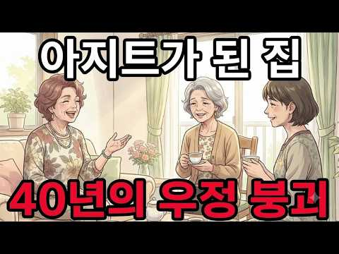
- 설명 앞부분: 깊은사연관은 삶과 가족, 인간관계 속에서 공감과 울림을 전하는 다양한 사연을 소개합니다. 오늘의 이야기가 작은 위로와 새로운 시선을 전해드리길 바랍니다. ※ 본 영상의 내용은 창작을 바탕으로 제작되었으며, 일부는 실제 사례에서 영감을 받아 재구성될 수 있습니다. 특정 인물이나 사건과의 일치는 우연입니다.
- 같은 채널 평소 대비 ×35.9 (채널 최근 롱폼 중앙값 720회) · 평소 영상: 60대 이후 절대 자랑하면 안되는 6가지ㅣ인생조언ㅣ노후준비ㅣ처세술ㅣ인간관계ㅣ삶의지혜ㅣ시니… (743회) / 60대 이후 아무리 가까워도 돈 빌려주지 말아야 할 5가지 유형ㅣ인생조언ㅣ노후준비ㅣ삶의지… (698회)
- 대본 없음 (설명) — 음성인식이 끝나면 도입부·흐름이 들어감
- 댓글 14/14: 좋은 점 — 영상 0 · 감사·응원 0 · 더 알고 싶은 것 1 · 아쉬운 점 — 영상 0 · 반박·불만 — 의견 다름 0 · 정치·사회 0 · 경험 공유 2 · 구독·다음 기대 0
  - 더 알고 싶은 것 👍5 “이런 사람들이 있을까요? 요즘은 다 어느정도 예의가 잇어요”
  - 경험 공유 👍1 “거절 못하는 병 나도 있는데”
  - 경험 공유 👍0 “좋은 친구네요 집을 내주니 나도 이런 친구 하나 있어서면 좋겟다”

### 159. [100분 통합본] 매력은 어떻게 만들어지는가 ∣ 관계의 미학

- https://www.youtube.com/watch?v=CcAjwzTjuuE · 관계의 미학 · 구독자 7,210 · 조회수 123,170 (×17.1, 하루 978.1) · 좋아요 2,447 (2.0%) · 105.9분 · 2026-07-08 · 주제 묶음 2. 인간관계·처세 · 형식 수면·낭독·오디오북 (잠잘 때·명언) · 폴더 `W_CcAjwzTjuuE` (웹 승인)
- 썸네일: 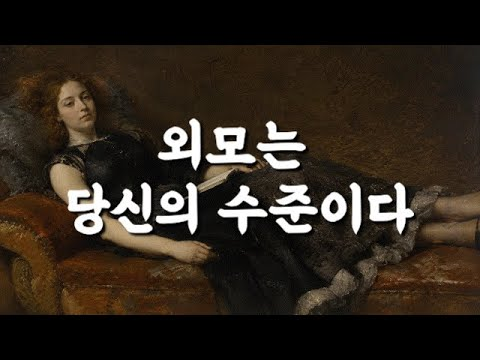
- 설명 앞부분: 사람의 매력은 얼굴에서 시작될까요? 우리는 첫인상을 외모로 판단하지만, 시간이 지날수록 사람을 기억하게 만드는 것은 얼굴이 아니라 태도, 분위기, 그리고 삶의 품격입니다. 이번 영상은 관계의 미학에서 많은 사랑을 받았던 이야기들을 하나로 엮은 100분 통합본입니다. 외모, 귀티, 분위기, 그리고 진정한 매력에 관한 이야기를 차분한 낭독과 함께 끝까지 만나보세요. 이 영상이 여러분의 하루에 작은 사색의 시간이 되기를 바랍니다. ※ 본 영상은 관계의 미학 채널의 기존 콘텐츠를 주제별로 재구성한 통합본입니다. 📖 관계의 미학은 사람과 …
- 같은 채널 평소 대비 ×20.1 (채널 최근 롱폼 중앙값 6,133회) · 평소 영상: 사람의 진짜 인격은 어디서 드러나는가 ∣ 관계의 미학 (6,133회) / 나이가 들어도 늙지 않는 사람들의 공통점 ∣ 공자의 지혜 (6,305회)
- 대본 없음 (설명) — 음성인식이 끝나면 도입부·흐름이 들어감
- 댓글 60/60: 좋은 점 — 영상 9 · 감사·응원 12 · 더 알고 싶은 것 0 · 아쉬운 점 — 영상 1 · 반박·불만 — 의견 다름 1 · 정치·사회 0 · 경험 공유 2 · 구독·다음 기대 0
  - 좋은 점 — 영상 👍51 “정말 공감합니다 저도 60세 주부인데요 나이들수록 냄새관리가 젤 중요해요 손주들도 냄새없고 예쁜 할머니를 좋아해요 운동하고 피부관리 하고 있어요ᆢ손자 손녀에게 잘 보이려고요~^^ 지금부터는 나에게 만 투자하려고요 매일 행복 합니다”
  - 좋은 점 — 영상 👍38 “매력도 능력이다. 진짜 맞는 말씀 입니다.~^^🎉”
  - 감사·응원 👍27 “와우..! 공감하고 .. 가다듬어진 것의 모습 이죠..! 부단한 노력이 필요 합니다! 저또한 .. 그리해서 53세 되었습니다. 감사합니다!^^ 🎉❤❤❤❤❤❤❤🎉”
  - 감사·응원 👍16 “좋은 글 정말 정말 감사합니다 🎉”
  - 아쉬운 점 — 영상 👍1 “말이 너무길다. 지로하게만든다”
  - 반박·불만 — 의견 다름 👍7 “내용은 좋은데 목소리가 잠와요 짧은영상도 아닌데 귀에 쏙쏙 들어오도록 시원하고 똑똑히 들리는 아주 청량한 목소리로 해주시면 좀더 듣는데 경청할것같네요.”
  - 경험 공유 👍51 “정말 공감합니다 저도 60세 주부인데요 나이들수록 냄새관리가 젤 중요해요 손주들도 냄새없고 예쁜 할머니를 좋아해요 운동하고 피부관리 하고 있어요ᆢ손자 손녀에게 잘 보이려고요~^^ 지금부터는 나에게 만 투자하려고요 매일 행복 합니다”
  - 경험 공유 👍20 “맞는 것 같아요 편한 청바지 입을때의 나의 모습과 정장차림의 나의모습이 내가 느끼기에도 다르더라구요 😅”

### 160. 성공한 사람들이 매일 운동하는 진짜 이유 (뇌과학이 밝힌 놀라운 변화) 뇌과학 ∣ 자기개발 ∣ 동기부여 ∣ 심리학

- https://www.youtube.com/watch?v=sspCBqfVhFw · 최적화 심리학 · 구독자 12,200 · 조회수 259,433 (×21.3, 하루 1,652.8) · 좋아요 5,795 (2.2%) · 17.9분 · 2026-06-07 · 주제 묶음 1. 심리학 일반 · 형식 정보·해설 (그 밖) · 폴더 `W_sspCBqfVhFw` (웹 승인)
- 썸네일: 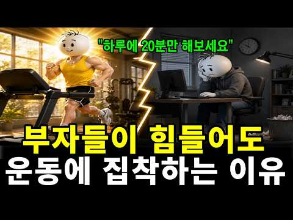
- 설명 앞부분: 혹시 요즘 부쩍 깜빡거리고, 머릿속이 안개 낀 듯 멍하신가요? 이 영상에서는 성공한 사람들이 왜 그토록 매일 운동에 집착하는지, 그 진짜 이유를 뇌과학으로 풀어드립니다. 운동이 분비시키는 '뇌의 기적의 비료' BDNF부터, 근육이 뇌에 보내는 신호, 그리고 단 하루 20분의 움직임이 어떻게 뇌와 자신감, 활력까지 되살리는지 차근차근 보여드립니다. 끝까지 보시면, 오늘 당장 무엇부터 시작해야 할지 분명해지실 겁니다. 이런 분들께 추천합니다 자꾸 깜빡거리고 머리가 멍해 고민이신 분 무기력하고 의욕이 없어 자꾸 자신을 탓하게 되는 분 …
- 같은 채널 평소 대비 ×54.3 (채널 최근 롱폼 중앙값 4,776회) · 평소 영상: 좋은 부부는 사랑보다 중요한 '이것'을 지킵니다. 부부부 사이 절대 하면 안 되는 말 ∣… (4,776회) / 집에 있는 것을 좋아하는 사람들의 놀라운 심리 ｜심리학이 밝힌 뇌과학적 이유 (4,256회)
- 대본 없음 (설명) — 음성인식이 끝나면 도입부·흐름이 들어감
- 댓글 303/303: 좋은 점 — 영상 18 · 감사·응원 36 · 더 알고 싶은 것 5 · 아쉬운 점 — 영상 1 · 반박·불만 — 의견 다름 2 · 정치·사회 0 · 경험 공유 10 · 구독·다음 기대 3
  - 좋은 점 — 영상 👍82 “늘 의지박약 이라고 생각했는데 몸을 움직이면 의지가 생긴다는 말이 와닿네요 위로가 됩니다 다시 용기내볼께요”
  - 좋은 점 — 영상 👍12 “좋은 정보 감사합니다 지금 이 순간부터 실행에 옮게 볼께요. 천천히 가는 것을 두려워 말고 멈추는 것 만을 두려워하라”
  - 감사·응원 👍12 “좋은 정보 감사합니다 지금 이 순간부터 실행에 옮게 볼께요. 천천히 가는 것을 두려워 말고 멈추는 것 만을 두려워하라”
  - 감사·응원 👍7 “와~~ 내 얘기하는줄... 나이들어 자꾸 단어가 생각이 안나서 나이들어 그런갑따했는데 그게 아니군요. 정보 감사합니다.”
  - 더 알고 싶은 것 👍1 “팀쿡도 스트레스 많겠죠? 이 스트레스를 어떻게 해소하는지도 좀 알려주세요 인생은 결국 스트레스 아닌가요?”
  - 더 알고 싶은 것 👍1 “너무 오래 앉아있는 우리 고등 아이들ㅠ 아침에 걸어서 학교 가는것 말고는 뭘 하면 좋을까요?학교 고1인데도 체육시간도 자율로 할때가 많더라구요ㅠ”
  - 아쉬운 점 — 영상 👍6 “운동은 강도가 아니라 빈도다!! 사람 목소리가 너무 좋네요!! Ai가 아니고”
  - 경험 공유 👍75 “습관적으로 지친 몸을 이끌고 크로스핏 박스로 7년째 출석합니다. 정신이 육체를 지배합니다.”
  - 경험 공유 👍34 “나도 멍게인가 뇌가 거의 기능을 안하는듯”
  - 구독·다음 기대 👍4 “보건소 운동처방사입니다. 요즘 치매 예방 교육을 위해 공부를 하면 할수록 결국에는 운동의 중요성이 더욱 확실해집니다. 많은 분들이 이 영상을 보셨음 좋겠어요. 홈쇼핑서 약 사드시지말고… 특히 멍게의 예시 너무 좋았습니다! 구독하고 갑니당❤”
  - 구독·다음 기대 👍4 “구독합니다 ❤❤❤감사합니다”

