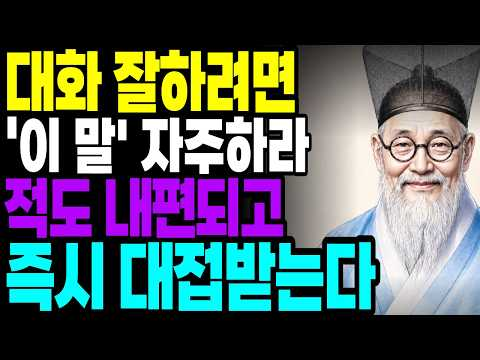

# 심리 — 성공 사례 분석: 사례별 자세히 #121–#122

`analysis.md` 의 9번 (같은 # 번호). 자동 생성 — `tools/success_analysis.py` v1.6 (2026-11-12 04:49 UTC). ※ 연구·교육용 — 투자 권유가 아님.

### 121. "복수는 이렇게 하는 겁니다" 정신과 의사가 알려주는 나르시시스트 복수

- https://www.youtube.com/watch?v=ELs2L4rM2kg · 멘탈주치의 수근 원장 · 구독자 6,510 · 조회수 98,010 (×15.1, 하루 662.7) · 좋아요 1,566 (1.6%) · 9분 · 2026-06-16 · 주제 묶음 4. 나쁜 사람 알아보기 · 형식 인터뷰·강연·대담 (전문가) · 폴더 `W_ELs2L4rM2kg` (웹 승인)
- 썸네일: 
- 설명 앞부분: 나르시시스트가 가장 견디지 못하는 것은 무엇일까요? 혹시 지금도 누군가 때문에 분노와 억울함에서 벗어나지 못하고 계시다면 이번 영상이 도움이 될 수 있습니다. 📱 임수근 원장님의 일상 & 콘텐츠 더 보기
- 대본 없음 (설명) — 음성인식이 끝나면 도입부·흐름이 들어감
- 댓글 249/249: 좋은 점 — 영상 8 · 감사·응원 13 · 더 알고 싶은 것 7 · 아쉬운 점 — 영상 2 · 반박·불만 — 의견 다름 4 · 정치·사회 0 · 경험 공유 27 · 구독·다음 기대 0
  - 좋은 점 — 영상 👍49 “,나르격어보셨나요훌륭하십니다.공감100프로”
  - 좋은 점 — 영상 👍30 “도움이 됩니다. 지긋지긋한 나르.. 이혼 과정도 너무 힘이드네요.”
  - 감사·응원 👍69 “저 6개월만에 이혼했어요 우울증 수면제 약먹고 원룸사는 시어머니 모시고 살재서 싫댔는데 욕하고 밖에 못나가게 해서요 한달에 삼십만원 생활비로 받고 기름값 핸드폰비 각종 자동이체 내기도 부족한 돈인데 계란이라도 사려고 십만원만 달랬더니 첫마디가 안된다 못박으며 수입과 …”
  - 감사·응원 👍16 “감사요. 그런데 그렇게 할 수록 삐뚤어진 방법으로 더 집착하니ㆍㆍㆍ에~휴~333”
  - 더 알고 싶은 것 👍2 “나르시스트랑 공포회피형은 어떻게 구분할 수 있나요??”
  - 더 알고 싶은 것 👍1 “진짜 궁금한데요, 나르는 선천적인건가요? 아니면 후천적으로 만들어지는 건가요? 궁금합니다. 열등감때문에 그렇게 나르가 되는 건지요.”
  - 아쉬운 점 — 영상 👍11 “공감 100퍼입니다. 저는. 심리학에 관심 많아서 나르 대처를 무척 잘햇는데. 회사분이.. 16년 당햇는데... 미치게 했는데 그걸. 참고 인내하는데 존경스러웟어요. 나중엔 부분탈모~~ 거짓모함.허황된 어그로 끌기. 거짓말후. 죄책감없음. 웃기고 웃긴데. .사람을 언…”
  - 아쉬운 점 — 영상 👍1 “나르시스트 아주 자존심 쎄고 사람 차별 아주 기회주의자 같아요!! 겉과속이 다른 이유없이 뒷통수 잘깐다 아주 빤뻔한 새끼에요 특히 교인들 딋통수 잘까요!!!”
  - 반박·불만 — 의견 다름 👍0 “너무많이오래버티었나바요.무관시으로나만의세계를사는것,무반응.무관심.어떠한상황에서도아무일아닌것처럼무관심.함께하지않는확고하고고요하게나만의삶에집중한다.숨소리도조용하게.심심하게해주는것괜찬은듯.어이없는현실.넘넘어이없어요.선생님말씀모두모두다겪어습니다.가능한얼굴안보고대화는꼭필요한말…”
  - 경험 공유 👍69 “저 6개월만에 이혼했어요 우울증 수면제 약먹고 원룸사는 시어머니 모시고 살재서 싫댔는데 욕하고 밖에 못나가게 해서요 한달에 삼십만원 생활비로 받고 기름값 핸드폰비 각종 자동이체 내기도 부족한 돈인데 계란이라도 사려고 십만원만 달랬더니 첫마디가 안된다 못박으며 수입과 …”
  - 경험 공유 👍10 “나는 진심이었는데 상대는 나르시시스트였어. 망가지기 직전에 내가 빠져나왔어”

### 122. 대화 잘하려면 이 말 자주하라 적도 내편되고 즉시 대접받는다 ∣ 정약용 명언 ∣ 인간관계 ∣ 대화법 ∣ 처세술 ∣ 인생지혜 ∣ 오디오북

- https://www.youtube.com/watch?v=JH2N6gHp_dw · 늘네편 · 구독자 13,900 · 조회수 210,450 (×15.1, 하루 1,398.3) · 좋아요 3,856 (1.8%) · 87.3분 · 2026-06-13 · 주제 묶음 2. 인간관계·대화 · 형식 오디오북·책 요약 · 폴더 `W_JH2N6gHp_dw` (웹 승인)
- 썸네일: 
- 설명 앞부분: 🌿 나이가 들수록 내 진심과 다르게 사람들과 엇나가 외로우셨나요? [ 사람의 마음을 여는 세 줄기 봄볕 같은 말 ] 존재를 밝히는 '알아봐 주는 말' 막연한 칭찬 대신 상대의 작은 수고와 변화를 구체적으로 짚어주고, 다정하게 이름을 불러주세요. 빈말이 아닌 진짜 관심이 사람을 살려냅니다. 마음을 두드리는 '물어봐 주는 말' 내 주장을 앞세워 충고하기보다 상대의 감정을 먼저 물어주세요. 그리고 대답할 때까지 따뜻한 침묵으로 기다려주는 것이 진정한 위로입니다. 자존심을 지켜주는 '세워 주는 말' 공은 양보하고, 실수는 덮어주며, 남들…
- 대본 없음 (설명) — 음성인식이 끝나면 도입부·흐름이 들어감
- 댓글 77/77: 좋은 점 — 영상 6 · 감사·응원 13 · 더 알고 싶은 것 0 · 아쉬운 점 — 영상 12 · 반박·불만 — 의견 다름 2 · 정치·사회 0 · 경험 공유 1 · 구독·다음 기대 0
  - 좋은 점 — 영상 👍5 “삶의 지혜를 배우고 갑니다”
  - 좋은 점 — 영상 👍5 “정말 귀한말씀 경청하면서 많이 배웠습시다 얼마남지 않은 삶이지만 존경받는 삶을 남기겠습니다”
  - 감사·응원 👍36 “< 늘 네편 > ( 곡괭이가 아니라 봄볕 입니다.) ( 한번 져주는것이 열번 이기는 것이다.) ( 남을 세워주는 사람이 가장 높이 선다. ) 참으로 , 주옥 과 같은 말씀 ! 가슴이 젖어 옵니다. 오늘도 다시 찾아와 다시 들어 보니 더 깊이 마음에 새겨 집니다. 고맙…”
  - 감사·응원 👍7 “감사합니다🥰”
  - 아쉬운 점 — 영상 👍17 “서론이 너무 길어서, 시간 낭비...”
  - 아쉬운 점 — 영상 👍15 “내용이 너무 지루하고 중언부언해서 따라하다가는 사람들이 다 싫어할듯ㅠ”
  - 반박·불만 — 의견 다름 👍3 “사람 거기서거기 믿을수없는게인간 그렇치만~~~~~ 나는 무조건 상대가어떤말을하든 좋은대화로바꾸거나 해석을좋은쪽의로틀어버려 긍정에말로들어버리고 다른말들은 무시하거나대꾸를하지않는다 내입에서나가는말은 무조건 긍정 즐거운말 웃기는말 기쁜말”
  - 경험 공유 👍1 “참보약 말입니다. 저희는 경남 촌입니다”

