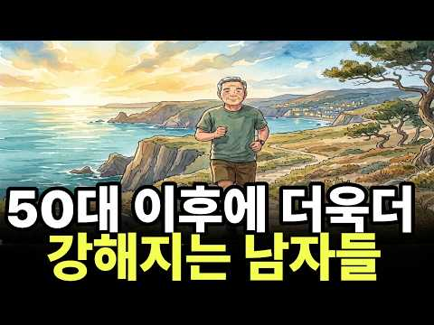
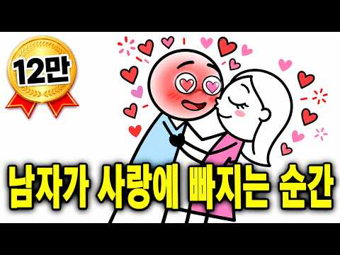
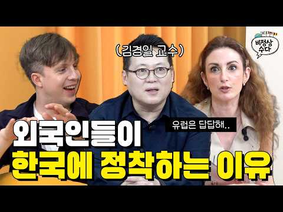
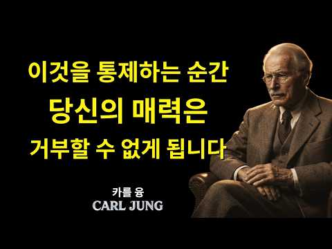
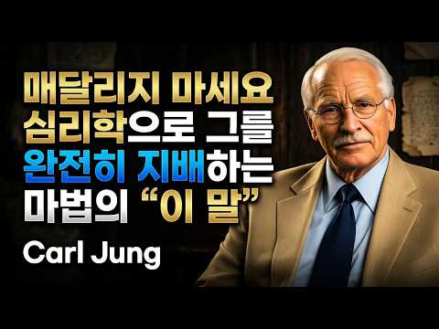
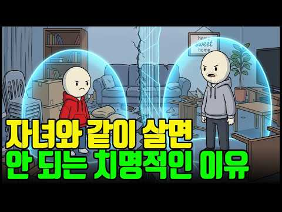
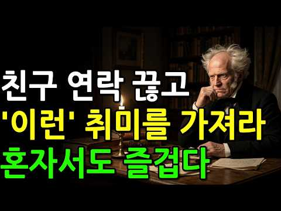
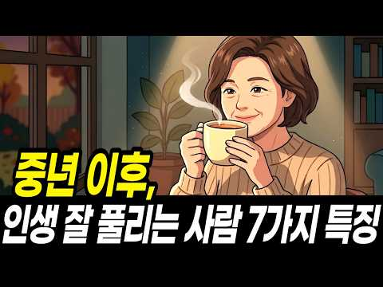
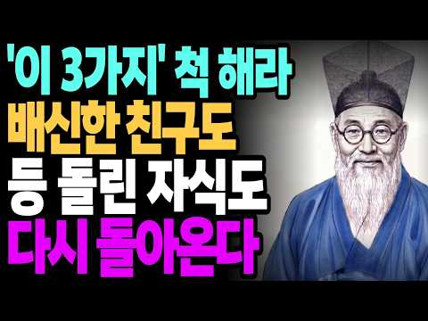
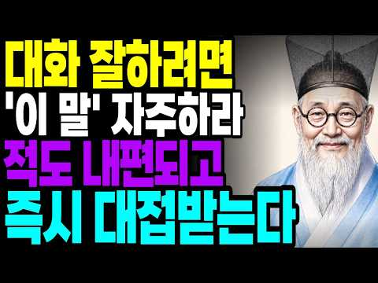

# 심리 — 성공 사례 분석: 사례별 자세히 #161–#174

`analysis.md` 의 9번 (같은 # 번호). 자동 생성 — `tools/success_analysis.py` v1.6 (2026-11-11 13:41 UTC). ※ 연구·교육용 — 투자 권유가 아님.

### 161. 중년에 무너진 뒤 인생 후반에 다시 서는 남자들 5가지 특징 ㅣ 인생 후반전 ㅣ 퇴직 후 삶 ㅣ 은퇴 후 삶 ㅣ 50대 노후준비 ㅣ 중년 심리학

- https://www.youtube.com/watch?v=6kAqWl52Ti8 · 오 마이템  · 구독자 3,740 · 조회수 49,171 (×13.2, 하루 491.8) · 좋아요 353 (0.7%) · 17.8분 · 2026-08-03 · 주제 묶음 1. 심리학 일반 · 형식 정보·해설 (그 밖) · 폴더 `W_6kAqWl52Ti8` (웹 승인)
- 썸네일: 
- 챕터: 0:00 쉰둘에 나오는데 일흔셋까지 일하고 싶다 — 소득 절벽… · 0:53 왜 하필 쉰 언저리인가 — 52.9세와 행복 U자 곡선 · 2:24 첫 번째 — 자기를 직함으로 설명하지 않는다 · 5:10 두 번째 — 무너지고 도망치지 않는다 · 7:26 세 번째 — 제일 먼저 몸부터 세운다 · 9:47 네 번째 — 거절이 담백해진다 · 11:54 다섯 번째 — 버틴 시간을 손해로 안 읽는다 · 14:08 왜 이 다섯이 한 사람에게 같이 오는가 · 16:17 오늘 할 것 한 가지
- 설명 앞부분: 쉰두 살. 한국 사람이 가장 오래 다닌 회사에서 나오는 평균 나이입니다. 그 나이는 행복이 인생에서 제일 낮게 찍히는 나이와 정확히 겹칩니다. 그런데 같은 자리에서 무너지고도 몇 년 뒤 전보다 세져 있는 사람들이 있습니다. 인생 후반에 성공하는 남자들에게서 똑같이 나오는 5가지 특징을 중년 심리학으로 풀었습니다. 다루는 것 명함이 사라진 다음 날 진짜로 잃는 것 (역할 정체성 · 자기 복잡성) 같은 자리에서 갈리는 이유 (회피 대처 vs 접근 대처) 왜 다들 하필 몸부터 다시 세우는가 (통제 소재) 20년 못 하던 거절이 갑자기 …
- 같은 채널 평소 대비 ×9.9 (채널 최근 롱폼 중앙값 4,974회) · 평소 영상: 결혼을 앞둔 자식에게 절대로 하면 안 되는 말 3가지 ∣ 자식 결혼 ∣ 부모 (5,950회) / 어릴 적 할머니 집에서 자란 손녀가 힘들면 할머니부터 찾는 이유 ∣ 황혼육아 (3,998회)
- 대본 없음 (설명) — 음성인식이 끝나면 도입부·흐름이 들어감
- 댓글 32/32: 좋은 점 — 영상 0 · 감사·응원 0 · 더 알고 싶은 것 0 · 아쉬운 점 — 영상 0 · 반박·불만 — 의견 다름 0 · 정치·사회 0 · 경험 공유 1 · 구독·다음 기대 0
  - 경험 공유 👍3 “저는 상품 사람 안전을 경험했습니다”

### 162. 중년 이후, 얼굴이 평온한 사람들의 공통점 ㅣ 별별심리ㅣ중년심리ㅣ심리학

- https://www.youtube.com/watch?v=3xaDysZUaFM · 별별 심리 · 구독자 3,870 · 조회수 17,541 (×4.5, 하루 503.6) · 좋아요 42 (0.2%) · 10분 · 2026-10-07 · 주제 묶음 1. 심리학 일반 · 형식 정보·해설 (그 밖) · 폴더 `W_3xaDysZUaFM` (웹 승인)
- 썸네일: 
- 설명 앞부분: 아무 표정도 짓지 않았는데, 왜 남들은 내 얼굴에서 감정을 읽어낼까요? 평온한 얼굴은 좋은 일이 많아서가 아니라, 무언가를 그만둔 사람들에게서 나타났습니다. 나이 든 분들의 무표정에서 평소 감정 성향이 읽혔다는 심리학 연구를 바탕으로 이야기합니다. 오늘 마음이 유난히 시끄러웠다면 10분만 곁에 두고 들어보세요. 참고자료 Carol Z. Malatesta 외 ([소속 확인 필요]): 노년기 얼굴 표정과 정서 성향 연구(Affect, personality, and facial expressive characteristics of ol…
- 같은 채널 평소 대비 ×8.6 (채널 최근 롱폼 중앙값 2,038회) · 평소 영상: 중년 이후, 가난을 막고 돈을 부르는 현실 방법 (2,038회) / 아들은 왜 엄마한테만 짜증을 낼까, 심리학이 밝힌 진짜 이유 (2,272회)
- 대본 없음 (설명) — 음성인식이 끝나면 도입부·흐름이 들어감
- 댓글 0/0: 좋은 점 — 영상 0 · 감사·응원 0 · 더 알고 싶은 것 0 · 아쉬운 점 — 영상 0 · 반박·불만 — 의견 다름 0 · 정치·사회 0 · 경험 공유 0 · 구독·다음 기대 0

### 163. "남자의 호감이 '헌신'으로 바뀌는 4단계: 연애 고수만 아는 심리 트리거"

- https://www.youtube.com/watch?v=Vo_VOKwqjBs · 톡톡 연애심리 · 구독자 6,610 · 조회수 123,717 (×18.7, 하루 841.6) · 좋아요 1,896 (1.5%) · 14.8분 · 2026-06-17 · 주제 묶음 1. 심리학 일반 · 형식 정보·해설 (그 밖) · 폴더 `W_Vo_VOKwqjBs` (웹 승인)
- 썸네일: 
- 챕터: 0:00 남자의 적극적인 행동, 과연 사랑일까? · 2:35 도파민의 함정: '호감'과 '사랑'을 구분하는 법 · 3:40 [1단계] 취약성을 드러냈을 때, '안전지대'가 되어… · 6:05 [2단계] 남자의 가치를 인정하고 존경을 표현하는 언어 · 8:30 [3단계] 위기 상황에서 뇌를 안정시키는 '정서적 성… · 10:48 [4단계] 삶의 방향성과 가치관이 일치하는 '동기화'… · 12:35 남자의 확신을 끌어내는 3가지 실전 액션 플랜 · 14:14 결론: 당신을 대체 불가능한 존재로 만드는 법
- 설명 앞부분: 매일 아침 선톡을 보내고 주말마다 맛있는 밥을 사주는 남자, 하지만 당신은 왜 계속 불안할까요? 연애 초기 남자가 보이는 열정은 사랑이 아니라 ' 도파민'에 불과한 일시적 상태일 수 있습니다. 많은 여성분들이 남자의 물질적, 시간적 투자에 안심했다가 관계가 식으면 깊은 상처를 받습니다. 하지만 뇌과학과 진화심리학 관점에서 보면, 남자의 가벼운 호감이 '절대적인 헌신'으로 진화하는 결정적인 심리적 트리거(Trigger)는 따로 있습니다. 오늘 영상에서는 단순히 남자의 마음을 애타게 만드는 기술이 아니라, 그 남자의 세상에서 당신이 …
- 같은 채널 평소 대비 ×28.5 (채널 최근 롱폼 중앙값 4,335회) · 평소 영상: 여자들이 절대 모르는 진짜 바람둥이 구별법, '이 행동' 보이면 즉시 도망치세요. (4,335회) / "착할수록 빨리 질립니다" 남자가 당신을 떠난 진짜 이유 (질리는 연애 특징) (5,128회)
- 대본 없음 (설명) — 음성인식이 끝나면 도입부·흐름이 들어감
- 댓글 55/55: 좋은 점 — 영상 1 · 감사·응원 0 · 더 알고 싶은 것 0 · 아쉬운 점 — 영상 3 · 반박·불만 — 의견 다름 0 · 정치·사회 0 · 경험 공유 5 · 구독·다음 기대 1
  - 좋은 점 — 영상 👍491 “상대방이 애매한것같을때 저는 천시록 참고했는데 도움이 좀 되더라구요.”
  - 아쉬운 점 — 영상 👍3 “영상에 쓸데없는 부가적 설명과 반복되는 말이 너무 많음”
  - 아쉬운 점 — 영상 👍0 “서두 너무 길어요 하…..”
  - 경험 공유 👍126 “내남편이최고다 한결같은 안정형 10년째 뜨겁지는않지만 든든해 도파민3개월이상 안가는듯 우리도 연애초6개월만 미친듯 사랑했지 ㅎㅎ지금은 우정 소소한즐거움 돈모으는재미”
  - 경험 공유 👍26 “제가 사랑하는 남자도 이런면이 있다면 저도 깊은 사랑을 할 수 있을 것 같아요 먼저 저부터 그런 사람이 되어볼게요❤”
  - 구독·다음 기대 👍21 “남편과 아들 셋 키우는 사람으로서 남자를 더 이해하는 계기가 되었네요❤구독하고 가요❤”

### 164. 🌙틀어놓고 주무세요 '타인은 지옥이다' 인간관계 피로를 단번에 끊어내는 샤르트르의 밤

- https://www.youtube.com/watch?v=-593UnQhVPM · 잠결에듣는세계사 · 구독자 40,100 · 조회수 201,430 (×5.0, 하루 5,047.8) · 좋아요 1,192 (0.6%) · 84.1분 · 2026-10-02 · 주제 묶음 2. 인간관계·처세 · 형식 수면·낭독·오디오북 (잠잘 때·명언) · 폴더 `W_-593UnQhVPM` (웹 승인)
- 썸네일: 
- 설명 앞부분: "타인은 지옥이다." 20세기 실존주의의 거장 장 폴 샤르트르가 남긴 이 날카로운 선언의 진짜 의미를 알고 계십니까? 타인의 시선이라는 감옥에 갇혀 진정한 나 자신을 잃어버린 현대인들에게 샤르트르는 인생의 주도권을 되찾는 단 하나의 해답을 제시합니다. 잠 못 이루는 밤, 끝없는 인간관계의 피로와 불안을 잠재우고 내면의 완전한 자유를 마주하는 철학적 통찰을 만나보세요.
- 같은 채널 평소 대비 ×15.3 (채널 최근 롱폼 중앙값 13,178회) · 평소 영상: 🌙틀어놓고 주무세요 '지옥의 끝에서 천국을 노래한 단테의 신곡 풀스토리' (13,206회) / 💥저작권등록💥 '오자병법 무패신화 풀스토리입니다' (13,150회)
- 대본 없음 (설명) — 음성인식이 끝나면 도입부·흐름이 들어감
- 댓글 65/65: 좋은 점 — 영상 1 · 감사·응원 0 · 더 알고 싶은 것 0 · 아쉬운 점 — 영상 0 · 반박·불만 — 의견 다름 1 · 정치·사회 2 · 경험 공유 2 · 구독·다음 기대 0
  - 반박·불만 — 의견 다름 👍1 “자기가 신이 아닌데 어떻게 신의 뜻이 무엇이지 아나요 자신이 신의 뜻을 안다고 생각하는 사고의 오류. 한계를 극복하지 못한 망상가 였습니다 사르트르는”
  - 정치·사회 👍32 “한국 정치 소설가 한강이란 다르구나... 625를 북침 항미원조전쟁 ... 중국인 가튼 3류 소설가.. 노벨상도 중국화 되는듯.. 중국이 세계 제패하면 한강이 조선자치구 서기 될려나 기대해 봅니다”
  - 경험 공유 👍1 “보리스 파스테르나크가..이미 노벨문학상 거부 했었죠. 시대상황적으로 할 얘기는 많은데..암튼 그렇습니다. 흠.. 그렇습니다.”

### 165. [EP.12] 인지심리학자 김경일 교수가 본 한국 문화의 특수성 (feat.이탈리아 절대 못 돌아간다는 크리스티나)ㅣ비정상수다

- https://www.youtube.com/watch?v=AmNYmxOZSDA · 파도파도 스튜디오 · 구독자 30,100 · 조회수 378,057 (×12.6, 하루 3,634.8) · 좋아요 6,082 (1.6%) · 31.6분 · 2026-07-30 · 주제 묶음 1. 심리학 일반 · 형식 인터뷰·강연·대담 (교수·의사·스님) · 폴더 `W_AmNYmxOZSDA` (웹 승인)
- 썸네일: 
- 같은 채널 평소 대비 ×0.9 (채널 최근 롱폼 중앙값 422,075회) · 평소 영상: [EP.24] 한국인은 당연한 줄 알지만… 유럽인이 반한 한국의 자연 (w.숲속의 마리엘… (422,075회) / [EP.25] 한국어 번역하는 외국인들이 본 요즘 한국어 인기 (w.에바 카이나)ㅣ비정상… (437,748회)
- 대본 없음 (없음) — 음성인식이 끝나면 도입부·흐름이 들어감
- 댓글 206/206: 좋은 점 — 영상 4 · 감사·응원 8 · 더 알고 싶은 것 4 · 아쉬운 점 — 영상 2 · 반박·불만 — 의견 다름 2 · 정치·사회 13 · 경험 공유 18 · 구독·다음 기대 1
  - 좋은 점 — 영상 👍128 “와 전문가가 오시니깐 분석을 해주셔서 더 유익했어요~~ 재밌네요~ 이런 비교 분석 좋아해서 비정상회담 프로 참 좋아했는데 ㅎㅎㅎ 그리운 프로”
  - 좋은 점 — 영상 👍7 “너무 너무 유익하고 재미있는 내용이였어요^^ 잘 보고 갑니다^^😊”
  - 감사·응원 👍48 “아시아에서 돌려 말하기가 특화된 나라는 오히려 일본과 중국입니다. 난세가 길고 무인들이 정권을 쥐는 경우가 많았기 때문에 솔직하게 이야기하면 그야말로 목이 달아나기 일쑤였어요. 반면에 우리나라는 1000년 왕조인 신라를 예외로 치더라도 한 왕조가 500년은 갈 정도로…”
  - 감사·응원 👍16 “크리스티나님 응원합니다 ~~~^^”
  - 더 알고 싶은 것 👍22 “식사문화가 다른건 알겠는데 코스요리도 알고 어떤코스인줄 알겠는데 우린 배고파서 식사하러 간거니까 답답하거든여 먹는데 시간많이 안걸리니까... 그래서 좀 궁금해서 그런데 다른 유럽 예를들어 이탈리아 사람들은 그런 코스가 나오는 식당을 갈때는 식사말고 다른 기대 하는게 …”
  - 더 알고 싶은 것 👍5 “너무 궁금한게 저 교수님이 진짜 어려운 단어들을 쓰고 있는데 양옆 두 분이 백프로 이해하는지 그게 궁금해요. 오랫동안 한국에 살지만 단어가 사실 많이 어려운건 우리도 어렵거든요. 근데 쉽게 말하지 않고 어려운 말들 자연스럽게 쓰는데도 잘 이해해 보이는게 부럽달까요? …”
  - 아쉬운 점 — 영상 👍10 “24년전에 캐나다 살아봤었는데, 그 시절에, "서구권(캐나다)은 지루한 천국, 한국은 재미있는 지옥" 이라고 나도 했던 말인데.... ㅎㅎ”
  - 아쉬운 점 — 영상 👍0 “수많은 침략을 당한 역사가 이리 만든게 아닐까??? 파괴되고 빼앗끼고~죽임을 당하고~~그걸 복구하고~다른 침략을 대비해야하고~~이런게 반복되어 DNA에 각인된???? 암내나는 특성은 호랑이에게 솎아져 없다졌다는 속설처럼???????”
  - 반박·불만 — 의견 다름 👍0 “섭외 잘못하신 듯. 심리학자의 얼굴이 아닙니다. 웃는 눈 하고 있는 사람을 가까이 해서 좋을것이 전혀 없다는거 인생좀 살아본 사람이면 죄다 아는 사실.”
  - 정치·사회 👍101 “한국에 잘 적응해서 살아가는 대한외국인분들 보면 모국과 비슷한 점을 찾아서 적응하시는 것 같더라고요.”
  - 정치·사회 👍75 “정말 예전과 달라진건 단순히 외국인들이 많이 보이는 수준이 아니라 아기 혹은 아이들을 동반해서 돌아다니는 가족단위의 케이스들이 정말 많아졌다는거 그 분들이 여행을 온것인지 이민이나 귀화인지 노동자 가족인지 미군 가족인지 거기까지는 모르겠으나 어쨌든 가족단위로 돌아다니…”
  - 경험 공유 👍381 “나도 첫 일본 여행가서 ,, 여기가 내 세상이다 하고 한 달 살기 하러 갔는데....2주 만에 돌아옴 ... 어디가 좋다 싫다 떠나서 그냥 한국이 너무 편해ㅜㅜ”
  - 경험 공유 👍21 “재미있는 지옥이 저도 좋아용😊😊❤❤❤”
  - 구독·다음 기대 👍12 “줄리안과 크리스티나. 두분 너무너무 좋아요. 오늘이 채널 처음 들어 왔는데 두분이 이곳에 게셨군요, 구독합니다 ㅎㅎㅎ”

### 166. 세상에서 가장 매력적인 힘… 스스로를 통제할 줄 아는 여성 ∣ 칼 융

- https://www.youtube.com/watch?v=U_q5j28YfJ8 · 영혼의 메아리 · 구독자 4,630 · 조회수 12,763 (×2.8, 하루 556.7) · 좋아요 172 (1.4%) · 39분 · 2026-10-19 · 주제 묶음 7. 말투·호감 · 형식 정보·해설 (그 밖) · 폴더 `W_U_q5j28YfJ8` (웹 승인)
- 썸네일: 
- 설명 앞부분: 세상에서 가장 매력적인 힘… 스스로를 통제할 줄 아는 여성 ∣ 칼 융 세상에서 가장 거부할 수 없는 매력은 외모나 화려함에서 나오지 않습니다. 그것은 바로 **‘자기 자신을 온전히 통제하고 평온을 선택한 여성’**에게서 나옵니다. 더 이상 사랑을 증명하려 애쓰지 않고, 나의 감정을 변명하지 않으며, 타인의 도발에 즉각 반응하지 않고 침묵 속에서 스스로의 중심을 지킬 때 우리의 영혼은 전혀 다른 차원으로 진화합니다. 수많은 폭풍을 지나오며 지친 여러분에게, 이제는 결핍이 아닌 ‘풍요로움’ 속에서 진정한 자존감과 평화를 되찾는 지혜를…
- 같은 채널 평소 대비 ×2.3 (채널 최근 롱폼 중앙값 5,442회) · 평소 영상: 그가 말만 달콤하게 하고… 당신을 위해 아무것도 행동하지 않을 때 ∣ 칼 융 (5,489회) / 그가 당신을 존중하지 않고 자리를 내어주지 않을 때… 아무도 말해주지 않는 진실 ∣ 칼 융 (5,396회)
- 대본 없음 (설명) — 음성인식이 끝나면 도입부·흐름이 들어감
- 댓글 6/6: 좋은 점 — 영상 0 · 감사·응원 2 · 더 알고 싶은 것 0 · 아쉬운 점 — 영상 0 · 반박·불만 — 의견 다름 0 · 정치·사회 0 · 경험 공유 0 · 구독·다음 기대 0
  - 감사·응원 👍4 “나의 평온함이 곧 나의 새로운 아름다움이다 감사합니다”
  - 감사·응원 👍1 “저에게 딱 맞는 메세지 감사합니다!”

### 167. 그가 당신의 감정을 자극해 놓고 멀어질 때 대처하는 방법 ∣ 칼 융

- https://www.youtube.com/watch?v=dH2FLMA6RKM · 마음의 깊이 · 구독자 1,170 · 조회수 11,686 (×10.0, 하루 140.3) · 좋아요 140 (1.2%) · 45.2분 · 2026-08-20 · 주제 묶음 3. 자존감·감정·멘탈 · 형식 정보·해설 (그 밖) · 폴더 `W_dH2FLMA6RKM` (웹 승인)
- 썸네일: 
- 설명 앞부분: 그가 당신의 감정을 자극해 놓고 멀어질 때 대처하는 방법 ∣ 칼 융 그가 당신에게 강한 관심을 보이다가 갑자기 차가워졌다면, 가장 먼저 떠오르는 생각은 무엇인가요? “내가 뭘 잘못했을까?” “왜 갑자기 변한 걸까?” “내가 먼저 연락해야 할까?” 상대가 가까워졌다가 다시 멀어지는 순간, 우리의 마음은 쉽게 불안과 추측에 사로잡힙니다. 하지만 바로 그 순간이야말로 상대의 행동보다 나 자신의 내면을 바라봐야 할 때일 수 있습니다. 이 영상에서는 칼 융의 분석심리학적 관점을 바탕으로, 상대방의 거리 두기에 감정적으로 끌려가지 않고 자신…
- 같은 채널 평소 대비 ×9.9 (채널 최근 롱폼 중앙값 1,184회) · 평소 영상: 남자가 하루 종일 당신 생각만 하게 만드는 것 (이유도 모른 채) ∣ 칼 융 심리학 (1,184회) / 외모적인 끌림보다 남자의 존경심을 깨우는 태도 ∣ 칼 융 (1,208회)
- 대본 없음 (설명) — 음성인식이 끝나면 도입부·흐름이 들어감
- 댓글 10/10: 좋은 점 — 영상 2 · 감사·응원 3 · 더 알고 싶은 것 0 · 아쉬운 점 — 영상 1 · 반박·불만 — 의견 다름 1 · 정치·사회 0 · 경험 공유 1 · 구독·다음 기대 0
  - 좋은 점 — 영상 👍0 “"상대방이 감정을 흔들어놓고 거리를 둘 때의 무의식적 심리를 칼 융의 관점에서 정말 깊이 있게 풀어주셨네요. 타인의 행동에 흔들리지 않고 내면의 중심과 경계를 지키는 법을 깨닫게 됩니다. 깊은 울림을 주는 좋은 영상 감사합니다! 🙏✨"”
  - 감사·응원 👍1 “저에게하는말씀같아요.감사합니다.❤”
  - 감사·응원 👍0 “"상대방이 감정을 흔들어놓고 거리를 둘 때의 무의식적 심리를 칼 융의 관점에서 정말 깊이 있게 풀어주셨네요. 타인의 행동에 흔들리지 않고 내면의 중심과 경계를 지키는 법을 깨닫게 됩니다. 깊은 울림을 주는 좋은 영상 감사합니다! 🙏✨"”
  - 아쉬운 점 — 영상 👍3 “나는 지금 반응하고 있는가? 스스로 이끌고 있는가? 항상 반응하고 있었네요. 반복해서 듣고 더 단단한 사람이 되어야 겠어요. 더이상 저런인간에게 나를 내어주지 않도록..”
  - 반박·불만 — 의견 다름 👍6 “책에 답이 있습니다.“ 《삶은 방식이다》를 읽고서…” 삶은 누구에게나 공평하지 않고, 노력했다고 해서 반드시 보답받는 것도 아닙니다.인생은 운명이 아니라, 내가 매일 선택한 삶의 방식이 만들어낸 결과물입니다.어떻게 살아갈 것인가를 고민한다면, 양태승의 《삶은 방식이다…”
  - 경험 공유 👍6 “책에 답이 있습니다.“ 《삶은 방식이다》를 읽고서…” 삶은 누구에게나 공평하지 않고, 노력했다고 해서 반드시 보답받는 것도 아닙니다.인생은 운명이 아니라, 내가 매일 선택한 삶의 방식이 만들어낸 결과물입니다.어떻게 살아갈 것인가를 고민한다면, 양태승의 《삶은 방식이다…”

### 168. 자식을 망치고 부모를 파멸시키는 ‘한 집 살이’의 심리학 l 부모자식갈등 ㅣ관계심리 ㅣ인간관계 ㅣ가족갈등 ㅣ가족심리 ㅣ치유심리학 ㅣ분리독립

- https://www.youtube.com/watch?v=P065MMfxPhE · 치유심리학 · 구독자 17,200 · 조회수 331,541 (×19.3, 하루 1,906.4) · 좋아요 6,957 (2.1%) · 10분 · 2026-05-21 · 주제 묶음 2. 인간관계·처세 · 형식 정보·해설 (그 밖) · 폴더 `W_P065MMfxPhE` (웹 승인)
- 썸네일: 
- 챕터: 0:00 인트로: 내 집인데도 자녀 눈치 보며 숨이 막히는 진… · 1:00 본론 1: 성인 자녀와 함께 살 때 뇌에서 일어나는 … · 2:05 본론 2: 자식을 불구로 만드는 과보호, '가학적 친… · 3:08 솔루션 1: 물리적 공간 분리와 감정적 '타인 선언'… · 4:12 솔루션 2: 부모의 에너지 과녁 바꾸기와 학습된 무기… · 5:15 아웃트로: 세상에서 가장 아름다운 이별, 온전한 홀로…
- 설명 앞부분: 매일 아침 눈을 뜨면 집에 무거운 침묵이 흐르고, 다 자란 자녀의 눈치를 보느라 내 집인데도 마음 편히 쉬지 못하고 계시진 않나요. 밥은 먹었는지, 출근은 잘했는지 던지는 평범한 안부 인사조차 어느새 잔소리가 되어 날카로운 대립으로 돌아오곤 합니다. 내 모든 것을 바쳐 키운 내 자식인데, 왜 성인이 된 지금은 한 공간에 있는 것 자체가 숨이 막히고 서로에게 상처가 되는 걸까요. 많은 부모님이 이것을 단순한 세대 갈등이나 자녀의 성격 탓으로 돌리지만, 사실 이것은 의지의 문제가 아닙니다. 성인이 된 인간의 무의식은 전혀 다른 생존 …
- 같은 채널 평소 대비 ×166.2 (채널 최근 롱폼 중앙값 1,994회) · 평소 영상: 부모가 절대 인정하지 않는 자식에 대한 착각 l부모자식관계 ㅣ트라우마 ㅣ심리학 ㅣ마음치유… (2,025회) / 나이 들수록 친구가 사라지는 진짜 이유ㅣ친구관계 ㅣ인간관계 ㅣ대인관계 ㅣ관계심리 ㅣ심리학… (1,964회)
- 대본 없음 (설명) — 음성인식이 끝나면 도입부·흐름이 들어감
- 댓글 618/618: 좋은 점 — 영상 11 · 감사·응원 22 · 더 알고 싶은 것 4 · 아쉬운 점 — 영상 1 · 반박·불만 — 의견 다름 11 · 정치·사회 5 · 경험 공유 69 · 구독·다음 기대 1
  - 좋은 점 — 영상 👍6 “처음부터 끝까지 너무 맞는 말이라서 소름이 돋아요. 완전 남동생과 엄마의 관계를 관찰하고 얘기하는 듯 똑같아요. 정말 좋은 내용 입니다.”
  - 좋은 점 — 영상 👍1 “많은 것을 느끼게 하는 유익한 내용이였습니다. 구독과 좋아요 누르고 갑니다 감나합니다.”
  - 감사·응원 👍15 “세빠지게 밥해주고 과일차려주고 빨래해주고 내삶이 고단해도 노력했는데 세자녀들은 모두 자신들만의 공간을 찿아 떠나더군요. 독립을 감사하게 생각해야하는데도 빈둥지증후군으로 아직도 힘들어요. 내삶이 바보같다는 생각이 어리섞게도 들더군요. 너무 집중해서 오랜세월 노예처럼 살…”
  - 감사·응원 👍4 “완전공감 입니다 감사합니다”
  - 더 알고 싶은 것 👍7 “부모도 모시면 안되는건가요? 생각해보면 인류는 대가족 집단체제였는데 이건 어떻게 해석해야할까요?”
  - 더 알고 싶은 것 👍0 “일하고있는 성인이된 자녀에게 같이 살면서 월세를 받는것은 어떤가요? 😊”
  - 아쉬운 점 — 영상 👍135 “독립한 자녀가 가정을 이루고, 시부모 지원없이 직장 근처의 집을 구입했습니다. 그런데 시부모가 아들 며느리가 사는 지역에 이사오고 싶어하고, 애를 키워달라고 요구한 적도 없는데 키워준다고 합니다. 아들이 정중하게 거절했더니 아들에게 화내고 소리치는 시어머니의 심리는 …”
  - 반박·불만 — 의견 다름 👍5 “성인이 되면 더 이상 나의 아이가 아닙니다. 같이 사는건 좋지 않습니다”
  - 반박·불만 — 의견 다름 👍2 “성인 이후 부모님하고 같이 산지 20년이 넘었습니다 스트레스 받다가 생명의 위협을 느껴본적도 있습니다 부모님하고 사는데 뭔 스트레스이니 생명의 위협이니 말도 안되는 소리 같죠? 나이 먹으면 먹을수록 부모님과 같이 살아본 사람이라면 뭔지 알겁니다”
  - 정치·사회 👍16 “선진국에선 이런 문제 방지 위해 20세가 되면 정부에서 월세 지원금 이 나오죠. 독립해서 나 가라고.”
  - 정치·사회 👍5 “그런데 현재정부가 월세전세가격을 올려서 내보낼 돈이없다는~~~~”
  - 경험 공유 👍822 “딸 둘은 시집 가고 늦동이 아들이 서른 세살인데 같이 살다가 분가를 준비하고 있습니다 서울에 있는 아파트 팔아서 경기도로 가면서 아들 집 보증금 보태주고 나머지로 칠십이 된 우리 부부 노년에 쓰다가 가려구요 남편은 아들의 수입이 일정하지 않아 분가 시키는걸 썩 내켜하…”
  - 경험 공유 👍279 “친정엄마가 몸이불편하고 치매증있어서 모시고 사는데 온갖걸 다참견해서 매일이 싸움이네요. 엄마 모시려다가 스트레스로 내가 먼저 죽겠어요ㅠ”
  - 구독·다음 기대 👍2 “훌륭하신 말씀 감사합니다. 구독하고 가요.”

### 169. 연락 끊고 혼자 지내보면 알게 됩니다 ∣ 타인의 시선에서 완벽히 해방되는 '고독의 기술' ∣ 쇼펜하우어 ∣ 철학 ∣ 오디오북 ∣ 인간관계 인생조언

- https://www.youtube.com/watch?v=Blppz6jc4o4 · 늑대의 지혜 · 구독자 33,500 · 조회수 58,544 (×1.8, 하루 3,704.9) · 좋아요 311 (0.5%) · 138.1분 · 2026-10-26 · 주제 묶음 2. 인간관계·처세 · 형식 수면·낭독·오디오북 (잠잘 때·명언) · 폴더 `W_Blppz6jc4o4` (웹 승인)
- 썸네일: 
- 설명 앞부분: 주말마다 모임에 나가 사람들과 어울리고 돌아온 밤, 뼈속까지 밀려오는 지독한 허탈감과 피로를 느껴본 적이 있으신가요? 사람들은 흔히 이를 '외로움'이라 부르며 더 많은 사람을 만나라고 조언하지만, 철학자 쇼펜하우어는 이것이야말로 인간을 파멸로 이끄는 가장 치명적인 착각이라고 경고합니다. 우리가 겪는 피로의 대다수는 육체적 노동이 아니라, 타인의 비위를 맞추고 시선을 의식하느라 소모하는 '감정적 에너지 낭비' 때문이기 때문입니다. 이 영상에서는 쇼펜하우어의 날카로운 통찰을 통해, 불필요한 인간관계의 소모전을 끝내고 오직 나 자신에게…
- 같은 채널 평소 대비 ×13.7 (채널 최근 롱폼 중앙값 4,273회) · 평소 영상: [정약용 명언]"절대로 칭찬하지 마세요" ∣ 다산 정약용이 밝히는 사람을 따르게 만드는 … (4,619회) / "차라리 개를 키우는 게 낫습니다" 정약용이 경고한 곁에 두면 인생 망치는 1순위 인간 (3,927회)
- 대본 없음 (설명) — 음성인식이 끝나면 도입부·흐름이 들어감
- 댓글 9/9: 좋은 점 — 영상 0 · 감사·응원 0 · 더 알고 싶은 것 0 · 아쉬운 점 — 영상 0 · 반박·불만 — 의견 다름 0 · 정치·사회 0 · 경험 공유 0 · 구독·다음 기대 0

### 170. 중년 이후, 잘 풀리는 사람의 7가지

- https://www.youtube.com/watch?v=S57RYhmF7kk · 별별 심리 · 구독자 3,870 · 조회수 72,178 (×18.6, 하루 424.1) · 좋아요 841 (1.2%) · 17.2분 · 2026-05-25 · 주제 묶음 1. 심리학 일반 · 형식 정보·해설 (그 밖) · 폴더 `W_S57RYhmF7kk` (웹 승인)
- 썸네일: 
- 설명 앞부분: 쉰 넘기고 만남마다 가벼워지는 분과 점점 무거워지는 분, 차이는 어디서 생길까요? 하버드 의대가 80년 동안 한 세대 전체를 추적해 도착한 답은 의외였습니다. 평생 가족 챙기며 살아온 그 일이, 운동·식단보다 강한 노후 예측인자였습니다. 50대 이후 친구 정리, 자녀와의 거리두기, 입에서 떼어내야 할 한 마디까지. 잘 풀리는 중년이 관계를 다루는 정확한 방식 일곱 가지를 풀어드립니다. 빈 둥지 증후군의 통념, 부정 편향이 하루를 덮는 메커니즘, 새 모임 앞에서 점수를 12점 올린 한 단어 실험까지. 영상 마지막에는 오늘 저녁 당장…
- 같은 채널 평소 대비 ×33.5 (채널 최근 롱폼 중앙값 2,155회) · 평소 영상: 아들은 왜 엄마한테만 짜증을 낼까, 심리학이 밝힌 진짜 이유 (2,272회) / 중년 이후, 가난을 막고 돈을 부르는 현실 방법 (2,038회)
- 대본 없음 (설명) — 음성인식이 끝나면 도입부·흐름이 들어감
- 댓글 50/50: 좋은 점 — 영상 1 · 감사·응원 0 · 더 알고 싶은 것 0 · 아쉬운 점 — 영상 0 · 반박·불만 — 의견 다름 0 · 정치·사회 0 · 경험 공유 3 · 구독·다음 기대 1
  - 좋은 점 — 영상 👍1 “특별한 비결보다 기본을 지키는 게 중요하다는 말에 공감합니다.”
  - 경험 공유 👍37 “난 지금 암 요양중. 그냥 사람이고 뭐고. 다 필요없고 건강하기만 했으면좋겠다 내가족도”
  - 경험 공유 👍11 “내가 생각하는 노년기 1. 경제적 준비 2. 심리적 성숙 *포기할건 포기하고 불자처럼 물흐르듯 살아가기 3. 관계의 소중함 *아끼는 사람에게 항상 최선을 다하며 아껴주기 배우자가 영순위가 되어야 함 4. 몸 아끼기 *소처럼 일하다가 늙어서 몸 박살남 이 준비를 40대…”
  - 구독·다음 기대 👍3 “다른 영상도 기대됩니다 🔥”

### 171. 좋아하는데도 일부러 거리를 두는 사람의 심리｜마음은 있는데 가까이 다가오지 않는 이유｜인간관계｜심리학｜인생조언

- https://www.youtube.com/watch?v=FNSJWUxdhh0 · 심리토크 · 구독자 1,630 · 조회수 10,401 (×6.4, 하루 172.7) · 좋아요 0 (0.0%) · 21.8분 · 2026-09-12 · 주제 묶음 2. 인간관계·처세 · 형식 정보·해설 (그 밖) · 폴더 `W_FNSJWUxdhh0` (웹 승인)
- 썸네일: 
- 같은 채널 평소 대비 ×33.3 (채널 최근 롱폼 중앙값 312회) · 평소 영상: 계속 변명하는 사람들의 심리｜무슨 말을 해도 자기 잘못을 인정하지 않는 이유｜인간관계｜심… (323회) / 말할수록 손해보는 사람들의 공통점｜굳이 하지 않아도 될 말을 해서 일을 망치는 이유｜인간… (301회)
- 대본 없음 (없음) — 음성인식이 끝나면 도입부·흐름이 들어감
- 댓글 0/0: 좋은 점 — 영상 0 · 감사·응원 0 · 더 알고 싶은 것 0 · 아쉬운 점 — 영상 0 · 반박·불만 — 의견 다름 0 · 정치·사회 0 · 경험 공유 0 · 구독·다음 기대 0

### 172. 사람을 만나면 3가지 척하라 배신한 친구도 등 돌린 자식도 다시 돌아온다 ∣ 정약용 명언 ∣ 인간관계 ∣ 인생지혜 ∣ 친구관계 ∣ 처세술

- https://www.youtube.com/watch?v=tdp8oqX_xOo · 늘네편 · 구독자 13,900 · 조회수 254,250 (×18.3, 하루 1,448.8) · 좋아요 8,228 (3.2%) · 82.3분 · 2026-05-19 · 주제 묶음 2. 인간관계·처세 · 형식 정보·해설 (그 밖) · 폴더 `W_tdp8oqX_xOo` (웹 승인)
- 썸네일: 
- 설명 앞부분: 🌿 어제 만난 사람도 내 편으로 만드는 마법 같은 태도가 있습니다. 나이가 들수록 주변에 사람이 머물게 하려면 어떻게 해야 할까요? ✨ 오늘의 지혜 노트 🌸 사람을 끌어당기는 3가지 지혜 모르는 척 : 끝까지 귀 기울여 들어주며 상대를 주인공으로 만들어주기 약한 척 : 빈틈을 보여주어 상대방이 내게 다가올 수 있는 다리 놓아주기 고마운 척 : 아주 작은 호의라도 크게 기뻐하며 마음을 다해 감사하기 🌸 사람을 밀어내는 3가지 실수 잘난 척 : 묻지도 않은 자랑을 늘어놓아 상대방을 작아지게 만들기 아는 척 : 대화의 흐름을 끊고 내가…
- 같은 채널 평소 대비 ×72.2 (채널 최근 롱폼 중앙값 3,520회) · 평소 영상: 무심 속에 가장 큰 힘이 숨어 있다. 무심은 약이되고 무관심은 독이된다. l 정약용 명언… (3,579회) / 자식 앞에서 웃지 마세요. 딱 3초만 참으면 다시는 함부로 무시하지 못합니다 l 정약용 … (3,460회)
- 대본 없음 (설명) — 음성인식이 끝나면 도입부·흐름이 들어감
- 댓글 742/742: 좋은 점 — 영상 30 · 감사·응원 95 · 더 알고 싶은 것 1 · 아쉬운 점 — 영상 1 · 반박·불만 — 의견 다름 2 · 정치·사회 0 · 경험 공유 9 · 구독·다음 기대 4
  - 좋은 점 — 영상 👍59 “시간을 내어 주는 사람이 되자 나를거두고 상대를 모시는 사람이 되자 많은 깨달음 줍니다 좋은말씀 감사합니다 잘난척(×) 바쁜척(×)아는척(×) 약한척(0) 모는척(0)고마운척(0)”
  - 좋은 점 — 영상 👍49 “나는 자기를 모시고 상대를 모시는 사람이다. 혼자가는 길은 외롭지만 함께 가는 길은 따듯합니다 새벽에 좋은 영상 감명 깊이 들었습니다.”
  - 감사·응원 👍59 “시간을 내어 주는 사람이 되자 나를거두고 상대를 모시는 사람이 되자 많은 깨달음 줍니다 좋은말씀 감사합니다 잘난척(×) 바쁜척(×)아는척(×) 약한척(0) 모는척(0)고마운척(0)”
  - 감사·응원 👍44 “정말 몰라서 못했던것들 늘 들으면서 많이 배우고 있습니다. 감사합니다”
  - 아쉬운 점 — 영상 👍1 “너무 길어요 세가지요점만 말해줘도 알것 같은데 부연설명이 많으니 들어도 요점이 뭔지 모르겠어요”
  - 반박·불만 — 의견 다름 👍0 “상대배려 하면 호구로보고 어이없는게 인긴사다 다부질없다”
  - 경험 공유 👍10 “사람을 떠나게 하는 말이나 행동보다, 사람을 다시 돌아오게 만든 경험이 있으신가요? 여러분의 소중한 경험이나 생각을 댓글로 함께 나눠주시면 많은 분들에게 큰 도움이 될 것입니다.”
  - 경험 공유 👍1 “참으로 감사 합니다 늘 내가 써 왔던 바쁘다였읍니다 참으로 도움이 되었고 나를 낮추고 상대를 모시는 마음이 되고 싶네요”
  - 구독·다음 기대 👍3 “오늘부터 열심히 실천하여 풍요로운 노년을 만들기를 기대합니다❤🎉😊”
  - 구독·다음 기대 👍3 “기대됩니다”

### 173. "복수는 이렇게 하는 겁니다" 정신과 의사가 알려주는 나르시시스트 복수

- https://www.youtube.com/watch?v=ELs2L4rM2kg · 멘탈주치의 수근 원장 · 구독자 6,510 · 조회수 98,001 (×15.1, 하루 662.7) · 좋아요 1,566 (1.6%) · 9분 · 2026-06-16 · 주제 묶음 5. 나르시시스트·가스라이팅 · 형식 인터뷰·강연·대담 (교수·의사·스님) · 폴더 `W_ELs2L4rM2kg` (웹 승인)
- 썸네일: 
- 설명 앞부분: 나르시시스트가 가장 견디지 못하는 것은 무엇일까요? 혹시 지금도 누군가 때문에 분노와 억울함에서 벗어나지 못하고 계시다면 이번 영상이 도움이 될 수 있습니다. 📱 임수근 원장님의 일상 & 콘텐츠 더 보기
- 같은 채널 평소 대비 ×27.5 (채널 최근 롱폼 중앙값 3,566회) · 평소 영상: 🚫아까워서 못 버린 물건 갖다 버려야 하는 이유 "언젠가 쓰지 않을까요...?" (4,890회) / 절대 먼저 연락 안 하지만... 막상 만나면 다정한 사람들 특징 (5,211회)
- 대본 없음 (설명) — 음성인식이 끝나면 도입부·흐름이 들어감
- 댓글 249/249: 좋은 점 — 영상 8 · 감사·응원 13 · 더 알고 싶은 것 7 · 아쉬운 점 — 영상 2 · 반박·불만 — 의견 다름 4 · 정치·사회 0 · 경험 공유 27 · 구독·다음 기대 0
  - 좋은 점 — 영상 👍49 “,나르격어보셨나요훌륭하십니다.공감100프로”
  - 좋은 점 — 영상 👍30 “도움이 됩니다. 지긋지긋한 나르.. 이혼 과정도 너무 힘이드네요.”
  - 감사·응원 👍69 “저 6개월만에 이혼했어요 우울증 수면제 약먹고 원룸사는 시어머니 모시고 살재서 싫댔는데 욕하고 밖에 못나가게 해서요 한달에 삼십만원 생활비로 받고 기름값 핸드폰비 각종 자동이체 내기도 부족한 돈인데 계란이라도 사려고 십만원만 달랬더니 첫마디가 안된다 못박으며 수입과 …”
  - 감사·응원 👍16 “감사요. 그런데 그렇게 할 수록 삐뚤어진 방법으로 더 집착하니ㆍㆍㆍ에~휴~333”
  - 더 알고 싶은 것 👍2 “나르시스트랑 공포회피형은 어떻게 구분할 수 있나요??”
  - 더 알고 싶은 것 👍1 “진짜 궁금한데요, 나르는 선천적인건가요? 아니면 후천적으로 만들어지는 건가요? 궁금합니다. 열등감때문에 그렇게 나르가 되는 건지요.”
  - 아쉬운 점 — 영상 👍11 “공감 100퍼입니다. 저는. 심리학에 관심 많아서 나르 대처를 무척 잘햇는데. 회사분이.. 16년 당햇는데... 미치게 했는데 그걸. 참고 인내하는데 존경스러웟어요. 나중엔 부분탈모~~ 거짓모함.허황된 어그로 끌기. 거짓말후. 죄책감없음. 웃기고 웃긴데. .사람을 언…”
  - 아쉬운 점 — 영상 👍1 “나르시스트 아주 자존심 쎄고 사람 차별 아주 기회주의자 같아요!! 겉과속이 다른 이유없이 뒷통수 잘깐다 아주 빤뻔한 새끼에요 특히 교인들 딋통수 잘까요!!!”
  - 반박·불만 — 의견 다름 👍0 “너무많이오래버티었나바요.무관시으로나만의세계를사는것,무반응.무관심.어떠한상황에서도아무일아닌것처럼무관심.함께하지않는확고하고고요하게나만의삶에집중한다.숨소리도조용하게.심심하게해주는것괜찬은듯.어이없는현실.넘넘어이없어요.선생님말씀모두모두다겪어습니다.가능한얼굴안보고대화는꼭필요한말…”
  - 경험 공유 👍69 “저 6개월만에 이혼했어요 우울증 수면제 약먹고 원룸사는 시어머니 모시고 살재서 싫댔는데 욕하고 밖에 못나가게 해서요 한달에 삼십만원 생활비로 받고 기름값 핸드폰비 각종 자동이체 내기도 부족한 돈인데 계란이라도 사려고 십만원만 달랬더니 첫마디가 안된다 못박으며 수입과 …”
  - 경험 공유 👍10 “나는 진심이었는데 상대는 나르시시스트였어. 망가지기 직전에 내가 빠져나왔어”

### 174. 대화 잘하려면 이 말 자주하라 적도 내편되고 즉시 대접받는다 ∣ 정약용 명언 ∣ 인간관계 ∣ 대화법 ∣ 처세술 ∣ 인생지혜 ∣ 오디오북

- https://www.youtube.com/watch?v=JH2N6gHp_dw · 늘네편 · 구독자 13,900 · 조회수 210,450 (×15.1, 하루 1,398.3) · 좋아요 3,856 (1.8%) · 87.3분 · 2026-06-13 · 주제 묶음 2. 인간관계·처세 · 형식 수면·낭독·오디오북 (잠잘 때·명언) · 폴더 `W_JH2N6gHp_dw` (웹 승인)
- 썸네일: 
- 설명 앞부분: 🌿 나이가 들수록 내 진심과 다르게 사람들과 엇나가 외로우셨나요? [ 사람의 마음을 여는 세 줄기 봄볕 같은 말 ] 존재를 밝히는 '알아봐 주는 말' 막연한 칭찬 대신 상대의 작은 수고와 변화를 구체적으로 짚어주고, 다정하게 이름을 불러주세요. 빈말이 아닌 진짜 관심이 사람을 살려냅니다. 마음을 두드리는 '물어봐 주는 말' 내 주장을 앞세워 충고하기보다 상대의 감정을 먼저 물어주세요. 그리고 대답할 때까지 따뜻한 침묵으로 기다려주는 것이 진정한 위로입니다. 자존심을 지켜주는 '세워 주는 말' 공은 양보하고, 실수는 덮어주며, 남들…
- 같은 채널 평소 대비 ×59.8 (채널 최근 롱폼 중앙값 3,520회) · 평소 영상: 무심 속에 가장 큰 힘이 숨어 있다. 무심은 약이되고 무관심은 독이된다. l 정약용 명언… (3,579회) / 자식 앞에서 웃지 마세요. 딱 3초만 참으면 다시는 함부로 무시하지 못합니다 l 정약용 … (3,460회)
- 대본 없음 (설명) — 음성인식이 끝나면 도입부·흐름이 들어감
- 댓글 77/77: 좋은 점 — 영상 6 · 감사·응원 13 · 더 알고 싶은 것 0 · 아쉬운 점 — 영상 12 · 반박·불만 — 의견 다름 2 · 정치·사회 0 · 경험 공유 1 · 구독·다음 기대 0
  - 좋은 점 — 영상 👍5 “삶의 지혜를 배우고 갑니다”
  - 좋은 점 — 영상 👍5 “정말 귀한말씀 경청하면서 많이 배웠습시다 얼마남지 않은 삶이지만 존경받는 삶을 남기겠습니다”
  - 감사·응원 👍36 “< 늘 네편 > ( 곡괭이가 아니라 봄볕 입니다.) ( 한번 져주는것이 열번 이기는 것이다.) ( 남을 세워주는 사람이 가장 높이 선다. ) 참으로 , 주옥 과 같은 말씀 ! 가슴이 젖어 옵니다. 오늘도 다시 찾아와 다시 들어 보니 더 깊이 마음에 새겨 집니다. 고맙…”
  - 감사·응원 👍7 “감사합니다🥰”
  - 아쉬운 점 — 영상 👍17 “서론이 너무 길어서, 시간 낭비...”
  - 아쉬운 점 — 영상 👍15 “내용이 너무 지루하고 중언부언해서 따라하다가는 사람들이 다 싫어할듯ㅠ”
  - 반박·불만 — 의견 다름 👍3 “사람 거기서거기 믿을수없는게인간 그렇치만~~~~~ 나는 무조건 상대가어떤말을하든 좋은대화로바꾸거나 해석을좋은쪽의로틀어버려 긍정에말로들어버리고 다른말들은 무시하거나대꾸를하지않는다 내입에서나가는말은 무조건 긍정 즐거운말 웃기는말 기쁜말”
  - 경험 공유 👍1 “참보약 말입니다. 저희는 경남 촌입니다”

