# 📊 YouTube '자기계발' 주제 분석 리포트

> 생성 2026-10-11 12:12 KST · 노트북 v2.3.0 · 실행ID `20261011_120632` · 지역 KR / 언어 ko  
> ⚠️ 연구·교육용 분석 결과입니다. **투자 조언이 아니며**, 통계는 상관관계일 뿐 인과관계를 보장하지 않습니다.

## 0. 한눈에 보기 (TL;DR)

- ⚙️ **설정 파일**: `selfdev/analyzer_config.toml`
- **분석 데이터**: 영상 473개 수집 → 성과 분석 67개 (업로드 2025-10-12 ~ 2026-09-23, 업로드 후 14일 이상 경과), 채널 315개, 검색 키워드 13개(6개 카테고리), 주제 무관 영상 76개 제외
- **성공(아웃라이어) 기준**: 조회수 10,000회 이상 **그리고** 같은 채널 최근 영상 중앙값의 3배 이상 → 14개 (20.9%)
- 🗂️ **기회가 큰 소재(카테고리)**: 5. 나이대·직장인 고민 (70점), 4. 루틴·갓생 (실천과 현실) (56점), 2. 미루기·작심삼일·습관 (55점)
- 🎯 **기회가 가장 큰 키워드**: `30대 후반 자기계발`(76점), `미루는 습관 극복`(71점), `미라클모닝 방법`(68점), `30대 직장인 자기계발`(64점), `자존감 떨어질때`(57점)
- 🎬 **포맷별 성공 비율**: 라이브 0.0% (배수 중앙값 -배, n=1) · 롱폼 23.3% (배수 중앙값 2.07배, n=43) · 쇼츠 17.4% (배수 중앙값 1.38배, n=23) → 추천: **롱폼** 중심
- ⏱️ **롱폼 추천 길이**: 12~20분 (성공 비율 상위 구간)
- 🏷️ **효과 있는 제목 요소**: 따옴표(인용) 1.27배, 괄호/대괄호 1.19배, 해시태그 1.09배, 숫자 포함 1.02배  /  역효과: 초보/방법(초보·기초·정리) 0.87배  (*=다중비교 보정 후 유의, q<0.05)
- 🌱 **작은 채널도 터지나?**: 소규모(<1만) 채널 영상의 성공 비율 5.9% vs 대형(≥10만) 14.3%. 성공한 소규모 채널의 업로드 빈도 중앙값: 주 2.0회
- 🕒 **업로드 타이밍(참고)**: 성공 비율 높은 요일 수, 화 / 시간대 18~20시, 15~17시 (KST)
- 💸 **API 쿼터 사용**: 1,920 / 예산 9,000 (일일 한도 10,000)

## 1. 🎬 추천 영상 아이디어 (데이터 기반)

제목 예시는 이번 데이터에서 효과가 확인된 제목 요소(따옴표(인용), 괄호/대괄호; 데이터 기반 (lift≥1.1))를 키워드 성격(실패·손실 사연 / 사기·피해 / 일반 정보)에 맞춰 조합한 **템플릿 예시**입니다. 그대로 쓰기보다 참고 영상의 실제 제목·썸네일·도입부(대본)를 함께 보고 다듬으세요.

### 1. `30대 후반 자기계발` — 기회점수 **76**/100 · 일반 정보

- 근거: 검색 상위 20개 영상 일평균 조회수 중앙값 **784회**, 소규모 채널 진입 성공 비율 **5.0%**, 최근 90일 영상 비율 0.0%, 경쟁 채널 구독자 중앙값 24.5만명, 아웃라이어 배수 중앙값 22.89배, 성공 영상 3개
- 추천 포맷: **nan** · 롱폼이면 12~20분 · 검색 상위 중 쇼츠 비율 73.3%
- 제목 예시: 「"30대 후반 자기계발" 이렇게 하면 망합니다」 / 「30대 후반 자기계발 완벽 정리 (초보 필수)」 / 「30대 후반 자기계발 초보가 꼭 알아야 할 3가지」
- 참고할 성공 영상:
  - [30대에 안 바꾸면 40대에 진짜 후회하는 것들 \| 시사 애니메이션](https://www.youtube.com/watch?v=5EQkjp9rOas) — 조회수 44.5만, 구독자 5.2만, 채널 평균의 80.2배, 롱폼
  - [20대 때 돈 버는 것보다 더 중요한 것](https://www.youtube.com/watch?v=QPKar_hPyjU) — 조회수 60.3만, 구독자 8.1만, 채널 평균의 27.5배, 쇼츠
  - [생각이 바뀌면 행동이 바뀌고 인생이 바뀐다⭑.ᐟ #인생책 #책추천 #자기계발 #철…](https://www.youtube.com/watch?v=5HkR7yArr6A) — 조회수 30.6만, 구독자 1.8만, 채널 평균의 22.9배, 롱폼

### 2. `미루는 습관 극복` — 기회점수 **71**/100 · 일반 정보

- 근거: 검색 상위 20개 영상 일평균 조회수 중앙값 **251회**, 소규모 채널 진입 성공 비율 **10.0%**, 최근 90일 영상 비율 5.6%, 경쟁 채널 구독자 중앙값 16.6만명, 아웃라이어 배수 중앙값 1.62배, 성공 영상 2개
- 추천 포맷: **롱폼** · 롱폼이면 12~20분 · 검색 상위 중 쇼츠 비율 16.7%
- 제목 예시: 「미루는 습관 극복 완벽 정리 (초보 필수)」 / 「"미루는 습관 극복" 이렇게 하면 망합니다」 / 「미루는 습관 극복 핵심 5가지만 기억하세요」
- 참고할 성공 영상:
  - [부자들이 실천하는 ‘2분 법칙’｜미루는 습관이 사라지는 뇌 과학  \| 동기부여 …](https://www.youtube.com/watch?v=W0hR-XSKAlU) — 조회수 39.6만, 구독자 1.2만, 채널 평균의 246.4배, 롱폼
  - [아무리 미루던 사람도 오늘부터 달라집니다｜감정 회로를 되살리는 간단한 방법](https://www.youtube.com/watch?v=AfgdEFjf3Fs) — 조회수 11.9만, 구독자 2.0만, 채널 평균의 189.9배, 롱폼
  - [2명의 뇌과학자가 말하는 미루는 습관 끊어내는 법 \| 서울대 뇌인지학과 이인아 …](https://www.youtube.com/watch?v=GS-VuhSi1i4) — 조회수 45.5만, 구독자 75.5만, 채널 평균의 1.9배, 롱폼

### 3. `미라클모닝 방법` — 기회점수 **68**/100 · 일반 정보

- 근거: 검색 상위 20개 영상 일평균 조회수 중앙값 **217회**, 소규모 채널 진입 성공 비율 **10.0%**, 최근 90일 영상 비율 0.0%, 경쟁 채널 구독자 중앙값 27.8만명, 아웃라이어 배수 중앙값 2.49배, 성공 영상 2개
- 추천 포맷: **롱폼** · 롱폼이면 12~20분 · 검색 상위 중 쇼츠 비율 11.8%
- 제목 예시: 「"미라클모닝 방법" 이렇게 하면 망합니다」 / 「미라클모닝 방법 완벽 정리 (초보 필수)」 / 「미라클모닝 방법 초보가 꼭 알아야 할 7가지」
- 참고할 성공 영상:
  - [매일 아침이 개운한, 가장 현실적인 '기상 루틴'](https://www.youtube.com/watch?v=cg22mQrXh44) — 조회수 55.2만, 구독자 4.2만, 채널 평균의 49.5배, 롱폼
  - [미라클모닝 8년차가 알려주는 꿀팁 (feat. 책 추천)](https://www.youtube.com/watch?v=IC4bp5K8usI) — 조회수 4.1만, 구독자 6.3만, 채널 평균의 16.8배, 롱폼
  - [(매일 들으세요) 아침에 이걸 하는 사람만이 부자가 된다](https://www.youtube.com/watch?v=HI9ite4WsEA) — 조회수 43.7만, 구독자 105만, 채널 평균의 2.8배, 롱폼

### 4. `30대 직장인 자기계발` — 기회점수 **64**/100 · 일반 정보

- 근거: 검색 상위 20개 영상 일평균 조회수 중앙값 **784회**, 소규모 채널 진입 성공 비율 **0.0%**, 최근 90일 영상 비율 10.5%, 경쟁 채널 구독자 중앙값 27.8만명, 아웃라이어 배수 중앙값 7.87배, 성공 영상 2개
- 추천 포맷: **nan** · 롱폼이면 12~20분 · 검색 상위 중 쇼츠 비율 31.6%
- 제목 예시: 「30대 직장인 자기계발 완벽 정리 (초보 필수)」 / 「"30대 직장인 자기계발" 이렇게 하면 망합니다」 / 「30대 직장인 자기계발 핵심 3가지만 기억하세요」
- 참고할 성공 영상:
  - [20, 30대에 진짜 중요한 것 (feat. 스탠퍼드대 부학장, CTO)](https://www.youtube.com/watch?v=pT-4GKN2s4c) — 조회수 38.3만, 구독자 13.5만, 채널 평균의 7.9배, 롱폼
  - [30대 인생 바뀌는 습관 7가지｜비로소 깨달은 ‘단단한 나’로 사는 법 (타임셋업…](https://www.youtube.com/watch?v=sAyczCWw3h8) — 조회수 2.2만, 구독자 3.4만, 채널 평균의 2.1배, 롱폼

### 5. `자존감 떨어질때` — 기회점수 **57**/100 · 일반 정보

- 근거: 검색 상위 20개 영상 일평균 조회수 중앙값 **546회**, 소규모 채널 진입 성공 비율 **5.0%**, 최근 90일 영상 비율 0.0%, 경쟁 채널 구독자 중앙값 113만명, 아웃라이어 배수 중앙값 209.45배, 성공 영상 1개
- 추천 포맷: **nan** · 롱폼이면 12~20분 · 검색 상위 중 쇼츠 비율 25.0%
- 제목 예시: 「"자존감 떨어질때" 이렇게 하면 망합니다」 / 「자존감 떨어질때 완벽 정리 (초보 필수)」 / 「자존감 떨어질때 초보가 꼭 알아야 할 5가지」
- 참고할 성공 영상:
  - [자존감 극복 방법 TOP1: 무조건적인 박수갈채, 일방적인 칭찬](https://www.youtube.com/watch?v=T1N1tvpfJL0) — 조회수 694만, 구독자 204만, 채널 평균의 209.5배, 쇼츠

### 6. `자존감 높이는 법` — 기회점수 **50**/100 · 일반 정보

- 근거: 검색 상위 20개 영상 일평균 조회수 중앙값 **339회**, 소규모 채널 진입 성공 비율 **0.0%**, 최근 90일 영상 비율 0.0%, 경쟁 채널 구독자 중앙값 32.5만명, 아웃라이어 배수 중앙값 2.33배, 성공 영상 2개
- 추천 포맷: **nan** · 롱폼이면 12~20분 · 검색 상위 중 쇼츠 비율 35.0%
- 제목 예시: 「자존감 높이는 법 완벽 정리 (초보 필수)」 / 「"자존감 높이는 법" 이렇게 하면 망합니다」 / 「자존감 높이는 법 핵심 7가지만 기억하세요」
- 참고할 성공 영상:
  - [자존감을 높이는 가장 확실한 방법 #한혜진 #동기부여 #자존감](https://www.youtube.com/watch?v=QhvU_0VPQuM) — 조회수 37.5만, 구독자 766, 채널 평균의 480.3배, 쇼츠
  - [심리학으로 밝혀낸 자존감 높이는 방법 4 #심리학 #자존감](https://www.youtube.com/watch?v=rIpYimuqT0g) — 조회수 4.0만, 구독자 1.2만, 채널 평균의 3.9배, 쇼츠
  - ["이거였어?" 자존감 높은 사람들이 일상에서 쓰는 말투의 비결┃자존감 높이는 법](https://www.youtube.com/watch?v=GJ_5BQWJWfU) — 조회수 2.7만, 구독자 2.0만, 채널 평균의 2.3배, 롱폼

### 7. `번아웃 극복 방법` — 기회점수 **50**/100 · 일반 정보

- 근거: 검색 상위 20개 영상 일평균 조회수 중앙값 **91회**, 소규모 채널 진입 성공 비율 **5.0%**, 최근 90일 영상 비율 0.0%, 경쟁 채널 구독자 중앙값 17.4만명, 아웃라이어 배수 중앙값 2.18배, 성공 영상 1개
- 추천 포맷: **nan** · 롱폼이면 12~20분 · 검색 상위 중 쇼츠 비율 20.0%
- 제목 예시: 「"번아웃 극복 방법" 이렇게 하면 망합니다」 / 「번아웃 극복 방법 완벽 정리 (초보 필수)」 / 「번아웃 극복 방법 초보가 꼭 알아야 할 3가지」
- 참고할 성공 영상:
  - [번아웃이 왔다면 이제 멈출 때입니다](https://www.youtube.com/watch?v=qm4GoDZwaps) — 조회수 2.6만, 구독자 3.9만, 채널 평균의 4.3배, 롱폼
  - [일은 잘하는데 점점 무너진다? 정신과 의사가 말하는 ‘조용한 번아웃](https://www.youtube.com/watch?v=o1wVKqIlIMo) — 조회수 22.5만, 구독자 143만, 채널 평균의 2.2배, 롱폼
  - [부교감신경항진으로 인한 #번아웃증후군 치료로 극복할수 있는 이유](https://www.youtube.com/watch?v=f6o4RQDfIb0) — 조회수 1.9천, 구독자 370, 채널 평균의 1.9배, 롱폼

### 8. `스마트폰 중독 뇌` — 기회점수 **46**/100 · 실패·손실 사연

- 근거: 검색 상위 20개 영상 일평균 조회수 중앙값 **139회**, 소규모 채널 진입 성공 비율 **0.0%**, 최근 90일 영상 비율 0.0%, 경쟁 채널 구독자 중앙값 86.1만명, 아웃라이어 배수 중앙값 2.71배, 성공 영상 2개
- 추천 포맷: **롱폼** · 롱폼이면 12~20분 · 검색 상위 중 쇼츠 비율 11.1%
- 제목 예시: 「[재구성] 스마트폰 중독 뇌, 그날 계좌에 생긴 일」 / 「"조금만 더 버티면…" 스마트폰 중독 뇌」 / 「[스마트폰 중독 뇌] 공통적으로 저지른 실수 5가지」
- 참고할 성공 영상:
  - [하루종일 유튜브 보느라 다른 일을 할 수 없는 나 🧠 도파민에 중독된 뇌는 퇴화된…](https://www.youtube.com/watch?v=rc8YFSr8Ayk) — 조회수 104만, 구독자 135만, 채널 평균의 31.9배, 롱폼
  - ["무의식적으로 보는 핸드폰이 뇌를 완전히 망가지게 합니다" 뇌과학으로 입증된 폰 …](https://www.youtube.com/watch?v=oHdUOZzjL0Q) — 조회수 23.9만, 구독자 28.7만, 채널 평균의 8.7배, 롱폼
  - [당신의 뇌도 지금 이 순간 녹고 있습니다 (feat. 스마트폰 중독)](https://www.youtube.com/watch?v=SYN0eI9aP7Y) — 조회수 1.5만, 구독자 4.8천, 채널 평균의 0.6배, 쇼츠

### 🗓️ 첫 10개 영상 업로드 플랜 (제안)

| # | 형식 | 키워드 | 제목 예시 | 근거 |
|---|---|---|---|---|
| 1 | 롱폼 | 30대 후반 자기계발 | "30대 후반 자기계발" 이렇게 하면 망합니다 | 기회점수 76 |
| 2 | 쇼츠 | 30대 후반 자기계발 | 30대 후반 자기계발 완벽 정리 (초보 필수) | 같은 키워드를 다른 포맷으로 재활용 (제작비↓, 검색·쇼츠 피드 동시 공략) |
| 3 | 롱폼 | 미루는 습관 극복 | 미루는 습관 극복 완벽 정리 (초보 필수) | 기회점수 71 |
| 4 | 쇼츠 | 미루는 습관 극복 | "미루는 습관 극복" 이렇게 하면 망합니다 | 같은 키워드를 다른 포맷으로 재활용 (제작비↓, 검색·쇼츠 피드 동시 공략) |
| 5 | 롱폼 | 미라클모닝 방법 | "미라클모닝 방법" 이렇게 하면 망합니다 | 기회점수 68 |
| 6 | 쇼츠 | 미라클모닝 방법 | 미라클모닝 방법 완벽 정리 (초보 필수) | 같은 키워드를 다른 포맷으로 재활용 (제작비↓, 검색·쇼츠 피드 동시 공략) |
| 7 | 롱폼 | 30대 직장인 자기계발 | 30대 직장인 자기계발 완벽 정리 (초보 필수) | 기회점수 64 |
| 8 | 쇼츠 | 30대 직장인 자기계발 | "30대 직장인 자기계발" 이렇게 하면 망합니다 | 같은 키워드를 다른 포맷으로 재활용 (제작비↓, 검색·쇼츠 피드 동시 공략) |
| 9 | 롱폼 | 자존감 떨어질때 | "자존감 떨어질때" 이렇게 하면 망합니다 | 기회점수 57 |
| 10 | 쇼츠 | 자존감 떨어질때 | 자존감 떨어질때 완벽 정리 (초보 필수) | 같은 키워드를 다른 포맷으로 재활용 (제작비↓, 검색·쇼츠 피드 동시 공략) |

### 🧩 하위 주제(제목 클러스터)별 기회

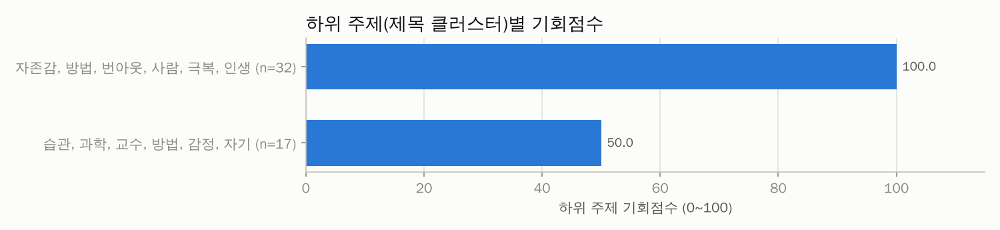

| 기회점수 | 핵심 단어 | 영상 수 | 배수 중앙값 | 성공 비율 | 소규모채널 성공 | 쇼츠 비율 | 예시 제목 |
|---|---|---|---|---|---|---|---|
| 100 | 자존감, 방법, 번아웃, 사람, 극복, 인생 | 32 | 2.18 | 31.2% | 3.1% | 40.6% | 자존감을 높이는 가장 확실한 방법 #한혜진 #동기부여 #자존감 / 자존감 극복 방법 TOP1: 무조건적인 박수갈채, 일방적인 칭찬 / 아무리 미루던 사람도 오늘부 |
| 50 | 습관, 과학, 교수, 방법, 감정, 자기 | 17 | 1.65 | 11.8% | 0.0% | 29.4% | 부자들이 실천하는 ‘2분 법칙’｜미루는 습관이 사라지는 뇌 과학  \| 동 / "무의식적으로 보는 핸드폰이 뇌를 완전히 망가지게 합니다" 뇌과학으로 입 / 30대 |
| - | 모닝, 미라클, 건강, 과학, EAT., 이유 | 8 | 1.60 | 12.5% | 0.0% | 25.0% | 미라클모닝 8년차가 알려주는 꿀팁 (feat. 책 추천) / 많이 자도 피곤한이유 당신에게도 미라클 모닝을 선물합니다 / "미라클 모닝은 사기입니다" 뇌과학이 밝 |
| - | 중독, 스마트폰, EP., 건강, EAT., 치료 | 9 | 0.82 | 11.1% | 0.0% | 22.2% | 하루종일 유튜브 보느라 다른 일을 할 수 없는 나 🧠 도파민에 중독된 뇌 / ［뇌 건강］ 스마트폰 중독 휴우증! 🚀1분만에 맑은 뇌를 되찾는 건강비법 / 300만 |

## 2. 🔑 키워드 기회 분석

기회점수 = 수요 25% + 자동완성 15% + 소규모채널 진입 20% + 아웃라이어 10% + 신선도 5% + 경쟁(역) 15% + 콘텐츠 공백 10% (키워드 간 백분위 기준). 수요·경쟁은 **주제 관련 영상만**으로 계산했고, 검색 상위 10개 중 절반 이상이 한 채널인 키워드(채널명 검색)는 제외했습니다. '관련 비율'이 낮다 = 사람들이 찾는데 맞는 영상이 적다(콘텐츠 공백).

### 🗂️ 카테고리(소재)별 기회

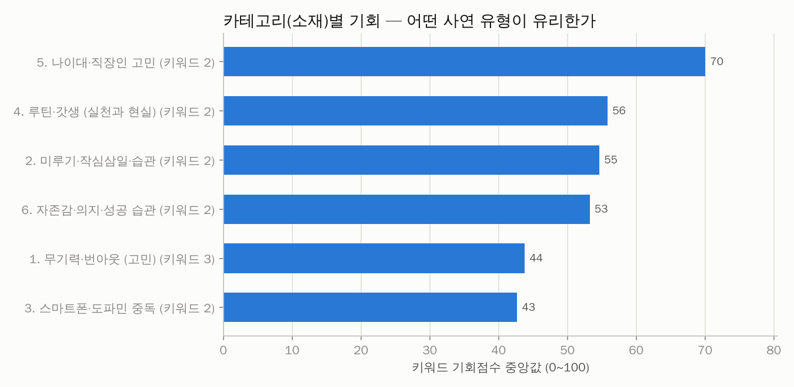

| 카테고리 | 키워드 수 | 기회(중앙) | 기회(최고) | 최고 키워드 | 검색수요 합 | 일평균 조회(중앙) | 소규모 진입 | 관련 비율 | 성공 영상 | 배수(중앙) |
|---|---|---|---|---|---|---|---|---|---|---|
| 5. 나이대·직장인 고민 | 2 | 70 | 76 | 30대 후반 자기계발 | 0.0 | 784 | 2.5% | 85.0% | 4 | 7.87 |
| 4. 루틴·갓생 (실천과 현실) | 2 | 56 | 68 | 미라클모닝 방법 | 0.0 | 133 | 7.5% | 77.5% | 2 | 1.64 |
| 2. 미루기·작심삼일·습관 | 2 | 55 | 71 | 미루는 습관 극복 | 0.0 | 184 | 5.0% | 87.5% | 2 | 1.18 |
| 6. 자존감·의지·성공 습관 | 2 | 53 | 57 | 자존감 떨어질때 | 0.0 | 443 | 2.5% | 100.0% | 3 | 3.09 |
| 1. 무기력·번아웃 (고민) | 3 | 44 | 50 | 번아웃 극복 방법 | 0.0 | 102 | 1.7% | 78.3% | 1 | 1.50 |
| 3. 스마트폰·도파민 중독 | 2 | 43 | 46 | 스마트폰 중독 뇌 | 0.0 | 82 | 2.5% | 67.5% | 2 | 1.67 |

### 🔑 키워드별 기회

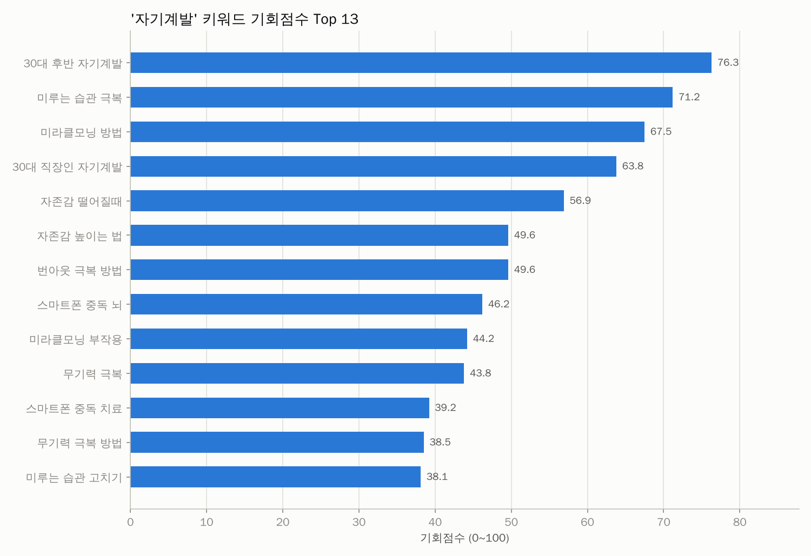
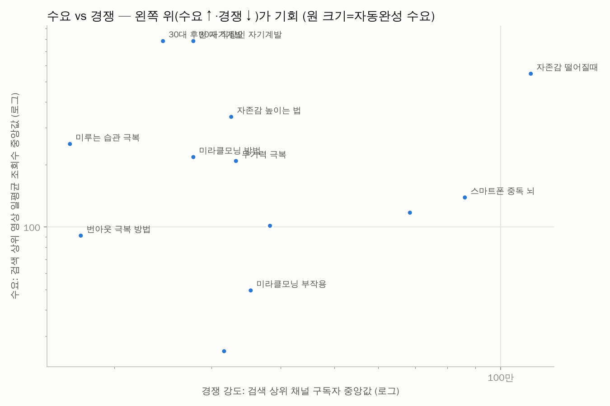

| 키워드 | 카테고리 | 기회점수 | 일평균 조회수(중앙) | 자동완성 | 소규모 진입 | 관련 비율 | 최신 비율 | 경쟁 구독자(중앙) | 배수(중앙) | 성공 수 | 추천 포맷 | 채널명검색 |
|---|---|---|---|---|---|---|---|---|---|---|---|---|
| 30대 후반 자기계발 | 5. 나이대·직장인 고민 | 76 | 784 | 0.00 | 5.0% | 75.0% | 0.0% | 24.5만 | 22.89 | 3 | - |  |
| 미루는 습관 극복 | 2. 미루기·작심삼일·습관 | 71 | 251 | 0.00 | 10.0% | 90.0% | 5.6% | 16.6만 | 1.62 | 2 | 롱폼 |  |
| 미라클모닝 방법 | 4. 루틴·갓생 (실천과  | 68 | 217 | 0.00 | 10.0% | 85.0% | 0.0% | 27.8만 | 2.49 | 2 | 롱폼 |  |
| 30대 직장인 자기계발 | 5. 나이대·직장인 고민 | 64 | 784 | 0.00 | 0.0% | 95.0% | 10.5% | 27.8만 | 7.87 | 2 | - |  |
| 자존감 떨어질때 | 6. 자존감·의지·성공 습 | 57 | 546 | 0.00 | 5.0% | 100.0% | 0.0% | 113만 | 209.45 | 1 | - |  |
| 자존감 높이는 법 | 6. 자존감·의지·성공 습 | 50 | 339 | 0.00 | 0.0% | 100.0% | 0.0% | 32.5만 | 2.33 | 2 | - |  |
| 번아웃 극복 방법 | 1. 무기력·번아웃 (고민 | 50 | 91 | 0.00 | 5.0% | 100.0% | 0.0% | 17.4만 | 2.18 | 1 | - |  |
| 스마트폰 중독 뇌 | 3. 스마트폰·도파민 중독 | 46 | 139 | 0.00 | 0.0% | 45.0% | 0.0% | 86.1만 | 2.71 | 2 | 롱폼 |  |
| 미라클모닝 부작용 | 4. 루틴·갓생 (실천과  | 44 | 50 | 0.00 | 5.0% | 70.0% | 0.0% | 35.3만 | 1.38 | 0 | 쇼츠 |  |
| 무기력 극복 | 1. 무기력·번아웃 (고민 | 44 | 208 | 0.00 | 0.0% | 75.0% | 0.0% | 33.2만 | 0.94 | 0 | - |  |
| 스마트폰 중독 치료 | 3. 스마트폰·도파민 중독 | 39 | 25 | 0.00 | 5.0% | 90.0% | 0.0% | 31.6만 | 0.58 | 0 | - |  |
| 무기력 극복 방법 | 1. 무기력·번아웃 (고민 | 38 | 102 | 0.00 | 0.0% | 60.0% | 0.0% | 38.2만 | 1.02 | 0 | - |  |
| 미루는 습관 고치기 | 2. 미루기·작심삼일·습관 | 38 | 117 | 0.00 | 0.0% | 85.0% | 0.0% | 68.5만 | 1.76 | 2 | 롱폼 |  |

키워드별 검색 수요 (자동완성이 표현을 어디까지 알아보는지 — 1.0=전체 문구가 자동완성에 뜸, 0=앞 두 단어도 안 뜸)

| 순위 | 검색어 | 카테고리 | 수요 점수 | 자동완성이 알아본 부분 | 일치 제안 수 |
|---|---|---|---|---|---|
| 1 | 무기력 극복 | 1. 무기력·번아웃 (고민) | 0.00 | - | 0 |
| 1 | 미루는 습관 고치기 | 2. 미루기·작심삼일·습관 | 0.00 | - | 0 |
| 1 | 스마트폰 중독 치료 | 3. 스마트폰·도파민 중독 | 0.00 | - | 0 |
| 1 | 미라클모닝 부작용 | 4. 루틴·갓생 (실천과 현실) | 0.00 | - | 0 |
| 1 | 30대 직장인 자기계발 | 5. 나이대·직장인 고민 | 0.00 | - | 0 |
| 1 | 자존감 높이는 법 | 6. 자존감·의지·성공 습관 | 0.00 | - | 0 |
| 1 | 무기력 극복 방법 | 1. 무기력·번아웃 (고민) | 0.00 | - | 0 |
| 1 | 미루는 습관 극복 | 2. 미루기·작심삼일·습관 | 0.00 | - | 0 |
| 1 | 스마트폰 중독 뇌 | 3. 스마트폰·도파민 중독 | 0.00 | - | 0 |
| 1 | 미라클모닝 방법 | 4. 루틴·갓생 (실천과 현실) | 0.00 | - | 0 |
| 1 | 30대 후반 자기계발 | 5. 나이대·직장인 고민 | 0.00 | - | 0 |
| 1 | 자존감 떨어질때 | 6. 자존감·의지·성공 습관 | 0.00 | - | 0 |
| 1 | 번아웃 극복 방법 | 1. 무기력·번아웃 (고민) | 0.00 | - | 0 |

🎯 주제와 무관해서 제외한 영상 76개 (조회수 상위 15개 — 전체는 data/excluded_offtopic.csv)

| 영상 | 채널 | 조회수 | 검색 키워드 |
|---|---|---|---|
| [함익병 "2030 이것만은 꼭 해라"](https://www.youtube.com/watch?v=bWqAV5lMrks) | 1분멘토 | 328만 | 30대 후반 자기계발 |
| [공복 유산소 빡세게 하면 몸속에서 벌어지는 일🏃#러닝](https://www.youtube.com/watch?v=76s2_4VBRjo) | 진김규 | 257만 | 미라클모닝 부작용 |
| [자신감이 얼마나 중요한지 보여주는 영상](https://www.youtube.com/watch?v=HkGJ7kUAml8) | 김여인의 화장대 | 229만 | 자존감 떨어질때 |
| [요즘 2030이 많이 도전하는 직업](https://www.youtube.com/watch?v=EXU0pnyaN0c) | 박문각 감정평가사 | 225만 | 30대 후반 자기계발 |
| [하루라도 빨리 읽으면 인생에 무조건 도움되는 책 3권📚/ 1.언제 행복할 것인가/…](https://www.youtube.com/watch?v=c6_UHz0Rd2U) | 작가 김상현 | 208만 | 30대 후반 자기계발 |
| [도파민에 박살난 MZ의 뇌, 유일한 회복방법(몰입 황농문 교수)](https://www.youtube.com/watch?v=Q0UVDZXecU8) | 라이프해커,자청 | 201만 | 스마트폰 중독 뇌 |
| [한달동안 매일 아침 30분 러닝효과 #러닝](https://www.youtube.com/watch?v=1bDt1E5iecQ) | 복경 | 193만 | 미라클모닝 부작용 |
| [97%는 스마트폰을 잘못 쓰고 있습니다.](https://www.youtube.com/watch?v=bN01WRBS0Ec) | 너진똑 NJT BOOK | 174만 | 스마트폰 중독 치료 |
| [［full］ 모두가 자식의 폰과 싸우고 있다 \| 추적60분 KBS 260522 …](https://www.youtube.com/watch?v=sEWJ2OWFy04) | KBS 추적60분 | 144만 | 스마트폰 중독 치료 |
| [1년에 책 200권 읽는 독서광 추천 책📚📚 자세한 내용은 댓글에➡️➡️](https://www.youtube.com/watch?v=DbvmI6v14V0) | 작가 김상현 | 140만 | 30대 후반 자기계발 |
| [우울증 회복되는 순서](https://www.youtube.com/watch?v=5od49KP1hUk) | 정신과의사 뇌부자들 | 140만 | 무기력 극복 방법 |
| [12kg 빼면서 효과 본 아침루틴 & 홈트 추천 총정리! #다이어트 #운동자극](https://www.youtube.com/watch?v=i7T1uFxLUZk) | 달콤 dalkommm | 136만 | 미라클모닝 부작용 |
| [아무리 예쁘고 동안이어도 30대 후반 여자는 안 만나요 \| #솔로정보회사 #EN…](https://www.youtube.com/watch?v=CKvAJButBfw) | ENA 이엔에이 | 120만 | 30대 후반 자기계발 |
| [6개월 동안 진행한 미라클 모닝 후기](https://www.youtube.com/watch?v=qw-MtXpadHg) | 도롱챠 DOLONGCHA | 106만 | 미라클모닝 방법 |
| [삼십대에 알아야 할 5가지](https://www.youtube.com/watch?v=NU2RPZVDQYI) | 주언규 joo earn gyu | 103만 | 30대 직장인 자기계발 |

## 3. 🏷️ 제목 패턴 분석

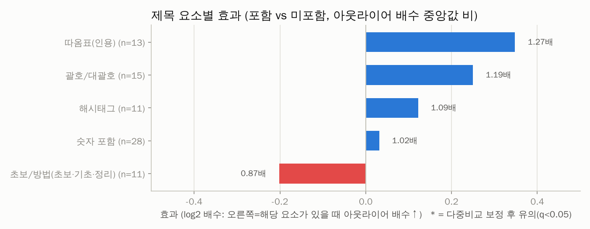
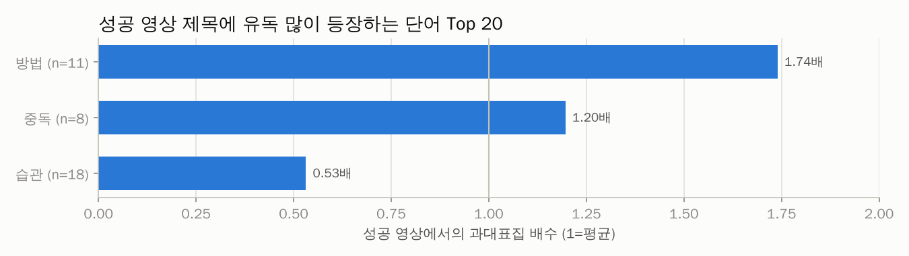
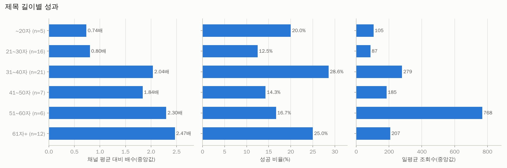

| 제목 요소 | 해당 영상 수 | 배수(있음) | 배수(없음) | 효과(배) | 성공률(있음) | 성공률(없음) | p값 | q값(보정) |
|---|---|---|---|---|---|---|---|---|
| 따옴표(인용) | 13 | 2.18 | 1.71 | 1.27 | 23.1% | 25.0% | 0.157 | 0.698 |
| 괄호/대괄호 | 15 | 2.07 | 1.74 | 1.19 | 20.0% | 26.2% | 0.949 | 0.976 |
| 해시태그 | 11 | 1.90 | 1.74 | 1.09 | 27.3% | 23.9% | 0.279 | 0.698 |
| 숫자 포함 | 28 | 1.82 | 1.78 | 1.02 | 28.6% | 20.7% | 0.593 | 0.976 |
| 초보/방법(초보·기초·정리) | 11 | 1.62 | 1.86 | 0.87 | 36.4% | 21.7% | 0.976 | 0.976 |

롱폼/쇼츠 따로 본 제목 요소 효과

| 구분 | 제목 요소 | 영상 수 | 효과(배) | 성공률(있음) | p값 |
|---|---|---|---|---|---|
| 롱폼 | 괄호/대괄호 | 12 | 1.32 | 25.0% | 0.858 |
| 롱폼 | 따옴표(인용) | 11 | 1.19 | 27.3% | 0.213 |
| 롱폼 | 숫자 포함 | 18 | 0.91 | 27.8% | 0.820 |
| 쇼츠 | 해시태그 | 8 | 2.24 | 25.0% | 0.047 |
| 쇼츠 | 숫자 포함 | 10 | 2.09 | 30.0% | 0.241 |

**성공 영상 제목에 유독 많이 나오는 단어** (과대표집 배수 = 성공 영상 내 비중 ÷ 전체 비중)

| 단어 | 영상 수 | 성공 수 | 과대표집 | 배수(중앙) | 일평균 조회수 |
|---|---|---|---|---|---|
| 방법 | 11 | 4 | 1.74 | 1.36 | 330 |
| 중독 | 8 | 2 | 1.20 | 1.87 | 408 |
| 모닝 | 8 | 1 | 0.60 | 1.60 | 23 |
| 미라클 | 8 | 1 | 0.60 | 1.60 | 23 |
| 습관 | 18 | 2 | 0.53 | 1.62 | 97 |

## 4. 🎞️ 포맷 · 길이

> 쇼츠 조회수는 2025년 3월부터 '재생 시작/반복'마다 집계되어 롱폼 조회수와 직접 비교할 수 없습니다. 그래서 **같은 채널·같은 포맷 대비 배수(아웃라이어)** 와 성공 비율로 비교합니다.

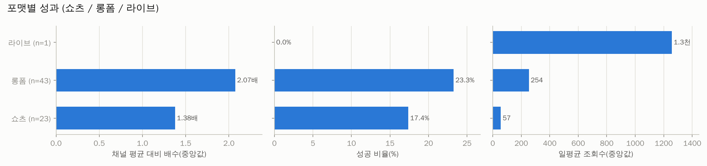
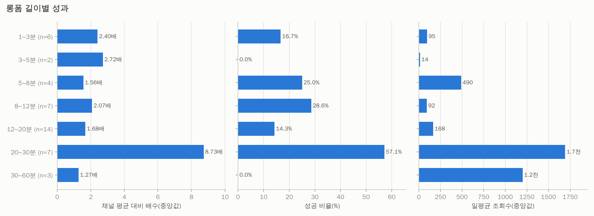

| 포맷 | 영상 수 | 조회수(중앙) | 일평균(중앙) | 배수(중앙) | 성공 비율 | 소규모채널 성공 |
|---|---|---|---|---|---|---|
| 라이브 | 1 | 40.4만 | 1.3천 | - | 0.0% | 0.0% |
| 롱폼 | 43 | 4.2만 | 254 | 2.07 | 23.3% | 0.0% |
| 쇼츠 | 23 | 6.3천 | 57 | 1.38 | 17.4% | 4.3% |

| 롱폼 길이 | 영상 수 | 조회수(중앙) | 일평균(중앙) | 배수(중앙) | 성공 비율 | 소규모채널 성공 |
|---|---|---|---|---|---|---|
| 1~3분 | 6 | 2.3만 | 95 | 2.40 | 16.7% | 0.0% |
| 3~5분 | 2 | 4.4천 | 14 | 2.72 | 0.0% | 0.0% |
| 5~8분 | 4 | 12.1만 | 490 | 1.56 | 25.0% | 0.0% |
| 8~12분 | 7 | 2.2만 | 92 | 2.07 | 28.6% | 0.0% |
| 12~20분 | 14 | 3.5만 | 168 | 1.68 | 14.3% | 0.0% |
| 20~30분 | 7 | 43.7만 | 1.7천 | 8.73 | 57.1% | 0.0% |
| 30~60분 | 3 | 25.4만 | 1.2천 | 1.27 | 0.0% | 0.0% |

## 5. 🕒 업로드 타이밍 (참고용 — 효과가 작고 혼란변수가 많음)

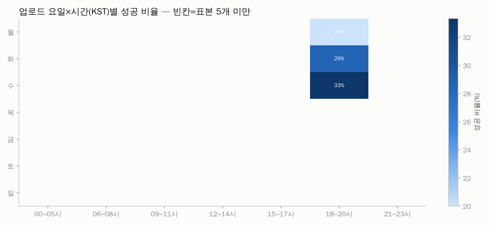

| 요일 | 영상 수 | 조회수(중앙) | 일평균(중앙) | 배수(중앙) | 성공 비율 | 소규모채널 성공 |
|---|---|---|---|---|---|---|
| 월 | 8 | 3.2만 | 110 | 1.78 | 12.5% | 0.0% |
| 화 | 15 | 3.7만 | 125 | 0.99 | 13.3% | 0.0% |
| 수 | 13 | 1.0만 | 57 | 2.11 | 38.5% | 0.0% |
| 목 | 6 | 9.6만 | 501 | 1.89 | 0.0% | 0.0% |
| 금 | 14 | 1.7만 | 99 | 1.61 | 7.1% | 7.1% |
| 토 | 4 | 6.8만 | 235 | 1.68 | 25.0% | 0.0% |
| 일 | 7 | 39.6만 | 1.2천 | 25.20 | 57.1% | 0.0% |

| 시간대(KST) | 영상 수 | 조회수(중앙) | 일평균(중앙) | 배수(중앙) | 성공 비율 | 소규모채널 성공 |
|---|---|---|---|---|---|---|
| 00~05시 | 2 | 9.6천 | 38 | 0.48 | 0.0% | 0.0% |
| 06~08시 | 5 | 22.8만 | 1.2천 | 2.10 | 20.0% | 20.0% |
| 09~11시 | 2 | 23.6만 | 857 | 41.27 | 50.0% | 0.0% |
| 12~14시 | 6 | 3.4만 | 211 | 1.88 | 16.7% | 0.0% |
| 15~17시 | 10 | 1.8천 | 12 | 1.61 | 10.0% | 0.0% |
| 18~20시 | 32 | 5.8만 | 353 | 1.84 | 28.1% | 0.0% |
| 21~23시 | 10 | 2.8만 | 240 | 1.69 | 10.0% | 0.0% |

## 6. 🌱 채널 규모별 분석 — 0명 채널에게 가장 중요한 부분

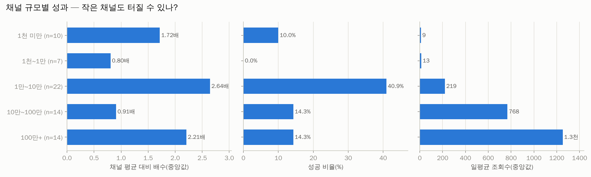
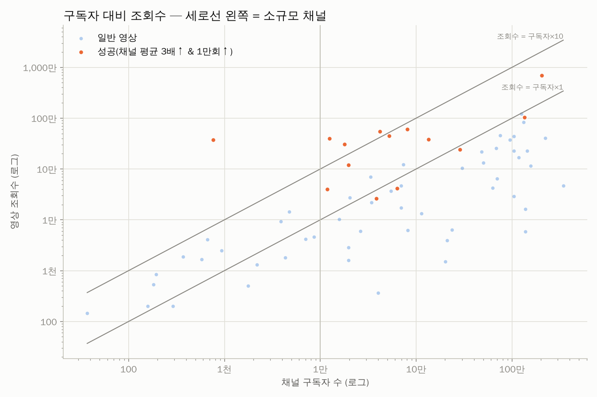

| 구독자 규모 | 영상 수 | 조회수(중앙) | 일평균(중앙) | 배수(중앙) | 성공 비율 | 소규모채널 성공 |
|---|---|---|---|---|---|---|
| 1천 미만 | 10 | 1.2천 | 9 | 1.72 | 10.0% | 10.0% |
| 1천~1만 | 7 | 4.2천 | 13 | 0.80 | 0.0% | 0.0% |
| 1만~10만 | 22 | 3.8만 | 219 | 2.64 | 40.9% | 0.0% |
| 10만~100만 | 14 | 11.8만 | 768 | 0.91 | 14.3% | 0.0% |
| 100만+ | 14 | 22.7만 | 1.3천 | 2.21 | 14.3% | 0.0% |

**개설 1년 이내 채널의 성공 영상** (0개) — 신생 채널이 실제로 터진 사례

_데이터 없음_

## 7. 🔥 최근 14일 이내 급상승 영상 (아직 성과 집계 전 — 트렌드 참고)

| 영상 | 채널 | 구독자 | 조회수 | 일평균 | 경과일 | 포맷 |
|---|---|---|---|---|---|---|
| [미루는 습관 고치는 법 \| 하기 싫은 일을 당장 하게 만드는 심리학 4가지 (A…](https://www.youtube.com/watch?v=Yq9bHjesRBk) | 강병준 | 6.9천 | 2.5만 | 1.4만 | 1.9 | 롱폼 |
| [vlog.월 560 대기업 직장인이 퇴근 후 공부·운동·부업을 다 하는 법 \| …](https://www.youtube.com/watch?v=HyiJpEdXMX4) | 방구석갓생 | 3.6만 | 1.2만 | 6.5천 | 1.8 | 롱폼 |
| [30대 직장인 절약 브이로그 \| 7년째꾸준한 절약습관 \| 생활비 리필 \| 수…](https://www.youtube.com/watch?v=3vDrwmHnj8s) | 재테크 하는 엄마 파이부 | 2.2만 | 4.3천 | 4.3천 | 0.1 | 롱폼 |
| [#퇴근 후🐰#직장인 #이직 #퇴사 #30대 #20대 #40대 #자기개발 #자기계발…](https://www.youtube.com/watch?v=L5JWoxQXeGg) | 플로보(flowbo) | 506 | 1.3천 | 468 | 2.7 | 쇼츠 |

## 8. 🏆 성공사례 — 대본 · 영상 · 썸네일

선정 기준: 종합점수(아웃라이어 40% + 조회수 35% + 구독자 대비 조회수 25%) 상위, 소규모 채널 ≥50%, 롱폼 ≥50%, 채널당 최대 1개. 각 폴더에 `transcript.txt`(대본), `transcript_timestamped.txt`, `video.mp4`, `thumbnail.jpg`, `metadata.json`, `comments.csv` 가 있습니다.

### 1. [자존감 극복 방법 TOP1: 무조건적인 박수갈채, 일방적인 칭찬](https://www.youtube.com/watch?v=T1N1tvpfJL0)

- 채널 **MMTG 문명특급** (구독자 204만) · 조회수 **694만** · 채널 평균의 **209.5배** · 쇼츠 00:30 · 업로드 2026-01-28 · 카테고리: 6. 자존감·의지·성공 습관 · 검색어: `자존감 떨어질때` · 선정: 종합점수 상위 (점수 93)
- 📁 [`success_cases/01_자존감_극복_방법_TOP1_무조건적인_박수갈채_일방적인_T1N1tvpfJL0/`](success_cases/01_자존감_극복_방법_TOP1_무조건적인_박수갈채_일방적인_T1N1tvpfJL0/) · 대본: failed · 영상: skipped(DOWNLOAD_VIDEOS=False)

### 2. [부자들이 실천하는 ‘2분 법칙’｜미루는 습관이 사라지는 뇌 과학  \| 동기부여 \| 자기계발 \| 부자공식 \|성공법칙 \|](https://www.youtube.com/watch?v=W0hR-XSKAlU)

- 채널 **뇌를 속여라** (구독자 1.2만) · 조회수 **39.6만** · 채널 평균의 **246.4배** · 롱폼 16:15 · 업로드 2025-11-16 · 카테고리: 2. 미루기·작심삼일·습관 · 검색어: `미루는 습관 극복` · 선정: 롱폼 쿼터 (점수 90)
- 📁 [`success_cases/02_부자들이_실천하는_2분_법칙_미루는_습관이_사라지는_뇌_W0hR-XSKAlU/`](success_cases/02_부자들이_실천하는_2분_법칙_미루는_습관이_사라지는_뇌_W0hR-XSKAlU/) · 대본: failed · 영상: skipped(DOWNLOAD_VIDEOS=False)

### 3. [자존감을 높이는 가장 확실한 방법 #한혜진 #동기부여 #자존감](https://www.youtube.com/watch?v=QhvU_0VPQuM)

- 채널 **Hatchery Bro #부화장형** (구독자 766) · 조회수 **37.5만** · 채널 평균의 **480.3배** · 쇼츠 00:41 · 업로드 2026-02-19 · 카테고리: 6. 자존감·의지·성공 습관 · 검색어: `자존감 높이는 법` · 선정: 소규모 채널 쿼터 (점수 89)
- 📁 [`success_cases/03_자존감을_높이는_가장_확실한_방법_한혜진_동기부여_자존_QhvU_0VPQuM/`](success_cases/03_자존감을_높이는_가장_확실한_방법_한혜진_동기부여_자존_QhvU_0VPQuM/) · 대본: failed · 영상: skipped(DOWNLOAD_VIDEOS=False)

### 4. [매일 아침이 개운한, 가장 현실적인 '기상 루틴'](https://www.youtube.com/watch?v=cg22mQrXh44)

- 채널 **뇌과학 쓸래요?** (구독자 4.2만) · 조회수 **55.2만** · 채널 평균의 **49.5배** · 롱폼 06:41 · 업로드 2025-12-29 · 카테고리: 4. 루틴·갓생 (실천과 현실) · 검색어: `미라클모닝 방법` · 선정: 롱폼 쿼터 (점수 88)
- 📁 [`success_cases/04_매일_아침이_개운한_가장_현실적인_기상_루틴_cg22mQrXh44/`](success_cases/04_매일_아침이_개운한_가장_현실적인_기상_루틴_cg22mQrXh44/) · 대본: failed · 영상: skipped(DOWNLOAD_VIDEOS=False)

### 5. [30대에 안 바꾸면 40대에 진짜 후회하는 것들 \| 시사 애니메이션](https://www.youtube.com/watch?v=5EQkjp9rOas)

- 채널 **햄찌 교수** (구독자 5.2만) · 조회수 **44.5만** · 채널 평균의 **80.2배** · 롱폼 11:31 · 업로드 2025-12-24 · 카테고리: 5. 나이대·직장인 고민 · 검색어: `30대 후반 자기계발` · 선정: 롱폼 쿼터 (점수 87)
- 📁 [`success_cases/05_30대에_안_바꾸면_40대에_진짜_후회하는_것들_시사_5EQkjp9rOas/`](success_cases/05_30대에_안_바꾸면_40대에_진짜_후회하는_것들_시사_5EQkjp9rOas/) · 대본: failed · 영상: skipped(DOWNLOAD_VIDEOS=False)

### 6. [20대 때 돈 버는 것보다 더 중요한 것](https://www.youtube.com/watch?v=QPKar_hPyjU)

- 채널 **마업** (구독자 8.1만) · 조회수 **60.3만** · 채널 평균의 **27.5배** · 쇼츠 00:39 · 업로드 2025-10-12 · 카테고리: 5. 나이대·직장인 고민 · 검색어: `30대 후반 자기계발` · 선정: 종합점수 상위 (점수 86)
- 📁 [`success_cases/06_20대_때_돈_버는_것보다_더_중요한_것_QPKar_hPyjU/`](success_cases/06_20대_때_돈_버는_것보다_더_중요한_것_QPKar_hPyjU/) · 대본: failed · 영상: skipped(DOWNLOAD_VIDEOS=False)

### 7. [하루종일 유튜브 보느라 다른 일을 할 수 없는 나 🧠 도파민에 중독된 뇌는 퇴화된다고? \| 집중력 저하 \| 숏폼에서 벗어나…](https://www.youtube.com/watch?v=rc8YFSr8Ayk)

- 채널 **EBS 컬렉션 - 사이언스** (구독자 135만) · 조회수 **104만** · 채널 평균의 **31.9배** · 롱폼 21:26 · 업로드 2026-02-01 · 카테고리: 3. 스마트폰·도파민 중독 · 검색어: `스마트폰 중독 뇌` · 선정: 롱폼 쿼터 (점수 80)
- 📁 [`success_cases/07_하루종일_유튜브_보느라_다른_일을_할_수_없는_나_도파_rc8YFSr8Ayk/`](success_cases/07_하루종일_유튜브_보느라_다른_일을_할_수_없는_나_도파_rc8YFSr8Ayk/) · 대본: failed · 영상: skipped(DOWNLOAD_VIDEOS=False)

### 8. [당신의 뇌도 지금 이 순간 녹고 있습니다 (feat. 스마트폰 중독)](https://www.youtube.com/watch?v=SYN0eI9aP7Y)

- 채널 **생각압축(Thought Compression)** (구독자 4.8천) · 조회수 **1.5만** · 채널 평균의 **0.6배** · 쇼츠 00:45 · 업로드 2026-01-28 · 카테고리: 3. 스마트폰·도파민 중독 · 검색어: `스마트폰 중독 뇌` · 선정: 소규모 채널 쿼터 (점수 28)
- 📁 [`success_cases/08_당신의_뇌도_지금_이_순간_녹고_있습니다_feat_스마_SYN0eI9aP7Y/`](success_cases/08_당신의_뇌도_지금_이_순간_녹고_있습니다_feat_스마_SYN0eI9aP7Y/) · 대본: failed · 영상: skipped(DOWNLOAD_VIDEOS=False)

## 9. 💬 시청자 질문 (성공 영상 댓글에서 추출) — 다음 영상 주제 후보

질문 댓글에 많이 나오는 단어: `사람`(38), `생각`(33), `감사`(19), `요즘`(16), `시간`(16), `공부`(16), `문제`(15), `번아웃`(14), `시작`(13), `마음`(13), `필요`(12), `상태`(12), `아침`(12), `방법`(11), `중요`(11), `느낌`(11), `중독`(11), `알람`(10), `추천`(10), `얘기`(10)

| 질문 댓글 | 좋아요 | 영상 |
|---|---|---|
| 스크린타임 6시간따리가 뭔 중독이라고 인터뷰에 나와 관종이냐? 진짜 중독자들의 스크린 타임을 함 보여줘야 하나 | 1,332 | [하루종일 유튜브 보느라 다른 일을 할 수 없는…](https://www.youtube.com/watch?v=rc8YFSr8Ayk) |
| 50대인 저에게도 도움되고 공감가는 영상입니다. 안정된 길을 찾는게 아니라, 어떤 거친 길이라도 잘 걸어갈 수 있어야 합니다. 안정적인 길이란 없기 때문입니다. | 783 | [20, 30대에 진짜 중요한 것 (feat. …](https://www.youtube.com/watch?v=pT-4GKN2s4c) |
| 근데 진짜 내가 쉬면 누가 돈 벌어요...? 쉬었다오면 내 자리가 없는데 어떻게 쉬어요...? | 738 | [일은 잘하는데 점점 무너진다? 정신과 의사가 …](https://www.youtube.com/watch?v=o1wVKqIlIMo) |
| 근데 돈은? 에서 ...낼 출근해야겠다 ! ! 몇달전에 자주 무기력했는데 나이가 들어서 에스트로겐이 떨어져서 그런증상들이 나타넌거였어요. 리플로퀸 추천받아 먹기 시작했는데 효과있더라구요! | 536 | [일은 잘하는데 점점 무너진다? 정신과 의사가 …](https://www.youtube.com/watch?v=o1wVKqIlIMo) |
| 쉬어도 죄책감이 들면? 나네.. 하면서 들어옴 ㅋㅋ | 257 | [일은 잘하는데 점점 무너진다? 정신과 의사가 …](https://www.youtube.com/watch?v=o1wVKqIlIMo) |
| 번아웃이라는게 자가진단하기 너무 어려운거 같아요. 영상을 보면 난가 싶은데 또 어떻게 보면 그냥 게을러서 그런게 아닌가 싶기도 해서 이게 번아웃인지 내 자신의 문제인지 인지하기 어려운 것 같습니다. 개인적으로 저는 제가 너무나 게으르다는걸 알고 있어서 | 240 | [일은 잘하는데 점점 무너진다? 정신과 의사가 …](https://www.youtube.com/watch?v=o1wVKqIlIMo) |
| 20대에 이걸 보는 20대가 너무 부럽다.. 32살때부터 재테크에 눈을뜨면서 지금도 많이 여유로워졌지만 항상 느끼는거는 재테크를 5년만 더빨리했으면 지금 내인생이 어떻게 바뀌엇을까 하는생각 진짜 많이하는데 ㅋㅋㅋ 재테크는 오늘, 지금이 가장 빠른시기입 | 239 | [다 버리고, 딱 이것만 챙기세요. 20대에 알…](https://www.youtube.com/watch?v=mQSNF9WFdac) |
| 숏폼중독이 아니라 자기결정권중독이죠. 자기한테 어떤권한이 있다고 믿는거죠 나태한 권능감 | 197 | [하루종일 유튜브 보느라 다른 일을 할 수 없는…](https://www.youtube.com/watch?v=rc8YFSr8Ayk) |
| ［영상의 존재 이유］ 이 영상은 20~30대에게 사회적으로 보편적으로 주입된 성공 공식(좋은 대학, 대기업, 안정적 삶)이 아닌, 실제 삶에서 진짜 중요한 것이 무엇인지 깊이 있는 질문을 던지기 위해 만들어졌습니다. 표면적 동기부여나 성공담이 아니라, | 177 | [20, 30대에 진짜 중요한 것 (feat. …](https://www.youtube.com/watch?v=pT-4GKN2s4c) |
| 25년차 사교육에서 독서 논술 가르치는 선생입니다. 요즘 아이들이 '스스로 기름 넣어본 적 없는 차'입니다. 엄마가 주유해주고, 사교육 선생들이 주유해주고, 그렇게 20세가 되죠. 그 뒤에도 자식을 포기하지 못하는 부모는 죽을때까지 주유를 해줄겁니다. | 171 | [2명의 뇌과학자가 말하는 미루는 습관 끊어내는…](https://www.youtube.com/watch?v=GS-VuhSi1i4) |
| 27살이고 배관기술 3년가까이 배우고있습니다 문득 요새 이런 생각이 들더라고요 내가 이 기술로 먹고살 수 있을까 ? 건설경기 완전히 무너졌는데 내가 뭘 할 수 있지 ? 내가 부장님처럼 기술을 자유자재로 쓰는날이 오긴할까 ? 난 왜 맨날 실수투성이지 ? | 167 | [20, 30대에 진짜 중요한 것 (feat. …](https://www.youtube.com/watch?v=pT-4GKN2s4c) |
| 이런현상과 함께 우울증까지 있다면 자기자신을 객관적으로 판단하는게 가능할까요.. 쉬고싶어도 쉴수가없고, 쉰다면 당장 겪게될 경제적인 압박으로 인한 스트레스.. 도저히 이러지도, 저러지도 할수없는 현실이네요.. | 160 | [일은 잘하는데 점점 무너진다? 정신과 의사가 …](https://www.youtube.com/watch?v=o1wVKqIlIMo) |
| 2:07 처음에는 이런 패턴을 습관화하는 것 자체가 어려울 수도 있습니다. 또, 이렇게 습관들여야겠다~고 마음을 먹었어도 자고 나서 까먹을 수도 있고요. 그래서 습관을 만드는 초기 단계에선 습관 들일 행동 리스트를 인쇄해서 "별 생각없이" 일어나자마자 | 147 | [매일 아침이 개운한, 가장 현실적인 '기상 루…](https://www.youtube.com/watch?v=cg22mQrXh44) |
| “다른 것도 시도해 봤으면 좋았을걸”이라는 말은 사실, 성공한 사람들이 그걸 시도하지 않았기에 성공한 결과일 수도 있어요. 결국 지나고 나서 못 해본 걸 아쉬워하는 거지, 그게 정답은 아닌 것 같아요. 오히려 그때처럼 한 방향에 몰입했기 때문에 성공할 | 142 | [20, 30대에 진짜 중요한 것 (feat. …](https://www.youtube.com/watch?v=pT-4GKN2s4c) |
| 아니 저 올블랙 언니 왜르케 멋져..? | 138 | [자존감 극복 방법 TOP1: 무조건적인 박수갈…](https://www.youtube.com/watch?v=T1N1tvpfJL0) |
| 일단 지금까지 해봤던 건 1. 유튜브랑 인스타 앱 숨기기 기능 쓰기 >> 시험기간에 진짜 노답이다 싶어서 시작하고 나름 나쁘지 않아서 쭉 유지하는 중 어떻게든 들어가서 하긴 하는데 무지성으로 폰 키자마자 숏츠보는 건 많이 줄었음 2. 흑백모드 이건 하 | 126 | [하루종일 유튜브 보느라 다른 일을 할 수 없는…](https://www.youtube.com/watch?v=rc8YFSr8Ayk) |
| 이전에 번아웃 엄청 겪어본 사람으로서 진짜 극한의 무기력함이 동반됨. 회사에서는 먹고살아야 되니 어떻게든 정신줄 부여잡고 일은 하는데 퇴근하면 진짜 아무것도 못함. 핑계가 아니라 정말 몸과 정신이 극한까지 지쳐버린 상황임. 핸드폰으로 치면 충전을 해도 | 123 | [일은 잘하는데 점점 무너진다? 정신과 의사가 …](https://www.youtube.com/watch?v=o1wVKqIlIMo) |
| 세상에 꼭 필요한 게 무엇인지 내 재능을 어디에 더 쓸 수 있을지 탐색하고 움직이세요! | 119 | [20, 30대에 진짜 중요한 것 (feat. …](https://www.youtube.com/watch?v=pT-4GKN2s4c) |
| 뇌를 속이는 가장 확실한 방법은 '작은 시작'입니다. 🚀 영상 속 비밀을 더 깊게 내 것으로 만들어줄 추천 도서 리스트입니다. 📚 '2분 규칙'으로 인생을 바꾼 제임스 클리어의 저서 👉 아주 작은 습관의 힘: https://link.coupang.co | 116 | [부자들이 실천하는 ‘2분 법칙’｜미루는 습관이…](https://www.youtube.com/watch?v=W0hR-XSKAlU) |
| 나는 왜 사서 고생하나 맨날 울고 깨지고 이게뭐지 싶었는데 사서 고생하고있다는 생각이 들면 잘살고있다는 말이 큰 위로가 되네요 | 113 | [다 버리고, 딱 이것만 챙기세요. 20대에 알…](https://www.youtube.com/watch?v=mQSNF9WFdac) |

## 10. 🔖 태그 분석 (성공 영상에서 과대표집된 태그)

| 태그 | 영상 수 | 성공 수 | 과대표집 | 배수(중앙) |
|---|---|---|---|---|
| 동기부여 | 10 | 4 | 1.91 | 3.16 |
| 자기계발 | 16 | 6 | 1.79 | 2.75 |
| 미라클모닝 | 8 | 0 | 0.00 | 1.44 |

**아웃라이어 배수와의 순위상관(스피어만)** — 절댓값 0.1 미만은 사실상 무관

| 지표 | 상관계수 |
|---|---|
| like_rate | 0.153 |
| comment_rate | -0.070 |
| title_len | 0.381 |
| duration_sec | 0.256 |
| subscribers | 0.075 |
| channel_age_days | 0.102 |
| uploads_per_week | -0.045 |

## 11. ✅ 0명 채널 실행 체크리스트

1. **검색형 키워드로 시작**: 위 기회점수 상위 키워드는 '검색 → 유입'이 가능한 주제입니다. 구독자가 없을 때는 추천 피드보다 검색 유입이 먼저 열립니다.
2. **제목 = 검색어 + 검증된 제목 요소**: 키워드를 제목 앞쪽에 넣고, 3장의 효과 요소를 1~2개만 조합하세요 (과장은 시청 지속률을 떨어뜨립니다).
3. **첫 30초(쇼츠는 첫 3~5초)**: 8장 성공사례의 '도입부'를 비교해 공통 구조(질문 제기 → 결론 예고 → 근거)를 따라 해보세요.
4. **롱폼 1개 → 쇼츠 2~3개 재가공**: 같은 주제를 두 포맷으로 내보내 제작 효율과 노출 채널을 동시에 늘립니다.
5. **업로드 빈도**: 성공한 소규모 채널의 업로드 빈도 중앙값은 주 2.0회입니다. 꾸준함이 우선입니다 (최소 주 1~2회 롱폼 + 쇼츠).
6. **댓글 질문을 다음 영상으로**: 9장의 질문이 바로 수요가 검증된 다음 주제입니다.
7. **주식/금융 주제 주의**: 특정 종목 매수·매도 권유, 수익 보장 표현은 피하고 '투자 권유 아님' 고지를 넣으세요. 유료 리딩방·1:1 종목 추천처럼 대가를 받고 투자 판단을 조언하면 자본시장법상 유사투자자문업 신고 대상이 될 수 있습니다 (사업화 전 확인 필요).
8. **2~4주마다 재분석**: 트렌드는 빠르게 바뀝니다. 이 노트북을 다시 실행해 키워드 순위 변화를 확인하세요.

## 12. 📐 방법론 · 한계 · 재현 정보

- **아웃라이어 배수** = 영상 조회수 ÷ 같은 채널 최근 업로드 50개(업로드 14일 이상 경과, 같은 포맷 우선, 해당 영상 제외)의 조회수 중앙값. 구독자 수와 무관하게 '주제·제목·썸네일의 힘'을 보는 지표입니다.
- **분석 분할**: 성과 분석은 업로드 후 14일 이상 ~ 365일 이내 영상만 사용 (2025-10-12 ~ 2026-09-23). 그보다 최근 영상은 7장(급상승)에서만 참고.
- **미래 정보 누수 방지**: 모든 지표는 수집 시점에 관측 가능한 값만 사용하며, 기준선에서 대상 영상 자신을 제외했습니다.
- **주제 관련성 필터**: 제목·태그에 관련어(자기계발, 자기개발, 자기관리, 미라클모닝, 갓생, 동기부여, 무기력, 번아웃 등)가 있거나 설명란에 2번 이상 나와야 분석·성공사례에 포함 ('스킨케어 루틴, 메이크업 루틴, 식습관, 골프 루틴, 갤럭시 루틴, 도파민 터지는, 도파민 폭발' 같은 표현은 먼저 제거). 이번 실행 제외 76개.
- **한계**: ① search.list 결과는 YouTube가 고른 표본이며 개인화되지 않은 결과입니다. ② 오래된 영상일수록 조회수가 누적되어 배수가 커질 수 있습니다 (채널 최근 업로드가 짧은 기간에 몰린 경우). ③ 썸네일·시청 지속률·CTR 등 핵심 내부 지표는 API로 볼 수 없습니다. ④ 제목 요소 효과는 상관관계이며 주제·채널 특성과 섞여 있습니다. ⑤ 쇼츠 판별은 길이 + youtube.com/shorts 응답으로 추정합니다.
- **재현성**: 랜덤 시드 42, 캐시 TTL 24시간, API 호출 {'search': 13, 'videos': 310, 'channels': 7, 'playlistItems': 273, 'commentThreads': 30}, 캐시 적중 {'playlistItems': 42}
- **저작권**: 성공사례 대본·영상은 개인 학습·분석용입니다. 재업로드·재배포하지 마세요. 공개 저장소에는 영상 파일을 올리지 않는 것이 기본값입니다.

**이번 실행의 경고/주의 사항**

- ［INIT］ ⚠️ 위험/비용 관련 설정이 기본값과 다릅니다 key=DOWNLOAD_VIDEOS default=True current=False
- ［KEYWORD］ 일부 자동완성(수요 점수) 요청 실패 → 해당 접두어는 수요 0으로 계산 n_failed=81
- ［SUCCESS］ 모든 대본 수집 실패 — YouTube 차단(봇 확인) 또는 네트워크 문제일 수 있음 hint="VPN 끄기 / cookies.txt를 스크립트 폴더에 두고 다시 실행"

## 13. 📁 파일 목록

- `README.md` (이 리포트) · `analysis.xlsx` (모든 표) · `data/*.csv` · `charts/*.png` · `success_cases/` · `run_info.json` · `run_log.txt`
