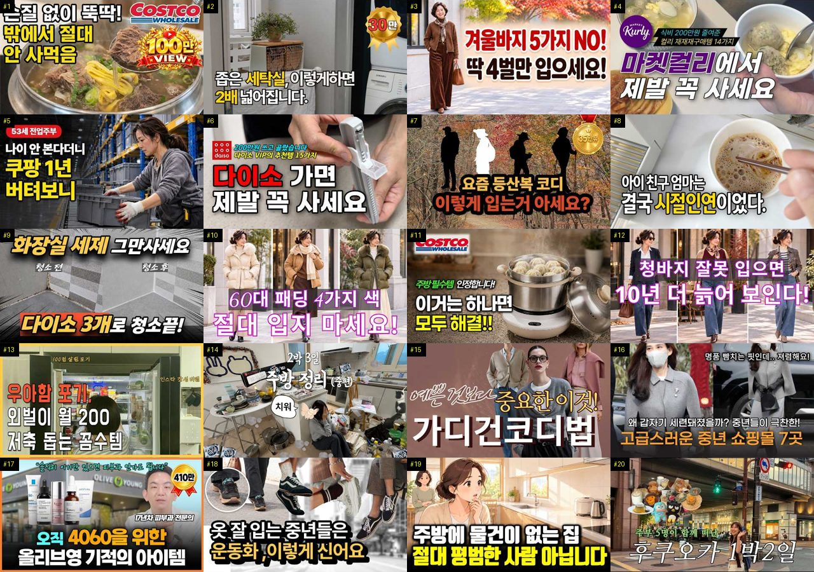
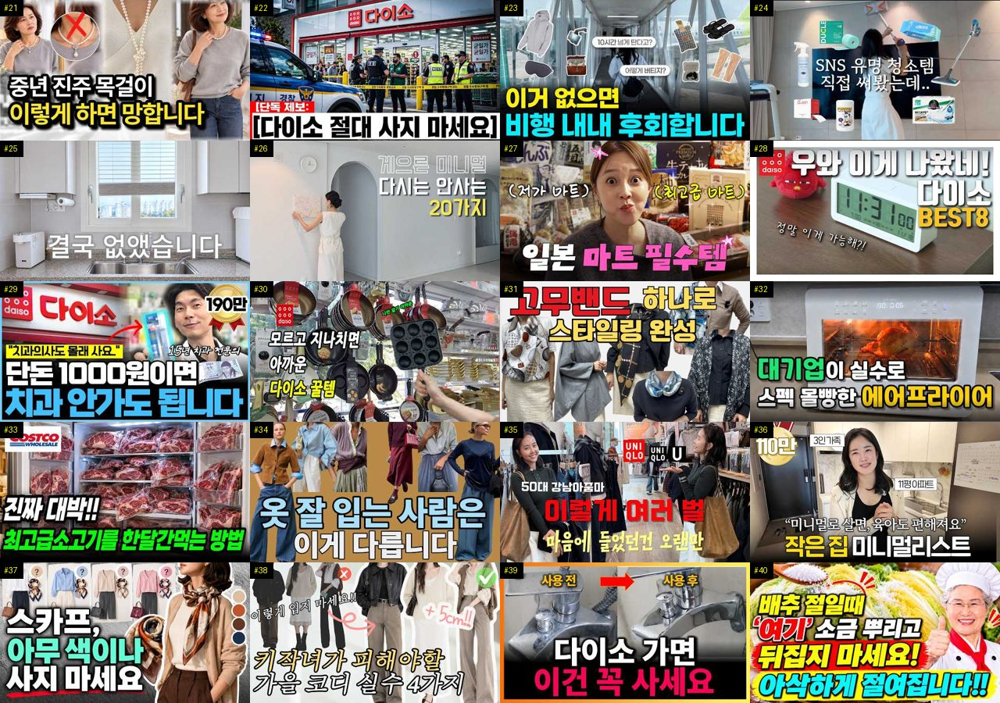
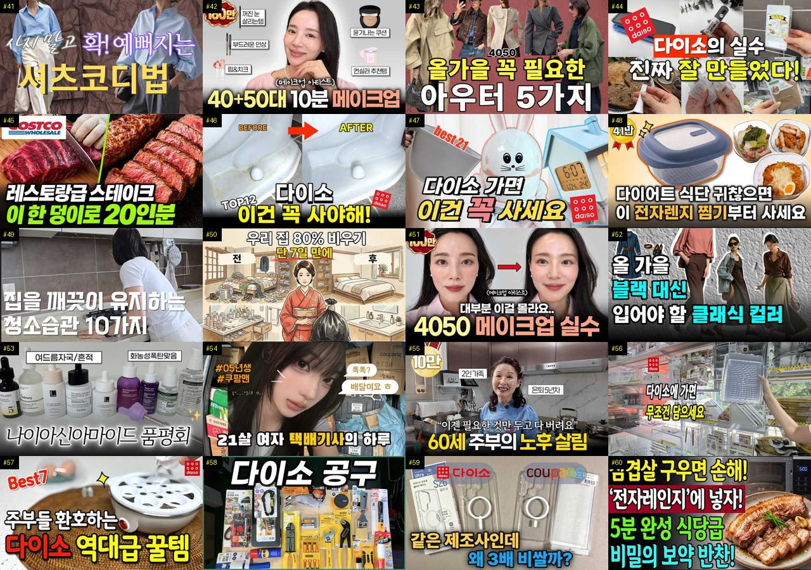
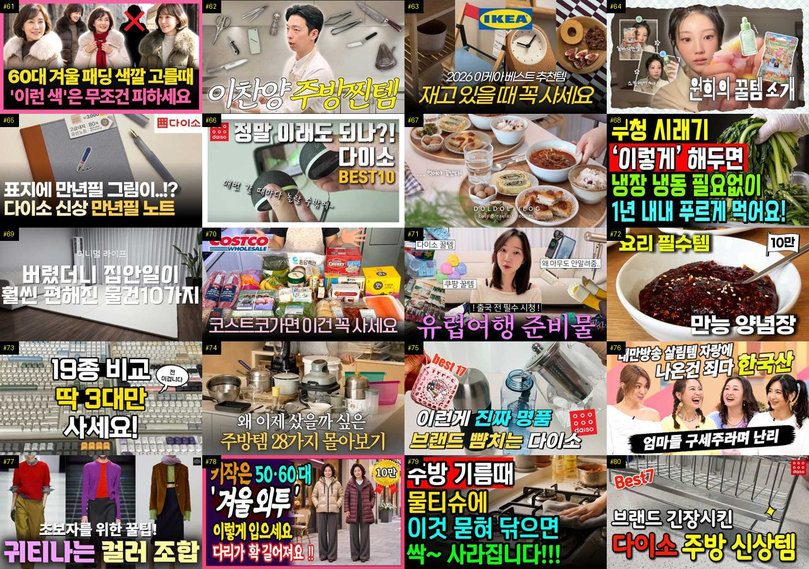
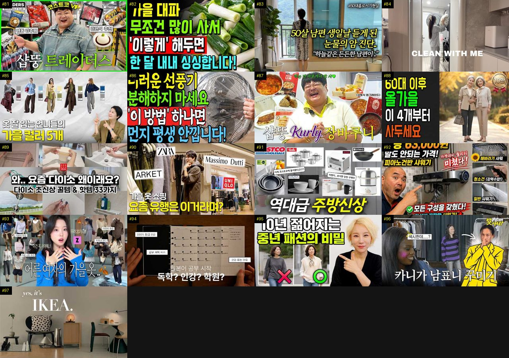
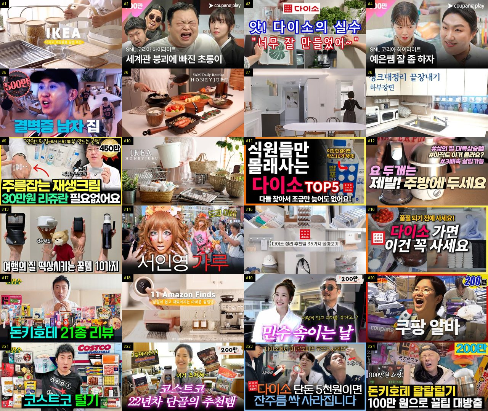

# 쿠팡 추천템 (4050 여성) — 성공 사례 분석 (지시사항 재료)

자동 생성 — `tools/success_analysis.py` v1.6 (2026-11-27 06:33 UTC), 규칙 `shopping/analysis_rules.toml` v1.0. **이 문서는 숫자와 원문만 담는다 — 해석·지시사항은 이것을 읽는 AI 가 만든다.** 주별 추세는 `weekly.md`, 승인한 영상 전부는 `approved.md`. ※ 연구·교육용 — 투자 권유가 아님.

## 0. 자료와 한계

| 자료 | 수 |
|---|---|
| 사례 폴더 (설명·자막·댓글·썸네일을 받은 영상) | 316 (웹 승인 316) |
| **성공 사례** — 7~180일·구독자 50,000 이하·**구독자당 하루 조회수 ≥ 0.1** (하루 조회수 ÷ 구독자)·100,000회 이상·4분 이상, 채널당 2개 | **97** (기준 통과 115 − 뺀 것 10 − 채널당 제한 8) |
| **하루 조회수 상위** (1-3번 — 성공 사례와 따로) — 검색에서 찾은 주제 관련 4분 이상 영상 1,093개 중 하루 조회수 상위 10% (하루 13,132회 이상), 구독자·올린 날짜 상관없이, 채널당 2개 | **79** (기준 통과 98 − 뺀 것 10 − 채널당 제한 9) · 자료를 받지 않은 후보 22 |
| **조회수 상위** (1-4번 — 올린 날짜·구독자 상관없이) — 검색(기간 없는 검색 포함)에서 찾은 주제 관련 4분 이상 영상 1,725개(가장 오래된 3656일) 중 조회수 상위 10% (1,130,114회 이상), 채널당 2개 | **99** (기준 통과 159 − 뺀 것 2 − 채널당 제한 58) · 자료를 받지 않은 후보 16 |
| 성공 사례의 글 출처 (자막·음성인식·설명·없음) | 설명 88 · 없음 9 |
| 성공 사례 대본 — 전체 · 앞부분만(음성인식 1차) · 없음 | 0 · 0 · 97 |
| 같은 채널 기준선 (채널 평소 영상) | 성공 사례 0/97 · 채널 0곳 (잘된 영상 0 · 평소 영상 0) |
| 성공 사례 댓글 (받은 / 달린) | 11,821 / 11,819 |
| 성공 사례 썸네일 | 97 |
| 비교 집단 — 탐색에서 본 영상 중 구독자 50,000 이하·4분 이상·365일 안·주제 관련, 채널당 최근 5개 | 501 (성공 135 = 27%, 채널당 제한으로 뺀 40) |
| 자료를 받지 않은 성공 후보 (웹 화면에서 승인하면 들어감 — 채널당 자리가 남은 것만) | 12 (자리가 찬 채널의 1개 뺌) |
| 수요·공급 시장 — 최근 90일 영상 (채널 크기 상관없음) | 529 · 검색어 34 · 자동완성 말 209 (공급 확인 0) |
| 채널 성장 자료 (개설일이 있는 채널) | 771 (빨리 크는 작은 채널 25) |

성공 기준은 넘었지만 뺀 영상: [4K] 해외 골프여행 패키지 내돈내산｜중국 연태 골… (뺀 주제(골프)) · 전 국민이 뜯어말린 엄마뻘 아내와 살림 합친 스타 부… (뺀 주제(충격 근황)) · 다이소 직원들이 따로 숨겨 놓은 건가 싶을 정도로 꽁… (광고 의심(좋아요·댓글 거의 없음)) · 50대 주부의 여름 밑반찬 7가지 ∣ 반찬 없으면 밥… (뺀 주제(밑반찬)) · 보이면 꼭 사야할 다이소 주방용품 꿀템🍯∣ 안 살 이… (광고 의심(좋아요·댓글 거의 없음)) · 다이소에서 100만원 쓰고 만족한 추천템 보이면 미리… (광고 의심(좋아요·댓글 거의 없음)) · 다이소 가서 이걸 안사면 하수래요ㅣ세계 최저가 수준이… (광고 의심(좋아요·댓글 거의 없음)) · 나이들수록 경량패딩 하나로 겨울 내내 10년 젊어보이… (광고 의심(좋아요·댓글 거의 없음)) · 다이소 가서 이걸 안사면 하수입니다ㅣ찐 고수들만 쓰는… (광고 의심(좋아요·댓글 거의 없음)) · 다이소 인간이 100만원 쓰고 만족한 추천템 ∣ 인기… (광고 의심(좋아요·댓글 거의 없음))

**한계**

- 대본(자막·음성인식)이 없는 성공 사례 97개 (#1, #2, #3, #4, #5, #6, #7, #8, #9, #10, #11, #12, #13, #14, #15, #16, #17, #18, #19, #20, #21, #22, #23, #24, #25, #26, #27, #28, #29, #30 …) — 설명란·챕터만 있음. 도입부·구성·말 속도는 대본이 있는 0개로만 셌다 (음성인식이 끝나면 다시 셈)
- 비교 집단 501개 = 검색(조회수 순 — 잘된 영상 쪽으로 치우침)·추가한 채널 에서 올린 지 7~365일 영상, 성공 비율 27% — 실제 시장 비율이 아니다. 같은 집단 안의 '있음/없음' 차이로만 보고, '무엇이 먹혔나'는 1-2번(같은 채널 안)을 먼저 보라
- 하루 조회수 상위 묶음(1-3번) 79개는 구독자·올린 날짜 상관없이 골랐다 — 큰 채널(구독자 50,000 넘음) 59개라 채널 힘(구독자·추천)이 섞여 있다. 작은 채널이 따라 할 근거는 1번 성공 사례로 보라. 하루 조회수 = 조회수 ÷ 올린 지 날수라 갓 올린 영상(며칠)은 부풀고 오래된 영상은 낮아진다. 경계는 검색 결과(조회수 순 — 잘된 쪽으로 치우침) 1093개 안의 상위 10%. 자료를 받지 않은 후보 22개 (웹 화면에서 승인하면 들어감)
- 조회수 상위 묶음(1-4번) 99개는 올린 날짜·구독자 상관없이 조회수만으로 골랐다 — 오래 쌓인 조회수·큰 채널 힘이 섞여 있다 (큰 채널 82개 · 1년 넘은 영상 60개). 모집단 1,725개에서 가장 오래된 영상 3656일 — 기간 없는 검색은 할당량이 남을 때만 하므로 다 못 했으면 과거 영상이 적다. 자료를 받지 않은 후보 16개
- 성공 사례 몫(가중) = 성공 사례마다 무게 1 + log2(구독자당 하루 조회수 ÷ 기준)로 센 몫 (사용자 지시 2026-10-28 '최근에 조회수가 높을수록 더 많이 반영' — 점수가 기준의 2배면 무게 2, 4배면 3). 이번 무게 중앙값 3.974 · 가장 큰 9.522 — 사례 수가 적은 묶음은 가중 없는 몫·사례 수와 같이 본다
- 같은 채널 기준선 없음 — 웹 화면이 승인·켤 때 성공 사례 채널의 최근 영상 50개를 받는다 (채널 하나 약 2단위). 다음 실행부터 1-2번이 채워짐
- 수요·공급의 '시장'은 탐색·검색에서 본 최근 90일 영상 529개 — 검색이 조회수 순이라 조회수 적은 영상이 덜 잡힌다. 주제 묶음 사이의 상대 비교(지수)로만 보라
- 자동완성 말의 '최근 영상 수'는 우리가 본 영상만 셌다 — 실제 공급은 웹 화면 [공급 확인](말 하나에 검색 1번 = 100단위)으로 확인
- 자동완성 말에는 책·방송·사람·채널 이름도 섞인다 (예: '…를 찾아서'·'…지침서') — 영상 주제가 아닌 말은 건너뛰고 읽어라
- 채널의 최근 구독자 증가는 구독자 수를 3일 넘게 사이를 두고 두 번 이상 받아야 나온다 (7일마다 다시 받음)
- '구독자가 많이 모이는가'는 YouTube API 로 영상별 구독 증가를 볼 수 없다 — 대신 채널 성장(7번: 개설 뒤 월 구독자·받을 때마다 남긴 기록), '구독·다음 기대' 댓글, 배수(조회수÷구독자)로 본다
- 댓글 갈래·제목 특징은 낱말 규칙이라 거칠다 (물음표 반문도 '질문', 한 댓글이 여러 갈래). 원문 인용을 함께 보라
- '눈에 띔'은 차이가 크고 표본이 충분하다는 표시일 뿐 원인이 아니다

## 1. 성공 사례 (97개 — 구독자당 하루 조회수 큰 순)

**구독자당 하루 조회수** = 하루 조회수(받은 때 조회수 ÷ 올린 날부터 받은 때까지 날수) ÷ 구독자 — 성공 기준. 배수 = 조회수 ÷ 구독자. **채널 평소 대비** = 조회수 ÷ 그 채널 최근 롱폼 조회수 중앙값 (같은 채널 기준선 — 클수록 그 영상만의 힘). 썸네일은 5번(장마다 20개, 번호 = #), 사례별 자세히는 **`analysis_cases_01.md` …** (9번).

| # | 제목 | 채널 | 구독자 | 조회수 | 구독자당 하루 조회수 | 배수 | 채널 평소 대비 | 하루 조회수 | 길이 | 업로드 | 주제 묶음 | 형식 | 글 출처 | 댓글 받은/달린 |
|---|---|---|---|---|---|---|---|---|---|---|---|---|---|---|
| 1 | [갈비탕, 이 방법 알면 밖에서 안 사 먹어요 ∣ 코스트코 갈비살 ∣ 갈비탕끓이는법](https://www.youtube.com/watch?v=RkipQfEWj5k) | 가치살림 | 1,830 | 1,091,449 | 36.766 | 596.4 | – | 67,281.7 | 5.4분 | 2026-11-11 | 4. 다이소·가성비 | 목록형 | 설명 | 94/94 |
| 2 | [좁은 세탁실 2배 넓게 쓰는 가성비 수납, 정리 아이디어, 틈새 수납 살림꿀팁, 세탁실 꾸미기](https://www.youtube.com/watch?v=dFJIgg7qg2A) | 살림하는 디자이너 | 316 | 328,157 | 36.5196 | 1,038.5 | – | 11,540.2 | 7분 | 2026-10-29 | 4. 다이소·가성비 | 살림 브이로그·루틴 | 설명 | 33/33 |
| 3 | [【안 보면 후회】올겨울 바지는 딱 4벌이면 충분! 이 5가지는 지금 당장 피하세요｜60대 겨울패션｜중년 여…](https://www.youtube.com/watch?v=81Qc8Fyfg9c) | 옷차림의 품격 | 852 | 116,406 | 17.2638 | 136.6 | – | 14,708.8 | 17.4분 | 2026-11-19 | 6. 4050 패션 | 경고형 | 설명 | 15/15 |
| 4 | [마켓컬리로 식비 절약 성공했어요ㅣ배달 외식 끊게 만드는 컬리 추천템ㅣ초간단 밀키트, 디저트 레시피](https://www.youtube.com/watch?v=AHNj9dOIBsg) | 유부주부 | 5,070 | 1,130,114 | 15.9337 | 222.9 | – | 80,783.8 | 13.5분 | 2026-11-13 | 1. 쿠팡·쇼핑 추천 | 목록형 | 설명 | 135/135 |
| 5 | [하루 일당 8만원 받으려고 쿠팡 간 53세 주부, 물류센터 1년 해 보고 알게 된 것들](https://www.youtube.com/watch?v=yLZpYX1Cvxo) | 일해볼까 | 3,850 | 546,543 | 14.7553 | 142.0 | – | 56,807.9 | 14분 | 2026-11-17 | 1. 쿠팡·쇼핑 추천 | 목록형 | 설명 | 289/289 |
| 6 | [다이소에서 200만원 쓰고 엄선한 추천템 15가지ㅣ줄서서 재구매한 품절대란템ㅣ보이면 무조건 사세요](https://www.youtube.com/watch?v=Ditoq0OLdh8) | 유부주부 | 5,070 | 3,029,082 | 14.4662 | 597.5 | – | 73,343.6 | 10.5분 | 2026-10-16 | 1. 쿠팡·쇼핑 추천 | 목록형 | 없음 | 269/269 |
| 7 | [등산복 코디 총정리 ∣ 색상 조합 추천 ∣ 등산 패션](https://www.youtube.com/watch?v=0O696yvspvM) | 액티브중년 | 703 | 356,544 | 13.1451 | 507.2 | – | 9,241.0 | 7.4분 | 2026-10-19 | 1. 쿠팡·쇼핑 추천 | 코디·메이크업 | 설명 | 35/35 |
| 8 | [🍒 매일 보던 동네엄마, 왜 남남이 됐을까 ∣ 40대 전업주부](https://www.youtube.com/watch?v=Xiil0Dr4v1c) | 주부 김앵두 | 403 | 215,635 | 12.6739 | 535.1 | – | 5,107.6 | 7분 | 2026-10-16 | 2. 살림·주방 | 살림 브이로그·루틴 | 없음 | 233/233 |
| 9 | [쓸수록 감탄나오는 다이소 강력 추천 화장실 세제](https://www.youtube.com/watch?v=unM52hap6r8) | 살림클라스 | 1,360 | 1,158,538 | 9.5042 | 851.9 | – | 12,925.7 | 6.8분 | 2026-08-29 | 4. 다이소·가성비 | 목록형 | 설명 | 87/87 |
| 10 | [60대 패딩, '이 4가지 색' 입으면 10년 늙어 보입니다!｜얼굴 확 살리는 색은 따로 있어요](https://www.youtube.com/watch?v=K6SjlNybF-E) | 품격 있는 옷장 | 2,240 | 206,231 | 9.2946 | 92.1 | – | 20,820.0 | 16분 | 2026-11-17 | 6. 4050 패션 | 코디·메이크업 | 설명 | 10/10 |
| 11 | [한 번 쓰면 못 돌아갑니다... 59,900원 올스텐 2단 찜기 실사용 후기](https://www.youtube.com/watch?v=RKCDp2p52ss) | 적자유튜버, 찐써봄 | 84 | 105,889 | 9.162 | 1,058.9 | – | 916.2 | 4.5분 | 2026-08-03 | 1. 쿠팡·쇼핑 추천 | 직접 써 본 후기 | 설명 | 9/9 |
| 12 | [【안 보면 후회】60대 가을 청바지, 이렇게 입으면 10년 더 늙어 보입니다! 뱃살 싹 가리고 다리 길어 …](https://www.youtube.com/watch?v=0kMrCuXCzh4) | 품격 있는 옷장 | 2,240 | 767,359 | 8.1747 | 342.6 | – | 18,311.3 | 14분 | 2026-10-16 | 6. 4050 패션 | 경고형 | 설명 | 21/21 |
| 13 | ["인스타 감성은 갖다 버렸어요" 100점 살림 포기, 외벌이 월 200 저축 달성한 전업주부 꼼수템 ∣ 꿀…](https://www.youtube.com/watch?v=PTNkB8INsa8) | 품격있는 살림학 | 2,040 | 252,515 | 6.2477 | 123.8 | – | 12,745.4 | 9.5분 | 2026-11-07 | 1. 쿠팡·쇼핑 추천 | 살림 브이로그·루틴 | 설명 | 145/145 |
| 14 | [청소 브이로그ㅣ그릇 좋아하는 맥시멀리스트의 2박 3일 주방정리](https://www.youtube.com/watch?v=x2YNHyzSL1Q) | 미니멀 다이어리 | 1,490 | 288,670 | 5.9264 | 193.7 | – | 8,830.3 | 15.8분 | 2026-10-25 | 2. 살림·주방 | 살림 브이로그·루틴 | 없음 | 89/89 |
| 15 | [새 가디건 사지 마세요! 지금 있는 가디건 날씬하게 입는 법 실패없는 가디건 코디법 4050가디건 예쁜것보…](https://www.youtube.com/watch?v=opK4bsSaXH4) | 우아한 C | 1,150 | 304,815 | 5.0579 | 265.1 | – | 5,816.6 | 9분 | 2026-10-05 | 6. 4050 패션 | 경고형 | 설명 | 6/6 |
| 16 | [명품 핏인데 가격은 부담 없는 중년 쇼핑몰 추천 7곳 (실패 없는 고급스럽고 세련된 중년 코디)](https://www.youtube.com/watch?v=HfThekZjkxI) | 40,50대의 격 있는 옷 | 887 | 270,065 | 4.9747 | 304.5 | – | 4,412.6 | 6분 | 2026-09-27 | 1. 쿠팡·쇼핑 추천 | 코디·메이크업 | 설명 | 22/22 |
| 17 | ["거의 바르는 보톡스 입니다" 주름 지우고 우아하게 늙고싶다면 올리브영에서 이거 5개만 사면 됩니다! 화장…](https://www.youtube.com/watch?v=F1npP23Kq1I) | 피부과 김진용 | 27,000 | 4,299,059 | 3.9881 | 159.2 | – | 107,678.6 | 16.2분 | 2026-10-18 | 5. 4050 뷰티 | 목록형 | 설명 | 433/433 |
| 18 | [중년 운동화, 잘못 신으면 촌스러워요｜편하면서 세련되고 어려보이는 운동화 코디법 #중년패션코디](https://www.youtube.com/watch?v=15PkJrKxx4s) | 조용한 럭셔리ㅣquiet… | 1,760 | 379,812 | 3.7335 | 215.8 | – | 6,571.0 | 9.1분 | 2026-09-30 | 6. 4050 패션 | 코디·메이크업 | 설명 | 24/24 |
| 19 | [주방에 물건이 없는 사람들의 놀라운 심리 3가지 ㅣ시니어ㅣ오디오북ㅣ노후준비ㅣ심리학ㅣ](https://www.youtube.com/watch?v=PKJLC0s8ZVU) | 가을빛 심리학 | 1,560 | 216,184 | 3.4745 | 138.6 | – | 5,420.2 | 14.3분 | 2026-10-18 | 2. 살림·주방 | 목록형 | 설명 | 96/96 |
| 20 | [주부 5명이 후쿠오카에 가면 생기는 일! 가방 가득 채 워 온 주부들의 후쿠오카 찐 현실 쇼핑 여행](https://www.youtube.com/watch?v=8K5Dk4Gi0kM) | 안목주부 제이 | 1,740 | 309,607 | 3.3672 | 177.9 | – | 5,858.9 | 27분 | 2026-10-05 | 1. 쿠팡·쇼핑 추천 | 정보·해설 | 설명 | 47/47 |
| 21 | [중년 진주목걸이, 이렇게 하면 10년 늙어 보여요! 촌스럽지 않게 착용하는 3가지 방법](https://www.youtube.com/watch?v=7hWxm9uR9oY) | 조용한 럭셔리ㅣquiet… | 1,760 | 244,973 | 3.1792 | 139.2 | – | 5,595.4 | 7.8분 | 2026-10-14 | 6. 4050 패션 | 목록형 | 설명 | 20/20 |
| 22 | [다이소 다시 가기 전에 이 영상부터 무조건 보십시오](https://www.youtube.com/watch?v=Ych5AXeWk10) | 한국 식품 진실 탐사 | 1,460 | 322,496 | 3.002 | 220.9 | – | 4,382.9 | 30분 | 2026-09-14 | 4. 다이소·가성비 | 정보·해설 | 없음 | 267/267 |
| 23 | [10시간 장거리 비행이 10배 편해지는 기내 꿀템 7가지](https://www.youtube.com/watch?v=jGoVK7OkI2k) | 출국체크 : 알고 가면 … | 827 | 241,411 | 2.9508 | 291.9 | – | 2,440.3 | 8.7분 | 2026-08-20 | 1. 쿠팡·쇼핑 추천 | 목록형 | 설명 | 33/33 |
| 24 | [SNS에서 유명한 청소템은 다 좋을까?｜추천템부터 비추천템까지 솔직 후기](https://www.youtube.com/watch?v=vSGrvxAWxJc) | 지지홈데이 zizi ho… | 665 | 170,366 | 2.8949 | 256.2 | – | 1,925.1 | 8.5분 | 2026-08-30 | 1. 쿠팡·쇼핑 추천 | 경고형 | 설명 | 100/100 |
| 25 | [우리집 주방에서 없앤 물건 6가지｜편하려고 샀는데 더 불편했습니다](https://www.youtube.com/watch?v=8rfLEOvzeLM) | 현실미니멀연구소 | 4,560 | 192,396 | 2.7735 | 42.2 | – | 12,647.3 | 9.2분 | 2026-11-12 | 2. 살림·주방 | 목록형 | 설명 | 124/124 |
| 26 | [버렸더니 집안일이 편해진 물건 20가지｜미니멀 살림](https://www.youtube.com/watch?v=NCdTO010qcI) | 두잇맘플리 | 2,600 | 674,161 | 2.6503 | 259.3 | – | 6,890.9 | 8.1분 | 2026-08-21 | 3. 청소·정리·수납 | 경고형 | 설명 | 215/215 |
| 27 | [아직도 돈키호테 가? 일본 마트 꿀템 (제작진도 삼) [JP]](https://www.youtube.com/watch?v=4_G5g_2bKNk) | 안뇨하떼요 아유미에오 | 10,400 | 270,170 | 2.6392 | 26.0 | – | 27,447.3 | 20.7분 | 2026-11-17 | 1. 쿠팡·쇼핑 추천 | 목록형 | 설명 | 69/69 |
| 28 | [다이소에 정말 이게 나왔어?! 오랜만에 방문한 다이소에 그냥 지나칠 수 없는 꿀템이~ I 이번에도 늦으면 …](https://www.youtube.com/watch?v=1A3P_3SujiY) | 소비일상 | 20,100 | 406,950 | 2.5951 | 20.2 | – | 52,161.2 | 8.1분 | 2026-11-19 | 1. 쿠팡·쇼핑 추천 | 살림 브이로그·루틴 | 설명 | 40/40 |
| 29 | [“다이소의 실수..😂 보이면 무조건 사세요” 치과의사도 몰래 쓰는 내돈내산 다이소 꿀템 5가지!](https://www.youtube.com/watch?v=_oKfP-r8O6k) | 윤제현의 치아상담소 | 20,500 | 1,959,299 | 2.2773 | 95.6 | – | 46,685.4 | 19.8분 | 2026-10-16 | 1. 쿠팡·쇼핑 추천 | 직접 써 본 후기 | 설명 | 90/90 |
| 30 | [다이소 인간이 100만원 쓰고 만족한 꿀템 ∣ ∣ 팔수록 손해보는 다이소 추천템](https://www.youtube.com/watch?v=SzFTsC3xeB4) | 엔젤카페 | 5,190 | 172,094 | 2.2214 | 33.2 | – | 11,529.3 | 20.4분 | 2026-11-12 | 1. 쿠팡·쇼핑 추천 | 목록형 | 설명 | 14/14 |
| 31 | [수선없이 어정쩡한 스타일을 깔끔하게 정리해주는 나만의 스타일링 알려드려요#패션 #스타일 #중년패션코디 @L…](https://www.youtube.com/watch?v=zMeIYvK60Bc) | Look up style | 5,700 | 408,128 | 1.7989 | 71.6 | – | 10,254.0 | 19.4분 | 2026-10-18 | 6. 4050 패션 | 코디·메이크업 | 없음 | 104/104 |
| 32 | [첫 에어프라이어 구매 필독! 오븐형 vs 바스켓형 직접 다 써본 13년 차 주부의 최종 선택 ∣ 직접 구매…](https://www.youtube.com/watch?v=V0TZZQx_bBM) | 똑똑살림_마트·살림템 검증 | 1,170 | 269,762 | 1.7248 | 230.6 | – | 2,018.0 | 10분 | 2026-07-16 | 2. 살림·주방 | 비교 | 설명 | 53/53 |
| 33 | [코스트코 미친가성비 척아이롤 15만원이면 충분합니다 최고 좋은 원육 고르는법 [인생꿀팁]](https://www.youtube.com/watch?v=LghRoc0B4oI) | 고기형 | 19,500 | 940,417 | 1.7207 | 48.2 | – | 33,554.1 | 17.9분 | 2026-10-30 | 4. 다이소·가성비 | 정보·해설 | 설명 | 113/113 |
| 34 | [4050옷 잘 입는 사람들의 기준∣센스는 이런 데서 차이 납니다](https://www.youtube.com/watch?v=l9CpRE2s1W4) | 4050 패션 바이윤 | 1,480 | 151,284 | 1.6223 | 102.2 | – | 2,401.0 | 7.8분 | 2026-09-25 | 6. 4050 패션 | 비교 | 설명 | 29/29 |
| 35 | [50대가 유니클로 U를 입으면?｜사이즈부터 핏, 코디까지 직접 입어봤어요](https://www.youtube.com/watch?v=u1505iYGJiQ) | 미나 MINA | 2,410 | 254,605 | 1.5469 | 105.7 | – | 3,728.0 | 10분 | 2026-09-19 | 6. 4050 패션 | 코디·메이크업 | 설명 | 36/36 |
| 36 | ["11평대에서 살려다보니.." 작은 집에서 미니멀라이프를 시작한 30대 주부](https://www.youtube.com/watch?v=rbj88FSAoho) | 빠삭한살림 | 18,100 | 1,155,283 | 1.4448 | 63.8 | – | 26,151.3 | 26.7분 | 2026-10-14 | 3. 청소·정리·수납 | 살림 브이로그·루틴 | 설명 | 520/520 |
| 37 | [가을 스카프 잘 고르는 사람은 ‘이 색’을 먼저 봅니다｜중년 여성 스카프 컬러매칭 8가지 코디](https://www.youtube.com/watch?v=nrplxdHD2uU) | 미술박사의 패션노트 | 1,810 | 128,633 | 1.3359 | 71.1 | – | 2,418.0 | 7.7분 | 2026-10-05 | 6. 4050 패션 | 코디·메이크업 | 설명 | 16/16 |
| 38 | [5cm 커보이는 키작녀 가을 코디🍂 ∣ 이렇게 입지 마세요!!키 작아보이는 실수 코디 4가지 ∣ 키작녀,가…](https://www.youtube.com/watch?v=BiaXzmxlM_c) | 키작녀 김쿰 kimkum | 1,760 | 156,806 | 1.2934 | 89.1 | – | 2,276.3 | 6.8분 | 2026-09-19 | 6. 4050 패션 | 코디·메이크업 | 설명 | 28/28 |
| 39 | [95%가 모르는 다이소 숨겨진 꿀템 15가지ㅣ다이소에 가면 이건 무조건 사세요ㅣ언뜻보면 명품이라고 착각할만…](https://www.youtube.com/watch?v=zNTgmX92T1U) | 꿀보따리 | 3,960 | 630,567 | 1.0811 | 159.2 | – | 4,281.1 | 12.6분 | 2026-07-02 | 1. 쿠팡·쇼핑 추천 | 비교 | 설명 | 107/107 |
| 40 | [【심영순 셰프의 비법 공개】김장 배추 절일 때 절대 뒤집지 마세요! 소금 딱 여기 뿌리면 1년 내내 아삭하…](https://www.youtube.com/watch?v=x6p0M_8-zMI) | 매일살림 꿀정보 | 7,230 | 115,755 | 1.0642 | 16.0 | – | 7,694.2 | 10.9분 | 2026-11-12 | 기타 | 정보·해설 | 설명 | 20/20 |
| 41 | [셔츠 하나로 옷 잘 입는 사람 되는 5가지 코디법ㅣ화이트셔츠200%활용법 ㅣ인생셔츠코디공식ㅣ같은옷도 달라보…](https://www.youtube.com/watch?v=Xupc_eI6joQ) | 우아한 C | 1,150 | 113,342 | 1.0626 | 98.6 | – | 1,222.0 | 8.4분 | 2026-08-26 | 6. 4050 패션 | 비교 | 설명 | 10/10 |
| 42 | [4050 대충해도 고급스러운 10분 초간단 메이크업⏰](https://www.youtube.com/watch?v=GQjprC7tVXs) | 블링수 뷰티 | 25,200 | 1,821,787 | 0.9059 | 72.3 | – | 22,829.4 | 8.7분 | 2026-09-08 | 5. 4050 뷰티 | 코디·메이크업 | 설명 | 457/457 |
| 43 | [올 가을 아우터 뭐 살까?∣4050이라면 이 5가지부터 보세요](https://www.youtube.com/watch?v=-9YuPmft_gE) | 4050 패션 바이윤 | 1,480 | 103,293 | 0.8531 | 69.8 | – | 1,262.6 | 11.7분 | 2026-09-06 | 기타 | 목록형 | 설명 | 4/4 |
| 44 | [쓸수록 감탄나오는 다이소 역대급 추천템ㅣ무더위 날려줄 다이소 여름 신상템ㅣ백화점급 다이소 꿀템ㅣ삶의질 상승…](https://www.youtube.com/watch?v=2gzaNh1kBBA) | 감탄살림 | 3,670 | 338,400 | 0.8324 | 92.2 | – | 3,054.8 | 18.4분 | 2026-08-08 | 1. 쿠팡·쇼핑 추천 | 목록형 | 설명 | 162/162 |
| 45 | [코스트코 살치살 스테이크 이렇게 드세요. 돈 오히려 법니다. ∣ 20인분 트레이더스](https://www.youtube.com/watch?v=mpFISnWaDVk) | 고기형 | 19,500 | 889,646 | 0.8183 | 45.6 | – | 15,957.7 | 9.9분 | 2026-10-02 | 4. 다이소·가성비 | 비교 | 설명 | 100/100 |
| 46 | [다이소 TOP12 가성비 조합으로 화장실 청소 끝내는 꿀템 ∣ 비싼 욕실 세제 사지 마세요!](https://www.youtube.com/watch?v=XDuADpOTiSo) | 베리홈 | 9,370 | 760,023 | 0.8049 | 81.1 | – | 7,541.5 | 9.2분 | 2026-08-18 | 4. 다이소·가성비 | 경고형 | 설명 | 29/29 |
| 47 | [쿠팡에서 3만 원 주고 샀는데 다이소에 단돈 2천 원에 풀려버림. 최신 다이소 신제품 21종 리뷰](https://www.youtube.com/watch?v=RzB3fj5KMC8) | 살림카페 | 8,430 | 209,563 | 0.8027 | 24.9 | – | 6,767.0 | 12.4분 | 2026-10-27 | 4. 다이소·가성비 | 정보·해설 | 설명 | 15/15 |
| 48 | [다이어트 미친 내가 돈 다 써보고 살아남은 인생템 1개 - 전자레인지 찜기, 10년차 직장인 진작 이걸로 …](https://www.youtube.com/watch?v=65zHLPvWUSc) | 다이어트 식탁 │ 초간단… | 3,830 | 420,692 | 0.7915 | 109.8 | – | 3,031.3 | 10.9분 | 2026-07-11 | 7. 가전 | 목록형 | 설명 | 166/166 |
| 49 | [매일매일 조금씩 미니멀리스트의 청소 루틴](https://www.youtube.com/watch?v=epG_Uz90pAw) | 미니멀라이프_심플살림 | 4,840 | 506,739 | 0.7855 | 104.7 | – | 3,801.6 | 17.7분 | 2026-07-16 | 3. 청소·정리·수납 | 살림 브이로그·루틴 | 설명 | 200/200 |
| 50 | [단 7일 만에 집의 80%를 정리하는 일본식 정리 방법 10가지](https://www.youtube.com/watch?v=o_ZW1fgGGIk) | 일본인의 습관 | 5,090 | 188,536 | 0.7587 | 37.0 | – | 3,861.7 | 32.7분 | 2026-10-09 | 3. 청소·정리·수납 | 목록형 | 설명 | 30/30 |
| 51 | [4050 중년 메이크업 실수 7가지‼️ '이것'만 안해도 10살 어려짐 ∣ 잡티커버/눈화장/블러셔/립메이크업](https://www.youtube.com/watch?v=gkLSuNKUwEw) | 블링수 뷰티 | 25,200 | 1,091,158 | 0.7364 | 43.3 | – | 18,557.2 | 9.8분 | 2026-09-29 | 5. 4050 뷰티 | 코디·메이크업 | 설명 | 186/186 |
| 52 | [가을 패션 트랜드가 와닿지 않는 이유, 올 가을 블랙 대신 4050이 진짜 편하게 입는 브라운 컬러 공식](https://www.youtube.com/watch?v=wSPzdZAH6RE) | 미술박사의 패션노트 | 1,810 | 112,924 | 0.7182 | 62.4 | – | 1,300.0 | 10.5분 | 2026-09-01 | 6. 4050 패션 | 코디·메이크업 | 설명 | 30/30 |
| 53 | [모공 피지 색소침착 다되는 나이아신아마이드 팩폭리뷰](https://www.youtube.com/watch?v=PmrXKcM2YMI) | 피부장벽지킴이 민조이 | 22,700 | 1,434,411 | 0.6904 | 63.2 | – | 15,671.0 | 14.2분 | 2026-08-27 | 1. 쿠팡·쇼핑 추천 | 하울·언박싱 | 설명 | 457/457 |
| 54 | [21살 여자 배달기사 브이로그 ∣ 쿠팡 택배](https://www.youtube.com/watch?v=v8ZObBnm9IQ) | 상현2 | 10,900 | 657,171 | 0.6703 | 60.3 | – | 7,306.8 | 12분 | 2026-08-29 | 1. 쿠팡·쇼핑 추천 | 살림 브이로그·루틴 | 설명 | 1,498/1,498 |
| 55 | ["인생은 한 번뿐, 내 삶에 투자하세요" 자녀 모두 독립시킨 60대 주부가 노후에 찾은 가장 효율적인 살림법](https://www.youtube.com/watch?v=pdXYWDAYFqA) | 빠삭한살림 | 18,100 | 107,122 | 0.6449 | 5.9 | – | 11,673.2 | 15.2분 | 2026-11-18 | 2. 살림·주방 | 살림 브이로그·루틴 | 설명 | 20/20 |
| 56 | [다이소가 손해 보고 파는 게 분명하다는 가성비 다이소 추천템](https://www.youtube.com/watch?v=H4t5HC-mW4o) | 엔젤카페 | 5,190 | 251,416 | 0.6216 | 48.4 | – | 3,226.3 | 18.9분 | 2026-09-10 | 1. 쿠팡·쇼핑 추천 | 목록형 | 설명 | 18/18 |
| 57 | [주부들의 환호성! 집안 살림 피로도 절반으로 줄여주는 다이소 역대급 꿀템모음 ∣ 품절대란 ∣ 다이소추천템 …](https://www.youtube.com/watch?v=vS3O_PweBPE) | 이참에 살림 | 8,020 | 425,637 | 0.5781 | 53.1 | – | 4,636.6 | 8.2분 | 2026-08-27 | 1. 쿠팡·쇼핑 추천 | 직접 써 본 후기 | 설명 | 29/29 |
| 58 | [다이소 꿀템 아이디어 공구? 싹 다 털어와봤습니다](https://www.youtube.com/watch?v=WZ4_4Em4jVA) | 공구로운생활 | 13,000 | 698,041 | 0.5488 | 53.7 | – | 7,134.1 | 23.8분 | 2026-08-21 | 4. 다이소·가성비 | 하울·언박싱 | 설명 | 108/108 |
| 59 | [다이소 맥세이프 케이스, 같은 제조사인데 쿠팡보다 3배 저렴한 이유](https://www.youtube.com/watch?v=3uJTRqhq80k) | 꿀템리뷰_허니쵸이 | 5,110 | 381,633 | 0.5102 | 74.7 | – | 2,607.0 | 10.1분 | 2026-07-03 | 4. 다이소·가성비 | 비교 | 설명 | 297/297 |
| 60 | [삼겹살을 이렇게 요리해 보셨나요? 그것을 사서 전자레인지에 넣어보세요! 5분 만에 식당보다 맛있는 보약 반…](https://www.youtube.com/watch?v=AaQksKzYIqg) | 매일매일 살림 꿀팁 | 6,030 | 355,791 | 0.4988 | 59.0 | – | 3,007.5 | 10.7분 | 2026-07-31 | 7. 가전 | 정보·해설 | 설명 | 108/108 |
| 61 | [60대 패딩, '이 색' 절대 사지 마세요｜얼굴 10년 젊어지는 색은 따로 있습니다#60대패션 #중년패션 …](https://www.youtube.com/watch?v=FIeEVlz-M6s) | 센스쟁이 언니네 | 18,200 | 190,178 | 0.4757 | 10.4 | – | 8,656.9 | 15.3분 | 2026-11-05 | 6. 4050 패션 | 경고형 | 설명 | 15/15 |
| 62 | [EP.8 셰프가 소개하는 주방 필수템](https://www.youtube.com/watch?v=BDNnEh5Olmo) | 안삐딱한 찬양이 | 3,760 | 121,818 | 0.457 | 32.4 | – | 1,718.5 | 18.2분 | 2026-09-17 | 1. 쿠팡·쇼핑 추천 | 목록형 | 설명 | 32/32 |
| 63 | [2026 실패없는 이케아 베스트 추천템 40가지⭐ ∣ 가구부터 주방템, 일상소품까지✍🏻 ∣ IKEA](https://www.youtube.com/watch?v=ACozRh9VCK0) | 쑴라이프_똑똑한 살림로그 | 16,900 | 217,639 | 0.4465 | 12.9 | – | 7,545.5 | 16.5분 | 2026-10-29 | 1. 쿠팡·쇼핑 추천 | 하울·언박싱 | 설명 | 21/21 |
| 64 | [[아일릿] 원희의 꿀템 소개 ∣ 다시 돌아온 실바니안 깡🐰∣ 원희가 발견한 스킨케어 팁💥](https://www.youtube.com/watch?v=kQRPpzNiNjE) | roro | 11,400 | 401,550 | 0.3995 | 35.2 | – | 4,553.9 | 7.8분 | 2026-08-31 | 5. 4050 뷰티 | 목록형 | 설명 | 54/54 |
| 65 | [3,000원짜리 다이소 신상 필사노트?! 일본산 내지라는데.. 만년필로 써봤습니다.](https://www.youtube.com/watch?v=f1Ophmy60RQ) | 펜조이 PenJoy ∣ … | 21,100 | 428,784 | 0.3766 | 20.3 | – | 7,945.3 | 7.6분 | 2026-10-04 | 4. 다이소·가성비 | 정보·해설 | 설명 | 55/55 |
| 66 | [다이소 매번 갈 때마다 놀라운 - 이번 주에도 놀랄만한 꿀템이 한가득 - 하지만 늦으면 또 없는 다이소추천…](https://www.youtube.com/watch?v=xXtg4ph4B-g) | 소비일상 | 20,100 | 394,450 | 0.3514 | 19.6 | – | 7,063.5 | 8.8분 | 2026-10-02 | 1. 쿠팡·쇼핑 추천 | 살림 브이로그·루틴 | 설명 | 32/32 |
| 67 | [코스트코 장보고 소분하기, 알뜰하게 활용하는 아침밥 브이로그 ∣ 코스트코 추천템](https://www.youtube.com/watch?v=t0kum24H-_w) | 돌돌이네 Doldol's | 15,500 | 160,303 | 0.3462 | 10.3 | – | 5,366.3 | 33.3분 | 2026-10-28 | 4. 다이소·가성비 | 하울·언박싱 | 설명 | 66/66 |
| 68 | [무청 시래기 삶지도 말리지도 마세요! '이렇게' 해두면 냉장고 없이 1년 내내 푸르게 먹어요 l 질기지 않…](https://www.youtube.com/watch?v=I9ti02N-n-U) | ZIP살림꿀팁 | 23,100 | 353,230 | 0.3404 | 15.3 | – | 7,862.4 | 12.3분 | 2026-10-13 | 2. 살림·주방 | 정보·해설 | 설명 | 689/689 |
| 69 | [집안일 하기 싫으시면 다 비우세요∣ 미니멀리스트의 살림 방법](https://www.youtube.com/watch?v=WRsuTr3iFZ8) | 미니멀라이프_심플살림 | 4,840 | 211,335 | 0.3167 | 43.7 | – | 1,532.6 | 13분 | 2026-07-12 | 3. 청소·정리·수납 | 살림 브이로그·루틴 | 설명 | 132/132 |
| 70 | [안 사면 후회하는 코스트코 추천템 20가지 🛒 -12kg 다이어터의 소분 & 활용법 ✨](https://www.youtube.com/watch?v=ParPUHCyiQs) | 윤이안의 감량키친 | 25,600 | 183,255 | 0.3149 | 7.2 | – | 8,061.2 | 22.3분 | 2026-11-04 | 4. 다이소·가성비 | 경고형 | 설명 | 34/34 |
| 71 | [유럽여행 필수템 총정리✈️짐 싸기 전에 보세요! 25일 다녀와서 정리한 찐추천&비추천템](https://www.youtube.com/watch?v=tmgiMVbFZAs) | 작누댁 | 19,800 | 134,264 | 0.297 | 6.8 | – | 5,879.7 | 23.9분 | 2026-11-04 | 1. 쿠팡·쇼핑 추천 | 경고형 | 설명 | 62/62 |
| 72 | [어디든 다 맛 좋은 주방 필수템 '만능 양념장'ㅣ우리 아빠도 한식왕](https://www.youtube.com/watch?v=MySM7BxGJJ8) | 한식왕 | 3,860 | 114,421 | 0.2968 | 29.6 | – | 1,145.5 | 11.2분 | 2026-08-19 | 1. 쿠팡·쇼핑 추천 | 목록형 | 설명 | 80/80 |
| 73 | [매일 쓰며 감탄하는 저소음 키보드 3대장 / 3년차 키보드 유튜버의 내돈내산 저소음 키보드 19종 비교 (…](https://www.youtube.com/watch?v=C722KyB3FyU) | 리뷰해방 | 4,150 | 195,476 | 0.2896 | 47.1 | – | 1,202.0 | 29.8분 | 2026-06-17 | 1. 쿠팡·쇼핑 추천 | 비교 | 설명 | 182/182 |
| 74 | [정말 잘 샀다 싶은 인생 주방템 몰아보기 ∣ 12년차 주부의 찐템 ∣ 무인양품부터 이케아, 스타우브, 시라…](https://www.youtube.com/watch?v=uhjmwGfQQZ4) | 헤이로라 홈 HeyLau… | 16,800 | 457,830 | 0.2844 | 27.2 | – | 4,777.9 | 16.6분 | 2026-08-23 | 4. 다이소·가성비 | 살림 브이로그·루틴 | 설명 | 302/302 |
| 75 | [작지만 크고, 저렴하지만 비싸보이는 다이소 추천템 베스트 17 ∣ 살림팁 ∣ 쿠팡 ∣ 다이소 ∣ 추천템 ∣…](https://www.youtube.com/watch?v=y3kTb3IPbkE) | 살림카페 | 8,430 | 194,552 | 0.2652 | 23.1 | – | 2,236.0 | 11.6분 | 2026-09-01 | 1. 쿠팡·쇼핑 추천 | 목록형 | 설명 | 295/295 |
| 76 | [대만방송 살림템 자랑에 나온건 죄다 한국산, 엄마들 구세주라며 난리났는데... #해외반응 #외국인반응](https://www.youtube.com/watch?v=SJC0qdu6r0k) | 세계톡톡 | 11,400 | 199,393 | 0.2359 | 17.5 | – | 2,689.4 | 11.9분 | 2026-09-14 | 2. 살림·주방 | 정보·해설 | 없음 | 14/14 |
| 77 | [초보자가 알아야 할 기본 칼라 코디법 🍁ㅣ옷 잘입는 사람들의 컬러 조합법ㅣ평생 써먹을 기본템 컬러 코디 끝…](https://www.youtube.com/watch?v=UecOe4Ni7HE) | Trend Tonic (… | 14,800 | 124,562 | 0.2292 | 8.4 | – | 3,391.8 | 7.7분 | 2026-10-21 | 6. 4050 패션 | 코디·메이크업 | 설명 | 9/9 |
| 78 | [키작은 50 60대 [필독] 겨울 외투 이렇게 입으면 키 10cm 더 커 보입니다 I 시니어패션 I 중장년…](https://www.youtube.com/watch?v=cEjULVlt1-Y) | 멋쟁이 시니어 | 41,200 | 119,520 | 0.2181 | 2.9 | – | 8,985.3 | 17.4분 | 2026-11-13 | 6. 4050 패션 | 코디·메이크업 | 설명 | 7/7 |
| 79 | [주방 후드와 가스렌지 기름때 물티슈에 이것 묻혀 닦으면 싹 사라집니다 #주방청소 #기름때제거 #후드청소 #…](https://www.youtube.com/watch?v=Le-9QeWdYi8) | 최고야tv | 7,530 | 166,049 | 0.2115 | 22.1 | – | 1,592.6 | 26.9분 | 2026-08-15 | 2. 살림·주방 | 정보·해설 | 설명 | 41/41 |
| 80 | [비싼 주방 브랜드 긴장시킨 다이소 신상! 무조건 본전 뽑는 여름 살림템까지 7가지 총정리 ∣ 품절대란 ∣ …](https://www.youtube.com/watch?v=Ojy1jmA8OfQ) | 이참에 살림 | 8,020 | 183,646 | 0.2067 | 22.9 | – | 1,657.5 | 8.4분 | 2026-08-08 | 1. 쿠팡·쇼핑 추천 | 직접 써 본 후기 | 설명 | 24/24 |
| 81 | [(내돈내산) 코스트코 VIP의 트레이더스 첫 방문](https://www.youtube.com/watch?v=WRMpQMvB_-k) | 샵뚱 | 43,300 | 753,870 | 0.2051 | 17.4 | – | 8,878.7 | 27.1분 | 2026-09-03 | 4. 다이소·가성비 | 직접 써 본 후기 | 설명 | 390/390 |
| 82 | [가을 대파 무조건 많이 사서 '이렇게' 해두세요! 한 달 내내 방금 뽑은 듯 싱싱합니다](https://www.youtube.com/watch?v=lveGXKkk-Mk) | ZIP살림꿀팁 | 23,100 | 178,660 | 0.1891 | 7.7 | – | 4,367.6 | 12.2분 | 2026-10-17 | 2. 살림·주방 | 정보·해설 | 설명 | 228/228 |
| 83 | [“여보 안 울게 그리워만하지 않고 더 사랑할게” 50대 홀로서기](https://www.youtube.com/watch?v=UbMuArGwPU8) | 옆집언니마지_간편한살림 | 18,000 | 315,693 | 0.1845 | 17.5 | – | 3,321.5 | 10.8분 | 2026-08-24 | 1. 쿠팡·쇼핑 추천 | 살림 브이로그·루틴 | 설명 | 126/124 |
| 84 | [가을맞이 대청소 🧺 세탁기 청소부터 침구 세탁까지 ∣ 살림 브이로그](https://www.youtube.com/watch?v=eBaGd-LenrQ) | aramimi 아라미미 | 24,500 | 188,153 | 0.1755 | 7.7 | – | 4,300.7 | 20.8분 | 2026-10-14 | 2. 살림·주방 | 살림 브이로그·루틴 | 설명 | 72/72 |
| 85 | [가을 코디는 컬러가 다해요🍂 ∣ 실패 없는 컬러 공식 🎨](https://www.youtube.com/watch?v=rqeIa1z1dOY) | 세라 언니 | 12,200 | 148,233 | 0.1623 | 12.2 | – | 1,980.6 | 24.9분 | 2026-09-13 | 6. 4050 패션 | 코디·메이크업 | 없음 | 31/31 |
| 86 | [선풍기 청소 망과 날개 분해하지 않고 5분도 안 걸리는 초간단 청소 꿀팁!](https://www.youtube.com/watch?v=CFIwnuewFMs) | 느린살림연구소 | 43,300 | 847,243 | 0.1614 | 19.6 | – | 6,987.0 | 9.2분 | 2026-07-29 | 3. 청소·정리·수납 | 목록형 | 설명 | 161/161 |
| 87 | [내돈내산 컬리템 장바구니🛒샵뚱식으로 한 끗 업그레이드 ∣ 샵뚱 ep.27](https://www.youtube.com/watch?v=Cdujhqadzcc) | 샵뚱 | 43,300 | 293,371 | 0.1579 | 6.8 | – | 6,837.6 | 22.6분 | 2026-10-15 | 1. 쿠팡·쇼핑 추천 | 직접 써 본 후기 | 설명 | 181/181 |
| 88 | [60대 이후, 올가을 먼저 사두면 후회 없는 간절기 옷 4가지](https://www.youtube.com/watch?v=NgheS4kRT6o) | 시니어패션tv | 9,900 | 130,588 | 0.1572 | 13.2 | – | 1,556.0 | 14.7분 | 2026-09-04 | 6. 4050 패션 | 경고형 | 설명 | 29/29 |
| 89 | [다이소가 작정하고 만든 역대급 신상템 & 직원도 놀란 가성비꿀템 33가지 ∣ 다양한 활용법](https://www.youtube.com/watch?v=YUuU33pU2GE) | 멜랑홈 | 6,290 | 138,209 | 0.1447 | 22.0 | – | 910.4 | 11.7분 | 2026-06-28 | 4. 다이소·가성비 | 목록형 | 설명 | 31/31 |
| 90 | [가을옷 사기 전에 꼭 보세요! 🍂 자라·유니클로·아르켓·마시모두띠 🛍️ 신상 리뷰 ∣ 잠실 롯데월드몰](https://www.youtube.com/watch?v=6PgT3D335D4) | 세라 언니 | 12,200 | 150,373 | 0.1387 | 12.3 | – | 1,692.6 | 13.5분 | 2026-08-30 | 1. 쿠팡·쇼핑 추천 | 코디·메이크업 | 없음 | 24/24 |
| 91 | [코스트코 주방코너 미친 신상 17가지🔥 근데 20% 할인까지 한다고!? 당장 달려가세요!!](https://www.youtube.com/watch?v=wpS0REy9Ybw) | 엄마새 mommybird | 14,800 | 163,097 | 0.1317 | 11.0 | – | 1,948.7 | 11.1분 | 2026-09-04 | 4. 다이소·가성비 | 목록형 | 없음 | 20/20 |
| 92 | [쿠팡 63,000원 샤워기 실화?! 🚿 해바라기+청소건+피아노 건반까지 가성비 끝판왕!](https://www.youtube.com/watch?v=uq-QYjS8I5g) | 꿈꾸는삼촌 Dreamin… | 30,100 | 534,489 | 0.1258 | 17.8 | – | 3,787.8 | 7.3분 | 2026-07-09 | 4. 다이소·가성비 | 목록형 | 설명 | 113/113 |
| 93 | [내돈내산 갓성비 지그재그 하울!🍂 다 성공했다.. 어른여자 가을룩 20가지 싹 털어왔어…✨](https://www.youtube.com/watch?v=VYR011E_9hI) | 삐쥬 bbiiju | 23,700 | 179,160 | 0.1164 | 7.6 | – | 2,759.4 | 17.7분 | 2026-09-23 | 1. 쿠팡·쇼핑 추천 | 직접 써 본 후기 | 설명 | 96/96 |
| 94 | [일본어 공부 시작📚 JLPT 독학? 학원? 인강? #내돈내산 #일본어인강추천 #공부계획](https://www.youtube.com/watch?v=zSquD4Wb9ro) | 방기덕 | 20,800 | 303,087 | 0.1149 | 14.6 | – | 2,390.2 | 17.5분 | 2026-07-23 | 1. 쿠팡·쇼핑 추천 | 직접 써 본 후기 | 설명 | 58/58 |
| 95 | [🚨중년패션 이것만 버리면 10년은 젊어집니다.#중년패션](https://www.youtube.com/watch?v=AdmfsyfEG1I) | 티아59 l 10년 젊어… | 21,600 | 214,811 | 0.1086 | 9.9 | – | 2,346.2 | 10.7분 | 2026-08-27 | 6. 4050 패션 | 코디·메이크업 | 설명 | 39/39 |
| 96 | [누가 쿠팡에서 옷 사니? 👉 응, 카니가 사 ∣ EP.01](https://www.youtube.com/watch?v=jj1hn9-IHb8) | 쿠팡 Coupang | 50,000 | 268,023 | 0.1079 | 5.4 | – | 5,394.2 | 10.6분 | 2026-10-08 | 1. 쿠팡·쇼핑 추천 | 정보·해설 | 설명 | 0/0 |
| 97 | [이사 후 이케아로 새집 정리🏡 조명·트롤리·주방수납 추천템 26가지｜2026 신상 구경&집꾸미기](https://www.youtube.com/watch?v=3_RiQiBTYjM) | 쭈 인 보스턴_JJU i… | 6,750 | 108,351 | 0.1054 | 16.1 | – | 711.6 | 10.8분 | 2026-06-28 | 1. 쿠팡·쇼핑 추천 | 목록형 | 설명 | 62/62 |

### 자료를 받지 않은 성공 후보 (12개 중 배수 큰 12개 — 웹 화면 탐색 목록에서 승인하면 분석에 들어감, 성공 사례가 이미 채널당 2개인 채널은 뺌)

| 제목 | 채널 | 구독자 | 조회수 | 배수 | 길이 | 업로드 | 주제 묶음 |
|---|---|---|---|---|---|---|---|
| [50대부터 더 멋있어지는 남자들의 7가지 습관｜나이 들수록 매력적인 중년 남자의 외모 관리 비결](https://www.youtube.com/watch?v=VC-eNcNABT8) | 골프 심리학 | 1,990 | 313,927 | 157.8 | 32.5분 | 2026-11-06 | 6. 4050 패션 |
| [여자들이 칭찬하는 남자청바지 vs 보자마자 한숨 나오는 청바지 #중년패션](https://www.youtube.com/watch?v=4t2hSluEiss) | 핏루팡 - 세월을 훔치는… | 2,260 | 701,027 | 310.2 | 7.1분 | 2026-09-18 | 6. 4050 패션 |
| [피부관리에 진심인 40대가 목숨 걸고 아침에 피부에 바르는 이것...비타민c화장품 앰플 바르는법 사용방법](https://www.youtube.com/watch?v=j9BIniO6V_c) | 피부리셋 | 8,560 | 333,423 | 39.0 | 6.8분 | 2026-10-22 | 5. 4050 뷰티 |
| [이렇게 받쳐 입었더니 디자이너 옷 소리 들었어요 (4050 겨울 아우터 겹쳐 입기)](https://www.youtube.com/watch?v=9mKKaze2-yk) | 오늘도수정완료 | 39,500 | 656,074 | 16.6 | 18.3분 | 2026-11-11 | 6. 4050 패션 |
| [23년만에 혼자가 된 후 처음 꺼낸 이야기](https://www.youtube.com/watch?v=Ke-m94TTEko) | 옆집언니마지_간편한살림 | 18,000 | 1,721,005 | 95.6 | 8.6분 | 2026-08-17 | 1. 쿠팡·쇼핑 추천 |
| [코스트코에서 햇반 쓸어담아 5억 버는 아기엄마](https://www.youtube.com/watch?v=H3stiGllDAE) | 배움의 현장 | 22,100 | 1,433,255 | 64.8 | 14.5분 | 2026-08-26 | 4. 다이소·가성비 |
| [[광고❌] 고등학교 절친 가방 털어봤습니다｜40대 현실 왓츠인마이백](https://www.youtube.com/watch?v=5VFcbJ5fhTk) | 오늘의 관리 예보 | 8,840 | 236,929 | 26.8 | 7.3분 | 2026-10-06 | 6. 4050 패션 |
| [3040 남자, 올가을 유니클로에서는 이 5가지만 보세요](https://www.youtube.com/watch?v=jYa20tqcX9c) | 젠틀맨즈클럽 | 32,800 | 769,290 | 23.4 | 6.3분 | 2026-10-02 | 6. 4050 패션 |
| [이혼 당한 전업주부, 우연히 재벌가 새엄마가 됐다! 월 10만 달러 받는 계약결혼 후 CEO 남편의 사랑까…](https://www.youtube.com/watch?v=KqSfEHg34zk) | Pomelo 설렘 | 14,700 | 228,918 | 15.6 | 53.3분 | 2026-08-08 | 2. 살림·주방 |
| [피부좋은 사람들이 끝까지 재구매하는 화장품 5가지](https://www.youtube.com/watch?v=UMevj_vsCmE) | 수리얼 SUREAL | 9,600 | 146,824 | 15.3 | 14.3분 | 2026-07-30 | 5. 4050 뷰티 |
| [광고❌팩폭주의🔥 가을~겨울 지성피부 쿠션 17종 비교&추천🚨 2026ver [수부지/지속력/커버력/여드름피…](https://www.youtube.com/watch?v=TdFxFuFxPLo) | 조말랭Jomalraeng | 39,100 | 140,868 | 3.6 | 31분 | 2026-10-25 | 1. 쿠팡·쇼핑 추천 |
| [3040 남자, 올가을 무신사 스탠다드에서는 이 5가지만 보세요](https://www.youtube.com/watch?v=vfqkpf0roNE) | 젠틀맨즈클럽 | 32,800 | 170,752 | 5.2 | 7.2분 | 2026-10-09 | 6. 4050 패션 |

## 1-2. 같은 채널 안에서 — 잘된 영상 vs 평소 영상 (채널 크기·구독층을 뺀 비교)

채널 0곳의 최근 롱폼(7~365일)에서, 그 채널 조회수 중앙값의 ×3 넘은 **잘된 영상 0개**와 ×0.5~1.5 인 **평소 영상 0개** (채널당 5개씩). 같은 채널이니 차이는 채널 크기가 아니라 영상(주제·제목·썸네일·길이) 쪽이다. ⚠️ 표본 적음.

(자료 없음 — 한계 참고)

## 1-3. 하루 조회수 상위 — 구독자·올린 날짜 상관없이 (79개, 하루 조회수 큰 순)

하루 조회수 = 받은 때 조회수 ÷ 올린 날부터 받은 때까지 날수. 경계 = 검색에서 찾은 주제 관련 4분 이상 영상(최근 182일 안 — 최근 트렌드) 1,093개 중 상위 10% (**하루 13,132회 이상**). 자료를 받은 영상 중 넘은 것, 채널당 2개 (V# 번호). **성공 사례(1번)와 따로** — 큰 채널 59개, 성공 사례에도 든 것 17개(‘성공 #’ 칸). 글 출처: 설명 76 · 없음 3 · 댓글 받은/달린 24,969/35,012.

| V# | 제목 | 채널 | 구독자 | 조회수 | 하루 조회수 | 배수 | 올린 지 | 길이 | 주제 묶음 | 형식 | 글 출처 | 댓글 받은/달린 | 성공 # |
|---|---|---|---|---|---|---|---|---|---|---|---|---|---|
| V1 | [코스트코 컴퓨터가 가성비가 미쳤다고 해서 게이밍 조립 PC와 비교해봤습니다](https://www.youtube.com/watch?v=PfzKQITJKHw) | 컴군 | 63,700 | 1,155,955 | 185,271.6 | 18.1 | 6.3일 | 9.5분 | 4. 다이소·가성비 | 비교 | 설명 | 361/361 |  |
| V2 | [“2000원으로 이명 치료 효과를?” 이명 겪었던 한의사가 직접 효과 본 다이소 숨은 꿀템 3가지와 올바른…](https://www.youtube.com/watch?v=7hR-bVGGgRM) | 건강 찾아주는 한의사 강… | 60,600 | 2,426,631 | 143,009.0 | 40.0 | 17.0일 | 20.1분 | 4. 다이소·가성비 | 목록형 | 설명 | 155/155 |  |
| V3 | [분량 조절 대실패✂️ “어떻게 이런 생각을..” 48세 워킹맘의 정리 노하우 ∣ 전국살림자랑 ep.137](https://www.youtube.com/watch?v=BJOdXFTO0zU) | 정리마켓 | 754,000 | 1,039,035 | 113,227.3 | 1.4 | 9.2일 | 28.7분 | 2. 살림·주방 | 살림 브이로그·루틴 | 설명 | 0/262 |  |
| V4 | ["거의 바르는 보톡스 입니다" 주름 지우고 우아하게 늙고싶다면 올리브영에서 이거 5개만 사면 됩니다! 화장…](https://www.youtube.com/watch?v=F1npP23Kq1I) | 피부과 김진용 | 27,000 | 4,299,059 | 107,678.6 | 159.2 | 39.9일 | 16.2분 | 5. 4050 뷰티 | 목록형 | 설명 | 433/433 | #17 |
| V5 | [“주어진 환경에서 최대한의 만족을 내는 것”, 무소유 주부의 미니멀라이프 ∣ 전국살림자랑 ep.136](https://www.youtube.com/watch?v=YnUZoEqi0eI) | 정리마켓 | 754,000 | 1,734,800 | 107,241.3 | 2.3 | 16.2일 | 24.6분 | 3. 청소·정리·수납 | 살림 브이로그·루틴 | 설명 | 818/818 |  |
| V6 | [비싼 돈 주고 여행 안 가도 이제 국내에서 드디어 구할 수 있다는 직수입 코스트코 추천템 10가지](https://www.youtube.com/watch?v=z68nTiJduuk) | 살림연구소 오클 | 343,000 | 500,448 | 104,199.4 | 1.5 | 4.8일 | 9.1분 | 4. 다이소·가성비 | 목록형 | 설명 | 0/11 |  |
| V7 | [품절주의! 쇼핑퀸 고소영이 코스트코에서 쟁여두는 인생템 (내돈내산, 남편선물)](https://www.youtube.com/watch?v=Jsq4lWfL1a0) | 고소영 | 162,000 | 820,271 | 83,068.9 | 5.1 | 9.9일 | 18.6분 | 1. 쿠팡·쇼핑 추천 | 직접 써 본 후기 | 설명 | 473/473 |  |
| V8 | [마켓컬리로 식비 절약 성공했어요ㅣ배달 외식 끊게 만드는 컬리 추천템ㅣ초간단 밀키트, 디저트 레시피](https://www.youtube.com/watch?v=AHNj9dOIBsg) | 유부주부 | 5,070 | 1,130,114 | 80,783.8 | 222.9 | 14.0일 | 13.5분 | 1. 쿠팡·쇼핑 추천 | 목록형 | 설명 | 135/135 | #4 |
| V9 | [코스트코 추천템 냉장고 정리 정돈, 새벽 5시 남편도시락 ∣ LG 디오스 STEM 베이직 Fit & Max…](https://www.youtube.com/watch?v=e-VowtWZNF4) | 꿀주부 Honeyjubu | 2,820,000 | 775,898 | 78,176.8 | 0.3 | 9.9일 | 19.3분 | 4. 다이소·가성비 | 살림 브이로그·루틴 | 설명 | 0/311 |  |
| V10 | [(ENG) 기다려! 나 지금 과소비하러 가고 있어! 코스트코 장보기, 찐구매템 추천🛒 ∣ 할명수 ep.303](https://www.youtube.com/watch?v=3jkk1eQY1WE) | 할명수 | 1,730,000 | 2,693,731 | 77,171.2 | 1.6 | 34.9일 | 22.5분 | 4. 다이소·가성비 | 하울·언박싱 | 설명 | 0/389 |  |
| V11 | [⭐민수와 데이트⭐정장 차려입고 다이소 가는 최강부부의 리얼한 일상 공개](https://www.youtube.com/watch?v=8F-51-cPYjo) | 깡주은 | 349,000 | 2,751,906 | 74,607.3 | 7.9 | 36.9일 | 27.8분 | 4. 다이소·가성비 | 살림 브이로그·루틴 | 설명 | 601/601 |  |
| V12 | [다이소에서 200만원 쓰고 엄선한 추천템 15가지ㅣ줄서서 재구매한 품절대란템ㅣ보이면 무조건 사세요](https://www.youtube.com/watch?v=Ditoq0OLdh8) | 유부주부 | 5,070 | 3,029,082 | 73,343.6 | 597.5 | 41.3일 | 10.5분 | 1. 쿠팡·쇼핑 추천 | 목록형 | 없음 | 269/269 | #6 |
| V13 | [내일부터 영하래;; 직장인들이 직접 써보고 추천하는 겨울난방꿀템🥵](https://www.youtube.com/watch?v=Lr9x90p0nss) | 디에디트 라이프 THE … | 303,000 | 557,926 | 71,527.8 | 1.8 | 7.8일 | 22.6분 | 1. 쿠팡·쇼핑 추천 | 직접 써 본 후기 | 설명 | 250/250 |  |
| V14 | [일본인도 기절초풍한 서인영의 “끝판왕 갸루” 최초공개 (+돈키호테 꿀템)](https://www.youtube.com/watch?v=Uu9HfkxP93k) | 개과천선 서인영 | 995,000 | 3,007,159 | 68,555.9 | 3.0 | 43.9일 | 30.2분 | 1. 쿠팡·쇼핑 추천 | 코디·메이크업 | 설명 | 11,883/11,883 |  |
| V15 | [이번에는 패션가방? 수입상가 D동 지하 마비? 하루종일 패션가방 집 골목 발 디딜 틈 없다! 이런일 처음이…](https://www.youtube.com/watch?v=R9UgT9Lv438) | 찐투어 JJin Tour | 102,000 | 345,124 | 68,454.8 | 3.4 | 5.1일 | 10.6분 | 6. 4050 패션 | 살림 브이로그·루틴 | 설명 | 135/135 |  |
| V16 | [갈비탕, 이 방법 알면 밖에서 안 사 먹어요 ∣ 코스트코 갈비살 ∣ 갈비탕끓이는법](https://www.youtube.com/watch?v=RkipQfEWj5k) | 가치살림 | 1,830 | 1,091,449 | 67,281.7 | 596.4 | 16.2일 | 5.4분 | 4. 다이소·가성비 | 목록형 | 설명 | 94/94 | #1 |
| V17 | [하루 일당 8만원 받으려고 쿠팡 간 53세 주부, 물류센터 1년 해 보고 알게 된 것들](https://www.youtube.com/watch?v=yLZpYX1Cvxo) | 일해볼까 | 3,850 | 546,543 | 56,807.9 | 142.0 | 9.6일 | 14분 | 1. 쿠팡·쇼핑 추천 | 목록형 | 설명 | 289/289 | #5 |
| V18 | [다이소에 정말 이게 나왔어?! 오랜만에 방문한 다이소에 그냥 지나칠 수 없는 꿀템이~ I 이번에도 늦으면 …](https://www.youtube.com/watch?v=1A3P_3SujiY) | 소비일상 | 20,100 | 406,950 | 52,161.2 | 20.2 | 7.8일 | 8.1분 | 1. 쿠팡·쇼핑 추천 | 살림 브이로그·루틴 | 설명 | 40/40 | #28 |
| V19 | [나이들수록 블랙 대신 입어야할 색. 블랙은 칙칙할 수 있어요. 이 색 만능입니다~!](https://www.youtube.com/watch?v=RH7gu3L5ykk) | 미드스타일_당신의 스타일… | 119,000 | 1,116,271 | 50,812.1 | 9.4 | 22.0일 | 10분 | 6. 4050 패션 | 코디·메이크업 | 설명 | 104/104 |  |
| V20 | [AI 비서의 습격. 쿠팡 장보기부터 KTX 티켓 구매까지 혼자 다 한다. 기업들이 'AI 에이전트' 차단 …](https://www.youtube.com/watch?v=-DfxOd9YQI8) | 언더스탠딩 : 세상의 모… | 1,420,000 | 545,439 | 50,773.3 | 0.4 | 10.8일 | 95.9분 | 1. 쿠팡·쇼핑 추천 | 하울·언박싱 | 설명 | 0/374 |  |
| V21 | [【안 보면 후회】버리려던 코트, 이렇게 겹쳐 입었더니 명품인 줄 알았대요! 4050 겨울 레이어드 비법](https://www.youtube.com/watch?v=_fP8hNF9p0Q) | 옷차림의 품격 | 852 | 147,458 | 50,563.0 | 173.1 | 2.9일 | 16.2분 | 6. 4050 패션 | 경고형 | 설명 | 9/9 |  |
| V22 | [“다이소의 실수..😂 보이면 무조건 사세요” 치과의사도 몰래 쓰는 내돈내산 다이소 꿀템 5가지!](https://www.youtube.com/watch?v=_oKfP-r8O6k) | 윤제현의 치아상담소 | 20,500 | 1,959,299 | 46,685.4 | 95.6 | 42.0일 | 19.8분 | 1. 쿠팡·쇼핑 추천 | 직접 써 본 후기 | 설명 | 90/90 | #29 |
| V23 | [광고❌ 청담샵 메이크업 아티스트들도 쓰는 다이소 뷰티템?! 찐추천템부터 실패템까지 싹 다 공개 (기초, 툴…](https://www.youtube.com/watch?v=TO7CD72eluQ) | 헤메코-뷰티 전문가들의 … | 223,000 | 368,417 | 46,539.5 | 1.6 | 7.9일 | 34분 | 5. 4050 뷰티 | 경고형 | 설명 | 0/71 |  |
| V24 | [다이소가 결국 또 해냈다?! 요즘 난리 난 다이소 꿀템들 싹 다 털어왔습니다.](https://www.youtube.com/watch?v=1k_PgWdNazE) | 제이제이 | 876,000 | 677,664 | 45,686.5 | 0.8 | 14.8일 | 28.9분 | 4. 다이소·가성비 | 하울·언박싱 | 설명 | 0/124 |  |
| V25 | [딴말 안 할게. 이 청소솔 꼭 사라!ㅣ내돈내산](https://www.youtube.com/watch?v=_PfApsKEGAE) | 귀곰 | 1,160,000 | 2,172,804 | 44,258.5 | 1.9 | 49.1일 | 13.5분 | 1. 쿠팡·쇼핑 추천 | 직접 써 본 후기 | 설명 | 339/339 |  |
| V26 | [❌광고❌ 신상템으로 말아온 강주은의 내돈내산 코스트코 추천템 3탄!](https://www.youtube.com/watch?v=yS1NiTDqEg8) | 깡주은 | 349,000 | 995,178 | 43,486.3 | 2.9 | 22.9일 | 24.2분 | 1. 쿠팡·쇼핑 추천 | 직접 써 본 후기 | 설명 | 116/116 |  |
| V27 | ["쿠팡에 돈 쓰지 마세요!" 이곳은 원가보다 90% 싸게 팝니다!! 미친 35억 비밀창고 부업 추천](https://www.youtube.com/watch?v=iqBEmKqdcqg) | 배움에 끝은없다 | 81,000 | 548,389 | 39,709.7 | 6.8 | 13.8일 | 28.5분 | 1. 쿠팡·쇼핑 추천 | 경고형 | 설명 | 540/540 |  |
| V28 | [와이프한테 칭찬받은 내돈내산 살림템 공개](https://www.youtube.com/watch?v=ptY-k37UXK4) | EPIK HIGH | 1,950,000 | 1,391,224 | 38,838.3 | 0.7 | 35.8일 | 34.1분 | 1. 쿠팡·쇼핑 추천 | 직접 써 본 후기 | 설명 | 0/825 |  |
| V29 | [2026 브랜드 총정리 ✅ 진짜 돈값하는 것만! (+디자인까지)](https://www.youtube.com/watch?v=EgaUfM1lYZI) | 패션플래닛 | 426,000 | 2,428,228 | 35,122.9 | 5.7 | 69.1일 | 15.6분 | 3. 청소·정리·수납 | 목록형 | 설명 | 544/544 |  |
| V30 | [난 내 집 마련도 다이소가 해줄 거라 믿어 / 스브스뉴스](https://www.youtube.com/watch?v=8cfezfJ87QE) | 스브스뉴스 SUBUSUN… | 1,450,000 | 2,253,427 | 33,738.0 | 1.6 | 66.8일 | 5.7분 | 4. 다이소·가성비 | 코디·메이크업 | 설명 | 0/1,190 |  |
| V31 | [라면아저씨가 주방용품을 리뷰하면 생기는 일.｜마진NO선 EP.2](https://www.youtube.com/watch?v=XpA5qUItJ24) | 제이제이 | 876,000 | 365,418 | 33,732.6 | 0.4 | 10.8일 | 50.8분 | 1. 쿠팡·쇼핑 추천 | 정보·해설 | 설명 | 0/488 |  |
| V32 | [코스트코 미친가성비 척아이롤 15만원이면 충분합니다 최고 좋은 원육 고르는법 [인생꿀팁]](https://www.youtube.com/watch?v=LghRoc0B4oI) | 고기형 | 19,500 | 940,417 | 33,554.1 | 48.2 | 28.0일 | 17.9분 | 4. 다이소·가성비 | 정보·해설 | 설명 | 113/113 | #33 |
| V33 | [150만원어치 박살내고 찾은 최고의 캐리어! ㅣ내돈내산](https://www.youtube.com/watch?v=MvtQu5OyR10) | 귀곰 | 1,160,000 | 1,130,817 | 32,379.6 | 1.0 | 34.9일 | 19.2분 | 1. 쿠팡·쇼핑 추천 | 직접 써 본 후기 | 설명 | 0/699 |  |
| V34 | [모시고살지 마세요! 물건비우기, 이 법칙을 적용하지않으면 쉽지 않습니다](https://www.youtube.com/watch?v=_USo9e2-5yk) | 느슨한 살림 연구소, 느… | 738 | 154,812 | 31,359.7 | 209.8 | 4.9일 | 11분 | 기타 | 정보·해설 | 설명 | 45/45 |  |
| V35 | [❌ 조리 없이! 10만 원 정도 예산, 코스트코 장 봐서 몇 달 편해지는 소분·냉동 살림법](https://www.youtube.com/watch?v=oeim8BjuLjA) | 따뜻한 여사 kind l… | 477,000 | 1,442,634 | 28,967.6 | 3.0 | 49.8일 | 26분 | 4. 다이소·가성비 | 하울·언박싱 | 설명 | 421/421 |  |
| V36 | [홍윤화의 트레이더스 추천템!!!ㅣ다음엔 어디를 털어볼까요?🤔](https://www.youtube.com/watch?v=sc0VK8AMnEU) | 홍윤화 김민기 꽁냥꽁냥 | 476,000 | 1,550,392 | 28,772.2 | 3.3 | 53.9일 | 25.4분 | 4. 다이소·가성비 | 하울·언박싱 | 없음 | 447/447 |  |
| V37 | [95년생 애둘맘 전업주부가 꾸민 분당 럭셔리 아파트(살림꿀템 한가득) ∣ 분당구 정자동 62평 아파트🏡](https://www.youtube.com/watch?v=0GgoDzXisYw) | 소비요정의 도시탐구 | 237,000 | 223,703 | 28,642.2 | 0.9 | 7.8일 | 31.6분 | 1. 쿠팡·쇼핑 추천 | 목록형 | 설명 | 0/71 |  |
| V38 | [광고❌ ⟪무인양품⟫, 제 찐템 추천템 소개 합니다](https://www.youtube.com/watch?v=PBc7i3geUXQ) | 류혜영레몬과밀치회 | 98,300 | 1,325,838 | 28,265.9 | 13.5 | 46.9일 | 20분 | 1. 쿠팡·쇼핑 추천 | 살림 브이로그·루틴 | 설명 | 218/218 |  |
| V39 | [겨울템 퀄리티가 더 미쳤습니다. 단돈 몇천원에 브랜드 품질 나오는 의류 코너 다이소 추천템 10가지](https://www.youtube.com/watch?v=LGCC118_A3w) | 살림연구소 오클 | 343,000 | 408,966 | 27,552.4 | 1.2 | 14.9일 | 8.1분 | 1. 쿠팡·쇼핑 추천 | 목록형 | 설명 | 0/54 |  |
| V40 | [아직도 돈키호테 가? 일본 마트 꿀템 (제작진도 삼) [JP]](https://www.youtube.com/watch?v=4_G5g_2bKNk) | 안뇨하떼요 아유미에오 | 10,400 | 270,170 | 27,447.3 | 26.0 | 9.9일 | 20.7분 | 1. 쿠팡·쇼핑 추천 | 목록형 | 설명 | 69/69 | #27 |
| V41 | [몰라서 못 사는 삶의 질 100배 떡상템 8가지](https://www.youtube.com/watch?v=VT4LgmoZ_1s) | 문장군 | 182,000 | 384,553 | 27,385.1 | 2.1 | 14.1일 | 18.7분 | 기타 | 목록형 | 설명 | 231/231 |  |
| V42 | [새벽 5시 기상 ∣ 집밥이 즐거워지는, 10년 써도 질리지 않는 스텐팬 ∣ Cook with me](https://www.youtube.com/watch?v=sJZKvs9D83Q) | 꿀주부 Honeyjubu | 2,820,000 | 2,097,129 | 27,261.3 | 0.7 | 76.9일 | 22.4분 | 1. 쿠팡·쇼핑 추천 | 경고형 | 설명 | 0/445 |  |
| V43 | ["11평대에서 살려다보니.." 작은 집에서 미니멀라이프를 시작한 30대 주부](https://www.youtube.com/watch?v=rbj88FSAoho) | 빠삭한살림 | 18,100 | 1,155,283 | 26,151.3 | 63.8 | 44.2일 | 26.7분 | 3. 청소·정리·수납 | 살림 브이로그·루틴 | 설명 | 520/520 | #36 |
| V44 | [[주연꿀템]1~ 15만원대까지, 극락 경험한 겨울 삶의 질 상승템 7가지 모음!!(전기 분유 포트 텀블러,…](https://www.youtube.com/watch?v=GwN7KxlGgcg) | 주연 ZUYONI | 845,000 | 256,571 | 26,064.9 | 0.3 | 9.9일 | 12.9분 | 1. 쿠팡·쇼핑 추천 | 목록형 | 설명 | 0/82 |  |
| V45 | [50대 주부 재취업 안 되고 더 이상 갈 곳 없어서 결국 남편 따라 나섰습니다](https://www.youtube.com/watch?v=YOrYyEp1YT8) | 볕든내일 | 3,560 | 92,613 | 24,097.0 | 26.0 | 3.9일 | 8.3분 | 2. 살림·주방 | 정보·해설 | 설명 | 140/140 |  |
| V46 | [셰프가 10년 동안 모은 애착 주방템 대공개 ∣ 치트키 ep.6](https://www.youtube.com/watch?v=W8KUTuWmHJs) | 풍류천재 조서형 | 108,000 | 229,635 | 23,279.5 | 2.1 | 9.9일 | 27.6분 | 2. 살림·주방 | 목록형 | 설명 | 98/98 |  |
| V47 | [근데 1만원이라고? 이게 말이 되나요? 채칼 그냥 이거 사세요](https://www.youtube.com/watch?v=3kZHu_WTWkc) | 소담키친 | 53,400 | 484,078 | 23,178.1 | 9.1 | 20.9일 | 6.5분 | 1. 쿠팡·쇼핑 추천 | 목록형 | 설명 | 94/94 |  |
| V48 | [다이소 유명하다고 다 사지 마세요;; 품절대란템 팩폭 리뷰💥](https://www.youtube.com/watch?v=cZEf431kOr0) | 디에디트 라이프 THE … | 303,000 | 224,904 | 22,942.4 | 0.7 | 9.8일 | 15.2분 | 4. 다이소·가성비 | 경고형 | 설명 | 0/84 |  |
| V49 | [4050 대충해도 고급스러운 10분 초간단 메이크업⏰](https://www.youtube.com/watch?v=GQjprC7tVXs) | 블링수 뷰티 | 25,200 | 1,821,787 | 22,829.4 | 72.3 | 79.8일 | 8.7분 | 5. 4050 뷰티 | 코디·메이크업 | 설명 | 457/457 | #42 |
| V50 | [비싼 청바지가 1년 만에 늘어나는 이유. 라벨 한 줄만 보세요](https://www.youtube.com/watch?v=Wlzwt4RuM1k) | 패션 팬아시아 Fashi… | 177,000 | 613,445 | 22,032.1 | 3.5 | 27.9일 | 10.4분 | 6. 4050 패션 | 코디·메이크업 | 설명 | 184/184 |  |
| V51 | [🩷직잭팟 위시리스트 청산🩷 내돈내산 지그재그 대성공 겨울코디 5가지 𓂃⊹ ( 연말룩 • 겨울 꾸안꾸 • 코…](https://www.youtube.com/watch?v=AkLKvBcYEKY) | 아네딘 | 114,000 | 120,166 | 21,478.6 | 1.1 | 5.6일 | 18.3분 | 1. 쿠팡·쇼핑 추천 | 직접 써 본 후기 | 설명 | 0/994 |  |
| V52 | [60대 패딩, '이 4가지 색' 입으면 10년 늙어 보입니다!｜얼굴 확 살리는 색은 따로 있어요](https://www.youtube.com/watch?v=K6SjlNybF-E) | 품격 있는 옷장 | 2,240 | 206,231 | 20,820.0 | 92.1 | 9.9일 | 16분 | 6. 4050 패션 | 코디·메이크업 | 설명 | 10/10 | #10 |
| V53 | [브랜드 전문가 노희영이 본 아마존, 코스트코, 스타벅스를 탄생시킨 '시애틀'의 비밀 (K-브랜드, K-뷰티)](https://www.youtube.com/watch?v=56pnrD8CNX0) | 큰손 노희영 | 582,000 | 438,768 | 20,058.4 | 0.8 | 21.9일 | 23.4분 | 4. 다이소·가성비 | 직접 써 본 후기 | 설명 | 0/269 |  |
| V54 | ["이게 만원대..?" 가성비 좋은 올리브영 필수템 5가지를 20년차 피부과 전문의가 알려드립니다](https://www.youtube.com/watch?v=zKktadnuSWc) | 피부는 성현철 | 261,000 | 1,764,617 | 19,834.6 | 6.8 | 89.0일 | 18.4분 | 5. 4050 뷰티 | 목록형 | 설명 | 240/240 |  |
| V55 | [[SUB]실패없는 올리브영•쿠팡 추천템 모음zip💸 2026 연말결산 정착템ㅣ기초•스킨케어•색조•클렌징•마…](https://www.youtube.com/watch?v=HmN6kORAjmA) | 박현지입니다 | 151,000 | 19,600 | 19,600.0 | 0.1 | 0.9일 | 17.2분 | 5. 4050 뷰티 | 살림 브이로그·루틴 | 설명 | 0/99 |  |
| V56 | [사춘기 아들 둘 데리고 코스트코 갔다가 카트 던질 뻔했습니다(여름방학 식비 실화?) ∣ EP.70](https://www.youtube.com/watch?v=vd51AVPo9Eg) | 김강우 KIMKANGWOO | 1,560,000 | 2,030,430 | 18,996.4 | 1.3 | 106.9일 | 14.6분 | 4. 다이소·가성비 | 목록형 | 설명 | 0/1,242 |  |
| V57 | [2026 수분크림 1위는? 백화점부터 다이소까지 40여종 성분, 효과 비교 추천, 비추천 I Best Mo…](https://www.youtube.com/watch?v=TnYljVLgqN4) | 디렉터파이 | 1,030,000 | 393,678 | 18,965.0 | 0.4 | 20.8일 | 26분 | 4. 다이소·가성비 | 경고형 | 설명 | 0/199 |  |
| V58 | [(광고❌) 피부 좋은 의사가 좋다는 거 다 써보고 돌고 돌아 재구매하는 화장품들](https://www.youtube.com/watch?v=fKkB-JWeDzY) | 닥터블랑 김현준 | 203,000 | 280,124 | 18,819.0 | 1.4 | 14.9일 | 16.1분 | 5. 4050 뷰티 | 정보·해설 | 설명 | 0/78 |  |
| V59 | [이제 올리브영 가지 마세요. 제약회사가 출시한 5천 원 보습 크림, 손발 트기 전에 사야 할 겨울 다이소 …](https://www.youtube.com/watch?v=Ab30tYAIOvU) | 슬이뷰 | 72,100 | 316,379 | 18,783.8 | 4.4 | 16.9일 | 8분 | 5. 4050 뷰티 | 목록형 | 설명 | 18/18 |  |
| V60 | [[추석특집] 과소비 아저씨의 눈 돌아가는 코스트코 쇼핑 (+추천템) ∣ 나의 쓰레기 아저씨 EP.160](https://www.youtube.com/watch?v=yKtZ2DajWoc) | 나의 쓰레기 아저씨 | 231,000 | 1,209,139 | 18,635.1 | 5.2 | 64.9일 | 20.6분 | 4. 다이소·가성비 | 목록형 | 설명 | 333/333 |  |
| V61 | [4050 중년 메이크업 실수 7가지‼️ '이것'만 안해도 10살 어려짐 ∣ 잡티커버/눈화장/블러셔/립메이크업](https://www.youtube.com/watch?v=gkLSuNKUwEw) | 블링수 뷰티 | 25,200 | 1,091,158 | 18,557.2 | 43.3 | 58.8일 | 9.8분 | 5. 4050 뷰티 | 코디·메이크업 | 설명 | 186/186 | #51 |
| V62 | [광고❌ 올리브영 제 찐템 추천템 전부 공개합니다](https://www.youtube.com/watch?v=TrKwoRW5x48) | 류혜영레몬과밀치회 | 98,300 | 1,475,912 | 18,509.9 | 15.0 | 79.7일 | 18.3분 | 5. 4050 뷰티 | 살림 브이로그·루틴 | 설명 | 210/210 |  |
| V63 | [20만원 백화점 제품보다 핫한 다이소 화장품! '이거' 알려주니 환자가 안 오네요ㅠㅠㅣ다이소 가성비 기초제…](https://www.youtube.com/watch?v=qcu3RSQWem0) | 박지윤의 피부 설명서 | 77,100 | 1,192,087 | 18,355.8 | 15.5 | 65.0일 | 13.4분 | 4. 다이소·가성비 | 정보·해설 | 설명 | 90/90 |  |
| V64 | [【안 보면 후회】60대 가을 청바지, 이렇게 입으면 10년 더 늙어 보입니다! 뱃살 싹 가리고 다리 길어 …](https://www.youtube.com/watch?v=0kMrCuXCzh4) | 품격 있는 옷장 | 2,240 | 767,359 | 18,311.3 | 342.6 | 41.9일 | 14분 | 6. 4050 패션 | 경고형 | 설명 | 21/21 | #12 |
| V65 | [절대 후회없는 다이소 차량용품! 이건 꼭 사세요](https://www.youtube.com/watch?v=Fc-Z8DAX1Kg) | 카팁 | 369,000 | 1,591,551 | 18,291.5 | 4.3 | 87.0일 | 13.4분 | 4. 다이소·가성비 | 경고형 | 설명 | 255/255 |  |
| V66 | [내돈내산 즉석 고등어 구이 7종 비교, 충격적인 결과가 나와버렸다..](https://www.youtube.com/watch?v=ETART5B_oP8) | 입질의추억TV jimin… | 1,330,000 | 1,057,380 | 17,988.5 | 0.8 | 58.8일 | 20.3분 | 1. 쿠팡·쇼핑 추천 | 비교 | 설명 | 0/870 |  |
| V67 | [돈 안 써도 만족도 최상! 재활용 살림팁 50가지 몰아보기 2탄🌿 ∣ 집에 있는 물건으로 정리부터 청소까지…](https://www.youtube.com/watch?v=ewdutPJIujs) | 헤이두 Hejdoo | 231,000 | 194,555 | 17,876.7 | 0.8 | 10.9일 | 28.4분 | 2. 살림·주방 | 목록형 | 설명 | 0/75 |  |
| V68 | [이제 옷에 큰 돈 쓰지 마세요. 백화점 퀄리티에 가격은 5천원이라는 패션 다이소 추천템](https://www.youtube.com/watch?v=WlEh5XI6ZRY) | 슬이뷰 | 72,100 | 1,016,090 | 17,273.8 | 14.1 | 58.8일 | 8분 | 1. 쿠팡·쇼핑 추천 | 경고형 | 설명 | 92/92 |  |
| V69 | [화제의 장원영 샤워법? 1시간 동안 같이 씻어요🚿 샤워꿀템 27개 (향 미친 바디로션, 물미역 헤어팩, 다…](https://www.youtube.com/watch?v=5rEaUIO_lzI) | 스칼렛 언니 | 134,000 | 1,210,995 | 16,170.8 | 9.0 | 74.9일 | 32.1분 | 1. 쿠팡·쇼핑 추천 | 직접 써 본 후기 | 설명 | 295/295 |  |
| V70 | [코스트코 살치살 스테이크 이렇게 드세요. 돈 오히려 법니다. ∣ 20인분 트레이더스](https://www.youtube.com/watch?v=mpFISnWaDVk) | 고기형 | 19,500 | 889,646 | 15,957.7 | 45.6 | 55.8일 | 9.9분 | 4. 다이소·가성비 | 비교 | 설명 | 100/100 | #45 |
| V71 | [지브리 감성 가득한 가을 집 🍂｜가을옷 정리, 이케아·다이소 방꾸미기, 초간단 애플파이 만들기](https://www.youtube.com/watch?v=ULTAjAn75vQ) | mini daily li… | 78,600 | 531,997 | 15,708.0 | 6.8 | 33.9일 | 19.4분 | 4. 다이소·가성비 | 살림 브이로그·루틴 | 설명 | 170/170 |  |
| V72 | [모공 피지 색소침착 다되는 나이아신아마이드 팩폭리뷰](https://www.youtube.com/watch?v=PmrXKcM2YMI) | 피부장벽지킴이 민조이 | 22,700 | 1,434,411 | 15,671.0 | 63.2 | 91.5일 | 14.2분 | 1. 쿠팡·쇼핑 추천 | 하울·언박싱 | 설명 | 457/457 | #53 |
| V73 | [겨울을 위해 잔뜩 사 모은 내돈내산 블프 추천템 (12코디)](https://www.youtube.com/watch?v=qFkVf2fTpgc) | 유어 you | 59,700 | 101,808 | 15,323.2 | 1.7 | 6.7일 | 21.3분 | 1. 쿠팡·쇼핑 추천 | 직접 써 본 후기 | 설명 | 0/131 |  |
| V74 | [따라 사면 무조건 성공하는 원조 패셔니스타 고소영의 2026 가을 패션 (+기본템, 쇼핑꿀팁)](https://www.youtube.com/watch?v=iXYj_6-IMAU) | 고소영 | 162,000 | 1,321,908 | 15,216.3 | 8.2 | 86.9일 | 22.2분 | 1. 쿠팡·쇼핑 추천 | 하울·언박싱 | 설명 | 1,243/1,243 |  |
| V75 | [역대급 살림템이 쏟아지는 손태영 미국집 냉장고 최초공개](https://www.youtube.com/watch?v=FD6ZNjj_8F8) | Mrs.뉴저지 손태영 | 305,000 | 713,789 | 15,170.9 | 2.3 | 47.1일 | 21.6분 | 2. 살림·주방 | 직접 써 본 후기 | 설명 | 205/205 |  |
| V76 | [Q. 오늘 메이크업 정보 뭐예요❓ A. 전부 ‘다이소’요❗️∣ 지냐Pick 다이소 풀 메이크업 ᕀ۪𐄙⸝̽⸝…](https://www.youtube.com/watch?v=WqbtQ7i8fdE) | 지냐 Jinyaa | 370,000 | 237,581 | 15,100.5 | 0.6 | 15.7일 | 23.7분 | 5. 4050 뷰티 | 코디·메이크업 | 설명 | 0/285 |  |
| V77 | [【안 보면 후회】올겨울 바지는 딱 4벌이면 충분! 이 5가지는 지금 당장 피하세요｜60대 겨울패션｜중년 여…](https://www.youtube.com/watch?v=81Qc8Fyfg9c) | 옷차림의 품격 | 852 | 116,406 | 14,708.8 | 136.6 | 7.9일 | 17.4분 | 6. 4050 패션 | 경고형 | 설명 | 15/15 | #3 |
| V78 | [딸 결혼해요! 친정엄마 최유라가 딸 주려고 모아둔 부엌살림 공개 l 깊숙이 넣어뒀던 냄비, 수저세트, 유기…](https://www.youtube.com/watch?v=CE72bYGbFC8) | 최유라의 Hey Your… | 110,000 | 1,119,883 | 14,701.5 | 10.2 | 76.2일 | 16.2분 | 2. 살림·주방 | 경고형 | 설명 | 314/314 |  |
| V79 | [친구랑 코스트코 본전 뽑는 법 (부채살, 다짐육, 꽃갈비살, N번째 재구매템)](https://www.youtube.com/watch?v=cEJVQONOSFE) | [하말넘많] heavyt… | 812,000 | 1,264,612 | 13,920.8 | 1.6 | 90.9일 | 37.4분 | 4. 다이소·가성비 | 정보·해설 | 없음 | 0/321 |  |

### 1-3-1. 자료를 받지 않은 하루 조회수 상위 후보 (22개 중 하루 조회수 큰 22개 — 승인하면 이 묶음에 들어감)

| 제목 | 채널 | 구독자 | 조회수 | 하루 조회수 | 길이 | 업로드 | 주제 묶음 |
|---|---|---|---|---|---|---|---|
| [코스트코 연말 신상품들 먹어봤습니다 (양갈비, 감바스, 차우면 등등)](https://www.youtube.com/watch?v=N6lB-i_oG5U) | 잡식맨 JOBXICMAN | 222,000 | 1,345,320 | 96,891.1 | 20.5분 | 2026-11-13 | 4. 다이소·가성비 |
| [(ENG DUB) 🕵‍♂29회 요약 ∣ 40대 주부 실종 사건 ∣ 세 달 간격으로 사라진 부부 [용감한형사…](https://www.youtube.com/watch?v=Hdm_mlGyPZs) | E채널 | 603,000 | 1,138,395 | 83,364.0 | 34분 | 2026-11-13 | 2. 살림·주방 |
| [새벽 5시 기상 ∣ 문어솥밥 남편도시락, 건강검진 신경통 ∣ 도쿄 가족여행 ∣ Coo…](https://www.youtube.com/watch?v=XvZ48ieq5DU) | 꿀주부 Honeyjubu | 2,820,000 | 729,426 | 48,981.8 | 20.1분 | 2026-11-12 | 1. 쿠팡·쇼핑 추천 |
| [이렇게 받쳐 입었더니 디자이너 옷 소리 들었어요 (4050 겨울 아우터 겹쳐 입기)](https://www.youtube.com/watch?v=9mKKaze2-yk) | 오늘도수정완료 | 39,500 | 656,074 | 41,524.5 | 18.3분 | 2026-11-11 | 6. 4050 패션 |
| [커뮤니티를 달군 화제의 네모네모 밥솥 ㅋㅋㅋ 70만원짜리 돈값할지 사봤습니다;;](https://www.youtube.com/watch?v=n8wrzx66YBY) | ITSub잇섭 | 2,840,000 | 1,385,924 | 35,718.1 | 12분 | 2026-10-19 | 7. 가전 |
| [수십 개 제품 직접 써보고 골라왔습니다. 알리 가성비템 BEST14!](https://www.youtube.com/watch?v=6B__FK1EN8k) | 테크몽 Techmong | 956,000 | 785,305 | 29,209.7 | 32분 | 2026-10-31 | 4. 다이소·가성비 |
| [살림 천재의 집 l 정리 하는게 너무 즐거워요 l 동작구 월세](https://www.youtube.com/watch?v=YuYwf0wW4Sg) | 자취남 | 1,010,000 | 243,775 | 24,687.4 | 19.9분 | 2026-11-17 | 2. 살림·주방 |
| [연대 출신 약사님이 알려주는, 2030 영양제 우선순위](https://www.youtube.com/watch?v=c6f9BZEZD6I) | 스완SWAN_현실남자관리 | 516,000 | 1,590,896 | 23,385.0 | 12.8분 | 2026-09-20 | 기타 |
| [몰랐던 날들이 후회되는 삶의질 10배 떡상템 10가지](https://www.youtube.com/watch?v=hNbHzDmteK0) | 스완SWAN_현실남자관리 | 516,000 | 681,805 | 22,878.1 | 15.2분 | 2026-10-28 | 기타 |
| [23년만에 혼자가 된 후 처음 꺼낸 이야기](https://www.youtube.com/watch?v=Ke-m94TTEko) | 옆집언니마지_간편한살림 | 18,000 | 1,721,005 | 16,852.7 | 8.6분 | 2026-08-17 | 1. 쿠팡·쇼핑 추천 |
| [【ENG】 다 알려주고 싶은 이사배의 찐 보습템 추천 + Q&A❄️🪽 l 이사배(RISABAE Makeup)](https://www.youtube.com/watch?v=vS_8IpWSNqo) | RISABAE | 2,690,000 | 449,145 | 16,732.0 | 37.6분 | 2026-10-31 | 1. 쿠팡·쇼핑 추천 |
| [코스트코에서 햇반 쓸어담아 5억 버는 아기엄마](https://www.youtube.com/watch?v=H3stiGllDAE) | 배움의 현장 | 22,100 | 1,433,255 | 15,437.7 | 14.5분 | 2026-08-26 | 4. 다이소·가성비 |
| [50대부터 더 멋있어지는 남자들의 7가지 습관｜나이 들수록 매력적인 중년 남자의 외모 관리 비결](https://www.youtube.com/watch?v=VC-eNcNABT8) | 골프 심리학 | 1,990 | 313,927 | 15,086.3 | 32.5분 | 2026-11-06 | 6. 4050 패션 |
| [테크유튜버의 돌 기념 쌍둥이 육아 추천템&후회템](https://www.youtube.com/watch?v=0HRfLox79HA) | UPSub없섭 | 516,000 | 610,348 | 14,564.8 | 25.9분 | 2026-10-16 | 1. 쿠팡·쇼핑 추천 |
| [3040 남자, 올가을 유니클로에서는 이 5가지만 보세요](https://www.youtube.com/watch?v=jYa20tqcX9c) | 젠틀맨즈클럽 | 32,800 | 769,290 | 13,765.6 | 6.3분 | 2026-10-02 | 6. 4050 패션 |
| [67세의 자라(ZARA) 쇼핑🧥 겨울 아우터부터 기본템까지 신상 전부 다 같이 둘러봐요~](https://www.youtube.com/watch?v=lyJ34eQ4Jpw) | 정희하다 Jungheeh… | 204,000 | 93,914 | 13,640.6 | 18.4분 | 2026-11-20 | 1. 쿠팡·쇼핑 추천 |
| [수부지 내돈내산 오일파이터의 환절기 베이스 추천 요즘 이거 쓰고 있어요インナードライ肌の自腹購入レビュー オイ…](https://www.youtube.com/watch?v=l-YTU_S15Eo) | hanabono하나보노 | 392,000 | 210,684 | 13,403.6 | 6.7분 | 2026-11-11 | 1. 쿠팡·쇼핑 추천 |
| [이케아가 울고 갈 다이소 정리템 신상 활용꿀팁! 다이소꿀템 무릎을 탁 치게 만드는 공간활용/절대 후회없는 …](https://www.youtube.com/watch?v=NkTaFpKGibA) | 블루밍나나 Bloomin… | 86,300 | 382,562 | 13,345.5 | 19.2분 | 2026-10-29 | 3. 청소·정리·수납 |
| [패치계의 에르메스! 연예인+아이돌이 내돈내산하는 트러블 패치! 아크로패스가 미쳐서 갖다 바친 할인광85](https://www.youtube.com/watch?v=Zecp4DUT3eQ) | 솔로몬코드 SOLOMON… | 233,000 | 768,089 | 13,274.0 | 20.3분 | 2026-09-30 | 1. 쿠팡·쇼핑 추천 |
| [다이소보다 비싸도 이건 무인양품으로 정착했어요🌿 ∣ 돈값하는 주방·정리템, 무인양품 추천템](https://www.youtube.com/watch?v=2-L7Jas5cd0) | 헤이두 Hejdoo | 231,000 | 369,713 | 13,259.3 | 10.5분 | 2026-10-30 | 1. 쿠팡·쇼핑 추천 |
| [몸과 마음을 리셋하기🛁 ∣ 사우나 갔다가 청국장에 무생채 비빔밥, 무인양품 사우나템, 일본 일상 브이로그](https://www.youtube.com/watch?v=ZUy7HCE_qgg) | 귤로그 Mikan | 84,500 | 866,511 | 13,146.1 | 27.1분 | 2026-09-22 | 2. 살림·주방 |
| [품절 대란템부터 갓성비 꿀템까지 [다이소 45종 리뷰]](https://www.youtube.com/watch?v=tT0XsVgcNNA) | [하말넘많] heavyt… | 812,000 | 930,307 | 13,131.9 | 37.8분 | 2026-09-17 | 4. 다이소·가성비 |

### 1-3-2. 이 묶음의 시청자 니즈 (시청자 댓글 23,056개 — 채널 주인 댓글·도배 1개 뺌, 8번과 같은 규칙)

| 갈래 | 댓글 | 비율 | 좋아요 합 |
|---|---|---|---|
| 좋은 점 — 영상 (도움·설명·정리·공감) | 617 | 2.7% | 2,799 |
| 감사·응원 (일반) | 2,569 | 11% | 9,181 |
| 더 알고 싶은 것 (질문·요청) | 971 | 4.2% | 1,934 |
| 아쉬운 점 — 영상 (제목·광고·길이·정보 오류·목소리) | 138 | 0.6% | 363 |
| 반박·불만 — 의견 다름 (내용) | 80 | 0.3% | 941 |
| 정치·사회 (영상과 무관한 의견) | 37 | 0.2% | 386 |
| 경험 공유 (내 이야기) | 1,899 | 8.2% | 8,901 |
| 구독·다음 기대 | 478 | 2.1% | 863 |
| **어느 갈래에도 안 듦** | 17,458 | 76% | 96,127 |

요청 — 다뤄 주세요·알려 주세요·궁금해요 (748개 중 좋아요 순 15개, 영상마다 2개까지):

- 👍201 [V72] “레티놀편도 해주세요!!”
- 👍127 [V26] “제발 깡주은팀 정주행 할 수 있게 재생목록 좀 만들어주세요... 여행브이로그, 일상, 쇼핑 이렇게 나누고 전부 다 들어간 전체영상 재생목록도 하나 해주세요.. 아니 왜 재생목록이 없냐구요...ㅠㅡㅜㅠ”
- 👍93 [V62] “상의 정보도 궁금합니다 ㅜㅜ”
- 👍71 [V74] “패션컨텐츠가 주종목이시네요! 완전 몰입도 최강!! 종종 매장 탐방, 코디 컨텐츠 올려주세요❤❤ 룩1번 젤 잘어울리구 예뻐요 멀멀한 뉴트럴상하의에 블루가디건, 카멜부츠 최고 조합같아요❤ 2번은 출근룩으로 따라쟁이하러 낼 자라 갈래요ㅋㅋ”
- 👍65 [V36] “윤화가 사는걸 터치하지않고 웃으면서 다 사라고 받아주는 민기.. 윤화찡 너무 부러웡ㅠㅠ 민기 어디가면 살수있나요? 😂😂 구매좌표 부탁드려용 ㅋㅋㅋ”
- 👍65 [V41] “하 살림만 전문으로 계속 강의해 주시면 안 되나요 진짜 감동의 연속..”
- 👍63 [V5] “와 이번편은 진짜 느껴지는게 많네요.. 저랑 동갑이신데다 교회다니고 저도 4살 애가 하나 있는데.. 매일 집안일에 치여 사는 자로서는... 영상을 보고 나니 집에 있는거 당장 다 갖다버리고 싶어집니다 ㅎㅎㅎ 심지어 교회갈때도 뭘 입고갈지 이옷 저옷 입어보다보면 1시간이 지날때도 있어요ㅠㅠ 요즘 살도 많이쪄서 옷도 안맞고... 못나보이고 그래서요.. 근데 그”
- 👍53 [V4] “이제품들을 추가하여 기본 토너 수분크림등의 제품과 사용한다면 어느순서로 써야하는지 아침 저녁 구분하여 알려주시면 안될까요?”
- 👍41 [V38] “혜영 언니 무지에서 자만추 하고 싶어요,,🥹 출퇴근할 때 매일 환승하는 합정이라 더 아쉬운 느낌~~ 언니 추천템은 항상 믿고 구매해요!! 추천해 주신 니트도 궁금하네요! 🥰🤍🍋”
- 👍32 [V5] “돈 아끼려면 대용량이 더 저렴한데 그걸 참고 필요한 양만 구매하는게 진짜 대단한듯.. 그리고 냉장고가 기묘할 정도로 아무것도 없는데 음식은 어떻게 해드시는건지 궁금하네요”
- 👍30 [V72] “모낭염 케어 영상도 만들어주세요~!! 모낭염땜에 몇달동안 고생중이에요ㅠㅠㅠ 재발도 잘되고 재발되면 처음보다 잘 낫질 않네요ㅠㅠ(약먹고 연고 발라도..)”
- 👍27 [V4] “선생님 좋은 영상 감사합니다. 바르는 순서 관련 영상도 부탁드려도 될까요?😊”
- 👍20 [V60] “끝까지 핫도그빵 얘기하는게 너무 웃겨요ㅋㅋㅋㅋㅋㅋㅋㅋㅋㅋㅋㅋㅋㅋㅋ 다음엔 트레이더스 소분모임 부탁드려요ㅋㅋㅋㅋㅋㅋㅋㅋㅋㅋㅋㅋ”
- 👍16 [V43] “지혜롭고 야무지시네요❤ 서재 두 번째 칸에 있는 문구류 수납 서랍장과 아이 사진을 인화해서 보관하신 파일, 두 가지 제품 정보가 궁금해요~^^”
- 👍14 [V11] “민수형님 나와서 급하게 달려왔습니다 자주 출연 부탁합니다 민수형님 대뷔때 부터 팬 입니다”

물음표 질문 (반문이 섞임 — 좋아요 순 10개):

- 👍25 [V43] “아기가 있음에도 이렇게 미니멀로 야무지게 살림하시다니 정말 대단하시네요. 맞아요 우리가 살아가는데 그렇게 많은 물건이 필요하진 않더라구요. 그리고 금고 브랜드 알 수 있을까요?^^”
- 👍24 [V4] “아침엔 VitC(미백), 썬크림 저녁엔 레티놀(주름), 티아미돌(기미) 이렇게 바르면 되나요?”
- 👍12 [V54] “히알루론산을 저분자로 쪼개면 수분을 끌어당기는 기능이 사라진다는 주장도 있던데 맞나요? 피부속으로 침투해도 본연의 기능은 상실한 상태라서 의미가 없다고 하던데요.”
- 👍9 [V1] “얼마전에 제가 컴퓨터 샀을때 일입니다. 유명한 인터넷 컴터를 샀는데... 구매후 한달뒤에 화면이 안나와서 수리점에 가니까.. 메인보드가 나갔다고 하더라구요.. 그래서 산곳에 문의하니까.. 환불, 교체 안된데요.. 메인보드 회사에 문의하래요.. 그래서 메인보드 회사에 문의했더니... 그 메인보드는 AS 기간이 끝나서 새로 사야 한데요.. 그래서 울며 겨자먹기”
- 👍8 [V32] “영상보다가 문득 든 생각인데요.. 코스트코에서 소고기를 사다가 고깃집을 하는 건 어떨까요...? 고기가 워낙 싸니까 가성비 있게 장사할 수 있을까요?”
- 👍7 [V54] “나이아신아마이드 앰플로 넘버즈인 5번 앰플 사용하고 있는데, 데일리로 쓰기 괜찮은 제품인가요~? 또, 히알루론산이랑 나이아신아마이드 앰플 둘 중에 하나만 쓴다면 어떤게 좋을까요?”
- 👍6 [V43] “어머.어쩜 젊은 분이 이렇게 야무질 수 있을까요?? 많이 배우게 됩니다.”
- 👍5 [V2] “종아리에 쥐가나고 져릴때는 스타킹 써도. 되나요?”
- 👍5 [V4] “그럼 티아미돌과 레티놀이 저녁제품이라면 티아미돌>레티놀>장벽크림 순으로 바르면 되나요?”
- 👍5 [V5] “근데 정말로 궁금한게 다른건 그럴수 있는데 사계절 옷인데 저걸로 되나요? 우리 나라는 계절에 따라 날씨차이가 커서 옷이 많이 필요하던데요”

## 1-4. 조회수 상위 — 올린 날짜·구독자 상관없이 (99개, 조회수 큰 순 — 최근 트렌드에 비슷한 과거 사례)

경계 = 검색(기간 있는 검색 + 할당량이 남을 때 한 기간 없는 검색)에서 찾은 주제 관련 4분 이상 영상 1,725개 (가장 오래된 3656일 · 1년 넘은 457개) 중 조회수 상위 10% (**1,130,114회 이상**). 자료를 받은 영상 중 넘은 것, 채널당 2개 (T# 번호). 1년 넘은 영상 60개 · 큰 채널 82개 · 성공 사례에도 든 것 8개 · 1-3번에도 든 것 28개. 글 출처: 설명 96 · 없음 3 · 댓글 받은/달린 77,565/95,797.

| T# | 제목 | 채널 | 구독자 | 조회수 | 하루 조회수 | 올린 지 | 길이 | 주제 묶음 | 형식 | 글 출처 | 성공 # | V# |
|---|---|---|---|---|---|---|---|---|---|---|---|---|
| T1 | [SUB) 이케아 주방용품 추천템 16가지⭐️보는 사람마다 물어봤던 이케아 꿀템/ 이유있는 선택/ IKEA …](https://www.youtube.com/watch?v=0OtCcq5QP2k) | 시스레터 sisletter | 673,000 | 8,595,832 | 4,488.7 | 1,915.0일 | 12.5분 | 1. 쿠팡·쇼핑 추천 | 살림 브이로그·루틴 | 설명 |  |  |
| T2 | [SNL 코리아 시즌4 ∣ 고규필 편 하이라이트 ∣ 경범죄도시 ∣ 쿠팡플레이 ∣ 쿠팡](https://www.youtube.com/watch?v=En6wrM5GHcc) | 쿠팡플레이 Coupang… | 920,000 | 7,979,926 | 6,563.1 | 1,215.9일 | 5.3분 | 1. 쿠팡·쇼핑 추천 | 정보·해설 | 설명 |  |  |
| T3 | [다이소 / 다이소 추천템 / 😯이 가격에💰이 디자인👑이 퀄러티 실화냐?](https://www.youtube.com/watch?v=BjWicNksMKk) | 깨알팁스 | 39,600 | 6,714,569 | 3,631.8 | 1,848.8일 | 5.4분 | 1. 쿠팡·쇼핑 추천 | 목록형 | 설명 |  |  |
| T4 | [SNL 코리아 시즌 7 ∣ 박주현 편 하이라이트 ∣ 스마일 클리닉 ∣ 쿠팡플레이 ∣ 쿠팡](https://www.youtube.com/watch?v=5Y0GIO1Mrqc) | 쿠팡플레이 Coupang… | 920,000 | 6,384,959 | 11,738.7 | 543.9일 | 4.5분 | 1. 쿠팡·쇼핑 추천 | 정보·해설 | 설명 |  |  |
| T5 | [[EN] 더러우면 싸가지 없는 거예요 (집 청소, 빨래꿀템, 스피커) ∣ 청소광브라이언 1화](https://www.youtube.com/watch?v=tnUj6vUFnWU) | M드로메다 스튜디오 | 863,000 | 5,935,477 | 5,220.9 | 1,136.9일 | 16.9분 | 1. 쿠팡·쇼핑 추천 | 목록형 | 설명 |  |  |
| T6 | [새벽 5시 기상, 부지런한 데일리 루틴 ∣ 남편 도시락, 코스트코 추천템 ∣ Cook with me](https://www.youtube.com/watch?v=QnPo3xgS38M) | 꿀주부 Honeyjubu | 2,820,000 | 5,228,791 | 7,701.6 | 678.9일 | 15.7분 | 4. 다이소·가성비 | 살림 브이로그·루틴 | 설명 |  |  |
| T7 | [SUB) 매일 사용하는 10년차 주부의 살림템 Ⅱ](https://www.youtube.com/watch?v=WcdEWZAmhwM) | 헤이메이데이 heymay… | 443,000 | 4,952,073 | 2,297.4 | 2,155.5일 | 12분 | 2. 살림·주방 | 살림 브이로그·루틴 | 설명 |  |  |
| T8 | [싱크대정리 끝장내기 ㅣ 공간을 세배로 넓게 쓰는 헝클어지지 않는 주방수납 ㅣ 좁은 싱크대 정리 꿀템추천ㅣ싱…](https://www.youtube.com/watch?v=7dKjTuW7aKQ) | 그림처럼_살림,일상vlog | 400,000 | 4,894,918 | 2,497.7 | 1,959.8일 | 19분 | 1. 쿠팡·쇼핑 추천 | 살림 브이로그·루틴 | 설명 |  |  |
| T9 | ["10배 저렴한데, 효과는 더 좋습니다!" 피부과 의사가 매일 쓰고 효과 본 재생크림 6가지 추천](https://www.youtube.com/watch?v=zQ-O4R3Wmq8) | 박경열의 피부상담소 | 374,000 | 4,597,178 | 19,907.6 | 230.9일 | 17.2분 | 1. 쿠팡·쇼핑 추천 | 목록형 | 설명 |  |  |
| T10 | [이케아 25가지 주방용품, 인테리어 추천템 / 닭꼬치 새우구이, 초코쿠키, 복숭아 파이 만들기 / 이케아 …](https://www.youtube.com/watch?v=tT9bJPUABtI) | 꿀주부 Honeyjubu | 2,820,000 | 4,485,615 | 2,823.0 | 1,588.9일 | 18.8분 | 1. 쿠팡·쇼핑 추천 | 하울·언박싱 | 설명 |  |  |
| T11 | [직원들만 몰래 산다는 다이소 꿀템 5가지ㅣ다이소,다이소 추천템,다이소 꿀템,다이소 신상,주방용품ㅣ이편한살림](https://www.youtube.com/watch?v=6b79W99u5w0) | 이편한살림 EasySal… | 68,500 | 4,300,275 | 3,078.7 | 1,396.8일 | 9.7분 | 1. 쿠팡·쇼핑 추천 | 목록형 | 설명 |  |  |
| T12 | ["거의 바르는 보톡스 입니다" 주름 지우고 우아하게 늙고싶다면 올리브영에서 이거 5개만 사면 됩니다! 화장…](https://www.youtube.com/watch?v=F1npP23Kq1I) | 피부과 김진용 | 27,000 | 4,299,059 | 107,678.6 | 39.9일 | 16.2분 | 5. 4050 뷰티 | 목록형 | 설명 | #17 | V4 |
| T13 | [제발 이 두개는 주방에 꼭 두세요! 두팔 걷어붙이고 추천해요❤️‍🔥👍🏻 활용법 무한대](https://www.youtube.com/watch?v=8xt-Osukgnw) | 코코앞줌마 | 149,000 | 3,489,661 | 2,868.3 | 1,216.7일 | 15.1분 | 1. 쿠팡·쇼핑 추천 | 정보·해설 | 설명 |  |  |
| T14 | [챙기면 망칠 여행도 살려주는 여행필수 꿀템 리스트 10가지ㅣ내돈내산](https://www.youtube.com/watch?v=1dmld5FBzCw) | 귀곰 | 1,160,000 | 3,436,955 | 2,683.2 | 1,280.9일 | 12.6분 | 1. 쿠팡·쇼핑 추천 | 직접 써 본 후기 | 설명 |  |  |
| T15 | [다이소에서 200만원 쓰고 엄선한 추천템 15가지ㅣ줄서서 재구매한 품절대란템ㅣ보이면 무조건 사세요](https://www.youtube.com/watch?v=Ditoq0OLdh8) | 유부주부 | 5,070 | 3,029,082 | 73,343.6 | 41.3일 | 10.5분 | 1. 쿠팡·쇼핑 추천 | 목록형 | 없음 | #6 | V12 |
| T16 | [일본인도 기절초풍한 서인영의 “끝판왕 갸루” 최초공개 (+돈키호테 꿀템)](https://www.youtube.com/watch?v=Uu9HfkxP93k) | 개과천선 서인영 | 995,000 | 3,007,159 | 68,555.9 | 43.9일 | 30.2분 | 1. 쿠팡·쇼핑 추천 | 코디·메이크업 | 설명 |  | V14 |
| T17 | [🏆다이소 정리 추천템 35가지 몰아보기 ∣ 다이소 빅히트 정리수납 꿀템 모음, 쪽집게 정리영상으로 함께 정…](https://www.youtube.com/watch?v=-HqxM2dkU1E) | 헤이두 Hejdoo | 231,000 | 2,953,981 | 2,286.6 | 1,291.9일 | 25.1분 | 1. 쿠팡·쇼핑 추천 | 하울·언박싱 | 설명 |  |  |
| T18 | [다이소 없어서 못판다는 다이소 추천템 10가지ㅣ다이소 가기 전에 꼭 봐야될 영상!ㅣ이편한살림](https://www.youtube.com/watch?v=l-yghTKpINw) | 이편한살림 EasySal… | 68,500 | 2,865,261 | 1,888.5 | 1,517.2일 | 9.9분 | 1. 쿠팡·쇼핑 추천 | 목록형 | 설명 |  |  |
| T19 | [(ENG) 돈키호테 살래 말래? 뭐 살지 애매하긴 해, 싶은 것들 대신 리뷰해 드립니다 ∣ 할명수 ep.2…](https://www.youtube.com/watch?v=43iIgI-PIAg) | 할명수 | 1,730,000 | 2,861,839 | 5,525.8 | 517.9일 | 23.6분 | 1. 쿠팡·쇼핑 추천 | 살림 브이로그·루틴 | 설명 |  |  |
| T20 | [SUB) 살림이 쉽고 재밌어지는 아마존 살림템 11가지 내돈내산/ 잘샀다고 백번은 생각한 집안정리 도와줄 …](https://www.youtube.com/watch?v=kmDrY1qQK14) | 시스레터 sisletter | 673,000 | 2,785,772 | 1,973.2 | 1,411.8일 | 14.9분 | 1. 쿠팡·쇼핑 추천 | 직접 써 본 후기 | 설명 |  |  |
| T21 | [⭐민수와 데이트⭐정장 차려입고 다이소 가는 최강부부의 리얼한 일상 공개](https://www.youtube.com/watch?v=8F-51-cPYjo) | 깡주은 | 349,000 | 2,751,906 | 74,607.3 | 36.9일 | 27.8분 | 4. 다이소·가성비 | 살림 브이로그·루틴 | 설명 |  | V11 |
| T22 | [[쿠팡] 로켓배송 1박스 문 앞(으)로 배송 완료했습니다.🚀 ∣ 쿠팡 알바 ∣ 쿠팡플렉스 ∣ 워크맨2](https://www.youtube.com/watch?v=t6AGvvvQrsc) | 워크맨-Workman | 4,320,000 | 2,696,041 | 2,453.4 | 1,098.9일 | 11.8분 | 1. 쿠팡·쇼핑 추천 | 살림 브이로그·루틴 | 설명 |  |  |
| T23 | [(ENG) 기다려! 나 지금 과소비하러 가고 있어! 코스트코 장보기, 찐구매템 추천🛒 ∣ 할명수 ep.303](https://www.youtube.com/watch?v=3jkk1eQY1WE) | 할명수 | 1,730,000 | 2,693,731 | 77,171.2 | 34.9일 | 22.5분 | 4. 다이소·가성비 | 하울·언박싱 | 설명 |  | V10 |
| T24 | [[ENG SUB]강주은 PICK 코스트코에서 무조건 사야하는 찐 애정템(+보관법,레시피)](https://www.youtube.com/watch?v=LDm_XWLq4x8) | 깡주은 | 349,000 | 2,625,201 | 3,703.3 | 708.9일 | 26.1분 | 4. 다이소·가성비 | 직접 써 본 후기 | 설명 |  |  |
| T25 | [피부 좋아지는 다이소 화장품 꿀템 5가지! "다이소에서 보이면 꼭 사세요" ∣ 다이소 화장품 추천](https://www.youtube.com/watch?v=zSIpGdP2iHA) | 닥터블랑 김현준 | 203,000 | 2,620,823 | 4,108.7 | 637.9일 | 13.7분 | 4. 다이소·가성비 | 목록형 | 설명 |  |  |
| T26 | [영수증 길이만 1미터😲🧾 (전)일본인 강나미가 알려주는 숨은 꿀템](https://www.youtube.com/watch?v=1c7_NYeUF1g) | 동네친구 강나미 [Kan… | 1,590,000 | 2,569,749 | 3,779.9 | 679.9일 | 22.8분 | 1. 쿠팡·쇼핑 추천 | 목록형 | 설명 |  |  |
| T27 | [주방일이 즐거워지는 이케아 살림템, 머물고 싶은 주방 정리용품/인테리어. Ikea Must Have ite…](https://www.youtube.com/watch?v=Q_v-ZCvEhek) | 공드린날 Gongdree… | 27,000 | 2,566,192 | 1,497.3 | 1,713.8일 | 10.8분 | 4. 다이소·가성비 | 살림 브이로그·루틴 | 설명 |  |  |
| T28 | ["백화점엔 20만원, 다이소는 5천원..이거 알려주니 환자가 안옵니다😂" 피부 좋아지는 다이소 꿀템 5개!](https://www.youtube.com/watch?v=q2J2JBbKz4o) | 박경열의 피부상담소 | 374,000 | 2,510,904 | 8,751.0 | 286.9일 | 19분 | 4. 다이소·가성비 | 목록형 | 설명 |  |  |
| T29 | [쿠팡템으로 꾸민 내가 꿈꾸던 듀얼 모니터 셋업ㅣ데스크테리어ㅣ책상 꾸미기ㅣ데스크투어ㅣ전선정리ㅣ모션데스크ㅣ다이…](https://www.youtube.com/watch?v=VFC4tXXxmcs) | 살림맘 | 50,000 | 2,469,926 | 3,255.4 | 758.7일 | 21.4분 | 4. 다이소·가성비 | 직접 써 본 후기 | 설명 |  |  |
| T30 | [2026 브랜드 총정리 ✅ 진짜 돈값하는 것만! (+디자인까지)](https://www.youtube.com/watch?v=EgaUfM1lYZI) | 패션플래닛 | 426,000 | 2,428,228 | 35,122.9 | 69.1일 | 15.6분 | 3. 청소·정리·수납 | 목록형 | 설명 |  | V29 |
| T31 | [“2000원으로 이명 치료 효과를?” 이명 겪었던 한의사가 직접 효과 본 다이소 숨은 꿀템 3가지와 올바른…](https://www.youtube.com/watch?v=7hR-bVGGgRM) | 건강 찾아주는 한의사 강… | 60,600 | 2,426,631 | 143,009.0 | 17.0일 | 20.1분 | 4. 다이소·가성비 | 목록형 | 설명 |  | V2 |
| T32 | [완전 편리한데 가성비까지 미친 2만원 이하 냉장고 꿀템ㅣ내돈내산](https://www.youtube.com/watch?v=aMZdcpacOy4) | 귀곰 | 1,160,000 | 2,421,199 | 1,695.6 | 1,427.9일 | 10.4분 | 1. 쿠팡·쇼핑 추천 | 직접 써 본 후기 | 설명 |  |  |
| T33 | [집공하는데 이게 없다고? 집공 필수템 5가지 ∣ 입시덕후](https://www.youtube.com/watch?v=jy6lQ3QyNkk) | 입시덕후 | 765,000 | 2,315,325 | 1,092.6 | 2,119.1일 | 4.7분 | 1. 쿠팡·쇼핑 추천 | 목록형 | 설명 |  |  |
| T34 | ["500원으로 탈모 관리를?" 이거 알려줬더니 환자가 안와요…ㅠㅠ 다이소 역대급 탈모 꿀템](https://www.youtube.com/watch?v=DVHgIXhpE7w) | 이건민의 풍성한 이야기 | 124,000 | 2,294,804 | 6,187.4 | 370.9일 | 26.5분 | 4. 다이소·가성비 | 코디·메이크업 | 설명 |  |  |
| T35 | [다이소 VIP가 알려주는 2023년 추천템 20가지](https://www.youtube.com/watch?v=0-FUaoiXOIc) | 살림설렘 | 343,000 | 2,270,499 | 2,138.3 | 1,061.9일 | 19.6분 | 1. 쿠팡·쇼핑 추천 | 목록형 | 설명 |  |  |
| T36 | [난 내 집 마련도 다이소가 해줄 거라 믿어 / 스브스뉴스](https://www.youtube.com/watch?v=8cfezfJ87QE) | 스브스뉴스 SUBUSUN… | 1,450,000 | 2,253,427 | 33,738.0 | 66.8일 | 5.7분 | 4. 다이소·가성비 | 코디·메이크업 | 설명 |  | V30 |
| T37 | [다이소와 쿠팡에 있으면 바로 사야되는 추천템 25가지 몰아보기 ∣ 삶의질 수직상승 ∣ 다이소 추천템 ∣ 쿠…](https://www.youtube.com/watch?v=mjQKo8DR9xk) | 살림엔 | 16,100 | 2,177,298 | 2,430.2 | 895.9일 | 24.9분 | 1. 쿠팡·쇼핑 추천 | 직접 써 본 후기 | 설명 |  |  |
| T38 | [싱크대정리 끝장내기 상부장편ㅣ주방정리 수납용품추천 ㅣ28년차 주부의 찐 살림템](https://www.youtube.com/watch?v=dj1pjAWAhzs) | 그림처럼_살림,일상vlog | 400,000 | 2,099,376 | 1,087.1 | 1,931.1일 | 14.2분 | 1. 쿠팡·쇼핑 추천 | 살림 브이로그·루틴 | 설명 |  |  |
| T39 | [SUB) 정리 꿀템 68가지 몰아보기 ∣ 이 영상 하나로 끝! 추천템 총정리](https://www.youtube.com/watch?v=9aXNMuFI5uw) | 가사의시간 | 81,300 | 2,074,302 | 2,901.8 | 714.9일 | 13.7분 | 1. 쿠팡·쇼핑 추천 | 살림 브이로그·루틴 | 설명 |  |  |
| T40 | [(내돈내산)산부인과 전문의가 제일 좋아하는 올리브영 콘돔은?](https://www.youtube.com/watch?v=A0Z4soUKaT4) | 숏부인과 | 420,000 | 2,069,354 | 7,993.3 | 258.9일 | 15.7분 | 1. 쿠팡·쇼핑 추천 | 직접 써 본 후기 | 설명 |  |  |
| T41 | [사춘기 아들 둘 데리고 코스트코 갔다가 카트 던질 뻔했습니다(여름방학 식비 실화?) ∣ EP.70](https://www.youtube.com/watch?v=vd51AVPo9Eg) | 김강우 KIMKANGWOO | 1,560,000 | 2,030,430 | 18,996.4 | 106.9일 | 14.6분 | 4. 다이소·가성비 | 목록형 | 설명 |  | V56 |
| T42 | [“다이소의 실수..😂 보이면 무조건 사세요” 치과의사도 몰래 쓰는 내돈내산 다이소 꿀템 5가지!](https://www.youtube.com/watch?v=_oKfP-r8O6k) | 윤제현의 치아상담소 | 20,500 | 1,959,299 | 46,685.4 | 42.0일 | 19.8분 | 1. 쿠팡·쇼핑 추천 | 직접 써 본 후기 | 설명 | #29 | V22 |
| T43 | [쿠팡에서 내가 꿈꾸던 듀얼 모니터 셋업 17가지ㅣ쿠팡에서 살 수 있는 최고의 데스크테리어 제품ㅣ데스크투어ㅣ…](https://www.youtube.com/watch?v=nAErqsQUfkE) | 쇼핑맘 | 173,000 | 1,941,029 | 2,206.6 | 879.6일 | 17.2분 | 4. 다이소·가성비 | 목록형 | 설명 |  |  |
| T44 | [다이소 신상 정리 추천템 베스트 25가지 몰아보기 👑 ∣ 4년간 엄선한 베스트 수납 아이디어 / 다이소 정…](https://www.youtube.com/watch?v=dWjQvAq0Cck) | 헤이두 Hejdoo | 231,000 | 1,931,457 | 3,383.3 | 570.9일 | 28.4분 | 1. 쿠팡·쇼핑 추천 | 목록형 | 설명 |  |  |
| T45 | [다이소 TOP 18 ∣ 입고 즉시 품절되는 다이소 TOP18 ∣ 다이소에서 보이면 바로 사야할 추천템 18…](https://www.youtube.com/watch?v=taPP4SaagqA) | 봄집사 | 458,000 | 1,895,077 | 2,005.9 | 944.8일 | 5.6분 | 1. 쿠팡·쇼핑 추천 | 비교 | 설명 |  |  |
| T46 | [1억원 이상의 경험이 담긴, 무인양품 추천 제품 15가지](https://www.youtube.com/watch?v=51vyX_D6tPY) | 다나옷 | 509,000 | 1,875,034 | 3,530.2 | 531.1일 | 12분 | 1. 쿠팡·쇼핑 추천 | 목록형 | 설명 |  |  |
| T47 | ["다이소 가면 무조건 사세요!" 치과의사도 쓰는 "내돈내산" 다이소 꿀템 추천! ∣ (치과의사도 몰래 삼 …](https://www.youtube.com/watch?v=5AQGbSGy7BQ) | 똑똑한 치과형 | 35,700 | 1,851,600 | 9,361.9 | 197.8일 | 15.5분 | 1. 쿠팡·쇼핑 추천 | 직접 써 본 후기 | 설명 |  |  |
| T48 | [4050 대충해도 고급스러운 10분 초간단 메이크업⏰](https://www.youtube.com/watch?v=GQjprC7tVXs) | 블링수 뷰티 | 25,200 | 1,821,787 | 22,829.4 | 79.8일 | 8.7분 | 5. 4050 뷰티 | 코디·메이크업 | 설명 | #42 | V49 |
| T49 | [FOX상 잼메⸝⸝🦊 누디오렌지 스모키 메이크업 ҂ 꿀템 많다 많아](https://www.youtube.com/watch?v=OMiMGDXDWB4) | GO지승 | 523,000 | 1,814,966 | 4,961.0 | 365.9일 | 17.6분 | 5. 4050 뷰티 | 코디·메이크업 | 설명 |  |  |
| T50 | [삶의 질이 10배 상승하는 7가지 추천템ㅣ홈오피스ㅣ룸투어 말고 데스크투어ㅣ오피스용품 추천](https://www.youtube.com/watch?v=McDqatnzvr0) | 리뷰톡 | 54,500 | 1,808,099 | 1,445.0 | 1,251.3일 | 13.5분 | 1. 쿠팡·쇼핑 추천 | 목록형 | 설명 |  |  |
| T51 | ["다이소 회장님도 당황" 원래 용도와 반대로 썼더니 품절 대란템 돼버린 다이소 추천템 활용 살림팁 25가지](https://www.youtube.com/watch?v=5ywTBmn1aPY) | 살림연구소 오클 | 343,000 | 1,770,332 | 2,758.4 | 641.8일 | 16.8분 | 1. 쿠팡·쇼핑 추천 | 목록형 | 설명 |  |  |
| T52 | ["이게 만원대..?" 가성비 좋은 올리브영 필수템 5가지를 20년차 피부과 전문의가 알려드립니다](https://www.youtube.com/watch?v=zKktadnuSWc) | 피부는 성현철 | 261,000 | 1,764,617 | 19,834.6 | 89.0일 | 18.4분 | 5. 4050 뷰티 | 목록형 | 설명 |  | V54 |
| T53 | [40대 동안 의사가 매일 사용하는 '약국 꿀템' 12가지](https://www.youtube.com/watch?v=qBL8kLR8YSY) | 동네 의사 이상욱 | 773,000 | 1,757,195 | 1,660.7 | 1,058.1일 | 20.3분 | 1. 쿠팡·쇼핑 추천 | 목록형 | 설명 |  |  |
| T54 | [사지 마세요! 다이소 비추템 & 대체 추천품 9가지 ⎮ 손해는 저만 보겠습니다](https://www.youtube.com/watch?v=f8YBSZ_iLok) | 노멀남편 Korean N… | 6,650 | 1,748,733 | 1,022.1 | 1,710.9일 | 10.8분 | 4. 다이소·가성비 | 경고형 | 설명 |  |  |
| T55 | [다이소 가면 꼭 보세요 2년째 쓰고 있는 다이소 가성비 차량용품 추천! 내돈내산 TOP11](https://www.youtube.com/watch?v=QW1JCs0MXKM) | 차개미 | 324,000 | 1,736,955 | 7,092.2 | 244.9일 | 15.7분 | 1. 쿠팡·쇼핑 추천 | 비교 | 설명 |  |  |
| T56 | [“주어진 환경에서 최대한의 만족을 내는 것”, 무소유 주부의 미니멀라이프 ∣ 전국살림자랑 ep.136](https://www.youtube.com/watch?v=YnUZoEqi0eI) | 정리마켓 | 754,000 | 1,734,800 | 107,241.3 | 16.2일 | 24.6분 | 3. 청소·정리·수납 | 살림 브이로그·루틴 | 설명 |  | V5 |
| T57 | [“너 왜이렇게 예뻐졌어😨⁉️”소리 듣는 학생 데일리 메이크업🏫🩶 ∣ 학생, 초보자 추천템 한가득🛒✨](https://www.youtube.com/watch?v=2FQGQg356tc) | 안다 ANDA | 1,560,000 | 1,728,202 | 2,062.6 | 837.9일 | 19.8분 | 5. 4050 뷰티 | 하울·언박싱 | 설명 |  |  |
| T58 | [미니 PC, 노트북 싹 다 가짜였습니다. 쿠팡에 침투한 중국 사기단의 정체](https://www.youtube.com/watch?v=5a83G733fco) | 뻘짓연구소 | 510,000 | 1,694,935 | 5,712.5 | 296.7일 | 17.8분 | 1. 쿠팡·쇼핑 추천 | 비교 | 설명 |  |  |
| T59 | [여배우들이 내돈내산 하는 면세점 매출 1위 마스크팩! 아로셀 최대 85% 할인! – 할인광76[EN]](https://www.youtube.com/watch?v=MyEKjinT1tM) | 솔로몬코드 SOLOMON… | 233,000 | 1,629,928 | 10,949.1 | 148.9일 | 19분 | 1. 쿠팡·쇼핑 추천 | 비교 | 설명 |  |  |
| T60 | [에어프라이어 유료 광고에 지친 당신을 위해 직접 사서 비교했습니다](https://www.youtube.com/watch?v=5GTAp_RMEHc) | 노써치 | 492,000 | 1,604,783 | 11,723.6 | 136.9일 | 14.6분 | 2. 살림·주방 | 비교 | 설명 |  |  |
| T61 | [절대 후회없는 다이소 차량용품! 이건 꼭 사세요](https://www.youtube.com/watch?v=Fc-Z8DAX1Kg) | 카팁 | 369,000 | 1,591,551 | 18,291.5 | 87.0일 | 13.4분 | 4. 다이소·가성비 | 경고형 | 설명 |  | V65 |
| T62 | [홍윤화의 트레이더스 추천템!!!ㅣ다음엔 어디를 털어볼까요?🤔](https://www.youtube.com/watch?v=sc0VK8AMnEU) | 홍윤화 김민기 꽁냥꽁냥 | 476,000 | 1,550,392 | 28,772.2 | 53.9일 | 25.4분 | 4. 다이소·가성비 | 하울·언박싱 | 없음 |  | V36 |
| T63 | [내돈내산✨ 삶의 질을 올려주는 쿠팡 인생템 추천🍯!! (ASMR재질)](https://www.youtube.com/watch?v=LLzu8evZWcY) | 가노가노, 간호사 일상 … | 117,000 | 1,489,828 | 924.9 | 1,610.8일 | 15.6분 | 1. 쿠팡·쇼핑 추천 | 직접 써 본 후기 | 설명 |  |  |
| T64 | [광고❌ 올리브영 제 찐템 추천템 전부 공개합니다](https://www.youtube.com/watch?v=TrKwoRW5x48) | 류혜영레몬과밀치회 | 98,300 | 1,475,912 | 18,509.9 | 79.7일 | 18.3분 | 5. 4050 뷰티 | 살림 브이로그·루틴 | 설명 |  | V62 |
| T65 | [자칭 성형 전문가 45세 이지혜 실리프팅 시술 최초공개(내돈내산, 찐후기)](https://www.youtube.com/watch?v=YBZl0vBx_AA) | 밉지않은 관종언니 | 1,050,000 | 1,455,640 | 3,517.1 | 413.9일 | 21.2분 | 1. 쿠팡·쇼핑 추천 | 직접 써 본 후기 | 설명 |  |  |
| T66 | [(ENG) 잘 샀다!! 찐 주방 살림템 💖 / 써보니, 좋았다.](https://www.youtube.com/watch?v=dFwxKweB9YI) | 베러심플_Better s… | 236,000 | 1,448,564 | 676.3 | 2,141.9일 | 8.3분 | 2. 살림·주방 | 목록형 | 설명 |  |  |
| T67 | [❌ 조리 없이! 10만 원 정도 예산, 코스트코 장 봐서 몇 달 편해지는 소분·냉동 살림법](https://www.youtube.com/watch?v=oeim8BjuLjA) | 따뜻한 여사 kind l… | 477,000 | 1,442,634 | 28,967.6 | 49.8일 | 26분 | 4. 다이소·가성비 | 하울·언박싱 | 설명 |  | V35 |
| T68 | [다이소 가면 꼭 보세요 자동차 용품 추천템 내돈내산 BEST22 [ 차량용품, 꿀템, 가성비, 꾸미기, 꿀…](https://www.youtube.com/watch?v=VRv4ccFiz-g) | 차개미 | 324,000 | 1,441,246 | 1,585.4 | 909.1일 | 12.8분 | 1. 쿠팡·쇼핑 추천 | 직접 써 본 후기 | 설명 |  |  |
| T69 | ["강남 원장도 소름 돋 다이소 화장품 성분?" 피부 좋아지는 다이소 꿀템 8가지! ∣ 다이소, 다이소추천템…](https://www.youtube.com/watch?v=Tbukj8O5Hvs) | 데이원의원 얼굴디자인연구… | 16,800 | 1,438,827 | 7,346.8 | 195.9일 | 14분 | 1. 쿠팡·쇼핑 추천 | 목록형 | 설명 |  |  |
| T70 | [모공 피지 색소침착 다되는 나이아신아마이드 팩폭리뷰](https://www.youtube.com/watch?v=PmrXKcM2YMI) | 피부장벽지킴이 민조이 | 22,700 | 1,434,411 | 15,671.0 | 91.5일 | 14.2분 | 1. 쿠팡·쇼핑 추천 | 하울·언박싱 | 설명 | #53 | V72 |
| T71 | ["이런게 있다고?" 이마트 가서 자주(JAJU) 보이면 이거 꼭 사세요! 자주 찐 추천템 17가지](https://www.youtube.com/watch?v=Ea62rMt51Zo) | 올영라이브 | 273,000 | 1,433,824 | 1,029.4 | 1,392.9일 | 7.7분 | 1. 쿠팡·쇼핑 추천 | 목록형 | 설명 |  |  |
| T72 | [다이소 신상 입고즉시 품절 서두르세요! 다이소 추천템 꿀템 7가지!](https://www.youtube.com/watch?v=icxWoQSl2cM) | 꼼수살림 | 137,000 | 1,424,439 | 1,046.1 | 1,361.7일 | 7.2분 | 1. 쿠팡·쇼핑 추천 | 목록형 | 설명 |  |  |
| T73 | [진짜가 나타났다!!! 색조 명장 삐아 담당자가 말하는 꿀템은? ∣ 브말템 ∣ 파우더룸(POWDERROOM)](https://www.youtube.com/watch?v=H-PhfoSS2Gg) | 파우더룸 | 169,000 | 1,420,475 | 487.0 | 2,916.7일 | 8.6분 | 1. 쿠팡·쇼핑 추천 | 비교 | 설명 |  |  |
| T74 | [와이프한테 칭찬받은 내돈내산 살림템 공개](https://www.youtube.com/watch?v=ptY-k37UXK4) | EPIK HIGH | 1,950,000 | 1,391,224 | 38,838.3 | 35.8일 | 34.1분 | 1. 쿠팡·쇼핑 추천 | 직접 써 본 후기 | 설명 |  | V28 |
| T75 | [[쉬는시간 - 홍진경 찐템 공유] 문의 폭주했던 "홍진경이 진짜 쓰는 살림템" 단독공개](https://www.youtube.com/watch?v=tGRLHMijwOM) | 공부왕찐천재 홍진경 | 1,770,000 | 1,384,700 | 1,092.2 | 1,267.9일 | 11.8분 | 1. 쿠팡·쇼핑 추천 | 직접 써 본 후기 | 설명 |  |  |
| T76 | [🍪달달한 쿠팡 간식 먹어보았습니다 ∣ 디저트 간식 과자 리뷰, 단 거 먹방](https://www.youtube.com/watch?v=wEBxVdZ6ICQ) | 오늘의 주우재 | 1,380,000 | 1,377,683 | 2,371.9 | 580.9일 | 24.4분 | 1. 쿠팡·쇼핑 추천 | 살림 브이로그·루틴 | 설명 |  |  |
| T77 | ["1000원으로 탈모 관리를?" 탈모 전문가도 구매하는 다이소 추천템 8가지 공개합니다](https://www.youtube.com/watch?v=bzL1SGX8C4g) | 머머리쌤 | 24,000 | 1,362,662 | 2,244.4 | 607.1일 | 10.2분 | 1. 쿠팡·쇼핑 추천 | 목록형 | 설명 |  |  |
| T78 | [[꿀템TV] 역사의 시작, 페이커의 데뷔전!! (CJ Blaze vs SKT T1)](https://www.youtube.com/watch?v=Eptl58iDIJI) | [꿀템TV] 클템 유튜브 | 405,000 | 1,357,837 | 371.4 | 3,655.8일 | 45.8분 | 1. 쿠팡·쇼핑 추천 | 비교 | 설명 |  |  |
| T79 | [다이소에 출근하며 찾은 보물꿀템/ 절대 후회없는 다이소 꿀템 야무지게 활용하기 / 수납정리 / 단정한 정리…](https://www.youtube.com/watch?v=UZexWIJvxFw) | 블루밍나나 Bloomin… | 86,300 | 1,350,882 | 1,037.6 | 1,302.0일 | 10.4분 | 3. 청소·정리·수납 | 경고형 | 설명 |  |  |
| T80 | [내가 쓰는 맥북 & 아이패드 필수템 추천! (거치대, 키보드, USB 허브, 케이스, 썬더볼트3 독 프로 …](https://www.youtube.com/watch?v=oPrWgcnD320) | 주연 ZUYONI | 845,000 | 1,348,258 | 567.0 | 2,377.9일 | 13.5분 | 1. 쿠팡·쇼핑 추천 | 목록형 | 설명 |  |  |
| T81 | [사우나 매니아 최화정 쟁여놓고 쓰는 샤워 찐템 최초공개 (샴푸,바디오일,귀리,멸치)](https://www.youtube.com/watch?v=EcDHJ5Ezf4U) | 안녕하세요 최화정이에요 | 798,000 | 1,346,221 | 1,587.8 | 847.9일 | 16.2분 | 1. 쿠팡·쇼핑 추천 | 살림 브이로그·루틴 | 설명 |  |  |
| T82 | [와.. 아직도 배울 게 있네요.. 똑똑한 정리 아이디어 가득💡 44세 주부의 정리 꿀팁 ∣ 전국살림자랑 e…](https://www.youtube.com/watch?v=8z-YgAKaPqc) | 정리마켓 | 754,000 | 1,341,064 | 2,979.0 | 450.2일 | 29.4분 | 2. 살림·주방 | 살림 브이로그·루틴 | 설명 |  |  |
| T83 | [광고❌ ⟪무인양품⟫, 제 찐템 추천템 소개 합니다](https://www.youtube.com/watch?v=PBc7i3geUXQ) | 류혜영레몬과밀치회 | 98,300 | 1,325,838 | 28,265.9 | 46.9일 | 20분 | 1. 쿠팡·쇼핑 추천 | 살림 브이로그·루틴 | 설명 |  | V38 |
| T84 | [따라 사면 무조건 성공하는 원조 패셔니스타 고소영의 2026 가을 패션 (+기본템, 쇼핑꿀팁)](https://www.youtube.com/watch?v=iXYj_6-IMAU) | 고소영 | 162,000 | 1,321,908 | 15,216.3 | 86.9일 | 22.2분 | 1. 쿠팡·쇼핑 추천 | 하울·언박싱 | 설명 |  | V74 |
| T85 | [모르고 먹고 있는 주방 속 독성물질? 이 물건이 암과 치매 유발 할 수 있습니다. 지금 당장 버리세요! (…](https://www.youtube.com/watch?v=AIYWsWHECt0) | 약사가 들려주는 약 이야기 | 2,010,000 | 1,318,349 | 4,058.8 | 324.8일 | 14.7분 | 2. 살림·주방 | 살림 브이로그·루틴 | 설명 |  |  |
| T86 | [단정한 살림을 위한 이케아 살림템 !ㅣ한정판과 뉴템 19가지를 소개합니다ㅣIKEA NEW ITEM & LE…](https://www.youtube.com/watch?v=0O-NBWdUSNM) | 살림해봄 - 라이프레시피 | 4,500 | 1,287,345 | 855.0 | 1,505.7일 | 10.7분 | 4. 다이소·가성비 | 살림 브이로그·루틴 | 설명 |  |  |
| T87 | [홍진경의 인생템 4가지 김나영의 템템템에서 공개합니다!](https://www.youtube.com/watch?v=zr6x3TuITbk) | 김나영의 nofilter… | 859,000 | 1,284,561 | 1,362.5 | 942.8일 | 13.2분 | 1. 쿠팡·쇼핑 추천 | 목록형 | 설명 |  |  |
| T88 | [친구랑 코스트코 본전 뽑는 법 (부채살, 다짐육, 꽃갈비살, N번째 재구매템)](https://www.youtube.com/watch?v=cEJVQONOSFE) | [하말넘많] heavyt… | 812,000 | 1,264,612 | 13,920.8 | 90.9일 | 37.4분 | 4. 다이소·가성비 | 정보·해설 | 없음 |  | V79 |
| T89 | [2년 만에 돌아온 안 써보면 모르는 삶의 질 떡상템 BEST 10](https://www.youtube.com/watch?v=ysGpodrqqHE) | 지하시간 | 115,000 | 1,254,255 | 2,413.2 | 519.8일 | 11.2분 | 2. 살림·주방 | 목록형 | 설명 |  |  |
| T90 | [내 손으로 검증한 쿠팡 살림 추천템 21가지](https://www.youtube.com/watch?v=YfchaYYg-bw) | 살림설렘 | 343,000 | 1,230,682 | 1,166.7 | 1,054.9일 | 25.9분 | 1. 쿠팡·쇼핑 추천 | 목록형 | 설명 |  |  |
| T91 | [화제의 장원영 샤워법? 1시간 동안 같이 씻어요🚿 샤워꿀템 27개 (향 미친 바디로션, 물미역 헤어팩, 다…](https://www.youtube.com/watch?v=5rEaUIO_lzI) | 스칼렛 언니 | 134,000 | 1,210,995 | 16,170.8 | 74.9일 | 32.1분 | 1. 쿠팡·쇼핑 추천 | 직접 써 본 후기 | 설명 |  | V69 |
| T92 | [[추석특집] 과소비 아저씨의 눈 돌아가는 코스트코 쇼핑 (+추천템) ∣ 나의 쓰레기 아저씨 EP.160](https://www.youtube.com/watch?v=yKtZ2DajWoc) | 나의 쓰레기 아저씨 | 231,000 | 1,209,139 | 18,635.1 | 64.9일 | 20.6분 | 4. 다이소·가성비 | 목록형 | 설명 |  | V60 |
| T93 | [20만원 백화점 제품보다 핫한 다이소 화장품! '이거' 알려주니 환자가 안 오네요ㅠㅠㅣ다이소 가성비 기초제…](https://www.youtube.com/watch?v=qcu3RSQWem0) | 박지윤의 피부 설명서 | 77,100 | 1,192,087 | 18,355.8 | 65.0일 | 13.4분 | 4. 다이소·가성비 | 정보·해설 | 설명 |  | V63 |
| T94 | [(ENG CC)언니 이거 뭐예요? 김나영의 주방용품하울 / 김나영의 노필터 티비](https://www.youtube.com/watch?v=aRxSC3L68ys) | 김나영의 nofilter… | 859,000 | 1,191,636 | 507.1 | 2,349.8일 | 14분 | 1. 쿠팡·쇼핑 추천 | 하울·언박싱 | 설명 |  |  |
| T95 | [센스여왕 최화정 이케아에서 4시간 고른 대박 물건들 (다이소 뺨침, PPL아님)](https://www.youtube.com/watch?v=k_4C6CwPUNI) | 안녕하세요 최화정이에요 | 798,000 | 1,172,255 | 2,290.2 | 511.9일 | 21.2분 | 4. 다이소·가성비 | 경고형 | 설명 |  |  |
| T96 | [쓸수록 감탄나오는 다이소 강력 추천 화장실 세제](https://www.youtube.com/watch?v=unM52hap6r8) | 살림클라스 | 1,360 | 1,158,538 | 12,925.7 | 89.6일 | 6.8분 | 4. 다이소·가성비 | 목록형 | 설명 | #9 |  |
| T97 | [코스트코 컴퓨터가 가성비가 미쳤다고 해서 게이밍 조립 PC와 비교해봤습니다](https://www.youtube.com/watch?v=PfzKQITJKHw) | 컴군 | 63,700 | 1,155,955 | 185,271.6 | 6.3일 | 9.5분 | 4. 다이소·가성비 | 비교 | 설명 |  | V1 |
| T98 | ["11평대에서 살려다보니.." 작은 집에서 미니멀라이프를 시작한 30대 주부](https://www.youtube.com/watch?v=rbj88FSAoho) | 빠삭한살림 | 18,100 | 1,155,283 | 26,151.3 | 44.2일 | 26.7분 | 3. 청소·정리·수납 | 살림 브이로그·루틴 | 설명 | #36 | V43 |
| T99 | [마켓컬리로 식비 절약 성공했어요ㅣ배달 외식 끊게 만드는 컬리 추천템ㅣ초간단 밀키트, 디저트 레시피](https://www.youtube.com/watch?v=AHNj9dOIBsg) | 유부주부 | 5,070 | 1,130,114 | 80,783.8 | 14.0일 | 13.5분 | 1. 쿠팡·쇼핑 추천 | 목록형 | 설명 | #4 | V8 |

### 1-4-1. 자료를 받지 않은 조회수 상위 후보 (16개 중 조회수 큰 16개 — 승인하면 이 묶음에 들어감)

| 제목 | 채널 | 구독자 | 조회수 | 하루 조회수 | 길이 | 업로드 | 주제 묶음 |
|---|---|---|---|---|---|---|---|
| [다X소 특](https://www.youtube.com/watch?v=GfHAH6wwlYY) | 총몇명 | 4,080,000 | 4,737,349 | 5,402.5 | 4.6분 | 2024-07-03 | 1. 쿠팡·쇼핑 추천 |
| [원희의 뷰티 찐템 소개 ASMR💖 ∣ 요즘 빠진 뷰티템 ∣ ILLIT (아일릿)](https://www.youtube.com/watch?v=mCgrsOulijo) | ILLIT | 7,880,000 | 3,675,973 | 7,660.8 | 6.1분 | 2025-08-04 | 1. 쿠팡·쇼핑 추천 |
| [23년만에 혼자가 된 후 처음 꺼낸 이야기](https://www.youtube.com/watch?v=Ke-m94TTEko) | 옆집언니마지_간편한살림 | 18,000 | 1,721,005 | 16,852.7 | 8.6분 | 2026-08-17 | 1. 쿠팡·쇼핑 추천 |
| [연대 출신 약사님이 알려주는, 2030 영양제 우선순위](https://www.youtube.com/watch?v=c6f9BZEZD6I) | 스완SWAN_현실남자관리 | 516,000 | 1,590,896 | 23,385.0 | 12.8분 | 2026-09-20 | 기타 |
| [캐리어 2개도 부족한 트와이스 나연 언니의 인생에서처음보는뺏고싶은아이돌템](https://www.youtube.com/watch?v=OgJSAOyx1UA) | IMOS 전소미 | 291,000 | 1,524,347 | 5,714.3 | 45.1분 | 2026-03-05 | 5. 4050 뷰티 |
| [코스트코에서 햇반 쓸어담아 5억 버는 아기엄마](https://www.youtube.com/watch?v=H3stiGllDAE) | 배움의 현장 | 22,100 | 1,433,255 | 15,437.7 | 14.5분 | 2026-08-26 | 4. 다이소·가성비 |
| [커뮤니티를 달군 화제의 네모네모 밥솥 ㅋㅋㅋ 70만원짜리 돈값할지 사봤습니다;;](https://www.youtube.com/watch?v=n8wrzx66YBY) | ITSub잇섭 | 2,840,000 | 1,385,924 | 35,718.1 | 12분 | 2026-10-19 | 7. 가전 |
| [코스트코 연말 신상품들 먹어봤습니다 (양갈비, 감바스, 차우면 등등)](https://www.youtube.com/watch?v=N6lB-i_oG5U) | 잡식맨 JOBXICMAN | 222,000 | 1,345,320 | 96,891.1 | 20.5분 | 2026-11-13 | 4. 다이소·가성비 |
| [(eng) 언니 피부 어떻게 하얘졌어요?🍋 + 찐으로 효과본 미백템들, 겨드랑이 착색 관리템, 탄 피부 되…](https://www.youtube.com/watch?v=tHRZygbShEE) | 소윤Soyoon | 749,000 | 1,344,690 | 1,067.5 | 21.9분 | 2023-06-16 | 5. 4050 뷰티 |
| [드디어 아시아에도 생긴 '디즈니 크루즈'🛳️, 솔직히 제 생각은요... ∣ 100% 내돈내산 솔직 후기](https://www.youtube.com/watch?v=gYYwiLt9A8Y) | 또 떠나는 남자 ddod… | 784,000 | 1,279,453 | 5,267.1 | 26.7분 | 2026-03-29 | 1. 쿠팡·쇼핑 추천 |
| [[EN] ‘올데프’ 애니의 오만가지 아이템이 가득한 왓츠 인 마이 백 ∣ MY VOGUE](https://www.youtube.com/watch?v=j1UiWBz7Prk) | VOGUE KOREA | 924,000 | 1,235,090 | 3,836.6 | 10.9분 | 2026-01-09 | 5. 4050 뷰티 |
| [국민가게 다이소 실태🔥 청소광 브라이언의 청소템 긴급 점검 (가성비템, 돈낭비템)](https://www.youtube.com/watch?v=9D3x2-hVOOE) | 더브라이언 The Bri… | 358,000 | 1,152,116 | 5,595.1 | 15.3분 | 2026-05-05 | 4. 다이소·가성비 |
| [“그 제품 뭐예요?” 질문 폭주한 인기템 총정리! 주방용품 추천 / 코스트코 추천템 / Cook with …](https://www.youtube.com/watch?v=ayZD3KuaxbQ) | 꿀주부 Honeyjubu | 2,820,000 | 1,148,027 | 2,126.3 | 24.4분 | 2025-06-05 | 4. 다이소·가성비 |
| [이미숙 '내돈내산' 매장 털기?! 현실 룩 쑈핑의 모든 것👠🥻💰](https://www.youtube.com/watch?v=yAnYRtv6vo0) | 이미숙_숙스러운 미숙씨 | 334,000 | 1,144,595 | 2,298.9 | 26.5분 | 2025-07-17 | 1. 쿠팡·쇼핑 추천 |
| [(ENG DUB) 🕵‍♂29회 요약 ∣ 40대 주부 실종 사건 ∣ 세 달 간격으로 사라진 부부 [용감한형사…](https://www.youtube.com/watch?v=Hdm_mlGyPZs) | E채널 | 603,000 | 1,138,395 | 83,364.0 | 34분 | 2026-11-13 | 2. 살림·주방 |
| [미친 기술력! 서류가방 사이즈로 접히는 대차 ㄷㄷㅣ내돈내산](https://www.youtube.com/watch?v=fbhrhXxlQFg) | 귀곰 | 1,160,000 | 1,136,705 | 3,455.8 | 11.1분 | 2026-01-02 | 1. 쿠팡·쇼핑 추천 |

### 1-4-2. 이 묶음의 시청자 니즈 (시청자 댓글 68,649개 — 채널 주인 댓글·도배 0개 뺌, 8번과 같은 규칙)

| 갈래 | 댓글 | 비율 | 좋아요 합 |
|---|---|---|---|
| 좋은 점 — 영상 (도움·설명·정리·공감) | 2,567 | 3.7% | 18,056 |
| 감사·응원 (일반) | 6,130 | 8.9% | 30,861 |
| 더 알고 싶은 것 (질문·요청) | 3,944 | 5.7% | 18,962 |
| 아쉬운 점 — 영상 (제목·광고·길이·정보 오류·목소리) | 443 | 0.6% | 5,410 |
| 반박·불만 — 의견 다름 (내용) | 326 | 0.5% | 5,489 |
| 정치·사회 (영상과 무관한 의견) | 553 | 0.8% | 5,456 |
| 경험 공유 (내 이야기) | 4,490 | 6.5% | 48,035 |
| 구독·다음 기대 | 1,055 | 1.5% | 4,050 |
| **어느 갈래에도 안 듦** | 52,679 | 77% | 637,116 |

요청 — 다뤄 주세요·알려 주세요·궁금해요 (2,534개 중 좋아요 순 15개, 영상마다 2개까지):

- 👍3,060 [T73] “ㄹㅇ 여기 쿨톤 웜톤 상관없이 색조 엄청 잘 뽑아냄.... ㄹㅇ 오프라인 전문매장 만들어주세요 대표님.. 랄라블라에 한구석에서 썩힐 애들이 아니에요.. 공주들이라구요 ㅜㅜㅜ 롬곡”
- 👍1,754 [T73] “님들 빨리 삐아 컨실러 사셈 원래 피부 메이크업 중요시 하는 여자라 웬만한 백화점 + 로드샵 컨실러 파데 베이스 다 써본 여잔데 삐아도 컨실러 있는지 몰랐었음 근데 이 영상으로 삐아도 베이스 나오는걸 알고 쿠팡 로켓배송으로 사서 써봤는데 진짜 컨실러 존나 좋다 미쳤음 이 가격에 이 발림성 커버 지속력 가벼움 말도 안됨 빨리 사셈 진짜 제발 님들도 빨리 사서”
- 👍1,434 [T33] “아이패드나 갤럭시패드처럼 비싼거 말고 정말 인강이랑 노트필기가 거뜬히 되는 싼 제품들좀 추천해주세요”
- 👍1,251 [T5] “다른 집이나 차 청소해주는 것도 좋은데 파티 많이 하신댔으니 파티 끝나고 치우는 게 더 보고싶어요ㅋㅋㅋ평소 요리하고 설거지 하시는 방법도 궁금하고 장 봐온 물건 정리하는 것도 궁금합니다! 빨래 한 옷 개켜서 정리하는 것도 보고싶어요”
- 👍991 [T40] “여성청결제 리뷰해주세요!”
- 👍987 [T33] “근데 더 중요한거는 방에서 없애야 되는거일듯(다음주제로 해주세요!!!) 진짜 공부만 시작하면 벽보면서 멍때리는것도 재미있음 ㅋㅋㅋ 망해따...”
- 👍973 [T9] “선생님 목주름편도 해주시면 좋겠어요!”
- 👍310 [T9] “얼굴홍조에 대해서도 알려주시면 감사하겠습니다.”
- 👍208 [T5] “청소루틴이나 그냥 청소하는영상 1시간 이상으로 영상제작 부탁드려용 청소할때 같이틀고 브라이언님과 같이청소하게용 ㅋㅋㅋㅋㅋㅋ”
- 👍204 [T40] “요즘 먹브젤이라고 먹을 수 있는 러브젤이 있던데 정말 안전한지 궁금합니다”
- 👍201 [T70] “레티놀편도 해주세요!!”
- 👍193 [T32] “해외사는 주부입니다. 저런 신기템들 혁명네요. 한국에서 사와야겠습니다. 더 많은 아이템으로 주방과 냉장고 편하게 쓸 수 있도록 더 많이 소개해 주세요.”
- 👍93 [T64] “상의 정보도 궁금합니다 ㅜㅜ”
- 👍79 [T32] “이번편 만족도 극강입니다!! 앞으로도 자주자주 미친 가성비 아이템편 시리즈로 부탁드립니다!”
- 👍71 [T84] “패션컨텐츠가 주종목이시네요! 완전 몰입도 최강!! 종종 매장 탐방, 코디 컨텐츠 올려주세요❤❤ 룩1번 젤 잘어울리구 예뻐요 멀멀한 뉴트럴상하의에 블루가디건, 카멜부츠 최고 조합같아요❤ 2번은 출근룩으로 따라쟁이하러 낼 자라 갈래요ㅋㅋ”

## 2. 주제 — 주제 묶음별 성공 비율 (비교 집단)

주제 묶음 = `tag_rules.toml` TAG_THEMES (제목에서 맞는 글자가 가장 긴 묶음, 없으면 태그). 비교 집단 성공 비율 27% 과 견주어 본다. 영상 15개 미만은 '표본 적음'.

| 주제 묶음 | 영상 | 성공 | 성공 비율 | 성공 사례 몫 | 배수 중앙값 | 조회수 중앙값 | 성공 사례 # |
|---|---|---|---|---|---|---|---|
| 4. 다이소·가성비 | 66 | 24 | 36% | 19% · 가중 18% | 10.7 | 84,238.0 | 1, 2, 9, 22, 33, 45, 46, 47, 58, 59, 65, 67, 70, 74, 81, 89, 91, 92 |
| 6. 4050 패션 | 89 | 27 | 30% | 20% · 가중 21% | 23.4 | 73,499 | 3, 10, 12, 15, 18, 21, 31, 34, 35, 37, 38, 41, 52, 61, 77, 78, 85, 88, 95 |
| 1. 쿠팡·쇼핑 추천 | 181 | 54 | 30% | 36% · 가중 36% | 9.7 | 90,858 | 4, 5, 6, 7, 11, 13, 16, 20, 23, 24, 27, 28, 29, 30, 39, 44, 53, 54, 56, 57, 62, 63, 66, 71, 72, 73, 75, 80, 83, 87, 90, 93, 94, 96, 97 |
| 3. 청소·정리·수납 | 27 | 6 | 22% | 6.2% · 가중 5.6% | 19.6 | 43,531 | 26, 36, 49, 50, 69, 86 |
| 5. 4050 뷰티 | 35 | 7 | 20% | 4.1% · 가중 4.2% | 7.7 | 68,170 | 17, 42, 51, 64 |
| 2. 살림·주방 | 90 | 14 | 16% | 11% | 5.0 | 20,718.0 | 8, 14, 19, 25, 32, 55, 68, 76, 79, 82, 84 |
| 7. 가전 (표본 적음) | 3 | 2 | 67% | 2.1% · 가중 1.8% | 59.0 | 355,791 | 48, 60 |
| 기타 (표본 적음) | 10 | 1 | 10% | 2.1% | 11.5 | 36,149.5 | 40, 43 |

## 2-2. 형식(포맷) — 어떤 모양의 영상인가 (제목·채널 이름·태그 낱말로 나눔)

형식 규칙 = `analysis_rules.toml` [format] (위에서부터 먼저 맞는 것 하나, 낱말 규칙이라 거칠다). **성공 사례 몫**은 성공 사례 중 그 형식 비율, **시장 지수**는 3번과 같은 수요 몫 ÷ 공급 몫 (1보다 크면 영상 하나가 평균보다 많이 봄), **같은 채널**은 1-2번의 잘된 영상 중 비율 vs 평소 영상 중 비율. 원인이 아니라 묶음이다.

| 형식 | 비교 집단 영상 (성공 비율) | 배수 중앙값 | 성공 사례 몫 (#) | 시장 영상 · 지수 | 같은 채널 잘된 vs 평소 |
|---|---|---|---|---|---|
| 경고형 (사지 마세요·실패템) | 44 (39%) | 11.1 | 10% · 가중 12% (3, 12, 15, 24, 26, 46, 61, 70, 71, 88) | 47 · 1.0 | – vs – |
| 비교 (vs·차이·순위) | 25 (40%) | 14.0 | 7.2% · 가중 7.0% (32, 34, 39, 41, 45, 59, 73) | 25 · 1.5 | – vs – |
| 직접 써 본 후기 (내돈내산·N개월 사용) | 50 (22%) | 7.6 | 8.2% · 가중 6.0% (11, 29, 57, 80, 81, 87, 93, 94) | 56 · 1.2 | – vs – |
| 하울·언박싱 | 34 (21%) | 3.2 | 4.1% · 가중 3.2% (53, 58, 63, 67) | 34 · 1.4 | – vs – |
| 살림 브이로그·루틴 | 81 (22%) | 7.8 | 14% · 가중 16% (2, 8, 13, 14, 28, 36, 49, 54, 55, 66, 69, 74 …) | 96 · 1.1 | – vs – |
| 코디·메이크업 (따라 하기) | 96 (20%) | 18.0 | 16% · 가중 17% (7, 10, 16, 18, 31, 35, 37, 38, 42, 51, 52, 77 …) | 97 · 0.6 | – vs – |
| 목록형 (N가지 추천템) | 115 (34%) | 15.4 | 27% · 가중 29% (1, 4, 5, 6, 9, 17, 19, 21, 23, 25, 27, 30 …) | 118 · 1.1 | – vs – |
| 정보·해설 (그 밖) | 56 (25%) | 5.9 | 12% · 가중 10% (20, 22, 33, 40, 47, 60, 65, 68, 76, 79, 82, 96) | 56 · 0.7 | – vs – |

## 3. 수요와 공급 — 찾는 사람에 비해 영상이 적은 곳

### 3-1. 주제 묶음별 (최근 90일 영상 529개 — 채널 크기 상관없음)

수요 몫 = 그 묶음 영상들의 하루 조회수 합 ÷ 전체, 공급 몫 = 영상 수 ÷ 전체. **지수 = 수요 몫 ÷ 공급 몫** — 1 보다 크면 영상 하나가 평균보다 많이 보임(공급이 모자라 보임), 작으면 영상이 넘침. 작은 채널 성공 비율 = 2번 표. 시청자 질문 = 사례 댓글 중 그 묶음 낱말이 든 질문·요청.

| 주제 묶음 | 영상(공급) | 채널 | 수요 몫 | 공급 몫 | 지수 | 영상당 하루 조회수 중앙값 | 작은 채널 성공 비율 | 시청자 질문 |
|---|---|---|---|---|---|---|---|---|
| 4. 다이소·가성비 | 85 | 68 | 28% | 16% | **1.7** | 7,464.3 | 36% | 218 |
| 1. 쿠팡·쇼핑 추천 | 177 | 139 | 35% | 34% | **1.1** | 4,412.6 | 30% | 487 |
| 3. 청소·정리·수납 | 25 | 16 | 4.6% | 4.7% | **1.0** | 2,577.0 | 22% | 271 |
| 5. 4050 뷰티 | 49 | 35 | 7.9% | 9.3% | **0.8** | 3,541.6 | 20% | 266 |
| 기타 | 15 | 8 | 2.4% | 2.8% | **0.8** | 2,243.0 | 10% | 0 |
| 2. 살림·주방 | 94 | 74 | 12% | 18% | **0.7** | 2,306.6 | 16% | 259 |
| 6. 4050 패션 | 82 | 53 | 9.9% | 16% | **0.6** | 2,364.9 | 30% | 87 |
| 7. 가전 (표본 적음) | 2 | 2 | 0.7% | 0.4% | **1.8** | 17,868.0 | 67% | 50 |

### 3-2. 검색어별 (탐색·검색 캐시 — 검색어마다 조회수 순 상위 결과)

결과 수 = YouTube 가 알려 준 그 기간 영상 수 추정(공급). 영상당 하루 조회수 = 상위 결과 하루 조회수 합 ÷ 결과 수 (클수록 영상에 비해 찾는 사람이 많음). 큰 채널 비율 = 상위 결과 중 구독자 5만 넘는 채널 (클수록 들어가기 어려움). **작은 채널이 뚫은 비율** = 상위 결과 중 작은 채널(5만 이하)의 성공 영상(×3·1만) 비율 — 클수록 새 채널도 상위에 들 수 있음. 지금 검색어(keywords.txt)가 먼저, 예전 검색어는 '(예전)'.

| 검색어 | 기간(일) | 본 영상 | 결과 수(공급) | 최근 30일 | 조회수 중앙값 | 하루 조회수 중앙값 | 영상당 하루 조회수 | 큰 채널 비율 | 작은 채널이 뚫은 비율 |
|---|---|---|---|---|---|---|---|---|---|
| 50대패션 | 182 | 100 | 1,871,097 | 8 | 139,864 | 2,503.2 | 0.1 | 30% | 40% (17개) |
| 중년여성패션 | 182 | 100 | 401,708 | 5 | 111,926.5 | 1,585.8 | 0.5 | 24% | 34% (17개) |
| 중년코디 | 182 | 100 | 473,196 | 3 | 144,048.5 | 1,940.8 | 0.4 | 34% | 30% (15개) |
| 주부 | 182 | 100 | 2,000,000 | 9 | 307,843 | 5,858.9 | 0.3 | 67% | 26% (11개) |
| 중년패션 | 182 | 100 | 605,806 | 6 | 116,406 | 1,328.0 | 0.5 | 42% | 24% (11개) |
| 쿠팡 | 182 | 100 | 2,000,000 | 2 | 274,903 | 3,787.8 | 0.1 | 77% | 23% (3개) |
| 살림템 | 365 | 100 | 1,904,810 | 8 | 300,372 | 1,493.7 | 0.2 | 68% | 19% (19개) |
| 다이소꿀템 | 182 | 100 | 1,087,156 | 12 | 237,304 | 2,607.0 | 0.7 | 75% | 19% (17개) |
| 다이소 | 182 | 100 | 2,000,000 | 7 | 389,995.5 | 5,569.4 | 0.5 | 79% | 17% (12개) |
| 다이소추천템 | 182 | 100 | 1,500,616 | 10 | 308,748.5 | 3,000.3 | 0.6 | 78% | 16% (14개) |
| 코스트코 | 182 | 100 | 2,000,000 | 9 | 775,898 | 13,920.8 | 0.5 | 84% | 16% (5개) |
| 다이소신상 | 182 | 100 | 986,237 | 12 | 208,484 | 2,478.9 | 0.7 | 73% | 16% (13개) |
| 40대패션 | 182 | 100 | 1,430,629 | 5 | 82,375 | 1,085.5 | 0.1 | 53% | 16% (8개) |
| 쿠팡 추천템 | 365 | 100 | 1,935,085 | 1 | 191,336.5 | 973.4 | 0.1 | 70% | 16% (14개) |
| 4050 패션 | 365 | 100 | 403,565 | 6 | 47,063.0 | 846.5 | 0.3 | 21% | 15% (8개) |
| 살림브이로그 | 182 | 100 | 1,617,851 | 7 | 183,556 | 3,321.5 | 0.2 | 57% | 15% (8개) |
| 살림템 | 182 | 100 | 1,261,729 | 13 | 183,450.5 | 2,142.9 | 0.4 | 63% | 14% (12개) |
| 4050패션 | 182 | 100 | 304,076 | 7 | 32,041.5 | 692.6 | 0.2 | 16% | 14% (7개) |
| 추천템 | 182 | 100 | 2,000,000 | 6 | 610,348 | 6,878.5 | 0.6 | 86% | 13% (11개) |
| 주방용품추천 | 182 | 100 | 990,144 | 5 | 72,939.0 | 823.3 | 0.1 | 33% | 13% (7개) |
| 옷잘입는법 | 182 | 62 | 97,763 | 3 | 42,901.0 | 559.5 | 0.4 | 34% | 12% (4개) |
| 주방템 | 182 | 100 | 1,730,949 | 6 | 87,739 | 838.1 | 0.1 | 49% | 12% (8개) |
| 주방용품 | 182 | 100 | 2,000,000 | 8 | 163,097 | 1,706.0 | 0.2 | 69% | 12% (7개) |
| 살림 | 182 | 100 | 2,000,000 | 4 | 425,637 | 5,340.6 | 0.3 | 83% | 11% (6개) |
| 중년메이크업 | 182 | 53 | 120,498 | 4 | 16,377 | 255.5 | 0.5 | 11% | 11% (3개) |
| 살림꿀팁 | 182 | 93 | 1,164,240 | 15 | 14,179.0 | 210.3 | 0.1 | 24% | 11% (8개) |
| 꿀템 | 182 | 100 | 1,948,110 | 7 | 214,832 | 2,046.6 | 0.3 | 84% | 10% (8개) |
| 내돈내산 | 182 | 100 | 2,000,000 | 9 | 162,097 | 2,039.8 | 0.3 | 82% | 7.9% (7개) |
| 쿠팡추천템 | 182 | 85 | 1,196,897 | 7 | 60,005.0 | 713.6 | 0.2 | 59% | 7.9% (6개) |
| 살림꿀템 | 182 | 70 | 748,835 | 12 | 24,315 | 500.1 | 0.1 | 32% | 7.9% (5개) |
| 주방정리 | 182 | 100 | 1,832,819 | 5 | 74,030 | 838.1 | 0.1 | 48% | 7.7% (7개) |
| 올리브영 | 182 | 100 | 1,814,600 | 5 | 266,554.5 | 2,591.2 | 0.2 | 93% | 1.7% (1개) |
| 살림노하우 | 182 | 35 | 448,282 | 7 | 14,695 | 672.2 | 0.5 | 42% | 0% (0개) |
| 40대 화장품 (예전) | 365 | 100 | 1,422,571 | 6 | 107,225 | 852.6 | 0.2 | 54% | 10% (7개) |

### 3-3. 사람들이 찾는 말 (YouTube 자동완성) 중 최근 영상이 적은 말

수요 점수 = 검색어를 넣었을 때 자동완성에 앞쪽에 나올수록·여러 검색어에서 나올수록 큼. 최근 영상 = 우리가 본 최근 영상 중 제목에 그 말의 낱말이 다 든 수. 틈 = 수요 점수 ÷ (1 + 최근 영상). **공급 확인** = 웹 화면 [공급 확인]으로 그 말을 직접 검색한 결과 (최근 90일 결과 수·상위 영상).

| 말 | 수요 점수 | 나온 검색어 | 최근 영상(우리가 본) | 틈 | 공급 확인: 결과 수 | 영상당 하루 조회수 | 작은 채널 비율 | 최근 30일 |
|---|---|---|---|---|---|---|---|---|
| 쿠팡플레이 | 1.0 | 쿠팡 | 0 | 1.0 | 확인 전 |  |  |  |
| 살림남 | 1.0 | 살림 | 0 | 1.0 | 확인 전 |  |  |  |
| 다이소추천템 화장품 | 0.9 | 다이소추천템 | 0 | 0.9 | 확인 전 |  |  |  |
| 내돈내산 독박 투어 | 0.9 | 내돈내산 | 0 | 0.9 | 확인 전 |  |  |  |
| 주부나라 | 0.9 | 주부 | 0 | 0.9 | 확인 전 |  |  |  |
| 다이소꿀템추천 | 0.9 | 다이소꿀템 | 0 | 0.9 | 확인 전 |  |  |  |
| 다이소신상품 | 0.9 | 다이소신상 | 0 | 0.9 | 확인 전 |  |  |  |
| 옷잘입는법 학생 | 0.9 | 옷잘입는법 | 0 | 0.9 | 확인 전 |  |  |  |
| 중년코디법 | 0.9 | 중년코디 | 0 | 0.9 | 확인 전 |  |  |  |
| 주방정리템 | 0.9 | 주방정리 | 0 | 0.9 | 확인 전 |  |  |  |
| 살림꿀템대방출 | 0.89 | 살림꿀템 | 0 | 0.889 | 확인 전 |  |  |  |
| 살림꿀팁 알려주는 부산아빠 | 0.86 | 살림꿀팁 | 0 | 0.857 | 확인 전 |  |  |  |
| 50대패션스타일 | 0.86 | 50대패션 | 0 | 0.857 | 확인 전 |  |  |  |
| 살림브이로그 미국 | 0.83 | 살림브이로그 | 0 | 0.833 | 확인 전 |  |  |  |
| 40대패션코디 | 0.83 | 40대패션 | 0 | 0.833 | 확인 전 |  |  |  |
| 다이소추천템 아로셀 | 0.8 | 다이소추천템 | 0 | 0.8 | 확인 전 |  |  |  |
| 쿠팡 알바 | 0.8 | 쿠팡 | 0 | 0.8 | 확인 전 |  |  |  |
| 쿠팡추천템 뷰티 | 0.8 | 쿠팡추천템 | 0 | 0.8 | 확인 전 |  |  |  |
| 내돈내산 다이어트 보조제 | 0.8 | 내돈내산 | 0 | 0.8 | 확인 전 |  |  |  |
| 꿀템tv | 0.8 | 꿀템 | 0 | 0.8 | 확인 전 |  |  |  |
| 살림팝 | 0.8 | 살림 | 0 | 0.8 | 확인 전 |  |  |  |
| 주부부업 하는곳 | 0.8 | 주부 | 0 | 0.8 | 확인 전 |  |  |  |
| 주방템 소개 | 0.8 | 주방템 | 0 | 0.8 | 확인 전 |  |  |  |
| 다이소꿀템 학용품 | 0.8 | 다이소꿀템 | 0 | 0.8 | 확인 전 |  |  |  |
| 코스트코 위스키 | 0.8 | 코스트코 | 0 | 0.8 | 확인 전 |  |  |  |
| 다이소신상화장품 | 0.8 | 다이소신상 | 0 | 0.8 | 확인 전 |  |  |  |
| 올리브영 알바 | 0.8 | 올리브영 | 0 | 0.8 | 확인 전 |  |  |  |
| 중년코딩 | 0.8 | 중년코디 | 0 | 0.8 | 확인 전 |  |  |  |
| 살림꿀템 유진언니 | 0.78 | 살림꿀템 | 0 | 0.778 | 확인 전 |  |  |  |
| 중년메이크업 1탄 | 0.75 | 중년메이크업 | 0 | 0.75 | 확인 전 |  |  |  |

### 3-4. 주제 묶음별 시청자 질문 (사례 댓글 — 좋아요 순)

- **1. 쿠팡·쇼핑 추천** (487개): 👍1434 “아이패드나 갤럭시패드처럼 비싼거 말고 정말 인강이랑 노트필기가 거뜬히 되는 싼 제품들좀 추천해주세요” / 👍991 “여성청결제 리뷰해주세요!” / 👍304 “귀곰님 100만 너무 축하드려요~~ 리뷰를 시작한지 5년이라니 대단하십니다!!! 뜬금없지만 내 팔을 지켜준 육아템 리뷰 해주실수 있나요? 유모차나 트라이크요 ㅠㅠ 두돌시점은 트라이크를 더 잘타더라…”
- **3. 청소·정리·수납** (271개): 👍208 “청소루틴이나 그냥 청소하는영상 1시간 이상으로 영상제작 부탁드려용 청소할때 같이틀고 브라이언님과 같이청소하게용 ㅋㅋㅋㅋㅋㅋ” / 👍60 “청소년 여드름에 대해서도 관리법. 연고.등 다뤄주세요” / 👍25 “아기가 있음에도 이렇게 미니멀로 야무지게 살림하시다니 정말 대단하시네요. 맞아요 우리가 살아가는데 그렇게 많은 물건이 필요하진 않더라구요. 그리고 금고 브랜드 알 수 있을까요?^^”
- **5. 4050 뷰티** (266개): 👍1754 “님들 빨리 삐아 컨실러 사셈 원래 피부 메이크업 중요시 하는 여자라 웬만한 백화점 + 로드샵 컨실러 파데 베이스 다 써본 여잔데 삐아도 컨실러 있는지 몰랐었음 근데 이 영상으로 삐아도 베이스 나오…” / 👍973 “선생님 목주름편도 해주시면 좋겠어요!” / 👍102 “올리브영 콘돈 리뷰 하셨다면 편의점 콘돔 리뷰도 부탁드립니다.”
- **2. 살림·주방** (259개): 👍1251 “다른 집이나 차 청소해주는 것도 좋은데 파티 많이 하신댔으니 파티 끝나고 치우는 게 더 보고싶어요ㅋㅋㅋ평소 요리하고 설거지 하시는 방법도 궁금하고 장 봐온 물건 정리하는 것도 궁금합니다! 빨래 한…” / 👍193 “해외사는 주부입니다. 저런 신기템들 혁명네요. 한국에서 사와야겠습니다. 더 많은 아이템으로 주방과 냉장고 편하게 쓸 수 있도록 더 많이 소개해 주세요.” / 👍65 “하 살림만 전문으로 계속 강의해 주시면 안 되나요 진짜 감동의 연속..”
- **4. 다이소·가성비** (218개): 👍79 “이번편 만족도 극강입니다!! 앞으로도 자주자주 미친 가성비 아이템편 시리즈로 부탁드립니다!” / 👍36 “코스트코에서 10만원에 끊기 가능한가요?😭 저 치즈샌드위치 좋아하는데 다음에 코스트코가면 따라 사봐야겠어요 ㅎㅎ” / 👍20 “끝까지 핫도그빵 얘기하는게 너무 웃겨요ㅋㅋㅋㅋㅋㅋㅋㅋㅋㅋㅋㅋㅋㅋㅋ 다음엔 트레이더스 소분모임 부탁드려요ㅋㅋㅋㅋㅋㅋㅋㅋㅋㅋㅋㅋ”
- **6. 4050 패션** (87개): 👍182 “댓글 보니 삼성 AI 콤보는 옷먼지 제거 잘되는거 같은데 맞나요 ? 삼성 실사용자분들 먼지제거 잘되면 좋아요 눌러주셍ㅛ 😅” / 👍104 “어린이들 장난감이며 옷이 제일 문제임 어딜가도 중국산 아닌게 없어요~제발 국민들 건강을 생각해서 철저하게 관리해주세요.국민들 건강을 해치는 질 나뿐 중국산 때문에 암담할 뿐입니다” / 👍71 “패션컨텐츠가 주종목이시네요! 완전 몰입도 최강!! 종종 매장 탐방, 코디 컨텐츠 올려주세요❤❤ 룩1번 젤 잘어울리구 예뻐요 멀멀한 뉴트럴상하의에 블루가디건, 카멜부츠 최고 조합같아요❤ 2번은 출근…”
- **7. 가전** (50개): 👍73 “와 볼거 생겨서 너무 좋다 근데 진짜 ㅋㅋㅋㅋㅋㅌㅋㅋㅋ청소기 때문에 전기세 더 나올듯 우리집 한번 와주세욬ㅋㅋㅋㅋㅋㅋㅋ서장훈이랑 노홍철집 가기 콘텐츠도 꼭 만들어주세요 제작진 분들 !!!! 😂😂😂…” / 👍8 “밥솥올려진 선반 정보 궁금해요 ㅎㅎ 집이 깔끔하고 엄청 야무지신것 같아요 ☺️” / 👍2 “1:39 저 스트라이프 총 3벌 샀는데 2벌이 건조기 없이 찬물세탁만 했는데도 기장 4~5cm 짧아졌어요. 후기도 좀 보고 추천해주셨으면 합니다😢”

## 4. 제목

### 4-1. 제목 특징별 성공 비율 (비교 집단: 있음 vs 없음)

'눈에 띔' = 차이 10%p 이상 · 양쪽 15개 이상 (원인이 아니라 표시). 마지막 열 = 성공 사례 중 그 특징이 있는 비율.

| 제목 특징 | 있음 (성공 비율) | 없음 (성공 비율) | 차이 | 표시 | 성공 사례 중 |
|---|---|---|---|---|---|
| 금액(억·만원) | 17 (53%) | 484 (26%) | +27%p | **눈에 띔** | 8.2% · 가중 10% |
| 이유 | 16 (12%) | 485 (27%) | -15%p | **눈에 띔** | 2.1% · 가중 1.7% |
| 사연·오디오북·실화·고백 | 3 (67%) | 498 (27%) | +40%p | 표본 적음 | 2.1% · 가중 1.8% |
| 과정·벌어진 일·결말·결국 | 2 (0%) | 499 (27%) | -27%p | 표본 적음 | 0% |
| 두 금액(반전) | 1 (0%) | 500 (27%) | -27%p | 표본 적음 | 0% |
| 공통점 | 1 (0%) | 500 (27%) | -27%p | 표본 적음 | 0% |
| 손실 낱말(망하·날린·잃은·반토막) | 2 (50%) | 499 (27%) | +23%p | 표본 적음 | 1.0% |
| 말줄임 …·... | 11 (46%) | 490 (26%) | +19%p | 표본 적음 | 3.1% · 가중 2.7% |
| 25자 미만 | 12 (42%) | 489 (27%) | +15%p | 표본 적음 | 3.1% · 가중 2.7% |
| 노후·퇴직금·은퇴·50~70대 | 37 (35%) | 464 (26%) | +9%p |  | 11% · 가중 12% |
| 숫자가 들어감 | 340 (29%) | 161 (22%) | +7%p |  | 71% · 가중 73% |
| 따옴표·괄호로 강조 | 85 (31%) | 416 (26%) | +4%p |  | 21% · 가중 22% |
| 직접·해보니·N년 기록 | 26 (31%) | 475 (27%) | +4%p |  | 8.2% · 가중 9.4% |
| N가지 | 145 (30%) | 356 (26%) | +4%p |  | 28% · 가중 29% |
| 패턴형(공통점·특징·이유·N가지·착각·과정) | 157 (29%) | 344 (26%) | +2%p |  | 30% · 가중 31% |
| 40자 이상 | 360 (26%) | 141 (28%) | -2%p |  | 70% · 가중 71% |
| 느낌표 ! | 140 (26%) | 361 (27%) | -2%p |  | 27% · 가중 26% |
| 물음표 ? | 46 (28%) | 455 (27%) | +2%p |  | 12% · 가중 10% |
| vs 비교 | 65 (26%) | 436 (27%) | -1%p |  | 13% · 가중 15% |
| 구분 기호(ㅣ·｜·/)로 나눔 | 230 (27%) | 271 (27%) | +1%p |  | 48% · 가중 50% |

### 4-2. 제목 낱말 (비교 집단 제목에 자주 나온 낱말 — 조사를 거칠게 뗌)

| 낱말 | 있음 (성공 비율) | 없음 (성공 비율) | 차이 | 표시 |
|---|---|---|---|---|
| 60대 | 18 (44%) | 483 (26%) | +18%p | **눈에 띔** |
| 다이소 | 78 (41%) | 423 (24%) | +17%p | **눈에 띔** |
| 코스트코 | 23 (39%) | 478 (26%) | +13%p | **눈에 띔** |
| 주부 | 19 (37%) | 482 (27%) | +10%p | **눈에 띔** |
| 신상 | 22 (36%) | 479 (26%) | +10%p |  |
| 다이소추천템 | 20 (35%) | 481 (27%) | +8%p |  |
| 추천템 | 67 (31%) | 434 (26%) | +5%p |  |
| 꿀템 | 55 (31%) | 446 (26%) | +4%p |  |
| 쿠팡 | 27 (30%) | 474 (27%) | +3%p |  |
| 가성비 | 17 (29%) | 484 (27%) | +2%p |  |
| 이렇게 | 32 (28%) | 469 (27%) | +1%p |  |
| 꿀팁 | 19 (10%) | 482 (28%) | -17%p | **눈에 띔** |
| 살림 | 55 (13%) | 446 (29%) | -16%p | **눈에 띔** |
| 여름 | 17 (12%) | 484 (28%) | -16%p | **눈에 띔** |
| 이유 | 16 (12%) | 485 (27%) | -15%p | **눈에 띔** |
| 주방 | 41 (15%) | 460 (28%) | -13%p | **눈에 띔** |
| 총정리 | 21 (14%) | 480 (28%) | -13%p | **눈에 띔** |
| 주방템 | 19 (16%) | 482 (27%) | -12%p | **눈에 띔** |
| 메이크업 | 17 (18%) | 484 (27%) | -10%p |  |
| 정리 | 28 (18%) | 473 (28%) | -10%p |  |
| 10가지 | 22 (18%) | 479 (27%) | -9%p |  |

### 4-3. 제목 길이

| 길이 | 영상 (성공 비율) |
|---|---|
| 0~24자 | 12 (42%) |
| 25~34자 | 69 (36%) |
| 35~44자 | 103 (22%) |
| 45자 이상 | 317 (26%) |

성공 사례 제목 전부는 1번 표 (#순).

## 5. 썸네일

글자·얼굴·색·구도는 자동으로 뽑지 않는다 — **이미지를 직접 보고** 판단한다 (번호 = 1번 표의 #).

성공 사례 #1–#20:

성공 사례 #21–#40:

성공 사례 #41–#60:

성공 사례 #61–#80:

성공 사례 #81–#97:

비교 — 자료를 받았지만 성공 기준 밖 (조회수 큰 순, 번호는 `analysis.json` 의 others 순서):

## 6. 길이·내용 구성

### 6-1. 길이별 성공 비율 (비교 집단)

| 길이 | 영상 (성공 비율) | 성공 사례 |
|---|---|---|
| 4~8분 | 83 (28%) | 15 |
| 8~15분 | 203 (30%) | 48 |
| 15~25분 | 133 (26%) | 26 |
| 25~40분 | 62 (21%) | 8 |
| 40분 이상 | 20 (10%) | 0 |

### 6-2. 채널 크기별 성공 비율 (참고 — 구독자가 적을수록 배수가 커지기 쉬움)

| 구독자 | 영상 (성공 비율) |
|---|---|
| 0~999명 | 99 (9.1%) |
| 1,000~4,999명 | 122 (34%) |
| 5,000~19,999명 | 156 (35%) |
| 20,000~50,000명 | 124 (23%) |

### 6-3. 성공 사례의 구성

- 길이 중앙값: 성공 사례 11.7분 · 비교 집단의 나머지 13.5분
- 타임라인(챕터) 있는 성공 사례: 61% (챕터 수 중앙값 10)
- 대본이 있는 성공 사례: 0개 — 말 속도 중앙값 – 음절/초, 첫 1분 음절 중앙값 – (대본이 없어 도입부·흐름은 아직 셀 수 없음)
- 도입부(첫 20초 첫 문장) 유형: 대본 없음 — 아직 셀 수 없음
- 사례마다의 챕터·도입부(첫 20초)·첫 1분·90초마다 흐름은 9번.

### 6-4. 참여율 (비교 집단, 중앙값)

| | 영상 | 조회수 1,000회당 좋아요 | 조회수 1,000회당 댓글 |
|---|---|---|---|
| 성공 | 135 | 4.7 | 0.2 |
| 나머지 | 366 | 7.2 | 0.5 |

## 7. 구독자 — 빨리 크는 작은 채널

YouTube API 는 영상별 구독 증가를 주지 않는다 → 채널 단위로 본다. 개설 24개월 안·구독자 1,000 이상 채널을 **월 구독자 증가(구독자 ÷ 개설 뒤 달 수)** 순으로. 최근 하루 증가 = 받을 때마다 남긴 구독자 기록 (3일 넘게 벌어져야 나옴). 주로 다룬 주제 = 우리가 본 그 채널 영상의 주제 묶음. **기관·브랜드?** = 채널 이름에 운용사 ETF 상표·증권·은행·공식·방송 같은 말 (`analysis_rules.toml` [growth] BRAND_HINT) — 광고비로 큰 채널일 수 있어 개인 채널과 따로 보라.

| 채널 | 기관·브랜드? | 개설 | 구독자 | 월 구독자 증가 | 최근 하루 증가 | 영상 수 | 월 업로드 | 길이 중앙값 | 주로 다룬 주제 | 대표 영상 (하루 조회수 큰 것) |
|---|---|---|---|---|---|---|---|---|---|---|
| 박현지입니다 |  | 2026-02-20 | 151,000 | 16,475 | – | 212 | 23.1 | 20.7분 | 5. 4050 뷰티 | [[SUB]실패없는 올리브영•쿠팡 추천템 모음zip💸 2026 연말결산 …](https://www.youtube.com/watch?v=HmN6kORAjmA) 19,600회 |
| 퀸승용 |  | 2026-03-04 | 117,000 | 13,339 | – | 143 | 16.3 | 19.6분 | 1. 쿠팡·쇼핑 추천 | [[SUB] ⋆올영 블프⋆ 피부과 직원들의 찐템 탈탈 털었습니다｡oO (…](https://www.youtube.com/watch?v=y99qtgMKyg0) 309,346회 |
| 고은언니 한고은 |  | 2025-09-01 | 162,000 | 10,934 | – | 124 | 8.4 | 25.1분 | 1. 쿠팡·쇼핑 추천, 4. 다이소·가성비 | [30년차 주부 한고은이 팬트리에 숨겨왔던 진짜 주방 찐템들 대공개(수제…](https://www.youtube.com/watch?v=tIz4XxCvX0A) 219,196회 |
| 고소영 |  | 2025-03-21 | 162,000 | 8,018 | – | 144 | 7.1 | 21.9분 | 1. 쿠팡·쇼핑 추천, 4. 다이소·가성비 | [품절주의! 쇼핑퀸 고소영이 코스트코에서 쟁여두는 인생템 (내돈내산, 남…](https://www.youtube.com/watch?v=Jsq4lWfL1a0) 820,271회 |
| 류혜영레몬과밀치회 |  | 2025-10-01 | 98,300 | 7,107 | – | 381 | 27.5 | 19.1분 | 1. 쿠팡·쇼핑 추천, 5. 4050 뷰티 | [광고❌ ⟪무인양품⟫, 제 찐템 추천템 소개 합니다](https://www.youtube.com/watch?v=PBc7i3geUXQ) 1,325,838회 |
| 샵뚱 |  | 2026-03-31 | 43,300 | 5,492 | – | 229 | 29.0 | 27.1분 | 4. 다이소·가성비, 1. 쿠팡·쇼핑 추천 | [(내돈내산) 코스트코 VIP의 트레이더스 첫 방문](https://www.youtube.com/watch?v=WRMpQMvB_-k) 753,870회 |
| 오늘도수정완료 |  | 2026-03-24 | 39,500 | 4,848 | – | 243 | 29.8 | 15.1분 | 5. 4050 뷰티, 6. 4050 패션 | [이렇게 받쳐 입었더니 디자이너 옷 소리 들었어요 (4050 겨울 아우터…](https://www.youtube.com/watch?v=9mKKaze2-yk) 656,074회 |
| 별주부 |  | 2025-02-11 | 90,200 | 4,205 | – | 145 | 6.8 | 19.1분 | 4. 다이소·가성비, 1. 쿠팡·쇼핑 추천 | [코코 회원권 끊을 뻔 했습니다...트레이더스 충격 후기, 추천템 26가…](https://www.youtube.com/watch?v=F3IXqJFKr_M) 816,369회 |
| ZIP살림꿀팁 |  | 2026-05-06 | 23,100 | 3,430 | – | 195 | 29.0 | 11.1분 | 7. 가전, 2. 살림·주방 | [무청 시래기 삶지도 말리지도 마세요! '이렇게' 해두면 냉장고 없이 1…](https://www.youtube.com/watch?v=I9ti02N-n-U) 353,230회 |
| 호기심대장 김몽몽 𝐦𝐨𝐧𝐠𝐦… |  | 2025-07-18 | 50,200 | 3,081 | – | 141 | 8.7 | 20.1분 | 1. 쿠팡·쇼핑 추천, 4. 다이소·가성비 | [아니 무슨 올영세일에 산리오밖에 없냐...? 💢 신상 싹 다 사서 써보…](https://www.youtube.com/watch?v=O-MDJdu4sak) 244,552회 |
| 멋쟁이 시니어 |  | 2025-06-07 | 41,200 | 2,335 | – | 141 | 8.0 | 16.1분 | 6. 4050 패션 | [키작은 50 60대 [필독] 겨울 외투 이렇게 입으면 키 10cm 더 …](https://www.youtube.com/watch?v=cEjULVlt1-Y) 119,520회 |
| 중년뷰티 결Gyul |  | 2025-04-02 | 45,000 | 2,268 | – | 216 | 10.9 | 14.4분 | 5. 4050 뷰티, 1. 쿠팡·쇼핑 추천 | [4050 비비크림? 그냥 이거 사세요‼️쿠션, 파데보다 좋은 촉촉한 비…](https://www.youtube.com/watch?v=qOspM0BlPvg) 352,193회 |
| 중년, 이미지로 달라지다 |  | 2025-03-26 | 33,900 | 1,692 | – | 62 | 3.1 | 6.6분 | 6. 4050 패션 | [◾40대 이후 옷은, 이렇게 바꾸셔야 합니다 (인상이 달라지는 10가지…](https://www.youtube.com/watch?v=Px3b4cZ3hn4) 340,656회 |
| 유부주부 |  | 2026-08-24 | 5,070 | 1,625 | – | 8 | 2.6 | 10.5분 | 1. 쿠팡·쇼핑 추천 | [마켓컬리로 식비 절약 성공했어요ㅣ배달 외식 끊게 만드는 컬리 추천템ㅣ초…](https://www.youtube.com/watch?v=AHNj9dOIBsg) 1,130,114회 |
| 품격 있는 옷장 |  | 2026-10-15 | 2,240 | 1,623 | – | 40 | 29.0 | 17.8분 | 6. 4050 패션 | [【안 보면 후회】60대 가을 청바지, 이렇게 입으면 10년 더 늙어 보…](https://www.youtube.com/watch?v=0kMrCuXCzh4) 767,359회 |
| 빠삭한살림 |  | 2025-11-27 | 18,100 | 1,514 | – | 70 | 5.9 | 24.9분 | 2. 살림·주방, 3. 청소·정리·수납 | ["11평대에서 살려다보니.." 작은 집에서 미니멀라이프를 시작한 30대…](https://www.youtube.com/watch?v=rbj88FSAoho) 1,155,283회 |
| GRAZY (그레이지) |  | 2025-07-03 | 24,800 | 1,477 | – | 299 | 17.8 | 8.7분 | 1. 쿠팡·쇼핑 추천 | [옷 잘입는 4050 봄 코디 필수템 8가지! 세련된 중년 데일리 패션 …](https://www.youtube.com/watch?v=XYpMub1SFZ0) 43,975회 |
| 맘맘이야 |  | 2025-12-03 | 17,000 | 1,445 | – | 190 | 16.2 | 22.9분 | 4. 다이소·가성비, 1. 쿠팡·쇼핑 추천 | [내돈내산 유아 전집 추천, 돈 아끼는 아기 책 구매 가이드 ∣ 전집 2…](https://www.youtube.com/watch?v=-8AiN3SnZJo) 78,045회 |
| 피부는 희쌤 |  | 2025-05-09 | 22,600 | 1,215 | – | 261 | 14.0 | 18.9분 | 5. 4050 뷰티 | ["딱 5개만 담으세요!" 9월 올리브영, 성분표로 가른 4060 올영 …](https://www.youtube.com/watch?v=LDU70G0OuTM) 177,392회 |
| 권세이 kwonsay |  | 2026-01-25 | 11,700 | 1,168 | – | 100 | 10.0 | 31.7분 | 1. 쿠팡·쇼핑 추천, 5. 4050 뷰티 | [명품 화장품 최고의 파운데이션💄?!✨｜ 유튜브 최초 끌레드뽀보떼 리뷰 …](https://www.youtube.com/watch?v=S_QM401KTKw) 101,710회 |
| trendora |  | 2026-03-08 | 9,920 | 1,148 | – | 241 | 27.9 | 9.3분 | 6. 4050 패션, 1. 쿠팡·쇼핑 추천 | [2026 가을 신발 트렌드｜운동화만 신으셨다면 꼭 보세요 #2026가을…](https://www.youtube.com/watch?v=efkO0Clah70) 24,695회 |
| 일본인의 습관 |  | 2026-07-07 | 5,090 | 1,091 | – | 106 | 22.7 | 30.6분 | 3. 청소·정리·수납, 2. 살림·주방 | [단 7일 만에 집의 80%를 정리하는 일본식 정리 방법 10가지](https://www.youtube.com/watch?v=o_ZW1fgGGIk) 188,536회 |
| 살림왕티라노 |  | 2025-02-18 | 17,200 | 810 | – | 38 | 1.8 | 49.1분 | 1. 쿠팡·쇼핑 추천 | [쿠팡에서 난리난 품절대란 꿀템 71가지 몰아보기 ∣ 내돈내산 ∣ 놓치면…](https://www.youtube.com/watch?v=EYyUlYDnJSs) 618,031회 |
| 사랑보틀 sarangbott… |  | 2025-11-28 | 9,130 | 764 | – | 103 | 8.6 | 15.0분 | 2. 살림·주방 | [오늘의 살림 ∣ 늘 단정한 집을 유지하는 작은 습관 ∣ 청소루틴 · 주…](https://www.youtube.com/watch?v=oP_ZRGS_Vhw) 38,561회 |
| 미니멀라이프_심플살림 |  | 2026-04-26 | 4,840 | 685 | – | 42 | 5.9 | 11.7분 | 3. 청소·정리·수납 | [매일매일 조금씩 미니멀리스트의 청소 루틴](https://www.youtube.com/watch?v=epG_Uz90pAw) 506,739회 |

## 8. 시청자 니즈 (성공 사례 97개의 시청자 댓글 8,512개 — 채널 주인 댓글·도배 댓글 0개 뺌)

갈래는 낱말 규칙 (한 댓글이 여러 갈래). '더 알고 싶은 것'은 ① **요청**(다뤄 주세요·알려 주세요·궁금해요 — 다음 영상 주제 후보, 아래 8-1) 과 ② 물음표 질문(반문이 섞임, 8-2) 으로 나눠 인용한다. **어느 갈래에도 안 듦** 줄을 같이 볼 것 — 갈래 비율은 낱말 규칙에 걸린 몫이다. 모든 댓글(승인 영상 전부)에 유형 하나를 붙인 분포는 `comment_types.md` (사람이 분류한 표본 1,100개 + 규칙 — 2번이 가장 믿을 숫자).

| 갈래 | 댓글 | 비율 | 좋아요 합 |
|---|---|---|---|
| 좋은 점 — 영상 (도움·설명·정리·공감) | 375 | 4.4% | 1,315 |
| 감사·응원 (일반) | 934 | 11% | 4,219 |
| 더 알고 싶은 것 (질문·요청) | 545 | 6.4% | 1,271 |
| 아쉬운 점 — 영상 (제목·광고·길이·정보 오류·목소리) | 69 | 0.8% | 227 |
| 반박·불만 — 의견 다름 (내용) | 48 | 0.6% | 83 |
| 정치·사회 (영상과 무관한 의견) | 18 | 0.2% | 400 |
| 경험 공유 (내 이야기) | 647 | 7.6% | 5,546 |
| 구독·다음 기대 | 103 | 1.2% | 625 |
| **어느 갈래에도 안 듦** | 6,219 | 73% | 38,922 |

### 좋은 점 — 영상 (도움·설명·정리·공감) — 좋아요 많은 댓글

- 👍133 [#42] “50대 초반인데 나이드니 화장품 잘 안 쓰고 버려서 비싼거는 안 사게 되더라구요. 제가 넘나 하고 싶던 은은한 고급진 메이크업~저렴이 아이들로 꿀팁 알려주셔서 넘 감사해요. 얼굴이 이쁘셔서 메이크업 한게 더 빛을 발하시는 듯...”
- 👍79 [#54] “개레전드 만인의 이상형상현이 떳다”
- 👍35 [#17] “흔히 겪는 노화의 기전을 '막고·고치고·채우는' 3박자로 명쾌하게 짚어주셨네요. 특히 무조건 고가 제품을 권하기보다 성분의 본질을 강조하고, 2주 간격으로 루틴을 늘려가는 현실적인 가이드는 다른 분들께도 꼭 드리고 싶은 당부이기도 합니다.”
- 👍33 [#22] “다이소 물품에 다시 생각하게 알려주셔서 감사합니다!!”
- 👍27 [#6] “수많은 시행착오 끝에 골라낸 알짜배기 살림 꿀템들을 마주하니, 소소한 일상 속 작은 아이템 하나가 주는 편리함과 삶의 질 변화에 깊은 공감이 가네요. 품절 대란을 겪을 만큼 많은 이들의 지혜가 담긴 물건들이라 매일 마주하는 집안일의 수고로움을 덜어주고 하루를 한결 산뜻하게 채워줄 것 같은 따스한 기대감을 선물받았습니다.”
- 👍27 [#17] “선생님 좋은 영상 감사합니다. 바르는 순서 관련 영상도 부탁드려도 될까요?😊”
- 👍23 [#86] “이런방법이 있다는걸 60년 넘어서 알게됐네요 진짜 꿀팁 감사합니다 ㅡ선풍기 분리하고 다시 원위치 시키는게 어려웠는데 완전 고민해결이네요 짱입니다요!♡”
- 👍22 [#42] “와... 여태 본 메이크업 영상중에 젤 기분이좋고 도움되는 영상이에요! 말씀을 어찌 이리 우아하시면서도 기분좋게 하시는지 귀가 편하고 호감이 가는 목소리세요👍 바쁠때 넘 유용하게 할수있는 방법에 쓰신 화장품들의 비용또한 넘 좋아서 역시 젤 중요한건 손과 지혜라는걸 다시한번 느낍니다!!! 좋아요 알람구독 완!!!😍”

### 감사·응원 (일반) — 좋아요 많은 댓글

- 👍775 [#17] “2018년 - 2021년에 프랑스로레알 본사에서 - 라로슈포제 유비데아 선크림라인 당담했던 제품 개발자입니다. 박사님이 추천하시는 이유들이, 재개발당시 지겹도록 신경썻던 부분들을 콕콕 짚어주시는거보고, 너무 반가워서 지나치지 못하고 댓글답니다. 본사 연구소와 UVA, UVB, UVB+UVA 차단 필터 그리고 표기보다 높은차단지수, 아시안인들이 만족할만한 텍”
- 👍406 [#17] “낯익은 얼굴이라 엇 했는데, 서울톤피부과 원장님이시네요. 요새 피부질환 안보는 병원 많은데 김원장님은 아토피환자도 잘 봐주셔서 너무 감사했어요. 늘 질환자들은 피부과 가기가 좀 두렵거든요. 돈 안되는 환자라고 대부분 꺼려해서요. 바로 옆 갤러리아 피부과는 대놓고 질환 안보더라고요. 유툽도 구독했어요.화이팅”
- 👍133 [#42] “50대 초반인데 나이드니 화장품 잘 안 쓰고 버려서 비싼거는 안 사게 되더라구요. 제가 넘나 하고 싶던 은은한 고급진 메이크업~저렴이 아이들로 꿀팁 알려주셔서 넘 감사해요. 얼굴이 이쁘셔서 메이크업 한게 더 빛을 발하시는 듯...”
- 👍79 [#83] “저도 2월에 사랑하는 아들을 가슴깊은 곳에 묻고 왔습니다 세상이 끝이나고 삶이 무너지는 줄 알았습니다 그래도 살아지네요 우리 열심히 힘내서 살아 보아요 건강하시구요~~”
- 👍65 [#83] “저도 작년에 와이프와 사별했네요 와이프 나이 45 기나긴 분당서울대병원의 치료 항상 힘내세요 저도 응원할게요”
- 👍47 [#5] “그냥 일할수 있음에감사하자”
- 👍46 [#42] “40에 애낳은 40살이예요- 메이크업영상 너무너무 감사합니다^^ 가격대도 부담스럽지않아서 감동-”
- 👍42 [#22] “늘 다이소 물건들의 안전성에 의문 이었는데 구별 할수 있는 힘을 기를수 있게되어서 감사합니다.”

### 더 알고 싶은 것 (질문·요청) — 좋아요 많은 댓글

- 👍201 [#53] “레티놀편도 해주세요!!”
- 👍104 [#22] “어린이들 장난감이며 옷이 제일 문제임 어딜가도 중국산 아닌게 없어요~제발 국민들 건강을 생각해서 철저하게 관리해주세요.국민들 건강을 해치는 질 나뿐 중국산 때문에 암담할 뿐입니다”
- 👍53 [#17] “이제품들을 추가하여 기본 토너 수분크림등의 제품과 사용한다면 어느순서로 써야하는지 아침 저녁 구분하여 알려주시면 안될까요?”
- 👍42 [#87] “드디어 떳다ㅠㅠㅠ 영상 자주 좀 올려주세요 현기증난단 말이예요....”
- 👍30 [#53] “모낭염 케어 영상도 만들어주세요~!! 모낭염땜에 몇달동안 고생중이에요ㅠㅠㅠ 재발도 잘되고 재발되면 처음보다 잘 낫질 않네요ㅠㅠ(약먹고 연고 발라도..)”
- 👍27 [#17] “선생님 좋은 영상 감사합니다. 바르는 순서 관련 영상도 부탁드려도 될까요?😊”
- 👍25 [#36] “아기가 있음에도 이렇게 미니멀로 야무지게 살림하시다니 정말 대단하시네요. 맞아요 우리가 살아가는데 그렇게 많은 물건이 필요하진 않더라구요. 그리고 금고 브랜드 알 수 있을까요?^^”
- 👍22 [#39] “가격도 알려주시면 더 유용할 거 같아요~”

### 아쉬운 점 — 영상 (제목·광고·길이·정보 오류·목소리) — 좋아요 많은 댓글

- 👍22 [#17] “듣다가 끌리듯이 구독 눌렀습니다. 어제도 올리브영 갔다가 뭘 사야될 지 몰라서 찍는 맘으로 집어왔는데 이걸 보고 갔다면 좋았을텐데요. 아쉽네요”
- 👍22 [#79] “지겹네 서론이 넘지루하다요 숨 너어가겠네 어쨌던 기름때 제거하는답만 이야기. 해야지?”
- 👍14 [#31] “감사합니다. 길어서 못입었던 옷도 잘입을수 있겠어요.”
- 👍14 [#50] “어렵고 지루하너ㅣ. 간단명료ㅠ”
- 👍12 [#79] “쓸데 없는 말 너무 길다 말 맍이하면 돈더주나~~”
- 👍11 [#95] “뻔한 스카프 코디가 아니어서 좋아요”
- 👍10 [#20] “일박으로 다녀오셨군요. 봄에 이박으로 다녀왔는데,삼박할걸 하며 아쉬웠서요. 후쿠오카 매력있서요. 우동,튀김도 맛있었어요. 쇼핑으로 일박으로 다녀와야겠네요. 모두 아가씨같아요.이쁘유~^^ 구독할께유”
- 👍10 [#29] “일상 속의 소소한 발견이 주는 즐거움과 실용적인 정보가 어우러져 보는 내내 기분 좋은 호기심을 불러일으킵니다. 누구나 공감할 만한 유익한 아이템들을 재치 있게 풀어내어 지루할 틈 없이 몰입하게 만들며, 소소한 소비 속에서 확실한 행복을 찾는 따뜻한 일상의 한 페이지를 엿보는 듯한 포근한 여운을 남깁니다.”

### 반박·불만 — 의견 다름 (내용) — 좋아요 많은 댓글

- 👍10 [#5] “저 47세 인데요 계약직 3년 채우고 4년차 접러 들었네요...한마디로 거지.같은 곳이죠...너무 차별을 해요...어린사람과 나이 있는 사람과...저도 나이가 그렇게 많은게 아닌데요...계약직으로 다니다 보면 별꼴 다봅니다.센터는 센바센 이지만 저가 다니는 센터는 그럽니다.”
- 👍9 [#39] “"스테인리스 스틸" 이란 표현을 단지 길다는 이유로 스텐/스탠/스뎅 등으로 줄여서 적게 되면 완전히 잘못된 표현이 됩니다. 스텐/스테인/스뎅 과 같은 표현은 STAINLESS STEEL 자체를 뜻하는 것이 아닙니다. Stain 의 발음은 “스텐”이 아니라 “스테인”에 가깝습니다. STAIN 은 영어에서 주로 ‘얼룩/자국(명사)’ 또는 ‘얼룩지게 하다, (목”
- 👍7 [#5] “선풍기도 없는곳이 한두군데가 아닌데”
- 👍7 [#53] “와 나도 민감성도 아닌데 더마팩토리 20 쓰고 흰색 여드름 수백개남 ㅠㅠ 한 3일정도만에 가라앉긴 했는데 진짜 너무 놀랐음”
- 👍6 [#83] “야채와 과일은 우리 몸에 건강한게 아닙니다. 더군다나 갈아서 먹으면 큰일이 나요. 야채 과일 탄수를 줄이고 고기와 지방을 많이 드시길 바랍니다.”
- 👍4 [#22] “그쵸 이제 안속는다 중국테무 알고리즘 타고 넘들어온다 그것도 말도 안되는 과대광고 소비자 우롱하는 테무 알리 제발 해체해라”
- 👍4 [#26] “계란껍질은 음식물쓰레기 아닌데요...”
- 👍3 [#79] “마트로달려가지않아요웃기는짓하지말고간단히하시요”

### 정치·사회 (영상과 무관한 의견) — 좋아요 많은 댓글

- 👍175 [#5] “작업장엔 에어콘이나 온도에 맞춰 제대로 틀어줘라~ 정부는 그걸 감독하라고~ㅠㅠ 작업장 실내온도는 휴식보다 중요한거임!!!”
- 👍69 [#22] “국민이 정신차리고 싸다고 사지말고 두개 살것 하나만 사더라도 국산을 찾아 사야한다. 그래야 나라가산다”
- 👍15 [#5] “53세가 아니라 63세처럼 보이는 분들도 새로 신입으로 들어오던데 일하겠다는 의지는 좋지만 기존에 있던 계약직들의 심기를 거스르지 않는 선을 지켜주는게 좋을겁니다. 이건 텃세를 부리는게 아니라 계약직의 80퍼센트만이라도 일을 하라는겁니다. 처음에는 당연히 일을 잘 못하니까 이해하고 넘어가줄수는 있지만 3개월을 넘어갔는데도 민주당의 당대표마냥 일효율을 내면 ”
- 👍4 [#7] “한국 등산복 브랜드 여자 바지사이즈 30인치 이상이 없음. 수입브랜드는 있음. 왜 그러지? 그러니 외국인들 유니클로나 무신사서 옷 사지”
- 👍1 [#48] “원산지가 중국인데 진짜 락앤락 맞아요?”
- 👍0 [#22] “이런 채널은 중국제품 옹호채널이다 쿠팡 다이소 죽이고 중금속과 발암물질 투성이인 중국 유통업 (테무, 알리) 중국제품으로 눈돌리게 하는 채널 아웃, 중국제품 판 깔아준 이재명 정부 탄핵하자 이재명 때문에 환률 떨어지고 물가 상승 증상이 민생을 죽인다”
- 👍0 [#36] “아이가 아직 아기니까 살기 충분한집같네요. 울나라가 전반적으로 큰집을 선호해서 이집이 작은집으로 보이는거같음.”
- 👍0 [#54] “정부가 새벽배송 막는다 던데 .,,.,. 이렇게 되면 낮에 택배 배달 하는 사람들 과로로 죽는거 아닙니까?”

### 경험 공유 (내 이야기) — 좋아요 많은 댓글

- 👍350 [#83] “4살때 아버지를 간암으로 잃었어요. 그때는 너무 어려서 아버지를 잃었다는 슬픔을 몰랐죠. 6살때쯤인가 어머니가 가출해서 할머니 손에서 자랐어요. 그리고 10살쯤인가 할머니도 돌아가셨죠. 그리고 수녀님 손에서 자라게 됐어요. 그런데 16살때쯤인가 수녀님이 백혈병으로 돌아가셨어요. 내가 힘들어하던 말던 세월은 어김없이 흘렀죠. 그리고 제가 40살때에 나와 연관”
- 👍323 [#8] “저도 동네 엄마들과 인사만 하고 친분을 쌓진 않아요 ㅎㅎㅎ 완전 편해요!! 아파트 안에서 친분쌓아 매일 같이 다니는 엄마들 보면 부럽긴 커녕 속으로 정말.... 피곤하겠다~ 싶어요... 성격일수도 있지만요 아이를 매일매일 케어해야하는데 쓸떼없는 걸로 감정소모 안해서 넘 좋아요!”
- 👍311 [#48] “아니, 내가 전자렌지 찜기 사겠다고 입밖으로 낸 적이 없고 그냥 생각만 했는데 어떻게 알고리즘이 이렇게 떴지 나 진짜 무서워”
- 👍262 [#26] “혼자나 두분이 사시는거면 미니멀리즘 좋죠. 저도 선호해서 그렇게 살고 있습니다만 혹시 아이가 있는 분들은 너무 피부과 병원 같은 인테리어 보다는 좀 더 다양한 시각적 자극이 가능한 인테리어를 추천드립니다. 제 외조모께서 결벽증에 미니멀리스트셨어서 집에 대한 그리운 애착 형성이 크게 없으셨던저희 어머니는 자녀들을 위해 항상 알록달록 아기자기한 인테리어를 해주”
- 👍230 [#4] “컬리 배송 기사 라서 컬리 제품 거의 모든 걸 다 먹어봤고 또 꾸준히 이용 중 입니다. 결론은 가격은 다소 비싼감은 있습니다. 하지만 맛은 그만큼 더 좋습니다. 저희도 냉장고 냉동고에 아이가 셋 이라 항상 가득 채워져 있는데 컬리 제품들이 상당수 입니다. 광고 및 홍보함을 위함이 아닌 그냥 순수한 맛 기준 으로 컬리 추천 드립니다.”
- 👍178 [#17] “소개해주신 유세린 스팟리스 브라이트닝 부스터 세럼이랑 올영에서 판매하고 있는 이븐래디언스 브라이트닝 부스터 세럼이 같은거래요!! 제가 브랜드에 문의해서 확인받아왔습니다!!”
- 👍160 [#53] “디오디너리 사용법 저거 맞음ㅋㅋㅋㅋ 첨엔 때 나오는 것 같아서 이거 뭐임?? 했는데 내가 쓸 줄 모르는 거 같아서 저 방법처럼 빠르게 펴 바르고 토도도독 때리거 걍 냅두면 안밀리고 바를 수 있음ㅇㅇ”
- 👍147 [#54] “나도 고등학교 졸업 하고 알바라는 알바는 다 했었는데 진짜 노가다 부터 가락시장 마트 배달 닥치는 대로 알바 했었는데 나이들고 보니 그시절 땀흘리며 하루 보낸 시간이 그립다는 땀흘리는 노동의 가치가 좋은거란걸 나이 들고 알게 된다는 본인 커리어에도 도움 되실꺼에요 ㅎ 유튜버로 사시던 또 다른 일을 하시던 ㅎㅎ”

### 구독·다음 기대 — 좋아요 많은 댓글

- 👍406 [#17] “낯익은 얼굴이라 엇 했는데, 서울톤피부과 원장님이시네요. 요새 피부질환 안보는 병원 많은데 김원장님은 아토피환자도 잘 봐주셔서 너무 감사했어요. 늘 질환자들은 피부과 가기가 좀 두렵거든요. 돈 안되는 환자라고 대부분 꺼려해서요. 바로 옆 갤러리아 피부과는 대놓고 질환 안보더라고요. 유툽도 구독했어요.화이팅”
- 👍20 [#17] “진짜 이해되기 쉽게 설명을 잘 해주시네요. 좋은 컨테츠 자주 올려주세요. 구독할게요~!!😊”
- 👍10 [#13] “인스타감성보다 이감성이 제마음에쏙드네요ㅋㅋ잘보고있어요~ 다음편도 기다립니다 (진지한듯 잔잔한유머 너무좋아요😂)”
- 👍8 [#35] “오늘처음뵙는데50대에요?세련되고이뿌심😊😊구독하고갈게요”
- 👍8 [#73] “와~ 우연히 떠서 보게되었는데 처음부터 끝까지 집중해서 봤습니다. 영상 너무 좋네요. 키보드가 결국 취향 차이이지만 제가 타건해보고 느꼈던 바를 그대로 거의 똑같이 이야기해주셔서 신기했습니다. ㅎㅎ (tv99와 tv108도 너무 공감했어요. 99 타건감이 제일 좋았던..!) 그루브스톤 저소음 밀키S는, 처음 저소음밀키 출시 이후 반응이 좋았는데 저소음밀키가”
- 👍7 [#52] “이런 색조합영상 너무 좋아요❤ 다음영상도 기대할께요~~구독, 좋아요♡”
- 👍6 [#13] “남은 30프로로 맨탈 부여잡는데 쓴다는 말 정말 공감하고 필요하다고 느껴요. 구독하고 갑니다~”
- 👍6 [#39] “이미 쓰고 있는것 다수 있어서 신뢰가 감 더 많은 정보 꿀템들 기대할게요”

### 8-1. 더 알고 싶은 것 ① 요청 — 다뤄 주세요·알려 주세요·궁금해요 (354개 중 좋아요 순, 영상마다 2개까지)

- 👍201 [#53] “레티놀편도 해주세요!!”
- 👍104 [#22] “어린이들 장난감이며 옷이 제일 문제임 어딜가도 중국산 아닌게 없어요~제발 국민들 건강을 생각해서 철저하게 관리해주세요.국민들 건강을 해치는 질 나뿐 중국산 때문에 암담할 뿐입니다”
- 👍53 [#17] “이제품들을 추가하여 기본 토너 수분크림등의 제품과 사용한다면 어느순서로 써야하는지 아침 저녁 구분하여 알려주시면 안될까요?”
- 👍42 [#87] “드디어 떳다ㅠㅠㅠ 영상 자주 좀 올려주세요 현기증난단 말이예요....”
- 👍30 [#53] “모낭염 케어 영상도 만들어주세요~!! 모낭염땜에 몇달동안 고생중이에요ㅠㅠㅠ 재발도 잘되고 재발되면 처음보다 잘 낫질 않네요ㅠㅠ(약먹고 연고 발라도..)”
- 👍27 [#17] “선생님 좋은 영상 감사합니다. 바르는 순서 관련 영상도 부탁드려도 될까요?😊”
- 👍22 [#39] “가격도 알려주시면 더 유용할 거 같아요~”
- 👍16 [#36] “지혜롭고 야무지시네요❤ 서재 두 번째 칸에 있는 문구류 수납 서랍장과 아이 사진을 인화해서 보관하신 파일, 두 가지 제품 정보가 궁금해요~^^”
- 👍15 [#40] “소금물위에 올라온 배추에는 밑둥부분에 소금을 뿌리라 하셨는데 밑둥에 소금 얹을땐 한주먹씩 인가요 얼만큼 넣으라는 내용은 없네요 그점이 궁금합니다 다른건 다 이해 했습니다”
- 👍13 [#12] “청 바지 이쁜거 파는곳 가르쳐주세요”
- 👍13 [#49] “전 주방 뒷정리후 행주를 어떻게 처리하는지 궁금해요. 행주빠는게 귀찮긴도하고, 행주빨면 싱크대가 또 더러워지는것같아서 ㅜㅜ 핑계죠..”
- 👍12 [#51] “나중에 리터치 할때가 문제에요 몆시간 지나거나 밥먹고 나면 고쳐야 되는데 처음 할때 처럼 절대 안됨!!나중에. 리터치 어떻게 한는지. 알려주세요!!!~~~~”
- 👍11 [#27] “어머님 야끼니쿠집 알고 싶어요! 수십년 하셨다면 맛집일텐데!!”
- 👍10 [#14] “내일이 휴일이라도 귀찮고 부담되서(?) 시작할까 말깐데, 담날 출근인데 시작하시는 모습에 박수쳐 드립니다!! (금방 끝날거라 생각하셔서 그랬을지도...?ㅎ) 저도 얼추 언제까지 끝나겠지? 하고 시작하면 며칠 동안 정리하게 되던데 상황이 비슷해서 웃펐어요 😂 많이 비우시고 깨끗히 청소하고 나니 마음이 든든하시겠다 싶네요~ 저도 자극 받아 하루에 쪼끔씩이라도 ”
- 👍10 [#49] “청소영상보면서 많이 배웠습니다 욕실 물기닦는 수건과 수세미는 어디에 걸어둬야할지, 물기닦고 나면 빨아야할지, 그냥 널지, 욕실바닥 닦는 수세미와 수전닦는 수세미를 따로 두시는지, 수전 틈 닦는 솔은 어디에 두는지 정말 궁금해요 고민만 하다가 청소 못하고, 도구들은 욕실에 종류별로 올려져있어요 ㅜㅜ”
- 👍9 [#72] “안녕하세요 선생님 😊 항상 건강하시고 행복하셔요 ~~ 메기 매운탕 다데기 부탁드립니다”
- 👍8 [#6] “굳 다른 다이소 영상도 부탁드립니다!”
- 👍8 [#36] “밥솥올려진 선반 정보 궁금해요 ㅎㅎ 집이 깔끔하고 엄청 야무지신것 같아요 ☺️”
- 👍8 [#51] “블링수님 채널 요즘자주보게되네요^^ 입술착색커버 제품어떤건지 공유부탁드립니다~”
- 👍8 [#73] “와~ 우연히 떠서 보게되었는데 처음부터 끝까지 집중해서 봤습니다. 영상 너무 좋네요. 키보드가 결국 취향 차이이지만 제가 타건해보고 느꼈던 바를 그대로 거의 똑같이 이야기해주셔서 신기했습니다. ㅎㅎ (tv99와 tv108도 너무 공감했어요. 99 타건감이 제일 좋았던..!) 그루브스톤 저소음 밀키S는, 처음 저소음밀키 출시 이후 반응이 좋았는데 저소음밀키가”
- 👍8 [#81] “너무 재밌어요 많이 올려주세요~~~~”
- 👍7 [#29] “선생님 8살아이가 앞니 윗층 아랫층 다 치아가 누래요...치약 추천좀..”
- 👍6 [#26] “와~진짜깔끔하시네요~ 빨래건조대 정보궁금해요❤”
- 👍5 [#10] “카멜베이지 패딩 구입 정보 부탁드려요”
- 👍5 [#54] “진짜 진지하게 궁금한데 일 왜 하세요...? 인스타 보니까 팔로워도 9만이던데 저는 님보다 팔로워 더 적은데도 광고랑 공구로 한달 600이상은 벌거든요 천 이상 버실 것 같은데 그냥 일하는게 좋아서 하시는건가요”
- 👍4 [#1] “지혜롭게 음식하시 며 알려 주시는. 모습에 감사를 드립니다. 한 가지 부탁이 있는데 미국에서도 많은 사람들이 보고 있습니다. 같은 고기를 살려고 하는데 영어로는 뭐라고 표시되어 있는지 고기 이름을 알고 싶습니다”
- 👍4 [#26] “사계절용 이불 정보 좀 알려주세요. 이불을 정리하고 싶은데 화면에 나온 사계절용 이불 두께가 좋아보여서요.”
- 👍4 [#54] “상현님이랑 같은 나이인 저는 누구보다 나태하게 사는 중인데 상현님은 이 더운 날씨에도 열심히 살아가시네요.. 영상을 보면서 많이 느꼈습니다 감사합니다. 앞으로도 좋은 영상 많이 올려주시길 .!!”
- 👍4 [#81] “샵뚱님 트레이더스 어느지점으로 가셨는지 너무 궁금해요 저는 하남점으로 한달에 한번은 놀러가요 남푠씨랑 둘이라서 많이는 못사오는데 샵뚱님 사신거보니 다 사고싶어지네요 ^^ 공부하셔서 또가시는거 영상올려주세요 🙏 기대되용 🤩🤩”
- 👍3 [#13] “첫편부터 정주행했네요. 특히 길바닥에 옷값 버리지 마세요편은 공감했어요. 저도 늘 질좋은 니트랑 바지를 찾아 헤매였지만 실패했어요. 살림학님 구입하신 니트랑 바지 정보 좀 알려주시면 넘 감사해요. 늘 응원할께요^^”
- 👍3 [#22] “홈쇼핑에서 판매하는 중국 제조상품들도 낱낱이 파헤처 주세요 특히 중국 제조품 부탁드립니다”
- 👍3 [#27] “다음에 일본가정식요리도 해주세요,어떤조미료가사용되는지도 궁금해요😊 일본가면 음식먹고,한국에서도 해먹어보고싶었어요!!!”
- 👍3 [#37] “덕분에 컬러매칭을 생각하며 옷을 입게 되네요. 감사합니다. 스카프 구입처 소개해 주실 수 있을까요?”
- 👍3 [#69] “놀이매트 청소하기 넘 편해보여요. 브랜드 알려주실 수 있나요~?”
- 👍3 [#75] “알찬정보 감사합니다~~! 제품명이랑 제품번호까지 올려주셔서 유용합니다! 영상보면서 가격이 얼만지 궁금해서 다이소 어플에 검색해서 찾아봤는데 영상올리실 때 가격도 같이 올려주시면 더 좋을 것 같아요❤”
- 👍3 [#83] “그래도 자녀분 생각해서 꿋꿋하게 살아가시길 바래봅니다 죄송한데 스텐재질 녹즙기는 어떤제품인지 궁금합니다”
- 👍2 [#4] “바게트샌드위치 만드실때 하얀소스하고 치즈정보부탁드립니다”
- 👍2 [#5] “다른직업도부탁드려요”
- 👍2 [#9] “오렌지다용도세정제는 성분이 뭔가요? 마스크 없이 사용해도 되나요? 그냥 뿌리고 날리는 입자가 흡입되도 괜찮은지 알고 싶습니다”
- 👍2 [#11] “미국 엘에이에 있는데요. 어떻게 구매할 방법이 있는지 알려주시면 감사하겠습니다.”

### 8-2. 더 알고 싶은 것 ② 물음표 질문 (반문이 섞임 — 좋아요 순, 최상위 댓글)

- 👍25 [#36] “아기가 있음에도 이렇게 미니멀로 야무지게 살림하시다니 정말 대단하시네요. 맞아요 우리가 살아가는데 그렇게 많은 물건이 필요하진 않더라구요. 그리고 금고 브랜드 알 수 있을까요?^^”
- 👍24 [#17] “아침엔 VitC(미백), 썬크림 저녁엔 레티놀(주름), 티아미돌(기미) 이렇게 바르면 되나요?”
- 👍9 [#23] “목베게일체형 후드티는 어디에서 사나요?”
- 👍8 [#33] “영상보다가 문득 든 생각인데요.. 코스트코에서 소고기를 사다가 고깃집을 하는 건 어떨까요...? 고기가 워낙 싸니까 가성비 있게 장사할 수 있을까요?”
- 👍8 [#72] “양념장이 조금 벅벅한거 같은데 그때는 뭘 더 첨가하는게 좋을까요?”
- 👍7 [#72] “올리브 기름으로 하면 안되나요?”
- 👍6 [#36] “어머.어쩜 젊은 분이 이렇게 야무질 수 있을까요?? 많이 배우게 됩니다.”
- 👍6 [#67] “언제나 감탄하고 보지만 정말 척척 요리를 잘하세요..아이들은 얼마나 행복할까요? 멋진 최고의 엄마세요^^급 추워졌네요.따뜻하게 지내세요❤❤❤”
- 👍5 [#17] “그럼 티아미돌과 레티놀이 저녁제품이라면 티아미돌>레티놀>장벽크림 순으로 바르면 되나요?”
- 👍5 [#49] “싱크대 닦는 솔은 어디서 사셨나요?”
- 👍5 [#90] “마시모두띠 좋아하는 브랜드인데 단신한테는 길이감이 늘 아쉬워요ㅎ 오늘 착장한 화이트숄더백 정보 알 수 있을까요?”
- 👍4 [#4] “알탕에 야채 추가해도 간이 맞나요?”
- 👍4 [#27] “아유미씨 장볼때 입으신 가죽자켓 구매처 알수 있을까요?^^”
- 👍4 [#40] “최고의 셰프께서 손수 자세한 설명 매우감사합니다. 배추절이는 시간을 배추크기와 소금 종류 실내온도에 따라 다르다고 하셨는데 배추보통크기. 소금은 천일염 일 경우 배추 절이는 시간을 대략 몇 시간하면 좋을까요? 고맙습니다”
- 👍4 [#83] “코로나 백신 몇차까지 기존 독감 b형 파상풍 대상포진 백신 몇개를 맞으셨나요? 터보암”
- 👍3 [#9] “영상 잘 봤습니다~^^ 다이소에서 저렴히 살 수 있는 제품들이라 도움 많이 되겠어요! 근데 아주 오래된 변기 요석 제거 첫 시도에는 구연산이나 전문용품 중에 어떤 걸 추천하시는지?? 전문용품은 가격 부담이 있긴하네요.. 따라해봐서 이번에 변기 요석이 깔끔히 제거되면 쓸 일이 없어지는 건지? 구연산은 다른 활용도가 있으니 구연산 사는 게 나은지? 또 변기 안”
- 👍3 [#9] “욕실 거울 물때는 어떻게 지우나요?”
- 👍3 [#26] “하얀색 조명 정보 알 수 있을까요? 도자기 재질같은데 넘 이뻐요^^”
- 👍3 [#29] “강아지도 써도 되나요?”
- 👍3 [#48] “저도 이거 큰거 쓰고있는데 실리콘 받침은 세척 어떻게 하나요? 만두만 쪄도 기름기가 베겨서 퐁퐁해도 기름기가 잘 안 빠지던데 그거 말곤 만족하고 쓰고 있습니다”

### 8-3. 아쉬운 점 — 영상에 대한 비판 (좋아요 순, 답글 포함)

- 👍22 [#17] “듣다가 끌리듯이 구독 눌렀습니다. 어제도 올리브영 갔다가 뭘 사야될 지 몰라서 찍는 맘으로 집어왔는데 이걸 보고 갔다면 좋았을텐데요. 아쉽네요”
- 👍22 [#79] “지겹네 서론이 넘지루하다요 숨 너어가겠네 어쨌던 기름때 제거하는답만 이야기. 해야지?”
- 👍14 [#31] “감사합니다. 길어서 못입었던 옷도 잘입을수 있겠어요.”
- 👍14 [#50] “어렵고 지루하너ㅣ. 간단명료ㅠ”
- 👍12 [#79] “쓸데 없는 말 너무 길다 말 맍이하면 돈더주나~~”
- 👍11 [#95] “뻔한 스카프 코디가 아니어서 좋아요”
- 👍10 [#20] “일박으로 다녀오셨군요. 봄에 이박으로 다녀왔는데,삼박할걸 하며 아쉬웠서요. 후쿠오카 매력있서요. 우동,튀김도 맛있었어요. 쇼핑으로 일박으로 다녀와야겠네요. 모두 아가씨같아요.이쁘유~^^ 구독할께유”
- 👍10 [#29] “일상 속의 소소한 발견이 주는 즐거움과 실용적인 정보가 어우러져 보는 내내 기분 좋은 호기심을 불러일으킵니다. 누구나 공감할 만한 유익한 아이템들을 재치 있게 풀어내어 지루할 틈 없이 몰입하게 만들며, 소소한 소비 속에서 확실한 행복을 찾는 따뜻한 일상의 한 페이지를 엿보는 듯한 포근한 여운을 남깁니다.”
- 👍9 [#65] “인조가죽은 오래두면 분해돼서 떨어지지 않나요? 그냥 종이나 플라스틱 커버였으면 구매했을텐데 아쉽네요.”
- 👍8 [#73] “와~ 우연히 떠서 보게되었는데 처음부터 끝까지 집중해서 봤습니다. 영상 너무 좋네요. 키보드가 결국 취향 차이이지만 제가 타건해보고 느꼈던 바를 그대로 거의 똑같이 이야기해주셔서 신기했습니다. ㅎㅎ (tv99와 tv108도 너무 공감했어요. 99 타건감이 제일 좋았던..!) 그루브스톤 저소음 밀키S는, 처음 저소음밀키 출시 이후 반응이 좋았는데 저소음밀키가”
- 👍6 [#29] “원장님 찾아보니까 전주에 계시네요 ㅠㅠ 서울에 계셨더라면 무조건 원장님에게 찾아갔을텐데 너무 아쉬워요... 좋은 정보 많이 알려주셔서 감사합니다”
- 👍6 [#82] “지루해서 그냥나감니다”
- 👍6 [#93] “아니 얼굴도 얼굴인데 목소리가 너무 조아용”
- 👍5 [#31] “말이 너무 길어요”
- 👍5 [#87] “많이 기다렸어요~일주일 한번은 너무 길다요~ 자주올려줘용~”
- 👍5 [#90] “마시모두띠 좋아하는 브랜드인데 단신한테는 길이감이 늘 아쉬워요ㅎ 오늘 착장한 화이트숄더백 정보 알 수 있을까요?”
- 👍4 [#58] “칸막이 공구함 - 낚시”
- 👍4 [#68] “근데 너무 길어요 설명이”
- 👍4 [#73] “저소음 크림축 가지고 있는데 듣다보니 그루브스톤이나 독거미 하나더 가지고 싶어서 링크 구경하는데 쿠팡이네요 ㅠㅠㅠ 흑흑 쿠팡 탈퇴해서 아쉬워요,...! 추천 감사합니다! 잘 보고 갑니다!”
- 👍3 [#28] “다이소 시계는 각도가 조금 아쉬움”

## 9. 사례별 자세히 (따로 — 40개씩)

사례마다 챕터·설명 앞부분·대본(첫 20초·첫 1분·90초마다 흐름)·같은 채널 평소 영상·댓글 갈래와 인용 (같은 # 번호):

- `analysis_cases_01.md` — #1–#40
- `analysis_cases_02.md` — #41–#80
- `analysis_cases_03.md` — #81–#97
