# 쿠팡 추천템 (4050 여성) — 성공 사례 분석: 사례별 자세히 #1–#40

`analysis.md` 의 9번 (같은 # 번호). 자동 생성 — `tools/success_analysis.py` v1.6 (2026-11-27 08:17 UTC). ※ 연구·교육용 — 투자 권유가 아님.

### 1. 갈비탕, 이 방법 알면 밖에서 안 사 먹어요 ∣ 코스트코 갈비살 ∣ 갈비탕끓이는법

- https://www.youtube.com/watch?v=RkipQfEWj5k · 가치살림 · 구독자 1,830 · 조회수 1,091,449 (×596.4, 하루 67,281.7) · 좋아요 3,170 (0.3%) · 5.4분 · 2026-11-11 · 주제 묶음 4. 다이소·가성비 · 형식 목록형 (N가지 추천템) · 폴더 `W_RkipQfEWj5k` (웹 승인)
- 썸네일: 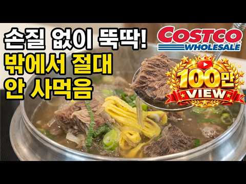
- 챕터: 0:00 코스트코추천템 진공 갈빗살, 왜 그냥 지나치시나요? · 0:33 잡내 없이 깔끔하게, 갈비탕 고기 손질법 · 2:11 압력솥으로 뚝딱, 진한 육수 뽑아내기 · 3:55 맛의 한 끗 차이, 육수 농축액 활용법
- 설명 앞부분: 코스트코에서 진공 포장된 소갈비살, 혹시 손질하기 번거로워서 망설이셨나요? 저는 코스트코에 갈 때마다 꼭 챙겨오는 식재료 중 하나가 바로 진공 소갈비살입니다. 6만 원이 안 되는 가격으로 2kg 넘는 소갈비살을 구입해서 갈비탕을 끓이면, 우리 다섯 식구가 푸짐하게 먹고도 여러 끼니를 더 해결할 수 있거든요. 오늘은 복잡한 핏물 빼기나 까다로운 고기 손질 없이, 코스트코추천템 진공 소갈비살로 집에서 쉽고 맛있게 갈비탕 만드는 방법을 소개합니다. 여러분만의 특별한 갈비탕 레시피가 있다면 댓글로 자유롭게 공유해 주세요. 영상에서 소개한…
- 같은 채널 평소 대비 ×454.4 (채널 최근 롱폼 중앙값 2,402회) · 평소 영상: 수건냄새 완벽하게 없애는 방법 (2,402회) / 압력솥에 넣기만 하세요! 실패 없는 야들야들 수육 레시피 (2,570회)
- 대본 없음 (설명) — 음성인식이 끝나면 도입부·흐름이 들어감
- 댓글 94/94: 좋은 점 — 영상 3 · 감사·응원 5 · 더 알고 싶은 것 1 · 아쉬운 점 — 영상 0 · 반박·불만 — 의견 다름 0 · 정치·사회 0 · 경험 공유 5 · 구독·다음 기대 0
  - 좋은 점 — 영상 👍6 “좋아요 도움이 되었습니다”
  - 좋은 점 — 영상 👍6 “배워갑니다^^”
  - 감사·응원 👍6 “잘보고갑니다~~~^^감사합니다”
  - 감사·응원 👍4 “지혜롭게 음식하시 며 알려 주시는. 모습에 감사를 드립니다. 한 가지 부탁이 있는데 미국에서도 많은 사람들이 보고 있습니다. 같은 고기를 살려고 하는데 영어로는 뭐라고 표시되어 있는지 고기 이름을 알고 싶습니다”
  - 더 알고 싶은 것 👍4 “지혜롭게 음식하시 며 알려 주시는. 모습에 감사를 드립니다. 한 가지 부탁이 있는데 미국에서도 많은 사람들이 보고 있습니다. 같은 고기를 살려고 하는데 영어로는 뭐라고 표시되어 있는지 고기 이름을 알고 싶습니다”
  - 경험 공유 👍40 “실제 해봤습니다. 솔직히 뼈에 붙은 갈비로 끓인 갈비탕 맛의 1/5 정도였어요. 뼈에서 나오는 맛을 무시할 수는 없더라고요. 뼈 붙은 갈비로 한번 데쳐내고 푹 끓이다가 무 넣고 끓이고 조선간장으로 살짝 간 하면 코인이나 다시다 등 조미료 안 넣어도 맛있습니다.”
  - 경험 공유 👍9 “우리집은 소가족?이 아니라 돼지가족? 이라서 한끼면 아작낼듯요..맛있어서요..잘보고갑니다~ 번창하세요~~(소가족이 우껴서..ㅋㅋ)”

### 2. 좁은 세탁실 2배 넓게 쓰는 가성비 수납, 정리 아이디어, 틈새 수납 살림꿀팁, 세탁실 꾸미기

- https://www.youtube.com/watch?v=dFJIgg7qg2A · 살림하는 디자이너 · 구독자 316 · 조회수 328,157 (×1,038.5, 하루 11,540.2) · 좋아요 424 (0.1%) · 7분 · 2026-10-29 · 주제 묶음 4. 다이소·가성비 · 형식 살림 브이로그·루틴 · 폴더 `W_dFJIgg7qg2A` (웹 승인)
- 썸네일: 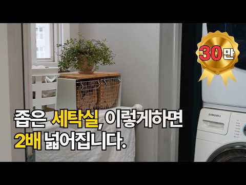
- 챕터: 0:00 1.좁은 세탁실 정리, 1평 공간의 한계와 수납 대책 · 1:15 2.좁은 공간 가성비 정리함, 압축 선반과 틈새 수납… · 2:20 3.좁은 다용도실 활용, 감자·고구마 신선 보관 꿀팁 · 4:11 4.인테리어 완성도 높이기, 패브릭 가림막과 논슬립 …
- 설명 앞부분: "이 포스팅은 쿠팡 파트너스 활동의 일환으로, 이에 따른 일정액의 수수료를 제공받습니다." 좁은 세탁실, 놓을 건 많은데 공간은 늘 부족하죠?^^;; 5년 동안 미뤄왔던 저희 집 1평 남짓한 세탁실을 드디어 정리했어요! 이번 정리의 핵심은 "바닥은 비우고, 위쪽 공간을 활용하는 것!" 기존 물건을 최대한 재활용하고, 다이소 DIY와 가성비 수납템으로 돈은 아끼면서도 깔끔하고 실용적인 세탁실로 바꿔봤어요. 좁은 공간을 알차게 활용하는 수납 아이디어, 영상에서 확인해 보세요! [ 제품 정보 ] 스텐바구니 (영상의 사이즈는 S1입니다)…
- 대본 없음 (설명) — 음성인식이 끝나면 도입부·흐름이 들어감
- 댓글 33/33: 좋은 점 — 영상 1 · 감사·응원 3 · 더 알고 싶은 것 4 · 아쉬운 점 — 영상 0 · 반박·불만 — 의견 다름 0 · 정치·사회 0 · 경험 공유 3 · 구독·다음 기대 0
  - 좋은 점 — 영상 👍1 “저희 이사갈집 세탁실이 좁아서 어떻게 정리해야할지 고민이었는데 도움이 많이 됐어요 감사합니다~ 근데 저희 세탁실이 더 좋아서 선반은 못만들어 같아요ㅜㅡ 좁은 수납장 넘 좋네용.”
  - 감사·응원 👍1 “저희 이사갈집 세탁실이 좁아서 어떻게 정리해야할지 고민이었는데 도움이 많이 됐어요 감사합니다~ 근데 저희 세탁실이 더 좋아서 선반은 못만들어 같아요ㅜㅡ 좁은 수납장 넘 좋네용.”
  - 감사·응원 👍0 “영상잘봤어요 감사합니다❤”
  - 더 알고 싶은 것 👍0 “철제 선반 어디 건지 알고 싶어요”
  - 더 알고 싶은 것 👍0 “혹시 실외기실은 어떻게 들어가나요?”
  - 경험 공유 👍1 “저희 이사갈집 세탁실이 좁아서 어떻게 정리해야할지 고민이었는데 도움이 많이 됐어요 감사합니다~ 근데 저희 세탁실이 더 좋아서 선반은 못만들어 같아요ㅜㅡ 좁은 수납장 넘 좋네용.”
  - 경험 공유 👍0 “안녕하세요~영상 잘봤습니다. 혹시 철제바구니 구입처 알수 있을까요?저도 선반 똑같이 만들보려구요~”

### 3. 【안 보면 후회】올겨울 바지는 딱 4벌이면 충분! 이 5가지는 지금 당장 피하세요｜60대 겨울패션｜중년 여성 패션 ｜겨울 바지

- https://www.youtube.com/watch?v=81Qc8Fyfg9c · 옷차림의 품격 · 구독자 852 · 조회수 116,406 (×136.6, 하루 14,708.8) · 좋아요 673 (0.6%) · 17.4분 · 2026-11-19 · 주제 묶음 6. 4050 패션 · 형식 경고형 (사지 마세요·실패템) · 폴더 `W_81Qc8Fyfg9c` (웹 승인)
- 썸네일: 
- 설명 앞부분: 안녕하세요! 옷차림의 품격에 오신 것을 환영합니다. 🌷 👖 올겨울, 아직도 아무 바지나 입고 계신가요? 바지 하나만 잘못 골라도 다리가 짧아 보이고 나이 들어 보일 수 있습니다. 반대로 딱 4가지 바지만 제대로 고르면 훨씬 젊고 우아한 겨울 스타일을 완성할 수 있습니다! ✨ 오늘 영상에서 알려드립니다! ❌ 60대 이후 피해야 할 겨울 바지 5가지 올겨울 꼭 필요한 바지 4가지 💎 다리가 길어 보이고 품격을 높이는 코디 비법 💕 지금 옷장 속 바지부터 확인해 보세요!
- 같은 채널 평소 대비 ×104.9 (채널 최근 롱폼 중앙값 1,110회) · 평소 영상: 키 작은 60대 늦가을 코디 5가지! 제발 이렇게 입으세요｜굽 없이도 다리가 길어 보이는… (1,323회) / 올겨울 패딩 사기 전에 꼭 보세요! 색 하나·끈 하나로 10살 젊어 보이는 60대 패딩 … (896회)
- 대본 없음 (설명) — 음성인식이 끝나면 도입부·흐름이 들어감
- 댓글 15/15: 좋은 점 — 영상 0 · 감사·응원 1 · 더 알고 싶은 것 1 · 아쉬운 점 — 영상 0 · 반박·불만 — 의견 다름 0 · 정치·사회 0 · 경험 공유 0 · 구독·다음 기대 0
  - 감사·응원 👍3 “정보감사합니다 만 추천하는 옷을 말로만 하지마시고 집접 관련된 바지하고 말하고 같이 해주시면 더 좋겠습니다”
  - 더 알고 싶은 것 👍1 “어차피 60대 이상이면 노인인데 따뜻하고 깨끗하고 편하면 되지 멋낸다고 얼마나 멋이 난다고 그러나요?”

### 4. 마켓컬리로 식비 절약 성공했어요ㅣ배달 외식 끊게 만드는 컬리 추천템ㅣ초간단 밀키트, 디저트 레시피

- https://www.youtube.com/watch?v=AHNj9dOIBsg · 유부주부 · 구독자 5,070 · 조회수 1,130,114 (×222.9, 하루 80,783.8) · 좋아요 3,524 (0.3%) · 13.5분 · 2026-11-13 · 주제 묶음 1. 쿠팡·쇼핑 추천 · 형식 목록형 (N가지 추천템) · 폴더 `W_AHNj9dOIBsg` (웹 승인)
- 썸네일: 
- 챕터: 0:00 컬리추천템 시작 · 0:27 떡갈비 · 1:24 알탕 · 2:11 완자만두 · 3:01 김치우동 전골 · 4:07 닭갈비 · 5:03 토마토홀 · 5:54 냉동 크레페 · 6:54 쌀 모닝빵 · 7:38 바게트 · 8:29 두유 그릭요거트 · 9:32 크림치즈 (전남친 토스트) · 10:39 대패 닭가슴살 · 11:33 연근칩 · 12:21 쭈꾸미 볶음
- 설명 앞부분: 식비 절약 성공시켜준 마켓컬리 추천템
- 대본 없음 (설명) — 음성인식이 끝나면 도입부·흐름이 들어감
- 댓글 135/135: 좋은 점 — 영상 2 · 감사·응원 4 · 더 알고 싶은 것 5 · 아쉬운 점 — 영상 0 · 반박·불만 — 의견 다름 0 · 정치·사회 0 · 경험 공유 14 · 구독·다음 기대 2
  - 좋은 점 — 영상 👍3 “컬리 너무 비싸서 안샀었는데 잘사면 좋은 곳이군요 참고하겠습니다 좋은 영상 감사해요”
  - 감사·응원 👍6 “몰랐던 컬리제품도 많네요 감사합니다^^”
  - 감사·응원 👍3 “컬리 너무 비싸서 안샀었는데 잘사면 좋은 곳이군요 참고하겠습니다 좋은 영상 감사해요”
  - 더 알고 싶은 것 👍4 “알탕에 야채 추가해도 간이 맞나요?”
  - 더 알고 싶은 것 👍2 “바게트샌드위치 만드실때 하얀소스하고 치즈정보부탁드립니다”
  - 경험 공유 👍230 “컬리 배송 기사 라서 컬리 제품 거의 모든 걸 다 먹어봤고 또 꾸준히 이용 중 입니다. 결론은 가격은 다소 비싼감은 있습니다. 하지만 맛은 그만큼 더 좋습니다. 저희도 냉장고 냉동고에 아이가 셋 이라 항상 가득 채워져 있는데 컬리 제품들이 상당수 입니다. 광고 및 홍…”
  - 경험 공유 👍96 “이 분에게 쓰는건 아니고!! ~~~ 누군가는 낚여서 보실수 있으니 오지랖 ㅋㅋㅋ 배달음식비 만큼 나올수 있어요 컬리는. 정말 고르고 잘 골라서 담아보고.. 한끼먹고 끝나는 키트제품들은 기타식재료와 함께 담았을시 생각보다 ∣ 외식비,배달비 그 이상이 되는건 당연할수 있…”
  - 구독·다음 기대 👍1 “추천해주신거 구매해볼게요 영상 넘 좋아서 구독했어요. 또 기다릴게요 :)”

### 5. 하루 일당 8만원 받으려고 쿠팡 간 53세 주부, 물류센터 1년 해 보고 알게 된 것들

- https://www.youtube.com/watch?v=yLZpYX1Cvxo · 일해볼까 · 구독자 3,850 · 조회수 546,543 (×142.0, 하루 56,807.9) · 좋아요 1,845 (0.3%) · 14분 · 2026-11-17 · 주제 묶음 1. 쿠팡·쇼핑 추천 · 형식 목록형 (N가지 추천템) · 폴더 `W_yLZpYX1Cvxo` (웹 승인)
- 썸네일: 
- 챕터: 0:00 50대 주부, 쿠팡 물류센터 1년 · 1:04 1장 쉰셋, 처음 쓰는 이력서 (50대 재취업) · 2:04 2장 확정 문자 (쿠팡 일용직 지원) · 3:29 3장 PDA와 토트 (물류센터 하는 일) · 4:41 4장 다음 날 8만 2,560원 (쿠팡 일당) · 5:29 5장 문어발과 출근율 · 6:14 6장 계약직이 되다 (계약직 전환) · 7:11 7장 체감온도 33도 (여름 물류센터) · 8:33 8장 사람 · 9:33 9장 11개월째 (퇴직금 문제) · 11:06 10장 1년 결산 (물류센터 1년 현실) · 12:19 11장 지원 전 확인할 다섯 가지 (물류센터 지원 팁)
- 설명 앞부분: 쿠팡 물류센터 일당 8만 2,560원. "나이 안 본다"는 말에 53세 주부가 처음으로 이력서를 썼습니다. 일용직에서 계약직 전환, 체감온도 33도의 여름, 11개월째에 생긴 퇴직금 문제까지 따라갑니다. 타임라인 📚 참고 자료 2026년 최저임금 시급 10,320원 (최저임금위원회), 8시간 기준 일당 8만 2,560원 쿠팡풀필먼트서비스 일용직 퇴직금 사건 보도 (2026.2 상설특검 기소, 재판 진행 중) ※ 영상 속 정선희 씨는 실제 자료와 사례를 바탕으로 재구성한 가상의 인물입니다. ※ 영상 속 그림과 썸네일 이미지는 AI로…
- 같은 채널 평소 대비 ×2.7 (채널 최근 롱폼 중앙값 201,784회) · 평소 영상: 은퇴 후 마을버스 기사, 되는 건 쉬운데 오래 못 하는 이유 (201,784회) / 지게차 자격증만 따면 된다더니, 경력 없는 57세가 겪은 첫 직장 ∣ 지게차 현실 (211,441회)
- 대본 없음 (설명) — 음성인식이 끝나면 도입부·흐름이 들어감
- 댓글 289/289: 좋은 점 — 영상 0 · 감사·응원 9 · 더 알고 싶은 것 3 · 아쉬운 점 — 영상 2 · 반박·불만 — 의견 다름 4 · 정치·사회 9 · 경험 공유 18 · 구독·다음 기대 0
  - 감사·응원 👍47 “그냥 일할수 있음에감사하자”
  - 감사·응원 👍12 “사업하는 것도 쿠팡알바보다 못 벌고 빗많은사람들 천지예요 60살까지 일할수 있음에 감사 해야해요 저도 작은사업과 병행중 이예요 사람스트레스가 없진않지만 그래도 할만합니다 다들 일하세요~ 애들 유치원보내고 몇시간만 일해도 애들 사립유치원비는 충분히 나옵니다 면접도 안보…”
  - 더 알고 싶은 것 👍2 “다른직업도부탁드려요”
  - 더 알고 싶은 것 👍1 “일하다가 중간에 몸이 안좋아서 조퇴하고 나오게되면 일당이 어떻게 되는건가요?”
  - 아쉬운 점 — 영상 👍0 “그냥 돈없으면 자식새끼 안낳고 편하게 살면 될것을 ㅋㅋㅋㅋㅋㅋㅋ 가진거 없는데 쌩쑈 하니까 이런게 반복되는거지 ㅉㅉㅉ”
  - 반박·불만 — 의견 다름 👍10 “저 47세 인데요 계약직 3년 채우고 4년차 접러 들었네요...한마디로 거지.같은 곳이죠...너무 차별을 해요...어린사람과 나이 있는 사람과...저도 나이가 그렇게 많은게 아닌데요...계약직으로 다니다 보면 별꼴 다봅니다.센터는 센바센 이지만 저가 다니는 센터는 그…”
  - 반박·불만 — 의견 다름 👍7 “선풍기도 없는곳이 한두군데가 아닌데”
  - 정치·사회 👍175 “작업장엔 에어콘이나 온도에 맞춰 제대로 틀어줘라~ 정부는 그걸 감독하라고~ㅠㅠ 작업장 실내온도는 휴식보다 중요한거임!!!”
  - 정치·사회 👍15 “53세가 아니라 63세처럼 보이는 분들도 새로 신입으로 들어오던데 일하겠다는 의지는 좋지만 기존에 있던 계약직들의 심기를 거스르지 않는 선을 지켜주는게 좋을겁니다. 이건 텃세를 부리는게 아니라 계약직의 80퍼센트만이라도 일을 하라는겁니다. 처음에는 당연히 일을 잘 못…”
  - 경험 공유 👍120 “배송캠프 야간 한달 했었는데 5월에서 6월로만 넘어가도 너무 더워서 그야말로 땀이 비오듯 무거운거 너무 많이 들게 되는 것도 힘들었죠 그래도 몇년 전이라 젊었네.. 지금 하려면 하리 정말 나갈듯 근데 거기 일하면서 새로운 세상을 알게 됐었죠 새벽 한밤 그 시간에 이렇…”
  - 경험 공유 👍44 “본인도 물류센터에서 제품분류 작업을 해봤는데 스트레스받고 골치가 아팠다.차라리 박스 치우면서 제품 보충하는 일이 뱃속 편하다.”

### 6. 다이소에서 200만원 쓰고 엄선한 추천템 15가지ㅣ줄서서 재구매한 품절대란템ㅣ보이면 무조건 사세요

- https://www.youtube.com/watch?v=Ditoq0OLdh8 · 유부주부 · 구독자 5,070 · 조회수 3,029,082 (×597.5, 하루 73,343.6) · 좋아요 8,125 (0.3%) · 10.5분 · 2026-10-16 · 주제 묶음 1. 쿠팡·쇼핑 추천 · 형식 목록형 (N가지 추천템) · 폴더 `W_Ditoq0OLdh8` (웹 승인)
- 썸네일: 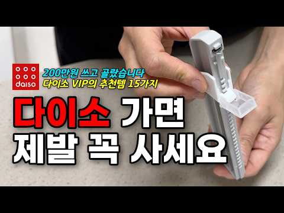
- 대본 없음 (없음) — 음성인식이 끝나면 도입부·흐름이 들어감
- 댓글 269/269: 좋은 점 — 영상 15 · 감사·응원 17 · 더 알고 싶은 것 6 · 아쉬운 점 — 영상 0 · 반박·불만 — 의견 다름 4 · 정치·사회 0 · 경험 공유 6 · 구독·다음 기대 3
  - 좋은 점 — 영상 👍27 “수많은 시행착오 끝에 골라낸 알짜배기 살림 꿀템들을 마주하니, 소소한 일상 속 작은 아이템 하나가 주는 편리함과 삶의 질 변화에 깊은 공감이 가네요. 품절 대란을 겪을 만큼 많은 이들의 지혜가 담긴 물건들이라 매일 마주하는 집안일의 수고로움을 덜어주고 하루를 한결 산…”
  - 좋은 점 — 영상 👍4 “유익합니다. 배수구뚜껑 손잡이는 무엇인지 꼭 필요한데 몇번봐도모르겠어요ㅜ”
  - 감사·응원 👍6 “정말 찐 대박 아템이네요. 소개해 주셔서 감사합니다”
  - 감사·응원 👍5 “오늘 다이소 가봐야겠네요^^ 감사합니다!”
  - 더 알고 싶은 것 👍8 “굳 다른 다이소 영상도 부탁드립니다!”
  - 더 알고 싶은 것 👍1 “재질을 믿을수있을까요?”
  - 반박·불만 — 의견 다름 👍1 “품절대란 아닌데 븡쉰 주작선동충”
  - 반박·불만 — 의견 다름 👍1 “0:17 스텐 바트 -> 스테인리스 (스틸) 바트 // 스텐 -> 스테인리스 스틸 "스테인리스 스틸" 이란 표현을 단지 길다는 이유로 스텐/스탠/스뎅 등으로 줄여서 적게 되면 완전히 잘못된 표현이 됩니다. 스텐/스테인/스뎅 과 같은 표현은 STAINLESS STEEL…”
  - 경험 공유 👍2 “10:00 와 제가 몇년전부터 쓰고있는 방식인데 정말 찐 살림꾼이시네요 ㅎㅎ”
  - 경험 공유 👍1 “날짜 표시 진공 용기 저도 추천합니다. 수만원 짜리랑 비교해서 성능차이가 별로 없음.”
  - 구독·다음 기대 👍0 “좋은 상품 많이 보고 가요. 그런데 다이소의 실리콘 샤워 호스를 안 쓰시고 계시네요. 냄새도 없고 깔끔해서 추천합니다. 구독했어요.”
  - 구독·다음 기대 👍0 “상품명, 번호 넣어도 (품절말고) 안나오는 것들 더러 있네요. 더보기에 따로 정리해도 두면 수정하기 편할실거에요. 보니까 첫영상인데도 수준급입니다. 이대로만 하면 금방 성장할거 같아요~ 구독합니다.”

### 7. 등산복 코디 총정리 ∣ 색상 조합 추천 ∣ 등산 패션

- https://www.youtube.com/watch?v=0O696yvspvM · 액티브중년 · 구독자 703 · 조회수 356,544 (×507.2, 하루 9,241.0) · 좋아요 527 (0.1%) · 7.4분 · 2026-10-19 · 주제 묶음 1. 쿠팡·쇼핑 추천 · 형식 코디·메이크업 (따라 하기) · 폴더 `W_0O696yvspvM` (웹 승인)
- 썸네일: 
- 챕터: 0:00 도입부 · 0:55 요즘 등산복 트렌드 · 2:05 나의 등산복코디 · 4:15 등산복 색상 코디
- 설명 앞부분: 등산복, 편하게 입으면서도 멋스러워 보일 수 없을까요? 등산복코디가 어렵게 느껴진다면, 새 옷을 사기 전에 색상 조합부터 바꿔보세요! 이번 영상에서는 25년 패션디자이너의 경험을 바탕으로, 제가 실제로 즐겨 입는 스타일과 요즘 인기 있는 등산복코디를 소개해 드립니다. 중년이라면 누구나 쉽게 따라 할 수 있는 색상 조합! 촌스럽지 않고 세련돼 보이는 등산복코디 3가지 핵심 공식까지 알려드릴게요. 기능성은 기본, 스타일은 센스 있게! 지금 가지고 있는 등산복으로 나만의 멋스러운 스타일을 완성해 보세요. 무신사스냅 _하견 유투스 피식대학
- 같은 채널 평소 대비 ×42.7 (채널 최근 롱폼 중앙값 8,343회) · 평소 영상: 여름등산 햇빛과 땀때문에 힘들때, 이것 챙기세요! (8,343회) / 여름등산 준비물 추천템3 (9,172회)
- 대본 없음 (설명) — 음성인식이 끝나면 도입부·흐름이 들어감
- 댓글 35/35: 좋은 점 — 영상 1 · 감사·응원 2 · 더 알고 싶은 것 0 · 아쉬운 점 — 영상 0 · 반박·불만 — 의견 다름 0 · 정치·사회 1 · 경험 공유 1 · 구독·다음 기대 0
  - 좋은 점 — 영상 👍1 “❤❤❤❤멋스러운코디잘배웠어요 감사합니다❤❤❤❤❤”
  - 감사·응원 👍6 “감사합니다..전문가시네요. 참조할게요. 이왕이면 이쁘게 입는게 좋잖아요~~~”
  - 감사·응원 👍1 “❤❤❤❤멋스러운코디잘배웠어요 감사합니다❤❤❤❤❤”
  - 정치·사회 👍4 “한국 등산복 브랜드 여자 바지사이즈 30인치 이상이 없음. 수입브랜드는 있음. 왜 그러지? 그러니 외국인들 유니클로나 무신사서 옷 사지”
  - 경험 공유 👍6 “여행지나 산에 가면 60후반 70대 부모님 세대 어르신들이 진짜 많으신데요. 다들 옷 진짜 잘 입으세요. 옛날 아웃도어 원색 녹색 핑크.주황 같은 이런 알록달록한 컬러 안 입으세요. 무채색이나.베이지 같은 그런 톤온톤 옷 많이 입으심. 신발도 그렇구요. 블랙에 베이지…”

### 8. 🍒 매일 보던 동네엄마, 왜 남남이 됐을까 ∣ 40대 전업주부

- https://www.youtube.com/watch?v=Xiil0Dr4v1c · 주부 김앵두 · 구독자 403 · 조회수 215,635 (×535.1, 하루 5,107.6) · 좋아요 518 (0.2%) · 7분 · 2026-10-16 · 주제 묶음 2. 살림·주방 · 형식 살림 브이로그·루틴 · 폴더 `W_Xiil0Dr4v1c` (웹 승인)
- 썸네일: 
- 같은 채널 평소 대비 ×90.0 (채널 최근 롱폼 중앙값 2,396회) · 평소 영상: 🍒 3인가족 40대 주부의 소비기록 시작합니다. (2,975회) / 🍒 고래잇 오픈런 후기 ∣ 같은 장바구니 쿠팡 vs 이마트 가격 비교했더니 (1,817회)
- 대본 없음 (없음) — 음성인식이 끝나면 도입부·흐름이 들어감
- 댓글 233/233: 좋은 점 — 영상 3 · 감사·응원 7 · 더 알고 싶은 것 2 · 아쉬운 점 — 영상 2 · 반박·불만 — 의견 다름 1 · 정치·사회 0 · 경험 공유 52 · 구독·다음 기대 2
  - 좋은 점 — 영상 👍13 “한때 알고 지내는게 내가 모르는 정보 알 수 있는 창구가 되는거니 나쁘지 않은듯. 자주만나는거 보다 가끔 만나면 유익한 면도 있더라구요..”
  - 좋은 점 — 영상 👍8 “시절 인연이고, 서로의 교육관은 다를 수 있기에 충분히 공감합니다. 다만 아이들의 유년기를 함께한 소중한 인연이었다면, 서로의 생각을 솔직하게 나눠 볼 수도 있지 않았을까요?^^ 아무런 설명 없이 관계가 달라졌다면 상대방도 서운할 수 있고, 교육에 대한 관심이 함께하…”
  - 감사·응원 👍8 “시절 인연이고, 서로의 교육관은 다를 수 있기에 충분히 공감합니다. 다만 아이들의 유년기를 함께한 소중한 인연이었다면, 서로의 생각을 솔직하게 나눠 볼 수도 있지 않았을까요?^^ 아무런 설명 없이 관계가 달라졌다면 상대방도 서운할 수 있고, 교육에 대한 관심이 함께하…”
  - 감사·응원 👍8 “진솔한 이야기 유튜브로 이야기해주셔서 감사해요. 영상을보면서 여러 생각을 하게되었는데 어떤방식이든 타인이 내 바운더리를 넘었을때는 기분이 좋지않은거 같네요 ㅎㅎ 근데 자신의 애정을 남에게 신경써주면서 표현하는 방식이 있는데 그러다보면 조언아닌 조언을 하게되는거 같습니…”
  - 더 알고 싶은 것 👍0 “사람들 앞에서 뭐라고 하다니.. 인성이.. 그냥 마주쳤음 잘지냈냐고 하면되지 뭐가 그리 기분이 나빴을까요? 시절인연이 된게 다행인거같아요! 저도 많이 데이고(?) 아이중학교 가고 이사도 근처로 했지만 혼자가 되었는데 지금이 제일 좋습니다 ❤”
  - 아쉬운 점 — 영상 👍0 “혹시.. 나중에 음성도 넣어주실 수 있는지요.. AI음성이라도.. 저녁 준비하면서 듣고 싶은뎅.. 핸드폰을 볼 수가 없어성 ㅠㅠ”
  - 반박·불만 — 의견 다름 👍0 “다들 많은 공감이네요 전 올해 고3 아들 초6딸 이 잇어오 지방서와서 결혼한탓에 사회친구들만 있고 해서 애들 따 당할까 싶어 억지로 사귀고해도 결국 저들이필요할때 손잡지 않으면 ㅠ 아들친구 엄마들이 그룹과외 엄청 하자고 햇어요 전 그게 싫더라구요 대형 학원이오랜 커라…”
  - 경험 공유 👍323 “저도 동네 엄마들과 인사만 하고 친분을 쌓진 않아요 ㅎㅎㅎ 완전 편해요!! 아파트 안에서 친분쌓아 매일 같이 다니는 엄마들 보면 부럽긴 커녕 속으로 정말.... 피곤하겠다~ 싶어요... 성격일수도 있지만요 아이를 매일매일 케어해야하는데 쓸떼없는 걸로 감정소모 안해서 …”
  - 경험 공유 👍133 “저도 그시절을 겪었어요.. 그무리에 어울리기위해 매일같이 만나서 식사하고 커피마시고.. 아이가 나로인해서 친구를 못사귈까봐 걱정이커서 힘들고 피곤해도 만남을 유지했어요ㅠㅠ 근데 엄마가 노력하지않아도 아이는 또래친구를 만들고 소통하며 잘지내는거있죠..?ㅠㅠ 첫아이 이후…”
  - 구독·다음 기대 👍2 “안녕하세요. 동네가 낯이 익어서 첨으로 댓글 남겨봅니다. 저도 같은동네인듯하여^^ 나이대도 같고 아이나이도 비슷한듯하네요. 구독하고갑니다. 반갑습니다. ^^”

### 9. 쓸수록 감탄나오는 다이소 강력 추천 화장실 세제

- https://www.youtube.com/watch?v=unM52hap6r8 · 살림클라스 · 구독자 1,360 · 조회수 1,158,538 (×851.9, 하루 12,925.7) · 좋아요 2,772 (0.2%) · 6.8분 · 2026-08-29 · 주제 묶음 4. 다이소·가성비 · 형식 목록형 (N가지 추천템) · 폴더 `W_unM52hap6r8` (웹 승인)
- 썸네일: 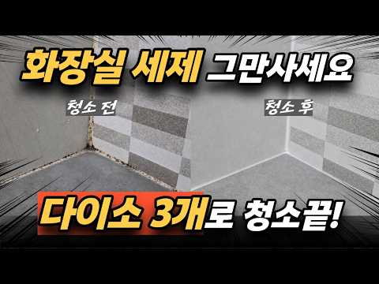
- 챕터: 0:00 인트로 · 0:20 1단계 - 요석 제거제 · 3:03 2단계 - 오렌지 다목적세제 · 4:47 3단계 - 락스 (곰팡이 있으신 분만) · 6:11 총정리
- 설명 앞부분: 화장실 청소, 비싼 세제 필요 없습니다. 다이소 세제 딱 3개, 6천원으로 화장실 청소 끝내는 방법 알려드려요. 🧴 오늘 소개한 제품 1️⃣ 다이소 요석,석회 제거제(3,000원 / 품번 : 1045002) 수전, 샤워부스 유리에 낀 석회·물때 제거용 화장실 청소 1단계로 가장 먼저 사용 2️⃣ 다용도 오렌지 세정제(2,000원 / 품번 : 23972) 벽, 도기류, 바닥 전체 지방때·묵은 때 제거용 위(벽) → 아래(바닥) 순서로 사용하면 효율적 3️⃣ 락스 (1,000원 / 품번 : 64478) 곰팡이 있는 경우에만 선택적으로…
- 같은 채널 평소 대비 ×1,257.9 (채널 최근 롱폼 중앙값 921회) · 평소 영상: 청소 인생 바꿔준 신세계 다이소 꿀템, 사면 또 사게됩니다. (921회) / 싱크볼 교체하려다 싱크볼 청소로 교체 안한 이유 (1,192회)
- 대본 없음 (설명) — 음성인식이 끝나면 도입부·흐름이 들어감
- 댓글 87/87: 좋은 점 — 영상 3 · 감사·응원 2 · 더 알고 싶은 것 7 · 아쉬운 점 — 영상 0 · 반박·불만 — 의견 다름 1 · 정치·사회 0 · 경험 공유 0 · 구독·다음 기대 0
  - 좋은 점 — 영상 👍4 “붓으로 바르는게 꿀팁이네요 감사합니다”
  - 좋은 점 — 영상 👍4 “생활팁 영상 중에 가장 설명을 잘 하심요 😊 채널 잘 커졌으면 좋겠네요 🎉”
  - 감사·응원 👍4 “붓으로 바르는게 꿀팁이네요 감사합니다”
  - 더 알고 싶은 것 👍3 “영상 잘 봤습니다~^^ 다이소에서 저렴히 살 수 있는 제품들이라 도움 많이 되겠어요! 근데 아주 오래된 변기 요석 제거 첫 시도에는 구연산이나 전문용품 중에 어떤 걸 추천하시는지?? 전문용품은 가격 부담이 있긴하네요.. 따라해봐서 이번에 변기 요석이 깔끔히 제거되면 …”
  - 더 알고 싶은 것 👍3 “욕실 거울 물때는 어떻게 지우나요?”
  - 반박·불만 — 의견 다름 👍1 “저음.... 세제는 아닌데.. 발을씻자가...”

### 10. 60대 패딩, '이 4가지 색' 입으면 10년 늙어 보입니다!｜얼굴 확 살리는 색은 따로 있어요

- https://www.youtube.com/watch?v=K6SjlNybF-E · 품격 있는 옷장 · 구독자 2,240 · 조회수 206,231 (×92.1, 하루 20,820.0) · 좋아요 908 (0.4%) · 16분 · 2026-11-17 · 주제 묶음 6. 4050 패션 · 형식 코디·메이크업 (따라 하기) · 폴더 `W_K6SjlNybF-E` (웹 승인)
- 썸네일: 
- 설명 앞부분: 안녕하세요! 품격 있는 옷장입니다. 🌷 60대 이후, 패딩 색 하나 때문에 얼굴이 더 칙칙하고 나이 들어 보일 수 있다는 사실, 알고 계셨나요? 😲 매년 입던 패딩인데도 유독 늙어 보인다면 색깔부터 확인해 보세요! ❌ 얼굴을 10년 더 늙어 보이게 하는 패딩 색 4가지 ✨ 얼굴빛을 환하게 살려 주는 추천 색 4가지 👗 피부톤과 체형에 맞는 우아한 패딩 코디법 🛍️ 패딩 구매 전 꼭 확인해야 할 선택 기준 💖 올겨울, 나를 더 젊고 품격 있게 만들어 줄 패딩 색을 영상에서 확인해 보세요!
- 같은 채널 평소 대비 ×21.4 (채널 최근 롱폼 중앙값 9,646회) · 평소 영상: 【안 보면 후회】흰옷 입으면 더 나이 들어 보이는 이유! 40대부터 꼭 알아야 할 아이보… (9,646회) / 【안 보면 후회】60세 이후 귀티 나는 여자들의 옷장 비밀! 명품 없이 10년 젊어 보이… (9,103회)
- 대본 없음 (설명) — 음성인식이 끝나면 도입부·흐름이 들어감
- 댓글 10/10: 좋은 점 — 영상 0 · 감사·응원 2 · 더 알고 싶은 것 1 · 아쉬운 점 — 영상 0 · 반박·불만 — 의견 다름 0 · 정치·사회 0 · 경험 공유 0 · 구독·다음 기대 0
  - 감사·응원 👍1 “늘 감사합니다 참고 할께요”
  - 감사·응원 👍1 “감사합니다 응원합니다”
  - 더 알고 싶은 것 👍5 “카멜베이지 패딩 구입 정보 부탁드려요”

### 11. 한 번 쓰면 못 돌아갑니다... 59,900원 올스텐 2단 찜기 실사용 후기

- https://www.youtube.com/watch?v=RKCDp2p52ss · 적자유튜버, 찐써봄 · 구독자 84 · 조회수 105,889 (×1,058.9, 하루 916.2) · 좋아요 192 (0.2%) · 4.5분 · 2026-08-03 · 주제 묶음 1. 쿠팡·쇼핑 추천 · 형식 직접 써 본 후기 (내돈내산·N개월 사용) · 폴더 `W_RKCDp2p52ss` (웹 승인)
- 썸네일: 
- 설명 앞부분: 안녕하세요 😊 직접 사고, 직접 써보고, 솔직하게 추천하는 찐써봄입니다. 오늘은 코스트코 찐추천템 2탄으로 일명 ‘오연수 찜기’로도 알려진 올스텐 2단 찜기를 직접 사용해봤습니다. 퇴근하고 집에 오면 요리도 귀찮지만, 설거지는 더 귀찮잖아요. 그래서 이번에는 단순히 음식을 잘 찌는 제품인지보다 매일 부담 없이 꺼내 쓰기 편한지 올스텐이라 세척과 관리가 편한지 1단과 2단을 상황에 맞게 활용할 수 있는지 메뉴별 시간 설정으로 간편하게 조리할 수 있는지 59,900원의 값어치를 하는 제품인지 직접 사용하면서 하나씩 확인해봤습니다. 이…
- 같은 채널 평소 대비 ×104.8 (채널 최근 롱폼 중앙값 1,010회) · 평소 영상: 2만원대로 집에서 더 많이 쓰는 캠핑용 폴딩카트 (1,010회) / 3만원대 자동센서휴지통이 봉투까지 알아서 펴준다고? 직접 써봤습니다 (969회)
- 대본 없음 (설명) — 음성인식이 끝나면 도입부·흐름이 들어감
- 댓글 9/9: 좋은 점 — 영상 0 · 감사·응원 1 · 더 알고 싶은 것 2 · 아쉬운 점 — 영상 0 · 반박·불만 — 의견 다름 0 · 정치·사회 0 · 경험 공유 0 · 구독·다음 기대 0
  - 감사·응원 👍2 “미국 엘에이에 있는데요. 어떻게 구매할 방법이 있는지 알려주시면 감사하겠습니다.”
  - 더 알고 싶은 것 👍2 “미국 엘에이에 있는데요. 어떻게 구매할 방법이 있는지 알려주시면 감사하겠습니다.”
  - 더 알고 싶은 것 👍1 “연마제 제거해야되나요?”

### 12. 【안 보면 후회】60대 가을 청바지, 이렇게 입으면 10년 더 늙어 보입니다! 뱃살 싹 가리고 다리 길어 보이는 3가지 황금 코디법

- https://www.youtube.com/watch?v=0kMrCuXCzh4 · 품격 있는 옷장 · 구독자 2,240 · 조회수 767,359 (×342.6, 하루 18,311.3) · 좋아요 1,949 (0.2%) · 14분 · 2026-10-16 · 주제 묶음 6. 4050 패션 · 형식 경고형 (사지 마세요·실패템) · 폴더 `W_0kMrCuXCzh4` (웹 승인)
- 썸네일: 
- 설명 앞부분: 🌸 안녕하세요! 품격 있는 옷장에 오신 것을 환영합니다! 💕 👖 60대 이후, 똑같은 청바지를 입어도 어떤 사람은 10년 젊어 보이고, 어떤 사람은 오히려 나이 들어 보이는 이유는 무엇일까요? 그 비밀은 나이나 체형이 아닌 청바지 선택과 코디 방법에 있습니다! ✨ 올가을, 뱃살은 자연스럽게 가리고 다리는 길어 보이면서 우아함까지 살리는 청바지 스타일링 비법을 알려드립니다. 🍂 오늘 영상에서 알려드릴 핵심 비법! 60대 이후 오히려 나이 들어 보이게 만드는 청바지 3가지 뱃살과 허벅지를 자연스럽게 가려주는 황금 청바지 2가지 다리가…
- 같은 채널 평소 대비 ×79.6 (채널 최근 롱폼 중앙값 9,646회) · 평소 영상: 【안 보면 후회】흰옷 입으면 더 나이 들어 보이는 이유! 40대부터 꼭 알아야 할 아이보… (9,646회) / 【안 보면 후회】60세 이후 귀티 나는 여자들의 옷장 비밀! 명품 없이 10년 젊어 보이… (9,103회)
- 대본 없음 (설명) — 음성인식이 끝나면 도입부·흐름이 들어감
- 댓글 21/21: 좋은 점 — 영상 2 · 감사·응원 7 · 더 알고 싶은 것 1 · 아쉬운 점 — 영상 0 · 반박·불만 — 의견 다름 0 · 정치·사회 0 · 경험 공유 0 · 구독·다음 기대 0
  - 좋은 점 — 영상 👍3 “도움이됏어요 감사합니다❤❤🎉”
  - 좋은 점 — 영상 👍1 “선생님.감사합니다. 청바지대믜.많이배우고갑니다❤❤❤”
  - 감사·응원 👍10 “버릴게 많아졋네요 감사~🙏”
  - 감사·응원 👍4 “그렀군요 옷장 정리를 ㅠㅠ ❤유친하고 응원합니다 ❤️ 🎁 👍”
  - 더 알고 싶은 것 👍13 “청 바지 이쁜거 파는곳 가르쳐주세요”

### 13. "인스타 감성은 갖다 버렸어요" 100점 살림 포기, 외벌이 월 200 저축 달성한 전업주부 꼼수템 ∣ 꿀템 공개, 생존 살림

- https://www.youtube.com/watch?v=PTNkB8INsa8 · 품격있는 살림학 · 구독자 2,040 · 조회수 252,515 (×123.8, 하루 12,745.4) · 좋아요 983 (0.4%) · 9.5분 · 2026-11-07 · 주제 묶음 1. 쿠팡·쇼핑 추천 · 형식 살림 브이로그·루틴 · 폴더 `W_PTNkB8INsa8` (웹 승인)
- 썸네일: 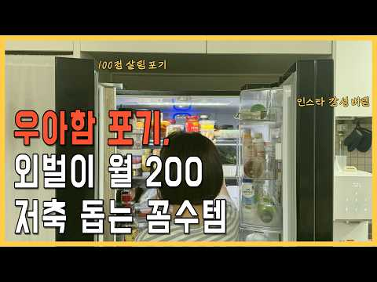
- 설명 앞부분: 남편 외벌이로 매달 200만원씩 악착같이 저축하려면 100점짜리 완벽한 살림은 과감히 포기해야 합니다. 내 체력과 멘탈을 바닥까지 갈아 넣으면 결국 그 짜증이 아이들에게 돌아가고 가정의 평화가 깨지니까요. 완벽하지 않아도 괜찮습니다. 오늘도 각자의 멘탈을 챙기며 힘내보자고요!
- 같은 채널 평소 대비 ×27.2 (채널 최근 롱폼 중앙값 9,277회) · 평소 영상: 외벌이 월 200씩 모으는 품위 있는 가성비 살림법 (저녁준비 10분, 학원비 0원) (9,277회) / 남부럽지 않게 사는 월 200씩 모으는 현실 주부의 푼돈 소비 철학(13년째 유지) (6,561회)
- 대본 없음 (설명) — 음성인식이 끝나면 도입부·흐름이 들어감
- 댓글 145/145: 좋은 점 — 영상 3 · 감사·응원 11 · 더 알고 싶은 것 4 · 아쉬운 점 — 영상 1 · 반박·불만 — 의견 다름 3 · 정치·사회 0 · 경험 공유 19 · 구독·다음 기대 9
  - 좋은 점 — 영상 👍2 “현실적이라 더 많이 공감이 가는듯”
  - 좋은 점 — 영상 👍0 “영상보고 반성하게 됐어요. 좋은 영상 감사합니다☺️ 오늘부터 조금씩 바꿔보려 합니다.”
  - 감사·응원 👍28 “지금은 엄마표로 공부도 되지만 아이들 고등가면 교육비가 어마무지해요. 저도 아이들 초중까지 집에서 가르치고 학습습관 독서력 기르는데 집중했는데 고등은 어나더레벨~~ 그래도 그때 사교육비 안쓴게 가장 잘한일 이락 혼자 쓰담쓰담합니다. 전업맘 화이팅~”
  - 감사·응원 👍4 “구독해용❤ 44살 외벌이입니다. 공감이 많이 됩니다. 저도 삼남매여서 저도 집에서 아이들과 공부 해왔습니다. 곧 고1이되는 첫째 인제 본격적으로 학원들어가니 저축 못하게 되더라구요ㅜ 파이팅입니다 ㅎㅎ 요새 참 지치고 힘들었는데 공감이 많이 되네용 ㅎㅎ 함께 힘내보아욧”
  - 더 알고 싶은 것 👍3 “첫편부터 정주행했네요. 특히 길바닥에 옷값 버리지 마세요편은 공감했어요. 저도 늘 질좋은 니트랑 바지를 찾아 헤매였지만 실패했어요. 살림학님 구입하신 니트랑 바지 정보 좀 알려주시면 넘 감사해요. 늘 응원할께요^^”
  - 더 알고 싶은 것 👍2 “총수입이 얼마인데요? 그것부터 알려주세요.”
  - 아쉬운 점 — 영상 👍1 “살림템 넘 유용해요~ 예전에 학원정보 알려주던 채널 목소리랑 똑같은데 혹시 같은분인가요? 그 채널 더이상 영상이 안 올라와서 아쉬웠는데”
  - 반박·불만 — 의견 다름 👍0 “집중력 깨트리니마니 헛소리 다 생까고 그런 상황에서도 잘 하는 친구들만 합격시켜야지. 징징이들 말 들어주니까 치터들도 묻어가다 이꼴난거라”
  - 경험 공유 👍28 “지금은 엄마표로 공부도 되지만 아이들 고등가면 교육비가 어마무지해요. 저도 아이들 초중까지 집에서 가르치고 학습습관 독서력 기르는데 집중했는데 고등은 어나더레벨~~ 그래도 그때 사교육비 안쓴게 가장 잘한일 이락 혼자 쓰담쓰담합니다. 전업맘 화이팅~”
  - 경험 공유 👍17 “결혼 25년차 주부입니다 외벌이로 월200 저축이 얼마나 대단한지 몸소 아는 저도 외벌이 주부였습니다 가장 처음이 자신을 아는것에서 출발이라는 말도 공감하고 너무 지혜로우시네요 3년 전부터 파트타임으로 일하고 있는데 아이들이 어느정도 컸고 점점 살림을 놓으려고 하는 …”
  - 구독·다음 기대 👍10 “인스타감성보다 이감성이 제마음에쏙드네요ㅋㅋ잘보고있어요~ 다음편도 기다립니다 (진지한듯 잔잔한유머 너무좋아요😂)”
  - 구독·다음 기대 👍6 “남은 30프로로 맨탈 부여잡는데 쓴다는 말 정말 공감하고 필요하다고 느껴요. 구독하고 갑니다~”

### 14. 청소 브이로그ㅣ그릇 좋아하는 맥시멀리스트의 2박 3일 주방정리

- https://www.youtube.com/watch?v=x2YNHyzSL1Q · 미니멀 다이어리  · 구독자 1,490 · 조회수 288,670 (×193.7, 하루 8,830.3) · 좋아요 1,129 (0.4%) · 15.8분 · 2026-10-25 · 주제 묶음 2. 살림·주방 · 형식 살림 브이로그·루틴 · 폴더 `W_x2YNHyzSL1Q` (웹 승인)
- 썸네일: 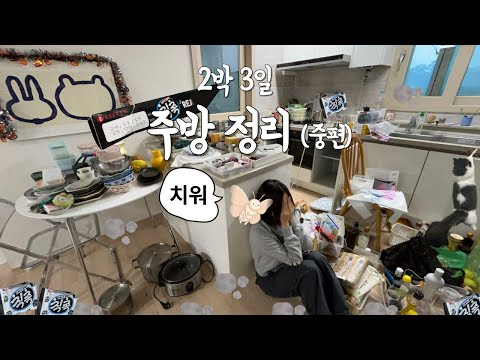
- 같은 채널 평소 대비 ×31.3 (채널 최근 롱폼 중앙값 9,237회) · 평소 영상: 버리기 너무 힘든 맥시멀리스트의 현실적인 신발장 비우기 (9,700회) / 청소 브이로그 ㅣ 0.7평 안방 베란다 대충 빨리 청소하기 (8,774회)
- 대본 없음 (없음) — 음성인식이 끝나면 도입부·흐름이 들어감
- 댓글 89/89: 좋은 점 — 영상 0 · 감사·응원 2 · 더 알고 싶은 것 3 · 아쉬운 점 — 영상 0 · 반박·불만 — 의견 다름 0 · 정치·사회 0 · 경험 공유 7 · 구독·다음 기대 1
  - 감사·응원 👍0 “이거 보고 처음꺼부터 다 보고 왔네요ㅡ넘 재밌어요ㅡ꾸며진 브이로그만 보다ㅡ리얼한 다른집 살림 보는게 넘 재밌네요ㅋㅋ저도 갓 미니멀 라이프를 시작했는데 컵..을 넘 좋아해서 예쁜컵들 보고 쇼핑할뻔^^ 같이 화이팅 해요”
  - 더 알고 싶은 것 👍10 “내일이 휴일이라도 귀찮고 부담되서(?) 시작할까 말깐데, 담날 출근인데 시작하시는 모습에 박수쳐 드립니다!! (금방 끝날거라 생각하셔서 그랬을지도...?ㅎ) 저도 얼추 언제까지 끝나겠지? 하고 시작하면 며칠 동안 정리하게 되던데 상황이 비슷해서 웃펐어요 😂 많이 비우…”
  - 더 알고 싶은 것 👍0 “아니 정리하는영상인데 왤케 재밋죠...다른공간도올려주세요!!”
  - 경험 공유 👍10 “내일이 휴일이라도 귀찮고 부담되서(?) 시작할까 말깐데, 담날 출근인데 시작하시는 모습에 박수쳐 드립니다!! (금방 끝날거라 생각하셔서 그랬을지도...?ㅎ) 저도 얼추 언제까지 끝나겠지? 하고 시작하면 며칠 동안 정리하게 되던데 상황이 비슷해서 웃펐어요 😂 많이 비우…”
  - 경험 공유 👍7 “음 일단 접시류는 세워서 보관해야 골고루 꺼내쓰기 편해용 텀블러나 컵은 회전판이나 서랍식으로 설치해서 쓰면 더 편하구요 ㅎㅎ 깊은 수납선반엔 바구니 긴것 넣어서 잘 안쓰는 것 보관후 끄집어 내서 쓰면 좋구용 제가 정리해드리고싶음 ㅋㅋㅋ”
  - 구독·다음 기대 👍0 “채널 구독했습니다! 아마도 1000번째 구독자인 것 같아요😊 일본어 자막을 달아 주시면 기쁠 것 같아요🥹 번역기를 사용했으니 어색하게 느껴지면 죄송합니다🙏”

### 15. 새 가디건 사지 마세요! 지금 있는 가디건 날씬하게 입는 법 실패없는 가디건 코디법 4050가디건 예쁜것보다 중요한 이것 중년패션고급스러운 가디건 코디 꼭있어야…

- https://www.youtube.com/watch?v=opK4bsSaXH4 · 우아한 C · 구독자 1,150 · 조회수 304,815 (×265.1, 하루 5,816.6) · 좋아요 1,476 (0.5%) · 9분 · 2026-10-05 · 주제 묶음 6. 4050 패션 · 형식 경고형 (사지 마세요·실패템) · 폴더 `W_opK4bsSaXH4` (웹 승인)
- 썸네일: 
- 챕터: 0:00 인트로 및 가디건 코디 고민 · 1:08 1. 이너의 목선과 세로선 연출법 · 2:45 2. 단추 여백으로 슬림하게 입기 · 3:47 3. 체형에 맞는 네크라인 고르기 · 5:38 4. 체형별 기장 선택과 비율 조절법 · 6:33 누구나 바로 따라 하는 실전 가디건 코디 3가지 · 7:44 핵심 요약 및 마무리
- 설명 앞부분: 가디건 코디, 중년 여성 패션, 50대 패션, 40대 패션, 중년 코디, 가을 코디, 간절기 코디, 가디건 입는법, 날씬해 보이는 코디, 체형커버 코디, 상체 날씬해 보이는 법, 브이넥 가디건, 라운드넥 가디건,가을 패션, 데일리룩, 옷 잘 입는 법 요즘, 갑자기 추워진 날씨에 가디건 챙겨다니시죠 :) 지금 있는 가디건으로 예쁘게 입는 활용법 알려드려요 새로사지 말고, 옷장속 가디건부터 꺼내보세요. [타임라인]
- 같은 채널 평소 대비 ×17.2 (채널 최근 롱폼 중앙값 17,715회) · 평소 영상: 여행갈 때 이렇게만 입으세요ㅣ여행 사진이 유독 예쁜 사람들의 공통점 (의외로 얼굴이 아닙… (17,715회) / 명품없이 귀티나게 입는법ㅣ우아해보이는기준ㅣ고급스러워보이는코디ㅣ세련된코디ㅣ귀티나는코디ㅣ품위… (7,771회)
- 대본 없음 (설명) — 음성인식이 끝나면 도입부·흐름이 들어감
- 댓글 6/6: 좋은 점 — 영상 3 · 감사·응원 2 · 더 알고 싶은 것 0 · 아쉬운 점 — 영상 0 · 반박·불만 — 의견 다름 0 · 정치·사회 0 · 경험 공유 1 · 구독·다음 기대 2
  - 좋은 점 — 영상 👍4 “저도 가디컨 참 좋아하는데 도움되었어요 ~멋스럽게 입어볼게요 ~!!”
  - 좋은 점 — 영상 👍3 “목소리가 차분하고 적당한 속도로 말씀해 주셔서 집중이 잘 되고 많은 도움이 되었습니다~ 감사합니다 구독하고 갑니다 ^^**”
  - 감사·응원 👍3 “목소리가 차분하고 적당한 속도로 말씀해 주셔서 집중이 잘 되고 많은 도움이 되었습니다~ 감사합니다 구독하고 갑니다 ^^**”
  - 감사·응원 👍1 “도움 많이됬습니다. 목소리 핵심 영상시간 모두 굳입니다. 감사해서 또 도움 받을려고 구독합니다.❤”
  - 경험 공유 👍4 “저도 가디컨 참 좋아하는데 도움되었어요 ~멋스럽게 입어볼게요 ~!!”
  - 구독·다음 기대 👍3 “목소리가 차분하고 적당한 속도로 말씀해 주셔서 집중이 잘 되고 많은 도움이 되었습니다~ 감사합니다 구독하고 갑니다 ^^**”
  - 구독·다음 기대 👍1 “도움 많이됬습니다. 목소리 핵심 영상시간 모두 굳입니다. 감사해서 또 도움 받을려고 구독합니다.❤”

### 16. 명품 핏인데 가격은 부담 없는 중년 쇼핑몰 추천 7곳 (실패 없는 고급스럽고 세련된 중년 코디)

- https://www.youtube.com/watch?v=HfThekZjkxI · 40,50대의 격 있는 옷 · 구독자 887 · 조회수 270,065 (×304.5, 하루 4,412.6) · 좋아요 995 (0.4%) · 6분 · 2026-09-27 · 주제 묶음 1. 쿠팡·쇼핑 추천 · 형식 코디·메이크업 (따라 하기) · 폴더 `W_HfThekZjkxI` (웹 승인)
- 썸네일: 
- 설명 앞부분: 제가 직접 써보고 좋아서 소개하는 브랜드들입니다. 영상 속에 소개한 브랜드들은 제가 평소에도 자주 구경하고, 직접 구매해본 곳들이에요. 중년코디 구경하실 분들께 도움이 되셨으면 좋겠어요! 1. 메이드바이위 2. 그레이시크 3. 안나앤모드 4. 딘트 5. 더제이수 6. 플로움 7. 아보아보 댓글로 궁금한 스타일 남겨주시면 다음 영상에 꼭 담아볼게요 :)
- 같은 채널 평소 대비 ×31.1 (채널 최근 롱폼 중앙값 8,680회) · 평소 영상: 중년들이 극찬한 우아하고 고급스러운 중년 쇼핑몰 5곳, 77-88사이즈 집중! (명품 빰… (9,837회) / (광고❌)키작은 중년 쇼핑몰 추천 ∣ 욕 먹을 각오하고 비싼 옷 없이 고급져 보이는 쇼핑… (7,524회)
- 대본 없음 (설명) — 음성인식이 끝나면 도입부·흐름이 들어감
- 댓글 22/22: 좋은 점 — 영상 1 · 감사·응원 2 · 더 알고 싶은 것 0 · 아쉬운 점 — 영상 0 · 반박·불만 — 의견 다름 0 · 정치·사회 0 · 경험 공유 1 · 구독·다음 기대 0
  - 좋은 점 — 영상 👍4 “아~~ 진심 최고의 영상입니다~ 간략하면서도 중요사항을 짧은 시간에 담아 주셨네요~^^ 나눠주셔서 감사합니다!ㅎ”
  - 감사·응원 👍12 “오~ 감사합니다. 이 중에서 사 본 옷은 메이드바이위 플리츠스커트는 정말 잘 만든 옷이에요. 탄탄해서 플리츠를 왜 입어야 하는지 알겠더군요. 기본 티와 플리츠 치마로 올 여름 났네요. 알려주신 다른 사이트도 봐야겠군요. ^^”
  - 감사·응원 👍4 “아~~ 진심 최고의 영상입니다~ 간략하면서도 중요사항을 짧은 시간에 담아 주셨네요~^^ 나눠주셔서 감사합니다!ㅎ”
  - 경험 공유 👍3 “메이드 바이위, 안나앤모드에서 구입해봤어요”

### 17. "거의 바르는 보톡스 입니다" 주름 지우고 우아하게 늙고싶다면 올리브영에서 이거 5개만 사면 됩니다! 화장품 만든 17년차 피부과 전문의가 얼굴노화 화장품 싹 …

- https://www.youtube.com/watch?v=F1npP23Kq1I · 피부과 김진용 · 구독자 27,000 · 조회수 4,299,059 (×159.2, 하루 107,678.6) · 좋아요 22,596 (0.5%) · 16.2분 · 2026-10-18 · 주제 묶음 5. 4050 뷰티 · 형식 목록형 (N가지 추천템) · 폴더 `W_F1npP23Kq1I` (웹 승인)
- 썸네일: 
- 챕터: 0:00 얼굴노화 늦추는 4060 올리브영 추천템 하이라이트 · 0:43 영상시작 · 2:11 얼굴노화 늦추는 4060 올리브영 추천템 1 · 4:24 얼굴노화 늦추는 4060 올리브영 추천템 2 · 6:01 얼굴노화 늦추는 4060 올리브영 추천템 3 · 7:02 색소 크림 사용시 주의사항 · 7:52 얼굴노화 늦추는 4060 올리브영 추천템 4 · 9:44 얼굴노화 늦추는 4060 올리브영 추천템 5 · 10:59 굳이 올리브영에서 살 필요없는 제품? · 11:42 올리브영 더마라인 제품 고르는 꿀팁 · 12:33 얼굴노화 늦추는 4060 올리브영 추천템 바르는 순서? · 14:23 영상 핵심 정리 · 15:21 김진용 원장이 강력 추천하는 추천템?!
- 설명 앞부분: "얼굴 노화 늦춰주는 화장품 저희 어머니도 딱 이거 5개만 쓰세요" 안녕하세요. 김진용 원장입니다 ^^ 40대가 넘어가면서 얼굴 노화에 조금씩 신경을 쓰이기 시작하는데요. 50대 60대가 되면 그 고민은 더 깊어지기 마련입니다. 그래서 올리브영에서 4060 분들의 얼굴노화를 늦춰주는 기적의 아이템을 선별해서 준비해보았습니다.
- 같은 채널 평소 대비 ×155.3 (채널 최근 롱폼 중앙값 27,677회) · 평소 영상: 매일 하면 피부 정말 좋아지는 스킨케어 루틴! 피부를 위해 꼭 써야 하는 성분들을 17년… (31,164회) / "생각보다 쉽고 간단합니다!" 연예인처럼 목주름 쫙 펴는 방법을 17년차 피부과 전문의가… (31,411회)
- 대본 없음 (설명) — 음성인식이 끝나면 도입부·흐름이 들어감
- 댓글 433/433: 좋은 점 — 영상 27 · 감사·응원 86 · 더 알고 싶은 것 46 · 아쉬운 점 — 영상 3 · 반박·불만 — 의견 다름 4 · 정치·사회 1 · 경험 공유 21 · 구독·다음 기대 7
  - 좋은 점 — 영상 👍35 “흔히 겪는 노화의 기전을 '막고·고치고·채우는' 3박자로 명쾌하게 짚어주셨네요. 특히 무조건 고가 제품을 권하기보다 성분의 본질을 강조하고, 2주 간격으로 루틴을 늘려가는 현실적인 가이드는 다른 분들께도 꼭 드리고 싶은 당부이기도 합니다.”
  - 좋은 점 — 영상 👍27 “선생님 좋은 영상 감사합니다. 바르는 순서 관련 영상도 부탁드려도 될까요?😊”
  - 감사·응원 👍775 “2018년 - 2021년에 프랑스로레알 본사에서 - 라로슈포제 유비데아 선크림라인 당담했던 제품 개발자입니다. 박사님이 추천하시는 이유들이, 재개발당시 지겹도록 신경썻던 부분들을 콕콕 짚어주시는거보고, 너무 반가워서 지나치지 못하고 댓글답니다. 본사 연구소와 UVA,…”
  - 감사·응원 👍406 “낯익은 얼굴이라 엇 했는데, 서울톤피부과 원장님이시네요. 요새 피부질환 안보는 병원 많은데 김원장님은 아토피환자도 잘 봐주셔서 너무 감사했어요. 늘 질환자들은 피부과 가기가 좀 두렵거든요. 돈 안되는 환자라고 대부분 꺼려해서요. 바로 옆 갤러리아 피부과는 대놓고 질환…”
  - 더 알고 싶은 것 👍53 “이제품들을 추가하여 기본 토너 수분크림등의 제품과 사용한다면 어느순서로 써야하는지 아침 저녁 구분하여 알려주시면 안될까요?”
  - 더 알고 싶은 것 👍27 “선생님 좋은 영상 감사합니다. 바르는 순서 관련 영상도 부탁드려도 될까요?😊”
  - 아쉬운 점 — 영상 👍22 “듣다가 끌리듯이 구독 눌렀습니다. 어제도 올리브영 갔다가 뭘 사야될 지 몰라서 찍는 맘으로 집어왔는데 이걸 보고 갔다면 좋았을텐데요. 아쉽네요”
  - 아쉬운 점 — 영상 👍2 “아스트란지 뭔지 저 크림 너무 기름지고 흡수가 되는지도 모르겠음 저걸 왜 추천하는지 이해불가 한번쓰고 처박아뒀음 의사들은 광고가 아니라고 하지만 뭔가 있는 것 같음....내가 오만가지 다 사용해본 결과 최강은 저녁에 저분자 히알루론산 앰플 흡수시켜주고 각종 미백 주름…”
  - 반박·불만 — 의견 다름 👍2 “아스트란지 뭔지 저 크림 너무 기름지고 흡수가 되는지도 모르겠음 저걸 왜 추천하는지 이해불가 한번쓰고 처박아뒀음 의사들은 광고가 아니라고 하지만 뭔가 있는 것 같음....내가 오만가지 다 사용해본 결과 최강은 저녁에 저분자 히알루론산 앰플 흡수시켜주고 각종 미백 주름…”
  - 반박·불만 — 의견 다름 👍1 “순수비타민C는 같지만 누가 어떻게 만들었느냐에 따라 다릅니다. 피토씨는 누구나 다 아는 그런 순수비타민C가 아닙니다. 많은 분들이 비타민C를 사용하고도 효과를 보지 못하셨을 겁니다. 가장 유명한 순수비타민C는 스킨슈티컬즈 정도. 세렉스C,스킨슈티컬즈 를 만든분 오마르…”
  - 경험 공유 👍178 “소개해주신 유세린 스팟리스 브라이트닝 부스터 세럼이랑 올영에서 판매하고 있는 이븐래디언스 브라이트닝 부스터 세럼이 같은거래요!! 제가 브랜드에 문의해서 확인받아왔습니다!!”
  - 경험 공유 👍10 “영상에서 말한 4060 기능성 제품 고르는 기준, 제가 쓰는 바‌‌데‌‍콜린 앰플이랑 정확히 일치해서 놀랐어요. 피부과 시술 대신 집에서 이거 꾸준히 발랐는데 확실히 잔주름이랑 탄력이 달라지더라고요.”
  - 구독·다음 기대 👍406 “낯익은 얼굴이라 엇 했는데, 서울톤피부과 원장님이시네요. 요새 피부질환 안보는 병원 많은데 김원장님은 아토피환자도 잘 봐주셔서 너무 감사했어요. 늘 질환자들은 피부과 가기가 좀 두렵거든요. 돈 안되는 환자라고 대부분 꺼려해서요. 바로 옆 갤러리아 피부과는 대놓고 질환…”
  - 구독·다음 기대 👍20 “진짜 이해되기 쉽게 설명을 잘 해주시네요. 좋은 컨테츠 자주 올려주세요. 구독할게요~!!😊”

### 18. 중년 운동화, 잘못 신으면 촌스러워요｜편하면서 세련되고 어려보이는 운동화 코디법 #중년패션코디

- https://www.youtube.com/watch?v=15PkJrKxx4s · 조용한 럭셔리ㅣquiet luxury · 구독자 1,760 · 조회수 379,812 (×215.8, 하루 6,571.0) · 좋아요 744 (0.2%) · 9.1분 · 2026-09-30 · 주제 묶음 6. 4050 패션 · 형식 코디·메이크업 (따라 하기) · 폴더 `W_15PkJrKxx4s` (웹 승인)
- 썸네일: 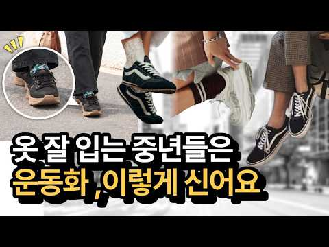
- 챕터: 0:00 오프닝 및 중년 운동화 코디의 중요성 · 0:25 촌스럽고 나이 들어 보이는 신발 특징 3가지 · 2:18 원피스·스커트에 어울리는 깔끔한 가죽 스니커즈 · 3:47 슬렉스에 어울리는 스웨이드 스니커즈 · 4:46 양말 세련되게 매치하는 2가지 핵심 법칙 · 5:46 청바지 핏과 체형별 운동화 고르는 법 · 7:07 중년 여성게 추천하는 운동화 컬러 · 7:31 발이 불편한 분들을 위한 기능성 운동화 추천
- 설명 앞부분: 옷을 아무리 잘 입어도 신발 하나 잘못 선택하면 전체 코디가 촌스럽고 나이 들어 보일 수 있습니다. 이번 영상에서는 편하면서도 세련되고 어려보이는 운동화 코디를 알려드릴게요. 오늘 영상 도움이 되셨다면 감사합니다. 사용목적 : 콘텐츠를 위한 이미지 인용
- 같은 채널 평소 대비 ×53.9 (채널 최근 롱폼 중앙값 7,044회) · 평소 영상: 이렇게 했더니 바로 세련된 중년 여름 패션! 날씬해보이기까지~ (7,044회) / 진주 목걸이 사기 전에 딱 3가지만 확인하세요 ∣ 스와로브스키 진주 목걸이 (8,397회)
- 대본 없음 (설명) — 음성인식이 끝나면 도입부·흐름이 들어감
- 댓글 24/24: 좋은 점 — 영상 2 · 감사·응원 3 · 더 알고 싶은 것 1 · 아쉬운 점 — 영상 0 · 반박·불만 — 의견 다름 0 · 정치·사회 0 · 경험 공유 1 · 구독·다음 기대 0
  - 좋은 점 — 영상 👍0 “나이가 들수록 신발은 편안함과 세련됨이 모두 중요한 것 같아요. 운동화 선택에도 신경 써야겠네요. 좋은 정보 감사합니다!”
  - 좋은 점 — 영상 👍0 “좋은정보 감사합니다”
  - 감사·응원 👍3 “이번주에 운동화 살 계획이 있는데 마침 좋은 컨텐츠를 만났네요. 도움 많이 될것 같아요. 감사~”
  - 감사·응원 👍0 “나이가 들수록 신발은 편안함과 세련됨이 모두 중요한 것 같아요. 운동화 선택에도 신경 써야겠네요. 좋은 정보 감사합니다!”
  - 더 알고 싶은 것 👍1 “젤 마지막 운동화 모델명이 어떻게 되나요?”
  - 경험 공유 👍0 “운동화 하나로 일년 계절마다 티3개 바지 3개 내가 이상한가?”

### 19. 주방에 물건이 없는 사람들의 놀라운 심리 3가지 ㅣ시니어ㅣ오디오북ㅣ노후준비ㅣ심리학ㅣ

- https://www.youtube.com/watch?v=PKJLC0s8ZVU · 가을빛 심리학 · 구독자 1,560 · 조회수 216,184 (×138.6, 하루 5,420.2) · 좋아요 607 (0.3%) · 14.3분 · 2026-10-18 · 주제 묶음 2. 살림·주방 · 형식 목록형 (N가지 추천템) · 폴더 `W_PKJLC0s8ZVU` (웹 승인)
- 썸네일: 
- 챕터: 0:00 주방에서 발견한 뜻밖의 모습 · 1:35 물건을 고르는 사람들의 차이 · 4:20 쉽게 놓지 못하는 마음의 비밀 · 7:45 비어 있는 공간에 숨겨진 심리 · 10:40 평범한 주방이 알려주는 인생의 지혜 · 12:30 오늘부터 시작하는 작은 변화 · 13:35 삶에 여유를 남기는 방법
- 설명 앞부분: 주방에 물건이 거의 없는 집, 그 집에 사는 사람은 무엇이 다를까요? 분명 매일 밥을 해 먹는 집인데 싱크대 위에는 물건이 거의 없습니다. 밥솥도, 양념통도, 주방용품도 눈에 띄지 않죠. 처음에는 단순히 깔끔한 성격이라고 생각할 수 있습니다. 하지만 이런 생활 방식 뒤에는 우리가 미처 생각하지 못했던 심리와 삶의 태도가 숨어 있을 수 있습니다. 🍀 이번 영상에서는 주방에 물건을 거의 두지 않는 사람들에게서 발견할 수 있는 3가지 심리적 특징을 살펴봅니다. 우리는 편리하게 살려고 물건을 사지만, 어느 순간부터 그 물건들을 관리하느라…
- 같은 채널 평소 대비 ×11.5 (채널 최근 롱폼 중앙값 18,861회) · 평소 영상: 냉장고만 열어봐도 노후가 보입니다｜나이 들수록 달라지는 4가지 ㅣ시니어ㅣ오디오북ㅣ노후준비… (18,861회) / 앞서가는 엄마가 집에만 있으려는 진짜 이유 (심리학이 밝힌 충격적 반전) 뇌과학 ∣ 심리… (18,848회)
- 대본 없음 (설명) — 음성인식이 끝나면 도입부·흐름이 들어감
- 댓글 96/96: 좋은 점 — 영상 5 · 감사·응원 1 · 더 알고 싶은 것 0 · 아쉬운 점 — 영상 1 · 반박·불만 — 의견 다름 1 · 정치·사회 0 · 경험 공유 5 · 구독·다음 기대 0
  - 좋은 점 — 영상 👍8 “부억이 크고 캐비넷이랑 서랍도 크고 정리가 잘 되게 구조가 돼있네요.”
  - 좋은 점 — 영상 👍2 “난 주방에 올려놓은게 없다 싹다 정리한다!! 하지만. 설합마다 잘 정리 해둔다 남편이나 가족이 물건 찾다 저나옴 어느설합 어느칸을 열면 그곳에 있다 하고 알려줌 바로찾아 냄니다~ 정리정돈이 안되면 찾는 시간이 더 걸리는 법이죠!!~ 이사할때 이사짐 센타에서 짐 견적왔…”
  - 감사·응원 👍2 “말씀 고맙습니다 감사합니다”
  - 아쉬운 점 — 영상 👍0 “설명이너무길어요”
  - 경험 공유 👍40 “우리집도 거의 나와 있는 물건이 없음 특히 가스렌지 위에 절대 물건 놓지않기.... 물건은 조금 비싼 것 사서 오래 쓰는 것을 좋아해요”
  - 경험 공유 👍2 “저도 가능한 물건들 자리잡아 넣는 편 입니다 정리를 하면 내가 편해 집니다”

### 20. 주부 5명이 후쿠오카에 가면 생기는 일! 가방 가득 채 워 온 주부들의 후쿠오카 찐 현실 쇼핑 여행

- https://www.youtube.com/watch?v=8K5Dk4Gi0kM · 안목주부 제이 · 구독자 1,740 · 조회수 309,607 (×177.9, 하루 5,858.9) · 좋아요 795 (0.3%) · 27분 · 2026-10-05 · 주제 묶음 1. 쿠팡·쇼핑 추천 · 형식 정보·해설 (그 밖) · 폴더 `W_8K5Dk4Gi0kM` (웹 승인)
- 썸네일: 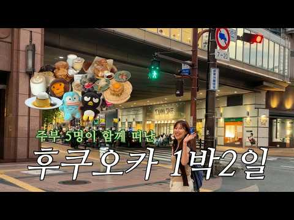
- 챕터: 0:00 인트로 · 0:35 인천공항 ✈️ · 1:08 면세품소개 · 2:11 후쿠오카 도착 🇯🇵 · 2:55 로손 공항점 구경하기 · 4:32 공항에서 예약없이 택시 타는 법 🚕 · 5:03 대기가 엄청난 맛집 키와미야 함바그 ‼️ · 5:22 스탠다드 프로덕트 하카타점 · 6:01 딘앤델루카 하카타점 · 7:30 그릴 오미야 JR하카타시키점 · 8:46 산리오 한큐 하카타점 · 9:36 단톤 후쿠오카(후쿠오카 유일 단독매장) · 9:48 칼디커피팜 하카타마루이점 · 10:50 타리즈커피 하카타마루이점 · 11:17 캐널시티 (많은 매장이 모여있어 쇼핑하기 좋음) · 11:43 ZONE 8 · 11:52 3COINS+ · 12:04 무인양품 · 13:10 산리오 · 13:22 숙소도착 더 원파이브 테라스 후쿠오카 🏨
- 설명 앞부분: 안녕하세요, 안목주부 제이입니다.😊 이번에는드디어 주부 친구들 다섯 명이서 1박 2일 후쿠오카 여행을 다녀왔습니다. 결혼 후 15년만에 처음으로 친구들과 떠난 힐링여행이라 멋진 관광지도 둘러보고 인생 사진도 남기자며 야심차게 출발했지만, 결국 우리 발길이 멈춘 곳은 쇼핑몰이었다는…ㅎㅎ 가족들 챙기는 걱정에서 벗어나 온전히 '나'만 챙기면 되는, 간편하고 원없이 웃고 사고 즐겼던 1박 2일 여행이었습니다.🤗 친구들과의 후쿠오카 여행을 통해 한동안 또 일상을 힘내서 살아갈 큰 에너지를 얻고 돌아왔습니다. 같은 일상을 살아가는 모든 주…
- 같은 채널 평소 대비 ×43.4 (채널 최근 롱폼 중앙값 7,130회) · 평소 영상: 지금 이 계절에 가면 좋은 혼자만의 힐링 여행지, 원주 뮤지엄 산에서의 사색의 시간 (7,130회) / 명동필수코스! 자라,유니클로부터 요즘 핫하다는 약국쇼핑까지 꽉 채운 나들이,주부의 추천코스 (8,391회)
- 대본 없음 (설명) — 음성인식이 끝나면 도입부·흐름이 들어감
- 댓글 47/47: 좋은 점 — 영상 5 · 감사·응원 5 · 더 알고 싶은 것 4 · 아쉬운 점 — 영상 2 · 반박·불만 — 의견 다름 0 · 정치·사회 0 · 경험 공유 0 · 구독·다음 기대 1
  - 좋은 점 — 영상 👍5 “지난 겨울 대학생 아들 둘과 4박 5일 긴 여정으로 후쿠오카 다녀 왔는데요 정말 너무 너무 힘들었어요 50넘어가니 여행 의 재미가 체력에 점점 비례해서 떨어져가요 아이들과 활달히 못 다녀서 몹시 아쉽고 미안했어요 좀 더 젊었을때는 경제 활동이나 아이들 학업때문에 미루…”
  - 좋은 점 — 영상 👍4 “알차게 찍고 멋있게 편집했네요.배경음악도 좋고 여행 프로 같습니다.좋은영상 잘 보고갑니다.”
  - 감사·응원 👍5 “지난 겨울 대학생 아들 둘과 4박 5일 긴 여정으로 후쿠오카 다녀 왔는데요 정말 너무 너무 힘들었어요 50넘어가니 여행 의 재미가 체력에 점점 비례해서 떨어져가요 아이들과 활달히 못 다녀서 몹시 아쉽고 미안했어요 좀 더 젊었을때는 경제 활동이나 아이들 학업때문에 미루…”
  - 감사·응원 👍1 “우연히 들어왔다 좋은 영상에 구독 좋아요 누르고 갑니다. 좋은 정보도 감사합니다.😊❤🎉”
  - 더 알고 싶은 것 👍1 “깨지는 컵들은 어떻게 들고 오셨나요?”
  - 더 알고 싶은 것 👍0 “J님, 착용하신 백팩 정보 부탁드려요.😊 영상 속 정보들을 타임라인으로 세심하게 정리해 주셔서 감사해요. 덕분에 여행 계획하는 데 큰 도움이 될 것 같아요.”
  - 아쉬운 점 — 영상 👍10 “일박으로 다녀오셨군요. 봄에 이박으로 다녀왔는데,삼박할걸 하며 아쉬웠서요. 후쿠오카 매력있서요. 우동,튀김도 맛있었어요. 쇼핑으로 일박으로 다녀와야겠네요. 모두 아가씨같아요.이쁘유~^^ 구독할께유”
  - 아쉬운 점 — 영상 👍0 “며칠전 딸내미랑 4박5일 다녀왔어요 4박이니 천천히 돌아다니다가 호텔들어와 잠깐쉬고 또 나가고 저녁먹고 쇼핑하고 야타이가고.. 정말 즐거웠어요 또 가고싶네요 근데 어떤친구들인지.. 제 친구들은 골프포함아니면 여행으로만은 안가서 아쉽습니다 ㅎ”
  - 구독·다음 기대 👍0 “너무 보기좋네요 구독합니다❤”

### 21. 중년 진주목걸이, 이렇게 하면 10년 늙어 보여요! 촌스럽지 않게 착용하는 3가지 방법

- https://www.youtube.com/watch?v=7hWxm9uR9oY · 조용한 럭셔리ㅣquiet luxury · 구독자 1,760 · 조회수 244,973 (×139.2, 하루 5,595.4) · 좋아요 534 (0.2%) · 7.8분 · 2026-10-14 · 주제 묶음 6. 4050 패션 · 형식 목록형 (N가지 추천템) · 폴더 `W_7hWxm9uR9oY` (웹 승인)
- 썸네일: 
- 챕터: 0:00 오프닝 및 진주목걸이에 대한 편견 깨기 · 0:19 피해야 할 촌스러운 진주 스타일링 3가지 · 1:16 첫 번째: 세련되고 어려 보이는 3mm·5mm 진주 … · 3:17 두 번째: 꾸안꾸 스타일의 완성, 8mm 진주 목걸이… · 5:05 세 번째: 날씬해 보이는 롱 진주 목걸이 연출법 · 6:35 롱 진주목걸이 예쁘게 묶는 꿀팁 · 7:05 마무리 및 다음 영상 예고
- 설명 앞부분: "이 포스팅은 쿠팡 파트너스 활동의 일환으로, 이에 따른 일정액의 수수료를 제공 받습니다." 진주목걸이, 잘못 착용하면 오히려 나이 들어 보일 수 있다는 사실, 알고 계셨나요? 진주가 촌스러운 게 아닙니다. 어떤 진주를 어떻게 착용하느냐에 따라 평범한 옷도 훨씬 세련되고 우아해질 수 있어요 이번 영상에서는 중년 여성들이 피하면 좋은 진주목걸이 스타일링 3가지와, 니트·셔츠·맨투맨에도 자연스럽게 어울리는 진주 코디 방법을 소개합니다. 타임스탬프 영상 속 진주목걸이 정리해 드려요 어떤 진주를 고르느냐에 따라 분위기가 완전히 달라져요.…
- 같은 채널 평소 대비 ×34.8 (채널 최근 롱폼 중앙값 7,044회) · 평소 영상: 이렇게 했더니 바로 세련된 중년 여름 패션! 날씬해보이기까지~ (7,044회) / 진주 목걸이 사기 전에 딱 3가지만 확인하세요 ∣ 스와로브스키 진주 목걸이 (8,397회)
- 대본 없음 (설명) — 음성인식이 끝나면 도입부·흐름이 들어감
- 댓글 20/20: 좋은 점 — 영상 0 · 감사·응원 2 · 더 알고 싶은 것 2 · 아쉬운 점 — 영상 0 · 반박·불만 — 의견 다름 0 · 정치·사회 0 · 경험 공유 0 · 구독·다음 기대 0
  - 더 알고 싶은 것 👍2 “굵기는 8mm 길이는 얼마가 적당한가요?”

### 22. 다이소 다시 가기 전에 이 영상부터 무조건 보십시오

- https://www.youtube.com/watch?v=Ych5AXeWk10 · 한국 식품 진실 탐사 · 구독자 1,460 · 조회수 322,496 (×220.9, 하루 4,382.9) · 좋아요 3,695 (1.1%) · 30분 · 2026-09-14 · 주제 묶음 4. 다이소·가성비 · 형식 정보·해설 (그 밖) · 폴더 `W_Ych5AXeWk10` (웹 승인)
- 썸네일: 
- 같은 채널 평소 대비 ×4,417.8 (채널 최근 롱폼 중앙값 73회) · 평소 영상: 도미노·피자헛·파파존스까지… 국내 피자 브랜드 12곳 비교! 주문 전 꼭 확인해야 할 9곳 (79회) / 이마트·홈플러스 블랙앤데커 블프 세일 당장 걸러야 할 최악 vs 최고 6가지 (2026) (67회)
- 대본 없음 (없음) — 음성인식이 끝나면 도입부·흐름이 들어감
- 댓글 267/267: 좋은 점 — 영상 6 · 감사·응원 13 · 더 알고 싶은 것 5 · 아쉬운 점 — 영상 2 · 반박·불만 — 의견 다름 2 · 정치·사회 3 · 경험 공유 1 · 구독·다음 기대 0
  - 좋은 점 — 영상 👍33 “다이소 물품에 다시 생각하게 알려주셔서 감사합니다!!”
  - 좋은 점 — 영상 👍13 “좋은정보 감사합닏ㆍ”
  - 감사·응원 👍42 “늘 다이소 물건들의 안전성에 의문 이었는데 구별 할수 있는 힘을 기를수 있게되어서 감사합니다.”
  - 감사·응원 👍34 “정보감사 합니다🎉”
  - 더 알고 싶은 것 👍104 “어린이들 장난감이며 옷이 제일 문제임 어딜가도 중국산 아닌게 없어요~제발 국민들 건강을 생각해서 철저하게 관리해주세요.국민들 건강을 해치는 질 나뿐 중국산 때문에 암담할 뿐입니다”
  - 더 알고 싶은 것 👍3 “홈쇼핑에서 판매하는 중국 제조상품들도 낱낱이 파헤처 주세요 특히 중국 제조품 부탁드립니다”
  - 아쉬운 점 — 영상 👍0 “쿠팡처럼 어그로 끌어서 불매 운동 유도 하고 중국산 사게 하려 그러나 알아서 중국산 안사니까 신경 끄세요”
  - 아쉬운 점 — 영상 👍0 “원가 100원짜리를 미끼로 앞에다 100원짜리로 싸게 내놓고 원가가 비싼 물건일수록 1000원짜리를 10000원으로 내놓는 수법으로 변질되어간다는게 크게 실망이내....”
  - 반박·불만 — 의견 다름 👍4 “그쵸 이제 안속는다 중국테무 알고리즘 타고 넘들어온다 그것도 말도 안되는 과대광고 소비자 우롱하는 테무 알리 제발 해체해라”
  - 반박·불만 — 의견 다름 👍0 “이 매체가 전하는 이야기가 잘못된 것만은 아닙니다. 기업주들의 도덕성 사회적 책임감 등이 문제도 많습니다. 제품 설명등을 잘 보시고 안전성, 실용성의 실속구매를 하시면되요! 일본 다이소와 한국 다이소(전신, 한일맨파워) 탄생 배경에 대해 가장 깊이 알는 사람으로 말씀…”
  - 정치·사회 👍69 “국민이 정신차리고 싸다고 사지말고 두개 살것 하나만 사더라도 국산을 찾아 사야한다. 그래야 나라가산다”
  - 정치·사회 👍0 “이런 채널은 중국제품 옹호채널이다 쿠팡 다이소 죽이고 중금속과 발암물질 투성이인 중국 유통업 (테무, 알리) 중국제품으로 눈돌리게 하는 채널 아웃, 중국제품 판 깔아준 이재명 정부 탄핵하자 이재명 때문에 환률 떨어지고 물가 상승 증상이 민생을 죽인다”
  - 경험 공유 👍72 “옛날에는 국산품 애용 운동을 했었던 적이 있었다. 지금 꼭 필요한 운동이다. 국민들이여, 좀 비싸도 국산품을 애용합시다.”

### 23. 10시간 장거리 비행이 10배 편해지는 기내 꿀템 7가지

- https://www.youtube.com/watch?v=jGoVK7OkI2k · 출국체크 : 알고 가면 편해지는 여행정보 · 구독자 827 · 조회수 241,411 (×291.9, 하루 2,440.3) · 좋아요 909 (0.4%) · 8.7분 · 2026-08-20 · 주제 묶음 1. 쿠팡·쇼핑 추천 · 형식 목록형 (N가지 추천템) · 폴더 `W_jGoVK7OkI2k` (웹 승인)
- 썸네일: 
- 챕터: 0:00 10시간 비행, 왜 이렇게 힘들까? · 0:50 첫 번째｜목이 가장 힘들었던 이유 · 2:18 두 번째｜빛과 소음을 줄이는 방법 · 3:36 세 번째｜도착 후 다리가 덜 힘들게 · 4:28 네 번째｜깨어 있는 시간도 편하게 · 5:00 다섯 번째｜신발이 답답해질 때 · 5:33 여섯 번째｜의외로 자주 찾게 되는 것 · 6:31 일곱 번째｜없으면 가장 아쉬운 준비물 · 7:21 기내에서 바로 꺼내 쓰는 짐 정리법
- 설명 앞부분: 10시간이 넘는 장거리 비행, 같은 이코노미 좌석에서도 무엇을 준비하느냐에 따라 도착했을 때의 컨디션이 달라질 수 있습니다. 고개가 자꾸 떨어져 잠을 설치고, 다리가 붓고, 필요한 물건은 선반 위 가방에 들어 있어 꺼내기 어려웠던 경험 있으신가요? 유명하다고 무조건 챙기기보다 실제 기내에서 꺼내 쓰는지, 불편함을 확실히 줄여주는지, 부피만 차지하지 않는지를 따져봐야 합니다. 이번 영상에서는 제가 직접 사용해본 제품과 장거리 여행자들의 경험을 비교해, 10시간 비행을 조금 더 편하게 만들어준 기내 꿀템 7가지를 정리했습니다. 흔히 …
- 같은 채널 평소 대비 ×98.9 (채널 최근 롱폼 중앙값 2,441회) · 평소 영상: 비행기 좌석 아무 데나 앉지 마세요｜창가·복도·비상구 완벽정리 (2,441회) / 이태리 여행 전 필수시청! 꼭 알아야 할 도시·일정·숙소 핵심정리 - 이탈리아 여행 , … (2,721회)
- 대본 없음 (설명) — 음성인식이 끝나면 도입부·흐름이 들어감
- 댓글 33/33: 좋은 점 — 영상 3 · 감사·응원 2 · 더 알고 싶은 것 2 · 아쉬운 점 — 영상 0 · 반박·불만 — 의견 다름 0 · 정치·사회 0 · 경험 공유 1 · 구독·다음 기대 0
  - 좋은 점 — 영상 👍6 “YouTube 영상 보면서 처음으로 공감이 가네요. 그리고 저는 코인 물티슈가 정말 편하더라고요.”
  - 좋은 점 — 영상 👍5 “출국체크님~~꿀템정보 감사합니다~저도 모르는것들이 제법있어서 도움됐습니다. 후드집업 탐나네요^^”
  - 감사·응원 👍5 “출국체크님~~꿀템정보 감사합니다~저도 모르는것들이 제법있어서 도움됐습니다. 후드집업 탐나네요^^”
  - 감사·응원 👍1 “수면안대와 압박양말 어디 제품인지 알려주시면 감사하겠습니다.”
  - 더 알고 싶은 것 👍9 “목베게일체형 후드티는 어디에서 사나요?”
  - 더 알고 싶은 것 👍1 “수면안대와 압박양말 어디 제품인지 알려주시면 감사하겠습니다.”
  - 경험 공유 👍5 “출국체크님~~꿀템정보 감사합니다~저도 모르는것들이 제법있어서 도움됐습니다. 후드집업 탐나네요^^”

### 24. SNS에서 유명한 청소템은 다 좋을까?｜추천템부터 비추천템까지 솔직 후기

- https://www.youtube.com/watch?v=vSGrvxAWxJc · 지지홈데이 zizi homeday · 구독자 665 · 조회수 170,366 (×256.2, 하루 1,925.1) · 좋아요 645 (0.4%) · 8.5분 · 2026-08-30 · 주제 묶음 1. 쿠팡·쇼핑 추천 · 형식 경고형 (사지 마세요·실패템) · 폴더 `W_vSGrvxAWxJc` (웹 승인)
- 썸네일: 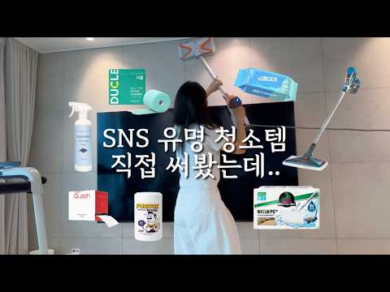
- 챕터: 0:00 인트로 · 0:30 청소기 안쓰게 되는 점착식 청소포 · 2:36 온 집안 살균해주는 스팀청소기 · 6:06 거울부터 가구까지 다 닦는 다목적 세정티슈 · 6:57 지문 자국 안 남는 유리막 코팅제 · 7:29 일반 청소포보다 물 함유량 8배 청소포
- 설명 앞부분: 안녕하세요. 이번에는 SNS 에서 유명한 청소템 추천/비추천템 후기를 가져왔어요! 저는 SNS 에서 청소템 보면 다 사고싶은 병에 걸렸는데요... (😅) (비추천템 다 찍고싶었지만, 정말 별로여서 쓰다 버린것도 많아 다 찍지 못한게 아쉬울 따름.....) 정말 솔직하게 담아봤으니, 영상 재밌게 봐주세요❤ 더 못찍은 제품들도 있으니 2탄으로도 돌아올게요! 😆 [제품정보] 쿼시 점착식 청소포 → 갓성비 추천제품은 "더클 점착식 청소포" (쿠팡에서 구매) 비쎌 스팀청소기 스카트 유리 세정티슈 / 쿼시 다목적 세정티슈 → 퓨리톡스 다목적…
- 대본 없음 (설명) — 음성인식이 끝나면 도입부·흐름이 들어감
- 댓글 100/100: 좋은 점 — 영상 3 · 감사·응원 11 · 더 알고 싶은 것 7 · 아쉬운 점 — 영상 2 · 반박·불만 — 의견 다름 0 · 정치·사회 0 · 경험 공유 4 · 구독·다음 기대 0
  - 좋은 점 — 영상 👍2 “도움이 많이 되었어요 ! ❤ 세정 티슈 꿀팁 감사합니다아 😍”
  - 좋은 점 — 영상 👍0 “추천템 모두 관심있던거라 도움이 많이 되었어요! 3m 밀대에도 더클 청소포가 잘 맞을까요? 쿼시 밀대 사야하나 고민이에요~”
  - 감사·응원 👍2 “도움이 많이 되었어요 ! ❤ 세정 티슈 꿀팁 감사합니다아 😍”
  - 감사·응원 👍2 “궁금했는데 영상감사해요!”
  - 더 알고 싶은 것 👍0 “와 몬스터겔 너무 궁금해서 그 정전기랑 물걸레랑 세트로 사려고 했는데 감사해요 비쎌은 매번 무선 나와라 무선나와라 이러고만 있어요 ㅋㅋㅋㅋㅋㅋㅋ저도 청소미친자라 먼지 닦고 닦고 근데 왜이리 닦아도 닦아도 청소 할곳이 많을까요😂😂😂더클 청소포 는 저도 담아봐야겠어요”
  - 더 알고 싶은 것 👍0 “접착식 청소포밀대는 어떤거 사야될까요??”
  - 아쉬운 점 — 영상 👍1 “이 영상을 먼저 봤어야했는데...몬스터 공구떠서 샀는데 양면써서 거실 겨우 닦을수 있던데 넘 실망이요...방 다닦을수있다매..🥲”
  - 경험 공유 👍1 “몬스터겔 물걸레 청소포 저도 같은 의견임. 묘하게 들뜨는 느낌. 심지어 비싸기까지 해서 가격대비 만족도가 낮더란”
  - 경험 공유 👍0 “와 몬스터겔 너무 궁금해서 그 정전기랑 물걸레랑 세트로 사려고 했는데 감사해요 비쎌은 매번 무선 나와라 무선나와라 이러고만 있어요 ㅋㅋㅋㅋㅋㅋㅋ저도 청소미친자라 먼지 닦고 닦고 근데 왜이리 닦아도 닦아도 청소 할곳이 많을까요😂😂😂더클 청소포 는 저도 담아봐야겠어요”

### 25. 우리집 주방에서 없앤 물건 6가지｜편하려고 샀는데 더 불편했습니다

- https://www.youtube.com/watch?v=8rfLEOvzeLM · 현실미니멀연구소 · 구독자 4,560 · 조회수 192,396 (×42.2, 하루 12,647.3) · 좋아요 699 (0.4%) · 9.2분 · 2026-11-12 · 주제 묶음 2. 살림·주방 · 형식 목록형 (N가지 추천템) · 폴더 `W_8rfLEOvzeLM` (웹 승인)
- 썸네일: 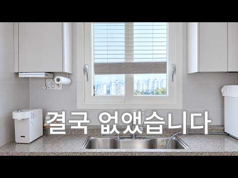
- 챕터: 0:00 주방에 필요한 건 ? · 0:43 결국 비운 물건 1. 기본 세팅 용품 · 1:56 결국 비운 물건 2. 소분 용기 · 3:30 결국 비운 물건 3. 나무 도마 · 4:13 결국 비운 물건 4. 전기밥솥 · 5:02 결국 비운 물건 5. 플라스틱 수납함 · 6:47 결국 비운 물건 6. 발매트 · 8:05 좁은 주방을 쾌적하고 편하게
- 설명 앞부분: 주방에 있으면 좀 더 편할것 같고, 좋을 것 같은 물건들이 많았습니다. 편하려고 샀던 물건들로 일이 더 늘어나고, 좁은 주방은 더 복잡해졌어요. 지금은 모두 비워낸 물건들, 하나씩 이야기 해 볼게요 :)
- 같은 채널 평소 대비 ×11.4 (채널 최근 롱폼 중앙값 16,874회) · 평소 영상: 미니멀라이프 10년, 오히려 알게 된 것 (19,141회) / 남들이 함부로 못 대하는 사람들의 진짜 특징 (19,391회)
- 대본 없음 (설명) — 음성인식이 끝나면 도입부·흐름이 들어감
- 댓글 124/124: 좋은 점 — 영상 1 · 감사·응원 2 · 더 알고 싶은 것 3 · 아쉬운 점 — 영상 0 · 반박·불만 — 의견 다름 0 · 정치·사회 0 · 경험 공유 6 · 구독·다음 기대 0
  - 좋은 점 — 영상 👍1 “주방에서 편하려고 들였다가 오히려 불편했던 물건 6가지를 솔직하게 짚어 주셔서 비움의 기준을 배웠어요. 저녁 시간 편안히 보내세요.”
  - 더 알고 싶은 것 👍1 “혹시, 식기 세척기는 어디꺼인지 궁금하네요~ 저도 비슷한걸 찾고있어서요~”
  - 더 알고 싶은 것 👍1 “하부장에서 건조되나요?”
  - 경험 공유 👍12 “저도 거의 다 걷어냈는데. ㅋㅋㅋ 식세기 없어요. 저는 퐁퐁 묻은 식기를 싱크대 바닥에 두면 더러운 식기에 담겨있던 더러운 물을 비울때 거기에 묻어서 찝찝하더라구요. 헹구기 전에 원래있던 건조대로 옮겼다가 건조대 채로 수도꼭지 아래로 옮겨서 마무리합니다.”
  - 경험 공유 👍10 “꺅 오일통에 양말 씌운 거 너무 귀여워요!!!❤❤ 저도 따라할래용ㅎㅎㅎ”

### 26. 버렸더니 집안일이 편해진 물건 20가지｜미니멀 살림

- https://www.youtube.com/watch?v=NCdTO010qcI · 두잇맘플리 · 구독자 2,600 · 조회수 674,161 (×259.3, 하루 6,890.9) · 좋아요 1,999 (0.3%) · 8.1분 · 2026-08-21 · 주제 묶음 3. 청소·정리·수납 · 형식 경고형 (사지 마세요·실패템) · 폴더 `W_NCdTO010qcI` (웹 승인)
- 썸네일: 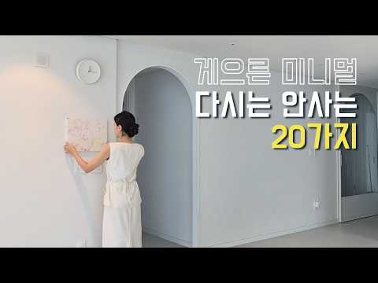
- 챕터: 0:00 인트로 · 0:19 거실 (1~6번째) · 2:47 주방 (7~12번째) · 5:06 침실·옷장 (13~17번째) · 6:43 화장실·기타 (18~20번째)
- 설명 앞부분: 없으면 집안일이 편해지는 물건 20가지 소개해요 저희 집에서는 이렇게 해보니 조금 편해졌다는 정도로 봐주시면 좋을 것 같아요. 보시면서 다양한 의견 댓글로 남겨주세요! 하루 한 곳씩 정리하고 청소해요. 🏠 오늘의 한 곳 ∣ [비움] 함께해 주셔서 감사합니다. ✨
- 같은 채널 평소 대비 ×116.3 (채널 최근 롱폼 중앙값 5,795회) · 평소 영상: 작고 소중한 집순이 인간관계, 손님 맞이 30분 전 청소 ∣ 여름철 집냄새 관리 (5,795회) / 아무도 몰라줘도 하는 폭염 속 겨울옷 정리｜티 안 나는 살림 (아이 옷장 정리) (5,221회)
- 대본 없음 (설명) — 음성인식이 끝나면 도입부·흐름이 들어감
- 댓글 215/215: 좋은 점 — 영상 5 · 감사·응원 8 · 더 알고 싶은 것 28 · 아쉬운 점 — 영상 0 · 반박·불만 — 의견 다름 2 · 정치·사회 0 · 경험 공유 37 · 구독·다음 기대 1
  - 좋은 점 — 영상 👍5 “몇가지가 겹치네요 ㅎㅎ 비움이 참 좋은거 같아요. 저흰 침대랑 쇼파가 없어요. 조만간 식탁도 비우고 좌식 테이블로 바꾸려고요... 바닥에 걸리적거리는 러그나 주방매트도 없고 실용성 없는 장식품도 없어요. 그냥 화분을 키우죠...공기정화랑 수분조절에 도움이라도 되니 ㅎ…”
  - 좋은 점 — 영상 👍4 “와 영상 잘 봤어요 내 환경에 맞게끔 집을 정리하게끔 좋은 영상 감사해요”
  - 감사·응원 👍5 “와 진짜 유용한 영상이네요. 감사합니다.”
  - 감사·응원 👍4 “와 영상 잘 봤어요 내 환경에 맞게끔 집을 정리하게끔 좋은 영상 감사해요”
  - 더 알고 싶은 것 👍6 “와~진짜깔끔하시네요~ 빨래건조대 정보궁금해요❤”
  - 더 알고 싶은 것 👍4 “사계절용 이불 정보 좀 알려주세요. 이불을 정리하고 싶은데 화면에 나온 사계절용 이불 두께가 좋아보여서요.”
  - 반박·불만 — 의견 다름 👍4 “계란껍질은 음식물쓰레기 아닌데요...”
  - 경험 공유 👍262 “혼자나 두분이 사시는거면 미니멀리즘 좋죠. 저도 선호해서 그렇게 살고 있습니다만 혹시 아이가 있는 분들은 너무 피부과 병원 같은 인테리어 보다는 좀 더 다양한 시각적 자극이 가능한 인테리어를 추천드립니다. 제 외조모께서 결벽증에 미니멀리스트셨어서 집에 대한 그리운 애…”
  - 경험 공유 👍38 “저도 게으른 미니멀인데 정리하기 귀찮고 청소는 편하게하고싶어서 물건이없게되네요ㅎㅎ”
  - 구독·다음 기대 👍3 “안녕하세요~영상보고 구독하고가요~잔잔하게 정리해서 알려주시니 집중이 잘되네요~혹시 화장대 위 서랍 수납 어떤제품인지 알수있을까요~?😊”

### 27. 아직도 돈키호테 가? 일본 마트 꿀템 (제작진도 삼) [JP]

- https://www.youtube.com/watch?v=4_G5g_2bKNk · 안뇨하떼요 아유미에오 · 구독자 10,400 · 조회수 270,170 (×26.0, 하루 27,447.3) · 좋아요 1,054 (0.4%) · 20.7분 · 2026-11-17 · 주제 묶음 1. 쿠팡·쇼핑 추천 · 형식 목록형 (N가지 추천템) · 폴더 `W_4_G5g_2bKNk` (웹 승인)
- 썸네일: 
- 챕터: 0:00 미리 보기 · 0:36 특별 게스트 · 1:28 오늘의 주제! · 1:47 일본의 마트 계급도 · 2:10 일상형 마트, 이온 · 2:44 일본에서 장볼 때 꿀팁 · 3:49 최상위 마트, 메이지야 · 4:25 무슨 버섯이 40만 원씩이나 해? · 4:49 리뷰 시작 · 5:23 1. 초밥 (6,000원 vs 50,000원) · 6:48 2. 텐무스 (텐푸라+무스비) · 7:33 3. 술안주용(?) 치즈 · 8:15 4. 아기용 치즈 · 8:44 5. 프리미엄 콘비프 · 9:49 6. 밥 한 그릇 뚝딱, 라유 · 11:28 7. 고급 카레 · 12:02 8. 일본 가정식 반찬 '치쿠젠니' · 12:36 9. 초 가성비 사케 · 13:39 막걸리 아줌마 등장 1 · 13:58 10. 극소립 낫토
- 설명 앞부분: 안뇨하떼요~ 아유미에오🐰 오늘 엄마랑 함께 일본 마트 장보기에 나섰어요 현지인 추천 필수 템부터, 쟁여두기 좋은 간편식, 한국에 가져가기 좋은 선물까지 야무지게 담아 봤는데요! 여러분이 일본 마트에서 꼭 사는 추천 템도 댓글로 알려주세요 ※ 출연자에 대한 무분별한 욕설 및 비방 댓글은 삭제될 수 있습니다.
- 대본 없음 (설명) — 음성인식이 끝나면 도입부·흐름이 들어감
- 댓글 69/69: 좋은 점 — 영상 0 · 감사·응원 4 · 더 알고 싶은 것 6 · 아쉬운 점 — 영상 0 · 반박·불만 — 의견 다름 0 · 정치·사회 0 · 경험 공유 5 · 구독·다음 기대 1
  - 감사·응원 👍3 “아유미님 헤어컬러가 넘 예뻐요. 헤어컬러 무슨색으로 염색하신건지 알려주세요. 감사합니다.🩷”
  - 감사·응원 👍2 “일본 마트 털이 좋아하는데 일본과 한국맛을 모두 아시는 분의 시식평 정말 너무 귀해요 감사합니다😢”
  - 더 알고 싶은 것 👍11 “어머님 야끼니쿠집 알고 싶어요! 수십년 하셨다면 맛집일텐데!!”
  - 더 알고 싶은 것 👍4 “아유미씨 장볼때 입으신 가죽자켓 구매처 알수 있을까요?^^”
  - 경험 공유 👍6 “엄마 울려고 하실때 저도 울컥 ㅠㅠ”
  - 경험 공유 👍6 “어머님 😂😂😂😂😂😂 자주 나오시면 좋겠습니닷 세아도 귀엽고 ❤ 저도 날계란에 간장밥 좋아해요 버터 계란 간장 밥 그게 기본인줄 알았는데 호불호가 많던 😅😂😂”
  - 구독·다음 기대 👍3 “엄마 진짜로 젊어보여용~68세~?😅 기다렸또욧 오늘도 즐겁게 잘보고갑니다 😊구독하고 좋아요 알림까지 꾹 사랑입니다 ~~💗💗💗💗💗”

### 28. 다이소에 정말 이게 나왔어?! 오랜만에 방문한 다이소에 그냥 지나칠 수 없는 꿀템이~ I 이번에도 늦으면 또 없는 다이소추천템 8가지!!!

- https://www.youtube.com/watch?v=1A3P_3SujiY · 소비일상  · 구독자 20,100 · 조회수 406,950 (×20.2, 하루 52,161.2) · 좋아요 1,376 (0.3%) · 8.1분 · 2026-11-19 · 주제 묶음 1. 쿠팡·쇼핑 추천 · 형식 살림 브이로그·루틴 · 폴더 `W_1A3P_3SujiY` (웹 승인)
- 썸네일: 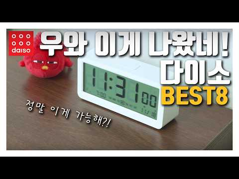
- 챕터: 0:00 인트로 (다이소 추천템 8가지) · 0:29 1. 올록볼록 빗금 바닥 스텐 304 찬통 · 1:14 2. 5,000원의 행복, 디지털 탁상시계 · 1:59 3. 깔끔한 물빠짐 욕실 스틸 트레이 · 2:35 4. 캐리어 바퀴 1회용 위생 커버 (30개입) · 3:20 5. 뚜껑이 양치컵으로 변신하는 원통형 칫솔 케이스 · 4:01 6. 무게 초과 걱정 끝! 휴대용 여행 손저울 · 4:56 7. 본체부터 뚜껑까지 거치하는 3칸 접이식 텀블러 … · 6:01 8. 봉투 처짐 방지 & 분리수거 쓰레기통 고정 클립 · 6:49 마무리 및 요약
- 설명 앞부분: 안녕하세요 소비일상입니다. 다이소에 가면 필요한 것만 사려고 했는데, 어느새 바구니가 가득 차 있죠? 😄 이번에는 주방과 욕실을 깔끔하게 정리해 주는 생활용품부터 여행할 때 챙기면 편리한 아이템까지 모아봤습니다. 뚜껑을 열기 편한 스텐 찬통, 평일과 주말 알람을 따로 설정할 수 있는 탁상시계, 쓰레기봉투가 흘러내리지 않도록 잡아주는 작은 클립까지! 1,000원부터 5,000원 사이에서 일상의 은근한 불편함을 덜어주는 다이소 제품 8가지를 영상에서 확인해 보세요. 💡다른 꿀템 더 보러 가기💡 ⏱️ 타임라인 🛒 영상 속 제품 정보 에…
- 같은 채널 평소 대비 ×10.9 (채널 최근 롱폼 중앙값 37,381회) · 평소 영상: 다이소 매번 갈 때마다 새로운- 이번 주에도 의외의 꿀템이 한가득 - 하지만 늦으면 또 … (37,381회) / 다이소에 드디어 나왔습니다! 보이면 무조건 담아야 할 품절대란 꿀템 25가지 (50,895회)
- 대본 없음 (설명) — 음성인식이 끝나면 도입부·흐름이 들어감
- 댓글 40/40: 좋은 점 — 영상 1 · 감사·응원 2 · 더 알고 싶은 것 2 · 아쉬운 점 — 영상 2 · 반박·불만 — 의견 다름 0 · 정치·사회 0 · 경험 공유 1 · 구독·다음 기대 0
  - 좋은 점 — 영상 👍3 “뚜껑이 양치컵으로 변신하는 원통형 칫솔 케이스 아이디어가 정말 기발하네요. 여행 갈 때 칫솔통 따로 컵 따로 챙기던 번거로움이 한 번에 해결될 것 같아요. 5,000원 디지털 탁상시계 가격까지 콕 짚어주셔서 다이소 가기 전에 딱 정하고 갈 수 있겠어요. 주방·욕실·여…”
  - 감사·응원 👍2 “763번째 like 👍 감사합니다요 ! 항상 건행하십시요 !”
  - 감사·응원 👍2 “많은 정보를 주어 고맙습니다. 아쉬운 점은 상품번호를 같이 올려주시면 더욱 고맙겠습니다.”
  - 더 알고 싶은 것 👍2 “많은 정보를 주어 고맙습니다. 아쉬운 점은 상품번호를 같이 올려주시면 더욱 고맙겠습니다.”
  - 더 알고 싶은 것 👍1 “다이소 면도기랑 폼 어떤가요?”
  - 아쉬운 점 — 영상 👍3 “다이소 시계는 각도가 조금 아쉬움”
  - 아쉬운 점 — 영상 👍2 “많은 정보를 주어 고맙습니다. 아쉬운 점은 상품번호를 같이 올려주시면 더욱 고맙겠습니다.”

### 29. “다이소의 실수..😂 보이면 무조건 사세요” 치과의사도 몰래 쓰는 내돈내산 다이소 꿀템 5가지!

- https://www.youtube.com/watch?v=_oKfP-r8O6k · 윤제현의 치아상담소 · 구독자 20,500 · 조회수 1,959,299 (×95.6, 하루 46,685.4) · 좋아요 6,549 (0.3%) · 19.8분 · 2026-10-16 · 주제 묶음 1. 쿠팡·쇼핑 추천 · 형식 직접 써 본 후기 (내돈내산·N개월 사용) · 폴더 `W__oKfP-r8O6k` (웹 승인)
- 썸네일: 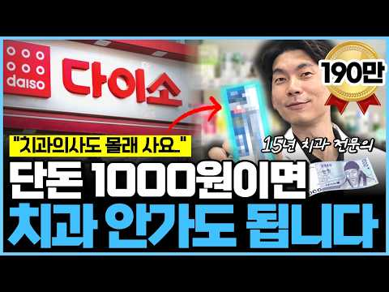
- 챕터: 0:00 하이라이트 · 0:17 다이소 쇼핑 · 0:30 다이소 구강용품 추천 · 1:20 다이소 추천템 · 1:57 다이소 추천템 첫번째 ∣ 칫솔 · 8:13 비추천 칫솔 · 9:05 구강용품 고르는 기준 · 10:34 칫솔 교체 주기 · 11:28 벌어진 칫솔모가 안좋은 이유 · 12:25 다이소 칫솔 순위 · 12:51 다이소 추천템 두번째 ∣ 치약 · 14:05 다이소 추천템 세번째 ∣ L자형 치간칫솔 · 15:21 다이소 추천템 네번째 ∣ 치실 · 16:44 다이소 추천템 마지막 ∣ 치경 · 18:25 치과칫솔? 다이소칫솔? · 19:02 마무리
- 설명 앞부분: 안녕하세요. 저는 여러분의 치아 고민을 들어드리는 윤제현입니다. 😁 상담소에 오신 것을 환영합니다. 여러분 다이소 많이들 좋아하시나요? 저도 아이들이 좋아해서 다이소를 자주 가는데요. 다이소에도 정말 괜찮은 구강용품들이 많거든요. 치과의사도 인정하는 다이소 꿀템 5가지 오늘 전~부 공개하겠습니다! 많은 시청 부탁드립니다^^
- 같은 채널 평소 대비 ×5.7 (채널 최근 롱폼 중앙값 340,900회) · 평소 영상: “잇몸이 짱짱해집니다” 치과 안가도 되는 소금물 가글 제대로 하는 법을 15년차 치과전문… (504,003회) / "녹은잇몸 팍 살아납니다" 모두 다 알면 치과 망하는 단돈 천원으로 잇몸뼈 재생 시키는 … (177,797회)
- 대본 없음 (설명) — 음성인식이 끝나면 도입부·흐름이 들어감
- 댓글 90/90: 좋은 점 — 영상 10 · 감사·응원 16 · 더 알고 싶은 것 3 · 아쉬운 점 — 영상 2 · 반박·불만 — 의견 다름 0 · 정치·사회 0 · 경험 공유 5 · 구독·다음 기대 1
  - 좋은 점 — 영상 👍15 “좋은정보 감사합니다”
  - 좋은 점 — 영상 👍10 “일상 속의 소소한 발견이 주는 즐거움과 실용적인 정보가 어우러져 보는 내내 기분 좋은 호기심을 불러일으킵니다. 누구나 공감할 만한 유익한 아이템들을 재치 있게 풀어내어 지루할 틈 없이 몰입하게 만들며, 소소한 소비 속에서 확실한 행복을 찾는 따뜻한 일상의 한 페이지를…”
  - 감사·응원 👍15 “좋은정보 감사합니다”
  - 감사·응원 👍7 “다이소가서 플렉스 하고 왔습니다. 감사합니다~!!”
  - 더 알고 싶은 것 👍7 “선생님 8살아이가 앞니 윗층 아랫층 다 치아가 누래요...치약 추천좀..”
  - 더 알고 싶은 것 👍3 “강아지도 써도 되나요?”
  - 아쉬운 점 — 영상 👍10 “일상 속의 소소한 발견이 주는 즐거움과 실용적인 정보가 어우러져 보는 내내 기분 좋은 호기심을 불러일으킵니다. 누구나 공감할 만한 유익한 아이템들을 재치 있게 풀어내어 지루할 틈 없이 몰입하게 만들며, 소소한 소비 속에서 확실한 행복을 찾는 따뜻한 일상의 한 페이지를…”
  - 아쉬운 점 — 영상 👍6 “원장님 찾아보니까 전주에 계시네요 ㅠㅠ 서울에 계셨더라면 무조건 원장님에게 찾아갔을텐데 너무 아쉬워요... 좋은 정보 많이 알려주셔서 감사합니다”
  - 경험 공유 👍6 “2번 페리오칫솔 몇년째 사용중이고 최근 2080치석치약 쓰는중인데 이것도 추천합니다”
  - 경험 공유 👍2 “다음 주에 한국에 가는데 다이소에 가면 되겠네요. 좋은 정보 감사합니다. 저는 미국에서 치과를 운영하는데요. 한국 아토미 치약과 칫솔은 가격이 너무 좋고 품질이 좋아서 저희 치과에서는 환자분들께 드립니다. 미국 시애틀에서 감사드립니다.”
  - 구독·다음 기대 👍0 “구독하고 갑니다😊~~유익한 정보 감사합니다”

### 30. 다이소 인간이 100만원 쓰고 만족한 꿀템 ∣ ∣ 팔수록 손해보는 다이소 추천템

- https://www.youtube.com/watch?v=SzFTsC3xeB4 · 엔젤카페 · 구독자 5,190 · 조회수 172,094 (×33.2, 하루 11,529.3) · 좋아요 437 (0.2%) · 20.4분 · 2026-11-12 · 주제 묶음 1. 쿠팡·쇼핑 추천 · 형식 목록형 (N가지 추천템) · 폴더 `W_SzFTsC3xeB4` (웹 승인)
- 썸네일: 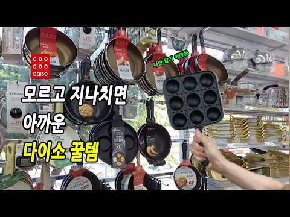
- 설명 앞부분: 다이소에서 사용해보고 괜찮았던 제품들을 리뷰했습니다 9구 다용도 주물팬 품번 : 1046167 / 5000원 패딩백 품번 : 1082458 / 5000원 스틸 회전식 스마트폰 거치대 품번 ; 1075724 / 2000원 다농원 콤부차 방수 신발커버 품번 : 1078119 / 2000원 코세척기 품번 : 1043553 / 1000원 스틸 스탠딩 보드 품번 : 1070269 / 3000원 접이식 폴딩박스 품번 : 1036965 / 5000원 손잡이 회전형 거품기
- 같은 채널 평소 대비 ×3.1 (채널 최근 롱폼 중앙값 55,217회) · 평소 영상: 다이소 보이면 집어야 하는 갓성비 꿀템∣ 없어지기 전에 당장 사야 할 다이소 추천템 (57,597회) / 다이소가 작정하고 만든 백화점 퀼리티 뽐내는 추천템들 (52,837회)
- 대본 없음 (설명) — 음성인식이 끝나면 도입부·흐름이 들어감
- 댓글 14/14: 좋은 점 — 영상 0 · 감사·응원 1 · 더 알고 싶은 것 1 · 아쉬운 점 — 영상 1 · 반박·불만 — 의견 다름 0 · 정치·사회 0 · 경험 공유 1 · 구독·다음 기대 0
  - 감사·응원 👍3 “여러 종류의 상품을 내가 매장에서 보는것 보다 자세한 설명 고맙습니다 엔젤스님 ^^”
  - 더 알고 싶은 것 👍1 “전동거품기 머랭 되나요??”
  - 아쉬운 점 — 영상 👍0 “서론이너무길어요 10분 으로 줄여주세요”
  - 경험 공유 👍3 “여러 종류의 상품을 내가 매장에서 보는것 보다 자세한 설명 고맙습니다 엔젤스님 ^^”

### 31. 수선없이 어정쩡한 스타일을 깔끔하게 정리해주는 나만의 스타일링 알려드려요#패션 #스타일 #중년패션코디 @Lookupstyle

- https://www.youtube.com/watch?v=zMeIYvK60Bc · Look up style · 구독자 5,700 · 조회수 408,128 (×71.6, 하루 10,254.0) · 좋아요 2,496 (0.6%) · 19.4분 · 2026-10-18 · 주제 묶음 6. 4050 패션 · 형식 코디·메이크업 (따라 하기) · 폴더 `W_zMeIYvK60Bc` (웹 승인)
- 썸네일: 
- 같은 채널 평소 대비 ×125.5 (채널 최근 롱폼 중앙값 3,252회) · 평소 영상: 패션 34년차가 골라서 추천하는 멋스럽고 편한 교복같을 가을옷은 뭘까? 구경오세요 ~#패… (3,252회) / 제품 구매하면서 사은품으로 받는 예쁜 희귀템들/구매는 행사때 사야하는 이유 #선물 #명품… (3,826회)
- 대본 없음 (없음) — 음성인식이 끝나면 도입부·흐름이 들어감
- 댓글 104/104: 좋은 점 — 영상 8 · 감사·응원 15 · 더 알고 싶은 것 2 · 아쉬운 점 — 영상 2 · 반박·불만 — 의견 다름 0 · 정치·사회 0 · 경험 공유 3 · 구독·다음 기대 0
  - 좋은 점 — 영상 👍9 “유익한정보 잘배웠습니다 감사합니다”
  - 좋은 점 — 영상 👍8 “오 꿀팁이네요 스카프 활용 더 잘할수 있을것 같네요 감사합니다.”
  - 감사·응원 👍20 “정말 신박한 방법이예요. 항상 필요했던 아이템인데 왜 그런생각을 못했는지...^^ 소매는 머리끈으로 하닌까 작아서 심한 자국이 났는데..;; 허리 고무밴드는 진짜 대박입니다 ㅋㅋㅋ 활용 너무 잘할것같아요 정보 감사합니다”
  - 감사·응원 👍14 “감사합니다. 길어서 못입었던 옷도 잘입을수 있겠어요.”
  - 더 알고 싶은 것 👍0 “고무줄 감사합니다 ~~^^ 잘 활용해봐야겠어요.. 140*140스카프 혹시 어디서 구입하셨나요? 맘에 들어쇼~~”
  - 더 알고 싶은 것 👍0 “허리고무줄은 어디서 구입하나요?^^”
  - 아쉬운 점 — 영상 👍14 “감사합니다. 길어서 못입었던 옷도 잘입을수 있겠어요.”
  - 아쉬운 점 — 영상 👍5 “말이 너무 길어요”

### 32. 첫 에어프라이어 구매 필독! 오븐형 vs 바스켓형 직접 다 써본 13년 차 주부의 최종 선택 ∣ 직접 구매해서 써보고 알려드립니다..∣ 스팀에어프라이어 ∣ 풀무…

- https://www.youtube.com/watch?v=V0TZZQx_bBM · 똑똑살림_마트·살림템 검증 · 구독자 1,170 · 조회수 269,762 (×230.6, 하루 2,018.0) · 좋아요 810 (0.3%) · 10분 · 2026-07-16 · 주제 묶음 2. 살림·주방 · 형식 비교 (vs·차이·순위) · 폴더 `W_V0TZZQx_bBM` (웹 승인)
- 썸네일: 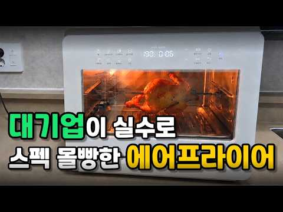
- 챕터: 0:00 에어프라이어추천 · 0:44 에어프라이어추천. 바스켓vs듀얼바스켓vs오븐에어프라이어 · 2:58 에어프라이어추천 기준1. 스팀세척의 범위(보이지않는 … · 4:09 에어프라이어추천 기준2. 오프라인 A/S센터 및 부품… · 5:03 에어프라이어추천 기준3. 스팀프라이 기술(열풍+스팀 … · 6:13 에어프라이어추천 기준4. 자동조리메뉴(첫에프구매 필독) · 7:25 에어프라이어추천. 풀무원스팀에어프라이어
- 설명 앞부분: 바스켓형 에어프라이어를 5년 쓰고 오븐형까지 비교해보니, 결국 오래 쓸수록 가장 크게 남는 문제는 보이지 않는 기름때와 청소 부담이었습니다. 이번 에어프라이어추천 영상에서는 스팀에어프라이어추천 제품을 고를 때 세척 범위부터 확인한 이유를 담았습니다. 새 에어프라이어를 고르며 스팀세척 버튼만 보지 않고 히터관 관리, 분리 세척, A/S와 보증까지 비교했습니다. 처음 구매하는 분들이 후회하지 않도록 에어프라이어추천 기준과 스팀에어프라이어추천 핵심 구조를 정리했습니다. 가족 음식이 닿는 에어프라이어인 만큼 조리 성능뿐 아니라 수분감, …
- 같은 채널 평소 대비 ×23.8 (채널 최근 롱폼 중앙값 11,335회) · 평소 영상: 꽉 막힌 추석 귀경길 차 안이 100배 즐거워지는 비결! 노브랜드 역대급 콜라보 간식템 … (12,699회) / 코스트코보다 더 맛있는 트레이더스 가성비 먹거리 추천템 10가지 ∣ 추천+비추천 솔직 후… (9,971회)
- 대본 없음 (설명) — 음성인식이 끝나면 도입부·흐름이 들어감
- 댓글 53/53: 좋은 점 — 영상 2 · 감사·응원 1 · 더 알고 싶은 것 0 · 아쉬운 점 — 영상 0 · 반박·불만 — 의견 다름 0 · 정치·사회 0 · 경험 공유 6 · 구독·다음 기대 0
  - 좋은 점 — 영상 👍0 “많은 도움이 됐습니다!!”
  - 감사·응원 👍3 “맞아요 에어프라이어 하루에 몇 번씩 돌리는데 열선 부분은 손이 닿지 않아 엄청 찝찝해요 저도 담엔 이 제품 사야겠어요 풀무원 제품 애용많이하는데 풀무원은 주부들의 생각을 읽는 능력이 있는듯.. 영상 감사합니다^^”
  - 경험 공유 👍23 “안녕하세요! 영상 잘 보았습니다. 저도 같은 제품을 예전부터 사용하고 있어 반가운 마음에 댓글 남깁니다. 한 가지 공유해 드리고 싶은 점이 있는데요. 이 제품은 이름이 '듀얼 스팀'인 만큼, 스팀을 분사할 뿐만 아니라 바닥의 동그란 부분에 모인 물을 다시 한번 끓여주…”
  - 경험 공유 👍6 “국물 있는건 바스켓이...장단점이 있지만 한개만 쓰려면 내가 어떤요리 자주 먹는지 맞는거 구매 해야겠어요 영상 잘봤어요~~~”

### 33. 코스트코 미친가성비 척아이롤 15만원이면 충분합니다 최고 좋은 원육 고르는법 [인생꿀팁]

- https://www.youtube.com/watch?v=LghRoc0B4oI · 고기형 · 구독자 19,500 · 조회수 940,417 (×48.2, 하루 33,554.1) · 좋아요 1,377 (0.1%) · 17.9분 · 2026-10-30 · 주제 묶음 4. 다이소·가성비 · 형식 정보·해설 (그 밖) · 폴더 `W_LghRoc0B4oI` (웹 승인)
- 썸네일: 
- 챕터: 0:00 한 달치 척아이롤 손질 시작 · 0:59 좋은 척아이롤 고르는 기준 3가지 · 2:03 포장 제거와 기본 손질 · 3:40 살치살 위치 확인과 목심 분리 · 5:53 찹스테이크용 부위 나누기 · 7:18 구우면 질겨지는 얇은 막 제거 · 9:11 스테이크 두께 맞춰 썰기 · 11:35 살치살 쉽게 분리하기 · 13:06 구이용 고기 손질하고 썰기 · 15:01 비닐팩으로 공기 빼서 소분·보관하기
- 설명 앞부분: 코스트코 소고기 척아이롤, 한 덩어리로 한 달치 고기 준비하기! 코스트코 소고기 척아이롤은 가성비가 좋지만, 양이 많고 손질이 막막해 구매를 망설이게 되죠. 이번 영상에서는 좋은 고기 고르는 법부터 질긴 막 제거, 용도별 소분과 보관까지 차근차근 알려드립니다. 좋은 척아이롤 고르는 기준 3가지질긴 뼈막과 불필요한 지방 제거하기 스테이크·구이·찹스테이크·불고기·국거리로 나누기진공포장기 없이 비닐팩 속 공기 빼기 코스트코 소고기 척아이롤 손질이 처음이라면, 영상을 보며 천천히 따라 해보세요. 큰 덩어리도 용도에 맞게 나누면 매일 다른…
- 같은 채널 평소 대비 ×8.1 (채널 최근 롱폼 중앙값 116,702회) · 평소 영상: 코스트코 부채살 이 영상 한번만 보면 죽을 때까지 저렴하게 맛있는 소고기 먹을 수 있습니… (121,626회) / 코스트코 실패없는 최고의 부위 갈비살 고르는 가장 완벽한 치트키 딱 1분만 보세요. (111,777회)
- 대본 없음 (설명) — 음성인식이 끝나면 도입부·흐름이 들어감
- 댓글 113/113: 좋은 점 — 영상 5 · 감사·응원 5 · 더 알고 싶은 것 4 · 아쉬운 점 — 영상 1 · 반박·불만 — 의견 다름 2 · 정치·사회 0 · 경험 공유 1 · 구독·다음 기대 0
  - 좋은 점 — 영상 👍4 “대단합니다 와우 도움이 많이 되었어요 감사합니다😊”
  - 좋은 점 — 영상 👍3 “물통으로 진공포장하는 거 정말 꿀팁이네요 부위별 소분방법 정말 잘 보고 갑니다.”
  - 감사·응원 👍4 “대단합니다 와우 도움이 많이 되었어요 감사합니다😊”
  - 감사·응원 👍2 “영상 잘 봤습니다. 매번 짜투리는 국거리용이라고 하시는데, 국거리용을 실제 요리에 어떻게 써야 하는지 구체적으로 알려주실수 있을까요? 감사합니다.”
  - 더 알고 싶은 것 👍8 “영상보다가 문득 든 생각인데요.. 코스트코에서 소고기를 사다가 고깃집을 하는 건 어떨까요...? 고기가 워낙 싸니까 가성비 있게 장사할 수 있을까요?”
  - 더 알고 싶은 것 👍2 “영상 잘 봤습니다. 매번 짜투리는 국거리용이라고 하시는데, 국거리용을 실제 요리에 어떻게 써야 하는지 구체적으로 알려주실수 있을까요? 감사합니다.”
  - 아쉬운 점 — 영상 👍3 “광고가 길어 못보겠다~~~”

### 34. 4050옷 잘 입는 사람들의 기준∣센스는 이런 데서 차이 납니다

- https://www.youtube.com/watch?v=l9CpRE2s1W4 · 4050 패션 바이윤  · 구독자 1,480 · 조회수 151,284 (×102.2, 하루 2,401.0) · 좋아요 715 (0.5%) · 7.8분 · 2026-09-25 · 주제 묶음 6. 4050 패션 · 형식 비교 (vs·차이·순위) · 폴더 `W_l9CpRE2s1W4` (웹 승인)
- 썸네일: 
- 설명 앞부분: 옷을 잘 입는 사람들을 보면 비싼 옷이나 많은 옷보다 옷을 고르고, 조합하고, 관리하는 기준에서 차이가 납니다. 오늘은 옷 잘 입는 사람들에게서 보이는 6가지 공통점을 정리했습니다. 작은 차이지만 알고 나면 옷을 보는 안목과 입는 방법도 달라질 수 있어요. 감사합니다.
- 같은 채널 평소 대비 ×12.0 (채널 최근 롱폼 중앙값 12,644회) · 평소 영상: 옷장에 이것만 남기세요 ∣ 여름 필수템 7 ∣ 일상부터 출근룩 까지 (13,166회) / 4050 겨울 아우터, 비싸게 사고 후회하지마세요∣겨울 아우터 사기전에 보세요 (12,123회)
- 대본 없음 (설명) — 음성인식이 끝나면 도입부·흐름이 들어감
- 댓글 29/29: 좋은 점 — 영상 3 · 감사·응원 2 · 더 알고 싶은 것 1 · 아쉬운 점 — 영상 0 · 반박·불만 — 의견 다름 0 · 정치·사회 0 · 경험 공유 1 · 구독·다음 기대 1
  - 좋은 점 — 영상 👍5 “가을이 성큼 다가오니 옷차림에 더욱 신경써야할것 같은데 이 영상을 보니 도움이 많이 되네요 핏과 색상조합등이 매우 중요함을 느껴요”
  - 좋은 점 — 영상 👍2 “어머~ㅎㅎ 정말 맞는 말씀입니다. 저 옷잘입는다고 칭찮들을 많이 해주시는데~^^.. 옷 진짜 소중히 다루고~ㅎ 옷장정리 잘해용~하하하”
  - 감사·응원 👍3 “사진들이 어쩜 이리 예뻐요~~~ 손맛과 절제미까지... 유행 따라가기 바쁜 패션체널과 다름에 감탄합니다. 우리가 기다린 채널인가봐요 하루만에 조회수 폭발이네요. 다음주에도 정성스런 영상 기대할께요. 감사합니다🤩 구독꾹👍”
  - 감사·응원 👍2 “감사하네요”
  - 더 알고 싶은 것 👍2 “몸매가 좀 되면 맵시도 더나겠죠~~덩치가 있는 사람도 옷잘입는법도 좀 가르쳐주세요^^”
  - 경험 공유 👍0 “헤어.패션.. 내가나를 가장 잘~안다!.”
  - 구독·다음 기대 👍1 “넘 좋네요 구독하고 갑니다”

### 35. 50대가 유니클로 U를 입으면?｜사이즈부터 핏, 코디까지 직접 입어봤어요

- https://www.youtube.com/watch?v=u1505iYGJiQ · 미나 MINA · 구독자 2,410 · 조회수 254,605 (×105.7, 하루 3,728.0) · 좋아요 558 (0.2%) · 10분 · 2026-09-19 · 주제 묶음 6. 4050 패션 · 형식 코디·메이크업 (따라 하기) · 폴더 `W_u1505iYGJiQ` (웹 승인)
- 썸네일: 
- 설명 앞부분: 안녕하세요, 미나입니다 :) 오늘은 유니클로 U 10주년을 맞아 매장에 다녀왔어요. 유니클로는 기본템이 많아서 편하게 입기 좋은 브랜드지만, 이번에는 직접 입어보면서 “이건 50대가 입으면 어떨까?” 하는 기준으로 골라봤어요. 사이즈에 따라 핏이 어떻게 달라지는지, 어떤 컬러가 더 예쁜지, 그리고 평범해 보일 수 있는 유니클로 아이템을 조금 더 세련되게 코디하는 방법까지 직접 입어봤습니다. 이번 영상에서는 총 5가지 코디를 보여드릴게요. 유니클로 U 아이템 사이즈 & 핏 50대가 입었을 때의 느낌 컬러별 비교 데일리로 입기 좋은 …
- 같은 채널 평소 대비 ×21.9 (채널 최근 롱폼 중앙값 11,602회) · 평소 영상: 신어보니 더 예뻤던 2030대 브랜드!! 50대 강남 아줌마도 pick 📌같이 구경해요 … (11,602회) / 까다로운 아줌마 COS 쇼핑ㅣ 예쁜 옷은 많은데 왜 내 옷은 없었을까?ㅣ집에 비슷한옷 많… (12,552회)
- 대본 없음 (설명) — 음성인식이 끝나면 도입부·흐름이 들어감
- 댓글 36/36: 좋은 점 — 영상 0 · 감사·응원 4 · 더 알고 싶은 것 3 · 아쉬운 점 — 영상 0 · 반박·불만 — 의견 다름 0 · 정치·사회 0 · 경험 공유 1 · 구독·다음 기대 1
  - 감사·응원 👍2 “자라 반바지 너무예쁘세요~😊 요즘 반바지 너무 과한 오버핏이라든지 A라인이던데 입고계신건 적당한 스트레이핏같은데~ 모델명이 뭔지랑 사쥬 팁좀 알수있을까요? 저는 44사쥬인데 자라사쥬팁좀 알려주심 감사하겠습니다^^”
  - 더 알고 싶은 것 👍2 “자라 반바지 너무예쁘세요~😊 요즘 반바지 너무 과한 오버핏이라든지 A라인이던데 입고계신건 적당한 스트레이핏같은데~ 모델명이 뭔지랑 사쥬 팁좀 알수있을까요? 저는 44사쥬인데 자라사쥬팁좀 알려주심 감사하겠습니다^^”
  - 더 알고 싶은 것 👍0 “입고 계신 긴팔티 정보가 궁금해요^^”
  - 구독·다음 기대 👍8 “오늘처음뵙는데50대에요?세련되고이뿌심😊😊구독하고갈게요”

### 36. "11평대에서 살려다보니.." 작은 집에서 미니멀라이프를 시작한 30대 주부

- https://www.youtube.com/watch?v=rbj88FSAoho · 빠삭한살림 · 구독자 18,100 · 조회수 1,155,283 (×63.8, 하루 26,151.3) · 좋아요 4,913 (0.4%) · 26.7분 · 2026-10-14 · 주제 묶음 3. 청소·정리·수납 · 형식 살림 브이로그·루틴 · 폴더 `W_rbj88FSAoho` (웹 승인)
- 썸네일: 
- 챕터: 0:00 하이라이트 · 0:33 자기소개 · 1:26 주방 · 12:41 현관 · 13:55 침실 · 15:54 거실 · 22:31 베란다 · 24:03 마무리 인터뷰
- 설명 앞부분: 안녕하세요! 인생에 도움이 되는 다양한 살림 정보들을 빠삭하게 알려드리는 빠삭한 살림입니다!✨ 오늘은 11평 집에서 아이와 함께 살며 미니멀라이프를 살고 있는 30대 주부를 만나보았습니다. 강제로 미니멀을 시작하게 되었다는 오늘의 주인공은 아이를 키우면서도 깔끔함과 단정함을 유지하는 살림 고수였는데요! 영상을 통해 주인공의 살림 비결을 알아보세요! 타임라인◀ 영상 출연 신청 환영 👈 영상이 좋으셨다면 댓글 부탁드립니다! 💞 Music provided by 브금대통령
- 같은 채널 평소 대비 ×15.1 (채널 최근 롱폼 중앙값 76,752회) · 평소 영상: ※여름 가기전에 꼭 보세요!!※ 2026년 최신 정리 고수들의 주방 정리 BEST 5 (… (76,752회) / "미국에선 워킹맘, 한국에선 전업주부" 미국식 살림 스타일을 보여줄 47세 주부 (68,548회)
- 대본 없음 (설명) — 음성인식이 끝나면 도입부·흐름이 들어감
- 댓글 520/520: 좋은 점 — 영상 27 · 감사·응원 90 · 더 알고 싶은 것 57 · 아쉬운 점 — 영상 2 · 반박·불만 — 의견 다름 2 · 정치·사회 1 · 경험 공유 73 · 구독·다음 기대 0
  - 좋은 점 — 영상 👍10 “진짜 또 배웁니다 저도 9평에서 내년에 아기 나오는데 짐 줄여야지 줄여야지 하면서도 못 줄이고 있거든요.. 많이 배우고 갑니다!!”
  - 좋은 점 — 영상 👍9 “어디서 사는건 중요치 않아요 어떻게 사는지가 중요하지요 저도 미니멀을 실천중이나 젊은신분께 한수 더 배웠습니다”
  - 감사·응원 👍14 “철학있는 예쁜 새댁, 집구경 감사해요. 배울점이 많아요. ❤”
  - 감사·응원 👍11 “와 너무 현명하시다. 덕분에 많이 배웁니다. 감사합니다~”
  - 더 알고 싶은 것 👍25 “아기가 있음에도 이렇게 미니멀로 야무지게 살림하시다니 정말 대단하시네요. 맞아요 우리가 살아가는데 그렇게 많은 물건이 필요하진 않더라구요. 그리고 금고 브랜드 알 수 있을까요?^^”
  - 더 알고 싶은 것 👍16 “지혜롭고 야무지시네요❤ 서재 두 번째 칸에 있는 문구류 수납 서랍장과 아이 사진을 인화해서 보관하신 파일, 두 가지 제품 정보가 궁금해요~^^”
  - 아쉬운 점 — 영상 👍0 “광고가 떠있어서 보기가 불편하네요”
  - 아쉬운 점 — 영상 👍0 “다 좋았는데 마지막 그런 삶의 이유에 대한 가치와 철학이 텅 빈 느낌이네요. 가치와 철학은 꽉 차있을 줄 알았는데 그게 좀 아쉽습니다. 물건이 없어야 인간의 삶이 앞으로 나아갈 수 있다는 철학은 어쩌면 현대인들의 철학적 한계인가 싶기도 합니다.”
  - 반박·불만 — 의견 다름 👍1 “이게맞다... 애기우는데 평소 바닥청소 주말엔 대청소 이게 여간 스트레스가 아닌데 ㅋㅋ 나도 25평인데도 벅차다 ㅜㅜㅜㅜㅜㅜ화장실 두개청소하기도 버거움.. 노년에는 깔끔한 18평형대에 사는게 꿈임”
  - 반박·불만 — 의견 다름 👍0 “모도리 도마 태그 제정신 아닌데 81만원 ㅋ?ㅋㅋㅋㅋㅋㅋㅋㅋㅋㅋㅋㅋㅋㅋㅋㅋ”
  - 정치·사회 👍0 “아이가 아직 아기니까 살기 충분한집같네요. 울나라가 전반적으로 큰집을 선호해서 이집이 작은집으로 보이는거같음.”
  - 경험 공유 👍68 “걍 미니멀 영상은 누구것을, 언제 봐도 맘이 편해짐. 저도 미니멀을 지향하고는 있는데, 주식계좌만 미니멀해 지는 중…”
  - 경험 공유 👍37 “최고^^ 저희도 이렇게 살아요 전 큰집 작은집 다 살아보고 오히려 작은집이 좋아졌어요 정갈하게 깔끔하게 내가 모두 컨트롤 할 수 있는 삶.. 혼란스럽지 않은게 정말 너무 조아요😊”

### 37. 가을 스카프 잘 고르는 사람은 ‘이 색’을 먼저 봅니다｜중년 여성 스카프 컬러매칭 8가지 코디

- https://www.youtube.com/watch?v=nrplxdHD2uU · 미술박사의 패션노트 · 구독자 1,810 · 조회수 128,633 (×71.1, 하루 2,418.0) · 좋아요 765 (0.6%) · 7.7분 · 2026-10-05 · 주제 묶음 6. 4050 패션 · 형식 코디·메이크업 (따라 하기) · 폴더 `W_nrplxdHD2uU` (웹 승인)
- 썸네일: 
- 챕터: 0:00 인트로 · 0:30 스카프 매는법 보다 중요한 것 · 1:04 셔츠 + 스카프 코디 (2가지 look) · 2:26 가디건 + 스카프 코디 (2가지 look) · 3:40 재킷 + 스카프 코디 (2가지 look) · 5:17 코트 + 스카프 코디 (2가지 look) · 6:40 마치며 (8가지 룩 정리)
- 설명 앞부분: 8가지 가을룩으로 알아본 스카프 코디 컬러매칭입니다. 스카프고르시거나 활용하실 때 많은 도움이 되었으면 합니다.
- 같은 채널 평소 대비 ×21.6 (채널 최근 롱폼 중앙값 5,954회) · 평소 영상: 패턴 옷 입을 때 딱 5가지만 기억하세요, 과하지 않고 고급스러워집니다 (8,915회) / 4050이 입으면 좋은 결혼식 하객룩! 아직도 하객룩 뭐입을지 고민이라면 필수시청 코디 … (2,993회)
- 대본 없음 (설명) — 음성인식이 끝나면 도입부·흐름이 들어감
- 댓글 16/16: 좋은 점 — 영상 3 · 감사·응원 3 · 더 알고 싶은 것 1 · 아쉬운 점 — 영상 0 · 반박·불만 — 의견 다름 0 · 정치·사회 0 · 경험 공유 0 · 구독·다음 기대 0
  - 좋은 점 — 영상 👍4 “스카프안의 색으로 옷을 고르거나 옷의 색을 갖고있는 스카프를 매치한다고만 생각했는데 좋은 강의 들었습니다🎉”
  - 좋은 점 — 영상 👍3 “컬러매칭이 제일 어려웠는데 도움이 많이 되네요 아직도 어렵지만 잘 참고해야겠어요 목소리도 좋으시고 군더더기없이 설명 잘 해주셔서 영상 잘 보았습니다 틈 날때마다 여러번 보아야겠어요.”
  - 감사·응원 👍3 “색의 온도.. 코디할 때 참고하면 좋은 스타일을 만들 것 같네요. 그리고 8가지 멋진 스카프컬러 매칭 너무 세련되고 멋지네요. 상상속의 코디가 아닌 현실 코디 방법을 보여주어 감사해요. 🎉”
  - 감사·응원 👍3 “덕분에 컬러매칭을 생각하며 옷을 입게 되네요. 감사합니다. 스카프 구입처 소개해 주실 수 있을까요?”
  - 더 알고 싶은 것 👍3 “덕분에 컬러매칭을 생각하며 옷을 입게 되네요. 감사합니다. 스카프 구입처 소개해 주실 수 있을까요?”

### 38. 5cm 커보이는 키작녀 가을 코디🍂 ∣ 이렇게 입지 마세요!!키 작아보이는 실수 코디 4가지 ∣ 키작녀,가을코디,가을자켓,체형커버

- https://www.youtube.com/watch?v=BiaXzmxlM_c · 키작녀 김쿰 kimkum · 구독자 1,760 · 조회수 156,806 (×89.1, 하루 2,276.3) · 좋아요 276 (0.2%) · 6.8분 · 2026-09-19 · 주제 묶음 6. 4050 패션 · 형식 코디·메이크업 (따라 하기) · 폴더 `W_BiaXzmxlM_c` (웹 승인)
- 썸네일: 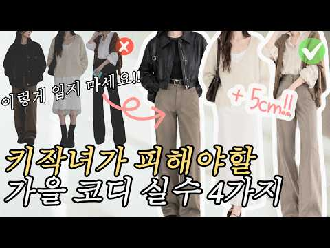
- 챕터: 0:00 오프닝 · 0:53 실수1. 엉덩이를 애매하게 가리는 아우터 ❌ (비율 … · 2:46 실수2. 상·하의 오버핏 코디 ❌ (오버핏 활용팁 ⭕) · 3:46 실수3. 미디스커트+앵클부츠 조합 ❌ (+5cm 스커… · 4:53 실수4. 상하의 강한 컬러 대비 ❌ (톤온톤 가을 코… · 6:08 키작녀 키 커보이는 코디 꿀팁 정리
- 설명 앞부분: 키작녀 비율 망치는 가을 코디 실수 4가지와, 비율 좋아보이는 키작녀 가을 코디법을 알차게 준비했습니다✨ 예쁜 가을 옷 샀는데 막상 내가 입으면 키가 더 작아 보이고 비율 안좋아보인적 있으시죠? 😭 비율 안좋아보이는 포인트를 모르고 입으면 키가 5cm는 더 작아 보이는 치명적인 코디 실수를 하게 되더라구요. 가지고 계신 옷으로 입는 방식만 살짝 바꿔도 훨씬 키 커보이는 가을 코디를 연출하실 수 있어요! 오늘 알려드린 키작녀 비율 살리는 꿀팁들 그대로 따라 해보시고, 이번 가을엔 "비율 진짜 좋다!"는 소리 꼭 들어보세요 🍂 부탁드…
- 같은 채널 평소 대비 ×10.3 (채널 최근 롱폼 중앙값 15,298회) · 평소 영상: 자라 가을 신상 추천템 ∣ 키작녀 현실핏 리뷰 ∣ 가을 분위기 넘치는 어른 여자 필수템 … (15,298회) / 올가을 아우터 필수템 5가지! ∣ 2026FW 자켓 트렌드 총정리 ∣ 키작녀 아우터 고르… (16,066회)
- 대본 없음 (설명) — 음성인식이 끝나면 도입부·흐름이 들어감
- 댓글 28/28: 좋은 점 — 영상 0 · 감사·응원 1 · 더 알고 싶은 것 3 · 아쉬운 점 — 영상 0 · 반박·불만 — 의견 다름 0 · 정치·사회 0 · 경험 공유 2 · 구독·다음 기대 0
  - 감사·응원 👍0 “저도 키가 작아서 늘 고민인데 가방끈은 생각도 못했어요~ 새로 알게된 팁 감사합니다”
  - 더 알고 싶은 것 👍1 “4:19 착장 정보 알고 싶어요♡”
  - 더 알고 싶은 것 👍0 “안녕하세여! 156cm 인데 환한 미소가 매력적이시네요~ 구독 합니당!! 3:38 쯤 흰바지 제품 정보 알고싶어요~”
  - 경험 공유 👍0 “저도 키가 작아서 늘 고민인데 가방끈은 생각도 못했어요~ 새로 알게된 팁 감사합니다”

### 39. 95%가 모르는 다이소 숨겨진 꿀템 15가지ㅣ다이소에 가면 이건 무조건 사세요ㅣ언뜻보면 명품이라고 착각할만한 다이소추천템 top15

- https://www.youtube.com/watch?v=zNTgmX92T1U · 꿀보따리 · 구독자 3,960 · 조회수 630,567 (×159.2, 하루 4,281.1) · 좋아요 8,200 (1.3%) · 12.6분 · 2026-07-02 · 주제 묶음 1. 쿠팡·쇼핑 추천 · 형식 비교 (vs·차이·순위) · 폴더 `W_zNTgmX92T1U` (웹 승인)
- 썸네일: 
- 챕터: 0:00 가장 중요한 부분 · 0:36 요석/석회 강력제거제 · 1:15 스텐 와이어 2단 도마꽂이 · 2:02 접이식 나일론 캐주얼 백팩 · 2:58 케이블홀더 · 3:29 동구밭 설거지바 · 4:35 홀베리 유기농 엑스트라버진 올리브오일 · 5:29 팬트리수납 롤러바구니 · 6:17 씽크대 걸이 휴지통 6L · 7:02 칸막이 부직포 수납함 3칸 · 7:41 손잡이접시 · 8:25 접시스탠드 · 9:05 싹스틱 · 9:47 스테인리스 바트형보관용기 · 11:01 데일리콤마 벨로 드 퍼퓸 기프트세트 · 11:41 웨이브 브러시 홀더
- 설명 앞부분: 제품명과 품번(다이소 구매 전 참고하시면 편해요!) 요석/석회 강력제거제 (품번: 1045002) 스텐 와이어 2단 도마꽂이 (품번: 1035759) 접이식 나일론 캐주얼 백팩 블랙 (품번: 1063948) 접이식 나일론 캐주얼 백팩 그레이 (품번: 1063947) 케이블홀더 (품번: 59743) 동구밭 설거지 비누 150g (품번:043995) 홀베리 유기농 엑스트라버진 올리브오일 (품번: 032640075) 팬트리수납 롤러바구니 (품번: 1057266) 씽크대 걸이 휴지통 6L (품번: 1028674) 칸막이 부직포 수납함 3…
- 대본 없음 (설명) — 음성인식이 끝나면 도입부·흐름이 들어감
- 댓글 107/107: 좋은 점 — 영상 13 · 감사·응원 27 · 더 알고 싶은 것 2 · 아쉬운 점 — 영상 0 · 반박·불만 — 의견 다름 3 · 정치·사회 0 · 경험 공유 2 · 구독·다음 기대 2
  - 좋은 점 — 영상 👍9 “영상 주인장님 영상 정보 참 좋네요 이거 15가지를 하나하나 쇼츠로 만들어서 풀어도 괜찮을듯 그리고 매 영상마다 너무 많은 정보를 주지 마시고 몇개씩 나눠서 영상 올리셔도 괜찮을것 같네요 ㅎㅎㅎ 좋은 정보 감사합니다 ㅎㅎㅎ”
  - 좋은 점 — 영상 👍9 “필요한물건들 콕콕찝어 알려줘서 감사합니다 더보기란에 품번까지 꼼꼼하게 올려놓아서 쉽게 찾을수있을거 같아요.”
  - 감사·응원 👍9 “영상 주인장님 영상 정보 참 좋네요 이거 15가지를 하나하나 쇼츠로 만들어서 풀어도 괜찮을듯 그리고 매 영상마다 너무 많은 정보를 주지 마시고 몇개씩 나눠서 영상 올리셔도 괜찮을것 같네요 ㅎㅎㅎ 좋은 정보 감사합니다 ㅎㅎㅎ”
  - 감사·응원 👍9 “필요한물건들 콕콕찝어 알려줘서 감사합니다 더보기란에 품번까지 꼼꼼하게 올려놓아서 쉽게 찾을수있을거 같아요.”
  - 더 알고 싶은 것 👍22 “가격도 알려주시면 더 유용할 거 같아요~”
  - 더 알고 싶은 것 👍2 “1:43 현관문에 우산 꽂이가 궁금한데요?😮”
  - 반박·불만 — 의견 다름 👍9 “"스테인리스 스틸" 이란 표현을 단지 길다는 이유로 스텐/스탠/스뎅 등으로 줄여서 적게 되면 완전히 잘못된 표현이 됩니다. 스텐/스테인/스뎅 과 같은 표현은 STAINLESS STEEL 자체를 뜻하는 것이 아닙니다. Stain 의 발음은 “스텐”이 아니라 “스테인”에…”
  - 반박·불만 — 의견 다름 👍0 “난 어제 구매한거 최강템 하나 사옴...홈스타 뿌리는 곰팡이(3천원)제거제..이제까지 곰팡이 청소하느라 각종 제품들 사와서 닦고 청소해봤는데 힘들고 잘지워지지도않고 손닿지않는곳이랑 틈새 곰팡이 제거하기 너무 힘들었음 근데 뿌리기만하고(뭐 3천원이라서 아낌없이 3분의 …”
  - 경험 공유 👍0 “난 어제 구매한거 최강템 하나 사옴...홈스타 뿌리는 곰팡이(3천원)제거제..이제까지 곰팡이 청소하느라 각종 제품들 사와서 닦고 청소해봤는데 힘들고 잘지워지지도않고 손닿지않는곳이랑 틈새 곰팡이 제거하기 너무 힘들었음 근데 뿌리기만하고(뭐 3천원이라서 아낌없이 3분의 …”
  - 구독·다음 기대 👍6 “이미 쓰고 있는것 다수 있어서 신뢰가 감 더 많은 정보 꿀템들 기대할게요”
  - 구독·다음 기대 👍1 “감사해요❤ 구독했습니다.🎉 홧팅요”

### 40. 【심영순 셰프의 비법 공개】김장 배추 절일 때 절대 뒤집지 마세요! 소금 딱 여기 뿌리면 1년 내내 아삭하고 시원한 배추 절이기 완성!

- https://www.youtube.com/watch?v=x6p0M_8-zMI · 매일살림 꿀정보 · 구독자 7,230 · 조회수 115,755 (×16.0, 하루 7,694.2) · 좋아요 1,798 (1.6%) · 10.9분 · 2026-11-12 · 주제 묶음 기타 · 형식 정보·해설 (그 밖) · 폴더 `W_x6p0M_8-zMI` (웹 승인)
- 썸네일: 
- 설명 앞부분: 🥬 김장철이 다가오면 가장 신경 쓰이는 과정이 바로 배추 절이기입니다. 배추를 일일이 뒤집고 소금물을 맞추느라 힘드셨나요? 이제는 조금 더 쉽고 간편하게 절여보세요! 소금을 뿌리는 위치와 절이는 요령만 제대로 알아도 아삭하고 시원한 김장 배추를 만드는 데 도움이 됩니다. 이번 영상에서는 배추를 절일 때 소금을 어디에 집중해서 뿌려야 하는지, 배추를 여러 번 뒤집지 않고 골고루 절이는 방법부터 김장 배추의 아삭한 식감을 살리는 비법까지 자세히 알려드립니다. ✨ 오늘 영상에서 알려드리는 꿀팁! 배추를 절일 때 소금을 뿌려야 하는 핵심…
- 같은 채널 평소 대비 ×6.5 (채널 최근 롱폼 중앙값 17,909회) · 평소 영상: 【심영순 셰프의 비법 공개】묵은 고춧가루 절대 버리지 마세요! 이것만 넣으면 1년 내내 … (17,909회) / 【심영순 셰프의 비법 공개】생강청에 설탕 넣지 마세요! 생강 쌀 때 잔뜩 쪄서 말리면 1… (17,588회)
- 대본 없음 (설명) — 음성인식이 끝나면 도입부·흐름이 들어감
- 댓글 20/20: 좋은 점 — 영상 1 · 감사·응원 7 · 더 알고 싶은 것 3 · 아쉬운 점 — 영상 0 · 반박·불만 — 의견 다름 0 · 정치·사회 0 · 경험 공유 2 · 구독·다음 기대 0
  - 좋은 점 — 영상 👍2 “잘 듣고 배우고 갑니다 감사합니다”
  - 감사·응원 👍5 “선생님감사합니다 건강하셔야합니다”
  - 감사·응원 👍4 “최고의 셰프께서 손수 자세한 설명 매우감사합니다. 배추절이는 시간을 배추크기와 소금 종류 실내온도에 따라 다르다고 하셨는데 배추보통크기. 소금은 천일염 일 경우 배추 절이는 시간을 대략 몇 시간하면 좋을까요? 고맙습니다”
  - 더 알고 싶은 것 👍15 “소금물위에 올라온 배추에는 밑둥부분에 소금을 뿌리라 하셨는데 밑둥에 소금 얹을땐 한주먹씩 인가요 얼만큼 넣으라는 내용은 없네요 그점이 궁금합니다 다른건 다 이해 했습니다”
  - 더 알고 싶은 것 👍4 “최고의 셰프께서 손수 자세한 설명 매우감사합니다. 배추절이는 시간을 배추크기와 소금 종류 실내온도에 따라 다르다고 하셨는데 배추보통크기. 소금은 천일염 일 경우 배추 절이는 시간을 대략 몇 시간하면 좋을까요? 고맙습니다”

