# 쿠팡 추천템 (4050 여성) — 성공 사례 분석: 사례별 자세히 #41–#80

`analysis.md` 의 9번 (같은 # 번호). 자동 생성 — `tools/success_analysis.py` v1.6 (2026-11-27 08:17 UTC). ※ 연구·교육용 — 투자 권유가 아님.

### 41. 셔츠 하나로 옷 잘 입는 사람 되는 5가지 코디법ㅣ화이트셔츠200%활용법 ㅣ인생셔츠코디공식ㅣ같은옷도 달라보인 진짜핵심ㅣ40대 50대 셔츠 이렇게 입어보세요ㅣ분위…

- https://www.youtube.com/watch?v=Xupc_eI6joQ · 우아한 C · 구독자 1,150 · 조회수 113,342 (×98.6, 하루 1,222.0) · 좋아요 633 (0.6%) · 8.4분 · 2026-08-26 · 주제 묶음 6. 4050 패션 · 형식 비교 (vs·차이·순위) · 폴더 `W_Xupc_eI6joQ` (웹 승인)
- 썸네일: 
- 챕터: 0:00 인트로: 셔츠 코디가 고민인 이유와 영상 소개 · 0:44 1. 셔츠를 아우터처럼 활용하기 (슬림해 보이는 세로… · 2:46 2. 앞부분만 살짝 넣어 입기 (자연스러운 볼륨과 다… · 3:28 3. 니트나 조끼 레이어링하기 (심심한 코디에 분위기… · 5:07 4. 단추와 소매 디테일 살리기 (한끗 차이로 세련되… · 6:48 5. 셔츠 길이와 하이 비율 맞추기 (체형 보완 균형… · 7:37 마무리 및 요약 정리
- 설명 앞부분: 옷장에 하나쯤은 있는 셔츠, 계절이 바뀔 때마다 새로운 옷을 살 필요는 없어요. 입는 방법만 조금 바꿔도 훨씬 세련되고 멋스럽게 연출할 수 있답니다. 영상 보시고, 가지고 계신 셔츠로 직접 한번 활용해보세요. 😊
- 같은 채널 평소 대비 ×6.4 (채널 최근 롱폼 중앙값 17,715회) · 평소 영상: 여행갈 때 이렇게만 입으세요ㅣ여행 사진이 유독 예쁜 사람들의 공통점 (의외로 얼굴이 아닙… (17,715회) / 명품없이 귀티나게 입는법ㅣ우아해보이는기준ㅣ고급스러워보이는코디ㅣ세련된코디ㅣ귀티나는코디ㅣ품위… (7,771회)
- 대본 없음 (설명) — 음성인식이 끝나면 도입부·흐름이 들어감
- 댓글 10/10: 좋은 점 — 영상 1 · 감사·응원 2 · 더 알고 싶은 것 2 · 아쉬운 점 — 영상 0 · 반박·불만 — 의견 다름 0 · 정치·사회 0 · 경험 공유 0 · 구독·다음 기대 0
  - 좋은 점 — 영상 👍0 “영상이 참 도움이 됩니다! 몸에 맞는 실크셔츠와 면 소재들 비싸게 주고 샀기에 입고 싶은데 요즘 트렌드에 맞지않나 생각돼요~ 어떻게 입으면 좋을까요?”
  - 감사·응원 👍0 “도움주셔서 감사합니다 평소에 셔츠를 즐겨입는 편이라서😊”
  - 더 알고 싶은 것 👍0 “영상이 참 도움이 됩니다! 몸에 맞는 실크셔츠와 면 소재들 비싸게 주고 샀기에 입고 싶은데 요즘 트렌드에 맞지않나 생각돼요~ 어떻게 입으면 좋을까요?”

### 42. 4050 대충해도 고급스러운 10분 초간단 메이크업⏰

- https://www.youtube.com/watch?v=GQjprC7tVXs · 블링수 뷰티 · 구독자 25,200 · 조회수 1,821,787 (×72.3, 하루 22,829.4) · 좋아요 6,641 (0.4%) · 8.7분 · 2026-09-08 · 주제 묶음 5. 4050 뷰티 · 형식 코디·메이크업 (따라 하기) · 폴더 `W_GQjprC7tVXs` (웹 승인)
- 썸네일: 
- 챕터: 0:00 오프닝 · 0:16 퀵 메이크업 인트로 · 0:24 스킨케어루틴 · 0:29 10분 메이크업 포인트 1 · 0:48 베이스프렙 사용법 · 1:14 꺼진 눈 살리기(컨실러 펜슬) · 2:20 쿠션 바르는 방법 · 2:53 컬러 컨실러 사용법 · 3:02 눈가 유분 제거 · 3:10 10분 메이크업 포인트 2 · 3:49 아이브로우 · 4:04 아이브로우 마스카라 · 4:47 아이섀도우 & 입술 착색 커버 · 4:57 히팅 뷰러 · 5:03 속눈썹 마스카라 · 5:27 아이라이너&눈가 음영 · 5:43 오버립 그리기 · 6:25 블러셔 바르는 방법 · 6:30 립 바르는 방법 · 6:50 쉐딩하는 방법
- 설명 앞부분: 이 영상은 쿠팡 파트너스 활동의 일환으로, 이에 따른 일정액의 수수료를 제공받아 채널 운영에 큰 도움이 됩니다. 바쁜 날에도 포기할 수 없는 메이크업💄✨ 복잡한 브러시 없이, 딱 10분 만에 우아하고 고급스럽게! 청담동 메이크업 아티스트 출신의 현실적인 4050 퀵 메이크업 노하우를 담았어요. 윤기 나는 피부결과 부드러운 인상, 두 가지만 꼭 기억하세요💗 전제품 내돈내산 입니다. ⏰타임스탬프 영상 속 제품 말씀드립니다. (상시 가격변동 있음) 1. 연작 스킨 퍼펙팅 프로텍티브 베이스프렙 ₩40,500 이글립스가 어바웃톤으로 브랜드…
- 같은 채널 평소 대비 ×22.6 (채널 최근 롱폼 중앙값 80,786회) · 평소 영상: 너 고생 안 했구나? 소리 듣는 4050 우아한 분위기 연말 메이크업 (26,510회) / 40대 왓츠인마이백ㅣ메이크업 아티스트ㅣ호텔신라 이부진 사장이 입은 옷이라고?ㅣ추천템 한가… (26,375회)
- 대본 없음 (설명) — 음성인식이 끝나면 도입부·흐름이 들어감
- 댓글 457/457: 좋은 점 — 영상 21 · 감사·응원 41 · 더 알고 싶은 것 50 · 아쉬운 점 — 영상 1 · 반박·불만 — 의견 다름 1 · 정치·사회 0 · 경험 공유 15 · 구독·다음 기대 8
  - 좋은 점 — 영상 👍133 “50대 초반인데 나이드니 화장품 잘 안 쓰고 버려서 비싼거는 안 사게 되더라구요. 제가 넘나 하고 싶던 은은한 고급진 메이크업~저렴이 아이들로 꿀팁 알려주셔서 넘 감사해요. 얼굴이 이쁘셔서 메이크업 한게 더 빛을 발하시는 듯...”
  - 좋은 점 — 영상 👍22 “와... 여태 본 메이크업 영상중에 젤 기분이좋고 도움되는 영상이에요! 말씀을 어찌 이리 우아하시면서도 기분좋게 하시는지 귀가 편하고 호감이 가는 목소리세요👍 바쁠때 넘 유용하게 할수있는 방법에 쓰신 화장품들의 비용또한 넘 좋아서 역시 젤 중요한건 손과 지혜라는걸 다…”
  - 감사·응원 👍133 “50대 초반인데 나이드니 화장품 잘 안 쓰고 버려서 비싼거는 안 사게 되더라구요. 제가 넘나 하고 싶던 은은한 고급진 메이크업~저렴이 아이들로 꿀팁 알려주셔서 넘 감사해요. 얼굴이 이쁘셔서 메이크업 한게 더 빛을 발하시는 듯...”
  - 감사·응원 👍46 “40에 애낳은 40살이예요- 메이크업영상 너무너무 감사합니다^^ 가격대도 부담스럽지않아서 감동-”
  - 더 알고 싶은 것 👍2 “정말 와닿는 메이크업이네요! 감사해요. 저도 이제 이렇게 해봐야겠어요!! 기초화장품도 어떤거 쓰시는지 궁금해요^^”
  - 더 알고 싶은 것 👍2 “60대인데 정말 꿀팁영상 얻어갑니다.목걸이 정보 궁금해요”
  - 아쉬운 점 — 영상 👍1 “요즘 달라진메이컵 넘 어려웠는데 핵심만 집약되어 좋네요! 따라해볼께요! 젊어져야징! 😊”
  - 반박·불만 — 의견 다름 👍1 “안녕하세요~!너무유익하게 잘보구있다가 문의가생겨서요! ! 헤어 컬러가 블링 수님 보다 훨씬 밝은 갈색인데 눈썹 그리는 색상을 똑같이 애쉬브라운으로 해야할지~아니면 더 밝은?컬러로골라야할지 모르겠어서 문의드려요^ ^! 그리구 너무 예쁘세요!고급스럽게~ 저는 그런 얼굴이…”
  - 경험 공유 👍133 “50대 초반인데 나이드니 화장품 잘 안 쓰고 버려서 비싼거는 안 사게 되더라구요. 제가 넘나 하고 싶던 은은한 고급진 메이크업~저렴이 아이들로 꿀팁 알려주셔서 넘 감사해요. 얼굴이 이쁘셔서 메이크업 한게 더 빛을 발하시는 듯...”
  - 경험 공유 👍7 “대박이에요! 엄청 간단하고 집에 있을법한 준비물들이라 있는걸로 따라 해봤는데 충격적 결과입니다.. 유튜버들 아이템 따라사도 톤이 달라서 안맞는게 많았는데, 립밤 시도해봤는데 인생컬러 ㅎㅎㅎㅎㅎㅎ 나중에 쿠션도 따라사보려구요! 너무너무 좋은 영상 감사합니다. 공들인 화…”
  - 구독·다음 기대 👍6 “알고리즘 떠서 보게 됐는데 너무 예쁘셔서 홀리듯이 끝까지 보게 됐어요 구독할게요~😊”
  - 구독·다음 기대 👍5 “추천하신 화장품들 가격도 너무 좋고 하나하나 다 적었습니다. 구독하고 가요. 감사합니다.”

### 43. 올 가을 아우터 뭐 살까?∣4050이라면 이 5가지부터 보세요

- https://www.youtube.com/watch?v=-9YuPmft_gE · 4050 패션 바이윤  · 구독자 1,480 · 조회수 103,293 (×69.8, 하루 1,262.6) · 좋아요 595 (0.6%) · 11.7분 · 2026-09-06 · 주제 묶음 기타 · 형식 목록형 (N가지 추천템) · 폴더 `W_-9YuPmft_gE` (웹 승인)
- 썸네일: 
- 설명 앞부분: 가을이 시작되면 가장 먼저 고민되는 게 바로 아우터죠. 유행만 보고 고르기보다 지금 내 옷장에 잘 어울리고, 오래 활용할 수 있는 아우터를 고르는 게 더 중요합니다. 이번 영상에서는 4050이 올가을 활용하기 좋은 아우터 5가지를 정리해봤어요. 디자인별 특징과 어떤 스타일로 입으면 좋은지, 고를 때 어떤 부분을 봐야 하는지도 함께 담았습니다. 옷을 많이 사기보다 나에게 잘 맞는 한 벌을 제대로 고르는 데 도움이 되었으면 좋겠습니다. 🤍 앞으로도 4050이 현실적으로 활용할 수 있는 패션 이야기를 꾸준히 나눠볼게요.
- 같은 채널 평소 대비 ×8.2 (채널 최근 롱폼 중앙값 12,644회) · 평소 영상: 옷장에 이것만 남기세요 ∣ 여름 필수템 7 ∣ 일상부터 출근룩 까지 (13,166회) / 4050 겨울 아우터, 비싸게 사고 후회하지마세요∣겨울 아우터 사기전에 보세요 (12,123회)
- 대본 없음 (설명) — 음성인식이 끝나면 도입부·흐름이 들어감
- 댓글 4/4: 좋은 점 — 영상 1 · 감사·응원 1 · 더 알고 싶은 것 0 · 아쉬운 점 — 영상 0 · 반박·불만 — 의견 다름 0 · 정치·사회 0 · 경험 공유 0 · 구독·다음 기대 0
  - 좋은 점 — 영상 👍3 “올 가을은 가죽자켓 한 번 입어봐야겠어요 정보가 너무 유익해서 큰 도움되네요~~”
  - 감사·응원 👍2 “중간에 바이윤님이신가요??? 러블리하시네요~❤❤ 5가지 추천 아이템 넘 감사요~ 멋쟁이 될게요😊”

### 44. 쓸수록 감탄나오는 다이소 역대급 추천템ㅣ무더위 날려줄 다이소 여름 신상템ㅣ백화점급 다이소 꿀템ㅣ삶의질 상승 보장ㅣ쿠팡 추천템

- https://www.youtube.com/watch?v=2gzaNh1kBBA · 감탄살림 · 구독자 3,670 · 조회수 338,400 (×92.2, 하루 3,054.8) · 좋아요 4,152 (1.2%) · 18.4분 · 2026-08-08 · 주제 묶음 1. 쿠팡·쇼핑 추천 · 형식 목록형 (N가지 추천템) · 폴더 `W_2gzaNh1kBBA` (웹 승인)
- 썸네일: 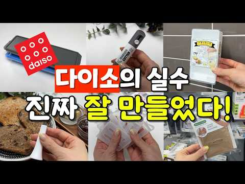
- 챕터: 0:00 안녕하세요 감탄 살림입니다😊 · 0:17 2in1 송장번호 지우개&커터 세트 · 1:07 실리콘 스틱형 얼음틀 · 2:16 버터 케이스 커터 포함 · 3:31 세울 수 있는 버터나이프 · 4:21 냉장고 길이조절 칸막이 홀더 · 5:19 자외선 차단 팔토시 손등형 · 6:08 질긴 니트릴 고무장갑 · 8:09 베구산 3종 · 7:18 베이킹소다 · 8:35 찬물에도 녹는 과탄산소다 · 9:58 구연산 · 10:15 구연산수 · 10:43 워싱소다 세탁세제 · 11:52 반오픈 가루세제 저장용기 · 12:34 휴대용 비데 물티슈 · 13:21 무선 전동 스퀴지 · 14:01 욕실 바닥 청소솔 · 14:27 차량용 진공 청소기 · 15:23 스테인리스 스틸 걸이형 쓰레기통
- 설명 앞부분: 14:01욕실 바닥 청소솔 ⭐️ 영상 속 다이소제품 품번 정보⭐ 송장번호 지우개 커터 세트 1077992/1000원 스틱형 얼음 트레이4칸 1059207/2000원 스틱형 얼음 트레이 9칸 1059206/2000원 버터 케이스 559619906/1500원 세울 수 있는 버터나이프 048009780/1500원 냉장고 칸막이 홀더 1060530/1000원 자외선 차단 팔토시 손등형 1057286/3000원 베이킹소다 1055941/2000원 과탄산소다 1055938/2000원 구연산 1055939/3000원 구연산수 1011892/3…
- 대본 없음 (설명) — 음성인식이 끝나면 도입부·흐름이 들어감
- 댓글 162/162: 좋은 점 — 영상 4 · 감사·응원 10 · 더 알고 싶은 것 4 · 아쉬운 점 — 영상 2 · 반박·불만 — 의견 다름 1 · 정치·사회 0 · 경험 공유 6 · 구독·다음 기대 0
  - 좋은 점 — 영상 👍8 “이런 영상이 도움이 되는게 다이소가서 실수도 안하고 고민도 없이 쇼핑할수 있어서 좋아요”
  - 좋은 점 — 영상 👍2 “전 다이소,쿠팡 다 좋아요!좋은 정보 주셔서 감사해요😊”
  - 감사·응원 👍18 “직접영상찍으셔서 좋고 정성스런영상 감사합니다”
  - 감사·응원 👍12 “와 ~ 다이소가서 필요한 것만 쏙쏙 가져오면 될것같아요 ㅎ 감사해요~❤”
  - 더 알고 싶은 것 👍2 “영상중에 라탄 테이블매트 정보 궁금해요”
  - 더 알고 싶은 것 👍2 “무선전동스퀴지 찾아도없네요 판매링크좀 올려주세요”
  - 아쉬운 점 — 영상 👍3 “제목에 쿠팡 상품 포함이라 써놓으세요 낚시..다이소에서 한참 찾다 포기했는데 거의다 쿠팡..시간낭비 했음”
  - 아쉬운 점 — 영상 👍0 “다이소라고 어그로 끌고 쿠팡? 이런 짓 좀 하지 말자”
  - 경험 공유 👍1 “다이소는 내가 거짓말 안하는거 알고 지금까지 함께해준 ~😊”
  - 경험 공유 👍1 “경험상 무선은 시간이 지날수록 성능이 저하되어서 왠만하면 유선이 좋은듯..”

### 45. 코스트코 살치살 스테이크 이렇게 드세요. 돈 오히려 법니다. ∣ 20인분 트레이더스

- https://www.youtube.com/watch?v=mpFISnWaDVk · 고기형 · 구독자 19,500 · 조회수 889,646 (×45.6, 하루 15,957.7) · 좋아요 1,377 (0.1%) · 9.9분 · 2026-10-02 · 주제 묶음 4. 다이소·가성비 · 형식 비교 (vs·차이·순위) · 폴더 `W_mpFISnWaDVk` (웹 승인)
- 썸네일: 
- 챕터: 0:00 코스트코 살치살 소개와 고르는 법 · 1:08 살치살·꽃갈비살 차이와 선택법 · 3:34 살치살 손질하기 · 5:46 스테이크 준비와 소금 간 · 7:12 스테이크 굽고 맛보기 · 9:08 살치살 풍미와 보관 방법
- 설명 앞부분: 코스트코에서 살치살과 꽃갈비살을 고를 때 확인할 점부터 살치살 손질과 스테이크 굽기, 남은 고기 보관 방법까지 담았습니다. 살치살과 꽃갈비살의 차이, 고기의 두께와 마블링을 살펴보는 법, 손질할 때 지방과 막을 정리하는 방법을 영상에서 확인해 보세요. 손질한 살치살은 스테이크와 구이용으로 나누어 준비하고, 스테이크는 소금 간을 한 뒤 구워 보았습니다. 코스트코에서 고기를 고를 때 참고해 보시고, 더 자세한 스테이크 굽는 방법은 고정 댓글을 확인해 주세요. [타임라인]
- 같은 채널 평소 대비 ×7.6 (채널 최근 롱폼 중앙값 116,702회) · 평소 영상: 코스트코 부채살 이 영상 한번만 보면 죽을 때까지 저렴하게 맛있는 소고기 먹을 수 있습니… (121,626회) / 코스트코 실패없는 최고의 부위 갈비살 고르는 가장 완벽한 치트키 딱 1분만 보세요. (111,777회)
- 대본 없음 (설명) — 음성인식이 끝나면 도입부·흐름이 들어감
- 댓글 100/100: 좋은 점 — 영상 2 · 감사·응원 2 · 더 알고 싶은 것 2 · 아쉬운 점 — 영상 0 · 반박·불만 — 의견 다름 0 · 정치·사회 1 · 경험 공유 1 · 구독·다음 기대 0
  - 좋은 점 — 영상 👍1 “오와.. 꿀팁”
  - 좋은 점 — 영상 👍0 “자세한 알려주셔주 너무 유익하네 꽃갈비살 손질하는 영상도 부탁드려요🙏🏻”
  - 감사·응원 👍0 “정말 잘하시네요 ㅡ 내용 감사합니다”
  - 더 알고 싶은 것 👍1 “보통 살치랑 꽃갈비 어느부위가 더 비싼가요? 맛의 차이도 알려주세요.”
  - 더 알고 싶은 것 👍0 “자세한 알려주셔주 너무 유익하네 꽃갈비살 손질하는 영상도 부탁드려요🙏🏻”

### 46. 다이소 TOP12 가성비 조합으로 화장실 청소 끝내는 꿀템 ∣ 비싼 욕실 세제 사지 마세요!

- https://www.youtube.com/watch?v=XDuADpOTiSo · 베리홈 · 구독자 9,370 · 조회수 760,023 (×81.1, 하루 7,541.5) · 좋아요 2,090 (0.3%) · 9.2분 · 2026-08-18 · 주제 묶음 4. 다이소·가성비 · 형식 경고형 (사지 마세요·실패템) · 폴더 `W_XDuADpOTiSo` (웹 승인)
- 썸네일: 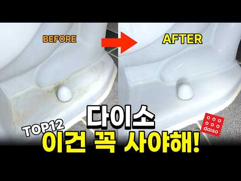
- 설명 앞부분: 아직도 화장실 청소 귀찮다고 미루시고 있나요? 주말마다 힘들게 대청소할 필요 없이, 쉽고 빠르게 끝낼 수 있는 욕실 청소방법입니다! 다이소 청소꿀템 & 같이 쓰면 좋은 꿀템과 깔끔하게 유지하는 꿀팁, 그리고 진-짜 청소하기 싫은 날 쓰는 꼼수방법까지 알차게 준비했어요 :) 궁금하시다면 끝까지 시청하기! 내돈내산 리뷰 운영에 큰 도움이 됩니다" ↓다이소 외 살림꿀템 한번에 보기↓
- 대본 없음 (설명) — 음성인식이 끝나면 도입부·흐름이 들어감
- 댓글 29/29: 좋은 점 — 영상 2 · 감사·응원 2 · 더 알고 싶은 것 1 · 아쉬운 점 — 영상 0 · 반박·불만 — 의견 다름 0 · 정치·사회 0 · 경험 공유 1 · 구독·다음 기대 0
  - 좋은 점 — 영상 👍1 “오 샤워기 아토젯 쓰시네요 저도 저거씁니다 필터가 좀 비싸지만 수압도좋고 잘걸러지고 만족해요 좋은리뷰 보고갑니다 도움됐어요!!”
  - 감사·응원 👍10 “결과 확실한 아이템들 소개해주셔서 완존 감사합니다❤❤❤ 제품 링크 이름 가격까쥐 쵝오!!!!”
  - 더 알고 싶은 것 👍0 “베리홈님❤ 혹시 샤워기헤드는 어느제품 쓰시는지 알수있을까요?”
  - 경험 공유 👍1 “오 샤워기 아토젯 쓰시네요 저도 저거씁니다 필터가 좀 비싸지만 수압도좋고 잘걸러지고 만족해요 좋은리뷰 보고갑니다 도움됐어요!!”

### 47. 쿠팡에서 3만 원 주고 샀는데 다이소에 단돈 2천 원에 풀려버림. 최신 다이소 신제품 21종 리뷰

- https://www.youtube.com/watch?v=RzB3fj5KMC8 · 살림카페 · 구독자 8,430 · 조회수 209,563 (×24.9, 하루 6,767.0) · 좋아요 536 (0.3%) · 12.4분 · 2026-10-27 · 주제 묶음 4. 다이소·가성비 · 형식 정보·해설 (그 밖) · 폴더 `W_RzB3fj5KMC8` (웹 승인)
- 썸네일: 
- 챕터: 0:00 안녕하세요살림카페입니다 · 0:12 다용도 흡착패드 품번 52680 · 0:41 에어홀 스텐 찬통 1.5리터 품번 1075510 · 1:09 에어홀 스텐 찬통 손잡이형 1.2리터 1075506 · 1:38 힘좋은 탈부착 빨래집게 품번 048032207 · 2:02 바나나의 색다른 사용법 1021906 · 2:35 김빠삭보관용기 품번 1079058 · 3:27 플라스틱용기 4종 · 4:43 D형도마 품번 048061952 · 5:24 일회용품들 · 6:44 죽통껍질 벗기기 품번 10336691 · 7:19 캐릭터튜브용기 품번 1074374 · 7:35 이쁜 집모양 디지털 시계 품번 1075684 · 8:21 국내산 클리어보틀 품번 10389972 · 8:52 한손으로 열리는 진공용기 850ml 1075641 · 9:35 알루미늄 버터나이프 품번 327310302 · 10:17 국내산 미싱볼 품번 1026341 · 10:57 캐릭터보풀제거기 품번 1017006 · 11:20 휴대용미니가위 품번 1080373 · 11:37 휴대하면 편리한 세가지
- 설명 앞부분: 물빠짐 D형도마 품번 048061952: 채소 세척 물빠짐 구멍, 마늘 강판 돌기, 캠핑용 국내산 일회용 3종: 30cm 점선 랩, 소형 분할 지퍼백, 천연펄프 기름종이 벗겨진 텀블러 복원 팁: 끓는 물과 과탄산소다로 올스텐 텀블러 만들기 동물 모양 리필 튜브 용기: 가방에 걸기 좋은 40ml 키링형 소분통 집 모양 디지털 탁상시계: 조명·온도·날짜·스누즈 알람 기능 에코젠 안심 물병: 젖병 소재, 눈금 표기 (단백질 쉐이크·믹스커피용) 올유리 진공 밀폐용기: 손잡이 일체형 공기배출구 뚜껑 체온 전도 알루미늄 버터 나이프: 단단한…
- 같은 채널 평소 대비 ×4.8 (채널 최근 롱폼 중앙값 43,727회) · 평소 영상: 다이소가 작정하고 만든 1%만 아는 꿀템 11가지 이건 진짜 넘사벽 퀼리티! 내돈내산 삶… (43,727회) / 이걸 이제야 구하다니... 오직 다이소에서만 구할 수 있는 신박템& 실속템 15가지 그리… (42,726회)
- 대본 없음 (설명) — 음성인식이 끝나면 도입부·흐름이 들어감
- 댓글 15/15: 좋은 점 — 영상 0 · 감사·응원 2 · 더 알고 싶은 것 0 · 아쉬운 점 — 영상 0 · 반박·불만 — 의견 다름 0 · 정치·사회 0 · 경험 공유 1 · 구독·다음 기대 0
  - 감사·응원 👍0 “몰랐던 꿀템 정보 감사합니다”
  - 감사·응원 👍0 “신제품 21종을 하나하나 꼼꼼히 살펴봐 주셔서 살림 준비하는 분들께 큰 힘이 될 것 같아요. 정성 가득한 영상 늘 응원합니다.”
  - 경험 공유 👍12 “내가 공들여 산 물건이 단돈 몇천 원에 놓여 있는 걸 볼 때의 허탈함과, 역으로 소소한 금액으로 일상을 가득 채울 수 있다는 설렘이 교차하며 묘한 위로를 전합니다. 비싼 가격표가 곧 삶의 질을 보장하는 건 아니라는 걸 깨닫게 해주고, 작은 발견 하나만으로도 하루가 충…”

### 48. 다이어트 미친 내가 돈 다 써보고 살아남은 인생템 1개 - 전자레인지 찜기, 10년차 직장인 진작 이걸로 쓸 껄

- https://www.youtube.com/watch?v=65zHLPvWUSc · 다이어트 식탁 │ 초간단 렌지레시피 · 구독자 3,830 · 조회수 420,692 (×109.8, 하루 3,031.3) · 좋아요 3,475 (0.8%) · 10.9분 · 2026-07-11 · 주제 묶음 7. 가전 · 형식 목록형 (N가지 추천템) · 폴더 `W_65zHLPvWUSc` (웹 승인)
- 썸네일: 
- 챕터: 0:00 왜 이 용기로 정착했는지 · 1:31 ① 유리라서 좋은 이유 · 3:02 ② 야채찜이 쉬워지는 스팀 기능 · 5:08 ③ 사이즈별 추천 (500ml / 1.5L / 1.6… · 7:43 ④ 냉장·냉동·에어프라이 활용 · 8:18 ⑤ 가격 대비 오래 쓰는 이유
- 설명 앞부분: 전자레인지로 식단을 자주 해먹는 분들이라면 용기 하나가 생각보다 정말 중요합니다. 저도 플라스틱, 실리콘, 도자기까지 다 써보고 결국 정착한 전자레인지용 유리용기입니다. 이번 영상에서는 제가 실제로 사용하는 기준 5가지를 기준으로 소개해봤습니다. 내열유리 찜 기능(스팀홀·받침판) 3가지 용량 냉장·냉동·에어프라이 사용 가능 오래 쓰기 좋은 가성비 제품 정보는 아래 고정댓글에 정리해두었습니다. ⏰ 타임라인 vrew 자막 사용하였습니다.
- 대본 없음 (설명) — 음성인식이 끝나면 도입부·흐름이 들어감
- 댓글 166/166: 좋은 점 — 영상 3 · 감사·응원 9 · 더 알고 싶은 것 10 · 아쉬운 점 — 영상 0 · 반박·불만 — 의견 다름 0 · 정치·사회 1 · 경험 공유 18 · 구독·다음 기대 2
  - 좋은 점 — 영상 👍6 “너무 유익합니다 앞으로도 이렇게 비교해서 공유해주시면 좋을 것 같아요!!!”
  - 좋은 점 — 영상 👍2 “주문완료. 유익한 정보 감사합니다.”
  - 감사·응원 👍11 “만원짜리 그릇사는데 이렇게 심도있게 정성들이신 영상을 만드시는게 너무멋져요. 저도 저거 파란거 2년째 쓰고있어요 정말좋아요. 이분 뭘해도 성공하실듯. 대박나세요 화이팅”
  - 감사·응원 👍3 “오~~ 딱 원하던 찜기네요. 정보 감사합니다.”
  - 더 알고 싶은 것 👍3 “저도 이거 큰거 쓰고있는데 실리콘 받침은 세척 어떻게 하나요? 만두만 쪄도 기름기가 베겨서 퐁퐁해도 기름기가 잘 안 빠지던데 그거 말곤 만족하고 쓰고 있습니다”
  - 더 알고 싶은 것 👍2 “구독하고 갑니다^^ 찜기는 구매했는데 어떤 재료 조합으로 먹어야할지 막막해서 찾아들어왔습니다. 여러 가지 조합을 알려주세요^^”
  - 정치·사회 👍1 “원산지가 중국인데 진짜 락앤락 맞아요?”
  - 경험 공유 👍311 “아니, 내가 전자렌지 찜기 사겠다고 입밖으로 낸 적이 없고 그냥 생각만 했는데 어떻게 알고리즘이 이렇게 떴지 나 진짜 무서워”
  - 경험 공유 👍11 “만원짜리 그릇사는데 이렇게 심도있게 정성들이신 영상을 만드시는게 너무멋져요. 저도 저거 파란거 2년째 쓰고있어요 정말좋아요. 이분 뭘해도 성공하실듯. 대박나세요 화이팅”
  - 구독·다음 기대 👍2 “구독하고 갑니다^^ 찜기는 구매했는데 어떤 재료 조합으로 먹어야할지 막막해서 찾아들어왔습니다. 여러 가지 조합을 알려주세요^^”
  - 구독·다음 기대 👍1 “자려고 누웠다가 영상 보고 찜기 3종 세트 바로 구매했어요.ㅋ 아주 유용하게 쓰일 거 같아요~ 구독 누르고 갑니다^^ 영상 잘 챙겨볼게요~”

### 49. 매일매일 조금씩 미니멀리스트의 청소 루틴

- https://www.youtube.com/watch?v=epG_Uz90pAw · 미니멀라이프_심플살림 · 구독자 4,840 · 조회수 506,739 (×104.7, 하루 3,801.6) · 좋아요 3,949 (0.8%) · 17.7분 · 2026-07-16 · 주제 묶음 3. 청소·정리·수납 · 형식 살림 브이로그·루틴 · 폴더 `W_epG_Uz90pAw` (웹 승인)
- 썸네일: 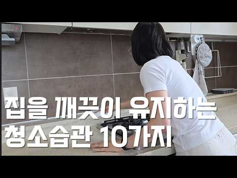
- 챕터: 0:00 인트로 · 1:54 1. 대청소를 기다리지 않는 것 · 3:35 2. 설거지를 하면서 주방까지 함께 정리 · 5:02 3. 5분안에 끝나는 일은 바로 하는 것 · 6:27 4. 빈손으로 움직이지 않는 것 · 7:58 5. 물건은 사용한 자리로 바로 돌려 놓는 것 · 8:49 6. 바닥에 물건을 두지 않는 것 · 10:21 7. 샤워하면서 욕실까지 함께 청소하기 · 12:14 8. 하루를 마무리하기 전에 5분만 집을 리셋하기 · 13:35 9. 수납하기 전에 먼저 비우기 · 14:40 10. 완벽한 청소보다 꾸준한 청소 · 15:49 마무리
- 설명 앞부분: 대청소 할때마다 힘들어서 청소를 미루지 않는 습관을 만드는 데 집중해 보기로 했습니다. 신기하게도 청소하는 시간은 오히려 줄었는데 집은 예전보다 훨씬 오래 깨끗하게 유지되었습니다. 집이 저절로 깨끗해진 것은 아니었습니다. 다만 더러워질 틈을 만들지 않는 작은 루틴이 하나둘 생기기 시작한 것입니다. 오늘은 제가 직접 실천하면서 효과를 본 미니멀리스트의 청소 루틴, 더 이상 대청소를 하지 않는 10가지 습관을 소개해 드리겠습니다. 집안일은 조금 더 가벼워지고, 깨끗한 집을 오래 유지하는 나만의 청소 루틴을 만드는 데 도움이 되셨으면 …
- 같은 채널 평소 대비 ×40.9 (채널 최근 롱폼 중앙값 12,392회) · 평소 영상: 미니멀라이프∣주방정리, 밀폐용기추천 (13,571회) / "미뤄둔 물건, 오늘 싹 비웁니다. 비움챌린지 시작 (13,664회)
- 대본 없음 (설명) — 음성인식이 끝나면 도입부·흐름이 들어감
- 댓글 200/200: 좋은 점 — 영상 12 · 감사·응원 14 · 더 알고 싶은 것 14 · 아쉬운 점 — 영상 0 · 반박·불만 — 의견 다름 1 · 정치·사회 0 · 경험 공유 16 · 구독·다음 기대 0
  - 좋은 점 — 영상 👍10 “청소영상보면서 많이 배웠습니다 욕실 물기닦는 수건과 수세미는 어디에 걸어둬야할지, 물기닦고 나면 빨아야할지, 그냥 널지, 욕실바닥 닦는 수세미와 수전닦는 수세미를 따로 두시는지, 수전 틈 닦는 솔은 어디에 두는지 정말 궁금해요 고민만 하다가 청소 못하고, 도구들은 욕…”
  - 좋은 점 — 영상 👍6 “극히 공감합니다. 부스에서 샤워하고 씻고나오면 귀찮지만 물기를 바로 닦을려고 전용타올을 구비했었습니다. 습관이되니까 씻고나서의 루틴이되고 부스 타일이 지금도 여전히 깔끔합니다. 다른 청소영역에 적용해보자 생각했었는데 마침 영상을 마주했네요 ㅎㅎ 생활꿀팁 감사드립니다!”
  - 감사·응원 👍18 “37평아파트를 17평으로 바꾸는 과감함을 선택해보니 자연히 짐이 줄어들수 밖에 없었네요 아직 정리 중이지만 절반이상 짐정리가 되어가고 있어요 그리고 그때그때 치우는게 가장좋은 청소 방법인것 동의 합니다 감사합니다❤❤”
  - 감사·응원 👍15 “영상 틀며 열심히 청소했어요. 집정리 싫어하는데 겨우 했어요. 감사합니다^^”
  - 더 알고 싶은 것 👍13 “전 주방 뒷정리후 행주를 어떻게 처리하는지 궁금해요. 행주빠는게 귀찮긴도하고, 행주빨면 싱크대가 또 더러워지는것같아서 ㅜㅜ 핑계죠..”
  - 더 알고 싶은 것 👍10 “청소영상보면서 많이 배웠습니다 욕실 물기닦는 수건과 수세미는 어디에 걸어둬야할지, 물기닦고 나면 빨아야할지, 그냥 널지, 욕실바닥 닦는 수세미와 수전닦는 수세미를 따로 두시는지, 수전 틈 닦는 솔은 어디에 두는지 정말 궁금해요 고민만 하다가 청소 못하고, 도구들은 욕…”
  - 반박·불만 — 의견 다름 👍0 “깨끗하고 쉽게 청소하네요 물티슈 변기에 버리는거 아니죠?”
  - 경험 공유 👍130 “뭐가 다른지 모르겠는.. 결국 뭔가를 계속 하고 있네요. 저도 딱히 정리 청소를 시간 내 하지 않아요. 근데 주변사람들이 항상 저보고 얘기하더라고요. 야, 좀 가만있어라~ 뭘 계속 하고 있니.라고😅😅”
  - 경험 공유 👍34 “저도 이렇게 하고 있어요 ~ 맞벌이부부다보니 꾸준하게 조금씩 하는게 젤 중요하고 특히 ! 안쓰는 물건 버리고 공간을 만드는게 가장 중요한거같애요 그래야지 물건이 한눈에 보이고 똑같은걸 몇개씩 사는걸 막을수가 있더라구요^^”

### 50. 단 7일 만에 집의 80%를 정리하는 일본식 정리 방법 10가지

- https://www.youtube.com/watch?v=o_ZW1fgGGIk · 일본인의 습관 · 구독자 5,090 · 조회수 188,536 (×37.0, 하루 3,861.7) · 좋아요 1,073 (0.6%) · 32.7분 · 2026-10-09 · 주제 묶음 3. 청소·정리·수납 · 형식 목록형 (N가지 추천템) · 폴더 `W_o_ZW1fgGGIk` (웹 승인)
- 썸네일: 
- 설명 앞부분: 단 7일 만에 집의 80%를 정리하는 일본식 정리 방법 10가지를 소개합니다. 간단하고 실용적인 방법을 통해 불필요한 물건을 줄이고 공간을 확보하며 더욱 편안하고 깔끔한 집을 만들어보세요. 이번 영상에서는 물건을 분류하고, 더 이상 필요하지 않은 물건을 정리하며, 집 안의 공간을 효율적으로 활용하는 일본식 방법을 알아봅니다. 불필요한 물건이 계속 쌓이는 것을 막고 일상생활에 더 편안한 공간을 만드는 방법도 함께 살펴봅니다. 이 영상에는 인공지능(AI)을 활용하여 제작되거나 생성된 콘텐츠가 포함되어 있습니다.
- 같은 채널 평소 대비 ×76.0 (채널 최근 롱폼 중앙값 2,481회) · 평소 영상: 자연스럽게 더 깨끗하고 상쾌해 보이게 만드는 일본식 위생 습관 15가지 — 오늘부터 시작… (2,481회) / 무엇이든 오래 쓰게 만드는 일본의 모타이나이 습관 15가지 (2,508회)
- 대본 없음 (설명) — 음성인식이 끝나면 도입부·흐름이 들어감
- 댓글 30/30: 좋은 점 — 영상 2 · 감사·응원 2 · 더 알고 싶은 것 0 · 아쉬운 점 — 영상 1 · 반박·불만 — 의견 다름 0 · 정치·사회 0 · 경험 공유 3 · 구독·다음 기대 0
  - 좋은 점 — 영상 👍6 “제가 집안정리하려다 여러번 포기했는데..좋은 영상이네요.”
  - 좋은 점 — 영상 👍1 “정리는 제가 제일 못하는 일입니다 무지무지 애를 쓰며 하루 3프로를 외치며 몇년을 노럭했는데 80프로에서 더이상 나아지지 않아 방금전 더이상 내가 못하는 일에 매달리디 않는다고 포기 선언했는데 이 영상이 떠서 주의 깊게 보았습니다 문제는 제가 잘못된 방법을 반복하고 …”
  - 감사·응원 👍2 “감사합니다.”
  - 감사·응원 👍1 “정리는 제가 제일 못하는 일입니다 무지무지 애를 쓰며 하루 3프로를 외치며 몇년을 노럭했는데 80프로에서 더이상 나아지지 않아 방금전 더이상 내가 못하는 일에 매달리디 않는다고 포기 선언했는데 이 영상이 떠서 주의 깊게 보았습니다 문제는 제가 잘못된 방법을 반복하고 …”
  - 아쉬운 점 — 영상 👍14 “어렵고 지루하너ㅣ. 간단명료ㅠ”
  - 경험 공유 👍6 “제가 집안정리하려다 여러번 포기했는데..좋은 영상이네요.”
  - 경험 공유 👍1 “정리는 제가 제일 못하는 일입니다 무지무지 애를 쓰며 하루 3프로를 외치며 몇년을 노럭했는데 80프로에서 더이상 나아지지 않아 방금전 더이상 내가 못하는 일에 매달리디 않는다고 포기 선언했는데 이 영상이 떠서 주의 깊게 보았습니다 문제는 제가 잘못된 방법을 반복하고 …”

### 51. 4050 중년 메이크업 실수 7가지‼️ '이것'만 안해도 10살 어려짐 ∣ 잡티커버/눈화장/블러셔/립메이크업

- https://www.youtube.com/watch?v=gkLSuNKUwEw · 블링수 뷰티 · 구독자 25,200 · 조회수 1,091,158 (×43.3, 하루 18,557.2) · 좋아요 2,456 (0.2%) · 9.8분 · 2026-09-29 · 주제 묶음 5. 4050 뷰티 · 형식 코디·메이크업 (따라 하기) · 폴더 `W_gkLSuNKUwEw` (웹 승인)
- 썸네일: 
- 챕터: 0:00 오프닝 · 0:19 화장이 나이들어 보이는 이유 · 0:24 화장이 촌스러운 이유(옛날 화장법) · 0:34 화장 잘하는 방법 · 0:43 중년의 피부 컨디션 · 1:01 파우더 사용 방법 · 1:23 예쁜광 살리기 · 1:53 잡티 커버 컨실러 · 2:04 잡티 커버 브러쉬 · 2:12 잡티 커버하는 방법 · 2:19 자연스러운 화장법 · 2:28 2차 커버 방법 · 2:49 눈썹 그리는 방법 · 3:07 브로우 컬러 선택 방법 · 3:21 스크류 브러쉬 꿀팁 · 3:28 눈썹 잘 그리는 방법 · 3:54 브로우 마스카라 · 4:01 4050 눈의 특징 · 4:09 눈가 밝혀주기(코렉팅) · 4:54 아이섀도우 사용 방법
- 설명 앞부분: 화장할수록 나이 들어 보이고, 묘하게 촌스러워 보인다면😢 제품 문제가 아니라 화장하는 방식이 문제일 수 있어요 이번 영상에서는 4050 메이크업에서 자주 하는 실수를 직접 비교하면서 지금부터 바꿔야 할 7가지를 보여드릴게요!✨ 이것만 안해도 -10살은 보장!👍💄 영상 끝까지 봐주세요~💗💗💗 ⏰타임스탬프
- 같은 채널 평소 대비 ×13.5 (채널 최근 롱폼 중앙값 80,786회) · 평소 영상: 너 고생 안 했구나? 소리 듣는 4050 우아한 분위기 연말 메이크업 (26,510회) / 40대 왓츠인마이백ㅣ메이크업 아티스트ㅣ호텔신라 이부진 사장이 입은 옷이라고?ㅣ추천템 한가… (26,375회)
- 대본 없음 (설명) — 음성인식이 끝나면 도입부·흐름이 들어감
- 댓글 186/186: 좋은 점 — 영상 14 · 감사·응원 18 · 더 알고 싶은 것 29 · 아쉬운 점 — 영상 0 · 반박·불만 — 의견 다름 0 · 정치·사회 0 · 경험 공유 6 · 구독·다음 기대 3
  - 좋은 점 — 영상 👍12 “78년생 만으로 48세임 내가 하는 화장법을 다 얘기하셔서 놀람 ㅠㅠ 나름 화장 좀 한다고 자부했었는데 촌스럽고 더 나이들어 보이는 방법으로 화장하고 있었네요 알려주신 꿀팁 잘 활용해서 내일 화장부터 적용해 볼게요 감사해요^^”
  - 좋은 점 — 영상 👍8 “예뻐요~ 잘 배웠습니다. 나이들수록 덜어내야 자연스럽군요^^ 근데 저는 아이브로우 마스카라 하고싶은데 바르면 떡이?져서 더 진해보여서 ㅜ 요령이 없나봐요.. 아이브로우 마스카라와 목걸이 정보도 알려주세요🙏”
  - 감사·응원 👍12 “78년생 만으로 48세임 내가 하는 화장법을 다 얘기하셔서 놀람 ㅠㅠ 나름 화장 좀 한다고 자부했었는데 촌스럽고 더 나이들어 보이는 방법으로 화장하고 있었네요 알려주신 꿀팁 잘 활용해서 내일 화장부터 적용해 볼게요 감사해요^^”
  - 감사·응원 👍6 “완전 유용한 영상입니다 ㅎㅎㅎ 솔직히 다른 다른 유툽 영상 보면 비포 애프터가 표정이랑 머리로 다르게 하는 사람도 많고, 누가 봐도 비포가 저렇게 화장하는 사람이 어디 있어라고 할 정도로 이상하게 해 놓는 사람도 많은데 블링수님은 그렇지 않아서 일단 오프닝부터 신뢰가…”
  - 더 알고 싶은 것 👍12 “나중에 리터치 할때가 문제에요 몆시간 지나거나 밥먹고 나면 고쳐야 되는데 처음 할때 처럼 절대 안됨!!나중에. 리터치 어떻게 한는지. 알려주세요!!!~~~~”
  - 더 알고 싶은 것 👍8 “블링수님 채널 요즘자주보게되네요^^ 입술착색커버 제품어떤건지 공유부탁드립니다~”
  - 경험 공유 👍12 “78년생 만으로 48세임 내가 하는 화장법을 다 얘기하셔서 놀람 ㅠㅠ 나름 화장 좀 한다고 자부했었는데 촌스럽고 더 나이들어 보이는 방법으로 화장하고 있었네요 알려주신 꿀팁 잘 활용해서 내일 화장부터 적용해 볼게요 감사해요^^”
  - 경험 공유 👍8 “저도 요즘 느끼는 게 나이 들수록 덜어내는 게 맞더라고요. 색조도 이것저것 많이 할수록 시간 지나면 피부가 더 안 좋아 보여서 나이 들어 보이더라고요. 이제는 다 안 가리고 전체적인 화사함만 살리려고 해요”
  - 구독·다음 기대 👍3 “예전에 다른분 채널에서 처음뵈었는데 어머 채널하고 계서 바로 구독하고 글남겨요 자주 올게요❤”
  - 구독·다음 기대 👍3 “구독하고 갑니다. 눈물고랑 심한 사람 어떻게 화장해야 하는지도 알려주세요.^^”

### 52. 가을 패션 트랜드가 와닿지 않는 이유, 올 가을 블랙 대신 4050이 진짜 편하게 입는 브라운 컬러 공식

- https://www.youtube.com/watch?v=wSPzdZAH6RE · 미술박사의 패션노트 · 구독자 1,810 · 조회수 112,924 (×62.4, 하루 1,300.0) · 좋아요 920 (0.8%) · 10.5분 · 2026-09-01 · 주제 묶음 6. 4050 패션 · 형식 코디·메이크업 (따라 하기) · 폴더 `W_wSPzdZAH6RE` (웹 승인)
- 썸네일: 
- 챕터: 0:00 인트로 · 0:38 브라운이 까다로운 이유 · 0:51 다양한 브라운에 따른 얼굴빛 효과 · 1:09 이번 영상을 봐야하는 이유 · 1:38 브라운 옷이 얼굴을 칙칙하게 보이게하는 이유 · 2:41 첫 번쨰, 브라운과 크림 아이보리의 조합 · 2:54 Look1 (크림색 탑 + 브라운 슬랙스) · 3:07 Look2 (크림색 탑 + 브라운 미디 스커트) · 3:46 두 번쨰, 브라운과 올리브 그린 조합 · 4:05 Look1 (화이트셔츠 + 올리브 그린 니트+베이지 … · 4:35 Look2 (브라운 상의 + 올리브 그린 하의) · 5:27 세 번쨰, 브라운과 연한 핑크 조합 · 5:43 Look1 (브라운 상의 + 핑크 하의+스카프) · 6:01 Look2 (핑크 상의 + 브라운 하의) · 6:41 네 번쨰, 브라운과 데님 컬러 조합 · 7:11 Look1 (브라운 셔츠,니트 + 데님 팬츠) · 7:37 Look1에 포인트가 되는 브라운 라탄백 · 8:07 가벼운 포인트 룩 · 8:19 Look2 (데님 원피스 + 브라운 악세서리(벨트,가… · 9:07 또다른 룩 (데님 자켓 + 브라운 원피스, 악세서리)
- 설명 앞부분: 아래 타임라인 별로 원하는 룩만 보셔도 됩니다.
- 같은 채널 평소 대비 ×19.0 (채널 최근 롱폼 중앙값 5,954회) · 평소 영상: 패턴 옷 입을 때 딱 5가지만 기억하세요, 과하지 않고 고급스러워집니다 (8,915회) / 4050이 입으면 좋은 결혼식 하객룩! 아직도 하객룩 뭐입을지 고민이라면 필수시청 코디 … (2,993회)
- 대본 없음 (설명) — 음성인식이 끝나면 도입부·흐름이 들어감
- 댓글 30/30: 좋은 점 — 영상 4 · 감사·응원 3 · 더 알고 싶은 것 0 · 아쉬운 점 — 영상 0 · 반박·불만 — 의견 다름 0 · 정치·사회 0 · 경험 공유 0 · 구독·다음 기대 2
  - 좋은 점 — 영상 👍11 “쏙쏙 들어오는 설명 아주 좋습니다 브라운 색을 좋아하는데 핑크코디는 생각 못 했네요 바로 코디 적용해보겠습니다 구독 좋아요 누르고 많이 배우고 갑니다 라탄백 관심이 있습니다”
  - 좋은 점 — 영상 👍5 “어머 너무 쉽게 설명해주셔서 도움이 많이되었어요”
  - 감사·응원 👍0 “설명 기가막히게 잘하네요 이해가 귀에 쏙쏙 감사하니므니다 🎉🎉❤”
  - 구독·다음 기대 👍7 “이런 색조합영상 너무 좋아요❤ 다음영상도 기대할께요~~구독, 좋아요♡”
  - 구독·다음 기대 👍6 “예시가 있으니 넘 좋고 미술색으로 비교해서 보니 이해도 잘 되네요 ㅎㅎ 중년패션 넘 고민있데 바로 구독갑니다 ㅎ”

### 53. 모공 피지 색소침착 다되는 나이아신아마이드 팩폭리뷰

- https://www.youtube.com/watch?v=PmrXKcM2YMI · 피부장벽지킴이 민조이 · 구독자 22,700 · 조회수 1,434,411 (×63.2, 하루 15,671.0) · 좋아요 9,185 (0.6%) · 14.2분 · 2026-08-27 · 주제 묶음 1. 쿠팡·쇼핑 추천 · 형식 하울·언박싱 · 폴더 `W_PmrXKcM2YMI` (웹 승인)
- 썸네일: 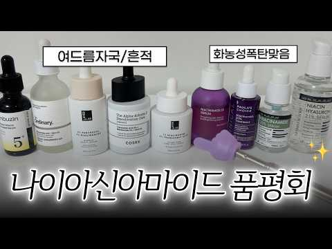
- 챕터: 0:00 나이아신아마이드 팩폭 리뷰 시작 · 0:24 레이어랩 나이아신아마이드 4% -제공받음 · 1:22 넘버즈인 5번 글루타치온 C 흔적 앰플 -내돈내산 · 2:41 코스알엑스 더 알파 알부틴 2 세럼-내돈내산-5% · 4:35 레이어랩 나이아신아마이드 7% -제공받음 · 5:16 디오디너리 나이아신아마이드 10% + 징크 1% -내… · 7:58 주미소 나이아신아마이드 20% -내돈내산 · 9:19 더마팩토리 나이아신아마이드 20%-내돈내산 · 11:35 폴라초이스 20% 나이아신아마이드 바쿠치올 탄력 포뮬… · 13:04 나이아신아마이드 올바른 선택법 및 총평
- 설명 앞부분: 색소침착이랑 피지 잡는 데 그렇게 좋다는 나이아신아마이드! 다들 하나쯤 품고 계시거나 사볼까 고민 중이셨죠? 모공은 넓고 민감한데, T존은 유분이 넘치고 볼은 또 건조한... 솔직히 다루기 정말 까다로운 제 피부를 기준으로 진짜 솔직하게 팩폭 리뷰로 털어봤어요.!!! 밀려서 버릴 뻔했던 ...ㅎ 고함량 앰플 제대로 활용하는 진짜 꿀팁부터 입문자 추천템까지 😉 나이아신아마이드는 무조건 함량이 높다고 좋은 게 절대절대 아니니까, 오늘 영상 보시고 여러분 피부 타입과 장벽 상태에 딱 맞는 제품으로 똑똑하게 골라보셨으면 좋겠어요!! 궁금…
- 같은 채널 평소 대비 ×62.9 (채널 최근 롱폼 중앙값 22,804회) · 평소 영상: 환절기에 피부뒤집어진사람? 클렌징부터 점검하세요 ∣ 민감 여드름 수부지 피부 클렌징추천!… (23,492회) / 따라하면 여드름 자국 싹 사라지는 자기 전 루틴 (22,115회)
- 대본 없음 (설명) — 음성인식이 끝나면 도입부·흐름이 들어감
- 댓글 457/457: 좋은 점 — 영상 4 · 감사·응원 24 · 더 알고 싶은 것 37 · 아쉬운 점 — 영상 1 · 반박·불만 — 의견 다름 2 · 정치·사회 0 · 경험 공유 57 · 구독·다음 기대 0
  - 좋은 점 — 영상 👍0 “좋은정보 감사합니다!! 고함량이라 몸에 쓰신다고 하셨던 제품들은 혹시 바디로션이랑 몇대몇 정도 비율로 쓰면 좋을까요??”
  - 좋은 점 — 영상 👍0 “모공,요철 도움되는 거 많이 올려주세요”
  - 감사·응원 👍3 “선생님 감사합니다”
  - 감사·응원 👍2 “ㅋㅋㅋㅋ 디오디너리 밤에만 써서 팍팍 발라도 몰랐네요 ㅋㅋㅋㅋ 감사합니다..”
  - 더 알고 싶은 것 👍201 “레티놀편도 해주세요!!”
  - 더 알고 싶은 것 👍30 “모낭염 케어 영상도 만들어주세요~!! 모낭염땜에 몇달동안 고생중이에요ㅠㅠㅠ 재발도 잘되고 재발되면 처음보다 잘 낫질 않네요ㅠㅠ(약먹고 연고 발라도..)”
  - 반박·불만 — 의견 다름 👍7 “와 나도 민감성도 아닌데 더마팩토리 20 쓰고 흰색 여드름 수백개남 ㅠㅠ 한 3일정도만에 가라앉긴 했는데 진짜 너무 놀랐음”
  - 반박·불만 — 의견 다름 👍0 “디오디너리 비추... 소량써도 밀리고 성분중에 뭐 안맞는거 있는지 모르겠는데 얘만 바르면 민감성도 아닌데 개따가움 난 갠적으로 이지앤트리꺼 제일 잘맞았음 근데 가격이 ㅈㄴ 사악해서 걍 더마팩토리 씀 내 생각엔 디오디너리는 나이아신아마이드나 징크가 문제가 아니고 부재료…”
  - 경험 공유 👍160 “디오디너리 사용법 저거 맞음ㅋㅋㅋㅋ 첨엔 때 나오는 것 같아서 이거 뭐임?? 했는데 내가 쓸 줄 모르는 거 같아서 저 방법처럼 빠르게 펴 바르고 토도도독 때리거 걍 냅두면 안밀리고 바를 수 있음ㅇㅇ”
  - 경험 공유 👍39 “헐 저도 알파알부틴 쓸때마다 여드름나서 안썼어요”

### 54. 21살 여자 배달기사 브이로그 ∣ 쿠팡 택배

- https://www.youtube.com/watch?v=v8ZObBnm9IQ · 상현2 · 구독자 10,900 · 조회수 657,171 (×60.3, 하루 7,306.8) · 좋아요 5,691 (0.9%) · 12분 · 2026-08-29 · 주제 묶음 1. 쿠팡·쇼핑 추천 · 형식 살림 브이로그·루틴 · 폴더 `W_v8ZObBnm9IQ` (웹 승인)
- 썸네일: 
- 설명 앞부분: 오랜만이에요! 최근에 일했던 배달기사 브이로그를 찍어 봤어요 곧 개강이네요 파이팅
- 대본 없음 (설명) — 음성인식이 끝나면 도입부·흐름이 들어감
- 댓글 1,498/1,498: 좋은 점 — 영상 16 · 감사·응원 103 · 더 알고 싶은 것 30 · 아쉬운 점 — 영상 2 · 반박·불만 — 의견 다름 7 · 정치·사회 1 · 경험 공유 60 · 구독·다음 기대 25
  - 좋은 점 — 영상 👍79 “개레전드 만인의 이상형상현이 떳다”
  - 좋은 점 — 영상 👍4 “상현님이랑 같은 나이인 저는 누구보다 나태하게 사는 중인데 상현님은 이 더운 날씨에도 열심히 살아가시네요.. 영상을 보면서 많이 느꼈습니다 감사합니다. 앞으로도 좋은 영상 많이 올려주시길 .!!”
  - 감사·응원 👍22 “그래 상현아 몸 조심하고 난 곧 초등학교 졸업한다 힘내라”
  - 감사·응원 👍13 “오늘의나는 어떤 핑계를 대었는지 생각하게된 영상이네요 파이팅입니댜 😊”
  - 더 알고 싶은 것 👍5 “진짜 진지하게 궁금한데 일 왜 하세요...? 인스타 보니까 팔로워도 9만이던데 저는 님보다 팔로워 더 적은데도 광고랑 공구로 한달 600이상은 벌거든요 천 이상 버실 것 같은데 그냥 일하는게 좋아서 하시는건가요”
  - 더 알고 싶은 것 👍4 “상현님이랑 같은 나이인 저는 누구보다 나태하게 사는 중인데 상현님은 이 더운 날씨에도 열심히 살아가시네요.. 영상을 보면서 많이 느꼈습니다 감사합니다. 앞으로도 좋은 영상 많이 올려주시길 .!!”
  - 아쉬운 점 — 영상 👍0 “어린 나이에 얼굴 까고 이런거 시작해서 떼돈 벌기 시작하면 지옥 시작된다. 얼굴 까고 연예인 하는 거 신중하게 하도록. 온갖 성희롱과 외모비하 인격모독 패드립 모든 걸 버텨야 하고 감내해야 함. 일반인들이 누릴 수 있는 것들을 앞으로 눈치 보면서 못하게 됨. 얼굴 이…”
  - 아쉬운 점 — 영상 👍0 “안녕하세요 ㅎㅎ 쿠팡택배일 하시느라 고생 많으시네요 ㅎ 자막이 재밌으시네요 ㅋ 그리고 일 집중하시느라 영상이 중간중간 끊기는건 어쩔수 없다고 봅니다. 그나마 자막으로 영상 끊긴다는 말씀을 써주셔서 부담이 적네요 . 더위 조심하시고 계단 내려가실때 텐션 업됐다고 폴짝폴…”
  - 반박·불만 — 의견 다름 👍1 “레전드 히키코모리가 이렇게 돌아다니면서 일하는게 쉽지 않을텐데,,,히키코모리인거 컨셉아니죠??”
  - 반박·불만 — 의견 다름 👍0 “말도 안되게 예쁜 얼굴에 성실함에 그냥 최강이네요”
  - 정치·사회 👍0 “정부가 새벽배송 막는다 던데 .,,.,. 이렇게 되면 낮에 택배 배달 하는 사람들 과로로 죽는거 아닙니까?”
  - 경험 공유 👍147 “나도 고등학교 졸업 하고 알바라는 알바는 다 했었는데 진짜 노가다 부터 가락시장 마트 배달 닥치는 대로 알바 했었는데 나이들고 보니 그시절 땀흘리며 하루 보낸 시간이 그립다는 땀흘리는 노동의 가치가 좋은거란걸 나이 들고 알게 된다는 본인 커리어에도 도움 되실꺼에요 ㅎ…”
  - 경험 공유 👍18 “저도 21살인데 아직도 시리얼을 먹으면서 휴대폰으로 카툰 네트워크를 보고 있어요.”
  - 구독·다음 기대 👍6 “7개월 후에 또 다른 영상에서 보는 게 너무 기대돼요, 성현 씨”
  - 구독·다음 기대 👍1 “정말 존경스럽습니다 9월이라 아직 더우니 무리안하시는 선에서 일하셨으면 좋겠네요 구독박고 영상보러 오겠습니다 ㅎㅇㅌ”

### 55. "인생은 한 번뿐, 내 삶에 투자하세요" 자녀 모두 독립시킨 60대 주부가 노후에 찾은 가장 효율적인 살림법

- https://www.youtube.com/watch?v=pdXYWDAYFqA · 빠삭한살림 · 구독자 18,100 · 조회수 107,122 (×5.9, 하루 11,673.2) · 좋아요 402 (0.4%) · 15.2분 · 2026-11-18 · 주제 묶음 2. 살림·주방 · 형식 살림 브이로그·루틴 · 폴더 `W_pdXYWDAYFqA` (웹 승인)
- 썸네일: 
- 챕터: 0:00 하이라이트 · 0:49 주방 · 5:55 안방 · 8:31 거실 · 10:44 옷방 · 11:37 서재 · 12:00 현관
- 설명 앞부분: 안녕하세요! 인생에 도움이 되는 다양한 살림 정보들을 빠삭하게 알려드리는 빠삭한 살림입니다!✨ 오늘은 은퇴 후 제2의 인생을 즐기며 가장 효율적인 살림을 실천하는 60대 주부의 이야기입니다. 쌓아두지 않고 바로 비워내는 주방·옷장 정리 노하우부터 플라스틱 없이 건강하게 살아가는 30년 차 살림 비결까지 지금 영상에서 확인해보세요! 타임라인◀ 영상 출연 신청 환영 👈 영상이 좋으셨다면 댓글 부탁드립니다! 💞 Music provided by 브금대통령
- 같은 채널 평소 대비 ×1.4 (채널 최근 롱폼 중앙값 76,752회) · 평소 영상: ※여름 가기전에 꼭 보세요!!※ 2026년 최신 정리 고수들의 주방 정리 BEST 5 (… (76,752회) / "미국에선 워킹맘, 한국에선 전업주부" 미국식 살림 스타일을 보여줄 47세 주부 (68,548회)
- 대본 없음 (설명) — 음성인식이 끝나면 도입부·흐름이 들어감
- 댓글 20/20: 좋은 점 — 영상 0 · 감사·응원 0 · 더 알고 싶은 것 0 · 아쉬운 점 — 영상 0 · 반박·불만 — 의견 다름 0 · 정치·사회 0 · 경험 공유 3 · 구독·다음 기대 0
  - 경험 공유 👍8 “보면서 저도 사연자님처럼 편안하고 여유롭게 늙어가고 싶어지네요~ 또한 강아지를 많이 생각하고 사랑하시게 느껴져서 보는 내내 흐뭇했어요^^ 행복하세요~”
  - 경험 공유 👍3 “인상도 좋으시고 목소리도 너무 평안하네요. 저도 60대에 저렇게 살수 있으면 좋겠다 싶어요.”

### 56. 다이소가 손해 보고 파는 게 분명하다는 가성비 다이소 추천템

- https://www.youtube.com/watch?v=H4t5HC-mW4o · 엔젤카페 · 구독자 5,190 · 조회수 251,416 (×48.4, 하루 3,226.3) · 좋아요 739 (0.3%) · 18.9분 · 2026-09-10 · 주제 묶음 1. 쿠팡·쇼핑 추천 · 형식 목록형 (N가지 추천템) · 폴더 `W_H4t5HC-mW4o` (웹 승인)
- 썸네일: 
- 설명 앞부분: 다이소에서 사용해보고 괜찮았던 제품들을 리뷰했습니다 깔끔하게 나오는 소스병 품번 : 1069489/1000원 스텐바트2L 품번 : 1046177 / 5000원 사생활보호 강화유리 필름 품번 : 1072442 / 2000원 폼타입 매직크리너 품번 : 1025197 / 3000원 스테인리스 다용도 꽂이 품번 : 1076527 / 2000원 테일리콤마 헤어퍼퓸 품번 : 1070007 / 3000원 실리콘다용도 뚜껑 품번 : 1051807 / 5000원 접이식 테이
- 같은 채널 평소 대비 ×4.6 (채널 최근 롱폼 중앙값 55,217회) · 평소 영상: 다이소 보이면 집어야 하는 갓성비 꿀템∣ 없어지기 전에 당장 사야 할 다이소 추천템 (57,597회) / 다이소가 작정하고 만든 백화점 퀼리티 뽐내는 추천템들 (52,837회)
- 대본 없음 (설명) — 음성인식이 끝나면 도입부·흐름이 들어감
- 댓글 18/18: 좋은 점 — 영상 0 · 감사·응원 1 · 더 알고 싶은 것 0 · 아쉬운 점 — 영상 0 · 반박·불만 — 의견 다름 0 · 정치·사회 0 · 경험 공유 0 · 구독·다음 기대 0
  - 감사·응원 👍3 “오밀조밀, 잘 듣고 구경 재미있네요 메모 했다가 다이소가면 구입예정, 엔젤스님 덕분에 아이 쇼핑 감사해요 *”

### 57. 주부들의 환호성! 집안 살림 피로도 절반으로 줄여주는 다이소 역대급 꿀템모음 ∣ 품절대란 ∣ 다이소추천템 ∣ 내돈내산

- https://www.youtube.com/watch?v=vS3O_PweBPE · 이참에 살림 · 구독자 8,020 · 조회수 425,637 (×53.1, 하루 4,636.6) · 좋아요 1,044 (0.2%) · 8.2분 · 2026-08-27 · 주제 묶음 1. 쿠팡·쇼핑 추천 · 형식 직접 써 본 후기 (내돈내산·N개월 사용) · 폴더 `W_vS3O_PweBPE` (웹 승인)
- 썸네일: 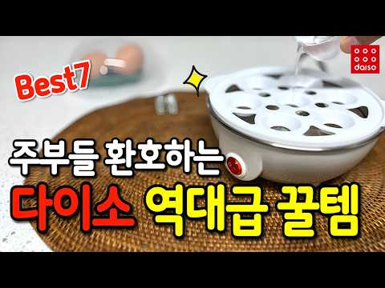
- 챕터: 0:00 이참에 살림입니다. · 0:08 [열탕 소독] 슬라이드 실리콘 지퍼백 1.5 L NE… · 1:22 실리콘 손잡이 스텐 304 서빙 국자 ∣ 품번: 10… · 2:35 전기 계란 찜기 7구 NEW ∣ 품번: 1069307… · 3:49 조립식 2단 선반 ∣ 품번: 1078610 / 5,0… · 4:46 헬로베어 알카라인 건전지 LR6 AA 4개입 ∣ 품번… · 5:41 슈프림골드 커피믹스 ∣ 품번: 103700304 / … · 6:38 로봇 청소기용 세제 ∣ 품번: 1051459 / 3,… · 7:41 시청해 주셔서 감사합니다!
- 설명 앞부분: 🎙️ 비싼 브랜드 긴장시키는 다이소 주방 신상템과 재입고된 생활 꿀템 모음 ↓ ↓ ↓ 영상 속 다이소 제품 정보 ↓ ↓ ↓ 오늘 하루도 시원하고 편안하게 보내시길 바랍니다. 📢 안내 사항 채널에 일정액의 수수료가 제공됩니다.
- 대본 없음 (설명) — 음성인식이 끝나면 도입부·흐름이 들어감
- 댓글 29/29: 좋은 점 — 영상 1 · 감사·응원 2 · 더 알고 싶은 것 0 · 아쉬운 점 — 영상 0 · 반박·불만 — 의견 다름 0 · 정치·사회 0 · 경험 공유 0 · 구독·다음 기대 0
  - 감사·응원 👍1 “감사합니다^^”

### 58. 다이소 꿀템 아이디어 공구? 싹 다 털어와봤습니다

- https://www.youtube.com/watch?v=WZ4_4Em4jVA · 공구로운생활 · 구독자 13,000 · 조회수 698,041 (×53.7, 하루 7,134.1) · 좋아요 2,370 (0.3%) · 23.8분 · 2026-08-21 · 주제 묶음 4. 다이소·가성비 · 형식 하울·언박싱 · 폴더 `W_WZ4_4Em4jVA` (웹 승인)
- 썸네일: 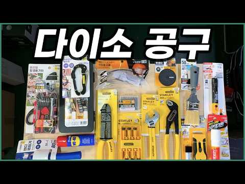
- 챕터: 0:00 인트로 · 0:23 분리형 칼 겸용 가위 · 1:11 카라비너 멀티툴 · 2:27 만능 렌치 · 3:38 전자제품용 공구 세트 · 4:46 나사 제거비트 · 5:49 각도 조절 브러쉬 · 6:53 콘센트 청소솔 · 7:56 자석 못 홀더 · 9:04 자석 못 접시 · 10:00 전동 드라이버 비트 10종 · 11:00 슬라이드 스크래퍼 · 12:22 스티커 제거펜 · 12:56 커터칼 마카 · 14:05 열수축 튜브 · 14:49 핸디 랩핑기 · 15:55 틈새 메꾸미 · 16:42 WD-40 방청 윤활제 · 17:58 스탠리 수공구 4종 · 19:33 원터치 수납함 2종
- 설명 앞부분: 다이소몰 안녕하세요. 공생입니다!👋 작년에 다이소 공구를 싹 다 털어서 추천해봤는데요!! 올해도 한번 털어와봤습니다! (동네 다이소, 스타필드 다이소, 백화점 다이소 등등) 다이소 이제 예전같지 않습니다... 진짜 공구 종류 다양해졌고 트렌드도 정말 빠르고, 이제 다이소에서 모든 공구는 다 살 수 있을 것 같아요! 니퍼..펜치..롱노즈 이런 건 뺐구요 (뭐.. 워낙 종류가 많으니까요..!) 시청자 분들께 도움이 되실 만한 다이소 꿀템, 다이소 추천템, 아이디어 공구, 생활템 등을 한번 골라와봤거든요?? 기술자 분들, 초보자 분들 …
- 같은 채널 평소 대비 ×319.3 (채널 최근 롱폼 중앙값 2,186회) · 평소 영상: 카센터 말고 집에서 넣으세요 (2,186회) / 이번 여름 폭염 떙볕 이거 입으면 끝납니다 (2,614회)
- 대본 없음 (설명) — 음성인식이 끝나면 도입부·흐름이 들어감
- 댓글 108/108: 좋은 점 — 영상 3 · 감사·응원 3 · 더 알고 싶은 것 5 · 아쉬운 점 — 영상 2 · 반박·불만 — 의견 다름 0 · 정치·사회 0 · 경험 공유 2 · 구독·다음 기대 1
  - 좋은 점 — 영상 👍6 “다이소에 이렇게 다양한 아이디어 공구들이 있는지 몰랐는데 한눈에 볼 수 있어서 유익했습니다”
  - 좋은 점 — 영상 👍1 “우와..이 유튜브..정말 좋은 방송이네요...무슨 용도인줄 몰라서도 못샀었는데...많은 도움이 되었습니다...자주 들리겠습니다..감사합니다.”
  - 감사·응원 👍1 “우와..이 유튜브..정말 좋은 방송이네요...무슨 용도인줄 몰라서도 못샀었는데...많은 도움이 되었습니다...자주 들리겠습니다..감사합니다.”
  - 감사·응원 👍1 “돈 많이 쓰셨내요 ㅡ감사”
  - 더 알고 싶은 것 👍3 “휴대폰배터리 갈려고 킷트 사면 포함되어 있는게 흡착판 프라스틱헤라. 드라이버 등등인데 흡착판은 휴대폰 뜯을때 쓰는겁니다. 저희동네는 스탠리 첼라만 있던데 보니까 메이드인 인도고..전부다 이빨아구가 비뜰어져서 안맞더라구요 다이소 멍키스페너 사본적 있는데 앙카 몇개 조으…”
  - 더 알고 싶은 것 👍2 “뭐있는지는 사실 큰 지점 가서 한번 쓱 둘러보면 아는거다보니 실제로 테스트를 해보는걸 컨텐츠로 만들어주시면 꽤 인기있지 않을까 합니다.”
  - 아쉬운 점 — 영상 👍4 “칸막이 공구함 - 낚시”
  - 아쉬운 점 — 영상 👍2 “낚시 통”
  - 경험 공유 👍3 “휴대폰배터리 갈려고 킷트 사면 포함되어 있는게 흡착판 프라스틱헤라. 드라이버 등등인데 흡착판은 휴대폰 뜯을때 쓰는겁니다. 저희동네는 스탠리 첼라만 있던데 보니까 메이드인 인도고..전부다 이빨아구가 비뜰어져서 안맞더라구요 다이소 멍키스페너 사본적 있는데 앙카 몇개 조으…”
  - 경험 공유 👍0 “제발 중국 공구는 사용하지 마세요 열에 아홉은 다칩니다 나도 기술직으로 공구를 많이 사용하는데 중국 공구는 썩은 고철입니다”
  - 구독·다음 기대 👍3 “휴대폰배터리 갈려고 킷트 사면 포함되어 있는게 흡착판 프라스틱헤라. 드라이버 등등인데 흡착판은 휴대폰 뜯을때 쓰는겁니다. 저희동네는 스탠리 첼라만 있던데 보니까 메이드인 인도고..전부다 이빨아구가 비뜰어져서 안맞더라구요 다이소 멍키스페너 사본적 있는데 앙카 몇개 조으…”

### 59. 다이소 맥세이프 케이스, 같은 제조사인데 쿠팡보다 3배 저렴한 이유

- https://www.youtube.com/watch?v=3uJTRqhq80k · 꿀템리뷰_허니쵸이 · 구독자 5,110 · 조회수 381,633 (×74.7, 하루 2,607.0) · 좋아요 1,860 (0.5%) · 10.1분 · 2026-07-03 · 주제 묶음 4. 다이소·가성비 · 형식 비교 (vs·차이·순위) · 폴더 `W_3uJTRqhq80k` (웹 승인)
- 썸네일: 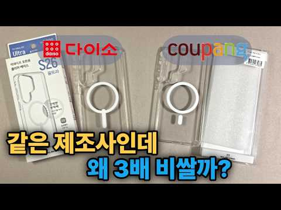
- 챕터: 0:00 다이소 맥세이프 케이스 vs 쿠팡 케이스 · 0:45 갤럭시 S26 울트라 케이스 비교 · 2:23 두께·무게 측정 · 2:59 버튼감 비교 · 3:14 맥세이프 자석 비교 · 3:51 자력 테스트 · 5:28 Qi2 초고속 무선충전 테스트 · 6:39 차량용 맥세이프 충전기 비교 · 7:10 초고속 무선충전이 안 되는 이유? · 8:17 총평 및 추천
- 설명 앞부분: 같은 제조사에서 만든 맥세이프 케이스인데 가격은 3배 가까이 차이가 난다면 어떤 제품을 선택하시겠습니까? 이번 영상에서는 다이소에서 판매하는 3천 원 맥세이프 케이스와 쿠팡에서 판매하는 모란카노 퓨어쉴드 케이스를 직접 구매해 비교했습니다. 사용한 기기는 갤럭시 S26 울트라이며, 외관과 두께, 무게, 버튼감은 물론 자력과 무선충전 성능까지 하나씩 직접 테스트했습니다. 특히 갤럭시 S26 울트라 사용자라면 가장 궁금해하실 초고속 무선충전과 맥세이프 자력 차이도 실제 측정을 통해 확인했습니다. 결과는 예상과 조금 달랐습니다. 과연 다…
- 같은 채널 평소 대비 ×38.3 (채널 최근 롱폼 중앙값 9,970회) · 평소 영상: 컴퓨터선정리 종결 가이드 ∣ 다이소 선정리 꿀템으로 10분 컷 (10,314회) / s26울트라 초고속충전 3.0인데 60와트 안뜨는 이유? ∣ PPS충전, 60와트충전, … (9,627회)
- 대본 없음 (설명) — 음성인식이 끝나면 도입부·흐름이 들어감
- 댓글 297/297: 좋은 점 — 영상 4 · 감사·응원 8 · 더 알고 싶은 것 4 · 아쉬운 점 — 영상 2 · 반박·불만 — 의견 다름 0 · 정치·사회 0 · 경험 공유 7 · 구독·다음 기대 0
  - 좋은 점 — 영상 👍4 “좋은 내용입니다”
  - 좋은 점 — 영상 👍3 “꼭 비싼제품이 아니라 이런 사소한 제품들의 비교 테스트 영상도 너무 유익한거 같아요”
  - 감사·응원 👍39 “아주 좋은 컨텐츠네요. 고맙습니다.”
  - 감사·응원 👍14 “감사합니다 궁금햇었는데 다이소가 가성비는 최고네요-!”
  - 더 알고 싶은 것 👍2 “폴드 모델꺼도 부탁드립니다. 전 폴드6 사용중인데 s펜수납까지 되는 모델을 쓰고잇고 차량거치대에 거치시 접업을때는 괜찮은데 펼쳣을때 한쪽으로 돌아가버리는데 어떤 상품을 써야되는지 비교좀 부탁합니다. 충전속도도 부탁드려여. 감사합니다 😂”
  - 더 알고 싶은 것 👍1 “일단 배송 배송비 차이는 나고. 매입수량. 재고 관리등 기타 비용들 차이가 있죠. 실제 물건들 공장 원가와 그다음 물류, 재고, 수량. 마케팅, 브랜딩에서 가격이 달라지짐. 같은 명품장인이 만들지만 가격차이는 몇배씩 나는 이유도 그러함. 그로인해 다이소라고 안좋은 제…”
  - 아쉬운 점 — 영상 👍0 “영상은 4k 고화질로 신경 좀 쓰신거 같은데 음성 녹음은 크게 신경 안쓰시는거 같습니다 L에서 마이크노이즈 찢어지는 소리 간헐적으로 계속 들립니다 앞으로 제작하실 때 신경 좀 써주시길요 ^^”
  - 아쉬운 점 — 영상 👍0 “비교군이 1개라서 아쉽네요 적어도 5섯개씩은 해주셔야 신뢰감이...”
  - 경험 공유 👍13 “와, 꼼꼼한 실험과 비교! 다이소 정말 가성비 좋으네여. 저도 다이소로 갑니다~~”
  - 경험 공유 👍1 “쿠팡이 비싼게 아니라 다이소가 싼거임 다이소는 생태계교란범같은 존재임 나도 폰케이스 장사했었는데 다이소 생긴뒤로 망함 우린 천원에 띄여와서 2천원에 팔아야 가게유지가되는데 다이소는 바로 천원에 팜 대기업이 자영업자들 다죽인거임 요즘 폰케이스 가게 본적있음? 요즘 악세…”

### 60. 삼겹살을 이렇게 요리해 보셨나요? 그것을 사서 전자레인지에 넣어보세요! 5분 만에 식당보다 맛있는 보약 반찬이 됩니다!!

- https://www.youtube.com/watch?v=AaQksKzYIqg ·  매일매일 살림 꿀팁 · 구독자 6,030 · 조회수 355,791 (×59.0, 하루 3,007.5) · 좋아요 3,831 (1.1%) · 10.7분 · 2026-07-31 · 주제 묶음 7. 가전 · 형식 정보·해설 (그 밖) · 폴더 `W_AaQksKzYIqg` (웹 승인)
- 썸네일: 
- 챕터: 0:00 [도입] 기름 튐 제로! 전자레인지 5분 삼겹살 구이… · 1:23 [본론] 잡내는 싹, 감칠맛 폭발! '된장 코팅' 마… · 8:20 [결론] 남은 삼겹살 200% 활용 요리 꿀팁 및 핵…
- 설명 앞부분: 삼겹살을 이렇게 요리해 보셨나요? 그것을 사서 전자레인지에 넣어보세요! 5분 만에 식당보다 맛있는 보약 반찬이 됩니다!! 삼겹살을 매번 프라이팬에 구우셨나요? 오늘부터는 전자레인지에 넣어 보세요. 기름 한 방울 쓰지 않고 된장 하나만 더했을 뿐인데, 5분 만에 잡내는 싹 사라지고 식당보다 깊고 건강한 맛이 완성됩니다. 불 앞에 서서 땀 흘릴 필요 없이 누구나 쉽게 따라 하실 수 있는 진짜 보약 반찬입니다. 오늘 영상에서는 된장 삼겹살 전자레인지 요리의 핵심 원리부터 잡내 잡는 비법, 황금 조리 시간, 그리고 밥에 비벼 먹고 쌈으로…
- 같은 채널 평소 대비 ×1,702.3 (채널 최근 롱폼 중앙값 209회) · 평소 영상: 수육 2시간 삶으셨죠? 전자레인지 '이 버튼' 하나면 15분 만에 식당 수육보다 부드럽게… (209회) / 대파 뿌리 절대 버리지 마세요! 유리컵에 물만 부으면 평생 대파 공짜로 먹습니다!! (209회)
- 대본 없음 (설명) — 음성인식이 끝나면 도입부·흐름이 들어감
- 댓글 108/108: 좋은 점 — 영상 4 · 감사·응원 6 · 더 알고 싶은 것 2 · 아쉬운 점 — 영상 2 · 반박·불만 — 의견 다름 1 · 정치·사회 0 · 경험 공유 3 · 구독·다음 기대 1
  - 좋은 점 — 영상 👍8 “요리에 문외한인데 잘배워갑니다~^^ 삼겹살!”
  - 좋은 점 — 영상 👍1 “돼지삼겹살 전자렌지 요리 신기하고 잘배워 갑니다”
  - 감사·응원 👍1 “1인방송국 개국했으니 축하합니다 풀시청하고갑니다 응원합니다 짝짝짝 3종셋트 다주고가요”
  - 감사·응원 👍1 “샬롬!좋은성보감사드립니다늘건강하시고화이팅하세요😂❤😂”
  - 더 알고 싶은 것 👍0 “좋은 요리법 알려 주시는 건 감사드리지만 괜히 우리나라 사람들이 보는 영상에 맞춤법 틀린 한글을 써 넣으시는지 궁금하네요. 다음부터는 자막을 넣지 말든지 재차 점검해서 넣어 주시기 바랍니다. 감사히 잘 봤습니다.”
  - 더 알고 싶은 것 👍0 “와 이 방법 진짜 대박이다 5분에 식당급 맛이라니 궁금해요! 🔥”
  - 아쉬운 점 — 영상 👍1 “서론이너무길어요”
  - 아쉬운 점 — 영상 👍0 “헛소리너무길다”
  - 반박·불만 — 의견 다름 👍0 “헛소리너무길다”
  - 경험 공유 👍1 “나도해봐야지요”
  - 경험 공유 👍1 “나도해먹어야지 삼겹살”
  - 구독·다음 기대 👍3 “삼겹살 요리 영상 중에 이렇게 실용적인 팁은 처음이라 반가워요. 다른 재료로도 실험해보길 기대합니다! 🔥”

### 61. 60대 패딩, '이 색' 절대 사지 마세요｜얼굴 10년 젊어지는 색은 따로 있습니다#60대패션 #중년패션 #50대패션 #중장년패션

- https://www.youtube.com/watch?v=FIeEVlz-M6s · 센스쟁이 언니네 · 구독자 18,200 · 조회수 190,178 (×10.4, 하루 8,656.9) · 좋아요 653 (0.3%) · 15.3분 · 2026-11-05 · 주제 묶음 6. 4050 패션 · 형식 경고형 (사지 마세요·실패템) · 폴더 `W_FIeEVlz-M6s` (웹 승인)
- 썸네일: 
- 설명 앞부분: "본 영상은 센스쟁이 언니네의 전문적인 패션 큐레이션을 바탕으로, 시청자분들께 보다 생생한 스타일링 예시를 보여드리기 위해 AI 기술을 활용하여 제작되었습니다. 늘 언니들의 아름다운 도전을 응원합니다! 💖" © All Rights Reserved by 센스쟁이 언니네 © Copyright by 센스쟁이 언니네
- 같은 채널 평소 대비 ×25.2 (채널 최근 롱폼 중앙값 7,561회) · 평소 영상: 60대이상 다가오는 한파 추위에 무조건 이런 패딩 입으세요 #한파 #60대패션 #중년패션… (7,561회) / 60대이상 올겨울 검정외투, 이렇게 입으면 귀티나요 #60대패션 #중년패션 #50대패션 … (7,299회)
- 대본 없음 (설명) — 음성인식이 끝나면 도입부·흐름이 들어감
- 댓글 15/15: 좋은 점 — 영상 2 · 감사·응원 4 · 더 알고 싶은 것 1 · 아쉬운 점 — 영상 0 · 반박·불만 — 의견 다름 0 · 정치·사회 0 · 경험 공유 1 · 구독·다음 기대 0
  - 좋은 점 — 영상 👍6 “패딩은 디자인뿐 아니라 색상 선택도 정말 중요하네요! 얼굴빛을 화사하게 살려주는 색상 팁, 잘 배우고 갑니다. 감사합니다! 😊💕”
  - 좋은 점 — 영상 👍0 “검정 패딩만 입었는데 색 하나로 이렇게 분위기가 달라질 수 있다니 놀랍네요! 😊 특히 초콜릿 브라운과 카멜 베이지 코디가 마음에 들어요. 나이가 들수록 나를 감추기보다 밝혀 주는 옷을 입어야 한다는 말이 참 와닿습니다. 좋은 정보 감사합니다! ❤”
  - 감사·응원 👍6 “패딩은 디자인뿐 아니라 색상 선택도 정말 중요하네요! 얼굴빛을 화사하게 살려주는 색상 팁, 잘 배우고 갑니다. 감사합니다! 😊💕”
  - 감사·응원 👍0 “감사드립니다.”
  - 더 알고 싶은 것 👍1 “나이는 58 머리색은 밝은 갈색. 얼굴에 살이 없고 저체중입니다. 상체에 특히 살이 없어요. 키156 체중 44,2키로그램. 당연하게 블랙컬러만 입었는대 설명 듣고보니 제가 잘못선택했대요. 피드백 부탁드립니다.”
  - 경험 공유 👍1 “나이는 58 머리색은 밝은 갈색. 얼굴에 살이 없고 저체중입니다. 상체에 특히 살이 없어요. 키156 체중 44,2키로그램. 당연하게 블랙컬러만 입었는대 설명 듣고보니 제가 잘못선택했대요. 피드백 부탁드립니다.”

### 62. EP.8 셰프가 소개하는 주방 필수템

- https://www.youtube.com/watch?v=BDNnEh5Olmo · 안삐딱한 찬양이 · 구독자 3,760 · 조회수 121,818 (×32.4, 하루 1,718.5) · 좋아요 491 (0.4%) · 18.2분 · 2026-09-17 · 주제 묶음 1. 쿠팡·쇼핑 추천 · 형식 목록형 (N가지 추천템) · 폴더 `W_BDNnEh5Olmo` (웹 승인)
- 썸네일: 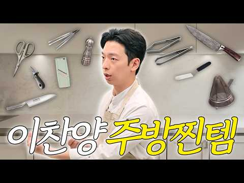
- 설명 앞부분: 오늘은 제가 사용하는, 없어서는 안 될 주방 도구를 소개합니다 가정용에서도 쓰면 좋을 추천템도 있으니까 끝까지 봐주세요!
- 같은 채널 평소 대비 ×9.5 (채널 최근 롱폼 중앙값 12,878회) · 평소 영상: EP.15 흑백요리사까지 나갔는데 AI한테 요리로 혼났습니다 (12,878회) / EP.12 하라는대로 했을 뿐인데 서로 답답한 상황의 연속.. 도대체 누가 잘못한 걸까?… (15,067회)
- 대본 없음 (설명) — 음성인식이 끝나면 도입부·흐름이 들어감
- 댓글 32/32: 좋은 점 — 영상 1 · 감사·응원 0 · 더 알고 싶은 것 4 · 아쉬운 점 — 영상 0 · 반박·불만 — 의견 다름 0 · 정치·사회 0 · 경험 공유 2 · 구독·다음 기대 0
  - 좋은 점 — 영상 👍0 “오 시누아 이름 유래 뭔가 먼나라이웃나라에서 배우는 거 같은 유익함이었다 좋았다”
  - 더 알고 싶은 것 👍1 “후라이팬이나 냄비 등 스테인레스 제품도 설명해주세요😮”
  - 더 알고 싶은 것 👍0 “스패츌러 처음 프랑스꺼는 어떤건가요?”
  - 경험 공유 👍3 “채칼 저도 최근에 구입했는데, 진짜 좋아요”
  - 경험 공유 👍2 “8:50 푸조 페퍼밀 저게 좋은 이유는 유일하기 때문입니다. 후추를 갈아내는 밑에 그라인더 부분도 스텐으로 되어있어요. 전동이든 뭐든 다른 회사 페퍼밀 제품은 전부 그라인더가 세라믹으로 되어있고 플라스틱으로 되어있는것도 있습니다. 그냥 찝찝한데.. 푸조껀 그것마저도 …”

### 63. 2026 실패없는 이케아 베스트 추천템 40가지⭐ ∣ 가구부터 주방템, 일상소품까지✍🏻 ∣ IKEA

- https://www.youtube.com/watch?v=ACozRh9VCK0 · 쑴라이프_똑똑한 살림로그 · 구독자 16,900 · 조회수 217,639 (×12.9, 하루 7,545.5) · 좋아요 679 (0.3%) · 16.5분 · 2026-10-29 · 주제 묶음 1. 쿠팡·쇼핑 추천 · 형식 하울·언박싱 · 폴더 `W_ACozRh9VCK0` (웹 승인)
- 썸네일: 
- 챕터: 0:00 Start · 1:06 스테게순드 선반유닛 · 1:25 IKEA PS 2026 트롤리 · 1:59 IKEA PS 2026 접이식의자 · 2:15 IKEA PS 2026수납장 · 2:46 STOCKHOLM 2025 미닫이수납장 · 3:10 IKEA PS 2026 5단 후크랙 · 3:28 IKEA PS 2026 상향식플로어스탠드 · 3:38 푀르셀리아레 다용도 수납장 · 3:56 쇠데르함 소파 · 5:56 예테보 소파 · 6:14 빔레 소파 · 6:31 살트셰바덴 소파 · 7:32 회스타길레 그릇+뚜껑 · 7:55 아프톤하이 서빙볼 스테인리스 · 8:07 놀블레카 주방조리대 정리용품 · 8:24 외켄마르스빈 알람시계 · 8:34 셰르송아레 알람시계 · 8:46 플로드크레프타 시계 · 9:00 팡닝 파일꽂이
- 설명 앞부분: 오랜만에 이케아에 다녀왔습니다!✌🏻 '쑴라이프' 하면 이케아 추천템인데🤣 올해는 출산과 육아로 정신없는 시간을 보내다보니 이케아 구경간다는 건 정말 꿈도 꿀 수 없는 일이었어요..🥹 그러다 최근에 이케아 광명점에 볼일이 있어서 갔다가 오랜만에 매장 구경도 싹 하고 왔습니다❤ 너무나 괜찮았던 2026 신상부터 장바구니에 담아온 꿀템들까지 모두 모아서 영상에 담아봤어요 이케아 쇼핑 가시기 전에 도움이 되시길 바래요! 오늘도 즐거운 하루 보내세요⭐ 💟집밥러의 새벽배송 맛도리템 모음💟 🎥영상 속 제품정보 79,900원 79,900원 79…
- 같은 채널 평소 대비 ×19.7 (채널 최근 롱폼 중앙값 11,057회) · 평소 영상: 다이소에서 발견한 삶의 질 상승템 12가지✨│ 다이소 방문 전 필수시청│ 고퀄리티 다이소… (11,404회) / 보이면 무조건 사세요! 다이소 고퀄리티 품절대란템 13가지 │ 다이소 가기 전 필수시청🛒… (10,710회)
- 대본 없음 (설명) — 음성인식이 끝나면 도입부·흐름이 들어감
- 댓글 21/21: 좋은 점 — 영상 1 · 감사·응원 2 · 더 알고 싶은 것 0 · 아쉬운 점 — 영상 0 · 반박·불만 — 의견 다름 0 · 정치·사회 0 · 경험 공유 1 · 구독·다음 기대 0
  - 좋은 점 — 영상 👍14 “이렇게 정성스럽고 솔직한 리뷰 오랜만이라 댓글 남겨요! 마음에 상처주는 댓글이 많은데 신경쓰지 마세요. 좋은 영상 감사합니다”
  - 감사·응원 👍14 “이렇게 정성스럽고 솔직한 리뷰 오랜만이라 댓글 남겨요! 마음에 상처주는 댓글이 많은데 신경쓰지 마세요. 좋은 영상 감사합니다”
  - 감사·응원 👍1 “오호 유리컵이랑 키친크로스 너무 좋아보이는데요? 구경하러 이케아 사부작사부작 가보아야겠어요ㅋㅋ 정보 감사합니다❤”
  - 경험 공유 👍1 “저도 최근에 다녀와서 그런가 익숙한 제품 보니까 반갑네요 ㅎㅎ 좋은 리뷰 잘 보구 갑니다!”

### 64. [아일릿] 원희의 꿀템 소개 ∣ 다시 돌아온 실바니안 깡🐰∣ 원희가 발견한 스킨케어 팁💥

- https://www.youtube.com/watch?v=kQRPpzNiNjE · roro · 구독자 11,400 · 조회수 401,550 (×35.2, 하루 4,553.9) · 좋아요 5,956 (1.5%) · 7.8분 · 2026-08-31 · 주제 묶음 5. 4050 뷰티 · 형식 목록형 (N가지 추천템) · 폴더 `W_kQRPpzNiNjE` (웹 승인)
- 썸네일: 
- 설명 앞부분: 🎵bgm: 오레 ore
- 같은 채널 평소 대비 ×10.6 (채널 최근 롱폼 중앙값 37,714회) · 평소 영상: [아일릿] 원희의 수능 응원 ∣ 원희템 정보💫 ∣ 딸기 찹쌀떡이 된 원희...?🍓 (37,714회) / [아일릿] 원희의 생새우 먹🍞 asmr...(?) (50,853회)
- 대본 없음 (설명) — 음성인식이 끝나면 도입부·흐름이 들어감
- 댓글 54/54: 좋은 점 — 영상 0 · 감사·응원 2 · 더 알고 싶은 것 1 · 아쉬운 점 — 영상 0 · 반박·불만 — 의견 다름 0 · 정치·사회 0 · 경험 공유 1 · 구독·다음 기대 0
  - 감사·응원 👍4 “현생에 치여서 다 못보는데 이렇게 편집해주셔서 감사해요!!”
  - 경험 공유 👍1 “와 저 라방 저도 봤는데!!”

### 65. 3,000원짜리 다이소 신상 필사노트?! 일본산 내지라는데.. 만년필로 써봤습니다.

- https://www.youtube.com/watch?v=f1Ophmy60RQ · 펜조이 PenJoy | 아날로그 전도사 · 구독자 21,100 · 조회수 428,784 (×20.3, 하루 7,945.3) · 좋아요 1,126 (0.3%) · 7.6분 · 2026-10-04 · 주제 묶음 4. 다이소·가성비 · 형식 정보·해설 (그 밖) · 폴더 `W_f1Ophmy60RQ` (웹 승인)
- 썸네일: 
- 챕터: 0:00 인트로 · 0:22 스펙 확인 · 1:20 필기 테스트 · 2:04 일본제 B6 노트패드 · 2:53 데님 필사노트 · 3:41 말랑 노트 · 4:28 한솔제지 B5 노트 · 5:21 잉크 발색 테스트 (토모에리버, 로디아) · 5:53 잉크 뒷비침 & 번짐 · 6:40 아웃트로
- 설명 앞부분: 만년필 그림이 그려져있는 3천원짜리 일본산 내지의 다이소 필사노트..?! 바로 써봤습니다!
- 같은 채널 평소 대비 ×8.4 (채널 최근 롱폼 중앙값 51,016회) · 평소 영상: 🇰🇷 국산 펜이 이렇게 좋았어!? 당신이 모르는 K-볼펜 9가지 🇰🇷 (51,131회) / 너무 실용적이라 재구매할 수밖에 없었던 10만원대 금닙 만년필 (50,902회)
- 대본 없음 (설명) — 음성인식이 끝나면 도입부·흐름이 들어감
- 댓글 55/55: 좋은 점 — 영상 2 · 감사·응원 4 · 더 알고 싶은 것 0 · 아쉬운 점 — 영상 2 · 반박·불만 — 의견 다름 0 · 정치·사회 0 · 경험 공유 4 · 구독·다음 기대 0
  - 감사·응원 👍0 “이번에 쇼메가 우승 해줬으면, 구마유시 한화도 좋아. T1? 오케이 그것도 좋아. 쵸비요? 우승해야죠. 난 한팀만 응원했는데 요즘은 다 응원함. 우승해야할 이유로 꽉차버림.”
  - 아쉬운 점 — 영상 👍9 “인조가죽은 오래두면 분해돼서 떨어지지 않나요? 그냥 종이나 플라스틱 커버였으면 구매했을텐데 아쉽네요.”
  - 아쉬운 점 — 영상 👍1 “다이소마다 다 가봤는데 B6 일제 노트패드는 이제 어디에도 없더라고요. 써보고 싶은데 아쉽습니다.”
  - 경험 공유 👍0 “앗 저도 이거 쟁겼어요 ^^ 히힛”

### 66. 다이소 매번 갈 때마다 놀라운 - 이번 주에도 놀랄만한 꿀템이 한가득 - 하지만 늦으면 또 없는 다이소추천템 10가지!!!

- https://www.youtube.com/watch?v=xXtg4ph4B-g · 소비일상  · 구독자 20,100 · 조회수 394,450 (×19.6, 하루 7,063.5) · 좋아요 1,030 (0.3%) · 8.8분 · 2026-10-02 · 주제 묶음 1. 쿠팡·쇼핑 추천 · 형식 살림 브이로그·루틴 · 폴더 `W_xXtg4ph4B-g` (웹 승인)
- 썸네일: 
- 챕터: 0:00 인트로 · 0:30 접이식 비닐봉투 걸이 · 1:18 회전형 다용도 미용 정리함 · 2:03 스탠딩 세탁바구니 · 2:44 조립식 청소거치대 · 3:35 대형 분무 가습기 1.5L · 4:10 화이트 접시건조대 · 4:49 확장형 6단 정리대 · 5:38 스테인리스 304 스프링 유청 분리기 440ml · 6:30 C to C 충전 케이블 릴 타입 1 m · 7:17 맥세이프 호환용 원형 패브릭 무선 스피커 블랙 · 8:01 캡처타임 / 엔딩
- 설명 앞부분: 안녕하세요 소비일상입니다. 다이소는 갈 때마다 새로운 제품들이 정말 많이 보이는데요. 최근에는 단순히 가격만 저렴한 제품보다 작은 아이디어 하나를 더해서 생활 속 불편함을 해결해주는 제품들이 꽤 많더라고요. 그래서 오늘은 최근 다이소에서 발견한 제품 중 직접 사용해보고 소개해드리고 싶었던 생활용품 10가지를 준비했으니 오늘 영상도 끝까지 시청 부탁 드립니다. 💡다른 꿀템 더 보러 가기💡 ⏱️ 타임라인 🛒 제품 정보 1️⃣ 접이식 비닐봉투 걸이 💰 2,000원 / 📌품번 1063377 2️⃣ 회전형 다용도 미용 정리함 💰 5,000…
- 같은 채널 평소 대비 ×10.6 (채널 최근 롱폼 중앙값 37,381회) · 평소 영상: 다이소 매번 갈 때마다 새로운- 이번 주에도 의외의 꿀템이 한가득 - 하지만 늦으면 또 … (37,381회) / 다이소에 드디어 나왔습니다! 보이면 무조건 담아야 할 품절대란 꿀템 25가지 (50,895회)
- 대본 없음 (설명) — 음성인식이 끝나면 도입부·흐름이 들어감
- 댓글 32/32: 좋은 점 — 영상 0 · 감사·응원 0 · 더 알고 싶은 것 0 · 아쉬운 점 — 영상 1 · 반박·불만 — 의견 다름 0 · 정치·사회 0 · 경험 공유 0 · 구독·다음 기대 0

### 67. 코스트코 장보고 소분하기, 알뜰하게 활용하는 아침밥 브이로그 ∣ 코스트코 추천템

- https://www.youtube.com/watch?v=t0kum24H-_w · 돌돌이네 Doldol's  · 구독자 15,500 · 조회수 160,303 (×10.3, 하루 5,366.3) · 좋아요 683 (0.4%) · 33.3분 · 2026-10-28 · 주제 묶음 4. 다이소·가성비 · 형식 하울·언박싱 · 폴더 `W_t0kum24H-_w` (웹 승인)
- 썸네일: 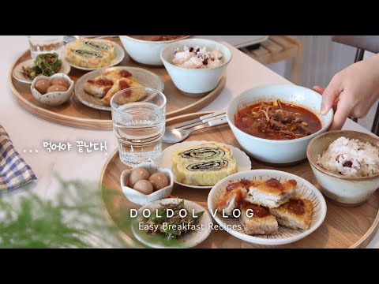
- 설명 앞부분: 이번 영상은 코스트코 장보기부터 식재료 소분, 알뜰하게 활용하는 집밥과 아침밥 레시피까지 담아봤어요. 🍂 장을 봐온 재료들을 차곡차곡 정리해 두고, 하나씩 꺼내 맛있는 한 끼를 준비하는 평범한 일상. 특별하지 않아도 이렇게 가족과 함께하는 소소한 순간들이 참 소중하게 느껴집니다. 요즘 부쩍 쌀쌀해진 날씨에 감기 조심하시고, 따뜻한 음식 잘 챙겨 드시면서 건강한 하루하루 보내세요. 🤎 오늘도 돌돌이네의 일상에 함께해 주셔서 감사합니다. 편안하고 따뜻한 마음으로 시청해 주세요. Subscriptions, likes and hypes …
- 같은 채널 평소 대비 ×10.7 (채널 최근 롱폼 중앙값 15,024회) · 평소 영상: 추운 겨울 날 포근한 아침밥 ∣ 한식 3번 & 빵 1번ㅣ등갈비김치찜, 콩나물밥, 계란 김… (15,283회) / 설명절에도 이어가는 집밥 루틴 4일 ∣ 정갈한 주방 브이로그 🍲🌿 (14,766회)
- 대본 없음 (설명) — 음성인식이 끝나면 도입부·흐름이 들어감
- 댓글 66/66: 좋은 점 — 영상 0 · 감사·응원 12 · 더 알고 싶은 것 4 · 아쉬운 점 — 영상 0 · 반박·불만 — 의견 다름 0 · 정치·사회 0 · 경험 공유 3 · 구독·다음 기대 0
  - 감사·응원 👍5 “돌돌이네 영상에서 힐링하는 사람 222222 감사합니다~~”
  - 감사·응원 👍3 “팅커벨이 주중에 집에 올만하네요~ 이렇게 맛있는 다양한 요리를 뚝딱뚝딱 해내시는데 눈으로만 즐기는 저도 영상올라오기만을 기다리는데 맛을 아는 팅커벨은 참기 힘들듯해요~😂 돌돌이는 좀 더 큰 것 같아보여요~ 오늘도 행복을 나눠주셔서 감사해요~😊❤”
  - 더 알고 싶은 것 👍6 “언제나 감탄하고 보지만 정말 척척 요리를 잘하세요..아이들은 얼마나 행복할까요? 멋진 최고의 엄마세요^^급 추워졌네요.따뜻하게 지내세요❤❤❤”
  - 더 알고 싶은 것 👍2 “14:19 그라인더 어떤 제품인지 알 수 있을까요?”
  - 경험 공유 👍3 “팅커벨이 주중에 집에 올만하네요~ 이렇게 맛있는 다양한 요리를 뚝딱뚝딱 해내시는데 눈으로만 즐기는 저도 영상올라오기만을 기다리는데 맛을 아는 팅커벨은 참기 힘들듯해요~😂 돌돌이는 좀 더 큰 것 같아보여요~ 오늘도 행복을 나눠주셔서 감사해요~😊❤”
  - 경험 공유 👍2 “돌돌이랑 팅커벨은 좋겠어요 엄마가 정성스럽게 차려준 밥먹고 얼마나 힘이 날지 감도 안온다는... 😊 여쭤보고 싶은게 있는데요 저도 소일베이커 크럼즈 눈여겨 보고있는데요 혹시 수저자국이 생기나요?(기스 난다고 하죠) 재질이 화면상으로는 모르겠어서....”

### 68. 무청 시래기 삶지도 말리지도 마세요! '이렇게' 해두면 냉장고 없이 1년 내내 푸르게 먹어요 l 질기지 않게 삶는 법까지

- https://www.youtube.com/watch?v=I9ti02N-n-U · ZIP살림꿀팁 · 구독자 23,100 · 조회수 353,230 (×15.3, 하루 7,862.4) · 좋아요 5,927 (1.7%) · 12.3분 · 2026-10-13 · 주제 묶음 2. 살림·주방 · 형식 정보·해설 (그 밖) · 폴더 `W_I9ti02N-n-U` (웹 승인)
- 썸네일: 
- 설명 앞부분: 가을 무 한 단 사 오면 무청은 늘 남지요. 삶아서 널자니 널 곳이 없고, 얼리자니 냉동실이 모자라 결국 누렇게 떠서 버리게 됩니다. 무청은 삶지도 말리지도 말고 '이렇게' 해 두세요. 냉장고도 냉동실도 없이 베란다 통 하나로 다음 해까지 푸른 시래기를 꺼내 드실 수 있습니다. 이 영상 하나면 무청 손질부터 1년 보관, 꺼내 쓸 때 질기지 않게 삶는 법, 똑같이 해 두면 좋은 겨울 잎채소까지 전부 챙겨가실 수 있습니다. 오늘 영상에서 다루는 내용 삶지도 말리지도 않은 무청이 상하지 않는 이유 시래기에 든 영양, 겨울 밥상에 챙겨야…
- 같은 채널 평소 대비 ×377.4 (채널 최근 롱폼 중앙값 936회) · 평소 영상: 누렇게 변한 운동화, 버리지 마세요! '이것' 바르고 햇볕에 두면 새 것처럼 하얘집니다 (936회) / 석박지 담글 때 김치통에 꾹꾹 눌러 담지 마세요! '이것' 한 장 덮어두면 1년 내내 아… (847회)
- 대본 없음 (설명) — 음성인식이 끝나면 도입부·흐름이 들어감
- 댓글 689/689: 좋은 점 — 영상 6 · 감사·응원 22 · 더 알고 싶은 것 1 · 아쉬운 점 — 영상 1 · 반박·불만 — 의견 다름 0 · 정치·사회 0 · 경험 공유 4 · 구독·다음 기대 0
  - 좋은 점 — 영상 👍2 “좋은정보 젊은사람들 이 꼭 봐야겠네요 .”
  - 좋은 점 — 영상 👍1 “좋은 정보 고맙습니다”
  - 감사·응원 👍8 “시래기 좋아하는데 보관법이 어려웠죠 .감사합니다.”
  - 감사·응원 👍5 “시래기 먹는법 감사합니다”
  - 더 알고 싶은 것 👍0 “제발 서론 길게 그만하고 방법 알려주세요”
  - 아쉬운 점 — 영상 👍4 “근데 너무 길어요 설명이”
  - 경험 공유 👍12 “충청도의 꺼먹지 보관법과 똑같네요 배추랑 무우청에 고추씨ㆍ소금넣고 겨울베란다에보관 조금씩 꺼내서 시락국 ㆍ찌개해먹는 옛날방법입니다 따라서 해봤는데 너무 좋던데요 근데 색깔은 좀 진해집니다~”
  - 경험 공유 👍9 “이거 해봤는데 번거롭고 맛이 없다 삶아서 말려두 두면 더맛있다😊”

### 69. 집안일 하기 싫으시면 다 비우세요∣ 미니멀리스트의 살림 방법

- https://www.youtube.com/watch?v=WRsuTr3iFZ8 · 미니멀라이프_심플살림 · 구독자 4,840 · 조회수 211,335 (×43.7, 하루 1,532.6) · 좋아요 2,008 (0.9%) · 13분 · 2026-07-12 · 주제 묶음 3. 청소·정리·수납 · 형식 살림 브이로그·루틴 · 폴더 `W_WRsuTr3iFZ8` (웹 승인)
- 썸네일: 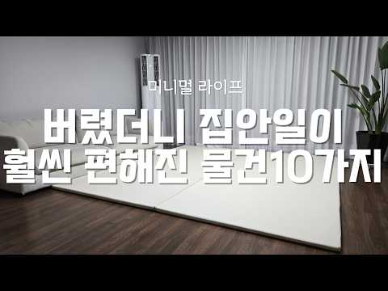
- 챕터: 0:00 인트로 · 2:09 1.큰러그 · 2:56 2.사용하지 않는 주방도구 · 3:40 3. 여분의 그릇 · 4:21 4. 여러개의 쓰레기통 · 5:55 5.여분의 쿠션 · 6:49 6. 오래된 수납합 · 7:45 7. 오래 보관한 쇼핑백 · 8:28 8. 사용하지 않는 가전제품 · 9:29 9. 여분의 가방과 에코백 · 10:38 10. 언젠가 사용할지도 모르는 물건 · 11:27 마무리
- 설명 앞부분: 미니멀라이프를 시작하면서도 처음부터 집안일이 쉬워질 거라고는 기대하지 않았습니다. 단지 조금 더 편안한 공간에서 살고 싶다는 마음으로 하나씩 물건을 내려놓기 시작했습니다. 그런데 신기하게도 물건이 줄어들수록 청소는 더 간단해졌고, 정리는 오래 걸리지 않았으며, 집에서 보내는 시간도 한결 가벼워졌습니다. 오늘은 제가 직접 경험했던 것들 가운데, 버리고 나서 집안일이 훨씬 편해졌던 물건 10가지를 소개해 드리려고 합니다. 혹시 지금 집안일이 버겁게 느껴진다면, 오늘 영상이 여러분에게 작은 힌트가 되었으면 좋겠습니다.
- 같은 채널 평소 대비 ×17.1 (채널 최근 롱폼 중앙값 12,392회) · 평소 영상: 미니멀라이프∣주방정리, 밀폐용기추천 (13,571회) / "미뤄둔 물건, 오늘 싹 비웁니다. 비움챌린지 시작 (13,664회)
- 대본 없음 (설명) — 음성인식이 끝나면 도입부·흐름이 들어감
- 댓글 132/132: 좋은 점 — 영상 3 · 감사·응원 4 · 더 알고 싶은 것 6 · 아쉬운 점 — 영상 0 · 반박·불만 — 의견 다름 0 · 정치·사회 0 · 경험 공유 16 · 구독·다음 기대 0
  - 좋은 점 — 영상 👍5 “맞는말씀이세요! 저는 결혼전부터 미니멀라이프라 물건이 굉장히 적었고 관리다가능했는데..맥시멀라이프 남자랑 결혼한순간부터 스트레스시작되었어요. 태어난아들까지 맥시멀라이프ㅠ 물건하나도 못버리게합니다 ㅠ 아 스트레스!”
  - 좋은 점 — 영상 👍3 “완전 공감합니다 저와 같은생각 지난달에 옷정리 싹 했어요 하지만 생활용품은 왜 못버리는지 제 마음의 문제가 아직도 치료를 못받네요”
  - 감사·응원 👍33 “언젠가 쓰지 않을까해서 창고에 쌓아둔지 3년은 된 듯한 접시세트들 비우러 갑니다. 감사합니다.”
  - 더 알고 싶은 것 👍3 “러그 정말 관리하기 힘들어요 ㅠ 거실 매트 편해보이는데 정보 공유해주실수 있을까요?”
  - 더 알고 싶은 것 👍3 “놀이매트 청소하기 넘 편해보여요. 브랜드 알려주실 수 있나요~?”
  - 경험 공유 👍14 “맥시멀리스트 남편 만나 개고생중인 미니멀리스트 여자인데 진심 집안 가득 남편이 산 물건들 (대부분이 또 고가임) 보면 숨이 안 쉬어지고 그 고가의 물건들이 내 어깨를 짓누르는 고통을 느낌. 남편이 왜 그렇게 물욕이 많은지 생각해버면 어릴때 가난하게 자라서 경제적으로 …”
  - 경험 공유 👍13 “젊을때 이런 지혜를 얻는건 축복이예요 😊 저도 알뜰하고 심플하게 살았다 생각해서 부모님이나 지인들이 물건에 치여 사는듯 보이면 맘이 불편했는데 당사자들은 그렇지않아보였어요ᆢ 깨닫지 못했거나 성격이 무던한거겠죠? 주변을 정리하고 마음의 여유를 얻는다면 미뤄두지 않는게 …”

### 70. 안 사면 후회하는 코스트코 추천템 20가지 🛒 -12kg 다이어터의 소분 & 활용법 ✨

- https://www.youtube.com/watch?v=ParPUHCyiQs · 윤이안의 감량키친 · 구독자 25,600 · 조회수 183,255 (×7.2, 하루 8,061.2) · 좋아요 955 (0.5%) · 22.3분 · 2026-11-04 · 주제 묶음 4. 다이소·가성비 · 형식 경고형 (사지 마세요·실패템) · 폴더 `W_ParPUHCyiQs` (웹 승인)
- 썸네일: 
- 챕터: 0:00 오프닝 · 0:19 코스트코 추천 (연어) · 4:02 코스트코 추천 (S&B 생와사비) · 4:24 코스트코 추천 (양념게장) · 5:15 코스트코 추천 (커클랜드 생새우 31-40) · 5:48 코스트코 추천 (아롱사태) · 7:20 코스트코 추천 (동물복지계란) · 7:55 코스트코 추천 (플레인 사워도우 번) · 8:31 코스트코 추천 (커클랜드 마일드 체다치즈) · 9:53 코스트코 추천 (델리 바베큐) · 10:51 코스트코 추천 (버터헤드) · 12:32 코스트코 추천 (클램 차우더 수프캔) · 13:44 코스트코 추천 (바나나) · 14:22 코스트코 추천 (카라카라 오렌지) · 14:51 코스트코 추천 (김치 토마토 페스토) · 16:30 코스트코 추천 (청정원 콩담백면) · 17:19 코스트코 추천 (마이노멀 두부면) · 17:53 코스트코 추천 (맛콩 맛검은콩) · 18:36 코스트코 추천 (아마레토 커피 티라미수) · 19:53 코스트코 추천 (냉동 버터 크루아상)
- 설명 앞부분: 💗 영상 속 식재료·주방템 리스트 정리본 🔔 건강한 먹거리 & 제대로 된 주방템 최저가 공구는 저는 지금까지 12kg을 감량했고, 지금도 계속 감량하면서 거~의 삼시세끼 집밥만 해 먹고 있는데요🍳 그러다 보니 식비가 만만치 않더라고요😂 그래서 품질도 좋고 가성비도 좋은 식재료를 찾아 코스트코같은 대형마트에 자주 가게 됐어요🛒 오늘은 그동안 직접 구매하고 먹어본 코스트코 추천템 20가지를 리뷰하고, 소분법부터 맛있게 활용하는 방법까지 알차게 담아보았는데 저처럼 집밥을 자주 해 드시는 분들께 조금이나마 도움이 되었으면 좋겠어요✨ 여러…
- 같은 채널 평소 대비 ×9.3 (채널 최근 롱폼 중앙값 19,791회) · 평소 영상: "12kg 빼면서 반년째 먹고있어요" 일주일이 편한 샐러드 밀프렙 🥗 오래 보관하는 꿀팁… (19,791회) / 5분컷 무조건 살빠지는 오나오 오버나이트 오트밀 레시피 4가지 [4탄] (17,773회)
- 대본 없음 (설명) — 음성인식이 끝나면 도입부·흐름이 들어감
- 댓글 34/34: 좋은 점 — 영상 1 · 감사·응원 1 · 더 알고 싶은 것 2 · 아쉬운 점 — 영상 0 · 반박·불만 — 의견 다름 0 · 정치·사회 0 · 경험 공유 0 · 구독·다음 기대 1
  - 좋은 점 — 영상 👍0 “좋은정보 잘보고 참고 하려구요 ~ 잘봤어요 ~”
  - 감사·응원 👍0 “제 최애 다이어트 채널! 오나오부터 맛잘알 언니로 부르며 맹신중입니다😆 날이 많이 추워졌어요, 따숩게 입으시구 늘 건강하세요! 응원합니다 ❤(⸝⸝⸝°⁻̫° ⸝⸝⸝)”
  - 더 알고 싶은 것 👍1 “티라미수를 담은 용기는 어떤 제품일까요??”
  - 더 알고 싶은 것 👍0 “사용하신 샌드위치 빵은 어떤 ㅈㅔ품인가요?”
  - 구독·다음 기대 👍2 “오~유용한 채널 발견이라 구독하고 가요.”

### 71. 유럽여행 필수템 총정리✈️짐 싸기 전에 보세요! 25일 다녀와서 정리한 찐추천&비추천템

- https://www.youtube.com/watch?v=tmgiMVbFZAs · 작누댁 · 구독자 19,800 · 조회수 134,264 (×6.8, 하루 5,879.7) · 좋아요 1,023 (0.8%) · 23.9분 · 2026-11-04 · 주제 묶음 1. 쿠팡·쇼핑 추천 · 형식 경고형 (사지 마세요·실패템) · 폴더 `W_tmgiMVbFZAs` (웹 승인)
- 썸네일: 
- 챕터: 0:00 Intro · 0:40 숙소 필수템 · 1:35 여행 질 급상승템 · 3:14 보조배터리 · 5:22 한식 추천? 비추천? · 7:24 지갑 · 7:41 현금은 얼마나? · 8:59 의외로 필요한 것 · 9:51 여행용 멀티탭 · 10:58 여행용 드라이기 · 12:09 도난 방지템2 · 13:26 여행용 압축 파우치 · 14:37 클렌징밤 · 16:05 건강기능식품 · 16:54 다이소 꿀템 1 · 17:24 다이소 꿀템 2 · 18:07 여행용 샤워기 필터 · 18:40 있으면 편리한 아이템 · 19:07 가글 · 19:34 상비약 팁
- 설명 앞부분: 유럽여행 필수템 총정리! 저는 9월 말~10월 말까지 총 25일간 이탈리아-스위스-스페인-포르투갈 다녀왔고요! 부모님과의 여행, 남편과의 여행, 혼자 여행 모두 해본 후 추린 찐꿀템 추천드립니다. ✨️유럽여행 준비물 리스트✨
- 같은 채널 평소 대비 ×2.3 (채널 최근 롱폼 중앙값 58,422회) · 평소 영상: 하루 3만보씩 걸으며 쇼핑하는 오사카 여행.. (오사카 여행 코스 l 난바 우메다 l 오… (58,422회) / 아기 계획 있어요? 남편이랑 통장 합쳤어요? 집안일 솔직히 안하시죠? (신혼생활 Q&A) (59,673회)
- 대본 없음 (설명) — 음성인식이 끝나면 도입부·흐름이 들어감
- 댓글 62/62: 좋은 점 — 영상 10 · 감사·응원 5 · 더 알고 싶은 것 4 · 아쉬운 점 — 영상 0 · 반박·불만 — 의견 다름 0 · 정치·사회 0 · 경험 공유 8 · 구독·다음 기대 2
  - 좋은 점 — 영상 👍10 “여향다녀오셔서 꿀팁 좋네요. 12월에 유럽가는 동생있는데....핫팩 챙기라고 해야겠네요”
  - 좋은 점 — 영상 👍5 “유럽여행 고생많으셨어요~ 필수템에 보조배터리 내용보면서 저도 예전에 2만짜리 벽돌형 배터리 계속 들고다니면서 충전했었는데 보조 배터리가 많이 좋아졌네요😂 벽돌배터리가 무겁기도 무거운데 배터리 다 쓰고나서 충전할때 충전시간이 오래 걸리는게 단점이더라구요..ㅎ 저희 어머…”
  - 감사·응원 👍3 “추천템 너무너무 좋은 정보 감사합니다. 역시 똑순이~ 야무져요.”
  - 감사·응원 👍2 “유럽 가고싶다~~꿀팁 감사합니다😊😊”
  - 더 알고 싶은 것 👍0 “드리미 110볼트도 사용되나요?”
  - 더 알고 싶은 것 👍0 “안녕하세요 덕분에 도움되는 영상 잘 봤습니다. 저희도11/29 일에 로마로 출국하는데 핸펀 목걸이 줄은 어디서 구입하신건지 구입처 알 수 있을까요?? 영상 감사합니다 ❤”
  - 경험 공유 👍5 “유럽여행 고생많으셨어요~ 필수템에 보조배터리 내용보면서 저도 예전에 2만짜리 벽돌형 배터리 계속 들고다니면서 충전했었는데 보조 배터리가 많이 좋아졌네요😂 벽돌배터리가 무겁기도 무거운데 배터리 다 쓰고나서 충전할때 충전시간이 오래 걸리는게 단점이더라구요..ㅎ 저희 어머…”
  - 경험 공유 👍2 “부모님모시고 여행가셨던거 잘 봤어요,, 저희보다 한달정도 빨리 다녀오신듯해요 ㅎ 저흰 패키지갔는데 너무 아쉬웟어요,,그치만 자유여행할 엄두도 안나서 어쩔수업엇는대 거누파파네 영상보고 힘을얻어서 아이들이랑 자유여행 계획중입니다 슬리퍼 정말 필요하구요 ,,포트도 아주 잘…”
  - 구독·다음 기대 👍0 “저에게 딱 필요한 정보만 주시네요. 구독하고 갑니다.”
  - 구독·다음 기대 👍0 “유럽여행 잘 다녀오셨군요~ 작누님 영상은 항상 유용하고 친절해서 참 좋아요 저도 팁 공유하자면 겨울에 유럽여행했을때 가장 좋은템이 전기매트였어요~ㅎ 두분 스페인.포르투칼 영상도 기대할게요^^”

### 72. 어디든 다 맛 좋은 주방 필수템 '만능 양념장'ㅣ우리 아빠도 한식왕

- https://www.youtube.com/watch?v=MySM7BxGJJ8 · 한식왕 · 구독자 3,860 · 조회수 114,421 (×29.6, 하루 1,145.5) · 좋아요 1,720 (1.5%) · 11.2분 · 2026-08-19 · 주제 묶음 1. 쿠팡·쇼핑 추천 · 형식 목록형 (N가지 추천템) · 폴더 `W_MySM7BxGJJ8` (웹 승인)
- 썸네일: 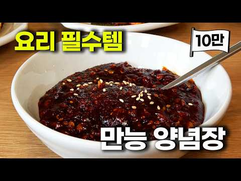
- 설명 앞부분: 한식대첩3 제주 아빠의 그 어떤 요리에도 다 찰떡궁합인 '미친 만능 소스' 레시피! 여러분도 꼭 만들어 놓았다가 그때 그때 써보시길 바라요^^ 소주 1국자/ 진간장 1국자/ 고추장 1국자 / 콩기름 1/2국자 / 올리고당 1국자 / 다진마늘 1국자 / 고춧가루 2국자 / 설탕 1국자 / 소금 1/2 국자 / 참깨 한 줌 센 불에 소주를 넣고 알코올을 알려준다 그 후 불을 줄여 나머지 재료들을 넣고 약 6분간 끓여주고 식혀준다 졸일 때는 계속 저어주세요^^ (타지 않게) 어때요 정말 간단하죠? (사)한식문화교류협회와 함께 합니다
- 같은 채널 평소 대비 ×141.3 (채널 최근 롱폼 중앙값 810회) · 평소 영상: 코스트코 [살치살 & 갈빗살] 엄청 잘 고르는 법ㅣ우리 엄마는 한식왕 (810회) / 한식왕 4월호 2부 '집밥 레시피 몰아보기'ㅣ우리 엄마는 한식왕 (805회)
- 대본 없음 (설명) — 음성인식이 끝나면 도입부·흐름이 들어감
- 댓글 80/80: 좋은 점 — 영상 2 · 감사·응원 23 · 더 알고 싶은 것 9 · 아쉬운 점 — 영상 0 · 반박·불만 — 의견 다름 0 · 정치·사회 0 · 경험 공유 1 · 구독·다음 기대 0
  - 좋은 점 — 영상 👍6 “좋은정보 너무 감사합니다”
  - 좋은 점 — 영상 👍1 “정말 좋은정보 입니다 최고 입니다 😊”
  - 감사·응원 👍16 “자영업하는데 정말 감사드려요... 일반적이지 않고 보물같은레시피 감사합니다”
  - 감사·응원 👍13 “감사합니다 사업번창하세요”
  - 더 알고 싶은 것 👍9 “안녕하세요 선생님 😊 항상 건강하시고 행복하셔요 ~~ 메기 매운탕 다데기 부탁드립니다”
  - 더 알고 싶은 것 👍8 “양념장이 조금 벅벅한거 같은데 그때는 뭘 더 첨가하는게 좋을까요?”

### 73. 매일 쓰며 감탄하는 저소음 키보드 3대장 / 3년차 키보드 유튜버의 내돈내산 저소음 키보드 19종 비교 (사무실용 추천)

- https://www.youtube.com/watch?v=C722KyB3FyU · 리뷰해방 · 구독자 4,150 · 조회수 195,476 (×47.1, 하루 1,202.0) · 좋아요 2,059 (1.1%) · 29.8분 · 2026-06-17 · 주제 묶음 1. 쿠팡·쇼핑 추천 · 형식 비교 (vs·차이·순위) · 폴더 `W_C722KyB3FyU` (웹 승인)
- 썸네일: 
- 챕터: 0:00 영상진행순서 · 0:49 1️⃣ 그룹 🤫 조용존 · 1:37 프리플로우 ak74 (저소음 피치) · 2:53 인터픽셀 IPK104Pro (저소음 피치) · 3:50 씽크웨이 토체프101 (포치드 에그 사일런트 스위치) · 4:57 한성컴퓨터 GK798 Pro (딥블루 뽀송) · 5:59 프리플로우 아콘 ak74 (저소음 라임) · 7:31 👑 인터픽셀 IPK104Pro (저소음 솜사탕) · 8:41 AULA F108 (독거미) (저소음 솜사탕축) · 9:53 씽크웨이 토체프 V2 (저소음적축) · 10:35 2️⃣ 그룹 🫧 보글존 · 11:00 AULA F108 (독거미 / 저소음 바다축) · 12:33 SPM PL108W 아라 (저소음 새벽 리니어) · 13:45 FL-esports OG104 (저소음 크림축) · 15:13 한성컴퓨터 GK798 Pro (브라운슈가 토독) · 16:12 그루브스톤 GV10 (그루브스톤 저소음 갈축 38g) · 17:39 👑 그루브스톤 GV10M (저소음밀키S 38g) · 21:35 3️⃣ 그룹 🫳 도글존 · 22:12 그루브스톤 GV10 (그루브스톤 저소음 갈축 45g) · 23:14 👑 씽크웨이 tv99 (저소음 딥씨)
- 설명 앞부분: ⏱️ 타임라인 (단종) AULA F108 Pro (독거미 / 저소음 바다축) 목소리 뺀 타건음 모음 영상
- 같은 채널 평소 대비 ×21.3 (채널 최근 롱폼 중앙값 9,186회) · 평소 영상: 그루브스톤 GV10X 반저소음 4종 전제품 리뷰 / 사무실 사용 가능한 반저소… (11,651회) / 타건감까지 겸비한 핑크 기계식 키보드 / SPM PL108W 아라 딸기우유 / 반저소음 … (6,720회)
- 대본 없음 (설명) — 음성인식이 끝나면 도입부·흐름이 들어감
- 댓글 182/182: 좋은 점 — 영상 12 · 감사·응원 24 · 더 알고 싶은 것 14 · 아쉬운 점 — 영상 5 · 반박·불만 — 의견 다름 1 · 정치·사회 0 · 경험 공유 17 · 구독·다음 기대 3
  - 좋은 점 — 영상 👍3 “취향이 같은 구독자입니다. 좋은 영상에 보답할 겸 링크로 하나 구입합니다”
  - 좋은 점 — 영상 👍2 “리뷰해방님 완전 오랜만에 오셨네요. 진짜 너무 기다렸습니다ㅠㅠ 어제 알림 떠서 들어왔는데 삭제된 영상이라고 나와서 얼마나 우울했는지 몰라요ㅠㅠ 다행히 재업로드해주셔서 너무 반가웠습니다ㅎㅎ 저는 원래 멤브레인 키보드밖에 모르던 키알못이었는데, 기계식 키보드를 구매해보고…”
  - 감사·응원 👍4 “저소음 크림축 가지고 있는데 듣다보니 그루브스톤이나 독거미 하나더 가지고 싶어서 링크 구경하는데 쿠팡이네요 ㅠㅠㅠ 흑흑 쿠팡 탈퇴해서 아쉬워요,...! 추천 감사합니다! 잘 보고 갑니다!”
  - 감사·응원 👍3 “와 저 진짜 눈팅러인데 이거 영상 너무 감사합니다!!!!!!”
  - 더 알고 싶은 것 👍8 “와~ 우연히 떠서 보게되었는데 처음부터 끝까지 집중해서 봤습니다. 영상 너무 좋네요. 키보드가 결국 취향 차이이지만 제가 타건해보고 느꼈던 바를 그대로 거의 똑같이 이야기해주셔서 신기했습니다. ㅎㅎ (tv99와 tv108도 너무 공감했어요. 99 타건감이 제일 좋았던…”
  - 더 알고 싶은 것 👍2 “리뷰해방님 완전 오랜만에 오셨네요. 진짜 너무 기다렸습니다ㅠㅠ 어제 알림 떠서 들어왔는데 삭제된 영상이라고 나와서 얼마나 우울했는지 몰라요ㅠㅠ 다행히 재업로드해주셔서 너무 반가웠습니다ㅎㅎ 저는 원래 멤브레인 키보드밖에 모르던 키알못이었는데, 기계식 키보드를 구매해보고…”
  - 아쉬운 점 — 영상 👍8 “와~ 우연히 떠서 보게되었는데 처음부터 끝까지 집중해서 봤습니다. 영상 너무 좋네요. 키보드가 결국 취향 차이이지만 제가 타건해보고 느꼈던 바를 그대로 거의 똑같이 이야기해주셔서 신기했습니다. ㅎㅎ (tv99와 tv108도 너무 공감했어요. 99 타건감이 제일 좋았던…”
  - 아쉬운 점 — 영상 👍4 “저소음 크림축 가지고 있는데 듣다보니 그루브스톤이나 독거미 하나더 가지고 싶어서 링크 구경하는데 쿠팡이네요 ㅠㅠㅠ 흑흑 쿠팡 탈퇴해서 아쉬워요,...! 추천 감사합니다! 잘 보고 갑니다!”
  - 반박·불만 — 의견 다름 👍0 “저소음 디딤돌은 진짜 프리플로우에서 저소음 타이틀떼면 안되나? 아무리봐도 사무실용이 아닌데 어딜가도 디딤돌디딤돌 거리는 댓글뿐이네”
  - 경험 공유 👍8 “와~ 우연히 떠서 보게되었는데 처음부터 끝까지 집중해서 봤습니다. 영상 너무 좋네요. 키보드가 결국 취향 차이이지만 제가 타건해보고 느꼈던 바를 그대로 거의 똑같이 이야기해주셔서 신기했습니다. ㅎㅎ (tv99와 tv108도 너무 공감했어요. 99 타건감이 제일 좋았던…”
  - 경험 공유 👍6 “tv99 덕분에 구매했었는데 진짜 너어어어어무 좋아요 ㅠㅠㅠㅠㅠㅠㅠㅠㅠㅠㅠㅠㅠ”
  - 구독·다음 기대 👍8 “와~ 우연히 떠서 보게되었는데 처음부터 끝까지 집중해서 봤습니다. 영상 너무 좋네요. 키보드가 결국 취향 차이이지만 제가 타건해보고 느꼈던 바를 그대로 거의 똑같이 이야기해주셔서 신기했습니다. ㅎㅎ (tv99와 tv108도 너무 공감했어요. 99 타건감이 제일 좋았던…”
  - 구독·다음 기대 👍6 “리뷰도 찐인데 답글 하나하나 달아주시는게 진짜 진심이시네요 구독하고 갑니다”

### 74. 정말 잘 샀다 싶은 인생 주방템 몰아보기 ∣ 12년차 주부의 찐템 ∣ 무인양품부터 이케아, 스타우브, 시라쿠스, 까지

- https://www.youtube.com/watch?v=uhjmwGfQQZ4 · 헤이로라 홈 HeyLaura · 구독자 16,800 · 조회수 457,830 (×27.2, 하루 4,777.9) · 좋아요 1,659 (0.4%) · 16.6분 · 2026-08-23 · 주제 묶음 4. 다이소·가성비 · 형식 살림 브이로그·루틴 · 폴더 `W_uhjmwGfQQZ4` (웹 승인)
- 썸네일: 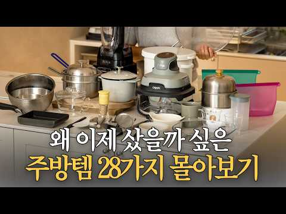
- 챕터: 0:00 인트로 · 0:33 자주 물빠짐이 용이한 스테인리스 세척볼 · 1:09 무인양품 스테인리스 그물국자 얕은형 · 1:34 이케아 국자받침(뢰쉬라) · 2:02 니켄 빵칼 20cm · 2:44 제이든 목공소 원목도마 · 3:23 교세라 세라믹 깨갈이 · 3:43 노다호로 법랑 쌀통 · 4:17 닌자 크리스피 에어프라이어 · 6:20 키친아트 계란찜기 · 6:54 글라스락 렌지쿡 누들용 · 7:30 쉐프윈 올인원 스마트쿠커 · 7:59 닌자 블렌더 · 8:45 타케하라 계란말이팬 · 9:17 무인양품 실리콘 뒤집개 와이드타입 · 9:52 무인양품 믹싱볼 · 10:10 무인양품 미니거품기 · 10:35 이케아 마늘다지기(콘시스) · 11:15 이케아 프라이팬 뚜껑(클로크렌) · 11:40 무인양품 밥이붙지않는주걱
- 설명 앞부분: 12년 차 주부가 실제로 매일 쓰는 주방용품 28가지를 소개합니다☺ 그동안 스타우브부터 이케아, 무인양품까지 정말 많은 주방템들을 여러 영상을 통해 소개해드렸는데요. 편하게 한 번에 보실 수 있도록 많은 분들이 좋아해 주셨던 주방템부터 제가 “정말 잘 샀다” 싶었던 아이템, 새로 들였는데 만족하면서 잘 사용하고 있는 제품들까지 총정리해봤습니다. 신혼 때부터 10년 넘게 사용하고 있는 제품부터 왜 이제 샀을까 싶은 아이템까지 직접 사용하면서 느낀 장점과 아쉬운 점도 함께 담았어요. 🎥영상 속 제품정보
- 같은 채널 평소 대비 ×4.5 (채널 최근 롱폼 중앙값 101,953회) · 평소 영상: 트레이더스 가시면 이건 꼭 담아보세요 추천템 17가지 ∣ PB상품부터 인기 간편식까지 ∣… (101,953회) / 스타우브 vs 르크루제, 하나만 고른다면? (107,838회)
- 대본 없음 (설명) — 음성인식이 끝나면 도입부·흐름이 들어감
- 댓글 302/302: 좋은 점 — 영상 2 · 감사·응원 7 · 더 알고 싶은 것 6 · 아쉬운 점 — 영상 1 · 반박·불만 — 의견 다름 0 · 정치·사회 0 · 경험 공유 3 · 구독·다음 기대 0
  - 좋은 점 — 영상 👍2 “오~~ 정말 유익한 영상 올려주셔서 감사합니다 :)”
  - 좋은 점 — 영상 👍1 “좋은정보 감사합니다. 와이프 사주면 좋아할게 많네요^^”
  - 감사·응원 👍3 “좋은 물건들 소개해 주셔서 감사해요~~^^”
  - 감사·응원 👍2 “오~~ 정말 유익한 영상 올려주셔서 감사합니다 :)”
  - 더 알고 싶은 것 👍0 “14:21 아이가 먹고있는 밥그릇 반찬그릇 궁금해요”
  - 더 알고 싶은 것 👍0 “알람부탁드려요”
  - 아쉬운 점 — 영상 👍0 “검너뛰지 못하는 광고가 도대체 몇분짜리야? 영성만큼 긴 광고라니”

### 75. 작지만 크고, 저렴하지만 비싸보이는 다이소 추천템 베스트 17 ∣ 살림팁 ∣ 쿠팡 ∣ 다이소 ∣ 추천템 ∣ 살림카페

- https://www.youtube.com/watch?v=y3kTb3IPbkE · 살림카페 · 구독자 8,430 · 조회수 194,552 (×23.1, 하루 2,236.0) · 좋아요 1,144 (0.6%) · 11.6분 · 2026-09-01 · 주제 묶음 1. 쿠팡·쇼핑 추천 · 형식 목록형 (N가지 추천템) · 폴더 `W_y3kTb3IPbkE` (웹 승인)
- 썸네일: 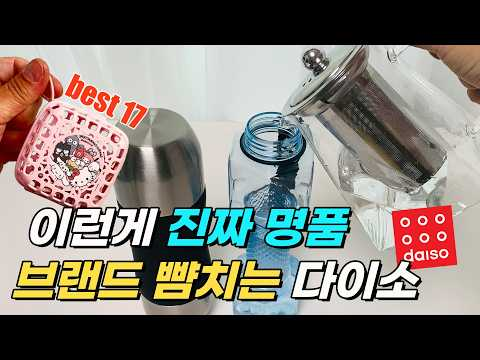
- 챕터: 0:00 안녕하세요살림카페입니다 · 0:16 전기 계란찜기 · 0:59 실리콘 지퍼백 · 2:56 수박보관용기 · 4:02 스텐도시락 · 4:39 산리오포크픽 · 5:05 뚜껑형계량용기 · 5:49 사각내열유리티포트 · 6:29 트라이탄밀폐용기 · 7:11 3칸스텐 밀폐용기 · 7:36 깔끔한 소스병(300ml) · 8:12 소고기 볶음 고추장 · 8:56 원터치 더블컵 보온병 · 9:33 아령물병 · 9:49 여권케이스 · 10:30 실리콘밴드
- 설명 앞부분: 품번 1069307 2리터 1072640 품번 1021922 600ml 1075512 1.2L 1075513 품번 238453089 전용보관 케이스 품번 236453092 500ml 1077376 품번 1026532 손잡이형 56376 850ML 56381 품번 1068400(1L) 품번 1069488 품번 155890322 품번 1063576 품번 1078917 품번 1070792 품번 1076673 쉽고편한 살림을 위한 살림카페
- 같은 채널 평소 대비 ×4.4 (채널 최근 롱폼 중앙값 43,727회) · 평소 영상: 다이소가 작정하고 만든 1%만 아는 꿀템 11가지 이건 진짜 넘사벽 퀼리티! 내돈내산 삶… (43,727회) / 이걸 이제야 구하다니... 오직 다이소에서만 구할 수 있는 신박템& 실속템 15가지 그리… (42,726회)
- 대본 없음 (설명) — 음성인식이 끝나면 도입부·흐름이 들어감
- 댓글 295/295: 좋은 점 — 영상 35 · 감사·응원 62 · 더 알고 싶은 것 4 · 아쉬운 점 — 영상 0 · 반박·불만 — 의견 다름 0 · 정치·사회 0 · 경험 공유 6 · 구독·다음 기대 3
  - 좋은 점 — 영상 👍0 “소개만 하고 끝이 아니라 활용방법까지 알려주셔서 너무 유익해요! 특히 비빔밥+된장찌개 한냄비에 요리하시는거 천재세요?!”
  - 좋은 점 — 영상 👍0 “다른 다이소 추천템들은 흔한 것들이 많았는데, 이건 진짜 실용적이네요! 디테일한 설명 덕분에 바로 장바구니 리스트에 추가했습니다. 좋은 영상 감사해요! ​그냥 지나칠 뻔했는데 영상 보고 바로 구매 결심했습니다! 이렇게 꼼꼼하게 장단점 짚어주셔서 실패 없이 살 수 있을…”
  - 감사·응원 👍3 “알찬정보 감사합니다~~! 제품명이랑 제품번호까지 올려주셔서 유용합니다! 영상보면서 가격이 얼만지 궁금해서 다이소 어플에 검색해서 찾아봤는데 영상올리실 때 가격도 같이 올려주시면 더 좋을 것 같아요❤”
  - 감사·응원 👍2 “자세한 제품설명 뿐아니라 다양하게 활용할 수 있는 방법까지 소개해주셔서 감사합니다^^~”
  - 더 알고 싶은 것 👍3 “알찬정보 감사합니다~~! 제품명이랑 제품번호까지 올려주셔서 유용합니다! 영상보면서 가격이 얼만지 궁금해서 다이소 어플에 검색해서 찾아봤는데 영상올리실 때 가격도 같이 올려주시면 더 좋을 것 같아요❤”
  - 더 알고 싶은 것 👍0 “다이소에 이런 제품도 있었나 몰랐던 물건들이 많네요. 소재나 원산지도 알려주셔서 고르는 게 쉬워졌어요. 앞으로도 좋은 살림 꿀팁 부탁드려요😀”
  - 경험 공유 👍0 “저도 다이소 제품 좋아하는데 차분한 말투와 설명으로 귀에 쏙쏙 들어오고 정말 알찬정보로 완전구매하고 싶네요”
  - 경험 공유 👍0 “사실 다이소 추천템 소개글이나 영상이 단순 다이소에서 사진만 찍은 게 많아 실망도 많았는데 제가 원하던 실사용, 꿀팁 영상이 알차서 구독합니다~ ^ ^”
  - 구독·다음 기대 👍0 “사실 다이소 추천템 소개글이나 영상이 단순 다이소에서 사진만 찍은 게 많아 실망도 많았는데 제가 원하던 실사용, 꿀팁 영상이 알차서 구독합니다~ ^ ^”
  - 구독·다음 기대 👍0 “구독합니다. 야무진 설명과 정보 감사합니다!!”

### 76. 대만방송 살림템 자랑에 나온건 죄다 한국산, 엄마들 구세주라며 난리났는데... #해외반응 #외국인반응

- https://www.youtube.com/watch?v=SJC0qdu6r0k · 세계톡톡 · 구독자 11,400 · 조회수 199,393 (×17.5, 하루 2,689.4) · 좋아요 1,031 (0.5%) · 11.9분 · 2026-09-14 · 주제 묶음 2. 살림·주방 · 형식 정보·해설 (그 밖) · 폴더 `W_SJC0qdu6r0k` (웹 승인)
- 썸네일: 
- 같은 채널 평소 대비 ×8.4 (채널 최근 롱폼 중앙값 23,814회) · 평소 영상: "원래 한국엔 관심없었는데" 이제 한국산은 못 버려, 외국 패널들의 찐 후기 #해외반응 … (24,336회) / "이거 보면 딱 한국사람!" 맨발로 들어와 아무데나 앉기, 컵들고 쓰레기통 찾아다니기..… (23,292회)
- 대본 없음 (없음) — 음성인식이 끝나면 도입부·흐름이 들어감
- 댓글 14/14: 좋은 점 — 영상 0 · 감사·응원 0 · 더 알고 싶은 것 0 · 아쉬운 점 — 영상 0 · 반박·불만 — 의견 다름 0 · 정치·사회 0 · 경험 공유 0 · 구독·다음 기대 0

### 77. 초보자가 알아야 할 기본 칼라 코디법 🍁ㅣ옷 잘입는 사람들의 컬러 조합법ㅣ평생 써먹을 기본템 컬러 코디 끝판왕🍂

- https://www.youtube.com/watch?v=UecOe4Ni7HE · Trend Tonic (트렌드토닉) · 구독자 14,800 · 조회수 124,562 (×8.4, 하루 3,391.8) · 좋아요 620 (0.5%) · 7.7분 · 2026-10-21 · 주제 묶음 6. 4050 패션 · 형식 코디·메이크업 (따라 하기) · 폴더 `W_UecOe4Ni7HE` (웹 승인)
- 썸네일: 
- 챕터: 0:00 꾸밀수록 촌스러워지는 이유 · 1:07 4050이 원하는 세련된 코디 · 1:36 옷장 컬러부터 점검해야 하는 이유 · 1:58 블랙보다 화이트를 활용해야 하는 이유 · 2:45 올블랙 코디를 세련되게 입는 방법 · 3:25 밝은 컬러에 블랙 포인트 주기 · 3:39 촌스럽지 않은 3가지 컬러 코디법 · 4:13 트렌드 컬러 쉽게 활용하는 방법 · 5:24 패션 초보자를 위한 톤온톤 코디 · 6:10 서로 다른 컬러를 조화롭게 입는 법 · 6:55 옷장 정리와 실패 없는 쇼핑 기준 · 7:24 마무리
- 설명 앞부분: 옷 잘 입는 사람들은 특별한 옷보다 🍁컬러 조합을 잘 활용합니다.🍂 새 옷을 사지 않아도 컬러 조합만 바꿔도 옷장 속 기본템이 달라지는 "한 번 알아두면 평생 써먹을 기본 컬러 코디법!"에 대해 오늘 제대로 알아볼께요1 블랙과 화이트를 세련되게 입는 방법 촌스럽지 않은 3가지 컬러 조합 공식 트렌드 컬러를 자연스럽게 활용하는 방법 실패 없는 톤온톤 코디법 🛍️코디가 달라지는 칼라양말 추천 📍새 옷 없이도 세련돼 보이는 "칼라 양말 코디법" 📍깐깐하게 골라 온 "칼라 양말 추천"! 📍명품 대신 손이 가는 천연가죽 데일리백 📍롱스커트…
- 같은 채널 평소 대비 ×5.4 (채널 최근 롱폼 중앙값 22,859회) · 평소 영상: 🍂이번 가을, 겨울 블랙 대신 이 칼라‼️ㅣ2026 FW 컬러 코디 트렌드 ∣ 실패 없는… (24,381회) / 롱스커트에 어울리는 신발 ㅣ 가을에 뜨는 신발 ㅣ 비율 좋아지는 코디 ㅣ 가을 운동화? … (21,337회)
- 대본 없음 (설명) — 음성인식이 끝나면 도입부·흐름이 들어감
- 댓글 9/9: 좋은 점 — 영상 0 · 감사·응원 1 · 더 알고 싶은 것 0 · 아쉬운 점 — 영상 0 · 반박·불만 — 의견 다름 0 · 정치·사회 0 · 경험 공유 0 · 구독·다음 기대 0
  - 감사·응원 👍2 “감사합니다”

### 78. 키작은 50 60대 [필독] 겨울 외투 이렇게 입으면 키 10cm 더 커 보입니다 I 시니어패션 I 중장년패션 I 60대 패션 I 70대 패션

- https://www.youtube.com/watch?v=cEjULVlt1-Y · 멋쟁이 시니어 · 구독자 41,200 · 조회수 119,520 (×2.9, 하루 8,985.3) · 좋아요 565 (0.5%) · 17.4분 · 2026-11-13 · 주제 묶음 6. 4050 패션 · 형식 코디·메이크업 (따라 하기) · 폴더 `W_cEjULVlt1-Y` (웹 승인)
- 썸네일: 
- 챕터: 0:00 키 커 보이는 겨울 코디법 · 1:17 외투 길이와 품 고르는 법 · 3:07 다리가 길어 보이는 색상 연출 · 4:58 키가 커 보이는 목도리 두르기 · 6:33 다리 비율 살리는 가방 연출법
- 설명 앞부분: 🧥 겨울만 되면 두꺼운 외투 때문에 키가 더 작아 보여 고민이셨나요? 32년 매장 경력의 전문가가 키 10cm 더 커 보이는 코디법을 알려드립니다. 올겨울엔 외투 속에 파묻히지 말고 당당하고 멋스럽게 입어보세요. 이 영상에서 내 몸에 딱 맞는 겨울 외투 길이와 품 고르는 법 비율이 살아나는 상하의 안쪽 옷 색상 조합법 키가 쑥 올라가는 목도리 연출과 가방 위치 팁 📍 타임라인 📢 주변의 소중한 분들에게 이 영상을 꼭 공유해 보세요. © All Rights Reserved by 멋쟁이 시니어 © Copyright by 멋쟁이 시니어
- 같은 채널 평소 대비 ×2.3 (채널 최근 롱폼 중앙값 51,076회) · 평소 영상: 시니어 가을 바지 [필독] 세련되고 고급스러운 바지와 코디 방법 총정리 I 시니어패션 I… (60,992회) / 60대 가을 옷차림 [절대 금지] 10년 늙어 보이기 싫다면 꼭 보세요 I 시니어패션 I… (41,160회)
- 대본 없음 (설명) — 음성인식이 끝나면 도입부·흐름이 들어감
- 댓글 7/7: 좋은 점 — 영상 1 · 감사·응원 1 · 더 알고 싶은 것 0 · 아쉬운 점 — 영상 0 · 반박·불만 — 의견 다름 0 · 정치·사회 0 · 경험 공유 0 · 구독·다음 기대 0
  - 좋은 점 — 영상 👍2 “도움이많이됐습니다 감사합니다”
  - 감사·응원 👍2 “도움이많이됐습니다 감사합니다”

### 79. 주방 후드와 가스렌지 기름때 물티슈에 이것 묻혀 닦으면 싹 사라집니다 #주방청소 #기름때제거 #후드청소 #손소독제활용 #주방꿀팁 #살림꿀팁 #베이킹소다청소 #스…

- https://www.youtube.com/watch?v=Le-9QeWdYi8 · 최고야tv · 구독자 7,530 · 조회수 166,049 (×22.1, 하루 1,592.6) · 좋아요 1,998 (1.2%) · 26.9분 · 2026-08-15 · 주제 묶음 2. 살림·주방 · 형식 정보·해설 (그 밖) · 폴더 `W_Le-9QeWdYi8` (웹 승인)
- 썸네일: 
- 설명 앞부분: 🧽 방금 닦았다고 생각한 주방 후드… 손끝으로 쓱 만졌더니 미끈하고 끈적한 그 느낌, 경험해 보셨죠? 😱 그 정체는 며칠 만에 또 눌어붙은 지긋지긋한 기름때입니다. 그런데 이걸 지우겠다고 비싼 전용 세제를 사러 갈 필요가 전혀 없다는 사실! 지금 여러분 집 서랍 속에 방치된 '그 물건' 하나면 충분합니다. 🙌 요리할 때 튄 기름이 무섭게 눌어붙는 과정 서랍 속 애물단지 '손소독제'가 기름때에 강력한 진짜 이유 (알코올의 원리!) 후드부터 공략하는 고수의 청소 순서 따뜻한 물 + 주방세제, 계면활성제의 과학 찌든 때엔 베이킹소다 반…
- 같은 채널 평소 대비 ×452.4 (채널 최근 롱폼 중앙값 367회) · 평소 영상: 새까맣게 탄 냄비 여기에 담가두면 새 것처럼 반짝거립니다 #탄냄비닦는법 #냄비세척 #스테… (367회) / 늙은 호박죽 끝맛이 떫으셨죠? 그냥 푹 삶기만 하지 마세요! 삶을 때 '이것' 조금만 넣… (276회)
- 대본 없음 (설명) — 음성인식이 끝나면 도입부·흐름이 들어감
- 댓글 41/41: 좋은 점 — 영상 1 · 감사·응원 3 · 더 알고 싶은 것 1 · 아쉬운 점 — 영상 8 · 반박·불만 — 의견 다름 1 · 정치·사회 0 · 경험 공유 0 · 구독·다음 기대 0
  - 좋은 점 — 영상 👍4 “참으로 유익한 정보임다 감사합니다 생활에 큰 도움이 되겠네요”
  - 감사·응원 👍4 “참으로 유익한 정보임다 감사합니다 생활에 큰 도움이 되겠네요”
  - 감사·응원 👍3 “너무새로운소식이네요감사합니다”
  - 아쉬운 점 — 영상 👍22 “지겹네 서론이 넘지루하다요 숨 너어가겠네 어쨌던 기름때 제거하는답만 이야기. 해야지?”
  - 아쉬운 점 — 영상 👍12 “쓸데 없는 말 너무 길다 말 맍이하면 돈더주나~~”
  - 반박·불만 — 의견 다름 👍3 “마트로달려가지않아요웃기는짓하지말고간단히하시요”

### 80. 비싼 주방 브랜드 긴장시킨 다이소 신상! 무조건 본전 뽑는 여름 살림템까지 7가지 총정리 ∣ 품절대란 ∣ 다이소추천템 ∣ 삶의 질 상승템 ∣ 내돈내산

- https://www.youtube.com/watch?v=Ojy1jmA8OfQ · 이참에 살림 · 구독자 8,020 · 조회수 183,646 (×22.9, 하루 1,657.5) · 좋아요 892 (0.5%) · 8.4분 · 2026-08-08 · 주제 묶음 1. 쿠팡·쇼핑 추천 · 형식 직접 써 본 후기 (내돈내산·N개월 사용) · 폴더 `W_Ojy1jmA8OfQ` (웹 승인)
- 썸네일: 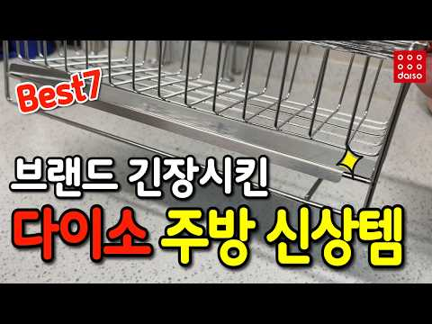
- 챕터: 0:00 이참에 살림입니다. · 0:10 일본제 스틱형 얼음 트레이 ∣ 품번: 1059207 … · 1:19 네오플램 뚜껑형 내열유리 계량 저장용기 250 ml … · 2:06 식기 건조대용 다용도 바구니 NEW ∣ 품번: 107… · 3:23 수세미 거치대 와이드형 NEW ∣ 품번: 107215… · 4:44 로봇 청소기용 세제 1000 ml ∣ 품번: 1051… · 5:47 넥쿨링 밴드 ∣ 품번: 1079537 / 3,000원 · 6:52 USB 타입 모기 유인 퇴치기 ∣ 품번: 106214… · 8:14 시청해 주셔서 감사합니다!
- 설명 앞부분: 🎙️ 비싼 브랜드 뺨치는 다이소 주방 신상템과 본전 뽑는 생활 꿀템 4가지 ↓ ↓ ↓ 영상 속 다이소 제품 정보 ↓ ↓ ↓ 품번: 1077373 / 2,000 네오플램 뚜껑형 내열유리 계량 저장용기 500 ml NEW 품번: 1077376 / 3,000 네오플램 뚜껑형 내열유리 계량 저장용기 1L NEW 품번: 1077378 / 5,000 오늘 하루도 시원하고 편안하게 보내시길 바랍니다. 📢 안내 사항 채널에 일정액의 수수료가 제공될 수 있습니다.
- 대본 없음 (설명) — 음성인식이 끝나면 도입부·흐름이 들어감
- 댓글 24/24: 좋은 점 — 영상 0 · 감사·응원 1 · 더 알고 싶은 것 1 · 아쉬운 점 — 영상 0 · 반박·불만 — 의견 다름 0 · 정치·사회 0 · 경험 공유 0 · 구독·다음 기대 0
  - 감사·응원 👍1 “설명 찐 잘 해주셔 감사합니다🎉🎉🎉”
  - 더 알고 싶은 것 👍0 “5분17초에 나오는 분무기 제품정보 알 수 있을까요?”

