# 📊 YouTube '우주' 주제 분석 리포트

> 생성 2026-10-11 12:11 KST · 노트북 v2.3.0 · 실행ID `20261011_120612` · 지역 KR / 언어 ko  
> ⚠️ 연구·교육용 분석 결과입니다. **투자 조언이 아니며**, 통계는 상관관계일 뿐 인과관계를 보장하지 않습니다.

## 0. 한눈에 보기 (TL;DR)

- ⚙️ **설정 파일**: `space/analyzer_config.toml`
- **분석 데이터**: 영상 466개 수집 → 성과 분석 160개 (업로드 2025-10-11 ~ 2026-09-26, 업로드 후 14일 이상 경과), 채널 241개, 검색 키워드 13개(6개 카테고리), 주제 무관 영상 11개 제외
- 📢 **광고 집행 의심 영상 3개 제외**: 조회수는 많은데 좋아요·댓글이 거의 없는 영상(유료 홍보로 조회수를 산 것으로 추정) → 자연 유입으로 재현할 수 없으므로 성과 분석·성공사례에서 뺐습니다 (목록: 2장 하단)
- **성공(아웃라이어) 기준**: 조회수 10,000회 이상 **그리고** 같은 채널 최근 영상 중앙값의 3배 이상 → 74개 (46.2%)
- 🗂️ **기회가 큰 소재(카테고리)**: 5. 뉴스·위험 (누리호·소행성·우주 쓰레기) (71점), 6. 다큐·수면용 포맷 (59점), 4. 탐사·우주망원경 (55점)
- 🎯 **기회가 가장 큰 키워드**: `누리호 해외반응`(81점), `우주 다큐멘터리`(69점), `우주의 크기 비교`(62점), `우주 미스터리 다큐`(61점), `보이저호 근황`(60점)
- 🎬 **포맷별 성공 비율**: 롱폼 48.8% (배수 중앙값 5.03배, n=123) · 쇼츠 37.8% (배수 중앙값 4.17배, n=37) → 추천: **롱폼** 중심
- ⏱️ **롱폼 추천 길이**: 30~60분, 60분+ (성공 비율 상위 구간)
- 🏷️ **효과 있는 제목 요소**: 호기심(이유·진짜·결국) 2.36배, 말줄임(…) 1.93배, 영문 대문자 단어 1.93배, 물음표(질문형) 1.78배  /  역효과: 긴급성(지금·당장·속보) 0.19배, 괄호/대괄호 0.29배, 해시태그 0.40배  (*=다중비교 보정 후 유의, q<0.05)
- 🌱 **작은 채널도 터지나?**: 소규모(<1만) 채널 영상의 성공 비율 47.9% vs 대형(≥10만) 34.4%. 성공한 소규모 채널의 업로드 빈도 중앙값: 주 3.1회
- 🕒 **업로드 타이밍(참고)**: 성공 비율 높은 요일 월, 화 / 시간대 00~05시, 18~20시 (KST)
- 💸 **API 쿼터 사용**: 1,782 / 예산 9,000 (일일 한도 10,000)

## 1. 🎬 추천 영상 아이디어 (데이터 기반)

제목 예시는 이번 데이터에서 효과가 확인된 제목 요소(호기심(이유·진짜·결국), 말줄임(…), 물음표(질문형), 느낌표; 데이터 기반 (lift≥1.1))를 키워드 성격(실패·손실 사연 / 사기·피해 / 일반 정보)에 맞춰 조합한 **템플릿 예시**입니다. 그대로 쓰기보다 참고 영상의 실제 제목·썸네일·도입부(대본)를 함께 보고 다듬으세요.

### 1. `누리호 해외반응` — 기회점수 **81**/100 · 일반 정보

- 근거: 검색 상위 20개 영상 일평균 조회수 중앙값 **1.7만회**, 소규모 채널 진입 성공 비율 **30.0%**, 최근 90일 영상 비율 80.0%, 경쟁 채널 구독자 중앙값 10.2만명, 아웃라이어 배수 중앙값 3.62배, 성공 영상 9개
- 추천 포맷: **쇼츠** · 검색 상위 중 쇼츠 비율 15.0%
- 제목 예시: 「누리호 해외반응의 진짜 이유 (아무도 말 안 해주는 것)」 / 「누리호 해외반응… 결국 이게 답이었습니다」 / 「누리호 해외반응, 지금 시작해도 될까?」
- 참고할 성공 영상:
  - [한국 위성발사 실패 당시 주변국들 반응](https://www.youtube.com/watch?v=XHI7iIfqjbg) — 조회수 254만, 구독자 1.0만, 채널 평균의 535.4배, 쇼츠
  - [누리호 발사 성공 레전드 해외반응 ㅋㅋ](https://www.youtube.com/watch?v=qPFJEwkRNE0) — 조회수 174만, 구독자 1.4천, 채널 평균의 58.3배, 쇼츠
  - [선진국에선 30년, 한국에선 10년 걸린 누리호 성공 이야기](https://www.youtube.com/watch?v=QvalNcOmSOw) — 조회수 54.7만, 구독자 3.5천, 채널 평균의 18.8배, 쇼츠

### 2. `우주 다큐멘터리` — 기회점수 **69**/100 · 실패·손실 사연

- 근거: 검색 상위 20개 영상 일평균 조회수 중앙값 **1.7천회**, 소규모 채널 진입 성공 비율 **20.0%**, 최근 90일 영상 비율 10.0%, 경쟁 채널 구독자 중앙값 16.6만명, 아웃라이어 배수 중앙값 15.18배, 성공 영상 17개
- 추천 포맷: **롱폼** · 롱폼이면 30~60분, 60분+ · 검색 상위 중 쇼츠 비율 0.0%
- 제목 예시: 「우주 다큐멘터리… 결국 남은 건 빚이었습니다」 / 「우주 다큐멘터리, 왜 멈추지 못했을까?」 / 「우주 다큐멘터리 — 이 신호를 놓치지 마세요!」
- 참고할 성공 영상:
  - [우주는 실제로 얼마나 거대한가?: 지구에서 우주의 끝까지](https://www.youtube.com/watch?v=XSmU3R_pwvI) — 조회수 12.1만, 구독자 2.1천, 채널 평균의 343.5배, 롱폼
  - [제임스 웹이 밝혀낸 우주의 진짜 규모… 너무 충격적이다](https://www.youtube.com/watch?v=dRjIcygHL-o) — 조회수 24.4만, 구독자 1.8천, 채널 평균의 230.4배, 롱폼
  - [우주 속 우리 크기의 충격적 진실 (각오하세요)](https://www.youtube.com/watch?v=nJ-8yQGBRwc) — 조회수 10.2만, 구독자 1.9천, 채널 평균의 79.2배, 롱폼

### 3. `우주의 크기 비교` — 기회점수 **62**/100 · 일반 정보

- 근거: 검색 상위 20개 영상 일평균 조회수 중앙값 **999회**, 소규모 채널 진입 성공 비율 **20.0%**, 최근 90일 영상 비율 5.0%, 경쟁 채널 구독자 중앙값 16.1만명, 아웃라이어 배수 중앙값 23.71배, 성공 영상 6개
- 추천 포맷: **롱폼** · 롱폼이면 30~60분, 60분+ · 검색 상위 중 쇼츠 비율 5.0%
- 제목 예시: 「우주의 크기 비교, 지금 시작해도 될까?」 / 「우주의 크기 비교 이것만은 꼭 알고 시작하세요!」 / 「우주의 크기 비교의 진짜 이유 (아무도 말 안 해주는 것)」
- 참고할 성공 영상:
  - [우주의 크기가 느껴지는 사진 한 장](https://www.youtube.com/watch?v=sfqchJdv1KY) — 조회수 599만, 구독자 2.6만, 채널 평균의 178.0배, 쇼츠
  - [［우주송🎹］ 만약에 행성 하나가 사라진다면? 우리가 몰랐던 태양계의 비밀 BY 너…](https://www.youtube.com/watch?v=92VmBkCRCuA) — 조회수 38.4만, 구독자 1.1만, 채널 평균의 112.2배, 롱폼
  - [우주의 실제 크기는 그야말로 상상을 초월합니다](https://www.youtube.com/watch?v=XJiBFR-SpcE) — 조회수 2.7만, 구독자 4.1천, 채널 평균의 6.8배, 롱폼

### 4. `우주 미스터리 다큐` — 기회점수 **61**/100 · 실패·손실 사연

- 근거: 검색 상위 20개 영상 일평균 조회수 중앙값 **2.3천회**, 소규모 채널 진입 성공 비율 **5.0%**, 최근 90일 영상 비율 20.0%, 경쟁 채널 구독자 중앙값 22.2만명, 아웃라이어 배수 중앙값 8.89배, 성공 영상 15개
- 추천 포맷: **롱폼** · 롱폼이면 30~60분, 60분+ · 검색 상위 중 쇼츠 비율 0.0%
- 제목 예시: 「우주 미스터리 다큐 — 이 신호를 놓치지 마세요!」 / 「우주 미스터리 다큐의 진짜 원인 (차트가 아니었습니다)」 / 「우주 미스터리 다큐… 결국 남은 건 빚이었습니다」
- 참고할 성공 영상:
  - [우주에 관한 가장 신비롭고 편안한 사실들](https://www.youtube.com/watch?v=wXGw7gNAa84) — 조회수 4.7만, 구독자 2.1천, 채널 평균의 134.5배, 롱폼
  - [별·은하·블랙홀까지🌌 틀어두면 끝까지 가는 수면용 우주 다큐 끝판왕 210분⭐  …](https://www.youtube.com/watch?v=rlKSFUhybUo) — 조회수 65.8만, 구독자 17.2만, 채널 평균의 126.5배, 롱폼
  - [［수면다큐］《외계인이 지구에 도달하는 것이 절대 불가능한 이유》잠잘 때 들으면 시…](https://www.youtube.com/watch?v=0Ou_l2QUACE) — 조회수 14.7만, 구독자 4.8천, 채널 평균의 48.9배, 롱폼

### 5. `보이저호 근황` — 기회점수 **60**/100 · 일반 정보

- 근거: 검색 상위 20개 영상 일평균 조회수 중앙값 **1.1천회**, 소규모 채널 진입 성공 비율 **20.0%**, 최근 90일 영상 비율 15.0%, 경쟁 채널 구독자 중앙값 22.9만명, 아웃라이어 배수 중앙값 7.90배, 성공 영상 13개
- 추천 포맷: **롱폼** · 롱폼이면 30~60분, 60분+ · 검색 상위 중 쇼츠 비율 35.0%
- 제목 예시: 「보이저호 근황의 진짜 이유 (아무도 말 안 해주는 것)」 / 「보이저호 근황… 결국 이게 답이었습니다」 / 「보이저호 근황, 지금 시작해도 될까?」
- 참고할 성공 영상:
  - [보이저 1호는 지금 어디에 있을까? 태양계를 넘어 성간 우주로 간 인류의 가장 먼…](https://www.youtube.com/watch?v=9IwCgjdzQr8) — 조회수 6.9만, 구독자 932, 채널 평균의 160.2배, 롱폼
  - [보이저의 끝없는 여행의 결말은 어떻게 될까?](https://www.youtube.com/watch?v=PlRzffETBNw) — 조회수 15.9만, 구독자 5.4천, 채널 평균의 134.9배, 롱폼
  - [NASA도 놀란 내구성. 우주에서 가장 오래 달린 탐사선, 보이저가 아직 현역인 …](https://www.youtube.com/watch?v=YDyR_kwdamY) — 조회수 3.4만, 구독자 5.4천, 채널 평균의 27.1배, 롱폼

### 6. `누리호 발사` — 기회점수 **60**/100 · 일반 정보

- 근거: 검색 상위 20개 영상 일평균 조회수 중앙값 **9.4천회**, 소규모 채널 진입 성공 비율 **10.0%**, 최근 90일 영상 비율 75.0%, 경쟁 채널 구독자 중앙값 35.4만명, 아웃라이어 배수 중앙값 3.55배, 성공 영상 4개
- 추천 포맷: **롱폼** · 롱폼이면 30~60분, 60분+ · 검색 상위 중 쇼츠 비율 25.0%
- 제목 예시: 「누리호 발사… 결국 이게 답이었습니다」 / 「누리호 발사, 지금 시작해도 될까?」 / 「누리호 발사 이것만은 꼭 알고 시작하세요!」
- 참고할 성공 영상:
  - [［KARI］ 새벽 하늘을 가로지른 누리호 4차 발사 성공!](https://www.youtube.com/watch?v=ZPhu08cU1Cc) — 조회수 48.5만, 구독자 10.4만, 채널 평균의 16.3배, 롱폼
  - [［공식］ 누리호 4차 발사 미공개 4K 영상 최초 공개](https://www.youtube.com/watch?v=7FnbLEjJrcU) — 조회수 10.6만, 구독자 10.4만, 채널 평균의 3.6배, 롱폼
  - [［KARI］ 새벽 하늘을 가로지른 누리호 4차 발사 성공!](https://www.youtube.com/watch?v=kj-oIE3ABNk) — 조회수 9.2만, 구독자 10.4만, 채널 평균의 3.1배, 롱폼

### 7. `보이저1호 위치` — 기회점수 **50**/100 · 일반 정보

- 근거: 검색 상위 20개 영상 일평균 조회수 중앙값 **672회**, 소규모 채널 진입 성공 비율 **10.0%**, 최근 90일 영상 비율 5.0%, 경쟁 채널 구독자 중앙값 17.8만명, 아웃라이어 배수 중앙값 5.03배, 성공 영상 12개
- 추천 포맷: **롱폼** · 롱폼이면 30~60분, 60분+ · 검색 상위 중 쇼츠 비율 40.0%
- 제목 예시: 「보이저1호 위치, 지금 시작해도 될까?」 / 「보이저1호 위치 이것만은 꼭 알고 시작하세요!」 / 「보이저1호 위치의 진짜 이유 (아무도 말 안 해주는 것)」
- 참고할 성공 영상:
  - [최신) 50년 전 발사된 보이저 1호, 현재 위치와 상태 정리](https://www.youtube.com/watch?v=LT5kF4JLw7k) — 조회수 13.6만, 구독자 52.2만, 채널 평균의 51.6배, 롱폼
  - [50년째 우주 미아? 보이저1호 소름돋는 근황](https://www.youtube.com/watch?v=OVmpABuhw_E) — 조회수 25.6만, 구독자 5.3만, 채널 평균의 15.7배, 쇼츠
  - [100만 년 후, 보이저 1호는 정확히 어디에 있을까?](https://www.youtube.com/watch?v=JBIA6zw_y_Y) — 조회수 3.8만, 구독자 4.1천, 채널 평균의 9.3배, 롱폼

### 8. `우주 다큐 수면` — 기회점수 **49**/100 · 실패·손실 사연

- 근거: 검색 상위 20개 영상 일평균 조회수 중앙값 **2.1천회**, 소규모 채널 진입 성공 비율 **0.0%**, 최근 90일 영상 비율 20.0%, 경쟁 채널 구독자 중앙값 19.7만명, 아웃라이어 배수 중앙값 1.62배, 성공 영상 7개
- 추천 포맷: **롱폼** · 롱폼이면 30~60분, 60분+ · 검색 상위 중 쇼츠 비율 0.0%
- 제목 예시: 「우주 다큐 수면 — 이 신호를 놓치지 마세요!」 / 「우주 다큐 수면의 진짜 원인 (차트가 아니었습니다)」 / 「우주 다큐 수면… 결국 남은 건 빚이었습니다」
- 참고할 성공 영상:
  - [［수면다큐］《우리 우주에는 얼마나 많은 은하가 존재할까?》잠잘 때 들으면 시간순삭…](https://www.youtube.com/watch?v=CW4pZZ3n7dw) — 조회수 5.0만, 구독자 4.8천, 채널 평균의 16.7배, 롱폼
  - [제임스 웹 우주 망원경이 발사된 이후 지금까지 발견한 모든 것 I 우주 수면 다큐…](https://www.youtube.com/watch?v=gxIB-WbAndw) — 조회수 68.7만, 구독자 16.2만, 채널 평균의 11.0배, 롱폼
  - [🪐 잠 못 드는 당신을 안드로메다로 보내버릴, 2시간 30분 수면 권장 우주 다큐…](https://www.youtube.com/watch?v=0wv-N3ojU0M) — 조회수 24.1만, 구독자 57.3만, 채널 평균의 9.1배, 롱폼

### 🗓️ 첫 10개 영상 업로드 플랜 (제안)

| # | 형식 | 키워드 | 제목 예시 | 근거 |
|---|---|---|---|---|
| 1 | 쇼츠 | 누리호 해외반응 | 누리호 해외반응의 진짜 이유 (아무도 말 안 해주는 것) | 기회점수 81 |
| 2 | 롱폼 | 누리호 해외반응 | 누리호 해외반응… 결국 이게 답이었습니다 | 같은 키워드를 다른 포맷으로 재활용 (제작비↓, 검색·쇼츠 피드 동시 공략) |
| 3 | 롱폼 | 우주 다큐멘터리 | 우주 다큐멘터리… 결국 남은 건 빚이었습니다 | 기회점수 69 |
| 4 | 쇼츠 | 우주 다큐멘터리 | 우주 다큐멘터리, 왜 멈추지 못했을까? | 같은 키워드를 다른 포맷으로 재활용 (제작비↓, 검색·쇼츠 피드 동시 공략) |
| 5 | 롱폼 | 우주의 크기 비교 | 우주의 크기 비교, 지금 시작해도 될까? | 기회점수 62 |
| 6 | 쇼츠 | 우주의 크기 비교 | 우주의 크기 비교 이것만은 꼭 알고 시작하세요! | 같은 키워드를 다른 포맷으로 재활용 (제작비↓, 검색·쇼츠 피드 동시 공략) |
| 7 | 롱폼 | 우주 미스터리 다큐 | 우주 미스터리 다큐 — 이 신호를 놓치지 마세요! | 기회점수 61 |
| 8 | 쇼츠 | 우주 미스터리 다큐 | 우주 미스터리 다큐의 진짜 원인 (차트가 아니었습니다) | 같은 키워드를 다른 포맷으로 재활용 (제작비↓, 검색·쇼츠 피드 동시 공략) |
| 9 | 롱폼 | 보이저호 근황 | 보이저호 근황의 진짜 이유 (아무도 말 안 해주는 것) | 기회점수 60 |
| 10 | 쇼츠 | 보이저호 근황 | 보이저호 근황… 결국 이게 답이었습니다 | 같은 키워드를 다른 포맷으로 재활용 (제작비↓, 검색·쇼츠 피드 동시 공략) |

### 🧩 하위 주제(제목 클러스터)별 기회

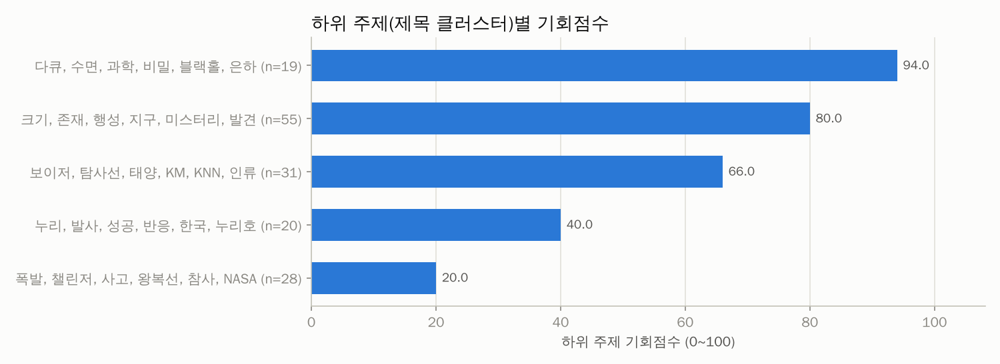

| 기회점수 | 핵심 단어 | 영상 수 | 배수 중앙값 | 성공 비율 | 소규모채널 성공 | 쇼츠 비율 | 예시 제목 |
|---|---|---|---|---|---|---|---|
| 94 | 다큐, 수면, 과학, 비밀, 블랙홀, 은하 | 19 | 8.97 | 57.9% | 26.3% | 0.0% | 별·은하·블랙홀까지🌌 틀어두면 끝까지 가는 수면용 우주 다큐 끝판왕 21 / 우주가 2조 개의 은하를 가진 진짜 이유 \| 과학다큐 / 푸른 빛의 은하수 아래서  |
| 80 | 크기, 존재, 행성, 지구, 미스터리, 발견 | 55 | 7.19 | 52.7% | 23.6% | 29.1% | 우주는 실제로 얼마나 거대한가?: 지구에서 우주의 끝까지 / 제임스 웹이 밝혀낸 우주의 진짜 규모… 너무 충격적이다 / 우주의 크기가 느껴지는 사진 한 장 |
| 66 | 보이저, 탐사선, 태양, KM, KNN, 인류 | 31 | 5.29 | 48.4% | 25.8% | 12.9% | 보이저 1호는 지금 어디에 있을까? 태양계를 넘어 성간 우주로 간 인류의 / 보이저의 끝없는 여행의 결말은 어떻게 될까? / 보이저 1호가 태양계 끝에서 벽을 발 |
| 40 | 누리, 발사, 성공, 반응, 한국, 누리호 | 20 | 3.62 | 50.0% | 20.0% | 35.0% | 한국 위성발사 실패 당시 주변국들 반응 / 누리호 발사 성공 레전드 해외반응 ㅋㅋ / 누리호 발사, 세계 항공우주국들이 경악한 이유! |
| 20 | 폭발, 챌린저, 사고, 왕복선, 참사, NASA | 28 | 1.04 | 21.4% | 10.7% | 32.1% | NASA가 숨기려 한 챌린저 우주선 사고의 충격적 진실 공개 / 챌린저호 폭발 사고 이후 또다시 일어난 참사, 컬럼비아호 폭발 사고의 전 / NASA는 알고 있었 |
| - | 마지막, 인간, 정리, 컬럼비아, 미스터리, 망원경 | 7 | 3.73 | 42.9% | 14.3% | 14.3% | "우리는 어디서 왔는가?" 우주가 숨겨온 인간의 기원 \| 칼 세이건 '코 / 빛의 속도로 날아가도 안드로메다까지 약 250만 년이 걸린다… 우주 앞에 / ［4K |

## 2. 🔑 키워드 기회 분석

기회점수 = 수요 25% + 자동완성 15% + 소규모채널 진입 20% + 아웃라이어 10% + 신선도 5% + 경쟁(역) 15% + 콘텐츠 공백 10% (키워드 간 백분위 기준). 수요·경쟁은 **주제 관련 영상만**으로 계산했고, 검색 상위 10개 중 절반 이상이 한 채널인 키워드(채널명 검색)는 제외했습니다. '관련 비율'이 낮다 = 사람들이 찾는데 맞는 영상이 적다(콘텐츠 공백).

### 🗂️ 카테고리(소재)별 기회

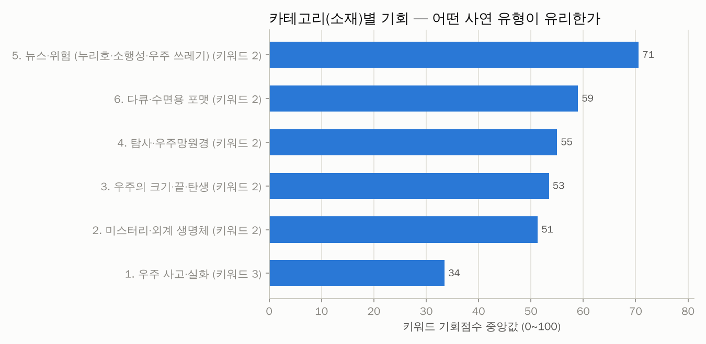

| 카테고리 | 키워드 수 | 기회(중앙) | 기회(최고) | 최고 키워드 | 검색수요 합 | 일평균 조회(중앙) | 소규모 진입 | 관련 비율 | 성공 영상 | 배수(중앙) |
|---|---|---|---|---|---|---|---|---|---|---|
| 5. 뉴스·위험 (누리호·소행성·우주 쓰레기) | 2 | 71 | 81 | 누리호 해외반응 | 0.0 | 1.3만 | 20.0% | 100.0% | 10 | 3.62 |
| 6. 다큐·수면용 포맷 | 2 | 59 | 69 | 우주 다큐멘터리 | 0.0 | 1.9천 | 10.0% | 100.0% | 17 | 9.05 |
| 4. 탐사·우주망원경 | 2 | 55 | 60 | 보이저호 근황 | 0.0 | 871 | 15.0% | 100.0% | 15 | 5.29 |
| 3. 우주의 크기·끝·탄생 | 2 | 53 | 62 | 우주의 크기 비교 | 0.0 | 1.0천 | 12.5% | 100.0% | 10 | 11.18 |
| 2. 미스터리·외계 생명체 | 2 | 51 | 61 | 우주 미스터리 다큐 | 0.0 | 1.8천 | 5.0% | 100.0% | 15 | 5.34 |
| 1. 우주 사고·실화 | 3 | 34 | 49 | 챌린저호 원인 | 0.0 | 81 | 3.3% | 98.3% | 7 | 1.18 |

### 🔑 키워드별 기회

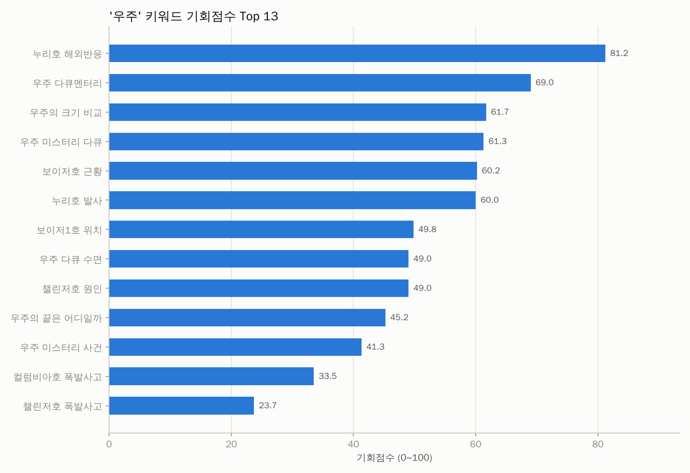
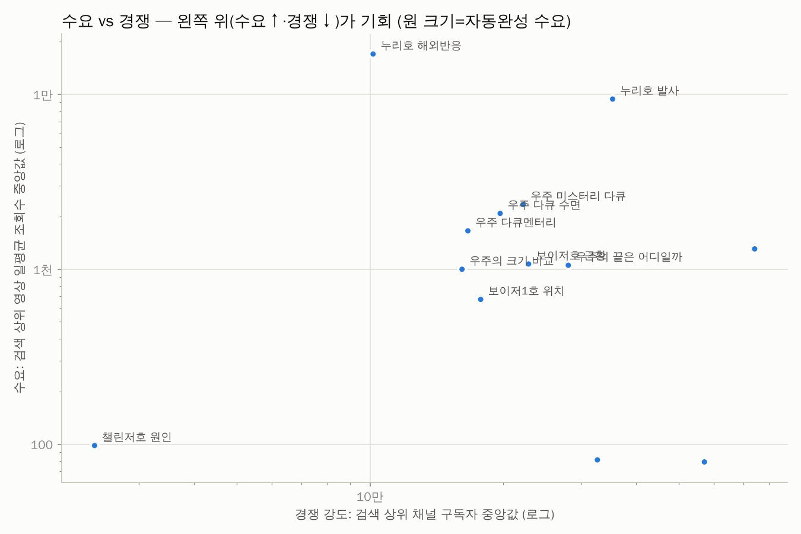

| 키워드 | 카테고리 | 기회점수 | 일평균 조회수(중앙) | 자동완성 | 소규모 진입 | 관련 비율 | 최신 비율 | 경쟁 구독자(중앙) | 배수(중앙) | 성공 수 | 추천 포맷 | 채널명검색 |
|---|---|---|---|---|---|---|---|---|---|---|---|---|
| 누리호 해외반응 | 5. 뉴스·위험 (누리호· | 81 | 1.7만 | 0.00 | 30.0% | 100.0% | 80.0% | 10.2만 | 3.62 | 9 | 쇼츠 |  |
| 우주 다큐멘터리 | 6. 다큐·수면용 포맷 | 69 | 1.7천 | 0.00 | 20.0% | 100.0% | 10.0% | 16.6만 | 15.18 | 17 | 롱폼 |  |
| 우주의 크기 비교 | 3. 우주의 크기·끝·탄생 | 62 | 999 | 0.00 | 20.0% | 100.0% | 5.0% | 16.1만 | 23.71 | 6 | 롱폼 |  |
| 우주 미스터리 다큐 | 2. 미스터리·외계 생명체 | 61 | 2.3천 | 0.00 | 5.0% | 100.0% | 20.0% | 22.2만 | 8.89 | 15 | 롱폼 |  |
| 보이저호 근황 | 4. 탐사·우주망원경 | 60 | 1.1천 | 0.00 | 20.0% | 100.0% | 15.0% | 22.9만 | 7.90 | 13 | 롱폼 |  |
| 누리호 발사 | 5. 뉴스·위험 (누리호· | 60 | 9.4천 | 0.00 | 10.0% | 100.0% | 75.0% | 35.4만 | 3.55 | 4 | 롱폼 |  |
| 보이저1호 위치 | 4. 탐사·우주망원경 | 50 | 672 | 0.00 | 10.0% | 100.0% | 5.0% | 17.8만 | 5.03 | 12 | 롱폼 |  |
| 우주 다큐 수면 | 6. 다큐·수면용 포맷 | 49 | 2.1천 | 0.00 | 0.0% | 100.0% | 20.0% | 19.7만 | 1.62 | 7 | 롱폼 |  |
| 챌린저호 원인 | 1. 우주 사고·실화 | 49 | 98 | 0.00 | 10.0% | 100.0% | 15.0% | 2.4만 | 0.83 | 4 | 쇼츠 |  |
| 우주의 끝은 어디일까 | 3. 우주의 크기·끝·탄생 | 45 | 1.1천 | 0.00 | 5.0% | 100.0% | 10.0% | 28.1만 | 3.98 | 4 | 롱폼 |  |
| 우주 미스터리 사건 | 2. 미스터리·외계 생명체 | 41 | 1.3천 | 0.00 | 5.0% | 100.0% | 10.0% | 74.2만 | 3.13 | 7 | 롱폼 |  |
| 컬럼비아호 폭발사고 | 1. 우주 사고·실화 | 34 | 81 | 0.00 | 0.0% | 95.0% | 5.3% | 32.7만 | 3.26 | 5 | 롱폼 |  |
| 챌린저호 폭발사고 | 1. 우주 사고·실화 | 24 | 79 | 0.00 | 0.0% | 100.0% | 10.0% | 57.1만 | 1.96 | 6 | 롱폼 |  |

키워드별 검색 수요 (자동완성이 표현을 어디까지 알아보는지 — 1.0=전체 문구가 자동완성에 뜸, 0=앞 두 단어도 안 뜸)

| 순위 | 검색어 | 카테고리 | 수요 점수 | 자동완성이 알아본 부분 | 일치 제안 수 |
|---|---|---|---|---|---|
| 1 | 챌린저호 폭발사고 | 1. 우주 사고·실화 | 0.00 | - | 0 |
| 1 | 우주 미스터리 다큐 | 2. 미스터리·외계 생명체 | 0.00 | - | 0 |
| 1 | 우주의 끝은 어디일까 | 3. 우주의 크기·끝·탄생 | 0.00 | - | 0 |
| 1 | 보이저1호 위치 | 4. 탐사·우주망원경 | 0.00 | - | 0 |
| 1 | 누리호 발사 | 5. 뉴스·위험 (누리호·소행성·우주 쓰레기) | 0.00 | - | 0 |
| 1 | 우주 다큐멘터리 | 6. 다큐·수면용 포맷 | 0.00 | - | 0 |
| 1 | 챌린저호 원인 | 1. 우주 사고·실화 | 0.00 | - | 0 |
| 1 | 우주 미스터리 사건 | 2. 미스터리·외계 생명체 | 0.00 | - | 0 |
| 1 | 우주의 크기 비교 | 3. 우주의 크기·끝·탄생 | 0.00 | - | 0 |
| 1 | 보이저호 근황 | 4. 탐사·우주망원경 | 0.00 | - | 0 |
| 1 | 누리호 해외반응 | 5. 뉴스·위험 (누리호·소행성·우주 쓰레기) | 0.00 | - | 0 |
| 1 | 우주 다큐 수면 | 6. 다큐·수면용 포맷 | 0.00 | - | 0 |
| 1 | 컬럼비아호 폭발사고 | 1. 우주 사고·실화 | 0.00 | - | 0 |

📢 광고 집행 의심으로 제외한 영상 3개 (조회수 대비 좋아요·댓글이 극히 적음)

| 영상 | 채널 | 구독자 | 조회수 | 좋아요율 | 댓글 수 |
|---|---|---|---|---|---|
| [［현장］ 누리호 5차 발사 성공...탑재캠 영상 공개/'군집 위성' 시대 열었다.…](https://www.youtube.com/watch?v=knvLAwO4AmM) | KBS News | 372만 | 19.6만 | 0.17% | 3 |
| [레이의 우주 대모험_태양계의 끝은 어디일까](https://www.youtube.com/watch?v=09l0VgcQ1sY) | EBS 키즈 | 500만 | 11.9만 | 0.14% | 0 |
| [인류가 아직 다른 별로 가지 못하는 진짜 이유 \| 깊은 잠에 빠져드는 우주다큐](https://www.youtube.com/watch?v=YAR6-cPYDkA) | 우주수면다큐 | 584 | 6.5만 | 0.24% | 2 |

🎯 주제와 무관해서 제외한 영상 11개 (조회수 상위 15개 — 전체는 data/excluded_offtopic.csv)

| 영상 | 채널 | 조회수 | 검색 키워드 |
|---|---|---|---|
| [마지막 '2분 40초' 영상 첫 공개 #shorts / KBS](https://www.youtube.com/watch?v=z2G0PxR6ntY) | KBS News | 1,042만 | 컬럼비아호 폭발사고 |
| [광속의 10조 배 속도 체감하기](https://www.youtube.com/watch?v=lE5BI5rUxCc) | 실감나는 우주 | 733만 | 우주의 크기 비교 |
| [한 번에 보는 세계 7대 불가사의 ［미스터리］](https://www.youtube.com/watch?v=wSlit4EEJKA) | 김반월의미스터리 | 665만 | 우주 미스터리 사건 |
| [레바논을 완전히 끝장내버린 핵폭탄급의 폭발, 베이루트 항구 폭발 사고](https://www.youtube.com/watch?v=s2WSpBnC9bY) | 리뷰엉이: Owl's Review | 334만 | 챌린저호 폭발사고 |
| [현대 과학으로도 풀리지 않는 5000년 이집트 미스터리 완전판 \| 7월의 몰아보…](https://www.youtube.com/watch?v=6KUHEGSF8jI) | 기묘한 밤 | 250만 | 우주 미스터리 사건 |
| [이제는 해결된 버뮤다 삼각지대의 미스테리?](https://www.youtube.com/watch?v=RQz00xM4U30) | 궁금소 | 226만 | 우주 미스터리 사건 |
| [NGC 지구 탄생：45억년의 비밀](https://www.youtube.com/watch?v=gYf_cb4ZVn8) | 우끼요 - 유머, 개그, 웃긴사진, 웃긴영상 | 110만 | 우주 다큐멘터리 |
| [UFO의 정체에 대한 아인슈타인의 답](https://www.youtube.com/watch?v=TPNRlqJvsEU) | 뚝딱 상식 뚝배기 | 74.7만 | 우주 미스터리 사건 |
| [［수면전용］ 최고로 잔잔한 영상만 악몽없는 순한맛 토요미스테리 (살인X공포X범죄없…](https://www.youtube.com/watch?v=OoJTc-ZdvRw) | 디바제시카DeevaJessica | 59.1만 | 우주 미스터리 사건 |
| [지구를 축구공의 크기로 축소하면 다른 별은 이렇게 된다](https://www.youtube.com/watch?v=BFZzl3QyJVk) | 메타볼스튜디오 | 10.9만 | 우주의 크기 비교 |
| [하늘에서 로켓 추락?? 거대한 굉음을 내면서 폭파 하는장면 (짧은영상)일상6탄](https://www.youtube.com/watch?v=BpvzIKJCw7Y) | 正本 일상TV | 6.2만 | 컬럼비아호 폭발사고 |

## 3. 🏷️ 제목 패턴 분석

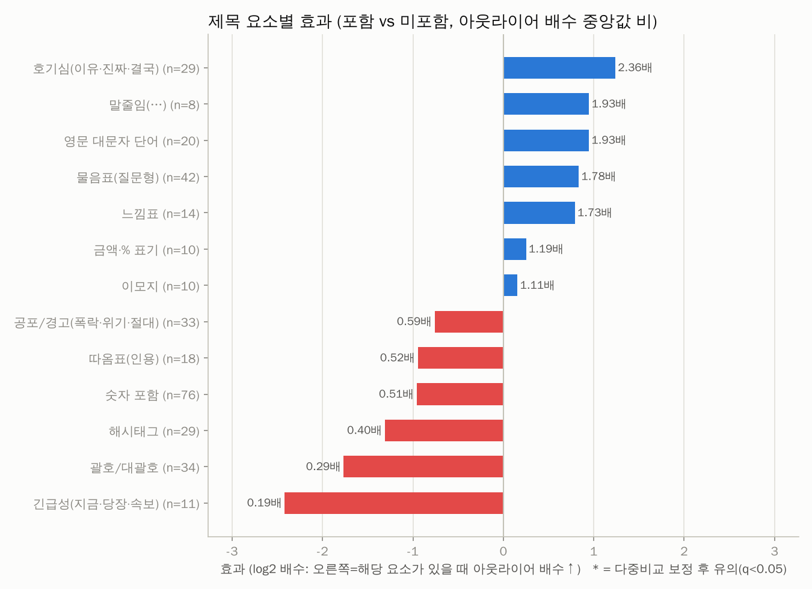
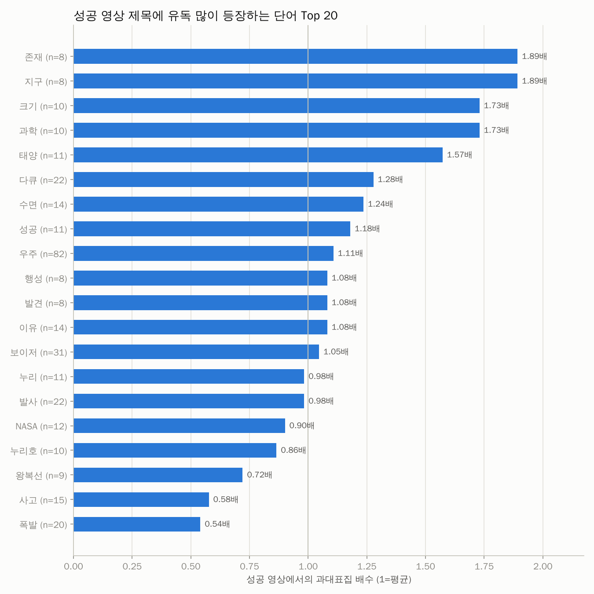
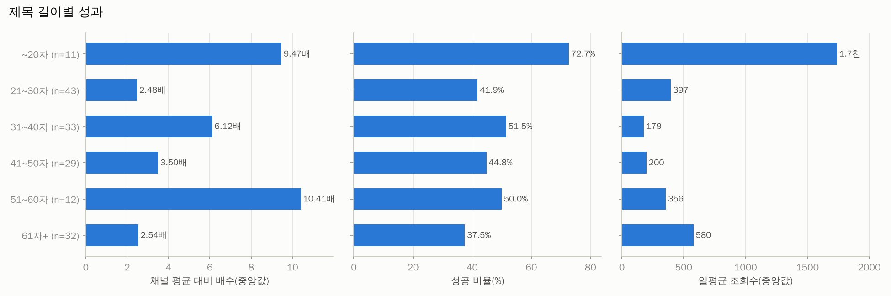

| 제목 요소 | 해당 영상 수 | 배수(있음) | 배수(없음) | 효과(배) | 성공률(있음) | 성공률(없음) | p값 | q값(보정) |
|---|---|---|---|---|---|---|---|---|
| 호기심(이유·진짜·결국) | 29 | 8.89 | 3.77 | 2.36 | 62.1% | 49.6% | 0.144 | 0.373 |
| 말줄임(…) | 8 | 7.66 | 3.97 | 1.93 | 50.0% | 52.2% | 0.357 | 0.664 |
| 영문 대문자 단어 | 20 | 6.98 | 3.62 | 1.93 | 75.0% | 48.4% | 0.347 | 0.664 |
| 물음표(질문형) | 42 | 6.45 | 3.62 | 1.78 | 57.1% | 50.0% | 0.415 | 0.674 |
| 느낌표 | 14 | 6.87 | 3.97 | 1.73 | 71.4% | 50.0% | 0.797 | 0.797 |
| 금액·% 표기 | 10 | 5.15 | 4.33 | 1.19 | 40.0% | 53.0% | 0.693 | 0.751 |
| 이모지 | 10 | 4.60 | 4.13 | 1.11 | 60.0% | 51.5% | 0.693 | 0.751 |
| 공포/경고(폭락·위기·절대) | 33 | 3.12 | 5.29 | 0.59 | 51.5% | 52.3% | 0.636 | 0.751 |
| 따옴표(인용) | 18 | 2.76 | 5.32 | 0.52 | 38.9% | 54.0% | 0.486 | 0.703 |
| 숫자 포함 | 76 | 3.34 | 6.49 | 0.51 | 46.1% | 59.1% | 0.027 | 0.308 |
| 해시태그 | 29 | 2.15 | 5.34 | 0.40 | 37.9% | 55.8% | 0.111 | 0.361 |
| 괄호/대괄호 | 34 | 1.85 | 6.28 | 0.29 | 38.2% | 56.5% | 0.071 | 0.308 |
| 긴급성(지금·당장·속보) | 11 | 1.00 | 5.34 | 0.19 | 27.3% | 54.2% | 0.065 | 0.308 |

롱폼/쇼츠 따로 본 제목 요소 효과

| 구분 | 제목 요소 | 영상 수 | 효과(배) | 성공률(있음) | p값 |
|---|---|---|---|---|---|
| 롱폼 | 호기심(이유·진짜·결국) | 25 | 3.32 | 72.0% | 0.026 |
| 롱폼 | 영문 대문자 단어 | 18 | 2.22 | 72.2% | 0.364 |
| 롱폼 | 금액·% 표기 | 8 | 2.16 | 50.0% | 0.642 |
| 롱폼 | 이모지 | 8 | 1.87 | 75.0% | 0.396 |
| 롱폼 | 느낌표 | 14 | 1.82 | 71.4% | 0.800 |
| 롱폼 | 물음표(질문형) | 38 | 1.57 | 55.3% | 0.481 |
| 롱폼 | 해시태그 | 18 | 0.99 | 55.6% | 0.770 |
| 롱폼 | 공포/경고(폭락·위기·절대) | 25 | 0.72 | 60.0% | 0.797 |
| 롱폼 | 숫자 포함 | 64 | 0.38 | 48.4% | 0.070 |
| 롱폼 | 따옴표(인용) | 14 | 0.32 | 35.7% | 0.193 |
| 롱폼 | 괄호/대괄호 | 32 | 0.27 | 40.6% | 0.104 |
| 롱폼 | 긴급성(지금·당장·속보) | 10 | 0.15 | 30.0% | 0.072 |
| 쇼츠 | 숫자 포함 | 12 | 0.61 | 33.3% | 0.139 |
| 쇼츠 | 공포/경고(폭락·위기·절대) | 8 | 0.28 | 25.0% | 0.121 |
| 쇼츠 | 해시태그 | 11 | 0.21 | 9.1% | 0.012 |

**성공 영상 제목에 유독 많이 나오는 단어** (과대표집 배수 = 성공 영상 내 비중 ÷ 전체 비중)

| 단어 | 영상 수 | 성공 수 | 과대표집 | 배수(중앙) | 일평균 조회수 |
|---|---|---|---|---|---|
| 존재 | 8 | 7 | 1.89 | 15.38 | 808 |
| 지구 | 8 | 7 | 1.89 | 12.84 | 620 |
| 크기 | 10 | 8 | 1.73 | 18.89 | 1.4천 |
| 과학 | 10 | 8 | 1.73 | 16.27 | 989 |
| 태양 | 11 | 8 | 1.57 | 16.25 | 487 |
| 다큐 | 22 | 13 | 1.28 | 9.05 | 867 |
| 수면 | 14 | 8 | 1.24 | 10.99 | 1.0천 |
| 성공 | 11 | 6 | 1.18 | 6.06 | 196 |
| 우주 | 82 | 42 | 1.11 | 7.31 | 683 |
| 행성 | 8 | 4 | 1.08 | 9.85 | 481 |
| 발견 | 8 | 4 | 1.08 | 3.99 | 730 |
| 이유 | 14 | 7 | 1.08 | 2.94 | 522 |
| 보이저 | 31 | 15 | 1.05 | 5.29 | 373 |
| 누리 | 11 | 5 | 0.98 | 4.88 | 397 |
| 발사 | 22 | 10 | 0.98 | 3.08 | 195 |
| NASA | 12 | 5 | 0.90 | 0.90 | 79 |
| 누리호 | 10 | 4 | 0.86 | 2.01 | 123 |
| 왕복선 | 9 | 3 | 0.72 | 2.29 | 7 |
| 사고 | 15 | 4 | 0.58 | 2.15 | 35 |
| 폭발 | 20 | 5 | 0.54 | 1.64 | 42 |
| 챌린저 | 21 | 3 | 0.31 | 0.82 | 22 |

## 4. 🎞️ 포맷 · 길이

> 쇼츠 조회수는 2025년 3월부터 '재생 시작/반복'마다 집계되어 롱폼 조회수와 직접 비교할 수 없습니다. 그래서 **같은 채널·같은 포맷 대비 배수(아웃라이어)** 와 성공 비율로 비교합니다.

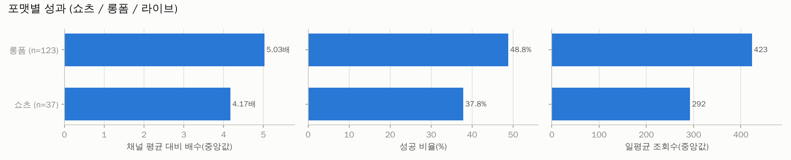
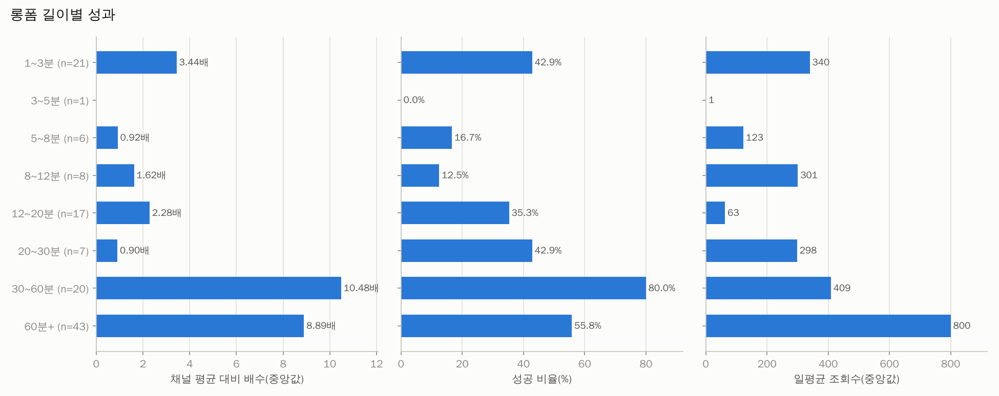

| 포맷 | 영상 수 | 조회수(중앙) | 일평균(중앙) | 배수(중앙) | 성공 비율 | 소규모채널 성공 |
|---|---|---|---|---|---|---|
| 롱폼 | 123 | 7.0만 | 423 | 5.03 | 48.8% | 21.1% |
| 쇼츠 | 37 | 2.4만 | 292 | 4.17 | 37.8% | 21.6% |

| 롱폼 길이 | 영상 수 | 조회수(중앙) | 일평균(중앙) | 배수(중앙) | 성공 비율 | 소규모채널 성공 |
|---|---|---|---|---|---|---|
| 1~3분 | 21 | 8.8만 | 340 | 3.44 | 42.9% | 4.8% |
| 3~5분 | 1 | 155 | 1 | - | 0.0% | 0.0% |
| 5~8분 | 6 | 3.8만 | 123 | 0.92 | 16.7% | 0.0% |
| 8~12분 | 8 | 5.8만 | 301 | 1.62 | 12.5% | 0.0% |
| 12~20분 | 17 | 1.7만 | 63 | 2.28 | 35.3% | 29.4% |
| 20~30분 | 7 | 2.0만 | 298 | 0.90 | 42.9% | 14.3% |
| 30~60분 | 20 | 7.9만 | 409 | 10.48 | 80.0% | 25.0% |
| 60분+ | 43 | 10.2만 | 800 | 8.89 | 55.8% | 32.6% |

## 5. 🕒 업로드 타이밍 (참고용 — 효과가 작고 혼란변수가 많음)

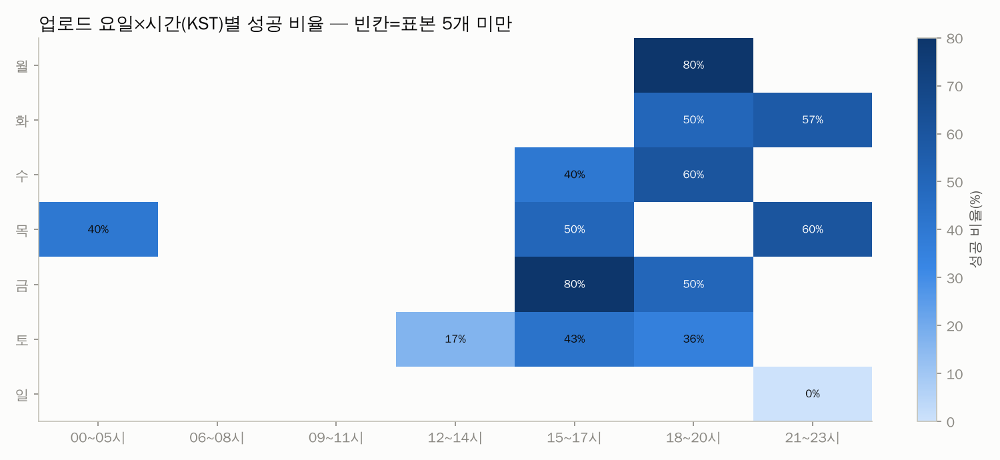

| 요일 | 영상 수 | 조회수(중앙) | 일평균(중앙) | 배수(중앙) | 성공 비율 | 소규모채널 성공 |
|---|---|---|---|---|---|---|
| 월 | 15 | 12.1만 | 848 | 16.66 | 73.3% | 26.7% |
| 화 | 23 | 7.0만 | 433 | 5.29 | 56.5% | 13.0% |
| 수 | 20 | 2.6만 | 198 | 5.80 | 40.0% | 30.0% |
| 목 | 26 | 3.6만 | 249 | 3.32 | 38.5% | 11.5% |
| 금 | 26 | 4.4만 | 294 | 6.78 | 53.8% | 42.3% |
| 토 | 33 | 9.8만 | 498 | 1.57 | 39.4% | 15.2% |
| 일 | 17 | 5.5만 | 457 | 1.98 | 29.4% | 11.8% |

| 시간대(KST) | 영상 수 | 조회수(중앙) | 일평균(중앙) | 배수(중앙) | 성공 비율 | 소규모채널 성공 |
|---|---|---|---|---|---|---|
| 00~05시 | 11 | 9.1만 | 413 | 7.77 | 63.6% | 36.4% |
| 06~08시 | 10 | 1.6천 | 30 | 0.82 | 10.0% | 0.0% |
| 09~11시 | 7 | 36.0만 | 1.1천 | 7.69 | 71.4% | 28.6% |
| 12~14시 | 12 | 1.7만 | 222 | 2.53 | 16.7% | 16.7% |
| 15~17시 | 32 | 4.3만 | 191 | 6.28 | 50.0% | 12.5% |
| 18~20시 | 63 | 10.2만 | 743 | 6.57 | 52.4% | 28.6% |
| 21~23시 | 25 | 9.2만 | 800 | 2.95 | 40.0% | 16.0% |

## 6. 🌱 채널 규모별 분석 — 0명 채널에게 가장 중요한 부분

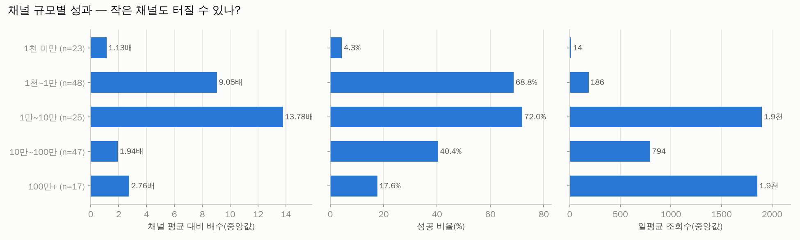
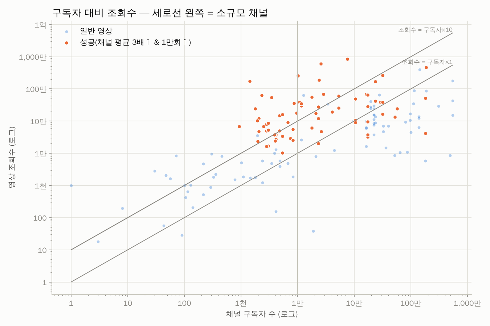

| 구독자 규모 | 영상 수 | 조회수(중앙) | 일평균(중앙) | 배수(중앙) | 성공 비율 | 소규모채널 성공 |
|---|---|---|---|---|---|---|
| 1천 미만 | 23 | 1.0천 | 14 | 1.13 | 4.3% | 4.3% |
| 1천~1만 | 48 | 3.5만 | 186 | 9.05 | 68.8% | 68.8% |
| 1만~10만 | 25 | 27.7만 | 1.9천 | 13.78 | 72.0% | 0.0% |
| 10만~100만 | 47 | 13.6만 | 794 | 1.94 | 40.4% | 0.0% |
| 100만+ | 17 | 28.9만 | 1.9천 | 2.76 | 17.6% | 0.0% |

**개설 1년 이내 채널의 성공 영상** (0개) — 신생 채널이 실제로 터진 사례

_데이터 없음_

## 7. 🔥 최근 14일 이내 급상승 영상 (아직 성과 집계 전 — 트렌드 참고)

| 영상 | 채널 | 구독자 | 조회수 | 일평균 | 경과일 | 포맷 |
|---|---|---|---|---|---|---|
| [누리호 5차 발사](https://www.youtube.com/watch?v=Ayv94wJBo1c) | 침착맨 | 329만 | 456만 | 119만 | 3.8 | 쇼츠 |
| [(풀영상) '환희..울컥' 누리호 5차 발사 성공! 역대급 현장영상](https://www.youtube.com/watch?v=dHfY8Jtg9po) | 엠키타카 MKTK | 110만 | 198만 | 49.7만 | 4.0 | 롱폼 |
| [［해외반응］ 한국의 로켓 개발 비웃었다던 해외 네티즌, 누리호 5차 발사 후 달라…](https://www.youtube.com/watch?v=zUGo3CXgHkc) | 반응을 보다 | 1.7천 | 100만 | 45.6만 | 2.2 | 롱폼 |
| [궤도 '누리호 5차 발사' 특강 \| 대한민국이 우주 강국이 되는 방법](https://www.youtube.com/watch?v=XHhae_snYjw) | 침착맨 | 329만 | 122만 | 45.1만 | 2.7 | 롱폼 |
| [어둠 속 '푸른 지구' 바로 찍혔다.."눈물나요!" 누리호 성공적 발사에 '환호'…](https://www.youtube.com/watch?v=U4bcWABgzag) | SBS 뉴스 | 529만 | 127만 | 34.9만 | 3.6 | 롱폼 |
| [［해외반응］ '영국이 한국에게 배워야 한다' 누리호 5차 발사 후 해외 기자들이 …](https://www.youtube.com/watch?v=aji9izdbc38) | 시끌시끌 | 1.6천 | 36.7만 | 28.0만 | 1.3 | 롱폼 |
| [［라이브 풀버전］ 우주먼지와 김범준도 벅차오른 순간… 누리호 5차 발사 성공!](https://www.youtube.com/watch?v=Ox0d88fpHC4) | 보다 BODA | 322만 | 45.1만 | 12.4만 | 3.6 | 롱폼 |
| [누리호 5차 발사 성공! 탑재 위성 분리의 순간 공개!](https://www.youtube.com/watch?v=YeM0G_BEBzY) | 한국항공우주연구원 KARI TV | 10.4만 | 47.1만 | 12.3만 | 3.8 | 롱폼 |
| [누리호 다시한번 날아오르다! 누리호 5차 발사 하이라이트! 초소형 군집 위성 5기…](https://www.youtube.com/watch?v=wMP6f3bX96c) | 안될과학 Unrealscience | 141만 | 38.1만 | 10.0만 | 3.8 | 롱폼 |
| [누리호, 또 해냈다👏 소름 돋는 발사 순간 #누리호 #5차발사 #우주 #발사체](https://www.youtube.com/watch?v=6xQQmjiqhGk) | KTV 정책 K | 19.5만 | 26.7만 | 7.0만 | 3.8 | 쇼츠 |
| [［다시보기］ 다시 드넓은 우주로…한국형 발사체 누리호 5차 발사 / 연합뉴스 (Y…](https://www.youtube.com/watch?v=-gfH_eCzZv8) | 연합뉴스 Yonhapnews | 113만 | 26.8만 | 6.7만 | 4.0 | 라이브 |
| [누리호가 쏘아 올린 '한국판 스타링크'...독자적 '군집위성 시대' ［자막뉴스］ …](https://www.youtube.com/watch?v=oRbtl-5SZWo) |  YTN | 541만 | 20.6만 | 6.7만 | 3.1 | 롱폼 |
| [누리호 5차 발사, 성공하면 무엇이 달라질까? ［지구본 초대석］](https://www.youtube.com/watch?v=ekZ30e6Lxvw) | 최준영 박사의 지구본 연구소 | 66.3만 | 27.3만 | 5.7만 | 4.8 | 롱폼 |
| [［LIVE］ 누리호 비행 종료…위성 15기 모두 분리/이 시각 우주전망대·낭도방파…](https://www.youtube.com/watch?v=SRRN40CtSDE) | KBS News | 372만 | 20.2만 | 5.5만 | 3.7 | 라이브 |
| [오늘 위성 15기 올린 누리호, 엔진을 사 오지 않은 이유](https://www.youtube.com/watch?v=rTX2WH7pXCo) | 알고보니 한국 | 282 | 20.7만 | 5.4만 | 3.8 | 쇼츠 |

## 8. 🏆 성공사례 — 대본 · 영상 · 썸네일

선정 기준: 종합점수(아웃라이어 40% + 조회수 35% + 구독자 대비 조회수 25%) 상위, 소규모 채널 ≥50%, 롱폼 ≥50%, 채널당 최대 1개. 각 폴더에 `transcript.txt`(대본), `transcript_timestamped.txt`, `video.mp4`, `thumbnail.jpg`, `metadata.json`, `comments.csv` 가 있습니다.

### 1. [우주의 크기가 느껴지는 사진 한 장](https://www.youtube.com/watch?v=sfqchJdv1KY)

- 채널 **호랑구팔** (구독자 2.6만) · 조회수 **599만** · 채널 평균의 **178.0배** · 쇼츠 00:45 · 업로드 2026-08-06 · 카테고리: 3. 우주의 크기·끝·탄생 · 검색어: `우주의 크기 비교` · 선정: 종합점수 상위 (점수 98)
- 📁 [`success_cases/01_우주의_크기가_느껴지는_사진_한_장_sfqchJdv1KY/`](success_cases/01_우주의_크기가_느껴지는_사진_한_장_sfqchJdv1KY/) · 대본: failed · 영상: skipped(DOWNLOAD_VIDEOS=False)

### 2. [누리호 발사 성공 레전드 해외반응 ㅋㅋ](https://www.youtube.com/watch?v=qPFJEwkRNE0)

- 채널 **콩두부** (구독자 1.4천) · 조회수 **174만** · 채널 평균의 **58.3배** · 쇼츠 00:32 · 업로드 2025-11-28 · 카테고리: 5. 뉴스·위험 (누리호·소행성·우주 쓰레기) · 검색어: `누리호 해외반응` · 선정: 소규모 채널 쿼터 (점수 93)
- 📁 [`success_cases/02_누리호_발사_성공_레전드_해외반응_qPFJEwkRNE0/`](success_cases/02_누리호_발사_성공_레전드_해외반응_qPFJEwkRNE0/) · 대본: failed · 영상: skipped(DOWNLOAD_VIDEOS=False)

### 3. [NASA의 거짓말을 '얼음물 한 컵'으로 밝혀낸 아저씨](https://www.youtube.com/watch?v=C884yB5MF_U)

- 채널 **얼레벌레** (구독자 2.4만) · 조회수 **190만** · 채널 평균의 **63.4배** · 쇼츠 00:30 · 업로드 2026-02-28 · 카테고리: 1. 우주 사고·실화 · 검색어: `챌린저호 원인` · 선정: 종합점수 상위 (점수 92)
- 📁 [`success_cases/03_NASA의_거짓말을_얼음물_한_컵_으로_밝혀낸_아저씨_C884yB5MF_U/`](success_cases/03_NASA의_거짓말을_얼음물_한_컵_으로_밝혀낸_아저씨_C884yB5MF_U/) · 대본: failed · 영상: skipped(DOWNLOAD_VIDEOS=False)

### 4. ["우리는 어디서 왔는가?" 우주가 숨겨온 인간의 기원 \| 칼 세이건 '코스모스' 총정리](https://www.youtube.com/watch?v=UEJ0BaR_ToY)

- 채널 **밀리언마인드 A million mind** (구독자 1.8만) · 조회수 **55.0만** · 채널 평균의 **83.1배** · 롱폼 1:02:38 · 업로드 2025-12-26 · 카테고리: 6. 다큐·수면용 포맷 · 검색어: `우주 다큐멘터리` · 선정: 롱폼 쿼터 (점수 88)
- 📁 [`success_cases/04_우리는_어디서_왔는가_우주가_숨겨온_인간의_기원_칼_세_UEJ0BaR_ToY/`](success_cases/04_우리는_어디서_왔는가_우주가_숨겨온_인간의_기원_칼_세_UEJ0BaR_ToY/) · 대본: failed · 영상: skipped(DOWNLOAD_VIDEOS=False)

### 5. ["내가 이렇게나 작은 존재였다니" 침대에 누워서 보다가 소름... 30분으로 요약한 압도적인 우주의 크기부터 신비로운 별의 죽…](https://www.youtube.com/watch?v=M5eMLRKKp1c)

- 채널 **EBS 지식** (구독자 31.5만) · 조회수 **262만** · 채널 평균의 **59.2배** · 롱폼 31:10 · 업로드 2026-02-16 · 카테고리: 3. 우주의 크기·끝·탄생 · 검색어: `우주의 끝은 어디일까` · 선정: 롱폼 쿼터 (점수 86)
- 📁 [`success_cases/05_내가_이렇게나_작은_존재였다니_침대에_누워서_보다가_소_M5eMLRKKp1c/`](success_cases/05_내가_이렇게나_작은_존재였다니_침대에_누워서_보다가_소_M5eMLRKKp1c/) · 대본: failed · 영상: skipped(DOWNLOAD_VIDEOS=False)

### 6. [제임스 웹이 밝혀낸 우주의 진짜 규모… 너무 충격적이다](https://www.youtube.com/watch?v=dRjIcygHL-o)

- 채널 **잠드는 과학** (구독자 1.8천) · 조회수 **24.4만** · 채널 평균의 **230.4배** · 롱폼 1:55:27 · 업로드 2026-05-22 · 카테고리: 2. 미스터리·외계 생명체 · 검색어: `우주 미스터리 사건` · 선정: 소규모 채널 쿼터 (점수 86)
- 📁 [`success_cases/06_제임스_웹이_밝혀낸_우주의_진짜_규모_너무_충격적이다_dRjIcygHL-o/`](success_cases/06_제임스_웹이_밝혀낸_우주의_진짜_규모_너무_충격적이다_dRjIcygHL-o/) · 대본: failed · 영상: skipped(DOWNLOAD_VIDEOS=False)

### 7. [선진국에선 30년, 한국에선 10년 걸린 누리호 성공 이야기](https://www.youtube.com/watch?v=QvalNcOmSOw)

- 채널 **시바시바** (구독자 3.5천) · 조회수 **54.7만** · 채널 평균의 **18.8배** · 쇼츠 00:54 · 업로드 2025-11-28 · 카테고리: 5. 뉴스·위험 (누리호·소행성·우주 쓰레기) · 검색어: `누리호 해외반응` · 선정: 소규모 채널 쿼터 (점수 82)
- 📁 [`success_cases/07_선진국에선_30년_한국에선_10년_걸린_누리호_성공_이_QvalNcOmSOw/`](success_cases/07_선진국에선_30년_한국에선_10년_걸린_누리호_성공_이_QvalNcOmSOw/) · 대본: failed · 영상: skipped(DOWNLOAD_VIDEOS=False)

### 8. [우주는 실제로 얼마나 거대한가?: 지구에서 우주의 끝까지](https://www.youtube.com/watch?v=XSmU3R_pwvI)

- 채널 **우주의 비밀** (구독자 2.1천) · 조회수 **12.1만** · 채널 평균의 **343.5배** · 롱폼 1:40:34 · 업로드 2026-05-08 · 카테고리: 6. 다큐·수면용 포맷 · 검색어: `우주 다큐멘터리` · 선정: 소규모 채널 쿼터 (점수 81)
- 📁 [`success_cases/08_우주는_실제로_얼마나_거대한가_지구에서_우주의_끝까지_XSmU3R_pwvI/`](success_cases/08_우주는_실제로_얼마나_거대한가_지구에서_우주의_끝까지_XSmU3R_pwvI/) · 대본: failed · 영상: skipped(DOWNLOAD_VIDEOS=False)

## 9. 💬 시청자 질문 (성공 영상 댓글에서 추출) — 다음 영상 주제 후보

질문 댓글에 많이 나오는 단어: `우주`(136), `지구`(51), `존재`(41), `인간`(40), `생각`(29), `태양`(25), `공간`(24), `물질`(23), `은하`(23), `가능`(23), `빅뱅`(19), `시간`(18), `보이저`(16), `관측`(16), `기술`(16), `행성`(15), `과학`(15), `속도`(14), `거리`(14), `생명체`(11)

| 질문 댓글 | 좋아요 | 영상 |
|---|---|---|
| 문제는 어디까지나 '관측 가능한' 우주여서 전체 우주의 크기는 가늠도 안간다 | 7,147 | [지구를 '모래알'로 줄이면, 우주는?](https://www.youtube.com/watch?v=L0tzYeej-2U) |
| 우리나라 군함이 거길 알고갔겠어? 다 우연이지 췟 | 3,429 | [한국 위성발사 실패 당시 주변국들 반응](https://www.youtube.com/watch?v=XHI7iIfqjbg) |
| 우리국민들은 이게 진짜 얼마나 대단한지잘모르는것같다..이성공이 무엇을의미하냐 전교생 200명넘는 학교에서 초엘리트들만 들만 들어가는반에(10명) 우리 스스로 공부해서 들어간건데 .. 이제 군사로 24시간 북한뿐만아니라 다른나라가 미사일을 쏘는지 뭐하는 | 1,656 | [누리호 발사 성공 레전드 해외반응 ㅋㅋ](https://www.youtube.com/watch?v=qPFJEwkRNE0) |
| 우린 처음 실패해서 너무 속상한데 왜 자꾸 이상하게 몰고가!! 아주 불쾌하네. 그냥 이 모든게 우리한테는 쓰라린 실패였다고. | 1,132 | [한국 위성발사 실패 당시 주변국들 반응](https://www.youtube.com/watch?v=XHI7iIfqjbg) |
| 얘들아 걱정하지마. 같은 칼을 들어도 살인범이 들면 위험하지만 요리사가 들면 위험해보이지 않잖아? 똑같은거야. ㅋㅋㅋ | 890 | [한국 위성발사 실패 당시 주변국들 반응](https://www.youtube.com/watch?v=XHI7iIfqjbg) |
| 여기 댓글들 왜 다 눈물날거같지 말도안되는 확률로 만난 우리 한국인들 모두 행복합시다! | 688 | [우주의 크기가 느껴지는 사진 한 장](https://www.youtube.com/watch?v=sfqchJdv1KY) |
| 평화적, 과학적에 운까지 따라주는 위성발사체(?), 우리는 순해요~ 안물어요~(때리지 않으면...) | 655 | [한국 위성발사 실패 당시 주변국들 반응](https://www.youtube.com/watch?v=XHI7iIfqjbg) |
| ［본 영상의 조회수 수익 23.2%는 과학 꿈나무들을 위해 기부됩니다］ 👋🏻여러분! 영상이 재밌으셨다면 '구독', '좋아요'로 함께 해주세요😁 다음 영상은 "80억 인구의 머리카락으로 밧줄을 만들면 얼마나 강력할까?" 입니다. 흥미로운 과학 질문을 댓 | 406 | [지구를 '모래알'로 줄이면, 우주는?](https://www.youtube.com/watch?v=L0tzYeej-2U) |
| 감히 리처드 파인만을 상대로 구라를 쳐?ㅋㅋㅋㅋㅋㅋ | 351 | [NASA의 거짓말을 '얼음물 한 컵'으로 밝혀…](https://www.youtube.com/watch?v=C884yB5MF_U) |
| 군함 : 우리는 그냥 지나갈뿐인데 옆에 뭐가 떨어지더라구요 우리도 놀랬어요 | 337 | [한국 위성발사 실패 당시 주변국들 반응](https://www.youtube.com/watch?v=XHI7iIfqjbg) |
| 자자~ 우리는 기술이 없어서 그런거에요! 맞죠?????😊😊(🤫🤫🤐눈치들 챙기자구요) | 329 | [누리호 발사, 세계 항공우주국들이 경악한 이유…](https://www.youtube.com/watch?v=X1BCsD8UviM) |
| 진짜 빵터졌다 ㄹㅇ 명언중에 명언이네 ㅋㅋ 지구를 향하는 기술입니다 ㅋㅋㅋㅋㅋㅋㅋㅋ 헤드에 핵탄두 박을거 아니지? 그렇지? ㅋㅋㅋㅋㅋ ㅋㅋㅋㅋㅋ | 305 | [누리호 발사 성공 레전드 해외반응 ㅋㅋ](https://www.youtube.com/watch?v=qPFJEwkRNE0) |
| 자 이제 원자를 보면서 내가 얼마나 큰 존재인지 볼까 ? | 292 | ["내가 이렇게나 작은 존재였다니" 침대에 누워…](https://www.youtube.com/watch?v=M5eMLRKKp1c) |
| 지구를 위한 로켓배송 ~ 얼마나 아름답고 감동적입니까? | 198 | [한국 위성발사 실패 당시 주변국들 반응](https://www.youtube.com/watch?v=XHI7iIfqjbg) |
| 우주라는 공간 자체가 왜 있는 건지 궁금해질 때가 있음 | 132 | [제임스 웹이 밝혀낸 우주의 진짜 규모… 너무 …](https://www.youtube.com/watch?v=dRjIcygHL-o) |
| 감사합니다 이렇게는 해야 어떤 느낌인지 와닿네요 ㅋㅋ | 123 | [지구를 '모래알'로 줄이면, 우주는?](https://www.youtube.com/watch?v=L0tzYeej-2U) |
| 이것도 인간이 알아냈다는건 참 대단한거네...난 왜 존재하고 도대체 어디서 왔을까? 정말 심오하다..... | 91 | ["내가 이렇게나 작은 존재였다니" 침대에 누워…](https://www.youtube.com/watch?v=M5eMLRKKp1c) |
| 나는 신기한게 그 응답신호가 오가는게 저 거리에서도 가능한게 더 신기한데......?😮😮😮😮😮 | 83 | [최신) 50년 전 발사된 보이저 1호, 현재 …](https://www.youtube.com/watch?v=LT5kF4JLw7k) |
| 국방부 눈치 드럽게 없네 국방부 너네가 왜 축하해줘 | 76 | [누리호 발사 성공 레전드 해외반응 ㅋㅋ](https://www.youtube.com/watch?v=qPFJEwkRNE0) |
| 미국 : 한국아 이번에 위성 쏜거 다탄두 미사일 아니지? 한국 : ......네 미국 : 그래 잘하자 | 72 | [한국 위성발사 실패 당시 주변국들 반응](https://www.youtube.com/watch?v=XHI7iIfqjbg) |

## 10. 🔖 태그 분석 (성공 영상에서 과대표집된 태그)

| 태그 | 영상 수 | 성공 수 | 과대표집 | 배수(중앙) |
|---|---|---|---|---|
| 과학다큐 | 9 | 7 | 1.68 | 15.52 |
| 우주다큐 | 11 | 8 | 1.57 | 7.41 |
| 은하 | 14 | 10 | 1.54 | 8.92 |
| 우주미스터리 | 9 | 6 | 1.44 | 13.66 |
| 보이저1호 | 11 | 7 | 1.38 | 12.16 |
| 물리학 | 8 | 5 | 1.35 | 9.38 |
| 우주이야기 | 8 | 5 | 1.35 | 16.25 |
| 토성 | 8 | 5 | 1.35 | 8.03 |
| 과학 | 21 | 12 | 1.24 | 9.05 |
| 천문학 | 23 | 13 | 1.22 | 6.12 |
| 우주탐사 | 11 | 6 | 1.18 | 8.79 |
| 목성 | 12 | 6 | 1.08 | 6.15 |
| ebs | 8 | 4 | 1.08 | 8.80 |
| 지식 | 8 | 4 | 1.08 | 3.08 |
| 보이저 | 9 | 4 | 0.96 | 6.15 |
| nasa | 25 | 11 | 0.95 | 5.03 |
| 태양계 | 25 | 11 | 0.95 | 1.94 |
| 우주과학 | 31 | 12 | 0.84 | 2.61 |
| 우주 | 48 | 18 | 0.81 | 1.96 |
| 성간우주 | 8 | 3 | 0.81 | 1.76 |

**아웃라이어 배수와의 순위상관(스피어만)** — 절댓값 0.1 미만은 사실상 무관

| 지표 | 상관계수 |
|---|---|
| like_rate | -0.136 |
| comment_rate | 0.033 |
| title_len | -0.062 |
| duration_sec | 0.131 |
| subscribers | -0.031 |
| channel_age_days | -0.091 |
| uploads_per_week | -0.025 |

## 11. ✅ 0명 채널 실행 체크리스트

1. **검색형 키워드로 시작**: 위 기회점수 상위 키워드는 '검색 → 유입'이 가능한 주제입니다. 구독자가 없을 때는 추천 피드보다 검색 유입이 먼저 열립니다.
2. **제목 = 검색어 + 검증된 제목 요소**: 키워드를 제목 앞쪽에 넣고, 3장의 효과 요소를 1~2개만 조합하세요 (과장은 시청 지속률을 떨어뜨립니다).
3. **첫 30초(쇼츠는 첫 3~5초)**: 8장 성공사례의 '도입부'를 비교해 공통 구조(질문 제기 → 결론 예고 → 근거)를 따라 해보세요.
4. **롱폼 1개 → 쇼츠 2~3개 재가공**: 같은 주제를 두 포맷으로 내보내 제작 효율과 노출 채널을 동시에 늘립니다.
5. **업로드 빈도**: 성공한 소규모 채널의 업로드 빈도 중앙값은 주 3.1회입니다. 꾸준함이 우선입니다 (최소 주 1~2회 롱폼 + 쇼츠).
6. **댓글 질문을 다음 영상으로**: 9장의 질문이 바로 수요가 검증된 다음 주제입니다.
7. **주식/금융 주제 주의**: 특정 종목 매수·매도 권유, 수익 보장 표현은 피하고 '투자 권유 아님' 고지를 넣으세요. 유료 리딩방·1:1 종목 추천처럼 대가를 받고 투자 판단을 조언하면 자본시장법상 유사투자자문업 신고 대상이 될 수 있습니다 (사업화 전 확인 필요).
8. **2~4주마다 재분석**: 트렌드는 빠르게 바뀝니다. 이 노트북을 다시 실행해 키워드 순위 변화를 확인하세요.

## 12. 📐 방법론 · 한계 · 재현 정보

- **아웃라이어 배수** = 영상 조회수 ÷ 같은 채널 최근 업로드 50개(업로드 14일 이상 경과, 같은 포맷 우선, 해당 영상 제외)의 조회수 중앙값. 구독자 수와 무관하게 '주제·제목·썸네일의 힘'을 보는 지표입니다.
- **분석 분할**: 성과 분석은 업로드 후 14일 이상 ~ 365일 이내 영상만 사용 (2025-10-11 ~ 2026-09-26). 그보다 최근 영상은 7장(급상승)에서만 참고.
- **미래 정보 누수 방지**: 모든 지표는 수집 시점에 관측 가능한 값만 사용하며, 기준선에서 대상 영상 자신을 제외했습니다.
- **주제 관련성 필터**: 제목·태그에 관련어(우주, 블랙홀, 태양계, 행성, 소행성, 혜성, 천문, 천체 등)가 있거나 설명란에 2번 이상 나와야 분석·성공사례에 포함 ('우주소녀, 우주를 줄게, 우주하마, 우주 하마, 우주떡집, 우주메리미, 소우주, 우주최강, 우주 최강, 우주대스타, 우주 대스타, 로켓배송, 보이저스 오브 네라, 보이저엑스, 화성시' 같은 표현은 먼저 제거). 이번 실행 제외 11개.
- **한계**: ① search.list 결과는 YouTube가 고른 표본이며 개인화되지 않은 결과입니다. ② 오래된 영상일수록 조회수가 누적되어 배수가 커질 수 있습니다 (채널 최근 업로드가 짧은 기간에 몰린 경우). ③ 썸네일·시청 지속률·CTR 등 핵심 내부 지표는 API로 볼 수 없습니다. ④ 제목 요소 효과는 상관관계이며 주제·채널 특성과 섞여 있습니다. ⑤ 쇼츠 판별은 길이 + youtube.com/shorts 응답으로 추정합니다.
- **재현성**: 랜덤 시드 42, 캐시 TTL 24시간, API 호출 {'search': 13, 'videos': 213, 'channels': 5, 'playlistItems': 234, 'commentThreads': 30}, 캐시 적중 {'playlistItems': 7}
- **저작권**: 성공사례 대본·영상은 개인 학습·분석용입니다. 재업로드·재배포하지 마세요. 공개 저장소에는 영상 파일을 올리지 않는 것이 기본값입니다.

**이번 실행의 경고/주의 사항**

- ［INIT］ ⚠️ 위험/비용 관련 설정이 기본값과 다릅니다 key=DOWNLOAD_VIDEOS default=True current=False
- ［KEYWORD］ 일부 자동완성(수요 점수) 요청 실패 → 해당 접두어는 수요 0으로 계산 n_failed=78
- ［SUCCESS］ 모든 대본 수집 실패 — YouTube 차단(봇 확인) 또는 네트워크 문제일 수 있음 hint="VPN 끄기 / cookies.txt를 스크립트 폴더에 두고 다시 실행"

## 13. 📁 파일 목록

- `README.md` (이 리포트) · `analysis.xlsx` (모든 표) · `data/*.csv` · `charts/*.png` · `success_cases/` · `run_info.json` · `run_log.txt`
