# 📊 YouTube '주식' 주제 분석 리포트

> 생성 2026-10-12 20:57 KST · 노트북 v2.3.0 · 실행ID `20261012_204952` · 지역 KR / 언어 ko  
> ⚠️ 연구·교육용 분석 결과입니다. **투자 조언이 아니며**, 통계는 상관관계일 뿐 인과관계를 보장하지 않습니다.

## 0. 한눈에 보기 (TL;DR)

- ⚙️ **설정 파일**: `stock/analyzer_config.toml`
- **분석 데이터**: 영상 1,589개 수집 → 성과 분석 715개 (업로드 2025-10-12 ~ 2026-09-28, 업로드 후 14일 이상 경과), 채널 776개, 검색 키워드 44개(9개 카테고리), 주제 무관 영상 129개 제외
- ⏭️ **이월된 키워드 1개** (쿼터 예산 초과 1개): 한국시간 오후 4~5시(태평양 자정, 한도 리셋) 이후 같은 설정으로 다시 실행하면 이미 받은 검색은 쿼터 0으로 재사용하고 나머지를 이어서 수집합니다
- 📢 **광고 집행 의심 영상 17개 제외**: 조회수는 많은데 좋아요·댓글이 거의 없는 영상(유료 홍보로 조회수를 산 것으로 추정) → 자연 유입으로 재현할 수 없으므로 성과 분석·성공사례에서 뺐습니다 (목록: 2장 하단)
- **성공(아웃라이어) 기준**: 조회수 10,000회 이상 **그리고** 같은 채널 최근 영상 중앙값의 3배 이상 → 167개 (23.4%)
- 🗂️ **기회가 큰 소재(카테고리)**: 5. ETF·지수·장기투자 (71점), 8. 실험·기록·도전 (62점), 1. 투자 실패 사연·경험담 (55점)
- 🎯 **기회가 가장 큰 키워드**: `S&P500 장기투자`(72점), `적립식 투자 후기`(72점), `주식 장기투자 10년`(71점), `소액 주식 투자 기록`(69점), `주식 1년 투자 결과`(68점)
- 🎬 **포맷별 성공 비율**: 라이브 25.0% (배수 중앙값 10.56배, n=16) · 롱폼 21.7% (배수 중앙값 2.93배, n=530) · 쇼츠 28.4% (배수 중앙값 2.60배, n=169) → 추천: **라이브** 중심
- ⏱️ **롱폼 추천 길이**: 20~30분, 12~20분 (성공 비율 상위 구간)
- 🏷️ **효과 있는 제목 요소**: 영문 대문자 단어 1.77배, 긴급성(지금·당장·속보) 1.52배, 금액·% 표기 1.12배, 숫자 포함 1.11배  /  역효과: 말줄임(…) 0.49배, 느낌표 0.49배, 해시태그 0.63배  (*=다중비교 보정 후 유의, q<0.05)
- 🌱 **작은 채널도 터지나?**: 소규모(<1만) 채널 영상의 성공 비율 17.6% vs 대형(≥10만) 16.8%. 성공한 소규모 채널의 업로드 빈도 중앙값: 주 3.6회
- 🕒 **업로드 타이밍(참고)**: 성공 비율 높은 요일 토, 금 / 시간대 21~23시, 06~08시 (KST)
- 💸 **API 쿼터 사용**: 5,833 / 예산 6,000 (일일 한도 10,000)

## 1. 🎬 추천 영상 아이디어 (데이터 기반)

제목 예시는 이번 데이터에서 효과가 확인된 제목 요소(긴급성(지금·당장·속보), 금액·% 표기, 숫자 포함; 데이터 기반 (lift≥1.1))를 키워드 성격(실패·손실 사연 / 사기·피해 / 일반 정보)에 맞춰 조합한 **템플릿 예시**입니다. 그대로 쓰기보다 참고 영상의 실제 제목·썸네일·도입부(대본)를 함께 보고 다듬으세요.

### 1. `S&P500 장기투자` — 기회점수 **72**/100 · 일반 정보

- 근거: 검색 상위 20개 영상 일평균 조회수 중앙값 **1.6천회**, 소규모 채널 진입 성공 비율 **20.0%**, 최근 90일 영상 비율 45.0%, 경쟁 채널 구독자 중앙값 5.8만명, 아웃라이어 배수 중앙값 4.84배, 성공 영상 12개
- 추천 포맷: **쇼츠** · 검색 상위 중 쇼츠 비율 35.0%
- 제목 예시: 「지금 S&P500 장기투자 꼭 확인해야 하는 이유」 / 「S&P500 장기투자 수수료 0.1% 차이가 만드는 결과」 / 「S&P500 장기투자 초보가 꼭 알아야 할 3가지」
- 참고할 성공 영상:
  - [미국 ETF 30초만에 이해하기](https://www.youtube.com/watch?v=X08HjlsEvpo) — 조회수 232만, 구독자 22만, 채널 평균의 83.0배, 쇼츠
  - [S&P 500 얼마씩 넣어야 돼요?](https://www.youtube.com/watch?v=duTqDoeBSYU) — 조회수 246만, 구독자 115만, 채널 평균의 29.4배, 롱폼
  - [2025년 한 해 동안 S&P500만 투자한 결과는?](https://www.youtube.com/watch?v=5FtJ9tuR9s8) — 조회수 11.9만, 구독자 634, 채널 평균의 22.4배, 쇼츠

### 2. `적립식 투자 후기` — 기회점수 **72**/100 · 일반 정보

- 근거: 검색 상위 20개 영상 일평균 조회수 중앙값 **577회**, 소규모 채널 진입 성공 비율 **30.0%**, 최근 90일 영상 비율 15.0%, 경쟁 채널 구독자 중앙값 2.5만명, 아웃라이어 배수 중앙값 7.78배, 성공 영상 15개
- 추천 포맷: **쇼츠** · 검색 상위 중 쇼츠 비율 50.0%
- 제목 예시: 「적립식 투자 후기 수수료 0.1% 차이가 만드는 결과」 / 「적립식 투자 후기 초보가 꼭 알아야 할 5가지」 / 「적립식 투자 후기 오늘 반드시 체크할 것」
- 참고할 성공 영상:
  - [S&P500 ETF 거치식 vs 적립식 투자, 결론냅니다. (수익률 비교) 정답공…](https://www.youtube.com/watch?v=oFo_DAUXqNE) — 조회수 6.6만, 구독자 6.6천, 채널 평균의 475.0배, 롱폼
  - [QQQ vs QLD vs TQQQ 매일 1만원씩 10년 투자 비교 10월 18일 …](https://www.youtube.com/watch?v=bNy5MzyuX84) — 조회수 44.7만, 구독자 1.7만, 채널 평균의 109.5배, 쇼츠
  - [나스닥100 2배 레버리지 ETF, QLD 5년 적립식 투자 결과](https://www.youtube.com/watch?v=4hHPQnfzpAQ) — 조회수 17.4만, 구독자 3.3천, 채널 평균의 32.1배, 쇼츠

### 3. `주식 장기투자 10년` — 기회점수 **71**/100 · 일반 정보

- 근거: 검색 상위 20개 영상 일평균 조회수 중앙값 **242회**, 소규모 채널 진입 성공 비율 **20.0%**, 최근 90일 영상 비율 12.5%, 경쟁 채널 구독자 중앙값 4.1만명, 아웃라이어 배수 중앙값 12.35배, 성공 영상 8개
- 추천 포맷: **쇼츠** · 검색 상위 중 쇼츠 비율 50.0%
- 제목 예시: 「주식 장기투자 10년 초보가 꼭 알아야 할 7가지」 / 「주식 장기투자 10년 오늘 반드시 체크할 것」 / 「주식 장기투자 10년 100만 원으로 시작한다면?」
- 참고할 성공 영상:
  - [진짜 ‘장기 투자’는 오래 들고 있는 게 아니다!](https://www.youtube.com/watch?v=eaqYSpDkBHU) — 조회수 190만, 구독자 13.8만, 채널 평균의 66.4배, 쇼츠
  - [25년 매일 10만원 투자 결과! 😱 적금 9억 vs S&P500 33억? 🚀 2…](https://www.youtube.com/watch?v=MkRternDa2Q) — 조회수 13.5만, 구독자 1.7만, 채널 평균의 33.0배, 쇼츠
  - [나스닥100 2배 레버리지 QLD 4년 장기투자의 결말 ft. 계좌 공개](https://www.youtube.com/watch?v=bA-2ImmsEAc) — 조회수 46.4만, 구독자 3.9만, 채널 평균의 16.8배, 쇼츠

### 4. `소액 주식 투자 기록` — 기회점수 **69**/100 · 일반 정보

- 근거: 검색 상위 20개 영상 일평균 조회수 중앙값 **1.7천회**, 소규모 채널 진입 성공 비율 **20.0%**, 최근 90일 영상 비율 0.0%, 경쟁 채널 구독자 중앙값 24.3만명, 아웃라이어 배수 중앙값 3.14배, 성공 영상 4개
- 추천 포맷: **쇼츠** · 검색 상위 중 쇼츠 비율 82.4%
- 제목 예시: 「소액 주식 투자 기록 오늘 반드시 체크할 것」 / 「소액 주식 투자 기록 100만 원으로 시작한다면?」 / 「소액 주식 투자 기록 핵심 3가지만 기억하세요」
- 참고할 성공 영상:
  - [주식으로 성공한 부자들의 어마어마한 핵심 노하우](https://www.youtube.com/watch?v=iacwbUHyqv4) — 조회수 542만, 구독자 13.8만, 채널 평균의 189.2배, 쇼츠
  - [매일 1만원씩 미국 지수 20년 장기 투자해 봤습니다](https://www.youtube.com/watch?v=lstGGLlJ1e8) — 조회수 114만, 구독자 51.3만, 채널 평균의 11.3배, 쇼츠
  - ["이 시간에 사지 마세요." 주식 고수들의 투자 철칙ㅣ지식인초대석 EP.114 (…](https://www.youtube.com/watch?v=FRT5DqFpy1U) — 조회수 299만, 구독자 411만, 채널 평균의 3.1배, 롱폼

### 5. `주식 1년 투자 결과` — 기회점수 **68**/100 · 일반 정보

- 근거: 검색 상위 20개 영상 일평균 조회수 중앙값 **3.7천회**, 소규모 채널 진입 성공 비율 **15.0%**, 최근 90일 영상 비율 15.0%, 경쟁 채널 구독자 중앙값 23.4만명, 아웃라이어 배수 중앙값 39.27배, 성공 영상 3개
- 추천 포맷: **nan** · 롱폼이면 20~30분, 12~20분 · 검색 상위 중 쇼츠 비율 90.0%
- 제목 예시: 「주식 1년 투자 결과 100만 원으로 시작한다면?」 / 「주식 1년 투자 결과 핵심 5가지만 기억하세요」 / 「지금 주식 1년 투자 결과 꼭 확인해야 하는 이유」
- 참고할 성공 영상:
  - [주식 투자 마이너스(-)되도 계속 갖고 있는 사람들의 결말](https://www.youtube.com/watch?v=M0fHTKInPNc) — 조회수 242만, 구독자 13.8만, 채널 평균의 84.4배, 쇼츠
  - [사고 묻어두면 10년 뒤 가장 많이 오르는 국내주식](https://www.youtube.com/watch?v=d__Q23_Tkdk) — 조회수 109만, 구독자 5.1만, 채널 평균의 39.3배, 롱폼
  - [10년 뒤에 가장 많이 오를 국내 주식은?](https://www.youtube.com/watch?v=WJWkjHTSjl8) — 조회수 451만, 구독자 14.5만, 채널 평균 비교 불가(기준선 부족), 쇼츠

### 6. `주식으로 전재산 잃은 사연` — 기회점수 **67**/100 · 실패·손실 사연

- 근거: 검색 상위 20개 영상 일평균 조회수 중앙값 **429회**, 소규모 채널 진입 성공 비율 **10.0%**, 최근 90일 영상 비율 16.7%, 경쟁 채널 구독자 중앙값 3.6만명, 아웃라이어 배수 중앙값 3.17배, 성공 영상 7개
- 추천 포맷: **롱폼** · 롱폼이면 20~30분, 12~20분 · 검색 상위 중 쇼츠 비율 22.2%
- 제목 예시: 「[주식으로 전재산 잃은 사연] 공통적으로 저지른 실수 7가지」 / 「지금 같은 장에서 주식으로 전재산 잃은 사연가 늘어나는 이유」 / 「-70%에서 깨달은 것 — 주식으로 전재산 잃은 사연」
- 참고할 성공 영상:
  - [주식 실패로 5억이 20만 원 되는 과정(1~5편 통합본)](https://www.youtube.com/watch?v=8_YxWzVTbro) — 조회수 53.4만, 구독자 5.7만, 채널 평균의 89.1배, 롱폼
  - [주식으로 돈 벌어도 결국 전재산을 잃는 이유, 실패 과정의 전형적인 패턴입니다](https://www.youtube.com/watch?v=RXft-lAkSqU) — 조회수 17.0만, 구독자 1.4만, 채널 평균의 53.5배, 롱폼
  - [주식투자로 전재산을 잃고나서 벌어진 일](https://www.youtube.com/watch?v=4OMJRLxkVQo) — 조회수 5.7만, 구독자 1천, 채널 평균 비교 불가(기준선 부족), 롱폼

### 7. `주식으로 돈 못 버는 이유` — 기회점수 **66**/100 · 실패·손실 사연

- 근거: 검색 상위 20개 영상 일평균 조회수 중앙값 **670회**, 소규모 채널 진입 성공 비율 **10.0%**, 최근 90일 영상 비율 10.5%, 경쟁 채널 구독자 중앙값 7.4만명, 아웃라이어 배수 중앙값 10.55배, 성공 영상 11개
- 추천 포맷: **쇼츠** · 검색 상위 중 쇼츠 비율 31.6%
- 제목 예시: 「지금 같은 장에서 주식으로 돈 못 버는 이유가 늘어나는 이유」 / 「-70%에서 깨달은 것 — 주식으로 돈 못 버는 이유」 / 「주식으로 돈 못 버는 이유 — 돌아간다면 절대 안 할 3가지」
- 참고할 성공 영상:
  - [개인투자자가 엄청나게 매수하는데 주가는 왜 오르지 못할까? (aka. 세력이 개미…](https://www.youtube.com/watch?v=4B0Hxwwv2WQ) — 조회수 59.6만, 구독자 7.8만, 채널 평균의 178.5배, 롱폼
  - [주식시장이 폭등해도 서민이 돈을 못 버는 이유 #snl #snl코리아 #예능 #정…](https://www.youtube.com/watch?v=M8cWBOkAQpE) — 조회수 347만, 구독자 4.0만, 채널 평균의 154.2배, 쇼츠
  - [주식으로 돈 못버는 사람 특징](https://www.youtube.com/watch?v=TqapHrNXR0g) — 조회수 1.5만, 구독자 2.9천, 채널 평균의 7.3배, 쇼츠

### 8. `배당주 장기투자` — 기회점수 **64**/100 · 일반 정보

- 근거: 검색 상위 20개 영상 일평균 조회수 중앙값 **649회**, 소규모 채널 진입 성공 비율 **10.0%**, 최근 90일 영상 비율 16.7%, 경쟁 채널 구독자 중앙값 13.3만명, 아웃라이어 배수 중앙값 3.73배, 성공 영상 8개
- 추천 포맷: **롱폼** · 롱폼이면 20~30분, 12~20분 · 검색 상위 중 쇼츠 비율 22.2%
- 제목 예시: 「배당주 장기투자 수수료 0.1% 차이가 만드는 결과」 / 「배당주 장기투자 초보가 꼭 알아야 할 5가지」 / 「배당주 장기투자 오늘 반드시 체크할 것」
- 참고할 성공 영상:
  - [SCHD 5천만원 투자, 배당금 받아보니 느낀 현실](https://www.youtube.com/watch?v=5RFVnBEBbjE) — 조회수 3.5만, 구독자 624, 채널 평균의 88.3배, 롱폼
  - [👀 ISA에서 미국배당주 사면 손해인가요? #ISA#절세계좌#미국배당주#배당투자#…](https://www.youtube.com/watch?v=1e--424cAKI) — 조회수 59.6만, 구독자 127만, 채널 평균의 13.4배, 쇼츠
  - [배당주 20년 vs S&P500 20년, 3억 원이 만든 충격적인 자산과 삶의 격…](https://www.youtube.com/watch?v=cqgVNBbMYew) — 조회수 7.7만, 구독자 1.9천, 채널 평균의 12.3배, 롱폼

### 🗓️ 첫 10개 영상 업로드 플랜 (제안)

| # | 형식 | 키워드 | 제목 예시 | 근거 |
|---|---|---|---|---|
| 1 | 쇼츠 | S&P500 장기투자 | 지금 S&P500 장기투자 꼭 확인해야 하는 이유 | 기회점수 72 |
| 2 | 롱폼 | S&P500 장기투자 | S&P500 장기투자 수수료 0.1% 차이가 만드는 결과 | 같은 키워드를 다른 포맷으로 재활용 (제작비↓, 검색·쇼츠 피드 동시 공략) |
| 3 | 쇼츠 | 적립식 투자 후기 | 적립식 투자 후기 수수료 0.1% 차이가 만드는 결과 | 기회점수 72 |
| 4 | 롱폼 | 적립식 투자 후기 | 적립식 투자 후기 초보가 꼭 알아야 할 5가지 | 같은 키워드를 다른 포맷으로 재활용 (제작비↓, 검색·쇼츠 피드 동시 공략) |
| 5 | 쇼츠 | 주식 장기투자 10년 | 주식 장기투자 10년 초보가 꼭 알아야 할 7가지 | 기회점수 71 |
| 6 | 롱폼 | 주식 장기투자 10년 | 주식 장기투자 10년 오늘 반드시 체크할 것 | 같은 키워드를 다른 포맷으로 재활용 (제작비↓, 검색·쇼츠 피드 동시 공략) |
| 7 | 쇼츠 | 소액 주식 투자 기록 | 소액 주식 투자 기록 오늘 반드시 체크할 것 | 기회점수 69 |
| 8 | 롱폼 | 소액 주식 투자 기록 | 소액 주식 투자 기록 100만 원으로 시작한다면? | 같은 키워드를 다른 포맷으로 재활용 (제작비↓, 검색·쇼츠 피드 동시 공략) |
| 9 | 롱폼 | 주식 1년 투자 결과 | 주식 1년 투자 결과 100만 원으로 시작한다면? | 기회점수 68 |
| 10 | 쇼츠 | 주식 1년 투자 결과 | 주식 1년 투자 결과 핵심 5가지만 기억하세요 | 같은 키워드를 다른 포맷으로 재활용 (제작비↓, 검색·쇼츠 피드 동시 공략) |

### 🧩 하위 주제(제목 클러스터)별 기회

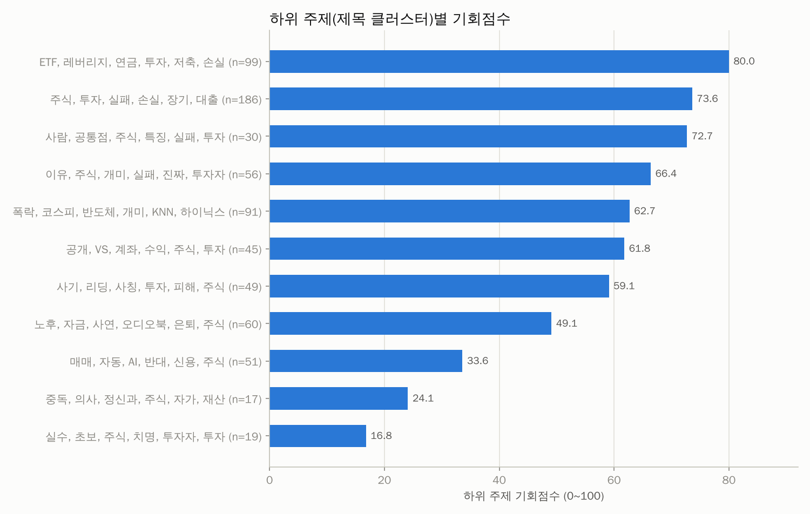

| 기회점수 | 핵심 단어 | 영상 수 | 배수 중앙값 | 성공 비율 | 소규모채널 성공 | 쇼츠 비율 | 예시 제목 |
|---|---|---|---|---|---|---|---|
| 80 | ETF, 레버리지, 연금, 투자, 저축, 손실 | 99 | 3.65 | 28.3% | 3.0% | 15.2% | 연금저축/IRP ETF, 이 4개면 충분합니다 / 미국 ETF 30초만에 이해하기 / S&P 500 ETF 장기투자? 딱 3가지만 조심하세요! |
| 74 | 주식, 투자, 실패, 손실, 장기, 대출 | 186 | 2.98 | 29.6% | 5.9% | 27.4% | 주식 90%의 투자자가 실패하는 냉혹한 진실 / 미수거래와 신용거래 차이｜초보 주식 투자자를 위한 필수 가이드 / 주식 세력이 개미의 물량을 뺏기 위해 사용하는  |
| 73 | 사람, 공통점, 주식, 특징, 실패, 투자 | 30 | 3.63 | 36.7% | 13.3% | 20.0% | "3억이 0원 됐다" 주식으로 망하는 사람들의 10가지 특징 / 주식으로 돈 벌고도 결국 망하는 사람들의 3가지 공통점 / 주식 투자 마이너스(-)되도 계속 갖고 |
| 66 | 이유, 주식, 개미, 실패, 진짜, 투자자 | 56 | 3.06 | 35.7% | 5.4% | 35.7% | 개미투자자의 95%가 돈을 잃는 이유 ［장영한 대표 인터뷰 2부］ / S&P 500 ETF 좋은 줄 알고 투자했는데, 99%가 실패하는 소름  / 주식시장이 폭등 |
| 63 | 폭락, 코스피, 반도체, 개미, KNN, 하이닉스 | 91 | 3.65 | 9.9% | 1.1% | 26.4% | 반도체 급락, 진짜 이유는 따로 있다 #삼성전자 #SK하이닉스 #하이닉스 / 코스피만 폭락의 진짜 원인?! 외국인이 아니라 '이것' 때문이었습니다 # / 반도체  |
| 62 | 공개, VS, 계좌, 수익, 주식, 투자 | 45 | 2.86 | 35.6% | 4.4% | 35.6% | S&P500 ETF 거치식 vs 적립식 투자, 결론냅니다. (수익률 비교 / QQQ vs QLD vs TQQQ 매일 1만원씩 10년 투자 비교 10월 / "60대 |
| 59 | 사기, 리딩, 사칭, 투자, 피해, 주식 | 49 | 3.94 | 4.1% | 4.1% | 20.4% | 수익인증 주식 리딩방의 사기수법, 나는 속지 않을 자신 있다? 처음부터  / 유안타증권 사칭 사기 주식 밴드리딩방 전문가 사칭 투자사기 피해 대응 안 / 리딩방  |
| 49 | 노후, 자금, 사연, 오디오북, 은퇴, 주식 | 60 | 2.02 | 13.3% | 10.0% | 0.0% | 퇴직금 6억원 주식투자로 전재산 날려버린 65세 은퇴자의 눈물 \| 노후자 / 노후자금 사연 주식투자로 280만 원에서 210억 만든 58세 전직 어부 / 주식  |
| 34 | 매매, 자동, AI, 반대, 신용, 주식 | 51 | 2.12 | 27.5% | 2.0% | 33.3% | 미수금 없애는 매도 대금 담보 대출｜반대매매 방지 핵심 팁 / 신용거래 반대 매매 조건 완벽 정리｜담보 비율 기준과 피하는 법 / 코딩 몰라도, 컴맹도 가능! A |
| 24 | 중독, 의사, 정신과, 주식, 자가, 재산 | 17 | 0.63 | 0.0% | 0.0% | 11.8% | 주식 중독 자가 테스트 / 도파민을 경험한 뇌의 폭주 🧠 고장난 전두엽 \| 주식 중독 \| 지식채널e / '돈 버는 뇌는 다릅니다', 주식중독 병일까? 의사가  |
| 17 | 실수, 초보, 주식, 치명, 투자자, 투자 | 19 | 0.91 | 5.3% | 0.0% | 31.6% | 주식 초보들만 하는 최악의 실수 1위 / 초보투자자들이 모르는 치명적 실수 3가지 / 주식 초보가 가장 많이 하는 실수 1위? '이것'만 알아도 내 계좌의 1 |
| - | 결국, 이유, 과학, 실패, 청산, 진짜 | 8 | 1.73 | 12.5% | 0.0% | 0.0% | 주식으로 돈 벌어도 결국 전재산을 잃는 이유, 실패 과정의 전형적인 패턴 / 불장에 영끌 안 하면 벼락거지 된다? 청년들이 빚내서 투자하고 결국엔 청 / 장기투자 |

## 2. 🔑 키워드 기회 분석

기회점수 = 수요 25% + 자동완성 15% + 소규모채널 진입 20% + 아웃라이어 10% + 신선도 5% + 경쟁(역) 15% + 콘텐츠 공백 10% (키워드 간 백분위 기준). 수요·경쟁은 **주제 관련 영상만**으로 계산했고, 검색 상위 10개 중 절반 이상이 한 채널인 키워드(채널명 검색)는 제외했습니다. '관련 비율'이 낮다 = 사람들이 찾는데 맞는 영상이 적다(콘텐츠 공백).

### 🗂️ 카테고리(소재)별 기회

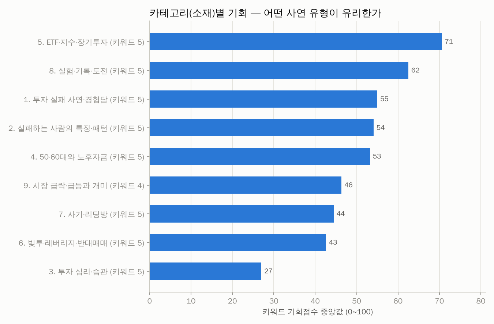

| 카테고리 | 키워드 수 | 기회(중앙) | 기회(최고) | 최고 키워드 | 검색수요 합 | 일평균 조회(중앙) | 소규모 진입 | 관련 비율 | 성공 영상 | 배수(중앙) |
|---|---|---|---|---|---|---|---|---|---|---|
| 5. ETF·지수·장기투자 | 5 | 71 | 72 | S&P500 장기투자 | 0.0 | 577 | 17.0% | 94.0% | 41 | 3.68 |
| 8. 실험·기록·도전 | 5 | 62 | 69 | 소액 주식 투자 기록 | 0.0 | 1.1천 | 13.0% | 94.0% | 16 | 2.24 |
| 1. 투자 실패 사연·경험담 | 5 | 55 | 67 | 주식으로 전재산 잃은 사연 | 0.0 | 194 | 8.0% | 96.0% | 16 | 2.38 |
| 2. 실패하는 사람의 특징·패턴 | 5 | 54 | 66 | 주식으로 돈 못 버는 이유 | 0.0 | 350 | 5.0% | 97.0% | 27 | 4.07 |
| 4. 50·60대와 노후자금 | 5 | 53 | 63 | 은퇴 후 주식 투자 | 0.0 | 314 | 6.0% | 94.0% | 34 | 3.40 |
| 9. 시장 급락·급등과 개미 | 4 | 46 | 63 | 주식 폭락 개미 손실 | 0.0 | 517 | 3.8% | 96.2% | 11 | 3.21 |
| 7. 사기·리딩방 | 5 | 44 | 56 | 투자 사기 수법 | 0.0 | 23 | 7.0% | 75.0% | 2 | 2.56 |
| 6. 빚투·레버리지·반대매매 | 5 | 43 | 60 | 신용거래 반대매매 | 0.0 | 147 | 9.0% | 97.0% | 15 | 2.33 |
| 3. 투자 심리·습관 | 5 | 27 | 41 | 주식 복구 심리 | 0.0 | 36 | 1.0% | 98.0% | 5 | 1.24 |

### 🔑 키워드별 기회

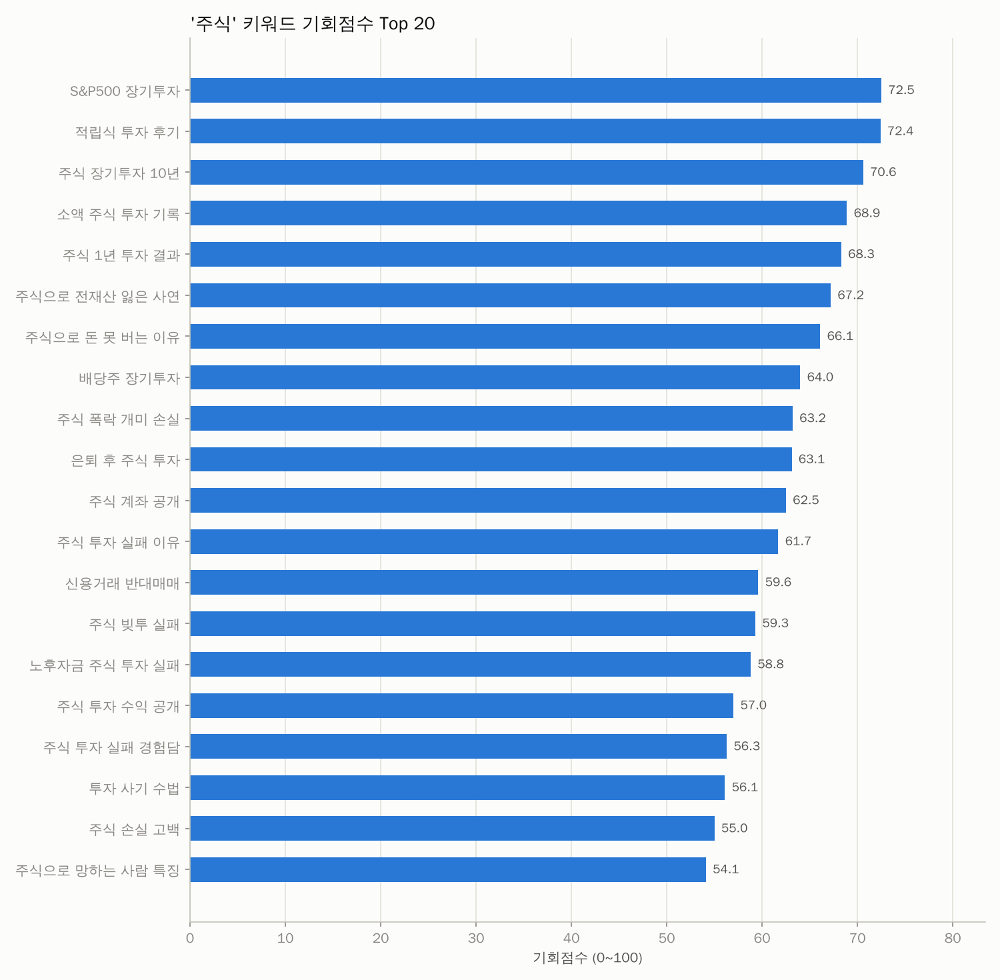
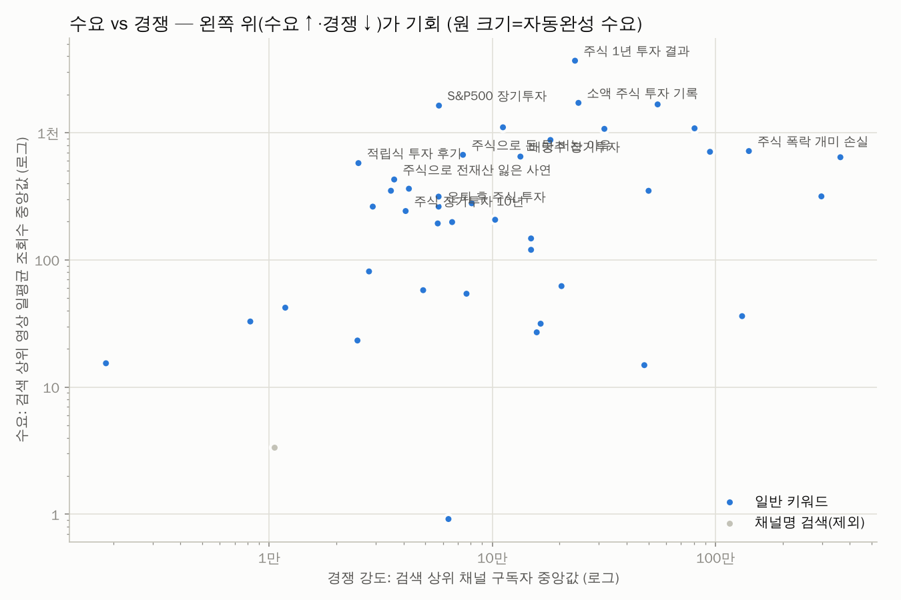

| 키워드 | 카테고리 | 기회점수 | 일평균 조회수(중앙) | 자동완성 | 소규모 진입 | 관련 비율 | 최신 비율 | 경쟁 구독자(중앙) | 배수(중앙) | 성공 수 | 추천 포맷 | 채널명검색 |
|---|---|---|---|---|---|---|---|---|---|---|---|---|
| S&P500 장기투자 | 5. ETF·지수·장기투자 | 72 | 1.6천 | 0.00 | 20.0% | 100.0% | 45.0% | 5.8만 | 4.84 | 12 | 쇼츠 |  |
| 적립식 투자 후기 | 5. ETF·지수·장기투자 | 72 | 577 | 0.00 | 30.0% | 100.0% | 15.0% | 2.5만 | 7.78 | 15 | 쇼츠 |  |
| 주식 장기투자 10년 | 5. ETF·지수·장기투자 | 71 | 242 | 0.00 | 20.0% | 80.0% | 12.5% | 4.1만 | 12.35 | 8 | 쇼츠 |  |
| 소액 주식 투자 기록 | 8. 실험·기록·도전 | 69 | 1.7천 | 0.00 | 20.0% | 85.0% | 0.0% | 24.3만 | 3.14 | 4 | 쇼츠 |  |
| 주식 1년 투자 결과 | 8. 실험·기록·도전 | 68 | 3.7천 | 0.00 | 15.0% | 100.0% | 15.0% | 23.4만 | 39.27 | 3 | - |  |
| 주식으로 전재산 잃은 사연 | 1. 투자 실패 사연·경험 | 67 | 429 | 0.00 | 10.0% | 90.0% | 16.7% | 3.6만 | 3.17 | 7 | 롱폼 |  |
| 주식으로 돈 못 버는 이유 | 2. 실패하는 사람의 특징 | 66 | 670 | 0.00 | 10.0% | 95.0% | 10.5% | 7.4만 | 10.55 | 11 | 쇼츠 |  |
| 배당주 장기투자 | 5. ETF·지수·장기투자 | 64 | 649 | 0.00 | 10.0% | 90.0% | 16.7% | 13.3만 | 3.73 | 8 | 롱폼 |  |
| 주식 폭락 개미 손실 | 9. 시장 급락·급등과 개 | 63 | 718 | 0.00 | 10.0% | 90.0% | 61.1% | 141만 | 5.22 | 4 | 롱폼 |  |
| 은퇴 후 주식 투자 | 4. 50·60대와 노후자 | 63 | 262 | 0.00 | 15.0% | 85.0% | 23.5% | 5.7만 | 2.69 | 5 | 롱폼 |  |
| 주식 계좌 공개 | 8. 실험·기록·도전 | 62 | 363 | 0.00 | 20.0% | 100.0% | 20.0% | 4.2만 | 1.98 | 4 | 쇼츠 |  |
| 주식 투자 실패 이유 | 2. 실패하는 사람의 특징 | 62 | 350 | 0.00 | 10.0% | 100.0% | 15.0% | 3.5만 | 5.15 | 8 | 롱폼 |  |
| 신용거래 반대매매 | 6. 빚투·레버리지·반대매 | 60 | 42 | 0.00 | 20.0% | 95.0% | 10.5% | 1.2만 | 3.46 | 8 | 쇼츠 |  |
| 주식 빚투 실패 | 6. 빚투·레버리지·반대매 | 59 | 1.1천 | 0.00 | 5.0% | 95.0% | 26.3% | 80.5만 | 7.20 | 5 | 롱폼 |  |
| 노후자금 주식 투자 실패 | 4. 50·60대와 노후자 | 59 | 262 | 0.00 | 10.0% | 95.0% | 31.6% | 2.9만 | 1.88 | 10 | 롱폼 |  |
| 주식 투자 수익 공개 | 8. 실험·기록·도전 | 57 | 1.1천 | 0.00 | 5.0% | 90.0% | 11.1% | 31.8만 | 3.05 | 4 | 쇼츠 |  |
| 주식 투자 실패 경험담 | 1. 투자 실패 사연·경험 | 56 | 194 | 0.00 | 10.0% | 95.0% | 31.6% | 5.7만 | 3.10 | 11 | 롱폼 |  |
| 투자 사기 수법 | 7. 사기·리딩방 | 56 | 708 | 0.00 | 5.0% | 65.0% | 0.0% | 94.4만 | 6.70 | 2 | 롱폼 |  |
| 주식 손실 고백 | 1. 투자 실패 사연·경험 | 55 | 303 | 0.00 | 5.0% | 95.0% | 10.5% | 5.7만 | 4.76 | 9 | 롱폼 |  |
| 주식으로 망하는 사람 특징 | 2. 실패하는 사람의 특징 | 54 | 279 | 0.00 | 5.0% | 95.0% | 10.5% | 8.1만 | 9.56 | 11 | 롱폼 |  |
| 연금저축 ETF 투자 | 4. 50·60대와 노후자 | 53 | 1.1천 | 0.00 | 0.0% | 100.0% | 20.0% | 11.2만 | 5.11 | 15 | 롱폼 |  |
| 반도체 주식 손실 | 9. 시장 급락·급등과 개 | 52 | 1.7천 | 0.00 | 0.0% | 95.0% | 52.6% | 55만 | 2.13 | 3 | 롱폼 |  |
| 개미가 주식으로 돈 잃는 이유 | 2. 실패하는 사람의 특징 | 50 | 877 | 0.00 | 0.0% | 100.0% | 10.0% | 18.2만 | 27.33 | 16 | 롱폼 |  |
| 주식 노후 사연 오디오북 | 1. 투자 실패 사연·경험 | 50 | 15 | 0.00 | 15.0% | 100.0% | 25.0% | 1.9천 | 2.04 | 4 | 롱폼 |  |
| 60대 주식 투자 | 4. 50·60대와 노후자 | 50 | 314 | 0.00 | 0.0% | 95.0% | 10.5% | 5.7만 | 4.80 | 9 | 롱폼 |  |
| AI 주식 자동매매 | 8. 실험·기록·도전 | 49 | 81 | 0.00 | 5.0% | 95.0% | 10.5% | 2.8만 | 2.29 | 7 | 롱폼 |  |
| 코인 리딩방 사기 | 7. 사기·리딩방 | 48 | 23 | 0.00 | 10.0% | 100.0% | 5.0% | 2.5만 | 5.54 | 0 | 롱폼 |  |
| 퇴직금 주식 투자 | 4. 50·60대와 노후자 | 45 | 349 | 0.00 | 5.0% | 95.0% | 15.8% | 50.1만 | 1.68 | 6 | 롱폼 |  |
| 주식 미수 깡통 | 6. 빚투·레버리지·반대매 | 43 | 147 | 0.00 | 15.0% | 100.0% | 5.0% | 14.9만 | 1.03 | 2 | 롱폼 |  |
| 주식 복구 심리 | 3. 투자 심리·습관 | 41 | 62 | 0.00 | 5.0% | 95.0% | 5.3% | 20.4만 | 3.64 | 5 | 롱폼 |  |
| 코스피 폭락 | 9. 시장 급락·급등과 개 | 41 | 316 | 0.00 | 0.0% | 100.0% | 85.0% | 298만 | 5.74 | 5 | 롱폼 |  |
| 주식 초보 실수 | 2. 실패하는 사람의 특징 | 41 | 198 | 0.00 | 0.0% | 95.0% | 36.8% | 6.6만 | 1.20 | 3 | 쇼츠 |  |
| 주식 리딩방 사기 피해 | 7. 사기·리딩방 | 41 | 54 | 0.00 | 10.0% | 100.0% | 10.0% | 7.7만 | 1.75 | 0 | 롱폼 |  |
| 레버리지 ETF 손실 | 6. 빚투·레버리지·반대매 | 40 | 642 | 0.00 | 0.0% | 100.0% | 40.0% | 362만 | 2.48 | 2 | 롱폼 |  |
| ETF 장기투자 실패 | 5. ETF·지수·장기투자 | 40 | 33 | 0.00 | 5.0% | 100.0% | 5.0% | 8.2천 | 1.65 | 4 | 롱폼 |  |
| 대출받아 주식 투자 | 6. 빚투·레버리지·반대매 | 39 | 120 | 0.00 | 5.0% | 95.0% | 5.3% | 14.9만 | 1.33 | 4 | 롱폼 |  |
| 주식 투자 실패 사연 | 1. 투자 실패 사연·경험 | 38 | 58 | 0.00 | 0.0% | 100.0% | 25.0% | 4.9만 | 2.11 | 7 | 롱폼 |  |
| 주식 물타기 실패 | 3. 투자 심리·습관 | 36 | 207 | 0.00 | 0.0% | 100.0% | 5.0% | 10.3만 | 2.60 | 3 | 롱폼 |  |
| 테마주 투자 실패 | 9. 시장 급락·급등과 개 | 31 | 1 | 0.00 | 5.0% | 100.0% | 5.0% | 6.4만 | 1.79 | 1 | 쇼츠 |  |
| 노인 투자 사기 | 7. 사기·리딩방 | 30 | 15 | 0.00 | 0.0% | 10.0% | 0.0% | 48.0만 | - | 0 | - |  |
| 주식 뇌동매매 | 3. 투자 심리·습관 | 27 | 27 | 0.00 | 0.0% | 95.0% | 5.3% | 15.8만 | 0.81 | 0 | - |  |
| 주식 손절 못하는 이유 | 3. 투자 심리·습관 | 23 | 32 | 0.00 | 0.0% | 100.0% | 0.0% | 16.4만 | 1.48 | 1 | 롱폼 |  |
| 주식 중독 | 3. 투자 심리·습관 | 20 | 36 | 0.00 | 0.0% | 100.0% | 5.0% | 132만 | 0.95 | 1 | 롱폼 |  |
| 주식 전문가 사칭 사기 | 7. 사기·리딩방 | - | 3 | 0.00 | 10.0% | 100.0% | 25.0% | 1.1만 | 3.54 | 0 | 롱폼 | 예 |

키워드별 검색 수요 (자동완성이 표현을 어디까지 알아보는지 — 1.0=전체 문구가 자동완성에 뜸, 0=앞 두 단어도 안 뜸)

| 순위 | 검색어 | 카테고리 | 수요 점수 | 자동완성이 알아본 부분 | 일치 제안 수 |
|---|---|---|---|---|---|
| 1 | 주식 투자 실패 사연 | 1. 투자 실패 사연·경험담 | 0.00 | - | 0 |
| 1 | 주식으로 망하는 사람 특징 | 2. 실패하는 사람의 특징·패턴 | 0.00 | - | 0 |
| 1 | 주식 손절 못하는 이유 | 3. 투자 심리·습관 | 0.00 | - | 0 |
| 1 | 노후자금 주식 투자 실패 | 4. 50·60대와 노후자금 | 0.00 | - | 0 |
| 1 | ETF 장기투자 실패 | 5. ETF·지수·장기투자 | 0.00 | - | 0 |
| 1 | 주식 빚투 실패 | 6. 빚투·레버리지·반대매매 | 0.00 | - | 0 |
| 1 | 주식 리딩방 사기 피해 | 7. 사기·리딩방 | 0.00 | - | 0 |
| 1 | AI 주식 자동매매 | 8. 실험·기록·도전 | 0.00 | - | 0 |
| 1 | 주식 폭락 개미 손실 | 9. 시장 급락·급등과 개미 | 0.00 | - | 0 |
| 1 | 주식으로 전재산 잃은 사연 | 1. 투자 실패 사연·경험담 | 0.00 | - | 0 |
| 1 | 주식 투자 실패 이유 | 2. 실패하는 사람의 특징·패턴 | 0.00 | - | 0 |
| 1 | 주식 물타기 실패 | 3. 투자 심리·습관 | 0.00 | - | 0 |
| 1 | 퇴직금 주식 투자 | 4. 50·60대와 노후자금 | 0.00 | - | 0 |
| 1 | S&P500 장기투자 | 5. ETF·지수·장기투자 | 0.00 | - | 0 |
| 1 | 신용거래 반대매매 | 6. 빚투·레버리지·반대매매 | 0.00 | - | 0 |
| 1 | 투자 사기 수법 | 7. 사기·리딩방 | 0.00 | - | 0 |
| 1 | 주식 1년 투자 결과 | 8. 실험·기록·도전 | 0.00 | - | 0 |
| 1 | 코스피 폭락 | 9. 시장 급락·급등과 개미 | 0.00 | - | 0 |
| 1 | 주식 손실 고백 | 1. 투자 실패 사연·경험담 | 0.00 | - | 0 |
| 1 | 개미가 주식으로 돈 잃는 이유 | 2. 실패하는 사람의 특징·패턴 | 0.00 | - | 0 |
| 1 | 주식 복구 심리 | 3. 투자 심리·습관 | 0.00 | - | 0 |
| 1 | 60대 주식 투자 | 4. 50·60대와 노후자금 | 0.00 | - | 0 |
| 1 | 적립식 투자 후기 | 5. ETF·지수·장기투자 | 0.00 | - | 0 |
| 1 | 레버리지 ETF 손실 | 6. 빚투·레버리지·반대매매 | 0.00 | - | 0 |
| 1 | 주식 전문가 사칭 사기 | 7. 사기·리딩방 | 0.00 | - | 0 |
| 1 | 주식 투자 수익 공개 | 8. 실험·기록·도전 | 0.00 | - | 0 |
| 1 | 반도체 주식 손실 | 9. 시장 급락·급등과 개미 | 0.00 | - | 0 |
| 1 | 주식 투자 실패 경험담 | 1. 투자 실패 사연·경험담 | 0.00 | - | 0 |
| 1 | 주식 초보 실수 | 2. 실패하는 사람의 특징·패턴 | 0.00 | - | 0 |
| 1 | 주식 뇌동매매 | 3. 투자 심리·습관 | 0.00 | - | 0 |
| 1 | 은퇴 후 주식 투자 | 4. 50·60대와 노후자금 | 0.00 | - | 0 |
| 1 | 주식 장기투자 10년 | 5. ETF·지수·장기투자 | 0.00 | - | 0 |
| 1 | 대출받아 주식 투자 | 6. 빚투·레버리지·반대매매 | 0.00 | - | 0 |
| 1 | 노인 투자 사기 | 7. 사기·리딩방 | 0.00 | - | 0 |
| 1 | 소액 주식 투자 기록 | 8. 실험·기록·도전 | 0.00 | - | 0 |
| 1 | 테마주 투자 실패 | 9. 시장 급락·급등과 개미 | 0.00 | - | 0 |
| 1 | 주식 노후 사연 오디오북 | 1. 투자 실패 사연·경험담 | 0.00 | - | 0 |
| 1 | 주식으로 돈 못 버는 이유 | 2. 실패하는 사람의 특징·패턴 | 0.00 | - | 0 |
| 1 | 주식 중독 | 3. 투자 심리·습관 | 0.00 | - | 0 |
| 1 | 연금저축 ETF 투자 | 4. 50·60대와 노후자금 | 0.00 | - | 0 |
| 1 | 배당주 장기투자 | 5. ETF·지수·장기투자 | 0.00 | - | 0 |
| 1 | 주식 미수 깡통 | 6. 빚투·레버리지·반대매매 | 0.00 | - | 0 |
| 1 | 코인 리딩방 사기 | 7. 사기·리딩방 | 0.00 | - | 0 |
| 1 | 주식 계좌 공개 | 8. 실험·기록·도전 | 0.00 | - | 0 |
| 1 | 미국 주식 손실 | 9. 시장 급락·급등과 개미 | 0.00 | - | 0 |

⏭️ 이번 실행에서 이월된 키워드 (다음 실행에서 수집)

`미국 주식 손실`(쿼터 예산 초과)

📢 광고 집행 의심으로 제외한 영상 17개 (조회수 대비 좋아요·댓글이 극히 적음)

| 영상 | 채널 | 구독자 | 조회수 | 좋아요율 | 댓글 수 |
|---|---|---|---|---|---|
| [지난 1년, 주식시장을 흔든 핵심 테마 앞으로도 주목해야 할 10대 유망 산업](https://www.youtube.com/watch?v=EZOWZDB60i4) | 땡큐손머치 스튜디오 | 14.5만 | 129만 | 0.16% | 29 |
| [삼성전자 10년 들고 503% 수익? 연예인 주식고수 vs 주식 똥손 #연예인주식…](https://www.youtube.com/watch?v=O_Etb1H1Xvg) | 인생박사 | 6.8천 | 98.8만 | 0.02% | 11 |
| [주식투자해야 부자되는데, 안하는 이유  #노후준비 #은퇴준비 #재테크 #인생조언 …](https://www.youtube.com/watch?v=x6oGcyrp-TU) | 100세연구소 | 5.8만 | 85.6만 | 0.08% | 3 |
| [주식 오래 한 사람들이 결국 깨닫는 투자 원칙 10가지 #주식투자 #재테크 #투자…](https://www.youtube.com/watch?v=HpOLbLM9AOk) | 만복보감 | 2.1천 | 83.9만 | 0.23% | 26 |
| [［EP.08］ 레버리지 ETF, 장기 투자가 위험한 이유? 근데 레버리지보다 좋은…](https://www.youtube.com/watch?v=nBfSh7mEKkg) | ACE ETF | 14.7만 | 62.6만 | 0.02% | 10 |
| [월세처럼 들어오는 ETF 12월 커버드콜 ETF TOP5 완전정리 #월배당ETF …](https://www.youtube.com/watch?v=jVKssNwLJT4) | 아름다운인생 | 9.1천 | 57.7만 | 0.18% | 16 |
| [연금 계좌에서 투자하기 좋은 ETF TOP5](https://www.youtube.com/watch?v=6_EFq99BCDw) | KODEX ETF 유튜브 공식 채널 | 57.8만 | 53.2만 | 0.07% | 4 |
| [펑펑 썼는데 6억이 남은 80세의 비밀](https://www.youtube.com/watch?v=wsy11BC4NDc) | 어른의금융수업 | 1.3만 | 52.3만 | 0.15% | 7 |
| [은행에 묵혀두면 평생 후회! 1억원 퇴직금으로 매달 70만원 받는 기적의 ETF …](https://www.youtube.com/watch?v=eUEv3wALmL8) | 어른의금융수업 | 1.3만 | 26.5만 | 0.08% | 3 |
| [S&P500, 10년 차에 팔면 평생 가난한 진짜 이유 (캡처 후 저장)](https://www.youtube.com/watch?v=-E4LspYsbKk) | 100세연구소 | 5.8만 | 25.2만 | 0.18% | 2 |
| [은퇴할 때 미국 주식 한 번에 팔면 세금 폭탄 맞습니다!](https://www.youtube.com/watch?v=MUi5kyFzkcE) | 중년의경제학 | 2.2만 | 22.6만 | 0.08% | 6 |
| [4억을 넣었더니 58억이 됐다? 주식 대박과 깡통으로 갈린 연예인 명암](https://www.youtube.com/watch?v=nBs0rj-MqKs) | 추억살롱 | 3.8천 | 14.5만 | 0.02% | 0 |
| [한국인이 사랑하는 배당주 월배당 월배당 ETF에 돈 몰렸다. 순자산 규모로 본 인…](https://www.youtube.com/watch?v=u58VZBwKang) | 주식만냥 | 4.6만 | 10.0만 | 0.12% | 3 |
| [10년 전에 1억을 투자했다면?](https://www.youtube.com/watch?v=6c_wN4J9rIw) | 오늘살림 | 2.8천 | 9.1만 | 0.03% | 3 |
| [99% 공감하는 주식 손실이 커질때 멘탈 변화 11단계 #경제공부 #재…](https://www.youtube.com/watch?v=6F-_ZkwD270) | 바바라핵팁 | 9.8만 | 7.8만 | 0.07% | 0 |
| [수익률만 쫓아가다 은퇴자금 반토막 납니다](https://www.youtube.com/watch?v=Vadt13pc2b0) | 어른의금융수업 | 1.3만 | 6.8만 | 0.11% | 0 |
| [기관 투자자가 바라본 개미들의 주식 토크](https://www.youtube.com/watch?v=tH4cnN6GexA) | 시작컴퍼니 | 4.1만 | 5.6만 | 0.19% | 1 |

🎯 주제와 무관해서 제외한 영상 129개 (조회수 상위 15개 — 전체는 data/excluded_offtopic.csv)

| 영상 | 채널 | 조회수 | 검색 키워드 |
|---|---|---|---|
| [98% 폭락에 매수했더니…1시간 뒤 "손 떨려" 황당 사고 #shorts](https://www.youtube.com/watch?v=LhgDGV-N46c) | SBS 뉴스 | 1,399만 | 반도체 주식 손실 |
| [5분만에 전재산을 잃을 수 있는 비트코인](https://www.youtube.com/watch?v=Kv6dyA1u0bM) | 자두두 Jadoodoo | 594만 | 주식으로 전재산 잃은 사연 |
| [슈카님 채권 사봤어요?](https://www.youtube.com/watch?v=I5nsCczX9BI) | 머니코믹스 Money Comics | 482만 | 주식 장기투자 10년 |
| [삼성역 30대 직장인 현실 저축액](https://www.youtube.com/watch?v=utfw86RrMVE) | 싱글파이어 | 365만 | 주식 1년 투자 결과 |
| [돈 때문에 세상이 무너졌다... 사기 당했거나 투자에 실패한 사람들의 이야기 \|…](https://www.youtube.com/watch?v=zI-qK78mKvE) | KBS 추적60분 | 341만 | 주식 빚투 실패 |
| [최근 레전드 '갱신'한 한국 투자자 근황.. ㅠㅠ](https://www.youtube.com/watch?v=JfzRMIQGci0) | 강석주 | 303만 | 주식 빚투 실패 |
| [가장 확실한 노후준비 '딱 1개만' 알려드릴게요 (김경필 머니트레이너)](https://www.youtube.com/watch?v=C5rreYEZGao) | 김작가 TV | 288만 | 노후자금 주식 투자 실패 |
| [은퇴자금 5억 원으로 어느정도 버틸수 있을까? 😭#노후준비 #은퇴자금 #자산관리 …](https://www.youtube.com/watch?v=86YiCaX9-0o) | 빅퀘스천 Big Questions | 285만 | 은퇴 후 주식 투자 |
| [［full］ 지옥문이 열리다 - 노년을 노리는 코인 다단계의 덫 \| 시사직격 1…](https://www.youtube.com/watch?v=sOMTzpxB7dU) | KBS 추적60분 | 252만 | 노인 투자 사기 |
| [매월 배당금으로 100만원 만드는 방법](https://www.youtube.com/watch?v=cA1q-ETU4vc) | 머니치트키 | 240만 | 소액 주식 투자 기록 |
| [반도체 호황 뒤 충격적 결말, 삼성전자, SK하이닉스 정말 위험합니다 (김진 앵커…](https://www.youtube.com/watch?v=B9J3rOW7ZZE) | 김작가 TV | 197만 | 반도체 주식 손실 |
| [현금 이만큼 있다면 당장 은퇴해도 됩니다](https://www.youtube.com/watch?v=WBSISITEFng) | 월급쟁이부자들TV | 193만 | 60대 주식 투자 |
| [200% 현실적이다는 30살 직장인이 모은 돈](https://www.youtube.com/watch?v=Yfz6T_aUMyE) | 월급쟁이부자들TV | 182만 | 주식 투자 수익 공개 |
| [［#오은영리포트 결혼지옥］ 투자 실패로 생활고 겪는 부부 ＂10억 벌어 놓은 게 …](https://www.youtube.com/watch?v=x_C7HFsorV4) | 엠뚜루마뚜루 : MBC 공식 종합 채널 | 174만 | 주식으로 전재산 잃은 사연 |
| [90%가 모르는 ISA계좌 팁](https://www.youtube.com/watch?v=62oOjYFCtGo) | 금융초년생 경제가이더 채미 | 174만 | 주식 계좌 공개 |

## 3. 🏷️ 제목 패턴 분석

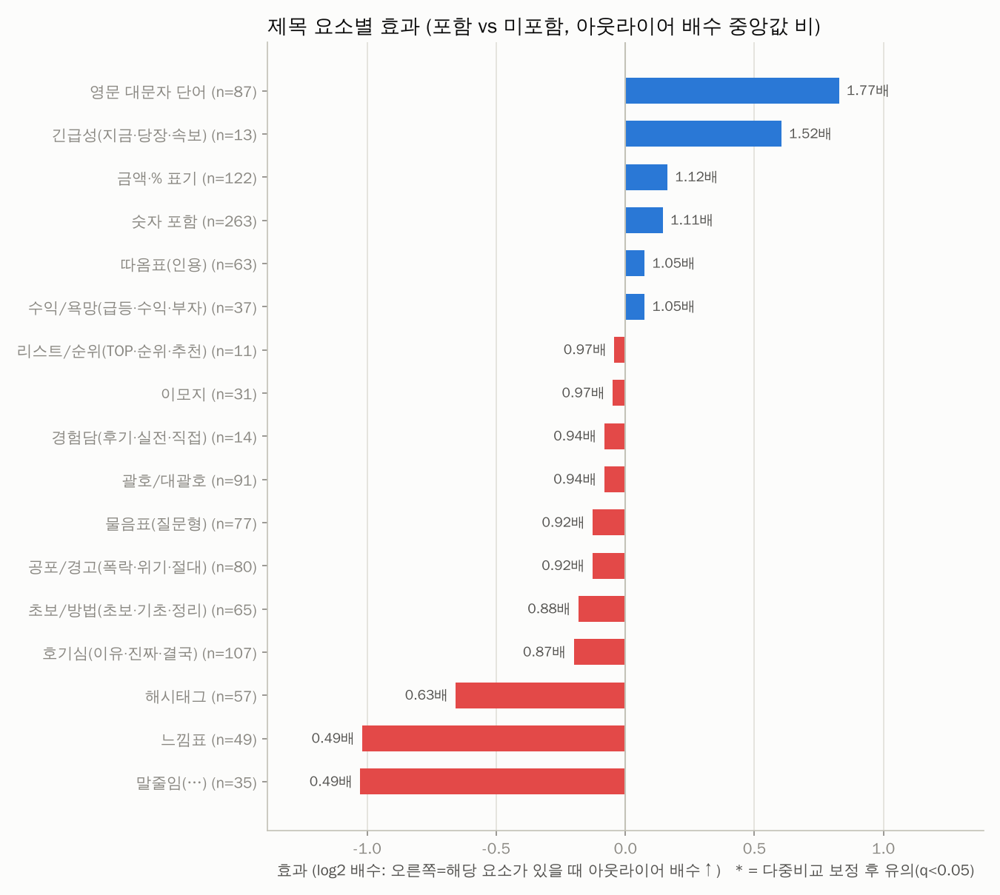
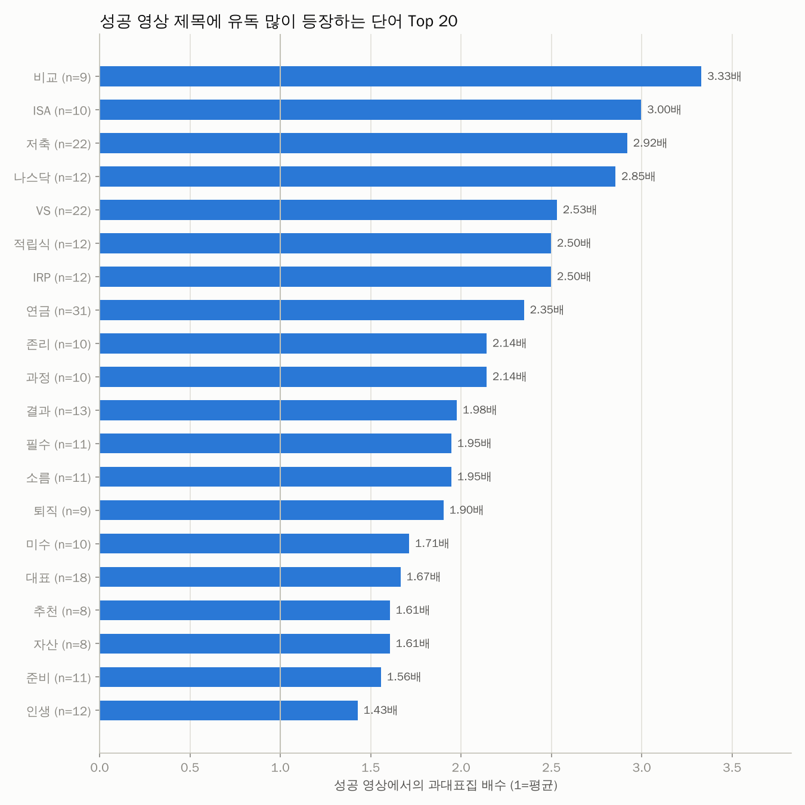
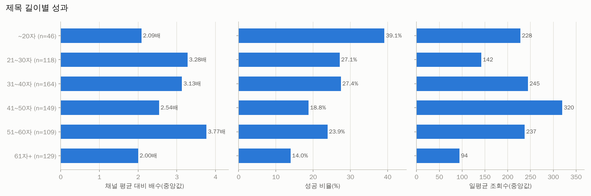

| 제목 요소 | 해당 영상 수 | 배수(있음) | 배수(없음) | 효과(배) | 성공률(있음) | 성공률(없음) | p값 | q값(보정) |
|---|---|---|---|---|---|---|---|---|
| 영문 대문자 단어 | 87 | 4.52 | 2.55 | 1.77 | 56.3% | 32.4% | 0.004 | 0.062 |
| 긴급성(지금·당장·속보) | 13 | 4.30 | 2.83 | 1.52 | 46.2% | 36.8% | 0.910 | 0.949 |
| 금액·% 표기 | 122 | 3.11 | 2.78 | 1.12 | 38.5% | 36.5% | 0.340 | 0.722 |
| 숫자 포함 | 263 | 2.95 | 2.67 | 1.11 | 39.9% | 33.0% | 0.174 | 0.493 |
| 따옴표(인용) | 63 | 2.95 | 2.80 | 1.05 | 41.3% | 36.3% | 0.547 | 0.930 |
| 수익/욕망(급등·수익·부자) | 37 | 2.95 | 2.80 | 1.05 | 45.9% | 36.2% | 0.502 | 0.930 |
| 리스트/순위(TOP·순위·추천) | 11 | 2.77 | 2.85 | 0.97 | 27.3% | 37.3% | 0.824 | 0.949 |
| 이모지 | 31 | 2.77 | 2.86 | 0.97 | 32.3% | 37.4% | 0.913 | 0.949 |
| 경험담(후기·실전·직접) | 14 | 2.70 | 2.86 | 0.94 | 21.4% | 37.5% | 0.872 | 0.949 |
| 괄호/대괄호 | 91 | 2.69 | 2.85 | 0.94 | 44.0% | 35.3% | 0.949 | 0.949 |
| 물음표(질문형) | 77 | 2.62 | 2.86 | 0.92 | 41.6% | 36.1% | 0.912 | 0.949 |
| 공포/경고(폭락·위기·절대) | 80 | 2.62 | 2.87 | 0.92 | 38.8% | 36.7% | 0.317 | 0.722 |
| 초보/방법(초보·기초·정리) | 65 | 2.60 | 2.95 | 0.88 | 30.8% | 38.1% | 0.135 | 0.460 |
| 호기심(이유·진짜·결국) | 107 | 2.60 | 2.99 | 0.87 | 34.6% | 37.8% | 0.750 | 0.949 |
| 해시태그 | 57 | 1.90 | 2.99 | 0.63 | 31.6% | 37.8% | 0.079 | 0.337 |
| 느낌표 | 49 | 1.48 | 3.01 | 0.49 | 28.6% | 38.1% | 0.036 | 0.303 |
| 말줄임(…) | 35 | 1.45 | 2.95 | 0.49 | 22.9% | 38.2% | 0.073 | 0.337 |

롱폼/쇼츠 따로 본 제목 요소 효과

| 구분 | 제목 요소 | 영상 수 | 효과(배) | 성공률(있음) | p값 |
|---|---|---|---|---|---|
| 롱폼 | 영문 대문자 단어 | 64 | 1.68 | 56.2% | 0.012 |
| 롱폼 | 긴급성(지금·당장·속보) | 8 | 1.64 | 50.0% | 0.900 |
| 롱폼 | 수익/욕망(급등·수익·부자) | 30 | 1.07 | 46.7% | 0.533 |
| 롱폼 | 공포/경고(폭락·위기·절대) | 58 | 1.06 | 43.1% | 0.568 |
| 롱폼 | 숫자 포함 | 204 | 1.03 | 38.2% | 0.354 |
| 롱폼 | 초보/방법(초보·기초·정리) | 49 | 1.01 | 34.7% | 0.375 |
| 롱폼 | 따옴표(인용) | 56 | 0.99 | 39.3% | 0.530 |
| 롱폼 | 괄호/대괄호 | 74 | 0.96 | 44.6% | 0.903 |
| 롱폼 | 이모지 | 23 | 0.93 | 26.1% | 0.443 |
| 롱폼 | 경험담(후기·실전·직접) | 11 | 0.92 | 18.2% | 0.973 |
| 롱폼 | 금액·% 표기 | 95 | 0.90 | 33.7% | 0.716 |
| 롱폼 | 물음표(질문형) | 52 | 0.81 | 32.7% | 0.299 |
| 롱폼 | 호기심(이유·진짜·결국) | 81 | 0.76 | 29.6% | 0.151 |
| 롱폼 | 해시태그 | 13 | 0.64 | 23.1% | 0.428 |
| 롱폼 | 말줄임(…) | 33 | 0.58 | 24.2% | 0.130 |
| 롱폼 | 느낌표 | 39 | 0.48 | 28.2% | 0.051 |
| 쇼츠 | 영문 대문자 단어 | 23 | 2.45 | 56.5% | 0.113 |
| 쇼츠 | 금액·% 표기 | 25 | 1.91 | 52.0% | 0.229 |
| 쇼츠 | 물음표(질문형) | 25 | 1.51 | 60.0% | 0.101 |
| 쇼츠 | 괄호/대괄호 | 16 | 1.43 | 43.8% | 0.355 |
| 쇼츠 | 호기심(이유·진짜·결국) | 25 | 1.36 | 48.0% | 0.068 |
| 쇼츠 | 숫자 포함 | 55 | 1.24 | 43.6% | 0.255 |
| 쇼츠 | 초보/방법(초보·기초·정리) | 16 | 0.65 | 18.8% | 0.170 |
| 쇼츠 | 해시태그 | 44 | 0.65 | 34.1% | 0.124 |
| 쇼츠 | 느낌표 | 10 | 0.53 | 30.0% | 0.458 |
| 쇼츠 | 공포/경고(폭락·위기·절대) | 19 | 0.49 | 21.1% | 0.054 |

**성공 영상 제목에 유독 많이 나오는 단어** (과대표집 배수 = 성공 영상 내 비중 ÷ 전체 비중)

| 단어 | 영상 수 | 성공 수 | 과대표집 | 배수(중앙) | 일평균 조회수 |
|---|---|---|---|---|---|
| 비교 | 9 | 7 | 3.33 | 6.66 | 748 |
| ISA | 10 | 7 | 3.00 | 10.26 | 1.8천 |
| 저축 | 22 | 15 | 2.92 | 6.29 | 1.4천 |
| 나스닥 | 12 | 8 | 2.85 | 13.26 | 535 |
| VS | 22 | 13 | 2.53 | 8.79 | 680 |
| 적립식 | 12 | 7 | 2.50 | 4.91 | 532 |
| IRP | 12 | 7 | 2.50 | 4.22 | 1.1천 |
| 연금 | 31 | 17 | 2.35 | 3.93 | 1.1천 |
| 존리 | 10 | 5 | 2.14 | 3.64 | 2.8천 |
| 과정 | 10 | 5 | 2.14 | 3.48 | 427 |
| 결과 | 13 | 6 | 1.98 | 12.72 | 242 |
| 필수 | 11 | 5 | 1.95 | 6.99 | 212 |
| 소름 | 11 | 5 | 1.95 | 5.71 | 189 |
| 퇴직 | 9 | 4 | 1.90 | 3.93 | 468 |
| 미수 | 10 | 4 | 1.71 | 2.12 | 333 |
| 대표 | 18 | 7 | 1.67 | 3.64 | 1.7천 |
| 추천 | 8 | 3 | 1.61 | 7.67 | 1.3천 |
| 자산 | 8 | 3 | 1.61 | 2.99 | 84 |
| 준비 | 11 | 4 | 1.56 | 7.48 | 158 |
| 인생 | 12 | 4 | 1.43 | 3.22 | 40 |
| 담보 | 9 | 3 | 1.43 | 4.59 | 21 |
| ETF | 97 | 32 | 1.41 | 4.03 | 349 |
| 미국 | 16 | 5 | 1.34 | 2.50 | 657 |
| 사람 | 36 | 11 | 1.31 | 3.20 | 73 |
| 자동 | 23 | 7 | 1.30 | 2.52 | 35 |

## 4. 🎞️ 포맷 · 길이

> 쇼츠 조회수는 2025년 3월부터 '재생 시작/반복'마다 집계되어 롱폼 조회수와 직접 비교할 수 없습니다. 그래서 **같은 채널·같은 포맷 대비 배수(아웃라이어)** 와 성공 비율로 비교합니다.

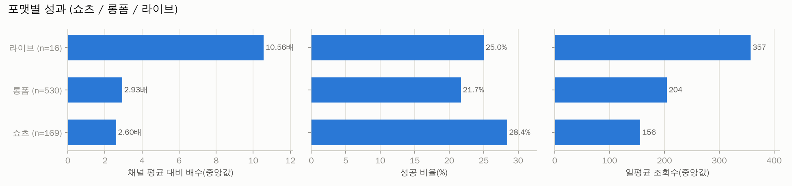
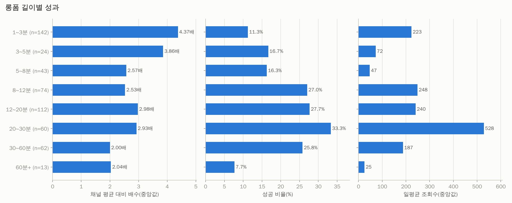

| 포맷 | 영상 수 | 조회수(중앙) | 일평균(중앙) | 배수(중앙) | 성공 비율 | 소규모채널 성공 |
|---|---|---|---|---|---|---|
| 라이브 | 16 | 2.6만 | 357 | 10.56 | 25.0% | 12.5% |
| 롱폼 | 530 | 2.6만 | 204 | 2.93 | 21.7% | 4.0% |
| 쇼츠 | 169 | 2.0만 | 156 | 2.60 | 28.4% | 5.9% |

| 롱폼 길이 | 영상 수 | 조회수(중앙) | 일평균(중앙) | 배수(중앙) | 성공 비율 | 소규모채널 성공 |
|---|---|---|---|---|---|---|
| 1~3분 | 142 | 2.2만 | 223 | 4.37 | 11.3% | 0.0% |
| 3~5분 | 24 | 9.9천 | 72 | 3.86 | 16.7% | 4.2% |
| 5~8분 | 43 | 8.9천 | 47 | 2.57 | 16.3% | 0.0% |
| 8~12분 | 74 | 2.7만 | 248 | 2.53 | 27.0% | 10.8% |
| 12~20분 | 112 | 4.3만 | 240 | 2.98 | 27.7% | 4.5% |
| 20~30분 | 60 | 7.9만 | 528 | 2.93 | 33.3% | 5.0% |
| 30~60분 | 62 | 2.9만 | 187 | 2.00 | 25.8% | 6.5% |
| 60분+ | 13 | 2.6천 | 25 | 2.04 | 7.7% | 0.0% |

## 5. 🕒 업로드 타이밍 (참고용 — 효과가 작고 혼란변수가 많음)

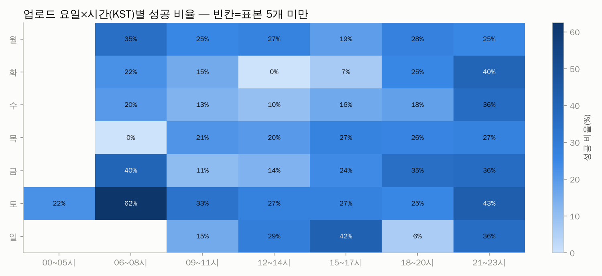

| 요일 | 영상 수 | 조회수(중앙) | 일평균(중앙) | 배수(중앙) | 성공 비율 | 소규모채널 성공 |
|---|---|---|---|---|---|---|
| 월 | 115 | 2.7만 | 187 | 2.96 | 27.0% | 5.2% |
| 화 | 124 | 1.9만 | 141 | 1.78 | 17.7% | 4.8% |
| 수 | 106 | 3.6만 | 254 | 2.82 | 17.0% | 2.8% |
| 목 | 107 | 1.5만 | 137 | 3.16 | 21.5% | 5.6% |
| 금 | 112 | 2.5만 | 270 | 2.54 | 27.7% | 3.6% |
| 토 | 74 | 3.3만 | 246 | 5.63 | 32.4% | 6.8% |
| 일 | 77 | 2.7만 | 174 | 2.77 | 23.4% | 3.9% |

| 시간대(KST) | 영상 수 | 조회수(중앙) | 일평균(중앙) | 배수(중앙) | 성공 비율 | 소규모채널 성공 |
|---|---|---|---|---|---|---|
| 00~05시 | 24 | 2.2천 | 21 | 10.75 | 25.0% | 8.3% |
| 06~08시 | 70 | 2.5만 | 178 | 2.95 | 27.1% | 8.6% |
| 09~11시 | 84 | 1.7만 | 192 | 2.25 | 19.0% | 4.8% |
| 12~14시 | 114 | 2.2만 | 159 | 2.59 | 16.7% | 3.5% |
| 15~17시 | 150 | 2.5만 | 205 | 2.64 | 20.7% | 4.0% |
| 18~20시 | 192 | 4.4만 | 300 | 2.32 | 25.0% | 3.1% |
| 21~23시 | 81 | 3.8만 | 180 | 4.28 | 34.6% | 6.2% |

## 6. 🌱 채널 규모별 분석 — 0명 채널에게 가장 중요한 부분

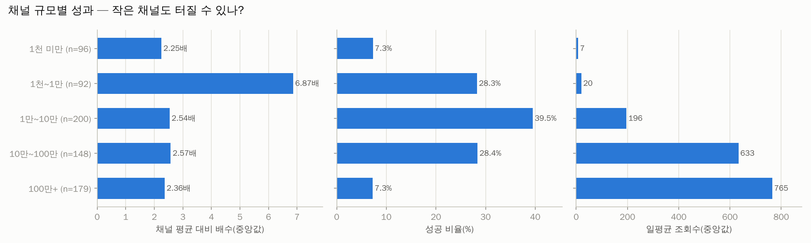
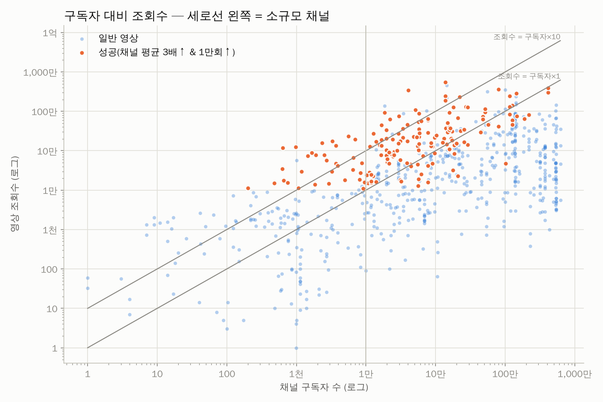

| 구독자 규모 | 영상 수 | 조회수(중앙) | 일평균(중앙) | 배수(중앙) | 성공 비율 | 소규모채널 성공 |
|---|---|---|---|---|---|---|
| 1천 미만 | 96 | 1.2천 | 7 | 2.25 | 7.3% | 7.3% |
| 1천~1만 | 92 | 2.4천 | 20 | 6.87 | 28.3% | 28.3% |
| 1만~10만 | 200 | 2.7만 | 196 | 2.54 | 39.5% | 0.0% |
| 10만~100만 | 148 | 8.2만 | 633 | 2.57 | 28.4% | 0.0% |
| 100만+ | 179 | 8.3만 | 765 | 2.36 | 7.3% | 0.0% |

**개설 1년 이내 채널의 성공 영상** (0개) — 신생 채널이 실제로 터진 사례

_데이터 없음_

## 7. 🔥 최근 14일 이내 급상승 영상 (아직 성과 집계 전 — 트렌드 참고)

| 영상 | 채널 | 구독자 | 조회수 | 일평균 | 경과일 | 포맷 |
|---|---|---|---|---|---|---|
| [코스피 급락에 "세계 최악"..폭락 원인은? / 친절한 경제 / SBS 모닝와이드…](https://www.youtube.com/watch?v=Uuw517jwuRQ) | SBS 뉴스 | 530만 | 144만 | 12.6만 | 11.4 | 롱폼 |
| [신종 투자리딩방 사기가 판을 치고 있습니다. 천하의 나쁜 놈들!](https://www.youtube.com/watch?v=vbDEHKhogXU) | 슈카월드 | 373만 | 103만 | 9.3만 | 11.1 | 롱폼 |
| [코스피 코스닥 폭락의 주범 #코스피 #코스닥 #OpenAI](https://www.youtube.com/watch?v=-aQybbK5sCI) | 내일은 투자왕 - 김단테 | 61.4만 | 8.8만 | 8.8만 | 0.1 | 롱폼 |
| ["지금이라도 팔아야 되나" 코스피 역대급 폭락장 시작.. 외국인들 매도 폭탄 던지…](https://www.youtube.com/watch?v=2oJcFvGcc3w) | 신사임당 | 282만 | 7.8만 | 7.8만 | 0.3 | 롱폼 |
| [1년 만에 1,422% 수익낸 승률 87% 트레이더 & 36조원을 벌고 야구 구단…](https://www.youtube.com/watch?v=SJ1ptodslX8) | 부자회사원 | 40.9만 | 4.3만 | 4.2만 | 1.0 | 롱폼 |
| [SCHD ETF 연이은 하락.. 지금이라도 갈아타야 할까? (ft. schd 배당…](https://www.youtube.com/watch?v=-HgmZvx5G40) | 똑재TV | 17.2만 | 25.3만 | 3.6만 | 7.1 | 롱폼 |
| [반도체, 지금 팔면 손해 보는 이유](https://www.youtube.com/watch?v=h1yNbKLE5ks) | 여운봉 부자사관학교 | 17.3만 | 3.8만 | 3.5만 | 1.1 | 롱폼 |
| [“S&P500 이렇게 하면 망합니다” 지수투자할 때 초보들이 흔히 저지르는 실수](https://www.youtube.com/watch?v=uT4kjrZ7fOI) | 할미언니 | 28.9만 | 3.8만 | 3.4만 | 1.1 | 롱폼 |
| [한국증시 무너지고 오히려 더 많이 급등한 주식 외국인이 몰래 매수하고 있었다, 결…](https://www.youtube.com/watch?v=v6TfmfNs9Vg) | 주식장인 | 33.9만 | 3.7만 | 3.3만 | 1.1 | 롱폼 |
| [S&P500 ETF, 매달 이만큼만 사두세요 \| 20억 모은 선배의 ETF 추천…](https://www.youtube.com/watch?v=x3Be7YHi3Fs) | 부자습관은 래빗해빛 | 10.7만 | 25.8만 | 3.2만 | 8.0 | 롱폼 |
| [미국장은 웃는데 한국장은 왜? 외국인 매도와 반도체 약세를 읽는 법](https://www.youtube.com/watch?v=sir0itbcGTs) | 채국장의 코스피2만행 머니버스 | 15.7만 | 2.7만 | 2.7만 | 0.2 | 롱폼 |
| [외국인 매도세가 만든 매수 기회! 스마트머니 대집결하는 수혜주 '이곳'에 집중 #…](https://www.youtube.com/watch?v=vgHNrly8evU) | 한국경제TV | 140만 | 2.5만 | 2.5만 | 0.3 | 라이브 |
| [미국 S&P500 ETF 장투하다간 돈 묶이고 계좌 녹는답니다.. 노후자금은 무조…](https://www.youtube.com/watch?v=_kJVrHStdSM) | 똑재TV | 17.2만 | 9.2만 | 2.2만 | 4.2 | 롱폼 |
| [［시장함께읽기］ 10월 12일, 외국인 대량 매도에 무너진 투심과 증시, 외국인은…](https://www.youtube.com/watch?v=PleUme8PCFI) | 염블리와 함께 ［LS증권］ | 26.8만 | 1.8만 | 1.8만 | 0.1 | 롱폼 |
| [주식 계좌 2개 만들면 부자됩니다mp4](https://www.youtube.com/watch?v=zJCPO1hcyhI) | 장사건물주 강호동 | 51.8만 | 24.2만 | 1.7만 | 14.0 | 쇼츠 |

## 8. 🏆 성공사례 — 대본 · 영상 · 썸네일

선정 기준: 종합점수(아웃라이어 40% + 조회수 35% + 구독자 대비 조회수 25%) 상위, 소규모 채널 ≥50%, 롱폼 ≥50%, 채널당 최대 1개. 각 폴더에 `transcript.txt`(대본), `transcript_timestamped.txt`, `video.mp4`, `thumbnail.jpg`, `metadata.json`, `comments.csv` 가 있습니다.

### 1. [주식시장이 폭등해도 서민이 돈을 못 버는 이유 #snl #snl코리아 #예능 #정이랑](https://www.youtube.com/watch?v=M8cWBOkAQpE)

- 채널 **쇼몬클립** (구독자 4.0만) · 조회수 **347만** · 채널 평균의 **154.2배** · 쇼츠 00:51 · 업로드 2026-05-29 · 카테고리: 2. 실패하는 사람의 특징·패턴 · 검색어: `주식으로 돈 못 버는 이유` · 선정: 종합점수 상위 (점수 98)
- 📁 [`success_cases/01_주식시장이_폭등해도_서민이_돈을_못_버는_이유_snl_M8cWBOkAQpE/`](success_cases/01_주식시장이_폭등해도_서민이_돈을_못_버는_이유_snl_M8cWBOkAQpE/) · 대본: failed · 영상: skipped(DOWNLOAD_VIDEOS=False)

### 2. [주식으로 성공한 부자들의 어마어마한 핵심 노하우](https://www.youtube.com/watch?v=iacwbUHyqv4)

- 채널 **좋은미래만들기** (구독자 13.8만) · 조회수 **542만** · 채널 평균의 **189.2배** · 쇼츠 00:49 · 업로드 2025-10-29 · 카테고리: 8. 실험·기록·도전 · 검색어: `소액 주식 투자 기록` · 선정: 종합점수 상위 (점수 97)
- 📁 [`success_cases/02_주식으로_성공한_부자들의_어마어마한_핵심_노하우_iacwbUHyqv4/`](success_cases/02_주식으로_성공한_부자들의_어마어마한_핵심_노하우_iacwbUHyqv4/) · 대본: failed · 영상: skipped(DOWNLOAD_VIDEOS=False)

### 3. [미국 ETF 30초만에 이해하기](https://www.youtube.com/watch?v=X08HjlsEvpo)

- 채널 **어피티 UPPITY** (구독자 22만) · 조회수 **232만** · 채널 평균의 **83.0배** · 쇼츠 00:35 · 업로드 2025-10-26 · 카테고리: 5. ETF·지수·장기투자 · 검색어: `적립식 투자 후기` · 선정: 종합점수 상위 (점수 92)
- 📁 [`success_cases/03_미국_ETF_30초만에_이해하기_X08HjlsEvpo/`](success_cases/03_미국_ETF_30초만에_이해하기_X08HjlsEvpo/) · 대본: failed · 영상: skipped(DOWNLOAD_VIDEOS=False)

### 4. [사고 묻어두면 10년 뒤 가장 많이 오르는 국내주식](https://www.youtube.com/watch?v=d__Q23_Tkdk)

- 채널 **복리킴ㅣ주도주식 투자** (구독자 5.1만) · 조회수 **109만** · 채널 평균의 **39.3배** · 롱폼 01:13 · 업로드 2026-03-14 · 카테고리: 8. 실험·기록·도전 · 검색어: `주식 1년 투자 결과` · 선정: 종합점수 상위 (점수 91)
- 📁 [`success_cases/04_사고_묻어두면_10년_뒤_가장_많이_오르는_국내주식_d__Q23_Tkdk/`](success_cases/04_사고_묻어두면_10년_뒤_가장_많이_오르는_국내주식_d__Q23_Tkdk/) · 대본: failed · 영상: skipped(DOWNLOAD_VIDEOS=False)

### 5. [노후 자금 10년 묻어두려던 ETF, 결국 단타치다 망하는 치명적인 이유](https://www.youtube.com/watch?v=Z_ul2wo7NHs)

- 채널 **부의 스케치** (구독자 5.5천) · 조회수 **23.3만** · 채널 평균의 **236.9배** · 롱폼 09:25 · 업로드 2026-03-06 · 카테고리: 4. 50·60대와 노후자금 · 검색어: `은퇴 후 주식 투자` · 선정: 소규모 채널 쿼터 (점수 88)
- 📁 [`success_cases/05_노후_자금_10년_묻어두려던_ETF_결국_단타치다_망하_Z_ul2wo7NHs/`](success_cases/05_노후_자금_10년_묻어두려던_ETF_결국_단타치다_망하_Z_ul2wo7NHs/) · 대본: failed · 영상: skipped(DOWNLOAD_VIDEOS=False)

### 6. [수익인증 주식 리딩방의 사기수법, 나는 속지 않을 자신 있다? 처음부터 들어가지 마세요](https://www.youtube.com/watch?v=KsbiEUJiIBs)

- 채널 **야무진 경제학** (구독자 2.3천) · 조회수 **15.6만** · 채널 평균의 **151.7배** · 롱폼 17:31 · 업로드 2026-02-17 · 카테고리: 7. 사기·리딩방 · 검색어: `투자 사기 수법` · 선정: 소규모 채널 쿼터 (점수 85)
- 📁 [`success_cases/06_수익인증_주식_리딩방의_사기수법_나는_속지_않을_자신_KsbiEUJiIBs/`](success_cases/06_수익인증_주식_리딩방의_사기수법_나는_속지_않을_자신_KsbiEUJiIBs/) · 대본: failed · 영상: skipped(DOWNLOAD_VIDEOS=False)

### 7. ["3억이 0원 됐다" 주식으로 망하는 사람들의 10가지 특징](https://www.youtube.com/watch?v=5MHq-kzFDu8)

- 채널 **체감경제** (구독자 980) · 조회수 **12.6만** · 채널 평균의 **770.7배** · 롱폼 12:17 · 업로드 2026-02-14 · 카테고리: 2. 실패하는 사람의 특징·패턴 · 검색어: `주식으로 망하는 사람 특징` · 선정: 소규모 채널 쿼터 (점수 84)
- 📁 [`success_cases/07_3억이_0원_됐다_주식으로_망하는_사람들의_10가지_특_5MHq-kzFDu8/`](success_cases/07_3억이_0원_됐다_주식으로_망하는_사람들의_10가지_특_5MHq-kzFDu8/) · 대본: failed · 영상: skipped(DOWNLOAD_VIDEOS=False)

### 8. [주식 세력이 개미의 물량을 뺏기 위해 사용하는 3가지 잔인한 무기](https://www.youtube.com/watch?v=egtvCm4npbw)

- 채널 **머니필터** (구독자 3.7천) · 조회수 **13.5만** · 채널 평균의 **241.9배** · 롱폼 17:04 · 업로드 2026-03-04 · 카테고리: 9. 시장 급락·급등과 개미 · 검색어: `주식 폭락 개미 손실` · 선정: 소규모 채널 쿼터 (점수 83)
- 📁 [`success_cases/08_주식_세력이_개미의_물량을_뺏기_위해_사용하는_3가지_egtvCm4npbw/`](success_cases/08_주식_세력이_개미의_물량을_뺏기_위해_사용하는_3가지_egtvCm4npbw/) · 대본: failed · 영상: skipped(DOWNLOAD_VIDEOS=False)

## 9. 💬 시청자 질문 (성공 영상 댓글에서 추출) — 다음 영상 주제 후보

질문 댓글에 많이 나오는 단어: `주식`(70), `투자`(52), `사람`(32), `계좌`(29), `종목`(26), `감사`(25), `수익`(25), `생각`(24), `매수`(21), `매도`(20), `ETF`(18), `미수`(16), `ISA`(15), `장기`(14), `얘기`(14), `내용`(13), `미국`(13), `방법`(13), `정도`(12), `연금`(12)

| 질문 댓글 | 좋아요 | 영상 |
|---|---|---|
| 대부분 중간에 팔고나옴 ㅋ 언제샀냐가 아니고 언제 팔았냐가 중요함 | 470 | [주식시장이 폭등해도 서민이 돈을 못 버는 이유…](https://www.youtube.com/watch?v=M8cWBOkAQpE) |
| 개인투자자가 기관이나 세력을 이길수잇는 방법은 단 하나밖에없음 .존버. 개인이 뭔수로 기관이나 세력에게맞섬? 정보력 정치력 자금력 뭐하나 상대가 되는게없는데 오로지 사놓고 버티는것만이 그들상대로 승리할수있는 방법임. 사놓고 1~2년 묵힐자신없으면 주식 | 220 | [개인투자자가 엄청나게 매수하는데 주가는 왜 오…](https://www.youtube.com/watch?v=4B0Hxwwv2WQ) |
| 안정적인게 장점이잖아 람쥐야 도토리 다 뺏어줘? | 113 | [SCHD 5천만원 투자, 배당금 받아보니 느낀…](https://www.youtube.com/watch?v=5RFVnBEBbjE) |
| 그걸 모르는 사람이 있냐? 지나고나서 보니까 그렇구나 하는거지 오른다고 보장해주면 떨어지는애 떨쳐내지 떨쳐내면 걔가 오르고 버티면 떨어지니까 문제인거지 | 103 | [주식으로 성공한 부자들의 어마어마한 핵심 노하…](https://www.youtube.com/watch?v=iacwbUHyqv4) |
| 다들 손해는 안봤쟎아? 한잔해~ | 98 | [주식시장이 폭등해도 서민이 돈을 못 버는 이유…](https://www.youtube.com/watch?v=M8cWBOkAQpE) |
| 누가 내 얘기를 저작권없이 만들라고 했어?ㅠㅠ | 93 | [주식투자 실패한 사람들의 공통적인 특징](https://www.youtube.com/watch?v=sEzSDUgvY28) |
| 주식 짜증나 그냥 적금들면 안되는 세상은 왜 온거냐고!!!!!!!!! | 89 | [S&P 500 ETF 좋은 줄 알고 투자했는데…](https://www.youtube.com/watch?v=uttY3bJ6-Vs) |
| 요즘 유튜브에서 하면서 사기치는 것들 너무 많습니다. 상담해준다고 사무실 방문 하지마세요. 해외 코인 투자종용에도 당하지 마세요. 3종목 아침마다 준것도 다 사기입니다. 컴퓨터 조작질일 뿐입니다. 1달 내내 전종목을 다 맞추는게 가능할까요? | 82 | [수익인증 주식 리딩방의 사기수법, 나는 속지 …](https://www.youtube.com/watch?v=KsbiEUJiIBs) |
| 참 대단하다..... 어떻게 시총이 작은 주식을 살 생각을 했을까....대단하다..... | 59 | [주식 실패로 5억이 20만 원 되는 과정(1~…](https://www.youtube.com/watch?v=8_YxWzVTbro) |
| 저도 처음 주식 시작했을때가 코로나시국 전인데.. 전재산 분산투자 했다가 심리적으로 안정이 되지 않더군요.. 그래서 아! 내 그릇을 빨리 판단하게 되었고 지금까지 총 자산에 30% 미만으로만 투자를 이어가고 있습니다. 주변에서 왜 추세를 따라가지 않냐 | 51 | [주식 실패로 5억이 20만 원 되는 과정(1~…](https://www.youtube.com/watch?v=8_YxWzVTbro) |
| 어떤 공학자가 말했지. 주식으로 돈벌기 쉽다고...사람들 심리를 이용해 돈을 버는건데 살때 팔때 데이터를 보면 사람들이 다 비슷한 시점에서 사고 판다는거임. 그래서 사고싶을때 팔고 팔고싶을때 사라고 | 49 | [개인투자자가 엄청나게 매수하는데 주가는 왜 오…](https://www.youtube.com/watch?v=4B0Hxwwv2WQ) |
| 그 어떤 전문가들의 얘기보다 가슴에 비수가 되어 박히네. 정말 찰진 표현, 이런게 눈높이 교육입니다. 최고~!!! | 46 | [95%개미가 국장에서 잃는 이유(1)](https://www.youtube.com/watch?v=Q7AMP1ybrTk) |
| 명언이네요 그게 어데 마음 같이되나요 단 여유자금으로 4~5년 버틸 각오가있어야 될거입니다 삼전7층에서5년 이젠 숨 | 46 | ["3억이 0원 됐다" 주식으로 망하는 사람들의…](https://www.youtube.com/watch?v=5MHq-kzFDu8) |
| 그래서 나온 진짜(?) 투자 격언이 있지요. "공포에 사고, 환희에 팔아라!" 그런데, 현실적으로 이렇게 할 수 있는 강심장, 바보(?)가 얼마나 될까요? 주식 투자가 머니 게임이 아니라, 멘탈 게임인 이유 입니다. ㅋㅋㅋㅋ | 40 | [S&P 500 ETF 좋은 줄 알고 투자했는데…](https://www.youtube.com/watch?v=uttY3bJ6-Vs) |
| 해후소님 정말 듣고 싶었던 맞춤형 절세계좌에 대해 알고 싶었는데 정말 쉽게 알려 주셔서 감사합니다 | 40 | ["60대 은퇴자 필독: 연금저축계좌 vs IS…](https://www.youtube.com/watch?v=mMc8oiejK78) |
| 너무 귀한 지식 감사합니다. 유투브에 온통 ETF적립식매수, 1억모으기 강조하는 채널은 많지만, 이렇게 개별주식 매매, 단타에 대해 깊은 지식 알려주는 채널 처음 봤습니다. 구독했습니다. 앞으로도 유익한 영상 많이 만들어주세요. | 35 | [개인투자자가 엄청나게 매수하는데 주가는 왜 오…](https://www.youtube.com/watch?v=4B0Hxwwv2WQ) |
| ETF 투자 전략이나 영상 내용 중 이해가 안 가는 부분이 있다면 언제든 댓글로 질문 남겨주세요. 확인하는 대로 답변 달아드리겠습니다. 구독과 좋아요도 잊지 마세요! 👍 | 34 | [노후 자금 10년 묻어두려던 ETF, 결국 단…](https://www.youtube.com/watch?v=Z_ul2wo7NHs) |
| 이사람 머에요? 생긴건 사기꾼인데 들어보니 고수네… ㅋㅋㅋ. 다 맞는말이네. 이런 사람이 찐고수인데… 재밋는 채널이네 | 28 | [개미투자자의 95%가 돈을 잃는 이유 ［장영한…](https://www.youtube.com/watch?v=qnIU15-Wp4Y) |
| 이게 쉽지가 않음 손실 나서 팔면 올라가니까 갖고 있는거임 수익나서 떨어지는 경우도 많고 이게 말이 쉽지 어떻게 맞춰 맨날 흔드는게 일인 주식판에서 시드를 적게 하면 개잡코인 들어가도 멘탈 안흔들리고 시드가 크다면 확신이 드는 종목만 사야지.. | 27 | ["3억이 0원 됐다" 주식으로 망하는 사람들의…](https://www.youtube.com/watch?v=5MHq-kzFDu8) |
| 무한배터리님. 좋은 영상 만들어주셔서 앞으로 주식투자를 하는데 있어서 평생 가슴속에 새겨 절대 잊지 않고 살아가도록 하겠습니다. 무한배터리님 덕분에 지금 이 영상을 시청하시는 분들께서는 소중한 생명을 구해주신 것이나 다름없다고 생각합니다. 지옥같았던  | 27 | [주식 실패로 5억이 20만 원 되는 과정(1~…](https://www.youtube.com/watch?v=8_YxWzVTbro) |

## 10. 🔖 태그 분석 (성공 영상에서 과대표집된 태그)

| 태그 | 영상 수 | 성공 수 | 과대표집 | 배수(중앙) |
|---|---|---|---|---|
| spy | 9 | 7 | 3.33 | 8.87 |
| qqq | 12 | 9 | 3.21 | 7.78 |
| hts | 8 | 6 | 3.21 | 14.93 |
| 나스닥100 | 10 | 7 | 3.00 | 8.87 |
| 노후투자 | 8 | 5 | 2.68 | 4.18 |
| 신한금융투자 | 8 | 5 | 2.68 | 3.19 |
| voo | 10 | 6 | 2.57 | 6.71 |
| schd | 11 | 6 | 2.34 | 6.98 |
| 채권 | 13 | 7 | 2.31 | 3.19 |
| mtn | 8 | 4 | 2.14 | 3.64 |
| 노후생활비 | 8 | 4 | 2.14 | 4.59 |
| 머니투데이방송 | 8 | 4 | 2.14 | 3.64 |
| 파이어족 | 13 | 6 | 1.98 | 2.44 |
| 장기투자 | 44 | 20 | 1.95 | 7.56 |
| 개미투자자 | 11 | 5 | 1.95 | 3.46 |
| 매매 | 11 | 5 | 1.95 | 7.44 |
| 연금저축 | 27 | 12 | 1.90 | 3.81 |
| #주식기초 | 9 | 4 | 1.90 | 2.28 |
| 미국etf | 9 | 4 | 1.90 | 4.15 |
| 신용거래 | 9 | 4 | 1.90 | 7.44 |

**아웃라이어 배수와의 순위상관(스피어만)** — 절댓값 0.1 미만은 사실상 무관

| 지표 | 상관계수 |
|---|---|
| like_rate | -0.140 |
| comment_rate | -0.125 |
| title_len | -0.050 |
| duration_sec | 0.013 |
| subscribers | -0.111 |
| channel_age_days | -0.037 |
| uploads_per_week | 0.086 |

## 11. ✅ 0명 채널 실행 체크리스트

1. **검색형 키워드로 시작**: 위 기회점수 상위 키워드는 '검색 → 유입'이 가능한 주제입니다. 구독자가 없을 때는 추천 피드보다 검색 유입이 먼저 열립니다.
2. **제목 = 검색어 + 검증된 제목 요소**: 키워드를 제목 앞쪽에 넣고, 3장의 효과 요소를 1~2개만 조합하세요 (과장은 시청 지속률을 떨어뜨립니다).
3. **첫 30초(쇼츠는 첫 3~5초)**: 8장 성공사례의 '도입부'를 비교해 공통 구조(질문 제기 → 결론 예고 → 근거)를 따라 해보세요.
4. **롱폼 1개 → 쇼츠 2~3개 재가공**: 같은 주제를 두 포맷으로 내보내 제작 효율과 노출 채널을 동시에 늘립니다.
5. **업로드 빈도**: 성공한 소규모 채널의 업로드 빈도 중앙값은 주 3.6회입니다. 꾸준함이 우선입니다 (최소 주 1~2회 롱폼 + 쇼츠).
6. **댓글 질문을 다음 영상으로**: 9장의 질문이 바로 수요가 검증된 다음 주제입니다.
7. **주식/금융 주제 주의**: 특정 종목 매수·매도 권유, 수익 보장 표현은 피하고 '투자 권유 아님' 고지를 넣으세요. 유료 리딩방·1:1 종목 추천처럼 대가를 받고 투자 판단을 조언하면 자본시장법상 유사투자자문업 신고 대상이 될 수 있습니다 (사업화 전 확인 필요).
8. **2~4주마다 재분석**: 트렌드는 빠르게 바뀝니다. 이 노트북을 다시 실행해 키워드 순위 변화를 확인하세요.

## 12. 📐 방법론 · 한계 · 재현 정보

- **아웃라이어 배수** = 영상 조회수 ÷ 같은 채널 최근 업로드 50개(업로드 14일 이상 경과, 같은 포맷 우선, 해당 영상 제외)의 조회수 중앙값. 구독자 수와 무관하게 '주제·제목·썸네일의 힘'을 보는 지표입니다.
- **분석 분할**: 성과 분석은 업로드 후 14일 이상 ~ 365일 이내 영상만 사용 (2025-10-12 ~ 2026-09-28). 그보다 최근 영상은 7장(급상승)에서만 참고.
- **미래 정보 누수 방지**: 모든 지표는 수집 시점에 관측 가능한 값만 사용하며, 기준선에서 대상 영상 자신을 제외했습니다.
- **주제 관련성 필터**: 제목·태그에 관련어(주식, 주가, 증시, 증권, 코스피, 코스닥, 나스닥, 테마주 등)가 있거나 설명란에 2번 이상 나와야 분석·성공사례에 포함 ('주식회사, (주), ㈜' 같은 표현은 먼저 제거). 이번 실행 제외 129개.
- **한계**: ① search.list 결과는 YouTube가 고른 표본이며 개인화되지 않은 결과입니다. ② 오래된 영상일수록 조회수가 누적되어 배수가 커질 수 있습니다 (채널 최근 업로드가 짧은 기간에 몰린 경우). ③ 썸네일·시청 지속률·CTR 등 핵심 내부 지표는 API로 볼 수 없습니다. ④ 제목 요소 효과는 상관관계이며 주제·채널 특성과 섞여 있습니다. ⑤ 쇼츠 판별은 길이 + youtube.com/shorts 응답으로 추정합니다.
- **재현성**: 랜덤 시드 42, 캐시 TTL 24시간, API 호출 {'search': 44, 'videos': 687, 'channels': 16, 'playlistItems': 700, 'commentThreads': 30}, 캐시 적중 {}
- **저작권**: 성공사례 대본·영상은 개인 학습·분석용입니다. 재업로드·재배포하지 마세요. 공개 저장소에는 영상 파일을 올리지 않는 것이 기본값입니다.

**이번 실행의 경고/주의 사항**

- ［INIT］ ⚠️ 위험/비용 관련 설정이 기본값과 다릅니다 key=QUOTA_BUDGET default=9000 current=6000
- ［INIT］ ⚠️ 위험/비용 관련 설정이 기본값과 다릅니다 key=DOWNLOAD_VIDEOS default=True current=False
- ［KEYWORD］ 일부 자동완성(수요 점수) 요청 실패 → 해당 접두어는 수요 0으로 계산 n_failed=98
- ［COLLECT］ 오늘 쿼터 예산을 넘는 키워드는 다음 실행으로 이월 (내일 다시 실행하면 이미 받은 검색은 쿼터 0으로 재사용) deferred=1 examples=［미국 주식 손실(9. 시장 급락·급등과 개미)］ hint="같은 설정으로 내일 다시 실행하세요 — 검색 결과는 SEARCH_CACHE_TTL_HOURS 동안 보관됩니다"
- ［FEATURE］ 기준선 부족 영상 비율이 높음 → 아웃라이어 지표 신뢰도 낮음 insufficient=491 total=1589 hint="MAX_BASELINE_CHANNELS/쿼터 증가 고려"
- ［SUCCESS］ 모든 대본 수집 실패 — YouTube 차단(봇 확인) 또는 네트워크 문제일 수 있음 hint="VPN 끄기 / cookies.txt를 스크립트 폴더에 두고 다시 실행"

## 13. 📁 파일 목록

- `README.md` (이 리포트) · `analysis.xlsx` (모든 표) · `data/*.csv` · `charts/*.png` · `success_cases/` · `run_info.json` · `run_log.txt`
