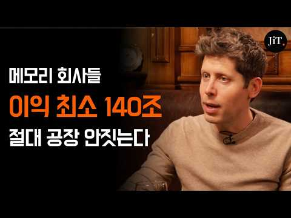
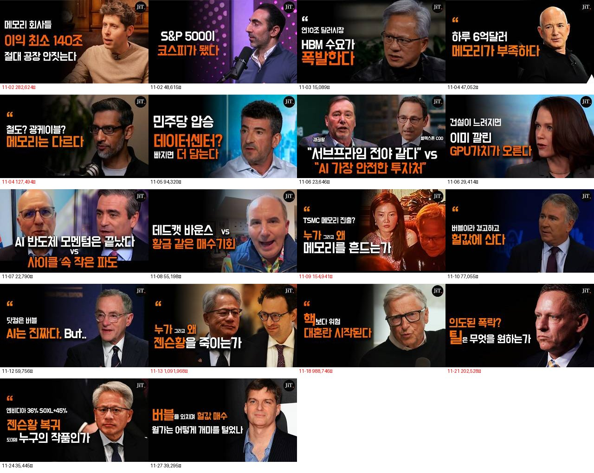

# 성공 사례 — 왜 됐나: 「"보이지 않는 손이 실패하고 있다" 샘 올트먼이 본 메모리시장」 (Just In Time · 채널 첫 영상)

VERSION: v1.0 — 2026-11-28 — 최초. 사용자 지시 2026-11-28 "https://www.youtube.com/watch?v=E2Kz9bbb878 이 영상도 분석해".
- 받은 자료: 사용자가 준 주소 → `stock/targets.json`(직접 추가한 영상) → `cloud_run.py stock explore`(검색은 캐시 · 1단위) → `approve`(설명·썸네일·댓글 295개 전부 · 7단위 + 채널 평소 영상 2단위).
- 자막은 0입니다. 클라우드에서는 자막 서버가 막혀 있어서, 대본이 필요하면 PC `run_analyzer.ps1 -Transcribe -Folder stock` 로 받아야 합니다.
- 이번 검색어 30개로는 이 영상이 안 걸렸습니다 (출처 '주소').

※ 연구·교육용 정리이고 투자 조언이 아닙니다. 클릭률·시청 지속률·트래픽 소스는 공개 자료에 없습니다. 표시: ✅ 자료로 확인 · 🔶 자료에서 미루어 봄 (추정) · ⬜ 모름.

## 0. 한눈에

1. **채널의 첫 영상인데 28.3만.** 채널은 2026-10-24에 만들어졌고 11-02에 이 영상을 처음 올렸습니다. 성공 기준(구독자 1만~5만 → 조회수 10만 이상, 구독자당 하루 0.55)을 넘습니다 ✅.
2. **홈 피드 (가장 중요): 사흘 잠자다가 '사건'이 깨웠습니다.**
   - 올린 뒤 77시간 동안 댓글이 0개였습니다 ✅.
   - 첫 댓글은 11-05 20시(한국)에 달렸습니다. 그날은 한국 장에서 삼성전자·SK하이닉스가 폭락한 날입니다(같은 날 '삼전닉스 폭락' 영상들 — 2번).
   - 댓글이 가장 많았던 날은 11-08(일, 98개)입니다 ✅.
   - 🔶 처음엔 거의 안 보여지다가, 메모리 주식이 폭락해 'SK하이닉스·삼성전자·메모리' 관심이 치솟자 그 낱말이 제목·설명·해시태그에 있던 이 영상이 홈 피드로 늦게 퍼졌습니다.
3. **썸네일**: 오른쪽에 샘 올트먼 얼굴, 왼쪽에 「메모리 회사들 / **이익 최소 140조** / 절대 공장 안짓는다」.
   - 한국 투자자가 가장 많이 들고 있는 회사(메모리 회사)를 미국 AI CEO가 탓하는 말로 읽힙니다.
   - 🔶 "왜 저런 말을?"이 클릭 까닭.
4. **이탈**: 8.2분에 장이 12개입니다 ✅. 목차 제목으로 보면 원본 발언과 해설이 30~70초마다 번갈아 나옵니다 🔶. 🔶 짧고 빨라서 끝까지 보기 쉽습니다. ⬜ 대본·지속률은 없습니다.
5. **좋아요·댓글**: 좋아요율이 **0.25%로 아주 낮고**(채널 다른 편 가운데값 0.71%), 댓글은 1.04‰로 많습니다 ✅.
   - 공감 많은 댓글이 거의 모두 **올트먼에 대한 반박**입니다('그동안 메모리 기업들 찍어 눌러 헐값에…' 공감 307).
   - 🔶 좋아서 누른 영상이 아니라 **말싸움이 붙은 영상**입니다.

## 1. 영상 숫자 (받은 때 2026-11-28 18:47 KST · 올린 지 26.2일)

| 칸 | 값 | 비교 |
|---|---|---|
| 올린 때 | 2026-11-02 (월) 15:00 KST | 채널 첫 영상 |
| 길이 | 8.2분 | 채널 다른 17편 가운데값 16.0분 — 두 번째로 짧음 (11-03 편 7.2분) |
| 조회수 | **282,624** | 채널 다른 17편 가운데값 55,198 → 5.1배 |
| 구독자 | 19,800 (받은 때) | 조회수 ÷ 구독자 = 14.3배 · 구독자당 하루 조회수 0.55 |
| 채널 | 2026-10-24 개설 · 18편 · 전체 조회수 3,374,086 | 11-13 편 109만 · 11-18 편 99만이 채널을 키움 (아래 그림) |
| 좋아요 | 693 (**0.25%**) | 채널 가운데값 0.71% |
| 댓글 | 295 (1.04‰ · 답글 81) | 채널 가운데값 1.21‰ |

## 2. 홈 피드에 어떻게 추천될 수 있었나 (가장 중요)

**✅ 본 사람은 거의 모두 구독자가 아님.**
- 올린 날 이 채널은 구독자가 0에 가까웠을 것입니다(첫 영상 · 개설 9일 뒤).
- 지금 구독자 1.98만 명도 대부분 그 뒤 영상들(11-13 109만·11-18 99만)로 늘었을 것입니다 🔶.
- 그러니 28만 회는 홈 피드·관련 영상·검색에서 왔습니다.

**✅ 사흘 동안 반응 0 → 사건 날 깨어남.** 댓글이 달린 날 (총 295개):

| 날 (UTC) | 11-02~04 | 11-05 | 11-06 | 11-07 | **11-08** | 11-09 | 11-10 | 11-11 | 11-12~28 |
|---|---|---|---|---|---|---|---|---|---|
| 댓글 | **0** | 14 | 12 | 18 | **98** | 31 | 24 | 19 | 79 |

- 첫 댓글: 올린 뒤 **77시간** (11-05 11:12 UTC = 한국 20:12).
- 11-05 한국 장: 같은 날 올라온 「[존리 대표 출연] 美민주당 압승에 삼전닉스 폭락 "반도체株 팔아야 할까요?"」(경제통마늘, 구독자 1.68만 · 88.9만 회 · 11-05 11:26 KST) ✅. 다음 날(한국 11-06 06시) 미국 반도체 지수 −12.25% ✅(뉴욕대디 11-06 편 설명란). 11-07 「코스피 45% 폭락, 이제 주가는 어떻게 되나」(박종훈의 지식한방 · 215.6만 회) ✅.
- 🔶 메모리 주식(삼성전자·SK하이닉스)이 폭락하자 '메모리는 왜 이렇게 됐나'를 찾는 시청자가 크게 늘었습니다. 이 영상은 그 질문에 맞는 낱말(제목 '메모리시장'·설명 'SK하이닉스 3분기 매출 104조·영업이익 83조'·'삼성전자'·해시태그 #메모리반도체 #SK하이닉스 #삼성전자 #DRAM #HBM)을 이미 갖고 있어서, 사흘 늦게 홈 피드에 퍼졌습니다. 첫 사흘에 0이던 댓글이 사건 날 바로 시작된 것이 이 흐름과 맞습니다.
- 🔶 11-08(일)에 가장 많음: 주말에 '내 메모리 주식, 왜 빠졌나'를 보는 시간이 늘었고, 같은 채널 11-09 편 「누가 그리고 왜 메모리를 흔드나」(15.5만)도 다음 날 올라왔습니다.

**✅ 같은 주제(메모리·하이닉스·올트먼, 10-29~11-06) 영상 사이 순위**: 상위 14개 중 3위 (48.8만 신사임당 · 39.4만 경제 계기판 다음). 구독자 대비가 높은 작은 채널은 경제 계기판(713명 · 553배)·이 영상(14배)·잘되라대한민국(6.8배)·차트너머(8.1배) — 🔶 이 기간 한국 메모리 주식 영상을 유튜브가 작은 채널까지 넓게 띄웠습니다.

**🔶 새 채널 첫 영상이 뜬 까닭 (일반 원리 — 이 영상 자료만으로 확정 못 함)**: 새 채널은 시청 기록이 없어서 유튜브가 제목·설명·주제가 맞는 시청자에게 조금씩 보여 보고, 반응이 좋으면 넓힙니다. 이 영상은 처음엔 반응이 거의 없었다가(댓글 0), 그 주제를 찾는 사람이 한꺼번에 늘자 반응이 붙어 넓어진 꼴입니다.

⬜ 모르는 것: 날짜별 조회수(공개 API 는 지금 값만) · 홈 피드 비율 · 노출 수 · 클릭률.

## 3. 썸네일 클릭률이 왜 높았나 (🔶 — 클릭률 숫자는 없음)

- 그림: 오른쪽에 샘 올트먼(인터뷰 화면) · 왼쪽 위 따옴표 · 오른쪽 위 채널 표시 'JiT'.
- 글자 3줄: 「메모리 회사들」(흰) / 「**이익 최소 140조**」(주황) / 「절대 공장 안짓는다」(흰).

- 🔶 **한국 투자자의 내 회사 이야기**: 한국 개인이 가장 많이 들고 있는 메모리 회사(삼성전자·SK하이닉스)를 미국 AI 회사 CEO가 "돈은 버는데 공장은 안 짓는다"고 탓하는 말로 읽힙니다. 손해 본 사람과 그 회사를 믿는 사람 모두 "무슨 말을 한 거야?"로 누르게 됩니다.
- 🔶 **숫자 + 단정**: '최소 140조'(큰 숫자) + '절대 안 짓는다'(단정). 제목은 원본 발언 따옴표 「"보이지 않는 손이 실패하고 있다"」 + 「"1년에 1000억 달러씩, 그것도 매년, AI가 끝날 때까지"」로 썸네일과 겹치지 않게 채웁니다.
- ✅ **같은 틀**: 검은 바탕 · 오른쪽 실제 인물 · 왼쪽 따옴표와 2~3줄(흰 + 주황). 이 채널 18편이 모두 이 틀입니다(아래). 뉴욕대디 다니엘은 같은 꼴을 11-03에 처음 시험하고 11-06부터 썼습니다(`pZDTJKVDdxQ.md` 3번). 두 채널은 모두 10월에 생겼고, 둘 다 원본 인터뷰·방송(Bloomberg·CNBC·Schwab 등)을 옮기고 해설하는 꼴입니다. 같은 운영자인지는 공개 자료로 알 수 없습니다.
- 같은 주제 경쟁 썸네일은 주가 차트·얼굴·큰 노랑 글자가 많습니다(예: 신사임당 「"이 가격에 손절하세요"」). 이 영상은 차트 없이 인물 한 명과 말 한 줄입니다.

## 4. 왜 이탈하지 않았나 (⬜ 대본 없음 — 설명란 목차로만)

| 시각 | 장 | 꼴 (🔶 목차 제목에 '해설:'이 붙은 장 = 해설, 나머지 = 원본 발언으로 봄) |
|---|---|---|
| 0:00 | "1년에 각각 1,000억 달러" | 원본 발언 |
| 0:09 | 해설: 누가, 언제 | 해설 |
| 1:22 | 보이지 않는 손이 실패하고 있다 | 원본 |
| 1:59 | 해설: 가격은 올랐는데 공급은 왜 | 해설 |
| 2:44 | 200억 투자해서 190억 벌던 사람들 | 원본 |
| 3:20 | 해설: 190억 달러의 기억 | 해설 |
| 4:07 | "램을 각자 쌓아두는 건 끔찍하다" | 원본 |
| 4:36 | 해설: 그래서 "끔찍하다"는 말 | 해설 |
| 5:23 | 호황도 불황도 온다 | 원본 |
| 6:05 | 해설: 올트먼도 과잉을 말한다 | 해설 |
| 6:53 | 모래를 지능으로 바꾸는 비용 | 원본 |
| 7:32 | 정리 | 해설 |

- ✅ **8.2분에 장 12개**: 장 길이는 원본 쪽 9~42초 · 해설 쪽 45~73초이고, 둘이 여섯 번 번갈아 나옵니다. 🔶 화면과 목소리가 자주 바뀌어 지루할 틈이 적습니다.
- 🔶 첫 장(0:00~0:09) 제목이 「"1년에 각각 1,000억 달러"」입니다. 썸네일의 '이익 최소 140조'와 같은 크기의 돈(1,000억 달러 ≈ 140조 원)을 맨 앞에 꺼내 썸네일 약속을 바로 잇습니다.
- ✅ **내 주식 숫자**: 설명란에 SK하이닉스 3분기 매출 104조·영업이익 83조·2029년까지 완판, 삼성전자 영업이익 107조·설비투자 84조, 6월 고점 대비 두 회사 주가 −51%·−38%. 🔶 '회사는 이렇게 버는데 내 주가는 왜'라는 질문에 바로 닿습니다.
- ✅ **반대편 의견도 둠**: 젠슨 황 "2029년 공급과잉 없다". 원본 출처(Cheeky Pint · Stripe · 2026-10-29)와 '매수·매도 권유 아님'도 밝혔습니다.
- ⬜ 시간 표시 댓글로는 판단하지 못했습니다(이 영상 댓글은 대부분 발언 반박). PC 대본 받기 뒤 다시 봅니다.

## 5. 왜 좋아요(그리고 댓글)를 눌렀나

| 영상 | 좋아요율 | 댓글 ‰ |
|---|---|---|
| **이 영상** | **0.25%** | 1.04 |
| 이 채널 다른 17편 가운데값 | 0.71% | 1.21 |
| 같은 주제 상위 — 신사임당 「"이 가격에 손절하세요"」 | 0.47% | — |
| 같은 주제 상위 — 경제 계기판 (구독 713) | 0.31% | — |

- ✅ 좋아요율이 이 채널 18편 중 가장 낮습니다 (다음으로 낮은 편 0.41%). **좋아요가 아니라 '보여짐'과 '말싸움 댓글'로 뜬 영상**입니다.
- ✅ 공감 많은 댓글 = 영상 속 **올트먼 발언에 대한 반박**입니다(원문은 `stock/result/outliers/W_E2Kz9bbb878/comments.csv`, 작성자 이름 없음).
  - '그동안 메모리 기업들 찍어 눌러서 헐값에… 이제 와서 비싸다고 난리'(307)
  - '반도체 회사들은 이 게임을 해 봤거든'(221)
  - '증설했다가 수요 줄면 그 위험은 오로지 반도체 회사들 몫'(186)
  - '애플이 단가 후려쳐서 메모리 공장 증설을 못 해서…'(153)
  - '메모리 팹이 무슨 동네 편의점도 아니고'(64)
- 🔶 한국 시청자가 자기가 믿는 회사(삼성전자·SK하이닉스) 편에 서서 반박하게 만든 주제입니다. 분석기 낱말 분류(작은 표본)도 반박·불만 8 · 정치·사회 8 · 경험 공유 14 · 좋은 점 0 · 감사 0으로, 감사·칭찬이 거의 없습니다.
- 🔶 거친 말(욕설·인신공격)이 섞인 댓글도 공감이 큽니다(68). 우리 채널 컨셉(제도를 꼬집되 사람을 욕하지 않음)과는 결이 다릅니다. — 다만 2026-11-28 사용자 지시 "2는 생각하지마 … 지금은 주식 주제부터 시작할거니까 모든 주식 정보를 종합해서 돈을 잃지 않고 부자가 되는 방향" — 주식 편은 재테크 컨셉(제도 꼬집기)·'시황 해설 뺌' 제약 없이 · 시황·폭락 해설도 다룸)

## 6. 우리 영상에 옮길 때 (가설 — 한 편으로 규칙을 만들지 않음)

- **시험해 볼 것**
  1. 한국 투자자가 많이 든 종목·업종(메모리)과 미국 쪽 사건을 잇는 주제.
  2. 썸네일 = 큰 숫자 + 단정 한 줄(사람 이름 없이 발언만).
  3. 설명란·해시태그에 그 종목 이름을 적어, 사건이 터질 때 늦게라도 다시 찾히게 함.
- **주의**
  - (1) 원본 인터뷰 영상을 옮겨 쓰는 꼴은 '재사용 콘텐츠'·저작권 위험이 있습니다. 우리 영상은 코드 화면 + AI 장면이라 이 꼴을 그대로 쓰지 않습니다.
  - (2) 반박 댓글로 뜬 영상은 좋아요율이 낮습니다. 우리 채널은 '그래도 지금 할 일'로 끝내는 컨셉이라 말싸움 유도와 맞지 않습니다.
  - (3) 사건 덕이 커서, 같은 시기가 아니면 재현이 어렵습니다.
  - (4) 이 채널의 다른 두 편(11-13 앤트로픽·트럼프 · 11-21 피터 틸)은 사용자가 '시사'로 성공 사례에서 뺐습니다(`analysis_rules.toml` OFF_TOPIC_IDS). 이 편은 메모리 주식이 주제라 남겼습니다.

## 7. 쓴 자료

| 자료 | 파일 |
|---|---|
| 영상 정보·설명란·목차 | `stock/result/outliers/W_E2Kz9bbb878/metadata.json` · `description.txt` |
| 댓글 295개(답글 포함 · 올린 시각) | `W_E2Kz9bbb878/comments.jsonl` · `comments.csv` |
| 썸네일 | `W_E2Kz9bbb878/thumbnail.jpg` · 채널 18편은 공개 썸네일 주소(i.ytimg.com) → `E2Kz9bbb878_channel.jpg` |
| 채널 18편 숫자 | 캐시 `.cache/uploads_UCqd9OAUhCn4gXiDT1o49KyQ.json` + 영상마다 캐시 |
| 같은 주제 영상 | `stock/result/outliers/compare.csv` (10-29~11-06 · 올트먼·메모리·DRAM·HBM·하이닉스 · 라이브·제외 뺌) |
| **없는 것** | 대본 · 날짜별 조회수 · 클릭률·지속률·트래픽 소스 (스튜디오만) |
