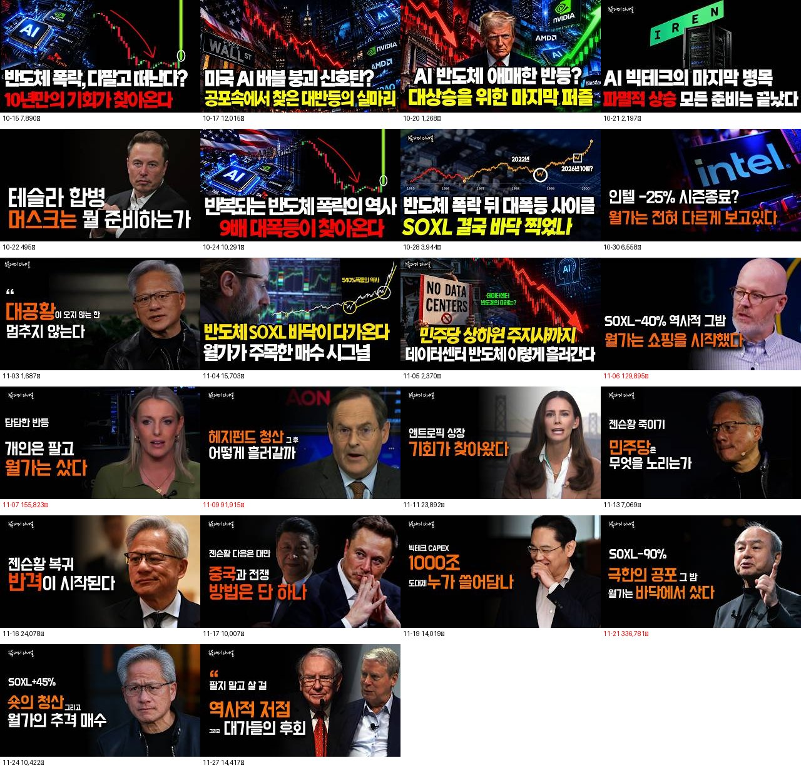
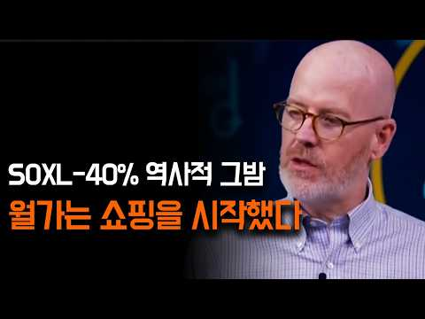
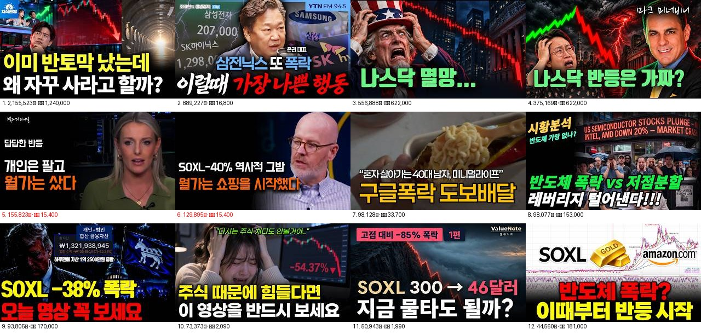

# 성공 사례 — 왜 됐나 (자세히): 「SOXL−40% 하루 만에 2조 5천억 달러 증발」 (뉴욕대디 다니엘 · 채널 첫 히트)

VERSION: v1.0 — 2026-11-28 — 최초. 사용자 지시 2026-11-28 "11-06 편 성공 이유를 더 자세하게 분석하고".
영상 https://www.youtube.com/watch?v=XEfn9wjIk40 · 같은 채널 11-21 편 분석은 `pZDTJKVDdxQ.md` (8번에 이 편 요약).

※ 연구·교육용 정리이고 투자 조언이 아닙니다. 클릭률·시청 지속률·트래픽 소스는 공개 자료에 없습니다. 표시: ✅ 자료로 확인 · 🔶 자료에서 미루어 봄 (추정) · ⬜ 모름.

## 0. 한눈에

1. **채널의 첫 히트.** 그 전 11편의 최고는 15,703회였고, 이 편은 129,895회입니다(8.3배). 성공 기준(구독자 1만~5만 → 10만 이상 · 구독자당 하루 0.38)을 넘습니다 ✅.
2. **홈 피드 (가장 중요): '큰 사건 + 새 썸네일 틀 + 질문 하나'가 한 번에 겹친 날입니다.** 같은 채널 나흘(11-03~06)이 작은 비교 시험이 됩니다(1번 표).
   - 새 틀만 쓴 날(11-03): 1,687회.
   - 폭락 이야기만 옛 틀로 한 날(11-04): 15,703회.
   - 셋이 다 겹친 날(11-06): 129,895회.
   - 🔶 넷뿐이라 어느 것이 몇 배를 만들었는지는 가를 수 없습니다.
3. **퍼진 때**: 첫날보다 **둘째 날(11-07 토요일)**에 더 넓게 퍼졌습니다(댓글이 둘째 날에 가장 많음 ✅). 그날 올린 11-07 편(15.6만)과 함께 이 채널이 처음 뜬 날입니다.
4. **썸네일·제목**: 같은 날 경쟁 썸네일은 빨간 차트, 머리를 감싼 사람, 큰 노랑·초록 글자였습니다. 이 편은 검은 바탕에 월가 인물 한 명을 두고 「SOXL-40% 역사적 그밤 / **월가는 쇼핑을 시작했다**」를 넣었습니다 ✅. 제목은 「숫자 충격 | **왜 하루 늦게 터졌을까** | 월가는 '쇼핑 리스트'를 꺼냈다」입니다.
   - 🔶 모두가 '폭락'만 말할 때 '수수께끼 + 월가는 샀다'를 말했습니다.
5. **이탈**: 설명란 목차가 범인 찾기 꼴입니다(단서 넷 → '그래서, 누가 설계했나'). 그다음 내 돈 질문 둘(3배 레버리지의 함정 · 이런 날 1년 뒤)이 이어집니다 ✅. 🔶 끝까지 볼 까닭이 두 번 있습니다.
6. **좋아요**: 0.74%로 채널 평소(1.29%)보다 낮습니다 ✅. 🔶 처음 본 사람(구독 안 한 사람)이 많았다는 뜻입니다. 공감 많은 댓글은 정리 칭찬 · 내 손실 · '월가는 결국 원하는 값에 샀다'는 맞장구입니다.

## 1. 같은 채널 나흘 — 무엇이 바뀌었나 ✅

| 올린 때 (KST) | 그날 일 (설명란) | 썸네일 틀 | 제목 | 조회수 |
|---|---|---|---|---|
| 11-03 (화) 16시 | 나스닥 −1% 남짓 (다우는 오름) | **새 틀** (검은 바탕 · 젠슨 황 · 「대공황이 오지 않는 한 멈추지 않는다」) | 반도체 폭락한 그날 밤, 젠슨 황의 입에서 나온 놀라운 숫자 | 1,687 |
| 11-04 (수) 16시 | 필라델피아 반도체 +2.63% · 한국 SK하이닉스 −5% | 옛 틀 (차트 + 큰 노랑·흰 글자 「반도체 SOXL 바닥이 다가온다」) | AI 랠리는 계속된다 \| SOXL −72% 매수 기회일까 \| … | 15,703 |
| 11-05 (목) 16시 | 중간선거 다음 날 다우 +3% · 반도체만 −3.1% | 옛 틀 (「NO DATA CENTERS」 팻말 + 빨간 차트) | 민주당 압승 데이터센터 진짜 끝났나? … | 2,370 |
| **11-06 (금) 17시** | **반도체 지수 −12.25%(1994년 이후 두 번째) · SOXL −40% · 하루 2조 5천억 달러 증발** | **새 틀** (검은 바탕 · 월가 인물 · 「SOXL-40% 역사적 그밤 / 월가는 쇼핑을 시작했다」) | **SOXL−40% 하루 만에 2조 5천억 달러 증발 \| AI 반도체 왜 하루 늦게 터졌을까 \| 월가는 '쇼핑 리스트'를 꺼냈다** | **129,895** |

- 🔶 **새 틀만으로는 안 됐습니다** (11-03: 새 틀 + 평범한 날 → 1,687).
- 🔶 **폭락 이야기만으로도 모자랐습니다** (11-04: 'SOXL −72%'를 옛 틀로 → 15,703 · 그 전 최고).
- 🔶 11-06은 **그해 가장 큰 사건 날**에 새 틀을 쓰고, '월가는 샀다'는 반전 문구를 처음 넣었습니다. 이 문구는 11-07(「개인은 팔고 월가는 샀다」 15.6만)·11-21(「월가는 바닥에서 샀다」 33.7만)에 다시 쓰였고, 셋 다 터졌습니다.

## 2. 홈 피드에 어떻게 추천될 수 있었나 (가장 중요)

**✅ 수요가 가장 컸던 이틀.**
- 구글 트렌드(한국 · 유튜브 검색 · 판에서 올린 CSV): '미국주식'이 11-05에 **74**, '나스닥'이 **40**으로 **11월에 가장 높았습니다**. 11-06은 53·24, 11-07(토)은 17·6입니다.
- 같은 때 한국 장도 폭락했습니다. 「美민주당 압승에 삼전닉스 폭락 "반도체株 팔아야 할까요?"」(11-05 · 88.9만) · 「코스피 45% 폭락, 이제 주가는 어떻게 되나」(11-07 · 215.6만) · 설명란에 '코스피 이틀 동안 −11%'.

**✅ 본 사람 대부분이 구독자가 아님.** 받은 때(11-28) 구독자는 15,400명입니다. 올린 때는 훨씬 적었을 것입니다 🔶(채널 개설 32일째 · 그 전 최고 1.6만 회). 13만 회는 홈 피드·관련 영상·검색에서 왔습니다.

**✅ 둘째 날에 가장 넓게 퍼짐.** 댓글 78개가 달린 때:

| 올린 뒤 | 0~6시간 | 6~24시간 | 1~2일 (11-07) | 2~4일 |
|---|---|---|---|---|
| 댓글 | 17 | 19 | **37** | 5 |

- 🔶 첫날 반응이 좋아 둘째 날(토요일) 더 많은 사람의 홈 피드에 퍼진 꼴입니다. 11-21 편이 6시간 안에 89%였던 것과 다르고, 이 채널이 아직 시청자를 모으기 전이라 천천히 넓어진 것으로 보입니다.
- 토요일 17시에 올린 11-07 편(15.6만)도 같은 날 퍼졌습니다. 🔶 둘째 날 넓어진 홈 피드에 두 편이 같이 실렸을 수 있지만, 어느 편이 먼저 끌었는지는 가를 수 없습니다.
- ✅ 올린 날 댓글 '좋은 퀄리티 영상 잘 보고 가네요 뭔가 채널 조만간 떡상할 거 같은 느낌이 옵니다'(4) · '빠른 소식 감사드립니다. 앞으로 잘 부탁드립니다'(2) — 처음 들어온 시청자의 말입니다.

**✅ 같은 사건(11-05~07) 영상 사이 순위.**
- 라이브·제외를 뺀 반도체·SOXL·나스닥·폭락 영상 상위 12개 중 6위입니다.
- 위 다섯은 큰 채널 영상 셋(박종훈의 지식한방 124만 · 내일은 투자왕 김단 62.2만 두 편) · 경제통마늘(1.68만 · 한국 메모리 · 존리 출연) · 같은 채널 11-07 편입니다.
- 작은 채널 중 구독자 대비가 높은 것: 경제통마늘 53배 · 오피디의 머니노트 35배 · 밸류노트 26배 · 이 편 8.4배(받은 때 구독자 기준).
- 🔶 이 사건에 유튜브가 큰 채널 시황 영상과 함께 작은 채널 해설 영상도 넓게 띄웠습니다.

**🔶 비슷한 꼴의 다른 새 채널도 같은 주에 떴음.** Just In Time(10-24 개설 · 같은 검은 틀 · 원본 인터뷰 번역 해설)의 첫 영상(11-02 메모리 · 28.3만)은 사흘 잠잠하다가 11-05부터 퍼졌습니다(`E2Kz9bbb878.md`). 같은 채널 11-04 편은 12.7만, 11-09 편은 15.5만입니다. 이 폭락 주에는 '원본 인터뷰 + 해설 · 검은 틀' 영상 여럿이 함께 올라갔습니다.

⬜ 모르는 것: 날짜별 조회수 · 홈 피드 비율 · 노출 수 · 클릭률 · 올린 때 구독자.

## 3. 썸네일 클릭률이 왜 높았나 (🔶 — 클릭률 숫자는 없음)

- 그림: 검은 바탕 · 오른쪽에 월가 인물(방송 화면) · 왼쪽 위 작은 채널 이름.
- 글자 2줄: 「SOXL-40% 역사적 그밤」(흰 · 숫자) / 「**월가는 쇼핑을 시작했다**」(주황).

**✅ 같은 사건 경쟁 썸네일 12개** (조회수 순 · 5번 = 11-07 편 · 6번 = 이 편):

- 다른 10개: 빨간 하락 차트가 대부분(6~7개) · 머리를 감싸거나 우는 사람 3 · 큰 노랑·초록·빨강 글자가 대부분.
- 다른 10개 문구: 「나스닥 멸망...」 · 「나스닥 반등은 가짜?」 · 「SOXL −38% 폭락 오늘 영상 꼭 보세요」 · 「주식 때문에 힘들다면 이 영상을 반드시 보세요」 · 「이미 반토막 났는데 왜 자꾸 사라고 할까?」 — 공포·경고·위로입니다.
- 🔶 이 편만 (1) 빨간 화면들 사이에서 검고 차분하고, (2) **'월가는 쇼핑을 시작했다'** 로 '누가 이 값에 사고 있나'라는 궁금증과 '바닥일 수도'라는 희망을 같이 줍니다. (3) 숫자 「SOXL-40%」는 그날 SOXL을 들고 있던 사람에게 **자기 계좌 숫자**입니다.

**✅ 제목 3단** — 「**SOXL−40% 하루 만에 2조 5천억 달러 증발** | **AI 반도체 왜 하루 늦게 터졌을까** | **월가는 '쇼핑 리스트'를 꺼냈다**」.
1. 숫자 충격: 썸네일 숫자 + 더 큰 숫자(2조 5천억 달러).
2. 수수께끼: 선거 결과는 그 전날 나왔는데 폭락은 왜 하루 늦게 왔나. 같은 날 다른 제목에는 없는 질문입니다. 🔶 '왜'를 아는 사람이 없을 때 '왜'를 약속했습니다.
3. 반전: 썸네일 주황 줄과 같은 말을 다른 낱말('쇼핑 리스트')로.

## 4. 왜 이탈하지 않았나 (⬜ 대본 없음 — 설명란 목차·댓글로)

✅ 설명란 첫머리: "폭락은 왜 하루 늦게 왔을까요? 정말 누군가 설계한 걸까요? 정치, 회사들 스스로, 헤지펀드, 그리고 규칙대로 움직이는 기계까지. **네 가지 단서로 그 하루를 처음부터 되감아 봤습니다.** 3배 레버리지 ETF가 왜 방향보다 출렁임에 더 크게 지는지도 실제 숫자로 정리했어요. 1994년 이후 반도체 지수가 크게 빠진 날들, 그 1년 뒤도 실제 종가로 찾아봤습니다."

| 시각 | 장 | 🔶 볼 까닭 |
|---|---|---|
| 0:00 | 오프닝: 2조 5천억 달러가 사라진 날 | 썸네일·제목 숫자를 바로 |
| 1:21 | 현장: 11월 5일의 숫자 | 내 종목 숫자(마이크론 −17.5% · AMD −17.3% · 엔비디아 −9.3% · SK하이닉스 −9.5%) |
| 2:30 · 4:28 · 6:19 · 7:28 | 단서 ① 정치 · ② 회사들 스스로 · ③ 헤지펀드 · ④ 기계 | 범인 후보 넷 — 하나씩 지워 감 |
| **8:29** | **그래서, 누가 설계했나** | 제목 질문의 답 (영상 절반쯤) |
| 9:35 | 3배 레버리지의 함정 | SOXL 든 사람의 내 돈 질문 ① |
| 10:34 | 역사: 이런 날 뒤에 무슨 일이 | 내 돈 질문 ② (1994년 이후 · 1년 뒤 실제 종가) |
| 12:42 · 15:07 | 누가 버티나 · 반대편 목소리 | 버틸지 말지 |
| 15:42 · 16:23 | 정리 · 마무리 | — |

- 🔶 **답이 두 번 나옵니다**: 앞 절반은 '누가 설계했나'(호기심), 뒤 절반은 '내 SOXL은 어떻게 되나'(내 돈)입니다. 앞의 답을 들은 뒤에도 남을 까닭이 있습니다.
- ✅ 댓글: '제가 궁금했던 걸 정리해 줘서 좋았습니다. 왜 떨어졌을까 에서 시작된 의문을 … 근거 있는 핵심이 필요한데 다들 그렇지 못한 영상들이 많더라고요 이렇게 풀어 주니까 이해도 쉽고 좋아요' · 「완벽한 정리에 랄부를 탁!쳤습니다」(2) · '매크로 공부하는 데 많은 도움 되네요'(2).
- ✅ 믿을 만함: 출처(CNBC · NBC News · Schwab Network · Bloomberg · Reuters 등, 11월 4~5일) · '정보 제공용이며 매수·매도 권유가 절대 아닙니다'.
- ⬜ 시간 표시 댓글 0 — 어느 장에서 많이 나갔는지 모름 (PC 대본 받기 뒤).

## 5. 왜 좋아요를 눌렀나

| 칸 | 이 편 | 이 채널 다른 21편 가운데값 | 11-21 편 |
|---|---|---|---|
| 좋아요율 | **0.74%** | 1.29% | 1.08% |
| 댓글 ‰ | **0.60** | 1.50 | 1.51 |

- ✅ 채널 평소보다 낮습니다. 🔶 구독자가 아닌 처음 보는 사람이 많이 봤을 때 흔한 꼴입니다(아직 채널을 모르는 사람은 덜 누름). 이 편은 '좋아요가 많아서'가 아니라 '많이 보여져서' 떴습니다.
- ✅ 댓글 갈래 (답글 아닌 54개 · 낱말 세기): 정리·설명 칭찬 13(24%) · 질문 8(15%) · 반등·바닥 전망 4 · 내 손실·물림 3 · 월가·세력 의심 2. 분석기 분류: 감사·응원 8 · 좋은 점 4 · 반박 3 · 더 알고 싶은 것 2.
- 🔶 누른 까닭 (공감 많은 댓글):
  1. **내 이야기**: '이럴 때 항상 나는 고점에 물려 있지'(16 · 1위) · '이런 폭락장을 대비해 현금을 보유하고 있어야 했는데'(8).
  2. **썸네일 문구에 맞장구**: '바이더딥에서 안 산 월가들은 결국 폭락시키고 지들이 원하는 가격에 드디어 샀다'(13 · 2위) — '월가는 쇼핑을 시작했다'를 그대로 받아 말함.
  3. **정리 칭찬·새 채널 응원**: '잘 보았습니다. 채널 승승장구하세요'(8) · '좋은 퀄리티 영상 … 채널 조만간 떡상할 거 같은 느낌'(4).

## 6. 우리 영상에 옮길 때 (가설 — 한 채널 네 편으로 규칙을 만들지 않음)

- **시험해 볼 것**
  1. 큰 사건 날에는 '무슨 일'이 아니라 **'왜'(수수께끼 하나)** 를 제목 가운데에 둡니다.
  2. 썸네일 = 내 계좌 숫자 + 반전 한 줄. 공포만·경고만 말하는 꼴은 피합니다.
  3. 구성 = 호기심 답(절반) → 내 돈 질문 둘 → 버틸 기준.
  4. 사건 다음 날까지 두 편(사건 해설 · '그다음은')을 이어서 올립니다.
- **주의**
  - (1) 이 꼴은 큰 사건이 있어야 됩니다(11-03·11-05 편은 낮음).
  - (2) 원본 방송 화면을 쓰는 꼴은 재사용·저작권 위험이 있습니다. 우리는 코드 화면 + AI 장면입니다.
  - (3) 재테크 폴더 원칙은 '경제 뉴스·시황 해설은 뺌'입니다. 시황 자체가 아니라 **썸네일·제목·구성 방식만** 제도·세금·계산 주제에 빌립니다(예: 'SOXL 손실, 세금은 왜 그대로?').

## 7. 쓴 자료

| 자료 | 파일 |
|---|---|
| 영상 정보·설명란·목차 | `stock/result/outliers/W_XEfn9wjIk40/metadata.json` · `description.txt` |
| 댓글 78개(답글 포함 · 올린 시각) | `W_XEfn9wjIk40/comments.jsonl` · `comments.csv` |
| 같은 채널 22편 (11-03~05 설명란 포함) | 캐시 `.cache/<영상ID>.json` · `uploads_UC81Nr5G_JhSn0-5R5WUXwjA.json` · 썸네일 그림 `pZDTJKVDdxQ_channel.jpg` |
| 같은 사건 12편 | `stock/result/outliers/compare.csv` (11-05~07 · 라이브·제외 뺌) · 공개 썸네일 → `XEfn9wjIk40_rivals.jpg` |
| 구글 트렌드 | `economic/result/next_topic/board_csv/r01_p1.csv` (판에서 올린 CSV) |
| 댓글 갈래 | `stock/result/outliers/analysis.json` success_cases needs |
| **없는 것** | 대본 · 날짜별 조회수 · 올린 때 구독자 · 클릭률·지속률·트래픽 소스 |
