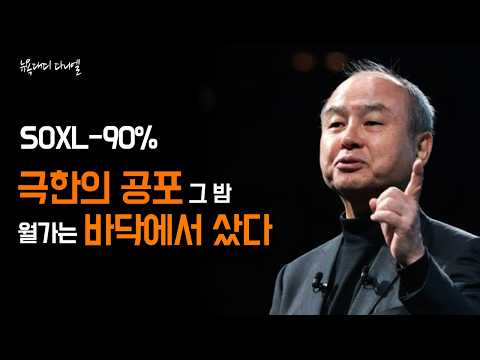
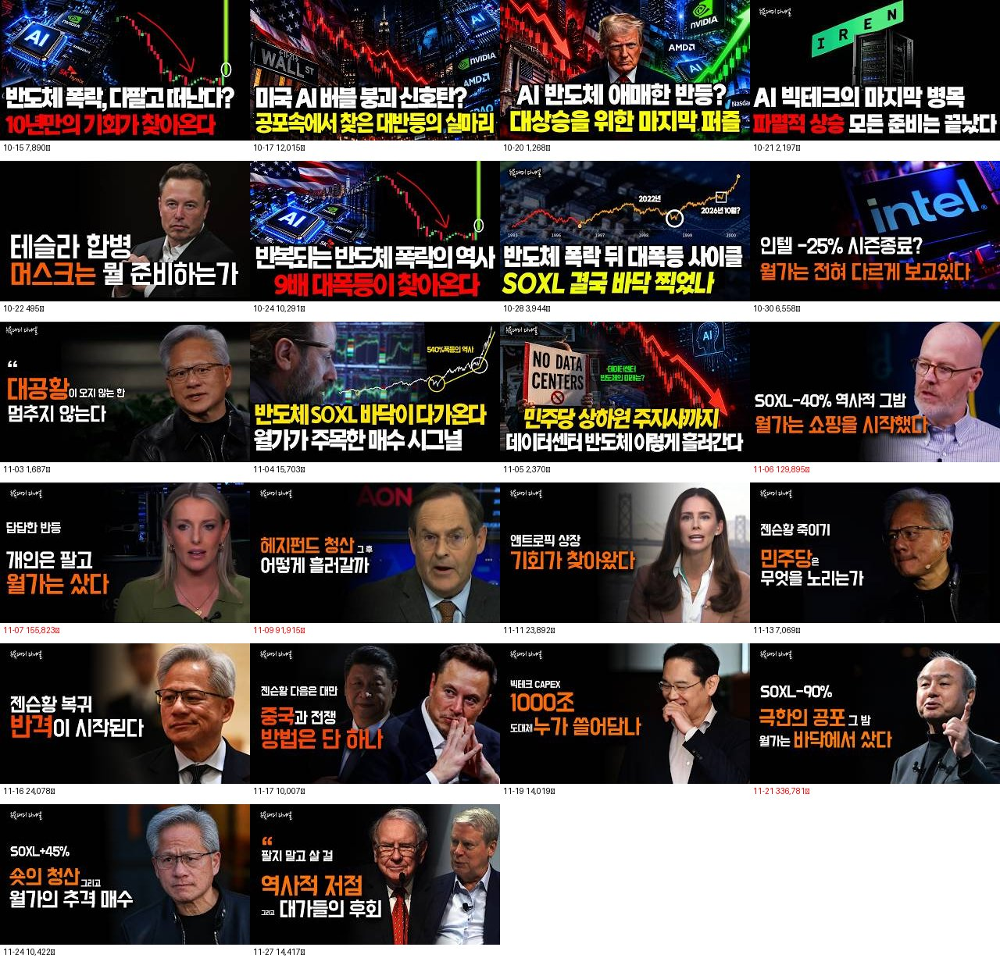
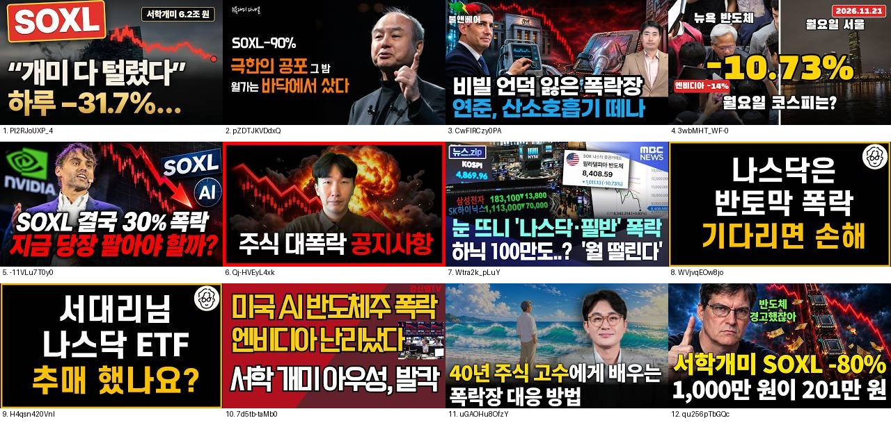

# 성공 사례 한 편 — 왜 됐나: 「SOXL -90% 극한의 공포 1조달러 배팅을 꺼냈다」 (뉴욕대디 다니엘)

VERSION: v1.1 — 2026-11-28 — 8번 **앞선 세 편(11-06·07·09)** 성공 여부·까닭 (사용자 질문 2026-11-28 "근데 저 세편도 성공사례 아니야? 저건 또 왜 성공했는데") — 11-09 편은 성공 기준 밖(조회수 91,915 < 구독자 1만~5만 구간 하한 10만).
(v1.0) — 2026-11-28 — 최초. 사용자 지시 2026-11-28 "가장 최근 성공 사례 하나만 왜 성공했는지(홈 피드에 어떻게 추천될 수 있었는지(가장 중요) 썸네일 클릭율이 왜 높은지, 왜 이탈하지 않았는지, 왜 좋아요를 눌렀는지) 관련 자료들을 참고하여 분석해서 결과에 표시해봐".
고른 까닭: 이번 검색어(30개)로 찾은 성공 사례 33개 중 **가장 최근에 올린 영상** (2026-11-21 10:00 UTC). 영상 https://www.youtube.com/watch?v=pZDTJKVDdxQ

※ 연구·교육용 정리이고 투자 조언이 아닙니다. **클릭률·시청 지속률·트래픽 소스(홈 피드 비율)는 공개 자료에 없습니다** (채널 주인의 스튜디오에만 있음). 그래서 이 문서는 공개 숫자로 확인한 것과, 그 숫자에서 미루어 본 것을 나눠 적습니다.
표시: ✅ 자료로 확인 · 🔶 자료에서 미루어 봄 (추정) · ⬜ 자료가 없어 모름.

## 0. 한눈에

1. **홈 피드 (가장 중요)**: 이 채널은 11월 초 반도체 폭락 날 세 편(12.9만·15.5만·9.2만)으로 'SOXL·반도체를 들고 걱정하는 시청자'를 이미 모아 두었습니다. 11-20 다시 폭락(SOXL 하루 −32%)하자 그 시청자가 가장 궁금한 순간에 새 편이 나왔고, 올리고 6시간 안에 댓글의 89%가 달릴 만큼 한꺼번에 퍼졌습니다. 검색으로 온 사람이 주된 길은 아니었습니다. 🔶 근거는 2번.
2. **썸네일**: 같은 사건의 다른 썸네일은 거의 모두 빨간 차트와 큰 글자로 공포만 말했습니다. 이 영상만 검은 바탕에 인물 한 명을 두고 "극한의 공포 그 밤 **월가는 바닥에서 샀다**"를 넣었습니다. 손실 숫자(SOXL −90%)를 보여 준 뒤 반전 한 줄을 붙인 꼴입니다. 🔶 근거는 3번.
3. **이탈**: 설명란 챕터를 보면 질문 하나에 장 하나씩입니다. 썸네일의 답(손정의·'월가는 바닥에서 샀다')은 12분이 넘어서 나옵니다. 공감 2위 댓글이 마지막 말을 옮긴 것으로 보아, 끝까지 본 사람이 많습니다. 🔶 대본이 없어 구간별로는 모릅니다. 근거는 4번.
4. **좋아요**: 좋아요율 1.08%는 이 채널 평소(1.29%)와 비슷합니다. 좋아요가 특별히 많아서 뜬 영상이 아니라, 많이 보여져서 뜬 영상입니다 ✅. 좋아요를 누른 까닭은 댓글로 보면 큰 손실 날 저녁의 **위로**, 정리 **실력 인정**, 시청자가 이미 품은 **의심(의도된 폭락?)과 같은 질문** 세 가지입니다 🔶. 근거는 5번.

## 1. 영상 숫자 (받은 때 2026-11-28 18:47 KST · 올린 지 7.0일)

| 칸 | 값 | 비교 |
|---|---|---|
| 올린 때 | 2026-11-21 (토) 19:00 KST | 미국 11-20(금) 장 마감 = 한국 토요일 06:00 → 13시간 뒤 |
| 길이 | 21.2분 | 채널 다른 21편 가운데값 16.2분 · 같은 사건 상위 영상 4.7~17.8분 |
| 조회수 | **336,781** | 채널 다른 21편 가운데값 10,291 → **32.7배** · 채널 전체 조회수 882,736 의 38% |
| 구독자 | 15,400 | 조회수 ÷ 구독자 = 21.9배 · 구독자당 하루 조회수 3.13 (성공 기준 0.1) |
| 채널 | 2026-10-05 개설 · 첫 영상 10-15 · 43일 동안 22편 (2일에 1편 꼴) | 올리는 시각 16~20시 KST |
| 좋아요 | 3,629 (1.08%) | 채널 가운데값 1.29% |
| 댓글 | 510 (1.51‰ · 답글 153) | 채널 가운데값 1.37‰ |

## 2. 홈 피드에 어떻게 추천될 수 있었나 (가장 중요)

**✅ 본 사람 대부분이 구독자가 아님.** 조회수가 구독자의 21.9배입니다. 구독자 모두가 봤어도 4.6%라서, 95% 넘게 구독하지 않은 사람이 봤습니다. 이 사람들이 홈 피드·관련 영상·검색 중 어디서 왔는지는 공개 자료로 나눌 수 없습니다.

**🔶 검색은 주된 길이 아님.**
- ✅ 구글 트렌드(한국·유튜브 검색·일별, 판에서 올린 CSV): 'SOXL' 검색은 11월 내내 0~2입니다. 11-20~22도 1이고, 같은 CSV의 '테슬라'는 5~10입니다.
- 🔶 검색량이 이만큼 작으면 33만 회를 설명하기 어렵습니다. 그래서 홈 피드와 관련 영상이 주된 길로 보입니다. 우리 탐색에서 이 영상은 'SOXL' 검색으로 걸렸지만, 그것만으로 유입 경로를 알 수는 없습니다.

**✅ 올리자마자 몰림.** 댓글 510개가 달린 시각입니다.

| 올린 뒤 | 0~6시간 | 6~24시간 | 1~2일 | 2~7일 |
|---|---|---|---|---|
| 댓글 | **452 (89%)** | 37 | 18 | 3 |

🔶 토요일 19시부터 새벽 1시 사이에 한꺼번에 많은 사람에게 보여졌습니다. 첫 몇 시간의 반응이 좋아서 더 넓게 퍼지는 꼴입니다. 검색 유입은 보통 며칠에 걸쳐 고르게 옵니다.

**✅ 채널이 '이 주제를 보는 사람'을 이미 모아 둠** (채널 22편 — 아래 그림 위 숫자).

| 올린 날 | 이 날 일 | 조회수 |
|---|---|---|
| 10-15 ~ 11-05 (11편) | 폭락 예고·반등 기대 | 495 ~ 15,703 |
| **11-06** | SOXL −40% (제목) | **129,895** |
| **11-07** | 그다음 날 | **155,823** |
| **11-09** | 헤지펀드 청산 | **91,915** |
| 11-11 ~ 11-19 (5편) | 앤트로픽·젠슨 황·중국·민주당·CAPEX | 7,069 ~ 24,078 |
| **11-21** | **SOXL 하루 −32% · 고점 대비 −90%** | **336,781** |
| 11-24 · 11-27 | 반등 (SOXL +45%) | 10,422 · 14,417 |

🔶 11월 초 세 편으로 유튜브가 이 채널과 'SOXL·반도체 손실을 걱정하는 시청자'를 이었습니다. 11-20 다시 큰 폭락이 오자, 같은 시청자의 관심이 가장 높은 때에 새 편을 그들 홈 피드에 띄운 것으로 보입니다. 폭락이 아닌 날의 편은 같은 채널, 같은 썸네일 틀이어도 0.2만~2.4만입니다.

**✅ 그때 수요가 가장 컸음.**
- 설명란에 따르면 11-20은 나스닥 −5.28%, 주간 −10%로 2020년 뒤 가장 나쁜 주였습니다. SOXL은 하루 −32%였고, 한국 개인 투자자는 나흘 동안 약 21억 달러를 잃었습니다.
- 구글 트렌드(유튜브 검색) '미국주식'은 11-20에 56으로, 11월 가운데값 35.5보다 높았습니다. '나스닥'도 38로 가운데값 18.5의 두 배쯤이었습니다. 다만 11월에 가장 높은 날은 11-05(각 74·40)였고, '미국주식'은 11-23에도 56이었습니다.
- 같은 사건 영상(11-20~22, 라이브 뺌) 상위 12개 중 작은 채널 3곳이 구독자의 20배를 넘었습니다: 월가의 진실 96배 · 세계 풍향계 167배 · 이 영상 22배. 🔶 유튜브가 이 사건 영상을 작은 채널까지 넓게 띄운 날입니다.

**✅ 첫 소식이 아니라 '주말 저녁 정리'로 이김.**
- 같은 사건 상위 영상 대부분은 토요일 아침 8~11시 KST에 올라왔습니다(매경 08:07 · 세계 풍향계 08:30 · 미국 주식 채널 08:59 · 월가의 진실 09:39). 이 영상은 토요일 19:00, 10시간쯤 늦게 올라왔습니다.
- 🔶 아침 소식을 이미 본 사람에게 "왜 이렇게 됐나, 어디가 바닥인가"를 21분으로 정리한 편입니다. 소식 영상과 겹치지 않는 다음 영상이었습니다.

**🔶 오래 볼 영상이었음.** 유튜브는 클릭 뒤 오래 보고 만족한 영상을 더 많이 추천한다고 공개적으로 말해 왔습니다. 길이 21분에 끝까지 본 흔적(4번)이 있으니, 같은 클릭이라도 시청 시간이 컸을 것입니다. ⬜ 평균 시청 시간 숫자는 없습니다.

⬜ **모르는 것**: 홈 피드·관련 영상·검색의 실제 비율, 노출 수, 클릭률. 모두 스튜디오 '도달범위' 탭에만 있습니다.

## 3. 썸네일 클릭률이 왜 높았나 (🔶 — 클릭률 숫자는 없음)

- 그림: 검은 바탕, 오른쪽에 손정의가 손가락을 위로 들고 있습니다. 왼쪽 위 작게 채널 이름이 있습니다.
- 글자 3줄: 「SOXL-90%」(흰색) / 「**극한의 공포** 그 밤」(주황) / 「월가는 **바닥에서 샀다**」(주황 강조).

**✅ 채널 썸네일 틀이 바뀌었고, 터진 4편은 모두 새 틀**입니다 (아래 채널 22편, 빨간 숫자 = 5만 회 넘음).
- 옛 틀 (10-15~11-05 중 10편): 차트·로고 위에 큰 노랑·빨강 글자 → 495~15,703회.
- 새 틀 (11-03에 처음, 11-06부터 모든 편 — 12편): 검은 바탕 + 오른쪽 실제 인물 + 왼쪽 2~3줄(흰 글자 + 주황 강조) → 1,687~336,781회.

**✅ 같은 틀 안에서도 문구로 갈림.**
- 터진 편: **폭락 숫자 + '월가는 샀다'** — 11-06 「SOXL-40% 역사적 그밤 월가는 쇼핑을 시작했다」 12.9만 · 11-07 「개인은 팔고 월가는 샀다」 15.5만 · 11-21 「SOXL-90% 극한의 공포 그 밤 월가는 바닥에서 샀다」 33.7만.
- 안 터진 편: 인물·정치 이야기(「젠슨황 죽이기 민주당은 무엇을 노리는가」 7,069 · 「중국과 전쟁 방법은 단 하나」 10,007)나 오른 날(「SOXL+45% 숏의 청산 그리고 월가의 추격 매수」 10,422).

**✅ 같은 사건 경쟁 썸네일 12개** (1번 월가의 진실, 2번 이 영상 — 조회수 순).
- 대부분 빨간 하락 차트·폭발·큰 글자로 공포만 말합니다: 「SOXL 결국 30% 폭락 지금 당장 팔아야 할까?」 · 「주식 대폭락 공지사항」 · 「서학 개미 아우성, 발칵」.
- 🔶 이 영상은 (1) 빨간 화면들 사이에서 검고 차분해서 눈에 띄고, (2) 공포 다음에 **'바닥에서 샀다'는 희망 한 줄**을 줍니다. 손실을 본 사람이 그날 밤 가장 듣고 싶은 말입니다. (3) 인물의 손가락이 위를 가리킵니다(반등 암시).

**✅ 제목과 썸네일이 겹치지 않고 서로 채움.**
- 썸네일: SOXL −90% · 극한의 공포 · 월가는 바닥에서 샀다.
- 제목: 「SOXL -90% 극한의 공포 **1조달러 배팅을 꺼냈다** | 반도체 **의도된 폭락?** 개인은 팔았고 월가는 받았다」.
- 썸네일 인물(손정의)이 누구인지와 '1조달러 배팅'은 제목이 말해 줍니다.
- 🔶 '의도된 폭락?'은 시청자가 이미 품은 의심을 질문으로 꺼낸 것입니다. 같은 의심이 댓글에도 많습니다: 공감 57 '싸게 사려고 내리려는 거지' · 공감 56 '의도된 폭락이라고 봅니다' · 공감 27 '바닥으로 떨어뜨리고 사는 세력이 있는 것 같음'.

**🔶 숫자가 시청자 자신의 계좌.** 'SOXL −90%'는 보는 사람 계좌의 숫자입니다. 같은 날 '월가의 진실' 제목에 따르면 서학개미 SOXL 보유는 6.2조 원이었습니다. 남의 소식이 아니라 내 일이라서 누르게 됩니다.

## 4. 왜 이탈하지 않았나 (⬜ 대본 없음 — 설명란 챕터·댓글로만)

**✅ 설명란 챕터 7개** — 질문 하나에 장 하나:

| 시각 | 장 | 무엇을 |
|---|---|---|
| 0:00 | 훅·오프닝 | 블룸버그 마감 "반도체 −11%, 고점 대비 −47%", SOXL −90% (썸네일 숫자를 바로 확인) |
| 1:30 | 1장. 어제 하루 | 나스닥 주간 −10% · 엔비디아 −23% · 서학개미 21억 달러 |
| 3:53 | 2장. 왜 이렇게 심각한가 | SEC 회계 조사 · 젠슨 공백 · 구글-브로드컴 · 금리 · CDS |
| 7:43 | 3장. 거품인가, 재평가인가 | PER 70배 vs 21배 · 존 그레이 · 캐머런 도슨 |
| 12:11 | 4장. 전설은 지금 뭘 하나 | 드러켄밀러 vs **손정의(썸네일 인물)** · 2020년 3월의 반전 · VIX |
| 16:52 | 5장. 숏은 결국 털린다 | 체크리스트 · 한국 월요일 |
| 20:36 | 정리 | 지켜야 할 선 |

- 🔶 **질문으로 이어 감**: 설명란 첫머리가 "의도된 폭락인가, 시작인가. 거품이 터진 건가, 다시 값을 매기는 중인가"입니다. 장마다 그 질문을 하나씩 풉니다. 썸네일이 약속한 답(손정의의 1조 달러 배팅·월가는 바닥에서 샀다)은 12분이 넘어서야 나오므로, 그때까지 볼 까닭이 있습니다.
- ✅ **끝까지 본 흔적**: 공감 2위 댓글(145)은 '하루 종일 힘들었는데 **마지막 말**에 다시 힘을 내 보겠다'는 내용입니다(원문은 댓글 파일). 공감 24 댓글 「마지막 멘트에 힘내봅니다 숏은 짧게 가고 결국 털립니다」는 5장(16:52~) 제목을 그대로 옮겼습니다.
- ✅ **믿을 만하게 만든 장치**: 설명란에 원본(Bloomberg·CNBC Closing Bell·iConnections 대담)과 자료(Reuters 단독·한국예탁결제원·S&P Global 등) 출처를 적었습니다. 확인 안 된 것은 단서 4줄로 밝혔습니다('SEC 조사는 위법의 증거가 아닙니다' · '숏은 결국 털린다는 제작진의 해석' 등). 끝에는 '매수·매도 권유가 아닙니다'를 넣었습니다.
- ⬜ 시간 표시(예 '12:30') 댓글이 0개라 어느 구간에서 많이 나갔는지는 모릅니다. PC 대본 받기 뒤 도입 20초·장 끝 문장을 다시 봅니다 (이 영상은 `transcript_todo.csv` 성공 사례 묶음 안).

## 5. 왜 좋아요를 눌렀나

**✅ 좋아요율은 평범 — 뜬 까닭은 '많이 보여짐'.**

| 영상 | 구독자 | 조회수 | 좋아요율 | 댓글 ‰ |
|---|---|---|---|---|
| **이 영상** | 15,400 | 336,781 | **1.08%** | 1.51 |
| 이 채널 다른 21편 가운데값 | — | 10,291 | 1.29% | 1.37 |
| 월가의 진실 (같은 날 · 작은 채널) | 3,650 | 351,786 | 0.36% | 2.96 |
| 세계 풍향계 (같은 날 · 작은 채널) | 1,560 | 260,618 | 0.45% | 1.67 |
| 매경 라이브 (같은 날 · 큰 채널) | 333,000 | 279,702 | 1.20% | 1.66 |
| 미국 주식 채널 (같은 날 · 큰 채널) | 275,000 | 226,982 | 1.02% | 1.70 |

🔶 같은 날 터진 작은 채널들보다 좋아요율이 2~3배 높습니다. 많이 보여졌는데도, 본 사람이 비교적 만족한 영상입니다.

**✅ 댓글 갈래** (분석기 낱말 분류 · 답글 아닌 357개 중 갈래에 든 것): 감사·응원 44 · 경험 공유(내 손실·버팀) 31 · 정치·사회 19 · 좋은 점(도움·설명·정리) 17 · 반박 10 · 구독·다음 기대 8 · 아쉬운 점 7 · 더 알고 싶은 것 4.

**🔶 누른 까닭 세 가지** (공감 많은 댓글 — 원문은 `stock/result/outliers/W_pZDTJKVDdxQ/comments.csv`, 작성자 이름 없음):
1. **위로**: 공감 145·39·34 댓글이 모두 '하루 종일 힘들었는데 힘을 얻었다'는 내용입니다. 큰 손실 난 날 저녁에 숫자를 정리해 주고 '살아남자'로 끝냈습니다. 설명란도 "주말 맛있는 음식 드시고 투자는 조금만 멀리하고 푹 쉬세요 / 이번 주 모두 정말 수고하셨습니다"입니다.
2. **실력 인정**: 공감 1위(192)는 '주식 30년… 이 영상 만드신 분은 정말 주식을 잘 아시는 분'입니다. 그 밖에 「주식관련 영상중에 최상의 영상을 본것 같습니다」(60), '생각보다 뛰어나네요. 구독 누르고 갑니다'(15)가 있습니다.
3. **내 생각과 같은 질문**: '의도된 폭락' 의심 댓글(57·56·27)이 제목의 질문과 같습니다. 한편 반박 10개('수급 안 봄? 개인이 다 받았는데' 25)도 있어, 모두가 맞장구친 것은 아닙니다.

## 6. 우리 영상에 옮길 때 (가설 — 한 편으로 규칙을 만들지 않음)

이 영상 하나, 이 채널 22편, 같은 사건 영상 12편의 숫자입니다. 지시사항 규칙으로 바꾸려면 성공 사례 여러 편에서 같은 결과가 나와야 합니다.
- **시험해 볼 것**
  1. 큰 사건 다음 날 저녁에 '깊게 정리' 편을 올립니다. 소식 영상과 겹치지 않는 다음 영상입니다.
  2. 썸네일 = 시청자 손실 숫자 + 감정 이름 + 반전 한 줄. 공포만 말하는 꼴은 피합니다.
  3. 장마다 질문 하나를 풀고, 썸네일의 답은 중반이 넘어서 나오게 합니다.
  4. 마무리 = 버틸 기준·지금 할 일. 재테크 컨셉의 '그래도 지금 할 일'과 같습니다.
- **주의**
  - 이 꼴은 사건이 있어야 됩니다. 이 채널도 폭락이 아닌 날은 0.2만~2.4만입니다.
  - 정치·인물 이야기 편은 낮았습니다.
  - ~~재테크 폴더 원칙은 '경제 뉴스·금리·환율 해설은 뺌'입니다(CLAUDE.md 주제 폴더). 시황 해설 자체는 컨셉 밖이라서, **썸네일·구성 방식만** 빌려 제도·세금·계산 주제에 씁니다(예: 레버리지 ETF 손실 × 세금·건보료).~~ (2026-11-28 사용자 지시 "2는 생각하지마 … 지금은 주식 주제부터 시작할거니까 모든 주식 정보를 종합해서 돈을 잃지 않고 부자가 되는 방향" — 주식 편은 재테크 컨셉(제도 꼬집기)·'시황 해설 뺌' 제약 없이 · 시황·폭락 해설도 다룸)
  - 채널 주제를 정할 때 쓰는 근거는 성공 사례 여러 편입니다(`next_topic.md` 0-2).

## 7. 쓴 자료

| 자료 | 파일 | 할당량 |
|---|---|---|
| 영상 정보·설명란·챕터 | `stock/result/outliers/W_pZDTJKVDdxQ/metadata.json` · `description.txt` | 승인 때 받음 |
| 댓글 510개(답글 포함 · 올린 시각) | `W_pZDTJKVDdxQ/comments.jsonl` · `comments.csv` | 승인 때 받음 |
| 썸네일 | `W_pZDTJKVDdxQ/thumbnail.jpg` · 채널 22편·경쟁 12편은 공개 썸네일 주소(i.ytimg.com)에서 받아 묶음 → 이 폴더 그림 두 장 | 0 |
| 채널 22편 숫자 | 캐시 `.cache/uploads_UC81Nr5G_JhSn0-5R5WUXwjA.json` + 영상마다 캐시(채널 평소 영상 받기) | 승인 때 받음 |
| 같은 사건 영상 | `stock/result/outliers/compare.csv` (11-20~22 · 반도체·SOXL·나스닥·엔비디아·폭락 · 라이브·제외 뺌) | 탐색 때 받음 |
| 구글 트렌드 | `economic/result/next_topic/board_csv/r01_p1.csv`(미국주식·나스닥) · `r04_p1.csv`(SOXL·테슬라) — 판에서 올린 CSV | 0 |
| 댓글 갈래 | `stock/result/outliers/analysis.json` success_cases needs (분석기 낱말 분류) | 0 |
| **없는 것** | 대본(자막 서버가 클라우드를 막음 → PC `run_analyzer.ps1 -Transcribe -Folder stock`) · 클릭률·시청 지속률·트래픽 소스(스튜디오만) | — |

## 8. 앞선 세 편 (11-06 · 11-07 · 11-09) — 이것도 성공 사례인가, 왜 됐나

**성공 기준** (`stock/analysis_rules.toml` [success] — 구독자 15,400 = '1만~5만' 구간 → 조회수 10만 이상 · 구독자당 하루 조회수 0.1 이상 · 7~180일 · 4분 이상):

| 올린 때 (KST) | 영상 | 조회수 | 구독자당 하루 | 성공 사례? | 이번 33개에? |
|---|---|---|---|---|---|
| 11-06 (금) 17시 | [SOXL−40% 하루 만에 2조 5천억 달러 증발…](https://www.youtube.com/watch?v=XEfn9wjIk40) | 129,895 | 0.38 | ✅ | ✅ ('SOXL' 검색에 걸림 · 댓글 받음) |
| 11-07 (토) 17시 | [데드캣 바운스일까 vs 대반등의 신호탄일까…](https://www.youtube.com/watch?v=x0-ObXRPfJA) | 155,823 | 0.48 | ✅ | ✗ — 30개 검색어 결과에 안 나옴 (채널 평소 영상 받기로 들어옴 · 판 목록 '이번 검색어' 칩을 끄면 보임 · 댓글 아직) |
| 11-09 (월) 17시 | ["시장은 다시 말아 올릴 겁니다" 헤지펀드 청산…](https://www.youtube.com/watch?v=YQ78DeOJvXg) | 91,915 | 0.31 | ✗ — 조회수가 구간 하한 10만에 모자람 | ✗ |

⚠️ 구독자는 받은 때(11-28) 값입니다. 올린 때 이 채널 구독자는 더 적었을 것이지만 과거 구독자 수는 공개 자료에 없습니다 — 그래서 '구독자 대비'는 실제보다 낮게 잡힙니다.

**그때 일** ✅ (설명란): 미국 11-05(목) 반도체 지수 −12.25%(1994년 이후 두 번째로 큰 하락) · SOXL 하루 −40% · 마이크론 −17.5% · 미국 증시 하루 2조 5천억 달러 증발 · 다음 날(금) 나스닥 반등 +1.1%에 그침 · 코스피 이틀 −11%. 구글 트렌드(유튜브 검색) '미국주식' 11-05 = 74·'나스닥' 40 — **11월에 가장 높은 날**.

**11-06 편 — 왜 됐나** (자세히: `XEfn9wjIk40.md`)
- ✅ 이 채널의 첫 히트 (그 전 최고 11-04 15,703회). 미국 장 마감(한국 금 06시) 11시간 뒤 올림.
- ✅ 썸네일 새 틀을 본격적으로 쓴 첫 편 (11-03 한 번 시험 · 11-04·05 는 옛 차트 틀): 검은 바탕 · 월가 전략가 얼굴 · 「SOXL-40% 역사적 그밤 / 월가는 쇼핑을 시작했다」 — 11-21 편과 같은 '폭락 숫자 + 월가는 샀다' 꼴의 첫 등장.
- ✅ 제목 = 숫자(SOXL−40%·2조 5천억 달러) + 수수께끼 질문(왜 하루 늦게 터졌을까) + 반전(월가는 '쇼핑 리스트'를 꺼냈다).
- 🔶 **추리 구성** (설명란 목차): '폭락은 왜 하루 늦게 왔을까요? 정말 누군가 설계한 걸까요?' → 첫 번째 단서: 정치 → 두 번째: 회사들 스스로 → 세 번째: 헤지펀드 → 네 번째: 기계 → **그래서, 누가 설계했나** → 3배 레버리지의 함정 → 역사: 이런 날 뒤에 → 누가 버티나 → 반대편 목소리 → 정리. 범인 찾기 꼴이라 답(8:29)까지 볼 까닭 · 11-21 편 '의도된 폭락?'도 같은 질문.
- ✅ 댓글 78개가 올린 뒤 **1~2일째(11-07)에 가장 많음** (0~6시간 17 · 6~24시간 19 · 1~2일 37 · 2~4일 5) — 11-21 편(6시간 안 89%)과 다름. 🔶 첫날보다 다음 날(토요일 · 11-07 편이 올라온 날)에 더 넓게 퍼짐 → 이 채널이 처음 '뜬' 때는 11-07 토요일.
- ✅ 좋아요율 0.74% · 댓글 0.6‰ — 이 채널에서 낮은 편. 공감 많은 댓글: '이럴 때 항상 나는 고점에 물려 있지'(16) · '바이더딥에서 안 산 월가들은 결국 폭락시키고 원하는 가격에 샀다'(13) · '채널 조만간 떡상할 것 같은 느낌'(4) · '제가 궁금했던 걸 정리해 줘서 좋았습니다 … 다들 그렇지 못한 영상이 많더라고요'(1).

**11-07 편 — 왜 됐나** (⬜ 댓글 아직 — 설명란·숫자·썸네일만)
- ✅ 올린 때: 토 17시 — 금요일 반등이 +1.1%로 '애매'했던 장 마감 11시간 뒤 · 주말.
- ✅ 썸네일: 검은 바탕 · 여성 전략가 얼굴 · 「답답한 반등 / 개인은 팔고 / 월가는 샀다」 · 제목은 두 갈래 질문 「데드캣 바운스일까 vs 대반등의 신호탄일까」 + 데이터 약속 「1994년 이후 반도체 10% 폭락 열 번이 말해 주는 것」.
- 🔶 시청자가 그 주말에 가장 궁금한 것 = '반등이 진짜냐' → 질문 그대로 제목에, 답은 실제 종가 데이터(1994년 이후 열 번)로. 목차도 '역사(2:56) → 왜 애매했나 ①개인이 안 샀다 ②AI를 기다릴 인내심 ③차트 → 좋은 소식: 고용 → 한국 −11% → …'.
- 🔶 전날 편이 뜨기 시작한 바로 그때 올라와 같은 시청자에게 이어서 보여짐 (11-06 편 댓글이 11-07에 가장 많음과 같은 때) · 좋아요율 1.19% (11-06 편보다 높음).

**11-09 편** — 성공 기준 밖이지만 9.2만 (주제: '그날 판 건 사람이었나 기계였나' — 헤지펀드 청산·3배 ETF 되먹임 · 같은 사건 셋째 편). 사건에서 사흘 지나며 낮아짐 → 11-11 편부터 2.4만 아래.

**세 편 + 11-21 편 공통점 (✅ 확인 · 규칙 아님 — 한 채널 네 편)**: 반도체가 크게 빠진 날 또는 그 다음 날 · 장 마감 10~13시간 뒤 · 검은 바탕 + 월가 인물 + '개인 vs 월가'·'월가는 샀다' 반전 · 제목에 폭락 숫자 + 질문 · 설명란에 원본 출처(Bloomberg·CNBC·Schwab Network)·목차·'매수·매도 권유 아님'.
