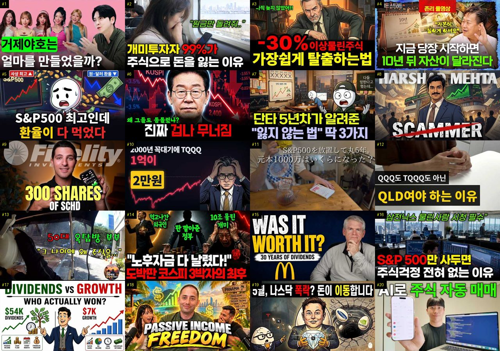
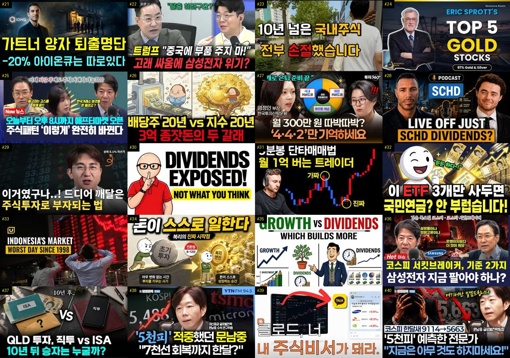
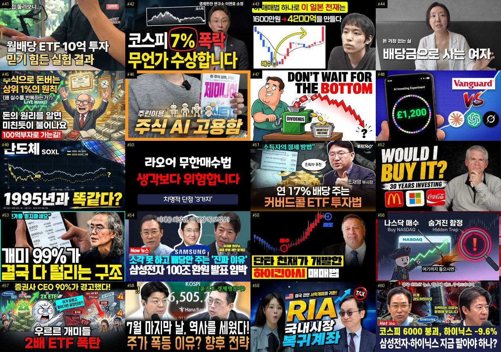
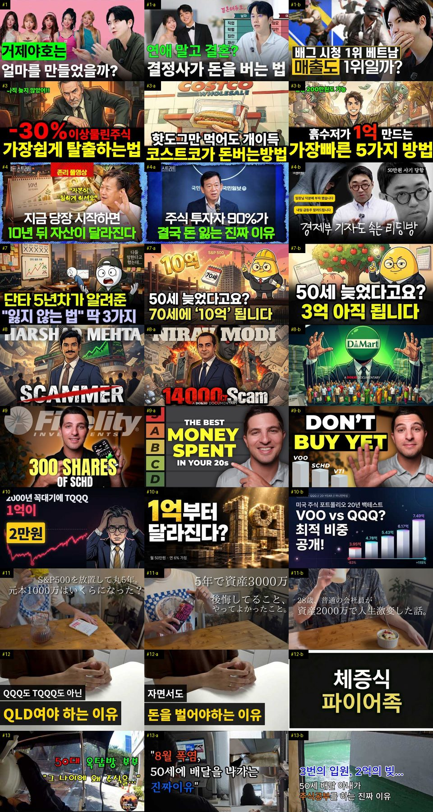
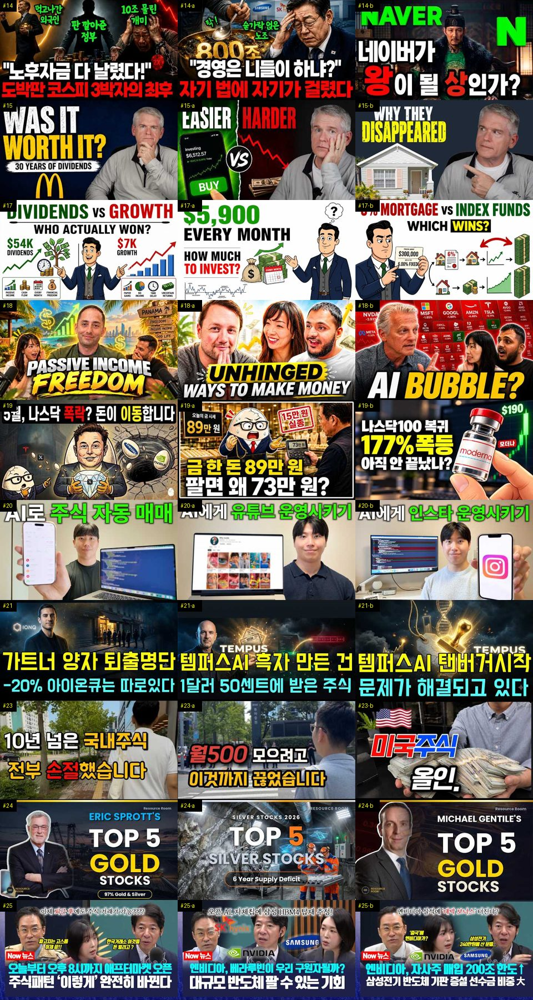
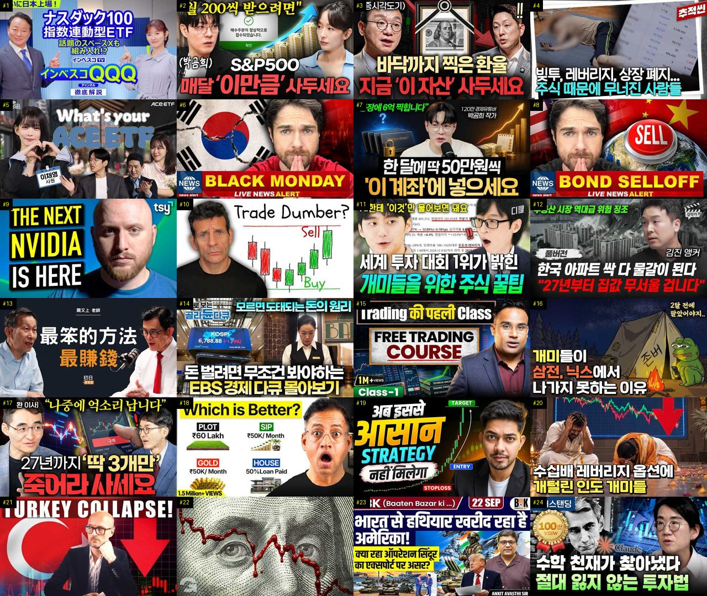

# 주식 — 성공 사례 분석 (지시사항 재료)

자동 생성 — `tools/success_analysis.py` v1.5 (2026-10-21 08:30 UTC), 규칙 `stock/analysis_rules.toml` v1.4. **이 문서는 숫자와 원문만 담는다 — 해석·지시사항은 이것을 읽는 AI 가 만든다.** 주별 추세는 `weekly.md`, 승인한 영상 전부는 `approved.md`. ※ 연구·교육용 — 투자 권유가 아님.

## 0. 자료와 한계

| 자료 | 수 |
|---|---|
| 사례 폴더 (설명·자막·댓글·썸네일을 받은 영상) | 714 (웹 승인 714) |
| **성공 사례** — 180일 안·구독자 50,000 이하·조회수 ≥ 구독자 × 3·10,000회 이상·4분 이상, 채널당 2개 | **158** (기준 통과 209 − 뺀 것 13 − 채널당 제한 38) |
| **하루 조회수 상위** (1-3번 — 성공 사례와 따로) — 검색에서 찾은 주제 관련 4분 이상 영상 4,267개 중 하루 조회수 상위 10% (하루 19,519회 이상), 구독자·올린 날짜 상관없이, 채널당 2개 | **316** (기준 통과 420 − 뺀 것 13 − 채널당 제한 91) · 자료를 받지 않은 후보 21 |
| 성공 사례의 글 출처 (자막·음성인식·설명·없음) | 음성인식(앞 5분) 13 · 설명 124 · 자막 16 · 없음 5 |
| 성공 사례 대본 — 전체 · 앞부분만(음성인식 1차) · 없음 | 16 · 13 · 129 |
| 같은 채널 기준선 (채널 평소 영상) | 성공 사례 150/158 · 채널 143곳 (잘된 영상 455 · 평소 영상 605) |
| 성공 사례 댓글 (받은 / 달린) | 36,543 / 36,747 |
| 성공 사례 썸네일 | 158 |
| 비교 집단 — 탐색에서 본 영상 중 구독자 50,000 이하·4분 이상·365일 안·주제 관련, 채널당 최근 5개 | 1009 (성공 138 = 14%, 채널당 제한으로 뺀 2303) |
| 자료를 받지 않은 성공 후보 (웹 화면에서 승인하면 들어감 — 채널당 자리가 남은 것만) | 69 (자리가 찬 채널의 253개 뺌) |
| 수요·공급 시장 — 최근 90일 영상 (채널 크기 상관없음) | 2884 · 검색어 110 · 자동완성 말 431 (공급 확인 0) |
| 채널 성장 자료 (개설일이 있는 채널) | 1387 (빨리 크는 작은 채널 25) |

성공 기준은 넘었지만 뺀 영상: 사형수 박정희, 그를 살린 28세 정보국장 백선엽의 … (뺀 주제(숙군)) · 最先端のイノベーションを先取る⁉ インベスコTV 「インベ… (광고 의심(좋아요·댓글 거의 없음)) · 배당금 vs 월세 ∣ 3백만 원 월소득, 어느 쪽이 … (뺀 주제(월세)) · 코스피 다 맞춘 무당이 알려드립니다 ! 달러 환율 &… (뺀 주제(코인)) · 아마존 영화 43개국 1위🔥 CIA 국장의 죽음으로 … (뺀 주제(첩보)) · 코스피 9,000에도 웃지 못하는 ∣ 고독한 ITZY… (뺀 주제(팬미팅)) · 외벽부터 시작된 미장! 아무나 하는게 아니구나..?! (뺀 주제(외벽)) · 【S&P500トップ10企業を追い続ける投資】上位10社に… (광고 의심(좋아요·댓글 거의 없음)) · How to Explore & Buy US Stock… (광고 의심(좋아요·댓글 거의 없음)) · #촌집수리#시골집수리#한옥수리#미장#매쉬미장# (뺀 주제(촌집)) · 시골집 고치기 ∣ 몰탈 30포대로 흙바닥 보수부터 콘… (뺀 주제(시골집)) · ' 코스피 폭락 ‘ 삼성전자 & 하이닉스 하반기 X만… (뺀 주제(무당))

**한계**

- 대본(자막·음성인식)이 없는 성공 사례 129개 (#2, #5, #6, #8, #9, #11, #12, #16, #17, #19, #21, #22, #24, #30, #31, #32, #33, #34, #35, #36, #37, #38, #39, #40, #41, #42, #43, #44, #45, #47 …) — 설명란·챕터만 있음. 도입부·구성·말 속도는 대본이 있는 29개로만 셌다 (음성인식이 끝나면 다시 셈)
- 비교 집단 1009개 = 검색(조회수 순 — 잘된 영상 쪽으로 치우침)·추가한 채널·성공 사례 채널의 평소 영상 551개 (치우침 없음) 에서 올린 지 7~365일 영상, 성공 비율 14% — 실제 시장 비율이 아니다. 같은 집단 안의 '있음/없음' 차이로만 보고, '무엇이 먹혔나'는 1-2번(같은 채널 안)을 먼저 보라
- 외국 영상을 넣음 (주제 설정 INCLUDE_FOREIGN = true) — 성공 사례 중 외국 영상 54개 (#8, #9, #11, #15, #17, #18, #24, #28, #30, #33, #35, #47, #48, #52, #61, #62, #65, #67, #68, #69, #74, #75, #79, #81, #84, #89, #91, #92, #97, #98). 말 속도(한글 음절)는 한국어 영상만으로 셌고, 제목 특징·댓글 갈래(질문·요청 등)는 한국어 낱말 규칙이라 외국 영상에는 거의 걸리지 않는다 — 외국 사례는 원문을 직접 읽어라
- 하루 조회수 상위 묶음(1-3번) 316개는 구독자·올린 날짜 상관없이 골랐다 — 큰 채널(구독자 50,000 넘음) 302개라 채널 힘(구독자·추천)이 섞여 있다. 작은 채널이 따라 할 근거는 1번 성공 사례로 보라. 하루 조회수 = 조회수 ÷ 올린 지 날수라 갓 올린 영상(며칠)은 부풀고 오래된 영상은 낮아진다. 경계는 검색 결과(조회수 순 — 잘된 쪽으로 치우침) 4267개 안의 상위 10%. 자료를 받지 않은 후보 21개 (웹 화면에서 승인하면 들어감)
- 같은 채널 기준선이 있는 성공 사례 150/158개 (채널 영상이 5개 미만이거나 아직 못 받음)
- 수요·공급의 '시장'은 탐색·검색에서 본 최근 90일 영상 2884개 — 검색이 조회수 순이라 조회수 적은 영상이 덜 잡힌다. 주제 묶음 사이의 상대 비교(지수)로만 보라
- 자동완성 말의 '최근 영상 수'는 우리가 본 영상만 셌다 — 실제 공급은 웹 화면 [공급 확인](말 하나에 검색 1번 = 100단위)으로 확인
- 자동완성 말에는 책·방송·사람·채널 이름도 섞인다 (예: '…를 찾아서'·'…지침서') — 영상 주제가 아닌 말은 건너뛰고 읽어라
- 채널의 최근 구독자 증가는 구독자 수를 3일 넘게 사이를 두고 두 번 이상 받아야 나온다 (7일마다 다시 받음)
- '구독자가 많이 모이는가'는 YouTube API 로 영상별 구독 증가를 볼 수 없다 — 대신 채널 성장(7번: 개설 뒤 월 구독자·받을 때마다 남긴 기록), '구독·다음 기대' 댓글, 배수(조회수÷구독자)로 본다
- 댓글 갈래·제목 특징은 낱말 규칙이라 거칠다 (물음표 반문도 '질문', 한 댓글이 여러 갈래). 원문 인용을 함께 보라
- '눈에 띔'은 차이가 크고 표본이 충분하다는 표시일 뿐 원인이 아니다

## 1. 성공 사례 (158개 — 배수 큰 순)

배수 = 조회수 ÷ 구독자. **채널 평소 대비** = 조회수 ÷ 그 채널 최근 롱폼 조회수 중앙값 (같은 채널 기준선 — 클수록 그 영상만의 힘). 썸네일은 5번(장마다 20개, 번호 = #), 사례별 자세히는 **`analysis_cases_01.md` …** (9번).

| # | 제목 | 채널 | 구독자 | 조회수 | 배수 | 채널 평소 대비 | 하루 조회수 | 길이 | 업로드 | 주제 묶음 | 형식 | 글 출처 | 댓글 받은/달린 |
|---|---|---|---|---|---|---|---|---|---|---|---|---|---|
| 1 | [적자인데 300억? 가능한 이유 ∣ 회계사가 말아주는 리센느 소속사 더뮤즈엔터](https://www.youtube.com/watch?v=kJx_AzV9w9c) | 전지적회계사시점 | 867 | 317,084 | 365.7 | ×290.8 | 6,695.1 | 21.4분 | 2026-09-03 | 6. 종목 고르기·분석 | 브이로그·직접 해본 이야기 | 음성인식(앞 5분) | 219/219 |
| 2 | [왜 내가 사면 떨어지고 팔면 오를까? 개미가 주식으로 돈 못 버는 4가지 이유](https://www.youtube.com/watch?v=fdlfOCtDBqc) | 오피디의 머니노트 | 1,170 | 395,338 | 337.9 | – | 65,861.0 | 13.6분 | 2026-10-15 | 8. 투자 심리·실패 | 오디오북·낭독 | 설명 | 244/243 |
| 3 | [마이너스 주식 계좌 가장 쉽게 탈출하는 방법 물타기? 존버? 고민하지 않아도 되는 물린 종목 최대한 손실을…](https://www.youtube.com/watch?v=v6rUCbULG2A) | 머니스트랩 | 538 | 96,208 | 178.8 | ×147.6 | 1,622.1 | 30.5분 | 2026-08-23 | 8. 투자 심리·실패 | 정보·해설 | 음성인식(앞 5분) | 38/38 |
| 4 | [[풀영상] 월급 10%로 당장 시작하는 존리의 자산 증식 치트키](https://www.youtube.com/watch?v=q1fYjAwma3s) | 여의돈스트리트 | 1,360 | 208,990 | 153.7 | ×195.1 | 6,258.0 | 36분 | 2026-09-17 | 1. 주식 기초·초보 | 인터뷰·강연·대담 | 음성인식(앞 5분) | 113/113 |
| 5 | [S&P500은 최고인데 내 ETF는 마이너스… 지금 환헤지로 갈아타면 늦는 진짜 이유](https://www.youtube.com/watch?v=UcHK1WoTPtY) | 뒤집는경제 | 421 | 59,488 | 141.3 | – | 12,959.8 | 23.2분 | 2026-10-16 | 2. 장기투자·ETF·지수 | 정보·해설 | 설명 | 28/28 |
| 6 | [이재명 "집 팔아 주식 사라더니…" 코스피 폭락에 국민연금 증발 실태 #이재명 #코스피 #국민연금](https://www.youtube.com/watch?v=c3vq8lj05Yk) | 정치시간 | 37 | 11,392 | 113.9 | – | 2,591.5 | 18.9분 | 2026-10-16 | 5. 국내주식 | 정보·해설 | 설명 | 28/28 |
| 7 | [단타 5년차가 알려준 ＂잃지 않는 법＂ 딱 3가지 ｜ 코스피 9000시대 생존법](https://www.youtube.com/watch?v=WnuVkKRjcuI) | 돈의흐름도 | 1,380 | 153,221 | 111.0 | ×9,286.1 | 2,101.9 | 13.5분 | 2026-08-09 | 5. 국내주식 | 정보·해설 | 음성인식(앞 5분) | 96/96 |
| 8 | [The Story Behind India's Biggest Stock Market Scam ∣ Scam 1…](https://www.youtube.com/watch?v=zay8CuiBUQ8) | DOKio | 7,650 | 717,441 | 93.8 | ×57.8 | 6,659.6 | 27분 | 2026-07-05 | 기타 | 정보·해설 | 설명 | 194/197 |
| 9 | [I Own 300 Shares of SCHD - Here's My Dividend Payout](https://www.youtube.com/watch?v=Z_-PJGzUdD4) | Cade Invests | 1,800 | 155,958 | 86.6 | ×315.7 | 1,886.6 | 10.5분 | 2026-07-30 | 2. 장기투자·ETF·지수 | 정보·해설 | 설명 | 338/338 |
| 10 | [같은 TQQQ에 1억, 한 사람은 2만 원 한 사람은 388억 (실제 데이터)](https://www.youtube.com/watch?v=d2_oRUcx5Uo) | 머니언박싱 | 2,200 | 190,198 | 86.5 | ×54.9 | 8,133.0 | 8.1분 | 2026-09-27 | 2. 장기투자·ETF·지수 | 정보·해설 | 음성인식(앞 5분) | 144/144 |
| 11 | [【資産公開】S&P500に1000万入れて5年間放置した結果（めちゃ増えた）｜31歳会社員・新NISA](https://www.youtube.com/watch?v=Lb9ht5PE0vU) | ぼんじり【平凡会社員のずぼ… | 4,470 | 360,727 | 80.7 | ×39.2 | 3,799.0 | 13.9분 | 2026-07-18 | 2. 장기투자·ETF·지수 | 정보·해설 | 설명 | 141/141 |
| 12 | [나스닥 투자하기 전에 이 영상 꼭 보세요 ∣ QLD만 모아가는 이유](https://www.youtube.com/watch?v=g10Y6ZA7rng) | 올레버 | 1,580 | 116,701 | 73.9 | ×163.2 | 827.4 | 5.7분 | 2026-06-02 | 2. 장기투자·ETF·지수 | 정보·해설 | 설명 | 347/347 |
| 13 | [50대 옥탑방 부부, "그 나이에 왜 주식을..."](https://www.youtube.com/watch?v=FRzyTNO9mNI) | 반백살, 옥탑방 이야기 | 601 | 42,862 | 71.3 | ×13.3 | 2,400.7 | 6.3분 | 2026-10-03 | 1. 주식 기초·초보 | 정보·해설 | 음성인식(앞 5분) | 187/187 |
| 14 | [레버리지 ETF 상장폐지 논란🔥도박판 코스피 알고도 레버리지 ETF 상폐 못하는 이유🔥위험 알고도 도장 찍…](https://www.youtube.com/watch?v=O4-jY0zyhDo) | 리얼경제 | 1,340 | 93,660 | 69.9 | ×495.6 | 976.2 | 15분 | 2026-07-17 | 9. 빚투·레버리지 | 정보·해설 | 음성인식(앞 5분) | 648/648 |
| 15 | [I Reinvested Dividends for 30 Years — Here's What Actually …](https://www.youtube.com/watch?v=oZqWOuMZwdA) | BudgetMoney | 2,550 | 163,423 | 64.1 | ×587.9 | 1,243.1 | 11.3분 | 2026-06-11 | 기타 | 정보·해설 | 자막 | 336/336 |
| 16 | [S&P 500에 투자하면 노후 걱정 전혀 없습니다! 주식으로 부자 되는 가장 빠른 방법](https://www.youtube.com/watch?v=_fnvM4hpX44) | 오피디의 머니노트 | 1,170 | 69,057 | 59.0 | – | 18,059.7 | 16.4분 | 2026-10-17 | 2. 장기투자·ETF·지수 | 정보·해설 | 설명 | 63/63 |
| 17 | [Dividend Stocks vs. Growth Stocks: The Math Most Investors …](https://www.youtube.com/watch?v=4bg3bjvjCjE) | Finance Simpl… | 3,520 | 203,994 | 58.0 | ×43.9 | 4,019.6 | 20.2분 | 2026-08-31 | 기타 | 정보·해설 | 설명 | 321/330 |
| 18 | [Corporate Slave to Financially Free: The Passive Income 🐐](https://www.youtube.com/watch?v=knkqhQrQS60) | The Retail Ru… | 1,490 | 84,794 | 56.9 | ×12.3 | 2,959.4 | 80분 | 2026-09-22 | 2. 장기투자·ETF·지수 | 정보·해설 | 자막 | 134/141 |
| 19 | [5월 나스닥 폭락설? 아무도 안 알려준 돈의 이동설](https://www.youtube.com/watch?v=DsUbusxqaL8) | 한알경제 | 1,590 | 88,509 | 55.7 | ×636.8 | 503.1 | 8.5분 | 2026-04-28 | 2. 장기투자·ETF·지수 | 정보·해설 | 설명 | 100/100 |
| 20 | [AI로 주식 자동 매매하면 어떻게 될까?](https://www.youtube.com/watch?v=9E9OrcoMCjk) | 이영배 | 19,000 | 1,040,110 | 54.7 | ×9.0 | 8,463.5 | 11.3분 | 2026-06-20 | 7. 매매·전략 | 정보·해설 | 음성인식(앞 5분) | 578/584 |
| 21 | [나스닥은 버티는데 아이온큐가 일주일 새 20% 빠진 건 망해서가 아닙니다 — 가트너가 말한 퇴출 명단은 따…](https://www.youtube.com/watch?v=IbkLrISwBiU) | 경제전략노트 | 747 | 36,207 | 48.5 | ×36.2 | 5,380.8 | 14.4분 | 2026-10-14 | 4. 미국·해외주식 | 정보·해설 | 설명 | 10/10 |
| 22 | [트럼프의 폭탄 선언으로 삼성전자와 한국 주식시장, 조정 올 수 있는 이유! #박시동 #매불쇼](https://www.youtube.com/watch?v=3tIO_BBDMMo) | 스타판 | 3,930 | 190,454 | 48.5 | – | 1,204.7 | 22분 | 2026-05-16 | 8. 투자 심리·실패 | 오디오북·낭독 | 설명 | 133/133 |
| 23 | [물린 주식 10년, 결국 전부 팔았습니다 (feat. 복구 심리의 함정)](https://www.youtube.com/watch?v=OKHm1gUNyPA) | 어쩌다마흔 | 1,840 | 82,553 | 44.9 | ×10.5 | 1,029.5 | 9.9분 | 2026-08-02 | 8. 투자 심리·실패 | 인터뷰·강연·대담 | 음성인식(앞 5분) | 957/957 |
| 24 | [Eric Sprott Is Buying These 5 Junior Mining Stocks Right Now](https://www.youtube.com/watch?v=lZZ0VA9ihF0) | Resource Room | 985 | 40,684 | 41.3 | ×4.4 | 6,974.6 | 9.9분 | 2026-10-15 | 기타 | 정보·해설 | 설명 | 75/75 |
| 25 | [오늘부터 오후 8시까지 애프터마켓 오픈!! 주식패턴 ‘이렇게’ 완전히 바뀐다](https://www.youtube.com/watch?v=wwrCztntACs) | 잘되라대한민국 | 5,960 | 243,763 | 40.9 | ×7.1 | 6,579.3 | 8.2분 | 2026-09-14 | 기타 | 정보·해설 | 음성인식(앞 5분) | 253/253 |
| 26 | [배당주 20년 vs S&P500 20년, 3억 원이 만든 충격적인 자산과 삶의 격차 [ 재테크/미국주식/E…](https://www.youtube.com/watch?v=cqgVNBbMYew) | 박대리와 황과장의 경제이… | 1,930 | 78,763 | 40.8 | ×14.2 | 948.7 | 20.5분 | 2026-07-30 | 4. 미국·해외주식 | 정보·해설 | 음성인식(앞 5분) | 162/162 |
| 27 | ["원금 안 깎여요" 진화형 커버드콜 ETF 황금 포트폴리오 공개](https://www.youtube.com/watch?v=yGuybuoroRI) | 투자360 | 15,900 | 643,623 | 40.5 | ×17.8 | 5,799.5 | 22.2분 | 2026-07-02 | 2. 장기투자·ETF·지수 | 브이로그·직접 해본 이야기 | 음성인식(앞 5분) | 577/578 |
| 28 | [Can You Retire With Just SCHD? ∣ SCHD Expert Explains](https://www.youtube.com/watch?v=lRlUmwigNYU) | The Mispriced… | 3,220 | 127,869 | 39.7 | ×8.8 | 2,041.4 | 36.6분 | 2026-08-19 | 2. 장기투자·ETF·지수 | 정보·해설 | 자막 | 343/343 |
| 29 | [주식투자 5년간 수익이 없던 내가 드디어 깨달은 '이것'](https://www.youtube.com/watch?v=uqsGXwRgP68) | 리채피 richappy | 4,490 | 166,291 | 37.0 | ×18.0 | 7,120.5 | 27.8분 | 2026-09-28 | 11. 투자 일반 | 정보·해설 | 음성인식(앞 5분) | 111/112 |
| 30 | [I Just Bought 1,600 Shares Of SCHD: Here's my Dividend paym…](https://www.youtube.com/watch?v=d23iMmo2w4o) | Bald Man Fina… | 392 | 14,311 | 36.5 | ×49.7 | 4,032.5 | 19.3분 | 2026-10-17 | 기타 | 정보·해설 | 설명 | 15/15 |
| 31 | [단타 천재가 개발한 초간단 매매법(기본 차트 분석법)](https://www.youtube.com/watch?v=knblsnwXsfg) | 차트9단 | 469 | 16,282 | 34.7 | ×24.7 | 139.2 | 20분 | 2026-06-26 | 6. 종목 고르기·분석 | 인터뷰·강연·대담 | 설명 | 7/7 |
| 32 | [국민연금 빈칸 메우는 한국 ETF 3개 — 월 200만 원 평생 월급 만들기](https://www.youtube.com/watch?v=7rtO_hfLvF8) | 술술 경제학 | 17,600 | 608,737 | 34.6 | ×100.6 | 3,479.9 | 16.8분 | 2026-04-29 | 2. 장기투자·ETF·지수 | 정보·해설 | 설명 | 284/284 |
| 33 | [Indonesia's Stock Market Crashes 11%: What Went Wrong? ∣ Ce…](https://www.youtube.com/watch?v=dFuTChJdF5M) | Century Finan… | 9,980 | 340,757 | 34.1 | – | 70,711.9 | 5.2분 | 2026-10-16 | 기타 | 정보·해설 | 설명 | 271/271 |
| 34 | [복리가 부를 만드는 진짜 시작점｜언제부터 돈이 스스로 일하기 시작할까](https://www.youtube.com/watch?v=JExUQaROk40) | 돈의 통찰 | 3,920 | 132,960 | 33.9 | ×9.3 | 1,461.7 | 17.8분 | 2026-07-22 | 1. 주식 기초·초보 | 정보·해설 | 설명 | 103/103 |
| 35 | [Stop Guessing! Growth vs Dividend Stocks Explained in 20 Mi…](https://www.youtube.com/watch?v=hkRXzD3CH3c) | Finance Simpl… | 3,520 | 117,798 | 33.5 | ×25.1 | 1,325.6 | 21.2분 | 2026-07-24 | 기타 | 정보·해설 | 설명 | 191/191 |
| 36 | [삼성전자 지금 팔아야 하나? 코스피 서킷브레이커 날, 버틸지 팔지 가를 기준 2가지](https://www.youtube.com/watch?v=ICByZXkRrLg) | 경제야! 놀자~ | 3,510 | 101,848 | 29.0 | ×9.5 | 16,657.3 | 13.5분 | 2026-10-15 | 5. 국내주식 | 정보·해설 | 설명 | 296/296 |
| 37 | [QLD 직투 vs ISA, 잘못 선택했다가는 10년 뒤 수 천만 원 날립니다](https://www.youtube.com/watch?v=PEOHCf2930w) | 투자각성 | 382 | 10,953 | 28.7 | ×20.9 | 1,639.3 | 8.9분 | 2026-10-14 | 10. 노후·연금 투자 | 정보·해설 | 설명 | 31/31 |
| 38 | [[문남중 출연] "코스피 바닥, 7월29일에 이미 확인 끝! 전고점 회복 근거? '이것' 보시면 됩니다" …](https://www.youtube.com/watch?v=btSUFhvYPwk) | 경제통마늘 | 11,500 | 309,310 | 26.9 | ×129.1 | 138,878.3 | 10.2분 | 2026-10-19 | 5. 국내주식 | 오디오북·낭독 | 설명 | 225/225 |
| 39 | [매일 아침 7시, 내 포트폴리오를 관리해주는 AI 주식 비서를 만들어봤습니다](https://www.youtube.com/watch?v=ITzgH6CeZns) | 스티브의 파도타기 ∣ A… | 26,700 | 693,440 | 26.0 | ×487.1 | 4,757.8 | 14.8분 | 2026-05-28 | 2. 장기투자·ETF·지수 | 정보·해설 | 설명 | 388/391 |
| 40 | ['5천피' 예언적중한 문남중 "코스피 저점? 5040 봅니다, 지금은 아무것도 하지 마세요" #문남중 _2…](https://www.youtube.com/watch?v=SrwNTk6GT9U) | 경제통마늘 | 11,500 | 295,264 | 25.7 | ×123.2 | 3,548.1 | 19.6분 | 2026-07-30 | 5. 국내주식 | 정보·해설 | 설명 | 989/989 |
| 41 | [월배당 ETF 10억 투자하면 정말 배당금 얼마? ∣ 종합소득세·건강보험료 계산법 (은퇴 현금흐름 설계)](https://www.youtube.com/watch?v=yRDpbgaZahc) | 은퇴머니 - 은퇴 현금흐… | 30,000 | 755,091 | 25.2 | ×52.9 | 5,299.7 | 11.4분 | 2026-05-31 | 2. 장기투자·ETF·지수 | 정보·해설 | 설명 | 967/969 |
| 42 | [코스피 7% 폭락, 외인 30분만에 1조 순매도, 무언가 수상합니다](https://www.youtube.com/watch?v=hjIgX9ppDe4) | 경제한잔 | 7,200 | 178,695 | 24.8 | ×17.7 | 36,501.5 | 14분 | 2026-10-16 | 5. 국내주식 | 정보·해설 | 설명 | 51/51 |
| 43 | [4200억 단타 일본 천재가 초간단 매매법, 죽어라 이것만하세요](https://www.youtube.com/watch?v=UH4UFmdXXo0) | 세력시그널 | 3,510 | 86,167 | 24.6 | ×28.1 | 1,284.9 | 20.6분 | 2026-08-15 | 7. 매매·전략 | 정보·해설 | 설명 | 216/216 |
| 44 | [생활비 한 달 5만원..10년 만에 배당금 월 300만원 받는 이유 (조윤진 1부) #세미파이어 #배당투자](https://www.youtube.com/watch?v=Wc52vsC6q4U) | 자람들 - 자립하는사람들 | 33,700 | 826,411 | 24.5 | ×32.3 | 8,622.1 | 29.3분 | 2026-07-17 | 3. 배당 | 브이로그·직접 해본 이야기 | 설명 | 613/613 |
| 45 | [주식 상위 2%만 아는 10가지 절대 생존 원칙 (돈의 원리)](https://www.youtube.com/watch?v=fFURFeLTdAg) | 준의 경제노트 (jun’… | 12,600 | 306,207 | 24.3 | ×390.6 | 2,312.5 | 21.6분 | 2026-06-10 | 11. 투자 일반 | 오디오북·낭독 | 설명 | 189/190 |
| 46 | [주식 AI 비서 4명 만들었더니 공부가 쉬워졌어요 (제미나이 활용법)](https://www.youtube.com/watch?v=02hqxRMURPs) | 공부하는 주린이 | 1,310 | 31,240 | 23.9 | ×32.3 | 191.7 | 7.1분 | 2026-05-11 | 1. 주식 기초·초보 | 인터뷰·강연·대담 | 자막 | 36/36 |
| 47 | [Don't Stop Buying Dividends in a Crash Until You See This M…](https://www.youtube.com/watch?v=qCO8HvpAGqc) | Tom - Lazy Di… | 2,090 | 49,277 | 23.6 | ×14.5 | 8,417.3 | 31.6분 | 2026-10-15 | 기타 | 정보·해설 | 설명 | 116/116 |
| 48 | [I Let AI Invest for Me on Trading 212, Here's What Happened](https://www.youtube.com/watch?v=8zUa4JnCrRw) | Financial Int… | 19,400 | 454,201 | 23.4 | ×77.3 | 7,467.8 | 11.8분 | 2026-08-21 | 기타 | 정보·해설 | 설명 | 193/194 |
| 49 | [나스닥은 최고가, 반도체만 반 토막. 지금과 똑같았던 1995년으로 앞으로의 흐름을 찾아봤습니다.](https://www.youtube.com/watch?v=7hjl_w2aWtA) | 테스프레소 | 2,080 | 48,359 | 23.2 | ×22.4 | 6,747.1 | 9.9분 | 2026-10-14 | 2. 장기투자·ETF·지수 | 정보·해설 | 설명 | 26/26 |
| 50 | [라오어 무한매수법, 정말 계속 해도 될까? TQQQ·QLD로 12년 돌려보고 알게 된 의외의 결과](https://www.youtube.com/watch?v=nCBMBYmFjOU) | 여의도 아빠 | 2,290 | 52,566 | 22.9 | ×8.3 | 762.5 | 7.5분 | 2026-08-13 | 7. 매매·전략 | 정보·해설 | 설명 | 186/187 |
| 51 | [노후 걱정 끝, 커버드콜로 평생 월급받는 법 ∣ 커버드콜 ETF ∣ 조재영 웰스에듀 부사장](https://www.youtube.com/watch?v=IePgz3kEuNk) | 투자360 | 15,900 | 352,542 | 22.2 | ×9.7 | 2,027.1 | 22.8분 | 2026-04-30 | 2. 장기투자·ETF·지수 | 인터뷰·강연·대담 | 설명 | 237/237 |
| 52 | [I've Invested in Dividends for 30 Years. Here's What Most P…](https://www.youtube.com/watch?v=M7l-A6Mk9zQ) | BudgetMoney | 2,550 | 52,759 | 20.7 | ×189.8 | 571.4 | 27.4분 | 2026-07-21 | 기타 | 정보·해설 | 자막 | 233/233 |
| 53 | [내 주변에 주식으로 돈 번 사람이 '진짜' 단 1명도 없는 소름 돋는 이유 ∣ 교수 정선용 (통합본)](https://www.youtube.com/watch?v=SwW4n0ERlS8) | 너와 나의 경제학교 | 30,700 | 615,762 | 20.1 | ×27.6 | 9,059.5 | 52.7분 | 2026-08-14 | 11. 투자 일반 | 인터뷰·강연·대담 | 설명 | 1,622/1,622 |
| 54 | [삼성전자 100조 환원 발표 임박, 자사주 소각 못 하고 배당만 주는 '진짜 이유'](https://www.youtube.com/watch?v=JtPJ9i91k5g) | 잘되라대한민국 | 5,960 | 119,196 | 20.0 | ×3.5 | 1,951.6 | 11분 | 2026-08-21 | 3. 배당 | 정보·해설 | 설명 | 178/178 |
| 55 | [단타 천재가 개발한 하이킨아시 스캘핑 매매법, 죽어라 이것만 하세요.](https://www.youtube.com/watch?v=55hFmXD0lh0) | 알파개미 | 2,800 | 54,034 | 19.3 | ×85.4 | 383.4 | 19.6분 | 2026-06-02 | 7. 매매·전략 | 인터뷰·강연·대담 | 설명 | 1,049/1,051 |
| 56 | [S&P500, 나스닥100 수익률 차이는 갈 수록 더 벌어질겁니다 미국 장기투자 가이드](https://www.youtube.com/watch?v=1L9sM63F6Ng) | 돈사냥꾼-TV | 993 | 19,018 | 19.1 | ×1,056.6 | 6,812.3 | 22.4분 | 2026-10-18 | 2. 장기투자·ETF·지수 | 정보·해설 | 설명 | 5/5 |
| 57 | ["삼성전자 SK하이닉스 2배 레버리지 ETF" 5월 22일 상장 확정인데 증권사 CEO 열 명 중 아홉 명…](https://www.youtube.com/watch?v=aTh--_DtGNU) | 이코노메이션 | 14,400 | 274,428 | 19.1 | ×167.5 | 1,653.1 | 25.6분 | 2026-05-08 | 9. 빚투·레버리지 | 브이로그·직접 해본 이야기 | 설명 | 808/808 |
| 58 | [불기둥 세운 코스피, 코스닥! 폭등한 이유와 향후 전략](https://www.youtube.com/watch?v=Pel5gTXKRkQ) | K파민 | 5,560 | 102,736 | 18.5 | ×6.5 | 1,252.3 | 24.8분 | 2026-07-31 | 5. 국내주식 | 정보·해설 | 설명 | 139/139 |
| 59 | [[슬기로운 금융생활] 국장 복귀하면 양도세 감면?! – RIA계좌 혜택도, 유의점도 슬기롭게](https://www.youtube.com/watch?v=O4jq0bK4MbI) | 예금보험공사 예보TV | 7,810 | 142,713 | 18.3 | ×6.4 | 984.1 | 5.6분 | 2026-05-29 | 5. 국내주식 | 정보·해설 | 설명 | 7/8 |
| 60 | [삼성전자·하이닉스 왜 급락? 코스피 6000 붕괴, 중국 CXMT 공포가 과도한 이유 3가지](https://www.youtube.com/watch?v=amgqXbScFMY) | 경제야! 놀자~ | 3,510 | 63,507 | 18.1 | ×6.2 | 7,786.3 | 12.9분 | 2026-10-13 | 5. 국내주식 | 정보·해설 | 설명 | 230/230 |
| 61 | [I Own 2,444 Shares of SCHD. Here's What It Actually Pays Me.](https://www.youtube.com/watch?v=YPkL0BibgL8) | Mikey Moran | 11,900 | 204,484 | 17.2 | ×24.9 | 3,328.3 | 9.5분 | 2026-08-20 | 기타 | 정보·해설 | 자막 | 193/206 |
| 62 | [I Just Bought 1,000 Shares Of SCHD: Here's The Dividends It…](https://www.youtube.com/watch?v=fPU6Gefdad8) | Grounded Life… | 5,350 | 91,337 | 17.1 | ×8.1 | 5,514.7 | 10분 | 2026-10-04 | 기타 | 정보·해설 | 설명 | 141/147 |
| 63 | [집은 팔았고, 주식은 물렸고](https://www.youtube.com/watch?v=SbEfHnF8DdY) | 로텐션 LOWTENSIO… | 6,730 | 105,766 | 15.7 | ×15.0 | 28,023.9 | 16.3분 | 2026-10-17 | 11. 투자 일반 | 브이로그·직접 해본 이야기 | 설명 | 185/184 |
| 64 | [나이키 옷 추천하고 Nike 주식도 줍줍](https://www.youtube.com/watch?v=2T_niqja8Vc) | 조탄 | 6,380 | 99,043 | 15.5 | ×5.6 | 593.0 | 5분 | 2026-05-07 | 기타 | 정보·해설 | 자막 | 56/56 |
| 65 | [Better Than VOO? 9 ETFs That Beat the Market (34% Returns)](https://www.youtube.com/watch?v=id4HWsy036I) | Fin Wealth Ha… | 7,670 | 118,890 | 15.5 | ×35.2 | 666.1 | 17.9분 | 2026-04-25 | 2. 장기투자·ETF·지수 | 정보·해설 | 자막 | 112/112 |
| 66 | [유혈 낭자한 국장..폭락의 시작일까? / 이슈빡 / 뉴스헌터스](https://www.youtube.com/watch?v=enkSdCIojAA) | 뉴스헌터스 | 7,680 | 116,383 | 15.2 | – | 19,987.6 | 17.9분 | 2026-10-15 | 1. 주식 기초·초보 | 인터뷰·강연·대담 | 설명 | 303/303 |
| 67 | [The ONLY 5 ETFs You Need for F.I.R.E (Retire Early)](https://www.youtube.com/watch?v=BRFRMfkGfpM) | Jacob Wade (R… | 25,100 | 376,911 | 15.0 | ×33.9 | 2,158.1 | 17.6분 | 2026-04-29 | 2. 장기투자·ETF·지수 | 정보·해설 | 설명 | 434/435 |
| 68 | [How to Borrow Against Your Stock Portfolio: Buy, Borrow, Die](https://www.youtube.com/watch?v=NPcgV0dq03Q) | Sacco Financi… | 21,300 | 314,203 | 14.8 | ×52.8 | 2,559.7 | 9.4분 | 2026-06-20 | 기타 | 정보·해설 | 자막 | 603/610 |
| 69 | [S&P500とNASDAQ100は崩れない。プロ投資家が あの日 まで買わない理由【米国株最新】](https://www.youtube.com/watch?v=9zV78pvlDJ4) | まなみんの米国株の学校【投… | 5,680 | 82,843 | 14.6 | ×12.1 | 16,569.0 | 10.3분 | 2026-10-16 | 2. 장기투자·ETF·지수 | 정보·해설 | 설명 | 36/36 |
| 70 | ["역대급 저평가라던 코스피" 하루 만에 620조 추락.. 그 뒤에 숨겨진 코스피의 잔혹한 진실](https://www.youtube.com/watch?v=6VAsPNYeTRQ) | 더 리치 - 돈의 흐름을… | 8,080 | 116,587 | 14.4 | ×41.7 | 1,166.1 | 21.2분 | 2026-07-13 | 5. 국내주식 | 정보·해설 | 설명 | 294/294 |
| 71 | [주가 1.62달러까지 무너진 AMD, 바닥에서 내린 결정](https://www.youtube.com/watch?v=l2XsNVbqkm0) | Six Sigma ∣ 식… | 5,810 | 83,120 | 14.3 | ×23.1 | 21,336.3 | 11.3분 | 2026-10-17 | 10. 노후·연금 투자 | 인터뷰·강연·대담 | 설명 | 51/51 |
| 72 | ["안정을 기대한다"더니 하루만에 코스피 -10.84%🔥올해 8번째 서킷브레이커🔥정부, 왜 손놓고 있나🔥증안…](https://www.youtube.com/watch?v=AOs5sAd3hKM) | 리얼경제 | 1,340 | 19,133 | 14.3 | ×101.2 | 225.9 | 16.1분 | 2026-07-28 | 2. 장기투자·ETF·지수 | 정보·해설 | 설명 | 205/205 |
| 73 | ["단타" 개미 60%가 모르는 단타의 진짜 함정 (자본시장연구원 충격 보고서)](https://www.youtube.com/watch?v=ynzKagjNqnc) | 경제가머니 | 22,500 | 321,107 | 14.3 | ×571.4 | 1,982.9 | 21.4분 | 2026-05-12 | 7. 매매·전략 | 정보·해설 | 설명 | 592/592 |
| 74 | [Buy 1 Share of SCHD Every Week—Here’s the Retirement Math](https://www.youtube.com/watch?v=qFFwr4zsDKQ) | Mikey Moran | 11,900 | 165,377 | 13.9 | ×20.2 | 8,508.2 | 9.6분 | 2026-10-01 | 기타 | 정보·해설 | 설명 | 162/177 |
| 75 | [Mutual Fund Manager's Guide To Investing For The Next 10 Ye…](https://www.youtube.com/watch?v=_gnrJW4h_lE) | Angel One Pod… | 4,880 | 66,958 | 13.7 | ×0.6 | 8,616.6 | 53.9분 | 2026-10-13 | 기타 | 정보·해설 | 설명 | 34/34 |
| 76 | [ETF 2개 + 절세 계좌 3개, 이 순서대로 채우면 매달 100만 원이 들어옵니다!](https://www.youtube.com/watch?v=PzWL53BrkcQ) | 술술 경제학 | 17,600 | 230,614 | 13.1 | ×38.1 | 1,517.9 | 18분 | 2026-05-22 | 2. 장기투자·ETF·지수 | 정보·해설 | 설명 | 262/262 |
| 77 | [32살 부부 동반 퇴사 후, 배당투자로 세계여행 시작합니다](https://www.youtube.com/watch?v=WXgAtzIynMk) | 밍키원 MINKIONE | 13,200 | 168,006 | 12.7 | ×8.3 | 1,632.7 | 4.6분 | 2026-07-10 | 1. 주식 기초·초보 | 정보·해설 | 설명 | 274/274 |
| 78 | [주식 기초 강의 한번 배워서 평생 써먹는 주린이를 위한 주식 투자 방법](https://www.youtube.com/watch?v=36sFYI8uboE) | 마이크로스콥 | 1,420 | 17,921 | 12.6 | ×12.9 | 1,419.5 | 13.7분 | 2026-10-08 | 1. 주식 기초·초보 | 인터뷰·강연·대담 | 설명 | 21/29 |
| 79 | [Best Evergreen SIP Mutual Funds 2026 ∣ Multi Asset vs Aggre…](https://www.youtube.com/watch?v=jC4eTjpod6E) | StocksVerse S… | 13,500 | 166,648 | 12.3 | ×7.2 | 1,076.3 | 9분 | 2026-05-19 | 기타 | 정보·해설 | 설명 | 76/76 |
| 80 | [내 주변에 주식으로 돈 번 사람이 '진짜' 단 한 명도 없는 소름 돋는 이유 ∣ 교수 정선용 (3부)](https://www.youtube.com/watch?v=k9be9TSs41s) | 너와 나의 경제학교 | 30,700 | 371,216 | 12.1 | ×16.4 | 4,474.2 | 11.9분 | 2026-07-30 | 11. 투자 일반 | 인터뷰·강연·대담 | 설명 | 1,286/1,286 |
| 81 | [How To Start Investing Even If You’re Broke ft. Aristotle I…](https://www.youtube.com/watch?v=nmwjXlRX8eg) | Cannons Class… | 19,900 | 234,627 | 11.8 | ×63.7 | 1,417.2 | 15.3분 | 2026-05-08 | 2. 장기투자·ETF·지수 | 인터뷰·강연·대담 | 설명 | 374/374 |
| 82 | [ISA 계좌, S&P500 하나로 3년 굴리면 얼마 벌까? (ft. 향후 계획 포함)](https://www.youtube.com/watch?v=3mIsnHTgylg) | 원원 - 파이어 준비생 | 16,900 | 196,499 | 11.6 | ×39.8 | 1,311.0 | 15.6분 | 2026-05-24 | 2. 장기투자·ETF·지수 | 오디오북·낭독 | 설명 | 672/677 |
| 83 | [[주식차트보는법] 슈퍼개미들이 절대 말 안해주는 '실전 최고의 단타기법' 제가 욕먹을 각오로 상한가 차트패…](https://www.youtube.com/watch?v=JGzbftUZPXs) | 주식차트연구소 | 1,270 | 14,298 | 11.3 | ×23.3 | 265.0 | 33.2분 | 2026-08-28 | 6. 종목 고르기·분석 | 정보·해설 | 설명 | 8/8 |
| 84 | [Gold and Silver Investors Are Getting Caught Out by the ATO](https://www.youtube.com/watch?v=sY77wNqqiLA) | Navexa | 7,610 | 84,671 | 11.1 | ×12.5 | 13,239.0 | 10.2분 | 2026-10-14 | 기타 | 정보·해설 | 설명 | 486/486 |
| 85 | [주식 거래시간 밤 8시까지?☑️KRX 애프터마켓 꼭 알아야 할 변화](https://www.youtube.com/watch?v=xXBHBu6hnCc) | 주식캐스터 여니 | 42,800 | 473,007 | 11.1 | ×146.6 | 12,452.8 | 9분 | 2026-09-13 | 기타 | 정보·해설 | 없음 | 361/361 |
| 86 | [70배당할머니 배당금으로 자동차 샀어요](https://www.youtube.com/watch?v=yUIcS9aKUzg) | 이수남 | 1,300 | 13,155 | 10.1 | ×108.3 | 1,891.0 | 17.6분 | 2026-10-14 | 3. 배당 | 정보·해설 | 없음 | 27/27 |
| 87 | [[주식차트보는법] 단타말고 이 '차트패턴' 하나로 꾸준히 수익낸 엄청난 비결 지금 딱 한번만 노출하겠습니다…](https://www.youtube.com/watch?v=3h7Di1vQHgY) | 주식차트연구소 | 1,270 | 12,707 | 10.0 | ×20.7 | 244.2 | 14.6분 | 2026-08-30 | 6. 종목 고르기·분석 | 정보·해설 | 설명 | 1/1 |
| 88 | [퇴직금 반토막 나고 깨달은 '상위 2%'의 주식투자자 생존법 6가지! ∣ 노후자금사연 ∣ 오디오북](https://www.youtube.com/watch?v=r-tcC-ZmMBE) | 은빛시나리오 | 29,300 | 281,638 | 9.6 | ×9.0 | 1,744.6 | 52.8분 | 2026-05-12 | 11. 투자 일반 | 사연·드라마 | 자막 | 439/461 |
| 89 | [The BEST 3 ETF Portfolio for F.I.R.E. (Hold FOREVER!)](https://www.youtube.com/watch?v=HQoEjtdRI_0) | Jacob Wade (R… | 25,100 | 240,723 | 9.6 | ×21.6 | 1,638.6 | 25분 | 2026-05-27 | 2. 장기투자·ETF·지수 | 정보·해설 | 설명 | 388/388 |
| 90 | [월 100만원 ETF 투자하면, 60대에 "진짜 부자"가 됩니다](https://www.youtube.com/watch?v=WGkQ7wwHHlQ) | 농부의 경제학 | 8,250 | 77,104 | 9.3 | ×8.9 | 1,085.3 | 13.4분 | 2026-08-11 | 2. 장기투자·ETF·지수 | 정보·해설 | 설명 | 82/82 |
| 91 | [POV: Gaji Sama dengan Temanmu, Tapi Kamu Keluar dari Pabrik…](https://www.youtube.com/watch?v=_-rdF2o1v0c) | ncek invest | 7,150 | 66,053 | 9.2 | ×16.6 | 9,569.0 | 8.3분 | 2026-10-14 | 기타 | 정보·해설 | 설명 | 36/36 |
| 92 | [【あの投信は今!?】一歩テック・メガ10・インド株・SOX・S&P10・楽天SCHDは今…S&P500・オルカン・NA…](https://www.youtube.com/watch?v=nXvljAM2D_8) | ぎゅうぎゅうマネー日記帳 | 15,700 | 144,940 | 9.2 | ×5.7 | 878.9 | 44.6분 | 2026-05-09 | 2. 장기투자·ETF·지수 | 정보·해설 | 설명 | 456/457 |
| 93 | [[차트 강의] 100조 운용역이 신입 펀드매니저에게 가르쳤던 차트 패턴 8가지 (박재훈)](https://www.youtube.com/watch?v=0JHEax_R7DE) | 박재훈의 투자농장 | 20,900 | 190,769 | 9.1 | ×28.2 | 10,461.0 | 16.5분 | 2026-10-03 | 6. 종목 고르기·분석 | 인터뷰·강연·대담 | 설명 | 76/77 |
| 94 | [월급없는 현실, 일하지않고 배당금만 받고 살아가는 미혼남 생존기](https://www.youtube.com/watch?v=mcd_S953Gno) | 배당아저씨 | 32,400 | 293,361 | 9.1 | ×6.1 | 2,684.7 | 8.6분 | 2026-07-04 | 3. 배당 | 정보·해설 | 설명 | 1,076/1,076 |
| 95 | [와..미친.. 캔들 차트 보는 법 핵심을 공개한다고? (주식 강의 추천, 주식 초보 매매 방법)](https://www.youtube.com/watch?v=KwvGol5A8m4) | 트트남 ∣ 주식 차트 보… | 1,420 | 12,794 | 9.0 | ×24.1 | 245.5 | 15.8분 | 2026-08-30 | 1. 주식 기초·초보 | 인터뷰·강연·대담 | 설명 | 2/2 |
| 96 | [세미파이어 부부가 국내주식 안하는 이유](https://www.youtube.com/watch?v=DNDC7nT7Hmw) | 시골사는 배당부부 | 1,490 | 12,743 | 8.6 | ×0.9 | 4,105.0 | 6.9분 | 2026-10-18 | 5. 국내주식 | 정보·해설 | 설명 | 35/35 |
| 97 | [【NISAおすすめ】オルカン・S＆P500・日本株・FANG＋・NASDAQ100の人気銘柄５つを元銀行員の目線で徹底…](https://www.youtube.com/watch?v=EB_-ZGfqX5s) | 初心者でも分かる40代50… | 3,590 | 28,701 | 8.0 | ×1.2 | 9,501.2 | 37.6분 | 2026-10-18 | 10. 노후·연금 투자 | 정보·해설 | 설명 | 9/9 |
| 98 | [SCHD ETF Analysis: The Most Complete Schwab US Dividend Equ…](https://www.youtube.com/watch?v=ys_pR1yxEgo) | Goldman Starch | 1,390 | 10,907 | 7.8 | ×19.8 | 1,483.1 | 32.2분 | 2026-10-14 | 2. 장기투자·ETF·지수 | 정보·해설 | 설명 | 76/76 |
| 99 | [50대에 은퇴하려면 QLD 몇 개 모아야 할까?](https://www.youtube.com/watch?v=91-r5_pdQUw) | 미국회계사 샘돌이 투자연… | 1,660 | 12,678 | 7.6 | ×3.4 | 3,876.1 | 8.2분 | 2026-10-18 | 10. 노후·연금 투자 | 브이로그·직접 해본 이야기 | 설명 | 16/16 |
| 100 | [10 Stocks To Buy Before The Next Bull Run](https://www.youtube.com/watch?v=9bHb6ccr3Fc) | Sana Securiti… | 49,000 | 374,291 | 7.6 | ×10.0 | 5,195.0 | 32.9분 | 2026-08-10 | 기타 | 정보·해설 | 설명 | 765/766 |
| 101 | [ETF 이 '2가지'만 사두면 됩니다. '나머지는 필요없어요' 100억 자산 관리자의 꿀팁(백승호 단장 풀…](https://www.youtube.com/watch?v=1qlywudP2oY) | 자람들 - 자립하는사람들 | 33,700 | 256,034 | 7.6 | ×10.1 | 6,888.7 | 69.7분 | 2026-09-14 | 2. 장기투자·ETF·지수 | 인터뷰·강연·대담 | 설명 | 71/74 |
| 102 | [삼성전자 지금 시작인가? 노무라가 목표주가 67만원 제시한 이유가 소름입니다... 여기서 90% 더 오를 …](https://www.youtube.com/watch?v=JJG1mtkTN6g) | 코스피 읽는 개미 | 2,230 | 16,866 | 7.6 | ×37.4 | 145.2 | 15.7분 | 2026-06-27 | 1. 주식 기초·초보 | 정보·해설 | 설명 | 25/25 |
| 103 | [연금고수들이 연금저축계좌 반드시 담는 ETF 3가지](https://www.youtube.com/watch?v=iMkvDXx86dE) | 경제나침반 | 14,000 | 105,121 | 7.5 | ×1,812.4 | 1,234.5 | 25.2분 | 2026-07-28 | 2. 장기투자·ETF·지수 | 정보·해설 | 설명 | 67/67 |
| 104 | [$1M Portfolio: SCHD or Dividend Aristocrats for Income?](https://www.youtube.com/watch?v=qj-O6aFzPic) | Simply Safe D… | 15,700 | 115,407 | 7.3 | ×6.7 | 2,159.7 | 12.4분 | 2026-08-28 | 2. 장기투자·ETF·지수 | 정보·해설 | 설명 | 131/141 |
| 105 | [S&P500 하나로 채운 ISA 3년 투자 총정리 ∣ 5년 연장 대신 지금 해지한 이유 ∣ 직접 경험한 이…](https://www.youtube.com/watch?v=WGCZYnwacuo) | 원원 - 파이어 준비생 | 16,900 | 122,658 | 7.3 | ×24.8 | 1,306.5 | 22.5분 | 2026-07-19 | 2. 장기투자·ETF·지수 | 오디오북·낭독 | 설명 | 544/552 |
| 106 | [배당금으로 혼자 사는 미혼남, 3억 파이어 미니멀라이프](https://www.youtube.com/watch?v=iGI_fzwOyoY) | 배당아저씨 | 32,400 | 229,388 | 7.1 | ×4.7 | 7,108.2 | 8.6분 | 2026-09-19 | 3. 배당 | 정보·해설 | 설명 | 612/621 |
| 107 | [수익 -60%에서 멘탈 관리하는 법..?? 주식 물린 사람들 들어오세요](https://www.youtube.com/watch?v=BL8sygt6dgw) | 룸넘버 ROOM NUMB… | 9,990 | 69,370 | 6.9 | ×4.8 | 684.7 | 24.1분 | 2026-07-12 | 8. 투자 심리·실패 | 사연·드라마 | 설명 | 203/203 |
| 108 | [Before You Buy Covered Call ETFs, You NEED To Watch This](https://www.youtube.com/watch?v=u83b7LRyQCg) | Managing Tech… | 29,700 | 203,203 | 6.8 | ×29.9 | 1,155.8 | 15.4분 | 2026-04-28 | 2. 장기투자·ETF·지수 | 정보·해설 | 설명 | 312/316 |
| 109 | [남들이 걱정하는 삶을 선택했습니다 #배당투자 #배당은퇴 #경제적자유 #파이어족 #월배당 #고배당주 #주식투…](https://www.youtube.com/watch?v=SiE0NjI7Fu0) | ttobaedang또배당 | 6,870 | 45,680 | 6.7 | ×5.9 | 6,506.5 | 9.1분 | 2026-10-14 | 11. 투자 일반 | 정보·해설 | 없음 | 174/174 |
| 110 | [【2chお金スレ】定年後も収入が途切れない人は何をしてる？今からできる備えを挙げてけ](https://www.youtube.com/watch?v=2tSGWp3yGek) | 2chお金シニアチャンネル | 2,150 | 14,237 | 6.6 | ×3.0 | 1,784.3 | 21분 | 2026-10-13 | 10. 노후·연금 투자 | 정보·해설 | 없음 | 0/0 |
| 111 | [Is This the Time to Buy Indian Equities? Pankaj Tibrewal on…](https://www.youtube.com/watch?v=jUrGWhhASXU) | Wealth By Mot… | 14,700 | 97,281 | 6.6 | ×1.3 | 24,439.4 | 64.4분 | 2026-10-17 | 기타 | 정보·해설 | 설명 | 64/64 |
| 112 | [나스닥100 1배수, 2배수, 3배수 20년 어떤 성과 보여주나(거치식, 적립식, 리벨런싱) ㅣ QQQ, …](https://www.youtube.com/watch?v=dQdACzI6nKE) | 레버리지 하는 미국회계사… | 13,100 | 86,062 | 6.6 | ×6.0 | 699.2 | 16.3분 | 2026-06-20 | 2. 장기투자·ETF·지수 | 정보·해설 | 설명 | 388/389 |
| 113 | [코스피, 5,030P까지 큰 거 한방(삼전닉스 타점)](https://www.youtube.com/watch?v=qSnNyX7IfqY) | 차트도령 | 3,890 | 25,071 | 6.4 | ×3.1 | 3,572.5 | 13.6분 | 2026-10-14 | 5. 국내주식 | 정보·해설 | 설명 | 55/55 |
| 114 | [QLD 직투 vs ISA, 잘 못 선택하면 10년 뒤 수천만 원 손해 봅니다.](https://www.youtube.com/watch?v=vU5AK1FfCqQ) | 돈재이 DONJAY | 19,800 | 122,635 | 6.2 | ×7.2 | 957.6 | 20.3분 | 2026-06-15 | 10. 노후·연금 투자 | 오디오북·낭독 | 자막 | 463/463 |
| 115 | [$250,000 Invested Once: The Fastest Route to $4,000 a Month…](https://www.youtube.com/watch?v=k8G_Z4Do2vg) | Tom - Lazy Di… | 2,090 | 12,921 | 6.2 | ×3.8 | 2,413.3 | 32.3분 | 2026-10-16 | 기타 | 정보·해설 | 설명 | 12/12 |
| 116 | ["S&P500 ETF, 종목보다 '계좌'가 20년 뒤를 바꾸는 진짜 이유 (연금·ISA)"](https://www.youtube.com/watch?v=fmQLRfIm28Y) | 야무진 경제학 | 22,500 | 137,303 | 6.1 | ×12.6 | 1,302.2 | 28.4분 | 2026-07-07 | 2. 장기투자·ETF·지수 | 정보·해설 | 설명 | 115/115 |
| 117 | [I Bought 1,000 Shares of JEPQ. Here’s What It Pays Me Every…](https://www.youtube.com/watch?v=gC-_mODu2gI) | Grounded Life… | 5,350 | 31,572 | 5.9 | ×2.8 | 4,019.8 | 11.3분 | 2026-10-13 | 기타 | 정보·해설 | 설명 | 68/68 |
| 118 | [나스닥 2배 QLD 무지성 적립식매수 vs. 공포탐욕지수 활용 매수 I QQQ, QLD, TQQQ, SOXL](https://www.youtube.com/watch?v=V_RecmLncz4) | 레버리지 하는 미국회계사… | 13,100 | 74,758 | 5.7 | ×5.2 | 1,218.0 | 16.1분 | 2026-08-20 | 2. 장기투자·ETF·지수 | 정보·해설 | 설명 | 181/181 |
| 119 | [삼성전자 투자자분들 주목하셔야합니다 실적은 사상 최대인데 주가는 왜 못 따라갈까? 목표가 48만원·150조…](https://www.youtube.com/watch?v=0ftjA5wsqtQ) | 코스피 읽는 개미 | 2,230 | 12,663 | 5.7 | ×28.1 | 103.6 | 18.6분 | 2026-06-21 | 6. 종목 고르기·분석 | 정보·해설 | 설명 | 17/17 |
| 120 | [These 2 NEW Weekly Dividend ETFs Are Beating Monthly Income](https://www.youtube.com/watch?v=-K8-ccMcIBE) | Jake Wealth H… | 6,700 | 37,271 | 5.6 | ×10.8 | 216.1 | 10.6분 | 2026-05-01 | 2. 장기투자·ETF·지수 | 정보·해설 | 자막 | 79/79 |
| 121 | [주식 공부부터 하면 지칩니다. 6년 투자 후 깨달은 것) #50대투자 #월배당etf #레버리지etf](https://www.youtube.com/watch?v=0cS1EHLkDiQ) | 50대 투자 라이프 | 2,560 | 14,106 | 5.5 | ×5.5 | 328.5 | 6.9분 | 2026-09-08 | 9. 빚투·레버리지 | 정보·해설 | 설명 | 20/20 |
| 122 | [월 배당 100만원, JEPQ는 7년 10개월. SCHD는 15년 해도 못 갔다 (그런데 반전) [ 재테크…](https://www.youtube.com/watch?v=UlkFX8ai4OI) | 경제기상도 | 4,320 | 23,175 | 5.4 | ×3.2 | 3,600.0 | 20.1분 | 2026-10-14 | 4. 미국·해외주식 | 인터뷰·강연·대담 | 설명 | 2/2 |
| 123 | [I'm Not Selling — I'm Buying These 4 Stocks After the Sello…](https://www.youtube.com/watch?v=tgeA8bHVywM) | Navellier Mar… | 33,100 | 164,995 | 5.0 | ×5.6 | 25,143.1 | 13.7분 | 2026-10-14 | 기타 | 정보·해설 | 설명 | 201/201 |
| 124 | [Dividen Rp1 Juta Sebulan: Modal Berapa dan Mulainya dari Ma…](https://www.youtube.com/watch?v=PBRF4yYyjx4) | STRATEGI FINA… | 20,500 | 99,967 | 4.9 | ×70.8 | 563.7 | 22.1분 | 2026-04-27 | 기타 | 정보·해설 | 설명 | 212/212 |
| 125 | [206. 사지말아야 할 커버드콜 ETF가 있습니다](https://www.youtube.com/watch?v=wJWVgIVC7RI) | 배당머니 : 숫자로 증명… | 23,800 | 113,021 | 4.8 | ×6.4 | 2,116.7 | 19.2분 | 2026-08-28 | 2. 장기투자·ETF·지수 | 정보·해설 | 설명 | 140/142 |
| 126 | [경제공부 시작하는 법 ∣ 하루 10분이면 됩니다! (해야하는 이유) 🗞️ 📊 💸](https://www.youtube.com/watch?v=z7fHe2Og-zE) | 찌니ZZINI | 30,600 | 145,363 | 4.8 | ×9.1 | 849.0 | 17.5분 | 2026-05-03 | 1. 주식 기초·초보 | 정보·해설 | 설명 | 147/149 |
| 127 | [QLD로 10억 만들고 싶다면, 적어도 이 영상 정도는 보세요.](https://www.youtube.com/watch?v=5vLF2oLQZ_c) | 돈재이 DONJAY | 19,800 | 92,712 | 4.7 | ×5.4 | 630.4 | 53.2분 | 2026-05-27 | 2. 장기투자·ETF·지수 | 오디오북·낭독 | 자막 | 333/333 |
| 128 | [The Honest Downside of SCHD Nobody Talks About](https://www.youtube.com/watch?v=BCG0vPE1Ox0) | Drawn Investor | 2,800 | 12,999 | 4.6 | ×22.5 | 2,964.2 | 12.8분 | 2026-10-16 | 2. 장기투자·ETF·지수 | 정보·해설 | 설명 | 16/16 |
| 129 | [QLD는 몇 년 들고 있어야 안전할까? 20년치 모든 매수 시점을 계산해봤습니다.](https://www.youtube.com/watch?v=PWr2oclRWKs) | 여의도 아빠 | 2,290 | 10,561 | 4.6 | ×1.7 | 1,330.5 | 6.7분 | 2026-10-13 | 7. 매매·전략 | 브이로그·직접 해본 이야기 | 설명 | 11/11 |
| 130 | [5 High Dividend Stocks That Could Pay Your Monthly Rent By …](https://www.youtube.com/watch?v=Y78TMfV12ic) | Invest Like B… | 15,900 | 73,263 | 4.6 | ×21.2 | 527.6 | 12.5분 | 2026-06-04 | 기타 | 정보·해설 | 설명 | 103/103 |
| 131 | [배당으로 사는 은퇴자가 법인을 만든 이유 5가지](https://www.youtube.com/watch?v=kidc-Cza18s) | 은퇴머니 - 은퇴 현금흐… | 30,000 | 137,444 | 4.6 | ×10.1 | 1,908.0 | 10.7분 | 2026-08-10 | 3. 배당 | 정보·해설 | 설명 | 70/70 |
| 132 | [Kriz Dinlemeyen Liste: Her Ay Dolar Ödeyen Temettü Kralları…](https://www.youtube.com/watch?v=Qu38GuSvadg) | Finansal Özgü… | 37,500 | 171,174 | 4.6 | ×19.7 | 1,976.6 | 18.8분 | 2026-07-26 | 기타 | 정보·해설 | 설명 | 363/363 |
| 133 | [다음주 코스피 심상치 않습니다 '이때' 팔고 바로 현금 챙기세요 (이승조 대표 / 통합본 1부)](https://www.youtube.com/watch?v=EkR5dj-diWw) | 웅달책방_투자 | 3,260 | 14,673 | 4.5 | ×1.7 | 304.2 | 31.7분 | 2026-09-03 | 5. 국내주식 | 인터뷰·강연·대담 | 설명 | 8/8 |
| 134 | [더이상 배당주는 사지 않아요/40대 워킹맘](https://www.youtube.com/watch?v=P0j4XK5PaJY) | 마스 심플라이프 MasS… | 40,800 | 178,460 | 4.4 | ×5.9 | 17,270.6 | 10.8분 | 2026-10-11 | 3. 배당 | 브이로그·직접 해본 이야기 | 자막 | 104/151 |
| 135 | [경제신문 무료로 보는법 📰 (경제공부 초보 읽는 방법 👀)](https://www.youtube.com/watch?v=PIiGnsoTl7I) | 찌니ZZINI | 30,600 | 132,773 | 4.3 | ×8.3 | 808.3 | 10.2분 | 2026-05-10 | 1. 주식 기초·초보 | 정보·해설 | 설명 | 334/336 |
| 136 | [지난 폭락과는 완전히 다릅니다…코스피가 진짜 위험한 이유 (Feat. 박병창 MP파트너스 대표) [딥플 D…](https://www.youtube.com/watch?v=y_mvodyrXhQ) | 핀플 - Finple | 45,900 | 193,740 | 4.2 | ×17.2 | 39,573.2 | 60분 | 2026-10-16 | 5. 국내주식 | 인터뷰·강연·대담 | 설명 | 360/360 |
| 137 | [한국 투자자 실전 가이드 한국에서 SpaceX 주식 사는 법 [스페이스X / 일론머스크]](https://www.youtube.com/watch?v=Jm6PdCecKJQ) | 경제기상도 | 4,320 | 18,014 | 4.2 | ×2.5 | 116.2 | 21.9분 | 2026-05-19 | 11. 투자 일반 | 정보·해설 | 설명 | 2/2 |
| 138 | [[🚨긴급진단] 코스피 7000 붕괴...충격의 오늘 시장 왜 이러나?ㅣ이권희 대표 전화연결ㅣ경제시그널](https://www.youtube.com/watch?v=g5v83RNywMQ) | 경제시그널 | 27,800 | 115,135 | 4.1 | ×5.8 | 1,148.6 | 9분 | 2026-07-13 | 5. 국내주식 | 정보·해설 | 자막 | 409/409 |
| 139 | [배당 10%를 주면서 동시에 주가도 20% 오른 단 6개의 ETF [1,099개 ETF 모두 뒤져봤습니다.]](https://www.youtube.com/watch?v=4Gy4lBNuebE) | 우아한짠테크 TV | 37,200 | 150,866 | 4.1 | ×14.0 | 952.5 | 12.7분 | 2026-05-15 | 2. 장기투자·ETF·지수 | 정보·해설 | 설명 | 316/316 |
| 140 | [코스닥 다시 반등할까?📈ㅣ원큐로 끝내는 ETF🎯](https://www.youtube.com/watch?v=jJu0VhNOH-I) | 하나TV [하나자산운용] | 13,800 | 55,497 | 4.0 | ×8.3 | 7,904.6 | 7.5분 | 2026-10-14 | 2. 장기투자·ETF·지수 | 정보·해설 | 설명 | 3/3 |
| 141 | [주식으로 전재산 날리는 사람들이 공통적으로 하는 착각 4가지](https://www.youtube.com/watch?v=3fmFpSlxHIc) | 마르지 않는 투자 | 19,600 | 76,409 | 3.9 | ×6.4 | 553.1 | 12분 | 2026-06-05 | 11. 투자 일반 | 사연·드라마 | 설명 | 122/122 |
| 142 | [THIS New 20% Dividend ETF Just Changed Passive Income FOREV…](https://www.youtube.com/watch?v=WYnRRC18FIk) | Viktoriya M F… | 19,500 | 75,789 | 3.9 | ×7.1 | 1,074.7 | 11.5분 | 2026-08-11 | 2. 장기투자·ETF·지수 | 정보·해설 | 자막 | 182/182 |
| 143 | [【オルカンvsS&P500】2026年どっちが正解？｜乗り換えた人、50年ぶりの罠にハマってます](https://www.youtube.com/watch?v=61yzienNygE) | シンガポール投資家KAZ | 36,900 | 140,712 | 3.8 | ×5.0 | 932.0 | 16.9분 | 2026-05-23 | 2. 장기투자·ETF·지수 | 정보·해설 | 설명 | 44/44 |
| 144 | [삼전·하이닉스 '2배 레버리지 ETF', 5월 22일 상장 사기 전에 꼭 알아야 할 모든 것](https://www.youtube.com/watch?v=ZG8e0hzaFY0) | 경제가머니 | 22,500 | 84,784 | 3.8 | ×150.9 | 507.9 | 28.4분 | 2026-05-07 | 9. 빚투·레버리지 | 정보·해설 | 설명 | 148/148 |
| 145 | [연금저축 IRP 계좌에서 사모을 ETF 3대장 추천! 결국 국내상장 나스닥 S&P500 다우존스 ETF 적…](https://www.youtube.com/watch?v=yITsxwpiFOw) | 소금달 - 소액 금 달러… | 2,770 | 10,208 | 3.7 | ×21.5 | 1,683.8 | 20분 | 2026-10-15 | 2. 장기투자·ETF·지수 | 정보·해설 | 설명 | 2/2 |
| 146 | [Egyptian Guidelines المستثمر المصري يعمل إيه ؟ عقار ولا ذهب…](https://www.youtube.com/watch?v=F_RSQy0sRtM) | GroWise ∣ الا… | 23,700 | 86,372 | 3.6 | ×8.0 | 24,236.2 | 90.3분 | 2026-10-17 | 기타 | 정보·해설 | 설명 | 251/251 |
| 147 | [Chip Stocks Selling Off: When I Switch From Buying Dips to …](https://www.youtube.com/watch?v=JVzvv_YZD7Y) | Danielle Shay | 6,830 | 24,739 | 3.6 | ×9.4 | 5,485.2 | 8.3분 | 2026-10-16 | 기타 | 정보·해설 | 설명 | 61/61 |
| 148 | [“아이렌 긴급 ,30달러 깨질듯한 상황.. 손절각인가??(ft.코어위브/CPI)아이렌맨.](https://www.youtube.com/watch?v=cTlVY95Qzlk) | 아이렌맨 : IREN을 … | 7,940 | 28,672 | 3.6 | ×2.2 | 4,669.0 | 8.8분 | 2026-10-15 | 8. 투자 심리·실패 | 인터뷰·강연·대담 | 설명 | 395/395 |
| 149 | [Ben Felix: Stock Picking Is Dead ∣ Investi (Ep. 59)](https://www.youtube.com/watch?v=2uJq7OQhpGg) | Investi | 24,400 | 87,458 | 3.6 | – | 1,157.4 | 80.6분 | 2026-08-06 | 2. 장기투자·ETF·지수 | 정보·해설 | 설명 | 191/191 |
| 150 | [This $85,000 Portfolio Helps Me Escape the Rat Race](https://www.youtube.com/watch?v=U-QBVlDPXm8) | The Dividend … | 15,200 | 53,899 | 3.5 | ×16.9 | 356.1 | 17.6분 | 2026-05-23 | 2. 장기투자·ETF·지수 | 정보·해설 | 설명 | 312/312 |
| 151 | [Jeden Monat Miete ohne eigene Immobilie - warum ich jetzt R…](https://www.youtube.com/watch?v=jeVV2buqJ_k) | Aktienhai | 2,910 | 10,082 | 3.5 | ×5.8 | 1,759.8 | 11분 | 2026-10-15 | 2. 장기투자·ETF·지수 | 정보·해설 | 설명 | 38/38 |
| 152 | [코스피, 사이드카 발동! 5030P까지의 조정(삼전닉스 타점)](https://www.youtube.com/watch?v=xO9xlsmI6bY) | 차트도령 | 3,890 | 13,292 | 3.4 | ×1.6 | 1,659.1 | 12.8분 | 2026-10-13 | 5. 국내주식 | 정보·해설 | 설명 | 78/78 |
| 153 | [QLD 거치식 투자, 2배까지 얼마나 걸릴까? QQQ와 비교했더니,, 충격!](https://www.youtube.com/watch?v=dbQ_xk3IiPg) | 두배럭 2XLuck | 3,120 | 10,397 | 3.3 | ×1.0 | 1,491.9 | 16분 | 2026-10-14 | 11. 투자 일반 | 브이로그·직접 해본 이야기 | 설명 | 21/21 |
| 154 | [208. 국내 커버드콜 액티브 ETF, 최고는 이겁니다](https://www.youtube.com/watch?v=NW_PJ7iDbQI) | 배당머니 : 숫자로 증명… | 23,800 | 77,668 | 3.3 | ×4.4 | 1,674.0 | 18.2분 | 2026-09-04 | 2. 장기투자·ETF·지수 | 정보·해설 | 설명 | 73/73 |
| 155 | [【Eng Sub】AI泡沫會爆嗎？美股一直升？基金經理教你選ETF與科技股｜US Stocks 101](https://www.youtube.com/watch?v=fMHfTr51OfM) | City Spotligh… | 30,600 | 99,008 | 3.2 | ×1.9 | 42,098.5 | 50.3분 | 2026-10-19 | 2. 장기투자·ETF·지수 | 정보·해설 | 설명 | 120/120 |
| 156 | [This New Fidelity ETF Has CRUSHED Every Dividend ETF](https://www.youtube.com/watch?v=LgszhYR0rFQ) | Jake Wealth H… | 6,700 | 21,526 | 3.2 | ×6.2 | 3,884.5 | 10.1분 | 2026-10-15 | 2. 장기투자·ETF·지수 | 정보·해설 | 설명 | 13/13 |
| 157 | [원금 손실 우려 없는 최고의 커버드콜 ETF를 드디어 찾았습니다](https://www.youtube.com/watch?v=2G0epuL2UbI) | MZ파이어족 | 20,700 | 66,077 | 3.2 | ×15.7 | 573.0 | 18.8분 | 2026-06-28 | 2. 장기투자·ETF·지수 | 정보·해설 | 없음 | 115/115 |
| 158 | [Top 10 Monthly Income ETFs With NO NAV Erosion! based on To…](https://www.youtube.com/watch?v=kok2jmce5gw) | Doug The Reti… | 21,200 | 67,022 | 3.2 | ×7.3 | 453.2 | 33.2분 | 2026-05-26 | 2. 장기투자·ETF·지수 | 정보·해설 | 설명 | 118/118 |

### 자료를 받지 않은 성공 후보 (69개 중 배수 큰 40개 — 웹 화면 탐색 목록에서 승인하면 분석에 들어감, 성공 사례가 이미 채널당 2개인 채널은 뺌)

| 제목 | 채널 | 구독자 | 조회수 | 배수 | 길이 | 업로드 | 주제 묶음 |
|---|---|---|---|---|---|---|---|
| [사상 초유의 이틀 연속 서킷브레이커! 폭락장에서 투자자가 절대 해서는 안 될 행동 ∣ 존리 대표](https://www.youtube.com/watch?v=un5SAQlJFcY) | 증시직격 | 117 | 19,707 | 168.4 | 23분 | 2026-10-12 | 11. 투자 일반 |
| [S&P500 적립식, 다들 거꾸로 하고 있습니다… 5천만원 갈리는 진짜 이유](https://www.youtube.com/watch?v=h5Cu52-q0oE) | 뒤집는경제 | 421 | 64,551 | 153.3 | 24.9분 | 2026-10-10 | 2. 장기투자·ETF·지수 |
| [【2chお金スレ】お金が貯まらない人の部屋にある共通アイテム…理由を知って震えた](https://www.youtube.com/watch?v=96wIOy3DXUY) | 2chお金シニアチャンネル | 2,150 | 302,607 | 140.8 | 20.4분 | 2026-09-21 | 10. 노후·연금 투자 |
| [이거 딱 두 개면 충분하다? 존리 대표의 심플한 투자 공식](https://www.youtube.com/watch?v=9bQncZDMMqE) | 여의돈스트리트 | 1,360 | 154,943 | 113.9 | 22.4분 | 2026-09-08 | 11. 투자 일반 |
| [역사상 최악의 날에만 주식을 산 사람, 41년 뒤 계좌는? (S&P 500 실제 데이터)](https://www.youtube.com/watch?v=DRvywv-HRmM) | 머니언박싱 | 2,200 | 240,930 | 109.5 | 8분 | 2026-09-26 | 2. 장기투자·ETF·지수 |
| [POV: Semua Temanmu Ambil KPR, Kamu Memilih Tetap Ngontrak 1…](https://www.youtube.com/watch?v=8O6W6HEjJcE) | ncek invest | 7,150 | 723,876 | 101.2 | 15.7분 | 2026-10-08 | 10. 노후·연금 투자 |
| [한옥 건축 과정 - 통합본 #shorts #국장생한옥 #hanokvillage #한옥건추과정 #한옥난방](https://www.youtube.com/watch?v=olADuLV-QgU) | 국장생한옥 공식채널 | 639 | 62,235 | 97.4 | 35.6분 | 2026-04-28 | 5. 국내주식 |
| [홀로서기도 제니처럼? ∣ 회계사가 말아주는 제니의 1인 기획사 재무제표 ∣ OA엔터테인먼트](https://www.youtube.com/watch?v=emIhuKcHaW4) | 전지적회계사시점 | 867 | 83,773 | 96.6 | 21.9분 | 2026-08-18 | 6. 종목 고르기·분석 |
| ['2억빚' 옥탑방부부 고혈압, 고지혈증, 당뇨 남편과 먹고사는 이야기](https://www.youtube.com/watch?v=wa5zxxVqfk0) | 반백살, 옥탑방 이야기 | 601 | 52,371 | 87.1 | 9분 | 2026-09-05 | 1. 주식 기초·초보 |
| [The Easiest Way to Reach Your ₹1 Crore!](https://www.youtube.com/watch?v=INqAU9MJvYI) | Angel One Pod… | 4,880 | 415,208 | 85.1 | 40.5분 | 2026-09-08 | 기타 |
| [월배당금 70만원, 시골에서 사는 배당부부!](https://www.youtube.com/watch?v=vJF30ea4r7Q) | 시골사는 배당부부 | 1,490 | 107,488 | 72.1 | 5분 | 2026-08-11 | 3. 배당 |
| ["지금이라도 하셔야합니다." 무섭게 부자되는 주식 투자법](https://www.youtube.com/watch?v=TpNEHux-4Es) | Muhammad Hafiz | 189 | 12,151 | 64.3 | 22.7분 | 2026-10-13 | 11. 투자 일반 |
| [5060 노후 준비, 1000만원으로 매월 배당금 받는 가장 현실적인 방법](https://www.youtube.com/watch?v=xQnFTZLNzOM) | 맛스토리 | 3,000 | 189,627 | 63.2 | 17.6분 | 2026-04-30 | 3. 배당 |
| [【nisa】資産形成において、各年齢別のゴールとなる資産額を徹底検証したので解説します！](https://www.youtube.com/watch?v=tfPAVC__fpc) | 初心者でも分かる40代50… | 3,590 | 221,340 | 61.6 | 25.1분 | 2026-09-19 | 10. 노후·연금 투자 |
| [의외로 잘 모르는 엔화 약세의 진짜 이유. 이걸 알아야 앞으로의 경제가 보입니다.](https://www.youtube.com/watch?v=RxCrgWAdk28) | Muhammad Hafiz | 189 | 10,836 | 57.3 | 22.4분 | 2026-10-11 | 11. 투자 일반 |
| [How I Turned $1,000 Into $50,000 Using the Most Boring Stra…](https://www.youtube.com/watch?v=Bno8wuigrSQ) | Bald Man Fina… | 392 | 16,870 | 43.0 | 15.9분 | 2026-06-13 | 기타 |
| [상상도 못한 금값 전망 떴다 가진 금 전부 '이렇게' 하세요 (유신익 박사 / 통합본 2부)](https://www.youtube.com/watch?v=FnpS27bmW9Y) | 웅달책방_투자 | 3,260 | 114,604 | 35.1 | 29.6분 | 2026-10-04 | 2. 장기투자·ETF·지수 |
| [박정희 국장 치러지던 날, 부산 절에서 남몰래 49재를 지낸 여인 ∣ 첫 아내 김호남](https://www.youtube.com/watch?v=ZBVbEnVhD3Y) | 새벽종TV | 1,150 | 34,391 | 29.9 | 20.4분 | 2026-10-13 | 5. 국내주식 |
| [오클로 뉴스케일 드디어 시작된다. 착공 11개월 만에 점화! 반토막난 주가 다시한번 고공행진 시작된다!](https://www.youtube.com/watch?v=7XAn8B0O9n0) | 경제전략노트 | 747 | 16,845 | 22.6 | 15.3분 | 2026-09-11 | 1. 주식 기초·초보 |
| [결국 120만원 깨진 하이닉스..삼전 7만•하닉 20만이 정말 바닥? / 이슈빡 / 뉴스헌터스](https://www.youtube.com/watch?v=LWIQK6aKoYI) | 뉴스헌터스 | 7,680 | 168,565 | 21.9 | 19분 | 2026-10-19 | 5. 국내주식 |
| [3억 배당 파이어족? 제발 정신 차리세요](https://www.youtube.com/watch?v=Ct5WUuD7uqM) | 어쩌다마흔 | 1,840 | 39,762 | 21.6 | 9.6분 | 2026-08-16 | 3. 배당 |
| [＂이 나이에 무슨 주식이야＂…이 한마디가 당신의 노후를 망칩니다](https://www.youtube.com/watch?v=OhkdmbS1lHk) | 돈사냥꾼-TV | 993 | 18,283 | 18.4 | 22.6분 | 2026-10-19 | 10. 노후·연금 투자 |
| [10 BANIYA HABITS THAT QUIETLY MULTIPLY YOUR MONEY](https://www.youtube.com/watch?v=WvguC5JdZT0) | Invest Like B… | 15,900 | 245,552 | 15.4 | 12.2분 | 2026-08-01 | 기타 |
| [현대차 반토막에 숨겨진 진실… 엔비디아 합작 발표 전 무조건 모아야 할 이유 [이권희 대표]](https://www.youtube.com/watch?v=m3ZRHahRGHU) | 경제시그널 | 27,800 | 400,606 | 14.4 | 33분 | 2026-10-06 | 기타 |
| [Why Raamdeo Agrawal Is More Bullish on India Than Ever ∣ Th…](https://www.youtube.com/watch?v=QCpqRAHVbJs) | Wealth By Mot… | 14,700 | 204,568 | 13.9 | 62.9분 | 2026-09-12 | 기타 |
| [SOXL 3분의 1토막. 회복할지 과거 190번의 폭락을 뒤져봤습니다](https://www.youtube.com/watch?v=-5Ux6dN9O1Q) | 테스프레소 | 2,080 | 28,883 | 13.9 | 16.2분 | 2026-09-08 | 기타 |
| [Ek Bewakoof Ladka Stock Market Hack Karke Ban Gaya Crorepat…](https://www.youtube.com/watch?v=rjPzSHuNpuQ) | Films Vibee | 32,400 | 448,436 | 13.8 | 31.5분 | 2026-09-19 | 기타 |
| [資産3000万達成してわかったこと、ぜんぶ話します。](https://www.youtube.com/watch?v=J5kwdtBXtfQ) | ぼんじり【平凡会社員のずぼ… | 4,470 | 61,492 | 13.8 | 23분 | 2026-07-31 | 10. 노후·연금 투자 |
| [Top 5 Gold Stocks To Watch - Takeover Targets For 2026](https://www.youtube.com/watch?v=znp52CvA-Cw) | Resource Room | 985 | 13,539 | 13.8 | 10.2분 | 2026-09-20 | 기타 |
| [QLD VS 시총 1등주, 장기투자 승자는?(애플·엔비디아 백테스트)](https://www.youtube.com/watch?v=KyHbBmAf6AU) | 미국회계사 샘돌이 투자연… | 1,660 | 22,152 | 13.3 | 9.9분 | 2026-09-13 | 2. 장기투자·ETF·지수 |
| [영업이익률 80% 찍은 난야테크, 사장이 직접 말한 디램 부족의 끝](https://www.youtube.com/watch?v=zf0aGUndtsM) | Six Sigma ∣ 식… | 5,810 | 76,952 | 13.2 | 12.4분 | 2026-10-14 | 6. 종목 고르기·분석 |
| [하루만에 ‘삼성전자’ HBM 뒤흔든 젠슨황… TSMC ‘3나노’ 돌연 채택 뜻밖의 변수 발생](https://www.youtube.com/watch?v=whybLg0YCWg) | 경제한잔 | 7,200 | 90,946 | 12.6 | 17.2분 | 2026-10-20 | 7. 매매·전략 |
| [70할머니 배당금으로 한달에한번 해외여행 갑니다](https://www.youtube.com/watch?v=l6NW3WanM5A) | 이수남 | 1,300 | 13,714 | 10.6 | 13.6분 | 2026-10-08 | 3. 배당 |
| [미수 8천만원 쓴 대학원생에게 순식간에 벌어진 일](https://www.youtube.com/watch?v=R0Mi8IWJp3U) | 마르지 않는 투자 | 19,600 | 204,097 | 10.4 | 7.8분 | 2026-06-12 | 11. 투자 일반 |
| [How to Build a Dividend Portfolio From Scratch ∣ CNBC's Jen…](https://www.youtube.com/watch?v=Aj2mtqKSSlA) | The Mispriced… | 3,220 | 33,410 | 10.4 | 23.3분 | 2026-09-20 | 2. 장기투자·ETF·지수 |
| [주식으로 꾸준히 버는 사람들이 결국 하고 있는 '이것'](https://www.youtube.com/watch?v=CJPKMIDzU1A) | 리채피 richappy | 4,490 | 45,560 | 10.2 | 32.5분 | 2026-10-05 | 11. 투자 일반 |
| [16-Year-Old 6-Figure Trader Reveals His AI Stock Picks](https://www.youtube.com/watch?v=ZZ_PetTNbBo) | The Retail Ru… | 1,490 | 14,949 | 10.0 | 64.7분 | 2026-10-12 | 기타 |
| [1억이면 돈이 알아서 굴러간다'는 말, 정말일까 — 자본소득이 체감되는 4개의 계단 [ 재테크/미국주식/E…](https://www.youtube.com/watch?v=8FQcVnIcgLY) | 박대리와 황과장의 경제이… | 1,930 | 19,202 | 9.9 | 12.3분 | 2026-09-24 | 4. 미국·해외주식 |
| [5 Levels of SCHD Investor: which one are YOU?](https://www.youtube.com/watch?v=Fi6FyOCdsMw) | Drawn Investor | 2,800 | 27,580 | 9.8 | 13.1분 | 2026-10-02 | 2. 장기투자·ETF·지수 |
| [[결말포함] 하필이면 뒤지게 싸움잘하는 "CIA 국장"의 딸을 건드려버린 범죄조직의 끔찍한 최후..ㄷㄷ](https://www.youtube.com/watch?v=hUeMh-bjy9A) | 노루네극장 | 12,700 | 123,207 | 9.7 | 23.4분 | 2026-05-28 | 5. 국내주식 |

## 1-2. 같은 채널 안에서 — 잘된 영상 vs 평소 영상 (채널 크기·구독층을 뺀 비교)

채널 137곳의 최근 롱폼(7~365일)에서, 그 채널 조회수 중앙값의 ×3 넘은 **잘된 영상 455개**와 ×0.5~1.5 인 **평소 영상 605개** (채널당 5개씩). 같은 채널이니 차이는 채널 크기가 아니라 영상(주제·제목·썸네일·길이) 쪽이다.

### 1-2-1. 제목 특징 (잘된 영상 중 비율 vs 평소 영상 중 비율)

| 제목 특징 | 잘된 영상 | 평소 영상 | 차이 | 표시 |
|---|---|---|---|---|
| 숫자가 들어감 | 70% | 59% | +10%p | **눈에 띔** |
| 40자 이상 | 72% | 68% | +4%p |  |
| 물음표 ? | 20% | 24% | -4%p |  |
| 따옴표·괄호로 강조 | 36% | 33% | +3%p |  |
| 25자 미만 | 2.6% | 5.8% | -3%p |  |
| 느낌표 ! | 13% | 9.9% | +3%p |  |
| S&P500·ETF·지수·나스닥 | 18% | 15% | +3%p |  |
| 빚투·신용·미수·레버리지·대출 | 2.9% | 0.8% | +2%p |  |
| vs 비교 | 6.4% | 8.4% | -2%p |  |
| 손실 낱말(망하·날린·잃은·반토막) | 2.6% | 0.7% | +2%p |  |
| 금액(억·만원) | 14% | 13% | +2%p |  |
| 직접·해보니·N년 기록 | 4.0% | 2.3% | +2%p |  |
| 노후·퇴직금·은퇴·50~70대 | 8.4% | 7.1% | +1%p |  |
| 코스피·폭락·급락·하락장 | 3.5% | 4.6% | -1%p |  |
| 이유 | 11% | 9.9% | +1%p |  |
| 두 금액(반전) | 2.2% | 3.0% | -1%p |  |
| 사연·오디오북·실화·고백 | 1.1% | 0.3% | +1%p |  |
| 말줄임 …·... | 6.8% | 7.6% | -1%p |  |
| 패턴형(공통점·특징·이유·N가지·착각·과정) | 16% | 15% | +1%p |  |
| 과정·벌어진 일·결말·결국 | 1.5% | 0.8% | +1%p |  |
| AI | 6.6% | 7.3% | -1%p |  |
| 공통점 | 0.9% | 0.3% | +1%p |  |
| N가지 | 4.4% | 4.0% | +0%p |  |
| 구분 기호(ㅣ·｜·/)로 나눔 | 18% | 18% | +0%p |  |

### 1-2-2. 주제 묶음 (잘된 영상 중 비율 vs 평소 영상 중 비율)

| 주제 묶음 | 잘된 영상 | 평소 영상 | 차이 |
|---|---|---|---|
| 2. 장기투자·ETF·지수 | 24% | 20% | +5%p |
| 3. 배당 | 4.6% | 2.6% | +2%p |
| 1. 주식 기초·초보 | 4.4% | 3.0% | +1%p |
| 9. 빚투·레버리지 | 1.8% | 0.8% | +1%p |
| 6. 종목 고르기·분석 | 5.3% | 5.1% | +0%p |
| 8. 투자 심리·실패 | 2.0% | 1.8% | +0%p |
| 5. 국내주식 | 2.9% | 2.8% | +0%p |
| 7. 매매·전략 | 2.9% | 3.0% | -0%p |
| 10. 노후·연금 투자 | 7.0% | 7.8% | -1%p |
| 4. 미국·해외주식 | 3.5% | 4.6% | -1%p |
| 11. 투자 일반 | 9.9% | 12% | -2%p |
| 기타 | 31% | 37% | -6%p |

### 1-2-3. 제목 낱말 (같은 채널 안 — 잘된 영상에 더 자주 / 덜 나온 말, 합쳐 5번 이상)

| 낱말 | 잘된 영상 | 평소 영상 | 차이 |
|---|---|---|---|
| 주식 | 7.9% | 5.1% | +3%p |
| 사람 | 3.7% | 2.0% | +2%p |
| 삼성 | 2.2% | 0.5% | +2%p |
| 차트 | 2.2% | 0.5% | +2%p |
| S&P500 | 4.0% | 2.3% | +2%p |
| 배당 | 3.3% | 1.7% | +2%p |
| 강의 | 1.5% | 0% | +2%p |
| ETF | 10% | 8.6% | +2%p |
| ISA | 2.2% | 0.8% | +1%p |
| Most | 2.2% | 0.8% | +1%p |
| 계좌 | 2.4% | 1.2% | +1%p |
| POV | 1.3% | 0% | +1%p |
| Stocks | 1.1% | 4.0% | -3%p |
| vs | 2.0% | 4.0% | -2%p |
| AI | 2.0% | 3.6% | -2%p |
| Investing | 0.2% | 1.8% | -2%p |
| Dividend | 2.4% | 4.0% | -2%p |
| Income | 1.1% | 2.5% | -1%p |
| 당장 | 0.4% | 1.7% | -1%p |
| Next | 0.4% | 1.7% | -1%p |

- 길이 중앙값: 잘된 영상 15.6분 · 평소 영상 14.7분
- 제목 글자 수 중앙값: 잘된 영상 49 · 평소 영상 48
- 타임라인(챕터) 있는 영상: 잘된 영상 46% · 평소 영상 41%

### 1-2-4. 성공 사례와 같은 채널의 평소 영상 (제목 짝 — 썸네일 짝은 5번)

| # | 성공 사례 (채널 평소 대비) | 같은 채널 평소 영상 1 | 같은 채널 평소 영상 2 |
|---|---|---|---|
| 1 | 적자인데 300억? 가능한 이유 ∣ 회계사가 말아주는 리센느 소속사 더뮤즈엔터 (×290.8) | 결혼 못 해도 돈은 낸다 ∣ 매출 483억 찍은 ‘결혼해듀오’ (1,223회) | 배그 방플 논란, 베트남은 크래프톤에 얼마나 중요할까? ∣ 회계사가 뜯어본 크래… (958회) |
| 3 | 마이너스 주식 계좌 가장 쉽게 탈출하는 방법 물타기? 존버? 고민하지 않아도 되는 물린 … (×147.6) | 28년째 핫도그세트가 2,000원, 코스트코가 진짜 돈 버는 방법 "핫도그로는 … (652회) | "1억 모으는데 12년 4개월" 실수령 200만원이 1억 모으는 시간을 5년 당… (576회) |
| 4 | [풀영상] 월급 10%로 당장 시작하는 존리의 자산 증식 치트키 (×195.1) | 주식시장 100명중 90명은 무조건 손실 봅니다. 상위 10%만 아는 '진짜' … (1,071회) | 리딩방에서 추천받은 종목이 올랐다면? 이미 당신은 ‘먹잇감’입니다 [선생님 이건… (1,122회) |
| 7 | 단타 5년차가 알려준 ＂잃지 않는 법＂ 딱 3가지 ｜ 코스피 9000시대 생존법 (×9,286.1) | 50세 매달 200만원, 2가지만 알면 70세에 10억 만들어집니다 (17회) | ＂50대 노후 3억, 매달 100만원 만드는 법 (연금·복리·종잣돈)＂ (17회) |
| 8 | The Story Behind India's Biggest Stock Market Sca… (×57.8) | How Nirav Modi Stole PNB ₹14,000 Crore ∣ Nir… (15,391회) | How DMart Became One of India’s Biggest Reta… (9,441회) |
| 9 | I Own 300 Shares of SCHD - Here's My Dividend Pay… (×315.7) | The BEST Purchases To Make In Your 20s (Tier… (506회) | 10 Things To Know About ETFs Before Investin… (482회) |
| 10 | 같은 TQQQ에 1억, 한 사람은 2만 원 한 사람은 388억 (실제 데이터) (×54.9) | 1억 모으기: 지금 당장 시작해야 하는 이유 l 복리의 마법 (3,465회) | VOO와 QQQ, 반반 섞으면 덜 떨어질까? 비율별 비교 (3,294회) |
| 11 | 【資産公開】S&P500に1000万入れて5年間放置した結果（めちゃ増えた）｜31歳会社員・新NI… (×39.2) | 【実録】資産3000万円まで最短で達成させるためにやって良かった7つのこと・後悔している… (9,296회) | 【実録】資産2000万で人生が激変する5つの理由と最速で到達する方法｜28歳会社員の実体験 (9,108회) |
| 12 | 나스닥 투자하기 전에 이 영상 꼭 보세요 ∣ QLD만 모아가는 이유 (×163.2) | 배달 뛰다가 워렌버핏의 말을 이해했습니다 ∣ 투자관을 바꾸게 된 계기 (715회) | 이제 저축 안 늘립니다. 30억 파이어족 계획 (552회) |
| 13 | 50대 옥탑방 부부, "그 나이에 왜 주식을..." (×13.3) | 8월 폭염 속, 침침해진 눈으로 배달을 나섭니다. (3,342회) | "여보 제발 나가지 마!" 돈 없는데 비 온다고 일 안 못나가는 이유 (3,103회) |
| 14 | 레버리지 ETF 상장폐지 논란🔥도박판 코스피 알고도 레버리지 ETF 상폐 못하는 이유🔥위… (×495.6) | 삼성노조가 800조 호남 반도체 메가프로젝트 막아선 진짜 이유...부메랑 노란봉… (189회) | 엔비디아 손잡은 네이버 집중분석🔎아시아 AI 인프라회사로?🔥14조 유치🔥GPU … (147회) |
| 15 | I Reinvested Dividends for 30 Years — Here's What… (×587.9) | 30 Years of Investing Taught Me That Less Ac… (278회) | The Real Reason You Can't Find a Starter Home (276회) |
| 17 | Dividend Stocks vs. Growth Stocks: The Math Most … (×43.9) | How Much Do You Need to Invest to Earn $5,90… (4,685회) | Pay Off a 6% Mortgage Early vs. Invest in In… (4,600회) |
| 18 | Corporate Slave to Financially Free: The Passive … (×12.3) | Turning $15 into $4000: The Most UNHINGED Si… (6,942회) | Veteran Portfolio Manager on AI Bubble, Mark… (6,836회) |
| 19 | 5월 나스닥 폭락설? 아무도 안 알려준 돈의 이동설 (×636.8) | 금값 올랐다는데 왜 팔면 손해일까? 장롱 속 금반지 지금 팔아야 할까 (139회) | 모더나 190달러, 지금 추격해도 될까? 10월 24일이 진짜 시험입니다 (149회) |
| 20 | AI로 주식 자동 매매하면 어떻게 될까? (×9.0) | AI에게 유튜브 채널을 운영시키면 구독자를 몇 명 모을까? (68,445회) | AI에게 인스타그램 운영을 시키면 팔로워를 몇 명 모을까? (222,621회) |
| 21 | 나스닥은 버티는데 아이온큐가 일주일 새 20% 빠진 건 망해서가 아닙니다 — 가트너가 말… (×36.2) | 템퍼스AI 첫 흑자는 검사로 번 돈이 아닙니다 — 주당 3달러에 받아둔 퍼스널리… (1,024회) | 템퍼스가 하루 11% 오른 건 AI 때문이 아닙니다 — 같은 검사의 가격표가 바… (974회) |
| 23 | 물린 주식 10년, 결국 전부 팔았습니다 (feat. 복구 심리의 함정) (×10.5) | 40대 유부남, 월 500만원 모으려고 이것부터 끊었습니다 (7,861회) | 환율 1,350원 깨지고 미국주식 올인 했습니다 (7,791회) |
| 24 | Eric Sprott Is Buying These 5 Junior Mining Stock… (×4.4) | Top 5 Silver Stocks For 2026 You Don't Want … (9,261회) | Michael Gentile's Top 5 Gold Stocks Right Now (10,874회) |
| 25 | 오늘부터 오후 8시까지 애프터마켓 오픈!! 주식패턴 ‘이렇게’ 완전히 바뀐다 (×7.1) | 엔비디아, 베라루빈이 우리 구원자될까? 삼성전자,하이닉스 대규모 반도체 팔 수 … (34,375회) | 엔비디아, 자사주 매입 200조 한도↑ 삼성전기 반도체 기판 증설 선수금 비중 大 (31,157회) |

## 1-3. 하루 조회수 상위 — 구독자·올린 날짜 상관없이 (316개, 하루 조회수 큰 순)

하루 조회수 = 조회수 ÷ 올린 지 날수. 경계 = 검색에서 찾은 주제 관련 4분 이상 영상 4,267개 중 상위 10% (**하루 19,519회 이상**). 자료를 받은 영상 중 넘은 것, 채널당 2개 (V# 번호). **성공 사례(1번)와 따로** — 큰 채널 302개, 성공 사례에도 든 것 12개(‘성공 #’ 칸). 글 출처: 설명 293 · 없음 23 · 댓글 받은/달린 151,298/151,454.

| V# | 제목 | 채널 | 구독자 | 조회수 | 하루 조회수 | 배수 | 올린 지 | 길이 | 주제 묶음 | 형식 | 글 출처 | 댓글 받은/달린 | 성공 # |
|---|---|---|---|---|---|---|---|---|---|---|---|---|---|
| V1 | [개인 투자자도 투자하기 좋은 시대⁉️ AI를 활용한 초특급 투자 전략 공개✨ #유퀴즈](https://www.youtube.com/watch?v=jk61l5VCSGM) | 디글 클래식 :Diggl… | 3,420,000 | 2,433,812 | 390,705.6 | 0.7 | 6.2일 | 18.2분 | 7. 매매·전략 | 오디오북·낭독 | 설명 | 369/369 |  |
| V2 | [Stocks Have Done THIS After Every Midterm Election Since 19…](https://www.youtube.com/watch?v=LaBiYw1ZKF4) | ClearValue Tax | 2,900,000 | 528,835 | 313,430.4 | 0.2 | 1.7일 | 8.7분 | 2. 장기투자·ETF·지수 | 정보·해설 | 설명 | 777/777 |  |
| V3 | [국민연금 182조가 녹았다… 코스피 폭락에 대규모 손실 발생 [뉴스플레이리스트] / 채널A](https://www.youtube.com/watch?v=xQ8IpN0iQnU) | 채널A News | 3,530,000 | 891,652 | 277,710.9 | 0.2 | 3.2일 | 22.8분 | 5. 국내주식 | 정보·해설 | 설명 | 3,134/3,134 |  |
| V4 | [AI bubble fears: Could a crash trigger a global financial c…](https://www.youtube.com/watch?v=tGRB8ECyEJ0) | DW News | 6,470,000 | 1,262,899 | 234,059.7 | 0.2 | 5.4일 | 13.6분 | 기타 | 정보·해설 | 설명 | 745/746 |  |
| V5 | [[한눈에 경제] 빚내서 주식 샀는데 '강제 처분'…비명도 안 나오는 개미들 / KBS 2026.10.19.](https://www.youtube.com/watch?v=mC4ic5oiHRE) | KBS News | 3,720,000 | 523,827 | 229,302.6 | 0.1 | 2.3일 | 9분 | 8. 투자 심리·실패 | 정보·해설 | 설명 | 1,280/1,279 |  |
| V6 | [국채 금리 5% 시대에 현명하게 미국주식 하는 법](https://www.youtube.com/watch?v=V4mCCBmoCdc) | PLUS TV (플러스 … | 163,000 | 1,277,149 | 212,128.5 | 7.8 | 6.0일 | 33.2분 | 4. 미국·해외주식 | 인터뷰·강연·대담 | 설명 | 2,571/2,571 |  |
| V7 | [2026년 꼭 담아야 할 최고의 배당ETF 조합 ㅣ지식인 클래스 EP.29 (박곰희 작가)](https://www.youtube.com/watch?v=PaN27YpsfIU) | 지식인사이드 | 4,120,000 | 4,116,661 | 206,913.6 | 1.0 | 19.9일 | 31.5분 | 2. 장기투자·ETF·지수 | 정보·해설 | 설명 | 602/647 |  |
| V8 | [This Pullback is a Gift. I'm Buying These Stocks NOW.](https://www.youtube.com/watch?v=GQm2sHqU0kg) | Ticker Symbol… | 666,000 | 287,396 | 202,670.3 | 0.4 | 1.4일 | 20.6분 | 기타 | 인터뷰·강연·대담 | 설명 | 422/422 |  |
| V9 | [검은월요일, 코스피는 얼마나 떨어질까?(ft.딥시크, 코어위브)](https://www.youtube.com/watch?v=ZRcF6P2y9Bo) | 전인구경제연구소 | 1,280,000 | 501,823 | 176,951.2 | 0.4 | 2.8일 | 13분 | 5. 국내주식 | 인터뷰·강연·대담 | 설명 | 1,085/1,085 |  |
| V10 | [한국 증시 또 급락, 언제 반등할까? (박종훈의 지식한방)](https://www.youtube.com/watch?v=hTRG4ehA6NU) | 박종훈의 지식한방 | 1,220,000 | 1,561,729 | 175,970.6 | 1.3 | 8.9일 | 30.3분 | 기타 | 정보·해설 | 없음 | 1,735/1,735 |  |
| V11 | [(친필 싸인 포토북 증정 이벤트 진행중) [EP.03] '상견례 프리패스상' 등극? 프로미스나인 이채영과 …](https://www.youtube.com/watch?v=WfEK5IRkpE4) | ACE ETF | 148,000 | 3,255,124 | 171,327.8 | 22.0 | 19.0일 | 24.6분 | 2. 장기투자·ETF·지수 | 정보·해설 | 설명 | 355/396 |  |
| V12 | [ELON’S STOCK GIVEAWAY: This kind of stuff ‘SAVES FREE MARKE…](https://www.youtube.com/watch?v=igE-cvzsUJw) | Fox Business | 3,390,000 | 278,896 | 168,394.4 | 0.1 | 1.7일 | 5.2분 | 기타 | 정보·해설 | 설명 | 897/897 |  |
| V13 | [월요일 아침 코스피 대폭락? 곧 무시무시한 일 터질 겁니다 (차영주 소장 / 1부)](https://www.youtube.com/watch?v=qBYvNiWwwMM) | 신사임당 | 2,820,000 | 600,825 | 151,787.7 | 0.2 | 4.0일 | 23.2분 | 5. 국내주식 | 인터뷰·강연·대담 | 설명 | 289/289 |  |
| V14 | ["올해 안에 담으세요. 저도 담고 있습니다" 내년부터 14%씩 배당 퍼준다. 원금까지 불어나는 무적 배당 …](https://www.youtube.com/watch?v=oHx-Eq1bal0) | 재테크는 두꺼비 세무사 | 290,000 | 749,994 | 150,626.3 | 2.6 | 5.0일 | 19.4분 | 2. 장기투자·ETF·지수 | 인터뷰·강연·대담 | 설명 | 146/146 |  |
| V15 | [“바보 정책 때문에 증시 붕괴”…유승민, ‘李 정부’ 책임론 / 채널A / 뉴스TOP10](https://www.youtube.com/watch?v=LnelboIVzoQ) | 채널A 뉴스TOP10 | 1,440,000 | 434,023 | 147,150.0 | 0.3 | 2.9일 | 4.7분 | 기타 | 인터뷰·강연·대담 | 설명 | 869/869 |  |
| V16 | [This Market Dip is a GIFT (7 Stocks to Buy NOW)](https://www.youtube.com/watch?v=pGa5NivEWy8) | Tom Nash | 698,000 | 267,322 | 145,754.7 | 0.4 | 1.8일 | 19.4분 | 기타 | 정보·해설 | 설명 | 346/346 |  |
| V17 | [주식시장 폭락, 지금 팔아야 할까? 존리가 말하는 하락장 대응 원칙 ∣ 존리 존리의부자학교 대표 [얘기좀합…](https://www.youtube.com/watch?v=GNyTjCfCA1s) | 머니인더트랩 | 110,000 | 868,947 | 143,584.7 | 7.9 | 6.1일 | 35.3분 | 11. 투자 일반 | 정보·해설 | 설명 | 629/629 |  |
| V18 | [주식 대폭락, 숨겨진 이유 [김진 앵커]](https://www.youtube.com/watch?v=EQDU2WiYrmc) | 꽉TV | 1,430,000 | 535,590 | 142,959.3 | 0.4 | 3.7일 | 16.5분 | 기타 | 정보·해설 | 없음 | 1,366/1,366 |  |
| V19 | [[문남중 출연] "코스피 바닥, 7월29일에 이미 확인 끝! 전고점 회복 근거? '이것' 보시면 됩니다" …](https://www.youtube.com/watch?v=btSUFhvYPwk) | 경제통마늘 | 11,500 | 309,310 | 138,878.3 | 26.9 | 2.2일 | 10.2분 | 5. 국내주식 | 오디오북·낭독 | 설명 | 225/225 | #38 |
| V20 | [This Stock Is Undervalued](https://www.youtube.com/watch?v=4BooxjnAfPY) | Joseph Carlso… | 262,000 | 193,515 | 135,565.2 | 0.7 | 1.4일 | 38.5분 | 기타 | 정보·해설 | 설명 | 339/339 |  |
| V21 | [코스피 7% 폭락, 외인 30분만에 1조 순매도, 무언가 수상합니다](https://www.youtube.com/watch?v=hGApFhkLSDw) | 전인구경제연구소 | 1,280,000 | 845,648 | 133,998.1 | 0.7 | 6.3일 | 7분 | 5. 국내주식 | 인터뷰·강연·대담 | 설명 | 1,465/1,465 |  |
| V22 | [WHY THIS ETF CRASHED 46% in 2 DAYS ?? ETF MANIPULATION EXPL…](https://www.youtube.com/watch?v=jCXAdCYwl1A) | FinnovationZ … | 2,670,000 | 362,106 | 131,180.6 | 0.1 | 2.8일 | 15.1분 | 2. 장기투자·ETF·지수 | 정보·해설 | 설명 | 147/147 |  |
| V23 | [The Last Time THIS Happened the Global Stock Market RESET ∣…](https://www.youtube.com/watch?v=FDNoVCQeGls) | Felix Nikolas… | 807,000 | 495,677 | 130,010.8 | 0.6 | 3.8일 | 24.2분 | 기타 | 정보·해설 | 설명 | 147/147 |  |
| V24 | [Where to Invest ₹10 Lacs Now Across Stock Market, Gold & FD…](https://www.youtube.com/watch?v=v2k9el5eqnw) | Good 2 Great … | 81,300 | 404,612 | 129,485.3 | 5.0 | 3.1일 | 44.5분 | 2. 장기투자·ETF·지수 | 정보·해설 | 설명 | 234/234 |  |
| V25 | [Stock Market Crash का खतरा! शेयर बाजार में पैसा लगाने वालों…](https://www.youtube.com/watch?v=ATiUPZ9wm30) | Money9 | 2,130,000 | 251,663 | 128,183.6 | 0.1 | 2.0일 | 8.4분 | 기타 | 정보·해설 | 설명 | 312/311 |  |
| V26 | [Breaking Down My Investment Portfolio](https://www.youtube.com/watch?v=h3ajVyC5vJc) | Ben Felix | 650,000 | 370,922 | 126,275.7 | 0.6 | 2.9일 | 18.9분 | 기타 | 정보·해설 | 설명 | 631/630 |  |
| V27 | [사상 최고 찍은 미국 증시, 한국은 왜 먼저 꺾였나? (박종훈의 지식한방)](https://www.youtube.com/watch?v=HguDflS-lkE) | 박종훈의 지식한방 | 1,220,000 | 1,462,880 | 122,614.8 | 1.2 | 11.9일 | 27.4분 | 4. 미국·해외주식 | 정보·해설 | 없음 | 1,343/1,343 |  |
| V28 | [Prepare for the Worst. And start saving cash now... (Here's…](https://www.youtube.com/watch?v=BSB19F6yra4) | Akshat Shriva… | 2,270,000 | 819,277 | 121,764.1 | 0.4 | 6.7일 | 20.4분 | 기타 | 정보·해설 | 설명 | 281/281 |  |
| V29 | [Stock Market Crash, Gold, US Stocks & Bulletproof Portfolio…](https://www.youtube.com/watch?v=61_ouz8Rr4s) | Raj Shamani | 19,900,000 | 1,255,519 | 117,315.0 | 0.1 | 10.7일 | 112.9분 | 기타 | 정보·해설 | 설명 | 506/506 |  |
| V30 | [Nirmala Sitharaman సంచలన వ్యాఖ్యలు! 😱 KIDS ఉంటే TESLA STOCK…](https://www.youtube.com/watch?v=c0v6rGMdYj8) | DAY TRADER తె… | 2,700,000 | 202,088 | 113,396.7 | 0.1 | 1.8일 | 22.2분 | 기타 | 정보·해설 | 설명 | 456/454 |  |
| V31 | [투자 1도 몰라도 주식으로 부자되는 방법 ㅣ김현준 대표, 이대호 기자 (몰아보기)](https://www.youtube.com/watch?v=6PWYcQorUlA) | 장사건물주 강호동 | 520,000 | 477,512 | 112,905.5 | 0.9 | 4.2일 | 49.5분 | 11. 투자 일반 | 브이로그·직접 해본 이야기 | 설명 | 170/170 |  |
| V32 | [주식에 동원된 국민연금, 이러다 사달난다 [김진 앵커]](https://www.youtube.com/watch?v=kQ0zhabhUzQ) | 꽉TV | 1,430,000 | 316,274 | 112,449.2 | 0.2 | 2.8일 | 25.2분 | 10. 노후·연금 투자 | 정보·해설 | 없음 | 982/982 |  |
| V33 | [[10월 17일 토요일 미국시황] AI발 신용위기가 오는가?](https://www.youtube.com/watch?v=MxZb55v92g8) | 증시각도기TV | 482,000 | 477,768 | 112,033.9 | 1.0 | 4.3일 | 14.9분 | 4. 미국·해외주식 | 정보·해설 | 설명 | 813/813 |  |
| V34 | [[속보]코스피, 3%대 하락…유승민 “바보 정책 때문에 증시 붕괴” [뉴스플레이리스트] / 채널A](https://www.youtube.com/watch?v=6ZfypnsvFMs) | 채널A News | 3,530,000 | 256,540 | 109,727.9 | 0.1 | 2.3일 | 4.7분 | 5. 국내주식 | 정보·해설 | 설명 | 529/531 |  |
| V35 | [주식 잘하는 사람들은 의외로 아무것도 하지 않습니다 ∣ 존리 존리의부자학교 대표 [얘기좀합시다]](https://www.youtube.com/watch?v=_g3WfiDtVmw) | 머니인더트랩 | 110,000 | 476,357 | 109,665.1 | 4.3 | 4.3일 | 28.6분 | 11. 투자 일반 | 정보·해설 | 설명 | 474/474 |  |
| V36 | ["환율 완전히 뒤집혔다" 지금부터 봐야할 수혜주ㅣ지식인초대석 EP.170 (곽상준 대표 2부)](https://www.youtube.com/watch?v=-hF7-OhypMU) | 지식인사이드 | 4,120,000 | 4,077,294 | 106,422.9 | 1.0 | 38.3일 | 29.3분 | 기타 | 정보·해설 | 설명 | 865/873 |  |
| V37 | [10,000 की कमाई में भी करोड़ों की संपत्ति कैसे बनाएं ∣ SAGAR…](https://www.youtube.com/watch?v=N8CuGoO7FHc) | Sagar Sinha | 5,190,000 | 331,784 | 104,770.3 | 0.1 | 3.2일 | 25.2분 | 기타 | 정보·해설 | 설명 | 260/259 |  |
| V38 | [인도 옵션 투자 광풍, 50조 털린 인도 개미들](https://www.youtube.com/watch?v=0K52Ex714NU) | 슈카월드 | 3,730,000 | 1,876,477 | 104,701.9 | 0.5 | 17.9일 | 27.1분 | 8. 투자 심리·실패 | 정보·해설 | 없음 | 658/658 |  |
| V39 | [Why The Stock Market Is Booming — But Your Paycheck Isn't](https://www.youtube.com/watch?v=uir-YQKvFxU) | Prof G Markets | 127,000 | 197,733 | 104,290.9 | 1.6 | 1.9일 | 78.3분 | 기타 | 정보·해설 | 설명 | 577/577 |  |
| V40 | [25 years - இந்த ஒரு stock முக்கியம்! ஏன் மாத்தி மாத்தி பேசு…](https://www.youtube.com/watch?v=oK95n9Bfn_E) | Money Pechu | 1,660,000 | 393,272 | 103,705.4 | 0.2 | 3.8일 | 20.4분 | 기타 | 정보·해설 | 설명 | 583/583 |  |
| V41 | [AI Stocks Are on Sale. It Won’t Last](https://www.youtube.com/watch?v=k1xJbNAGmFg) | BWB - Busines… | 446,000 | 290,858 | 103,415.2 | 0.7 | 2.8일 | 18.1분 | 기타 | 정보·해설 | 설명 | 513/513 |  |
| V42 | [Stock Market ని పడేసిన Nirmala Sitharaman∣ మీ SIP పై ఆంక్షల…](https://www.youtube.com/watch?v=LI01h26YrtM) | Money Purse {… | 2,120,000 | 179,204 | 100,672.3 | 0.1 | 1.8일 | 19.7분 | 기타 | 정보·해설 | 설명 | 216/216 |  |
| V43 | [What’s Wrong with Stock Market? ∣ Why Nifty is Down?](https://www.youtube.com/watch?v=7sPtbyzeuWQ) | Pushkar Raj T… | 15,400,000 | 170,175 | 100,333.7 | 0.0 | 1.7일 | 10.7분 | 기타 | 정보·해설 | 설명 | 305/305 |  |
| V44 | [폭락의 이유! 언제 반등할까? [코너별 다시보기 - 1015]](https://www.youtube.com/watch?v=hfYA2hMOVp4) | [팟빵] 최욱의 매불쇼 | 2,810,000 | 590,855 | 99,757.6 | 0.2 | 5.9일 | 51.6분 | 5. 국내주식 | 사연·드라마 | 설명 | 860/860 |  |
| V45 | [이번주에 또 떨어지거나 or 반등하면 어떻게 해야할까? ∣ 체슬리 학습부장 임 감독 & 박세익 전무 [별주…](https://www.youtube.com/watch?v=Vq8vfS2Eb0c) | 체슬리TV | 205,000 | 284,359 | 99,232.6 | 1.4 | 2.9일 | 6.5분 | 기타 | 정보·해설 | 설명 | 331/331 |  |
| V46 | ["다 비쳐요? 살색 속옷 입으세요" 오만함의 대가는 혹독했다⎜핵심만 3분](https://www.youtube.com/watch?v=d4gqZGtuUxo) | 연합뉴스경제TV | 1,080,000 | 1,254,390 | 97,304.7 | 1.2 | 12.9일 | 5.5분 | 2. 장기투자·ETF·지수 | 정보·해설 | 설명 | 541/547 |  |
| V47 | [Turkey's $20 Billion Fund Collapse Explained](https://www.youtube.com/watch?v=LF8kY5BLe_o) | Patrick Boyle | 1,360,000 | 1,690,763 | 94,485.3 | 1.2 | 17.9일 | 33.6분 | 기타 | 정보·해설 | 설명 | 1,524/1,524 |  |
| V48 | [회사가 돈을 이렇게 많이 버는데 주식은 왜 떨어지나요?! [주식 기초 특강 2탄]](https://www.youtube.com/watch?v=Z7xsFLBl8NM) | 우정잉 | 924,000 | 469,868 | 94,370.0 | 0.5 | 5.0일 | 38.3분 | 1. 주식 기초·초보 | 인터뷰·강연·대담 | 설명 | 577/577 |  |
| V49 | [코스피 원툴 정부에서 주식 폭락으로 국민연금 182조 손실. 우린 뭘 준비해야할까?](https://www.youtube.com/watch?v=kOUjrmsK4us) | 유튜브가 낳은 의대교수였… | 200,000 | 287,109 | 93,035.0 | 1.4 | 3.1일 | 13.4분 | 5. 국내주식 | 정보·해설 | 없음 | 891/891 |  |
| V50 | [AMERICANS CELEBRATE CRASH OF INDIAN STOCK MARKET ∣ So Much …](https://www.youtube.com/watch?v=OzCNuqUtHZg) | Adda247 Skills | 1,790,000 | 1,082,399 | 90,453.8 | 0.6 | 12.0일 | 12.4분 | 기타 | 정보·해설 | 설명 | 7,296/7,296 |  |
| V51 | [또 다른 AI 펀드 청산? 코어위브 위기 전염? AI 주식 최악의 시나리오로 가나?](https://www.youtube.com/watch?v=NhSEP0KFais) | 내일은 투자왕 - 김단테 | 615,000 | 367,928 | 90,291.1 | 0.6 | 4.1일 | 16분 | 4. 미국·해외주식 | 정보·해설 | 설명 | 641/641 |  |
| V52 | [코스피·코스닥 양시장 '서킷 브레이커'…20만전자·120만닉스 원인은!?](https://www.youtube.com/watch?v=M5zsRm2vG0Y) | 장르만 여의도 | 686,000 | 544,472 | 89,967.4 | 0.8 | 6.1일 | 43.4분 | 5. 국내주식 | 정보·해설 | 설명 | 839/839 |  |
| V53 | ["1억에서 10억 너무 쉽다" 적금부터 싹 다 끊으세요. 가진 돈 전부 이 ETF로 사세요. 집 한 채만 …](https://www.youtube.com/watch?v=LjOC7j8-Na0) | 부티플 - 부의 배수를 … | 1,210,000 | 441,784 | 88,358.6 | 0.4 | 5.0일 | 30.9분 | 2. 장기투자·ETF·지수 | 인터뷰·강연·대담 | 설명 | 115/115 |  |
| V54 | [K 비만약 ‘에페’ 출격ㅣ룰루레몬 주가 폭락ㅣ좀비 ETF 등 4가지 🥬경제 이슈🥬](https://www.youtube.com/watch?v=P2RgHzSPT_c) | 14F 일사에프 | 2,390,000 | 280,815 | 88,100.7 | 0.1 | 3.2일 | 14.8분 | 2. 장기투자·ETF·지수 | 정보·해설 | 설명 | 55/55 |  |
| V55 | [Stock Market Can Rally as U.S. Removed Tariffs on India ∣ C…](https://www.youtube.com/watch?v=1tO7SXIBQzc) | Pushkar Raj T… | 15,400,000 | 258,141 | 87,964.0 | 0.0 | 2.9일 | 10.2분 | 기타 | 정보·해설 | 설명 | 165/165 |  |
| V56 | [CoreWeave Is Imploding — And Taking AI Stocks Down With It](https://www.youtube.com/watch?v=tdXFaVaJfTo) | Prof G Markets | 127,000 | 512,847 | 86,983.6 | 4.0 | 5.9일 | 34.2분 | 기타 | 정보·해설 | 설명 | 966/966 |  |
| V57 | [The Stock Market Is Being Used as a Dumping Ground](https://www.youtube.com/watch?v=roe3SgezmmU) | Casual Finance | 418,000 | 1,432,154 | 85,928.8 | 3.4 | 16.7일 | 17.4분 | 기타 | 정보·해설 | 설명 | 1,779/1,779 |  |
| V58 | ["코어위브 끝났다는 판에 캐시 우드는 어제도 샀다고?"...점심식사 자리에서 직접 들은 캐시우드의 충격적인…](https://www.youtube.com/watch?v=wRF41ozmszY) | 이효석아카데미 | 729,000 | 282,565 | 84,248.1 | 0.4 | 3.4일 | 24.5분 | 7. 매매·전략 | 정보·해설 | 설명 | 282/282 |  |
| V59 | [大幅下落、まず3ヶ月生き残れ、半導体8連続下落【S&P500, NASDAQ100】](https://www.youtube.com/watch?v=pQYblFLN254) | S&P500最強伝説 | 336,000 | 325,936 | 82,778.1 | 1.0 | 3.9일 | 38.7분 | 2. 장기투자·ETF·지수 | 정보·해설 | 설명 | 218/218 |  |
| V60 | [BLACK MONDAY 2.0? Wall Street Is Bracing for a Market Meltd…](https://www.youtube.com/watch?v=wtvfu3W-0yw) | Redacted Inve… | 290,000 | 205,356 | 80,801.2 | 0.7 | 2.5일 | 13.4분 | 기타 | 정보·해설 | 설명 | 513/513 |  |
| V61 | ["8조 팔때 고작 2천억 매수"…급락장 안전판 '실종' [마켓딥다이브] / 한국경제TV뉴스](https://www.youtube.com/watch?v=Xsj_BipjvVI) | 한국경제TV뉴스 | 228,000 | 569,764 | 80,208.4 | 2.5 | 7.1일 | 7분 | 7. 매매·전략 | 정보·해설 | 설명 | 828/828 |  |
| V62 | [[지식뉴스] "결국 AI 빚폭탄 터지나? 신용 불안 최고조"...당신은 어디에 베팅하시겠습니까, 이제부터 …](https://www.youtube.com/watch?v=skkKlZ3LrIg) | 교양이를 부탁해 | 497,000 | 347,468 | 80,052.9 | 0.7 | 4.3일 | 23.8분 | 9. 빚투·레버리지 | 인터뷰·강연·대담 | 설명 | 133/133 |  |
| V63 | [🆚 미국 ETF를 할까? 국내상장 ETF를 할까? ∣ ETF비교](https://www.youtube.com/watch?v=VfbHDWcmji8) | 박곰희TV | 1,270,000 | 228,283 | 79,398.9 | 0.2 | 2.9일 | 54.6분 | 2. 장기투자·ETF·지수 | 정보·해설 | 설명 | 84/84 |  |
| V64 | [“7만전자·20만닉스 적정”, 침묵을 부른 애널리스트의 발언ㅣ체슬리투자자문 박세익 전무 [워매신박 / 26…](https://www.youtube.com/watch?v=5-5kzb43rFU) | 체슬리TV | 205,000 | 388,441 | 76,849.7 | 1.9 | 5.1일 | 70.2분 | 11. 투자 일반 | 정보·해설 | 설명 | 1,295/1,295 |  |
| V65 | [テレビは報道しない...史上最大規模のIPOの裏側で何が起きているかを解説します【元ゴールドマンサックスが徹底解説】](https://www.youtube.com/watch?v=xrP2yo1GiHg) | おーちゃん【元外銀マン】 | 312,000 | 224,810 | 76,531.6 | 0.7 | 2.9일 | 42.1분 | 2. 장기투자·ETF·지수 | 정보·해설 | 설명 | 65/65 |  |
| V66 | [ഇത്ര തകർന്ന Market-ൽ ഇനി Invest ചെയ്തിട്ട് കാര്യമുണ്ടോ? Bes…](https://www.youtube.com/watch?v=pZsqvV2cG1I) | Sharique Sams… | 1,710,000 | 288,472 | 76,079.3 | 0.2 | 3.8일 | 122.9분 | 기타 | 정보·해설 | 설명 | 176/176 |  |
| V67 | [반도체 급락에 패닉셀, 월가 거물은 이 때를 경고했다.](https://www.youtube.com/watch?v=qjrAdBB7h5U) | 수페TV | 839,000 | 292,888 | 74,388.4 | 0.3 | 3.9일 | 20.2분 | 4. 미국·해외주식 | 정보·해설 | 설명 | 188/188 |  |
| V68 | [외국인은 왜 한국 반도체를 팔아치울까? 증시가 다시 반등하려면 필요한 것ㅣ문홍철 DB증권 자산전략팀장 [주…](https://www.youtube.com/watch?v=Fnlg3uWqLHA) | 삼프로TV 3PROTV | 3,040,000 | 312,328 | 73,128.0 | 0.1 | 4.3일 | 42.5분 | 7. 매매·전략 | 인터뷰·강연·대담 | 설명 | 327/327 |  |
| V69 | [The UNTHINKABLE Is About To Happen To Stocks?](https://www.youtube.com/watch?v=VfAXSR6BcN8) | ZipTrader | 899,000 | 188,759 | 72,211.2 | 0.2 | 2.6일 | 29.8분 | 기타 | 정보·해설 | 설명 | 350/350 |  |
| V70 | [왜 유독 국장만? 도대체 어떻게 대응해야 할까요? 외인의 심리에 답이 있다? 매크로 귀재 김효진 박사에게 …](https://www.youtube.com/watch?v=ACUA8H5DOuQ) | 최경영TV | 389,000 | 238,024 | 71,861.8 | 0.6 | 3.3일 | 26.1분 | 5. 국내주식 | 정보·해설 | 없음 | 214/214 |  |
| V71 | [[커피타임] 2028년까지는 주가 어렵다? 신탁이 내려왔다 - 이진우, 박정호, 김현우, 박신유](https://www.youtube.com/watch?v=yruLYmHNXuk) | 손에잡히는경제 | 501,000 | 242,581 | 71,433.1 | 0.5 | 3.4일 | 78.8분 | 기타 | 인터뷰·강연·대담 | 없음 | 188/188 |  |
| V72 | [코스피 급락에 "세계 최악"..폭락 원인은? / 친절한 경제 / SBS 모닝와이드 2부](https://www.youtube.com/watch?v=Uuw517jwuRQ) | SBS 뉴스 | 5,300,000 | 1,448,995 | 71,405.4 | 0.3 | 20.3일 | 5.9분 | 5. 국내주식 | 정보·해설 | 설명 | 1,929/1,944 |  |
| V73 | [Indonesia's Stock Market Crashes 11%: What Went Wrong? ∣ Ce…](https://www.youtube.com/watch?v=dFuTChJdF5M) | Century Finan… | 9,980 | 340,757 | 70,711.9 | 34.1 | 4.8일 | 5.2분 | 기타 | 정보·해설 | 설명 | 271/271 | #33 |
| V74 | [CPI Inflation Report Worse Than Expected — Stocks Are Falli…](https://www.youtube.com/watch?v=KU9v3iPFLow) | ClearValue Tax | 2,900,000 | 448,072 | 70,084.6 | 0.1 | 6.4일 | 9.3분 | 기타 | 정보·해설 | 설명 | 857/857 |  |
| V75 | [The UNTHINKABLE is About to Happen to the Stock Market (& W…](https://www.youtube.com/watch?v=gLwAhfTnJfE) | Tom Nash | 698,000 | 322,515 | 69,063.9 | 0.5 | 4.7일 | 32.8분 | 기타 | 정보·해설 | 설명 | 468/468 |  |
| V76 | [이찬진 금감원장 충격 자백/ 삼전닉스 ETF 상장 비리 난리났다](https://www.youtube.com/watch?v=Py-N3CXKbss) | 강신업TV | 590,000 | 148,727 | 66,889.8 | 0.2 | 2.2일 | 8.8분 | 2. 장기투자·ETF·지수 | 정보·해설 | 없음 | 587/587 |  |
| V77 | [5060 현금 싹 다 여기로 옮겨라 "저도 담았어요" 내년부터 배당 14%씩 나온다. 원금까지 불어나는 무…](https://www.youtube.com/watch?v=lXqPmkSGRQk) | 재테크는 두꺼비 세무사 | 290,000 | 216,672 | 66,665.2 | 0.8 | 3.3일 | 68.2분 | 2. 장기투자·ETF·지수 | 인터뷰·강연·대담 | 설명 | 56/56 |  |
| V78 | [“AI 부채 폭탄보다 더 무서운 게 터진다?” 헤지펀드 연쇄 청산 공포… 삼성전자·SK하이닉스 급락의 진짜…](https://www.youtube.com/watch?v=_v8rV9CnW5Q) | 815머니톡 | 1,290,000 | 213,466 | 66,104.6 | 0.2 | 3.2일 | 27.4분 | 2. 장기투자·ETF·지수 | 인터뷰·강연·대담 | 설명 | 212/212 |  |
| V79 | [왜 내가 사면 떨어지고 팔면 오를까? 개미가 주식으로 돈 못 버는 4가지 이유](https://www.youtube.com/watch?v=fdlfOCtDBqc) | 오피디의 머니노트 | 1,170 | 395,338 | 65,861.0 | 337.9 | 6.0일 | 13.6분 | 8. 투자 심리·실패 | 오디오북·낭독 | 설명 | 244/243 | #2 |
| V80 | [AI 주식들은 이제 끝?](https://www.youtube.com/watch?v=CviFrBH_K2M) | 내일은 투자왕 - 김단테 | 615,000 | 298,821 | 64,829.6 | 0.5 | 4.6일 | 9.7분 | 4. 미국·해외주식 | 정보·해설 | 설명 | 409/409 |  |
| V81 | ["다음주 진짜 폭탄 터질 겁니다" 삼전닉스 물린 개미들 잠 다잤다 (이승조 무극선생 / 풀버전)](https://www.youtube.com/watch?v=SCNvuav41TA) | 신사임당 | 2,820,000 | 188,397 | 64,596.8 | 0.1 | 2.9일 | 53분 | 8. 투자 심리·실패 | 인터뷰·강연·대담 | 설명 | 56/56 |  |
| V82 | [블랙먼데이 온다더니… 미국 증시가 오히려 반등한 진짜 이유](https://www.youtube.com/watch?v=HfVRQ_2mxOk) | 미국 주식 채널 - 에디… | 268,000 | 132,486 | 64,407.2 | 0.5 | 2.1일 | 11.4분 | 4. 미국·해외주식 | 정보·해설 | 없음 | 364/364 |  |
| V83 | [Stock Market Crash in October? Why I Don’t Buy It](https://www.youtube.com/watch?v=qDCFlFrpdb0) | Gareth Soloway | 299,000 | 174,272 | 64,353.1 | 0.6 | 2.7일 | 14.7분 | 2. 장기투자·ETF·지수 | 정보·해설 | 설명 | 416/416 |  |
| V84 | [सारे काम छोड़ो ये खबर देखो😱, Stock Market Timing Change,बाजा…](https://www.youtube.com/watch?v=0NJATo0HFF4) | Stock Market … | 2,040,000 | 113,889 | 64,298.6 | 0.1 | 1.8일 | 8.1분 | 기타 | 정보·해설 | 설명 | 46/46 |  |
| V85 | [실적이고 뭐고, 멈춰버린 국장 버스](https://www.youtube.com/watch?v=izM605Qavok) | 슈카월드 | 3,730,000 | 948,542 | 64,027.7 | 0.2 | 14.8일 | 33분 | 5. 국내주식 | 정보·해설 | 없음 | 540/540 |  |
| V86 | [레버리지 ETF 털면 끝난다, 윗선은 두 명 뿐!](https://www.youtube.com/watch?v=CZSZnrkMW84) | 주진우의 이슈해설 | 512,000 | 117,304 | 63,261.0 | 0.2 | 1.9일 | 22.2분 | 9. 빚투·레버리지 | 정보·해설 | 없음 | 618/618 |  |
| V87 | [The UNTHINKABLE is About to Happen to the Stock Market](https://www.youtube.com/watch?v=4DrkLyosnvk) | Meet Kevin | 2,050,000 | 108,095 | 63,236.5 | 0.1 | 1.7일 | 29.2분 | 기타 | 정보·해설 | 설명 | 135/135 |  |
| V88 | [Market CRASH - Don’t Do Anything Until You Know These 8 Thi…](https://www.youtube.com/watch?v=24t3tP0X3uw) | Rahul Jain - … | 405,000 | 1,175,995 | 62,789.5 | 2.9 | 18.7일 | 26.5분 | 기타 | 정보·해설 | 설명 | 826/826 |  |
| V89 | [India’s Big Breakup: Why Foreign Investors Are Dumping Indi…](https://www.youtube.com/watch?v=ry7RZzDxjqE) | The Indian Ex… | 4,580,000 | 426,276 | 62,382.8 | 0.1 | 6.8일 | 19.4분 | 기타 | 정보·해설 | 설명 | 629/628 |  |
| V90 | [How to Invest at Every Salary](https://www.youtube.com/watch?v=uobmt7BPCKg) | Damien Talks … | 420,000 | 348,675 | 61,744.4 | 0.8 | 5.6일 | 23.4분 | 기타 | 정보·해설 | 설명 | 467/467 |  |
| V91 | ["은퇴했다고 모아둔 돈만 까먹어야 하나?"... 매달 부족한 생활비를 채우는 커버드콜 투자금의 결정적인 차이](https://www.youtube.com/watch?v=ViVdiknpn04) | 이효석아카데미 | 729,000 | 260,787 | 60,900.2 | 0.4 | 4.3일 | 18.3분 | 10. 노후·연금 투자 | 정보·해설 | 설명 | 153/153 |  |
| V92 | [금리 5.5%가 증시 충격 마지노선? 월가 초고수들의 경고, 대비해야 할까](https://www.youtube.com/watch?v=PrEHp2DoRVU) | 소수몽키 | 1,160,000 | 417,843 | 60,835.6 | 0.4 | 6.9일 | 23.3분 | 기타 | 정보·해설 | 설명 | 124/124 |  |
| V93 | [【撮って出し】高配当株の黄金時代が来たかもしれない](https://www.youtube.com/watch?v=xQnqOmIf3_w) | Trade Labo【高配… | 316,000 | 115,162 | 60,742.5 | 0.4 | 1.9일 | 19분 | 2. 장기투자·ETF·지수 | 정보·해설 | 설명 | 22/22 |  |
| V94 | [패닉에 빠진 주식시장... 저는 이렇게 했습니다](https://www.youtube.com/watch?v=kahfWbNxi_k) | 재테크읽어주는 파일럿 | 1,280,000 | 359,918 | 60,616.2 | 0.3 | 5.9일 | 9분 | 5. 국내주식 | 정보·해설 | 설명 | 397/397 |  |
| V95 | [Fundamental AI story and drivers are still intact, says Fun…](https://www.youtube.com/watch?v=EPDnXjX_JYM) | CNBC Televisi… | 3,410,000 | 267,742 | 59,437.6 | 0.1 | 4.5일 | 6.5분 | 기타 | 정보·해설 | 설명 | 289/289 |  |
| V96 | [30 Minutes Trading रोकदी😨🔴 Indonesia Stock Market -40% CRAS…](https://www.youtube.com/watch?v=hCspKmb9eE4) | Stock Market … | 2,040,000 | 166,099 | 59,375.7 | 0.1 | 2.8일 | 12.3분 | 기타 | 정보·해설 | 설명 | 49/49 |  |
| V97 | [买1万股QQQI每月拿5600美元原地退休月月零钱！4%退休法则, 巴菲特早就算过！纳指3大分红ETF改买哪个？2大决…](https://www.youtube.com/watch?v=aBksDL8pHdc) | 艾财说imoneytalk | 440,000 | 232,318 | 59,369.0 | 0.5 | 3.9일 | 25.4분 | 2. 장기투자·ETF·지수 | 정보·해설 | 설명 | 55/55 |  |
| V98 | [수상한 매도의 정체! 순식간에 4800까지 밀릴 수 있다...](https://www.youtube.com/watch?v=NFHgiWFq-LE) | 표영호 tv / 경제적 … | 874,000 | 364,873 | 59,302.2 | 0.4 | 6.2일 | 14분 | 7. 매매·전략 | 정보·해설 | 설명 | 1,129/1,129 |  |
| V99 | [How BAD Are Stock Valuations Really?](https://www.youtube.com/watch?v=0ZCVKL_PDsg) | The Plain Bag… | 1,220,000 | 691,332 | 59,240.6 | 0.6 | 11.7일 | 18.5분 | 기타 | 정보·해설 | 설명 | 735/735 |  |
| V100 | [지옥 같은 코스피에서 살아남을 단어 '양극단' ∣ 윤지호 경제평론가 [주말인터뷰]](https://www.youtube.com/watch?v=L2GG_DeUDa0) | 삼프로TV 3PROTV | 3,040,000 | 257,317 | 58,536.5 | 0.1 | 4.4일 | 43.7분 | 5. 국내주식 | 인터뷰·강연·대담 | 설명 | 175/175 |  |
| V101 | ["코스피 반토막에 초토화" 대공황 임박 신호 떴다? 폭락 오든말든 현금 싹 다 여기로 옮기세요 ∣ 존리 대…](https://www.youtube.com/watch?v=SancGtAM9-k) | 부티플 - 부의 배수를 … | 1,210,000 | 245,155 | 57,402.1 | 0.2 | 4.3일 | 21.1분 | 5. 국내주식 | 인터뷰·강연·대담 | 설명 | 77/77 |  |
| V102 | [삼성전자 주식 10만원까지 폭락한다는데... 진짜일까?](https://www.youtube.com/watch?v=HxA0VN03VVk) | 재테크읽어주는 파일럿 | 1,280,000 | 282,069 | 57,129.1 | 0.2 | 4.9일 | 13.5분 | 5. 국내주식 | 정보·해설 | 설명 | 391/391 |  |
| V103 | [🟢 ఈ 3 Stocks లో, 1 Year లో 5 Bagger Returns!](https://www.youtube.com/watch?v=qySmRm4bGpE) | Money Purse {… | 2,120,000 | 174,982 | 55,979.5 | 0.1 | 3.1일 | 42분 | 기타 | 정보·해설 | 설명 | 366/366 |  |
| V104 | [[문남중 출연] "코스피 폭락, 자사주 매입 종료 때문..수급공백 끝! 외국인, 삼전닉스로 돌아옵니다" #…](https://www.youtube.com/watch?v=vzGrlaAl0e4) | 경제통마늘 | 11,500 | 124,444 | 55,644.4 | 10.8 | 2.2일 | 14.2분 | 5. 국내주식 | 오디오북·낭독 | 설명 | 192/192 |  |
| V105 | [1 Lakh நொட்டிட்டு போயிடுச்சு - Option Trading Loss📉🥲](https://www.youtube.com/watch?v=8tT15yOuk-4) | A2D Channel | 2,660,000 | 1,041,879 | 55,276.7 | 0.4 | 18.8일 | 13.6분 | 기타 | 정보·해설 | 설명 | 616/616 |  |
| V106 | [안 팔고 버틴 국민연금 때문에 개미만 피눈물?.."오히려 시장 무너졌을 것" / 친절한 경제 / SBS 모…](https://www.youtube.com/watch?v=Mi_TEJteTJA) | SBS 뉴스 | 5,300,000 | 346,457 | 54,919.0 | 0.1 | 6.3일 | 5.4분 | 8. 투자 심리·실패 | 정보·해설 | 설명 | 1,091/1,091 |  |
| V107 | [Quality Stocks are at Attractive Prices Right Now! Use QARP…](https://www.youtube.com/watch?v=ynHgO6WNUpk) | Shankar Nath | 321,000 | 212,195 | 54,692.5 | 0.7 | 3.9일 | 20.2분 | 기타 | 정보·해설 | 설명 | 94/94 |  |
| V108 | [Defence Exports Rise After Operation Sindoor ∣ India’s Defe…](https://www.youtube.com/watch?v=CzVsjTV_Sm0) | Baaten Bazar … | 1,000,000 | 1,567,780 | 53,898.1 | 1.6 | 29.1일 | 21.1분 | 기타 | 정보·해설 | 설명 | 519/519 |  |
| V109 | ['Stocks Are Undervalued': 5 Stocks to Own, 5 to Avoid](https://www.youtube.com/watch?v=rgEQY8FX6dw) | TheStreet | 160,000 | 84,885 | 52,869.1 | 0.5 | 1.6일 | 28.7분 | 기타 | 정보·해설 | 설명 | 247/247 |  |
| V110 | [The upcoming stock market collapse (& how to prepare for it)](https://www.youtube.com/watch?v=4WvqWxmPynM) | Akshat Shriva… | 2,270,000 | 723,125 | 52,670.5 | 0.3 | 13.7일 | 20.9분 | 기타 | 정보·해설 | 설명 | 457/457 |  |
| V111 | [S&P500への投資はとにかく早く始めるべき？50歳と51歳で積立を開始した場合の資産額を比較して分かった意外な差を解…](https://www.youtube.com/watch?v=yGX-86xCo-4) | 鳥海翔の騙されない金融学 | 445,000 | 155,250 | 52,112.2 | 0.3 | 3.0일 | 20.5분 | 2. 장기투자·ETF·지수 | 정보·해설 | 설명 | 27/27 |  |
| V112 | [【今が株の仕込み時!?】中間選挙後の株は"72年無敗"｜大統領3年目は最強のアノマリー、それでも警戒すべき「AI課税」…](https://www.youtube.com/watch?v=9MWVhZ5XAlw) | イズミダイズム | 116,000 | 259,267 | 52,070.3 | 2.2 | 5.0일 | 34.4분 | 2. 장기투자·ETF·지수 | 정보·해설 | 설명 | 64/64 |  |
| V113 | [리스크는 없애는 게 아니라 관리하는 겁니다](https://www.youtube.com/watch?v=85C1Aw5VwTM) | 머니코믹스 Money C… | 1,440,000 | 409,556 | 51,647.2 | 0.3 | 7.9일 | 60.8분 | 5. 국내주식 | 정보·해설 | 설명 | 260/260 |  |
| V114 | [22 years of painful journey of stock market taxes- My appea…](https://www.youtube.com/watch?v=2Hsxx-vWu2Q) | Rahul Jain - … | 405,000 | 237,366 | 50,193.1 | 0.6 | 4.7일 | 22.9분 | 기타 | 정보·해설 | 설명 | 518/518 |  |
| V115 | [Market Analysis ∣ Price Action 18 - OCT](https://www.youtube.com/watch?v=QHhCv53Upnk) | POWER OF STOC… | 2,150,000 | 158,634 | 50,128.8 | 0.1 | 3.2일 | 13.1분 | 기타 | 정보·해설 | 설명 | 148/148 |  |
| V116 | ["삼성전자 주가가 곤두박질 치고 있습니다" 김재원이 밝힌 그 이유는? / 국민의힘 최고위원회의](https://www.youtube.com/watch?v=R2mt-JsrF8I) | KBC 뉴스 | 539,000 | 450,968 | 49,093.0 | 0.8 | 9.2일 | 7.8분 | 기타 | 정보·해설 | 설명 | 695/695 |  |
| V117 | [매출 20억에 몸값 5조…현대차 로봇 '100조' 시험대 / 한국경제TV뉴스](https://www.youtube.com/watch?v=cks1bqmVWhA) | 한국경제TV뉴스 | 228,000 | 249,387 | 48,748.0 | 1.1 | 5.1일 | 5.4분 | 2. 장기투자·ETF·지수 | 정보·해설 | 설명 | 74/74 |  |
| V118 | ["배당금 받아서 생활해요" 2억으로 은퇴한 40대](https://www.youtube.com/watch?v=s_WPHwlWIvU) | 장사건물주 강호동 | 520,000 | 378,410 | 47,925.6 | 0.7 | 7.9일 | 17.8분 | 3. 배당 | 브이로그·직접 해본 이야기 | 설명 | 944/944 |  |
| V119 | ['보기만 해도 피가되고 살이된다' EBS 레전드 명작 주식의 시대, 돈의 얼굴, 자본주의 핵심 몰아보기｜다…](https://www.youtube.com/watch?v=VEq_V5USmRg) | EBSDocumentar… | 5,470,000 | 2,246,001 | 47,850.8 | 0.4 | 46.9일 | 102.7분 | 11. 투자 일반 | 정보·해설 | 설명 | 294/300 |  |
| V120 | [어떤 투자는 '도박'이다? 주식 투자 때문에 인생이 무너진 사람들 ∣ 추적60분 KBS 방송](https://www.youtube.com/watch?v=7FrJ3wuJDaY) | KBS 추적60분 | 806,000 | 3,784,957 | 47,472.4 | 4.7 | 79.7일 | 38.6분 | 11. 투자 일반 | 인터뷰·강연·대담 | 설명 | 9,505/9,545 |  |
| V121 | [3 ações QUASE DE GRAÇA pagando DIVIDENDOS ABSURDOS](https://www.youtube.com/watch?v=86ptXxtxuL8) | Clube do Valor | 1,210,000 | 69,737 | 47,194.1 | 0.1 | 1.5일 | 20.4분 | 기타 | 정보·해설 | 설명 | 69/69 |  |
| V122 | [ಸರ್ಕಾರಕ್ಕೆ SBI ವಾರ್ನಿಂಗ್ ∣ LTCG-STT ∣ Nirmala Sitharaman ∣ …](https://www.youtube.com/watch?v=PYv3VL3uDXU) | Masth Magaa | 2,970,000 | 318,095 | 46,836.6 | 0.1 | 6.8일 | 13.3분 | 기타 | 정보·해설 | 설명 | 266/266 |  |
| V123 | [These 4 Stocks Pulled Back. The Spring Is Loaded](https://www.youtube.com/watch?v=I3tyDUSTRq4) | BWB - Busines… | 446,000 | 455,271 | 46,396.9 | 1.0 | 9.8일 | 20분 | 기타 | 정보·해설 | 설명 | 707/707 |  |
| V124 | [코스피 대폭락, 투자는 끝났나 - 김학균 리서치센터장 (신영증권)](https://www.youtube.com/watch?v=HA8ohS4IK1w) | 손에잡히는경제 | 501,000 | 271,596 | 46,067.7 | 0.5 | 5.9일 | 46.6분 | 5. 국내주식 | 인터뷰·강연·대담 | 설명 | 144/144 |  |
| V125 | [[10월 14일 수요일 한국시황] 5거래일동안 총 -13.8% 하락! ∣ 그런데도 아직 안심할 수 없는 이…](https://www.youtube.com/watch?v=doIdYnKboc0) | 증시각도기TV | 482,000 | 315,916 | 45,270.7 | 0.7 | 7.0일 | 24.3분 | 11. 투자 일반 | 정보·해설 | 설명 | 523/523 |  |
| V126 | [Panic Selling Continues; Trader Dumps Stocks Before Next 20…](https://www.youtube.com/watch?v=6WHRPzqFvYc) | David Lin | 336,000 | 203,670 | 45,114.5 | 0.6 | 4.5일 | 34.9분 | 기타 | 정보·해설 | 설명 | 563/563 |  |
| V127 | [[#찐시황] “월요일 증시 어떻게 될까?!” 美 반도체 9연속 하락 / 외국인이 한국 반도체 팔고 사는 것…](https://www.youtube.com/watch?v=N6WiklH0TIs) | 815머니톡 | 1,290,000 | 175,564 | 45,064.9 | 0.1 | 3.9일 | 30.6분 | 5. 국내주식 | 인터뷰·강연·대담 | 설명 | 180/180 |  |
| V128 | [Nifty Down 15%: What Usually Happens Next (And My Plan)](https://www.youtube.com/watch?v=H-uvcIwzP3g) | Finance Boosan | 657,000 | 303,331 | 44,947.2 | 0.5 | 6.7일 | 15.1분 | 기타 | 정보·해설 | 설명 | 114/114 |  |
| V129 | [This Is A Stock Market Warning - Get Ready Before It's Too …](https://www.youtube.com/watch?v=iaDwiehwAac) | Minority Mind… | 2,530,000 | 307,325 | 44,701.4 | 0.1 | 6.9일 | 92.3분 | 기타 | 정보·해설 | 설명 | 470/470 |  |
| V130 | [We've Never Seen This Stock Market Signal Since the Great D…](https://www.youtube.com/watch?v=RmxLMadOWEM) | Capital.com | 283,000 | 168,440 | 44,305.6 | 0.6 | 3.8일 | 7.3분 | 기타 | 정보·해설 | 설명 | 69/69 |  |
| V131 | [코스피 폭락한 진짜 이유](https://www.youtube.com/watch?v=xRn9E3zMPC4) | GROUND C 그라운드씨 | 1,020,000 | 221,842 | 44,023.4 | 0.2 | 5.0일 | 13.5분 | 5. 국내주식 | 인터뷰·강연·대담 | 설명 | 700/700 |  |
| V132 | [The ONLY 5 ETFs To Invest In 2027](https://www.youtube.com/watch?v=Jv_M2KDUT7Y) | Steve ∣ Call … | 750,000 | 115,870 | 43,791.4 | 0.1 | 2.6일 | 24.7분 | 2. 장기투자·ETF·지수 | 정보·해설 | 설명 | 268/268 |  |
| V133 | [存股千萬別只抱0050!! 1關鍵退休金狂賺600% ft. 阮慕驊【 小宇宙大爆發 】](https://www.youtube.com/watch?v=YY_6KXDSF3Y) | 小宇宙大爆發 | 522,000 | 994,802 | 43,528.0 | 1.9 | 22.9일 | 28.6분 | 2. 장기투자·ETF·지수 | 인터뷰·강연·대담 | 설명 | 191/195 |  |
| V134 | [Gold Rate और कितना गिरेंगे? Gold ETF में निवेश पर सरकार का …](https://www.youtube.com/watch?v=zGl3uHQBLV0) | The Lallantop | 35,100,000 | 207,337 | 43,360.9 | 0.0 | 4.8일 | 9.3분 | 2. 장기투자·ETF·지수 | 정보·해설 | 설명 | 33/33 |  |
| V135 | [호구와트 심화과정: 자사주 마법](https://www.youtube.com/watch?v=XDKu7_4cyFA) | 머니코믹스 Money C… | 1,440,000 | 213,305 | 42,841.2 | 0.1 | 5.0일 | 15.3분 | 5. 국내주식 | 정보·해설 | 없음 | 182/182 |  |
| V136 | [[속보] 미국 9월 CPI 물가 3.7% 급등 : 인플레 쇼크와 국채금리 폭등 [즉시분석]](https://www.youtube.com/watch?v=uiQnHMlY0sI) | 경제 읽어주는 남자(김광… | 529,000 | 290,518 | 42,644.1 | 0.6 | 6.8일 | 19.7분 | 4. 미국·해외주식 | 인터뷰·강연·대담 | 설명 | 146/146 |  |
| V137 | [Why 5.25% is the Bond Market’s Tipping Point](https://www.youtube.com/watch?v=JFTeh7lZ9Cw) | TLDR News Glo… | 1,180,000 | 887,242 | 42,249.6 | 0.8 | 21.0일 | 8.1분 | 기타 | 정보·해설 | 설명 | 796/796 |  |
| V138 | [사짜가 미장 팔고 국장으로 온 이유 ∣ 존마의 주식 (16)](https://www.youtube.com/watch?v=7HCcgX-ns4c) | 묘하다 | 242,000 | 178,528 | 42,212.4 | 0.7 | 4.2일 | 31.1분 | 4. 미국·해외주식 | 브이로그·직접 해본 이야기 | 설명 | 304/304 |  |
| V139 | [Ex-Banker Explains: How to Invest for Beginners in 2027](https://www.youtube.com/watch?v=3eKMA0rNoGc) | Nischa | 2,270,000 | 119,935 | 42,205.5 | 0.1 | 2.8일 | 19.4분 | 2. 장기투자·ETF·지수 | 정보·해설 | 설명 | 340/340 |  |
| V140 | [【Eng Sub】AI泡沫會爆嗎？美股一直升？基金經理教你選ETF與科技股｜US Stocks 101](https://www.youtube.com/watch?v=fMHfTr51OfM) | City Spotligh… | 30,600 | 99,008 | 42,098.5 | 3.2 | 2.4일 | 50.3분 | 2. 장기투자·ETF·지수 | 정보·해설 | 설명 | 120/120 | #155 |
| V141 | [삼성전자 개미들 ‘뒤집어질’ 전망 나왔다…‘배당 80조·자사주 40조’ 뜻밖의 변수 발생](https://www.youtube.com/watch?v=wO6GVXbEaZg) | 서울경제TV | 539,000 | 346,448 | 41,955.2 | 0.6 | 8.3일 | 9.3분 | 3. 배당 | 정보·해설 | 없음 | 241/241 |  |
| V142 | [" 내 돈 내놔라" " 정부가 책임져라" 대폭락에 주식게시판 폭발 (2026.10.15)](https://www.youtube.com/watch?v=716PoguhK1g) | 성창경TV | 1,290,000 | 251,167 | 41,814.0 | 0.2 | 6.0일 | 9.4분 | 11. 투자 일반 | 정보·해설 | 없음 | 1,041/1,041 |  |
| V143 | [FII क्यों बेच रहे हैं INDIA? असली कहानी TAX से भी बड़ी है! …](https://www.youtube.com/watch?v=NmYhr8TGtFE) | Art of Option… | 1,460,000 | 78,224 | 41,754.5 | 0.1 | 1.9일 | 7.4분 | 기타 | 정보·해설 | 설명 | 119/119 |  |
| V144 | [6천피마저 붕괴됐다! ‘검은 화요일’에 반도체 투톱 폭락](https://www.youtube.com/watch?v=HO4LPq8e7xY) | 장르만 여의도 | 686,000 | 333,291 | 41,715.4 | 0.5 | 8.0일 | 46.9분 | 5. 국내주식 | 정보·해설 | 설명 | 304/304 |  |
| V145 | [홍춘욱 투자 리밸런싱 대공개.. 하락장, 이렇게 대처하세요 - 홍춘욱 대표 (프리즘투자자문) [성공예감 이…](https://www.youtube.com/watch?v=cigqEa6D788) | KBS 1라디오 | 1,400,000 | 94,425 | 41,569.1 | 0.1 | 2.3일 | 42.8분 | 2. 장기투자·ETF·지수 | 오디오북·낭독 | 설명 | 75/75 |  |
| V146 | [AI 버블 터지기 시작했나? 지금 당장 팔아야 할까](https://www.youtube.com/watch?v=fFJCocjaqFI) | 미국 주식 채널 - 에디… | 268,000 | 169,272 | 41,126.4 | 0.6 | 4.1일 | 17.4분 | 1. 주식 기초·초보 | 정보·해설 | 없음 | 786/788 |  |
| V147 | [Britain’s New ETF Looks Too Good To Be True](https://www.youtube.com/watch?v=fy4UZcJDjmM) | Chris Palmer | 70,600 | 110,346 | 41,059.8 | 1.6 | 2.7일 | 18.8분 | 2. 장기투자·ETF·지수 | 정보·해설 | 설명 | 153/153 |  |
| V148 | [The Great Gold Trap of 2026: Why This Rebound is a Massive …](https://www.youtube.com/watch?v=wHNvM4_ziS0) | Abhishek Kar | 2,130,000 | 200,303 | 40,999.6 | 0.1 | 4.9일 | 7.6분 | 기타 | 정보·해설 | 설명 | 62/62 |  |
| V149 | ["18년만에 나온 대폭락" 시장 폭락 더 나올 수 있다. 단, 지금은 팔면 안 되는 이유. 삼전닉스 손실 …](https://www.youtube.com/watch?v=D6QQel5W-qk) | 경제 원탑 | 551,000 | 129,595 | 40,860.8 | 0.2 | 3.2일 | 51.5분 | 8. 투자 심리·실패 | 인터뷰·강연·대담 | 설명 | 108/108 |  |
| V150 | [Jamie Dimon SOUNDS ALARM over US economy](https://www.youtube.com/watch?v=vCPzdDuU4JA) | Fox Business | 3,390,000 | 305,057 | 40,337.9 | 0.1 | 7.6일 | 4.5분 | 기타 | 정보·해설 | 설명 | 744/744 |  |
| V151 | [#1853 Market News Analysis](https://www.youtube.com/watch?v=rwQYUZwBxeU) | DAY TRADER తె… | 2,700,000 | 231,388 | 40,116.8 | 0.1 | 5.8일 | 31.8분 | 기타 | 정보·해설 | 설명 | 333/333 |  |
| V152 | [【遂に始まった…】世界中の株式市場で今、何が起きているかを説明します【元ゴールドマンサックスが徹底解説】](https://www.youtube.com/watch?v=mYqXcm146_I) | おーちゃん【元外銀マン】 | 312,000 | 197,269 | 39,953.6 | 0.6 | 4.9일 | 38.5분 | 2. 장기투자·ETF·지수 | 정보·해설 | 설명 | 78/78 |  |
| V153 | [더 최악의 시나리오가 아직 남았습니다 (이승조) ∣ 팔로더머니 2026년 10월14일 방송](https://www.youtube.com/watch?v=tSBe7HJLC70) | 연합뉴스경제TV | 1,080,000 | 275,218 | 39,781.9 | 0.2 | 6.9일 | 53.6분 | 2. 장기투자·ETF·지수 | 정보·해설 | 설명 | 140/140 |  |
| V154 | [“다들 잘못 알고 있다” 코스피 폭락한 진짜 이유. 곧 어마무시한 일 터진다 ∣ 박현상 이사…](https://www.youtube.com/watch?v=b5r605QwdAM) | 달란트투자 | 1,590,000 | 237,442 | 39,574.9 | 0.1 | 6.0일 | 48.2분 | 5. 국내주식 | 정보·해설 | 설명 | 52/52 |  |
| V155 | [지난 폭락과는 완전히 다릅니다…코스피가 진짜 위험한 이유 (Feat. 박병창 MP파트너스 대표) [딥플 D…](https://www.youtube.com/watch?v=y_mvodyrXhQ) | 핀플 - Finple | 45,900 | 193,740 | 39,573.2 | 4.2 | 4.9일 | 60분 | 5. 국내주식 | 인터뷰·강연·대담 | 설명 | 360/360 | #136 |
| V156 | [Option Trading Full Course ऐसा किसी ने नहीं बताया होगा ∣ SA…](https://www.youtube.com/watch?v=I3FRILfdE7o) | Sagar Sinha | 5,190,000 | 227,521 | 39,391.2 | 0.0 | 5.8일 | 132.3분 | 기타 | 정보·해설 | 설명 | 611/611 |  |
| V157 | [S&P500 폭락하면 팔아야 할까?｜역사로 보는 3가지 투자 원칙](https://www.youtube.com/watch?v=9Te7rlDk5CU) | 어피티 UPPITY | 221,000 | 192,274 | 38,941.5 | 0.9 | 4.9일 | 19.6분 | 2. 장기투자·ETF·지수 | 브이로그·직접 해본 이야기 | 설명 | 88/88 |  |
| V158 | [第275回【超重要】株式投資に役立つ9月の投資トピック総まとめ【インデックス・高配当】【株式投資編】](https://www.youtube.com/watch?v=EVVnME5wxuc) | 両学長 リベラルアーツ大学 | 9,650,000 | 552,296 | 38,254.4 | 0.1 | 14.4일 | 42.7분 | 기타 | 정보·해설 | 설명 | 115/115 |  |
| V159 | [연금으로 증시 부양?…1인당 830만원 날려 [따져보니] [뉴스9]](https://www.youtube.com/watch?v=qIMRUZptrCk) | 뉴스TVCHOSUN | 3,140,000 | 296,502 | 37,964.4 | 0.1 | 7.8일 | 4.2분 | 10. 노후·연금 투자 | 정보·해설 | 설명 | 733/733 |  |
| V160 | [삼성전자 폭락한 진짜 이유. 가진 주식 전부 '이렇게' 해라｜염승환 이사 풀버전](https://www.youtube.com/watch?v=1K9unp7MiWU) | 달란트투자 | 1,590,000 | 344,193 | 37,893.9 | 0.2 | 9.1일 | 28.8분 | 2. 장기투자·ETF·지수 | 정보·해설 | 설명 | 92/92 |  |
| V161 | [My Appeal to Nirmala Sitharaman Ji on LTCG & STT - Rahul Ja…](https://www.youtube.com/watch?v=JZ5KhzNZnTA) | Rahul Jain | 1,020,000 | 216,522 | 37,838.5 | 0.2 | 5.7일 | 19.7분 | 기타 | 정보·해설 | 설명 | 707/707 |  |
| V162 | [Jio IPO GMP∣ IPO Price Band∣ Ambani Premium∣ IPO नहीं RIL क…](https://www.youtube.com/watch?v=p8LziruuPdM) | Money9 | 2,130,000 | 254,953 | 37,654.9 | 0.1 | 6.8일 | 11.7분 | 기타 | 정보·해설 | 설명 | 123/122 |  |
| V163 | [利回り6.2％＋増配もある高配当株ETFがとんでもなかった](https://www.youtube.com/watch?v=sqrlml56oy8) | Trade Labo【高配… | 316,000 | 332,589 | 37,388.0 | 1.1 | 8.9일 | 12.2분 | 2. 장기투자·ETF·지수 | 정보·해설 | 설명 | 54/54 |  |
| V164 | [Gold ETF-க்கு புது Limit! - LongTerm-க்கு நல்ல Stocks ∣ Gol…](https://www.youtube.com/watch?v=Tfjuy5TApxU) | Money Pechu | 1,660,000 | 177,688 | 37,083.7 | 0.1 | 4.8일 | 10.7분 | 2. 장기투자·ETF·지수 | 정보·해설 | 설명 | 197/197 |  |
| V165 | [(#이벤트) 또 무너진 공포의 하락장, 반도체 대신 봐야 할 섹터 '3가지' ∣ 금시공 장우진 대표이사 2…](https://www.youtube.com/watch?v=VBCoICt7-L4) | 교보증권 머니텐 Mone… | 123,000 | 220,596 | 36,638.4 | 1.8 | 6.0일 | 23.9분 | 2. 장기투자·ETF·지수 | 정보·해설 | 설명 | 244/244 |  |
| V166 | [코스피 7% 폭락, 외인 30분만에 1조 순매도, 무언가 수상합니다](https://www.youtube.com/watch?v=hjIgX9ppDe4) | 경제한잔 | 7,200 | 178,695 | 36,501.5 | 24.8 | 4.9일 | 14분 | 5. 국내주식 | 정보·해설 | 설명 | 51/51 | #42 |
| V167 | [(#이벤트있음) 어떤 걸 좋아하실지 몰라 다 준비했습니다🔮 주식 초보 스윙스 X 주식 고수 장투교에게 내린…](https://www.youtube.com/watch?v=J1dI8O1aKcc) | 강남역 8번 출구 | 80,700 | 518,269 | 36,317.1 | 6.4 | 14.3일 | 30.6분 | 1. 주식 기초·초보 | 정보·해설 | 설명 | 970/965 |  |
| V168 | [🔴 STOCK MARKET CRASH क्यों ? 😱 अब क्या करें ? ∣ Nifty, Bank…](https://www.youtube.com/watch?v=fbCp0AbHyEY) | Pade Raho ∣ S… | 289,000 | 65,973 | 36,061.7 | 0.2 | 1.8일 | 21.3분 | 2. 장기투자·ETF·지수 | 정보·해설 | 설명 | 78/78 |  |
| V169 | [Markets Haven't Crashed Yet, and Here's Why, Gerald Celente…](https://www.youtube.com/watch?v=JUMhkNNkExM) | Kitco NEWS | 783,000 | 640,453 | 35,955.2 | 0.8 | 17.8일 | 65.3분 | 기타 | 정보·해설 | 설명 | 1,484/1,484 |  |
| V170 | [Market Crash आने वाला है? FIIs की बड़ी चाल!](https://www.youtube.com/watch?v=1svXxD4rVqs) | Abhishek Kar | 2,130,000 | 167,976 | 35,877.4 | 0.1 | 4.7일 | 5.8분 | 기타 | 정보·해설 | 설명 | 92/92 |  |
| V171 | [내일부터 미국주식도 큰일났다네요](https://www.youtube.com/watch?v=-oBp3K7NvII) | 서대리TV | 243,000 | 100,889 | 35,865.3 | 0.4 | 2.8일 | 14.4분 | 4. 미국·해외주식 | 브이로그·직접 해본 이야기 | 설명 | 106/106 |  |
| V172 | [How to Use Liquidity in Trading? ∣∣ Masterclass](https://www.youtube.com/watch?v=IOBoaM71MUA) | Booming Bulls | 4,130,000 | 923,210 | 35,791.6 | 0.2 | 25.8일 | 25.9분 | 기타 | 정보·해설 | 설명 | 1,247/1,247 |  |
| V173 | ['Big Short' investor Steve Eisman on AI: The companies are …](https://www.youtube.com/watch?v=4qV5WWgFTS8) | CNBC Televisi… | 3,410,000 | 1,195,742 | 35,304.9 | 0.3 | 33.9일 | 7분 | 기타 | 정보·해설 | 설명 | 1,734/1,734 |  |
| V174 | ["지금이라도 팔까 고민이라면 꼭 보세요", 2주 뒤 한국 증시 정말 무서울 겁니다 보유 주식 싹 다 '이렇…](https://www.youtube.com/watch?v=PW9S-BfdkM8) | 경제 원탑 | 551,000 | 189,618 | 35,277.4 | 0.3 | 5.4일 | 25.5분 | 11. 투자 일반 | 정보·해설 | 설명 | 92/92 |  |
| V175 | [코스피 역대급 급락에 물타기 고민? 계좌 지키고 대반격 시작될 '반등 타이밍' 공개! I 김장열 I 이혁진…](https://www.youtube.com/watch?v=2s5kkYzTa7M) | ETF 아는 형 | 157,000 | 104,709 | 35,150.0 | 0.7 | 3.0일 | 26.9분 | 2. 장기투자·ETF·지수 | 정보·해설 | 설명 | 63/63 |  |
| V176 | [This Market Dip is a GIFT (6 Stocks to Buy NOW)](https://www.youtube.com/watch?v=wsAPdABbe4Y) | Investing Sim… | 477,000 | 273,943 | 35,065.9 | 0.6 | 7.8일 | 18.1분 | 기타 | 정보·해설 | 설명 | 372/372 |  |
| V177 | [제 살 깎는 커버드콜 etf 투자하는 이유 ∣ 이렇게 써야 망하지 않고 효과 대박입니다 (ft. 커버드콜 …](https://www.youtube.com/watch?v=tU1kVGy52qE) | 똑재TV | 172,000 | 109,775 | 34,838.9 | 0.6 | 3.2일 | 15.5분 | 2. 장기투자·ETF·지수 | 인터뷰·강연·대담 | 설명 | 238/237 |  |
| V178 | [S&P500とNASDAQ100は今後も持ち続けるべき？AI需要の拡大と半導体企業の好決算から分かった5～10年後の米…](https://www.youtube.com/watch?v=N6Duv0GE54Q) | 鳥海翔の騙されない金融学 | 445,000 | 138,598 | 34,831.8 | 0.3 | 4.0일 | 11.3분 | 2. 장기투자·ETF·지수 | 정보·해설 | 설명 | 23/23 |  |
| V179 | [【米国株の今後】S&P500・NASDAQ100はどうなる？新NISA・CFDの投資戦略から最適なポートフォリオまで徹…](https://www.youtube.com/watch?v=MXmk5Fcx7yI) | 江守哲の米国株投資チャンネル | 146,000 | 102,835 | 34,518.5 | 0.7 | 3.0일 | 21.8분 | 2. 장기투자·ETF·지수 | 정보·해설 | 설명 | 15/15 |  |
| V180 | [WTF Is Happening To The Stock Market?](https://www.youtube.com/watch?v=xPjop4OC1XY) | GEN | 815,000 | 1,575,541 | 34,516.8 | 1.9 | 45.6일 | 22.6분 | 기타 | 정보·해설 | 설명 | 1,248/1,248 |  |
| V181 | [[어바웃 뉴욕] 내 QQQ 비용, 누가 받나…운영비의 40%가 나스닥 몫 ∣ 이나연 특파원](https://www.youtube.com/watch?v=-Fl1y9riPs4) | 매경 월가월부 | 566,000 | 145,766 | 34,468.7 | 0.3 | 4.2일 | 6.1분 | 2. 장기투자·ETF·지수 | 정보·해설 | 설명 | 29/29 |  |
| V182 | [The 7 Levels of Investing: What Changes At Every Stage](https://www.youtube.com/watch?v=95iRn8vKWao) | Humphrey Yang | 2,090,000 | 192,772 | 34,398.1 | 0.1 | 5.6일 | 16.3분 | 기타 | 정보·해설 | 설명 | 394/394 |  |
| V183 | [निफ्टी में ग्रिड ट्रेडिंग कैसे करें? ग्रिड ट्रेडिंग का पूरा…](https://www.youtube.com/watch?v=58ULK-ec5K4) | Mahesh Chande… | 716,000 | 89,710 | 34,149.5 | 0.1 | 2.6일 | 22.9분 | 2. 장기투자·ETF·지수 | 정보·해설 | 설명 | 422/422 |  |
| V184 | [ಅಂಬಾನಿ ಮಾಸ್ಟರ್ ಪ್ಲಾನ್ ∣ Jio Platforms IPO ∣ Reliance Indust…](https://www.youtube.com/watch?v=z_RFfWXBo6E) | Masth Magaa | 2,970,000 | 199,979 | 34,028.2 | 0.1 | 5.9일 | 13.7분 | 기타 | 정보·해설 | 설명 | 71/70 |  |
| V185 | [Motley Fool CEO Tom Gardner Reveals 8 Stocks He'd Buy Now](https://www.youtube.com/watch?v=95m0ewxIXXo) | The Motley Fo… | 469,000 | 125,590 | 33,953.4 | 0.3 | 3.7일 | 17.8분 | 기타 | 정보·해설 | 설명 | 91/91 |  |
| V186 | [The True Origin of the 1987 Stock Market Crash: What Histor…](https://www.youtube.com/watch?v=DYqKaCZlR1E) | Markets of th… | 92,700 | 181,950 | 33,921.9 | 2.0 | 5.4일 | 23.5분 | 기타 | 정보·해설 | 설명 | 544/544 |  |
| V187 | [주식이 참 많이 떨어졌습니다. 병원일 끝내고 빈속에 막걸리 들이킵니다.](https://www.youtube.com/watch?v=7zaNyyabCmE) | 유튜브가 낳은 의대교수였… | 200,000 | 200,836 | 33,833.8 | 1.0 | 5.9일 | 12.8분 | 기타 | 정보·해설 | 없음 | 1,165/1,165 |  |
| V188 | [शेवटची संधी! Indian Stock Market मध्ये मोठी Opportunity? Sa…](https://www.youtube.com/watch?v=9IqwNdPS_S0) | Marathi Sanke… | 2,450,000 | 163,170 | 33,783.2 | 0.1 | 4.8일 | 10.4분 | 기타 | 정보·해설 | 설명 | 69/69 |  |
| V189 | [一缸子全是台積電！主動式ETF遭外資提款引爆共伴效應...神山慘挨刀！11月前最難熬該怎麼避險？ - 黃世聰 林友銘 …](https://www.youtube.com/watch?v=sWtVhEHFKoI) | 寶傑點兵／寶傑怎麼說 | 724,000 | 161,245 | 33,651.5 | 0.2 | 4.8일 | 27.4분 | 2. 장기투자·ETF·지수 | 정보·해설 | 설명 | 44/44 |  |
| V190 | [위기에 빠진 SCHD 계속 모아가도 될까?](https://www.youtube.com/watch?v=ZYatUkqCZ8M) | 수페TV | 839,000 | 266,623 | 33,591.2 | 0.3 | 7.9일 | 15.8분 | 2. 장기투자·ETF·지수 | 정보·해설 | 설명 | 220/220 |  |
| V191 | [[손석희의 12시] 10월의 검은 목요일, 위기의 코스피 _김효진 신영증권 박사 ∣ 한 걸음 더 들어가겠습…](https://www.youtube.com/watch?v=FlYcVSQbaBk) | 손석희의 12시 | 135,000 | 168,957 | 33,512.5 | 1.2 | 5.0일 | 19.1분 | 5. 국내주식 | 인터뷰·강연·대담 | 설명 | 76/76 |  |
| V192 | [Invisible US stock market crash as big tech soars and consu…](https://www.youtube.com/watch?v=7OGIfYTuSYk) | TODAY | 541,000 | 180,083 | 33,408.7 | 0.3 | 5.4일 | 4.3분 | 기타 | 정보·해설 | 설명 | 159/159 |  |
| V193 | [JIO IPO : Apply Or Avoid The Biggest IPO Of India? Don’t In…](https://www.youtube.com/watch?v=OOtqmBt6W7U) | DeepakWadhwa.… | 989,000 | 129,160 | 33,154.0 | 0.1 | 3.9일 | 9.2분 | 기타 | 정보·해설 | 설명 | 79/79 |  |
| V194 | [HDFC Bank Stock: A BIG Trigger is coming - GET READY - Rahu…](https://www.youtube.com/watch?v=3JCnphhKJd4) | Rahul Jain | 1,020,000 | 1,275,404 | 32,895.9 | 1.2 | 38.8일 | 17.6분 | 기타 | 정보·해설 | 설명 | 463/463 |  |
| V195 | ["저도 1억이 증발했네요..." 이재명이 망쳐버린 코스피, 과연 어떻게 해야할까...?](https://www.youtube.com/watch?v=tKycBE8VwQM) | 윤석종 | 116,000 | 99,330 | 32,585.6 | 0.9 | 3.0일 | 17.2분 | 5. 국내주식 | 정보·해설 | 없음 | 237/237 |  |
| V196 | [💰나의 순자산, 미래가치, 노후를 계산해보자! (feat. 경제적 자유 계산기 버전 3 대공개)](https://www.youtube.com/watch?v=4uwYUJUpkQc) | 미키피디아 | 377,000 | 561,096 | 32,566.9 | 1.5 | 17.2일 | 20.3분 | 10. 노후·연금 투자 | 인터뷰·강연·대담 | 설명 | 148/148 |  |
| V197 | [SpaceX Just Made an $8 BILLION Move… Here's the Opportunity](https://www.youtube.com/watch?v=EYDVoh4ZaXg) | Ross Givens | 190,000 | 216,340 | 32,508.9 | 1.1 | 6.7일 | 13.7분 | 기타 | 정보·해설 | 설명 | 375/375 |  |
| V198 | [The AI Sell Off is HERE 3 Stocks to BUY the DIP on](https://www.youtube.com/watch?v=SzdxupnhTfY) | Mark Roussin,… | 164,000 | 88,624 | 31,987.2 | 0.5 | 2.8일 | 29.3분 | 기타 | 정보·해설 | 설명 | 244/244 |  |
| V199 | [South Korea’s AI Bubble Just Popped](https://www.youtube.com/watch?v=hy90LdpEUvQ) | Andrei Jikh | 3,390,000 | 2,940,680 | 31,731.1 | 0.9 | 92.7일 | 25.2분 | 기타 | 정보·해설 | 설명 | 4,309/4,315 |  |
| V200 | [Could You Wait Out A 50% S&P 500 Crash? How To Prepare For …](https://www.youtube.com/watch?v=UaTZemnT8WM) | Diamond NestE… | 249,000 | 75,242 | 31,679.3 | 0.3 | 2.4일 | 29.5분 | 2. 장기투자·ETF·지수 | 정보·해설 | 설명 | 32/32 |  |
| V201 | [🚨 The Next 2 Weeks Could Change Everything for Stocks](https://www.youtube.com/watch?v=7-1XfW3vPfk) | Investing Sim… | 477,000 | 120,462 | 31,596.4 | 0.2 | 3.8일 | 12.8분 | 2. 장기투자·ETF·지수 | 정보·해설 | 설명 | 364/364 |  |
| V202 | [다음주 월요일 진짜 폭탄 터지나 삼전닉스 물린 개미들 잠 다 잤다 (주식 특집 / 유창희 대표, 이정윤 세…](https://www.youtube.com/watch?v=RpkOC81LFgo) | 웅달 책방 | 1,020,000 | 103,315 | 31,586.9 | 0.1 | 3.3일 | 35.4분 | 8. 투자 심리·실패 | 인터뷰·강연·대담 | 설명 | 66/66 |  |
| V203 | [주저앉은 코스피, 넉 달 새 3560p 날아갔다 / 채널A / 김진의 돌직구쇼](https://www.youtube.com/watch?v=7HU00W1aP1o) | 채널A 김진의 돌직구쇼 | 972,000 | 165,835 | 31,373.7 | 0.2 | 5.3일 | 17.2분 | 5. 국내주식 | 인터뷰·강연·대담 | 설명 | 475/475 |  |
| V204 | [한 달 새 국민연금 181조 ‘증발’, 섣부른 주가 정책에 대한 경고... "국민 노후자금으로 불장난" […](https://www.youtube.com/watch?v=mE1KV5LZr54) | 뉴스TVCHOSUN | 3,140,000 | 248,119 | 31,279.7 | 0.1 | 7.9일 | 23.6분 | 10. 노후·연금 투자 | 정보·해설 | 설명 | 566/566 |  |
| V205 | [국내증시 급락, 지금 어떻게 해야할까? (박두환)](https://www.youtube.com/watch?v=x7fUOesUXKU) | 박두환의 실전투자교실 | 269,000 | 184,791 | 31,160.2 | 0.7 | 5.9일 | 17.8분 | 8. 투자 심리·실패 | 정보·해설 | 설명 | 184/184 |  |
| V206 | [삼전닉스 물린 투자자들 '이익의 저점'을 봐야합니다 - 곽상준 대표 (매트릭스투자자문) [성공예감 이대호입…](https://www.youtube.com/watch?v=TERduRgYsGo) | KBS 1라디오 | 1,400,000 | 286,755 | 30,949.9 | 0.2 | 9.3일 | 43.1분 | 11. 투자 일반 | 오디오북·낭독 | 설명 | 225/225 |  |
| V207 | [The Stock Market Is Flashing Warning Signs + Inflation Is R…](https://www.youtube.com/watch?v=CL1Ff_kj2mQ) | Anthony Scara… | 287,000 | 175,236 | 30,810.1 | 0.6 | 5.7일 | 27.9분 | 기타 | 정보·해설 | 설명 | 418/418 |  |
| V208 | [【理財達人秀】外資大賣 AI泡沫要破？台積法說驚喜夠 三降不擔心？想買PCB Q4漲價明年升級？ETF怎麼撿翻身？｜李…](https://www.youtube.com/watch?v=kc4NqWDPK8c) | 理財達人秀 EBCmone… | 984,000 | 178,659 | 30,737.4 | 0.2 | 5.8일 | 49.7분 | 2. 장기투자·ETF·지수 | 정보·해설 | 없음 | 39/39 |  |
| V209 | [Ich kann nicht mehr: "Börsenexpertin" verbreitet permanent …](https://www.youtube.com/watch?v=c5hZtC11dp0) | Aktien mit Ko… | 736,000 | 145,593 | 30,718.7 | 0.2 | 4.7일 | 20.1분 | 기타 | 정보·해설 | 설명 | 1,017/1,017 |  |
| V210 | [[홍장원의 불앤베어] 미국 금리가 흔든 세계...프랑스부터 무너지나.](https://www.youtube.com/watch?v=8kVUHmsE3qA) | 매경 라이브 | 323,000 | 529,659 | 30,700.5 | 1.6 | 17.3일 | 9.2분 | 4. 미국·해외주식 | 정보·해설 | 설명 | 588/588 |  |
| V211 | [⚠️ 극단적인 공포구간 진입. 2018년 or 2022년 재림하나?](https://www.youtube.com/watch?v=h3ris9G-ZGA) | 웅덩이매매법 디벨롭몽 -… | 168,000 | 94,334 | 30,319.8 | 0.6 | 3.1일 | 11.5분 | 2. 장기투자·ETF·지수 | 정보·해설 | 설명 | 218/218 |  |
| V212 | [나스닥 엔비디아는 신고가인데 내 주식은 왜? 역대급 기묘한 랠리 이어질까](https://www.youtube.com/watch?v=V3ZQ02Syf5U) | 소수몽키 | 1,160,000 | 479,995 | 30,285.5 | 0.4 | 15.8일 | 26.8분 | 2. 장기투자·ETF·지수 | 정보·해설 | 설명 | 125/125 |  |
| V213 | [국가부도에 베팅했다가 대폭망한 레이 달리오ㄷㄷ](https://www.youtube.com/watch?v=OtSo-oEcYjU) | 너굴경제 | 291,000 | 127,398 | 29,831.4 | 0.4 | 4.3일 | 23.3분 | 2. 장기투자·ETF·지수 | 정보·해설 | 설명 | 175/175 |  |
| V214 | [나스닥100 말고 '이 주식' 사세요, 5천만원 묻어두면 20억이 된다 (라오어 작가)](https://www.youtube.com/watch?v=K_Ez5-iTaao) | 김작가 TV | 2,730,000 | 203,926 | 29,616.6 | 0.1 | 6.9일 | 23.8분 | 2. 장기투자·ETF·지수 | 정보·해설 | 설명 | 109/109 |  |
| V215 | [What happened to the Indian Stock Market?](https://www.youtube.com/watch?v=xEk2do30B1I) | Pranjal Kamra | 6,500,000 | 568,157 | 29,596.1 | 0.1 | 19.2일 | 16.6분 | 기타 | 정보·해설 | 설명 | 539/539 |  |
| V216 | [【全資産公開】インデックス全力投資で8400万円達成！からの散財！俺は虚無億り人にならない！オルカン/S&P500/N…](https://www.youtube.com/watch?v=iOiQ1ABs9M8) | がまぐち夫婦の節約チャンネル | 491,000 | 409,701 | 29,440.0 | 0.8 | 13.9일 | 26.1분 | 2. 장기투자·ETF·지수 | 정보·해설 | 설명 | 599/599 |  |
| V217 | [주식 진짜](https://www.youtube.com/watch?v=gJgfDQIK35o) | 창원개미TV | 404,000 | 178,511 | 29,264.9 | 0.4 | 6.1일 | 10.6분 | 기타 | 정보·해설 | 없음 | 547/547 |  |
| V218 | [시장 흔들릴 때 역발상으로 대응하는 법 (홍춘욱 박사)](https://www.youtube.com/watch?v=GGamg7rVyCc) | 홍춘욱의 경제강의노트 | 384,000 | 171,465 | 28,880.8 | 0.5 | 5.9일 | 11.3분 | 4. 미국·해외주식 | 인터뷰·강연·대담 | 설명 | 56/56 |  |
| V219 | [폭락장에도 수익나는 종목을 찾는 구체적인 방법! (디앤서 이진호)](https://www.youtube.com/watch?v=B_MKPoYJ47c) | 다독다독 | 213,000 | 80,229 | 28,582.6 | 0.4 | 2.8일 | 61.4분 | 6. 종목 고르기·분석 | 인터뷰·강연·대담 | 설명 | 78/78 |  |
| V220 | [₹1000 से ₹108 करोड़ कैसे? Compounding का असली गणित ∣ Deepak…](https://www.youtube.com/watch?v=8LEenNit7CA) | The Arvindams | 218,000 | 229,056 | 28,342.5 | 1.1 | 8.1일 | 55.3분 | 기타 | 정보·해설 | 설명 | 85/85 |  |
| V221 | [Goldman Sachs Confirms Hedge Funds Are Dumping AI Stocks at…](https://www.youtube.com/watch?v=tlCx7dLtXl0) | Ox Talks | 50,300 | 153,359 | 28,312.4 | 3.0 | 5.4일 | 8.4분 | 기타 | 정보·해설 | 설명 | 483/483 |  |
| V222 | [코스피·코스닥 폭락, 방지할 수 있었다? 고점에 ‘리밸런싱’ 못한 국민연금 "靑과의 협의 내용 밝혀라" […](https://www.youtube.com/watch?v=Rx2jOsouVOA) | 조선일보 | 1,750,000 | 169,701 | 28,283.8 | 0.1 | 6.0일 | 10.8분 | 2. 장기투자·ETF·지수 | 정보·해설 | 설명 | 274/274 |  |
| V223 | [집은 팔았고, 주식은 물렸고](https://www.youtube.com/watch?v=SbEfHnF8DdY) | 로텐션 LOWTENSIO… | 6,730 | 105,766 | 28,023.9 | 15.7 | 3.8일 | 16.3분 | 11. 투자 일반 | 브이로그·직접 해본 이야기 | 설명 | 185/184 | #63 |
| V224 | [The Market Dip is a GIFT (6 Stocks to Buy Now)](https://www.youtube.com/watch?v=TRzVVgId6us) | Chris Sain | 1,110,000 | 64,638 | 27,810.5 | 0.1 | 2.3일 | 14.7분 | 기타 | 정보·해설 | 설명 | 358/358 |  |
| V225 | [100년에 딱 한번 오는 기회 왔다, “챗GPT보다 20배 큰 거 옵니다” [정주용 의장 1부]](https://www.youtube.com/watch?v=eKswJZFf_Lo) | 부읽남TV_내집마련부터건… | 1,840,000 | 356,529 | 27,558.0 | 0.2 | 12.9일 | 27분 | 4. 미국·해외주식 | 사연·드라마 | 설명 | 85/85 |  |
| V226 | [100년만에 온 부자될 기회, 스페이스X 테슬라 이렇게 하세요 [정주용 의장 풀버전]](https://www.youtube.com/watch?v=6hSgw_q66b4) | 부읽남TV_내집마련부터건… | 1,840,000 | 283,799 | 27,520.3 | 0.1 | 10.3일 | 66.7분 | 11. 투자 일반 | 사연·드라마 | 설명 | 78/78 |  |
| V227 | [Tim Schäfer packt aus: „Da kannst du nur reich werden" Dies…](https://www.youtube.com/watch?v=1mQh_1f38jM) | Finanzexperte… | 58,200 | 240,304 | 27,516.9 | 4.1 | 8.7일 | 37.1분 | 2. 장기투자·ETF·지수 | 정보·해설 | 설명 | 384/384 |  |
| V228 | [슈카가 떠먹여주는 진짜 쉬운 경제 용어 특강](https://www.youtube.com/watch?v=oUDSWlsaRiU) | 강지영의 동그라미 | 145,000 | 601,143 | 27,376.7 | 4.2 | 22.0일 | 26.3분 | 기타 | 인터뷰·강연·대담 | 설명 | 128/128 |  |
| V229 | [Passives Einkommen durch Dividenden-ETFs?](https://www.youtube.com/watch?v=f8ZlwJjnPnI) | Finanztip | 589,000 | 83,756 | 27,349.7 | 0.1 | 3.1일 | 14.9분 | 2. 장기투자·ETF·지수 | 정보·해설 | 설명 | 169/169 |  |
| V230 | [“왜 단타는 돈을 못 벌까?” 존 리가 말하는 주식 투자 실패 원인｜클래스e｜알고e즘](https://www.youtube.com/watch?v=I2yZxMSl1Gw) | EBSCulture (E… | 3,080,000 | 102,385 | 26,857.0 | 0.0 | 3.8일 | 24.6분 | 7. 매매·전략 | 정보·해설 | 설명 | 64/64 |  |
| V231 | [주식은 하락장에 구매해야 하는 이유](https://www.youtube.com/watch?v=-RE4CcDxPBg) | 경제사냥꾼 | 649,000 | 49,725 | 26,819.9 | 0.1 | 1.9일 | 19.5분 | 기타 | 정보·해설 | 없음 | 96/97 |  |
| V232 | [‘검은 목요일’ 주식 대폭락 난리났다 전문가 의견 들어보니 (2026.10.15)](https://www.youtube.com/watch?v=M-zx5TYFO5c) | 성창경TV | 1,290,000 | 166,734 | 26,649.7 | 0.1 | 6.3일 | 8.4분 | 기타 | 정보·해설 | 없음 | 441/441 |  |
| V233 | [[긴급 증시 진단] 삼성전자 -6.5%, SK하이닉스 -8.4% 폭락, 지금 반드시 '이렇게' 하세요 (슈…](https://www.youtube.com/watch?v=DpiMClEU_Jk) | 김작가 TV | 2,730,000 | 211,607 | 26,624.3 | 0.1 | 7.9일 | 17.7분 | 8. 투자 심리·실패 | 정보·해설 | 설명 | 64/64 |  |
| V234 | ["살려주세요" 6천피 깨지고 10% 폭락하고...반도체 고수들은 지금 [야식잡썰 EP.282] / 이대호 …](https://www.youtube.com/watch?v=LIL6iepoiYw) | 와이스트릿 - 지식과 자… | 1,000,000 | 210,443 | 26,489.7 | 0.2 | 7.9일 | 31.2분 | 9. 빚투·레버리지 | 정보·해설 | 설명 | 156/156 |  |
| V235 | [Top Stocks I'm Buying To Get Rich Without Getting Lucky](https://www.youtube.com/watch?v=P8b2tsNSxRQ) | Ticker Symbol… | 666,000 | 202,188 | 26,487.5 | 0.3 | 7.6일 | 22분 | 기타 | 정보·해설 | 설명 | 406/406 |  |
| V236 | [퇴직금 3억 주식 투자했다가 한 달 만에 토막 난 이유 ∣ 존리 ∣ ETF아는형](https://www.youtube.com/watch?v=pX5cBcS9r9E) | ETF 아는 형 | 157,000 | 237,950 | 26,377.4 | 1.5 | 9.0일 | 19.4분 | 2. 장기투자·ETF·지수 | 정보·해설 | 설명 | 97/97 |  |
| V237 | [월요일 아침 코스피 대폭락? 11월부터 한국증시 완전히 뒤집힐 겁니다, 글로벌 AI주식 폭락한 숨겨진 이유…](https://www.youtube.com/watch?v=tnTZnTqhc3g) | 주식장인 | 339,000 | 78,490 | 26,347.6 | 0.2 | 3.0일 | 27.9분 | 5. 국내주식 | 정보·해설 | 설명 | 105/105 |  |
| V238 | [Investing For Beginners in 75 Minutes](https://www.youtube.com/watch?v=MC7k4ruZD5c) | Mark Tilbury | 9,220,000 | 541,845 | 26,249.7 | 0.1 | 20.6일 | 75.2분 | 기타 | 정보·해설 | 설명 | 883/883 |  |
| V239 | [코스피 주가 더 빠진다? 앞으로 '이렇게' 흘러갑니다 (이창환 iM증권 서울금융센터 이사, 황유현 신한투자…](https://www.youtube.com/watch?v=yWrGDJ30LgU) | 한국경제TV | 1,400,000 | 214,029 | 25,942.9 | 0.1 | 8.2일 | 33.8분 | 5. 국내주식 | 정보·해설 | 설명 | 160/160 |  |
| V240 | ["존버 할까요?" 주식 고점에 제대로 물린 아이가 하소연한다면?](https://www.youtube.com/watch?v=YPbZfQ-XMGY) | 키즐 kizzle | 1,470,000 | 152,898 | 25,934.5 | 0.1 | 5.9일 | 4.3분 | 기타 | 정보·해설 | 설명 | 120/120 |  |
| V241 | ["27년까지 오른다" 현금 1천만원 있다면 '딱 3개만' 사모으세요 ㅣ Ep. 책과사람 131 (염승환 이…](https://www.youtube.com/watch?v=If0yXj0qivU) | 책과삶 | 1,260,000 | 2,074,388 | 25,829.0 | 1.6 | 80.3일 | 25.9분 | 기타 | 정보·해설 | 설명 | 501/501 |  |
| V242 | ["이걸 왜 이제야 냈을까?" 서학개미들 환호할 반도체 ETF 나왔다! 엔비디아를 중심으로 폭락 속에 살아남…](https://www.youtube.com/watch?v=4R8a0gCwleE) | 힐링여행자 | 455,000 | 63,954 | 25,795.3 | 0.1 | 2.5일 | 17.2분 | 2. 장기투자·ETF·지수 | 정보·해설 | 설명 | 88/88 |  |
| V243 | [So legt er jetzt das Geld der Reichen an: Klau dir seinen P…](https://www.youtube.com/watch?v=fsvUp1VyyWw) | Mario Lochner | 298,000 | 353,066 | 25,776.9 | 1.2 | 13.7일 | 59.1분 | 2. 장기투자·ETF·지수 | 정보·해설 | 설명 | 448/448 |  |
| V244 | [OCT Stocks Pumping NOW 🎉 Plus SPY Analysis](https://www.youtube.com/watch?v=_-RPtfTtpL0) | Stocks with J… | 196,000 | 36,672 | 25,644.3 | 0.2 | 1.4일 | 13분 | 기타 | 정보·해설 | 설명 | 134/134 |  |
| V245 | [Where Should Your Money Go in a Crisis? Stocks, Gold, Cash …](https://www.youtube.com/watch?v=wRBi0DT9dvY) | Finance With … | 3,740,000 | 554,456 | 25,452.0 | 0.1 | 21.8일 | 42.8분 | 기타 | 정보·해설 | 설명 | 259/259 |  |
| V246 | [Every Bond Market In The World Is Breaking](https://www.youtube.com/watch?v=PmvQI4CPnDQ) | Mark Tilbury … | 601,000 | 974,281 | 25,225.5 | 1.6 | 38.6일 | 23.2분 | 기타 | 정보·해설 | 설명 | 1,035/1,035 |  |
| V247 | [I'm Not Selling — I'm Buying These 4 Stocks After the Sello…](https://www.youtube.com/watch?v=tgeA8bHVywM) | Navellier Mar… | 33,100 | 164,995 | 25,143.1 | 5.0 | 6.6일 | 13.7분 | 기타 | 정보·해설 | 설명 | 201/201 | #123 |
| V248 | [【米国株】これから上昇相場に突入？／S&P500は最高値更新の連続で火遊び状態／今注目すべきは◯◯株【江崎孝彦の投資の…](https://www.youtube.com/watch?v=kNA-XtYY2eI) | 田村亮&鈴木奈々 自腹で米… | 160,000 | 746,224 | 24,926.1 | 4.7 | 29.9일 | 37.5분 | 2. 장기투자·ETF·지수 | 정보·해설 | 설명 | 104/104 |  |
| V249 | [코스피 7% 빠지던 '순간', 대통령 모두 발언 들어보니](https://www.youtube.com/watch?v=Ol1yDI6F17o) | MBC충북NEWS | 165,000 | 151,919 | 24,866.8 | 0.9 | 6.1일 | 8.3분 | 5. 국내주식 | 인터뷰·강연·대담 | 설명 | 411/411 |  |
| V250 | [BREAKING: The FED Just RAISED Interest Rates - Stocks Falli…](https://www.youtube.com/watch?v=gEe80Le2ZRU) | Graham Stephan | 5,180,000 | 855,151 | 24,772.2 | 0.2 | 34.5일 | 14.9분 | 기타 | 정보·해설 | 설명 | 912/912 |  |
| V251 | [Sensex’s 85K High to Market Struggles: What Went Wrong? ∣ W…](https://www.youtube.com/watch?v=LXTONskO4os) | Baaten Bazar … | 1,000,000 | 561,691 | 24,745.2 | 0.6 | 22.7일 | 14.2분 | 기타 | 정보·해설 | 설명 | 485/485 |  |
| V252 | [Is This the Time to Buy Indian Equities? Pankaj Tibrewal on…](https://www.youtube.com/watch?v=jUrGWhhASXU) | Wealth By Mot… | 14,700 | 97,281 | 24,439.4 | 6.6 | 4.0일 | 64.4분 | 기타 | 정보·해설 | 설명 | 64/64 | #111 |
| V253 | [이젠 최태원 회장도 물린자로…외국인 줄줄이 탈출, 더 큰 폭락 오나? [몇층이세요] / YTN](https://www.youtube.com/watch?v=aVZWYANh7PE) | YTN | 5,410,000 | 149,658 | 24,379.3 | 0.0 | 6.1일 | 25.1분 | 기타 | 정보·해설 | 없음 | 201/201 |  |
| V254 | [半導体株が世界で急落。それでも持ち続けるべき理由はコレです。](https://www.youtube.com/watch?v=hxsXKa-M9MI) | 投資うさぎ「会話で解説」 | 148,000 | 144,039 | 24,323.7 | 1.0 | 5.9일 | 16.5분 | 2. 장기투자·ETF·지수 | 정보·해설 | 설명 | 155/155 |  |
| V255 | [간 보다 싹 철회? 농지전수조사, 단일종목 etf, 비거주 1주택, 기초연금, 탈모보험, isa계좌 ∣ 서…](https://www.youtube.com/watch?v=Ygkbz0YcXhA) | 서정욱TV | 758,000 | 205,736 | 24,265.9 | 0.3 | 8.5일 | 11.5분 | 2. 장기투자·ETF·지수 | 정보·해설 | 설명 | 421/421 |  |
| V256 | [19 Year Old Lost ₹5 Lakh in Trading ∣ Real Trader Loss Story](https://www.youtube.com/watch?v=_4UqP5Io0YE) | Neeraj joshi | 5,300,000 | 189,021 | 24,259.0 | 0.0 | 7.8일 | 28.8분 | 기타 | 정보·해설 | 설명 | 317/316 |  |
| V257 | [Egyptian Guidelines المستثمر المصري يعمل إيه ؟ عقار ولا ذهب…](https://www.youtube.com/watch?v=F_RSQy0sRtM) | GroWise ∣ الا… | 23,700 | 86,372 | 24,236.2 | 3.6 | 3.6일 | 90.3분 | 기타 | 정보·해설 | 설명 | 251/251 | #146 |
| V258 | ["현대차 이제는 선택해야 합니다" 반토막 난 현대차, 물렸다면 지금부터 '이렇게' 하세요ㅣ위즈웨이브 이권희…](https://www.youtube.com/watch?v=nbrNAKeS0b4) | 한국증권TV | 206,000 | 433,675 | 24,233.6 | 2.1 | 17.9일 | 9.6분 | 4. 미국·해외주식 | 인터뷰·강연·대담 | 설명 | 389/389 |  |
| V259 | [不想上班了？这5只ETF，帮你打造每月被动收入](https://www.youtube.com/watch?v=vKi0VTLqzFw) | A Nomad Life自… | 145,000 | 171,025 | 24,035.6 | 1.2 | 7.1일 | 13.3분 | 2. 장기투자·ETF·지수 | 정보·해설 | 설명 | 123/123 |  |
| V260 | [Gizemli döviz çıkışı ∣ Takas ve PBLK hakkı ∣ Borsayı BİM sı…](https://www.youtube.com/watch?v=kiary9TAMUw) | Barış Soydan | 347,000 | 182,645 | 24,027.1 | 0.5 | 7.6일 | 15분 | 기타 | 정보·해설 | 설명 | 704/704 |  |
| V261 | [年間配当収入800万円超！増配株投資で配当金を増やし続け、FIREを実現したRickyさんの投資術――億り人の必勝法 …](https://www.youtube.com/watch?v=_-oDwfCiOkI) | ダイヤモンド公式チャンネル | 272,000 | 263,102 | 23,963.7 | 1.0 | 11.0일 | 37.9분 | 10. 노후·연금 투자 | 정보·해설 | 설명 | 51/51 |  |
| V262 | [2008 से बड़ा Stock Market Crash ∣ पैसा तुरंत निकालो ∣ India…](https://www.youtube.com/watch?v=4jAPj8HRhHk) | Podcast Wala | 204,000 | 91,935 | 23,961.2 | 0.5 | 3.8일 | 78.2분 | 2. 장기투자·ETF·지수 | 정보·해설 | 설명 | 430/429 |  |
| V263 | [Before You Reach 50, Make Sure You Have These 5 Things](https://www.youtube.com/watch?v=6J_YSkA9RAI) | Smart Money B… | 760,000 | 65,463 | 23,804.5 | 0.1 | 2.8일 | 29.1분 | 2. 장기투자·ETF·지수 | 정보·해설 | 설명 | 184/184 |  |
| V264 | [“1000주면 460만 원?”…삼성전자 배당, 28일까지 사야 받는다 [잇슈 머니] / KBS 2026.0…](https://www.youtube.com/watch?v=AhiCGDiRB0w) | KBS News | 3,720,000 | 671,138 | 23,652.4 | 0.2 | 28.4일 | 4.1분 | 3. 배당 | 정보·해설 | 설명 | 247/247 |  |
| V265 | [“개미의 90%는 결국 잃는다” 주식으로 돈 버는 10%의 투자법ㅣ돈크라테스 EP.31](https://www.youtube.com/watch?v=kUhfmmGn3pU) | 지식한상 | 1,460,000 | 824,544 | 23,600.6 | 0.6 | 34.9일 | 31.5분 | 8. 투자 심리·실패 | 정보·해설 | 설명 | 241/241 |  |
| V266 | ["금리는 치솟는데 S&P500은 사상 최고" 고금리 시대 돈 버는 법ㅣ돈크라테스 EP.35](https://www.youtube.com/watch?v=YJrMm-npb6U) | 지식한상 | 1,460,000 | 100,727 | 23,357.7 | 0.1 | 4.3일 | 33.5분 | 2. 장기투자·ETF·지수 | 정보·해설 | 설명 | 15/15 |  |
| V267 | [米国株が上昇。でも何も解決していません。](https://www.youtube.com/watch?v=kVXhPGaiIb4) | 投資うさぎ「会話で解説」 | 148,000 | 114,671 | 23,321.2 | 0.8 | 4.9일 | 13분 | 2. 장기투자·ETF·지수 | 정보·해설 | 설명 | 90/90 |  |
| V268 | [‘검은 목요일’‥ 코스피·코스닥 7%대 동반 폭락 - [풀영상] MBC 뉴스데스크 2026년 10월 15일](https://www.youtube.com/watch?v=jTwNxKInV-U) | MBCNEWS | 6,200,000 | 133,985 | 23,297.2 | 0.0 | 5.8일 | 58.6분 | 5. 국내주식 | 인터뷰·강연·대담 | 설명 | 57/57 |  |
| V269 | ["반 토막 됐다"…8거래일 만에 숨통 트인 코스피 [세상만사] #코스피 #코스닥 #반대매매 #반도체 #주가…](https://www.youtube.com/watch?v=QCwDgbd4LY8) | YTN dmb | 204,000 | 119,637 | 23,282.8 | 0.6 | 5.1일 | 12.8분 | 9. 빚투·레버리지 | 정보·해설 | 설명 | 119/119 |  |
| V270 | [5000 Investors Lost ₹200 Crore, Adani Settles with SEBI, Ja…](https://www.youtube.com/watch?v=cxI85dsQ6U4) | A Digital Blo… | 1,240,000 | 155,359 | 23,253.0 | 0.1 | 6.7일 | 17.7분 | 기타 | 정보·해설 | 설명 | 140/140 |  |
| V271 | [The once in a lifetime ROTATION‼️](https://www.youtube.com/watch?v=K6SgF3RZqYo) | Jeremy Lefebv… | 152,000 | 122,132 | 22,747.6 | 0.8 | 5.4일 | 35.4분 | 2. 장기투자·ETF·지수 | 정보·해설 | 설명 | 494/494 |  |
| V272 | [DEVELOPING: Nike in 'FREE FALL' as stock value PLUMMETS](https://www.youtube.com/watch?v=YEHOoE-ZzpU) | Fox News | 15,500,000 | 922,885 | 22,659.2 | 0.1 | 40.7일 | 4분 | 2. 장기투자·ETF·지수 | 정보·해설 | 설명 | 2,700/2,700 |  |
| V273 | [[하우머니] K-반도체 역대급 실적에도 주가 박스권…앞으로의 변수는?](https://www.youtube.com/watch?v=Azoffhprpf8) | SBS Biz 뉴스 | 459,000 | 296,300 | 22,397.2 | 0.7 | 13.2일 | 19.8분 | 6. 종목 고르기·분석 | 인터뷰·강연·대담 | 설명 | 3,108/3,108 |  |
| V274 | [Why Nifty 50 Gave ZERO Returns in Last 2 Years ∣ Where to I…](https://www.youtube.com/watch?v=Ed3IMMhvyCE) | Sanjay Kathur… | 1,420,000 | 494,104 | 22,284.4 | 0.3 | 22.2일 | 17.7분 | 2. 장기투자·ETF·지수 | 정보·해설 | 설명 | 415/415 |  |
| V275 | [Should You Buy Gold in 2026?](https://www.youtube.com/watch?v=PRMgf_IE6VU) | Explore with … | 904,000 | 327,085 | 22,013.4 | 0.4 | 14.9일 | 17.2분 | 2. 장기투자·ETF·지수 | 정보·해설 | 설명 | 118/118 |  |
| V276 | [(시황분석) 지금하락의 원인은 신용인데 신용이 해결되어야만 장이간다.](https://www.youtube.com/watch?v=kEncCsE1sEA) | 올랜도 킴 미국주식 | 153,000 | 98,735 | 21,951.7 | 0.7 | 4.5일 | 32.9분 | 6. 종목 고르기·분석 | 정보·해설 | 설명 | 196/196 |  |
| V277 | [Diwali Bonus का ऐलान, Share Market भी खुश, LTCG, STT कम हों…](https://www.youtube.com/watch?v=Nm2Rn26pG9s) | The Lallantop | 35,100,000 | 148,089 | 21,871.4 | 0.0 | 6.8일 | 12.5분 | 기타 | 정보·해설 | 설명 | 82/82 |  |
| V278 | ["레버리지 ETF 누가 결정했나?" 기자의 '송곳' 질문에 이재명 대통령의 답변이 / KNN](https://www.youtube.com/watch?v=xQhT_VL5Xnc) | KNN NEWS | 1,390,000 | 721,246 | 21,729.2 | 0.5 | 33.2일 | 5분 | 9. 빚투·레버리지 | 정보·해설 | 설명 | 4,352/4,352 |  |
| V279 | [USA Stocks are DUMPING, Losing $1T as Second Inflation Wave…](https://www.youtube.com/watch?v=tS22tlrqAaY) | Sean Foo | 273,000 | 124,412 | 21,715.9 | 0.5 | 5.7일 | 15.7분 | 기타 | 정보·해설 | 설명 | 674/674 |  |
| V280 | [The AI Sell-Off Continues (3 Stocks to Buy Now)](https://www.youtube.com/watch?v=6NOUMblSxqY) | MarketBeat | 677,000 | 116,538 | 21,514.1 | 0.2 | 5.4일 | 24.7분 | 기타 | 정보·해설 | 설명 | 97/97 |  |
| V281 | [Your Portfolio is about to GO INSANE‼️](https://www.youtube.com/watch?v=M5jPiJhJoEM) | Financial Edu… | 953,000 | 179,394 | 21,431.3 | 0.2 | 8.4일 | 44.7분 | 2. 장기투자·ETF·지수 | 정보·해설 | 설명 | 761/761 |  |
| V282 | [[다음주 투자 핵심 포인트] 금융위기 이후 최악의 한 주, 국장 미장 운명이 수요일에 갈리는 진짜 이유](https://www.youtube.com/watch?v=kqbI7QjvuAk) | 경제명탐정 | 200,000 | 81,813 | 21,360.0 | 0.4 | 3.8일 | 17분 | 4. 미국·해외주식 | 정보·해설 | 설명 | 46/46 |  |
| V283 | [주가 1.62달러까지 무너진 AMD, 바닥에서 내린 결정](https://www.youtube.com/watch?v=l2XsNVbqkm0) | Six Sigma ∣ 식… | 5,810 | 83,120 | 21,336.3 | 14.3 | 3.9일 | 11.3분 | 10. 노후·연금 투자 | 인터뷰·강연·대담 | 설명 | 51/51 | #71 |
| V284 | [Support & Resistance की सबसे आसान Trading Strategy! ∣ High …](https://www.youtube.com/watch?v=9rfCwm4PqzI) | HOLD with Pri… | 267,000 | 146,388 | 21,318.5 | 0.6 | 6.9일 | 31.3분 | 기타 | 정보·해설 | 설명 | 291/291 |  |
| V285 | [주식이 너무 어렵습니다.. (만쥬X수급단타왕)](https://www.youtube.com/watch?v=S9oKr52ZRoc) | 만쥬 | 217,000 | 128,609 | 21,255.8 | 0.6 | 6.1일 | 13.3분 | 7. 매매·전략 | 사연·드라마 | 설명 | 164/164 |  |
| V286 | [[경제쏙] 증시 폭락에 ‘패닉셀’‥실적 좋은데 왜 빠지나? (2026.10.15/뉴스외전/MBC)](https://www.youtube.com/watch?v=0D13eX3sR8w) | MBCNEWS | 6,200,000 | 128,702 | 21,204.6 | 0.0 | 6.1일 | 22.4분 | 6. 종목 고르기·분석 | 인터뷰·강연·대담 | 설명 | 203/205 |  |
| V287 | [下がらないS&P500、半導体は7連敗、でもじっと待て！](https://www.youtube.com/watch?v=MXpngU9Acbc) | S&P500最強伝説サブ | 96,200 | 112,295 | 21,171.1 | 1.2 | 5.3일 | 10.6분 | 2. 장기투자·ETF·지수 | 정보·해설 | 설명 | 68/68 |  |
| V288 | ["월요일 폭락에 놀라지 마라" 66조 빚더미가 만든 가짜 공포, 삼성전자•하이닉스 던지기 전 반드시 보세요](https://www.youtube.com/watch?v=_FatIixwAx0) | 머니클래스 - 경제적 자… | 87,800 | 61,718 | 21,142.5 | 0.7 | 2.9일 | 19.2분 | 9. 빚투·레버리지 | 정보·해설 | 설명 | 147/147 |  |
| V289 | [How to Start SIP for Long Term Investing ∣ Best SIP Strateg…](https://www.youtube.com/watch?v=BpTF3PMvM8E) | Sanjay Kathur… | 1,420,000 | 78,520 | 21,075.6 | 0.1 | 3.7일 | 17.6분 | 기타 | 정보·해설 | 설명 | 153/153 |  |
| V290 | [미국 금리와 주가의 관계, 다음 주식시장의 흐름을 미리 읽는 법 ∣ 김영익 교수](https://www.youtube.com/watch?v=FOr7t4xnr-s) | 김영익의 경제스쿨 | 341,000 | 106,481 | 21,032.4 | 0.3 | 5.1일 | 20.8분 | 4. 미국·해외주식 | 인터뷰·강연·대담 | 설명 | 44/44 |  |
| V291 | [3 gefährliche ETF-Fehler, die fast jeder Ü50 macht](https://www.youtube.com/watch?v=RRbMnBg_DMA) | Anna & Eddy •… | 75,900 | 148,453 | 21,020.6 | 2.0 | 7.1일 | 10.3분 | 2. 장기투자·ETF·지수 | 정보·해설 | 설명 | 0/0 |  |
| V292 | [Diese 5 Aktien kaufe ich JETZT! 17.000€ investiert💰](https://www.youtube.com/watch?v=69-EA5x19Jc) | Finanzbär | 215,000 | 64,038 | 20,983.5 | 0.3 | 3.1일 | 14분 | 2. 장기투자·ETF·지수 | 정보·해설 | 설명 | 75/75 |  |
| V293 | [If You Missed Nvidia, This is Even Bigger](https://www.youtube.com/watch?v=D2xXLuw74zc) | Fin Tek | 270,000 | 624,866 | 20,975.5 | 2.3 | 29.8일 | 18.1분 | 2. 장기투자·ETF·지수 | 정보·해설 | 설명 | 125/125 |  |
| V294 | [This Stock is Selling at an Unthinkable Price Right Now ($A…](https://www.youtube.com/watch?v=8r5ycvX7Gak) | Everything Mo… | 417,000 | 39,821 | 20,964.9 | 0.1 | 1.9일 | 21.9분 | 기타 | 정보·해설 | 설명 | 90/90 |  |
| V295 | [How To Do Swing Trading Step By Step ∣ Part Time Trading Fo…](https://www.youtube.com/watch?v=PLUwHTK6ab0) | Neeraj joshi | 5,300,000 | 79,097 | 20,860.7 | 0.0 | 3.8일 | 14.5분 | 기타 | 정보·해설 | 설명 | 110/110 |  |
| V296 | [Michael Burry Just Bet on a $3 Trillion Financial Time Bomb](https://www.youtube.com/watch?v=5yMj92G9wbA) | Fin Tek | 270,000 | 907,186 | 20,841.4 | 3.4 | 43.5일 | 17.2분 | 기타 | 정보·해설 | 설명 | 638/638 |  |
| V297 | [大きく下落、半導体は▼4%超、でも生き残れ！【S&P500, NASDAQ100】](https://www.youtube.com/watch?v=F9FSX22AzaU) | S&P500最強伝説サブ | 96,200 | 131,090 | 20,797.3 | 1.4 | 6.3일 | 10.6분 | 2. 장기투자·ETF·지수 | 정보·해설 | 설명 | 144/144 |  |
| V298 | [[홍장원의 불앤베어] 코스피 선물 급반등, 증시 흐름 이렇게 바뀐다. 코어위브 공포는 끝났나](https://www.youtube.com/watch?v=Te4bUlfkdUE) | 매경 라이브 | 323,000 | 111,983 | 20,741.8 | 0.3 | 5.4일 | 13분 | 5. 국내주식 | 정보·해설 | 설명 | 90/90 |  |
| V299 | [【S&P500ガチホニキ】入金vs節約vs個別株「億れる人」の特徴／月30万入金する24歳現場職／個別株＝婚活？／三者…](https://www.youtube.com/watch?v=LkT_ooP4NT8) | 楽待 RAKUMACHI | 1,740,000 | 1,022,961 | 20,450.8 | 0.6 | 50.0일 | 52.9분 | 2. 장기투자·ETF·지수 | 정보·해설 | 설명 | 630/630 |  |
| V300 | [【格差拡大】2027年以降、日本の資産格差が爆増するヤバすぎる真実、NISA民がさらに有利になる理由！](https://www.youtube.com/watch?v=dI2RVBK-C_s) | S&P500ガチホニキ 【… | 91,400 | 101,276 | 20,374.1 | 1.1 | 5.0일 | 32.6분 | 10. 노후·연금 투자 | 정보·해설 | 설명 | 202/201 |  |
| V301 | [Has Nifty Bottomed Out? FIIs Return, But Is This Rally Real…](https://www.youtube.com/watch?v=5oINf6qx33I) | Neeraj Bajpai | 122,000 | 65,272 | 20,345.5 | 0.5 | 3.2일 | 64.1분 | 기타 | 정보·해설 | 설명 | 117/117 |  |
| V302 | [All Hell is breaking loose in the market‼️](https://www.youtube.com/watch?v=_cvBQfQQKPY) | Jeremy Lefebv… | 152,000 | 130,157 | 20,282.4 | 0.9 | 6.4일 | 33.9분 | 2. 장기투자·ETF·지수 | 정보·해설 | 설명 | 601/601 |  |
| V303 | [Corporate Media is Starting To PANIC About The Stock Market…](https://www.youtube.com/watch?v=4oMnCPcBPNs) | The Young Tur… | 6,740,000 | 429,909 | 20,241.1 | 0.1 | 21.2일 | 14.6분 | 기타 | 정보·해설 | 설명 | 1,022/1,022 |  |
| V304 | [S$240K a Year in Dividends: AK71 on Banks, REITs and Retire…](https://www.youtube.com/watch?v=bIyLia5qhU0) | The Fifth Per… | 88,500 | 139,559 | 20,239.0 | 1.6 | 6.9일 | 41.2분 | 기타 | 정보·해설 | 설명 | 150/150 |  |
| V305 | [Hot CPI Slams Stocks: Gold & Silver Breakdown Mode](https://www.youtube.com/watch?v=KRlNlRUy3ng) | Gareth Soloway | 299,000 | 133,404 | 20,136.7 | 0.5 | 6.6일 | 11.1분 | 2. 장기투자·ETF·지수 | 정보·해설 | 설명 | 246/246 |  |
| V306 | [20년 차 베테랑 투자자가 이야기하는 초보도 주식 시장에서 승리하는 방법ㅣ주식투자자 깡토](https://www.youtube.com/watch?v=0cfnnb5kiyA) | Turbo832 TV | 417,000 | 225,687 | 20,135.8 | 0.5 | 11.2일 | 39.3분 | 11. 투자 일반 | 인터뷰·강연·대담 | 설명 | 97/97 |  |
| V307 | [How Trading Changed My Life in 6 Years ∣ Losses to Success](https://www.youtube.com/watch?v=CNIJDaTD6-Q) | Stock Burner | 1,300,000 | 136,692 | 20,003.9 | 0.1 | 6.8일 | 87.6분 | 기타 | 정보·해설 | 설명 | 530/527 |  |
| V308 | [유혈 낭자한 국장..폭락의 시작일까? / 이슈빡 / 뉴스헌터스](https://www.youtube.com/watch?v=enkSdCIojAA) | 뉴스헌터스 | 7,680 | 116,383 | 19,987.6 | 15.2 | 5.8일 | 17.9분 | 1. 주식 기초·초보 | 인터뷰·강연·대담 | 설명 | 303/303 | #66 |
| V309 | [【精華】美國升息，股市要崩？蕭碧燕教你類仰天長笑、母子投資法抱更久，不設低檔加碼一樣賺！｜蕭碧燕、葉芷娟｜ETF錢滾錢](https://www.youtube.com/watch?v=e8lRkHckkkw) | 【CMoney理財寶】官方… | 664,000 | 65,303 | 19,967.0 | 0.1 | 3.3일 | 12.1분 | 2. 장기투자·ETF·지수 | 정보·해설 | 설명 | 4/4 |  |
| V310 | [【高配当株8選】10万円なら何を買う？53銘柄保有のふゆこがセクターごとに注目の銘柄を解説！](https://www.youtube.com/watch?v=1g_CF9kAKvA) | トレイダーズ証券 金融を、… | 62,400 | 356,724 | 19,887.0 | 5.7 | 17.9일 | 35.4분 | 10. 노후·연금 투자 | 정보·해설 | 설명 | 66/66 |  |
| V311 | [The $200 Trillion Shift Wall Street Isn't Ready For](https://www.youtube.com/watch?v=zSaObD9pmX8) | Fundstrat | 124,000 | 154,937 | 19,854.2 | 1.2 | 7.8일 | 18.2분 | 기타 | 정보·해설 | 설명 | 84/84 |  |
| V312 | [60 Years of Data Say NOW Is the Time to Buy Stocks (3 Picks)](https://www.youtube.com/watch?v=Sc1XIJGftj8) | Navellier Mar… | 33,100 | 54,961 | 19,835.7 | 1.7 | 2.8일 | 17.3분 | 기타 | 정보·해설 | 설명 | 85/85 |  |
| V313 | [【警告】米国株最大のリスクは高金利＋●●！S&P500投資家が今すぐ備えるべきこと](https://www.youtube.com/watch?v=Mhp_llhmNrY) | 江守哲の米国株投資チャンネル | 146,000 | 138,214 | 19,803.7 | 0.9 | 7.0일 | 18.4분 | 2. 장기투자·ETF·지수 | 정보·해설 | 설명 | 21/21 |  |
| V314 | [【残り3か月】S&P500はここから1年が黄金期…！過去チャート検証](https://www.youtube.com/watch?v=AzDeLScgm_I) | 【投資家】ぽんちよ | 516,000 | 137,265 | 19,785.6 | 0.3 | 6.9일 | 18.4분 | 2. 장기투자·ETF·지수 | 정보·해설 | 설명 | 6/6 |  |
| V315 | [Tom Lee Says Buy the AI Stock Dip NOW!!!](https://www.youtube.com/watch?v=MkRqHSNv7fA) | Finance Deep … | 102,000 | 75,366 | 19,554.1 | 0.7 | 3.9일 | 8.9분 | 기타 | 정보·해설 | 설명 | 0/0 |  |
| V316 | ["다음주 진짜 폭탄 터질 겁니다" 삼전닉스 물린 개미들 잠 다 잤다 (이승조 무극선생 / 통합본 2부)](https://www.youtube.com/watch?v=fKlA7V2IRLQ) | 신사임당 저장소(투자) | 78,900 | 76,449 | 19,518.9 | 1.0 | 3.9일 | 23.9분 | 8. 투자 심리·실패 | 인터뷰·강연·대담 | 설명 | 57/57 |  |

### 1-3-1. 자료를 받지 않은 하루 조회수 상위 후보 (21개 중 하루 조회수 큰 21개 — 승인하면 이 묶음에 들어감)

| 제목 | 채널 | 구독자 | 조회수 | 하루 조회수 | 길이 | 업로드 | 주제 묶음 |
|---|---|---|---|---|---|---|---|
| [Stock Market Crash ∣ शेयर बाजार फिर धड़ाम ∣ राहुल गांधी की …](https://www.youtube.com/watch?v=5fLLPq_CACc) | Indian Nation… | 8,120,000 | 2,416,813 | 109,750.6 | 5.9분 | 2026-09-29 | 기타 |
| [Trump Bribes Americans with $5K "Dividends" & GOP Gets Weir…](https://www.youtube.com/watch?v=mFicjWgWf9k) | The Daily Show | 14,000,000 | 3,925,999 | 97,488.5 | 10.8분 | 2026-09-11 | 기타 |
| [ASTROLOGY FOR INDIA’S FUTURE - Predictions on Next PM, Gold…](https://www.youtube.com/watch?v=NL5-8d4DXb8) | Ranveer Allah… | 11,300,000 | 359,676 | 92,818.4 | 154.5분 | 2026-10-17 | 기타 |
| ['암살자들' 폭망 제작비도 못건졌다 코스닥 상장 무산 이유 (2026.10.18)](https://www.youtube.com/watch?v=Ak44iO8HQUY) | 성창경TV | 1,290,000 | 183,232 | 60,675.1 | 8.8분 | 2026-10-18 | 5. 국내주식 |
| [How To Avoid Crypto Trading Tax Legally ∣ Crypto Trading Fo…](https://www.youtube.com/watch?v=G1edR4Y8spY) | Neeraj joshi | 5,300,000 | 97,032 | 54,159.1 | 10분 | 2026-10-19 | 기타 |
| [NETFLIX IS F*CKED! – Mass Layoffs Hit as Its Stock Gets Abs…](https://www.youtube.com/watch?v=boWqn4t_Y-w) | Nerdrotic Dai… | 307,000 | 223,670 | 42,754.6 | 9.6분 | 2026-10-16 | 2. 장기투자·ETF·지수 |
| [주식 망한 여자 혼자 아재들과 낮술 하면 생기는 일](https://www.youtube.com/watch?v=HbQ9ftyM3X8) | 앙밍망 | 133,000 | 196,307 | 41,214.6 | 8.6분 | 2026-10-16 | 기타 |
| [HE COMPRADO UNA ALMAZARA PARA HACER ACEITE DE OLIVA EN CASA.](https://www.youtube.com/watch?v=CUgrjakCUnI) | Stocks and To… | 47,300 | 275,883 | 40,504.1 | 9.9분 | 2026-10-14 | 기타 |
| [테슬라 로드스터 공개, 정말로 날았습니다.](https://www.youtube.com/watch?v=brqwKbHFOIk) | T3chfeed - 테크… | 155,000 | 207,484 | 39,490.8 | 5.9분 | 2026-10-16 | 기타 |
| [Forex Traders Ko Police Kyun Pakad Rahi Hai? Full Truth Exp…](https://www.youtube.com/watch?v=tWPD-YH5bT8) | Pushkar Raj T… | 15,400,000 | 970,947 | 38,945.9 | 9.6분 | 2026-09-26 | 기타 |
| [⚠️ Alert Next 3 Days 🚨 ∣ Gold & Silver Volatility Explained](https://www.youtube.com/watch?v=V1KxncnKRNs) | Pushkar Raj T… | 15,400,000 | 232,823 | 33,975.4 | 6.1분 | 2026-10-14 | 2. 장기투자·ETF·지수 |
| ["이런 사례 들어본 적 없다!" 박균택 전 검찰국장의 매서운 폭로에 국감장 술렁](https://www.youtube.com/watch?v=7JnFP43-qv0) | 안동MBC NEWS | 151,000 | 347,114 | 31,269.3 | 17.4분 | 2026-10-10 | 5. 국내주식 |
| [중수청, 잼통 외환죄 배당.. 민티의 민주당 28% 국힘당 52%, 총선 전망 대폭망, 친석계 맏형도 손절…](https://www.youtube.com/watch?v=ab-6AmMw8OE) | 정치파랑새 | 676,000 | 146,722 | 30,763.5 | 8.6분 | 2026-10-16 | 3. 배당 |
| [Why SEBI Stopped New Gold SIPs? ∣ Ways to Invest in Gold No…](https://www.youtube.com/watch?v=GR9c53UX15E) | Sanjay Kathur… | 1,420,000 | 139,736 | 29,770.3 | 11.7분 | 2026-10-16 | 2. 장기투자·ETF·지수 |
| [Buying GOLD is BANNED ❌ Here's What You NEED to Know!](https://www.youtube.com/watch?v=huDiV_CZlT8) | Tamil Selvan … | 813,000 | 86,641 | 27,725.0 | 10분 | 2026-10-18 | 2. 장기투자·ETF·지수 |
| [$5,000 Tariff Check, DOGE Dividend, $500 Rebate!](https://www.youtube.com/watch?v=VQg-sKzOWHk) | Dr. Ed Weir, … | 790,000 | 168,520 | 27,539.3 | 18.4분 | 2026-10-15 | 기타 |
| [Its Time to Buy ! இன்னும் விலை ஏறும் ! ∣goldPrice∣MarketUpd…](https://www.youtube.com/watch?v=ouIdB4yPHnY) | Money Pechu | 1,660,000 | 195,792 | 25,126.7 | 12분 | 2026-10-13 | 기타 |
| [Trump Promises a $5,000 Dividend Check to ALL American Adul…](https://www.youtube.com/watch?v=OC9cRh7Tu88) | ClearValue Tax | 2,900,000 | 666,151 | 23,221.2 | 8.6분 | 2026-09-22 | 기타 |
| [영화 암살자(들) 망했다/제작사 코스닥 상장 빨간불/강신업 TV](https://www.youtube.com/watch?v=I6jfCSN4yvM) | 강신업TV | 590,000 | 67,752 | 23,207.9 | 9.4분 | 2026-10-18 | 5. 국내주식 |
| [Holy Sh*t Elon Musk's Roadster Reveal [Tesla SpaceX Stock]](https://www.youtube.com/watch?v=9c6v-yLww5w) | Meet Kevin | 2,050,000 | 121,523 | 23,069.7 | 29.8분 | 2026-10-16 | 기타 |
| [자동차에 SpaceX 기술을 넣었다…‘날아다니는’ 테슬라 로드스터, 주가 반전 카드 될까? / 강정수 블루…](https://www.youtube.com/watch?v=nC0uVZzI2eA) | 이데일리TV | 403,000 | 108,435 | 20,792.9 | 4분 | 2026-10-16 | 2. 장기투자·ETF·지수 |

### 1-3-2. 이 묶음의 시청자 니즈 (시청자 댓글 146,619개 — 채널 주인 댓글·도배 3,039개 뺌, 8번과 같은 규칙)

| 갈래 | 댓글 | 비율 | 좋아요 합 |
|---|---|---|---|
| 좋은 점 — 영상 (도움·설명·정리·공감) | 993 | 0.7% | 5,598 |
| 감사·응원 (일반) | 3,467 | 2.4% | 17,505 |
| 더 알고 싶은 것 (질문·요청) | 584 | 0.4% | 2,776 |
| 아쉬운 점 — 영상 (제목·광고·길이·정보 오류·목소리) | 326 | 0.2% | 1,406 |
| 반박·불만 — 의견 다름 (내용) | 1,086 | 0.7% | 5,658 |
| 정치·사회 (영상과 무관한 의견) | 10,316 | 7.0% | 94,893 |
| 경험 공유 (내 이야기) | 2,661 | 1.8% | 11,831 |
| 구독·다음 기대 | 117 | 0.1% | 351 |

요청 — 다뤄 주세요·알려 주세요·궁금해요 (308개 중 좋아요 순 15개, 영상마다 2개까지):

- 👍368 [V86] “국민연금 182조 손실도 이슈화 부탁드립니다. 주진우 의원님 항상 응원합니다 😊”
- 👍325 [V241] “내일일도 모르는데 27년후를 말하다니 책임감 있는 말씀 부탁드려요”
- 👍64 [V273] “다른건 모르겠고 삼전,닉스가 아직도 고의로 감산하고 있다는거 팩트 체크좀 부탁합니다”
- 👍59 [V146] “폭락하면 사과영상도 한번씩 올려주세요 😂😂”
- 👍58 [V67] “수페님. 현재 주식시장이 끝났다. 망했다. 매도해야겠다 등등 많은 소음과 노이즈가 있는데 이에 관련되어서 우리 투자자들은 어떻게해야 할 지 만들어 주시면 좋을 것 같습니다. 이럴 때 수페님의 영상이 매우 필요합니다~”
- 👍47 [V9] “저녁에 "검은 화요일" 썸네일로 영상 하나만 더 올려주시면 안되나요? 😂😂”
- 👍33 [V205] “무서운마음이 공포스러울때 용기내셔서 방송해주셔서 고맙습니다 건강하시고 자주 방송해주세요”
- 👍31 [V165] “박병창대표님 신나신게 보여요 장우진님이랑 결이 비슷하다는 생각을 한적있었는데 이렇게 대화하시는걸 보니 케미가 너무너무 좋습니다. 대화내용도 진짜 좋았어요 두분 자주 자리만들어주세요”
- 👍29 [V49] “김민새 공연 난입도 다뤄주세요”
- 👍25 [V82] “오늘 나스닥폭락하면 사과영상한번 꼭올려주세요”
- 👍22 [V157] “나스닥100의 역사도 알려주세요!!”
- 👍22 [V223] “악~~! 이렇게 금방 올라오다니 선물같고 너무 좋네요. 로텐션 영상 너무 제 취향입니다. 오늘도 여러편 또 보고.. 앞으로도 빠른 업데이트 많은 영상 부탁드립니다~😊”
- 👍20 [V195] “물론 제가 선택한거지만 윤석종씨 따라 미래에셋증권 매수 했는데 마이너스50%가 됐네요. 석종씨도 아직 갖고 계신가요? 앞으로 계획이 궁금해요”
- 👍19 [V86] “주 의원님, 레버리지 ETF 스캔들 꼭 실체를 밝혀 엄벌 해주시길 간절히 부탁드립니다.”
- 👍17 [V100] “이런건 토요일 인터뷰 해서 일요일에 좀 올려주세요”

물음표 질문 (반문이 섞임 — 좋아요 순 10개):

- 👍556 [V6] “얼마나 많은 오선팬들이 여기 있나요?”
- 👍124 [V187] “아직도 제주변은 대한민국이 잘되어간다고 합니다. 대화자체가 안되니 막막합니다. 공부를 많이 해도 현실을 못보는 것이 안타깝습니다. 이 나라는 희망이 있을까요?”
- 👍70 [V7] “자식 대학교 보내고 결혼시키고 나이들어 여기저기 신체가 고장나면 취업도 일도 못하고 정말 남는 돈이 없어요~제나이 60대 중반이 넘고 사기 두번이상 맞고 돈 못받고 잘해주고 뒤통수 쳐 맞고 착하게 살았다 생각했는데 지금와서 보니 제가 넘 바보같이 살았더라구요~ 노후대책 할 돈이 없어요~60평생 살면서 사기안당하고 배신당하지 않고 산 사람들은 천운이고 복입니”
- 👍28 [V7] “40중반에 아직 집도 없는데 이걸하면 집살돈은 어떻게 만드나요??? 정말 고민이 됨 ..... 노후준비도 하고 싶고 집도 가지고 싶은데 방법이 안보임 ㅜㅜ”
- 👍22 [V14] “요즘 노후에 대한 고민을 많이하다 우연히 이런정보들이 떠서 보게 됐는데 연저펀 Isa랑 Irp도 함께 하라고 하던데 저는 프리렌서고 나이는 51세입니다. 주식은 아예 모르고 연저펀 시작하려면 아무증권사에 전화하면 될까요?.. Isa는 etf를 제가 선택해야 한다는 것 같은데 들어도 헷갈리고 어렵네요.. 오늘이라도 그만두면 백수가 되는 직업이다보니 제가 일할”
- 👍16 [V239] “중국이 치고 올라오는데..사업성이 떨어지는 전라도 광주에 반도체 공장을 증설하고 주주보다 노조를 챙겨주는 회사 나라에 미래가 있을까요?”
- 👍12 [V135] “다 이해는 못했지만 결국 국내기업이 아무리 잘되더라도 우리한테 환원이 안오고 소수에게만 돌아가게 바꾸는걸 쉽게 할 수 있으니 미장을 하라는 이야기군요. 이해한게 맞나요?”
- 👍11 [V63] “1. 직장인이라면 금융소득이 적어야되는거지요? 연봉 얼마까지를 마지노선으로 보시나요? 2. 연봉이 8000이 넘으면 미국etf이 유리한건 맞지요?”
- 👍8 [V177] “커버드콜이 어떻게 하락장에 발을 뻗고 잘 수가 있다고 말하실 수가 있을까요? 이후로 하락한 가격의 12%가 분배될텐데요?”
- 👍8 [V196] “시계가 너무 이쁜데요..혹시 어디껀가요? 얼마정도 하는 시계인가요?”

## 2. 주제 — 주제 묶음별 성공 비율 (비교 집단)

주제 묶음 = `tag_rules.toml` TAG_THEMES (제목에서 맞는 글자가 가장 긴 묶음, 없으면 태그). 비교 집단 성공 비율 14% 과 견주어 본다. 영상 15개 미만은 '표본 적음'.

| 주제 묶음 | 영상 | 성공 | 성공 비율 | 배수 중앙값 | 조회수 중앙값 | 성공 사례 # |
|---|---|---|---|---|---|---|
| 10. 노후·연금 투자 | 55 | 12 | 22% | 0.7 | 10,631 | 37, 71, 97, 99, 110, 114 |
| 5. 국내주식 | 61 | 13 | 21% | 1.1 | 5,840 | 6, 7, 36, 38, 40, 42, 58, 59, 60, 70, 96, 113, 133, 136, 138, 152 |
| 기타 | 217 | 40 | 18% | 1.1 | 9,777 | 8, 15, 17, 24, 25, 30, 33, 35, 47, 48, 52, 61, 62, 64, 68, 74, 75, 79, 84, 85, 91, 100, 111, 115, 117, 123, 124, 130, 132, 146, 147 |
| 11. 투자 일반 | 105 | 16 | 15% | 0.6 | 4,438 | 29, 45, 53, 63, 80, 88, 109, 137, 141, 153 |
| 3. 배당 | 40 | 6 | 15% | 1.4 | 11,716.5 | 44, 54, 86, 94, 106, 131, 134 |
| 2. 장기투자·ETF·지수 | 253 | 29 | 12% | 0.7 | 7,371 | 5, 9, 10, 11, 12, 16, 18, 19, 27, 28, 32, 39, 41, 49, 51, 56, 65, 67, 69, 72, 76, 81, 82, 89, 90, 92, 98, 101, 103, 104, 105, 108, 112, 116, 118, 120, 125, 127, 128, 139, 140, 142, 143, 145, 149, 150, 151, 154, 155, 156, 157, 158 |
| 6. 종목 고르기·분석 | 59 | 6 | 10% | 0.6 | 2,015 | 1, 31, 83, 87, 93, 119 |
| 7. 매매·전략 | 43 | 4 | 9.3% | 0.3 | 2,779 | 20, 43, 50, 55, 73, 129 |
| 1. 주식 기초·초보 | 92 | 7 | 7.6% | 0.3 | 1,504.0 | 4, 13, 34, 46, 66, 77, 78, 95, 102, 126, 135 |
| 4. 미국·해외주식 | 60 | 2 | 3.3% | 0.6 | 3,380.0 | 21, 26, 122 |
| 8. 투자 심리·실패 (표본 적음) | 12 | 3 | 25% | 0.7 | 8,931.5 | 2, 3, 22, 23, 107, 148 |
| 9. 빚투·레버리지 (표본 적음) | 12 | 0 | 0% | 1.5 | 5,380.5 | 14, 57, 121, 144 |

## 2-2. 형식(포맷) — 어떤 모양의 영상인가 (제목·채널 이름·태그 낱말로 나눔)

형식 규칙 = `analysis_rules.toml` [format] (위에서부터 먼저 맞는 것 하나, 낱말 규칙이라 거칠다). **성공 사례 몫**은 성공 사례 중 그 형식 비율, **시장 지수**는 3번과 같은 수요 몫 ÷ 공급 몫 (1보다 크면 영상 하나가 평균보다 많이 봄), **같은 채널**은 1-2번의 잘된 영상 중 비율 vs 평소 영상 중 비율. 원인이 아니라 묶음이다.

| 형식 | 비교 집단 영상 (성공 비율) | 배수 중앙값 | 성공 사례 몫 (#) | 시장 영상 · 지수 | 같은 채널 잘된 vs 평소 |
|---|---|---|---|---|---|
| 사연·드라마 (표본 적음) | 13 (15%) | 1.1 | 1.9% (88, 107, 141) | 43 · 0.6 | 2.0% vs 1.5% |
| 오디오북·낭독 (명언·인생조언) | 44 (4.5%) | 0.3 | 5.1% (2, 22, 38, 45, 82, 105, 114, 127) | 76 · 1.2 | 3.3% vs 3.5% |
| 인터뷰·강연·대담 | 131 (13%) | 0.6 | 12% (4, 23, 31, 46, 51, 53, 55, 66, 71, 78, 80, 81 …) | 470 · 1.0 | 9.9% vs 7.8% |
| 브이로그·직접 해본 이야기 | 47 (26%) | 1.4 | 5.7% (1, 27, 44, 57, 63, 99, 129, 134, 153) | 63 · 0.8 | 7.0% vs 6.6% |
| 정보·해설 (그 밖) | 774 (14%) | 0.7 | 75% (3, 5, 6, 7, 8, 9, 10, 11, 12, 13, 14, 15 …) | 2232 · 1.0 | 78% vs 81% |

## 3. 수요와 공급 — 찾는 사람에 비해 영상이 적은 곳

### 3-1. 주제 묶음별 (최근 90일 영상 2884개 — 채널 크기 상관없음)

수요 몫 = 그 묶음 영상들의 하루 조회수 합 ÷ 전체, 공급 몫 = 영상 수 ÷ 전체. **지수 = 수요 몫 ÷ 공급 몫** — 1 보다 크면 영상 하나가 평균보다 많이 보임(공급이 모자라 보임), 작으면 영상이 넘침. 작은 채널 성공 비율 = 2번 표. 시청자 질문 = 사례 댓글 중 그 묶음 낱말이 든 질문·요청.

| 주제 묶음 | 영상(공급) | 채널 | 수요 몫 | 공급 몫 | 지수 | 영상당 하루 조회수 중앙값 | 작은 채널 성공 비율 | 시청자 질문 |
|---|---|---|---|---|---|---|---|---|
| 8. 투자 심리·실패 | 39 | 32 | 2.7% | 1.4% | **2.0** | 9,561.8 | 25% | 51 |
| 기타 | 717 | 438 | 36% | 25% | **1.5** | 5,991.2 | 18% | 0 |
| 5. 국내주식 | 331 | 176 | 14% | 12% | **1.2** | 3,487.1 | 21% | 58 |
| 10. 노후·연금 투자 | 64 | 53 | 2.2% | 2.2% | **1.0** | 3,851.7 | 22% | 165 |
| 7. 매매·전략 | 106 | 68 | 3.4% | 3.7% | **0.9** | 1,201.1 | 9.3% | 84 |
| 2. 장기투자·ETF·지수 | 802 | 455 | 24% | 28% | **0.9** | 3,141.3 | 12% | 267 |
| 4. 미국·해외주식 | 192 | 110 | 5.8% | 6.7% | **0.9** | 1,810.8 | 3.3% | 62 |
| 11. 투자 일반 | 176 | 109 | 5.3% | 6.1% | **0.9** | 1,969.0 | 15% | 174 |
| 9. 빚투·레버리지 | 37 | 37 | 0.9% | 1.3% | **0.7** | 1,631.6 | 0% | 74 |
| 3. 배당 | 113 | 85 | 1.6% | 3.9% | **0.4** | 1,667.1 | 15% | 98 |
| 1. 주식 기초·초보 | 187 | 117 | 2.4% | 6.5% | **0.4** | 438.3 | 7.6% | 194 |
| 6. 종목 고르기·분석 | 120 | 75 | 1.2% | 4.2% | **0.3** | 763.7 | 10% | 78 |

### 3-2. 검색어별 (탐색·검색 캐시 — 검색어마다 조회수 순 상위 결과)

결과 수 = YouTube 가 알려 준 그 기간 영상 수 추정(공급). 영상당 하루 조회수 = 상위 결과 하루 조회수 합 ÷ 결과 수 (클수록 영상에 비해 찾는 사람이 많음). 큰 채널 비율 = 상위 결과 중 구독자 5만 넘는 채널 (클수록 들어가기 어려움). **작은 채널이 뚫은 비율** = 상위 결과 중 작은 채널(5만 이하)의 성공 영상(×3·1만) 비율 — 클수록 새 채널도 상위에 들 수 있음. 지금 검색어(keywords.txt)가 먼저, 예전 검색어는 '(예전)'.

| 검색어 | 기간(일) | 본 영상 | 결과 수(공급) | 최근 30일 | 조회수 중앙값 | 하루 조회수 중앙값 | 영상당 하루 조회수 | 큰 채널 비율 | 작은 채널이 뚫은 비율 |
|---|---|---|---|---|---|---|---|---|---|
| dividend income | 182 | 100 | 430,919 | 10 | 82,014 | 806.3 | 0.4 | 69% | 19% (16개) |
| dividend portfolio | 182 | 100 | 334,346 | 11 | 127,869 | 1,234.1 | 1.0 | 74% | 18% (16개) |
| 배당 | 182 | 100 | 416,433 | 18 | 210,038 | 2,382.7 | 1.8 | 80% | 17% (16개) |
| 배당주 | 182 | 100 | 162,480 | 13 | 193,201 | 1,875.3 | 4.2 | 80% | 16% (15개) |
| dividend investing | 182 | 100 | 528,337 | 14 | 147,848.5 | 1,795.0 | 0.7 | 82% | 15% (12개) |
| 배당투자 | 182 | 100 | 404,049 | 10 | 193,201 | 1,776.7 | 1.6 | 82% | 14% (14개) |
| 코스피 | 7 | 100 | 318,524 | 67 | 169,701 | 28,880.8 | 9.3 | 87% | 13% (9개) |
| 장기투자 | 182 | 100 | 281,023 | 5 | 191,088 | 1,987.4 | 1.3 | 84% | 13% (13개) |
| dividend income | 7 | 100 | 146,068 | 82 | 9,828.5 | 1,852.7 | 1.8 | 27% | 13% (11개) |
| dividends | 182 | 100 | 712,980 | 7 | 100,553 | 1,063.3 | 0.4 | 75% | 12% (10개) |
| 배당금 | 182 | 100 | 361,271 | 15 | 189,864 | 2,143.0 | 1.9 | 84% | 12% (11개) |
| 주식하는법 | 182 | 100 | 242,517 | 5 | 81,746.0 | 614.0 | 1.8 | 66% | 11% (11개) |
| 커버드콜ETF | 182 | 100 | 80,057 | 7 | 91,792 | 1,009.6 | 5.4 | 82% | 11% (11개) |
| 주식공부 | 182 | 100 | 285,270 | 5 | 144,018 | 1,425.5 | 0.8 | 78% | 10% (8개) |
| ETF투자 | 182 | 100 | 1,299,501 | 2 | 293,293 | 2,515.5 | 0.5 | 90% | 10% (10개) |
| 배당ETF | 182 | 100 | 256,849 | 9 | 158,701 | 1,231.9 | 2.1 | 86% | 10% (10개) |
| 나스닥100 | 7 | 100 | 33,473 | 58 | 7,686.0 | 1,178.6 | 6.2 | 34% | 10% (6개) |
| dividend stocks | 182 | 100 | 477,787 | 12 | 84,097.5 | 1,000.3 | 0.7 | 82% | 10% (9개) |
| dividend investing | 7 | 100 | 141,718 | 80 | 15,831.0 | 3,587.5 | 3.1 | 52% | 10% (8개) |
| 월배당ETF | 182 | 100 | 169,279 | 9 | 133,663 | 1,231.5 | 2.8 | 86% | 9.5% (9개) |
| dividend portfolio | 7 | 100 | 112,468 | 85 | 12,999 | 2,748.5 | 3.6 | 47% | 9.4% (8개) |
| best dividend stocks | 182 | 100 | 334,054 | 10 | 140,243 | 1,374.6 | 1.0 | 85% | 9.4% (8개) |
| ETF추천 | 182 | 100 | 209,748 | 2 | 253,921 | 1,922.1 | 2.6 | 91% | 9.1% (9개) |
| 월배당 | 182 | 100 | 197,738 | 13 | 159,348.0 | 1,646.5 | 3.2 | 88% | 8.5% (8개) |
| ETFs | 182 | 100 | 1,586,559 | 7 | 266,946.5 | 2,681.1 | 0.3 | 92% | 8.1% (7개) |
| 장기투자 | 7 | 100 | 145,833 | 74 | 4,812.5 | 656.2 | 1.4 | 22% | 8.1% (6개) |
| 코스닥 | 7 | 100 | 194,696 | 64 | 34,383.5 | 5,705.8 | 4.6 | 88% | 7.8% (5개) |
| dividends | 7 | 100 | 211,290 | 84 | 12,903.0 | 3,418.1 | 2.0 | 49% | 7.1% (6개) |
| ETF투자 | 7 | 100 | 157,361 | 86 | 15,473.5 | 3,589.7 | 4.4 | 57% | 7.0% (6개) |
| 배당 | 7 | 100 | 98,748 | 73 | 18,850 | 4,247.6 | 7.5 | 59% | 6.8% (5개) |
| ETF | 182 | 100 | 1,559,348 | 7 | 353,191.5 | 3,523.4 | 0.5 | 93% | 6.8% (6개) |
| 국내주식 | 182 | 100 | 315,671 | 3 | 290,804 | 2,261.7 | 1.1 | 94% | 6.0% (4개) |
| 단타 | 182 | 100 | 235,297 | 3 | 74,837 | 796.7 | 0.5 | 90% | 6.0% (4개) |
| 주가 | 7 | 100 | 447,063 | 68 | 119,151.5 | 17,298.0 | 4.2 | 88% | 5.9% (4개) |
| 주식투자 | 7 | 100 | 614,866 | 74 | 123,697.5 | 19,388.2 | 5.0 | 93% | 5.4% (4개) |
| 미국ETF | 7 | 70 | 106,155 | 59 | 14,096 | 2,325.6 | 4.0 | 52% | 5.1% (3개) |
| 미국ETF | 182 | 100 | 266,064 | 6 | 260,984 | 2,147.1 | 2.4 | 95% | 5.1% (5개) |
| 주식 추천 | 182 | 100 | 328,290 | 13 | 100,746.0 | 1,007.5 | 1.9 | 95% | 5.1% (5개) |
| S&P500 | 7 | 99 | 245,082 | 82 | 30,996.5 | 5,717.9 | 3.4 | 74% | 4.9% (4개) |
| ETFs | 7 | 100 | 321,344 | 81 | 27,928 | 5,148.3 | 3.9 | 68% | 4.9% (4개) |
| … 나머지 70개는 analysis.json |  |  |  |  |  |  |  |  |  |

### 3-3. 사람들이 찾는 말 (YouTube 자동완성) 중 최근 영상이 적은 말

수요 점수 = 검색어를 넣었을 때 자동완성에 앞쪽에 나올수록·여러 검색어에서 나올수록 큼. 최근 영상 = 우리가 본 최근 영상 중 제목에 그 말의 낱말이 다 든 수. 틈 = 수요 점수 ÷ (1 + 최근 영상). **공급 확인** = 웹 화면 [공급 확인]으로 그 말을 직접 검색한 결과 (최근 90일 결과 수·상위 영상).

| 말 | 수요 점수 | 나온 검색어 | 최근 영상(우리가 본) | 틈 | 공급 확인: 결과 수 | 영상당 하루 조회수 | 작은 채널 비율 | 최근 30일 |
|---|---|---|---|---|---|---|---|---|
| etf네버슬립 | 1.0 | ETFs | 0 | 1.0 | 확인 전 |  |  |  |
| best dividend stocks 2025 | 1.0 | best dividend stocks | 0 | 1.0 | 확인 전 |  |  |  |
| 주식공부 기초 | 0.9 | 주식공부 | 0 | 0.9 | 확인 전 |  |  |  |
| s&p500 모멘텀 | 0.9 | S&P500 | 0 | 0.9 | 확인 전 |  |  |  |
| etf추천종목 | 0.9 | ETF추천 | 0 | 0.9 | 확인 전 |  |  |  |
| 배당etf 추천 | 0.9 | 배당ETF | 0 | 0.9 | 확인 전 |  |  |  |
| 월배당etf 추천 | 0.9 | 월배당ETF | 0 | 0.9 | 확인 전 |  |  |  |
| 미국etf 종목 추천 | 0.9 | 미국ETF | 0 | 0.9 | 확인 전 |  |  |  |
| 배당주 포트폴리오 | 0.9 | 배당주, 배당 | 0 | 0.9 | 확인 전 |  |  |  |
| 배당투자의 함정 | 0.9 | 배당투자 | 0 | 0.9 | 확인 전 |  |  |  |
| 미장은지금 | 0.9 | 미장 | 0 | 0.9 | 확인 전 |  |  |  |
| 주식강의 기초 | 0.9 | 주식강의 | 0 | 0.9 | 확인 전 |  |  |  |
| 주식하는법 왕초보 | 0.9 | 주식하는법 | 0 | 0.9 | 확인 전 |  |  |  |
| etf investing strategies | 0.9 | etf investing | 0 | 0.9 | 확인 전 |  |  |  |
| index funds for beginners | 0.9 | index funds | 0 | 0.9 | 확인 전 |  |  |  |
| etf내부자 | 0.9 | ETFs | 0 | 0.9 | 확인 전 |  |  |  |
| dividend investing fire | 0.9 | dividend investing | 0 | 0.9 | 확인 전 |  |  |  |
| dividend income in itr 3 | 0.9 | dividend income | 0 | 0.9 | 확인 전 |  |  |  |
| dividends dwllrs | 0.9 | dividends | 0 | 0.9 | 확인 전 |  |  |  |
| stock market live | 0.9 | stock market | 0 | 0.9 | 확인 전 |  |  |  |
| stock market investing course | 0.9 | stock market investing | 0 | 0.9 | 확인 전 |  |  |  |
| stock market for beginners co… | 0.9 | stock market for beginners | 0 | 0.9 | 확인 전 |  |  |  |
| 커버드콜etf 추천 | 0.86 | 커버드콜ETF | 0 | 0.857 | 확인 전 |  |  |  |
| 주식입문 책 | 0.83 | 주식입문 | 0 | 0.833 | 확인 전 |  |  |  |
| 주식공부하는법 | 0.8 | 주식공부 | 0 | 0.8 | 확인 전 |  |  |  |
| 주식기초용어 | 0.8 | 주식기초 | 0 | 0.8 | 확인 전 |  |  |  |
| etf 사는법 | 0.8 | ETF | 0 | 0.8 | 확인 전 |  |  |  |
| s&p500 사는법 | 0.8 | S&P500 | 0 | 0.8 | 확인 전 |  |  |  |
| etf투자 장단점 | 0.8 | ETF투자 | 0 | 0.8 | 확인 전 |  |  |  |
| etf추천책 | 0.8 | ETF추천 | 0 | 0.8 | 확인 전 |  |  |  |

### 3-4. 주제 묶음별 시청자 질문 (사례 댓글 — 좋아요 순)

- **2. 장기투자·ETF·지수** (267개): 👍31 “ISA계좌 개설후 ETF 투자하면 3년뒤 해지할때 ETF도 모두 매도하고 끝내야 되나요?” / 👍25 “오늘 나스닥폭락하면 사과영상한번 꼭올려주세요” / 👍22 “나스닥100의 역사도 알려주세요!!”
- **1. 주식 기초·초보** (194개): 👍124 “아직도 제주변은 대한민국이 잘되어간다고 합니다. 대화자체가 안되니 막막합니다. 공부를 많이 해도 현실을 못보는 것이 안타깝습니다. 이 나라는 희망이 있을까요?” / 👍29 “벌었다고 얘기하는 순간 털리기 시작한다고 봐야죠. 개미들은 절대 돈을 못번다고 생각합니다. 세력들이 가만히 보고만 있을까요? ㅎ” / 👍26 “초보 질문 하나 드려도 될까요?? 첫번째로 수익률이 7%, 10%라고 말씀을 하시는데 그 수익률이 주가 상승을 말하는걸까요? 주가상승+배당금?? 근데 주가상승이면 팔지않으면 일단 수익은 아니지 않…”
- **11. 투자 일반** (174개): 👍64 “진짜 본업천재 네명의 진지한 투자싸움 ㅋㅋㅋㅋ 마지막까지 4천원에도 진심을 다하는 모습들이 왜 본업천재인지도 알거같고 ㅋㅋㅋ 진짜 너무 재밌는 민간 연준의 대결이었습니다 ㅋㅋ 자주자주 즐거운 방송…” / 👍55 “주식 투자를 하는 사람으로서 정말 감사합니다. 혹시 텔레그램에 팔로우하는 채널들에 수많은 주식 정보가 있는데 그걸 요약해서 브리핑하는 것도 가능할까요? 검토 부탁드립니다.” / 👍26 “박근형 앵커님 늘 좋은 의견 감사드립니다. 우리 시장이 정상적인 시장이 되길 기대합니다. 국민들이 편안하게 투자할 수 있도록 많은 지도편달 부탁드립니다~”
- **10. 노후·연금 투자** (165개): 👍70 “자식 대학교 보내고 결혼시키고 나이들어 여기저기 신체가 고장나면 취업도 일도 못하고 정말 남는 돈이 없어요~제나이 60대 중반이 넘고 사기 두번이상 맞고 돈 못받고 잘해주고 뒤통수 쳐 맞고 착하게…” / 👍40 “ISA 계좌에 a 주식을 계속 모으고 있었는데 배당이 나와도 ISA에서는 못 빼쓰자나요? ISA 계좌를 그냥 일반 계좌로 만들수 있나요? 아니면 그냥 계속 3년 마다(혹은 절세구간까지만) 털고 새…” / 👍32 “국회의원 여려분 국민의 노후자금을 국민의 눈물로 만든 국민연금을 주식펑핌으로 악용한 이재명, 정은경을 국정조사 해주세요~ 제발 부탁드립니다.”
- **3. 배당** (98개): 👍25 “미국배당다우존스도 강의해 주세요.” / 👍24 “퇴직하고 지역보험가입자로서의 배당금 관리 궁금해요. 건보료나 종합 소득세에 대한 내용도 말해주셨음 좋겠어요.” / 👍15 “배당이 꾀 나오시는데 금융종합과세랑 건보료 어떤지 알고싶습니다”
- **7. 매매·전략** (84개): 👍58 “수페님. 현재 주식시장이 끝났다. 망했다. 매도해야겠다 등등 많은 소음과 노이즈가 있는데 이에 관련되어서 우리 투자자들은 어떻게해야 할 지 만들어 주시면 좋을 것 같습니다. 이럴 때 수페님의 영상…” / 👍41 “문전문가님이 몇 개월전부터 연말까지는 들고 가라고 한 것을 잘 알고 있습니다. 저도 매도 안 하고 쭉 가지고 가는 중인데 혹시나 환경의 변화로 뷰가 바뀐다면 언제든지 바뀐 의견도 시청자들을 위하여…” / 👍38 “1400만 개미투자자를 기만하는 ‘무늬만’ 주주 보호법인 ‘의무공개매수제도’, ‘주가 누르기 방지법’의 전면 재검토 및 수정 입법 요청에 관한 청원 국회전자청원 참여 부탁드려요.”
- **6. 종목 고르기·분석** (78개): 👍820 “안녕하세요 한석준입니다. 이선엽 대표님께 또 많은 어려운 이야기를 쉽게 배웠습니다. 대표님의 말씀을 듣다보면 세상엔 참 투자할 종목이 많다는 생각이 듭니다. 여러분은 어디에 투자 중이신가요?” / 👍196 “안녕하세요. 한석준입니다. 이선엽 대표님과의 대화에서 산업 전반에 대한 생각을 허게 됐습니다. 단순히 하나의 종목을 보는 게 아니라 지금 이 시점에서 필요한 산업은 무엇인지, 그 산업에 필요한 제…” / 👍23 “한국전력도 분석해주세요”
- **9. 빚투·레버리지** (74개): 👍55 “맨 처음 영상 단장님 나오시는 거부터 김대식교수님과 합방까지 정말 저에게는 큰 인사이트가 되었었습니다. 레버리지로 시작한 저의 섣부른 투자 첫 단추를 단장님 영상을 보고 분산투자를 하며 안정적인 …” / 👍19 “주 의원님, 레버리지 ETF 스캔들 꼭 실체를 밝혀 엄벌 해주시길 간절히 부탁드립니다.” / 👍9 “박종훈 대표님, 저는 대표님의 방송을 자주 봅니다. 해박하시고, 분석적이셔서 많은 도움을 받고 있습니다. 다만, 오늘 분석에 있어서 몇가지 문제점을 적어봅니다. 1) 비교 대상을 Sysco, IT…”
- **4. 미국·해외주식** (62개): 👍144 “국민연금이 어느정도 주가 상승에 기여한 바가 있으리라 여겨집니다. 그런데, 반도체 주가가 우리나라만 상승했다면 모를까, 전세계적으로 다 상승했는데 과연 이것이 국민연금만의 힘으로 이루어진 것일까요…” / 👍17 “부지런쟁이 재파님! 이렇개 큰정보를 주시다니 미국. 국체금리가오른거. 배드민턴선수들 후원해주시는거 비행기조종사로 유트버로 어찌이리 바쁘신지 일인다역 참나 잠은주무시고 사시는지궁금합니다.재가요 언젠…” / 👍14 “지난 2달간 외인의 한국증시 흔들기~ 그 목적은 무엇이었을까요? 간단하게 요약하면, AI 생태계의 핵심 산업을 싼 값에 자기 것으로 만드는 과정이라 봅니다. 외환위기 당시 IMF의 2가지 핵심 요…”
- **5. 국내주식** (58개): 👍20 “이대표님 ~~ 좋아요^^ 이분이 무슨죄? 누가 국장을 예측할 수 있을까요?” / 👍20 “하닉처럼 꼼수로 법을 회피하겠다는걸 노골적으로 하는 기업이 2등 기업인 시장에서 대한민국 시장에서 코리아 디스카운트가 사라진다는건 말도 안되는듯.. 적어도 내부감사이사 만이라도 재대로 뽑으라고 3…” / 👍13 “임마는 코스피 작년말12웧에 투자방법 알려준다고 뭐 한다고 나타나더만 어떻게 되고있나요???”
- **8. 투자 심리·실패** (51개): 👍368 “국민연금 182조 손실도 이슈화 부탁드립니다. 주진우 의원님 항상 응원합니다 😊” / 👍41 “빈센트님이 마음 다시 잡고 개미들을 위해 알려주세요 그 명성 다시 올려야 됩니다” / 👍39 “하이닉스 마이너스35퍼중인데 솔리다임상장때문인지 삼성전자3프로오를때 1프로도 못오르는데 지금손절하고 차라리 삼전으로 가는게 더 나을까요?”

## 4. 제목

### 4-1. 제목 특징별 성공 비율 (비교 집단: 있음 vs 없음)

'눈에 띔' = 차이 10%p 이상 · 양쪽 15개 이상 (원인이 아니라 표시). 마지막 열 = 성공 사례 중 그 특징이 있는 비율.

| 제목 특징 | 있음 (성공 비율) | 없음 (성공 비율) | 차이 | 표시 | 성공 사례 중 |
|---|---|---|---|---|---|
| AI | 49 (24%) | 960 (13%) | +11%p | **눈에 띔** | 6.3% |
| 과정·벌어진 일·결말·결국 | 13 (31%) | 996 (14%) | +17%p | 표본 적음 | 1.3% |
| 사연·오디오북·실화·고백 | 5 (0%) | 1004 (14%) | -14%p | 표본 적음 | 0.6% |
| 공통점 | 4 (25%) | 1005 (14%) | +11%p | 표본 적음 | 0.6% |
| S&P500·ETF·지수·나스닥 | 188 (7.4%) | 821 (15%) | -8%p |  | 28% |
| 손실 낱말(망하·날린·잃은·반토막) | 19 (21%) | 990 (14%) | +8%p |  | 1.3% |
| 빚투·신용·미수·레버리지·대출 | 16 (6.2%) | 993 (14%) | -8%p |  | 2.5% |
| 금액(억·만원) | 115 (17%) | 894 (13%) | +4%p |  | 9.5% |
| 노후·퇴직금·은퇴·50~70대 | 52 (17%) | 957 (14%) | +4%p |  | 8.2% |
| 코스피·폭락·급락·하락장 | 86 (10%) | 923 (14%) | -4%p |  | 11% |
| 숫자가 들어감 | 645 (15%) | 364 (12%) | +3%p |  | 72% |
| N가지 | 38 (10%) | 971 (14%) | -3%p |  | 7.0% |
| 두 금액(반전) | 31 (16%) | 978 (14%) | +2%p |  | 1.3% |
| 따옴표·괄호로 강조 | 319 (15%) | 690 (13%) | +2%p |  | 34% |
| 느낌표 ! | 149 (12%) | 860 (14%) | -2%p |  | 12% |
| 25자 미만 | 46 (15%) | 963 (14%) | +2%p |  | 3.8% |
| 말줄임 …·... | 81 (12%) | 928 (14%) | -2%p |  | 4.4% |
| 패턴형(공통점·특징·이유·N가지·착각·과정) | 158 (13%) | 851 (14%) | -1%p |  | 19% |
| 직접·해보니·N년 기록 | 27 (15%) | 982 (14%) | +1%p |  | 3.8% |
| 구분 기호(ㅣ·｜·/)로 나눔 | 205 (15%) | 804 (13%) | +1%p |  | 19% |
| 물음표 ? | 257 (13%) | 752 (14%) | -1%p |  | 20% |
| 이유 | 104 (14%) | 905 (14%) | -0%p |  | 12% |
| vs 비교 | 72 (14%) | 937 (14%) | +0%p |  | 8.2% |
| 40자 이상 | 699 (14%) | 310 (14%) | +0%p |  | 74% |

### 4-2. 제목 낱말 (비교 집단 제목에 자주 나온 낱말 — 조사를 거칠게 뗌)

| 낱말 | 있음 (성공 비율) | 없음 (성공 비율) | 차이 | 표시 |
|---|---|---|---|---|
| Stocks | 31 (26%) | 978 (13%) | +12%p | **눈에 띔** |
| SCHD | 36 (22%) | 973 (13%) | +9%p |  |
| to | 34 (21%) | 975 (13%) | +7%p |  |
| 코스피 | 39 (20%) | 970 (13%) | +7%p |  |
| 방법 | 35 (5.7%) | 974 (14%) | -8%p |  |
| 배당 | 32 (6.2%) | 977 (14%) | -8%p |  |
| ETF | 103 (6.8%) | 906 (14%) | -8%p |  |
| 반도체 | 31 (6.5%) | 978 (14%) | -7%p |  |
| 주식 | 127 (9.4%) | 882 (14%) | -5%p |  |
| 투자 | 48 (10%) | 961 (14%) | -3%p |  |
| 삼성전자 | 37 (11%) | 972 (14%) | -3%p |  |
| vs | 32 (12%) | 977 (14%) | -1%p |  |
| 이유 | 100 (13%) | 909 (14%) | -1%p |  |
| Dividend | 44 (14%) | 965 (14%) | -0%p |  |

### 4-3. 제목 길이

| 길이 | 영상 (성공 비율) |
|---|---|
| 0~24자 | 46 (15%) |
| 25~34자 | 141 (13%) |
| 35~44자 | 237 (15%) |
| 45자 이상 | 585 (13%) |

성공 사례 제목 전부는 1번 표 (#순).

## 5. 썸네일

글자·얼굴·색·구도는 자동으로 뽑지 않는다 — **이미지를 직접 보고** 판단한다 (번호 = 1번 표의 #).

성공 사례 #1–#20:

성공 사례 #21–#40:

성공 사례 #41–#60:

성공 사례 #61–#80:

성공 사례 #81–#100:

성공 사례 #101–#120:

성공 사례 #121–#140:

성공 사례 #141–#158:

같은 채널 짝 — 줄마다 [성공 사례 #n · 같은 채널 평소 영상 #n-a · #n-b] (1 … #13-b):

같은 채널 짝 — 줄마다 [성공 사례 #n · 같은 채널 평소 영상 #n-a · #n-b] (14 … #25-b):

비교 — 자료를 받았지만 성공 기준 밖 (조회수 큰 순, 번호는 `analysis.json` 의 others 순서):

## 6. 길이·내용 구성

### 6-1. 길이별 성공 비율 (비교 집단)

| 길이 | 영상 (성공 비율) | 성공 사례 |
|---|---|---|
| 4~8분 | 138 (8.0%) | 12 |
| 8~15분 | 393 (9.7%) | 59 |
| 15~25분 | 303 (16%) | 55 |
| 25~40분 | 126 (21%) | 20 |
| 40분 이상 | 49 (33%) | 12 |

### 6-2. 채널 크기별 성공 비율 (참고 — 구독자가 적을수록 배수가 커지기 쉬움)

| 구독자 | 영상 (성공 비율) |
|---|---|
| 0~999명 | 182 (9.3%) |
| 1,000~4,999명 | 261 (26%) |
| 5,000~19,999명 | 290 (13%) |
| 20,000~50,000명 | 276 (5.8%) |

### 6-3. 성공 사례의 구성

- 길이 중앙값: 성공 사례 16.1분 · 비교 집단의 나머지 13.8분
- 타임라인(챕터) 있는 성공 사례: 45% (챕터 수 중앙값 9)
- 대본이 있는 성공 사례: 29개 — 말 속도 중앙값 5.5 음절/초, 첫 1분 음절 중앙값 348
- 도입부(첫 20초 첫 문장) 유형: 질문으로 시작 3 · 숫자로 시작 9 · 그 밖 17 · 내 이야기·사연 2 · 시청자 부르기 2
- 사례마다의 챕터·도입부(첫 20초)·첫 1분·90초마다 흐름은 9번.

### 6-4. 참여율 (비교 집단, 중앙값)

| | 영상 | 조회수 1,000회당 좋아요 | 조회수 1,000회당 댓글 |
|---|---|---|---|
| 성공 | 138 | 8.3 | 0.9 |
| 나머지 | 871 | 13.5 | 1.4 |

## 7. 구독자 — 빨리 크는 작은 채널

YouTube API 는 영상별 구독 증가를 주지 않는다 → 채널 단위로 본다. 개설 24개월 안·구독자 1,000 이상 채널을 **월 구독자 증가(구독자 ÷ 개설 뒤 달 수)** 순으로. 최근 하루 증가 = 받을 때마다 남긴 구독자 기록 (3일 넘게 벌어져야 나옴). 주로 다룬 주제 = 우리가 본 그 채널 영상의 주제 묶음. **기관·브랜드?** = 채널 이름에 운용사 ETF 상표·증권·은행·공식·방송 같은 말 (`analysis_rules.toml` [growth] BRAND_HINT) — 광고비로 큰 채널일 수 있어 개인 채널과 따로 보라.

| 채널 | 기관·브랜드? | 개설 | 구독자 | 월 구독자 증가 | 최근 하루 증가 | 영상 수 | 월 업로드 | 길이 중앙값 | 주로 다룬 주제 | 대표 영상 (하루 조회수 큰 것) |
|---|---|---|---|---|---|---|---|---|---|---|
| 알상무 |  | 2026-06-28 | 163,000 | 43,145 | – | 308 | 81.5 | 64.5분 | 4. 미국·해외주식, 5. 국내주식 | [코스피는 못 올라 [지표추적자 1005]](https://www.youtube.com/watch?v=gboCCahkeLM) 54,698회 |
| PLUS TV (플러스 TV) | 예(PLUS) | 2026-04-23 | 163,000 | 27,413 | – | 342 | 57.5 | 33.2분 | 9. 빚투·레버리지, 3. 배당 | [국채 금리 5% 시대에 현명하게 미국주식 하는 법](https://www.youtube.com/watch?v=V4mCCBmoCdc) 1,277,149회 |
| 경제명탐정 |  | 2026-02-08 | 200,000 | 23,969 | – | 605 | 72.5 | 16.1분 | 4. 미국·해외주식, 5. 국내주식 | [[다음주 투자 핵심 포인트] 금융위기 이후 최악의 한 주, 국장 미장 …](https://www.youtube.com/watch?v=kqbI7QjvuAk) 81,813회 |
| 강지영의 동그라미 |  | 2026-03-02 | 145,000 | 18,943 | – | 89 | 11.6 | 24.1분 | 2. 장기투자·ETF·지수, 11. 투자 … | [20대에 돈 가장 빨리 모으는 현실적인 방법 (ISA, ETF 활용법)](https://www.youtube.com/watch?v=1AFnKX2-rt0) 1,061,721회 |
| 경제해적단 |  | 2026-03-18 | 121,000 | 16,973 | – | 52 | 7.3 | 21.2분 | 2. 장기투자·ETF·지수, 10. 노후·… | [아직도 배당 투자를 고민하시나요? 월 500만 원 만드는 ETF 전략](https://www.youtube.com/watch?v=TRWrnmmKu1E) 83,527회 |
| PINKZAKU |  | 2026-08-28 | 28,600 | 16,426 | – | 227 | 130.4 | 8.7분 | 4. 미국·해외주식 | [[미장응원송] 나만 화성 못갔쪄 — 성야·잔광 (CINEMATIC PO…](https://www.youtube.com/watch?v=gkCHBKhWA74) 25,372회 |
| 집구석 경제학 |  | 2025-11-21 | 133,000 | 12,121 | – | 415 | 37.8 | 29.7분 | 2. 장기투자·ETF·지수, 3. 배당 | [삼성 전자 우선주 왜 안살까? 10년 후 이만큼' 차이 나는데.. 같은…](https://www.youtube.com/watch?v=yxbH18cIR_s) 455,489회 |
| ETF 아는 형 |  | 2025-07-01 | 157,000 | 10,019 | – | 959 | 61.2 | 26.9분 | 2. 장기투자·ETF·지수, 5. 국내주식 | [코스피 역대급 급락에 물타기 고민? 계좌 지키고 대반격 시작될 '반등 …](https://www.youtube.com/watch?v=2s5kkYzTa7M) 104,709회 |
| 송팀장 |  | 2026-01-06 | 93,200 | 9,885 | – | 113 | 12.0 | 27.4분 | 2. 장기투자·ETF·지수, 5. 국내주식 | [코스피 −40%, 빚은 그대로… 「살려주세요」 찾아온 후배에게 한 대답](https://www.youtube.com/watch?v=tz1PyGACPAo) 54,076회 |
| Good 2 Great By… |  | 2026-01-29 | 81,300 | 9,374 | – | 353 | 40.7 | 46.9분 | 2. 장기투자·ETF·지수, 기타 | [Where to Invest ₹10 Lacs Now Across Sto…](https://www.youtube.com/watch?v=v2k9el5eqnw) 404,612회 |
| ほったらかし投資のフクロウ先生 |  | 2026-02-19 | 71,100 | 8,907 | – | 210 | 26.3 | 23.7분 | 10. 노후·연금 투자, 2. 장기투자·E… | [【新NISA】知らないと危険…インデックス投資の銘柄入れ替えの仕組みを徹底解説](https://www.youtube.com/watch?v=V93ya_ELkTI) 56,002회 |
| 디에스경제TOP |  | 2025-02-24 | 169,000 | 8,517 | – | 520 | 26.2 | 18.9분 | 6. 종목 고르기·분석 | [[상한가 주식추천] 내일 상한가 급등할 "이 주식" 바로! 공개 무섭게…](https://www.youtube.com/watch?v=3OFddZa5C48) 6,398회 |
| 머니스토리랩 |  | 2025-11-29 | 90,100 | 8,439 | – | 163 | 15.3 | 14.8분 | 2. 장기투자·ETF·지수, 4. 미국·해… | [SK하이닉스 미국 상장, 호재일까 악재일까](https://www.youtube.com/watch?v=SBEkdKjrI8s) 166,080회 |
| 머니인더트랩 |  | 2025-09-09 | 110,000 | 8,227 | – | 1,018 | 76.1 | 34.5분 | 11. 투자 일반, 기타 | [주식시장 폭락, 지금 팔아야 할까? 존리가 말하는 하락장 대응 원칙 ∣…](https://www.youtube.com/watch?v=GNyTjCfCA1s) 868,947회 |
| ACE ETF | 예(ACE) | 2025-04-17 | 148,000 | 8,161 | – | 168 | 9.3 | 38.1분 | 11. 투자 일반, 2. 장기투자·ETF·… | [(친필 싸인 포토북 증정 이벤트 진행중) [EP.03] '상견례 프리패…](https://www.youtube.com/watch?v=WfEK5IRkpE4) 3,255,124회 |
| S&P500ガチホニキ 【24… |  | 2025-11-08 | 91,400 | 8,041 | – | 211 | 18.6 | 32.6분 | 10. 노후·연금 투자, 2. 장기투자·E… | [【格差拡大】2027年以降、日本の資産格差が爆増するヤバすぎる真実、NISA民…](https://www.youtube.com/watch?v=dI2RVBK-C_s) 101,276회 |
| Moneytalks by G… |  | 2025-04-30 | 136,000 | 7,695 | – | 234 | 13.2 | 33.9분 | 기타, 2. 장기투자·ETF·지수 | [What 40 Years in the Stock Market Taugh…](https://www.youtube.com/watch?v=qx6BQ2m_azY) 1,246,906회 |
| 똑똑하게 돈 벌기 |  | 2025-12-09 | 78,000 | 7,514 | – | 289 | 27.8 | 24.8분 | 1. 주식 기초·초보 | [주식공부 뭐부터 할지 막막하죠? 7단계로 딱 정해드립니다 (순서대로 따…](https://www.youtube.com/watch?v=C-XSE8PcFwQ) 84,461회 |
| 김대호박사TV |  | 2024-12-08 | 150,000 | 6,705 | – | 1,097 | 49.0 | 15.0분 | 5. 국내주식, 기타 | [[김대호경제교실] 반도체 주가 뒤흔드는 10가지 암초... 삼전-닉스의…](https://www.youtube.com/watch?v=LyuDvOXuPxo) 35,768회 |
| Prof G Markets |  | 2025-03-12 | 127,000 | 6,586 | – | 1,201 | 62.3 | 34.2분 | 기타 | [Why The Stock Market Is Booming — But Y…](https://www.youtube.com/watch?v=uir-YQKvFxU) 197,733회 |
| 주식 재벌 - 주먹남 리드남… |  | 2025-08-18 | 83,200 | 5,904 | – | 262 | 18.6 | 33.6분 | 5. 국내주식, 6. 종목 고르기·분석 | [[주식] 폭락장에도 오를겁니다. 천만원 있다면 '이 종목' 사라! 로봇…](https://www.youtube.com/watch?v=8haV41p_h9c) 91,643회 |
| 디에스경제인사이드 |  | 2025-01-29 | 117,000 | 5,653 | – | 817 | 39.5 | 17.0분 | 6. 종목 고르기·분석, 11. 투자 일반 | [코스피 V자 반등은 없을 것 하지만 전부 잘 될 겁니다. 이대로만 하세…](https://www.youtube.com/watch?v=o8znrpt2AA8) 6,106회 |
| 핀플 - Finple |  | 2026-01-26 | 45,900 | 5,213 | – | 809 | 91.9 | 14.6분 | 5. 국내주식, 기타 | [중국 경제 최악인데… 오히려 무서운 이유 (Feat. 김효진 신영증권 …](https://www.youtube.com/watch?v=gAt0rGwBIZg) 1,010,495회 |
| S&P500最強伝説サブ |  | 2025-01-20 | 96,200 | 4,590 | – | 239 | 11.4 | 10.4분 | 2. 장기투자·ETF·지수 | [下がらないS&P500、半導体は7連敗、でもじっと待て！](https://www.youtube.com/watch?v=MXpngU9Acbc) 112,295회 |
| 룩백lkbk |  | 2025-12-10 | 47,200 | 4,561 | – | 88 | 8.5 | 0.7분 | 기타, 7. 매매·전략 | [JYP 주식 저점매수 해야하는 이유](https://www.youtube.com/watch?v=tlDBxIAW5jM) 39,184회 |

## 8. 시청자 니즈 (성공 사례 158개의 시청자 댓글 30,092개 — 채널 주인 댓글·도배 댓글 395개 뺌)

갈래는 낱말 규칙 (한 댓글이 여러 갈래). '더 알고 싶은 것'은 ① **요청**(다뤄 주세요·알려 주세요·궁금해요 — 다음 영상 주제 후보, 아래 8-1) 과 ② 물음표 질문(반문이 섞임, 8-2) 으로 나눠 인용한다.

| 갈래 | 댓글 | 비율 | 좋아요 합 |
|---|---|---|---|
| 좋은 점 — 영상 (도움·설명·정리·공감) | 713 | 2.4% | 4,175 |
| 감사·응원 (일반) | 1,813 | 6.0% | 8,802 |
| 더 알고 싶은 것 (질문·요청) | 855 | 2.8% | 1,325 |
| 아쉬운 점 — 영상 (제목·광고·길이·정보 오류·목소리) | 142 | 0.5% | 764 |
| 반박·불만 — 의견 다름 (내용) | 330 | 1.1% | 3,344 |
| 정치·사회 (영상과 무관한 의견) | 937 | 3.1% | 5,437 |
| 경험 공유 (내 이야기) | 1,480 | 4.9% | 9,334 |
| 구독·다음 기대 | 194 | 0.6% | 554 |

### 좋은 점 — 영상 (도움·설명·정리·공감) — 좋아요 많은 댓글

- 👍755 [#44] “돈 모으려면 거지소리 들어가면서 미친듯이 모아도 될까 말까입니다. 그렇게까지 해야하냐는 말하는 사람들하고는 인간관계를 끊는게 내 인생발전에 훨씬 도움이 됩니다.”
- 👍332 [#53] “이분이 최고의 주식 전문가 입니다 인정합니다 허황된 꿈을 부추기지 않고 현실적인 필요하고 도움되는 얘기만 하시네요”
- 👍311 [#126] “신문사에서 가장 중요하게 생각하는 페이지의 순서는 1> 3면이라고 합니다. 그래서 1면의 심층기사가 3면에 계속되는게 보통이라고 들었습니다. 저는 1,3,world,market 섹션은 꼭 읽고 나머지는 시간이 되면 읽는 편입니다. 못읽는날도 스트레스 없이 그냥 넘기고 꾸준히 읽다보니 책도 잘 안읽던 제가 신문을 본지 어느덧 1년이 조금 넘었습니다. 보통 출”
- 👍196 [#53] “구구절절 맞는말입니다 사람 좋아 보이는거랑 그들의 속마음은 다르다는걸 알았습니다”
- 👍111 [#126] “안녕하세요 늘 영상 잘 보고 있습니다^^ 하나 꿀팁 드리면 press reader 앱 사용하면 매일경제신문 무료로 읽는거 가능합니다 다른 신문도 볼 수 있어요 저는 제가 졸업한 대학교 이메일 계정으로 이용 중이에요^^ 저도 경제공부 열심히 해봐야겠어요 큰 도움 되는 영상 감사합니다♡”
- 👍70 [#112] “저도 22년에 tqqq -80% 뚜드려맞아보고 qld를 매월 무지성적립식으로 하고있습니다. 그리고 200일 이평선 아래로 tqqq가 떨어지면 트리거로 생각해서 tqqq도 분할매수하고 있습니다. 좋은 영상 감사합니다.”
- 👍43 [#51] “이렇게 잘 정리해 주시는 분은 처음입니다. 구독을 누르게 하시는 분이네요. 좋은 정보 고맙습니다.”
- 👍32 [#41] “제가 지금 비슷한 처지에 종소세 건보료 때문에 수많은 고민을 하고있읍니다 좋은자료 감사합니다”

### 감사·응원 (일반) — 좋아요 많은 댓글

- 👍416 [#44] “안녕하세요 인터뷰했던 '6억으로 시작한 세미파이어' 저자 배당으로 부자되기입니다. 비 오는데 진행 잘 이끌어주셔서 즐겁게 촬영했습니다. 이런 다큐 인터뷰 기회 주셔서 감사합니다. 하필 요즘 코스피가 더 내려서 장이 롤러코스터이긴 한데 끝까지 살아남는 배당투자로 노후를 대비하는 분들이 많아지시면 좋겠습니다!”
- 👍344 [#1] “대중은 중소를 응원하지만 중소티가 나면 고개를 돌리는것 같습니다. 적자상황에서도 의상과 곡퀄리티를 유지한게 단순 응원하는 사람에서 팬덤으로 바뀌게 된 핵심이유같네요.”
- 👍242 [#53] “귀한말씀 너무 늦게 들어서 안타까울 따름입니다 삼전 65만 하닉 400간다고 하면서 정작 자신들은 팔고 있었다는것을 나중에 알게됐습니다. 그렇게 보고서를 낸 증권사나 그걸 유튜브에서 전파한 사람들은 앞으로 다신 보지않을것입니다 귀한말씀 다시한번 감사드립니다”
- 👍231 [#148] “이 형 인정해 주자, 매일같이 떨어져도 멘탈 지키면서 주식 가격올리고, 가오가 있는 사람이다. 응원합니다.”
- 👍227 [#32] “67세 입니다 지난달부터 isa계좌(3년)만들어 200넣어 매수매도로 공부하는 초보(빌딩 미화원)입니다 저에게는 꼭 필요 정보이기에 감사함 느끼면 주식교실로 입학합니다😂😂😂”
- 👍221 [#53] “안그래도 느꼈어요 요즘은 증권방송 보기도 싷더라구요 소위 주식 전문가들 증권사 직원들 에널리스트들 전부 자기밥그릇 챙기느라 혈안ᆢ 한통속 이예요 ᆢ 그들의 만행을 속시원히 알려주니 감사하네요 ᆢ”
- 👍166 [#40] “V자 반등은 바라지도 않아요 야금야금 이라도 오르면 고맙겠습니다”
- 👍141 [#106] “자기가 만족하는 삶 자체가 행복이죠.항상 응원합니다 배당아저씨🙏🏻”

### 더 알고 싶은 것 (질문·요청) — 좋아요 많은 댓글

- 👍55 [#39] “주식 투자를 하는 사람으로서 정말 감사합니다. 혹시 텔레그램에 팔로우하는 채널들에 수많은 주식 정보가 있는데 그걸 요약해서 브리핑하는 것도 가능할까요? 검토 부탁드립니다.”
- 👍32 [#25] “아니 예수금은 다음날 언제 받는건가요? 대체 거래소 에프터장은 이리쉽게 뚝딱 처리하연서~~~”
- 👍22 [#63] “악~~! 이렇게 금방 올라오다니 선물같고 너무 좋네요. 로텐션 영상 너무 제 취향입니다. 오늘도 여러편 또 보고.. 앞으로도 빠른 업데이트 많은 영상 부탁드립니다~😊”
- 👍20 [#94] “나의 목표인 삶을 살고 계세요~영상 자주 올려주세요~큰 힘이 되고 있어요. 좋은하루 보내세요!”
- 👍16 [#148] “주가가 얼마나 떨어지던 물타고 버티고 하는 종목은 대형주에나 해당되는 말이고요.. 아이렌같은 부도날 가능성도 있는 중소형주는 그렇게 하다가 골로간 사람들 한둘이 아닙니다. 아이렌은 절대 부도 안난다구요?? 지금 cds 폭등하는게 안보이시나요? 코로나때 저금리로 유동성이 풍부했을때 spac주 중소형주들 인기 엄청 많았어요. 그때도 뭐 2차전지니 전도유망한 절”
- 👍15 [#49] “중국산은 시제품 성능이 검증된 게 없잖아요. 그리고 장기 계약분과 향후 로봇에 대한 D램 수요는 아직 잡히지도 않았다고 하는데 과연 어떻게 돌아갈지 궁금하네요.”
- 👍15 [#94] “배당이 꾀 나오시는데 금융종합과세랑 건보료 어떤지 알고싶습니다”
- 👍15 [#105] “ISA 계좌 저도 내년 5월이면 3년 만기입니다. 무척 유익한 내용이었습니다. 궁금한 점도 많이 해소 되었구요. 원원님 혹시 노후에 생활비로 연금계좌 운영은 어떤 방식으로 하실런지요. . . ? 이 내용을 주제로 영상을 한번 찍어 주시던지 아니면 간단한 답변이라도 부탁드려요. . . 오늘 영상도 고맙습니다~~~”

### 아쉬운 점 — 영상 (제목·광고·길이·정보 오류·목소리) — 좋아요 많은 댓글

- 👍311 [#126] “신문사에서 가장 중요하게 생각하는 페이지의 순서는 1> 3면이라고 합니다. 그래서 1면의 심층기사가 3면에 계속되는게 보통이라고 들었습니다. 저는 1,3,world,market 섹션은 꼭 읽고 나머지는 시간이 되면 읽는 편입니다. 못읽는날도 스트레스 없이 그냥 넘기고 꾸준히 읽다보니 책도 잘 안읽던 제가 신문을 본지 어느덧 1년이 조금 넘었습니다. 보통 출”
- 👍85 [#101] “너무 길어요... AI에 요약을 요청~ 심플이즈 베스트: 일반 투자자에게는 S&P500과 나스닥100 ETF 두 가지만 꾸준히 사 모으는 것을 0순위로 추천합니다 (30:38). 결국 이 2개...ㅋ”
- 👍33 [#54] “아니 닉스는발표하고 14프로 폭등했다 닉스때문에 삼전도덕 보았는데 오늘이게뭐냐 돌것다 정말실망스럽다”
- 👍27 [#44] “내용은 상당히 좋은데요 촬영을 할 때, 카메라를 고정시켜놓고 찍으셔야겠어요. 화면이 흔들거려요. 이건 아주 기본적인 것인데 많이 아쉽네요.”
- 👍22 [#45] “나는 뻔한 예가 나오면 흐름이 끊겨서 거기까지만 듣고 나갑니다.”
- 👍20 [#101] “13년전에 별생각없이 가입한 변액연금보험 10년납입 끝나고 2년정도 놔뒀는데 지금 수익률이 250퍼센트 넘어요. 조금더 많이 넣을껄하는 아쉬움이...”
- 👍18 [#127] “지루하지 않게 정말 잘 시청했습니다 감사합니다”
- 👍13 [#23] “주식은 자기가 좋아하는 기업 응원하는 마음으로 사서 고수익은 아니더라도 은행금리만큼정도는 이득 아니면 손해일거라 생각했는데, 결국은 큰손들의 도박장인게 너무 실망스럽니다.”

### 반박·불만 — 의견 다름 (내용) — 좋아요 많은 댓글

- 👍820 [#41] “개인연금 시대에 종합소득 과세 2000은 말도 안되는 시대에 뒤떨어진 정책입니다 최소 4000은 되어야 함”
- 👍756 [#40] “이분이 이번에 맞췄다고 해서 다음에 또 맞추는건 아닙니다. 남의 말 듣지말고 자기 주관대로 해야 후회가 남지 않습니다”
- 👍377 [#136] “반도체 업계 종사자입니다 중국 반도체 신기술(특히 창신메모리 CXMT의 차세대 D램 '4F²' 연내 출시 발표 등) 정치적·시장적 과장(선동에 가까운 쇼맨십)이 99%, 무시 못 할 기술적 우회 시도가 0.1%' 정도로 보시는 것이 가장 냉정한 팩트입니다. 단순히 '거짓말'이라기보다는, 실험실 수준의 시제품이나 수율을 무시한 무리한 공정을 마치 완벽한 상용”
- 👍200 [#20] “재밌어요. 구독자 68명 퀄이아닌데요 머지”
- 👍114 [#40] “돌이켜보니 이 사람 예측이 제일 정확했다...5000대 초반까지 떨어질 수 있다고 한 유일한 사람임...그 때는 말도 안되는 소리라 생각했는데 정확했음”
- 👍63 [#23] “하루에 지수가 10프로 등락하는 국장은 정상이 아니죠”
- 👍41 [#12] “QLD 6년차, 만5년 매도 없이 모아가는 중입니다. 여러분, 레버리지는 하락장 횡보장에 다 녹는 다는 말에 너무 매몰 되지 마세요. 하락후 반드시 찾아오게 되는 긴 상승장에서의 양의 복리는 퍼포먼스가 두배가 아닙니다. 속된말로 존나 오릅니다. 횡보, 하락장에서 추종 지수 보다 녹은 원금을 보상 해주고도 남습니다. 우리가 가져야 할 건 야수의 심장이죠”
- 👍33 [#138] “주식장오늘왜이럽니까?정상아닙니다 좀 제발정상으로돌려주세요”

### 정치·사회 (영상과 무관한 의견) — 좋아요 많은 댓글

- 👍192 [#40] “외국인 주식 놀이터 만들고 개미들 핏눈물 책임질 사람 아무도 없네ㅠㅠㅠ”
- 👍189 [#53] “개미들 돈 누가 다 먹었을까요? 다 외국인 기관들한테 갔습니다 증권사는 수수료로 돈 잔치 했겠죠. 그동안 주식해서 번돈 다시 재투자하면서 이제 원금입니다 ㅠ 그나마 다행이지요. ㅠㅠ 그동안 무료 봉사 했어요 주식에~~~~”
- 👍169 [#40] “국민연금 리밸런싱 방치, 외국인 수백조 먹튀기회 제공~~~~~ 특검수사대상이다!!!!!!!”
- 👍142 [#70] “국민연금이 제 때 수익실현 안하고 유예한게 가장 큰원인이다. 결국 외국인만 좋은 일 시키고 개인들은 고점에 물린거다 국민연금 특검해야 한다”
- 👍135 [#14] “이상품에 직접투자한 사람들만의 손실이 문제가 아니다ㆍ덕분에 수급쏠림으로 인한 코스닥의 붕괴다ㆍ챠트를보면 전쟁터진 나라보다 더 폭락해버렸다ㆍ그리고 정부는 모르쇠로 일관ㆍ배신감이 분노로 바뀌고 결국 정부의 정체성까지 의심하고있다ㆍ머슴이 주인을 물어뜯고 과연 무사할까?”
- 👍92 [#66] “재매이햄 망했스요 민주당 비상이라 이제 재매이자르기 할거같음”
- 👍88 [#53] “딱 맞아요... 애널리스트 증권회사 삐끼들입니다. 개미들은 털리게 돼 있어요. 주식은 전문가가 없어요. 나스닥 하세요. 코스피는 증권회사 외국인들 땜에 절대 돈 벌기 힘든 구조예요. 어느정도 이익오면 우선 반은 빼고 시작하세요”
- 👍82 [#14] “이정부는 결국 주식으로 국민의 신뢰를 얻다가 주식으로 신뢰를 잃어가고 망해가고있네 참 세상이 아이러니하네”

### 경험 공유 (내 이야기) — 좋아요 많은 댓글

- 👍1,066 [#94] “40세 찍으면서 분당인근 자가아파트와 강남역에 오피스텔, 금융자산 5억 정도 갖고 파이어 했습니다. 50세가 조금 넘은 지금 그 자산들이 22억을 찍고 있네요. 엄마와 여행다니고, 내가 좋아하는 취미생활하고 한달에 두어번 봉사활동하면서 내가 하고 싶은 일들만 하고 사니 걱정이 없네요. 몇년 전에 제 세상의 전부였던 엄마 돌아가시고 혼자 꿋꿋하게 잘 살아가고”
- 👍499 [#41] “저도 은퇴 후 자산정리하고, 분배금으로 살고 있습니다. 님과는 다르게 ETF반 커버드콜반으로 운영중이고, 현재 커버드콜은 전부 국내만 운영중입니다. 커버드콜 자산은 조금더 많은것 같고, 결론적으로 올해 총 수익은 1.2억정도인데 과세기준소득은 약 1천만원, 올해 말은 다른 이지소득까지 합하면 2천5백정도할 것 같습니다. 건보료는 기준소득기준 월 약 29만원”
- 👍314 [#53] “진짜 맞습니다 이번에 처음으로 주식하는 분들 많이 당했을꺼에요 저도 그중 한명이네요 ~~~”
- 👍311 [#126] “신문사에서 가장 중요하게 생각하는 페이지의 순서는 1> 3면이라고 합니다. 그래서 1면의 심층기사가 3면에 계속되는게 보통이라고 들었습니다. 저는 1,3,world,market 섹션은 꼭 읽고 나머지는 시간이 되면 읽는 편입니다. 못읽는날도 스트레스 없이 그냥 넘기고 꾸준히 읽다보니 책도 잘 안읽던 제가 신문을 본지 어느덧 1년이 조금 넘었습니다. 보통 출”
- 👍302 [#53] “피같은 돈 주식으로 다 날리고 몇년째 투잡하고 있습니다... 주식으로 3억잃으니 인생이 골로 가는 듯 합니다 무주식이 상팔자입니다”
- 👍272 [#94] “4억정도 모은 40대 아재입니다 저도 이번달 까지만하고 저한테 휴식을 제공하려고합니다 지친 내몸을 보니 더 일을 하기 힘들더라고요”
- 👍204 [#106] “퇴직했습니다~^^ 저도 3억으로 시작해요~.”
- 👍167 [#80] “AI한테 물어봤더니 요즘 대한민국 장은 그냥 세력들의 장난이 너무 심함으로 들어가지말라고 하데,, 내가 기어코 들어가겠다고 하니까 그럼 차라리 카지노에 가서 게임하는게 더 공평하대 ㅎㅎ똑같은 조건에서 오픈하니까 ,”

### 구독·다음 기대 — 좋아요 많은 댓글

- 👍32 [#41] “이제까지 봤던 은퇴관련 배당 컨텐츠중에서 가장 실용적이고 퀄리티높은 !!!! 구독합니다.”
- 👍31 [#94] “맞아요. 이거에요 이거.. 제가 원하는 삶. 하루하루 알람맞춰놓고 일찍 일어나 출근해서 하루종일 정신 나가고 욕먹고.. 이런 거에 치이기 싫어요. 돈 많이 버는게 중요한게 아니라 이렇게 하루하루 뭐할지 고민하며 사는 삶이 즐거울 것 같다고 느끼고 있습니다. 직장생활 너무 힘듭니다. 인간이 제일 힘듭니다. 배당주 아저씨 목소리도 좋으시고 귀엽기도 하시네요. ”
- 👍29 [#53] “매일매일 듣고 보고 있습니다교수님 감사해요”
- 👍29 [#112] “저는 얼마전부터 모아오던 QQQ를 QLD로 전환 매수했고 매달 월급날에 추매하는 장기 투자를 목표하고 있구요. 나스닥의 우상향을 믿지만 2배수라서 약간의 두려움도 있었는데 이 방송을 보고 나니 QLD가 더욱 든든해보입니다. 이렇게 좋은 방송을 공유해주셔서 진심으로 감사드리고, 바로 구독했어요. 저도 장기로 쭉 같이 모아갈게요!! 그리고 미국에 사는데, 미국”
- 👍19 [#41] “제피큐 모으고 있어서 궁금했던 내용인데 영상 잘 봤습니다 ㅎ 구독하고 갑니다”
- 👍18 [#1] “리마인이면 리센느 소속사 더뮤즈 재무관리 영상도 챙겨 봐야한다는 사실😂”
- 👍18 [#154] “빈말이 아니라 이제껏 본 고배당ETF 영상 중에서 가장 유익했습니다👍👏 구독했구요, 앞으로도 좋은 영상 부탁 드리겠습니다😊”
- 👍17 [#105] “제가 찾던 영상이에요. 구독하고 저장해서 계속 봐야겠어요. 40대후반 처음 isa와 연금저축계좌를 열고 s&p 500조금씩 사고 있어요. 큰 도움 되었습니당. 감사합니다^^”

### 8-1. 더 알고 싶은 것 ① 요청 — 다뤄 주세요·알려 주세요·궁금해요 (417개 중 좋아요 순, 영상마다 2개까지)

- 👍55 [#39] “주식 투자를 하는 사람으로서 정말 감사합니다. 혹시 텔레그램에 팔로우하는 채널들에 수많은 주식 정보가 있는데 그걸 요약해서 브리핑하는 것도 가능할까요? 검토 부탁드립니다.”
- 👍22 [#63] “악~~! 이렇게 금방 올라오다니 선물같고 너무 좋네요. 로텐션 영상 너무 제 취향입니다. 오늘도 여러편 또 보고.. 앞으로도 빠른 업데이트 많은 영상 부탁드립니다~😊”
- 👍20 [#94] “나의 목표인 삶을 살고 계세요~영상 자주 올려주세요~큰 힘이 되고 있어요. 좋은하루 보내세요!”
- 👍15 [#49] “중국산은 시제품 성능이 검증된 게 없잖아요. 그리고 장기 계약분과 향후 로봇에 대한 D램 수요는 아직 잡히지도 않았다고 하는데 과연 어떻게 돌아갈지 궁금하네요.”
- 👍15 [#94] “배당이 꾀 나오시는데 금융종합과세랑 건보료 어떤지 알고싶습니다”
- 👍15 [#105] “ISA 계좌 저도 내년 5월이면 3년 만기입니다. 무척 유익한 내용이었습니다. 궁금한 점도 많이 해소 되었구요. 원원님 혹시 노후에 생활비로 연금계좌 운영은 어떤 방식으로 하실런지요. . . ? 이 내용을 주제로 영상을 한번 찍어 주시던지 아니면 간단한 답변이라도 부탁드려요. . . 오늘 영상도 고맙습니다~~~”
- 👍14 [#32] “어디서 어텋게 가입하는지도 가르쳐주셔요”
- 👍14 [#32] “제발 대표님 저에게도 꼭 좀 알려 주세요 손주한명 대리고 살기가 넘 힘들어요 부탁드립니다 .”
- 👍14 [#36] “오늘은 뭐라 하는지 궁금해서 들어 와봣더니.. 역시나..ㅠㅠㅠ”
- 👍13 [#50] “더 좋은 방법을 알려주세요”
- 👍12 [#22] “역사 그걸 알고 하는 말씀이신지 어디서 읽고 그냥 하는 얘기인지 자료를 좀 보여주면서 얘기해 주세요.”
- 👍11 [#88] “1년에 3-4번 오는 폭락장만 노리면 되는데 현실에 저는 아직 초보네요. 많은 도움 많은 생각을 해봅니다. 좋은 영상 꾸준히 올려주세요.”
- 👍8 [#76] “60~70대에 할수있는거 올려주세요 30~40대위주라서”
- 👍8 [#112] “백데이터는 환율이 상승했던 20년간인데요. 만약 현재 1500원대 환율이 900원대로 20년간 하락할 시의 시뮬레이션도 부탁드려봅니다. 모든 가정은 열어두어야 하니깐요. 앞으로도 환율이 고정 내지는 계속 상승할지는 알 수 없다고 생각해요. 수식을 잘 사용하시는 회계사님의 분석 부탁드려봅니다”
- 👍8 [#157] “좋은 영상 감사합니다~ Kodex 미국성장커버드콜 도 궁금합니다ㅎㅎ”
- 👍7 [#12] “구독 눌렀어요 좋은정보 앞으로도 부탁드려요😂”
- 👍7 [#27] “상품을 예시로 설명해주셨으면 좋을거같은데요”
- 👍7 [#82] “전 내년 5월이 ISA 만기입니다. ISA만기를 목전에 둔 원원님 축하드려요. 제게도 내년이 오겠죠? ISA 만기를 목전에 둔 원원님의 앞으로의 행보가 많은 도움을 주리라 생각합니다. 잘 부탁드려여. . . ^^;;;;”
- 👍7 [#106] “댓글이 다양하니재미습니다 궁금해서 다봅니다 시간이 좀 많이 소요되네예^^”
- 👍6 [#12] “혹시 isa계좌로 나스닥 레버리지 이용하시는 지 그냥 해외주식 투자 QLD로 하시는 지 궁금합니다!!”
- 👍6 [#29] “궁금해서 구독했어요 응원합니다”
- 👍6 [#41] “좋은 정보 고맙습니다. 능력자 이시네요~ 저도 은퇴후 제일 고민이 건보료입니다. 인별로 나누고 있고 연금저축 IRP ISA 모두 활용중입니다. 국내지수 커버드콜 비중도 점점 커집니다. 은퇴후 투자법인도 고려중입니다. 앞으로도 좋은 컨텐츠 부탁드립니다. 목소리 좋으시네요~”
- 👍6 [#41] “이 시뮬레이션은 챗지피티로 한걸까요? 궁금합니다”
- 👍6 [#51] “와우 정말 훌륭하신 교수님이시네요 어려운걸 아주쉽게 풀어서 귀에 쏙쏙들어오게 설명을 너무 잘 해주시는게 교수님 중에 최고이십니다 구독 좋아요 누르고 다른영상도 찾아서보겠습니다 감사합니다 좋은 영상 많이많이 올려주세요 끝까지 응원하겠습니다”
- 👍6 [#51] “저는 56세 자영업자입니다. 36년을 음식업을 했습니다. 3년뒤 지방 은퇴를 준비중입니다. 4~5억정도를 생활비 투자를 생각중 인데 로드맵 부탁드려도 될까요? 고맙습니다”
- 👍6 [#77] “응원합니다. 과거부터 현재까지 정주행 재생 목록 만들어 주세요. 하루 종일 틀어놓을게요 세계여행 한바퀴 도시고 토론토 말고 여기 벤쿠버로 오세요 요즘 렌트료 엄청싸지고 항공편도 많고 싸졌어요 다른 추운곳에 갈 필요가 없습니다”
- 👍6 [#82] “5년을 기다리지 않는 이유가 궁금합니다! 5년 1억까지 가능한걸로 알고 있어서요!”
- 👍5 [#76] “저는 56세 자영업자입니다. 36년을 음식업을 했습니다. 3년뒤 지방 은퇴를 준비중입니다. 4~5억정도를 생활비 투자를 생각중 인데 로드맵 부탁드려도 될까요? 고맙습니다.”
- 👍5 [#114] “안녕하세요. 다름아니라 삼성증권 해외주식 팀에 전화로 문의했을때, tiger미국나스닥100레버리지 종목은 환율 2배 추종이 아닌, 1배 추종이라고 분명히 답변 받았었거든요. 나스닥 지수는 2배 추종이 맞지만, 환율은 1배를 따라간다라고 들었는데 무엇이 사실일까요? 환율도 2배를 추종한다라는 근거는 출처가 어디죠~? 매우 궁금해서 여쭤봅니다.!”
- 👍5 [#125] “잘 들었는데요. kodex 미국나스닥100데일리커버드콜OTM에 대하여, 배당머니께서 2026.1.30. '방어력 치중이나 조만간 나스닥이 조정/횡보를 예상한다면 좋은선택지'가 될 수 있다고 하셨는데, 현재는 위 조건 예상을 벗어나서 사지말아야 한다고 하신건가요? 궁금합니다.”
- 👍4 [#25] “정부에 항의부탁드립니다 정말 답답하고 화가납니다 왜 주식시장 을 개판으로 만드는 나쁜놈들”
- 👍4 [#27] “한국투신에서 무슨 역할 맡고 계신지 모르겠습니다만 설명 제대로 한 것 맞으실까요? 원금을 지켜준다는 표현 나온거 같은데 기초자산 을 잘못 말씀 하신 거 아닌가요? 이것은 묵과할 수 없는 실수 이신거 같은데요? 커버드콜이 원금을 어떻게 지켜주죠? 진화형 커버드콜도 OTM 도 기초자산 폭락하면 원금 못지켜줘요. 하락폭을 분배금으로 조금 완화 하는 정도죠. 최근”
- 👍4 [#39] “내용이 너무 좋아서 저도 해보고 싶은데, 컴퓨터가 켜져 있어야 한다는 부분이 가장 아쉬운 지점이네요... 근데 궁금한게 클로드는 기본적으로 서버에서 작동하는 거 아닌가요? 근데 왜 마치 로컬 프로그램인 것처럼 내 컴퓨터가 켜져 있어야 한다고 하는지 모르겠네요... 대부분의 AI 서비스들이 어떤 예약 작업 같은 걸 시킬 때 내 컴퓨터가 켜져 있어야 실행된다고”
- 👍4 [#50] “안녕하세요! 질문 3개만 드려도 될까요? 1. isa 계좌에 1000만원이 있어야 qld를 살 수 있는데 1000만원 계속 놀게 돼서 걱정인데 괜찮을까요? 2. qld를 모아가다가 큰 낙폭에 tqqq를 무한매수 하는 것이 아닌 쭉 묻어두는 건 어떤가요? 그렇게 묻어둬서 tqqq가격이 올랐다고 했을 때 몇퍼센트 수익을 먹고 파는 것이 좋을까요? 3. 큰 폭락”
- 👍4 [#90] “어렵네요. PDF로 정리해 주시면 감사하겠습니다”
- 👍4 [#103] “56세 인데 절세계좌만 만들고 아직 아무것도 못담았어요 일반주식계좌에는 다행히 반도채, 원전쪽 수익률 좋아 100프로 넘다가 지금은 50프로 아래로 내려가는 중이고요.' 각설하고 제 나이때는 연금저축 시작해봐야 늦을까요 아직 안 늦었다면 절세계죄로 담을 종목과 최대한 복리효과를 늦었긴 하지만 월 납입금액 이랑 기간 이랑 해서 비교 영상 만들어 주시면 비슷한”
- 👍4 [#103] “isa / 퇴직연금 / irp / 주식계좌 etf 뭐 담아야 할지? 궁금합니다.”
- 👍4 [#109] “진정성이 느껴지고 서민형이라 와닿는 영상이라 보면서 위로를 받게 되네요. 좋은 영상 자주 올려주세요. 😊❤”
- 👍4 [#112] “영상 정말 흥미롭게 잘 봤습니다. 백테스트 자료를 공유해 주셔서 감사합니다. 저는 현재 TQQQ 약 5,000주를 보유하고 있으며, 앞으로도 아래와 같은 원칙으로 계속 투자할 계획입니다. 제 전략은 TQQQ 90%, SGOV 10%를 유지하다가 전고점 대비 하락 시 단계적으로 매수하는 방식입니다. 전고점 대비 -15% 하락 → SGOV 자금의 15% 매수 ”
- 👍4 [#114] “도움이 많이 되었습니다. 궁금한 점을 깔끔하게 설명해주시네요^^ ISA 올해 계좌한도가 다 차서 못하고 일단 이번 달부터 직투로 QLD 조금씩 매수 중입니다.^^ 내년에는 ISA 직투 반반씩 적립해 나가야 겠네요^^ 오픈채팉방이 다 찼네요 ㅠ 추가개설 부탁드립니다.”

### 8-2. 더 알고 싶은 것 ② 물음표 질문 (반문이 섞임 — 좋아요 순, 최상위 댓글)

- 👍32 [#25] “아니 예수금은 다음날 언제 받는건가요? 대체 거래소 에프터장은 이리쉽게 뚝딱 처리하연서~~~”
- 👍16 [#148] “주가가 얼마나 떨어지던 물타고 버티고 하는 종목은 대형주에나 해당되는 말이고요.. 아이렌같은 부도날 가능성도 있는 중소형주는 그렇게 하다가 골로간 사람들 한둘이 아닙니다. 아이렌은 절대 부도 안난다구요?? 지금 cds 폭등하는게 안보이시나요? 코로나때 저금리로 유동성이 풍부했을때 spac주 중소형주들 인기 엄청 많았어요. 그때도 뭐 2차전지니 전도유망한 절”
- 👍12 [#94] “폭락장 대비는 어떻게 하고있나요?”
- 👍11 [#32] “45세 젊다면 젊은 나이. 많다면 많은 나이에 이런걸 알게 되어 조금씩 손대고 있습니다. 15년뒤 60세에는 우리 집사람 사모님 소리 듣게 해 주겠다고 했는데 결혼전엔 잠자는 숲속의 공주처럼 모시겠다는 약속도 못 지킨 지금 15년뒤 그 약속을 지킬수 있을까요? 아니 애들한테 민폐끼치지 않고 두 부부가 먹고사는데 지장없을만큼 벌고 수익을 낼 수 있을까요?”
- 👍10 [#44] “배당주하다가 귀가앏아 삼성 sk 물렸네요 ㅠ내 자신이 한탄스럽네요 ㅠ50대인데 앞이 깜깜해요~~미국배당다우존스는 sol tiger ace중 어느게 나을까요?공부해도 ㅠ”
- 👍9 [#116] “연금계좌는 1년에 얼마까지입금(투자)가능한가요?”
- 👍8 [#12] “도움 많이 되었네요! 근데 4:44초에 저런 비교 데이터는 어디에서 볼 수 있을까요?!”
- 👍8 [#41] “3년후 제피큐에넣은 10억은 얼마가남았나요?”
- 👍7 [#76] “연금저축계좌는 어디가서 만드나요?? Isa계좌는 키움에서 만들었어요 연금저축계좌도 키움에서 만들어야하나요? 아니면 미래에셋에서 만들어도되나요?? IRP계좌도 어디서만드나요?”
- 👍7 [#90] “은퇴후(10년후예상)현금흐름이 있어서 하락장 방어 가능하다면 슨피 500, 나스닥 100을 5:5로 가져가도 괜찮을까요?”
- 👍7 [#157] “QDVO는 어떻게 생각하시나요?”
- 👍6 [#27] “커버드콜 상품은 기본적으로 주가가올라도 상승에 제한이 있는상품입니다. 지금은 주가 상승기이니 커버콜 상품이 판을치는듯 합니다. 하락시기에는 어떨까요? 판단은 개인몫 2022년 같은 장기 하락기에도 커버콜 상품 권하는분 있을까요? 약장사들 많습니다. 차라리 S&P500 하세요~~^^”
- 👍6 [#32] “개인 IRP 를 은행에서 증권사로 옮기려하는데 어떻게 짜야하는지?”
- 👍6 [#76] “65세쯤 되는사람은 어떻게 하나요? 국민연금 수령하고 있고 아직 수령전인 연금저축있고 ISA계좌 한도로 입금되어 있는데 그다음은 어떻게 하는건가요?”
- 👍5 [#12] “KODEX 미국나스닥100레버리지(합성 H) TIGER 미국나스닥100레버리지(합성) 이걸로 사도 되나요?”
- 👍5 [#50] “무한매수법 저자가 서울대 자퇴, 경력 10년차 소아개원의 치과의사 맞나요? 검색해도 저자의 실명도 없고 최소한 어느 치대를 졸업했는지 최소한의 정보조차 검색이 안되고 모두 비공개라, 늘 마스크 쓰고 다니니 😢 주식관련 멤버십 비용도 월 12만원 받는다는데 저자에 대한 정보가 너무 없네요”
- 👍5 [#77] “화이팅~~~ 젊음이 멋지다 !! 두분의 뜻이 함께 하니 두려울게 뭐가 있을까요? 응원합니다”
- 👍5 [#82] “연금저축으로 옮긴 금액도 전액 S&P 500에 투자해도 좋을까요? 계획이 있으시다면?”
- 👍5 [#82] “안녕하세요 이번달에 s&p500 나스닥100 모으고 있는 완전 초 주린이 입니다. 저는 멋모르고 30년만기로 했습니다ㅠ 제가 알기론 3년마다 다시 만들수 있으니 3년 하고 해지하고 다시 만들면 또 200민원 세제혜택 받으니 3년마다 다시 만드는게 낫겠죠? 30년 만기 여도 3년후엔 똑같이 세제혜택받고 해지 되더라구요 지금 제가 제대로 이해한게 맞나요??”
- 👍5 [#94] “예상배당금은 어떻게 관리하시나요? 도미노어플썼었는데 요새엉망이라 어디서보면좋을지ㅜ”

### 8-3. 아쉬운 점 — 영상에 대한 비판 (좋아요 순, 답글 포함)

- 👍311 [#126] “신문사에서 가장 중요하게 생각하는 페이지의 순서는 1> 3면이라고 합니다. 그래서 1면의 심층기사가 3면에 계속되는게 보통이라고 들었습니다. 저는 1,3,world,market 섹션은 꼭 읽고 나머지는 시간이 되면 읽는 편입니다. 못읽는날도 스트레스 없이 그냥 넘기고 꾸준히 읽다보니 책도 잘 안읽던 제가 신문을 본지 어느덧 1년이 조금 넘었습니다. 보통 출”
- 👍85 [#101] “너무 길어요... AI에 요약을 요청~ 심플이즈 베스트: 일반 투자자에게는 S&P500과 나스닥100 ETF 두 가지만 꾸준히 사 모으는 것을 0순위로 추천합니다 (30:38). 결국 이 2개...ㅋ”
- 👍33 [#54] “아니 닉스는발표하고 14프로 폭등했다 닉스때문에 삼전도덕 보았는데 오늘이게뭐냐 돌것다 정말실망스럽다”
- 👍27 [#44] “내용은 상당히 좋은데요 촬영을 할 때, 카메라를 고정시켜놓고 찍으셔야겠어요. 화면이 흔들거려요. 이건 아주 기본적인 것인데 많이 아쉽네요.”
- 👍22 [#45] “나는 뻔한 예가 나오면 흐름이 끊겨서 거기까지만 듣고 나갑니다.”
- 👍20 [#101] “13년전에 별생각없이 가입한 변액연금보험 10년납입 끝나고 2년정도 놔뒀는데 지금 수익률이 250퍼센트 넘어요. 조금더 많이 넣을껄하는 아쉬움이...”
- 👍18 [#127] “지루하지 않게 정말 잘 시청했습니다 감사합니다”
- 👍13 [#23] “주식은 자기가 좋아하는 기업 응원하는 마음으로 사서 고수익은 아니더라도 은행금리만큼정도는 이득 아니면 손해일거라 생각했는데, 결국은 큰손들의 도박장인게 너무 실망스럽니다.”
- 👍13 [#41] (답글) “@Factory.5 요즘 나오는 옵션 매도 비중을 낮추거나 지수 상승을 일부 추종하도록 설계된 변형 커버드콜(예: 상방 열린 커버드콜 등)을 말씀하시는 것 같네요. 물론 그런 상품들이 기존 구형 커버드콜보다 원금 방어를 신경 쓴 건 맞습니다. 하지만 "옵션을 매도해서 프리미엄(배당 재원)을 얻는다"는 구조적 본질이 바뀐 건 아닙니다. '원금도 지수 따라 잘”
- 👍11 [#106] (답글) “맞는말씀... 금요일 퇴근해서 월요일 아침 출근할때까지 집밖에 한발자국도 안나가는 날이 많습니다.. 나가봐야 다 돈이고...술자리니 식사 자리니 나가봐야 감정쓰레기통 되기 일쑤 죽는 소리 하소연 실컷 들어주다 오고... 이런일이 반복되다 보니까 아예 약속 자체를 안잡게되네요. 강렬하게 집에만 있고싶습니다...ㅎㅎ”
- 👍9 [#114] “ISA는 소수점 안되는게 아쉽네요”
- 👍8 [#20] “영상 잘 봤습니다. 우연히 알고리즘 추천에 떠서 봤습니다. 편집이나 말씀 하시는 것도 되게 깔끔하고 보기 좋았습니다.”
- 👍8 [#63] “60대고 2천~3천 정도로 주식하는데 사팔사팔 하면서 하루를 보내니 지루하지 않네요. 마이너스도 있지만 기다리면 오겠죠. 이러고 세월 보냅니다.”
- 👍8 [#80] “주식 처음 올해 1월부터 시작해서 닥 7개월 했는데 교수님 말씀하신 내용 100프로 공감합니다. 운이좋아서 7000~9000포인트에 12% 수익났지만 결국 하락장에 마음 쫄려서 마이너스 21%로 던지고 남은 현금 보존했네요. 지금 반등장에 아쉬움도 있지만 지금 주말 마음 편하게 지낼 수 있어서 좋습니다.”
- 👍7 [#32] (답글) “AI목소리입니다”
- 👍6 [#53] “어머니 돈을 불려 주겠다고 600만원을 받아서 투자를 하는데 많이 버는것 보다 잃으면 절대 안되겠다 생각이 먼저 들었습니다. 종목을 결정하는데 얼마나 벌지 모르지만 안 잃을거 같은 종목만 매수 해서 시장의 관심을 받으면 매도하고 다시 반복해서 현재 연복리65% 수익에 원금은 10배가 넘었습니다. 버핏의 1.2원칙이 얼마나 강력한지 저는 경험중에 있습니다.”
- 👍6 [#90] “Schd가 월배당 이었으면 좋을텐데, 아쉽습니다”
- 👍6 [#127] (답글) “더 많은 영상이 보고싶었는데 마침 길어서 정배속으로 곱씹어보았습니다🎉🎉”
- 👍5 [#53] (답글) “정준영님ᆢ급한돈 아니면 하이닉스는 기다리면 될텐데ᆢ 아쉽습니다 3천만원도 큰돈인데 ᆢ 지나갔으니 잊으셔야겠네요 수고 많으셨어요”
- 👍5 [#114] “장기로보고isa3년마다 해외직투계좌로 옮기고 해지후재가입 최대금액넣고 반복이 베스트라고봅니다 어느정도 지나 덩치가 커지면 현금흐름용 커버드콜을 isa 활용하면 건보료 상승없이 또 qld적립매수가능하구요”

## 9. 사례별 자세히 (따로 — 40개씩)

사례마다 챕터·설명 앞부분·대본(첫 20초·첫 1분·90초마다 흐름)·같은 채널 평소 영상·댓글 갈래와 인용 (같은 # 번호):

- `analysis_cases_01.md` — #1–#40
- `analysis_cases_02.md` — #41–#80
- `analysis_cases_03.md` — #81–#120
- `analysis_cases_04.md` — #121–#158
