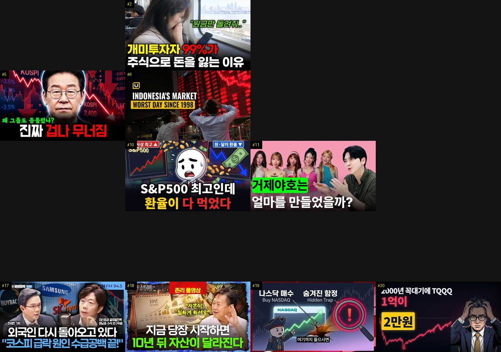
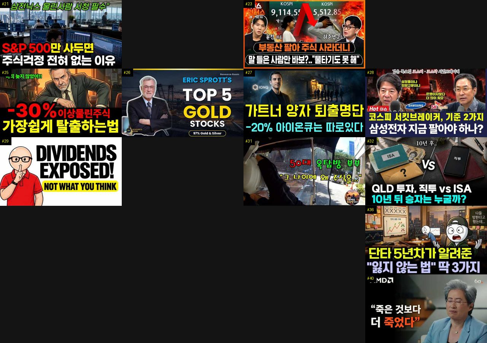
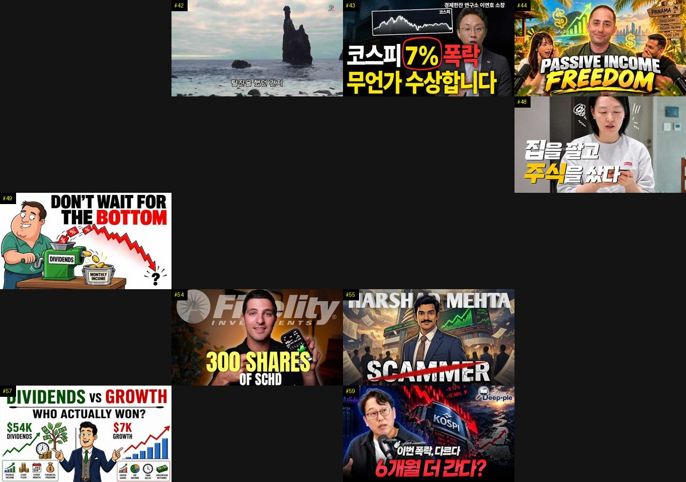
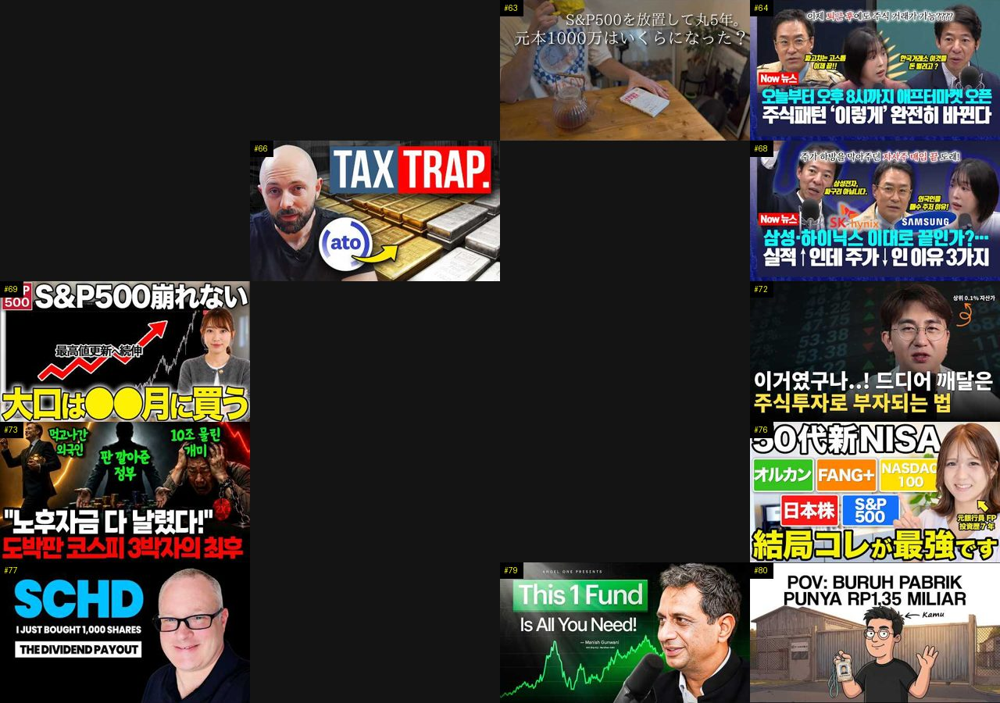
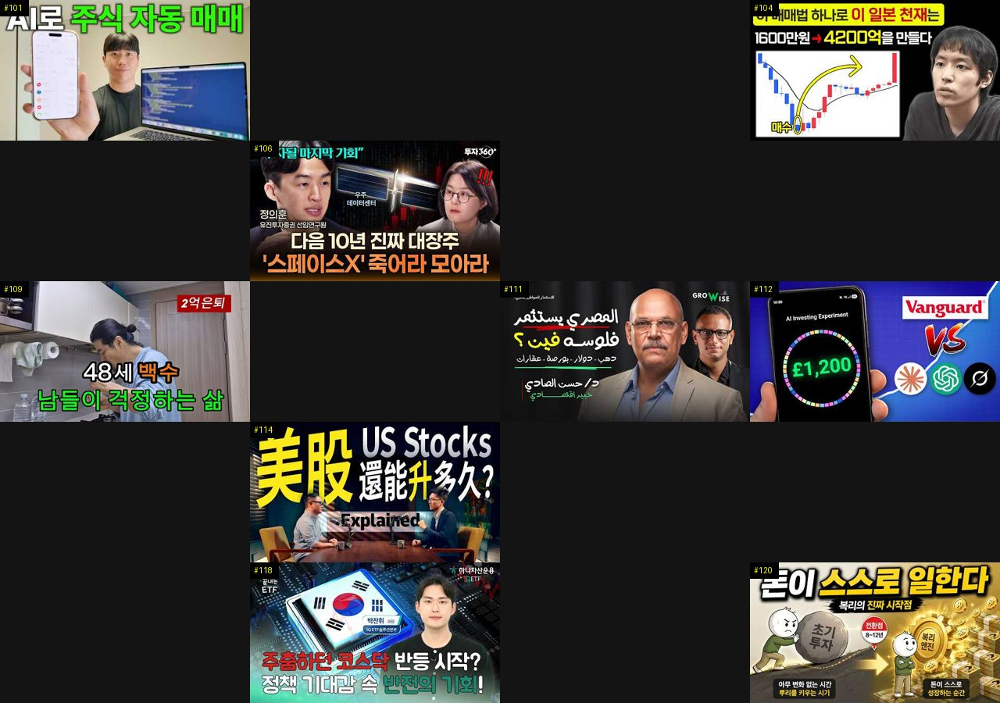
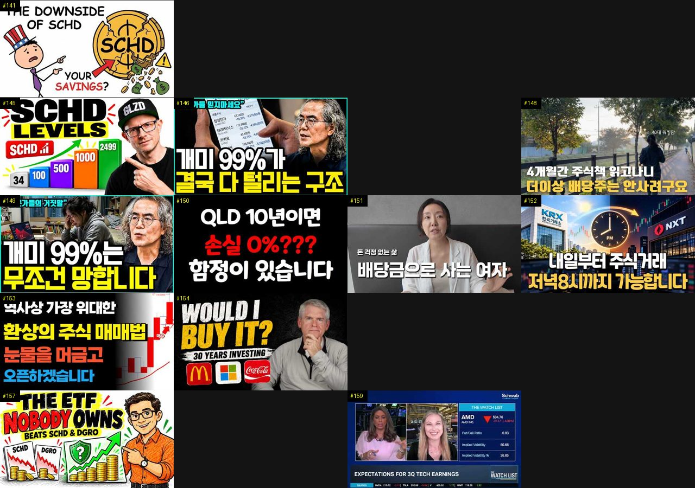
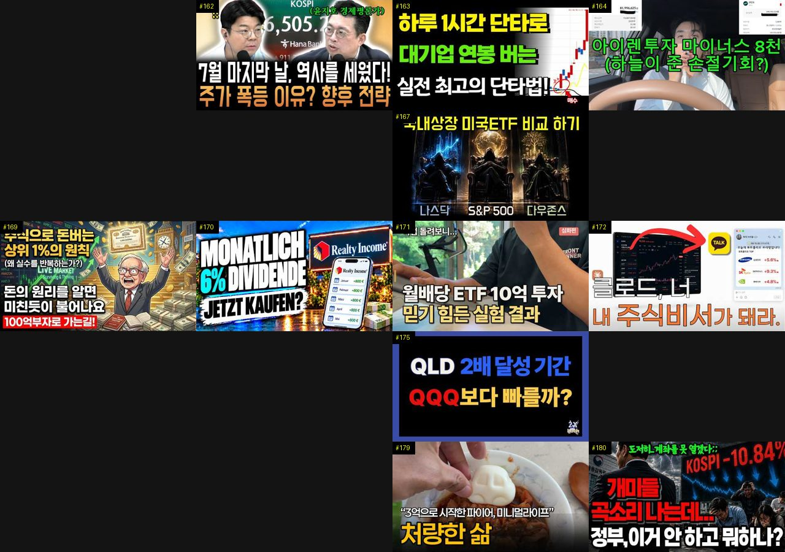
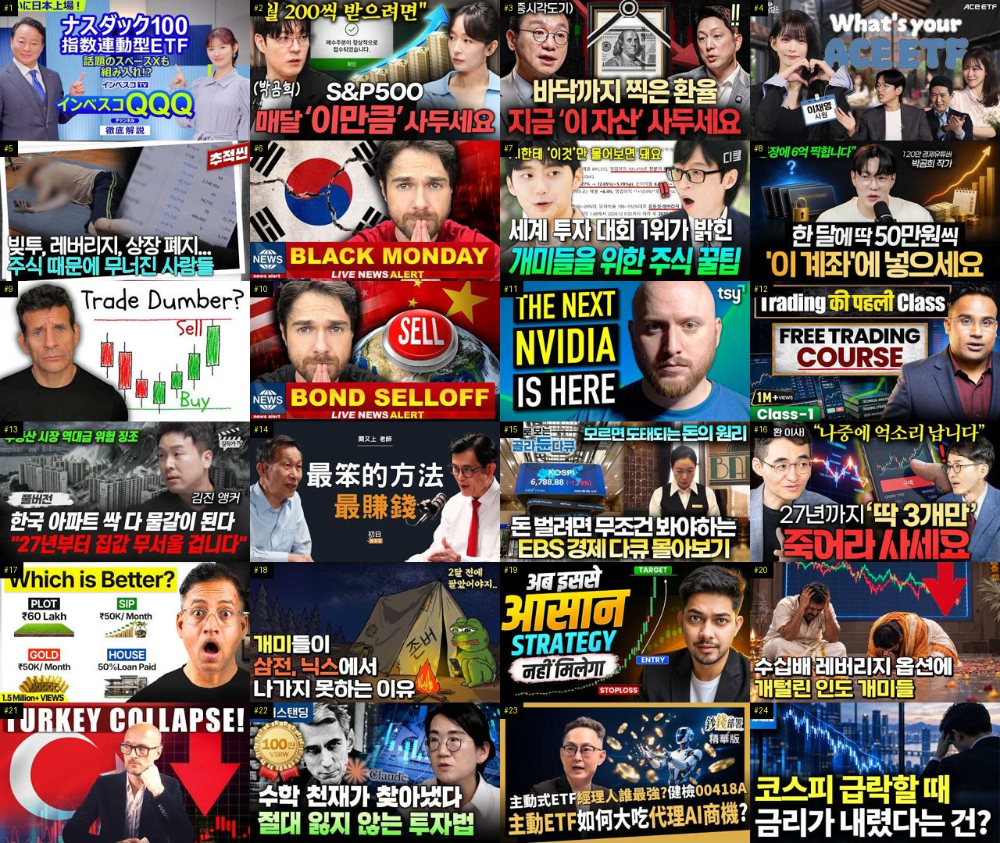

# 주식 — 성공 사례 분석 (지시사항 재료)

자동 생성 — `tools/success_analysis.py` v1.6 (2026-11-06 08:46 UTC), 규칙 `stock/analysis_rules.toml` v1.5. **이 문서는 숫자와 원문만 담는다 — 해석·지시사항은 이것을 읽는 AI 가 만든다.** 주별 추세는 `weekly.md`, 승인한 영상 전부는 `approved.md`. ※ 연구·교육용 — 투자 권유가 아님.

## 0. 자료와 한계

| 자료 | 수 |
|---|---|
| 사례 폴더 (설명·자막·댓글·썸네일을 받은 영상) | 1240 (웹 승인 1240) |
| **성공 사례** — 7~180일·구독자 50,000 이하·**구독자당 하루 조회수 ≥ 0.1** (하루 조회수 ÷ 구독자)·10,000회 이상·4분 이상, 채널당 2개 | **209** (기준 통과 267 − 뺀 것 15 − 채널당 제한 43) |
| **하루 조회수 상위** (1-3번 — 성공 사례와 따로) — 검색에서 찾은 주제 관련 4분 이상 영상 6,124개 중 하루 조회수 상위 10% (하루 24,133회 이상), 구독자·올린 날짜 상관없이, 채널당 2개 | **396** (기준 통과 592 − 뺀 것 15 − 채널당 제한 181) · 자료를 받지 않은 후보 37 |
| **조회수 상위** (1-4번 — 올린 날짜·구독자 상관없이) — 검색(기간 없는 검색 포함)에서 찾은 주제 관련 4분 이상 영상 7,947개(가장 오래된 5092일) 중 조회수 상위 10% (631,121회 이상), 채널당 2개 | **118** (기준 통과 148 − 뺀 것 6 − 채널당 제한 24) · 자료를 받지 않은 후보 654 |
| 성공 사례의 글 출처 (자막·음성인식·설명·없음) | 설명 180 · 음성인식(앞 5분) 12 · 없음 10 · 자막 7 |
| 성공 사례 대본 — 전체 · 앞부분만(음성인식 1차) · 없음 | 7 · 12 · 190 |
| 같은 채널 기준선 (채널 평소 영상) | 성공 사례 188/209 · 채널 221곳 (잘된 영상 616 · 평소 영상 891) |
| 성공 사례 댓글 (받은 / 달린) | 29,640 / 30,917 |
| 성공 사례 썸네일 | 102 |
| 비교 집단 — 탐색에서 본 영상 중 구독자 50,000 이하·4분 이상·365일 안·주제 관련, 채널당 최근 5개 | 2012 (성공 380 = 19%, 채널당 제한으로 뺀 4316) |
| 자료를 받지 않은 성공 후보 (웹 화면에서 승인하면 들어감 — 채널당 자리가 남은 것만) | 167 (자리가 찬 채널의 375개 뺌) |
| 수요·공급 시장 — 최근 90일 영상 (채널 크기 상관없음) | 4829 · 검색어 165 · 자동완성 말 440 (공급 확인 0) |
| 채널 성장 자료 (개설일이 있는 채널) | 2142 (빨리 크는 작은 채널 25) |

성공 기준은 넘었지만 뺀 영상: 사형수 박정희, 그를 살린 28세 정보국장 백선엽의 … (뺀 주제(숙군)) · 最先端のイノベーションを先取る⁉ インベスコTV 「インベ… (광고 의심(좋아요·댓글 거의 없음)) · 배당금 vs 월세 ∣ 3백만 원 월소득, 어느 쪽이 … (뺀 주제(월세)) · 코스피 다 맞춘 무당이 알려드립니다 ! 달러 환율 &… (뺀 주제(코인)) · 미국 AI 소프트웨어·플랫폼 핵심 기업을 한번에📱ㅣ1… (광고 의심(좋아요·댓글 거의 없음)) · Dividendos são uma burrice! (광고 의심(좋아요·댓글 거의 없음)) · 아마존 영화 43개국 1위🔥 CIA 국장의 죽음으로 … (뺀 주제(첩보)) · 외벽부터 시작된 미장! 아무나 하는게 아니구나..?! (뺀 주제(외벽)) · 【S&P500トップ10企業を追い続ける投資】上位10社に… (광고 의심(좋아요·댓글 거의 없음)) · How to Explore & Buy US Stock… (광고 의심(좋아요·댓글 거의 없음)) · #촌집수리#시골집수리#한옥수리#미장#매쉬미장# (뺀 주제(촌집)) · 시골집 고치기 ∣ 몰탈 30포대로 흙바닥 보수부터 콘… (뺀 주제(시골집))

**한계**

- 대본(자막·음성인식)이 없는 성공 사례 190개 (#1, #2, #3, #4, #5, #6, #7, #8, #9, #10, #12, #13, #14, #15, #16, #17, #19, #21, #22, #23, #24, #26, #27, #28, #29, #30, #32, #33, #34, #35 …) — 설명란·챕터만 있음. 도입부·구성·말 속도는 대본이 있는 19개로만 셌다 (음성인식이 끝나면 다시 셈)
- 비교 집단 2012개 = 검색(조회수 순 — 잘된 영상 쪽으로 치우침)·추가한 채널·성공 사례 채널의 평소 영상 746개 (치우침 없음) 에서 올린 지 7~365일 영상, 성공 비율 19% — 실제 시장 비율이 아니다. 같은 집단 안의 '있음/없음' 차이로만 보고, '무엇이 먹혔나'는 1-2번(같은 채널 안)을 먼저 보라
- 외국 영상을 넣음 (주제 설정 INCLUDE_FOREIGN = true) — 성공 사례 중 외국 영상 80개 (#1, #4, #6, #7, #8, #12, #13, #15, #16, #24, #26, #29, #38, #41, #44, #46, #47, #49, #50, #52, #53, #54, #55, #57, #63, #65, #66, #69, #70, #71). 말 속도(한글 음절)는 한국어 영상만으로 셌고, 제목 특징·댓글 갈래(질문·요청 등)는 한국어 낱말 규칙이라 외국 영상에는 거의 걸리지 않는다 — 외국 사례는 원문을 직접 읽어라
- 하루 조회수 상위 묶음(1-3번) 396개는 구독자·올린 날짜 상관없이 골랐다 — 큰 채널(구독자 50,000 넘음) 375개라 채널 힘(구독자·추천)이 섞여 있다. 작은 채널이 따라 할 근거는 1번 성공 사례로 보라. 하루 조회수 = 조회수 ÷ 올린 지 날수라 갓 올린 영상(며칠)은 부풀고 오래된 영상은 낮아진다. 경계는 검색 결과(조회수 순 — 잘된 쪽으로 치우침) 6124개 안의 상위 10%. 자료를 받지 않은 후보 37개 (웹 화면에서 승인하면 들어감)
- 조회수 상위 묶음(1-4번) 118개는 올린 날짜·구독자 상관없이 조회수만으로 골랐다 — 오래 쌓인 조회수·큰 채널 힘이 섞여 있다 (큰 채널 110개 · 1년 넘은 영상 0개). 모집단 7,947개에서 가장 오래된 영상 5092일 — 기간 없는 검색은 할당량이 남을 때만 하므로 다 못 했으면 과거 영상이 적다. 자료를 받지 않은 후보 654개
- 성공 사례 몫(가중) = 성공 사례마다 무게 1 + log2(구독자당 하루 조회수 ÷ 기준)로 센 몫 (사용자 지시 2026-10-28 '최근에 조회수가 높을수록 더 많이 반영' — 점수가 기준의 2배면 무게 2, 4배면 3). 이번 무게 중앙값 2.914 · 가장 큰 8.759 — 사례 수가 적은 묶음은 가중 없는 몫·사례 수와 같이 본다
- 같은 채널 기준선이 있는 성공 사례 188/209개 (채널 영상이 5개 미만이거나 아직 못 받음)
- 수요·공급의 '시장'은 탐색·검색에서 본 최근 90일 영상 4829개 — 검색이 조회수 순이라 조회수 적은 영상이 덜 잡힌다. 주제 묶음 사이의 상대 비교(지수)로만 보라
- 자동완성 말의 '최근 영상 수'는 우리가 본 영상만 셌다 — 실제 공급은 웹 화면 [공급 확인](말 하나에 검색 1번 = 100단위)으로 확인
- 자동완성 말에는 책·방송·사람·채널 이름도 섞인다 (예: '…를 찾아서'·'…지침서') — 영상 주제가 아닌 말은 건너뛰고 읽어라
- '구독자가 많이 모이는가'는 YouTube API 로 영상별 구독 증가를 볼 수 없다 — 대신 채널 성장(7번: 개설 뒤 월 구독자·받을 때마다 남긴 기록), '구독·다음 기대' 댓글, 배수(조회수÷구독자)로 본다
- 댓글 갈래·제목 특징은 낱말 규칙이라 거칠다 (물음표 반문도 '질문', 한 댓글이 여러 갈래). 원문 인용을 함께 보라
- '눈에 띔'은 차이가 크고 표본이 충분하다는 표시일 뿐 원인이 아니다

## 1. 성공 사례 (209개 — 구독자당 하루 조회수 큰 순)

**구독자당 하루 조회수** = 하루 조회수(받은 때 조회수 ÷ 올린 날부터 받은 때까지 날수) ÷ 구독자 — 성공 기준. 배수 = 조회수 ÷ 구독자. **채널 평소 대비** = 조회수 ÷ 그 채널 최근 롱폼 조회수 중앙값 (같은 채널 기준선 — 클수록 그 영상만의 힘). 썸네일은 5번(장마다 20개, 번호 = #), 사례별 자세히는 **`analysis_cases_01.md` …** (9번).

| # | 제목 | 채널 | 구독자 | 조회수 | 구독자당 하루 조회수 | 배수 | 채널 평소 대비 | 하루 조회수 | 길이 | 업로드 | 주제 묶음 | 형식 | 글 출처 | 댓글 받은/달린 |
|---|---|---|---|---|---|---|---|---|---|---|---|---|---|---|
| 1 | [株価が急騰フェーズに入る？新NISAでS&P500・オルカン・日本株を買っている人は必見！](https://www.youtube.com/watch?v=IpRO5CG4e-c) | さくらのお金教室 | 1,150 | 271,764 | 21.6557 | 236.3 | – | 24,904.0 | 14.3분 | 2026-10-26 | 2. 장기투자·ETF·지수 | 정보·해설 | 설명 | 61/61 |
| 2 | [왜 내가 사면 떨어지고 팔면 오를까? 개미가 주식으로 돈 못 버는 4가지 이유](https://www.youtube.com/watch?v=fdlfOCtDBqc) | 오피디의 머니노트 | 1,760 | 683,645 | 17.657 | 388.4 | ×480.4 | 31,076.3 | 13.6분 | 2026-10-15 | 8. 투자 심리·실패 | 오디오북·낭독 | 설명 | 244/307 |
| 3 | [환율 1300원, 코스피 5000 폭락..!! 한국경제 대위기 터진다..??](https://www.youtube.com/watch?v=uY8bXDJHswg) | 경제읽어주는남자 | 1,040 | 143,238 | 9.9505 | 137.7 | ×18.8 | 10,348.5 | 13.8분 | 2026-10-23 | 5. 국내주식 | 정보·해설 | 설명 | 173/173 |
| 4 | [【NISAおすすめ】S&P500、オルカン、日本株、NASDAQ100、FANG+、初心者におすすめの銘柄は？](https://www.youtube.com/watch?v=fZtnKMn5YCo) | ふみかのゆるマネーch | 291 | 30,200 | 9.5361 | 103.8 | – | 2,775.0 | 16.7분 | 2026-10-26 | 2. 장기투자·ETF·지수 | 정보·해설 | 설명 | 11/11 |
| 5 | [이재명 "집 팔아 주식 사라더니…" 코스피 폭락에 국민연금 증발 실태 #이재명 #코스피 #국민연금](https://www.youtube.com/watch?v=c3vq8lj05Yk) | 정치시간 | 37 | 14,663 | 7.19 | 146.6 | ×5.1 | 719.0 | 18.9분 | 2026-10-16 | 5. 국내주식 | 정보·해설 | 설명 | 28/43 |
| 6 | [Indonesia's Stock Market Crashes 11%: What Went Wrong? ∣ Ce…](https://www.youtube.com/watch?v=dFuTChJdF5M) | Century Finan… | 9,980 | 340,757 | 7.1417 | 34.1 | ×187.7 | 71,273.9 | 5.2분 | 2026-10-16 | 기타 | 정보·해설 | 설명 | 271/271 |
| 7 | [WTF Just Happened to Indonesia? (Worst Crash Since 1998)](https://www.youtube.com/watch?v=21-G0C_bXYI) | TSCS | 14,000 | 1,378,175 | 7.0949 | 98.4 | – | 99,328.5 | 18.2분 | 2026-10-23 | 기타 | 정보·해설 | 설명 | 1,877/1,877 |
| 8 | [Dividends vs. Capital Gains (Which One Actually Builds More…](https://www.youtube.com/watch?v=Aj5taVPo9cE) | Dinero Theory | 375 | 22,701 | 6.7936 | 60.5 | ×65.5 | 2,547.6 | 14.8분 | 2026-10-28 | 기타 | 정보·해설 | 설명 | 36/36 |
| 9 | [분배금 3배인데 수익은 더 적다? 천만원 넣으면 매달 얼마일까? (배당 ETF 2편)](https://www.youtube.com/watch?v=DcBr6zmUWgs) | 나다나단Nathan | 224 | 14,595 | 6.5652 | 65.2 | ×72.1 | 1,470.6 | 4.8분 | 2026-10-27 | 2. 장기투자·ETF·지수 | 정보·해설 | 설명 | 5/5 |
| 10 | [S&P500은 최고인데 내 ETF는 마이너스… 지금 환헤지로 갈아타면 늦는 진짜 이유](https://www.youtube.com/watch?v=UcHK1WoTPtY) | 뒤집는경제 | 916 | 114,898 | 6.093 | 125.4 | ×9.5 | 5,581.2 | 23.2분 | 2026-10-16 | 2. 장기투자·ETF·지수 | 정보·해설 | 설명 | 28/65 |
| 11 | [적자인데 300억? 가능한 이유 ∣ 회계사가 말아주는 리센느 소속사 더뮤즈엔터](https://www.youtube.com/watch?v=kJx_AzV9w9c) | 전지적회계사시점 | 867 | 318,288 | 5.7943 | 367.1 | ×177.0 | 5,023.7 | 21.4분 | 2026-09-03 | 6. 종목 고르기·분석 | 브이로그·직접 해본 이야기 | 음성인식(앞 5분) | 219/219 |
| 12 | [What Happens to Your Money if Fidelity or Vanguard Collapse?](https://www.youtube.com/watch?v=wlDrJrV5H-8) | Brutally Hone… | 6,220 | 342,274 | 5.7621 | 55.0 | ×117.4 | 35,840.3 | 6분 | 2026-10-27 | 2. 장기투자·ETF·지수 | 정보·해설 | 설명 | 333/333 |
| 13 | [Here’s What Happens When You Own $100,000 of SCHD](https://www.youtube.com/watch?v=CuNq1HvKhyE) | Thomas Money … | 485 | 31,336 | 5.1101 | 64.6 | ×43.8 | 2,478.4 | 18분 | 2026-10-24 | 2. 장기투자·ETF·지수 | 정보·해설 | 설명 | 20/20 |
| 14 | [한국판 SCHD 어디까지 알고계신가요? 천만원이면 분배금 얼마? (배당 ETF 1편)](https://www.youtube.com/watch?v=ytP_iFiu7ZI) | 나다나단Nathan | 224 | 12,332 | 3.8955 | 55.0 | ×60.9 | 872.6 | 4.2분 | 2026-10-23 | 2. 장기투자·ETF·지수 | 정보·해설 | 설명 | 1/1 |
| 15 | [【2026年最新】オルカン・S＆P500・FANG・日本株・Google株！これが一番増えます！](https://www.youtube.com/watch?v=ERA3jwIT_sg) | 【FPあや】元銀行員が教え… | 3,500 | 107,330 | 3.8703 | 30.7 | ×8.9 | 13,546.2 | 28.2분 | 2026-10-29 | 10. 노후·연금 투자 | 정보·해설 | 설명 | 30/30 |
| 16 | [Once you master this strategy, trading becomes EASY ∣ Real …](https://www.youtube.com/watch?v=YqD4R8sCHzc) | Trading Titan… | 9,160 | 487,081 | 3.8209 | 53.2 | ×7.4 | 34,999.8 | 66.5분 | 2026-10-23 | 기타 | 정보·해설 | 설명 | 459/459 |
| 17 | [[문남중 출연] "코스피 폭락, 자사주 매입 종료 때문..수급공백 끝! 외국인, 삼전닉스로 돌아옵니다" #…](https://www.youtube.com/watch?v=vzGrlaAl0e4) | 경제통마늘 | 15,000 | 124,444 | 3.774 | 8.3 | – | 56,609.4 | 14.2분 | 2026-10-19 | 5. 국내주식 | 오디오북·낭독 | 설명 | 192/192 |
| 18 | [[풀영상] 월급 10%로 당장 시작하는 존리의 자산 증식 치트키](https://www.youtube.com/watch?v=q1fYjAwma3s) | 여의돈스트리트 | 1,360 | 229,995 | 3.4239 | 169.1 | ×202.8 | 4,656.5 | 36분 | 2026-09-17 | 1. 주식 기초·초보 | 인터뷰·강연·대담 | 음성인식(앞 5분) | 113/119 |
| 19 | [S&P500, 나스닥100 수익률 차이는 갈 수록 더 벌어질겁니다 미국 장기투자 가이드](https://www.youtube.com/watch?v=1L9sM63F6Ng) | 돈사냥꾼-TV | 2,060 | 19,018 | 3.3528 | 9.2 | ×7.3 | 6,906.7 | 22.4분 | 2026-10-18 | 2. 장기투자·ETF·지수 | 정보·해설 | 설명 | 5/5 |
| 20 | [같은 TQQQ에 1억, 한 사람은 2만 원 한 사람은 388억 (실제 데이터)](https://www.youtube.com/watch?v=d2_oRUcx5Uo) | 머니언박싱 | 2,200 | 267,725 | 3.09 | 121.7 | ×94.1 | 6,798.1 | 8.1분 | 2026-09-27 | 2. 장기투자·ETF·지수 | 정보·해설 | 음성인식(앞 5분) | 144/161 |
| 21 | [S&P 500에 투자하면 노후 걱정 전혀 없습니다! 주식으로 부자 되는 가장 빠른 방법](https://www.youtube.com/watch?v=_fnvM4hpX44) | 오피디의 머니노트 | 1,760 | 106,714 | 3.0591 | 60.6 | ×75.0 | 5,384.1 | 16.4분 | 2026-10-17 | 2. 장기투자·ETF·지수 | 정보·해설 | 설명 | 63/88 |
| 22 | ["배당금으로 먹고 살려면, 얼마를 투자해야 할까?"](https://www.youtube.com/watch?v=bxrD627VsHA) | Muhammad Hafiz | 383 | 12,260 | 2.9755 | 32.0 | ×11.8 | 1,139.6 | 39.9분 | 2026-10-26 | 3. 배당 | 정보·해설 | 설명 | 4/4 |
| 23 | [유혈 낭자한 국장..폭락의 시작일까? / 이슈빡 / 뉴스헌터스](https://www.youtube.com/watch?v=enkSdCIojAA) | 뉴스헌터스 | 7,680 | 116,383 | 2.6197 | 15.2 | – | 20,119.3 | 17.9분 | 2026-10-15 | 1. 주식 기초·초보 | 인터뷰·강연·대담 | 설명 | 303/303 |
| 24 | [Why Most SIP Investors Panic in a Market Crash ∣ Gajendra K…](https://www.youtube.com/watch?v=hIHu0_pet_g) | Mutual Funds … | 2,260 | 73,965 | 2.5842 | 32.7 | ×3.0 | 5,840.4 | 50.3분 | 2026-10-24 | 기타 | 정보·해설 | 설명 | 61/61 |
| 25 | [마이너스 주식 계좌 가장 쉽게 탈출하는 방법 물타기? 존버? 고민하지 않아도 되는 물린 종목 최대한 손실을…](https://www.youtube.com/watch?v=v6rUCbULG2A) | 머니스트랩 | 550 | 97,181 | 2.3462 | 176.7 | ×184.9 | 1,290.4 | 30.5분 | 2026-08-23 | 8. 투자 심리·실패 | 정보·해설 | 음성인식(앞 5분) | 38/38 |
| 26 | [Eric Sprott Is Buying These 5 Junior Mining Stocks Right Now](https://www.youtube.com/watch?v=lZZ0VA9ihF0) | Resource Room | 985 | 49,539 | 2.304 | 50.3 | ×4.1 | 2,269.4 | 9.9분 | 2026-10-15 | 기타 | 정보·해설 | 설명 | 75/82 |
| 27 | [나스닥은 버티는데 아이온큐가 일주일 새 20% 빠진 건 망해서가 아닙니다 — 가트너가 말한 퇴출 명단은 따…](https://www.youtube.com/watch?v=IbkLrISwBiU) | 경제전략노트 | 747 | 38,203 | 2.2505 | 51.1 | ×25.6 | 1,681.1 | 14.4분 | 2026-10-14 | 4. 미국·해외주식 | 정보·해설 | 설명 | 10/11 |
| 28 | [삼성전자 지금 팔아야 하나? 코스피 서킷브레이커 날, 버틸지 팔지 가를 기준 2가지](https://www.youtube.com/watch?v=ICByZXkRrLg) | 경제야! 놀자~ | 8,620 | 101,848 | 1.9445 | 11.8 | – | 16,761.8 | 13.5분 | 2026-10-15 | 5. 국내주식 | 정보·해설 | 설명 | 296/296 |
| 29 | [I Just Bought 1,600 Shares Of SCHD: Here's my Dividend paym…](https://www.youtube.com/watch?v=d23iMmo2w4o) | Bald Man Fina… | 392 | 14,618 | 1.9079 | 37.3 | ×43.6 | 747.9 | 19.3분 | 2026-10-17 | 기타 | 정보·해설 | 설명 | 15/15 |
| 30 | [GPIQ 대신 결국 QQQI에 1억 몰빵한 현실적인 이유 (나스닥 월배당 ETF 끝판왕 비교)](https://www.youtube.com/watch?v=-0dKG0x3TM4) | 카츠라기 ∣ 주식 월배당 | 439 | 10,513 | 1.8711 | 23.9 | ×7.9 | 821.4 | 6.9분 | 2026-10-24 | 2. 장기투자·ETF·지수 | 정보·해설 | 설명 | 46/46 |
| 31 | [50대 옥탑방 부부, "그 나이에 왜 주식을..."](https://www.youtube.com/watch?v=FRzyTNO9mNI) | 반백살, 옥탑방 이야기 | 703 | 43,619 | 1.833 | 62.0 | ×12.1 | 1,288.6 | 6.3분 | 2026-10-03 | 1. 주식 기초·초보 | 정보·해설 | 음성인식(앞 5분) | 187/187 |
| 32 | [QLD 직투 vs ISA, 잘못 선택했다가는 10년 뒤 수 천만 원 날립니다](https://www.youtube.com/watch?v=PEOHCf2930w) | 투자각성 | 382 | 15,386 | 1.7762 | 40.3 | ×21.0 | 678.5 | 8.9분 | 2026-10-14 | 10. 노후·연금 투자 | 정보·해설 | 설명 | 31/48 |
| 33 | [코스피 하루 7.8% 폭락! 내 주식 팔기 전에 확인할 성장통과 하락의 기준 #12시에 만나요 #매도사이드…](https://www.youtube.com/watch?v=FvUBkpAyJeY) | 잘되는경제 | 1,080 | 12,462 | 1.6224 | 11.5 | – | 1,752.2 | 12.9분 | 2026-10-30 | 5. 국내주식 | 정보·해설 | 설명 | 9/9 |
| 34 | [10번 중 3번만 맞혀도 수익이 나는 매매의 원리 ∣ 깡토의 추세추종 깡토](https://www.youtube.com/watch?v=9Eh6R2AYFp8) | 오르는주식을사는사람들입니다 | 4,600 | 68,251 | 1.5104 | 14.8 | – | 6,947.7 | 17.9분 | 2026-10-27 | 7. 매매·전략 | 정보·해설 | 설명 | 40/40 |
| 35 | [하락장에서 계좌를 지키는 세 가지](https://www.youtube.com/watch?v=AUeEkRnKeM8) | 리채피 richappy | 9,060 | 144,363 | 1.4101 | 15.9 | ×9.1 | 12,775.6 | 16.7분 | 2026-10-26 | 11. 투자 일반 | 정보·해설 | 설명 | 128/128 |
| 36 | [단타 5년차가 알려준 ＂잃지 않는 법＂ 딱 3가지 ｜ 코스피 9000시대 생존법](https://www.youtube.com/watch?v=WnuVkKRjcuI) | 돈의흐름도 | 1,380 | 153,227 | 1.3904 | 111.0 | ×8,512.6 | 1,918.8 | 13.5분 | 2026-08-09 | 5. 국내주식 | 정보·해설 | 음성인식(앞 5분) | 96/96 |
| 37 | [[美중간선거_증시] "살아남는 기업, 폭발적 상승세 나옵니다..이미 시장은 공화당 참패를 모두 선반영" #…](https://www.youtube.com/watch?v=qHEy7Fxl3b0) | 경제통마늘 | 15,000 | 204,142 | 1.3354 | 13.6 | – | 20,030.6 | 19.5분 | 2026-10-27 | 2. 장기투자·ETF·지수 | 오디오북·낭독 | 설명 | 62/62 |
| 38 | [How to Read Candlestick Charts for Trading ∣ Trading strate…](https://www.youtube.com/watch?v=NNp3Zu8wwm0) | Trade with Sm… | 1,890 | 17,624 | 1.3282 | 9.3 | – | 2,510.3 | 15.6분 | 2026-10-30 | 기타 | 정보·해설 | 설명 | 122/122 |
| 39 | [SK하이닉스 주당 2만 원 특별배당 준다? 사실로 확인되는 순간 주가의 향방은... #12기에만나요 #특별…](https://www.youtube.com/watch?v=O4W0t-3rGN8) | 잘되는경제 | 1,080 | 15,656 | 1.3219 | 14.5 | ×1.6 | 1,427.7 | 12.7분 | 2026-10-26 | 3. 배당 | 정보·해설 | 설명 | 11/11 |
| 40 | [주가 1.62달러까지 무너진 AMD, 바닥에서 내린 결정](https://www.youtube.com/watch?v=l2XsNVbqkm0) | Six Sigma ∣ 식… | 16,300 | 83,120 | 1.3219 | 5.1 | ×7.6 | 21,546.8 | 11.3분 | 2026-10-17 | 10. 노후·연금 투자 | 인터뷰·강연·대담 | 설명 | 51/51 |
| 41 | [【14年ぶり買い場？】魅力もリスクも分かるJ-REIT解説｜利回り5.6％到達で妙味◎｜どれを買う？](https://www.youtube.com/watch?v=G88drSUsZFk) | トリノストック【高配当&株… | 797 | 13,566 | 1.3039 | 17.0 | ×8.1 | 1,039.2 | 26.8분 | 2026-10-24 | 기타 | 정보·해설 | 설명 | 5/5 |
| 42 | [70배당할머니 배당금으로 자동차 샀어요](https://www.youtube.com/watch?v=yUIcS9aKUzg) | 이수남 | 1,530 | 13,155 | 1.2427 | 8.6 | ×5.1 | 1,901.4 | 17.6분 | 2026-10-14 | 3. 배당 | 정보·해설 | 없음 | 27/27 |
| 43 | [코스피 7% 폭락, 외인 30분만에 1조 순매도, 무언가 수상합니다](https://www.youtube.com/watch?v=hjIgX9ppDe4) | 경제한잔 | 7,200 | 179,991 | 1.1966 | 25.0 | ×17.8 | 8,615.4 | 14분 | 2026-10-16 | 5. 국내주식 | 정보·해설 | 설명 | 51/71 |
| 44 | [Corporate Slave to Financially Free: The Passive Income 🐐](https://www.youtube.com/watch?v=knkqhQrQS60) | The Retail Ru… | 1,680 | 88,140 | 1.1751 | 52.5 | ×12.4 | 1,974.1 | 80분 | 2026-09-22 | 2. 장기투자·ETF·지수 | 정보·해설 | 자막 | 134/173 |
| 45 | [삼성전자 주가 1월까지 버텨야 하나? 목표주가 35만원 하향, 외신 '자멸적' 경고](https://www.youtube.com/watch?v=71fslodqfAY) | 경제야! 놀자~ | 8,620 | 70,273 | 1.1564 | 8.2 | – | 9,968.3 | 10.6분 | 2026-10-30 | 5. 국내주식 | 정보·해설 | 설명 | 94/94 |
| 46 | [Mutual Fund is Better Than Stocks? Here's Why ∣ Kirtan Shah](https://www.youtube.com/watch?v=wD3vxxGfaTc) | Mutual Funds … | 2,260 | 24,835 | 1.1298 | 11.0 | ×0.7 | 2,553.4 | 48.4분 | 2026-10-27 | 기타 | 정보·해설 | 설명 | 11/11 |
| 47 | [Supply and Demand Trading Strategy Made Simple (2 Steps) ∣ …](https://www.youtube.com/watch?v=lZZ-Qz0m8pc) | Trade with Sm… | 1,890 | 16,990 | 1.1207 | 9.0 | – | 2,118.2 | 15.8분 | 2026-10-29 | 기타 | 정보·해설 | 설명 | 119/119 |
| 48 | [집은 팔았고, 주식은 물렸고](https://www.youtube.com/watch?v=SbEfHnF8DdY) | 로텐션 LOWTENSIO… | 6,730 | 142,526 | 1.0712 | 21.2 | ×15.4 | 7,209.0 | 16.3분 | 2026-10-17 | 11. 투자 일반 | 브이로그·직접 해본 이야기 | 설명 | 185/192 |
| 49 | [Don't Stop Buying Dividends in a Crash Until You See This M…](https://www.youtube.com/watch?v=qCO8HvpAGqc) | Tom - Lazy Di… | 2,730 | 61,591 | 1.0325 | 22.6 | ×8.1 | 2,818.7 | 31.6분 | 2026-10-15 | 기타 | 정보·해설 | 설명 | 116/116 |
| 50 | [A carteira que eu montaria para me aposentar em 10 anos](https://www.youtube.com/watch?v=tKfew-bHV60) | Matheus Sanch… | 5,220 | 45,444 | 1.0258 | 8.7 | ×19.7 | 5,354.5 | 21.4분 | 2026-10-28 | 기타 | 정보·해설 | 설명 | 60/60 |
| 51 | [직장인이 주식투자로 수백억 자산을 만들 수 있었던 이유ㅣ슈퍼개미 이정윤](https://www.youtube.com/watch?v=yfMBox78rSE) | 이정윤의 다정한주식 | 2,900 | 25,628 | 0.9993 | 8.8 | – | 2,898.1 | 17.2분 | 2026-10-28 | 11. 투자 일반 | 정보·해설 | 설명 | 596/596 |
| 52 | [Here’s What Happens When You Own $100,000 of SCHD](https://www.youtube.com/watch?v=S1kkIad_pQ4) | Tom - Lazy Di… | 2,730 | 21,785 | 0.9614 | 8.0 | ×2.9 | 2,624.7 | 33.8분 | 2026-10-29 | 기타 | 정보·해설 | 설명 | 54/54 |
| 53 | [Warren Buffett’s 4 Cycle Rules & How to Spot Market Bubbles…](https://www.youtube.com/watch?v=2yyAXxojnAU) | ET Markets | 10,200 | 115,752 | 0.9413 | 11.3 | – | 9,601.2 | 8.7분 | 2026-10-25 | 기타 | 정보·해설 | 설명 | 29/29 |
| 54 | [I Own 300 Shares of SCHD - Here's My Dividend Payout](https://www.youtube.com/watch?v=Z_-PJGzUdD4) | Cade Invests | 1,820 | 161,878 | 0.9015 | 88.9 | ×355.8 | 1,640.7 | 10.5분 | 2026-07-30 | 2. 장기투자·ETF·지수 | 정보·해설 | 설명 | 338/340 |
| 55 | [The Story Behind India's Biggest Stock Market Scam ∣ Scam 1…](https://www.youtube.com/watch?v=zay8CuiBUQ8) | DOKio | 8,360 | 931,029 | 0.9001 | 111.4 | ×50.7 | 7,524.9 | 27분 | 2026-07-05 | 기타 | 정보·해설 | 설명 | 194/233 |
| 56 | [월배당 500만원 배당파이어족의 현실｜코스피 대폭락 그 후… 10월 배당금 나왔습니다｜실제계좌 공개 (fe…](https://www.youtube.com/watch?v=AN6Scm7uHVg) | 투자여행가 캐넌 [DND… | 915 | 10,794 | 0.8452 | 11.8 | ×2.1 | 773.4 | 13.7분 | 2026-10-23 | 5. 국내주식 | 인터뷰·강연·대담 | 설명 | 39/39 |
| 57 | [Dividend Stocks vs. Growth Stocks: The Math Most Investors …](https://www.youtube.com/watch?v=4bg3bjvjCjE) | Finance Simpl… | 3,640 | 205,082 | 0.8441 | 56.3 | ×45.8 | 3,072.4 | 20.2분 | 2026-08-31 | 기타 | 정보·해설 | 설명 | 321/321 |
| 58 | [AI 거품 경고에 나스닥 -6%… 그런데 S&P500은 왜 -2%만 빠졌을까, 하락장에서 갈리는 진짜 이유](https://www.youtube.com/watch?v=cN5dIiWD_kQ) | 뒤집는경제 | 916 | 10,047 | 0.8405 | 11.0 | ×0.6 | 769.9 | 21.9분 | 2026-10-24 | 2. 장기투자·ETF·지수 | 정보·해설 | 설명 | 7/7 |
| 59 | [지난 폭락과는 완전히 다릅니다…코스피가 진짜 위험한 이유 (Feat. 박병창 MP파트너스 대표) [딥플 D…](https://www.youtube.com/watch?v=y_mvodyrXhQ) | 핀플 - Finple | 47,500 | 193,740 | 0.8397 | 4.1 | ×31.7 | 39,883.8 | 60분 | 2026-10-16 | 5. 국내주식 | 인터뷰·강연·대담 | 설명 | 360/360 |
| 60 | [배당 월 30만원이면 인생 난이도가 낮아진다 (실제 계좌 공개) ∣ 배당으로 경제적 자유 만들기 0화](https://www.youtube.com/watch?v=9VmQk1uGrPo) | 머니노트 | 1,900 | 18,528 | 0.8274 | 9.8 | ×27.6 | 1,572.0 | 16.3분 | 2026-10-25 | 3. 배당 | 브이로그·직접 해본 이야기 | 설명 | 63/63 |
| 61 | [코스피, 상상도 못한 재앙이 올 것(삼전닉스 타점)](https://www.youtube.com/watch?v=i0WD3kljHAo) | 차트도령 | 4,290 | 34,926 | 0.7381 | 8.1 | ×3.1 | 3,166.3 | 10.7분 | 2026-10-26 | 5. 국내주식 | 정보·해설 | 설명 | 59/59 |
| 62 | [환율 1300원 폭락의 진짜 이유..?? 11월 정말 큰거 터집니다..!!](https://www.youtube.com/watch?v=j9J67JEIsTE) | 내일의투자소식 | 6,980 | 50,792 | 0.7363 | 7.3 | ×3.5 | 5,139.3 | 17.8분 | 2026-10-27 | 5. 국내주식 | 정보·해설 | 설명 | 72/72 |
| 63 | [【資産公開】S&P500に1000万入れて5年間放置した結果（めちゃ増えた）｜31歳会社員・新NISA](https://www.youtube.com/watch?v=Lb9ht5PE0vU) | ぼんじり【平凡会社員のずぼ… | 4,500 | 362,276 | 0.7259 | 80.5 | ×38.2 | 3,266.7 | 13.9분 | 2026-07-18 | 2. 장기투자·ETF·지수 | 정보·해설 | 설명 | 141/141 |
| 64 | [오늘부터 오후 8시까지 애프터마켓 오픈!! 주식패턴 ‘이렇게’ 완전히 바뀐다](https://www.youtube.com/watch?v=wwrCztntACs) | 잘되라대한민국 | 6,350 | 244,127 | 0.7247 | 38.5 | ×7.6 | 4,602.1 | 8.2분 | 2026-09-14 | 기타 | 정보·해설 | 음성인식(앞 5분) | 253/253 |
| 65 | [Should you Buy, Hold or Sell? A ₹70 Crore Investor Explains…](https://www.youtube.com/watch?v=LKyU01qWfwA) | Angel One Pod… | 6,160 | 43,096 | 0.7207 | 7.0 | ×0.4 | 4,439.7 | 25.9분 | 2026-10-27 | 기타 | 인터뷰·강연·대담 | 설명 | 16/16 |
| 66 | [Gold and Silver Investors Are Getting Caught Out by the ATO](https://www.youtube.com/watch?v=sY77wNqqiLA) | Navexa | 7,610 | 120,642 | 0.708 | 15.8 | ×18.1 | 5,387.7 | 10.2분 | 2026-10-14 | 기타 | 정보·해설 | 설명 | 486/583 |
| 67 | [내 인생 최대 실수는 한국주식 투자....또 폭락하네](https://www.youtube.com/watch?v=0hyt_77_Xgw) | 엑스세대 우리들의 이야기 | 11,500 | 57,326 | 0.6849 | 5.0 | ×3.3 | 7,876.4 | 8.6분 | 2026-10-30 | 5. 국내주식 | 정보·해설 | 없음 | 225/225 |
| 68 | [삼성·하이닉스 이대로 끝인가?… 지금 시장이 숨기고 있는 진짜 진실](https://www.youtube.com/watch?v=peJD7gf8MVw) | 잘되라대한민국 | 6,350 | 106,538 | 0.6723 | 16.8 | ×3.3 | 4,268.8 | 15.1분 | 2026-10-12 | 기타 | 정보·해설 | 설명 | 165/165 |
| 69 | [S&P500とNASDAQ100は崩れない。プロ投資家が あの日 まで買わない理由【米国株最新】](https://www.youtube.com/watch?v=9zV78pvlDJ4) | まなみんの米国株の学校【投… | 8,500 | 117,631 | 0.6591 | 13.8 | ×15.9 | 5,602.5 | 10.3분 | 2026-10-16 | 2. 장기투자·ETF·지수 | 정보·해설 | 설명 | 36/40 |
| 70 | [Can You Retire With $100,000 in 10 Years (SCHD vs VOO)](https://www.youtube.com/watch?v=ldrMrnOJHlc) | Joey @ChartEq… | 4,640 | 25,846 | 0.6507 | 5.6 | ×32.2 | 3,019.1 | 13.8분 | 2026-10-28 | 2. 장기투자·ETF·지수 | 정보·해설 | 설명 | 10/10 |
| 71 | [【nisa おすすめ】オルカン、S＆P500、日本株、NASDAQ100、FANG+ 50代から新NISA 何を買えば…](https://www.youtube.com/watch?v=wlcAUXORzEE) | 元外資系バンカー ∣ イッ… | 8,490 | 68,940 | 0.6323 | 8.1 | ×0.5 | 5,368.6 | 21.7분 | 2026-10-24 | 10. 노후·연금 투자 | 정보·해설 | 설명 | 7/7 |
| 72 | [주식투자 5년간 수익이 없던 내가 드디어 깨달은 '이것'](https://www.youtube.com/watch?v=uqsGXwRgP68) | 리채피 richappy | 9,060 | 173,650 | 0.6321 | 19.2 | ×10.8 | 5,727.2 | 27.8분 | 2026-09-28 | 11. 투자 일반 | 정보·해설 | 음성인식(앞 5분) | 111/118 |
| 73 | [레버리지 ETF 상장폐지 논란🔥도박판 코스피 알고도 레버리지 ETF 상폐 못하는 이유🔥위험 알고도 도장 찍…](https://www.youtube.com/watch?v=O4-jY0zyhDo) | 리얼경제 | 1,340 | 93,668 | 0.6244 | 69.9 | ×495.6 | 836.7 | 15분 | 2026-07-17 | 9. 빚투·레버리지 | 정보·해설 | 음성인식(앞 5분) | 648/648 |
| 74 | [삼성전자 실적 발표 후 급락 이유](https://www.youtube.com/watch?v=4kZ7AI6mBKI) | 와조스키 종목분석 | 6,680 | 33,093 | 0.6159 | 5.0 | ×3.2 | 4,114.0 | 6.8분 | 2026-10-29 | 6. 종목 고르기·분석 | 인터뷰·강연·대담 | 설명 | 43/43 |
| 75 | [퇴직연금 나머지 30%, 예금 말고 다른 선택지는?💰ㅣ원큐로 끝내는 ETF🎯](https://www.youtube.com/watch?v=FV8Ry9V7IJM) | 하나TV [하나자산운용] | 13,800 | 75,677 | 0.6116 | 5.5 | ×1.5 | 8,440.0 | 7.9분 | 2026-10-28 | 2. 장기투자·ETF·지수 | 정보·해설 | 설명 | 9/9 |
| 76 | [【NISAおすすめ】オルカン・S＆P500・日本株・FANG＋・NASDAQ100の人気銘柄５つを元銀行員の目線で徹底…](https://www.youtube.com/watch?v=EB_-ZGfqX5s) | 初心者でも分かる40代50… | 3,590 | 39,586 | 0.5798 | 11.0 | ×1.0 | 2,081.6 | 37.6분 | 2026-10-18 | 10. 노후·연금 투자 | 정보·해설 | 설명 | 9/15 |
| 77 | [I Just Bought 1,000 Shares Of SCHD: Here's The Dividends It…](https://www.youtube.com/watch?v=fPU6Gefdad8) | Grounded Life… | 5,940 | 109,607 | 0.5667 | 18.4 | ×9.6 | 3,366.4 | 10분 | 2026-10-04 | 기타 | 정보·해설 | 설명 | 141/141 |
| 78 | [주식 매매 타이밍보다 중요한 것, 계좌 수익률은 어디서 갈릴까? ∣ 김진의 투자캠프 찐쌤](https://www.youtube.com/watch?v=_fDJl6p2ZSo) | 오르는주식을사는사람들입니다 | 4,600 | 20,225 | 0.558 | 4.4 | – | 2,566.8 | 20.4분 | 2026-10-29 | 7. 매매·전략 | 정보·해설 | 설명 | 36/36 |
| 79 | [Mutual Fund Manager's Guide To Investing For The Next 10 Ye…](https://www.youtube.com/watch?v=_gnrJW4h_lE) | Angel One Pod… | 6,160 | 78,816 | 0.5383 | 12.8 | ×0.7 | 3,316.2 | 53.9분 | 2026-10-13 | 기타 | 정보·해설 | 설명 | 34/37 |
| 80 | [POV: Gaji Sama dengan Temanmu, Tapi Kamu Keluar dari Pabrik…](https://www.youtube.com/watch?v=_-rdF2o1v0c) | ncek invest | 7,150 | 87,776 | 0.5361 | 12.3 | ×6.2 | 3,833.1 | 8.3분 | 2026-10-14 | 기타 | 정보·해설 | 설명 | 36/43 |
| 81 | [배당주 20년 vs S&P500 20년, 3억 원이 만든 충격적인 자산과 삶의 격차 [ 재테크/미국주식/E…](https://www.youtube.com/watch?v=cqgVNBbMYew) | 박대리와 황과장의 경제이… | 1,930 | 78,763 | 0.5264 | 40.8 | ×34.7 | 1,015.9 | 20.5분 | 2026-07-30 | 4. 미국·해외주식 | 정보·해설 | 음성인식(앞 5분) | 162/162 |
| 82 | ["2억 모았다면 이제 '이렇게' 투자하세요" 손실 없이 돈을 불리는 확실한 투자 전략 ∣ 황금별 작가 ∣ …](https://www.youtube.com/watch?v=-ZozYKj6CxU) | 연금 받는 형 | 23,000 | 104,183 | 0.5123 | 4.5 | ×2.4 | 11,783.5 | 27.8분 | 2026-10-28 | 7. 매매·전략 | 정보·해설 | 설명 | 24/24 |
| 83 | [주식하는 30대의 현실적인 고민들](https://www.youtube.com/watch?v=FHeTzAEZ6tM) | 30대 우영이의 일기 | 4,990 | 30,158 | 0.5109 | 6.0 | ×6.2 | 2,549.5 | 10분 | 2026-10-25 | 6. 종목 고르기·분석 | 정보·해설 | 없음 | 16/16 |
| 84 | [나스닥100 데일리 커버드콜 3종 비교/현존 1등은 누구일까?/TIGER/KODEX/RISE](https://www.youtube.com/watch?v=CoDrgy4i4DA) | 주식아빠 TV | 2,850 | 12,622 | 0.4986 | 4.4 | ×26.6 | 1,420.9 | 8.8분 | 2026-10-28 | 2. 장기투자·ETF·지수 | 정보·해설 | 설명 | 6/6 |
| 85 | [세미파이어 부부가 국내주식 안하는 이유](https://www.youtube.com/watch?v=DNDC7nT7Hmw) | 시골사는 배당부부 | 1,490 | 14,153 | 0.4973 | 9.5 | ×1.1 | 741.0 | 6.9분 | 2026-10-18 | 5. 국내주식 | 정보·해설 | 설명 | 35/35 |
| 86 | [Is This the Time to Buy Indian Equities? Pankaj Tibrewal on…](https://www.youtube.com/watch?v=jUrGWhhASXU) | Wealth By Mot… | 14,700 | 141,499 | 0.4818 | 9.6 | ×2.8 | 7,083.1 | 64.4분 | 2026-10-17 | 기타 | 정보·해설 | 설명 | 64/94 |
| 87 | [물린 주식 10년, 결국 전부 팔았습니다 (feat. 복구 심리의 함정)](https://www.youtube.com/watch?v=OKHm1gUNyPA) | 어쩌다마흔 | 1,840 | 85,110 | 0.4809 | 46.3 | ×10.4 | 884.9 | 9.9분 | 2026-08-02 | 8. 투자 심리·실패 | 인터뷰·강연·대담 | 음성인식(앞 5분) | 957/960 |
| 88 | [나스닥 투자하기 전에 이 영상 꼭 보세요 ∣ QLD만 모아가는 이유](https://www.youtube.com/watch?v=g10Y6ZA7rng) | 올레버 | 1,590 | 120,076 | 0.4809 | 75.5 | ×164.9 | 764.6 | 5.7분 | 2026-06-02 | 2. 장기투자·ETF·지수 | 정보·해설 | 설명 | 347/347 |
| 89 | [나스닥 78% 대폭락... 2000 닷컴버블 ∣ 미래를 맞혔는데, 돈을 왜 잃었을까?](https://www.youtube.com/watch?v=Qn_gTcJTYPk) | 경제박사 | 8,700 | 41,064 | 0.4731 | 4.7 | ×2.3 | 4,115.8 | 64분 | 2026-10-27 | 2. 장기투자·ETF·지수 | 인터뷰·강연·대담 | 설명 | 110/110 |
| 90 | [Buy 1 Share of SCHD Every Week—Here’s the Retirement Math](https://www.youtube.com/watch?v=qFFwr4zsDKQ) | Mikey Moran | 12,300 | 205,433 | 0.4713 | 16.7 | ×24.5 | 5,797.6 | 9.6분 | 2026-10-01 | 기타 | 정보·해설 | 설명 | 162/219 |
| 91 | [50대에 은퇴하려면 QLD 몇 개 모아야 할까?](https://www.youtube.com/watch?v=91-r5_pdQUw) | 미국회계사 샘돌이 투자연… | 1,720 | 14,647 | 0.442 | 8.5 | ×3.8 | 760.2 | 8.2분 | 2026-10-18 | 10. 노후·연금 투자 | 브이로그·직접 해본 이야기 | 설명 | 16/17 |
| 92 | [Can You Retire With Just SCHD? ∣ SCHD Expert Explains](https://www.youtube.com/watch?v=lRlUmwigNYU) | The Mispriced… | 3,970 | 136,744 | 0.438 | 34.4 | ×7.9 | 1,739.0 | 36.6분 | 2026-08-19 | 2. 장기투자·ETF·지수 | 정보·해설 | 자막 | 343/358 |
| 93 | [I Reinvested Dividends for 30 Years — Here's What Actually …](https://www.youtube.com/watch?v=oZqWOuMZwdA) | BudgetMoney | 2,550 | 163,753 | 0.4355 | 64.2 | ×524.8 | 1,110.5 | 11.3분 | 2026-06-11 | 기타 | 정보·해설 | 자막 | 336/336 |
| 94 | [주식 기초 강의 한번 배워서 평생 써먹는 주린이를 위한 주식 투자 방법](https://www.youtube.com/watch?v=36sFYI8uboE) | 마이크로스콥 | 2,280 | 27,711 | 0.4246 | 12.2 | ×13.1 | 968.2 | 13.7분 | 2026-10-08 | 1. 주식 기초·초보 | 인터뷰·강연·대담 | 설명 | 21/42 |
| 95 | [단타만 15년, 큰 수익을 냈지만 이제는 그만두려는 이유](https://www.youtube.com/watch?v=oV-GWtNyoeg) | 노강팔 | 3,760 | 15,535 | 0.4159 | 4.1 | ×5.9 | 1,563.7 | 12분 | 2026-10-27 | 7. 매매·전략 | 정보·해설 | 설명 | 59/60 |
| 96 | [Jay Hatfield’s Warning to Dividend Investors ∣ What He's Bu…](https://www.youtube.com/watch?v=mjIJH1_3UVQ) | The Mispriced… | 3,970 | 19,112 | 0.4109 | 4.8 | ×1.1 | 1,631.4 | 24.2분 | 2026-10-25 | 기타 | 정보·해설 | 설명 | 35/35 |
| 97 | [1억이 10억 되는 복리, '딸깍' 이것만 알면 됩니다 [고독한나무]](https://www.youtube.com/watch?v=8r8ZaImKrm0) | 고독한나무 | 13,800 | 67,831 | 0.4108 | 4.9 | ×9.1 | 5,668.5 | 17.4분 | 2026-10-25 | 11. 투자 일반 | 정보·해설 | 설명 | 105/105 |
| 98 | [10년 넣고 멈췄는데 8.6억? SCHD 임계점의 반전 [ 재테크/미국주식/배당주식/슈드/노후대책 ]](https://www.youtube.com/watch?v=BV6cSyxnBlo) | 경제기상도 | 4,470 | 25,452 | 0.4089 | 5.7 | ×2.8 | 1,827.8 | 20.3분 | 2026-10-23 | 4. 미국·해외주식 | 인터뷰·강연·대담 | 설명 | 5/5 |
| 99 | [단타 5년차가 알려준 ＂잃지 않는 법＂ 딱 3가지 ｜ 코스피 9000시대 생존법](https://www.youtube.com/watch?v=7o59e01aiOs) | 돈사냥꾼-TV | 2,060 | 10,076 | 0.4017 | 4.9 | ×3.9 | 827.6 | 13.5분 | 2026-10-25 | 5. 국내주식 | 정보·해설 | 설명 | 1/1 |
| 100 | [The Real Reason Stocks Haven't Crashed Yet (VOO ETF Analysi…](https://www.youtube.com/watch?v=eafYDMU14aM) | Goldman Starch | 6,160 | 32,424 | 0.3958 | 5.3 | ×12.6 | 2,437.9 | 30분 | 2026-10-24 | 2. 장기투자·ETF·지수 | 정보·해설 | 설명 | 99/99 |
| 101 | [AI로 주식 자동 매매하면 어떻게 될까?](https://www.youtube.com/watch?v=9E9OrcoMCjk) | 이영배 | 21,200 | 1,161,375 | 0.3946 | 54.8 | ×6.8 | 8,364.9 | 11.3분 | 2026-06-20 | 7. 매매·전략 | 정보·해설 | 음성인식(앞 5분) | 578/596 |
| 102 | [S&P500とNASDAQ100、10月最後の1週間はどうなる？11月の前に、プロ投資家は行う準備【米国株】](https://www.youtube.com/watch?v=ZELGuBkVtuA) | まなみんの米国株の学校【投… | 8,500 | 36,780 | 0.3946 | 4.3 | ×5.0 | 3,353.9 | 24.8분 | 2026-10-26 | 2. 장기투자·ETF·지수 | 정보·해설 | 설명 | 38/38 |
| 103 | [Dividend देने वाली Top 04 कंपनिया 🔴 Dividend paying stocks …](https://www.youtube.com/watch?v=UtvM2nhg3OE) | Stock Market … | 2,970 | 12,427 | 0.388 | 4.2 | ×1.3 | 1,152.4 | 20.1분 | 2026-10-26 | 기타 | 정보·해설 | 설명 | 5/5 |
| 104 | [4200억 단타 일본 천재가 초간단 매매법, 죽어라 이것만하세요](https://www.youtube.com/watch?v=UH4UFmdXXo0) | 세력시그널 | 3,590 | 113,825 | 0.3817 | 31.7 | ×45.8 | 1,370.4 | 20.6분 | 2026-08-15 | 7. 매매·전략 | 정보·해설 | 설명 | 216/250 |
| 105 | [배당금으로 먹고 살려면 얼마를 투자해야 할까](https://www.youtube.com/watch?v=mVeISdo4nPs) | 부자의습관 | 6,080 | 16,315 | 0.3768 | 2.7 | – | 2,291.2 | 36.4분 | 2026-10-30 | 3. 배당 | 오디오북·낭독 | 설명 | 2/2 |
| 106 | ["중장기 투자? 삼전닉스 말고 스페이스X 모으세요” (정의훈 선임연구원)](https://www.youtube.com/watch?v=bMR3jvlYDgo) | 투자360 | 16,600 | 149,062 | 0.3736 | 9.0 | ×4.2 | 6,201.0 | 16분 | 2026-10-13 | 11. 투자 일반 | 정보·해설 | 설명 | 62/83 |
| 107 | [1년 간 급등락보인 반도체 기업의 주가...앞으로는 이렇게 투자해야합니다 (f. 빈센트 하나증권 이코노미스…](https://www.youtube.com/watch?v=tcja1V8MjY4) | 따불로 DDABULLO | 2,900 | 14,317 | 0.37 | 4.9 | ×2.8 | 1,073.1 | 56.1분 | 2026-10-23 | 11. 투자 일반 | 정보·해설 | 설명 | 40/40 |
| 108 | [배당도 받고 S&P500수익률 압도하는 배당 포트폴리오 ∣ 평온 작가 ∣ 배당투자](https://www.youtube.com/watch?v=f2mLb2YcC08) | 투자360 | 16,600 | 55,129 | 0.369 | 3.3 | ×1.6 | 6,125.6 | 19분 | 2026-10-28 | 2. 장기투자·ETF·지수 | 정보·해설 | 설명 | 15/15 |
| 109 | [남들이 걱정하는 삶을 선택했습니다 #배당투자 #배당은퇴 #경제적자유 #파이어족 #월배당 #고배당주 #주식투…](https://www.youtube.com/watch?v=SiE0NjI7Fu0) | ttobaedang또배당 | 7,400 | 62,269 | 0.3656 | 8.4 | ×5.0 | 2,705.3 | 9.1분 | 2026-10-14 | 11. 투자 일반 | 정보·해설 | 없음 | 174/184 |
| 110 | [Land vs Stocks - What's The Better Investment?](https://www.youtube.com/watch?v=8U0Mdr_8CPo) | Real Estate T… | 36,600 | 124,846 | 0.3496 | 3.4 | ×5.6 | 12,794.2 | 9.4분 | 2026-10-27 | 기타 | 정보·해설 | 설명 | 67/67 |
| 111 | [Egyptian Guidelines المستثمر المصري يعمل إيه ؟ عقار ولا ذهب…](https://www.youtube.com/watch?v=F_RSQy0sRtM) | GroWise ∣ الا… | 23,700 | 161,835 | 0.3491 | 6.8 | ×9.5 | 8,273.7 | 90.3분 | 2026-10-17 | 기타 | 정보·해설 | 설명 | 251/352 |
| 112 | [I Let AI Invest for Me on Trading 212, Here's What Happened](https://www.youtube.com/watch?v=8zUa4JnCrRw) | Financial Int… | 19,700 | 521,000 | 0.3443 | 26.4 | ×87.4 | 6,782.3 | 11.8분 | 2026-08-21 | 기타 | 정보·해설 | 설명 | 193/209 |
| 113 | [CONFIRMED: Best High Dividend ETF ($100,000 in SPYI vs QQQI…](https://www.youtube.com/watch?v=Xqmt0muucZI) | Joey @ChartEq… | 4,640 | 20,414 | 0.3436 | 4.4 | ×25.5 | 1,594.4 | 14분 | 2026-10-24 | 2. 장기투자·ETF·지수 | 정보·해설 | 설명 | 13/13 |
| 114 | [【Eng Sub】AI泡沫會爆嗎？美股一直升？基金經理教你選ETF與科技股｜US Stocks 101](https://www.youtube.com/watch?v=fMHfTr51OfM) | City Spotligh… | 30,600 | 192,802 | 0.3434 | 6.3 | ×2.9 | 10,507.9 | 50.3분 | 2026-10-19 | 2. 장기투자·ETF·지수 | 정보·해설 | 설명 | 120/297 |
| 115 | [【徹底比較】FANG+・NASDAQ100・S&P500！100万円を20年投資したらどうなる？](https://www.youtube.com/watch?v=6EHyihc2ZOA) | 米国株式投資家ライス君 | 3,610 | 11,529 | 0.3404 | 3.2 | ×1.7 | 1,228.7 | 25.9분 | 2026-10-27 | 2. 장기투자·ETF·지수 | 정보·해설 | 설명 | 12/12 |
| 116 | [주식 ETF로 전 재산 날린 50대 식당에서 24시간사는 남자](https://www.youtube.com/watch?v=HzjbzRdr1W8) | 너머니-너의 돈버는 이야기 | 21,300 | 85,084 | 0.3361 | 4.0 | ×26.8 | 7,158.1 | 14.3분 | 2026-10-25 | 2. 장기투자·ETF·지수 | 사연·드라마 | 설명 | 335/333 |
| 117 | [국내ETF로 세후 월100만원 만드는 두 가지 방법](https://www.youtube.com/watch?v=QoB-zSHUA98) | 수비와 성욱 suvi77 | 6,600 | 25,979 | 0.3331 | 3.9 | ×0.7 | 2,198.5 | 12.9분 | 2026-10-25 | 2. 장기투자·ETF·지수 | 정보·해설 | 설명 | 60/60 |
| 118 | [코스닥 다시 반등할까?📈ㅣ원큐로 끝내는 ETF🎯](https://www.youtube.com/watch?v=jJu0VhNOH-I) | 하나TV [하나자산운용] | 13,800 | 105,091 | 0.3316 | 7.6 | ×2.1 | 4,575.8 | 7.5분 | 2026-10-14 | 2. 장기투자·ETF·지수 | 정보·해설 | 설명 | 3/6 |
| 119 | [SK하이닉스에 울고 웃었던 지난 1년...왜 SK하이닉스였나? 그리고 왜 지금도 SK하이닉스인가? (f. …](https://www.youtube.com/watch?v=S9rhlfvgXBE) | 따불로 DDABULLO | 2,900 | 13,120 | 0.3259 | 4.5 | ×2.6 | 945.0 | 20.5분 | 2026-10-23 | 기타 | 정보·해설 | 설명 | 32/32 |
| 120 | [복리가 부를 만드는 진짜 시작점｜언제부터 돈이 스스로 일하기 시작할까](https://www.youtube.com/watch?v=JExUQaROk40) | 돈의 통찰 | 3,930 | 135,850 | 0.3232 | 34.6 | ×9.6 | 1,270.1 | 17.8분 | 2026-07-22 | 1. 주식 기초·초보 | 정보·해설 | 설명 | 103/103 |
| 121 | [Stop Guessing! Growth vs Dividend Stocks Explained in 20 Mi…](https://www.youtube.com/watch?v=hkRXzD3CH3c) | Finance Simpl… | 3,640 | 123,069 | 0.3224 | 33.8 | ×27.5 | 1,173.6 | 21.2분 | 2026-07-24 | 기타 | 정보·해설 | 설명 | 191/196 |
| 122 | [SK하이닉스 주당 2만원 쏜다! 역대급 삼전·닉스 주주환원책! 어마어마한 상승 시나리오 [염승환 이사]](https://www.youtube.com/watch?v=14e-x56p3AY) | 경제시그널 | 28,300 | 83,083 | 0.3179 | 2.9 | ×2.5 | 8,997.8 | 37.1분 | 2026-10-28 | 기타 | 인터뷰·강연·대담 | 설명 | 30/30 |
| 123 | [코스피 하락이 끝이라고요? 어딜봐서요?](https://www.youtube.com/watch?v=hPx5k6DfNWQ) | 차트도령 | 4,290 | 13,518 | 0.3171 | 3.1 | ×1.2 | 1,360.4 | 16분 | 2026-10-27 | 5. 국내주식 | 정보·해설 | 설명 | 193/192 |
| 124 | [나스닥은 최고가, 반도체만 반 토막. 지금과 똑같았던 1995년으로 앞으로의 흐름을 찾아봤습니다.](https://www.youtube.com/watch?v=7hjl_w2aWtA) | 테스프레소 | 9,270 | 67,556 | 0.3146 | 7.3 | ×10.9 | 2,916.4 | 9.9분 | 2026-10-14 | 2. 장기투자·ETF·지수 | 정보·해설 | 설명 | 26/36 |
| 125 | [Can I Replace My Salary With Dividends? I Ask Someone Who D…](https://www.youtube.com/watch?v=W2jzvNEVv9c) | Get Started I… | 10,800 | 34,728 | 0.306 | 3.2 | ×8.3 | 3,304.9 | 34.8분 | 2026-10-26 | 기타 | 정보·해설 | 설명 | 29/29 |
| 126 | [[주식] 🔥목요일 바로 폭등 나올 Best 3종목!🔥반드시 잡아가세요! 자세하게 설명드려볼게요! #급등주 …](https://www.youtube.com/watch?v=4mYOIAc7Q98) | 급등주 장인 폭등남 | 7,440 | 20,237 | 0.3048 | 2.7 | ×2.8 | 2,267.5 | 40분 | 2026-10-28 | 6. 종목 고르기·분석 | 정보·해설 | 설명 | 128/128 |
| 127 | [라오어 무한매수법, 정말 계속 해도 될까? TQQQ·QLD로 12년 돌려보고 알게 된 의외의 결과](https://www.youtube.com/watch?v=nCBMBYmFjOU) | 여의도 아빠 | 2,460 | 62,829 | 0.3007 | 25.5 | ×9.6 | 739.7 | 7.5분 | 2026-08-13 | 7. 매매·전략 | 정보·해설 | 설명 | 186/199 |
| 128 | [SIP vs Lump Sum: Which Is Better for Beginners? (Explained …](https://www.youtube.com/watch?v=RydtfFBjNiM) | Money Wise Sc… | 3,190 | 11,571 | 0.2995 | 3.6 | – | 955.3 | 5.3분 | 2026-10-25 | 2. 장기투자·ETF·지수 | 정보·해설 | 설명 | 2/2 |
| 129 | [트럼프의 폭탄 선언으로 삼성전자와 한국 주식시장, 조정 올 수 있는 이유! #박시동 #매불쇼](https://www.youtube.com/watch?v=3tIO_BBDMMo) | 스타판 | 3,960 | 190,465 | 0.2914 | 48.1 | – | 1,154.0 | 22분 | 2026-05-16 | 8. 투자 심리·실패 | 오디오북·낭독 | 설명 | 133/133 |
| 130 | [[차트 강의] 100조 운용역이 신입 펀드매니저에게 가르쳤던 차트 패턴 8가지 (박재훈)](https://www.youtube.com/watch?v=0JHEax_R7DE) | 박재훈의 투자농장 | 22,000 | 218,477 | 0.2901 | 9.9 | ×19.0 | 6,382.1 | 16.5분 | 2026-10-03 | 6. 종목 고르기·분석 | 인터뷰·강연·대담 | 설명 | 76/83 |
| 131 | [I Bought 1,000 Shares of JEPQ. Here’s What It Pays Me Every…](https://www.youtube.com/watch?v=gC-_mODu2gI) | Grounded Life… | 5,940 | 41,057 | 0.2898 | 6.9 | ×3.6 | 1,721.4 | 11.3분 | 2026-10-13 | 기타 | 정보·해설 | 설명 | 68/73 |
| 132 | [De enfermero a vivir de rentas tras 18 años invirtiendo ∣ I…](https://www.youtube.com/watch?v=-pS9upa00IA) | Objetivo : Li… | 10,100 | 34,368 | 0.2834 | 3.4 | – | 2,862.1 | 90분 | 2026-10-25 | 기타 | 정보·해설 | 설명 | 165/165 |
| 133 | [단타 천재가 개발한 초간단 매매법(기본 차트 분석법)](https://www.youtube.com/watch?v=knblsnwXsfg) | 차트9단 | 469 | 17,552 | 0.2814 | 37.4 | ×26.1 | 132.0 | 20분 | 2026-06-26 | 6. 종목 고르기·분석 | 인터뷰·강연·대담 | 설명 | 7/7 |
| 134 | [【2chお金スレ】定年後も収入が途切れない人は何をしてる？今からできる備えを挙げてけ](https://www.youtube.com/watch?v=2tSGWp3yGek) | 2chお金シニアチャンネル | 2,150 | 14,326 | 0.2779 | 6.7 | ×3.0 | 597.5 | 21분 | 2026-10-13 | 10. 노후·연금 투자 | 정보·해설 | 없음 | 0/0 |
| 135 | [QLD 10억으로 은퇴하면? 매년 5천만원 vs 1억원 인출, 10년 뒤 결과는?](https://www.youtube.com/watch?v=e9ur-2TmAcc) | 두배럭 2XLuck | 3,260 | 12,489 | 0.2749 | 3.8 | ×1.2 | 896.2 | 17.6분 | 2026-10-23 | 10. 노후·연금 투자 | 브이로그·직접 해본 이야기 | 설명 | 23/23 |
| 136 | [배당이 월급을 넘었는데 사표를 안 쓴 진짜 이유 ∣ SCHD 월급 역전 [ 재테크/미국주식/배당주식/슈드/…](https://www.youtube.com/watch?v=x1xodntCp_g) | 경제기상도 | 4,470 | 13,845 | 0.2721 | 3.1 | ×1.5 | 1,216.3 | 21.1분 | 2026-10-25 | 4. 미국·해외주식 | 인터뷰·강연·대담 | 설명 | 10/10 |
| 137 | [美 증시, IT버블보다 거품 심해 ...코스피도 5000까지 더 빠질 것](https://www.youtube.com/watch?v=L69h-h8rLss) | 투벤저스 주간동아 | 31,100 | 94,598 | 0.2706 | 3.0 | – | 8,415.2 | 18분 | 2026-10-26 | 5. 국내주식 | 정보·해설 | 없음 | 194/194 |
| 138 | ["이제 하락 초입이다" 한국 증시 대폭락 임박했다 '이때' 멍때리면 계좌 녹습니다 (전태룡 대표 / 통합본…](https://www.youtube.com/watch?v=nE1MmCNbA8c) | 웅달책방_투자 | 3,550 | 12,931 | 0.2628 | 3.6 | ×1.3 | 932.8 | 35.4분 | 2026-10-23 | 2. 장기투자·ETF·지수 | 인터뷰·강연·대담 | 설명 | 34/34 |
| 139 | [QUANTO EU RECEBO DE RENDA PASSIVA COM R$92 MIL INVESTIDOS!](https://www.youtube.com/watch?v=-d59yKs5TUw) | Papo Renda - … | 31,100 | 74,276 | 0.2545 | 2.4 | ×6.6 | 7,915.7 | 14.4분 | 2026-10-27 | 2. 장기투자·ETF·지수 | 정보·해설 | 설명 | 63/63 |
| 140 | [I'm Not Selling — I'm Buying These 4 Stocks After the Sello…](https://www.youtube.com/watch?v=tgeA8bHVywM) | Navellier Mar… | 33,100 | 187,841 | 0.2516 | 5.7 | ×5.6 | 8,326.7 | 13.7분 | 2026-10-14 | 기타 | 정보·해설 | 설명 | 201/224 |
| 141 | [The Honest Downside of SCHD Nobody Talks About](https://www.youtube.com/watch?v=BCG0vPE1Ox0) | Drawn Investor | 2,930 | 14,933 | 0.2501 | 5.1 | ×3.8 | 732.7 | 12.8분 | 2026-10-16 | 2. 장기투자·ETF·지수 | 정보·해설 | 설명 | 16/16 |
| 142 | [찬 바람 부는 퇴근길 마흔의 혼술 , 노후 걱정과 배당주, 그리고 사는 얘기](https://www.youtube.com/watch?v=qY1joQ1BMg4) | 송차장기록 | 8,930 | 17,483 | 0.2483 | 2.0 | ×1.0 | 2,217.7 | 14.3분 | 2026-10-29 | 3. 배당 | 브이로그·직접 해본 이야기 | 설명 | 144/144 |
| 143 | [3억으로 은퇴한 뒤 시작한 단타, 그만두지 못하는 이유](https://www.youtube.com/watch?v=ii3RugmGMYU) | 일억은퇴 | 10,800 | 22,206 | 0.2288 | 2.1 | ×5.1 | 2,471.0 | 7.3분 | 2026-10-28 | 1. 주식 기초·초보 | 정보·해설 | 설명 | 60/60 |
| 144 | [배당은퇴 3년차 실제하루 생활비 #배당투자 #배당은퇴 #경제적자유 #파이어족 #월배당 #고배당주 #주식투자…](https://www.youtube.com/watch?v=pAxnywSAn9I) | ttobaedang또배당 | 7,400 | 15,100 | 0.2276 | 2.0 | ×1.2 | 1,684.1 | 9.4분 | 2026-10-28 | 11. 투자 일반 | 정보·해설 | 없음 | 152/152 |
| 145 | [The 5 Levels of SCHD — What Level Are You?](https://www.youtube.com/watch?v=hasms3By6pA) | Mikey Moran | 12,300 | 124,156 | 0.2272 | 10.1 | ×14.8 | 2,794.2 | 9.6분 | 2026-09-22 | 기타 | 정보·해설 | 설명 | 484/528 |
| 146 | [내 주변에 주식으로 돈 번 사람이 '진짜' 단 1명도 없는 소름 돋는 이유 ∣ 교수 정선용 (통합본)](https://www.youtube.com/watch?v=SwW4n0ERlS8) | 너와 나의 경제학교 | 37,100 | 617,641 | 0.2222 | 16.6 | ×22.3 | 8,243.1 | 52.7분 | 2026-08-14 | 11. 투자 일반 | 인터뷰·강연·대담 | 설명 | 1,622/1,622 |
| 147 | [【勝率100%】米国株は中間選挙後に爆騰する！過去70年のS&P500・ナスダック100全データと「ねじれ議会」の真実…](https://www.youtube.com/watch?v=V6CZefvKdDc) | 投資家外科医 Dr.ゆうま | 5,030 | 13,794 | 0.2215 | 2.7 | ×2.6 | 1,113.9 | 25분 | 2026-10-24 | 2. 장기투자·ETF·지수 | 정보·해설 | 설명 | 31/31 |
| 148 | [더이상 배당주는 사지 않아요/40대 워킹맘](https://www.youtube.com/watch?v=P0j4XK5PaJY) | 마스 심플라이프 MasS… | 41,200 | 237,819 | 0.2192 | 5.8 | ×7.4 | 9,032.3 | 10.8분 | 2026-10-11 | 3. 배당 | 브이로그·직접 해본 이야기 | 자막 | 104/195 |
| 149 | ["당신이 주식으로 망할 수밖에 없던 이유" 개미 99%의 피를 빨아먹는 잔인한 진짜 구조 ∣ 교수 정선용 …](https://www.youtube.com/watch?v=-5NhPWk2zF0) | 너와 나의 경제학교 | 37,100 | 378,388 | 0.2128 | 10.2 | ×13.7 | 7,893.7 | 117분 | 2026-09-10 | 8. 투자 심리·실패 | 인터뷰·강연·대담 | 설명 | 214/238 |
| 150 | [QLD는 몇 년 들고 있어야 안전할까? 20년치 모든 매수 시점을 계산해봤습니다.](https://www.youtube.com/watch?v=PWr2oclRWKs) | 여의도 아빠 | 2,460 | 12,316 | 0.2092 | 5.0 | ×1.9 | 514.6 | 6.7분 | 2026-10-13 | 7. 매매·전략 | 브이로그·직접 해본 이야기 | 설명 | 11/14 |
| 151 | [생활비 한 달 5만원..10년 만에 배당금 월 300만원 받는 이유 (조윤진 1부) #세미파이어 #배당투자](https://www.youtube.com/watch?v=Wc52vsC6q4U) | 자람들 - 자립하는사람들 | 35,500 | 827,392 | 0.2085 | 23.3 | ×27.2 | 7,401.1 | 29.3분 | 2026-07-17 | 3. 배당 | 브이로그·직접 해본 이야기 | 설명 | 613/613 |
| 152 | [주식 거래시간 밤 8시까지?☑️KRX 애프터마켓 꼭 알아야 할 변화](https://www.youtube.com/watch?v=xXBHBu6hnCc) | 주식캐스터 여니 | 42,700 | 474,517 | 0.2059 | 11.1 | ×141.8 | 8,790.5 | 9분 | 2026-09-13 | 기타 | 정보·해설 | 없음 | 361/361 |
| 153 | [[주식차트보는법] 단타말고 이 '차트패턴' 하나로 꾸준히 수익낸 엄청난 비결 지금 딱 한번만 노출하겠습니다…](https://www.youtube.com/watch?v=3h7Di1vQHgY) | 주식차트연구소 | 1,380 | 12,707 | 0.1959 | 9.2 | ×25.1 | 270.4 | 14.6분 | 2026-08-30 | 6. 종목 고르기·분석 | 정보·해설 | 설명 | 1/1 |
| 154 | [I've Invested in Dividends for 30 Years. Here's What Most P…](https://www.youtube.com/watch?v=M7l-A6Mk9zQ) | BudgetMoney | 2,550 | 52,845 | 0.1913 | 20.7 | ×169.4 | 487.8 | 27.4분 | 2026-07-21 | 기타 | 정보·해설 | 자막 | 233/233 |
| 155 | ["수익률에 속지 마세요" 월배당 ETF, '이 1가지' 모르면 망합니다 ∣ 황금별 작가 ∣ 연금받는형](https://www.youtube.com/watch?v=BJN7kVxwZ_I) | 연금 받는 형 | 23,000 | 42,087 | 0.1859 | 1.8 | ×0.9 | 4,276.6 | 31.6분 | 2026-10-27 | 2. 장기투자·ETF·지수 | 정보·해설 | 설명 | 11/11 |
| 156 | [배당 빼서 쓰는 ISA 투자법ㅣ월배당 커버드콜 중도인출 한도,세금 차이까지#isa](https://www.youtube.com/watch?v=G3js22j-VTU) | 주부참치 | 7,040 | 17,188 | 0.1847 | 2.4 | ×2.6 | 1,300.5 | 16.3분 | 2026-10-24 | 10. 노후·연금 투자 | 정보·해설 | 설명 | 30/30 |
| 157 | [This New Fidelity ETF Has CRUSHED Every Dividend ETF](https://www.youtube.com/watch?v=LgszhYR0rFQ) | Jake Wealth H… | 6,790 | 26,916 | 0.1841 | 4.0 | ×6.8 | 1,249.7 | 10.1분 | 2026-10-15 | 2. 장기투자·ETF·지수 | 정보·해설 | 설명 | 13/15 |
| 158 | [HLB 에이치엘비 주가 - FDA CLASS1 확정 엠바고 논란 종결](https://www.youtube.com/watch?v=Ja1UVRSKpFs) | 돈대니 인사이트 투자 | 7,680 | 17,147 | 0.1791 | 2.2 | ×2.3 | 1,375.4 | 13.5분 | 2026-10-24 | 2. 장기투자·ETF·지수 | 오디오북·낭독 | 설명 | 13/13 |
| 159 | [Chip Stocks Selling Off: When I Switch From Buying Dips to …](https://www.youtube.com/watch?v=JVzvv_YZD7Y) | Danielle Shay | 6,830 | 24,982 | 0.1784 | 3.7 | ×8.3 | 1,218.2 | 8.3분 | 2026-10-16 | 기타 | 정보·해설 | 설명 | 61/61 |
| 160 | [[초보자필수시청] 1천만원으로 따라하는 추세추종 매매법 / 13년차 현역 투자자의 비법](https://www.youtube.com/watch?v=1_KnSLKiBos) | 직장인 차트매매 - 추세… | 6,030 | 14,881 | 0.1767 | 2.5 | ×4.4 | 1,065.8 | 16.6분 | 2026-10-23 | 1. 주식 기초·초보 | 인터뷰·강연·대담 | 설명 | 45/45 |
| 161 | [00406A跌破發行價還能配0.138？月配息能維持多久？主動型ETF優點與風險分析](https://www.youtube.com/watch?v=o_XndSFP2Wg) | 吳馬克 l 幸福理財家 | 16,200 | 33,266 | 0.1734 | 2.0 | ×2.6 | 2,809.3 | 12.2분 | 2026-10-25 | 2. 장기투자·ETF·지수 | 정보·해설 | 설명 | 56/56 |
| 162 | [불기둥 세운 코스피, 코스닥! 폭등한 이유와 향후 전략](https://www.youtube.com/watch?v=Pel5gTXKRkQ) | K파민 | 6,060 | 102,739 | 0.173 | 16.9 | ×0.7 | 1,048.5 | 24.8분 | 2026-07-31 | 5. 국내주식 | 정보·해설 | 설명 | 139/139 |
| 163 | [[주식차트보는법] 슈퍼개미들이 절대 말 안해주는 '실전 최고의 단타기법' 제가 욕먹을 각오로 상한가 차트패…](https://www.youtube.com/watch?v=JGzbftUZPXs) | 주식차트연구소 | 1,380 | 14,324 | 0.1704 | 10.4 | ×28.3 | 235.2 | 33.2분 | 2026-08-28 | 6. 종목 고르기·분석 | 정보·해설 | 설명 | 8/8 |
| 164 | [“아이렌 긴급 ,30달러 깨질듯한 상황.. 손절각인가??(ft.코어위브/CPI)아이렌맨.](https://www.youtube.com/watch?v=cTlVY95Qzlk) | 아이렌맨 : IREN을 … | 7,940 | 29,940 | 0.1703 | 3.8 | ×1.8 | 1,352.5 | 8.8분 | 2026-10-15 | 8. 투자 심리·실패 | 인터뷰·강연·대담 | 설명 | 395/441 |
| 165 | [SOXL 수익률 2300%에서 700%로 추락. 저의 솔직한 심정을 말씀드립니다.](https://www.youtube.com/watch?v=7lKGd3E1ZAU) | SOXL 연구소 | 6,640 | 10,578 | 0.1698 | 1.6 | ×1.7 | 1,127.3 | 7.7분 | 2026-10-27 | 4. 미국·해외주식 | 정보·해설 | 설명 | 67/67 |
| 166 | [배당투자의 함정? 배당 ETF 고르는 법부터 손실난 계좌 복구법까지 알려드립니다 (박재훈)](https://www.youtube.com/watch?v=6wpI9ePifEA) | 박재훈의 투자농장 | 22,000 | 36,684 | 0.1683 | 1.7 | ×3.2 | 3,702.2 | 22.7분 | 2026-10-27 | 2. 장기투자·ETF·지수 | 인터뷰·강연·대담 | 설명 | 8/8 |
| 167 | [연금저축 IRP 계좌에서 사모을 ETF 3대장 추천! 결국 국내상장 나스닥 S&P500 다우존스 ETF 적…](https://www.youtube.com/watch?v=yITsxwpiFOw) | 소금달 - 소액 금 달러… | 2,790 | 10,281 | 0.1671 | 3.7 | ×24.2 | 466.1 | 20분 | 2026-10-15 | 2. 장기투자·ETF·지수 | 정보·해설 | 설명 | 2/2 |
| 168 | [한국주식 또 폭락? 매일 돈삭제... 왜 이럴까 진짜 ㅠ](https://www.youtube.com/watch?v=-G2MoPlAl5c) | 엑스세대 우리들의 이야기 | 11,500 | 15,731 | 0.1665 | 1.4 | ×0.9 | 1,914.5 | 6.5분 | 2026-10-29 | 5. 국내주식 | 정보·해설 | 없음 | 82/82 |
| 169 | [주식 상위 2%만 아는 10가지 절대 생존 원칙 (돈의 원리)](https://www.youtube.com/watch?v=fFURFeLTdAg) | 준의 경제노트 (jun’… | 12,500 | 307,728 | 0.1659 | 24.6 | ×389.5 | 2,074.2 | 21.6분 | 2026-06-10 | 11. 투자 일반 | 오디오북·낭독 | 설명 | 189/191 |
| 170 | [Jeden Monat Miete ohne eigene Immobilie - warum ich jetzt R…](https://www.youtube.com/watch?v=jeVV2buqJ_k) | Aktienhai | 2,910 | 10,397 | 0.1645 | 3.6 | ×3.7 | 478.6 | 11분 | 2026-10-15 | 2. 장기투자·ETF·지수 | 정보·해설 | 설명 | 38/38 |
| 171 | [월배당 ETF 10억 투자하면 정말 배당금 얼마? ∣ 종합소득세·건강보험료 계산법 (은퇴 현금흐름 설계)](https://www.youtube.com/watch?v=yRDpbgaZahc) | 은퇴머니 - 은퇴 현금흐… | 30,000 | 759,726 | 0.1598 | 25.3 | ×54.2 | 4,795.5 | 11.4분 | 2026-05-31 | 2. 장기투자·ETF·지수 | 정보·해설 | 설명 | 967/967 |
| 172 | [매일 아침 7시, 내 포트폴리오를 관리해주는 AI 주식 비서를 만들어봤습니다](https://www.youtube.com/watch?v=ITzgH6CeZns) | 스티브의 파도타기 ∣ A… | 28,800 | 743,616 | 0.1597 | 25.8 | ×587.4 | 4,598.9 | 14.8분 | 2026-05-28 | 2. 장기투자·ETF·지수 | 정보·해설 | 설명 | 388/396 |
| 173 | [시총 8조 종목, -70% 손실](https://www.youtube.com/watch?v=nQglTmdsOmw) | 와조스키 종목분석 | 6,680 | 11,795 | 0.1588 | 1.8 | ×1.1 | 1,061.0 | 7.6분 | 2026-10-26 | 6. 종목 고르기·분석 | 인터뷰·강연·대담 | 설명 | 22/22 |
| 174 | ["LG엔솔이 삼성전자 시총 뛰어넘을것”과연 불가능한 일일까?" (박순혁작가의 2차전지 마인드셋)](https://www.youtube.com/watch?v=b9q7-J5lCDc) | 투자자 W | 6,670 | 12,348 | 0.1516 | 1.9 | ×1.5 | 1,011.5 | 11.5분 | 2026-10-25 | 기타 | 정보·해설 | 없음 | 10/10 |
| 175 | [QLD 거치식 투자, 2배까지 얼마나 걸릴까? QQQ와 비교했더니,, 충격!](https://www.youtube.com/watch?v=dbQ_xk3IiPg) | 두배럭 2XLuck | 3,260 | 11,317 | 0.1512 | 3.5 | ×1.1 | 492.8 | 16분 | 2026-10-14 | 11. 투자 일반 | 브이로그·직접 해본 이야기 | 설명 | 21/21 |
| 176 | [ಯಾವ್ದು ಈ ಕಂಪನಿ? ಯಾಕೆ Investorsಗೆ ಗೊತ್ತಿಲ್ವಾ? by Team Angel …](https://www.youtube.com/watch?v=QeNVWGk_jwQ) | Team Angel in… | 23,100 | 42,010 | 0.151 | 1.8 | ×0.8 | 3,488.4 | 25.8분 | 2026-10-25 | 기타 | 정보·해설 | 설명 | 113/113 |
| 177 | [Analista de Banca Enseña Todas sus Inversiones a los 27 Año…](https://www.youtube.com/watch?v=z8tPJhBOUjk) | Dani Domingue… | 12,500 | 21,477 | 0.1472 | 1.7 | ×2.1 | 1,839.6 | 16.5분 | 2026-10-25 | 2. 장기투자·ETF·지수 | 정보·해설 | 설명 | 31/31 |
| 178 | [[주식] 🔥월요일 바로 폭등 나올 Best 3종목!🔥반드시 잡아가세요! 자세하게 설명드려볼게요! #급등주 …](https://www.youtube.com/watch?v=tJcfYQkbRWo) | 급등주 장인 폭등남 | 7,440 | 15,282 | 0.1464 | 2.0 | ×2.1 | 1,089.3 | 39분 | 2026-10-23 | 6. 종목 고르기·분석 | 정보·해설 | 설명 | 78/78 |
| 179 | [배당금으로 혼자 사는 미혼남, 3억 파이어 미니멀라이프](https://www.youtube.com/watch?v=iGI_fzwOyoY) | 배당아저씨 | 33,200 | 232,332 | 0.145 | 7.0 | ×4.7 | 4,813.4 | 8.6분 | 2026-09-19 | 3. 배당 | 정보·해설 | 설명 | 612/626 |
| 180 | ["안정을 기대한다"더니 하루만에 코스피 -10.84%🔥올해 8번째 서킷브레이커🔥정부, 왜 손놓고 있나🔥증안…](https://www.youtube.com/watch?v=AOs5sAd3hKM) | 리얼경제 | 1,340 | 19,142 | 0.1419 | 14.3 | ×101.3 | 190.1 | 16.1분 | 2026-07-28 | 2. 장기투자·ETF·지수 | 정보·해설 | 설명 | 205/205 |
| 181 | [ETF 이 '2가지'만 사두면 됩니다. '나머지는 필요없어요' 100억 자산 관리자의 꿀팁(백승호 단장 풀…](https://www.youtube.com/watch?v=1qlywudP2oY) | 자람들 - 자립하는사람들 | 35,500 | 261,551 | 0.1386 | 7.4 | ×9.0 | 4,919.7 | 69.7분 | 2026-09-14 | 2. 장기투자·ETF·지수 | 인터뷰·강연·대담 | 설명 | 71/77 |
| 182 | [주식 AI 비서 4명 만들었더니 공부가 쉬워졌어요 (제미나이 활용법)](https://www.youtube.com/watch?v=02hqxRMURPs) | 공부하는 주린이 | 1,300 | 31,438 | 0.1352 | 24.2 | ×32.4 | 175.7 | 7.1분 | 2026-05-11 | 1. 주식 기초·초보 | 인터뷰·강연·대담 | 자막 | 36/36 |
| 183 | [SCHD ETF Analysis: The Most Complete Schwab US Dividend Equ…](https://www.youtube.com/watch?v=ys_pR1yxEgo) | Goldman Starch | 6,160 | 19,406 | 0.1349 | 3.1 | ×7.5 | 831.1 | 32.2분 | 2026-10-14 | 2. 장기투자·ETF·지수 | 정보·해설 | 설명 | 76/94 |
| 184 | [와..미친.. 캔들 차트 보는 법 핵심을 공개한다고? (주식 강의 추천, 주식 초보 매매 방법)](https://www.youtube.com/watch?v=KwvGol5A8m4) | 트트남 ∣ 주식 차트 보… | 1,420 | 12,851 | 0.1329 | 9.1 | ×21.0 | 188.7 | 15.8분 | 2026-08-30 | 1. 주식 기초·초보 | 인터뷰·강연·대담 | 설명 | 2/2 |
| 185 | [[슬기로운 금융생활] 국장 복귀하면 양도세 감면?! – RIA계좌 혜택도, 유의점도 슬기롭게](https://www.youtube.com/watch?v=O4jq0bK4MbI) | 예금보험공사 예보TV | 7,840 | 142,713 | 0.1301 | 18.2 | ×3.5 | 1,019.6 | 5.6분 | 2026-05-29 | 5. 국내주식 | 정보·해설 | 설명 | 7/8 |
| 186 | [폭락장은 기회다. 진짜 반도체 시그널과 레버리지 (SOXL, USD) 대응법](https://www.youtube.com/watch?v=v-EJlF_0sY8) | SOXL 연구소 | 6,640 | 11,438 | 0.1287 | 1.7 | ×1.9 | 854.7 | 12.1분 | 2026-10-23 | 9. 빚투·레버리지 | 정보·해설 | 설명 | 31/31 |
| 187 | ["구글·아마존 물타지 마세요" 월가 헤지펀드가 지금 나스닥 탈출해 집중 매집하는 '현금 요새'](https://www.youtube.com/watch?v=ODAPYwws77Y) | NOVA Real Inv… | 29,600 | 27,181 | 0.1278 | 0.9 | ×14.7 | 3,782.9 | 18.4분 | 2026-10-30 | 2. 장기투자·ETF·지수 | 인터뷰·강연·대담 | 설명 | 35/35 |
| 188 | [ETF到底適不適合退休族？買錯帳戶恐多繳稅：退休投資5大必看重點](https://www.youtube.com/watch?v=5AlaZ9-LF1E) | 視角Judy | 33,700 | 52,710 | 0.1267 | 1.6 | ×2.3 | 4,271.0 | 13.7분 | 2026-10-24 | 2. 장기투자·ETF·지수 | 정보·해설 | 설명 | 5/5 |
| 189 | ["역대급 저평가라던 코스피" 하루 만에 620조 추락.. 그 뒤에 숨겨진 코스피의 잔혹한 진실](https://www.youtube.com/watch?v=6VAsPNYeTRQ) | 더 리치 - 돈의 흐름을… | 8,040 | 116,603 | 0.1251 | 14.5 | ×41.7 | 1,005.8 | 21.2분 | 2026-07-13 | 5. 국내주식 | 정보·해설 | 설명 | 294/294 |
| 190 | [단타 천재가 개발한 하이킨아시 스캘핑 매매법, 죽어라 이것만 하세요.](https://www.youtube.com/watch?v=55hFmXD0lh0) | 알파개미 | 2,790 | 54,542 | 0.1246 | 19.6 | ×85.9 | 347.5 | 19.6분 | 2026-06-02 | 7. 매매·전략 | 인터뷰·강연·대담 | 설명 | 1,049/1,051 |
| 191 | [Trading 212 Portfolio Update - 2 New Positions Bought](https://www.youtube.com/watch?v=IE9l-jrEAk0) | neil invests | 20,500 | 19,301 | 0.1246 | 0.9 | ×1.6 | 2,554.7 | 15.4분 | 2026-10-29 | 2. 장기투자·ETF·지수 | 정보·해설 | 설명 | 63/63 |
| 192 | [Mon portefeuille après 2 ANS d’investissement en ETF](https://www.youtube.com/watch?v=duRcMneoLxc) | Rémi Lux - In… | 30,400 | 44,385 | 0.1215 | 1.5 | – | 3,693.1 | 19.1분 | 2026-10-25 | 2. 장기투자·ETF·지수 | 정보·해설 | 설명 | 83/83 |
| 193 | [나스닥과 반도체 하락장에 주식 10억 원 빠진 60대 아버지와 통화 ∣ QQQ, QLD, TQQQ, SOX…](https://www.youtube.com/watch?v=y_JIxtzjKKM) | 레버리지 하는 미국회계사… | 13,500 | 15,988 | 0.121 | 1.2 | ×1.1 | 1,633.2 | 11.2분 | 2026-10-27 | 9. 빚투·레버리지 | 정보·해설 | 설명 | 61/61 |
| 194 | [BSE + CDSL, L&T, ITC Declared High Dividend, Bonus & Split](https://www.youtube.com/watch?v=uLNk9rO3L0U) | FinoStocks - … | 22,100 | 20,503 | 0.1198 | 0.9 | ×2.9 | 2,647.4 | 9.2분 | 2026-10-29 | 기타 | 정보·해설 | 설명 | 10/10 |
| 195 | [【新NISA速報🚨】衝撃のデータ判明！あと数日で相場の流れが一変します。絶対に見逃すな！【NASDAQ,FANG+,S…](https://www.youtube.com/watch?v=5-Y7jZigzGw) | こどおじマスターK【節約貯… | 21,700 | 25,292 | 0.1174 | 1.2 | ×0.9 | 2,548.4 | 20.3분 | 2026-10-27 | 2. 장기투자·ETF·지수 | 정보·해설 | 설명 | 106/106 |
| 196 | [배당금으로 생존하는 진짜 현실, 찜질방에 왔습니다](https://www.youtube.com/watch?v=xossGjXogm0) | 배당아저씨 | 33,200 | 51,415 | 0.1172 | 1.6 | ×1.0 | 3,890.3 | 8.6분 | 2026-10-24 | 3. 배당 | 정보·해설 | 설명 | 247/247 |
| 197 | [3 Safe Dividend Stocks on Track to Out-Pay a 5% Treasury](https://www.youtube.com/watch?v=rzG3BMILnOM) | Simply Safe D… | 15,900 | 21,533 | 0.1151 | 1.4 | ×1.2 | 1,829.9 | 14.4분 | 2026-10-25 | 기타 | 정보·해설 | 설명 | 104/104 |
| 198 | [Questo portafoglio con 4 ETF resiste a ogni CRISI ∣ justETF…](https://www.youtube.com/watch?v=85k-Ifmm0UY) | justETF Italia | 41,800 | 40,001 | 0.1114 | 1.0 | ×1.6 | 4,656.1 | 15.5분 | 2026-10-28 | 2. 장기투자·ETF·지수 | 정보·해설 | 설명 | 47/47 |
| 199 | [How to Borrow Against Your Stock Portfolio: Buy, Borrow, Die](https://www.youtube.com/watch?v=NPcgV0dq03Q) | Sacco Financi… | 21,600 | 332,128 | 0.1108 | 15.4 | ×74.9 | 2,393.7 | 9.4분 | 2026-06-20 | 기타 | 정보·해설 | 자막 | 603/620 |
| 200 | [$1M Portfolio: SCHD or Dividend Aristocrats for Income?](https://www.youtube.com/watch?v=qj-O6aFzPic) | Simply Safe D… | 15,900 | 120,656 | 0.1093 | 7.6 | ×6.7 | 1,737.7 | 12.4분 | 2026-08-28 | 2. 장기투자·ETF·지수 | 정보·해설 | 설명 | 131/139 |
| 201 | [I Ranked Canada's Oil & Gas Stocks (They're Printing Cash 🤑)](https://www.youtube.com/watch?v=ZYB2Muvxoj8) | Stocktrades -… | 24,800 | 25,397 | 0.1086 | 1.0 | ×3.9 | 2,694.5 | 44.4분 | 2026-10-27 | 기타 | 정보·해설 | 설명 | 117/117 |
| 202 | [월 100만원 ETF 투자하면, 60대에 "진짜 부자"가 됩니다](https://www.youtube.com/watch?v=WGkQ7wwHHlQ) | 농부의 경제학 | 8,340 | 78,752 | 0.1085 | 9.4 | ×9.3 | 904.8 | 13.4분 | 2026-08-11 | 2. 장기투자·ETF·지수 | 정보·해설 | 설명 | 82/83 |
| 203 | [Is NOW The Time To Buy SOFI Stock?! ∣ SoFi 3Q26](https://www.youtube.com/watch?v=r3oGZpx2kuk) | Ken Freeman, … | 38,200 | 57,530 | 0.1081 | 1.5 | ×3.1 | 4,127.7 | 14.9분 | 2026-10-23 | 기타 | 정보·해설 | 설명 | 74/74 |
| 204 | [Familienvater mit 100.000€ Depot & plötzlich ist der Job we…](https://www.youtube.com/watch?v=2e0PrTtGNXc) | Parqet | 26,100 | 33,370 | 0.1076 | 1.3 | ×2.2 | 2,808.2 | 33분 | 2026-10-25 | 2. 장기투자·ETF·지수 | 정보·해설 | 설명 | 60/60 |
| 205 | [너무 복잡하게 투자하면 장기투자가 어렵더라고요 (Ft. 아이렌 추매)](https://www.youtube.com/watch?v=IiZIIoeqq8A) | 파돌부부(파돌댁) | 12,000 | 12,801 | 0.1075 | 1.1 | ×2.1 | 1,289.8 | 11.4분 | 2026-10-27 | 2. 장기투자·ETF·지수 | 인터뷰·강연·대담 | 설명 | 30/30 |
| 206 | ["결혼자금, 주식으로 다 잃었습니다.."](https://www.youtube.com/watch?v=eVfmAgNW5yU) | 코리안트_미국주식으로 한… | 12,100 | 18,094 | 0.1071 | 1.5 | ×2.8 | 1,295.5 | 10.5분 | 2026-10-23 | 4. 미국·해외주식 | 정보·해설 | 설명 | 25/25 |
| 207 | [¿Están creciendo mis DIVIDENDOS? Cartera de Dividendos Real…](https://www.youtube.com/watch?v=wayJW2Rqj9s) | Héctor Badal | 15,800 | 19,290 | 0.1051 | 1.2 | ×5.2 | 1,659.8 | 14.3분 | 2026-10-25 | 기타 | 정보·해설 | 설명 | 7/7 |
| 208 | [주식 12년, 다시 돌아가면 절대 안 할 5가지](https://www.youtube.com/watch?v=ICNKMpB5AMY) | 재테크하는 일개미 | 46,700 | 67,644 | 0.104 | 1.4 | ×10.5 | 4,857.9 | 15.6분 | 2026-10-23 | 1. 주식 기초·초보 | 인터뷰·강연·대담 | 설명 | 41/41 |
| 209 | [32살 부부 동반 퇴사 후, 배당투자로 세계여행 시작합니다](https://www.youtube.com/watch?v=WXgAtzIynMk) | 밍키원 MINKIONE | 13,800 | 170,053 | 0.1036 | 12.3 | ×6.6 | 1,430.2 | 4.6분 | 2026-07-10 | 1. 주식 기초·초보 | 정보·해설 | 설명 | 274/277 |

### 자료를 받지 않은 성공 후보 (167개 중 배수 큰 40개 — 웹 화면 탐색 목록에서 승인하면 분석에 들어감, 성공 사례가 이미 채널당 2개인 채널은 뺌)

| 제목 | 채널 | 구독자 | 조회수 | 배수 | 길이 | 업로드 | 주제 묶음 |
|---|---|---|---|---|---|---|---|
| [사상 초유의 이틀 연속 서킷브레이커! 폭락장에서 투자자가 절대 해서는 안 될 행동 ∣ 존리 대표](https://www.youtube.com/watch?v=un5SAQlJFcY) | 증시직격 | 117 | 19,707 | 168.4 | 23분 | 2026-10-12 | 11. 투자 일반 |
| [결국 120만원 깨진 하이닉스..삼전 7만•하닉 20만이 정말 바닥? / 이슈빡 / 뉴스헌터스](https://www.youtube.com/watch?v=LWIQK6aKoYI) | 뉴스헌터스 | 7,680 | 168,565 | 21.9 | 19분 | 2026-10-19 | 5. 국내주식 |
| [[긴급속보]💥손실 계좌, 혼자힘으론 힘듭니다 ∣ 끌려다니는 매매 이제 그만](https://www.youtube.com/watch?v=t50RkPvL16k) | 고래미디어 | 62 | 15,509 | 155.1 | 5.2분 | 2026-10-21 | 7. 매매·전략 |
| ["이 방법" 대로 사면 TQQQ보다 최소 12억은 더 법니다. 진짜입니다.](https://www.youtube.com/watch?v=nD8WGVgUJbY) | 레버리지 투자노트 | 382 | 32,707 | 85.6 | 13.8분 | 2026-10-27 | 기타 |
| [한화오션 3400억 배 탈락, 호주가 일본 고른 이유? #한화오션 #호주호위함](https://www.youtube.com/watch?v=dHw-ur1tzRw) | 경제 계기판 | 454 | 63,934 | 140.8 | 21.5분 | 2026-10-20 | 기타 |
| [롤드컵 우승 상금 14억, T1의 진짜 수입원은? ∣ 회계사가 뜯어본 롤 구단 재무제표](https://www.youtube.com/watch?v=37BJl0y52xk) | 전지적회계사시점 | 867 | 102,443 | 118.2 | 19.6분 | 2026-10-21 | 6. 종목 고르기·분석 |
| [POV: Semua Temanmu Ambil KPR, Kamu Memilih Tetap Ngontrak 1…](https://www.youtube.com/watch?v=8O6W6HEjJcE) | ncek invest | 7,150 | 1,091,009 | 152.6 | 15.7분 | 2026-10-08 | 10. 노후·연금 투자 |
| ["지금이라도 하셔야합니다." 무섭게 부자되는 주식 투자법](https://www.youtube.com/watch?v=TpNEHux-4Es) | Muhammad Hafiz | 383 | 12,151 | 31.7 | 22.7분 | 2026-10-13 | 11. 투자 일반 |
| [곧 세계경제 대위기가 온다..?? 中日 미국 국채 전량매도한 이유..!!](https://www.youtube.com/watch?v=HfkeQzwfmmI) | 경제읽어주는남자 | 1,040 | 53,299 | 51.2 | 13.8분 | 2026-10-24 | 4. 미국·해외주식 |
| [박정희 국장 치러지던 날, 부산 절에서 남몰래 49재를 지낸 여인 ∣ 첫 아내 김호남](https://www.youtube.com/watch?v=ZBVbEnVhD3Y) | 새벽종TV | 1,150 | 34,391 | 29.9 | 20.4분 | 2026-10-13 | 5. 국내주식 |
| [【2chお金スレ】お金が貯まらない人の部屋にある共通アイテム…理由を知って震えた](https://www.youtube.com/watch?v=96wIOy3DXUY) | 2chお金シニアチャンネル | 2,150 | 304,856 | 141.8 | 20.4분 | 2026-09-21 | 10. 노후·연금 투자 |
| [$50,000 Into this ETF will Surpass Your Full-Time Job](https://www.youtube.com/watch?v=DQm0npQZw5s) | Thomas Money … | 485 | 14,620 | 30.1 | 18.6분 | 2026-10-26 | 2. 장기투자·ETF·지수 |
| [Can You Time Leveraged ETFs? I Tested 4 Rules on the TQQQ](https://www.youtube.com/watch?v=aVRDVXtBUmg) | The Antifragi… | 2,170 | 41,877 | 19.3 | 16.9분 | 2026-10-30 | 2. 장기투자·ETF·지수 |
| [역사상 최악의 날에만 주식을 산 사람, 41년 뒤 계좌는? (S&P 500 실제 데이터)](https://www.youtube.com/watch?v=DRvywv-HRmM) | 머니언박싱 | 2,200 | 241,229 | 109.7 | 8분 | 2026-09-26 | 2. 장기투자·ETF·지수 |
| [물건은 넘치는데 왜 모두 가난해졌을까 ∣ 1929 대공황의 진짜 이유](https://www.youtube.com/watch?v=HqoSy_2rLQU) | 경제박사 | 8,700 | 579,468 | 66.6 | 81.2분 | 2026-10-11 | 기타 |
| [【NISA・iDeCo】2027年に向けてお金のルールが激変！投資家が知るべき5つの重要ポイント](https://www.youtube.com/watch?v=z0RjlKO3W58) | さくらのお金教室 | 1,150 | 35,337 | 30.7 | 18.6분 | 2026-10-24 | 10. 노후·연금 투자 |
| [친구가 하나둘 사라졌습니다… 결국 제가 인간관계를 정리한 이유](https://www.youtube.com/watch?v=DTTARHT4swk) | 어쩌다마흔 | 1,840 | 46,194 | 25.1 | 10.4분 | 2026-10-25 | 2. 장기투자·ETF·지수 |
| [Goldpreis fällt trotz Rekordnachfrage ∣ Die Erklärung #gold](https://www.youtube.com/watch?v=n2iVxG_hKbQ) | philoro | 19,700 | 351,945 | 17.9 | 8.3분 | 2026-10-28 | 기타 |
| [이거 딱 두 개면 충분하다? 존리 대표의 심플한 투자 공식](https://www.youtube.com/watch?v=9bQncZDMMqE) | 여의돈스트리트 | 1,360 | 157,160 | 115.6 | 22.4분 | 2026-09-08 | 11. 투자 일반 |
| [Billionaire Ross Beaty Is Backing These 4 Mining Stocks](https://www.youtube.com/watch?v=OEe3A8GOucQ) | Resource Room | 985 | 16,085 | 16.3 | 6.3분 | 2026-10-28 | 기타 |
| [The Boring Trading Strategy that Actually Works (No one wil…](https://www.youtube.com/watch?v=ZaniJwJIwJg) | Trading Titan… | 9,160 | 668,585 | 73.0 | 49.9분 | 2026-09-23 | 기타 |
| [하루만에 ‘삼성전자’ HBM 뒤흔든 젠슨황… TSMC ‘3나노’ 돌연 채택 뜻밖의 변수 발생](https://www.youtube.com/watch?v=whybLg0YCWg) | 경제한잔 | 7,200 | 196,107 | 27.2 | 17.2분 | 2026-10-20 | 7. 매매·전략 |
| [【損得は間違い？】知らないと120万円損します！老後に後悔しない正しい年金の受け取り方を元銀行員が徹底的に解説しました！](https://www.youtube.com/watch?v=XdH84Pd3gKI) | 初心者でも分かる40代50… | 3,590 | 136,687 | 38.1 | 31.3분 | 2026-10-13 | 10. 노후·연금 투자 |
| [50대 옥탑방 부부, 흔들리는 아내...](https://www.youtube.com/watch?v=WZEQ4-KSYg4) | 반백살, 옥탑방 이야기 | 703 | 16,867 | 24.0 | 7.7분 | 2026-10-20 | 11. 투자 일반 |
| [반도체 폭락 뒤 찾아온 9배 상승, 이번에도 반복될까?](https://www.youtube.com/watch?v=1b-TwEDV4iM) | 테스프레소 | 9,270 | 202,396 | 21.8 | 23.4분 | 2026-10-21 | 기타 |
| [보도국장, 교정국 사장에 시장까지 납치한 극악무도한 깨개갱 [봉누도2 2편(각시탈)]](https://www.youtube.com/watch?v=x7x9vCrlXoQ) | Eureka Ch. 유레카 | 1,710 | 16,611 | 9.7 | 18.5분 | 2026-10-30 | 5. 국내주식 |
| [상상도 못한 금값 전망 떴다 가진 금 전부 '이렇게' 하세요 (유신익 박사 / 통합본 2부)](https://www.youtube.com/watch?v=FnpS27bmW9Y) | 웅달책방_투자 | 3,550 | 118,374 | 33.3 | 29.6분 | 2026-10-04 | 2. 장기투자·ETF·지수 |
| [메가커피 차릴 1억으로 QQQI 샀더니 생긴 일 (자영업 vs 배당주 현실 비교)](https://www.youtube.com/watch?v=vJTf2vjRFDs) | 카츠라기 ∣ 주식 월배당 | 439 | 13,857 | 31.6 | 6.4분 | 2026-10-14 | 3. 배당 |
| [양자 내부자 10억 달러 경고는 아이온큐 얘기가 아닙니다 — 최근 1년 아이온큐 CEO 시장 매도 0, 디…](https://www.youtube.com/watch?v=HZ1abN9B9PU) | 경제전략노트 | 747 | 10,524 | 14.1 | 20.3분 | 2026-10-24 | 4. 미국·해외주식 |
| [곧 무언가 큰게 터진다...?? 큰손들은 이미 미국 시장 떠난 이유](https://www.youtube.com/watch?v=N0Ve33vqXWs) | 내일의투자소식 | 6,980 | 113,867 | 16.3 | 19.1분 | 2026-10-22 | 4. 미국·해외주식 |
| [【2027年から激変】新NISAが神改正！知らない人だけ損する3つの変更点と最適戦略!【資産形成・FIRE・老後資産】](https://www.youtube.com/watch?v=E-MP6m3Ij2s) | 元外資系バンカー ∣ イッ… | 8,490 | 260,943 | 30.7 | 18.5분 | 2026-10-03 | 10. 노후·연금 투자 |
| [월배당금 70만원, 시골에서 사는 배당부부!](https://www.youtube.com/watch?v=vJF30ea4r7Q) | 시골사는 배당부부 | 1,490 | 115,709 | 77.7 | 5분 | 2026-08-11 | 3. 배당 |
| [HE COMPRADO UNA ALMAZARA PARA HACER ACEITE DE OLIVA EN CASA.](https://www.youtube.com/watch?v=CUgrjakCUnI) | Stocks and To… | 47,300 | 275,883 | 5.8 | 9.9분 | 2026-10-14 | 기타 |
| [100.000€ im Depot: Reichen die Dividenden zum Leben? (Netto)](https://www.youtube.com/watch?v=FSCAyBz2kmA) | Investeule | 6,530 | 16,327 | 2.5 | 12.4분 | 2026-10-18 | 2. 장기투자·ETF·지수 |
| [ISA ETF 투자, K-QLD 계속 사고 있습니다. (적립식 92주차)](https://www.youtube.com/watch?v=bqPJ0g6KyBs) | 투공 - 평생 투자하는 … | 8,890 | 25,488 | 2.9 | 8.7분 | 2026-10-17 | 2. 장기투자·ETF·지수 |
| [Si Lisnard gagne en 2027, voici ce qui arrive à ton argent](https://www.youtube.com/watch?v=rNMJMiYq5BI) | Sonny - Seqoo… | 18,100 | 161,581 | 8.9 | 9분 | 2026-10-25 | 기타 |
| [영업이익률 80% 찍은 난야테크, 사장이 직접 말한 디램 부족의 끝](https://www.youtube.com/watch?v=zf0aGUndtsM) | Six Sigma ∣ 식… | 16,300 | 76,952 | 4.7 | 12.4분 | 2026-10-14 | 6. 종목 고르기·분석 |
| [₹700 से गिरके ₹30 आया 🔴 Fii ने ली 13% हिस्सेदारी 🔴 stock ma…](https://www.youtube.com/watch?v=ShUaQ9sBIpk) | Stock Market … | 2,970 | 19,199 | 6.5 | 33분 | 2026-10-28 | 기타 |
| [How XRP Becomes the Pristine Collateral Layer Above ETFs an…](https://www.youtube.com/watch?v=SA4uaOub93s) | CRYPTO PHOENIX | 13,900 | 13,246 | 0.9 | 39.8분 | 2026-10-19 | 2. 장기투자·ETF·지수 |
| [70할머니 배당금으로 한달에한번 해외여행 갑니다](https://www.youtube.com/watch?v=l6NW3WanM5A) | 이수남 | 1,530 | 13,714 | 9.0 | 13.6분 | 2026-10-08 | 3. 배당 |

## 1-2. 같은 채널 안에서 — 잘된 영상 vs 평소 영상 (채널 크기·구독층을 뺀 비교)

채널 199곳의 최근 롱폼(7~365일)에서, 그 채널 조회수 중앙값의 ×3 넘은 **잘된 영상 616개**와 ×0.5~1.5 인 **평소 영상 891개** (채널당 5개씩). 같은 채널이니 차이는 채널 크기가 아니라 영상(주제·제목·썸네일·길이) 쪽이다.

### 1-2-1. 제목 특징 (잘된 영상 중 비율 vs 평소 영상 중 비율)

| 제목 특징 | 잘된 영상 | 평소 영상 | 차이 | 표시 |
|---|---|---|---|---|
| 숫자가 들어감 | 69% | 56% | +13%p | **눈에 띔** |
| 물음표 ? | 21% | 26% | -5%p |  |
| S&P500·ETF·지수·나스닥 | 19% | 14% | +4%p |  |
| 구분 기호(ㅣ·｜·/)로 나눔 | 16% | 20% | -4%p |  |
| 따옴표·괄호로 강조 | 32% | 29% | +4%p |  |
| AI | 4.9% | 8.1% | -3%p |  |
| 패턴형(공통점·특징·이유·N가지·착각·과정) | 15% | 12% | +2%p |  |
| 금액(억·만원) | 13% | 11% | +2%p |  |
| 이유 | 11% | 8.9% | +2%p |  |
| vs 비교 | 8.9% | 6.7% | +2%p |  |
| 25자 미만 | 3.7% | 5.8% | -2%p |  |
| 느낌표 ! | 12% | 9.7% | +2%p |  |
| 빚투·신용·미수·레버리지·대출 | 2.6% | 0.7% | +2%p |  |
| 코스피·폭락·급락·하락장 | 4.5% | 6.3% | -2%p |  |
| 노후·퇴직금·은퇴·50~70대 | 7.3% | 5.7% | +2%p |  |
| 40자 이상 | 72% | 70% | +2%p |  |
| 직접·해보니·N년 기록 | 2.6% | 1.1% | +2%p |  |
| 두 금액(반전) | 2.3% | 3.5% | -1%p |  |
| 손실 낱말(망하·날린·잃은·반토막) | 2.3% | 1.1% | +1%p |  |
| N가지 | 3.7% | 2.6% | +1%p |  |
| 사연·오디오북·실화·고백 | 1.0% | 0.4% | +1%p |  |
| 과정·벌어진 일·결말·결국 | 1.6% | 1.2% | +0%p |  |
| 말줄임 …·... | 6.2% | 6.4% | -0%p |  |
| 공통점 | 0.6% | 0.6% | +0%p |  |

### 1-2-2. 주제 묶음 (잘된 영상 중 비율 vs 평소 영상 중 비율)

| 주제 묶음 | 잘된 영상 | 평소 영상 | 차이 |
|---|---|---|---|
| 1. 주식 기초·초보 | 4.7% | 3.0% | +2%p |
| 2. 장기투자·ETF·지수 | 25% | 23% | +2%p |
| 3. 배당 | 4.2% | 2.6% | +2%p |
| 9. 빚투·레버리지 | 1.6% | 0.7% | +1%p |
| 10. 노후·연금 투자 | 7.5% | 6.7% | +1%p |
| 7. 매매·전략 | 2.9% | 2.8% | +0%p |
| 8. 투자 심리·실패 | 1.5% | 1.6% | -0%p |
| 6. 종목 고르기·분석 | 3.9% | 4.3% | -0%p |
| 4. 미국·해외주식 | 3.9% | 4.9% | -1%p |
| 5. 국내주식 | 2.4% | 4.0% | -2%p |
| 기타 | 35% | 37% | -2%p |
| 11. 투자 일반 | 7.3% | 9.2% | -2%p |

### 1-2-3. 제목 낱말 (같은 채널 안 — 잘된 영상에 더 자주 / 덜 나온 말, 합쳐 5번 이상)

| 낱말 | 잘된 영상 | 평소 영상 | 차이 |
|---|---|---|---|
| 이유 | 11% | 8.6% | +2%p |
| ETF | 9.7% | 7.4% | +2%p |
| 배당 | 2.8% | 0.9% | +2%p |
| Here | 3.2% | 1.7% | +2%p |
| 주식 | 6.3% | 4.8% | +2%p |
| 계좌 | 2.4% | 1.1% | +1%p |
| S&P500 | 3.9% | 2.6% | +1%p |
| You | 3.7% | 2.6% | +1%p |
| 방법 | 2.8% | 1.6% | +1%p |
| 단타 | 1.8% | 0.6% | +1%p |
| 부자 | 1.9% | 0.9% | +1%p |
| Dividends | 1.3% | 0.2% | +1%p |
| AI | 1.8% | 4.5% | -3%p |
| 주가 | 0.8% | 2.5% | -2%p |
| on | 1.3% | 3.0% | -2%p |
| Stocks | 1.9% | 3.3% | -1%p |
| Portfolio | 1.5% | 2.7% | -1%p |
| 삼성전자 | 1.8% | 2.9% | -1%p |
| Income | 1.0% | 2.0% | -1%p |
| 주식투자 | 0.6% | 1.7% | -1%p |

- 길이 중앙값: 잘된 영상 15.3분 · 평소 영상 14.7분
- 제목 글자 수 중앙값: 잘된 영상 49.5 · 평소 영상 49
- 타임라인(챕터) 있는 영상: 잘된 영상 50% · 평소 영상 44%

### 1-2-4. 성공 사례와 같은 채널의 평소 영상 (제목 짝 — 썸네일 짝은 5번)

| # | 성공 사례 (채널 평소 대비) | 같은 채널 평소 영상 1 | 같은 채널 평소 영상 2 |
|---|---|---|---|
| 2 | 왜 내가 사면 떨어지고 팔면 오를까? 개미가 주식으로 돈 못 버는 4가지 이유 (×480.4) | S&P500 말고 나스닥을 사야 하는 이유, 같은 돈 넣고 2배 차이 났습니다 (1,423회) | 주식 초보가 사면 떨어지고 팔면 오르는 이유 ∣ 하이닉스 물린 개미들의 공통점 (778회) |
| 3 | 환율 1300원, 코스피 5000 폭락..!! 한국경제 대위기 터진다..?? (×18.8) | 미국 중간선거, 트럼프의 패배 확정..?? 앞으로 주식시장 "이렇게" 됩니다 (9,219회) | 나라는 부자인데 국민은 가난하다..? 일본 경제가 무너진 이유 (6,055회) |
| 5 | 이재명 "집 팔아 주식 사라더니…" 코스피 폭락에 국민연금 증발 실태 #이재명 #코스피 … (×5.1) | 개미들은 피눈물 터지는데 국정감사에서 밝혀진 국민연금 운용 논란과 숨겨진 진실 … (9,935회) | 미국에서 비웃은 한국 주식폭락과 이재명 정권의 책임 회피 #이재명 #코스피 (565회) |
| 6 | Indonesia's Stock Market Crashes 11%: What Went W… (×187.7) | Is the Data Centre Dead? Apple and Meta’s Be… (1,891회) | Crude Oil Rises on Geopolitical Tensions ∣ C… (1,740회) |
| 8 | Dividends vs. Capital Gains (Which One Actually B… (×65.5) | Every Stock Market Term Explained ∣ Stock Ma… (480회) | Why a Notebook Beats a Budgeting App (The Ka… (213회) |
| 9 | 분배금 3배인데 수익은 더 적다? 천만원 넣으면 매달 얼마일까? (배당 ETF 2편) (×72.1) | 자동매매 봇 10/13일 매매일지 (feat. claude code) (222회) | 매도 사이드카에 서킷브레이커까지 이게 무슨일? 10월 15일 매매일지 (183회) |
| 10 | S&P500은 최고인데 내 ETF는 마이너스… 지금 환헤지로 갈아타면 늦는 진짜 이유 (×9.5) | 코스피 일주일 -20%… 지금 적립식을 멈추면 손해 보는 진짜 이유 (14,211회) | AI 거품 경고에 나스닥 -6%… 그런데 S&P500은 왜 -2%만 빠졌을까, … (10,047회) |
| 11 | 적자인데 300억? 가능한 이유 ∣ 회계사가 말아주는 리센느 소속사 더뮤즈엔터 (×177.0) | 위고비·마운자로 열풍, 헬스장 정말 안갈까?? ∣ 회계사가 분석한 비만치료제와 … (1,798회) | 결혼 못 해도 돈은 낸다 ∣ 매출 483억 찍은 ‘결혼해듀오’ (1,234회) |
| 12 | What Happens to Your Money if Fidelity or Vanguar… (×117.4) | Don't Make My $1M Mistake — How I'd Actually… (3,096회) | Why I Left My Bank for the Fidelity Cash Man… (2,734회) |
| 13 | Here’s What Happens When You Own $100,000 of SCHD (×43.8) | The HIDDEN POWER of Dividend Investing ∣ The… (715회) | How to Reach $1500/Month in Passive Income (… (758회) |
| 14 | 한국판 SCHD 어디까지 알고계신가요? 천만원이면 분배금 얼마? (배당 ETF 1편) (×60.9) | 자동매매 봇 10/13일 매매일지 (feat. claude code) (222회) | 매도 사이드카에 서킷브레이커까지 이게 무슨일? 10월 15일 매매일지 (183회) |
| 15 | 【2026年最新】オルカン・S＆P500・FANG・日本株・Google株！これが一番増えます！ (×8.9) | 【徹底検証】一括投資と積立投資/50代以降は,このやり方が一番増えるベストな方法！ (13,627회) | 【ここから複利がバグる】1000万円を上手く運用すれば人生安泰。50代以降の新NISA投… (10,377회) |
| 16 | Once you master this strategy, trading becomes EA… (×7.4) | What Millionaire Traders will not Tell you a… (76,304회) | The Boring Trading Strategy That Actually Wo… (55,273회) |
| 18 | [풀영상] 월급 10%로 당장 시작하는 존리의 자산 증식 치트키 (×202.8) | 리딩방에서 추천받은 종목이 올랐다면? 이미 당신은 ‘먹잇감’입니다 [선생님 이건… (1,134회) | 주식시장 100명중 90명은 무조건 손실 봅니다. 상위 10%만 아는 '진짜' … (1,197회) |
| 19 | S&P500, 나스닥100 수익률 차이는 갈 수록 더 벌어질겁니다 미국 장기투자 가이드 (×7.3) | ＂지금 예적금 하지 마세요＂ 현금 안전하게 굴리는 방법 (2,607회) | 100년 데이터가 증명한 부자 공식ㅣ코스피 신고가에 지금 사도 되는 이유 (2,571회) |
| 20 | 같은 TQQQ에 1억, 한 사람은 2만 원 한 사람은 388억 (실제 데이터) (×94.1) | 같은 QLD 27년, 1억 한 번에는 15억 · 매달 50만은 85억 — 레버리… (2,844회) | TQQQ 1억이 2억 됐을 때, 원금만 뺀 사람의 5년 뒤 (2,875회) |
| 21 | S&P 500에 투자하면 노후 걱정 전혀 없습니다! 주식으로 부자 되는 가장 빠른 방법 (×75.0) | S&P500 말고 나스닥을 사야 하는 이유, 같은 돈 넣고 2배 차이 났습니다 (1,423회) | 주식 초보가 사면 떨어지고 팔면 오르는 이유 ∣ 하이닉스 물린 개미들의 공통점 (778회) |
| 22 | "배당금으로 먹고 살려면, 얼마를 투자해야 할까?" (×11.8) | 당신이 채권을 모르면 절대 부자가 될 수 없는 이유 (1,043회) | 코스피 9천, 더 오른다 — 그런데 지금 당장은 사지 마세요 (1,079회) |
| 24 | Why Most SIP Investors Panic in a Market Crash ∣ … (×3.0) | Mutual Fund is Better Than Stocks? Here's Wh… (24,835회) | Can ₹500 Monthly SIP Turn Into ₹10 Crore? ∣ … (34,379회) |
| 25 | 마이너스 주식 계좌 가장 쉽게 탈출하는 방법 물타기? 존버? 고민하지 않아도 되는 물린 … (×184.9) | "1억 모으는데 12년 4개월" 실수령 200만원이 1억 모으는 시간을 5년 당… (578회) | 편의점 사장님은 최저임금도 못 받는다? 계약서 속 숨겨진 진실 (468회) |

## 1-3. 하루 조회수 상위 — 구독자·올린 날짜 상관없이 (396개, 하루 조회수 큰 순)

하루 조회수 = 받은 때 조회수 ÷ 올린 날부터 받은 때까지 날수. 경계 = 검색에서 찾은 주제 관련 4분 이상 영상(최근 182일 안 — 최근 트렌드) 6,124개 중 상위 10% (**하루 24,133회 이상**). 자료를 받은 영상 중 넘은 것, 채널당 2개 (V# 번호). **성공 사례(1번)와 따로** — 큰 채널 375개, 성공 사례에도 든 것 8개(‘성공 #’ 칸). 글 출처: 설명 367 · 없음 29 · 댓글 받은/달린 176,514/177,955.

| V# | 제목 | 채널 | 구독자 | 조회수 | 하루 조회수 | 배수 | 올린 지 | 길이 | 주제 묶음 | 형식 | 글 출처 | 댓글 받은/달린 | 성공 # |
|---|---|---|---|---|---|---|---|---|---|---|---|---|---|
| V1 | [65년차 투자 거장, 래리 윌리엄스가 포착한 코스피의 숨은 기회 ∣ 글로벌초대석 EP.12](https://www.youtube.com/watch?v=K0hJd_zg-mc) | 지식인사이드 | 4,160,000 | 699,662 | 699,662.0 | 0.2 | 0.8일 | 29.2분 | 5. 국내주식 | 정보·해설 | 설명 | 362/343 |  |
| V2 | [The Disturbing Reason Why The Stock Market Just Dipped](https://www.youtube.com/watch?v=y0LvHziHtEc) | Glenn Beck | 1,930,000 | 689,181 | 689,181.0 | 0.4 | 0.5일 | 11.9분 | 기타 | 정보·해설 | 설명 | 3,134/3,128 |  |
| V3 | [[속보] 美 민주당 승리 점쳐지자, 나스닥 선물·아시아 증시 일제히 급락 [뉴스플레이리스트] / 채널A](https://www.youtube.com/watch?v=pD4zd-lRqtY) | 채널A News | 3,540,000 | 1,438,036 | 688,572.8 | 0.4 | 2.2일 | 19.4분 | 2. 장기투자·ETF·지수 | 정보·해설 | 설명 | 1,467/1,469 |  |
| V4 | [Crude crashes, Stock Market up as Trump loses US midterm el…](https://www.youtube.com/watch?v=6xif0eTvbCs) | StudyIQ IAS | 20,600,000 | 619,064 | 592,101.8 | 0.0 | 1.1일 | 12.7분 | 기타 | 정보·해설 | 설명 | 270/270 |  |
| V5 | [나스닥 멸망...](https://www.youtube.com/watch?v=1bunhEEP6Kk) | 내일은 투자왕 - 김단테 | 618,000 | 522,292 | 522,292.0 | 0.8 | 0.7일 | 11.4분 | 2. 장기투자·ETF·지수 | 정보·해설 | 설명 | 1,210/1,200 |  |
| V6 | [미국 민주당 이겼는데 왜 우리 주식 박살났는지 전문가님들이 말해주세요](https://www.youtube.com/watch?v=A5mKcnYaPRo) | 장르만 여의도 | 697,000 | 471,254 | 471,254.0 | 0.7 | 1.0일 | 49분 | 4. 미국·해외주식 | 인터뷰·강연·대담 | 설명 | 650/653 |  |
| V7 | [이 가격에 현대차를 왜 사요?⎜핵심만 3분](https://www.youtube.com/watch?v=BqM-BMAt6Y0) | 연합뉴스경제TV | 1,090,000 | 6,073,737 | 434,884.3 | 5.6 | 14.0일 | 5.5분 | 2. 장기투자·ETF·지수 | 정보·해설 | 설명 | 11,640/11,639 |  |
| V8 | [AI규제가 시작됩니다, 코스피 5000 위기](https://www.youtube.com/watch?v=GoYlxSn29qk) | 전인구경제연구소 | 1,280,000 | 428,761 | 428,761.0 | 0.3 | 0.5일 | 15.1분 | 5. 국내주식 | 인터뷰·강연·대담 | 설명 | 1,371/1,348 |  |
| V9 | [$2 Trillion Wiped Out! Wall Street PLUNGES as Big Tech Gian…](https://www.youtube.com/watch?v=7jN4SO3dDc8) | William Stream | 16,900 | 522,976 | 378,111.2 | 30.9 | 1.4일 | 43.6분 | 2. 장기투자·ETF·지수 | 정보·해설 | 설명 | 373/367 |  |
| V10 | [진짜 따지러 갔습니다 "장투 하라면서요?!" 반토막 난 계좌 들고 직접 물었습니다 / 존리 대표 (1부)](https://www.youtube.com/watch?v=P9qdcBwJ_rU) | 와이스트릿 - 지식과 자… | 1,010,000 | 421,327 | 355,569.3 | 0.4 | 1.3일 | 28분 | 11. 투자 일반 | 인터뷰·강연·대담 | 설명 | 682/668 |  |
| V11 | [AI Bubble ∣ सस्ता पैसा बनेगा कारण ∣ Market Crash Coming ∣ S…](https://www.youtube.com/watch?v=S3I6vMig3HU) | Sagar Sinha | 5,290,000 | 605,976 | 338,280.2 | 0.1 | 1.8일 | 24.7분 | 기타 | 정보·해설 | 설명 | 521/520 |  |
| V12 | [AI bubble finally bursting ?? Market Update !!](https://www.youtube.com/watch?v=Sp3JwHxmtlY) | FinnovationZ … | 2,680,000 | 311,707 | 311,707.0 | 0.1 | 0.7일 | 21.9분 | 기타 | 정보·해설 | 설명 | 221/220 |  |
| V13 | [AI Bubble फट गया ∣ China 40% Crash, Google, Intel सब Crash …](https://www.youtube.com/watch?v=Nknfhpta3gU) | Sagar Sinha | 5,290,000 | 1,734,749 | 255,426.2 | 0.3 | 6.8일 | 26.8분 | 기타 | 정보·해설 | 설명 | 892/892 |  |
| V14 | [트럼프 미국 중간선거 '완패' 후폭풍... 코스피는 '이렇게' 됩니다](https://www.youtube.com/watch?v=ltBaf-o0aso) | 재테크읽어주는 파일럿 | 1,280,000 | 255,067 | 255,067.0 | 0.2 | 0.9일 | 14.5분 | 5. 국내주식 | 정보·해설 | 설명 | 589/586 |  |
| V15 | [나스닥 급락에 떨고 있는 코스피](https://www.youtube.com/watch?v=Gjvs89hn0ug) | 슈카월드 | 3,740,000 | 973,367 | 249,261.3 | 0.3 | 4.0일 | 34분 | 2. 장기투자·ETF·지수 | 정보·해설 | 없음 | 286/286 |  |
| V16 | [US Stock Market Crash: What's behind the Bloodbath? Ankit A…](https://www.youtube.com/watch?v=PPTdq0GubA4) | StudyIQ IAS | 20,600,000 | 245,363 | 245,363.0 | 0.0 | 0.3일 | 12.1분 | 기타 | 정보·해설 | 설명 | 363/353 |  |
| V17 | [한국증시 이토록 망가진 이유, 정말 솔직하게 말씀드릴게요 (이선엽 대표, 김성규 팀장 / 투자임당 1부)](https://www.youtube.com/watch?v=iApidPogmHY) | 신사임당 | 2,830,000 | 244,802 | 244,802.0 | 0.1 | 1.0일 | 31.5분 | 11. 투자 일반 | 정보·해설 | 설명 | 160/160 |  |
| V18 | [[긴급 증시 진단] 삼성전자 7%, SK하이닉스 9% 폭락했다, 지금 당장 '이렇게' 해야 한다 (슈퍼개미…](https://www.youtube.com/watch?v=4P2V4Bk_9Qo) | 김작가 TV | 2,730,000 | 243,789 | 243,789.0 | 0.1 | 0.9일 | 18.1분 | 8. 투자 심리·실패 | 정보·해설 | 설명 | 104/103 |  |
| V19 | ["한국 시장 초토화 상태" 내일 아침 코스피 심상치 않습니다. 삼전닉스 싹다 '이렇게' 하세요 ∣ 굿모닝임…](https://www.youtube.com/watch?v=lTr-sR9W5k8) | 신사임당 | 2,830,000 | 267,908 | 243,155.5 | 0.1 | 1.2일 | 37.8분 | 5. 국내주식 | 정보·해설 | 설명 | 119/119 |  |
| V20 | ["미국 상황 뒤집혔다" 중간선거 끝나고 앞으로 주목해야 할 3가지 업종 (곽상준 대표 1부 I 머니포커스)](https://www.youtube.com/watch?v=HBHacqgS010) | 머니인사이드 | 2,170,000 | 461,005 | 229,573.7 | 0.2 | 2.1일 | 38.8분 | 4. 미국·해외주식 | 인터뷰·강연·대담 | 설명 | 113/115 |  |
| V21 | [2億全力投資で退職、株が下落したらこうなる【S&P500, NASDAQ100】](https://www.youtube.com/watch?v=lKGu23Qdz-c) | S&P500最強伝説 | 337,000 | 402,722 | 213,869.9 | 1.2 | 1.9일 | 38.7분 | 2. 장기투자·ETF·지수 | 정보·해설 | 설명 | 229/228 |  |
| V22 | [Fundstrat's Tom Lee: Many reasons why a blue wave is positi…](https://www.youtube.com/watch?v=yDJh_5Fs3D8) | CNBC Televisi… | 3,420,000 | 302,047 | 202,532.3 | 0.1 | 1.5일 | 4.9분 | 기타 | 정보·해설 | 설명 | 322/322 |  |
| V23 | [世界中の投資家が大量に売り始めたきっかけ…AI・半導体相場で今、何が起きているのか？｜私たち個人投資家は何をするべきな…](https://www.youtube.com/watch?v=KdxyUuemWew) | おーちゃん【元外銀マン】 | 316,000 | 201,131 | 201,131.0 | 0.6 | 0.9일 | 30.8분 | 2. 장기투자·ETF·지수 | 정보·해설 | 설명 | 68/67 |  |
| V24 | [뉴욕 월가에서 만난 사람들에게 물었습니다. 지금 어떤 주식에 투자하세요?](https://www.youtube.com/watch?v=UFVPlLVOG9g) | 머니인더트랩 | 124,000 | 1,027,659 | 194,297.1 | 8.3 | 5.4일 | 22.7분 | 11. 투자 일반 | 정보·해설 | 설명 | 696/695 |  |
| V25 | [Why Stocks Are Surging After A Historic Democratic Sweep](https://www.youtube.com/watch?v=BsBA9a7Yk20) | Prof G Markets | 138,000 | 194,068 | 194,068.0 | 1.4 | 0.9일 | 39.5분 | 기타 | 정보·해설 | 설명 | 705/705 |  |
| V26 | [How to Prepare for the Upcoming Stock Market Crash](https://www.youtube.com/watch?v=JCcZZTkmRfk) | Damien Talks … | 422,000 | 315,741 | 192,144.5 | 0.8 | 1.7일 | 18.4분 | 기타 | 정보·해설 | 설명 | 669/668 |  |
| V27 | [AI STOCKS CRASH ON MARKET OPENING — "RARE OMEN" OF COLLAPSE](https://www.youtube.com/watch?v=sNj09deQ_f8) | Vaush | 607,000 | 188,585 | 188,585.0 | 0.3 | 0.6일 | 20.8분 | 기타 | 정보·해설 | 없음 | 919/918 |  |
| V28 | [🚨Dips like this don’t come often (DOUBLE DOWN)](https://www.youtube.com/watch?v=2DwE9XmCQIU) | Investing Sim… | 481,000 | 187,567 | 187,567.0 | 0.4 | 0.8일 | 22.7분 | 기타 | 정보·해설 | 설명 | 350/354 |  |
| V29 | [[홍장원의 불앤베어] 미너비니 "주식 멜트다운 시작일 수 있다. 아직은 숏포지션 유지"](https://www.youtube.com/watch?v=tAz6sZClrlU) | 매경 라이브 | 329,000 | 178,250 | 178,250.0 | 0.5 | 0.4일 | 11.1분 | 1. 주식 기초·초보 | 정보·해설 | 설명 | 257/249 |  |
| V30 | [11월 3일 미국 부유세 부과 주민투표 시작](https://www.youtube.com/watch?v=xwoqgBb8NZY) | 슈카월드 | 3,740,000 | 1,032,977 | 177,196.0 | 0.3 | 5.9일 | 31분 | 1. 주식 기초·초보 | 정보·해설 | 없음 | 1,464/1,464 |  |
| V31 | [Data Centers, Debt & the Risks of AI’s Finances w/ Ed Zitro…](https://www.youtube.com/watch?v=3sDzlv-VI2U) | The Weekly Sh… | 919,000 | 1,491,601 | 173,425.4 | 1.6 | 8.6일 | 95.9분 | 기타 | 정보·해설 | 설명 | 3,792/3,792 |  |
| V32 | [ELON’S STOCK GIVEAWAY: This kind of stuff ‘SAVES FREE MARKE…](https://www.youtube.com/watch?v=igE-cvzsUJw) | Fox Business | 3,390,000 | 278,896 | 172,348.4 | 0.1 | 17.7일 | 5.2분 | 기타 | 정보·해설 | 설명 | 897/897 |  |
| V33 | [Stocks Plunge as Traders Dump Everything With AI Exposure](https://www.youtube.com/watch?v=t7xB-uCfeVU) | Bloomberg Pod… | 612,000 | 170,702 | 170,702.0 | 0.3 | 0.6일 | 6.8분 | 기타 | 정보·해설 | 설명 | 314/314 |  |
| V34 | [🤔잘나가던 구글 주가는 어디로? 실적과 사업 심층 분석!](https://www.youtube.com/watch?v=l5iP-iwNmKU) | 미키피디아 | 378,000 | 322,234 | 167,398.5 | 0.8 | 2.0일 | 17분 | 6. 종목 고르기·분석 | 정보·해설 | 설명 | 190/190 |  |
| V35 | [인텔발 검은 월요일, 현실적인 월요일 대처방법](https://www.youtube.com/watch?v=4uDM5vrNKSA) | 전인구경제연구소 | 1,280,000 | 805,034 | 162,436.4 | 0.6 | 5.0일 | 10.1분 | 6. 종목 고르기·분석 | 인터뷰·강연·대담 | 설명 | 2,359/2,360 |  |
| V36 | [지금은 불확실성 해소가 아닌 새로운 리스크 시작입니다 (이승조) ∣ 팔로더머니 2026년 11월4일 방송](https://www.youtube.com/watch?v=fYxgxdKvDW8) | 연합뉴스경제TV | 1,090,000 | 290,507 | 157,065.9 | 0.3 | 1.9일 | 54.7분 | 1. 주식 기초·초보 | 정보·해설 | 설명 | 388/389 |  |
| V37 | [【5年で想像を超える】なぜ、世界中の投資家が〇〇を大量に購入しているのか…？｜原油市場で起こっている1970年代以来の…](https://www.youtube.com/watch?v=lLz385OASkk) | おーちゃん【元外銀マン】 | 316,000 | 579,173 | 149,156.8 | 1.8 | 3.9일 | 34.1분 | 2. 장기투자·ETF·지수 | 정보·해설 | 설명 | 66/66 |  |
| V38 | [Jio IPO का पूरा Analysis ∣ FPI vs FDI में अंतर ∣ Khan Sir ∣…](https://www.youtube.com/watch?v=BA2Dj91AZ1o) | KGS Banking E… | 314,000 | 1,273,085 | 145,501.0 | 4.0 | 8.8일 | 13분 | 기타 | 정보·해설 | 설명 | 117/117 |  |
| V39 | [美 중간선거 이후, 코스피 시장에 닥칠 일](https://www.youtube.com/watch?v=JhtILi57Et8) | 재테크읽어주는 파일럿 | 1,280,000 | 428,401 | 141,730.9 | 0.3 | 3.1일 | 15.4분 | 5. 국내주식 | 정보·해설 | 설명 | 597/597 |  |
| V40 | ["올해 안에 담으세요" 은퇴 후 연 6% 배당 만들어주는 자산 4가지ㅣ지식인 클래스 (박곰희 작가 풀버전)](https://www.youtube.com/watch?v=SCgzgn-BIuM) | 지식인사이드 | 4,160,000 | 258,758 | 140,507.8 | 0.1 | 1.9일 | 55.9분 | 3. 배당 | 정보·해설 | 설명 | 52/52 |  |
| V41 | [Tech Is Cheap Again — Stocks To Buy Now](https://www.youtube.com/watch?v=liaQODwy8kU) | TheStreet | 167,000 | 139,419 | 139,419.0 | 0.8 | 0.6일 | 22.9분 | 기타 | 정보·해설 | 설명 | 437/409 |  |
| V42 | [This Stock Is Undervalued](https://www.youtube.com/watch?v=4BooxjnAfPY) | Joseph Carlso… | 264,000 | 193,515 | 139,272.8 | 0.7 | 17.4일 | 38.5분 | 기타 | 정보·해설 | 설명 | 339/339 |  |
| V43 | ["코스피 얼마나 빠졌죠?"..순간 경제평론가 '헛웃음' [뉴스.zip/MBC뉴스]](https://www.youtube.com/watch?v=7NbFT2aH2hY) | MBCNEWS | 6,210,000 | 134,300 | 134,300.0 | 0.0 | 1.0일 | 5분 | 5. 국내주식 | 정보·해설 | 없음 | 413/409 |  |
| V44 | [WHY THIS ETF CRASHED 46% in 2 DAYS ?? ETF MANIPULATION EXPL…](https://www.youtube.com/watch?v=jCXAdCYwl1A) | FinnovationZ … | 2,680,000 | 362,106 | 133,021.8 | 0.1 | 18.8일 | 15.1분 | 2. 장기투자·ETF·지수 | 정보·해설 | 설명 | 147/147 |  |
| V45 | [第276回【超重要】株式投資に役立つ10月の投資トピック総まとめ【インデックス・高配当】【株式投資編】](https://www.youtube.com/watch?v=Mgpfb5OKdqA) | 両学長 リベラルアーツ大学 | 9,580,000 | 132,797 | 132,797.0 | 0.0 | 0.4일 | 43분 | 2. 장기투자·ETF·지수 | 정보·해설 | 설명 | 60/59 |  |
| V46 | [“삼전닉스 계속 버텨도 될까?” 투자자들이 놓치는 결정적 신호ㅣ돈크라테스 EP.37](https://www.youtube.com/watch?v=_QR0dOGFH50) | 지식한상 | 1,470,000 | 910,689 | 132,711.3 | 0.6 | 6.9일 | 21.4분 | 11. 투자 일반 | 정보·해설 | 설명 | 264/262 |  |
| V47 | [The Last Time THIS Happened the Global Stock Market RESET ∣…](https://www.youtube.com/watch?v=FDNoVCQeGls) | Felix Nikolas… | 818,000 | 495,677 | 131,319.5 | 0.6 | 19.8일 | 24.2분 | 기타 | 정보·해설 | 설명 | 147/147 |  |
| V48 | [The Stock Market Rotation Has Begun](https://www.youtube.com/watch?v=eeawNrRi-cc) | Joseph Carlso… | 264,000 | 192,981 | 131,026.6 | 0.7 | 1.5일 | 25.3분 | 기타 | 정보·해설 | 설명 | 464/462 |  |
| V49 | [Stock Market Crash का खतरा! शेयर बाजार में पैसा लगाने वालों…](https://www.youtube.com/watch?v=ATiUPZ9wm30) | Money9 | 2,140,000 | 251,663 | 130,713.3 | 0.1 | 18.0일 | 8.4분 | 기타 | 정보·해설 | 설명 | 312/311 |  |
| V50 | [개인 투자자도 투자하기 좋은 시대⁉️ AI를 활용한 초특급 투자 전략 공개✨ #유퀴즈](https://www.youtube.com/watch?v=jk61l5VCSGM) | 디글 클래식 :Diggl… | 3,430,000 | 2,894,697 | 130,538.0 | 0.8 | 22.2일 | 18.2분 | 7. 매매·전략 | 오디오북·낭독 | 설명 | 369/399 |  |
| V51 | [Why Is the Stock Market SURGING After Republicans' Election…](https://www.youtube.com/watch?v=uCUtWpxN4_k) | The Clay Trav… | 160,000 | 189,347 | 127,012.8 | 1.2 | 1.5일 | 9분 | 10. 노후·연금 투자 | 정보·해설 | 설명 | 218/218 |  |
| V52 | [China Stock Market Crash ∣ ₹329 लाख करोड़ स्वाहा! भारत और अ…](https://www.youtube.com/watch?v=Q-_sf1mghlA) | Money9 | 2,140,000 | 838,088 | 121,907.1 | 0.4 | 6.9일 | 11.8분 | 기타 | 정보·해설 | 설명 | 204/204 |  |
| V53 | [Stock Market Crash! AI Bubble Has Burst As Investors Panic,…](https://www.youtube.com/watch?v=vIiBnzjhjlc) | Gareth Soloway | 303,000 | 121,607 | 121,607.0 | 0.4 | 0.4일 | 13.7분 | 2. 장기투자·ETF·지수 | 정보·해설 | 설명 | 390/371 |  |
| V54 | [최태원 서울대 강연서 하이닉스 주가 관련 폭탄 발언/투자자 난리났다/강신업 TV](https://www.youtube.com/watch?v=ys4frOGYnJA) | 강신업TV | 591,000 | 121,348 | 121,348.0 | 0.2 | 0.9일 | 10.8분 | 11. 투자 일반 | 인터뷰·강연·대담 | 없음 | 332/333 |  |
| V55 | [The UNTHINKABLE is about to Happen to Stocks](https://www.youtube.com/watch?v=wrqmw0t4qpM) | Felix Nikolas… | 818,000 | 329,359 | 117,115.6 | 0.4 | 2.8일 | 23.8분 | 2. 장기투자·ETF·지수 | 정보·해설 | 설명 | 47/47 |  |
| V56 | [Nirmala Sitharaman సంచలన వ్యాఖ్యలు! 😱 KIDS ఉంటే TESLA STOCK…](https://www.youtube.com/watch?v=c0v6rGMdYj8) | DAY TRADER తె… | 2,710,000 | 202,088 | 115,866.8 | 0.1 | 17.8일 | 22.2분 | 기타 | 정보·해설 | 설명 | 456/454 |  |
| V57 | [The UNTHINKABLE is About to Happen to Stocks.](https://www.youtube.com/watch?v=Ve_Uqs84Ybg) | Bravos Resear… | 651,000 | 418,706 | 115,269.0 | 0.6 | 3.6일 | 16.3분 | 기타 | 정보·해설 | 설명 | 422/422 |  |
| V58 | [FD vs Mutual Fund vs Gold ETF: 2026 में कहाँ निवेश करना समझ…](https://www.youtube.com/watch?v=9DNZ9q2GxaY) | Baaten Bazar … | 1,010,000 | 304,943 | 115,189.7 | 0.3 | 2.7일 | 16.9분 | 2. 장기투자·ETF·지수 | 정보·해설 | 설명 | 87/87 |  |
| V59 | [주식에 동원된 국민연금, 이러다 사달난다 [김진 앵커]](https://www.youtube.com/watch?v=kQ0zhabhUzQ) | 꽉TV | 1,440,000 | 316,274 | 113,992.1 | 0.2 | 18.8일 | 25.2분 | 10. 노후·연금 투자 | 정보·해설 | 없음 | 982/982 |  |
| V60 | [투자 1도 몰라도 주식으로 부자되는 방법 ㅣ김현준 대표, 이대호 기자 (몰아보기)](https://www.youtube.com/watch?v=6PWYcQorUlA) | 장사건물주 강호동 | 529,000 | 477,512 | 113,931.4 | 0.9 | 20.2일 | 49.5분 | 11. 투자 일반 | 브이로그·직접 해본 이야기 | 설명 | 170/170 |  |
| V61 | [(친필 싸인 포토북 증정 이벤트 진행중) [EP.03] '상견례 프리패스상' 등극? 프로미스나인 이채영과 …](https://www.youtube.com/watch?v=WfEK5IRkpE4) | ACE ETF | 150,000 | 3,979,508 | 113,878.7 | 26.5 | 35.0일 | 24.6분 | 2. 장기투자·ETF·지수 | 정보·해설 | 설명 | 355/438 |  |
| V62 | [미국 중간선거 이후 '코스피' 상승?! 하락?! 트럼프에 달렸다...?!](https://www.youtube.com/watch?v=eee8XxcJaAU) | 장르만 여의도 | 697,000 | 329,828 | 113,580.5 | 0.5 | 3.0일 | 42.8분 | 5. 국내주식 | 정보·해설 | 설명 | 168/168 |  |
| V63 | [AI vs EV Investments: Tech Stocks Crash & Data Centre Risks…](https://www.youtube.com/watch?v=jbWrG__wUVQ) | ANKIT AVASTHI | 415,000 | 974,220 | 113,066.4 | 2.4 | 8.7일 | 13.2분 | 기타 | 정보·해설 | 설명 | 201/201 |  |
| V64 | [[속보]코스피, 3%대 하락…유승민 “바보 정책 때문에 증시 붕괴” [뉴스플레이리스트] / 채널A](https://www.youtube.com/watch?v=6ZfypnsvFMs) | 채널A News | 3,540,000 | 256,540 | 111,546.8 | 0.1 | 18.3일 | 4.7분 | 5. 국내주식 | 정보·해설 | 설명 | 529/531 |  |
| V65 | [주식 잘하는 사람들은 의외로 아무것도 하지 않습니다 ∣ 존리 존리의부자학교 대표 [얘기좀합시다]](https://www.youtube.com/watch?v=_g3WfiDtVmw) | 머니인더트랩 | 124,000 | 476,357 | 110,634.8 | 3.8 | 20.4일 | 28.6분 | 11. 투자 일반 | 정보·해설 | 설명 | 474/474 |  |
| V66 | [Trump Failed in Elections Impact on Indian Stock Market](https://www.youtube.com/watch?v=cVOmUtqtzyM) | DAY TRADER తె… | 2,710,000 | 201,622 | 110,445.7 | 0.1 | 1.8일 | 29.4분 | 기타 | 정보·해설 | 설명 | 249/256 |  |
| V67 | [This AI Stock Crash is a Gift. Here's How I'm Investing.](https://www.youtube.com/watch?v=0Fuxa5V-YnY) | Ticker Symbol… | 668,000 | 162,577 | 109,953.4 | 0.2 | 1.5일 | 18.6분 | 기타 | 인터뷰·강연·대담 | 설명 | 302/302 |  |
| V68 | [Global Stock Selloff: AI Investment Will Continue, George C…](https://www.youtube.com/watch?v=-604wcjbg6Y) | Bloomberg Tel… | 3,340,000 | 109,679 | 109,679.0 | 0.0 | 0.6일 | 10.4분 | 10. 노후·연금 투자 | 정보·해설 | 설명 | 253/249 |  |
| V69 | [My Stock just BLUE UP‼️](https://www.youtube.com/watch?v=XostOIXQ7Mw) | Financial Edu… | 953,000 | 140,261 | 108,465.9 | 0.1 | 1.3일 | 39.1분 | 2. 장기투자·ETF·지수 | 정보·해설 | 설명 | 886/886 |  |
| V70 | [미국 민주당 응원하다가, 코스피 떨어지니, 어라? 반도체 사이클과 코스피에 내려진 사형선고 ㅣ서정욱TV](https://www.youtube.com/watch?v=vn4bSDWdATI) | 서정욱TV | 757,000 | 120,591 | 107,427.4 | 0.2 | 1.2일 | 12.7분 | 5. 국내주식 | 정보·해설 | 설명 | 121/120 |  |
| V71 | [【緊急】11月3日以降、S&P500に何が起こる？米国中間選挙とAI企業の好決算から読み解く株価上昇の可能性を解説しま…](https://www.youtube.com/watch?v=sZm_wKlQ_3Q) | 鳥海翔の騙されない金融学 | 451,000 | 635,605 | 107,282.5 | 1.4 | 6.0일 | 10.6분 | 2. 장기투자·ETF·지수 | 정보·해설 | 설명 | 122/122 |  |
| V72 | [Ed Yardeni on his 7,900 S&P 500 year-end target: 'Santa is …](https://www.youtube.com/watch?v=IDI5-kSXv9o) | CNBC Televisi… | 3,420,000 | 106,816 | 106,816.0 | 0.0 | 0.9일 | 7.6분 | 2. 장기투자·ETF·지수 | 정보·해설 | 설명 | 165/164 |  |
| V73 | [Why The Stock Market Is Booming — But Your Paycheck Isn't](https://www.youtube.com/watch?v=uir-YQKvFxU) | Prof G Markets | 138,000 | 197,733 | 106,423.4 | 1.4 | 17.9일 | 78.3분 | 기타 | 정보·해설 | 설명 | 577/577 |  |
| V74 | [뉴욕증시, AI 기술주 투매에 급락...민주 "트럼프 카르텔 부패척결" / YTN](https://www.youtube.com/watch?v=PdivSWkQLMk) | YTN | 5,430,000 | 106,281 | 106,281.0 | 0.0 | 0.4일 | 6.2분 | 기타 | 정보·해설 | 설명 | 146/145 |  |
| V75 | [AI Stocks Are on Sale. It Won’t Last](https://www.youtube.com/watch?v=k1xJbNAGmFg) | BWB - Busines… | 451,000 | 290,858 | 104,831.3 | 0.6 | 18.8일 | 18.1분 | 기타 | 정보·해설 | 설명 | 513/513 |  |
| V76 | [25 years - இந்த ஒரு stock முக்கியம்! ஏன் மாத்தி மாத்தி பேசு…](https://www.youtube.com/watch?v=oK95n9Bfn_E) | Money Pechu | 1,660,000 | 393,272 | 104,755.0 | 0.2 | 19.8일 | 20.4분 | 기타 | 정보·해설 | 설명 | 583/583 |  |
| V77 | [Stock Market ని పడేసిన Nirmala Sitharaman∣ మీ SIP పై ఆంక్షల…](https://www.youtube.com/watch?v=LI01h26YrtM) | Money Purse {… | 2,120,000 | 179,204 | 102,868.1 | 0.1 | 17.8일 | 19.7분 | 기타 | 정보·해설 | 설명 | 216/216 |  |
| V78 | [What’s Wrong with Stock Market? ∣ Why Nifty is Down?](https://www.youtube.com/watch?v=7sPtbyzeuWQ) | Pushkar Raj T… | 15,400,000 | 170,175 | 102,632.9 | 0.0 | 17.7일 | 10.7분 | 기타 | 정보·해설 | 설명 | 305/305 |  |
| V79 | [이번주에 또 떨어지거나 or 반등하면 어떻게 해야할까? ∣ 체슬리 학습부장 임 감독 & 박세익 전무 [별주…](https://www.youtube.com/watch?v=Vq8vfS2Eb0c) | 체슬리TV | 213,000 | 284,359 | 100,568.8 | 1.3 | 18.9일 | 6.5분 | 기타 | 정보·해설 | 설명 | 331/331 |  |
| V80 | [폭락의 이유! 언제 반등할까? [코너별 다시보기 - 1015]](https://www.youtube.com/watch?v=hfYA2hMOVp4) | [팟빵] 최욱의 매불쇼 | 2,800,000 | 590,855 | 100,402.7 | 0.2 | 21.9일 | 51.6분 | 5. 국내주식 | 사연·드라마 | 설명 | 860/860 |  |
| V81 | [WTF Just Happened to Indonesia? (Worst Crash Since 1998)](https://www.youtube.com/watch?v=21-G0C_bXYI) | TSCS | 14,000 | 1,378,175 | 99,328.5 | 98.4 | 13.9일 | 18.2분 | 기타 | 정보·해설 | 설명 | 1,877/1,877 | #7 |
| V82 | [Vijay Kedia Multibagger Stocks for 2027 : कौन-सा Stock देगा…](https://www.youtube.com/watch?v=Qu__ORZu8bY) | Technical Cha… | 63,500 | 99,113 | 99,113.0 | 1.6 | 1.1일 | 23.2분 | 기타 | 정보·해설 | 설명 | 25/24 |  |
| V83 | [S&P500、関税ショック以来の急落！今後どうなる？](https://www.youtube.com/watch?v=9UZXN5_dj64) | ガーコちゃんねる | 538,000 | 98,973 | 98,973.0 | 0.2 | 0.2일 | 21.5분 | 2. 장기투자·ETF·지수 | 정보·해설 | 설명 | 120/90 |  |
| V84 | [[모닝콜] 美 민주당 압승‥내 주식은? 전문가 전망 들었더니 '반전' (2026.11.05/뉴스투데이/MB…](https://www.youtube.com/watch?v=NAhE-ncEY0w) | MBCNEWS | 6,210,000 | 132,557 | 98,909.4 | 0.0 | 1.4일 | 9.9분 | 4. 미국·해외주식 | 인터뷰·강연·대담 | 설명 | 89/89 |  |
| V85 | [나스닥도 이제 위험하다? 닥터 둠 김영익 교수의 섬뜩한 경고](https://www.youtube.com/watch?v=rkd3T6G9pnE) | PLUS TV (플러스 … | 169,000 | 291,053 | 98,111.7 | 1.7 | 3.0일 | 52분 | 2. 장기투자·ETF·지수 | 인터뷰·강연·대담 | 설명 | 208/207 |  |
| V86 | [Investors in AI race spooked after Google value drops $500b…](https://www.youtube.com/watch?v=A-dxxTV1b_o) | BBC News | 20,200,000 | 640,451 | 96,071.3 | 0.0 | 6.7일 | 5.3분 | 기타 | 정보·해설 | 설명 | 628/628 |  |
| V87 | [Tom Lee Just Made Call - 3 stocks to buy](https://www.youtube.com/watch?v=w6Sddtzw7oU) | K-stocks: Wha… | 3,940 | 203,444 | 95,546.8 | 51.6 | 2.1일 | 8.3분 | 기타 | 정보·해설 | 설명 | 185/185 |  |
| V88 | [회사가 돈을 이렇게 많이 버는데 주식은 왜 떨어지나요?! [주식 기초 특강 2탄]](https://www.youtube.com/watch?v=Z7xsFLBl8NM) | 우정잉 | 929,000 | 469,868 | 95,099.9 | 0.5 | 21.0일 | 38.3분 | 1. 주식 기초·초보 | 인터뷰·강연·대담 | 설명 | 577/577 |  |
| V89 | [코스피 원툴 정부에서 주식 폭락으로 국민연금 182조 손실. 우린 뭘 준비해야할까?](https://www.youtube.com/watch?v=kOUjrmsK4us) | 유튜브가 낳은 의대교수였… | 204,000 | 287,109 | 94,198.7 | 1.4 | 19.1일 | 13.4분 | 5. 국내주식 | 정보·해설 | 없음 | 891/891 |  |
| V90 | [AI開発が減速するとS&P500は暴落するのか？不正アクセスの増加とAI企業の価格競争から考える今後の米国株の見通しを…](https://www.youtube.com/watch?v=NCVWe4V4vPo) | 鳥海翔の騙されない金融学 | 451,000 | 181,019 | 94,045.0 | 0.4 | 2.0일 | 13분 | 2. 장기투자·ETF·지수 | 정보·해설 | 설명 | 25/24 |  |
| V91 | [[10월 31일 토요일 미국시황] 필라델피아 반도체 -7.2%, 나스닥 -2.86% 폭락! ∣ 인텔 -28…](https://www.youtube.com/watch?v=1I0ZiVPLUPs) | 증시각도기TV | 494,000 | 578,772 | 93,143.3 | 1.2 | 6.3일 | 29.9분 | 2. 장기투자·ETF·지수 | 정보·해설 | 설명 | 736/742 |  |
| V92 | [BREAKING: The Fed Just Froze Rates — Here’s What Happens Af…](https://www.youtube.com/watch?v=MN82nDZ8eXo) | Graham Stephan | 5,180,000 | 783,711 | 91,978.3 | 0.1 | 8.5일 | 16분 | 기타 | 정보·해설 | 설명 | 2,836/2,836 |  |
| V93 | [1723. 미국 주식 대폭락 카운트 다운 - 1929년, 2000년 그리고 2027년?](https://www.youtube.com/watch?v=Bi-D1H8GTmA) | 할 수 있다! 알고 투자 | 386,000 | 90,913 | 90,913.0 | 0.2 | 0.9일 | 13.9분 | 4. 미국·해외주식 | 정보·해설 | 설명 | 90/89 |  |
| V94 | [K 비만약 ‘에페’ 출격ㅣ룰루레몬 주가 폭락ㅣ좀비 ETF 등 4가지 🥬경제 이슈🥬](https://www.youtube.com/watch?v=P2RgHzSPT_c) | 14F 일사에프 | 2,390,000 | 280,815 | 89,169.5 | 0.1 | 19.2일 | 14.8분 | 2. 장기투자·ETF·지수 | 정보·해설 | 설명 | 55/55 |  |
| V95 | [Stock Market Can Rally as U.S. Removed Tariffs on India ∣ C…](https://www.youtube.com/watch?v=1tO7SXIBQzc) | Pushkar Raj T… | 15,400,000 | 258,141 | 89,117.9 | 0.0 | 18.9일 | 10.2분 | 기타 | 정보·해설 | 설명 | 165/165 |  |
| V96 | [【プロのポートフォリオ大公開】S&P500をコアに固めよ／個別株は量子コンピュータ・核融合・半導体・光技術／分散投資は…](https://www.youtube.com/watch?v=hIDW0yct7WQ) | PIVOT 公式チャンネル | 4,100,000 | 518,602 | 88,779.9 | 0.1 | 5.9일 | 38.8분 | 2. 장기투자·ETF·지수 | 정보·해설 | 설명 | 80/79 |  |
| V97 | ["대기업 퇴사 후회 안 해요" 미국 지수 ETF 투자로 일하지 않아도 자산 증가하는 2년 차 파이어족[싱글…](https://www.youtube.com/watch?v=EXImVPWQA0U) | 싱글파이어 | 514,000 | 258,283 | 88,318.4 | 0.5 | 3.0일 | 9.6분 | 2. 장기투자·ETF·지수 | 정보·해설 | 설명 | 102/102 |  |
| V98 | [SK하이닉스 주가 관련 최태원 충격 발언 투자자 술렁 (2026.11.5)](https://www.youtube.com/watch?v=iLtLaRI8qaI) | 성창경TV | 1,290,000 | 87,172 | 87,172.0 | 0.1 | 0.8일 | 10.6분 | 11. 투자 일반 | 정보·해설 | 없음 | 79/79 |  |
| V99 | [나스닥 AI 기술주 대폭락. 코스피 원툴 정부는 어떻게 대응할까?](https://www.youtube.com/watch?v=Nt2XzjDMupA) | 유튜브가 낳은 의대교수였… | 204,000 | 86,883 | 86,883.0 | 0.4 | 0.4일 | 9.2분 | 2. 장기투자·ETF·지수 | 정보·해설 | 없음 | 367/351 |  |
| V100 | [Don't Buy Stocks Until You Learn This Investor Secret](https://www.youtube.com/watch?v=yryKn-TKFx4) | MY TV MYANMAR | 605,000 | 109,049 | 85,811.1 | 0.2 | 1.3일 | 34.2분 | 기타 | 정보·해설 | 설명 | 521/521 |  |
| V101 | ["코어위브 끝났다는 판에 캐시 우드는 어제도 샀다고?"...점심식사 자리에서 직접 들은 캐시우드의 충격적인…](https://www.youtube.com/watch?v=wRF41ozmszY) | 이효석아카데미 | 804,000 | 282,565 | 85,215.4 | 0.3 | 19.4일 | 24.5분 | 7. 매매·전략 | 정보·해설 | 설명 | 282/282 |  |
| V102 | [[속보] 삼전닉스 주가 왜 급락하나... 미국 선거가 주는 불확실성 '파열음' I 홍장원의 불앤베어](https://www.youtube.com/watch?v=y7X-GNl_qpg) | 매경 라이브 | 329,000 | 181,970 | 84,510.7 | 0.6 | 2.2일 | 4.3분 | 4. 미국·해외주식 | 정보·해설 | 설명 | 322/322 |  |
| V103 | [[월가아재] 중간선거 이후엔 미국주식 어떻게 되나? 시나리오 총정리](https://www.youtube.com/watch?v=WGvwNq5b4yE) | 월가아재의 과학적 투자 | 285,000 | 239,452 | 84,158.6 | 0.8 | 2.9일 | 40.6분 | 4. 미국·해외주식 | 인터뷰·강연·대담 | 설명 | 64/64 |  |
| V104 | [[속보효] 트럼프의 중간선거 참패. 주식 시장에 미칠 영향은?](https://www.youtube.com/watch?v=8HFhFI_wUj8) | 이효석아카데미 | 804,000 | 166,092 | 83,153.1 | 0.2 | 2.1일 | 10.8분 | 4. 미국·해외주식 | 정보·해설 | 설명 | 83/83 |  |
| V105 | [Don't Ignore These 4 Investment Opportunities in This Marke…](https://www.youtube.com/watch?v=QROoS9b-RWc) | Rahul Jain | 1,030,000 | 639,923 | 82,929.4 | 0.6 | 7.8일 | 22.2분 | 기타 | 정보·해설 | 설명 | 345/345 |  |
| V106 | [大幅急落、AI株が下げる、でも売るな！【S&P500, NASDAQ100】](https://www.youtube.com/watch?v=f0UoFL4Mfwc) | S&P500最強伝説サブ | 97,700 | 82,548 | 82,548.0 | 0.8 | 0.3일 | 10.6분 | 2. 장기투자·ETF·지수 | 정보·해설 | 설명 | 365/352 |  |
| V107 | [BLACK MONDAY 2.0? Wall Street Is Bracing for a Market Meltd…](https://www.youtube.com/watch?v=wtvfu3W-0yw) | Redacted Inve… | 290,000 | 205,356 | 82,027.3 | 0.7 | 18.6일 | 13.4분 | 기타 | 정보·해설 | 설명 | 513/513 |  |
| V108 | [[지식뉴스] "결국 AI 빚폭탄 터지나? 신용 불안 최고조"...당신은 어디에 베팅하시겠습니까, 이제부터 …](https://www.youtube.com/watch?v=skkKlZ3LrIg) | 교양이를 부탁해 | 511,000 | 347,468 | 80,763.6 | 0.7 | 20.4일 | 23.8분 | 9. 빚투·레버리지 | 인터뷰·강연·대담 | 설명 | 133/133 |  |
| V109 | [US Stock Market Crash 2026: AI Bubble Burst? $500 Billion W…](https://www.youtube.com/watch?v=AcmqoA76ar4) | Dr. Mukul Agr… | 1,820,000 | 80,604 | 80,604.0 | 0.0 | 0.3일 | 20.4분 | 기타 | 정보·해설 | 설명 | 116/113 |  |
| V110 | [🆚 미국 ETF를 할까? 국내상장 ETF를 할까? ∣ ETF비교](https://www.youtube.com/watch?v=VfbHDWcmji8) | 박곰희TV | 1,280,000 | 228,283 | 80,468.1 | 0.2 | 18.9일 | 54.6분 | 2. 장기투자·ETF·지수 | 정보·해설 | 설명 | 84/84 |  |
| V111 | [BREAKING: Why Are AI Stocks CRASHING Today? (AI bubble popp…](https://www.youtube.com/watch?v=oCl9IidPjIg) | Finance Stack | 2,070 | 79,585 | 79,585.0 | 38.5 | 0.6일 | 11.1분 | 기타 | 정보·해설 | 설명 | 157/153 |  |
| V112 | ["내일이라도 잘라야 할 종목은?"…손절 아닌 교체 매매, 비싼 종목부터 줄이는 전략ㅣ명민준, 박가영, 이지…](https://www.youtube.com/watch?v=aNNQcJ1waFk) | 삼프로TV 3PROTV | 3,040,000 | 79,574 | 79,574.0 | 0.0 | 0.9일 | 43.9분 | 1. 주식 기초·초보 | 정보·해설 | 설명 | 45/45 |  |
| V113 | [주식이 싫어졌다면? 이 영상 꼭 보고 판단하세요 ∣ 존리의 머니스쿨](https://www.youtube.com/watch?v=ufMvCIiYZuA) | 존리의 부자학교 | 588,000 | 488,938 | 79,189.4 | 0.8 | 6.2일 | 17.9분 | 2. 장기투자·ETF·지수 | 인터뷰·강연·대담 | 설명 | 393/393 |  |
| V114 | [Billionaire Reveals BRUTAL Truth About The AI Bubble](https://www.youtube.com/watch?v=UutPoW9N-rA) | The Diary Of … | 2,920,000 | 832,501 | 78,818.7 | 0.3 | 10.6일 | 20.9분 | 기타 | 정보·해설 | 설명 | 441/441 |  |
| V115 | [트럼프 중간선거 참패! 미국 증시 폭락하나? AI 관련주에 닥친 위기](https://www.youtube.com/watch?v=0EGiVcMgnm4) | 미국 주식 채널 - 에디… | 269,000 | 154,032 | 78,744.4 | 0.6 | 2.0일 | 5.4분 | 4. 미국·해외주식 | 정보·해설 | 없음 | 226/224 |  |
| V116 | [5 AI Stocks I Can’t Wait to Buy on This Dip](https://www.youtube.com/watch?v=7d2yvEwmv_s) | MarketBeat | 680,000 | 78,641 | 78,641.0 | 0.1 | 0.4일 | 24.1분 | 기타 | 정보·해설 | 설명 | 181/181 |  |
| V117 | [“7만전자·20만닉스 적정”, 침묵을 부른 애널리스트의 발언ㅣ체슬리투자자문 박세익 전무 [워매신박 / 26…](https://www.youtube.com/watch?v=5-5kzb43rFU) | 체슬리TV | 213,000 | 388,441 | 77,433.0 | 1.8 | 21.1일 | 70.2분 | 11. 투자 일반 | 정보·해설 | 설명 | 1,295/1,295 |  |
| V118 | [How a Salaried Employee Built ₹10L Monthly Passive Income &…](https://www.youtube.com/watch?v=OVWPRFdmVB8) | 1% Club | 166,000 | 1,008,329 | 77,071.0 | 6.1 | 13.1일 | 17.8분 | 기타 | 정보·해설 | 설명 | 235/235 |  |
| V119 | [China Just Popped The AI Bubble (Prepare Now)](https://www.youtube.com/watch?v=o8L5OBgF6pw) | Minority Mind… | 2,540,000 | 291,064 | 77,022.4 | 0.1 | 3.8일 | 28분 | 기타 | 정보·해설 | 설명 | 222/222 |  |
| V120 | [ഇത്ര തകർന്ന Market-ൽ ഇനി Invest ചെയ്തിട്ട് കാര്യമുണ്ടോ? Bes…](https://www.youtube.com/watch?v=pZsqvV2cG1I) | Sharique Sams… | 1,720,000 | 288,472 | 76,850.4 | 0.2 | 19.8일 | 122.9분 | 기타 | 정보·해설 | 설명 | 176/176 |  |
| V121 | [El Gran Problema del S&P 500 Que Nadie Te Cuenta ft. José L…](https://www.youtube.com/watch?v=679tv_uMqCs) | HOPLA Finance | 104,000 | 76,563 | 76,563.0 | 0.7 | 0.7일 | 13분 | 2. 장기투자·ETF·지수 | 인터뷰·강연·대담 | 설명 | 0/0 |  |
| V122 | [중간선거 이후 더 큰 전쟁이 시작된다? 유례 없는 움직임, 불길한 신호일까](https://www.youtube.com/watch?v=4Gkk5BqjIf0) | 소수몽키 | 1,160,000 | 211,418 | 75,395.1 | 0.2 | 2.9일 | 19.7분 | 1. 주식 기초·초보 | 정보·해설 | 설명 | 146/146 |  |
| V123 | [반도체 급락에 패닉셀, 월가 거물은 이 때를 경고했다.](https://www.youtube.com/watch?v=qjrAdBB7h5U) | 수페TV | 838,000 | 292,888 | 75,113.6 | 0.3 | 19.9일 | 20.2분 | 4. 미국·해외주식 | 정보·해설 | 설명 | 188/188 |  |
| V124 | [決算で急落、AIが失速、逃げるな仕込め！【S&P500, NASDAQ100】](https://www.youtube.com/watch?v=p-5J9px3E3c) | S&P500最強伝説 | 337,000 | 436,918 | 74,269.1 | 1.3 | 5.9일 | 37.2분 | 2. 장기투자·ETF·지수 | 정보·해설 | 설명 | 227/227 |  |
| V125 | [INDIA में आई खुशखबरी ! AI Stocks में क्यों मची तबाही ? FIIs…](https://www.youtube.com/watch?v=k5Ja1lWWR4Q) | Pade Raho ∣ S… | 290,000 | 74,129 | 74,129.0 | 0.3 | 0.9일 | 14.7분 | 2. 장기투자·ETF·지수 | 정보·해설 | 설명 | 120/120 |  |
| V126 | [외국인은 왜 한국 반도체를 팔아치울까? 증시가 다시 반등하려면 필요한 것ㅣ문홍철 DB증권 자산전략팀장 [주…](https://www.youtube.com/watch?v=Fnlg3uWqLHA) | 삼프로TV 3PROTV | 3,040,000 | 312,328 | 73,785.5 | 0.1 | 20.3일 | 42.5분 | 7. 매매·전략 | 인터뷰·강연·대담 | 설명 | 327/327 |  |
| V127 | [The UNTHINKABLE Is About To Happen To Stocks?](https://www.youtube.com/watch?v=VfAXSR6BcN8) | ZipTrader | 900,000 | 188,759 | 73,276.2 | 0.2 | 18.6일 | 29.8분 | 기타 | 정보·해설 | 설명 | 350/350 |  |
| V128 | [Invest....(but where?). Everything is falling: Gold, Nifty,…](https://www.youtube.com/watch?v=_-QSrevxzuU) | Akshat Shriva… | 2,270,000 | 487,166 | 72,984.1 | 0.2 | 6.7일 | 20.5분 | 기타 | 정보·해설 | 설명 | 335/335 |  |
| V129 | [왜 유독 국장만? 도대체 어떻게 대응해야 할까요? 외인의 심리에 답이 있다? 매크로 귀재 김효진 박사에게 …](https://www.youtube.com/watch?v=ACUA8H5DOuQ) | 최경영TV | 388,000 | 238,024 | 72,697.9 | 0.6 | 19.3일 | 26.1분 | 5. 국내주식 | 정보·해설 | 없음 | 214/214 |  |
| V130 | [[커피타임] 2028년까지는 주가 어렵다? 신탁이 내려왔다 - 이진우, 박정호, 김현우, 박신유](https://www.youtube.com/watch?v=yruLYmHNXuk) | 손에잡히는경제 | 506,000 | 242,581 | 72,242.9 | 0.5 | 19.4일 | 78.8분 | 기타 | 인터뷰·강연·대담 | 없음 | 188/188 |  |
| V131 | [Indonesia's Stock Market Crashes 11%: What Went Wrong? ∣ Ce…](https://www.youtube.com/watch?v=dFuTChJdF5M) | Century Finan… | 9,980 | 340,757 | 71,273.9 | 34.1 | 20.8일 | 5.2분 | 기타 | 정보·해설 | 설명 | 271/271 | #6 |
| V132 | [V-Shape Recovery Coming for SPX, NDX? Watch VIX Amid Stark …](https://www.youtube.com/watch?v=Nljsws30OF4) | Schwab Network | 363,000 | 70,575 | 70,575.0 | 0.2 | 0.5일 | 10.1분 | 기타 | 정보·해설 | 설명 | 51/51 |  |
| V133 | [【警告】S&P500・NASDAQ100が急落...米国株が下落した2つの原因と今後1週間の正しい投資行動について徹底…](https://www.youtube.com/watch?v=KM30GVt7yOo) | 大人の貯蓄革命チャンネル【… | 65,300 | 70,471 | 70,471.0 | 1.1 | 1.0일 | 14.6분 | 2. 장기투자·ETF·지수 | 정보·해설 | 설명 | 29/28 |  |
| V134 | [실적은 좋다는데 내 계좌는 왜 이럴까? 삼성전자·SK하이닉스 하락을 실적만으로 설명할 수 없는 이유 (더프…](https://www.youtube.com/watch?v=z2g79aBo7EA) | 채국장의 코스피2만행 머… | 158,000 | 70,420 | 70,420.0 | 0.5 | 1.0일 | 29.5분 | 6. 종목 고르기·분석 | 정보·해설 | 설명 | 93/93 |  |
| V135 | [Turkey's $20 Billion Fund Collapse Explained](https://www.youtube.com/watch?v=LF8kY5BLe_o) | Patrick Boyle | 1,360,000 | 1,750,164 | 70,417.0 | 1.3 | 33.9일 | 33.6분 | 기타 | 정보·해설 | 설명 | 1,524/1,538 |  |
| V136 | [The UNTHINKABLE is About to Happen to the Stock Market (& W…](https://www.youtube.com/watch?v=gLwAhfTnJfE) | Tom Nash | 702,000 | 322,515 | 69,631.2 | 0.5 | 20.7일 | 32.8분 | 기타 | 정보·해설 | 설명 | 468/468 |  |
| V137 | [이러면 국장 문 닫는게 맞다](https://www.youtube.com/watch?v=UY7vV9H9m0w) | 와조스키 | 226,000 | 81,892 | 69,520.8 | 0.4 | 1.2일 | 15.1분 | 5. 국내주식 | 정보·해설 | 설명 | 527/524 |  |
| V138 | [How China’s Crash Could Hit Your Wallet, Explained ∣ Vantage](https://www.youtube.com/watch?v=lruOUnwmoIU) | Firstpost | 9,820,000 | 731,422 | 68,790.4 | 0.1 | 10.6일 | 7분 | 기타 | 정보·해설 | 설명 | 600/600 |  |
| V139 | [Jio Platforms Listing : Jio Listing पर Anant Ambani का भावु…](https://www.youtube.com/watch?v=sc0Zm4qLY6c) | MoneyControl … | 998,000 | 613,536 | 68,123.3 | 0.6 | 9.0일 | 7.1분 | 기타 | 정보·해설 | 설명 | 570/570 |  |
| V140 | [이찬진 금감원장 충격 자백/ 삼전닉스 ETF 상장 비리 난리났다](https://www.youtube.com/watch?v=Py-N3CXKbss) | 강신업TV | 591,000 | 148,727 | 68,059.3 | 0.2 | 18.2일 | 8.8분 | 2. 장기투자·ETF·지수 | 정보·해설 | 없음 | 587/587 |  |
| V141 | [5060 현금 싹 다 여기로 옮겨라 "저도 담았어요" 내년부터 배당 14%씩 나온다. 원금까지 불어나는 무…](https://www.youtube.com/watch?v=lXqPmkSGRQk) | 재테크는 두꺼비 세무사 | 304,000 | 216,672 | 67,458.1 | 0.7 | 19.3일 | 68.2분 | 2. 장기투자·ETF·지수 | 인터뷰·강연·대담 | 설명 | 56/56 |  |
| V142 | [52 Week low Stocks! ITC இப்போ சரியில்லை! ∣ Marketupdate ∣ G…](https://www.youtube.com/watch?v=FKftxQ4DZXw) | Money Pechu | 1,660,000 | 319,122 | 67,355.4 | 0.2 | 4.8일 | 17분 | 기타 | 정보·해설 | 설명 | 294/294 |  |
| V143 | [“AI 부채 폭탄보다 더 무서운 게 터진다?” 헤지펀드 연쇄 청산 공포… 삼성전자·SK하이닉스 급락의 진짜…](https://www.youtube.com/watch?v=_v8rV9CnW5Q) | 815머니톡 | 1,290,000 | 213,466 | 66,895.8 | 0.2 | 19.2일 | 27.4분 | 2. 장기투자·ETF·지수 | 인터뷰·강연·대담 | 설명 | 212/212 |  |
| V144 | [Stock Market Crash 2026: Gold, Silver, Bitcoin सब क्यों गिर…](https://www.youtube.com/watch?v=Ofo5S93D_PI) | Sanjay Kathur… | 1,430,000 | 374,104 | 66,456.8 | 0.3 | 5.7일 | 16.8분 | 기타 | 정보·해설 | 설명 | 197/197 |  |
| V145 | [सारे काम छोड़ो ये खबर देखो😱, Stock Market Timing Change,बाजा…](https://www.youtube.com/watch?v=0NJATo0HFF4) | Stock Market … | 2,040,000 | 113,889 | 65,707.8 | 0.1 | 17.8일 | 8.1분 | 기타 | 정보·해설 | 설명 | 46/46 |  |
| V146 | [국채 금리 5% 시대에 현명하게 미국주식 하는 법](https://www.youtube.com/watch?v=V4mCCBmoCdc) | PLUS TV (플러스 … | 169,000 | 1,441,460 | 65,620.8 | 8.5 | 22.0일 | 33.2분 | 4. 미국·해외주식 | 인터뷰·강연·대담 | 설명 | 2,571/2,646 |  |
| V147 | [Stock Market Crash in October? Why I Don’t Buy It](https://www.youtube.com/watch?v=qDCFlFrpdb0) | Gareth Soloway | 303,000 | 174,272 | 65,269.1 | 0.6 | 18.7일 | 14.7분 | 2. 장기투자·ETF·지수 | 정보·해설 | 설명 | 416/416 |  |
| V148 | [Prepare for the Worst. And start saving cash now... (Here's…](https://www.youtube.com/watch?v=BSB19F6yra4) | Akshat Shriva… | 2,270,000 | 890,475 | 65,054.3 | 0.4 | 22.7일 | 20.4분 | 기타 | 정보·해설 | 설명 | 281/295 |  |
| V149 | [민주당 압승에 미국은 웃고, 한국만 울었다 ∣ 반도체 끝났나?](https://www.youtube.com/watch?v=ZTm1-0Ht3TE) | 여운봉 부자사관학교 | 179,000 | 64,699 | 64,699.0 | 0.4 | 0.7일 | 11.6분 | 4. 미국·해외주식 | 인터뷰·강연·대담 | 설명 | 116/113 |  |
| V150 | [The UNTHINKABLE is About to Happen to the Stock Market](https://www.youtube.com/watch?v=4DrkLyosnvk) | Meet Kevin | 2,060,000 | 108,095 | 64,673.9 | 0.1 | 17.7일 | 29.2분 | 기타 | 정보·해설 | 설명 | 135/135 |  |
| V151 | [레버리지 ETF 털면 끝난다, 윗선은 두 명 뿐!](https://www.youtube.com/watch?v=CZSZnrkMW84) | 주진우의 이슈해설 | 512,000 | 117,304 | 64,585.7 | 0.2 | 17.9일 | 22.2분 | 9. 빚투·레버리지 | 정보·해설 | 없음 | 618/618 |  |
| V152 | [AI bubble fears: Could a crash trigger a global financial c…](https://www.youtube.com/watch?v=tGRB8ECyEJ0) | DW News | 6,490,000 | 1,373,002 | 64,172.3 | 0.2 | 21.4일 | 13.6분 | 기타 | 정보·해설 | 설명 | 745/786 |  |
| V153 | [한국 증시 또 급락, 언제 반등할까? (박종훈의 지식한방)](https://www.youtube.com/watch?v=hTRG4ehA6NU) | 박종훈의 지식한방 | 1,230,000 | 1,586,254 | 63,908.3 | 1.3 | 24.9일 | 30.3분 | 기타 | 정보·해설 | 없음 | 1,735/1,735 |  |
| V154 | [累進配当に全振りした新ETF、買わない理由が見当たらない](https://www.youtube.com/watch?v=znZGw2xX0hg) | Trade Labo【高配… | 317,000 | 116,975 | 63,530.7 | 0.4 | 1.9일 | 11분 | 2. 장기투자·ETF·지수 | 정보·해설 | 설명 | 22/22 |  |
| V155 | [India’s Big Breakup: Why Foreign Investors Are Dumping Indi…](https://www.youtube.com/watch?v=ry7RZzDxjqE) | The Indian Ex… | 4,580,000 | 426,276 | 62,731.6 | 0.1 | 22.8일 | 19.4분 | 기타 | 정보·해설 | 설명 | 629/628 |  |
| V156 | [How to Invest at Every Salary](https://www.youtube.com/watch?v=uobmt7BPCKg) | Damien Talks … | 422,000 | 348,675 | 62,163.1 | 0.8 | 21.7일 | 23.4분 | 기타 | 정보·해설 | 설명 | 467/467 |  |
| V157 | [【撮って出し】高配当株の黄金時代が来たかもしれない](https://www.youtube.com/watch?v=xQnqOmIf3_w) | Trade Labo【高配… | 317,000 | 115,162 | 61,985.4 | 0.4 | 17.9일 | 19분 | 2. 장기투자·ETF·지수 | 정보·해설 | 설명 | 22/22 |  |
| V158 | [BOLSA TRAVA NO PRIMEIRO DIA DO LULA ∣ Cariani perdeu dinhei…](https://www.youtube.com/watch?v=sYb0x709qC4) | O Primo Rico | 7,850,000 | 644,959 | 61,735.5 | 0.1 | 10.5일 | 67.9분 | 2. 장기투자·ETF·지수 | 정보·해설 | 설명 | 486/486 |  |
| V159 | [금리 5.5%가 증시 충격 마지노선? 월가 초고수들의 경고, 대비해야 할까](https://www.youtube.com/watch?v=PrEHp2DoRVU) | 소수몽키 | 1,160,000 | 417,843 | 61,175.3 | 0.4 | 22.9일 | 23.3분 | 기타 | 정보·해설 | 설명 | 124/124 |  |
| V160 | [30 Minutes Trading रोकदी😨🔴 Indonesia Stock Market -40% CRAS…](https://www.youtube.com/watch?v=hCspKmb9eE4) | Stock Market … | 2,040,000 | 166,099 | 60,193.3 | 0.1 | 18.8일 | 12.3분 | 기타 | 정보·해설 | 설명 | 49/49 |  |
| V161 | [Stocks Have Done THIS After Every Midterm Election Since 19…](https://www.youtube.com/watch?v=LaBiYw1ZKF4) | ClearValue Tax | 2,900,000 | 1,060,862 | 59,979.1 | 0.4 | 17.7일 | 8.7분 | 2. 장기투자·ETF·지수 | 정보·해설 | 설명 | 777/1,033 |  |
| V162 | [买1万股QQQI每月拿5600美元原地退休月月零钱！4%退休法则, 巴菲特早就算过！纳指3大分红ETF改买哪个？2大决…](https://www.youtube.com/watch?v=aBksDL8pHdc) | 艾财说imoneytalk | 440,000 | 232,318 | 59,954.4 | 0.5 | 19.9일 | 25.4분 | 2. 장기투자·ETF·지수 | 정보·해설 | 설명 | 55/55 |  |
| V163 | [AI’s Stock Market Fallout, Google’s Profit Problem, and Alt…](https://www.youtube.com/watch?v=yHMU5ql7O6o) | Peter H. Diam… | 544,000 | 335,476 | 59,886.7 | 0.6 | 5.6일 | 138.3분 | 기타 | 정보·해설 | 설명 | 1,341/1,341 |  |
| V164 | [수상한 매도의 정체! 순식간에 4800까지 밀릴 수 있다...](https://www.youtube.com/watch?v=NFHgiWFq-LE) | 표영호 tv / 경제적 … | 879,000 | 364,873 | 59,671.5 | 0.4 | 22.2일 | 14분 | 7. 매매·전략 | 정보·해설 | 설명 | 1,129/1,129 |  |
| V165 | [사상 최대 규모의 앤트로픽 상장ㅣ넷플릭스 주가 하락 이유 등 4가지 🥬경제 이슈🥬](https://www.youtube.com/watch?v=sf-JTKYvrxw) | 14F 일사에프 | 2,390,000 | 300,924 | 58,621.7 | 0.1 | 5.2일 | 14.3분 | 9. 빚투·레버리지 | 정보·해설 | 설명 | 28/28 |  |
| V166 | [[갓생쇼] 흔들리는 증시, 반등의 조건은? with 염승환 LS증권 이사｜KBS 261104 방송](https://www.youtube.com/watch?v=OYzwgXODXM8) | KBS 1라디오 | 1,400,000 | 125,115 | 58,610.8 | 0.1 | 2.2일 | 19.3분 | 4. 미국·해외주식 | 오디오북·낭독 | 설명 | 30/30 |  |
| V167 | ["코스피 반토막에 초토화" 대공황 임박 신호 떴다? 폭락 오든말든 현금 싹 다 여기로 옮기세요 ∣ 존리 대…](https://www.youtube.com/watch?v=SancGtAM9-k) | 부티플 - 부의 배수를 … | 1,210,000 | 245,155 | 57,919.0 | 0.2 | 20.3일 | 21.1분 | 5. 국내주식 | 인터뷰·강연·대담 | 설명 | 77/77 |  |
| V168 | [$2 Trillion Market SHOCK! Wall Street PLUNGES as America’s …](https://www.youtube.com/watch?v=NVkU7G_0GJY) | WLA | 1,050,000 | 310,162 | 57,809.0 | 0.3 | 5.4일 | 13.9분 | 기타 | 정보·해설 | 설명 | 277/277 |  |
| V169 | [SIP वाकई सही है? ढेर Share Market में Mutual funds कितने सह…](https://www.youtube.com/watch?v=hpQyHm6h6ZA) | News Pinch | 2,210,000 | 356,259 | 57,384.8 | 0.2 | 6.2일 | 18.6분 | 기타 | 정보·해설 | 설명 | 141/141 |  |
| V170 | [🟢 ఈ 3 Stocks లో, 1 Year లో 5 Bagger Returns!](https://www.youtube.com/watch?v=qySmRm4bGpE) | Money Purse {… | 2,120,000 | 174,982 | 56,669.2 | 0.1 | 19.1일 | 42분 | 기타 | 정보·해설 | 설명 | 366/366 |  |
| V171 | [[문남중 출연] "코스피 폭락, 자사주 매입 종료 때문..수급공백 끝! 외국인, 삼전닉스로 돌아옵니다" #…](https://www.youtube.com/watch?v=vzGrlaAl0e4) | 경제통마늘 | 15,000 | 124,444 | 56,609.4 | 8.3 | 18.2일 | 14.2분 | 5. 국내주식 | 오디오북·낭독 | 설명 | 192/192 | #17 |
| V172 | [Dan Ives: AI Sell-Off is a “Gut-Check” – 5 Tech Stocks to B…](https://www.youtube.com/watch?v=c1g6ilhARW4) | TheStreet | 167,000 | 199,685 | 56,048.6 | 1.2 | 3.6일 | 25.9분 | 기타 | 정보·해설 | 설명 | 337/337 |  |
| V173 | [[10월 30일 금요일 한국시황] "아직도 주식하세요?" 라는 소리 절로 나오는 요즘... ∣ L자 들어가…](https://www.youtube.com/watch?v=M5utw1lB4wI) | 증시각도기TV | 494,000 | 385,086 | 55,560.2 | 0.8 | 7.0일 | 22.2분 | 11. 투자 일반 | 정보·해설 | 설명 | 810/811 |  |
| V174 | [If you own stocks DO THIS BEFORE ITS TOO LATE‼️](https://www.youtube.com/watch?v=OWPdf27MmSk) | Financial Edu… | 953,000 | 180,751 | 55,359.4 | 0.2 | 3.3일 | 39.8분 | 2. 장기투자·ETF·지수 | 정보·해설 | 설명 | 711/711 |  |
| V175 | [Quality Stocks are at Attractive Prices Right Now! Use QARP…](https://www.youtube.com/watch?v=ynHgO6WNUpk) | Shankar Nath | 321,000 | 212,195 | 55,233.3 | 0.7 | 19.9일 | 20.2분 | 기타 | 정보·해설 | 설명 | 94/94 |  |
| V176 | [지금 주식장에서 잃고 있는 사람들은 꼭 보세요! (만쥬X수급단타왕)](https://www.youtube.com/watch?v=d9ev0_bTw6E) | 만쥬 | 218,000 | 104,297 | 55,100.3 | 0.5 | 2.0일 | 10.9분 | 7. 매매·전략 | 사연·드라마 | 설명 | 310/310 |  |
| V177 | [50만원씩 딱 3년만 넣으면 11억 금방인데 왜 안 하죠? "5060은 그냥 이것만 사세요" ∣ 제도ᄀ…](https://www.youtube.com/watch?v=Cgbej1QW0mY) | 재테크는 두꺼비 세무사 | 304,000 | 216,025 | 55,040.9 | 0.7 | 4.0일 | 16.1분 | 2. 장기투자·ETF·지수 | 정보·해설 | 설명 | 33/33 |  |
| V178 | [사상 최고 찍은 미국 증시, 한국은 왜 먼저 꺾였나? (박종훈의 지식한방)](https://www.youtube.com/watch?v=HguDflS-lkE) | 박종훈의 지식한방 | 1,230,000 | 1,503,561 | 53,936.4 | 1.2 | 27.9일 | 27.4분 | 4. 미국·해외주식 | 정보·해설 | 없음 | 1,343/1,343 |  |
| V179 | [Tax Loss Harvesting — Pay Less Taxes on Stocks in 2026](https://www.youtube.com/watch?v=42KMkBSrIpo) | ClearValue Tax | 2,900,000 | 179,898 | 53,840.2 | 0.1 | 3.4일 | 11.4분 | 기타 | 정보·해설 | 설명 | 316/316 |  |
| V180 | [ETF越存越窮? 3大毀滅死穴 用100萬無痛月領14萬 ft.超馬芭樂【小宇宙大爆發】](https://www.youtube.com/watch?v=u4xcSAzbUi8) | 小宇宙大爆發 | 526,000 | 576,984 | 53,425.9 | 1.1 | 10.9일 | 34.5분 | 2. 장기투자·ETF·지수 | 인터뷰·강연·대담 | 설명 | 136/135 |  |
| V181 | [Stock Market Crash, Gold, US Stocks & Bulletproof Portfolio…](https://www.youtube.com/watch?v=61_ouz8Rr4s) | Raj Shamani | 21,500,000 | 1,413,883 | 52,950.4 | 0.1 | 26.7일 | 112.9분 | 기타 | 정보·해설 | 설명 | 506/531 |  |
| V182 | [【今が株の仕込み時!?】中間選挙後の株は"72年無敗"｜大統領3年目は最強のアノマリー、それでも警戒すべき「AI課税」…](https://www.youtube.com/watch?v=9MWVhZ5XAlw) | イズミダイズム | 116,000 | 259,267 | 52,470.7 | 2.2 | 21.0일 | 34.4분 | 2. 장기투자·ETF·지수 | 정보·해설 | 설명 | 64/64 |  |
| V183 | [These ETFs Will Create Millionaires - Your Turn To Buy](https://www.youtube.com/watch?v=296kChoo9YU) | Minority Mind… | 2,540,000 | 510,585 | 51,991.4 | 0.2 | 9.9일 | 34.1분 | 2. 장기투자·ETF·지수 | 정보·해설 | 설명 | 403/403 |  |
| V184 | [리스크는 없애는 게 아니라 관리하는 겁니다](https://www.youtube.com/watch?v=85C1Aw5VwTM) | 머니코믹스 Money C… | 1,440,000 | 409,556 | 51,896.3 | 0.3 | 23.9일 | 60.8분 | 5. 국내주식 | 정보·해설 | 설명 | 260/260 |  |
| V185 | ["안속아요" 절대 안파는 이유](https://www.youtube.com/watch?v=KqzV1zyihhQ) | 기릿의 주식노트 Let'… | 522,000 | 51,780 | 51,780.0 | 0.1 | 1.0일 | 10.2분 | 11. 투자 일반 | 정보·해설 | 설명 | 52/52 |  |
| V186 | [주식 10연패로 넋이 나간 모카, 천천히 손실 복구에 나섭니다! (만쥬X수급단타왕)](https://www.youtube.com/watch?v=lNdE4zCGcc4) | 만쥬 | 218,000 | 51,537 | 51,537.0 | 0.2 | 1.0일 | 9.3분 | 7. 매매·전략 | 사연·드라마 | 설명 | 110/109 |  |
| V187 | [Lula reeleito, dólar disparando e Bolsa derretendo, e agora?](https://www.youtube.com/watch?v=6jPB-1qAqFw) | Fernando Ulri… | 846,000 | 543,061 | 51,295.0 | 0.6 | 10.6일 | 24.4분 | 기타 | 정보·해설 | 설명 | 2,844/2,844 |  |
| V188 | [Google Stock Is Crashing - Here's Why The Market Hated Earn…](https://www.youtube.com/watch?v=OTjsHhkHXEY) | Daniel Pronk | 283,000 | 428,366 | 51,294.0 | 1.5 | 8.4일 | 15.5분 | 기타 | 정보·해설 | 설명 | 388/388 |  |
| V189 | [Trader Called Tech Crash--Now Predicts ‘Black Christmas’ Fo…](https://www.youtube.com/watch?v=wjFo43ay1_Q) | David Lin | 339,000 | 126,502 | 51,191.8 | 0.4 | 2.5일 | 40분 | 기타 | 정보·해설 | 설명 | 206/206 |  |
| V190 | [코스피 반등 시작하나?](https://www.youtube.com/watch?v=6Qd_w8GyLp4) | 내일은 투자왕 - 김단테 | 618,000 | 283,538 | 50,801.8 | 0.5 | 21.6일 | 24.8분 | 5. 국내주식 | 정보·해설 | 설명 | 337/337 |  |
| V191 | [Market Analysis ∣ Price Action 18 - OCT](https://www.youtube.com/watch?v=QHhCv53Upnk) | POWER OF STOC… | 2,150,000 | 158,634 | 50,737.9 | 0.1 | 19.2일 | 13.1분 | 기타 | 정보·해설 | 설명 | 148/148 |  |
| V192 | [🔥 민주당 상하원 장악, 나스닥 이렇게 됩니다](https://www.youtube.com/watch?v=C7T4oKxVL9c) | 웅덩이매매법 디벨롭몽 -… | 169,000 | 93,963 | 50,736.1 | 0.6 | 1.9일 | 12.2분 | 2. 장기투자·ETF·지수 | 정보·해설 | 설명 | 187/182 |  |
| V193 | [22 years of painful journey of stock market taxes- My appea…](https://www.youtube.com/watch?v=2Hsxx-vWu2Q) | Rahul Jain - … | 417,000 | 237,366 | 50,599.6 | 0.6 | 20.7일 | 22.9분 | 기타 | 정보·해설 | 설명 | 518/518 |  |
| V194 | [매출 20억에 몸값 5조…현대차 로봇 '100조' 시험대 / 한국경제TV뉴스](https://www.youtube.com/watch?v=cks1bqmVWhA) | 한국경제TV뉴스 | 229,000 | 249,387 | 49,114.8 | 1.1 | 21.1일 | 5.4분 | 2. 장기투자·ETF·지수 | 정보·해설 | 설명 | 74/74 |  |
| V195 | [[긴급잡썰] 삼성전자가 국장에 찬물을 끼얹은 이유 / [야식잡썰 EP.287] / 이대호 기자](https://www.youtube.com/watch?v=ZZ4OoJ-mYWk) | 와이스트릿 - 지식과 자… | 1,010,000 | 398,579 | 49,105.2 | 0.4 | 8.2일 | 11.9분 | 5. 국내주식 | 정보·해설 | 설명 | 407/407 |  |
| V196 | [긴급. 증시 급락 원인 집중 분석. 데이터센터 문제 부각된 이유와 실제 영향. 반도체주 실적 전망 달라질까…](https://www.youtube.com/watch?v=o-remZIdjXA) | 시황맨TV | 96,500 | 48,712 | 48,712.0 | 0.5 | 1.1일 | 18.6분 | 6. 종목 고르기·분석 | 정보·해설 | 설명 | 111/111 |  |
| V197 | [Historic Market Implosion: Bigger Crash Or Rebound Next Wee…](https://www.youtube.com/watch?v=wrF_xN6JPWc) | David Lin | 339,000 | 268,163 | 48,493.5 | 0.8 | 5.5일 | 31.6분 | 기타 | 정보·해설 | 설명 | 519/519 |  |
| V198 | [3 ações QUASE DE GRAÇA pagando DIVIDENDOS ABSURDOS](https://www.youtube.com/watch?v=86ptXxtxuL8) | Clube do Valor | 1,210,000 | 69,737 | 48,440.3 | 0.1 | 17.5일 | 20.4분 | 기타 | 정보·해설 | 설명 | 69/69 |  |
| V199 | [[마켓WHY?] 美 중간선거와 이란 전쟁, 한국 증시 투자 시나리오는? ∣ 허준영 서강대 경제학부 교수 ∣…](https://www.youtube.com/watch?v=4VLEpr8dMxw) | 이데일리TV | 406,000 | 384,614 | 48,158.0 | 0.9 | 8.1일 | 20.6분 | 11. 투자 일반 | 인터뷰·강연·대담 | 설명 | 51/51 |  |
| V200 | [The AI Bubble Has Already Burst… In China ∣ VisualEconomik …](https://www.youtube.com/watch?v=V746SzMnkTk) | VisualEconomi… | 216,000 | 328,832 | 47,236.6 | 1.5 | 7.0일 | 17.3분 | 기타 | 정보·해설 | 설명 | 444/444 |  |
| V201 | [ಸರ್ಕಾರಕ್ಕೆ SBI ವಾರ್ನಿಂಗ್ ∣ LTCG-STT ∣ Nirmala Sitharaman ∣ …](https://www.youtube.com/watch?v=PYv3VL3uDXU) | Masth Magaa | 2,970,000 | 318,095 | 47,100.1 | 0.1 | 22.8일 | 13.3분 | 기타 | 정보·해설 | 설명 | 266/266 |  |
| V202 | [BUY THIS DIP! 4 Stocks That Are CRAZY Cheap](https://www.youtube.com/watch?v=-9uTdWvd7tE) | ZipTrader | 900,000 | 199,832 | 46,996.8 | 0.2 | 4.3일 | 18.4분 | 기타 | 정보·해설 | 설명 | 281/281 |  |
| V203 | [Why Everyone Wants You To Believe The Market Is Crashing](https://www.youtube.com/watch?v=28yjfUlCCAw) | GEN | 819,000 | 481,738 | 46,867.1 | 0.6 | 10.3일 | 22.3분 | 기타 | 정보·해설 | 설명 | 769/768 |  |
| V204 | [코스피 대폭락, 투자는 끝났나 - 김학균 리서치센터장 (신영증권)](https://www.youtube.com/watch?v=HA8ohS4IK1w) | 손에잡히는경제 | 506,000 | 271,596 | 46,367.5 | 0.5 | 21.9일 | 46.6분 | 5. 국내주식 | 인터뷰·강연·대담 | 설명 | 144/144 |  |
| V205 | [【米中間選挙】民主党が上下院を取った後、米国株はどうなる？S&P500・オルカンを解説](https://www.youtube.com/watch?v=bxJMp_R9EGs) | 三好FAの資産運用チャンネル | 91,800 | 84,336 | 46,322.6 | 0.9 | 1.9일 | 11.1분 | 2. 장기투자·ETF·지수 | 정보·해설 | 설명 | 25/25 |  |
| V206 | [Market CRASH - Don’t Do Anything Until You Know These 8 Thi…](https://www.youtube.com/watch?v=24t3tP0X3uw) | Rahul Jain - … | 417,000 | 1,181,545 | 45,994.2 | 2.8 | 34.7일 | 26.5분 | 기타 | 정보·해설 | 설명 | 826/826 |  |
| V207 | ["삼성전자", 주가가 아니라 '장부가격'을 보세요 - 곽상준 대표(매트릭스투자자문) [성공예감 이대호입니다…](https://www.youtube.com/watch?v=CEA4jM7Y7MQ) | KBS 1라디오 | 1,400,000 | 195,375 | 45,887.0 | 0.1 | 4.3일 | 32.9분 | 11. 투자 일반 | 오디오북·낭독 | 설명 | 78/78 |  |
| V208 | [[#찐시황] “월요일 증시 어떻게 될까?!” 美 반도체 9연속 하락 / 외국인이 한국 반도체 팔고 사는 것…](https://www.youtube.com/watch?v=N6WiklH0TIs) | 815머니톡 | 1,290,000 | 175,564 | 45,510.4 | 0.1 | 19.9일 | 30.6분 | 5. 국내주식 | 인터뷰·강연·대담 | 설명 | 180/180 |  |
| V209 | [中間選挙スタート、ハイテク乱高下、じっと動くな！【S&P500, NASDAQ100】](https://www.youtube.com/watch?v=hzDtNkbPvnE) | S&P500最強伝説サブ | 97,700 | 102,571 | 45,499.1 | 1.1 | 2.3일 | 10.5분 | 2. 장기투자·ETF·지수 | 정보·해설 | 설명 | 91/91 |  |
| V210 | [Nifty Down 15%: What Usually Happens Next (And My Plan)](https://www.youtube.com/watch?v=H-uvcIwzP3g) | Finance Boosan | 659,000 | 303,331 | 45,201.7 | 0.5 | 22.8일 | 15.1분 | 기타 | 정보·해설 | 설명 | 114/114 |  |
| V211 | [Stock Market PANIC After AI Companies Report WORRYING Earni…](https://www.youtube.com/watch?v=upaSZ7QkgHo) | The Young Tur… | 6,760,000 | 280,652 | 45,056.6 | 0.0 | 6.2일 | 13.9분 | 기타 | 정보·해설 | 설명 | 125/796 |  |
| V212 | ["예사롭지 않은 금리 상황" 미국 기준금리 동결이 갖는 진짜 의미, 앞으로 '이렇게' 흘러갈 경제 흐름 (…](https://www.youtube.com/watch?v=uMTtLwk3LFg) | 월급쟁이부자들TV | 2,120,000 | 285,147 | 44,966.4 | 0.1 | 6.4일 | 17.2분 | 4. 미국·해외주식 | 인터뷰·강연·대담 | 설명 | 50/50 |  |
| V213 | [Market Crash से बचने वाला भी हार गया! 20 साल का चौंकाने वाल…](https://www.youtube.com/watch?v=IoTZ1iRLZHk) | Dr. Mukul Agr… | 1,820,000 | 215,832 | 44,774.5 | 0.1 | 4.9일 | 16.8분 | 기타 | 정보·해설 | 설명 | 158/158 |  |
| V214 | [We've Never Seen This Stock Market Signal Since the Great D…](https://www.youtube.com/watch?v=RmxLMadOWEM) | Capital.com | 283,000 | 168,440 | 44,752.9 | 0.6 | 19.8일 | 7.3분 | 기타 | 정보·해설 | 설명 | 69/69 |  |
| V215 | [Raamdeo Agrawal Investment Tips : अगले 6 महीने में कौन सा S…](https://www.youtube.com/watch?v=SeVkIPzzhDE) | Technical Cha… | 63,500 | 91,134 | 44,585.6 | 1.4 | 2.1일 | 20.2분 | 기타 | 정보·해설 | 설명 | 15/15 |  |
| V216 | [The Stock Market Is Being Used as a Dumping Ground](https://www.youtube.com/watch?v=roe3SgezmmU) | Casual Finance | 432,000 | 1,453,780 | 44,503.4 | 3.4 | 32.7일 | 17.4분 | 기타 | 정보·해설 | 설명 | 1,779/1,790 |  |
| V217 | [The ONLY 5 ETFs To Invest In 2027](https://www.youtube.com/watch?v=Jv_M2KDUT7Y) | Steve ∣ Call … | 759,000 | 115,870 | 44,432.9 | 0.1 | 18.7일 | 24.7분 | 2. 장기투자·ETF·지수 | 정보·해설 | 설명 | 268/268 |  |
| V218 | [【日経平均 急落の今が買い】AIに奪われない会社／ソニーG・任天堂はまた上がる？／TOTOは隠れ半導体株／格差拡大で防…](https://www.youtube.com/watch?v=vjUupjd2bhs) | PIVOT 公式チャンネル | 4,100,000 | 481,110 | 44,377.5 | 0.1 | 10.9일 | 30.8분 | 2. 장기투자·ETF·지수 | 정보·해설 | 설명 | 67/67 |  |
| V219 | [코스피 폭락한 진짜 이유](https://www.youtube.com/watch?v=xRn9E3zMPC4) | GROUND C 그라운드씨 | 1,020,000 | 221,842 | 44,359.0 | 0.2 | 21.1일 | 13.5분 | 5. 국내주식 | 인터뷰·강연·대담 | 설명 | 700/700 |  |
| V220 | [Defence Exports Rise After Operation Sindoor ∣ India’s Defe…](https://www.youtube.com/watch?v=CzVsjTV_Sm0) | Baaten Bazar … | 1,010,000 | 1,582,920 | 43,911.9 | 1.6 | 45.1일 | 21.1분 | 기타 | 정보·해설 | 설명 | 519/519 |  |
| V221 | [반도체만 소외된 시장, 앞으로 반도체 투자는 어떻게 될까? 25년 데이터가 말해주는 것](https://www.youtube.com/watch?v=DseKVf3MPyg) | 미국주식으로 은퇴하기 -… | 363,000 | 43,796 | 43,796.0 | 0.1 | 1.0일 | 20.7분 | 11. 투자 일반 | 정보·해설 | 설명 | 100/98 |  |
| V222 | [Gold Rate और कितना गिरेंगे? Gold ETF में निवेश पर सरकार का …](https://www.youtube.com/watch?v=zGl3uHQBLV0) | The Lallantop | 35,100,000 | 207,337 | 43,710.2 | 0.0 | 20.8일 | 9.3분 | 2. 장기투자·ETF·지수 | 정보·해설 | 설명 | 33/33 |  |
| V223 | [긴급. 미 증시 급락 사태 집중 분석. 투매 유발한 두 개의 뉴스. 데이터센터 실제 영향 분석 총정리. 부…](https://www.youtube.com/watch?v=UCdhvRlKEBM) | 시황맨TV | 96,500 | 43,265 | 43,265.0 | 0.5 | 0.5일 | 19.2분 | 6. 종목 고르기·분석 | 정보·해설 | 설명 | 107/107 |  |
| V224 | [2억 넣고 매달 300만 원 쓰면, 커버드콜 원금은 몇 년 버틸까?](https://www.youtube.com/watch?v=6xk8plgjMB4) | 재테크하는 일개미 | 46,700 | 83,254 | 43,252.7 | 1.8 | 2.0일 | 11.3분 | 4. 미국·해외주식 | 인터뷰·강연·대담 | 설명 | 89/89 |  |
| V225 | [Oaktree's Marks on Long-term Investing](https://www.youtube.com/watch?v=cykinwAYQPw) | Bloomberg Tel… | 3,340,000 | 147,621 | 43,202.6 | 0.0 | 3.5일 | 12.9분 | 기타 | 정보·해설 | 설명 | 41/41 |  |
| V226 | [호구와트 심화과정: 자사주 마법](https://www.youtube.com/watch?v=XDKu7_4cyFA) | 머니코믹스 Money C… | 1,440,000 | 213,305 | 43,170.6 | 0.1 | 21.0일 | 15.3분 | 5. 국내주식 | 정보·해설 | 없음 | 182/182 |  |
| V227 | [외국인은 왜 한국 시장에서 빠져나가나 ∣ ‘무극선생’ 이승조 대표의 연말 코스피 전망 ∣ 리밸런싱의 시대가…](https://www.youtube.com/watch?v=8JJ9ceLTGYY) | 투벤저스 주간동아 | 31,100 | 132,595 | 43,000.7 | 4.3 | 3.1일 | 29.6분 | 2. 장기투자·ETF·지수 | 인터뷰·강연·대담 | 설명 | 48/48 |  |
| V228 | [[속보] 미국 9월 CPI 물가 3.7% 급등 : 인플레 쇼크와 국채금리 폭등 [즉시분석]](https://www.youtube.com/watch?v=uiQnHMlY0sI) | 경제 읽어주는 남자(김광… | 531,000 | 290,518 | 42,884.2 | 0.6 | 22.8일 | 19.7분 | 4. 미국·해외주식 | 인터뷰·강연·대담 | 설명 | 146/146 |  |
| V229 | [Ex-Banker Explains: How to Invest for Beginners in 2027](https://www.youtube.com/watch?v=3eKMA0rNoGc) | Nischa | 2,270,000 | 119,935 | 42,778.2 | 0.1 | 18.9일 | 19.4분 | 2. 장기투자·ETF·지수 | 정보·해설 | 설명 | 340/340 |  |
| V230 | [[김태현의 정치쇼] 美 '블루 쓰나미'에 나스닥 폭락, 진짜 이유는/ 서학개미 절반이 3배 레버리지 투자?…](https://www.youtube.com/watch?v=a4LNUAqLJCU) | SBS 시사교양 라디오 … | 798,000 | 42,701 | 42,701.0 | 0.1 | 0.3일 | 17.5분 | 9. 빚투·레버리지 | 오디오북·낭독 | 설명 | 61/56 |  |
| V231 | [FII क्यों बेच रहे हैं INDIA? असली कहानी TAX से भी बड़ी है! …](https://www.youtube.com/watch?v=NmYhr8TGtFE) | Art of Option… | 1,460,000 | 78,224 | 42,618.6 | 0.1 | 17.9일 | 7.4분 | 기타 | 정보·해설 | 설명 | 119/119 |  |
| V232 | [사짜가 미장 팔고 국장으로 온 이유 ∣ 존마의 주식 (16)](https://www.youtube.com/watch?v=7HCcgX-ns4c) | 묘하다 | 247,000 | 178,528 | 42,597.3 | 0.7 | 20.2일 | 31.1분 | 4. 미국·해외주식 | 브이로그·직접 해본 이야기 | 설명 | 304/304 |  |
| V233 | [The Next 5 Days Could Make Millionaires (7 Stocks to Watch)](https://www.youtube.com/watch?v=D0QIMlwlT6I) | Let's Talk Mo… | 759,000 | 194,522 | 42,366.7 | 0.3 | 4.7일 | 17.5분 | 기타 | 정보·해설 | 설명 | 143/142 |  |
| V234 | [AI Stocks Are Crashing — I’m Buying These 3](https://www.youtube.com/watch?v=ZkJP1YvKPwg) | Dividend Talks | 128,000 | 42,287 | 42,287.0 | 0.3 | 0.7일 | 31.4분 | 기타 | 정보·해설 | 설명 | 91/88 |  |
| V235 | [" 내 돈 내놔라" " 정부가 책임져라" 대폭락에 주식게시판 폭발 (2026.10.15)](https://www.youtube.com/watch?v=716PoguhK1g) | 성창경TV | 1,290,000 | 251,167 | 42,081.1 | 0.2 | 22.0일 | 9.4분 | 11. 투자 일반 | 정보·해설 | 없음 | 1,041/1,041 |  |
| V236 | [Market Analysis ∣ Price Action 1- Nov](https://www.youtube.com/watch?v=narxkmahIfY) | POWER OF STOC… | 2,150,000 | 214,632 | 41,707.4 | 0.1 | 5.2일 | 19.5분 | 기타 | 정보·해설 | 설명 | 123/123 |  |
| V237 | [1 Lakh நொட்டிட்டு போயிடுச்சு - Option Trading Loss📉🥲](https://www.youtube.com/watch?v=8tT15yOuk-4) | A2D Channel | 2,690,000 | 1,071,465 | 41,516.3 | 0.4 | 34.9일 | 13.6분 | 기타 | 정보·해설 | 설명 | 616/619 |  |
| V238 | [어떤 투자는 '도박'이다? 주식 투자 때문에 인생이 무너진 사람들 ∣ 추적60분 KBS 방송](https://www.youtube.com/watch?v=7FrJ3wuJDaY) | KBS 추적60분 | 808,000 | 3,968,448 | 41,478.2 | 4.9 | 95.7일 | 38.6분 | 11. 투자 일반 | 인터뷰·강연·대담 | 설명 | 9,505/9,617 |  |
| V239 | [11월 美 중간선거 이후로...국내증시는 ‘이렇게’ 됩니다](https://www.youtube.com/watch?v=F8z6KDlS-Is) | 서울경제TV | 544,000 | 387,122 | 41,441.1 | 0.7 | 9.4일 | 21.3분 | 기타 | 정보·해설 | 설명 | 202/202 |  |
| V240 | ["18년만에 나온 대폭락" 시장 폭락 더 나올 수 있다. 단, 지금은 팔면 안 되는 이유. 삼전닉스 손실 …](https://www.youtube.com/watch?v=D6QQel5W-qk) | 경제 원탑 | 554,000 | 129,595 | 41,357.2 | 0.2 | 19.2일 | 51.5분 | 8. 투자 심리·실패 | 인터뷰·강연·대담 | 설명 | 108/108 |  |
| V241 | [The Great Gold Trap of 2026: Why This Rebound is a Massive …](https://www.youtube.com/watch?v=wHNvM4_ziS0) | Abhishek Kar | 2,150,000 | 200,303 | 41,320.9 | 0.1 | 20.9일 | 7.6분 | 기타 | 정보·해설 | 설명 | 62/62 |  |
| V242 | [S&P500 몰빵하지 마세요. 딱 이 2개만 반반 담으면 평생 돈 복사됩니다 ∣ 절세미녀](https://www.youtube.com/watch?v=Yd_HeyLnKyY) | 절세미녀 김희연 회계사 | 199,000 | 88,786 | 41,153.8 | 0.5 | 2.2일 | 18.5분 | 2. 장기투자·ETF·지수 | 정보·해설 | 설명 | 18/17 |  |
| V243 | [삼성전자 배당금 30조 풀었는데 주당 4601원인 이유 #삼성전자배당금 #SK하이닉스](https://www.youtube.com/watch?v=ldNVHUOHnV4) | 경제 계기판 | 454 | 231,031 | 41,134.2 | 508.9 | 5.7일 | 13.7분 | 3. 배당 | 정보·해설 | 설명 | 35/35 |  |
| V244 | [코스피 5%대 급락… 손절매는 자유, 물타기는 금지](https://www.youtube.com/watch?v=bIVKUFGvlCA) | 슈퍼개미 이세무사TV | 274,000 | 41,042 | 41,042.0 | 0.1 | 1.0일 | 10.9분 | 5. 국내주식 | 인터뷰·강연·대담 | 설명 | 110/109 |  |
| V245 | [बच्चों के भविष्य के लिए 3 Best Investments](https://www.youtube.com/watch?v=xl2p10rycuc) | XY- Axis Educ… | 2,230,000 | 402,758 | 40,876.6 | 0.2 | 9.9일 | 23분 | 기타 | 정보·해설 | 설명 | 165/165 |  |
| V246 | [Jamie Dimon SOUNDS ALARM over US economy](https://www.youtube.com/watch?v=vCPzdDuU4JA) | Fox Business | 3,390,000 | 305,057 | 40,541.5 | 0.1 | 23.6일 | 4.5분 | 기타 | 정보·해설 | 설명 | 744/744 |  |
| V247 | [Hlinka geht RISIKO: DAS Einzige, was die Jahresendrally jet…](https://www.youtube.com/watch?v=e_JSb3D662U) | Mario Lochner | 299,000 | 349,809 | 40,496.7 | 1.2 | 8.7일 | 61.1분 | 2. 장기투자·ETF·지수 | 정보·해설 | 설명 | 890/890 |  |
| V248 | [코스피 급락에 "세계 최악"..폭락 원인은? / 친절한 경제 / SBS 모닝와이드 2부](https://www.youtube.com/watch?v=Uuw517jwuRQ) | SBS 뉴스 | 5,300,000 | 1,453,826 | 40,118.5 | 0.3 | 36.3일 | 5.9분 | 5. 국내주식 | 정보·해설 | 설명 | 1,929/1,944 |  |
| V249 | [지난 폭락과는 완전히 다릅니다…코스피가 진짜 위험한 이유 (Feat. 박병창 MP파트너스 대표) [딥플 D…](https://www.youtube.com/watch?v=y_mvodyrXhQ) | 핀플 - Finple | 47,500 | 193,740 | 39,883.8 | 4.1 | 20.9일 | 60분 | 5. 국내주식 | 인터뷰·강연·대담 | 설명 | 360/360 | #59 |
| V250 | [“다들 잘못 알고 있다” 코스피 폭락한 진짜 이유. 곧 어마무시한 일 터진다 ∣ 박현상 이사…](https://www.youtube.com/watch?v=b5r605QwdAM) | 달란트투자 | 1,590,000 | 237,442 | 39,828.0 | 0.1 | 22.0일 | 48.2분 | 5. 국내주식 | 정보·해설 | 설명 | 52/52 |  |
| V251 | [Why Aswath Damodaran Is Holding Record Cash: The Sleep Test…](https://www.youtube.com/watch?v=4H7uyVO6BKc) | Sonia Shenoy | 252,000 | 314,769 | 39,273.7 | 1.2 | 8.0일 | 43.5분 | 기타 | 정보·해설 | 설명 | 289/289 |  |
| V252 | [S&P500 폭락하면 팔아야 할까?｜역사로 보는 3가지 투자 원칙](https://www.youtube.com/watch?v=9Te7rlDk5CU) | 어피티 UPPITY | 223,000 | 192,274 | 39,245.0 | 0.9 | 20.9일 | 19.6분 | 2. 장기투자·ETF·지수 | 브이로그·직접 해본 이야기 | 설명 | 88/88 |  |
| V253 | [How to Protect Your ETF Investments From an AI Bubble (Euro…](https://www.youtube.com/watch?v=Y2_06lHZipE) | Tom Crosshill | 246,000 | 218,044 | 38,997.1 | 0.9 | 5.7일 | 17.6분 | 2. 장기투자·ETF·지수 | 정보·해설 | 설명 | 111/111 |  |
| V254 | [AMERICANS CELEBRATE CRASH OF INDIAN STOCK MARKET ∣ So Much …](https://www.youtube.com/watch?v=OzCNuqUtHZg) | Adda247 Skills | 1,790,000 | 1,088,079 | 38,906.9 | 0.6 | 28.0일 | 12.4분 | 기타 | 정보·해설 | 설명 | 7,296/7,296 |  |
| V255 | [월요일 아침 코스피 또 폭락? 공포에 주식 던지면 평생 후회한다 (김장열 센터장)](https://www.youtube.com/watch?v=jtMWiiEGKCY) | 김작가 TV | 2,730,000 | 229,259 | 38,159.8 | 0.1 | 6.1일 | 43.6분 | 5. 국내주식 | 인터뷰·강연·대담 | 설명 | 158/158 |  |
| V256 | [What is happening to the Indian Stock Market??](https://www.youtube.com/watch?v=JZ7sUV0O3IM) | Pranjal Kamra | 6,500,000 | 485,126 | 38,154.1 | 0.1 | 12.7일 | 11.2분 | 기타 | 정보·해설 | 설명 | 507/507 |  |
| V257 | [연금으로 증시 부양?…1인당 830만원 날려 [따져보니] [뉴스9]](https://www.youtube.com/watch?v=qIMRUZptrCk) | 뉴스TVCHOSUN | 3,150,000 | 296,502 | 38,150.4 | 0.1 | 23.8일 | 4.2분 | 10. 노후·연금 투자 | 정보·해설 | 설명 | 733/733 |  |
| V258 | [My Appeal to Nirmala Sitharaman Ji on LTCG & STT - Rahul Ja…](https://www.youtube.com/watch?v=JZ5KhzNZnTA) | Rahul Jain | 1,030,000 | 216,522 | 38,091.3 | 0.2 | 21.7일 | 19.7분 | 기타 | 정보·해설 | 설명 | 707/707 |  |
| V259 | [삼성전자 폭락한 진짜 이유. 가진 주식 전부 '이렇게' 해라｜염승환 이사 풀버전](https://www.youtube.com/watch?v=1K9unp7MiWU) | 달란트투자 | 1,590,000 | 344,193 | 38,053.5 | 0.2 | 25.1일 | 28.8분 | 2. 장기투자·ETF·지수 | 정보·해설 | 설명 | 92/92 |  |
| V260 | [TRUMP को बड़ा झटका ! क्या अब SHARE BAZAAR में आएगी तेजी ? F…](https://www.youtube.com/watch?v=NS2FDTztRvw) | Pade Raho ∣ S… | 290,000 | 69,061 | 37,476.3 | 0.2 | 1.9일 | 17분 | 2. 장기투자·ETF·지수 | 정보·해설 | 설명 | 86/86 |  |
| V261 | [하락장에서 이곳으로 돈이 몰린다? (미국지수, 커버드콜, 레버리지)](https://www.youtube.com/watch?v=IylZC9ZxLr0) | 수페TV | 838,000 | 107,480 | 37,278.4 | 0.1 | 2.9일 | 14.5분 | 9. 빚투·레버리지 | 정보·해설 | 설명 | 40/40 |  |
| V262 | [AI Just Broke The Stock Market](https://www.youtube.com/watch?v=7zlua6_25iw) | Mark Tilbury … | 605,000 | 216,016 | 37,251.1 | 0.4 | 5.8일 | 24.5분 | 기타 | 정보·해설 | 설명 | 407/407 |  |
| V263 | [The UNTHINKABLE is About to Happen to Stocks (but most will…](https://www.youtube.com/watch?v=6pm5KqQw6RI) | Tom Nash | 702,000 | 355,807 | 37,146.9 | 0.5 | 25.6일 | 23.5분 | 기타 | 정보·해설 | 설명 | 384/384 |  |
| V264 | [Where to Invest ₹10 Lacs Now Across Stock Market, Gold & FD…](https://www.youtube.com/watch?v=v2k9el5eqnw) | Good 2 Great … | 89,900 | 706,299 | 36,931.2 | 7.9 | 19.1일 | 44.5분 | 2. 장기투자·ETF·지수 | 정보·해설 | 설명 | 234/327 |  |
| V265 | [(#이벤트) 또 무너진 공포의 하락장, 반도체 대신 봐야 할 섹터 '3가지' ∣ 금시공 장우진 대표이사 2…](https://www.youtube.com/watch?v=VBCoICt7-L4) | 교보증권 머니텐 Mone… | 124,000 | 220,596 | 36,871.8 | 1.8 | 22.0일 | 23.9분 | 2. 장기투자·ETF·지수 | 정보·해설 | 설명 | 244/244 |  |
| V266 | ["한국경제 충격 전망 떴다" 코스피 세계 최악 평가, 한국 위상도 최하위. 초유의 붕괴 온다 #돈쭐남 #김…](https://www.youtube.com/watch?v=sfpjlV660Bs) | 부티플 - 부의 배수를 … | 1,210,000 | 221,317 | 36,737.1 | 0.2 | 22.1일 | 26.2분 | 5. 국내주식 | 정보·해설 | 설명 | 226/226 |  |
| V267 | [3 Stocks I Just BOUGHT](https://www.youtube.com/watch?v=8RpSAWLesDw) | Mark Roussin,… | 166,000 | 36,733 | 36,733.0 | 0.2 | 0.7일 | 17.9분 | 기타 | 정보·해설 | 설명 | 119/119 |  |
| V268 | [내일부터 미국주식도 큰일났다네요](https://www.youtube.com/watch?v=-oBp3K7NvII) | 서대리TV | 243,000 | 100,889 | 36,358.5 | 0.4 | 18.8일 | 14.4분 | 4. 미국·해외주식 | 브이로그·직접 해본 이야기 | 설명 | 106/106 |  |
| V269 | ['보기만 해도 피가되고 살이된다' EBS 레전드 명작 주식의 시대, 돈의 얼굴, 자본주의 핵심 몰아보기｜다…](https://www.youtube.com/watch?v=VEq_V5USmRg) | EBSDocumentar… | 5,470,000 | 2,280,004 | 36,257.7 | 0.4 | 62.9일 | 102.7분 | 11. 투자 일반 | 정보·해설 | 설명 | 294/304 |  |
| V270 | [Market Crash आने वाला है? FIIs की बड़ी चाल!](https://www.youtube.com/watch?v=1svXxD4rVqs) | Abhishek Kar | 2,150,000 | 167,976 | 36,170.9 | 0.1 | 20.7일 | 5.8분 | 기타 | 정보·해설 | 설명 | 92/92 |  |
| V271 | [Kal Ka Bazar ∣ सावधान!..2 November को Stock Market आ सकती ह…](https://www.youtube.com/watch?v=biqyz_3KTww) | MoneyControl … | 998,000 | 237,869 | 35,942.2 | 0.2 | 6.6일 | 24.6분 | 기타 | 정보·해설 | 설명 | 59/59 |  |
| V272 | [What Happens to Your Money if Fidelity or Vanguard Collapse?](https://www.youtube.com/watch?v=wlDrJrV5H-8) | Brutally Hone… | 6,220 | 342,274 | 35,840.3 | 55.0 | 9.6일 | 6분 | 2. 장기투자·ETF·지수 | 정보·해설 | 설명 | 333/333 | #12 |
| V273 | [코스피 역대급 급락에 물타기 고민? 계좌 지키고 대반격 시작될 '반등 타이밍' 공개! I 김장열 I 이혁진…](https://www.youtube.com/watch?v=2s5kkYzTa7M) | ETF 아는 형 | 158,000 | 104,709 | 35,606.7 | 0.7 | 19.0일 | 26.9분 | 2. 장기투자·ETF·지수 | 정보·해설 | 설명 | 63/63 |  |
| V274 | ["지금이라도 팔까 고민이라면 꼭 보세요", 2주 뒤 한국 증시 정말 무서울 겁니다 보유 주식 싹 다 '이렇…](https://www.youtube.com/watch?v=PW9S-BfdkM8) | 경제 원탑 | 554,000 | 189,618 | 35,529.3 | 0.3 | 21.4일 | 25.5분 | 11. 투자 일반 | 정보·해설 | 설명 | 92/92 |  |
| V275 | [NDX Plunges 5% as Tech Stocks Take Beating: KG Assesses AI …](https://www.youtube.com/watch?v=Vp2HHTDoL4w) | Schwab Network | 363,000 | 35,490 | 35,490.0 | 0.1 | 0.7일 | 7.7분 | 기타 | 정보·해설 | 설명 | 52/52 |  |
| V276 | [Are Wall Street Trapping Retail Traders? (SP500, SOXX, Nasd…](https://www.youtube.com/watch?v=5rlUEfXdzdM) | FX Evolution … | 255,000 | 79,610 | 35,435.6 | 0.3 | 2.3일 | 26.1분 | 기타 | 정보·해설 | 설명 | 174/174 |  |
| V277 | [Impact of US Midterms Results on Indian Stock Market ∣ Pari…](https://www.youtube.com/watch?v=O6wAnLm6xV8) | Parimal Ade | 582,000 | 61,169 | 35,258.7 | 0.1 | 1.8일 | 12.1분 | 기타 | 정보·해설 | 설명 | 74/73 |  |
| V278 | [Once you master this strategy, trading becomes EASY ∣ Real …](https://www.youtube.com/watch?v=YqD4R8sCHzc) | Trading Titan… | 9,160 | 487,081 | 34,999.8 | 53.2 | 13.9일 | 66.5분 | 기타 | 정보·해설 | 설명 | 459/459 | #16 |
| V279 | [【米国株の今後】S&P500・NASDAQ100はどうなる？新NISA・CFDの投資戦略から最適なポートフォリオまで徹…](https://www.youtube.com/watch?v=MXmk5Fcx7yI) | 江守哲の米国株投資チャンネル | 147,000 | 102,835 | 34,966.7 | 0.7 | 19.0일 | 21.8분 | 2. 장기투자·ETF·지수 | 정보·해설 | 설명 | 15/15 |  |
| V280 | [If You Bought Intel Stock After the Crash… Get Ready! $INTC](https://www.youtube.com/watch?v=aU7Mmw_NMhQ) | Everything Mo… | 420,000 | 99,902 | 34,959.7 | 0.2 | 2.9일 | 22.8분 | 2. 장기투자·ETF·지수 | 정보·해설 | 설명 | 143/142 |  |
| V281 | [“2만 원이 4천 원 됐다”…‘미국서 청산’ SK 레버리지, 한국은? [잇슈 머니] / KBS 2026.1…](https://www.youtube.com/watch?v=VSLQrm6JNvg) | KBS News | 3,730,000 | 318,021 | 34,927.7 | 0.1 | 9.2일 | 4.5분 | 9. 빚투·레버리지 | 정보·해설 | 설명 | 316/316 |  |
| V282 | [[어바웃 뉴욕] 내 QQQ 비용, 누가 받나…운영비의 40%가 나스닥 몫 ∣ 이나연 특파원](https://www.youtube.com/watch?v=-Fl1y9riPs4) | 매경 월가월부 | 566,000 | 145,766 | 34,782.9 | 0.3 | 20.2일 | 6.1분 | 2. 장기투자·ETF·지수 | 정보·해설 | 설명 | 29/29 |  |
| V283 | [निफ्टी में ग्रिड ट्रेडिंग कैसे करें? ग्रिड ट्रेडिंग का पूरा…](https://www.youtube.com/watch?v=58ULK-ec5K4) | Mahesh Chande… | 715,000 | 89,710 | 34,653.3 | 0.1 | 18.6일 | 22.9분 | 2. 장기투자·ETF·지수 | 정보·해설 | 설명 | 422/422 |  |
| V284 | [The 7 Levels of Investing: What Changes At Every Stage](https://www.youtube.com/watch?v=95iRn8vKWao) | Humphrey Yang | 2,090,000 | 192,772 | 34,633.2 | 0.1 | 21.6일 | 16.3분 | 기타 | 정보·해설 | 설명 | 394/394 |  |
| V285 | [지금부터 S&P500 ETF 사면 무조건 수익난다?](https://www.youtube.com/watch?v=PwgQ8FOrPo8) | 서대리TV | 243,000 | 64,367 | 34,468.3 | 0.3 | 1.9일 | 6.5분 | 2. 장기투자·ETF·지수 | 정보·해설 | 설명 | 52/52 |  |
| V286 | [Motley Fool CEO Tom Gardner Reveals 8 Stocks He'd Buy Now](https://www.youtube.com/watch?v=95m0ewxIXXo) | The Motley Fo… | 472,000 | 125,590 | 34,306.3 | 0.3 | 19.7일 | 17.8분 | 기타 | 정보·해설 | 설명 | 91/91 |  |
| V287 | [ಅಂಬಾನಿ ಮಾಸ್ಟರ್ ಪ್ಲಾನ್ ∣ Jio Platforms IPO ∣ Reliance Indust…](https://www.youtube.com/watch?v=z_RFfWXBo6E) | Masth Magaa | 2,970,000 | 199,979 | 34,249.6 | 0.1 | 21.9일 | 13.7분 | 기타 | 정보·해설 | 설명 | 71/70 |  |
| V288 | [CNBC Today On NVIDIA Stock, Micron Stock, SK Hynix, Tech Se…](https://www.youtube.com/watch?v=XH95CMGGDkc) | FinVid | 40,900 | 210,342 | 34,219.3 | 5.1 | 6.2일 | 35분 | 기타 | 정보·해설 | 설명 | 5/5 |  |
| V289 | [The True Origin of the 1987 Stock Market Crash: What Histor…](https://www.youtube.com/watch?v=DYqKaCZlR1E) | Markets of th… | 92,700 | 181,950 | 34,163.9 | 2.0 | 21.4일 | 23.5분 | 기타 | 정보·해설 | 설명 | 544/544 |  |
| V290 | [WARNING: The Stock Market Isn't Going To Crash...It's Going…](https://www.youtube.com/watch?v=AbG61-XWcM4) | George Gammon | 587,000 | 455,304 | 34,094.5 | 0.8 | 13.4일 | 24.1분 | 기타 | 정보·해설 | 없음 | 988/988 |  |
| V291 | [शेवटची संधी! Indian Stock Market मध्ये मोठी Opportunity? Sa…](https://www.youtube.com/watch?v=9IqwNdPS_S0) | Marathi Sanke… | 2,450,000 | 163,170 | 34,051.5 | 0.1 | 20.8일 | 10.4분 | 기타 | 정보·해설 | 설명 | 69/69 |  |
| V292 | [一缸子全是台積電！主動式ETF遭外資提款引爆共伴效應...神山慘挨刀！11月前最難熬該怎麼避險？ - 黃世聰 林友銘 …](https://www.youtube.com/watch?v=sWtVhEHFKoI) | 寶傑點兵／寶傑怎麼說 | 724,000 | 161,245 | 33,922.0 | 0.2 | 20.8일 | 27.4분 | 2. 장기투자·ETF·지수 | 정보·해설 | 설명 | 44/44 |  |
| V293 | [AI 데이터센터에 제동 걸리나…미 중간선거 이후 한국 증시의 운명은? [몇층이세요] / YTN](https://www.youtube.com/watch?v=QvYIIaji_yU) | YTN | 5,430,000 | 66,707 | 33,908.8 | 0.0 | 2.0일 | 21.8분 | 기타 | 정보·해설 | 없음 | 57/56 |  |
| V294 | [Co widać i CZEGO NIE WIDAĆ NA RYNKACH? Prawdziwy stan gospo…](https://www.youtube.com/watch?v=wj6hpjmSEmk) | namzalezy.pl | 520,000 | 303,987 | 33,903.4 | 0.6 | 9.0일 | 49.7분 | 2. 장기투자·ETF·지수 | 정보·해설 | 설명 | 429/428 |  |
| V295 | [[손석희의 12시] 10월의 검은 목요일, 위기의 코스피 _김효진 신영증권 박사 ∣ 한 걸음 더 들어가겠습…](https://www.youtube.com/watch?v=FlYcVSQbaBk) | 손석희의 12시 | 145,000 | 168,957 | 33,767.8 | 1.2 | 21.1일 | 19.1분 | 5. 국내주식 | 인터뷰·강연·대담 | 설명 | 76/76 |  |
| V296 | [The Investing Questions Everyone Should Be Asking ∣ The Bes…](https://www.youtube.com/watch?v=c0ZaZ3hTNXM) | The Ramsey Sh… | 4,600,000 | 94,490 | 33,747.1 | 0.0 | 2.9일 | 59.4분 | 기타 | 정보·해설 | 설명 | 112/112 |  |
| V297 | [Invisible US stock market crash as big tech soars and consu…](https://www.youtube.com/watch?v=7OGIfYTuSYk) | TODAY | 541,000 | 180,083 | 33,646.2 | 0.3 | 21.4일 | 4.3분 | 기타 | 정보·해설 | 설명 | 159/159 |  |
| V298 | [JIO IPO : Apply Or Avoid The Biggest IPO Of India? Don’t In…](https://www.youtube.com/watch?v=OOtqmBt6W7U) | DeepakWadhwa.… | 992,000 | 129,160 | 33,480.5 | 0.1 | 19.9일 | 9.2분 | 기타 | 정보·해설 | 설명 | 79/79 |  |
| V299 | [Brazil Crashes After Shock Election Result](https://www.youtube.com/watch?v=1l1Jw146FkY) | Joe Blogs | 488,000 | 326,389 | 33,053.1 | 0.7 | 9.9일 | 11.1분 | 기타 | 정보·해설 | 설명 | 1,381/1,381 |  |
| V300 | [국채금리 정점 찍었나…중간선거 이후 주식·채권 같이 오른다 ∣ 경읽남과 토론합시다 ∣ 이혜나 대표님](https://www.youtube.com/watch?v=JO6eVjTxPqo) | 경제 읽어주는 남자(김광… | 531,000 | 195,664 | 33,044.1 | 0.4 | 6.0일 | 16.4분 | 2. 장기투자·ETF·지수 | 인터뷰·강연·대담 | 설명 | 251/251 |  |
| V301 | ["저도 1억이 증발했네요..." 이재명이 망쳐버린 코스피, 과연 어떻게 해야할까...?](https://www.youtube.com/watch?v=tKycBE8VwQM) | 윤석종 | 117,000 | 99,330 | 32,998.3 | 0.8 | 19.1일 | 17.2분 | 5. 국내주식 | 정보·해설 | 없음 | 237/237 |  |
| V302 | [[주간증시전망] '연기금·자사주 매입'이 살린 코스피…폭락 공포 딛고 반등 전환, 바닥 지났나?](https://www.youtube.com/watch?v=z30f8VgXWSU) | SBS Biz 뉴스 | 462,000 | 129,154 | 32,866.9 | 0.3 | 4.0일 | 27.9분 | 5. 국내주식 | 인터뷰·강연·대담 | 설명 | 127/127 |  |
| V303 | [SpaceX Just Made an $8 BILLION Move… Here's the Opportunity](https://www.youtube.com/watch?v=EYDVoh4ZaXg) | Ross Givens | 193,000 | 216,340 | 32,695.6 | 1.1 | 22.7일 | 13.7분 | 기타 | 정보·해설 | 설명 | 375/375 |  |
| V304 | [How to Use Liquidity in Trading? ∣∣ Masterclass](https://www.youtube.com/watch?v=IOBoaM71MUA) | Booming Bulls | 4,210,000 | 1,069,526 | 32,653.4 | 0.2 | 41.8일 | 25.9분 | 기타 | 정보·해설 | 설명 | 1,247/1,294 |  |
| V305 | [Teaching My Friend How To Day Trade... [FREE Course For Beg…](https://www.youtube.com/watch?v=VkklgEBPiuA) | Brad Goh (The… | 1,870,000 | 208,964 | 32,461.6 | 0.1 | 6.4일 | 165.9분 | 기타 | 정보·해설 | 설명 | 135/135 |  |
| V306 | [The AI Sell Off is HERE 3 Stocks to BUY the DIP on](https://www.youtube.com/watch?v=SzdxupnhTfY) | Mark Roussin,… | 166,000 | 88,624 | 32,432.6 | 0.5 | 18.8일 | 29.3분 | 기타 | 정보·해설 | 설명 | 244/244 |  |
| V307 | [뉴욕증시, AI 기술주 붕괴에 폭락…'속슬' 39%↓｜필라델피아 반도체지수 12% 이상 하락…뉴욕증시 전문…](https://www.youtube.com/watch?v=W7MEX8HVP-E) | 연합뉴스TV | 2,310,000 | 32,411 | 32,411.0 | 0.0 | 0.4일 | 5.4분 | 2. 장기투자·ETF·지수 | 인터뷰·강연·대담 | 설명 | 36/35 |  |
| V308 | [[데일리 담쌤] 주가에 이미 반영된 중간선거 결과, 그런데 나스닥과 코스피는 왜 또 흔들렸을까 ∣ 서재형의…](https://www.youtube.com/watch?v=wgfbVO22OC0) | 서재형의 투자교실 | 254,000 | 60,616 | 32,368.5 | 0.2 | 1.9일 | 23.5분 | 2. 장기투자·ETF·지수 | 인터뷰·강연·대담 | 설명 | 69/69 |  |
| V309 | [Could You Wait Out A 50% S&P 500 Crash? How To Prepare For …](https://www.youtube.com/watch?v=UaTZemnT8WM) | Diamond NestE… | 249,000 | 75,242 | 32,196.9 | 0.3 | 18.4일 | 29.5분 | 2. 장기투자·ETF·지수 | 정보·해설 | 설명 | 32/32 |  |
| V310 | [米国株・日本株、今から1週間が超大事です。](https://www.youtube.com/watch?v=gYq7A8SCLN4) | ガーコちゃんねる | 538,000 | 410,754 | 31,986.3 | 0.8 | 12.9일 | 36.9분 | 10. 노후·연금 투자 | 정보·해설 | 설명 | 98/98 |  |
| V311 | [Why 5.25% is the Bond Market’s Tipping Point](https://www.youtube.com/watch?v=JFTeh7lZ9Cw) | TLDR News Glo… | 1,180,000 | 893,760 | 31,965.8 | 0.8 | 37.0일 | 8.1분 | 기타 | 정보·해설 | 설명 | 796/796 |  |
| V312 | [다음주 월요일 진짜 폭탄 터지나 삼전닉스 물린 개미들 잠 다 잤다 (주식 특집 / 유창희 대표, 이정윤 세…](https://www.youtube.com/watch?v=RpkOC81LFgo) | 웅달 책방 | 1,030,000 | 103,315 | 31,958.9 | 0.1 | 19.3일 | 35.4분 | 8. 투자 심리·실패 | 인터뷰·강연·대담 | 설명 | 66/66 |  |
| V313 | [🚨 The Next 2 Weeks Could Change Everything for Stocks](https://www.youtube.com/watch?v=7-1XfW3vPfk) | Investing Sim… | 481,000 | 120,462 | 31,914.8 | 0.2 | 19.8일 | 12.8분 | 2. 장기투자·ETF·지수 | 정보·해설 | 설명 | 364/364 |  |
| V314 | [주저앉은 코스피, 넉 달 새 3560p 날아갔다 / 채널A / 김진의 돌직구쇼](https://www.youtube.com/watch?v=7HU00W1aP1o) | 채널A 김진의 돌직구쇼 | 975,000 | 165,835 | 31,601.7 | 0.2 | 21.3일 | 17.2분 | 5. 국내주식 | 인터뷰·강연·대담 | 설명 | 475/475 |  |
| V315 | [China’s Stock Market Crashes as Economic Problems Deepen](https://www.youtube.com/watch?v=_-LaGw2frt4) | Joe Blogs | 488,000 | 273,182 | 31,597.2 | 0.6 | 8.7일 | 13.4분 | 기타 | 정보·해설 | 설명 | 475/475 |  |
| V316 | ["안오르면 집에서 쫒겨납니다" 오늘 비상금 털어서 매수한 이유](https://www.youtube.com/watch?v=erNSsF-eaXc) | 기릿의 주식노트 Let'… | 522,000 | 61,779 | 31,582.8 | 0.1 | 2.0일 | 13.1분 | 7. 매매·전략 | 정보·해설 | 설명 | 32/32 |  |
| V317 | [지금 미국주식 시작한다면 반드시 ‘이렇게’ 사세요ㅣ돈크라테스 EP.36](https://www.youtube.com/watch?v=5vV3676J_JM) | 지식한상 | 1,470,000 | 247,568 | 31,572.4 | 0.2 | 7.9일 | 25.3분 | 4. 미국·해외주식 | 정보·해설 | 설명 | 48/48 |  |
| V318 | [한 달 새 국민연금 181조 ‘증발’, 섣부른 주가 정책에 대한 경고... "국민 노후자금으로 불장난" […](https://www.youtube.com/watch?v=mE1KV5LZr54) | 뉴스TVCHOSUN | 3,150,000 | 248,119 | 31,430.6 | 0.1 | 23.9일 | 23.6분 | 10. 노후·연금 투자 | 정보·해설 | 설명 | 566/566 |  |
| V319 | [국내증시 급락, 지금 어떻게 해야할까? (박두환)](https://www.youtube.com/watch?v=x7fUOesUXKU) | 박두환의 실전투자교실 | 269,000 | 184,791 | 31,361.7 | 0.7 | 21.9일 | 17.8분 | 8. 투자 심리·실패 | 정보·해설 | 설명 | 184/184 |  |
| V320 | ["기계적 매수 시작하세요" 200조 던진 외국인 11월에 다 돌아온다 ∣ 박세익 체슬리투자자문 대표 1부 …](https://www.youtube.com/watch?v=9iPD0JSWsWo) | 조선일보 머니 | 231,000 | 139,547 | 31,315.5 | 0.6 | 4.5일 | 16.1분 | 1. 주식 기초·초보 | 정보·해설 | 설명 | 147/146 |  |
| V321 | [왜 내가 사면 떨어지고 팔면 오를까? 개미가 주식으로 돈 못 버는 4가지 이유](https://www.youtube.com/watch?v=fdlfOCtDBqc) | 오피디의 머니노트 | 1,760 | 683,645 | 31,076.3 | 388.4 | 22.0일 | 13.6분 | 8. 투자 심리·실패 | 오디오북·낭독 | 설명 | 244/307 | #2 |
| V322 | [The Stock Market Is Flashing Warning Signs + Inflation Is R…](https://www.youtube.com/watch?v=CL1Ff_kj2mQ) | Anthony Scara… | 291,000 | 175,236 | 31,017.3 | 0.6 | 21.7일 | 27.9분 | 기타 | 정보·해설 | 설명 | 418/418 |  |
| V323 | [Ich kann nicht mehr: "Börsenexpertin" verbreitet permanent …](https://www.youtube.com/watch?v=c5hZtC11dp0) | Aktien mit Ko… | 736,000 | 145,593 | 30,966.9 | 0.2 | 20.8일 | 20.1분 | 기타 | 정보·해설 | 설명 | 1,017/1,017 |  |
| V324 | [【理財達人秀】外資大賣 AI泡沫要破？台積法說驚喜夠 三降不擔心？想買PCB Q4漲價明年升級？ETF怎麼撿翻身？｜李…](https://www.youtube.com/watch?v=kc4NqWDPK8c) | 理財達人秀 EBCmone… | 985,000 | 178,659 | 30,940.8 | 0.2 | 21.8일 | 49.7분 | 2. 장기투자·ETF·지수 | 정보·해설 | 없음 | 39/39 |  |
| V325 | [Why 90% of Traders Lose Money (And How to Fix It)∣ Trading …](https://www.youtube.com/watch?v=oXnVtdzYnsc) | Neeraj joshi | 5,340,000 | 86,262 | 30,904.3 | 0.0 | 2.8일 | 14.3분 | 기타 | 정보·해설 | 설명 | 139/139 |  |
| V326 | [Nach den Midterms knallt es… aber anders, als Du denkst + s…](https://www.youtube.com/watch?v=6M7DfRwWj34) | Mario Lochner | 299,000 | 185,379 | 30,741.9 | 0.6 | 6.0일 | 28.6분 | 2. 장기투자·ETF·지수 | 정보·해설 | 설명 | 511/511 |  |
| V327 | [⚠️ 극단적인 공포구간 진입. 2018년 or 2022년 재림하나?](https://www.youtube.com/watch?v=h3ris9G-ZGA) | 웅덩이매매법 디벨롭몽 -… | 169,000 | 94,334 | 30,696.5 | 0.6 | 19.1일 | 11.5분 | 2. 장기투자·ETF·지수 | 정보·해설 | 설명 | 218/218 |  |
| V328 | [[한눈에 경제] 빚내서 주식 샀는데 '강제 처분'…비명도 안 나오는 개미들 / KBS 2026.10.19.](https://www.youtube.com/watch?v=mC4ic5oiHRE) | KBS News | 3,730,000 | 556,036 | 30,500.7 | 0.1 | 18.3일 | 9분 | 8. 투자 심리·실패 | 정보·해설 | 설명 | 1,280/1,305 |  |
| V329 | [부부 합산 6억까지 비과세, 내년에 나오는 '이' 계좌 무조건 만드세요 (여운봉 2부) #절세 #세액공제 …](https://www.youtube.com/watch?v=vPraT-2d9hY) | 연금박사 이영주 | 448,000 | 220,233 | 30,474.9 | 0.5 | 7.3일 | 17.4분 | 10. 노후·연금 투자 | 인터뷰·강연·대담 | 설명 | 32/32 |  |
| V330 | [코스피 또 -5% 폭락. 그런데 '여기'서부터는 오히려 반등이 빨라질 수 있습니다.](https://www.youtube.com/watch?v=rtdwOEZ5uEs) | 영머니 이쓴영 | 36,600 | 30,297 | 30,297.0 | 0.8 | 0.9일 | 11.8분 | 5. 국내주식 | 정보·해설 | 없음 | 140/139 |  |
| V331 | [Urgently Leave India? Fraud Behind JIO IPO, Stock Market Cr…](https://www.youtube.com/watch?v=BFmp5mb13Cw) | Naman Shrivas… | 998,000 | 261,475 | 30,237.8 | 0.3 | 8.7일 | 4.5분 | 기타 | 정보·해설 | 설명 | 843/843 |  |
| V332 | [국가부도에 베팅했다가 대폭망한 레이 달리오ㄷㄷ](https://www.youtube.com/watch?v=OtSo-oEcYjU) | 너굴경제 | 293,000 | 127,398 | 30,100.6 | 0.4 | 20.3일 | 23.3분 | 2. 장기투자·ETF·지수 | 정보·해설 | 설명 | 175/175 |  |
| V333 | ["삼전닉스 사실상 끝났다" 미국 중간선거 참패한 트럼프, 앞으로 코스피 '이렇게' 됩니다](https://www.youtube.com/watch?v=2CPasZBz9p8) | 알기쉬운 경제스쿨 | 41,800 | 30,100 | 30,100.0 | 0.7 | 1.0일 | 35분 | 5. 국내주식 | 정보·해설 | 설명 | 35/35 |  |
| V334 | [주식 진짜](https://www.youtube.com/watch?v=gJgfDQIK35o) | 창원개미TV | 404,000 | 178,511 | 29,448.7 | 0.4 | 22.1일 | 10.6분 | 기타 | 정보·해설 | 없음 | 547/547 |  |
| V335 | [【日経平均30万円時代】今から仕込む銘柄探しの極意 松井証券 資産運用！学べるラブリーSeason21 ～長期投資編～…](https://www.youtube.com/watch?v=fsQmw3bmv90) | 松井証券_MatsuiSe… | 1,090,000 | 409,756 | 29,338.9 | 0.4 | 14.0일 | 22.7분 | 2. 장기투자·ETF·지수 | 정보·해설 | 설명 | 80/80 |  |
| V336 | [주식 대폭락, 숨겨진 이유 [김진 앵커]](https://www.youtube.com/watch?v=EQDU2WiYrmc) | 꽉TV | 1,440,000 | 574,080 | 29,152.5 | 0.4 | 19.8일 | 16.5분 | 기타 | 정보·해설 | 없음 | 1,366/1,366 |  |
| V337 | [시장 흔들릴 때 역발상으로 대응하는 법 (홍춘욱 박사)](https://www.youtube.com/watch?v=GGamg7rVyCc) | 홍춘욱의 경제강의노트 | 385,000 | 171,465 | 29,067.4 | 0.5 | 21.9일 | 11.3분 | 4. 미국·해외주식 | 인터뷰·강연·대담 | 설명 | 56/56 |  |
| V338 | [폭락장에도 수익나는 종목을 찾는 구체적인 방법! (디앤서 이진호)](https://www.youtube.com/watch?v=B_MKPoYJ47c) | 다독다독 | 215,000 | 80,229 | 28,975.9 | 0.4 | 18.8일 | 61.4분 | 6. 종목 고르기·분석 | 인터뷰·강연·대담 | 설명 | 78/78 |  |
| V339 | [$1.3 TRILLION WIPED OUT! US Tech Stocks Crash As Nasdaq Plu…](https://www.youtube.com/watch?v=SstCVf4adgw) | The Financial… | 634,000 | 28,909 | 28,909.0 | 0.1 | 0.6일 | 9분 | 기타 | 정보·해설 | 설명 | 81/79 |  |
| V340 | [Os MELHORES INVESTIMENTOS para fazer agora (Renda Fixa, FII…](https://www.youtube.com/watch?v=2bZ3_GW4xG4) | FONTE DA FORT… | 1,120,000 | 245,673 | 28,638.7 | 0.2 | 8.6일 | 29.9분 | 기타 | 정보·해설 | 설명 | 343/343 |  |
| V341 | [Goldman Sachs Confirms Hedge Funds Are Dumping AI Stocks at…](https://www.youtube.com/watch?v=tlCx7dLtXl0) | Ox Talks | 52,900 | 153,359 | 28,512.3 | 2.9 | 21.4일 | 8.4분 | 기타 | 정보·해설 | 설명 | 483/483 |  |
| V342 | [₹1000 से ₹108 करोड़ कैसे? Compounding का असली गणित ∣ Deepak…](https://www.youtube.com/watch?v=8LEenNit7CA) | The Arvindams | 221,000 | 229,056 | 28,476.6 | 1.0 | 24.1일 | 55.3분 | 기타 | 정보·해설 | 설명 | 85/85 |  |
| V343 | [Worst US Stock Rout Since 2020 Leaves Virtually Nowhere to …](https://www.youtube.com/watch?v=Z1KZG0Pl9OE) | Bloomberg Pod… | 612,000 | 28,432 | 28,432.0 | 0.1 | 0.4일 | 11.8분 | 기타 | 정보·해설 | 설명 | 76/74 |  |
| V344 | [The Market Dip is a GIFT (6 Stocks to Buy Now)](https://www.youtube.com/watch?v=TRzVVgId6us) | Chris Sain | 1,110,000 | 64,638 | 28,272.8 | 0.1 | 18.3일 | 14.7분 | 기타 | 정보·해설 | 설명 | 358/358 |  |
| V345 | [인텔 주가가 -28% 개박살났습니다ㄷㄷ](https://www.youtube.com/watch?v=q_QqKI5kzOY) | 너굴경제 | 293,000 | 145,173 | 28,054.1 | 0.5 | 5.2일 | 15.4분 | 2. 장기투자·ETF·지수 | 정보·해설 | 설명 | 249/249 |  |
| V346 | ["삼성전자 주가가 곤두박질 치고 있습니다" 김재원이 밝힌 그 이유는? / 국민의힘 최고위원회의](https://www.youtube.com/watch?v=R2mt-JsrF8I) | KBC 뉴스 | 547,000 | 451,818 | 27,983.7 | 0.8 | 25.2일 | 7.8분 | 기타 | 정보·해설 | 설명 | 695/695 |  |
| V347 | [W co inwestować małe kwoty? Inwestowanie na 2027! Mateusz M…](https://www.youtube.com/watch?v=Q0uzgGG6JNU) | Biznes Misja | 505,000 | 27,928 | 27,928.0 | 0.1 | 1.0일 | 39.4분 | 2. 장기투자·ETF·지수 | 정보·해설 | 설명 | 11/11 |  |
| V348 | [Passives Einkommen durch Dividenden-ETFs?](https://www.youtube.com/watch?v=f8ZlwJjnPnI) | Finanztip | 591,000 | 83,756 | 27,695.2 | 0.1 | 19.1일 | 14.9분 | 2. 장기투자·ETF·지수 | 정보·해설 | 설명 | 169/169 |  |
| V349 | [나스닥100 말고 '이 주식' 사세요, 앞으로 어마어마하게 오를 겁니다 [라오어 작가 2부]](https://www.youtube.com/watch?v=aq465qg2J4k) | 부읽남TV_내집마련부터건… | 1,850,000 | 161,527 | 27,652.0 | 0.1 | 5.9일 | 23.2분 | 2. 장기투자·ETF·지수 | 사연·드라마 | 설명 | 233/233 |  |
| V350 | [트럼프 "거부권 행사" 경고에 증시 불확실성 확대! 노이즈에만 반응하는 증시…기술적 반등 나올 섹터는? #…](https://www.youtube.com/watch?v=0czZzFn83n8) | TomatoTV | 410,000 | 59,165 | 27,542.3 | 0.1 | 2.2일 | 17.5분 | 7. 매매·전략 | 정보·해설 | 설명 | 1/1 |  |
| V351 | [주식은 하락장에 구매해야 하는 이유](https://www.youtube.com/watch?v=-RE4CcDxPBg) | 경제사냥꾼 | 648,000 | 49,725 | 27,381.2 | 0.1 | 17.9일 | 19.5분 | 기타 | 정보·해설 | 없음 | 96/97 |  |
| V352 | [存股千萬別只抱0050!! 1關鍵退休金狂賺600% ft. 阮慕驊【 小宇宙大爆發 】](https://www.youtube.com/watch?v=YY_6KXDSF3Y) | 小宇宙大爆發 | 526,000 | 1,058,955 | 27,292.6 | 2.0 | 38.9일 | 28.6분 | 2. 장기투자·ETF·지수 | 인터뷰·강연·대담 | 설명 | 191/195 |  |
| V353 | [한 나라의 증시가 하루 아침에 11% 증발했다! 알고보니 싱가포르가 배후? (김원장 고영경) #뉴스토마토 …](https://www.youtube.com/watch?v=ruePxzbBenU) | 뉴스토마토 | 1,110,000 | 270,409 | 27,197.1 | 0.2 | 10.0일 | 30.6분 | 기타 | 인터뷰·강연·대담 | 설명 | 172/172 |  |
| V354 | [South Korea’s AI Bubble Just Popped](https://www.youtube.com/watch?v=hy90LdpEUvQ) | Andrei Jikh | 3,410,000 | 2,952,823 | 27,171.1 | 0.9 | 108.7일 | 25.2분 | 기타 | 정보·해설 | 설명 | 4,309/4,315 |  |
| V355 | [“왜 단타는 돈을 못 벌까?” 존 리가 말하는 주식 투자 실패 원인｜클래스e｜알고e즘](https://www.youtube.com/watch?v=I2yZxMSl1Gw) | EBSCulture (E… | 3,090,000 | 102,385 | 27,128.0 | 0.0 | 19.8일 | 24.6분 | 7. 매매·전략 | 정보·해설 | 설명 | 64/64 |  |
| V356 | ["3평짜리 신혼집" 직장 다니면서 주식으로 7억 번 28살(부자들의 은밀한 술토크 ㅣ김민우 투자자)](https://www.youtube.com/watch?v=BBjBgl0LqxM) | 장사건물주 강호동 | 529,000 | 320,493 | 27,065.3 | 0.6 | 11.9일 | 21.2분 | 11. 투자 일반 | 브이로그·직접 해본 이야기 | 설명 | 742/742 |  |
| V357 | [Das passiert nur einmal im Leben mit Aktien. Jetzt handeln](https://www.youtube.com/watch?v=XMZPGDdc_3s) | FINANZFOKUS | 174,000 | 319,722 | 26,741.6 | 1.8 | 12.0일 | 9.4분 | 기타 | 정보·해설 | 설명 | 141/141 |  |
| V358 | [How BAD Are Stock Valuations Really?](https://www.youtube.com/watch?v=0ZCVKL_PDsg) | The Plain Bag… | 1,230,000 | 737,643 | 26,711.0 | 0.6 | 27.7일 | 18.5분 | 기타 | 정보·해설 | 설명 | 735/740 |  |
| V359 | [第275回【超重要】株式投資に役立つ9月の投資トピック総まとめ【インデックス・高配当】【株式投資編】](https://www.youtube.com/watch?v=EVVnME5wxuc) | 両学長 リベラルアーツ大学 | 9,580,000 | 571,087 | 26,689.7 | 0.1 | 30.4일 | 42.7분 | 기타 | 정보·해설 | 설명 | 115/116 |  |
| V360 | [월요일 아침 코스피 대폭락? 11월부터 한국증시 완전히 뒤집힐 겁니다, 글로벌 AI주식 폭락한 숨겨진 이유…](https://www.youtube.com/watch?v=tnTZnTqhc3g) | 주식장인 | 337,000 | 78,490 | 26,689.0 | 0.2 | 19.0일 | 27.9분 | 5. 국내주식 | 정보·해설 | 설명 | 105/105 |  |
| V361 | ["바닥이 어디인지 모른다"…끝없는 역대급 엔저, 지금 일본 경제는 어디로 가나 (이창민 교수) ∣ 글로벌B…](https://www.youtube.com/watch?v=d0_A5doZq_o) | 깨비증권 마블TV [KB… | 667,000 | 235,401 | 26,625.3 | 0.3 | 8.9일 | 55.9분 | 기타 | 인터뷰·강연·대담 | 설명 | 130/130 |  |
| V362 | [Top Stocks I'm Buying To Get Rich Without Getting Lucky](https://www.youtube.com/watch?v=P8b2tsNSxRQ) | Ticker Symbol… | 668,000 | 202,188 | 26,620.1 | 0.3 | 23.6일 | 22분 | 기타 | 정보·해설 | 설명 | 406/406 |  |
| V363 | ["주식 다 팔고 접을까?" 국장, 나스닥 하락할 때 조용히 상승한 미장 ETF 5종 #리치노마드](https://www.youtube.com/watch?v=F5uu_Fau-nU) | 리치노마드 Rich No… | 57,300 | 26,441 | 26,441.0 | 0.5 | 1.0일 | 11.8분 | 2. 장기투자·ETF·지수 | 정보·해설 | 설명 | 57/56 |  |
| V364 | [Markets Haven't Crashed Yet, and Here's Why, Gerald Celente…](https://www.youtube.com/watch?v=JUMhkNNkExM) | Kitco NEWS | 785,000 | 652,843 | 26,353.7 | 0.8 | 33.8일 | 65.3분 | 기타 | 정보·해설 | 설명 | 1,484/1,485 |  |
| V365 | [OCT Stocks Pumping NOW 🎉 Plus SPY Analysis](https://www.youtube.com/watch?v=_-RPtfTtpL0) | Stocks with J… | 197,000 | 36,672 | 26,344.4 | 0.2 | 17.4일 | 13분 | 기타 | 정보·해설 | 설명 | 134/134 |  |
| V366 | ["이걸 왜 이제야 냈을까?" 서학개미들 환호할 반도체 ETF 나왔다! 엔비디아를 중심으로 폭락 속에 살아남…](https://www.youtube.com/watch?v=4R8a0gCwleE) | 힐링여행자 | 455,000 | 63,954 | 26,199.0 | 0.1 | 18.5일 | 17.2분 | 2. 장기투자·ETF·지수 | 정보·해설 | 설명 | 88/88 |  |
| V367 | [11월 美 중간선거가 끝나면...삼전닉스는 '이렇게' 됩니다](https://www.youtube.com/watch?v=4_Z_Nrlzuow) | 서울경제TV | 544,000 | 360,974 | 26,165.5 | 0.7 | 13.9일 | 8.8분 | 기타 | 정보·해설 | 설명 | 0/0 |  |
| V368 | ["존버 할까요?" 주식 고점에 제대로 물린 아이가 하소연한다면?](https://www.youtube.com/watch?v=YPbZfQ-XMGY) | 키즐 kizzle | 1,470,000 | 152,898 | 26,103.1 | 0.1 | 21.9일 | 4.3분 | 기타 | 정보·해설 | 설명 | 120/120 |  |
| V369 | [코스피 주가 더 빠진다? 앞으로 '이렇게' 흘러갑니다 (이창환 iM증권 서울금융센터 이사, 황유현 신한투자…](https://www.youtube.com/watch?v=yWrGDJ30LgU) | 한국경제TV | 1,400,000 | 214,029 | 26,063.4 | 0.1 | 24.3일 | 33.8분 | 5. 국내주식 | 정보·해설 | 설명 | 160/160 |  |
| V370 | [코스피 3.7% 빠진 날, 중간선거 뒤 내 주식은? '하락 오래가지 않는다'](https://www.youtube.com/watch?v=54BfQl-IFfU) | 경제야! 놀자~ | 8,620 | 50,899 | 26,020.8 | 5.9 | 2.0일 | 11.1분 | 5. 국내주식 | 정보·해설 | 설명 | 18/18 |  |
| V371 | [2027 No Money Year? Stock Market Crash Job Loss Aur World W…](https://www.youtube.com/watch?v=Z23_arKrPAE) | Digital Jockey | 511,000 | 357,288 | 25,985.3 | 0.7 | 13.8일 | 44.1분 | 기타 | 정보·해설 | 설명 | 148/148 |  |
| V372 | [[주식]AI규제 충격에 급락! 외국인은 장 막판 4700억 매수 공포 뒤에 숨겨진 놀라운 사실!](https://www.youtube.com/watch?v=7crt_48X5VI) | 수익맨 | 169,000 | 25,659 | 25,659.0 | 0.1 | 0.9일 | 21.8분 | 7. 매매·전략 | 인터뷰·강연·대담 | 없음 | 76/76 |  |
| V373 | [Breaking Down My Investment Portfolio](https://www.youtube.com/watch?v=h3ajVyC5vJc) | Ben Felix | 656,000 | 484,920 | 25,606.6 | 0.7 | 18.9일 | 18.9분 | 기타 | 정보·해설 | 설명 | 631/726 |  |
| V374 | [WTF Is Happening To The Stock Market?](https://www.youtube.com/watch?v=xPjop4OC1XY) | GEN | 819,000 | 1,578,308 | 25,602.9 | 1.9 | 61.7일 | 22.6분 | 기타 | 정보·해설 | 설명 | 1,248/1,249 |  |
| V375 | [China’s AI Stock Bubble Has Burst](https://www.youtube.com/watch?v=rkyp73ulNF4) | China Uncenso… | 2,150,000 | 171,659 | 25,570.9 | 0.1 | 6.7일 | 11.5분 | 기타 | 정보·해설 | 설명 | 1,078/1,078 |  |
| V376 | [미국 주식 한다면 꼭 알아야 할 2026 중간선거 ∣ 미국 선거제도 10분 총정리](https://www.youtube.com/watch?v=gQowoWtT4PU) | 미장캐스터 | 578 | 125,832 | 25,550.2 | 217.7 | 5.0일 | 10.1분 | 4. 미국·해외주식 | 정보·해설 | 설명 | 68/68 |  |
| V377 | ["삼전·하이닉스 지금 팔지 마세요" 폭락장에서 돈 지키고 불리는 주식·ETF 투자 전략 (염승환 이사 풀버…](https://www.youtube.com/watch?v=2b5lmIm6tjg) | 머니인사이드 | 2,170,000 | 311,039 | 25,548.1 | 0.1 | 12.2일 | 64.3분 | 2. 장기투자·ETF·지수 | 인터뷰·강연·대담 | 설명 | 161/161 |  |
| V378 | [[코스피(KOSPI) 지수 전망] 美3대 지수 역대급 대폭락 .. 오늘 코스피 5천 깨진다.. 꼭 시청하세…](https://www.youtube.com/watch?v=tzRiT9g9hq8) | 세력주분석채널 | 238,000 | 25,285 | 25,285.0 | 0.1 | 0.7일 | 16.6분 | 5. 국내주식 | 인터뷰·강연·대담 | 설명 | 31/31 |  |
| V379 | [The Hidden Opportunities We're Finding in a Market Everyone…](https://www.youtube.com/watch?v=DxarLsNZ33s) | SOIC | 524,000 | 126,467 | 25,084.4 | 0.2 | 5.1일 | 62.5분 | 기타 | 정보·해설 | 설명 | 129/128 |  |
| V380 | [코스피 7% 빠지던 '순간', 대통령 모두 발언 들어보니](https://www.youtube.com/watch?v=Ol1yDI6F17o) | MBC충북NEWS | 165,000 | 151,919 | 25,022.9 | 0.9 | 22.1일 | 8.3분 | 5. 국내주식 | 인터뷰·강연·대담 | 설명 | 411/411 |  |
| V381 | ["8조 팔때 고작 2천억 매수"…급락장 안전판 '실종' [마켓딥다이브] / 한국경제TV뉴스](https://www.youtube.com/watch?v=Xsj_BipjvVI) | 한국경제TV뉴스 | 229,000 | 575,842 | 24,983.0 | 2.5 | 23.1일 | 7분 | 7. 매매·전략 | 정보·해설 | 설명 | 828/828 |  |
| V382 | [【新TOPIX】「東証の狙いはコレ…」追加/除外銘柄の共通点と入替直前だから確認したい注目ポイントとは！？](https://www.youtube.com/watch?v=8blbER9UIY8) | トレイダーズ証券 金融を、… | 64,700 | 322,939 | 24,961.8 | 5.0 | 12.9일 | 46.2분 | 10. 노후·연금 투자 | 정보·해설 | 설명 | 38/38 |  |
| V383 | [株価が急騰フェーズに入る？新NISAでS&P500・オルカン・日本株を買っている人は必見！](https://www.youtube.com/watch?v=IpRO5CG4e-c) | さくらのお金教室 | 1,150 | 271,764 | 24,904.0 | 236.3 | 11.0일 | 14.3분 | 2. 장기투자·ETF·지수 | 정보·해설 | 설명 | 61/61 | #1 |
| V384 | [삼전닉스가 폭락했던 진짜 이유(환율, 코스피, 달러)](https://www.youtube.com/watch?v=TPDYsKjBL4s) | 경제왕 김피비 | 266,000 | 55,047 | 24,836.8 | 0.2 | 2.3일 | 12.6분 | 5. 국내주식 | 인터뷰·강연·대담 | 설명 | 46/46 |  |
| V385 | [BUY THE DIP! 5 Hot Stocks to Buy Now (November’s Top Picks …](https://www.youtube.com/watch?v=ZWSeoBObE08) | MarketBeat | 680,000 | 156,001 | 24,520.1 | 0.2 | 6.4일 | 26.3분 | 기타 | 정보·해설 | 설명 | 143/143 |  |
| V386 | [순자산 상위 1% 투자자에게 물어봤습니다. 지금 어떤 주식에 투자하세요? ∣ 평온작가 ∣ 배당주 ∣ 배당투자](https://www.youtube.com/watch?v=2OyKQqntI5c) | 투자360 | 16,600 | 49,075 | 24,519.0 | 3.0 | 2.1일 | 16.2분 | 3. 배당 | 정보·해설 | 설명 | 14/14 |  |
| V387 | [半導体株が世界で急落。それでも持ち続けるべき理由はコレです。](https://www.youtube.com/watch?v=hxsXKa-M9MI) | 投資うさぎ「会話で解説」 | 150,000 | 144,039 | 24,480.8 | 1.0 | 21.9일 | 16.5분 | 2. 장기투자·ETF·지수 | 정보·해설 | 설명 | 155/155 |  |
| V388 | [삼전닉스 무너지고 주식도 폭망 장사도 폭망..지옥이네](https://www.youtube.com/watch?v=WvW4g2z3P80) | 엑스세대 우리들의 이야기 | 11,500 | 29,663 | 24,469.7 | 2.6 | 1.3일 | 11.2분 | 기타 | 정보·해설 | 없음 | 238/238 |  |
| V389 | [Prop Firms Trading Reality in India ∣ Trading For Beginners…](https://www.youtube.com/watch?v=jBnyhxrp0kk) | Neeraj joshi | 5,340,000 | 117,046 | 24,427.2 | 0.0 | 4.8일 | 14.7분 | 기타 | 정보·해설 | 설명 | 238/238 |  |
| V390 | [간 보다 싹 철회? 농지전수조사, 단일종목 etf, 비거주 1주택, 기초연금, 탈모보험, isa계좌 ∣ 서…](https://www.youtube.com/watch?v=Ygkbz0YcXhA) | 서정욱TV | 757,000 | 205,736 | 24,375.7 | 0.3 | 24.5일 | 11.5분 | 2. 장기투자·ETF·지수 | 정보·해설 | 설명 | 421/421 |  |
| V391 | [Cara Nyari Saham Dividend Terbaik - Ft. Rivan Kurniawan](https://www.youtube.com/watch?v=P3qy5_SHHu0) | Leon Hartono | 837,000 | 136,411 | 24,206.1 | 0.2 | 5.7일 | 89.2분 | 기타 | 인터뷰·강연·대담 | 설명 | 160/160 |  |
| V392 | [2008 से बड़ा Stock Market Crash ∣ पैसा तुरंत निकालो ∣ India…](https://www.youtube.com/watch?v=4jAPj8HRhHk) | Podcast Wala | 204,000 | 91,935 | 24,200.9 | 0.5 | 19.8일 | 78.2분 | 2. 장기투자·ETF·지수 | 정보·해설 | 설명 | 430/429 |  |
| V393 | [不想上班了？这5只ETF，帮你打造每月被动收入](https://www.youtube.com/watch?v=vKi0VTLqzFw) | A Nomad Life自… | 145,000 | 171,025 | 24,165.3 | 1.2 | 23.1일 | 13.3분 | 2. 장기투자·ETF·지수 | 정보·해설 | 설명 | 123/123 |  |
| V394 | [Gizemli döviz çıkışı ∣ Takas ve PBLK hakkı ∣ Borsayı BİM sı…](https://www.youtube.com/watch?v=kiary9TAMUw) | Barış Soydan | 347,000 | 182,645 | 24,147.8 | 0.5 | 23.6일 | 15분 | 기타 | 정보·해설 | 설명 | 704/704 |  |
| V395 | [Before You Reach 50, Make Sure You Have These 5 Things](https://www.youtube.com/watch?v=6J_YSkA9RAI) | Smart Money B… | 762,000 | 65,463 | 24,138.4 | 0.1 | 18.8일 | 29.1분 | 2. 장기투자·ETF·지수 | 정보·해설 | 설명 | 184/184 |  |
| V396 | [美중간선거에, 롤러코스터 탄 코스피 앞으로 어떻게 될까?](https://www.youtube.com/watch?v=uGwuJDsPQLM) | 경제사냥꾼 | 648,000 | 43,429 | 24,133.4 | 0.1 | 1.9일 | 15.3분 | 5. 국내주식 | 정보·해설 | 없음 | 29/29 |  |

### 1-3-1. 자료를 받지 않은 하루 조회수 상위 후보 (37개 중 하루 조회수 큰 30개 — 승인하면 이 묶음에 들어감)

| 제목 | 채널 | 구독자 | 조회수 | 하루 조회수 | 길이 | 업로드 | 주제 묶음 |
|---|---|---|---|---|---|---|---|
| [Gold गिरेगा 1 लाख तक? ∣ इस दिवाली मत खरीदना सोना ∣ SAGAR SI…](https://www.youtube.com/watch?v=OfFRnTud5ME) | Sagar Sinha | 5,290,000 | 1,474,061 | 388,774.2 | 16.2분 | 2026-11-02 | 기타 |
| [URGENTE: LULA É REELEITO PRESIDENTE DO BRASIL ∣ O QUE FAZER…](https://www.youtube.com/watch?v=yreTZSJlQw0) | O Primo Rico | 7,850,000 | 3,306,101 | 291,264.4 | 34.6분 | 2026-10-26 | 기타 |
| [Lab-grown Gold ∣ वैज्ञानिकों ने बना दिया असली सोना! अब Gold…](https://www.youtube.com/watch?v=B-6et3G9m98) | Sagar Sinha | 5,290,000 | 3,239,517 | 253,182.9 | 24.7분 | 2026-10-24 | 기타 |
| [A verdade sobre a vitória do Lula que ninguém vai te dizer](https://www.youtube.com/watch?v=OQ5S4j-4YyE) | Investidor Sa… | 1,970,000 | 1,667,739 | 157,106.3 | 17.9분 | 2026-10-26 | 기타 |
| [2027 Horoscope SHOCK: Leo, Virgo, Libra, Scorpio – Money, C…](https://www.youtube.com/watch?v=elIf0y5eqks) | The Raavya Sa… | 329,000 | 1,539,628 | 111,803.2 | 117분 | 2026-10-23 | 기타 |
| [미국 대선 결과 한국 주식시장 직격탄 호남 반도체 충격 조치 (2026.11.5)](https://www.youtube.com/watch?v=xvI-7KiCRso) | 성창경TV | 1,290,000 | 117,227 | 109,224.7 | 9.2분 | 2026-11-05 | 4. 미국·해외주식 |
| [ASTROLOGY FOR INDIA’S FUTURE - Predictions on Next PM, Gold…](https://www.youtube.com/watch?v=NL5-8d4DXb8) | Ranveer Allah… | 11,300,000 | 359,676 | 93,737.6 | 154.5분 | 2026-10-17 | 기타 |
| [코스피 5천 붕괴… 야권 일제히 "이 대통령, 입장 밝혀라" [뉴스플레이리스트] / 채널A](https://www.youtube.com/watch?v=j6Dvw4a2ej4) | 채널A News | 3,540,000 | 91,957 | 91,957.0 | 7.8분 | 2026-11-06 | 5. 국내주식 |
| [지금이 '줍줍' 기회?..금값 하락에 금 ETF 사는 개미들 / 친절한 경제 / SBS 모닝와이드](https://www.youtube.com/watch?v=iPomkY_7M18) | SBS 뉴스 | 5,300,000 | 96,440 | 75,998.1 | 5.6분 | 2026-11-05 | 2. 장기투자·ETF·지수 |
| [Trump Bribes Americans with $5K "Dividends" & GOP Gets Weir…](https://www.youtube.com/watch?v=mFicjWgWf9k) | The Daily Show | 14,100,000 | 3,929,780 | 69,836.3 | 10.8분 | 2026-09-11 | 기타 |
| [50 Minute BOND Investing MASTERCLASS ∣ How to Earn 10%+ Fix…](https://www.youtube.com/watch?v=hjxaqZmvVPA) | Think School | 6,620,000 | 64,944 | 64,944.0 | 49.8분 | 2026-11-05 | 기타 |
| [Stock Market Crash ∣ शेयर बाजार फिर धड़ाम ∣ राहुल गांधी की …](https://www.youtube.com/watch?v=5fLLPq_CACc) | Indian Nation… | 8,290,000 | 2,418,641 | 63,613.5 | 5.9분 | 2026-09-29 | 기타 |
| [हाथ में होगा पैसा तो मिलेगा बड़ा मौका ∣ Astro Naresh ∣ Vish…](https://www.youtube.com/watch?v=AcLzeBrVES8) | Vishal Kalra … | 744,000 | 855,995 | 62,067.5 | 56.9분 | 2026-10-23 | 기타 |
| ['암살자들' 폭망 제작비도 못건졌다 코스닥 상장 무산 이유 (2026.10.18)](https://www.youtube.com/watch?v=Ak44iO8HQUY) | 성창경TV | 1,290,000 | 183,232 | 61,450.7 | 8.8분 | 2026-10-18 | 5. 국내주식 |
| [How To Avoid Crypto Trading Tax Legally ∣ Crypto Trading Fo…](https://www.youtube.com/watch?v=G1edR4Y8spY) | Neeraj joshi | 5,340,000 | 97,032 | 55,332.1 | 10분 | 2026-10-19 | 기타 |
| [Doomsday Lockdown Coming? Worse Than Covid-19? ∣ Shocking W…](https://www.youtube.com/watch?v=iffPlqfUuKs) | Pushkar Raj T… | 15,400,000 | 521,110 | 49,087.1 | 22.1분 | 2026-10-26 | 기타 |
| [NETFLIX IS F*CKED! – Mass Layoffs Hit as Its Stock Gets Abs…](https://www.youtube.com/watch?v=boWqn4t_Y-w) | Nerdrotic Dai… | 307,000 | 223,670 | 43,067.4 | 9.6분 | 2026-10-16 | 2. 장기투자·ETF·지수 |
| [주식 망한 여자 혼자 아재들과 낮술 하면 생기는 일](https://www.youtube.com/watch?v=HbQ9ftyM3X8) | 앙밍망 | 133,000 | 196,307 | 41,546.7 | 8.6분 | 2026-10-16 | 기타 |
| [HE COMPRADO UNA ALMAZARA PARA HACER ACEITE DE OLIVA EN CASA.](https://www.youtube.com/watch?v=CUgrjakCUnI) | Stocks and To… | 47,300 | 275,883 | 40,731.3 | 9.9분 | 2026-10-14 | 기타 |
| [Goldpreis fällt trotz Rekordnachfrage ∣ Die Erklärung #gold](https://www.youtube.com/watch?v=n2iVxG_hKbQ) | philoro | 19,700 | 351,945 | 40,398.8 | 8.3분 | 2026-10-28 | 기타 |
| [테슬라 로드스터 공개, 정말로 날았습니다.](https://www.youtube.com/watch?v=brqwKbHFOIk) | T3chfeed - 테크… | 155,000 | 207,484 | 39,779.5 | 5.9분 | 2026-10-16 | 기타 |
| [⚠️ Alert Next 3 Days 🚨 ∣ Gold & Silver Volatility Explained](https://www.youtube.com/watch?v=V1KxncnKRNs) | Pushkar Raj T… | 15,400,000 | 232,823 | 34,164.8 | 6.1분 | 2026-10-14 | 2. 장기투자·ETF·지수 |
| [삼성전자 주식을 구독자분들께 나눠드리기로 했습니다 (참여 방법 공개)](https://www.youtube.com/watch?v=Xa4AM70PObI) | 재테크읽어주는 파일럿 | 1,280,000 | 131,340 | 33,822.2 | 7.8분 | 2026-11-02 | 기타 |
| [[어바웃 뉴욕] 뉴욕 1달러 피자와 도미노 1인용 피자…한 조각에 숨겨진 돈의 흐름 ∣ 이나연 특파원](https://www.youtube.com/watch?v=tCvjJ8VxpsA) | 매경 월가월부 | 566,000 | 206,851 | 33,499.7 | 10.5분 | 2026-10-31 | 11. 투자 일반 |
| [Forex Traders Ko Police Kyun Pakad Rahi Hai? Full Truth Exp…](https://www.youtube.com/watch?v=tWPD-YH5bT8) | Pushkar Raj T… | 15,400,000 | 1,042,759 | 32,698.1 | 9.6분 | 2026-09-26 | 기타 |
| [The Traders Battle ∣∣ Episode 2 ∣∣ Booming Bulls](https://www.youtube.com/watch?v=TiAKZTYq0dY) | Booming Bulls | 4,210,000 | 448,461 | 32,617.1 | 36.9분 | 2026-10-23 | 기타 |
| [중수청, 잼통 외환죄 배당.. 민티의 민주당 28% 국힘당 52%, 총선 전망 대폭망, 친석계 맏형도 손절…](https://www.youtube.com/watch?v=ab-6AmMw8OE) | 정치파랑새 | 676,000 | 146,722 | 31,011.5 | 8.6분 | 2026-10-16 | 3. 배당 |
| [Why SEBI Stopped New Gold SIPs? ∣ Ways to Invest in Gold No…](https://www.youtube.com/watch?v=GR9c53UX15E) | Sanjay Kathur… | 1,430,000 | 139,736 | 30,013.6 | 11.7분 | 2026-10-16 | 2. 장기투자·ETF·지수 |
| [투자 작두 타는 법🔥📈 넉살 남매 & 해리포터와 함께 배우는 현실 가족 재테크ㅣ개미팔자상담소 EP.3](https://www.youtube.com/watch?v=3t9hyEd_B60) | 강남역 8번 출구 | 89,400 | 204,971 | 28,403.1 | 31분 | 2026-10-30 | 11. 투자 일반 |
| [Buying GOLD is BANNED ❌ Here's What You NEED to Know!](https://www.youtube.com/watch?v=huDiV_CZlT8) | Tamil Selvan … | 822,000 | 86,641 | 28,066.7 | 10분 | 2026-10-18 | 2. 장기투자·ETF·지수 |

### 1-3-2. 이 묶음의 시청자 니즈 (시청자 댓글 172,065개 — 채널 주인 댓글·도배 2,376개 뺌, 8번과 같은 규칙)

| 갈래 | 댓글 | 비율 | 좋아요 합 |
|---|---|---|---|
| 좋은 점 — 영상 (도움·설명·정리·공감) | 1,014 | 0.6% | 4,121 |
| 감사·응원 (일반) | 4,099 | 2.4% | 21,858 |
| 더 알고 싶은 것 (질문·요청) | 557 | 0.3% | 2,026 |
| 아쉬운 점 — 영상 (제목·광고·길이·정보 오류·목소리) | 331 | 0.2% | 1,110 |
| 반박·불만 — 의견 다름 (내용) | 1,031 | 0.6% | 4,147 |
| 정치·사회 (영상과 무관한 의견) | 8,676 | 5.0% | 72,305 |
| 경험 공유 (내 이야기) | 2,453 | 1.4% | 12,060 |
| 구독·다음 기대 | 82 | 0% | 217 |
| **어느 갈래에도 안 듦** | 155,184 | 90% | 833,878 |

요청 — 다뤄 주세요·알려 주세요·궁금해요 (314개 중 좋아요 순 15개, 영상마다 2개까지):

- 👍368 [V151] “국민연금 182조 손실도 이슈화 부탁드립니다. 주진우 의원님 항상 응원합니다 😊”
- 👍58 [V123] “수페님. 현재 주식시장이 끝났다. 망했다. 매도해야겠다 등등 많은 소음과 노이즈가 있는데 이에 관련되어서 우리 투자자들은 어떻게해야 할 지 만들어 주시면 좋을 것 같습니다. 이럴 때 수페님의 영상이 매우 필요합니다~”
- 👍33 [V319] “무서운마음이 공포스러울때 용기내셔서 방송해주셔서 고맙습니다 건강하시고 자주 방송해주세요”
- 👍31 [V265] “박병창대표님 신나신게 보여요 장우진님이랑 결이 비슷하다는 생각을 한적있었는데 이렇게 대화하시는걸 보니 케미가 너무너무 좋습니다. 대화내용도 진짜 좋았어요 두분 자주 자리만들어주세요”
- 👍29 [V89] “김민새 공연 난입도 다뤄주세요”
- 👍24 [V30] “Ai산업이 발전할수록 일자리는 줄어들고 부의 양극화는 극으로 치닫을 텐데 부유세는 과연 기본소득제로 가는 과도기의 정책인 건지 궁금하네요.”
- 👍22 [V252] “나스닥100의 역사도 알려주세요!!”
- 👍20 [V301] “물론 제가 선택한거지만 윤석종씨 따라 미래에셋증권 매수 했는데 마이너스50%가 됐네요. 석종씨도 아직 갖고 계신가요? 앞으로 계획이 궁금해요”
- 👍20 [V349] “부읽남님 평소에 영상 잘챙겨보고 있는 구독자입니다. 저는 라오어님 투자방법을 따라하고있지는 않지만 궁금해서 책을 읽어본 사람으로써, 부읽남님도 미리 책을 읽어보시거나 책까지 아니더라도 라오어님 투자방법에 대해 조금더 사전조사를 해오셨으면 좀더 깊이있고 재미있는 인터뷰가 되었을것 같은데 아예 이해도없이 요즘 이사람이 인기있다! 해서 급하게 섭외하신 느낌의 인”
- 👍19 [V151] “주 의원님, 레버리지 ETF 스캔들 꼭 실체를 밝혀 엄벌 해주시길 간절히 부탁드립니다.”
- 👍15 [V60] “촬영일자를 알고싶어요?”
- 👍15 [V110] “박곰희행님 보수가 총보수율만 표현하셨는데 TER(기타비용)이 빠진것같습니다 실비용으로 계산해주시면 좋을것 같습니다”
- 👍15 [V143] “알아 낸 내용을 국민청원으로 올려주시길 부탁드립니다”
- 👍15 [V265] “2편 일찍 올려주셨네요. 어려운 시장에 두 분의 의견을 경청하고 있습니다. 오늘도 심각한 장을 보면서 많은 생각을 갖게 되네요. 항상 건강 잘 챙기시고 힘든 장이 오면 지금처럼 두분이 함께 영상 찍어서 올려주시면 도움이 많이 될것 같아요. 고맙습니다.”
- 👍14 [V282] “방송 잘 보고 있습니다.. 저도 cme , ice , ndaq 투자중입니다.. msci , spgi , mco 도 부탁드려요..”

물음표 질문 (반문이 섞임 — 좋아요 순 10개):

- 👍556 [V146] “얼마나 많은 오선팬들이 여기 있나요?”
- 👍16 [V369] “중국이 치고 올라오는데..사업성이 떨어지는 전라도 광주에 반도체 공장을 증설하고 주주보다 노조를 챙겨주는 회사 나라에 미래가 있을까요?”
- 👍14 [V30] “Q : 부자와 기업이 세금을 내재 않으면 어떻게 되는가요? A : 부자와 기업 외 모든 사람들이, 부자와 기업에게 세금을 내게 됩니다.”
- 👍14 [V372] “다 물려있는데 어떻게하면 좋을까요?”
- 👍12 [V226] “다 이해는 못했지만 결국 국내기업이 아무리 잘되더라도 우리한테 환원이 안오고 소수에게만 돌아가게 바꾸는걸 쉽게 할 수 있으니 미장을 하라는 이야기군요. 이해한게 맞나요?”
- 👍11 [V110] “1. 직장인이라면 금융소득이 적어야되는거지요? 연봉 얼마까지를 마지노선으로 보시나요? 2. 연봉이 8000이 넘으면 미국etf이 유리한건 맞지요?”
- 👍10 [V317] “여운봉 교수님 여기서도 뵙내요. 미국직투와 연금저축계좌중 어디서 투자하는것이 더 좋을까요? 좋은 영상 감사합니다.^~^”
- 👍9 [V10] “장기투자도 쌀때 안사고 비쌀때 사면 안돼요.삼전 하이닉스 30만원 이상,250만원 이상에서 매수한 사람들 과연 장기투자로 얼마나 벌고 나갈수 있을까요? 장투도 많이 오르면 물량 줄이고, 많이 하락하면 다시 매수 해서 물량 채우고 반복을 해야지 무조건 모아 가는게 장투의 방식은 아닙니다. 영상에서도 중요한 말을 하네요.주가는 기업의 가치에 수렴 한다.”
- 👍7 [V178] “지금 인버스2배 몰빵하면 되나요?”
- 👍6 [V113] “-3억입니다..버티면 되는게 맞나요?”

## 1-4. 조회수 상위 — 올린 날짜·구독자 상관없이 (118개, 조회수 큰 순 — 최근 트렌드에 비슷한 과거 사례)

경계 = 검색(기간 있는 검색 + 할당량이 남을 때 한 기간 없는 검색)에서 찾은 주제 관련 4분 이상 영상 7,947개 (가장 오래된 5092일 · 1년 넘은 1123개) 중 조회수 상위 10% (**631,121회 이상**). 자료를 받은 영상 중 넘은 것, 채널당 2개 (T# 번호). 1년 넘은 영상 0개 · 큰 채널 110개 · 성공 사례에도 든 것 7개 · 1-3번에도 든 것 45개. 글 출처: 설명 110 · 자막 2 · 없음 4 · 음성인식(앞 5분) 2 · 댓글 받은/달린 153,930/156,907.

| T# | 제목 | 채널 | 구독자 | 조회수 | 하루 조회수 | 올린 지 | 길이 | 주제 묶음 | 형식 | 글 출처 | 성공 # | V# |
|---|---|---|---|---|---|---|---|---|---|---|---|---|
| T1 | [이 가격에 현대차를 왜 사요?⎜핵심만 3분](https://www.youtube.com/watch?v=BqM-BMAt6Y0) | 연합뉴스경제TV | 1,090,000 | 6,073,737 | 434,884.3 | 14.0일 | 5.5분 | 2. 장기투자·ETF·지수 | 정보·해설 | 설명 |  | V7 |
| T2 | [2026년 꼭 담아야 할 최고의 배당ETF 조합 ㅣ지식인 클래스 EP.29 (박곰희 작가)](https://www.youtube.com/watch?v=PaN27YpsfIU) | 지식인사이드 | 4,160,000 | 4,654,860 | 129,874.1 | 35.9일 | 31.5분 | 2. 장기투자·ETF·지수 | 정보·해설 | 설명 |  |  |
| T3 | ["환율 완전히 뒤집혔다" 지금부터 봐야할 수혜주ㅣ지식인초대석 EP.170 (곽상준 대표 2부)](https://www.youtube.com/watch?v=-hF7-OhypMU) | 지식인사이드 | 4,160,000 | 4,138,359 | 76,271.8 | 54.3일 | 29.3분 | 기타 | 정보·해설 | 설명 |  |  |
| T4 | [(친필 싸인 포토북 증정 이벤트 진행중) [EP.03] '상견례 프리패스상' 등극? 프로미스나인 이채영과 …](https://www.youtube.com/watch?v=WfEK5IRkpE4) | ACE ETF | 150,000 | 3,979,508 | 113,878.7 | 35.0일 | 24.6분 | 2. 장기투자·ETF·지수 | 정보·해설 | 설명 |  | V61 |
| T5 | [어떤 투자는 '도박'이다? 주식 투자 때문에 인생이 무너진 사람들 ∣ 추적60분 KBS 방송](https://www.youtube.com/watch?v=7FrJ3wuJDaY) | KBS 추적60분 | 808,000 | 3,968,448 | 41,478.2 | 95.7일 | 38.6분 | 11. 투자 일반 | 인터뷰·강연·대담 | 설명 |  | V238 |
| T6 | [South Korea’s AI Bubble Just Popped](https://www.youtube.com/watch?v=hy90LdpEUvQ) | Andrei Jikh | 3,410,000 | 2,952,823 | 27,171.1 | 108.7일 | 25.2분 | 기타 | 정보·해설 | 설명 |  | V354 |
| T7 | [개인 투자자도 투자하기 좋은 시대⁉️ AI를 활용한 초특급 투자 전략 공개✨ #유퀴즈](https://www.youtube.com/watch?v=jk61l5VCSGM) | 디글 클래식 :Diggl… | 3,430,000 | 2,894,697 | 130,538.0 | 22.2일 | 18.2분 | 7. 매매·전략 | 오디오북·낭독 | 설명 |  | V50 |
| T8 | ["노후는 완벽하게 해결됩니다" 월급에서 딱 50만 원만 '이 계좌'에 넣으세요 (박곰희 작가 2부)](https://www.youtube.com/watch?v=L_g1h2oVZv0) | 머니인사이드 | 2,170,000 | 2,885,305 | 16,980.7 | 170.0일 | 39.1분 | 10. 노후·연금 투자 | 인터뷰·강연·대담 | 자막 |  |  |
| T9 | [How Trading Like an Idiot Makes Me $10,000/Month (15 Minute…](https://www.youtube.com/watch?v=zspMXJVbfAY) | The Rumers | 464,000 | 2,656,271 | 16,948.1 | 165.8일 | 26.2분 | 기타 | 정보·해설 | 설명 |  |  |
| T10 | [Every Bond Market In The World Is Breaking](https://www.youtube.com/watch?v=w8yTmTdF1Kw) | Andrei Jikh | 3,410,000 | 2,643,054 | 16,170.0 | 163.5일 | 30.6분 | 기타 | 정보·해설 | 설명 |  |  |
| T11 | [I Got Rich Off NVIDIA. This Is Even Bigger.](https://www.youtube.com/watch?v=9UMGCbCyz6c) | Ticker Symbol… | 668,000 | 2,564,991 | 13,321.1 | 192.6일 | 21.3분 | 기타 | 정보·해설 | 설명 |  |  |
| T12 | [FREE Trading Course ∣ How To Start Trading ∣ Class -1 ∣ SAG…](https://www.youtube.com/watch?v=kDh89kb2t6w) | Sagar Sinha | 5,290,000 | 2,489,980 | 13,930.0 | 178.8일 | 43.4분 | 기타 | 정보·해설 | 설명 |  |  |
| T13 | [股市最愛修理聰明人？華爾街操盤手教你「最笨卻最賺」的投資法｜【初日會客室】闕又上老師](https://www.youtube.com/watch?v=4qpBzE19WRs) | Cofit x 宋晏仁醫師… | 1,110,000 | 2,412,019 | 15,473.2 | 155.9일 | 20.5분 | 기타 | 정보·해설 | 설명 |  |  |
| T14 | ['보기만 해도 피가되고 살이된다' EBS 레전드 명작 주식의 시대, 돈의 얼굴, 자본주의 핵심 몰아보기｜다…](https://www.youtube.com/watch?v=VEq_V5USmRg) | EBSDocumentar… | 5,470,000 | 2,280,004 | 36,257.7 | 62.9일 | 102.7분 | 11. 투자 일반 | 정보·해설 | 설명 |  | V269 |
| T15 | ["27년까지 오른다" 현금 1천만원 있다면 '딱 3개만' 사모으세요 ㅣ Ep. 책과사람 131 (염승환 이…](https://www.youtube.com/watch?v=If0yXj0qivU) | 책과삶 | 1,280,000 | 2,180,457 | 22,652.2 | 96.3일 | 25.9분 | 기타 | 정보·해설 | 설명 |  |  |
| T16 | [Plot vs Gold vs SIP vs Home Loan — AND the Winner Is… You’l…](https://www.youtube.com/watch?v=LBLJNJ0OY0E) | Rahul Jain | 1,030,000 | 2,172,690 | 25,331.3 | 85.8일 | 27.2분 | 기타 | 정보·해설 | 자막 |  |  |
| T17 | [강제 장기투자로 들어간 K-개미들](https://www.youtube.com/watch?v=4u3VzpSKE1g) | 슈카월드 | 3,740,000 | 2,109,088 | 31,536.9 | 66.9일 | 34.4분 | 2. 장기투자·ETF·지수 | 정보·해설 | 없음 |  |  |
| T18 | [Best Trading Strategy For Beginners - Scalping Strategy](https://www.youtube.com/watch?v=wI9b968AvW8) | Stock Learners | 1,300,000 | 1,984,047 | 13,875.3 | 152.0일 | 23.2분 | 기타 | 정보·해설 | 설명 |  |  |
| T19 | [인도 옵션 투자 광풍, 50조 털린 인도 개미들](https://www.youtube.com/watch?v=0K52Ex714NU) | 슈카월드 | 3,740,000 | 1,876,477 | 150,878.7 | 33.9일 | 27.1분 | 8. 투자 심리·실패 | 정보·해설 | 없음 |  |  |
| T20 | [Turkey's $20 Billion Fund Collapse Explained](https://www.youtube.com/watch?v=LF8kY5BLe_o) | Patrick Boyle | 1,360,000 | 1,750,164 | 70,417.0 | 33.9일 | 33.6분 | 기타 | 정보·해설 | 설명 |  | V135 |
| T21 | [AI Bubble फट गया ∣ China 40% Crash, Google, Intel सब Crash …](https://www.youtube.com/watch?v=Nknfhpta3gU) | Sagar Sinha | 5,290,000 | 1,734,749 | 255,426.2 | 6.8일 | 26.8분 | 기타 | 정보·해설 | 설명 |  | V13 |
| T22 | [수학 천재가 찾아냈다 절대 잃지 않는 투자법 ∣ 북언더스탠딩 ∣ 독하게 돈 공부 ∣ 신영증권 박소연 이사](https://www.youtube.com/watch?v=h_sI7zIdZLI) | 언더스탠딩 : 세상의 모… | 1,410,000 | 1,712,411 | 15,887.6 | 107.8일 | 61.1분 | 1. 주식 기초·초보 | 인터뷰·강연·대담 | 설명 |  |  |
| T23 | [한국 증시 또 급락, 언제 반등할까? (박종훈의 지식한방)](https://www.youtube.com/watch?v=hTRG4ehA6NU) | 박종훈의 지식한방 | 1,230,000 | 1,586,254 | 63,908.3 | 24.9일 | 30.3분 | 기타 | 정보·해설 | 없음 |  | V153 |
| T24 | [Defence Exports Rise After Operation Sindoor ∣ India’s Defe…](https://www.youtube.com/watch?v=CzVsjTV_Sm0) | Baaten Bazar … | 1,010,000 | 1,582,920 | 43,911.9 | 45.1일 | 21.1분 | 기타 | 정보·해설 | 설명 |  | V220 |
| T25 | [WTF Is Happening To The Stock Market?](https://www.youtube.com/watch?v=xPjop4OC1XY) | GEN | 819,000 | 1,578,308 | 25,602.9 | 61.7일 | 22.6분 | 기타 | 정보·해설 | 설명 |  | V374 |
| T26 | [[월가아재] 수익률 2% 차이? 40년 뒤에는 140억이 됩니다.](https://www.youtube.com/watch?v=ZYcLMbx2t0Y) | 월가아재의 과학적 투자 | 285,000 | 1,543,369 | 13,671.3 | 121.9일 | 51.6분 | 6. 종목 고르기·분석 | 인터뷰·강연·대담 | 설명 |  |  |
| T27 | [If I started investing in Oct 2026, this is what I'd buy](https://www.youtube.com/watch?v=RvUVQcDVc1Q) | Nischa | 2,270,000 | 1,535,348 | 13,139.1 | 116.9일 | 14분 | 기타 | 정보·해설 | 설명 |  |  |
| T28 | [사상 최고 찍은 미국 증시, 한국은 왜 먼저 꺾였나? (박종훈의 지식한방)](https://www.youtube.com/watch?v=HguDflS-lkE) | 박종훈의 지식한방 | 1,230,000 | 1,503,561 | 53,936.4 | 27.9일 | 27.4분 | 4. 미국·해외주식 | 정보·해설 | 없음 |  | V178 |
| T29 | [Data Centers, Debt & the Risks of AI’s Finances w/ Ed Zitro…](https://www.youtube.com/watch?v=3sDzlv-VI2U) | The Weekly Sh… | 919,000 | 1,491,601 | 173,425.4 | 8.6일 | 95.9분 | 기타 | 정보·해설 | 설명 |  | V31 |
| T30 | [코스피 급락에 "세계 최악"..폭락 원인은? / 친절한 경제 / SBS 모닝와이드 2부](https://www.youtube.com/watch?v=Uuw517jwuRQ) | SBS 뉴스 | 5,300,000 | 1,453,826 | 40,118.5 | 36.3일 | 5.9분 | 5. 국내주식 | 정보·해설 | 설명 |  | V248 |
| T31 | [The Stock Market Is Being Used as a Dumping Ground](https://www.youtube.com/watch?v=roe3SgezmmU) | Casual Finance | 432,000 | 1,453,780 | 44,503.4 | 32.7일 | 17.4분 | 기타 | 정보·해설 | 설명 |  | V216 |
| T32 | [국채 금리 5% 시대에 현명하게 미국주식 하는 법](https://www.youtube.com/watch?v=V4mCCBmoCdc) | PLUS TV (플러스 … | 169,000 | 1,441,460 | 65,620.8 | 22.0일 | 33.2분 | 4. 미국·해외주식 | 인터뷰·강연·대담 | 설명 |  | V146 |
| T33 | [[속보] 美 민주당 승리 점쳐지자, 나스닥 선물·아시아 증시 일제히 급락 [뉴스플레이리스트] / 채널A](https://www.youtube.com/watch?v=pD4zd-lRqtY) | 채널A News | 3,540,000 | 1,438,036 | 688,572.8 | 2.2일 | 19.4분 | 2. 장기투자·ETF·지수 | 정보·해설 | 설명 |  | V3 |
| T34 | [Stock Market Crash, Gold, US Stocks & Bulletproof Portfolio…](https://www.youtube.com/watch?v=61_ouz8Rr4s) | Raj Shamani | 21,500,000 | 1,413,883 | 52,950.4 | 26.7일 | 112.9분 | 기타 | 정보·해설 | 설명 |  | V181 |
| T35 | [WTF Just Happened to Indonesia? (Worst Crash Since 1998)](https://www.youtube.com/watch?v=21-G0C_bXYI) | TSCS | 14,000 | 1,378,175 | 99,328.5 | 13.9일 | 18.2분 | 기타 | 정보·해설 | 설명 | #7 | V81 |
| T36 | [AI bubble fears: Could a crash trigger a global financial c…](https://www.youtube.com/watch?v=tGRB8ECyEJ0) | DW News | 6,490,000 | 1,373,002 | 64,172.3 | 21.4일 | 13.6분 | 기타 | 정보·해설 | 설명 |  | V152 |
| T37 | [남들 다 벌었다는데 나도 주식 한번 해봐..!?](https://www.youtube.com/watch?v=3wDg-1Lso24) | 총몇명 | 4,060,000 | 1,327,501 | 12,651.9 | 105.0일 | 5.7분 | 8. 투자 심리·실패 | 정보·해설 | 설명 |  |  |
| T38 | [HDFC Bank Stock: A BIG Trigger is coming - GET READY - Rahu…](https://www.youtube.com/watch?v=3JCnphhKJd4) | Rahul Jain | 1,030,000 | 1,287,924 | 23,514.8 | 54.8일 | 17.6분 | 기타 | 정보·해설 | 설명 |  |  |
| T39 | [Jio IPO का पूरा Analysis ∣ FPI vs FDI में अंतर ∣ Khan Sir ∣…](https://www.youtube.com/watch?v=BA2Dj91AZ1o) | KGS Banking E… | 314,000 | 1,273,085 | 145,501.0 | 8.8일 | 13분 | 기타 | 정보·해설 | 설명 |  | V38 |
| T40 | [초등학생도 이해하는 차트 기초 15분 정리](https://www.youtube.com/watch?v=hO4rb42RPbQ) | 이효석아카데미 | 804,000 | 1,271,488 | 7,303.7 | 174.2일 | 17.8분 | 1. 주식 기초·초보 | 정보·해설 | 설명 |  |  |
| T41 | ["다 비쳐요? 살색 속옷 입으세요" 오만함의 대가는 혹독했다⎜핵심만 3분](https://www.youtube.com/watch?v=d4gqZGtuUxo) | 연합뉴스경제TV | 1,090,000 | 1,256,242 | 63,283.4 | 28.9일 | 5.5분 | 2. 장기투자·ETF·지수 | 정보·해설 | 설명 |  |  |
| T42 | ['Big Short' investor Steve Eisman on AI: The companies are …](https://www.youtube.com/watch?v=4qV5WWgFTS8) | CNBC Televisi… | 3,420,000 | 1,230,712 | 24,678.9 | 49.9일 | 7분 | 기타 | 정보·해설 | 설명 |  |  |
| T43 | [The UNTHINKABLE is About to Happen to Stocks](https://www.youtube.com/watch?v=ukjHHCtLq2g) | Tom Nash | 702,000 | 1,223,741 | 21,244.2 | 57.6일 | 19.7분 | 기타 | 정보·해설 | 설명 |  |  |
| T44 | [Market CRASH - Don’t Do Anything Until You Know These 8 Thi…](https://www.youtube.com/watch?v=24t3tP0X3uw) | Rahul Jain - … | 417,000 | 1,181,545 | 45,994.2 | 34.7일 | 26.5분 | 기타 | 정보·해설 | 설명 |  | V206 |
| T45 | [2030 자산성장, 어떻게 시작해야 할까? 「주식투자는 처음이라 EP.1」 #곽범 #슈카](https://www.youtube.com/watch?v=l4MAizC_l20) | 깨비증권 마블TV [KB… | 667,000 | 1,180,997 | 11,817.2 | 109.0일 | 34.9분 | 11. 투자 일반 | 정보·해설 | 설명 |  |  |
| T46 | [IMF 위기, 부산시민들이 뱅크런 대신 은행 주식을 산 이유 ❘ BNK 금융그룹 다큐멘터리 [1부]](https://www.youtube.com/watch?v=S53CrrMgvss) | 삼프로TV 3PROTV | 3,040,000 | 1,166,737 | 21,082.4 | 55.4일 | 19.9분 | 11. 투자 일반 | 정보·해설 | 설명 |  |  |
| T47 | [AI로 주식 자동 매매하면 어떻게 될까?](https://www.youtube.com/watch?v=9E9OrcoMCjk) | 이영배 | 21,200 | 1,161,375 | 8,364.9 | 138.9일 | 11.3분 | 7. 매매·전략 | 정보·해설 | 음성인식(앞 5분) | #101 |  |
| T48 | [This Stock Market Is Imploding](https://www.youtube.com/watch?v=jHgLV38_rDc) | Big A | 540,000 | 1,116,246 | 11,865.7 | 94.1일 | 34.4분 | 기타 | 정보·해설 | 설명 |  |  |
| T49 | [AMERICANS CELEBRATE CRASH OF INDIAN STOCK MARKET ∣ So Much …](https://www.youtube.com/watch?v=OzCNuqUtHZg) | Adda247 Skills | 1,790,000 | 1,088,079 | 38,906.9 | 28.0일 | 12.4분 | 기타 | 정보·해설 | 설명 |  | V254 |
| T50 | ["올해 안에 담으세요. 저도 담고 있습니다" 내년부터 14%씩 배당 퍼준다. 원금까지 불어나는 무적 배당 …](https://www.youtube.com/watch?v=oHx-Eq1bal0) | 재테크는 두꺼비 세무사 | 304,000 | 1,078,246 | 51,529.3 | 21.0일 | 19.4분 | 2. 장기투자·ETF·지수 | 인터뷰·강연·대담 | 설명 |  |  |
| T51 | [1 Lakh நொட்டிட்டு போயிடுச்சு - Option Trading Loss📉🥲](https://www.youtube.com/watch?v=8tT15yOuk-4) | A2D Channel | 2,690,000 | 1,071,465 | 41,516.3 | 34.9일 | 13.6분 | 기타 | 정보·해설 | 설명 |  | V237 |
| T52 | [본격 실전투자! 주린이 탈출하기 「주식투자는 처음이라 EP.2」 #곽범 #슈카](https://www.youtube.com/watch?v=WYqO4w43Rns) | 깨비증권 마블TV [KB… | 667,000 | 1,071,030 | 10,508.0 | 102.0일 | 33.5분 | 11. 투자 일반 | 정보·해설 | 설명 |  |  |
| T53 | [How to Use Liquidity in Trading? ∣∣ Masterclass](https://www.youtube.com/watch?v=IOBoaM71MUA) | Booming Bulls | 4,210,000 | 1,069,526 | 32,653.4 | 41.8일 | 25.9분 | 기타 | 정보·해설 | 설명 |  | V304 |
| T54 | [Stocks Have Done THIS After Every Midterm Election Since 19…](https://www.youtube.com/watch?v=LaBiYw1ZKF4) | ClearValue Tax | 2,900,000 | 1,060,862 | 59,979.1 | 17.7일 | 8.7분 | 2. 장기투자·ETF·지수 | 정보·해설 | 설명 |  | V161 |
| T55 | [存股千萬別只抱0050!! 1關鍵退休金狂賺600% ft. 阮慕驊【 小宇宙大爆發 】](https://www.youtube.com/watch?v=YY_6KXDSF3Y) | 小宇宙大爆發 | 526,000 | 1,058,955 | 27,292.6 | 38.9일 | 28.6분 | 2. 장기투자·ETF·지수 | 인터뷰·강연·대담 | 설명 |  | V352 |
| T56 | [【S&P500ガチホニキ】入金vs節約vs個別株「億れる人」の特徴／月30万入金する24歳現場職／個別株＝婚活？／三者…](https://www.youtube.com/watch?v=LkT_ooP4NT8) | 楽待 RAKUMACHI | 1,750,000 | 1,052,165 | 15,950.0 | 66.0일 | 52.9분 | 2. 장기투자·ETF·지수 | 정보·해설 | 설명 |  |  |
| T57 | [뉴욕 월가에서 만난 사람들에게 물었습니다. 지금 어떤 주식에 투자하세요?](https://www.youtube.com/watch?v=UFVPlLVOG9g) | 머니인더트랩 | 124,000 | 1,027,659 | 194,297.1 | 5.4일 | 22.7분 | 11. 투자 일반 | 정보·해설 | 설명 |  | V24 |
| T58 | [환율이 보내는 경고, 앞으로 돈 벌 자산은 따로 있습니다 (이선엽 대표 통합본)](https://www.youtube.com/watch?v=_zDHJjZ8PgU) | 지식한상 | 1,470,000 | 1,025,373 | 15,340.3 | 66.9일 | 53.5분 | 11. 투자 일반 | 인터뷰·강연·대담 | 설명 |  |  |
| T59 | [자사주 매입 끝나는데, 추석연휴 전 삼전닉스를 사야 하는 이유 [염승환 이사]](https://www.youtube.com/watch?v=SiYfqWdJ0uw) | 채널A News | 3,540,000 | 1,019,331 | 27,736.0 | 45.8일 | 29.8분 | 기타 | 인터뷰·강연·대담 | 설명 |  |  |
| T60 | [How a Salaried Employee Built ₹10L Monthly Passive Income &…](https://www.youtube.com/watch?v=OVWPRFdmVB8) | 1% Club | 166,000 | 1,008,329 | 77,071.0 | 13.1일 | 17.8분 | 기타 | 정보·해설 | 설명 |  | V118 |
| T61 | [노후 자금 주식에 올인했다간 큰일 납니다, 은퇴자가 무조건 사서 묻어둬야 할 ETF 종목 ∣ 존리 ∣ ET…](https://www.youtube.com/watch?v=e3EY2JJMgDw) | ETF 아는 형 | 158,000 | 1,007,956 | 18,213.3 | 55.4일 | 19.2분 | 2. 장기투자·ETF·지수 | 정보·해설 | 설명 |  |  |
| T62 | [배당 위주로 투자해 배달 기사 그만 두고 월 200만원 받는 3년 차 파이어족 [싱글파이어]](https://www.youtube.com/watch?v=oGOz1HXeYQM) | 싱글파이어 | 514,000 | 1,003,160 | 13,756.0 | 73.0일 | 11.5분 | 3. 배당 | 인터뷰·강연·대담 | 설명 |  |  |
| T63 | [If Economy is Failing... How Are Stocks at ALL TIME HIGH](https://www.youtube.com/watch?v=WlZmY4fLzhI) | The Infograph… | 15,500,000 | 995,167 | 16,946.8 | 67.8일 | 19.1분 | 기타 | 정보·해설 | 설명 |  |  |
| T64 | [Every Bond Market In The World Is Breaking](https://www.youtube.com/watch?v=PmvQI4CPnDQ) | Mark Tilbury … | 605,000 | 979,219 | 21,482.3 | 54.6일 | 23.2분 | 기타 | 정보·해설 | 설명 |  |  |
| T65 | ["달러 약세라는데.." S&P500 계속 사모아도 되는 걸까?ㅣ돈크라테스 EP. 27](https://www.youtube.com/watch?v=NJtszuRxre8) | 지식한상 | 1,470,000 | 978,310 | 16,348.3 | 59.9일 | 21.3분 | 2. 장기투자·ETF·지수 | 정보·해설 | 설명 |  |  |
| T66 | [AI vs EV Investments: Tech Stocks Crash & Data Centre Risks…](https://www.youtube.com/watch?v=jbWrG__wUVQ) | ANKIT AVASTHI | 415,000 | 974,220 | 113,066.4 | 8.7일 | 13.2분 | 기타 | 정보·해설 | 설명 |  | V63 |
| T67 | [【今はオルカンよりS&P500にすべき】なぜS&P500はスペースXを組み入れないのか？／大型IPOで変わる投資信託の…](https://www.youtube.com/watch?v=zOC3ARvynOI) | PIVOT 公式チャンネル | 4,100,000 | 947,655 | 14,177.7 | 66.9일 | 40.7분 | 2. 장기투자·ETF·지수 | 정보·해설 | 설명 |  |  |
| T68 | [Was passiert im WORST CASE mit deinem MSCI World ETF?](https://www.youtube.com/watch?v=dj7U2jIFy08) | Finanzfluss | 1,660,000 | 942,001 | 12,565.6 | 75.0일 | 15.2분 | 2. 장기투자·ETF·지수 | 정보·해설 | 설명 |  |  |
| T69 | [The Story Behind India's Biggest Stock Market Scam ∣ Scam 1…](https://www.youtube.com/watch?v=zay8CuiBUQ8) | DOKio | 8,360 | 931,029 | 7,524.9 | 123.7일 | 27분 | 기타 | 정보·해설 | 설명 | #55 |  |
| T70 | [DEVELOPING: Nike in 'FREE FALL' as stock value PLUMMETS](https://www.youtube.com/watch?v=YEHOoE-ZzpU) | Fox News | 15,500,000 | 923,079 | 19,356.3 | 56.7일 | 4분 | 2. 장기투자·ETF·지수 | 정보·해설 | 설명 |  |  |
| T71 | [Michael Burry Just Bet on a $3 Trillion Financial Time Bomb](https://www.youtube.com/watch?v=5yMj92G9wbA) | Fin Tek | 271,000 | 909,218 | 18,008.6 | 59.5일 | 17.2분 | 기타 | 정보·해설 | 설명 |  |  |
| T72 | [주식시장 폭락, 지금 팔아야 할까? 존리가 말하는 하락장 대응 원칙 ∣ 존리 존리의부자학교 대표 [얘기좀합…](https://www.youtube.com/watch?v=GNyTjCfCA1s) | 머니인더트랩 | 124,000 | 900,871 | 40,953.1 | 22.1일 | 35.3분 | 11. 투자 일반 | 정보·해설 | 설명 |  |  |
| T73 | [Why 5.25% is the Bond Market’s Tipping Point](https://www.youtube.com/watch?v=JFTeh7lZ9Cw) | TLDR News Glo… | 1,180,000 | 893,760 | 31,965.8 | 37.0일 | 8.1분 | 기타 | 정보·해설 | 설명 |  | V311 |
| T74 | [Prepare for the Worst. And start saving cash now... (Here's…](https://www.youtube.com/watch?v=BSB19F6yra4) | Akshat Shriva… | 2,270,000 | 890,475 | 65,054.3 | 22.7일 | 20.4분 | 기타 | 정보·해설 | 설명 |  | V148 |
| T75 | [क्या Parag Parikh Flexi Cap Fund से बाहर निकलना ही बेहतर है?](https://www.youtube.com/watch?v=uI9c-HnwdQ8) | Sanjay Kathur… | 1,430,000 | 889,909 | 12,233.3 | 81.8일 | 18.2분 | 기타 | 정보·해설 | 설명 |  |  |
| T76 | [BREAKING: The FED Just RAISED Interest Rates - Stocks Falli…](https://www.youtube.com/watch?v=gEe80Le2ZRU) | Graham Stephan | 5,180,000 | 856,731 | 16,958.1 | 50.5일 | 14.9분 | 기타 | 정보·해설 | 설명 |  |  |
| T77 | [코스피 7% 폭락, 외인 30분만에 1조 순매도, 무언가 수상합니다](https://www.youtube.com/watch?v=hGApFhkLSDw) | 전인구경제연구소 | 1,280,000 | 849,342 | 38,161.2 | 22.3일 | 7분 | 5. 국내주식 | 인터뷰·강연·대담 | 설명 |  |  |
| T78 | [China Stock Market Crash ∣ ₹329 लाख करोड़ स्वाहा! भारत और अ…](https://www.youtube.com/watch?v=Q-_sf1mghlA) | Money9 | 2,140,000 | 838,088 | 121,907.1 | 6.9일 | 11.8분 | 기타 | 정보·해설 | 설명 |  | V52 |
| T79 | [주식도 어려운데 금리까지 봐야하는 이유](https://www.youtube.com/watch?v=z5CHIX15evM) | 머니코믹스 Money C… | 1,440,000 | 832,840 | 11,910.9 | 70.0일 | 15.7분 | 5. 국내주식 | 정보·해설 | 설명 |  |  |
| T80 | [Billionaire Reveals BRUTAL Truth About The AI Bubble](https://www.youtube.com/watch?v=UutPoW9N-rA) | The Diary Of … | 2,920,000 | 832,501 | 78,818.7 | 10.6일 | 20.9분 | 기타 | 정보·해설 | 설명 |  | V114 |
| T81 | [케빈 워시 180도 바꿨습니다 ㄷㄷ (2026 잭슨홀 연설)](https://www.youtube.com/watch?v=pp670kkW6rU) | 내일은 투자왕 - 김단테 | 618,000 | 831,225 | 13,707.6 | 69.7일 | 12.5분 | 4. 미국·해외주식 | 정보·해설 | 설명 |  |  |
| T82 | [생활비 한 달 5만원..10년 만에 배당금 월 300만원 받는 이유 (조윤진 1부) #세미파이어 #배당투자](https://www.youtube.com/watch?v=Wc52vsC6q4U) | 자람들 - 자립하는사람들 | 35,500 | 827,392 | 7,401.1 | 111.9일 | 29.3분 | 3. 배당 | 브이로그·직접 해본 이야기 | 설명 | #151 |  |
| T83 | ["이 원칙만 제발 지키세요" 내가 사면 떨어지고 팔면 올라가는 진짜 이유](https://www.youtube.com/watch?v=voZNeHkvkaI) | 정영진의 나쁜질문 | 159,000 | 812,848 | 15,094.1 | 62.9일 | 43분 | 기타 | 인터뷰·강연·대담 | 설명 |  |  |
| T84 | [인텔발 검은 월요일, 현실적인 월요일 대처방법](https://www.youtube.com/watch?v=4uDM5vrNKSA) | 전인구경제연구소 | 1,280,000 | 805,034 | 162,436.4 | 5.0일 | 10.1분 | 6. 종목 고르기·분석 | 인터뷰·강연·대담 | 설명 |  | V35 |
| T85 | [Once Your Portfolio Hits THIS Number, Saving More Barely Ma…](https://www.youtube.com/watch?v=ZvMote2D6eY) | Investing Sim… | 481,000 | 791,295 | 15,585.2 | 59.8일 | 16분 | 2. 장기투자·ETF·지수 | 정보·해설 | 설명 |  |  |
| T86 | [BREAKING: The Fed Just Froze Rates — Here’s What Happens Af…](https://www.youtube.com/watch?v=MN82nDZ8eXo) | Graham Stephan | 5,180,000 | 783,711 | 91,978.3 | 8.5일 | 16분 | 기타 | 정보·해설 | 설명 |  | V92 |
| T87 | ["나스닥100은 매년 상위 100개 종목을 자동으로 갈아 끼웁니다"...제가 나스닥만 고집하는 이유"](https://www.youtube.com/watch?v=IahaFGIdxhE) | 이효석아카데미 | 804,000 | 781,314 | 12,541.2 | 62.4일 | 17.3분 | 2. 장기투자·ETF·지수 | 정보·해설 | 설명 |  |  |
| T88 | [【NASDAQ100vsFANG+】FANG+一択のハセンがブレ始める…／プロが選ぶ攻めの投資信託／GeoMaxの組み…](https://www.youtube.com/watch?v=EjUilU0hz9c) | PIVOT 公式チャンネル | 4,100,000 | 770,695 | 12,878.9 | 59.9일 | 32.4분 | 기타 | 정보·해설 | 설명 |  |  |
| T89 | [나스닥 최악의 달 9월, “그런데… 또 놀라서 파실거예요?”](https://www.youtube.com/watch?v=8IH_hQaWyQ8) | PLUS TV (플러스 … | 169,000 | 762,586 | 11,738.1 | 65.0일 | 26분 | 2. 장기투자·ETF·지수 | 정보·해설 | 설명 |  |  |
| T90 | [월배당 ETF 10억 투자하면 정말 배당금 얼마? ∣ 종합소득세·건강보험료 계산법 (은퇴 현금흐름 설계)](https://www.youtube.com/watch?v=yRDpbgaZahc) | 은퇴머니 - 은퇴 현금흐… | 30,000 | 759,726 | 4,795.5 | 158.5일 | 11.4분 | 2. 장기투자·ETF·지수 | 정보·해설 | 설명 | #171 |  |
| T91 | [Invest ₹500 Every Month & Build ₹1 Crore! ∣ SIP Explained](https://www.youtube.com/watch?v=buU4CKD60V0) | Tamil Selvan … | 822,000 | 751,484 | 13,946.1 | 62.9일 | 26.2분 | 2. 장기투자·ETF·지수 | 정보·해설 | 설명 |  |  |
| T92 | [【米国株】これから上昇相場に突入？／S&P500は最高値更新の連続で火遊び状態／今注目すべきは◯◯株【江崎孝彦の投資の…](https://www.youtube.com/watch?v=kNA-XtYY2eI) | 田村亮&鈴木奈々 自腹で米… | 164,000 | 751,475 | 16,378.0 | 45.9일 | 37.5분 | 2. 장기투자·ETF·지수 | 정보·해설 | 설명 |  |  |
| T93 | ["반도체 폭락해도 안 팔아" 25년 주식 해보니 이것만 해도 돈 벌어요(부자들의 은밀한 술토크 ㅣ김민수 트…](https://www.youtube.com/watch?v=7yn-dgbaS9c) | 장사건물주 강호동 | 529,000 | 747,049 | 12,077.8 | 70.9일 | 18분 | 11. 투자 일반 | 브이로그·직접 해본 이야기 | 설명 |  |  |
| T94 | [매일 아침 7시, 내 포트폴리오를 관리해주는 AI 주식 비서를 만들어봤습니다](https://www.youtube.com/watch?v=ITzgH6CeZns) | 스티브의 파도타기 ∣ A… | 28,800 | 743,616 | 4,598.9 | 161.8일 | 14.8분 | 2. 장기투자·ETF·지수 | 정보·해설 | 설명 | #172 |  |
| T95 | [How BAD Are Stock Valuations Really?](https://www.youtube.com/watch?v=0ZCVKL_PDsg) | The Plain Bag… | 1,230,000 | 737,643 | 26,711.0 | 27.7일 | 18.5분 | 기타 | 정보·해설 | 설명 |  | V358 |
| T96 | [How China’s Crash Could Hit Your Wallet, Explained ∣ Vantage](https://www.youtube.com/watch?v=lruOUnwmoIU) | Firstpost | 9,820,000 | 731,422 | 68,790.4 | 10.6일 | 7분 | 기타 | 정보·해설 | 설명 |  | V138 |
| T97 | [The upcoming stock market collapse (& how to prepare for it)](https://www.youtube.com/watch?v=4WvqWxmPynM) | Akshat Shriva… | 2,270,000 | 730,311 | 35,299.5 | 29.7일 | 20.9분 | 기타 | 정보·해설 | 설명 |  |  |
| T98 | [Gold, Silver में पैसा लगाया? SEBI ने Share Market में नियम …](https://www.youtube.com/watch?v=gMRerOIZn3E) | The Lallantop | 35,100,000 | 726,258 | 14,309.5 | 59.8일 | 8.4분 | 2. 장기투자·ETF·지수 | 정보·해설 | 설명 |  |  |
| T99 | ["레버리지 ETF 누가 결정했나?" 기자의 '송곳' 질문에 이재명 대통령의 답변이 / KNN](https://www.youtube.com/watch?v=xQhT_VL5Xnc) | KNN NEWS | 1,410,000 | 721,984 | 17,981.2 | 49.2일 | 5분 | 9. 빚투·레버리지 | 정보·해설 | 설명 |  |  |
| T100 | [현금 5천만원 '이 주식' 사라, 하늘이 내린 기회 왔습니다 (안유화 교수)](https://www.youtube.com/watch?v=uq_rbVjdX2w) | 김작가 TV | 2,730,000 | 711,313 | 12,291.0 | 57.9일 | 28.7분 | 기타 | 인터뷰·강연·대담 | 설명 |  |  |
| T101 | [Where to Invest ₹10 Lacs Now Across Stock Market, Gold & FD…](https://www.youtube.com/watch?v=v2k9el5eqnw) | Good 2 Great … | 89,900 | 706,299 | 36,931.2 | 19.1일 | 44.5분 | 2. 장기투자·ETF·지수 | 정보·해설 | 설명 |  | V264 |
| T102 | [Investing For Beginners in 75 Minutes](https://www.youtube.com/watch?v=MC7k4ruZD5c) | Mark Tilbury | 9,360,000 | 706,074 | 19,269.6 | 36.7일 | 75.2분 | 기타 | 정보·해설 | 설명 |  |  |
| T103 | [The Disturbing Reason Why The Stock Market Just Dipped](https://www.youtube.com/watch?v=y0LvHziHtEc) | Glenn Beck | 1,930,000 | 689,181 | 689,181.0 | 0.5일 | 11.9분 | 기타 | 정보·해설 | 설명 |  | V2 |
| T104 | [왜 내가 사면 떨어지고 팔면 오를까? 개미가 주식으로 돈 못 버는 4가지 이유](https://www.youtube.com/watch?v=fdlfOCtDBqc) | 오피디의 머니노트 | 1,760 | 683,645 | 31,076.3 | 22.0일 | 13.6분 | 8. 투자 심리·실패 | 오디오북·낭독 | 설명 | #2 | V321 |
| T105 | [현금 있다면 미국주식 이렇게 사세요, 앞으로 어마어마하게 오를 겁니다 [테크피드]](https://www.youtube.com/watch?v=TU6md1rvon4) | 부읽남TV_내집마련부터건… | 1,850,000 | 679,241 | 11,519.1 | 59.0일 | 55.5분 | 4. 미국·해외주식 | 정보·해설 | 설명 |  |  |
| T106 | [“1000주면 460만 원?”…삼성전자 배당, 28일까지 사야 받는다 [잇슈 머니] / KBS 2026.0…](https://www.youtube.com/watch?v=AhiCGDiRB0w) | KBS News | 3,730,000 | 678,192 | 15,301.9 | 44.4일 | 4.1분 | 3. 배당 | 정보·해설 | 설명 |  |  |
| T107 | ["원금 안 깎여요" 진화형 커버드콜 ETF 황금 포트폴리오 공개](https://www.youtube.com/watch?v=yGuybuoroRI) | 투자360 | 16,600 | 674,116 | 5,311.1 | 127.0일 | 22.2분 | 2. 장기투자·ETF·지수 | 브이로그·직접 해본 이야기 | 음성인식(앞 5분) |  |  |
| T108 | ["1억에서 10억 너무 쉽다" 적금부터 싹 다 끊으세요. 가진 돈 전부 이 ETF로 사세요. 집 한 채만 …](https://www.youtube.com/watch?v=LjOC7j8-Na0) | 부티플 - 부의 배수를 … | 1,210,000 | 671,242 | 32,046.7 | 21.0일 | 30.9분 | 2. 장기투자·ETF·지수 | 인터뷰·강연·대담 | 설명 |  |  |
| T109 | ["어차피 손절도 못 하면서..." 주식 투자로 매번 망하는 사람들의 치명적 착각 1가지 ∣ 존리 ∣ ETF…](https://www.youtube.com/watch?v=yzFcWRov45c) | ETF 아는 형 | 158,000 | 670,504 | 19,516.7 | 43.4일 | 95.7분 | 2. 장기투자·ETF·지수 | 오디오북·낭독 | 설명 |  |  |
| T110 | [【再放送】【悩む人多数】「円安の今、S＆P500や全世界株への投資は待つべきか？」為替の基本と対処法を分かりやすく解説…](https://www.youtube.com/watch?v=gsaN3D7GDYM) | 両学長 リベラルアーツ大学 | 9,580,000 | 668,859 | 11,859.8 | 65.4일 | 32.3분 | 기타 | 정보·해설 | 설명 |  |  |
| T111 | [슈카가 떠먹여주는 진짜 쉬운 경제 용어 특강](https://www.youtube.com/watch?v=oUDSWlsaRiU) | 강지영의 동그라미 | 160,000 | 659,175 | 22,794.8 | 38.0일 | 26.3분 | 기타 | 인터뷰·강연·대담 | 설명 |  |  |
| T112 | [(#이벤트있음) 어떤 걸 좋아하실지 몰라 다 준비했습니다🔮 주식 초보 스윙스 X 주식 고수 장투교에게 내린…](https://www.youtube.com/watch?v=J1dI8O1aKcc) | 강남역 8번 출구 | 89,400 | 656,020 | 21,710.7 | 30.3일 | 30.6분 | 1. 주식 기초·초보 | 정보·해설 | 설명 |  |  |
| T113 | [Markets Haven't Crashed Yet, and Here's Why, Gerald Celente…](https://www.youtube.com/watch?v=JUMhkNNkExM) | Kitco NEWS | 785,000 | 652,843 | 26,353.7 | 33.8일 | 65.3분 | 기타 | 정보·해설 | 설명 |  | V364 |
| T114 | [BOLSA TRAVA NO PRIMEIRO DIA DO LULA ∣ Cariani perdeu dinhei…](https://www.youtube.com/watch?v=sYb0x709qC4) | O Primo Rico | 7,850,000 | 644,959 | 61,735.5 | 10.5일 | 67.9분 | 2. 장기투자·ETF·지수 | 정보·해설 | 설명 |  | V158 |
| T115 | [Investors in AI race spooked after Google value drops $500b…](https://www.youtube.com/watch?v=A-dxxTV1b_o) | BBC News | 20,200,000 | 640,451 | 96,071.3 | 6.7일 | 5.3분 | 기타 | 정보·해설 | 설명 |  | V86 |
| T116 | [If You Missed Nvidia, This is Even Bigger](https://www.youtube.com/watch?v=D2xXLuw74zc) | Fin Tek | 271,000 | 638,076 | 17,362.6 | 45.8일 | 18.1분 | 2. 장기투자·ETF·지수 | 정보·해설 | 설명 |  |  |
| T117 | [“머리카락 나자 주가 500% 급등”…미국서 ‘먹는 탈모약’ 나올까? [잇슈 머니] / KBS 2026.0…](https://www.youtube.com/watch?v=Hr25OgC10W0) | KBS News | 3,730,000 | 637,495 | 10,076.0 | 63.3일 | 4.1분 | 4. 미국·해외주식 | 정보·해설 | 설명 |  |  |
| T118 | [【緊急】11月3日以降、S&P500に何が起こる？米国中間選挙とAI企業の好決算から読み解く株価上昇の可能性を解説しま…](https://www.youtube.com/watch?v=sZm_wKlQ_3Q) | 鳥海翔の騙されない金融学 | 451,000 | 635,605 | 107,282.5 | 6.0일 | 10.6분 | 2. 장기투자·ETF·지수 | 정보·해설 | 설명 |  | V71 |

### 1-4-1. 자료를 받지 않은 조회수 상위 후보 (654개 중 조회수 큰 30개 — 승인하면 이 묶음에 들어감)

| 제목 | 채널 | 구독자 | 조회수 | 하루 조회수 | 길이 | 업로드 | 주제 묶음 |
|---|---|---|---|---|---|---|---|
| [Share Market का सम्पूर्ण ज्ञान ∣ Nifty ∣ Share Market ∣ Dr …](https://www.youtube.com/watch?v=L_iJCNzDe-s) | Dr. Vivek Bin… | 21,000,000 | 46,289,025 | 17,188.8 | 15.2분 | 2019-06-23 | 기타 |
| [Basics of Stock Market For Beginners Lecture 1 By CA Rachan…](https://www.youtube.com/watch?v=Xn7KWR9EOGQ) | CA Rachana Ph… | 5,420,000 | 32,694,315 | 11,578.1 | 95.1분 | 2019-02-12 | 기타 |
| [Free Complete Candlestick Patterns Course ∣ Episode 1 ∣ All…](https://www.youtube.com/watch?v=EVlQgmirnCg) | Pushkar Raj T… | 15,400,000 | 31,629,711 | 17,141.5 | 43.1분 | 2021-10-18 | 기타 |
| [The Only Technical Analysis Video You Will Ever Need... (Fu…](https://www.youtube.com/watch?v=eynxyoKgpng) | The Trading C… | 2,870,000 | 26,600,733 | 12,881.0 | 77.6분 | 2021-03-12 | 기타 |
| [Stock Market For Beginners ∣ How can Beginners Start Invest…](https://www.youtube.com/watch?v=3UF0ymVdYLA) | Pranjal Kamra | 6,500,000 | 22,094,614 | 9,467.5 | 23.1분 | 2020-06-16 | 기타 |
| [A Complete Course on Stock Market ∣ Beginner to Advanced ∣ …](https://www.youtube.com/watch?v=1kvknZoU--M) | GTF - A STOCK… | 2,620,000 | 18,631,283 | 26,475.9 | 3146.7분 | 2024-12-02 | 기타 |
| [Explained ∣ The Stock Market ∣ FULL EPISODE ∣ Netflix](https://www.youtube.com/watch?v=ZCFkWDdmXG8) | Netflix | 33,800,000 | 18,397,271 | 7,685.3 | 17.6분 | 2020-04-17 | 2. 장기투자·ETF·지수 |
| [How does the stock market work? - Oliver Elfenbaum](https://www.youtube.com/watch?v=p7HKvqRI_Bo) | TED-Ed | 23,000,000 | 13,573,210 | 4,939.8 | 4.5분 | 2019-04-29 | 기타 |
| [William Ackman: Everything You Need to Know About Finance a…](https://www.youtube.com/watch?v=WEDIj9JBTC8) | Big Think | 9,060,000 | 13,540,533 | 2,659.4 | 44분 | 2012-11-27 | 기타 |
| [Gafla](https://www.youtube.com/watch?v=4ZJmLwBztfs) | Junglee Film … | 160,000 | 12,469,202 | 2,537.0 | 122.5분 | 2013-05-23 | 기타 |
| [Basics of Stock Market For Beginners Lecture 2 By CA Rachan…](https://www.youtube.com/watch?v=bLl_VRQ7pBs) | CA Rachana Ph… | 5,420,000 | 11,840,291 | 4,360.9 | 103.2분 | 2019-06-01 | 기타 |
| [Trading for Beginners Part 1 - FULL TRADING COURSE TUTORIAL](https://www.youtube.com/watch?v=_YVQN6_nkfs) | Jason Graysto… | 605,000 | 10,360,655 | 7,451.0 | 146.7분 | 2023-01-15 | 기타 |
| [How to Invest As a Teen With $0](https://www.youtube.com/watch?v=-C_5hzJCHaY) | Mark Tilbury | 9,360,000 | 10,106,205 | 11,924.4 | 21.9분 | 2024-07-11 | 기타 |
| [All 2 Candlestick Patterns ∣ Free Complete #CandlestickPatt…](https://www.youtube.com/watch?v=_zpOuUopkUU) | Pushkar Raj T… | 15,400,000 | 9,345,624 | 5,073.1 | 34.6분 | 2021-10-21 | 기타 |
| [Share Market Beginners Guide 2023 HINDI ∣ How To BUY & SELL…](https://www.youtube.com/watch?v=VuJURlJ-S24) | SidTalk | 4,180,000 | 9,067,958 | 3,828.0 | 121.9분 | 2020-05-12 | 기타 |
| [Share Market Explained by Dhruv Rathee (Hindi) ∣ Learn Ever…](https://www.youtube.com/watch?v=hsbhN7i7H8E) | Dhruv Rathee | 33,300,000 | 8,319,276 | 3,100.9 | 14.1분 | 2019-07-03 | 기타 |
| [Invest in This – It’ll Be Worth $1.5 Million by 2030 ∣ Worl…](https://www.youtube.com/watch?v=ZznpMh0DegE) | The Diary Of … | 21,600,000 | 8,151,750 | 15,704.8 | 101.1분 | 2025-06-05 | 기타 |
| [밥을 먹을 때도 주식 창만 보고 있는 개미들의 하루 관찰 카메라│위기가 곧 기회라고 믿는 사람들│주린이 주…](https://www.youtube.com/watch?v=VhGF4dmh2kA) | EBSDocumentar… | 5,470,000 | 8,079,541 | 7,073.3 | 26.4분 | 2023-09-21 | 1. 주식 기초·초보 |
| [Mutual Funds Explained by Dhruv Rathee (Hindi) ∣ Learn ever…](https://www.youtube.com/watch?v=8A3s9WP_7l4) | Dhruv Rathee | 33,300,000 | 7,722,214 | 2,560.5 | 13.6분 | 2018-08-04 | 기타 |
| [Dark Side of Stock Market ∣ How Stock Market Manipulation w…](https://www.youtube.com/watch?v=OH2--jzeZ9k) | Dhruv Rathee | 33,300,000 | 7,648,131 | 4,166.1 | 18.1분 | 2021-10-27 | 기타 |
| [[최진기의 주식투자 무조건 따라 하기] - 차트분석 1](https://www.youtube.com/watch?v=I6_BwoX2MY0) | 오마이스쿨 | 483,000 | 6,952,171 | 1,820.3 | 43.5분 | 2016-05-23 | 11. 투자 일반 |
| [The Only Investing Video You’ll Ever Need (Start With $100)](https://www.youtube.com/watch?v=Ay4fmZdZqJE) | Mark Tilbury | 9,360,000 | 6,934,880 | 10,232.2 | 21.4분 | 2024-12-28 | 기타 |
| [HOW TO START TRADING AS A BEGINNER - Free Guide](https://www.youtube.com/watch?v=6UlEMryrA1U) | Trade with Pu… | 3,210,000 | 6,744,131 | 8,795.7 | 41.6분 | 2024-09-30 | 기타 |
| [Stock Market Classes with Pranjal Kamra - Lesson 1 ∣ Stock …](https://www.youtube.com/watch?v=RieqxXMds64) | Pranjal Kamra | 6,500,000 | 6,693,832 | 2,771.0 | 16.7분 | 2020-03-26 | 기타 |
| [Investing for Beginners - How I Make Millions from Stocks (…](https://www.youtube.com/watch?v=8Ij7A1VCB7I) | Mark Tilbury | 9,360,000 | 6,063,044 | 5,816.3 | 11.3분 | 2023-12-29 | 기타 |
| [What is Forex? Forex Trading for Beginners ∣ How to Make Mo…](https://www.youtube.com/watch?v=vX0mVnOelHA) | Pushkar Raj T… | 15,400,000 | 5,947,096 | 3,043.2 | 13.6분 | 2021-07-01 | 기타 |
| [How I Make $68K/Month Investing in Stocks (Just Copy Me)](https://www.youtube.com/watch?v=8EDwgRmnJr8) | Mark Tilbury | 9,360,000 | 5,706,890 | 4,781.4 | 17.8분 | 2023-07-31 | 기타 |
| [[주식] 드디어 배운 '재무제표' 읽는법(홍진경,슈카)](https://www.youtube.com/watch?v=bE1iSUYA0KI) | 공부왕찐천재 홍진경 | 1,770,000 | 5,547,014 | 3,247.8 | 18.1분 | 2022-03-04 | 6. 종목 고르기·분석 |
| [How To Start Trading Stocks As A Complete Beginner](https://www.youtube.com/watch?v=i5OZQQWj5-I) | TradingLab | 2,050,000 | 5,470,259 | 3,996.6 | 5.3분 | 2023-02-06 | 기타 |
| [Option Trading For Beginners ∣ CA Rachana Ranade](https://www.youtube.com/watch?v=M86YwBWxygI) | CA Rachana Ph… | 5,420,000 | 5,456,071 | 2,460.2 | 13.3분 | 2020-10-10 | 기타 |

### 1-4-2. 이 묶음의 시청자 니즈 (시청자 댓글 151,882개 — 채널 주인 댓글·도배 922개 뺌, 8번과 같은 규칙)

| 갈래 | 댓글 | 비율 | 좋아요 합 |
|---|---|---|---|
| 좋은 점 — 영상 (도움·설명·정리·공감) | 2,924 | 1.9% | 7,715 |
| 감사·응원 (일반) | 3,474 | 2.3% | 14,171 |
| 더 알고 싶은 것 (질문·요청) | 785 | 0.5% | 2,194 |
| 아쉬운 점 — 영상 (제목·광고·길이·정보 오류·목소리) | 473 | 0.3% | 2,560 |
| 반박·불만 — 의견 다름 (내용) | 753 | 0.5% | 5,066 |
| 정치·사회 (영상과 무관한 의견) | 3,823 | 2.5% | 25,942 |
| 경험 공유 (내 이야기) | 2,684 | 1.8% | 18,087 |
| 구독·다음 기대 | 463 | 0.3% | 645 |
| **어느 갈래에도 안 듦** | 139,010 | 92% | 826,857 |

요청 — 다뤄 주세요·알려 주세요·궁금해요 (491개 중 좋아요 순 15개, 영상마다 2개까지):

- 👍325 [T15] “내일일도 모르는데 27년후를 말하다니 책임감 있는 말씀 부탁드려요”
- 👍55 [T94] “주식 투자를 하는 사람으로서 정말 감사합니다. 혹시 텔레그램에 팔로우하는 채널들에 수많은 주식 정보가 있는데 그걸 요약해서 브리핑하는 것도 가능할까요? 검토 부탁드립니다.”
- 👍41 [T83] “빈센트님이 마음 다시 잡고 개미들을 위해 알려주세요 그 명성 다시 올려야 됩니다”
- 👍32 [T40] “정말 좋은 내용입니다. 가능하다면, 다음시간에는 다양한 보조 지표를 보는 방법이 궁금해요!! 효석님이 보시는 보조 지표도 궁금합니다”
- 👍26 [T65] “초보 질문 하나 드려도 될까요?? 첫번째로 수익률이 7%, 10%라고 말씀을 하시는데 그 수익률이 주가 상승을 말하는걸까요? 주가상승+배당금?? 근데 주가상승이면 팔지않으면 일단 수익은 아니지 않나요? 두번째, 계좌별 수익에대한 세금을 계산할때 주식 매매에 대한 금액도 포함하나요? 사고팔고해서 이득본건 제외고 배당에 대한 이득을 수익으로 보는거 아닌가요??”
- 👍25 [T87] “미국배당다우존스도 강의해 주세요.”
- 👍23 [T8] “50대초반 연금부자되기 부탁드립니다. 60세 정년입니다”
- 👍22 [T83] “빈센트 2부 궁금하다~ 바로 올려줘요~~~~”
- 👍20 [T65] “국내상장 1500대에서 샀는데 본주는 많이 상승했는데 환율이 떨어져 현재10% 손실입니다 지금 저같은 사람많은데 환율과의 관계도 설명해 주셨으면 좋았을거같습니다 이 상태에도 그냥 묻어두면 회복이 될지”
- 👍15 [T40] “기본적인 차트 설명을 다루어주는 컨텐츠가 없었는데 너무 좋습니다!! 추후에 실제 기업 차트를 보면서 지금 내용들을 설명해주시면서 예를 들어주시면 더 많은 도움이 될 것 같습니다 :) 잘보고 있어요! 감사합니다!!”
- 👍10 [T28] “항상감사합니다. 장단기금리역전차에 대한 내용으로 항상위기가 왔었는데 온다온다하다가 해소되었습니다. 이것에 대한 코멘트 부탁드립니다.”
- 👍9 [T23] “팬딩도 가입했지만 유투브를 더 잘보게 되네요 ~ 자주 올려주세요~”
- 👍8 [T84] “빨리 검은화요일 동영상 올려주세요 현기증 난단 말이에요”
- 👍8 [T84] “올해말까지 최악의 폭락장이라는 영상 한번 부탁드립니다”
- 👍7 [T2] “앞으로 8-9년뒤 은퇴자도 s&p500을 모으는걸 추천하시나요? 궁금하네요”

## 2. 주제 — 주제 묶음별 성공 비율 (비교 집단)

주제 묶음 = `tag_rules.toml` TAG_THEMES (제목에서 맞는 글자가 가장 긴 묶음, 없으면 태그). 비교 집단 성공 비율 19% 과 견주어 본다. 영상 15개 미만은 '표본 적음'.

| 주제 묶음 | 영상 | 성공 | 성공 비율 | 성공 사례 몫 | 배수 중앙값 | 조회수 중앙값 | 성공 사례 # |
|---|---|---|---|---|---|---|---|
| 기타 | 481 | 124 | 26% | 24% · 가중 25% | 0.8 | 8,876 | 6, 7, 8, 16, 24, 26, 29, 38, 41, 46, 47, 49, 50, 52, 53, 55, 57, 64, 65, 66, 68, 77, 79, 80, 86, 90, 93, 96, 103, 110, 111, 112, 119, 121, 122, 125, 131, 132, 140, 145, 152, 154, 159, 174, 176, 194, 197, 199, 201, 203, 207 |
| 5. 국내주식 | 156 | 35 | 22% | 10% · 가중 12% | 0.8 | 6,051.5 | 3, 5, 17, 28, 33, 36, 43, 45, 56, 59, 61, 62, 67, 85, 99, 123, 137, 162, 168, 185, 189 |
| 10. 노후·연금 투자 | 92 | 20 | 22% | 4.3% · 가중 4.9% | 1.1 | 9,587.0 | 15, 32, 40, 71, 76, 91, 134, 135, 156 |
| 2. 장기투자·ETF·지수 | 518 | 105 | 20% | 29% · 가중 28% | 0.8 | 7,366.0 | 1, 4, 9, 10, 12, 13, 14, 19, 20, 21, 30, 37, 44, 54, 58, 63, 69, 70, 75, 84, 88, 89, 92, 100, 102, 108, 113, 114, 115, 116, 117, 118, 124, 128, 138, 139, 141, 147, 155, 157, 158, 161, 166, 167, 170, 171, 172, 177, 180, 181, 183, 187, 188, 191, 192, 195, 198, 200, 202, 204, 205 |
| 3. 배당 | 91 | 16 | 18% | 4.8% · 가중 4.6% | 1.3 | 7,367 | 22, 39, 42, 60, 105, 142, 148, 151, 179, 196 |
| 8. 투자 심리·실패 | 18 | 3 | 17% | 2.9% · 가중 3.5% | 0.7 | 9,400.0 | 2, 25, 87, 129, 149, 164 |
| 11. 투자 일반 | 167 | 27 | 16% | 5.7% · 가중 5.3% | 0.6 | 4,165 | 35, 48, 51, 72, 97, 106, 107, 109, 144, 146, 169, 175 |
| 7. 매매·전략 | 72 | 10 | 14% | 4.3% · 가중 3.9% | 0.3 | 3,457.5 | 34, 78, 82, 95, 101, 104, 127, 150, 190 |
| 6. 종목 고르기·분석 | 121 | 16 | 13% | 4.8% · 가중 4.2% | 0.5 | 2,312 | 11, 74, 83, 126, 130, 133, 153, 163, 173, 178 |
| 4. 미국·해외주식 | 115 | 12 | 10% | 2.9% · 가중 2.5% | 0.6 | 2,636 | 27, 81, 98, 136, 165, 206 |
| 1. 주식 기초·초보 | 162 | 11 | 6.8% | 5.3% · 가중 4.6% | 0.4 | 947.5 | 18, 23, 31, 94, 120, 143, 160, 182, 184, 208, 209 |
| 9. 빚투·레버리지 | 19 | 1 | 5.3% | 1.4% · 가중 0.9% | 0.4 | 2,595 | 73, 186, 193 |

## 2-2. 형식(포맷) — 어떤 모양의 영상인가 (제목·채널 이름·태그 낱말로 나눔)

형식 규칙 = `analysis_rules.toml` [format] (위에서부터 먼저 맞는 것 하나, 낱말 규칙이라 거칠다). **성공 사례 몫**은 성공 사례 중 그 형식 비율, **시장 지수**는 3번과 같은 수요 몫 ÷ 공급 몫 (1보다 크면 영상 하나가 평균보다 많이 봄), **같은 채널**은 1-2번의 잘된 영상 중 비율 vs 평소 영상 중 비율. 원인이 아니라 묶음이다.

| 형식 | 비교 집단 영상 (성공 비율) | 배수 중앙값 | 성공 사례 몫 (#) | 시장 영상 · 지수 | 같은 채널 잘된 vs 평소 |
|---|---|---|---|---|---|
| 사연·드라마 | 16 (12%) | 0.6 | 0.5% · 가중 0.4% (116) | 63 · 0.7 | 1.5% vs 1.5% |
| 오디오북·낭독 (명언·인생조언) | 72 (8.3%) | 0.3 | 3.3% · 가중 4.2% (2, 17, 37, 105, 129, 158, 169) | 107 · 0.6 | 1.8% vs 2.4% |
| 인터뷰·강연·대담 | 283 (17%) | 0.5 | 14% · 가중 11% (18, 23, 40, 56, 59, 65, 74, 87, 89, 94, 98, 122 …) | 798 · 0.9 | 8.8% vs 10% |
| 브이로그·직접 해본 이야기 | 69 (20%) | 2.0 | 4.8% · 가중 4.5% (11, 48, 60, 91, 135, 142, 148, 150, 151, 175) | 81 · 0.6 | 6.8% vs 5.5% |
| 정보·해설 (그 밖) | 1572 (20%) | 0.7 | 78% · 가중 80% (1, 3, 4, 5, 6, 7, 8, 9, 10, 12, 13, 14 …) | 3780 · 1.1 | 81% vs 80% |

## 3. 수요와 공급 — 찾는 사람에 비해 영상이 적은 곳

### 3-1. 주제 묶음별 (최근 90일 영상 4829개 — 채널 크기 상관없음)

수요 몫 = 그 묶음 영상들의 하루 조회수 합 ÷ 전체, 공급 몫 = 영상 수 ÷ 전체. **지수 = 수요 몫 ÷ 공급 몫** — 1 보다 크면 영상 하나가 평균보다 많이 보임(공급이 모자라 보임), 작으면 영상이 넘침. 작은 채널 성공 비율 = 2번 표. 시청자 질문 = 사례 댓글 중 그 묶음 낱말이 든 질문·요청.

| 주제 묶음 | 영상(공급) | 채널 | 수요 몫 | 공급 몫 | 지수 | 영상당 하루 조회수 중앙값 | 작은 채널 성공 비율 | 시청자 질문 |
|---|---|---|---|---|---|---|---|---|
| 8. 투자 심리·실패 | 50 | 36 | 1.9% | 1.0% | **1.9** | 10,240.9 | 17% | 64 |
| 기타 | 1190 | 628 | 38% | 25% | **1.5** | 6,380.6 | 26% | 0 |
| 5. 국내주식 | 562 | 234 | 12% | 12% | **1.1** | 3,221.9 | 22% | 80 |
| 10. 노후·연금 투자 | 112 | 77 | 2.2% | 2.3% | **0.9** | 5,327.8 | 22% | 192 |
| 2. 장기투자·ETF·지수 | 1303 | 649 | 25% | 27% | **0.9** | 3,559.6 | 20% | 323 |
| 4. 미국·해외주식 | 309 | 169 | 5.7% | 6.4% | **0.9** | 1,951.0 | 10% | 85 |
| 11. 투자 일반 | 317 | 167 | 5.8% | 6.6% | **0.9** | 1,807.3 | 16% | 218 |
| 9. 빚투·레버리지 | 58 | 52 | 1.0% | 1.2% | **0.8** | 2,753.2 | 5.3% | 84 |
| 7. 매매·전략 | 171 | 101 | 2.0% | 3.5% | **0.6** | 1,480.5 | 14% | 111 |
| 1. 주식 기초·초보 | 304 | 165 | 2.8% | 6.3% | **0.5** | 415.5 | 6.8% | 224 |
| 3. 배당 | 190 | 124 | 1.5% | 3.9% | **0.4** | 1,936.1 | 18% | 127 |
| 6. 종목 고르기·분석 | 263 | 115 | 2.0% | 5.4% | **0.4** | 833.8 | 13% | 113 |

### 3-2. 검색어별 (탐색·검색 캐시 — 검색어마다 조회수 순 상위 결과)

결과 수 = YouTube 가 알려 준 그 기간 영상 수 추정(공급). 영상당 하루 조회수 = 상위 결과 하루 조회수 합 ÷ 결과 수 (클수록 영상에 비해 찾는 사람이 많음). 큰 채널 비율 = 상위 결과 중 구독자 5만 넘는 채널 (클수록 들어가기 어려움). **작은 채널이 뚫은 비율** = 상위 결과 중 작은 채널(5만 이하)의 성공 영상(×3·1만) 비율 — 클수록 새 채널도 상위에 들 수 있음. 지금 검색어(keywords.txt)가 먼저, 예전 검색어는 '(예전)'.

| 검색어 | 기간(일) | 본 영상 | 결과 수(공급) | 최근 30일 | 조회수 중앙값 | 하루 조회수 중앙값 | 영상당 하루 조회수 | 큰 채널 비율 | 작은 채널이 뚫은 비율 |
|---|---|---|---|---|---|---|---|---|---|
| 장기투자 | 14 | 100 | 197,759 | 65 | 20,486 | 3,184.5 | 4.4 | 51% | 32% (21개) |
| dividend portfolio | 14 | 100 | 193,498 | 81 | 21,533 | 2,443.9 | 2.4 | 49% | 30% (24개) |
| dividend income | 7 | 100 | 146,068 | 82 | 10,741.5 | 1,247.5 | 1.1 | 27% | 28% (23개) |
| 배당주 | 14 | 75 | 61,656 | 73 | 22,319 | 2,895.3 | 5.7 | 51% | 26% (19개) |
| 나스닥100 | 14 | 100 | 131,225 | 81 | 20,486 | 3,857.5 | 5.2 | 57% | 25% (20개) |
| dividend income | 14 | 100 | 238,682 | 81 | 21,452 | 2,351.9 | 1.4 | 52% | 25% (20개) |
| 배당투자 | 14 | 100 | 220,450 | 90 | 30,742.5 | 3,770.6 | 3.3 | 69% | 23% (21개) |
| 배당금 | 14 | 100 | 192,916 | 91 | 35,097 | 3,890.3 | 3.9 | 67% | 23% (21개) |
| dividend investing | 7 | 100 | 141,718 | 80 | 16,725.5 | 3,154.2 | 2.7 | 52% | 22% (18개) |
| dividends | 14 | 100 | 379,559 | 83 | 21,533 | 3,304.9 | 1.3 | 63% | 22% (18개) |
| 배당 | 14 | 100 | 229,233 | 79 | 42,087 | 5,018.8 | 3.0 | 76% | 22% (17개) |
| dividend portfolio | 7 | 100 | 112,468 | 85 | 14,621 | 2,275.6 | 3.0 | 47% | 21% (18개) |
| dividends | 7 | 100 | 211,290 | 84 | 14,594.5 | 3,048.8 | 1.9 | 49% | 19% (16개) |
| dividend investing | 14 | 100 | 224,959 | 87 | 26,590 | 3,427.6 | 3.7 | 74% | 17% (15개) |
| 배당 | 7 | 100 | 98,748 | 73 | 18,850 | 3,549.9 | 5.6 | 59% | 16% (12개) |
| 한국주식 | 14 | 100 | 324,730 | 74 | 17,566.5 | 3,003.1 | 2.5 | 68% | 16% (12개) |
| 월배당 | 14 | 100 | 163,868 | 95 | 19,737 | 3,182.6 | 3.7 | 60% | 16% (15개) |
| 나스닥100 | 7 | 100 | 33,473 | 58 | 7,686.0 | 787.5 | 5.7 | 34% | 16% (9개) |
| index funds | 14 | 100 | 225,394 | 65 | 13,755 | 2,029.1 | 1.9 | 52% | 15% (10개) |
| 나스닥 | 7 | 99 | 148,895 | 62 | 25,540.0 | 4,334.4 | 4.1 | 71% | 14% (9개) |
| 배당ETF | 14 | 100 | 133,850 | 98 | 22,750.0 | 3,610.3 | 5.7 | 63% | 14% (14개) |
| ETFs | 7 | 100 | 321,344 | 81 | 30,038 | 5,234.8 | 3.4 | 68% | 14% (11개) |
| dividend stocks | 14 | 100 | 256,396 | 81 | 25,998 | 3,427.6 | 2.2 | 78% | 14% (11개) |
| 코스피 | 7 | 100 | 318,524 | 67 | 170,855 | 23,456.8 | 6.4 | 87% | 13% (9개) |
| 가치투자 | 14 | 100 | 377,029 | 67 | 8,516 | 1,102.3 | 0.7 | 57% | 13% (9개) |
| 커버드콜ETF | 14 | 87 | 13,387 | 85 | 18,941 | 3,294.3 | 39.1 | 55% | 13% (11개) |
| ETF투자 | 7 | 100 | 157,361 | 86 | 15,473.5 | 2,534.9 | 3.6 | 57% | 13% (11개) |
| 장기투자 | 7 | 100 | 145,833 | 74 | 4,812.5 | 485.3 | 1.2 | 22% | 12% (9개) |
| 월배당ETF | 14 | 100 | 51,345 | 99 | 15,199 | 2,943.9 | 8.5 | 55% | 12% (12개) |
| 미국ETF | 7 | 70 | 106,155 | 59 | 15,555 | 2,285.6 | 3.5 | 52% | 12% (7개) |
| dividend income | 182 | 100 | 430,919 | 1 | 84,808 | 727.0 | 0.3 | 69% | 12% (10개) |
| 배당투자 | 7 | 75 | 73,127 | 62 | 9,776.0 | 1,320.1 | 2.5 | 29% | 11% (7개) |
| 코스닥 | 7 | 100 | 194,696 | 64 | 34,405.5 | 4,964.1 | 3.9 | 88% | 11% (7개) |
| S&P500 | 14 | 100 | 354,248 | 93 | 76,475 | 11,613.0 | 5.9 | 85% | 11% (10개) |
| ETF | 14 | 100 | 617,297 | 74 | 79,756.0 | 10,009.6 | 2.1 | 89% | 11% (8개) |
| 배당ETF | 7 | 87 | 25,429 | 83 | 11,603 | 1,692.2 | 18.3 | 41% | 11% (9개) |
| stocks to buy | 7 | 100 | 839,217 | 85 | 52,144 | 9,950.0 | 1.7 | 88% | 11% (9개) |
| 코스피200 | 7 | 100 | 17,149 | 57 | 12,812 | 1,890.7 | 13.2 | 61% | 10% (6개) |
| 주가 | 7 | 100 | 447,063 | 68 | 119,151.5 | 15,412.0 | 3.0 | 88% | 10% (7개) |
| stock market for beginn… | 14 | 100 | 284,129 | 59 | 71,121 | 9,087.2 | 3.6 | 90% | 10% (6개) |
| … 나머지 125개는 analysis.json |  |  |  |  |  |  |  |  |  |

### 3-3. 사람들이 찾는 말 (YouTube 자동완성) 중 최근 영상이 적은 말

수요 점수 = 검색어를 넣었을 때 자동완성에 앞쪽에 나올수록·여러 검색어에서 나올수록 큼. 최근 영상 = 우리가 본 최근 영상 중 제목에 그 말의 낱말이 다 든 수. 틈 = 수요 점수 ÷ (1 + 최근 영상). **공급 확인** = 웹 화면 [공급 확인]으로 그 말을 직접 검색한 결과 (최근 90일 결과 수·상위 영상).

| 말 | 수요 점수 | 나온 검색어 | 최근 영상(우리가 본) | 틈 | 공급 확인: 결과 수 | 영상당 하루 조회수 | 작은 채널 비율 | 최근 30일 |
|---|---|---|---|---|---|---|---|---|
| etf네버슬립 | 1.0 | ETFs | 0 | 1.0 | 확인 전 |  |  |  |
| best dividend stocks 2025 | 1.0 | best dividend stocks | 0 | 1.0 | 확인 전 |  |  |  |
| stock market live | 1.0 | stock market | 0 | 1.0 | 확인 전 |  |  |  |
| stock market investing for be… | 1.0 | stock market investing | 0 | 1.0 | 확인 전 |  |  |  |
| 주식공부 기초 | 0.9 | 주식공부 | 0 | 0.9 | 확인 전 |  |  |  |
| s&p500 모멘텀 | 0.9 | S&P500 | 0 | 0.9 | 확인 전 |  |  |  |
| etf추천종목 | 0.9 | ETF추천 | 0 | 0.9 | 확인 전 |  |  |  |
| 미국etf 종목 추천 | 0.9 | 미국ETF | 0 | 0.9 | 확인 전 |  |  |  |
| 미장은지금 | 0.9 | 미장 | 0 | 0.9 | 확인 전 |  |  |  |
| 주식강의 기초 | 0.9 | 주식강의 | 0 | 0.9 | 확인 전 |  |  |  |
| 주식하는법 왕초보 | 0.9 | 주식하는법 | 0 | 0.9 | 확인 전 |  |  |  |
| etf investing strategies | 0.9 | etf investing | 0 | 0.9 | 확인 전 |  |  |  |
| index funds for beginners | 0.9 | index funds | 0 | 0.9 | 확인 전 |  |  |  |
| etf내부자 | 0.9 | ETFs | 0 | 0.9 | 확인 전 |  |  |  |
| dividend investing fire | 0.9 | dividend investing | 0 | 0.9 | 확인 전 |  |  |  |
| dividend income in itr 3 | 0.9 | dividend income | 0 | 0.9 | 확인 전 |  |  |  |
| dividends dwllrs | 0.9 | dividends | 0 | 0.9 | 확인 전 |  |  |  |
| stock market investing for be… | 0.9 | stock market investing | 0 | 0.9 | 확인 전 |  |  |  |
| stock market for beginners co… | 0.9 | stock market for beginners | 0 | 0.9 | 확인 전 |  |  |  |
| 주식입문 책 | 0.83 | 주식입문 | 0 | 0.833 | 확인 전 |  |  |  |
| 주식공부하는법 | 0.8 | 주식공부 | 0 | 0.8 | 확인 전 |  |  |  |
| 주린이 공모주 | 0.8 | 주린이 | 0 | 0.8 | 확인 전 |  |  |  |
| 주식기초용어 | 0.8 | 주식기초 | 0 | 0.8 | 확인 전 |  |  |  |
| s&p500 사는법 | 0.8 | S&P500 | 0 | 0.8 | 확인 전 |  |  |  |
| etf투자 장단점 | 0.8 | ETF투자 | 0 | 0.8 | 확인 전 |  |  |  |
| etf추천책 | 0.8 | ETF추천 | 0 | 0.8 | 확인 전 |  |  |  |
| 미국etf 투자방법 | 0.8 | 미국ETF | 0 | 0.8 | 확인 전 |  |  |  |
| 나스닥100 etf 추천 | 0.8 | 나스닥100 | 0 | 0.8 | 확인 전 |  |  |  |
| 미장원에서 | 0.8 | 미장 | 0 | 0.8 | 확인 전 |  |  |  |
| 코스닥 3000 | 0.8 | 코스닥 | 0 | 0.8 | 확인 전 |  |  |  |

### 3-4. 주제 묶음별 시청자 질문 (사례 댓글 — 좋아요 순)

- **2. 장기투자·ETF·지수** (323개): 👍31 “ISA계좌 개설후 ETF 투자하면 3년뒤 해지할때 ETF도 모두 매도하고 끝내야 되나요?” / 👍28 “국민 연금이 제때 리벨런싱을 했으면, 오늘 같은 날 엄청난 손해를 피했을 것이 그 축적된 자금으로 지수 부양도 나설 수 있었겠지만, 지금은 속수 무책이네요. 이재명이가 이 무거운 책임을 어떻게 다…” / 👍25 “오늘 나스닥폭락하면 사과영상한번 꼭올려주세요”
- **1. 주식 기초·초보** (224개): 👍124 “아직도 제주변은 대한민국이 잘되어간다고 합니다. 대화자체가 안되니 막막합니다. 공부를 많이 해도 현실을 못보는 것이 안타깝습니다. 이 나라는 희망이 있을까요?” / 👍29 “벌었다고 얘기하는 순간 털리기 시작한다고 봐야죠. 개미들은 절대 돈을 못번다고 생각합니다. 세력들이 가만히 보고만 있을까요? ㅎ” / 👍26 “초보 질문 하나 드려도 될까요?? 첫번째로 수익률이 7%, 10%라고 말씀을 하시는데 그 수익률이 주가 상승을 말하는걸까요? 주가상승+배당금?? 근데 주가상승이면 팔지않으면 일단 수익은 아니지 않…”
- **11. 투자 일반** (218개): 👍64 “진짜 본업천재 네명의 진지한 투자싸움 ㅋㅋㅋㅋ 마지막까지 4천원에도 진심을 다하는 모습들이 왜 본업천재인지도 알거같고 ㅋㅋㅋ 진짜 너무 재밌는 민간 연준의 대결이었습니다 ㅋㅋ 자주자주 즐거운 방송…” / 👍62 “난, 존리선생님의 말대로, 투자로 생각하고, 지분을 늘렸는데, 그 회사의 대주주 회장은, 나를 투자자로 생각 안하고, 즉, 동업자로 생각 안하고, 굴러온 공짜 물건이라고 생각하고, 유상증자 시켜서…” / 👍55 “주식 투자를 하는 사람으로서 정말 감사합니다. 혹시 텔레그램에 팔로우하는 채널들에 수많은 주식 정보가 있는데 그걸 요약해서 브리핑하는 것도 가능할까요? 검토 부탁드립니다.”
- **10. 노후·연금 투자** (192개): 👍70 “자식 대학교 보내고 결혼시키고 나이들어 여기저기 신체가 고장나면 취업도 일도 못하고 정말 남는 돈이 없어요~제나이 60대 중반이 넘고 사기 두번이상 맞고 돈 못받고 잘해주고 뒤통수 쳐 맞고 착하게…” / 👍40 “ISA 계좌에 a 주식을 계속 모으고 있었는데 배당이 나와도 ISA에서는 못 빼쓰자나요? ISA 계좌를 그냥 일반 계좌로 만들수 있나요? 아니면 그냥 계속 3년 마다(혹은 절세구간까지만) 털고 새…” / 👍32 “국회의원 여려분 국민의 노후자금을 국민의 눈물로 만든 국민연금을 주식펑핌으로 악용한 이재명, 정은경을 국정조사 해주세요~ 제발 부탁드립니다.”
- **3. 배당** (127개): 👍25 “미국배당다우존스도 강의해 주세요.” / 👍24 “퇴직하고 지역보험가입자로서의 배당금 관리 궁금해요. 건보료나 종합 소득세에 대한 내용도 말해주셨음 좋겠어요.” / 👍15 “배당이 꾀 나오시는데 금융종합과세랑 건보료 어떤지 알고싶습니다”
- **6. 종목 고르기·분석** (113개): 👍820 “안녕하세요 한석준입니다. 이선엽 대표님께 또 많은 어려운 이야기를 쉽게 배웠습니다. 대표님의 말씀을 듣다보면 세상엔 참 투자할 종목이 많다는 생각이 듭니다. 여러분은 어디에 투자 중이신가요?” / 👍196 “안녕하세요. 한석준입니다. 이선엽 대표님과의 대화에서 산업 전반에 대한 생각을 허게 됐습니다. 단순히 하나의 종목을 보는 게 아니라 지금 이 시점에서 필요한 산업은 무엇인지, 그 산업에 필요한 제…” / 👍55 “한국전력 분석부탁드립니다”
- **7. 매매·전략** (111개): 👍58 “수페님. 현재 주식시장이 끝났다. 망했다. 매도해야겠다 등등 많은 소음과 노이즈가 있는데 이에 관련되어서 우리 투자자들은 어떻게해야 할 지 만들어 주시면 좋을 것 같습니다. 이럴 때 수페님의 영상…” / 👍41 “문전문가님이 몇 개월전부터 연말까지는 들고 가라고 한 것을 잘 알고 있습니다. 저도 매도 안 하고 쭉 가지고 가는 중인데 혹시나 환경의 변화로 뷰가 바뀐다면 언제든지 바뀐 의견도 시청자들을 위하여…” / 👍38 “1400만 개미투자자를 기만하는 ‘무늬만’ 주주 보호법인 ‘의무공개매수제도’, ‘주가 누르기 방지법’의 전면 재검토 및 수정 입법 요청에 관한 청원 국회전자청원 참여 부탁드려요.”
- **4. 미국·해외주식** (85개): 👍144 “국민연금이 어느정도 주가 상승에 기여한 바가 있으리라 여겨집니다. 그런데, 반도체 주가가 우리나라만 상승했다면 모를까, 전세계적으로 다 상승했는데 과연 이것이 국민연금만의 힘으로 이루어진 것일까요…” / 👍17 “부지런쟁이 재파님! 이렇개 큰정보를 주시다니 미국. 국체금리가오른거. 배드민턴선수들 후원해주시는거 비행기조종사로 유트버로 어찌이리 바쁘신지 일인다역 참나 잠은주무시고 사시는지궁금합니다.재가요 언젠…” / 👍14 “지난 2달간 외인의 한국증시 흔들기~ 그 목적은 무엇이었을까요? 간단하게 요약하면, AI 생태계의 핵심 산업을 싼 값에 자기 것으로 만드는 과정이라 봅니다. 외환위기 당시 IMF의 2가지 핵심 요…”
- **9. 빚투·레버리지** (84개): 👍55 “맨 처음 영상 단장님 나오시는 거부터 김대식교수님과 합방까지 정말 저에게는 큰 인사이트가 되었었습니다. 레버리지로 시작한 저의 섣부른 투자 첫 단추를 단장님 영상을 보고 분산투자를 하며 안정적인 …” / 👍19 “주 의원님, 레버리지 ETF 스캔들 꼭 실체를 밝혀 엄벌 해주시길 간절히 부탁드립니다.” / 👍9 “박종훈 대표님, 저는 대표님의 방송을 자주 봅니다. 해박하시고, 분석적이셔서 많은 도움을 받고 있습니다. 다만, 오늘 분석에 있어서 몇가지 문제점을 적어봅니다. 1) 비교 대상을 Sysco, IT…”
- **5. 국내주식** (80개): 👍38 “코스피가 2천이었다가 3천 찍고 다시 2천이 된 거면 기대라도 해보겠는데 2천이던게 9천 찍고 내려오고 있는데 과연 다시 9천을 넘을 수 있을까요?... 미래는 알 수 없긴하죠 누가 코스피 9천 …” / 👍20 “이대표님 ~~ 좋아요^^ 이분이 무슨죄? 누가 국장을 예측할 수 있을까요?” / 👍20 “하닉처럼 꼼수로 법을 회피하겠다는걸 노골적으로 하는 기업이 2등 기업인 시장에서 대한민국 시장에서 코리아 디스카운트가 사라진다는건 말도 안되는듯.. 적어도 내부감사이사 만이라도 재대로 뽑으라고 3…”
- **8. 투자 심리·실패** (64개): 👍368 “국민연금 182조 손실도 이슈화 부탁드립니다. 주진우 의원님 항상 응원합니다 😊” / 👍41 “빈센트님이 마음 다시 잡고 개미들을 위해 알려주세요 그 명성 다시 올려야 됩니다” / 👍39 “하이닉스 마이너스35퍼중인데 솔리다임상장때문인지 삼성전자3프로오를때 1프로도 못오르는데 지금손절하고 차라리 삼전으로 가는게 더 나을까요?”

## 4. 제목

### 4-1. 제목 특징별 성공 비율 (비교 집단: 있음 vs 없음)

'눈에 띔' = 차이 10%p 이상 · 양쪽 15개 이상 (원인이 아니라 표시). 마지막 열 = 성공 사례 중 그 특징이 있는 비율.

| 제목 특징 | 있음 (성공 비율) | 없음 (성공 비율) | 차이 | 표시 | 성공 사례 중 |
|---|---|---|---|---|---|
| N가지 | 63 (4.8%) | 1949 (19%) | -14%p | **눈에 띔** | 4.3% · 가중 4.4% |
| 사연·오디오북·실화·고백 | 6 (0%) | 2006 (19%) | -19%p | 표본 적음 | 0% |
| AI | 123 (28%) | 1889 (18%) | +9%p |  | 6.2% · 가중 5.9% |
| 손실 낱말(망하·날린·잃은·반토막) | 26 (12%) | 1986 (19%) | -8%p |  | 1.0% · 가중 0.9% |
| 과정·벌어진 일·결말·결국 | 23 (26%) | 1989 (19%) | +7%p |  | 1.4% · 가중 1.5% |
| 공통점 | 8 (12%) | 2004 (19%) | -6%p | 표본 적음 | 0% |
| 느낌표 ! | 302 (14%) | 1710 (20%) | -6%p |  | 9.6% · 가중 9.0% |
| 패턴형(공통점·특징·이유·N가지·착각·과정) | 253 (14%) | 1759 (20%) | -6%p |  | 15% · 가중 15% |
| 빚투·신용·미수·레버리지·대출 | 30 (13%) | 1982 (19%) | -6%p |  | 1.4% · 가중 0.9% |
| 노후·퇴직금·은퇴·50~70대 | 84 (24%) | 1928 (19%) | +5%p |  | 7.7% · 가중 6.7% |
| 40자 이상 | 1436 (20%) | 576 (15%) | +5%p |  | 77% · 가중 79% |
| 직접·해보니·N년 기록 | 28 (14%) | 1984 (19%) | -5%p |  | 2.9% · 가중 2.3% |
| 25자 미만 | 109 (22%) | 1903 (19%) | +3%p |  | 5.7% · 가중 5.5% |
| 숫자가 들어감 | 1259 (20%) | 753 (17%) | +3%p |  | 66% · 가중 68% |
| vs 비교 | 133 (22%) | 1879 (19%) | +3%p |  | 9.6% · 가중 9.4% |
| 물음표 ? | 516 (21%) | 1496 (18%) | +3%p |  | 25% · 가중 28% |
| 두 금액(반전) | 53 (17%) | 1959 (19%) | -2%p |  | 1.9% · 가중 2.0% |
| 말줄임 …·... | 117 (20%) | 1895 (19%) | +2%p |  | 6.7% · 가중 8.3% |
| 코스피·폭락·급락·하락장 | 210 (20%) | 1802 (19%) | +1%p |  | 13% · 가중 15% |
| 이유 | 162 (18%) | 1850 (19%) | -1%p |  | 9.6% · 가중 11% |
| 구분 기호(ㅣ·｜·/)로 나눔 | 451 (20%) | 1561 (19%) | +1%p |  | 23% · 가중 23% |
| S&P500·ETF·지수·나스닥 | 360 (18%) | 1652 (19%) | -1%p |  | 21% · 가중 21% |
| 금액(억·만원) | 206 (19%) | 1806 (19%) | +1%p |  | 12% · 가중 12% |
| 따옴표·괄호로 강조 | 620 (19%) | 1392 (19%) | +0%p |  | 34% · 가중 34% |

### 4-2. 제목 낱말 (비교 집단 제목에 자주 나온 낱말 — 조사를 거칠게 뗌)

| 낱말 | 있음 (성공 비율) | 없음 (성공 비율) | 차이 | 표시 |
|---|---|---|---|---|
| Stocks | 70 (29%) | 1942 (18%) | +10%p | **눈에 띔** |
| SCHD | 64 (27%) | 1948 (19%) | +8%p |  |
| to | 79 (25%) | 1933 (19%) | +7%p |  |
| 코스피 | 102 (22%) | 1910 (19%) | +4%p |  |
| 배당 | 61 (21%) | 1951 (19%) | +2%p |  |
| 삼성전자 | 74 (20%) | 1938 (19%) | +2%p |  |
| 투자 | 95 (7.4%) | 1917 (20%) | -12%p | **눈에 띔** |
| 주식 | 250 (8.8%) | 1762 (20%) | -12%p | **눈에 띔** |
| Dividend | 82 (13%) | 1930 (19%) | -6%p |  |
| ETF | 180 (16%) | 1832 (19%) | -4%p |  |
| 이유 | 158 (17%) | 1854 (19%) | -2%p |  |

### 4-3. 제목 길이

| 길이 | 영상 (성공 비율) |
|---|---|
| 0~24자 | 109 (22%) |
| 25~34자 | 259 (13%) |
| 35~44자 | 426 (16%) |
| 45자 이상 | 1218 (21%) |

성공 사례 제목 전부는 1번 표 (#순).

## 5. 썸네일

글자·얼굴·색·구도는 자동으로 뽑지 않는다 — **이미지를 직접 보고** 판단한다 (번호 = 1번 표의 #).

성공 사례 #1–#20:

성공 사례 #21–#40:

성공 사례 #41–#60:

성공 사례 #61–#80:

성공 사례 #81–#100:

성공 사례 #101–#120:

성공 사례 #121–#140:

성공 사례 #141–#160:

성공 사례 #161–#180:

성공 사례 #181–#200:

성공 사례 #201–#209:

같은 채널 짝 — 줄마다 [성공 사례 #n · 같은 채널 평소 영상 #n-a · #n-b] (2 … #13-b):

같은 채널 짝 — 줄마다 [성공 사례 #n · 같은 채널 평소 영상 #n-a · #n-b] (14 … #25-b):

비교 — 자료를 받았지만 성공 기준 밖 (조회수 큰 순, 번호는 `analysis.json` 의 others 순서):

## 6. 길이·내용 구성

### 6-1. 길이별 성공 비율 (비교 집단)

| 길이 | 영상 (성공 비율) | 성공 사례 |
|---|---|---|
| 4~8분 | 297 (14%) | 21 |
| 8~15분 | 726 (17%) | 78 |
| 15~25분 | 601 (20%) | 65 |
| 25~40분 | 246 (20%) | 28 |
| 40분 이상 | 142 (32%) | 17 |

### 6-2. 채널 크기별 성공 비율 (참고 — 구독자가 적을수록 배수가 커지기 쉬움)

| 구독자 | 영상 (성공 비율) |
|---|---|
| 0~999명 | 407 (8.1%) |
| 1,000~4,999명 | 421 (20%) |
| 5,000~19,999명 | 598 (28%) |
| 20,000~50,000명 | 586 (16%) |

### 6-3. 성공 사례의 구성

- 길이 중앙값: 성공 사례 15.6분 · 비교 집단의 나머지 14.3분
- 타임라인(챕터) 있는 성공 사례: 49% (챕터 수 중앙값 10.0)
- 대본이 있는 성공 사례: 19개 — 말 속도 중앙값 5.4 음절/초, 첫 1분 음절 중앙값 350.5
- 도입부(첫 20초 첫 문장) 유형: 질문으로 시작 3 · 숫자로 시작 6 · 그 밖 11 · 시청자 부르기 2 · 내 이야기·사연 1
- 사례마다의 챕터·도입부(첫 20초)·첫 1분·90초마다 흐름은 9번.

### 6-4. 참여율 (비교 집단, 중앙값)

| | 영상 | 조회수 1,000회당 좋아요 | 조회수 1,000회당 댓글 |
|---|---|---|---|
| 성공 | 380 | 10.3 | 1.3 |
| 나머지 | 1632 | 13.8 | 1.3 |

## 7. 구독자 — 빨리 크는 작은 채널

YouTube API 는 영상별 구독 증가를 주지 않는다 → 채널 단위로 본다. 개설 24개월 안·구독자 1,000 이상 채널을 **월 구독자 증가(구독자 ÷ 개설 뒤 달 수)** 순으로. 최근 하루 증가 = 받을 때마다 남긴 구독자 기록 (3일 넘게 벌어져야 나옴). 주로 다룬 주제 = 우리가 본 그 채널 영상의 주제 묶음. **기관·브랜드?** = 채널 이름에 운용사 ETF 상표·증권·은행·공식·방송 같은 말 (`analysis_rules.toml` [growth] BRAND_HINT) — 광고비로 큰 채널일 수 있어 개인 채널과 따로 보라.

| 채널 | 기관·브랜드? | 개설 | 구독자 | 월 구독자 증가 | 최근 하루 증가 | 영상 수 | 월 업로드 | 길이 중앙값 | 주로 다룬 주제 | 대표 영상 (하루 조회수 큰 것) |
|---|---|---|---|---|---|---|---|---|---|---|
| 알상무 |  | 2026-06-28 | 167,000 | 38,805 | 190.5 | 360 | 83.7 | 64.5분 | 4. 미국·해외주식, 5. 국내주식 | [코스피는 못 올라 [지표추적자 1005]](https://www.youtube.com/watch?v=gboCCahkeLM) 54,797회 |
| PLUS TV (플러스 TV) | 예(PLUS) | 2026-04-23 | 169,000 | 26,114 | 285.7 | 385 | 59.5 | 35.7분 | 2. 장기투자·ETF·지수, 9. 빚투·레… | [나스닥도 이제 위험하다? 닥터 둠 김영익 교수의 섬뜩한 경고](https://www.youtube.com/watch?v=rkd3T6G9pnE) 291,053회 |
| 경제명탐정 |  | 2026-02-08 | 200,000 | 22,548 | 0.0 | 661 | 74.5 | 15.7분 | 4. 미국·해외주식, 5. 국내주식 | [[다음주 투자 핵심 포인트] 금융위기 이후 최악의 한 주, 국장 미장 …](https://www.youtube.com/watch?v=kqbI7QjvuAk) 81,813회 |
| 강지영의 동그라미 |  | 2026-03-02 | 160,000 | 19,560 | 714.3 | 94 | 11.5 | 24.1분 | 2. 장기투자·ETF·지수, 11. 투자 … | [20대에 돈 가장 빨리 모으는 현실적인 방법 (ISA, ETF 활용법)](https://www.youtube.com/watch?v=1AFnKX2-rt0) 1,097,231회 |
| 경제해적단 |  | 2026-03-18 | 124,000 | 16,200 | 142.9 | 64 | 8.4 | 20.4분 | 2. 장기투자·ETF·지수, 11. 투자 … | [아직도 배당 투자를 고민하시나요? 월 500만 원 만드는 ETF 전략](https://www.youtube.com/watch?v=TRWrnmmKu1E) 83,527회 |
| 손석희의 12시 |  | 2026-01-14 | 145,000 | 14,911 | 625.0 | 1,181 | 121.5 | 18.9분 | 5. 국내주식, 2. 장기투자·ETF·지수 | [[손석희의 12시] 10월의 검은 목요일, 위기의 코스피 _김효진 신영…](https://www.youtube.com/watch?v=FlYcVSQbaBk) 168,957회 |
| TSCS |  | 2026-10-15 | 14,000 | 14,000 | – | 19 | 19.0 | 0.8분 | 기타 | [Brazil’s Stock Market Just CRASHED 14% …](https://www.youtube.com/watch?v=1Ksca5n8Rw8) 2,158회 |
| PINKZAKU |  | 2026-08-28 | 31,100 | 13,720 | 208.3 | 323 | 142.5 | 8.7분 | 4. 미국·해외주식 | [[미장응원송] 나만 화성 못갔쪄 — 성야·잔광 (CINEMATIC PO…](https://www.youtube.com/watch?v=gkCHBKhWA74) 25,426회 |
| 강남역 8번 출구 |  | 2026-03-18 | 89,400 | 11,680 | 414.3 | 134 | 17.5 | 30.8분 | 11. 투자 일반, 1. 주식 기초·초보 | [투자 작두 타는 법🔥📈 넉살 남매 & 해리포터와 함께 배우는 현실 가족…](https://www.youtube.com/watch?v=3t9hyEd_B60) 204,971회 |
| 집구석 경제학 |  | 2025-11-21 | 133,000 | 11,567 | 0.0 | 416 | 36.2 | 26.1분 | 2. 장기투자·ETF·지수, 11. 투자 … | [초등학생도 이해하기 쉽게 설명하는 ETF의 모든 것 투자기초 ETF 투…](https://www.youtube.com/watch?v=DiWSJwnN_DM) 745,580회 |
| Good 2 Great By… |  | 2026-01-29 | 89,900 | 9,773 | 409.5 | 368 | 40.0 | 47.4분 | 기타, 2. 장기투자·ETF·지수 | [Where to Invest ₹10 Lacs Now Across Sto…](https://www.youtube.com/watch?v=v2k9el5eqnw) 706,299회 |
| ETF 아는 형 |  | 2025-07-01 | 158,000 | 9,756 | 47.6 | 986 | 60.9 | 27.1분 | 2. 장기투자·ETF·지수, 5. 국내주식 | [코스피 역대급 급락에 물타기 고민? 계좌 지키고 대반격 시작될 '반등 …](https://www.youtube.com/watch?v=2s5kkYzTa7M) 104,709회 |
| 송팀장 |  | 2026-01-06 | 93,500 | 9,393 | 14.3 | 139 | 14.0 | 26.3분 | 2. 장기투자·ETF·지수, 10. 노후·… | [AI 이대로 끝날까? 은퇴한 저는 이렇게 투자합니다](https://www.youtube.com/watch?v=vi5fZPHUg4M) 24,031회 |
| 머니인더트랩 |  | 2025-09-09 | 124,000 | 8,923 | 666.7 | 1,103 | 79.4 | 33.6분 | 11. 투자 일반, 기타 | [뉴욕 월가에서 만난 사람들에게 물었습니다. 지금 어떤 주식에 투자하세요?](https://www.youtube.com/watch?v=UFVPlLVOG9g) 1,027,659회 |
| ほったらかし投資のフクロウ先生 |  | 2026-02-19 | 74,100 | 8,709 | 142.9 | 231 | 27.1 | 24.1분 | 2. 장기투자·ETF·지수, 10. 노후·… | [もう迷わない！オルカン＋S&P500を半分ずつ買いたい人は必見！検証結果をわか…](https://www.youtube.com/watch?v=_qbMKhfypXU) 155,638회 |
| 자산제곱 |  | 2026-03-10 | 68,400 | 8,639 | 4.8 | 29 | 3.7 | 18.8분 | 4. 미국·해외주식, 1. 주식 기초·초보 | [미국 주식 그냥 사면 손해. 1억을 가장 빠르게 불리는 "4가지" 전략.](https://www.youtube.com/watch?v=TJ3uAYxPY5k) 194,331회 |
| 디에스경제TOP |  | 2025-02-24 | 169,000 | 8,297 | 0.0 | 553 | 27.2 | 16.3분 | 6. 종목 고르기·분석, 2. 장기투자·E… | [[주가 전망 안내] 11월 방향? 안 보면 나만 손해 #코스피 #나스닥…](https://www.youtube.com/watch?v=kMbmeI8kQcg) 12,866회 |
| ACE ETF | 예(ACE) | 2025-04-17 | 150,000 | 8,039 | 95.2 | 177 | 9.5 | 31.1분 | 11. 투자 일반, 2. 장기투자·ETF·… | [(친필 싸인 포토북 증정 이벤트 진행중) [EP.03] '상견례 프리패…](https://www.youtube.com/watch?v=WfEK5IRkpE4) 3,979,508회 |
| 머니스토리랩 |  | 2025-11-29 | 89,900 | 8,025 | -9.5 | 168 | 15.0 | 15.2분 | 2. 장기투자·ETF·지수, 4. 미국·해… | [1억으로 평생 월100만원 받는 'ETF 3개…](https://www.youtube.com/watch?v=7k40jQD-avw) 365,415회 |
| S&P500ガチホニキ 【24… |  | 2025-11-08 | 93,400 | 7,854 | 125.0 | 226 | 19.0 | 32.0분 | 2. 장기투자·ETF·지수, 10. 노후·… | [【格差拡大】2027年以降、日本の資産格差が爆増するヤバすぎる真実、NISA民…](https://www.youtube.com/watch?v=dI2RVBK-C_s) 101,276회 |
| Moneytalks by G… |  | 2025-04-30 | 138,000 | 7,583 | 95.2 | 240 | 13.2 | 33.9분 | 기타, 2. 장기투자·ETF·지수 | [What 40 Years in the Stock Market Taugh…](https://www.youtube.com/watch?v=qx6BQ2m_azY) 1,319,761회 |
| Six Sigma ∣ 식스시… |  | 2026-08-31 | 16,300 | 7,518 | 655.6 | 96 | 44.3 | 9.0분 | 6. 종목 고르기·분석, 2. 장기투자·E… | [주가 1.62달러까지 무너진 AMD, 바닥에서 내린 결정](https://www.youtube.com/watch?v=l2XsNVbqkm0) 83,120회 |
| 똑똑하게 돈 벌기 |  | 2025-12-09 | 78,400 | 7,188 | 19.0 | 289 | 26.5 | 23.1분 | 1. 주식 기초·초보, 7. 매매·전략 | [개인투자자가 엄청나게 매수하는데 주가는 왜 오르지 못할까? (aka. …](https://www.youtube.com/watch?v=4B0Hxwwv2WQ) 619,764회 |
| Prof G Markets |  | 2025-03-12 | 138,000 | 6,966 | 523.8 | 1,274 | 64.3 | 34.9분 | 기타 | [Why Stocks Are Surging After A Historic…](https://www.youtube.com/watch?v=BsBA9a7Yk20) 194,068회 |
| 김대호박사TV |  | 2024-12-08 | 156,000 | 6,813 | 285.7 | 1,217 | 53.1 | 14.2분 | 기타, 5. 국내주식 | [[김대호경제교실] 반도체 주가 뒤흔드는 10가지 암초... 삼전-닉스의…](https://www.youtube.com/watch?v=LyuDvOXuPxo) 35,768회 |

## 8. 시청자 니즈 (성공 사례 209개의 시청자 댓글 24,870개 — 채널 주인 댓글·도배 댓글 335개 뺌)

갈래는 낱말 규칙 (한 댓글이 여러 갈래). '더 알고 싶은 것'은 ① **요청**(다뤄 주세요·알려 주세요·궁금해요 — 다음 영상 주제 후보, 아래 8-1) 과 ② 물음표 질문(반문이 섞임, 8-2) 으로 나눠 인용한다. **어느 갈래에도 안 듦** 줄을 같이 볼 것 — 갈래 비율은 낱말 규칙에 걸린 몫이다. 모든 댓글(승인 영상 전부)에 유형 하나를 붙인 분포는 `comment_types.md` (사람이 분류한 표본 1,100개 + 규칙 — 2번이 가장 믿을 숫자).

| 갈래 | 댓글 | 비율 | 좋아요 합 |
|---|---|---|---|
| 좋은 점 — 영상 (도움·설명·정리·공감) | 446 | 1.8% | 2,699 |
| 감사·응원 (일반) | 1,484 | 6.0% | 6,403 |
| 더 알고 싶은 것 (질문·요청) | 455 | 1.8% | 758 |
| 아쉬운 점 — 영상 (제목·광고·길이·정보 오류·목소리) | 108 | 0.4% | 417 |
| 반박·불만 — 의견 다름 (내용) | 263 | 1.1% | 2,243 |
| 정치·사회 (영상과 무관한 의견) | 913 | 3.7% | 4,696 |
| 경험 공유 (내 이야기) | 1,006 | 4.0% | 5,518 |
| 구독·다음 기대 | 177 | 0.7% | 383 |
| **어느 갈래에도 안 듦** | 20,691 | 83% | 88,790 |

### 좋은 점 — 영상 (도움·설명·정리·공감) — 좋아요 많은 댓글

- 👍755 [#151] “돈 모으려면 거지소리 들어가면서 미친듯이 모아도 될까 말까입니다. 그렇게까지 해야하냐는 말하는 사람들하고는 인간관계를 끊는게 내 인생발전에 훨씬 도움이 됩니다.”
- 👍332 [#146] “이분이 최고의 주식 전문가 입니다 인정합니다 허황된 꿈을 부추기지 않고 현실적인 필요하고 도움되는 얘기만 하시네요”
- 👍196 [#146] “구구절절 맞는말입니다 사람 좋아 보이는거랑 그들의 속마음은 다르다는걸 알았습니다”
- 👍32 [#151] “이 영상 첨 보는 데 정말 가슴에 와닿는 이야기네요 보통 사람들이 공감하고 같이 느낄 수 있는 이야기네요 유익한 영상 잘 보았습니다”
- 👍32 [#171] “제가 지금 비슷한 처지에 종소세 건보료 때문에 수많은 고민을 하고있읍니다 좋은자료 감사합니다”
- 👍31 [#152] “정리해 주셔서 감사합니다. 그냥 더 피곤해지는 느낌이 드네요..ㅎ”
- 👍30 [#149] “교수님 수고 많으세요 항상 맞는말씀만 해주셔서 감사합니다”
- 👍27 [#59] “박병창님의 강의 넘 유익했습니다. 3프로에서 믿을맨중 하나죠”

### 감사·응원 (일반) — 좋아요 많은 댓글

- 👍416 [#151] “안녕하세요 인터뷰했던 '6억으로 시작한 세미파이어' 저자 배당으로 부자되기입니다. 비 오는데 진행 잘 이끌어주셔서 즐겁게 촬영했습니다. 이런 다큐 인터뷰 기회 주셔서 감사합니다. 하필 요즘 코스피가 더 내려서 장이 롤러코스터이긴 한데 끝까지 살아남는 배당투자로 노후를 대비하는 분들이 많아지시면 좋겠습니다!”
- 👍344 [#11] “대중은 중소를 응원하지만 중소티가 나면 고개를 돌리는것 같습니다. 적자상황에서도 의상과 곡퀄리티를 유지한게 단순 응원하는 사람에서 팬덤으로 바뀌게 된 핵심이유같네요.”
- 👍242 [#146] “귀한말씀 너무 늦게 들어서 안타까울 따름입니다 삼전 65만 하닉 400간다고 하면서 정작 자신들은 팔고 있었다는것을 나중에 알게됐습니다. 그렇게 보고서를 낸 증권사나 그걸 유튜브에서 전파한 사람들은 앞으로 다신 보지않을것입니다 귀한말씀 다시한번 감사드립니다”
- 👍231 [#164] “이 형 인정해 주자, 매일같이 떨어져도 멘탈 지키면서 주식 가격올리고, 가오가 있는 사람이다. 응원합니다.”
- 👍221 [#146] “안그래도 느꼈어요 요즘은 증권방송 보기도 싷더라구요 소위 주식 전문가들 증권사 직원들 에널리스트들 전부 자기밥그릇 챙기느라 혈안ᆢ 한통속 이예요 ᆢ 그들의 만행을 속시원히 알려주니 감사하네요 ᆢ”
- 👍141 [#179] “자기가 만족하는 삶 자체가 행복이죠.항상 응원합니다 배당아저씨🙏🏻”
- 👍115 [#179] “집에만 있어 처량하다고 하시는분들은 아직 크나큰 괴로움이 없었다고(?) 볼수도 있습니다. 행복은 하고싶은걸 할때보다 하기싫은걸 하지않을때 훨씬 크다고 생각합니다. 배당아저씨 응원합니다.”
- 👍70 [#87] “많은 고민이 묻어 나옵니다. 고생하셨습니다. 저도 심각히 고민중입니다. 국장은 절대 개미가 도전할 시장은 아니라는 생각입니다. 말씀 새겨서 결정에 참고하겠습니다. 감사드립니다.”

### 더 알고 싶은 것 (질문·요청) — 좋아요 많은 댓글

- 👍55 [#172] “주식 투자를 하는 사람으로서 정말 감사합니다. 혹시 텔레그램에 팔로우하는 채널들에 수많은 주식 정보가 있는데 그걸 요약해서 브리핑하는 것도 가능할까요? 검토 부탁드립니다.”
- 👍32 [#64] “아니 예수금은 다음날 언제 받는건가요? 대체 거래소 에프터장은 이리쉽게 뚝딱 처리하연서~~~”
- 👍26 [#123] “정말 남탓해서 정말 미안한데, 너무 좌절해서 댓글 남깁니다. 6800에서 물려서 5500까지 내려올때 손실액이 4.75억정도 났는데, 거의 전재산이 다 날라갔습니다. 5500부터 근데 5000간다는 영상을 자꾸 보면서 아래로 10%나 더 열려 있으면 일단 짜르고 5000언저리 갈때 다시 사야겠다 생각에 포지션을 다 풀어버리고, 기다렸습니다. 그리고 이렇게 ”
- 👍22 [#48] “악~~! 이렇게 금방 올라오다니 선물같고 너무 좋네요. 로텐션 영상 너무 제 취향입니다. 오늘도 여러편 또 보고.. 앞으로도 빠른 업데이트 많은 영상 부탁드립니다~😊”
- 👍16 [#164] “주가가 얼마나 떨어지던 물타고 버티고 하는 종목은 대형주에나 해당되는 말이고요.. 아이렌같은 부도날 가능성도 있는 중소형주는 그렇게 하다가 골로간 사람들 한둘이 아닙니다. 아이렌은 절대 부도 안난다구요?? 지금 cds 폭등하는게 안보이시나요? 코로나때 저금리로 유동성이 풍부했을때 spac주 중소형주들 인기 엄청 많았어요. 그때도 뭐 2차전지니 전도유망한 절”
- 👍15 [#124] “중국산은 시제품 성능이 검증된 게 없잖아요. 그리고 장기 계약분과 향후 로봇에 대한 D램 수요는 아직 잡히지도 않았다고 하는데 과연 어떻게 돌아갈지 궁금하네요.”
- 👍14 [#28] “오늘은 뭐라 하는지 궁금해서 들어 와봣더니.. 역시나..ㅠㅠㅠ”
- 👍14 [#82] “하이닉스 270만원 물린 사람은 원금으로 몇년기다리면 탈출가능할까요?”

### 아쉬운 점 — 영상 (제목·광고·길이·정보 오류·목소리) — 좋아요 많은 댓글

- 👍85 [#181] “너무 길어요... AI에 요약을 요청~ 심플이즈 베스트: 일반 투자자에게는 S&P500과 나스닥100 ETF 두 가지만 꾸준히 사 모으는 것을 0순위로 추천합니다 (30:38). 결국 이 2개...ㅋ”
- 👍50 [#149] “개미들에게 진심언린 조언 정말 감사합니다ᆢ주식이라는 마귀에홀려서 악어늑대들이 득실거리는 정글에들어간게 후회스럽네요ᆢ돈잃고 건강잃고 집안 잣되고 선생님을 진즉 만나지 못한것이 아쉽네요ᆢ날마다눈물로보내고이슴니다ᆢ마음의 위로가 됩니다ᆢ”
- 👍27 [#151] “내용은 상당히 좋은데요 촬영을 할 때, 카메라를 고정시켜놓고 찍으셔야겠어요. 화면이 흔들거려요. 이건 아주 기본적인 것인데 많이 아쉽네요.”
- 👍22 [#169] “나는 뻔한 예가 나오면 흐름이 끊겨서 거기까지만 듣고 나갑니다.”
- 👍20 [#181] “13년전에 별생각없이 가입한 변액연금보험 10년납입 끝나고 2년정도 놔뒀는데 지금 수익률이 250퍼센트 넘어요. 조금더 많이 넣을껄하는 아쉬움이...”
- 👍18 [#37] “자칭 애널들 하루만 반등하면 득달같이 뛰쳐나와 "봤지^^ 내가 예측했듯 이젠 반등시장이야" ...하락하면 ...잠수탐.... 무한반복.”
- 👍13 [#87] “주식은 자기가 좋아하는 기업 응원하는 마음으로 사서 고수익은 아니더라도 은행금리만큼정도는 이득 아니면 손해일거라 생각했는데, 결국은 큰손들의 도박장인게 너무 실망스럽니다.”
- 👍8 [#48] “60대고 2천~3천 정도로 주식하는데 사팔사팔 하면서 하루를 보내니 지루하지 않네요. 마이너스도 있지만 기다리면 오겠죠. 이러고 세월 보냅니다.”

### 반박·불만 — 의견 다름 (내용) — 좋아요 많은 댓글

- 👍820 [#171] “개인연금 시대에 종합소득 과세 2000은 말도 안되는 시대에 뒤떨어진 정책입니다 최소 4000은 되어야 함”
- 👍377 [#59] “반도체 업계 종사자입니다 중국 반도체 신기술(특히 창신메모리 CXMT의 차세대 D램 '4F²' 연내 출시 발표 등) 정치적·시장적 과장(선동에 가까운 쇼맨십)이 99%, 무시 못 할 기술적 우회 시도가 0.1%' 정도로 보시는 것이 가장 냉정한 팩트입니다. 단순히 '거짓말'이라기보다는, 실험실 수준의 시제품이나 수율을 무시한 무리한 공정을 마치 완벽한 상용”
- 👍200 [#101] “재밌어요. 구독자 68명 퀄이아닌데요 머지”
- 👍63 [#87] “하루에 지수가 10프로 등락하는 국장은 정상이 아니죠”
- 👍41 [#88] “QLD 6년차, 만5년 매도 없이 모아가는 중입니다. 여러분, 레버리지는 하락장 횡보장에 다 녹는 다는 말에 너무 매몰 되지 마세요. 하락후 반드시 찾아오게 되는 긴 상승장에서의 양의 복리는 퍼포먼스가 두배가 아닙니다. 속된말로 존나 오릅니다. 횡보, 하락장에서 추종 지수 보다 녹은 원금을 보상 해주고도 남습니다. 우리가 가져야 할 건 야수의 심장이죠”
- 👍31 [#146] “누구 믿고 투자한다는 인간들은 절대 투자하지 말아야 될 사람이에요. 결국 그 의존성 때문에 손실납니다. 그냥 저축하는 편이 안 망하는 길입니다. 주식은 원금 지키며 쌓는 저축이 아닙니다. 손실 볼 수 있는 투자에요.”
- 👍30 [#127] “무한매수법의 가장 큰 장점은 수익률이 아닙니다. 정해진 규칙을 따라서 상승장, 횡보장, 하락장에도 맨탈이 흔들리지 않으면서 꾸준히 수익을 내는 방법이지. 다양한 시나리오를 가정한 12년치 백테스트는 이 투자방법이 실전에서 쓸수 있는지 확인하는 좋은 방법이긴 하지만 수익률이 가장 좋은지 확인하는 방법은 아닙니다. Hindsight bias 밖에 안되지. 지금”
- 👍28 [#127] “웃고 갑니다. 직접 몇년간 하는 입장에서 라오어님 입장도 모르고 그냥 방법만 겉핥기 식으로만 평가하는 느낌이네요. 무한매수법은 리스크를 줄이기 위한 "단투"지 장투에 적합한 방법은 아닙니다. 무슨 qld 장기보유랑 비교를 해요.. 라오어님도 그냥 이것저것 귀찮으면 qld는 안전자산급(떨어져도 금방 전고점 회복하는)이니깐 바이앤 홀드 하라고 하십니다. 특히 ”

### 정치·사회 (영상과 무관한 의견) — 좋아요 많은 댓글

- 👍189 [#146] “개미들 돈 누가 다 먹었을까요? 다 외국인 기관들한테 갔습니다 증권사는 수수료로 돈 잔치 했겠죠. 그동안 주식해서 번돈 다시 재투자하면서 이제 원금입니다 ㅠ 그나마 다행이지요. ㅠㅠ 그동안 무료 봉사 했어요 주식에~~~~”
- 👍142 [#189] “국민연금이 제 때 수익실현 안하고 유예한게 가장 큰원인이다. 결국 외국인만 좋은 일 시키고 개인들은 고점에 물린거다 국민연금 특검해야 한다”
- 👍135 [#73] “이상품에 직접투자한 사람들만의 손실이 문제가 아니다ㆍ덕분에 수급쏠림으로 인한 코스닥의 붕괴다ㆍ챠트를보면 전쟁터진 나라보다 더 폭락해버렸다ㆍ그리고 정부는 모르쇠로 일관ㆍ배신감이 분노로 바뀌고 결국 정부의 정체성까지 의심하고있다ㆍ머슴이 주인을 물어뜯고 과연 무사할까?”
- 👍92 [#23] “재매이햄 망했스요 민주당 비상이라 이제 재매이자르기 할거같음”
- 👍88 [#146] “딱 맞아요... 애널리스트 증권회사 삐끼들입니다. 개미들은 털리게 돼 있어요. 주식은 전문가가 없어요. 나스닥 하세요. 코스피는 증권회사 외국인들 땜에 절대 돈 벌기 힘든 구조예요. 어느정도 이익오면 우선 반은 빼고 시작하세요”
- 👍82 [#67] “대통령이 부동산 매수하지 말고 주식 매수하라고 했어요!! 그리고 대통령이 미장탈출은 지능순이라고 했어요 빨리 국장투자 하라고 했어요 국민들 주식하지 못해서 돈 벌지 않는게 안타깝다고 말했어요 전세계에서 대통령이 주식하라고 한 사람은 이재명 대통령 뿐이예요😢”
- 👍82 [#73] “이정부는 결국 주식으로 국민의 신뢰를 얻다가 주식으로 신뢰를 잃어가고 망해가고있네 참 세상이 아이러니하네”
- 👍73 [#116] “대통령 코스피 1만포인트도 싸다고 ....개미들 패닉 ...현 재 5490 개미들 박살 그런말 말아야지 사라고 꼬시고 외국인만 대박남”

### 경험 공유 (내 이야기) — 좋아요 많은 댓글

- 👍499 [#171] “저도 은퇴 후 자산정리하고, 분배금으로 살고 있습니다. 님과는 다르게 ETF반 커버드콜반으로 운영중이고, 현재 커버드콜은 전부 국내만 운영중입니다. 커버드콜 자산은 조금더 많은것 같고, 결론적으로 올해 총 수익은 1.2억정도인데 과세기준소득은 약 1천만원, 올해 말은 다른 이지소득까지 합하면 2천5백정도할 것 같습니다. 건보료는 기준소득기준 월 약 29만원”
- 👍314 [#146] “진짜 맞습니다 이번에 처음으로 주식하는 분들 많이 당했을꺼에요 저도 그중 한명이네요 ~~~”
- 👍302 [#146] “피같은 돈 주식으로 다 날리고 몇년째 투잡하고 있습니다... 주식으로 3억잃으니 인생이 골로 가는 듯 합니다 무주식이 상팔자입니다”
- 👍204 [#179] “퇴직했습니다~^^ 저도 3억으로 시작해요~.”
- 👍147 [#101] “저도 직접 자동매매 시스템 만들어서 실제 운용 중인데, 느낀 점이 AI한테 판단을 맡기는 게 아니라 내 철학을 코드로 번역하는 게 핵심이더라고요. 언제 사고 언제 파느냐를 AI가 즉흥으로 결정하게 두면 결국 감정매매랑 다를 게 없어요. 시스템이 일관성을 갖추려면 철학이 먼저고, 코드는 그 다음입니다.”
- 👍137 [#169] “120만원으로 시작해서 7년만에 1억 4천넘게 벌어보고 느낀점 버핏옹의 투자원칙 첫번째 원칙 돈을 지켜라 두번째 원칙 첫번째 원칙을 지켜라 이말은 진리고 내가 주식시장에서 돈을 벌 수 있던 말이다 저말을 뜻을 깨닫는다면 시장에서 돈을 벌수 있다 이걸 설명하기 어려운건 한사람한사람 생각이 다르고 투자 마인드가 ㅈ다르기 때문이다 내가 투자할 회사 특히 오너리스”
- 👍113 [#87] “저도 다 팔고 미장으로 옮겼습니다. 돈이 문제가 아니라 널뛰기 국장에서는 일상생활이 안됩니다.”
- 👍96 [#120] “제가 4년전 2022년 1~2월달 무렵 그당시 요식업 식당 다니고 있을때 어렵게 모은 종잣돈 8천7백만원이 있었어요...그때 이 돈으로 장사해볼까 정말 고민의 고민을 했어요ㅠ실행 직전까지 갔는데 마지막에 내 자신도 컨트롤 못하는데 내가 요식업 차려서 직원을 잘 컨트롤하며 운영할 수 있겠나? ㅠ 장사 마음 접고... 2022년 3월 전재산과도 같던 8천7백만”

### 구독·다음 기대 — 좋아요 많은 댓글

- 👍32 [#171] “이제까지 봤던 은퇴관련 배당 컨텐츠중에서 가장 실용적이고 퀄리티높은 !!!! 구독합니다.”
- 👍29 [#146] “매일매일 듣고 보고 있습니다교수님 감사해요”
- 👍19 [#171] “제피큐 모으고 있어서 궁금했던 내용인데 영상 잘 봤습니다 ㅎ 구독하고 갑니다”
- 👍18 [#11] “리마인이면 리센느 소속사 더뮤즈 재무관리 영상도 챙겨 봐야한다는 사실😂”
- 👍16 [#101] “영상주기만 빨라지만 훨씬 대형채널이 될거같네요 저점매수 구독하고갑니다”
- 👍15 [#35] “바닥이다싶을때부터 분할매수해야 달리는 말에 올라탑니다. 크리스마스까지 기다려요!”
- 👍15 [#120] “도움되는 영상!구독했어요.기억할께요.복리의 힘.주식시장 떠나지 말고 세월로 돈을 엉덩이로 깔고 않아서 건강만 챙기기.감사합니다.”
- 👍15 [#123] “이정도면 틀린거죠. 삼닉이 단기20%상승나왔는데 인정할건 인정하고 다음영상 기대합니다.”

### 8-1. 더 알고 싶은 것 ① 요청 — 다뤄 주세요·알려 주세요·궁금해요 (241개 중 좋아요 순, 영상마다 2개까지)

- 👍55 [#172] “주식 투자를 하는 사람으로서 정말 감사합니다. 혹시 텔레그램에 팔로우하는 채널들에 수많은 주식 정보가 있는데 그걸 요약해서 브리핑하는 것도 가능할까요? 검토 부탁드립니다.”
- 👍22 [#48] “악~~! 이렇게 금방 올라오다니 선물같고 너무 좋네요. 로텐션 영상 너무 제 취향입니다. 오늘도 여러편 또 보고.. 앞으로도 빠른 업데이트 많은 영상 부탁드립니다~😊”
- 👍15 [#124] “중국산은 시제품 성능이 검증된 게 없잖아요. 그리고 장기 계약분과 향후 로봇에 대한 D램 수요는 아직 잡히지도 않았다고 하는데 과연 어떻게 돌아갈지 궁금하네요.”
- 👍14 [#28] “오늘은 뭐라 하는지 궁금해서 들어 와봣더니.. 역시나..ㅠㅠㅠ”
- 👍13 [#127] “더 좋은 방법을 알려주세요”
- 👍12 [#129] “역사 그걸 알고 하는 말씀이신지 어디서 읽고 그냥 하는 얘기인지 자료를 좀 보여주면서 얘기해 주세요.”
- 👍10 [#51] “블로그 이야기를 들으면서 따뜻한 댓글에 감동받아 다시 글을 이어가셨다는 부분이 인상 깊었습니다. 세무사님의 진심과 따뜻한 마음이 고스란히 느껴지는 것 같아요!! 그래서인지 ‘이정윤의 다정한 주식’이라는 채널명이 세무사님과 정말 잘 어울린다는 생각이 듭니다. 단순히 주식에 대한 지식을 나누는 것을 넘어, 사람을 향한 진심과 다정함까지 전해지는 공간이 될 것 ”
- 👍7 [#88] “구독 눌렀어요 좋은정보 앞으로도 부탁드려요😂”
- 👍7 [#179] “댓글이 다양하니재미습니다 궁금해서 다봅니다 시간이 좀 많이 소요되네예^^”
- 👍6 [#72] “궁금해서 구독했어요 응원합니다”
- 👍6 [#88] “혹시 isa계좌로 나스닥 레버리지 이용하시는 지 그냥 해외주식 투자 QLD로 하시는 지 궁금합니다!!”
- 👍6 [#135] “영상 너무 감사합니다 이영상 시리즈로 qqq,tqqq도 만들어주시면 감사히 시청하겠습니다”
- 👍6 [#168] “엑스형님, 오전에만 반짝 방송하지 마시고 오전 오후 방송 부탁드립니다...! 형님 넉살만한 소화제가 없어요.”
- 👍6 [#171] “좋은 정보 고맙습니다. 능력자 이시네요~ 저도 은퇴후 제일 고민이 건보료입니다. 인별로 나누고 있고 연금저축 IRP ISA 모두 활용중입니다. 국내지수 커버드콜 비중도 점점 커집니다. 은퇴후 투자법인도 고려중입니다. 앞으로도 좋은 컨텐츠 부탁드립니다. 목소리 좋으시네요~”
- 👍6 [#171] “이 시뮬레이션은 챗지피티로 한걸까요? 궁금합니다”
- 👍6 [#209] “응원합니다. 과거부터 현재까지 정주행 재생 목록 만들어 주세요. 하루 종일 틀어놓을게요 세계여행 한바퀴 도시고 토론토 말고 여기 벤쿠버로 오세요 요즘 렌트료 엄청싸지고 항공편도 많고 싸졌어요 다른 추운곳에 갈 필요가 없습니다”
- 👍5 [#196] “너무 잘 보고 있습니다~ 저희는 5인가족인데 배당과 알바로 파이어 준비 중입니다. 혹시 주거는 어떻게 해결하시는 지 궁금합니다. 자가 제외 3억 파이어이신가요?!😀”
- 👍4 [#64] “정부에 항의부탁드립니다 정말 답답하고 화가납니다 왜 주식시장 을 개판으로 만드는 나쁜놈들”
- 👍4 [#109] “진정성이 느껴지고 서민형이라 와닿는 영상이라 보면서 위로를 받게 되네요. 좋은 영상 자주 올려주세요. 😊❤”
- 👍4 [#123] “시장이 개판이다보니 다덜 화가 많은 것 같습니다. 그래도 도령님 방향성 덕분에 추매할 현금 꼭 붙들고 있습니다. 차라리 빨리 빼고 털어서 확 올려주길 바랄뿐입니다.”
- 👍4 [#123] “관점을 변경하신다면 빠른 업로드 혹은 게시글 부탁드립니다. 도령님의 관점 공유로 인해 도움이 되거나 더큰피해가 될수 있어서요.”
- 👍4 [#127] “안녕하세요! 질문 3개만 드려도 될까요? 1. isa 계좌에 1000만원이 있어야 qld를 살 수 있는데 1000만원 계속 놀게 돼서 걱정인데 괜찮을까요? 2. qld를 모아가다가 큰 낙폭에 tqqq를 무한매수 하는 것이 아닌 쭉 묻어두는 건 어떤가요? 그렇게 묻어둬서 tqqq가격이 올랐다고 했을 때 몇퍼센트 수익을 먹고 파는 것이 좋을까요? 3. 큰 폭락”
- 👍4 [#164] “손절좀부탁드려요형님ㅜㅜ 그래야오를듯합니다”
- 👍4 [#164] “현 상황 영상 하나만 올려주세요”
- 👍4 [#172] “내용이 너무 좋아서 저도 해보고 싶은데, 컴퓨터가 켜져 있어야 한다는 부분이 가장 아쉬운 지점이네요... 근데 궁금한게 클로드는 기본적으로 서버에서 작동하는 거 아닌가요? 근데 왜 마치 로컬 프로그램인 것처럼 내 컴퓨터가 켜져 있어야 한다고 하는지 모르겠네요... 대부분의 AI 서비스들이 어떤 예약 작업 같은 걸 시킬 때 내 컴퓨터가 켜져 있어야 실행된다고”
- 👍4 [#175] “Tqqq도 궁금합니다~”
- 👍4 [#202] “어렵네요. PDF로 정리해 주시면 감사하겠습니다”
- 👍3 [#20] “Soxl도 궁금합니다😮”
- 👍3 [#20] “궁금한 게 있습니다! 적립식이 중요하다는 건 알겠는데 Tqqq를 투자하면 결국 적립식으로 해도 초반은 방어가 되지만 장기투자하고 후반에 금액이 커진 상황에 대폭락이 오면 qqq보다 훨씬 낮아질 확률이 꽤 있지 않나요? TQQQ 관련 내용 책이나 좋은 자료 혹시 있다면 추천해주시면 감사하겠습니다! 유익한 영상 잘 봤습니다!”
- 👍3 [#89] “형님 5시방향 마스크끼고 말하는척하는거 시청자입장에서 기만적으로 느껴지고 거부감 들수잇습니다 부탁드립니다 거두어주세요”
- 👍3 [#101] “422번째 구독자입니다 올해안에 10만 가실 듯 앞으로도 재밌는 영상부탁드려요!”
- 👍3 [#109] “안녕하십니까 또배당님! 금일 영상은 원고가 매우 훌륭하고 좋습니다 감동적입니다 자신의선택과 책임을 말씀하는 철학은 울림이 있습니다, 다음에 기회가되면 제가 운영하고 있는 다음카페에 칼럼기고를 부탁드려도 될까요”
- 👍3 [#148] “항상 잘 보고 있어요 채칼 정보 알려주시면 감사하겠습니다😊”
- 👍3 [#150] “이번영상도 시청사수입니다! 지금과 같은 고금리가 유지 혹은 더 올라간다면 QQQ대비 QLD의 매력,효율성은 이자비용으로 인해서라도 이전에 비해 많이 떨어질지 궁금하네요”
- 👍3 [#166] “대본읽듯이 하지마시고 조금더 편하게 구독자들께 와닿는 멘트 부탁합니다^^”
- 👍3 [#196] “평일 일하고 휴일에 보기 좋은 편안한 영상 감사합니다. 주기적으로 계속 올려주세요.”
- 👍3 [#209] “오잉 ㅋㅋ 드뎌 기다리던 여행유튜버 되시는 건가요! 영상 마니마니 올려주세요~ 배당투자도 관심 많답니다 ㅎㅎ”
- 👍2 [#28] “이주완 아날리스트의 삼전닉스 비관론에 대해서 합리적인 반론 좀 부탁드려요.”
- 👍2 [#31] “영상 자주 올려주세요❤ 주식공부도 열심히 하시고 화이팅입니다 ❤”
- 👍2 [#31] “뭐하나 물어볼게요..주식하셔서 얼마나 버셔서 만족 하실가요? 그냥 전 풍차돌리기 예금이나 적금 추천드리고...인생 한방 절대 없습니다. 소수의 행운이 나에게 올 확률이 정말 힘들다는거 다시 한번 이 나이에 잊지 마시길 부탁드립니다.”

### 8-2. 더 알고 싶은 것 ② 물음표 질문 (반문이 섞임 — 좋아요 순, 최상위 댓글)

- 👍32 [#64] “아니 예수금은 다음날 언제 받는건가요? 대체 거래소 에프터장은 이리쉽게 뚝딱 처리하연서~~~”
- 👍26 [#123] “정말 남탓해서 정말 미안한데, 너무 좌절해서 댓글 남깁니다. 6800에서 물려서 5500까지 내려올때 손실액이 4.75억정도 났는데, 거의 전재산이 다 날라갔습니다. 5500부터 근데 5000간다는 영상을 자꾸 보면서 아래로 10%나 더 열려 있으면 일단 짜르고 5000언저리 갈때 다시 사야겠다 생각에 포지션을 다 풀어버리고, 기다렸습니다. 그리고 이렇게 ”
- 👍16 [#164] “주가가 얼마나 떨어지던 물타고 버티고 하는 종목은 대형주에나 해당되는 말이고요.. 아이렌같은 부도날 가능성도 있는 중소형주는 그렇게 하다가 골로간 사람들 한둘이 아닙니다. 아이렌은 절대 부도 안난다구요?? 지금 cds 폭등하는게 안보이시나요? 코로나때 저금리로 유동성이 풍부했을때 spac주 중소형주들 인기 엄청 많았어요. 그때도 뭐 2차전지니 전도유망한 절”
- 👍14 [#82] “하이닉스 270만원 물린 사람은 원금으로 몇년기다리면 탈출가능할까요?”
- 👍10 [#151] “배당주하다가 귀가앏아 삼성 sk 물렸네요 ㅠ내 자신이 한탄스럽네요 ㅠ50대인데 앞이 깜깜해요~~미국배당다우존스는 sol tiger ace중 어느게 나을까요?공부해도 ㅠ”
- 👍8 [#88] “도움 많이 되었네요! 근데 4:44초에 저런 비교 데이터는 어디에서 볼 수 있을까요?!”
- 👍8 [#171] “3년후 제피큐에넣은 10억은 얼마가남았나요?”
- 👍7 [#116] “ETF는 모으는 자산이인데 어떻게 날리죠?”
- 👍7 [#202] “은퇴후(10년후예상)현금흐름이 있어서 하락장 방어 가능하다면 슨피 500, 나스닥 100을 5:5로 가져가도 괜찮을까요?”
- 👍6 [#119] “몇년전 이차전지는 시대의 주식이었죠? 이차전지의 시대가 아니라고 하면 다구리 당했죠? 시대의 주식은 매 시대마다 있어왔고 그걸 산 사람들은 거의 대부분 쪽박찼어요. 시대라는 말 함부로 쓰지 마세요. 자기가 살고 있는 이 동시대에 대해 잘 알지도 못하면서 내일의 시대가 어떻게 될지 확증편향은 타인뿐만 아니라 자신의 인생도 나락으로 보냅니다.”
- 👍5 [#88] “KODEX 미국나스닥100레버리지(합성 H) TIGER 미국나스닥100레버리지(합성) 이걸로 사도 되나요?”
- 👍5 [#127] “무한매수법 저자가 서울대 자퇴, 경력 10년차 소아개원의 치과의사 맞나요? 검색해도 저자의 실명도 없고 최소한 어느 치대를 졸업했는지 최소한의 정보조차 검색이 안되고 모두 비공개라, 늘 마스크 쓰고 다니니 😢 주식관련 멤버십 비용도 월 12만원 받는다는데 저자에 대한 정보가 너무 없네요”
- 👍5 [#149] “주식잘하는사람이 어떤사람인가요? 이론을 잘아는사람? 매매를 잘하는사람이죠”
- 👍5 [#186] “소장님 궁금한게 있는데요 soxl 90달러가 깨졌을때 1차 진입 10% 투입했는데 만약에 더 하락하지 않고 얼마간 상승하다가 다시 90달러를 깨면 다시 10% 진입인가요? 아니면 10%는 이미 투입했으니 2차진입 구간 60달러에 기다렸다가 2차 진입을 해야 하나요?”
- 👍5 [#209] “화이팅~~~ 젊음이 멋지다 !! 두분의 뜻이 함께 하니 두려울게 뭐가 있을까요? 응원합니다”
- 👍4 [#127] “qld모으다가 20~40프로 폭락이 오면 그때 tqqq를 쌔게 들어가라 그건가요? 그렇게 들어간 tqqq를 20년 장기보유하면 되나요? 물론 10년이든 20년이든 장기보유기간동안 또 폭락이 온다면 그때 또 쌔게 들어가면 되겠지만 그걸 가지고 모아가면 되는걸까요?”
- 👍4 [#164] “아이렌 더 매수 하실건가요? 전 좀더 매수할려고요 오늘 할지 월요일에 할지 고민입니다 매수 하실거면 얼마에 하실건가요?”
- 👍4 [#179] “유튜브 수익은 얼마나 되나요?”
- 👍4 [#196] “차라리 쿠팡 단기알바 월 8일(60시간)만 채우면 지역가입자에서 직장인가입자로 변경이 되니 건보료부담 줄어들고 4대보험도 가입이 되니 국민연금도 납부 할수도 있고 최소한의 노동으로 세금 절세하고 용돈벌이 하심이 어떤신가요?”
- 👍3 [#81] “18:07 더이상 근로소득을 기대할수 없는 시점인데 어떻게 생활비로 한푼도 안쓰고 배당 재투자를 할수가 잇을까요?”

### 8-3. 아쉬운 점 — 영상에 대한 비판 (좋아요 순, 답글 포함)

- 👍85 [#181] “너무 길어요... AI에 요약을 요청~ 심플이즈 베스트: 일반 투자자에게는 S&P500과 나스닥100 ETF 두 가지만 꾸준히 사 모으는 것을 0순위로 추천합니다 (30:38). 결국 이 2개...ㅋ”
- 👍50 [#149] “개미들에게 진심언린 조언 정말 감사합니다ᆢ주식이라는 마귀에홀려서 악어늑대들이 득실거리는 정글에들어간게 후회스럽네요ᆢ돈잃고 건강잃고 집안 잣되고 선생님을 진즉 만나지 못한것이 아쉽네요ᆢ날마다눈물로보내고이슴니다ᆢ마음의 위로가 됩니다ᆢ”
- 👍27 [#151] “내용은 상당히 좋은데요 촬영을 할 때, 카메라를 고정시켜놓고 찍으셔야겠어요. 화면이 흔들거려요. 이건 아주 기본적인 것인데 많이 아쉽네요.”
- 👍22 [#169] “나는 뻔한 예가 나오면 흐름이 끊겨서 거기까지만 듣고 나갑니다.”
- 👍20 [#181] “13년전에 별생각없이 가입한 변액연금보험 10년납입 끝나고 2년정도 놔뒀는데 지금 수익률이 250퍼센트 넘어요. 조금더 많이 넣을껄하는 아쉬움이...”
- 👍18 [#37] “자칭 애널들 하루만 반등하면 득달같이 뛰쳐나와 "봤지^^ 내가 예측했듯 이젠 반등시장이야" ...하락하면 ...잠수탐.... 무한반복.”
- 👍16 [#116] (답글) “주식 etf로 망하는 사람들 특징이 일반적인 etf를 하면 괜찮은데 레버리지etf를 하기 때문입니다 매번 반복되는 폭락장이 있는데 그럴때 코스닥은 60%정도 폭락합니다 레버리지는 두배수 마이너스120%가 폭락하기 때문에 사실상 청산과 동일한 MDD를 겪게 됩니다 나스닥도 크게 한번씩 40%폭락을 여러번 반복적으로 당하는데 그때 TQQQ 는 마이너스 120%”
- 👍13 [#87] “주식은 자기가 좋아하는 기업 응원하는 마음으로 사서 고수익은 아니더라도 은행금리만큼정도는 이득 아니면 손해일거라 생각했는데, 결국은 큰손들의 도박장인게 너무 실망스럽니다.”
- 👍13 [#171] (답글) “@Factory.5 요즘 나오는 옵션 매도 비중을 낮추거나 지수 상승을 일부 추종하도록 설계된 변형 커버드콜(예: 상방 열린 커버드콜 등)을 말씀하시는 것 같네요. 물론 그런 상품들이 기존 구형 커버드콜보다 원금 방어를 신경 쓴 건 맞습니다. 하지만 "옵션을 매도해서 프리미엄(배당 재원)을 얻는다"는 구조적 본질이 바뀐 건 아닙니다. '원금도 지수 따라 잘”
- 👍11 [#179] (답글) “맞는말씀... 금요일 퇴근해서 월요일 아침 출근할때까지 집밖에 한발자국도 안나가는 날이 많습니다.. 나가봐야 다 돈이고...술자리니 식사 자리니 나가봐야 감정쓰레기통 되기 일쑤 죽는 소리 하소연 실컷 들어주다 오고... 이런일이 반복되다 보니까 아예 약속 자체를 안잡게되네요. 강렬하게 집에만 있고싶습니다...ㅎㅎ”
- 👍8 [#48] “60대고 2천~3천 정도로 주식하는데 사팔사팔 하면서 하루를 보내니 지루하지 않네요. 마이너스도 있지만 기다리면 오겠죠. 이러고 세월 보냅니다.”
- 👍8 [#67] (답글) “불경기가 너무 심합니다. 라디오 듣는데 요즘 광고가 안들어오나봐요. 사기업이 광고할 여력이 없단 뜻인듯합니다. 어줍잖은 공익광고로 채우는 현실.. 즉 사회주의 사회로 가는 초입인거 같습니다.”
- 👍8 [#101] “영상 잘 봤습니다. 우연히 알고리즘 추천에 떠서 봤습니다. 편집이나 말씀 하시는 것도 되게 깔끔하고 보기 좋았습니다.”
- 👍6 [#146] “어머니 돈을 불려 주겠다고 600만원을 받아서 투자를 하는데 많이 버는것 보다 잃으면 절대 안되겠다 생각이 먼저 들었습니다. 종목을 결정하는데 얼마나 벌지 모르지만 안 잃을거 같은 종목만 매수 해서 시장의 관심을 받으면 매도하고 다시 반복해서 현재 연복리65% 수익에 원금은 10배가 넘었습니다. 버핏의 1.2원칙이 얼마나 강력한지 저는 경험중에 있습니다.”
- 👍6 [#202] “Schd가 월배당 이었으면 좋을텐데, 아쉽습니다”
- 👍5 [#123] “이분은 비판에 흥분할 이유가없는게 너무 썸네일이나 말을 절대 못간다는 식으로 과하게 반등뷰 보는사람을 긁으면서 어그로로 뽑아냄. 작용에는 반작용이 당연히 있기마련임. ‘응 아냐 거기서 올라가봤자 얼마못가’ ‘응 하락 절대 안끝났어’식이니까 당연히 올라가면 반발이 심한거임. 반대로 강하게 말해온만큼 5000가까이 빠졌으면 차트 ㅈㄴ잘본다는 후한 평가가 따라왔”
- 👍5 [#146] (답글) “정준영님ᆢ급한돈 아니면 하이닉스는 기다리면 될텐데ᆢ 아쉽습니다 3천만원도 큰돈인데 ᆢ 지나갔으니 잊으셔야겠네요 수고 많으셨어요”
- 👍5 [#149] “같은 말만 끊임없이 반복만 하네요”
- 👍5 [#164] “29불에 1억정도 시드 박았네요 장기계좌에 8불 3000만원 있는데 늘 아쉬웠는데 자리 좋은거 같아요”
- 👍4 [#36] “단타 30년차로 잃지 않는 방법을 알려준다면 당장 주식을 접어라 그게 유일한 방법이다 그래도 주식을 하고 싶다면 종목을 보고 매매 하지말고 시장을 보고 매매해라 시장이 아니라고 하는데 시장을 이길라고 덤비면 백퍼 망한다 종목 차트 백날 선으로 찍찍 그어봐야 시장폭락하면 종목은 손절가까지 무너진다 그리고 꼭 시장보다 강한 수급이 좋은 종목을 매매해라 수급없는”

## 9. 사례별 자세히 (따로 — 40개씩)

사례마다 챕터·설명 앞부분·대본(첫 20초·첫 1분·90초마다 흐름)·같은 채널 평소 영상·댓글 갈래와 인용 (같은 # 번호):

- `analysis_cases_01.md` — #1–#40
- `analysis_cases_02.md` — #41–#80
- `analysis_cases_03.md` — #81–#120
- `analysis_cases_04.md` — #121–#160
- `analysis_cases_05.md` — #161–#200
- `analysis_cases_06.md` — #201–#209
