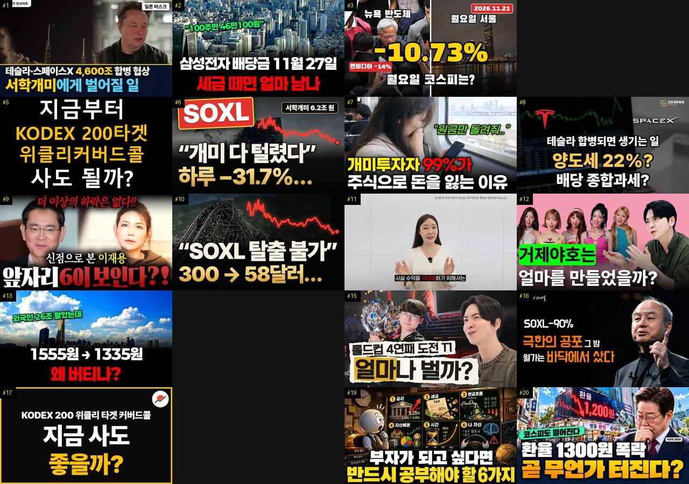
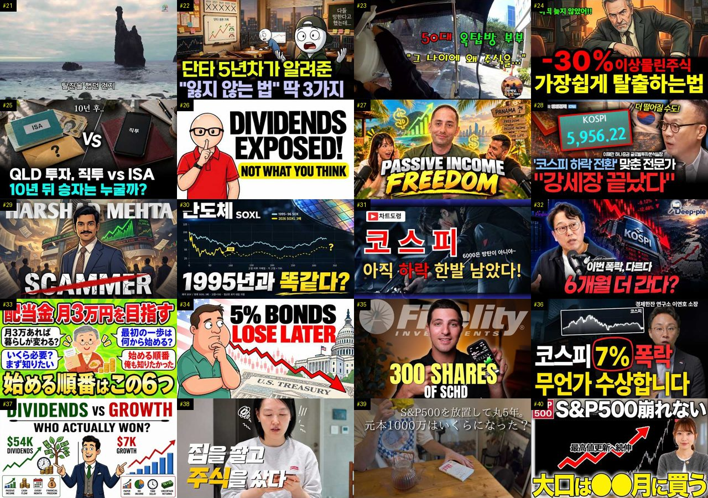
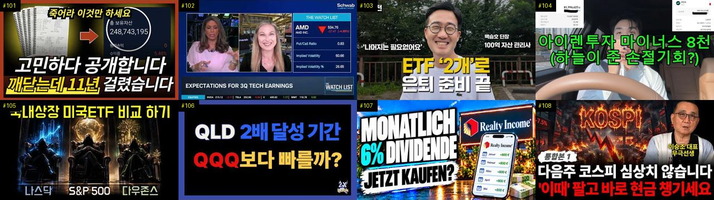

# 주식 — 성공 사례 분석 (지시사항 재료)

자동 생성 — `tools/success_analysis.py` v1.6.1 (2026-11-28 11:24 UTC), 규칙 `stock/analysis_rules.toml` v1.7. **이 문서는 숫자와 원문만 담는다 — 해석·지시사항은 이것을 읽는 AI 가 만든다.** 주별 추세는 `weekly.md`, 승인한 영상 전부는 `approved.md`. ※ 연구·교육용 — 투자 권유가 아님.

## 0. 자료와 한계

| 자료 | 수 |
|---|---|
| 사례 폴더 (설명·자막·댓글·썸네일을 받은 영상) | 864 (웹 승인 864) |
| **성공 사례** — 7~180일·구독자 50,000 이하·**구독자당 하루 조회수 ≥ 0.1** (하루 조회수 ÷ 구독자)·조회수 구독자 0~999 → 10,000회 · 구독자 1,000~9,999 → 50,000회 · 구독자 10,000+ → 100,000회·4분 이상, 채널당 2개 | **110** (기준 통과 200 − 뺀 것 36 − 채널당 제한 54) |
| **하루 조회수 상위** (1-3번 — 성공 사례와 따로) — 검색에서 찾은 주제 관련 4분 이상 영상 3,566개 중 하루 조회수 상위 10% (하루 15,579회 이상), 구독자·올린 날짜 상관없이, 채널당 2개 | **139** (기준 통과 356 − 뺀 것 177 − 채널당 제한 40) · 자료를 받지 않은 후보 185 |
| **조회수 상위** (1-4번 — 올린 날짜·구독자 상관없이) — 검색(기간 없는 검색 포함)에서 찾은 주제 관련 4분 이상 영상 4,747개(가장 오래된 4441일) 중 조회수 상위 10% (556,888회 이상), 채널당 2개 | **70** (기준 통과 154 − 뺀 것 76 − 채널당 제한 8) · 자료를 받지 않은 후보 400 |
| 성공 사례의 글 출처 (자막·음성인식·설명·없음) | 설명 86 · 음성인식(앞 5분) 20 · 없음 3 · 자막 1 |
| 성공 사례 대본 — 전체 · 앞부분만(음성인식 1차) · 없음 | 1 · 20 · 89 |
| 같은 채널 기준선 (채널 평소 영상) | 성공 사례 98/110 · 채널 167곳 (잘된 영상 396 · 평소 영상 473) |
| 성공 사례 댓글 (받은 / 달린) | 22,828 / 23,415 |
| 성공 사례 썸네일 | 105 |
| 비교 집단 — 탐색에서 본 영상 중 구독자 50,000 이하·4분 이상·365일 안·주제 관련, 채널당 최근 5개 | 1282 (성공 65 = 5.1%, 채널당 제한으로 뺀 2978) |
| 자료를 받지 않은 성공 후보 (웹 화면에서 승인하면 들어감 — 채널당 자리가 남은 것만) | 3 (자리가 찬 채널의 6개 뺌) |
| 수요·공급 시장 — 최근 90일 영상 (채널 크기 상관없음) | 2258 · 검색어 135 · 자동완성 말 649 (공급 확인 0) |
| 채널 성장 자료 (개설일이 있는 채널) | 1170 (빨리 크는 작은 채널 25) |

성공 기준은 넘었지만 뺀 영상: 사형수 박정희, 그를 살린 28세 정보국장 백선엽의 … (뺀 주제(숙군)) · 最先端のイノベーションを先取る⁉ インベスコTV 「インベ… (외국 영상) · Dividend Stocks vs. Growth St… (외국 영상) · I Let AI Invest for Me on Tra… (외국 영상) · S&P500とNASDAQ100は崩れない。プロ投資家か… (외국 영상) · 코스피 다 맞춘 무당이 알려드립니다 ! 달러 환율 &… (뺀 주제(코인)) · 미국 110년 인플레이션 9번, 무엇이 끝냈나 (주제 밖(관련어 없음)) · Egyptian Guidelines المستثمر … (외국 영상) · 아마존 영화 43개국 1위🔥 CIA 국장의 죽음으로 … (뺀 주제(첩보)) · 【資産公開】S&P500に1000万入れて5年間放置した結… (외국 영상) · I've Invested in Dividends fo… (외국 영상) · How to Borrow Against Your St… (외국 영상)

**한계**

- 대본(자막·음성인식)이 없는 성공 사례 89개 (#1, #2, #3, #4, #5, #6, #8, #9, #10, #11, #13, #14, #15, #16, #17, #18, #19, #20, #22, #23, #25, #26, #27, #29, #30, #32, #33, #34, #35, #36 …) — 설명란·챕터만 있음. 도입부·구성·말 속도는 대본이 있는 21개로만 셌다 (음성인식이 끝나면 다시 셈)
- 비교 집단 1282개 = 검색(조회수 순 — 잘된 영상 쪽으로 치우침)·추가한 채널·성공 사례 채널의 평소 영상 427개 (치우침 없음) 에서 올린 지 7~365일 영상, 성공 비율 5% — 실제 시장 비율이 아니다. 같은 집단 안의 '있음/없음' 차이로만 보고, '무엇이 먹혔나'는 1-2번(같은 채널 안)을 먼저 보라
- 하루 조회수 상위 묶음(1-3번) 139개는 구독자·올린 날짜 상관없이 골랐다 — 큰 채널(구독자 50,000 넘음) 126개라 채널 힘(구독자·추천)이 섞여 있다. 작은 채널이 따라 할 근거는 1번 성공 사례로 보라. 하루 조회수 = 조회수 ÷ 올린 지 날수라 갓 올린 영상(며칠)은 부풀고 오래된 영상은 낮아진다. 경계는 검색 결과(조회수 순 — 잘된 쪽으로 치우침) 3566개 안의 상위 10%. 자료를 받지 않은 후보 185개 (웹 화면에서 승인하면 들어감)
- 조회수 상위 묶음(1-4번) 70개는 올린 날짜·구독자 상관없이 조회수만으로 골랐다 — 오래 쌓인 조회수·큰 채널 힘이 섞여 있다 (큰 채널 60개 · 1년 넘은 영상 0개). 모집단 4,747개에서 가장 오래된 영상 4441일 — 기간 없는 검색은 할당량이 남을 때만 하므로 다 못 했으면 과거 영상이 적다. 자료를 받지 않은 후보 400개
- 성공 사례 몫(가중) = 성공 사례마다 무게 1 + log2(구독자당 하루 조회수 ÷ 기준)로 센 몫 (사용자 지시 2026-10-28 '최근에 조회수가 높을수록 더 많이 반영' — 점수가 기준의 2배면 무게 2, 4배면 3). 이번 무게 중앙값 3.55 · 가장 큰 10.0 — 사례 수가 적은 묶음은 가중 없는 몫·사례 수와 같이 본다
- 같은 채널 기준선이 있는 성공 사례 98/110개 (채널 영상이 5개 미만이거나 아직 못 받음)
- 수요·공급의 '시장'은 탐색·검색에서 본 최근 90일 영상 2258개 — 검색이 조회수 순이라 조회수 적은 영상이 덜 잡힌다. 주제 묶음 사이의 상대 비교(지수)로만 보라
- 자동완성 말의 '최근 영상 수'는 우리가 본 영상만 셌다 — 실제 공급은 웹 화면 [공급 확인](말 하나에 검색 1번 = 100단위)으로 확인
- 자동완성 말에는 책·방송·사람·채널 이름도 섞인다 (예: '…를 찾아서'·'…지침서') — 영상 주제가 아닌 말은 건너뛰고 읽어라
- '구독자가 많이 모이는가'는 YouTube API 로 영상별 구독 증가를 볼 수 없다 — 대신 채널 성장(7번: 개설 뒤 월 구독자·받을 때마다 남긴 기록), '구독·다음 기대' 댓글, 배수(조회수÷구독자)로 본다
- 댓글 갈래·제목 특징은 낱말 규칙이라 거칠다 (물음표 반문도 '질문', 한 댓글이 여러 갈래). 원문 인용을 함께 보라
- '눈에 띔'은 차이가 크고 표본이 충분하다는 표시일 뿐 원인이 아니다

## 1. 성공 사례 (110개 — 구독자당 하루 조회수 큰 순)

**구독자당 하루 조회수** = 하루 조회수(받은 때 조회수 ÷ 올린 날부터 받은 때까지 날수) ÷ 구독자 — 성공 기준. 배수 = 조회수 ÷ 구독자. **채널 평소 대비** = 조회수 ÷ 그 채널 최근 롱폼 조회수 중앙값 (같은 채널 기준선 — 클수록 그 영상만의 힘). 썸네일은 5번(장마다 20개, 번호 = #), 사례별 자세히는 **`analysis_cases_01.md` …** (9번).

| # | 제목 | 채널 | 구독자 | 조회수 | 구독자당 하루 조회수 | 배수 | 채널 평소 대비 | 하루 조회수 | 길이 | 업로드 | 주제 묶음 | 형식 | 글 출처 | 댓글 받은/달린 |
|---|---|---|---|---|---|---|---|---|---|---|---|---|---|---|
| 1 | [테슬라·스페이스X 4,600조 합병 협상…서학개미에게 벌어질 일](https://www.youtube.com/watch?v=oI4Er3-UwPQ) | 월가인사이트 | 130 | 80,120 | 55.6208 | 616.3 | ×580.6 | 7,230.7 | 9.8분 | 2026-11-17 | 8. 투자 심리·실패 | 정보·해설 | 설명 | 24/24 |
| 2 | [삼성전자 배당금 30조 풀었는데 주당 4601원인 이유 #삼성전자배당금 #SK하이닉스](https://www.youtube.com/watch?v=ldNVHUOHnV4) | 경제 계기판 | 771 | 492,694 | 23.0003 | 639.0 | ×484.0 | 17,733.2 | 13.7분 | 2026-10-31 | 3. 배당 | 정보·해설 | 설명 | 53/53 |
| 3 | [반도체지수 하루 -10.73% 폭락, 월요일 코스피는? #엔비디아 #반도체 #코스피](https://www.youtube.com/watch?v=3wbMHT_WF-0) | 세계 풍향계 | 1,560 | 260,618 | 22.4884 | 167.1 | ×908.1 | 35,081.9 | 9.1분 | 2026-11-20 | 5. 국내주식 | 정보·해설 | 설명 | 435/435 |
| 4 | [사상 초유의 이틀 연속 서킷브레이커! 폭락장에서 투자자가 절대 해서는 안 될 행동 ∣ 존리 대표](https://www.youtube.com/watch?v=un5SAQlJFcY) | 증시직격 | 117 | 19,707 | 18.2427 | 168.4 | – | 2,134.4 | 23분 | 2026-10-12 | 11. 투자 일반 | 인터뷰·강연·대담 | 설명 | 0/17 |
| 5 | [KODEX 200타겟위클리커버드콜 지금 사도 될까?｜1억 투자 백테스트·JEPQ·SCHD 세금 비교](https://www.youtube.com/watch?v=mgGzzZkOybI) | 월급졸업반 | 173 | 29,320 | 13.1613 | 169.5 | ×162.0 | 2,276.9 | 23.3분 | 2026-11-15 | 11. 투자 일반 | 정보·해설 | 설명 | 27/27 |
| 6 | [“SOXL 개미 다 털렸다”…6.2조 원 걸린 서학개미, 계산해 보니](https://www.youtube.com/watch?v=Pl2RJoUXP_4) | 월가의 진실 | 3,650 | 351,786 | 13.0579 | 96.4 | ×18.8 | 47,661.3 | 10.6분 | 2026-11-21 | 8. 투자 심리·실패 | 정보·해설 | 설명 | 1,042/1,042 |
| 7 | [왜 내가 사면 떨어지고 팔면 오를까? 개미가 주식으로 돈 못 버는 4가지 이유](https://www.youtube.com/watch?v=fdlfOCtDBqc) | 오피디의 머니노트 | 2,260 | 856,086 | 8.5967 | 378.8 | ×718.2 | 19,428.6 | 13.6분 | 2026-10-15 | 8. 투자 심리·실패 | 오디오북·낭독 | 음성인식(앞 5분) | 244/363 |
| 8 | [테슬라·스페이스X 합병되면, 안 팔아도 세금? 22% vs 49.5% 갈리는 '한 줄'](https://www.youtube.com/watch?v=_9okPshQQvU) | 임지강 세무사 | 141 | 34,414 | 7.4213 | 244.1 | ×61.9 | 1,046.4 | 8.5분 | 2026-10-26 | 4. 미국·해외주식 | 정보·해설 | 설명 | 45/45 |
| 9 | [삼성전자 앞자리 6이 보인다?! 전주 1등 만신에게 삼성전자 '이재용' 사주만 드렸더니..?? "더 이상의…](https://www.youtube.com/watch?v=r5SabgPIDJw) | 만연정사 서연보살 | 1,530 | 163,449 | 4.8254 | 106.8 | ×4.2 | 7,382.9 | 14.9분 | 2026-11-06 | 기타 | 정보·해설 | 설명 | 105/105 |
| 10 | [“SOXL 물타도 탈출 못 한다”…7,800억 원 더 산 서학개미, 계산해 보니](https://www.youtube.com/watch?v=PMsjSTUpOS8) | 월가의 진실 | 3,650 | 226,807 | 4.5916 | 62.1 | ×12.1 | 16,759.5 | 10.2분 | 2026-11-14 | 8. 투자 심리·실패 | 정보·해설 | 설명 | 520/520 |
| 11 | [[긴급속보]💥손실 계좌, 혼자힘으론 힘듭니다 ∣ 끌려다니는 매매 이제 그만](https://www.youtube.com/watch?v=t50RkPvL16k) | 고래미디어 | 65 | 15,519 | 4.078 | 155.2 | ×226.6 | 407.8 | 5.2분 | 2026-10-21 | 7. 매매·전략 | 정보·해설 | 설명 | 1/1 |
| 12 | [적자인데 300억? 가능한 이유 ∣ 회계사가 말아주는 리센느 소속사 더뮤즈엔터](https://www.youtube.com/watch?v=kJx_AzV9w9c) | 전지적회계사시점 | 961 | 318,712 | 3.8825 | 331.6 | ×171.8 | 3,731.1 | 21.4분 | 2026-09-03 | 6. 종목 고르기·분석 | 브이로그·직접 해본 이야기 | 음성인식(앞 5분) | 219/219 |
| 13 | [원달러 환율 역설, 10월 주식 26조 유출에도 왜? #원달러환율 #외국인자금](https://www.youtube.com/watch?v=uPaTBL75zVo) | 경제 계기판 | 771 | 31,359 | 3.6213 | 40.7 | ×30.8 | 2,792.0 | 16.8분 | 2026-11-17 | 4. 미국·해외주식 | 정보·해설 | 설명 | 8/8 |
| 14 | [S&P500 적립식, 다들 거꾸로 하고 있습니다… 5천만원 갈리는 진짜 이유](https://www.youtube.com/watch?v=h5Cu52-q0oE) | 뒤집는경제 | 1,450 | 236,610 | 3.3273 | 163.2 | ×47.3 | 4,824.6 | 24.9분 | 2026-10-10 | 2. 장기투자·ETF·지수 | 정보·해설 | 설명 | 70/70 |
| 15 | [롤드컵 우승 상금 14억, T1의 진짜 수입원은? ∣ 회계사가 뜯어본 롤 구단 재무제표](https://www.youtube.com/watch?v=37BJl0y52xk) | 전지적회계사시점 | 961 | 119,376 | 3.2696 | 124.2 | ×64.4 | 3,142.1 | 19.6분 | 2026-10-21 | 6. 종목 고르기·분석 | 정보·해설 | 설명 | 36/36 |
| 16 | [SOXL -90% 극한의 공포 1조달러 배팅을 꺼냈다 ∣ 반도체 의도된 폭락? 개인은 팔았고 월가는 받았다](https://www.youtube.com/watch?v=pZDTJKVDdxQ) | 뉴욕대디 다니엘 | 15,400 | 336,781 | 3.1281 | 21.9 | ×33.7 | 48,173.1 | 21.2분 | 2026-11-21 | 기타 | 정보·해설 | 설명 | 510/510 |
| 17 | [KODEX 200 위클리 타겟 커버드콜, 지금 사도 좋을까? 숫자로 돌려봤습니다](https://www.youtube.com/watch?v=p9xZNeibTtI) | 옵티쩡 | 1,710 | 78,298 | 3.0423 | 45.8 | ×102.4 | 5,202.4 | 7.9분 | 2026-11-13 | 기타 | 정보·해설 | 설명 | 115/115 |
| 18 | [이번 하락은 어디에 가까울까 ∣ 공포탐욕지수 39번으로 본 금리와 물가](https://www.youtube.com/watch?v=QG40SUfIML8) | 차트 너머 | 5,180 | 339,421 | 2.7453 | 65.5 | ×15.3 | 14,220.7 | 11.1분 | 2026-11-04 | 2. 장기투자·ETF·지수 | 정보·해설 | 설명 | 209/210 |
| 19 | [부자들은 끊임없이 공부합니다 부자 필수 과목 6가지](https://www.youtube.com/watch?v=7cBFkwyzVzM) | 돈사냥꾼-TV | 3,490 | 273,782 | 2.5377 | 78.5 | ×99.7 | 8,856.4 | 22.4분 | 2026-10-28 | 1. 주식 기초·초보 | 정보·해설 | 설명 | 12/12 |
| 20 | [환율 1300원, 코스피 5000 폭락..!! 한국경제 대위기 터진다..??](https://www.youtube.com/watch?v=uY8bXDJHswg) | 경제읽어주는남자 | 1,590 | 143,680 | 2.5136 | 90.4 | ×223.8 | 3,996.7 | 13.8분 | 2026-10-23 | 5. 국내주식 | 정보·해설 | 설명 | 169/169 |
| 21 | [[풀영상] 월급 10%로 당장 시작하는 존리의 자산 증식 치트키](https://www.youtube.com/watch?v=q1fYjAwma3s) | 여의돈스트리트 | 1,430 | 236,403 | 2.3136 | 165.3 | ×194.1 | 3,308.4 | 36분 | 2026-09-17 | 1. 주식 기초·초보 | 인터뷰·강연·대담 | 음성인식(앞 5분) | 113/122 |
| 22 | [[존리 대표 출연] 美민주당 압승에 삼전닉스 폭락 "반도체株 팔아야 할까요?" #존리 _261105](https://www.youtube.com/watch?v=Td7NJ7xnuyM) | 경제통마늘 | 16,800 | 891,681 | 2.2716 | 53.1 | ×1,094.1 | 38,162.2 | 21.6분 | 2026-11-05 | 2. 장기투자·ETF·지수 | 오디오북·낭독 | 설명 | 692/692 |
| 23 | [80억 날리고 220억 만든 일본 슈퍼 개미가 물타기를 안 하는 이유 [후지모토 시게루 1:2:6 매매법]](https://www.youtube.com/watch?v=zDdi61_JqUg) | 차트 지니어스 | 6,800 | 986,326 | 1.9856 | 145.1 | – | 13,502.0 | 12.4분 | 2026-09-16 | 8. 투자 심리·실패 | 정보·해설 | 설명 | 629/629 |
| 24 | [S&P500은 최고인데 내 ETF는 마이너스… 지금 환헤지로 갈아타면 늦는 진짜 이유](https://www.youtube.com/watch?v=UcHK1WoTPtY) | 뒤집는경제 | 1,450 | 116,345 | 1.8812 | 80.2 | ×23.2 | 2,727.8 | 23.2분 | 2026-10-16 | 2. 장기투자·ETF·지수 | 정보·해설 | 음성인식(앞 5분) | 28/69 |
| 25 | [가장 쉽게 주도주, 대장주를 찾는 방법 ∣ 슈퍼개미 이정윤](https://www.youtube.com/watch?v=_cYtH3ERfwo) | 이정윤의 다정한주식 | 7,840 | 140,026 | 1.8065 | 17.9 | – | 14,163.1 | 20.1분 | 2026-11-18 | 8. 투자 심리·실패 | 정보·해설 | 설명 | 115/115 |
| 26 | [2,800만원으로 930억 번 일본 천재의 가장 쉬운 단타 매매법 (테스타)](https://www.youtube.com/watch?v=O5ua2wyE4hc) | 손절봇 ∣ 자동매매 | 4,430 | 67,263 | 1.7669 | 15.2 | ×1.1 | 7,827.2 | 15.3분 | 2026-11-19 | 7. 매매·전략 | 정보·해설 | 설명 | 23/23 |
| 27 | [하이닉스에 이어 삼성도 LTA 체결? 애플이 결국 삼성에 무릎 꿇다···](https://www.youtube.com/watch?v=CcKFcr_M8uc) | 잘되라대한민국 | 6,680 | 107,667 | 1.601 | 16.1 | ×3.8 | 10,694.5 | 15.1분 | 2026-11-18 | 기타 | 정보·해설 | 설명 | 29/29 |
| 28 | [같은 TQQQ에 1억, 한 사람은 2만 원 한 사람은 388억 (실제 데이터)](https://www.youtube.com/watch?v=d2_oRUcx5Uo) | 머니언박싱 | 2,780 | 268,823 | 1.5739 | 96.7 | ×165.0 | 4,375.4 | 8.1분 | 2026-09-27 | 2. 장기투자·ETF·지수 | 정보·해설 | 음성인식(앞 5분) | 144/161 |
| 29 | [12조 상속세 완납 직후 아들에게 4.5조 삼성전자 지분 넘긴 어머니! 아내와 어머니 그 이상이었던 삼성가…](https://www.youtube.com/watch?v=5tV7zEpTfCs) | 모둠경제 | 14,000 | 265,648 | 1.5316 | 19.0 | ×4.2 | 21,442.2 | 25.7분 | 2026-11-16 | 기타 | 정보·해설 | 설명 | 88/88 |
| 30 | [왜 내가 팔면 오르고 버티면 더 떨어질까? 폭락장에서 개미가 알아야 할 3가지](https://www.youtube.com/watch?v=D4kEXI6IWYo) | 오피디의 머니노트 | 2,260 | 73,373 | 1.4769 | 32.5 | ×61.6 | 3,337.7 | 17.7분 | 2026-11-06 | 8. 투자 심리·실패 | 정보·해설 | 설명 | 21/21 |
| 31 | [단타 5년차가 알려준 ＂잃지 않는 법＂ 딱 3가지 ｜ 코스피 9000시대 생존법](https://www.youtube.com/watch?v=WnuVkKRjcuI) | 돈의흐름도 | 1,380 | 153,227 | 1.3904 | 111.0 | ×8,512.6 | 1,918.8 | 13.5분 | 2026-08-09 | 5. 국내주식 | 정보·해설 | 음성인식(앞 5분) | 96/96 |
| 32 | [역사상 최악의 날에만 주식을 산 사람, 41년 뒤 계좌는? (S&P 500 실제 데이터)](https://www.youtube.com/watch?v=DRvywv-HRmM) | 머니언박싱 | 2,780 | 241,353 | 1.3775 | 86.8 | ×148.2 | 3,829.4 | 8분 | 2026-09-26 | 2. 장기투자·ETF·지수 | 정보·해설 | 설명 | 172/172 |
| 33 | [이거 딱 두 개면 충분하다? 존리 대표의 심플한 투자 공식](https://www.youtube.com/watch?v=9bQncZDMMqE) | 여의돈스트리트 | 1,430 | 158,558 | 1.3664 | 110.9 | ×130.2 | 1,954.0 | 22.4분 | 2026-09-08 | 11. 투자 일반 | 정보·해설 | 설명 | 44/44 |
| 34 | [환율 떨어지면 달러 사라는 말, 이번엔 정반대인 이유! ∣ 환율전망 ∣ 달러 투자 ∣ 서학개미 ∣ 원달러환율](https://www.youtube.com/watch?v=-Uf61BzgLkA) | 이슈'S | 840 | 99,918 | 1.3196 | 119.0 | ×227.1 | 1,108.5 | 18.2분 | 2026-08-30 | 8. 투자 심리·실패 | 정보·해설 | 설명 | 82/82 |
| 35 | [제 주식 노하우 다 풉니다.](https://www.youtube.com/watch?v=PLYpdzY5U-U) | 육감 김수용 | 7,730 | 349,127 | 1.219 | 45.2 | – | 9,422.9 | 16분 | 2026-10-22 | 기타 | 정보·해설 | 설명 | 194/194 |
| 36 | [SOXL 주가 전망, 300달러에서 46달러 ∣ 물타기 해도 될까? 2022년에 한 번 있었던 일](https://www.youtube.com/watch?v=L3Y9BkSDNRM) | 밸류노트 ValueNote | 1,990 | 50,943 | 1.2118 | 25.6 | ×99.7 | 2,411.4 | 9.5분 | 2026-11-07 | 8. 투자 심리·실패 | 정보·해설 | 설명 | 128/128 |
| 37 | [80만원으로 260억 만든 미국 단타 천재의 가장 쉬운 매매법 (로스 카메론)](https://www.youtube.com/watch?v=cW11yJS6Jik) | 손절봇 ∣ 자동매매 | 4,430 | 109,759 | 1.2032 | 24.8 | ×1.9 | 5,330.3 | 16.8분 | 2026-11-07 | 4. 미국·해외주식 | 정보·해설 | 설명 | 25/25 |
| 38 | [S&P500, 나스닥100 이렇게 샀다간 세금+건보료 폭탄 맞습니다 ∣ 여운봉 교수 ∣ 연금받는형](https://www.youtube.com/watch?v=60zQzH422bk) | 연금 받는 형 | 25,700 | 543,059 | 1.1772 | 21.1 | ×11.5 | 30,254.6 | 28.9분 | 2026-11-10 | 2. 장기투자·ETF·지수 | 인터뷰·강연·대담 | 설명 | 173/173 |
| 39 | [친구가 하나둘 사라졌습니다… 결국 제가 인간관계를 정리한 이유](https://www.youtube.com/watch?v=DTTARHT4swk) | 어쩌다마흔 | 2,470 | 94,822 | 1.1209 | 38.4 | ×11.7 | 2,768.7 | 10.4분 | 2026-10-25 | 2. 장기투자·ETF·지수 | 정보·해설 | 설명 | 223/223 |
| 40 | [50대 옥탑방 부부, "그 나이에 왜 주식을..."](https://www.youtube.com/watch?v=FRzyTNO9mNI) | 반백살, 옥탑방 이야기 | 786 | 43,940 | 0.9997 | 55.9 | ×11.8 | 785.8 | 6.3분 | 2026-10-03 | 1. 주식 기초·초보 | 정보·해설 | 음성인식(앞 5분) | 187/187 |
| 41 | [은퇴 후 절대 하면 안 되는 5가지](https://www.youtube.com/watch?v=aJE9llnpZiI) | 돈사냥꾼-TV | 3,490 | 102,031 | 0.9652 | 29.2 | ×37.1 | 3,368.5 | 23.7분 | 2026-10-29 | 10. 노후·연금 투자 | 정보·해설 | 설명 | 15/15 |
| 42 | [슈퍼개미 이정윤의 HTS 세팅법 ∣ 이세무사](https://www.youtube.com/watch?v=rqdf0xO4PDo) | 이정윤의 다정한주식 | 7,840 | 108,176 | 0.9632 | 13.8 | – | 7,551.8 | 19.1분 | 2026-11-14 | 8. 투자 심리·실패 | 정보·해설 | 설명 | 198/214 |
| 43 | [마이너스 주식 계좌 가장 쉽게 탈출하는 방법 물타기? 존버? 고민하지 않아도 되는 물린 종목 최대한 손실을…](https://www.youtube.com/watch?v=v6rUCbULG2A) | 머니스트랩 | 1,060 | 97,470 | 0.9439 | 92.0 | ×206.1 | 1,000.5 | 30.5분 | 2026-08-23 | 8. 투자 심리·실패 | 정보·해설 | 음성인식(앞 5분) | 38/38 |
| 44 | [코스피 5천선 붕괴에 "개미 살려.." 정부의 긴급 대책은?](https://www.youtube.com/watch?v=UDPq6kqjWhM) | 정치시간 | 610 | 12,140 | 0.9311 | 19.9 | ×3.9 | 568.0 | 29.5분 | 2026-11-07 | 5. 국내주식 | 정보·해설 | 설명 | 68/68 |
| 45 | [코스피 1만 가는 진짜 지름길 나왔다 ‘이것’만 되면 한달 안에 코스피1만](https://www.youtube.com/watch?v=x5ZWmQxLFzg) | 잘되라대한민국 | 6,680 | 92,172 | 0.9171 | 13.8 | ×3.3 | 6,126.2 | 14.6분 | 2026-11-13 | 5. 국내주식 | 정보·해설 | 설명 | 221/221 |
| 46 | [지난 폭락과는 완전히 다릅니다…코스피가 진짜 위험한 이유 (Feat. 박병창 MP파트너스 대표) [딥플 D…](https://www.youtube.com/watch?v=y_mvodyrXhQ) | 핀플 - Finple | 48,500 | 193,740 | 0.8223 | 4.0 | ×39.5 | 39,883.8 | 60분 | 2026-10-16 | 5. 국내주식 | 인터뷰·강연·대담 | 음성인식(앞 5분) | 360/360 |
| 47 | ['2억빚' 옥탑방부부 고혈압, 고지혈증, 당뇨 남편과 먹고사는 이야기](https://www.youtube.com/watch?v=wa5zxxVqfk0) | 반백살, 옥탑방 이야기 | 786 | 53,652 | 0.813 | 68.3 | ×14.4 | 639.0 | 9분 | 2026-09-05 | 1. 주식 기초·초보 | 브이로그·직접 해본 이야기 | 설명 | 105/105 |
| 48 | [천재도 경제학자도 주식에 실패한 진짜 이유는 '이걸' 몰랐기 때문입니다](https://www.youtube.com/watch?v=bHp0fIqQesQ) | 리채피 richappy | 12,500 | 124,578 | 0.8028 | 10.0 | ×11.9 | 10,034.7 | 15분 | 2026-11-16 | 8. 투자 심리·실패 | 정보·해설 | 설명 | 90/90 |
| 49 | [하락장에서 계좌를 지키는 세 가지](https://www.youtube.com/watch?v=AUeEkRnKeM8) | 리채피 richappy | 12,500 | 319,206 | 0.7642 | 25.5 | ×30.4 | 9,552.8 | 16.7분 | 2026-10-26 | 11. 투자 일반 | 정보·해설 | 설명 | 312/312 |
| 50 | ["반도체 대폭락 위기 찾아왔다" 다음주 월요일 삼전닉스 주가 '이렇게' 될 겁니다](https://www.youtube.com/watch?v=HKHeBCM-RkE) | 알기쉬운 경제스쿨 | 47,600 | 244,681 | 0.72 | 5.1 | ×11.9 | 34,272.9 | 35.5분 | 2026-11-21 | 2. 장기투자·ETF·지수 | 정보·해설 | 설명 | 234/234 |
| 51 | [하루만에 ‘삼성전자’ HBM 뒤흔든 젠슨황… TSMC ‘3나노’ 돌연 채택 뜻밖의 변수 발생](https://www.youtube.com/watch?v=whybLg0YCWg) | 경제한잔 | 7,370 | 200,618 | 0.6995 | 27.2 | ×18.4 | 5,155.3 | 17.2분 | 2026-10-20 | 7. 매매·전략 | 정보·해설 | 설명 | 78/78 |
| 52 | ["아이렌, 냉정하게 버틸 수 있는 기업인가? -2억진행중인 내 계좌는 버틸수 있는가?..ft.아이렌맨"](https://www.youtube.com/watch?v=tM1uNrlIb8w) | 아이렌맨 : IREN을 … | 9,490 | 53,919 | 0.68 | 5.7 | ×2.3 | 6,453.1 | 10.5분 | 2026-11-20 | 기타 | 인터뷰·강연·대담 | 설명 | 1,078/1,078 |
| 53 | [주식 초보를 위한 하루 100만 원 번다는 매매법 리뷰. 단타 고수들의 진짜 매매법.](https://www.youtube.com/watch?v=rOk7aKpWJVQ) | 마이크로스콥 | 3,740 | 51,610 | 0.6654 | 13.8 | ×23.6 | 2,488.7 | 18.8분 | 2026-11-07 | 1. 주식 기초·초보 | 정보·해설 | 설명 | 26/26 |
| 54 | [이재명 "집 팔아 주식 사라더니…" 코스피 폭락에 국민연금 증발 실태 #이재명 #코스피 #국민연금](https://www.youtube.com/watch?v=c3vq8lj05Yk) | 정치시간 | 610 | 15,875 | 0.613 | 26.0 | ×5.1 | 373.9 | 18.9분 | 2026-10-16 | 5. 국내주식 | 정보·해설 | 음성인식(앞 5분) | 28/44 |
| 55 | [상상도 못한 금값 전망 떴다 가진 금 전부 '이렇게' 하세요 (유신익 박사 / 통합본 2부)](https://www.youtube.com/watch?v=FnpS27bmW9Y) | 웅달책방_투자 | 3,780 | 122,447 | 0.5858 | 32.4 | ×18.4 | 2,214.2 | 29.6분 | 2026-10-04 | 2. 장기투자·ETF·지수 | 인터뷰·강연·대담 | 설명 | 29/29 |
| 56 | [코스피 7% 폭락, 외인 30분만에 1조 순매도, 무언가 수상합니다](https://www.youtube.com/watch?v=hjIgX9ppDe4) | 경제한잔 | 7,370 | 180,147 | 0.569 | 24.4 | ×16.6 | 4,193.7 | 14분 | 2026-10-16 | 5. 국내주식 | 정보·해설 | 음성인식(앞 5분) | 51/70 |
| 57 | [반도체 폭락 뒤 찾아온 9배 상승, 이번에도 반복될까?](https://www.youtube.com/watch?v=1b-TwEDV4iM) | 테스프레소 | 10,700 | 228,839 | 0.5675 | 21.4 | ×23.8 | 6,072.3 | 23.4분 | 2026-10-21 | 기타 | 정보·해설 | 설명 | 217/217 |
| 58 | [월배당금 70만원, 시골에서 사는 배당부부!](https://www.youtube.com/watch?v=vJF30ea4r7Q) | 시골사는 배당부부 | 1,930 | 116,341 | 0.5518 | 60.3 | ×9.6 | 1,064.9 | 5분 | 2026-08-11 | 3. 배당 | 정보·해설 | 설명 | 110/110 |
| 59 | [[이선엽X염승환] "싸니까 사라? 지금 중요한 건 '물린 거' 어떻게 해..아닐까요?" #염승환 #염블리 …](https://www.youtube.com/watch?v=kO2Rh9UjBQI) | 경제통마늘 | 16,800 | 335,474 | 0.5496 | 20.0 | ×411.6 | 9,233.1 | 16.4분 | 2026-10-23 | 2. 장기투자·ETF·지수 | 오디오북·낭독 | 설명 | 223/223 |
| 60 | ["보이지 않는 손이 실패하고 있다" 샘 올트먼이 본 메모리시장ㅣ"1년에 1000억 달러씩, 그것도 매년, …](https://www.youtube.com/watch?v=E2Kz9bbb878) | Just In Timeㅣ… | 19,800 | 282,624 | 0.545 | 14.3 | ×4.7 | 10,791.2 | 8.2분 | 2026-11-02 | 8. 투자 심리·실패 | 정보·해설 | 설명 | 295/295 |
| 61 | [나스닥 5% 폭락에 삼성전자 하이닉스 와르르… 그런데 '우리엔 호재'라는 이유](https://www.youtube.com/watch?v=Phf8TrqtNv4) | 경제야! 놀자~ | 11,400 | 136,067 | 0.5381 | 11.9 | – | 6,134.5 | 11분 | 2026-11-06 | 2. 장기투자·ETF·지수 | 정보·해설 | 설명 | 149/149 |
| 62 | [집은 팔았고, 주식은 물렸고](https://www.youtube.com/watch?v=SbEfHnF8DdY) | 로텐션 LOWTENSIO… | 7,170 | 160,986 | 0.5367 | 22.4 | ×14.3 | 3,848.1 | 16.3분 | 2026-10-17 | 11. 투자 일반 | 브이로그·직접 해본 이야기 | 음성인식(앞 5분) | 185/206 |
| 63 | [주식 투자 공부 ∣ 주식으로 인생 망하는 사람들의 공통점 #주식투자공부 #주식 #투자공부 #빚투 #투자 (…](https://www.youtube.com/watch?v=EqDWhvLTARA) | 방구석 금고지기 | 195 | 14,178 | 0.5354 | 72.7 | ×51.2 | 104.4 | 9.9분 | 2026-07-15 | 11. 투자 일반 | 인터뷰·강연·대담 | 설명 | 39/39 |
| 64 | [레버리지 ETF 상장폐지 논란🔥도박판 코스피 알고도 레버리지 ETF 상폐 못하는 이유🔥위험 알고도 도장 찍…](https://www.youtube.com/watch?v=O4-jY0zyhDo) | 리얼경제 | 1,330 | 93,698 | 0.5257 | 70.5 | ×495.8 | 699.2 | 15분 | 2026-07-17 | 9. 빚투·레버리지 | 정보·해설 | 음성인식(앞 5분) | 648/648 |
| 65 | ["지금 실적보다 미래 경쟁력이 진짜 걱정"..'위기'라는 현대차 상황 / 이슈빡 / 뉴스헌터스](https://www.youtube.com/watch?v=RYJSFU8X2hE) | 뉴스헌터스 | 9,920 | 200,293 | 0.5183 | 20.2 | – | 5,141.9 | 18.4분 | 2026-10-20 | 6. 종목 고르기·분석 | 인터뷰·강연·대담 | 설명 | 464/464 |
| 66 | [데드캣 바운스일까 vs 대반등의 신호탄일까 ∣ 1994년 이후 반도체 10% 폭락 열 번이 말해 주는 것 …](https://www.youtube.com/watch?v=x0-ObXRPfJA) | 뉴욕대디 다니엘 | 15,400 | 155,823 | 0.48 | 10.1 | ×15.6 | 7,391.3 | 13.8분 | 2026-11-07 | 기타 | 정보·해설 | 설명 | 234/234 |
| 67 | [삼성전자 하이닉스 고점 대비 30~40% 빠졌다, 지금 팔아야 하나? 버핏의 한마디](https://www.youtube.com/watch?v=3k8pAgOmcF4) | 경제야! 놀자~ | 11,400 | 125,743 | 0.4754 | 11.0 | – | 5,419.6 | 11.3분 | 2026-11-05 | 5. 국내주식 | 정보·해설 | 설명 | 168/168 |
| 68 | ["AI가 문제가 아니다!" 지금 전 세계 증시가 무너지는 진짜 이유 (Feat. 김효진 신영증권 박사) […](https://www.youtube.com/watch?v=uuePBzam50g) | 핀플 - Finple | 48,500 | 164,378 | 0.4623 | 3.4 | ×49.7 | 22,420.5 | 46.6분 | 2026-11-21 | 기타 | 인터뷰·강연·대담 | 설명 | 239/239 |
| 69 | ["환율 떨어지면 좋은 거 아니었나요?" 1,560원에서 1,390원까지, 내 통장에 실제로 벌어진 일](https://www.youtube.com/watch?v=6xWwJbLDnVc) | 돈의 행방 | 742 | 32,164 | 0.4375 | 43.4 | ×139.2 | 324.6 | 18.9분 | 2026-08-21 | 4. 미국·해외주식 | 정보·해설 | 설명 | 59/59 |
| 70 | [결국 120만원 깨진 하이닉스..삼전 7만•하닉 20만이 정말 바닥? / 이슈빡 / 뉴스헌터스](https://www.youtube.com/watch?v=LWIQK6aKoYI) | 뉴스헌터스 | 9,920 | 172,897 | 0.4363 | 17.4 | – | 4,327.9 | 19분 | 2026-10-19 | 5. 국내주식 | 인터뷰·강연·대담 | 설명 | 210/210 |
| 71 | [나스닥 투자하기 전에 이 영상 꼭 보세요 ∣ QLD만 모아가는 이유](https://www.youtube.com/watch?v=g10Y6ZA7rng) | 올레버 | 1,600 | 123,587 | 0.4313 | 77.2 | ×165.2 | 690.1 | 5.7분 | 2026-06-02 | 2. 장기투자·ETF·지수 | 정보·해설 | 음성인식(앞 5분) | 347/349 |
| 72 | [손정의의 26년, 닷컴 버블에서 오픈AI까지](https://www.youtube.com/watch?v=3gezC7Acv-M) | 차트너머 | 5,180 | 54,988 | 0.4259 | 10.6 | ×2.5 | 2,206.1 | 15.1분 | 2026-11-03 | 6. 종목 고르기·분석 | 정보·해설 | 설명 | 23/23 |
| 73 | [누가 그리고 왜 메모리를 흔드나 ∣ 악재를 '고의'로 만드는 시장 ∣ 헤지펀드 청산 기계적 매도 더 큰 공…](https://www.youtube.com/watch?v=SdicEcYHg70) | Just In Timeㅣ… | 19,800 | 154,941 | 0.4087 | 7.8 | ×2.6 | 8,091.4 | 16.6분 | 2026-11-09 | 7. 매매·전략 | 정보·해설 | 설명 | 158/158 |
| 74 | [한강뷰 사는 사람도 피할 수 없는 주식 현실을 알려드립니다](https://www.youtube.com/watch?v=PdH2FX8Nz78) | 육감 김수용 | 7,730 | 62,943 | 0.405 | 8.1 | – | 3,130.5 | 14분 | 2026-11-08 | 기타 | 정보·해설 | 설명 | 62/62 |
| 75 | [13만 8천 원 레깅스의 몰락…룰루레몬은 왜 무너졌나? #룰루레몬 #경제이야기](https://www.youtube.com/watch?v=Q4iwkHxVTZ0) | 이슈'S | 840 | 15,343 | 0.3782 | 18.3 | ×35.6 | 317.7 | 15.6분 | 2026-10-11 | 6. 종목 고르기·분석 | 정보·해설 | 설명 | 7/7 |
| 76 | [AI로 주식 자동 매매하면 어떻게 될까?](https://www.youtube.com/watch?v=9E9OrcoMCjk) | 이영배 | 22,200 | 1,279,782 | 0.3582 | 57.6 | ×7.6 | 7,951.2 | 11.3분 | 2026-06-20 | 7. 매매·전략 | 정보·해설 | 음성인식(앞 5분) | 578/611 |
| 77 | [배당주 20년 vs S&P500 20년, 3억 원이 만든 충격적인 자산과 삶의 격차 [ 재테크/미국주식/E…](https://www.youtube.com/watch?v=cqgVNBbMYew) | 박대리와 황과장의 경제이… | 2,020 | 87,613 | 0.3582 | 43.4 | ×37.3 | 723.6 | 20.5분 | 2026-07-30 | 4. 미국·해외주식 | 정보·해설 | 음성인식(앞 5분) | 162/168 |
| 78 | ["이 방법" 대로 사면 TQQQ보다 최소 12억은 더 법니다. 진짜입니다.](https://www.youtube.com/watch?v=nD8WGVgUJbY) | 레버리지 투자노트 | 4,710 | 51,212 | 0.3399 | 10.9 | ×40.5 | 1,600.9 | 13.8분 | 2026-10-27 | 기타 | 정보·해설 | 설명 | 324/324 |
| 79 | [월급없는삶 1억2000증발 결국 #배당투자 #배당은퇴 #경제적자유 #파이어족 #월배당 #고배당주 #주식투자…](https://www.youtube.com/watch?v=tKMTyK8VZ-E) | ttobaedang또배당 | 8,380 | 54,583 | 0.3245 | 6.5 | ×3.6 | 2,719.0 | 13.7분 | 2026-11-08 | 11. 투자 일반 | 정보·해설 | 없음 | 267/267 |
| 80 | [월요일 어마무시한 일 터질겁니다, 한국 개미들만 모르고 있는 충격적인 상황](https://www.youtube.com/watch?v=tdF_OyN0XZY) | 경제사관학교 | 13,200 | 111,840 | 0.3134 | 8.5 | – | 4,137.2 | 18.7분 | 2026-11-01 | 8. 투자 심리·실패 | 정보·해설 | 설명 | 104/104 |
| 81 | [물린 주식 10년, 결국 전부 팔았습니다 (feat. 복구 심리의 함정)](https://www.youtube.com/watch?v=OKHm1gUNyPA) | 어쩌다마흔 | 2,470 | 89,505 | 0.3064 | 36.2 | ×11.0 | 756.9 | 9.9분 | 2026-08-02 | 8. 투자 심리·실패 | 인터뷰·강연·대담 | 음성인식(앞 5분) | 957/970 |
| 82 | [4200억 단타 일본 천재가 초간단 매매법, 죽어라 이것만하세요](https://www.youtube.com/watch?v=UH4UFmdXXo0) | 세력시그널 | 3,940 | 120,540 | 0.291 | 30.6 | ×60.0 | 1,146.7 | 20.6분 | 2026-08-15 | 7. 매매·전략 | 정보·해설 | 설명 | 216/249 |
| 83 | ["내가 팔자마자 귀신같이 날아가는 이유" 개미 99%의 피를 빨아먹는 세력의 잔인한 함정 ∣ 교수 정선용 …](https://www.youtube.com/watch?v=0qwlXd_gnuQ) | 너와 나의 경제학교 | 40,900 | 247,709 | 0.288 | 6.1 | ×12.4 | 11,779.2 | 10.7분 | 2026-11-07 | 8. 투자 심리·실패 | 인터뷰·강연·대담 | 설명 | 148/149 |
| 84 | ["원금 안 깎여요" 진화형 커버드콜 ETF 황금 포트폴리오 공개](https://www.youtube.com/watch?v=yGuybuoroRI) | 투자360 | 16,800 | 703,371 | 0.2809 | 41.9 | ×26.4 | 4,719.6 | 22.2분 | 2026-07-02 | 2. 장기투자·ETF·지수 | 브이로그·직접 해본 이야기 | 음성인식(앞 5분) | 577/591 |
| 85 | [복리가 부를 만드는 진짜 시작점｜언제부터 돈이 스스로 일하기 시작할까](https://www.youtube.com/watch?v=JExUQaROk40) | 돈의 통찰 | 3,980 | 138,144 | 0.269 | 34.7 | ×9.9 | 1,070.7 | 17.8분 | 2026-07-22 | 1. 주식 기초·초보 | 정보·해설 | 설명 | 103/104 |
| 86 | [현대차 반토막에 숨겨진 진실… 엔비디아 합작 발표 전 무조건 모아야 할 이유 [이권희 대표]](https://www.youtube.com/watch?v=m3ZRHahRGHU) | 경제시그널 | 28,800 | 408,924 | 0.2677 | 14.2 | ×302.7 | 7,711.2 | 33분 | 2026-10-06 | 기타 | 인터뷰·강연·대담 | 설명 | 213/213 |
| 87 | [코스피 단기반등 어렵다 ∣ 굳이 사고 싶다면 이때 사라 ∣ 남석관 베스트인컴 회장](https://www.youtube.com/watch?v=Bh7U-uOaunQ) | 투벤저스 주간동아 | 32,700 | 190,166 | 0.2627 | 5.8 | – | 8,588.8 | 17.6분 | 2026-11-06 | 5. 국내주식 | 인터뷰·강연·대담 | 설명 | 303/303 |
| 88 | ["외국인이 비웃고 있습니다" 지금 개미들은 모르고 있다 다음주 더 무서울 겁니다 (유신익 박사 / 통합본 …](https://www.youtube.com/watch?v=gGcjHeY9SnQ) | 웅달책방_투자 | 3,780 | 55,520 | 0.2573 | 14.7 | ×8.3 | 972.5 | 31.9분 | 2026-10-02 | 8. 투자 심리·실패 | 인터뷰·강연·대담 | 설명 | 43/43 |
| 89 | [라오어 무한매수법, 정말 계속 해도 될까? TQQQ·QLD로 12년 돌려보고 알게 된 의외의 결과](https://www.youtube.com/watch?v=nCBMBYmFjOU) | 여의도 아빠 | 2,570 | 68,884 | 0.2505 | 26.8 | ×10.5 | 643.8 | 7.5분 | 2026-08-13 | 7. 매매·전략 | 정보·해설 | 설명 | 186/215 |
| 90 | [단타 천재가 개발한 초간단 매매법(기본 차트 분석법)](https://www.youtube.com/watch?v=knblsnwXsfg) | 차트9단 | 492 | 19,082 | 0.2502 | 38.8 | ×37.8 | 123.1 | 20분 | 2026-06-26 | 6. 종목 고르기·분석 | 인터뷰·강연·대담 | 설명 | 7/7 |
| 91 | [“아이렌, 비상비상.. 20달러도 붕괴직전..”ft.아이렌맨](https://www.youtube.com/watch?v=ZqZXiUzdQRE) | 아이렌맨 : IREN을 … | 9,490 | 53,620 | 0.2454 | 5.7 | ×2.3 | 2,329.2 | 5.9분 | 2026-11-05 | 기타 | 인터뷰·강연·대담 | 없음 | 709/709 |
| 92 | [퇴직연금 전문가들이 말아주는 포트폴리오 꿀조합!🍯ㅣ원큐로 끝내는 ETF🎯](https://www.youtube.com/watch?v=LwkpHtapiJY) | 하나TV [하나자산운용] | 29,500 | 114,591 | 0.2274 | 3.9 | ×1.1 | 6,708.1 | 6.9분 | 2026-11-11 | 2. 장기투자·ETF·지수 | 정보·해설 | 설명 | 6/6 |
| 93 | ["중장기 투자? 삼전닉스 말고 스페이스X 모으세요” (정의훈 선임연구원)](https://www.youtube.com/watch?v=bMR3jvlYDgo) | 투자360 | 16,800 | 171,781 | 0.2218 | 10.2 | ×8.0 | 3,726.1 | 16분 | 2026-10-13 | 11. 투자 일반 | 정보·해설 | 음성인식(앞 5분) | 62/89 |
| 94 | [폭락장에 혼자사는 40대 남자의 조용한 일상 이야기](https://www.youtube.com/watch?v=ujYBYg4yBH4) | 배당아저씨 | 33,900 | 100,640 | 0.2071 | 3.0 | ×1.9 | 7,022.3 | 9.5분 | 2026-11-14 | 11. 투자 일반 | 브이로그·직접 해본 이야기 | 설명 | 279/279 |
| 95 | ["내가 사자마자 파란불 뜨는 이유" 개미 99%의 피를 빨아먹는 세력들의 '악마의 시간' 3가지 ∣ 교수 …](https://www.youtube.com/watch?v=LZ7FXZ8dJRY) | 너와 나의 경제학교 | 40,900 | 139,435 | 0.1792 | 3.4 | ×7.0 | 7,327.3 | 10.4분 | 2026-11-09 | 8. 투자 심리·실패 | 인터뷰·강연·대담 | 설명 | 43/43 |
| 96 | [[차트 강의] 100조 운용역이 신입 펀드매니저에게 가르쳤던 차트 패턴 8가지 (박재훈)](https://www.youtube.com/watch?v=0JHEax_R7DE) | 박재훈의 투자농장 | 22,500 | 223,197 | 0.1762 | 9.9 | ×18.0 | 3,964.6 | 16.5분 | 2026-10-03 | 6. 종목 고르기·분석 | 인터뷰·강연·대담 | 설명 | 76/80 |
| 97 | [생활비 한 달 5만원..10년 만에 배당금 월 300만원 받는 이유 (조윤진 1부) #세미파이어 #배당투자](https://www.youtube.com/watch?v=Wc52vsC6q4U) | 자람들 - 자립하는사람들 | 36,100 | 828,737 | 0.1714 | 23.0 | ×42.2 | 6,189.2 | 29.3분 | 2026-07-17 | 3. 배당 | 브이로그·직접 해본 이야기 | 설명 | 613/613 |
| 98 | [남들이 걱정하는 삶을 선택했습니다 #배당투자 #배당은퇴 #경제적자유 #파이어족 #월배당 #고배당주 #주식투…](https://www.youtube.com/watch?v=SiE0NjI7Fu0) | ttobaedang또배당 | 8,380 | 64,379 | 0.1704 | 7.7 | ×4.2 | 1,428.1 | 9.1분 | 2026-10-14 | 11. 투자 일반 | 정보·해설 | 음성인식(앞 5분) | 174/186 |
| 99 | ["2억 모았다면 이제 '이렇게' 투자하세요" 손실 없이 돈을 불리는 확실한 투자 전략 ∣ 황금별 작가 ∣ …](https://www.youtube.com/watch?v=-ZozYKj6CxU) | 연금 받는 형 | 25,700 | 135,424 | 0.1703 | 5.3 | ×2.9 | 4,375.6 | 27.8분 | 2026-10-28 | 7. 매매·전략 | 정보·해설 | 설명 | 31/31 |
| 100 | [[초보자필수시청] 10년을 해도 제자리인 사람들의 공통점 外 l 60분 연속 재생](https://www.youtube.com/watch?v=dC3jWGeJ3E0) | 직장인 차트매매 - 추세… | 6,210 | 59,035 | 0.1479 | 9.5 | ×17.9 | 918.7 | 63.6분 | 2026-09-25 | 1. 주식 기초·초보 | 인터뷰·강연·대담 | 설명 | 244/244 |
| 101 | [주식 거래시간 밤 8시까지?☑️KRX 애프터마켓 꼭 알아야 할 변화](https://www.youtube.com/watch?v=xXBHBu6hnCc) | 주식캐스터 여니 | 42,900 | 476,913 | 0.1462 | 11.1 | ×118.8 | 6,271.5 | 9분 | 2026-09-13 | 기타 | 정보·해설 | 없음 | 361/361 |
| 102 | [주식 상위 2%만 아는 10가지 절대 생존 원칙 (돈의 원리)](https://www.youtube.com/watch?v=fFURFeLTdAg) | 준의 경제노트 (jun’… | 12,500 | 308,747 | 0.1448 | 24.7 | ×387.9 | 1,810.5 | 21.6분 | 2026-06-10 | 11. 투자 일반 | 오디오북·낭독 | 설명 | 189/191 |
| 103 | [더이상 배당주는 사지 않아요/40대 워킹맘](https://www.youtube.com/watch?v=P0j4XK5PaJY) | 마스 심플라이프 MasS… | 41,900 | 282,996 | 0.1396 | 6.8 | ×8.9 | 5,847.8 | 10.8분 | 2026-10-11 | 3. 배당 | 브이로그·직접 해본 이야기 | 자막 | 104/232 |
| 104 | [내가 일하지 않는 진짜 이유, 배당금으로 생존하기 ⏰[1시간 몰아보기] 2편](https://www.youtube.com/watch?v=lwrrJv3Af0c) | 배당아저씨 | 33,900 | 229,688 | 0.1295 | 6.8 | ×4.4 | 4,389.1 | 61.9분 | 2026-10-07 | 3. 배당 | 정보·해설 | 설명 | 201/201 |
| 105 | [퇴직연금 나머지 30%, 예금 말고 다른 선택지는?💰ㅣ원큐로 끝내는 ETF🎯](https://www.youtube.com/watch?v=FV8Ry9V7IJM) | 하나TV [하나자산운용] | 29,500 | 118,138 | 0.1288 | 4.0 | ×1.1 | 3,800.8 | 7.9분 | 2026-10-28 | 2. 장기투자·ETF·지수 | 정보·해설 | 설명 | 14/14 |
| 106 | [불기둥 세운 코스피, 코스닥! 폭등한 이유와 향후 전략](https://www.youtube.com/watch?v=Pel5gTXKRkQ) | K파민 | 6,760 | 102,744 | 0.1265 | 15.2 | ×4.6 | 855.1 | 24.8분 | 2026-07-31 | 5. 국내주식 | 정보·해설 | 설명 | 139/139 |
| 107 | ["월가에 이미 소문 다 퍼졌다" 월요일 아침 삼성전자 주가 '이렇게' 될 겁니다](https://www.youtube.com/watch?v=jtSxA5pzBuI) | 알기쉬운 경제스쿨 | 47,600 | 108,963 | 0.1137 | 2.3 | ×4.8 | 5,410.5 | 29.5분 | 2026-11-08 | 5. 국내주식 | 정보·해설 | 설명 | 107/107 |
| 108 | [긴급진단📢 '검은 목요일' 생존법은? 급락장 '줍줍' 기회일까? [염승환 이사]](https://www.youtube.com/watch?v=lXqkrXt2uNs) | 경제시그널 | 28,800 | 141,325 | 0.1108 | 4.9 | ×104.6 | 3,191.0 | 16.5분 | 2026-10-15 | 기타 | 인터뷰·강연·대담 | 설명 | 127/127 |
| 109 | [단타 천재가 개발한 하이킨아시 스캘핑 매매법, 죽어라 이것만 하세요.](https://www.youtube.com/watch?v=55hFmXD0lh0) | 알파개미 | 2,780 | 55,089 | 0.1107 | 19.8 | ×81.0 | 307.8 | 19.6분 | 2026-06-02 | 7. 매매·전략 | 인터뷰·강연·대담 | 설명 | 1,049/1,055 |
| 110 | ["역대급 저평가라던 코스피" 하루 만에 620조 추락.. 그 뒤에 숨겨진 코스피의 잔혹한 진실](https://www.youtube.com/watch?v=6VAsPNYeTRQ) | 더 리치 - 돈의 흐름을… | 8,000 | 116,615 | 0.1056 | 14.6 | ×41.7 | 844.5 | 21.2분 | 2026-07-13 | 5. 국내주식 | 정보·해설 | 설명 | 294/294 |

### 자료를 받지 않은 성공 후보 (3개 중 배수 큰 3개 — 웹 화면 탐색 목록에서 승인하면 분석에 들어감, 성공 사례가 이미 채널당 2개인 채널은 뺌)

| 제목 | 채널 | 구독자 | 조회수 | 배수 | 길이 | 업로드 | 주제 묶음 |
|---|---|---|---|---|---|---|---|
| [경영권 뺏기고 12번 연패한 형이 1조 4천억 현금 부자가 되고, 이긴 동생은 123층 롯데타워를 은행 담…](https://www.youtube.com/watch?v=aAwgG9puHL8) | 모둠경제 | 14,000 | 481,658 | 34.4 | 30분 | 2026-11-12 | 11. 투자 일반 |
| [엔비디아•애플도 없는 배당주, 'SCHD'가 폭등한 진짜 …](https://www.youtube.com/watch?v=D4n2AjX04N0) | 농부의 경제학 | 8,650 | 58,939 | 6.8 | 12.8분 | 2026-11-10 | 2. 장기투자·ETF·지수 |
| ["55세 노후준비, 지금 시작해도 늦지 않은 진짜 이유"](https://www.youtube.com/watch?v=mhUHrujFtEU) | 야무진 경제학 | 22,600 | 175,043 | 7.8 | 18.1분 | 2026-08-09 | 1. 주식 기초·초보 |

## 1-2. 같은 채널 안에서 — 잘된 영상 vs 평소 영상 (채널 크기·구독층을 뺀 비교)

채널 159곳의 최근 롱폼(7~365일)에서, 그 채널 조회수 중앙값의 ×3 넘은 **잘된 영상 396개**와 ×0.5~1.5 인 **평소 영상 473개** (채널당 5개씩). 같은 채널이니 차이는 채널 크기가 아니라 영상(주제·제목·썸네일·길이) 쪽이다.

### 1-2-1. 제목 특징 (잘된 영상 중 비율 vs 평소 영상 중 비율)

| 제목 특징 | 잘된 영상 | 평소 영상 | 차이 | 표시 |
|---|---|---|---|---|
| 숫자가 들어감 | 72% | 64% | +9%p |  |
| 물음표 ? | 24% | 31% | -7%p |  |
| 40자 이상 | 67% | 61% | +6%p |  |
| 빚투·신용·미수·레버리지·대출 | 4.3% | 0.8% | +4%p |  |
| 25자 미만 | 3.5% | 6.6% | -3%p |  |
| 두 금액(반전) | 3.3% | 6.1% | -3%p |  |
| 구분 기호(ㅣ·｜·/)로 나눔 | 18% | 20% | -2%p |  |
| S&P500·ETF·지수·나스닥 | 16% | 14% | +2%p |  |
| 금액(억·만원) | 21% | 19% | +2%p |  |
| 직접·해보니·N년 기록 | 3.8% | 2.3% | +2%p |  |
| 이유 | 16% | 15% | +1%p |  |
| 사연·오디오북·실화·고백 | 1.8% | 0.4% | +1%p |  |
| 노후·퇴직금·은퇴·50~70대 | 10% | 9.1% | +1%p |  |
| AI | 4.3% | 5.5% | -1%p |  |
| 코스피·폭락·급락·하락장 | 9.6% | 11% | -1%p |  |
| 과정·벌어진 일·결말·결국 | 3.0% | 2.1% | +1%p |  |
| 따옴표·괄호로 강조 | 33% | 32% | +1%p |  |
| 느낌표 ! | 11% | 11% | +1%p |  |
| 손실 낱말(망하·날린·잃은·반토막) | 2.8% | 2.1% | +1%p |  |
| 말줄임 …·... | 10% | 9.7% | +1%p |  |
| N가지 | 6.1% | 5.5% | +1%p |  |
| vs 비교 | 10% | 10% | +0%p |  |
| 공통점 | 1.0% | 0.8% | +0%p |  |
| 패턴형(공통점·특징·이유·N가지·착각·과정) | 22% | 22% | -0%p |  |

### 1-2-2. 주제 묶음 (잘된 영상 중 비율 vs 평소 영상 중 비율)

| 주제 묶음 | 잘된 영상 | 평소 영상 | 차이 |
|---|---|---|---|
| 3. 배당 | 5.3% | 3.2% | +2%p |
| 9. 빚투·레버리지 | 3.0% | 1.3% | +2%p |
| 기타 | 22% | 21% | +2%p |
| 1. 주식 기초·초보 | 8.3% | 7.4% | +1%p |
| 8. 투자 심리·실패 | 4.5% | 4.0% | +0%p |
| 10. 노후·연금 투자 | 6.1% | 5.7% | +0%p |
| 2. 장기투자·ETF·지수 | 17% | 17% | +0%p |
| 7. 매매·전략 | 4.5% | 4.4% | +0%p |
| 6. 종목 고르기·분석 | 5.8% | 6.6% | -1%p |
| 4. 미국·해외주식 | 7.3% | 8.9% | -2%p |
| 5. 국내주식 | 4.0% | 6.3% | -2%p |
| 11. 투자 일반 | 11% | 14% | -3%p |

### 1-2-3. 제목 낱말 (같은 채널 안 — 잘된 영상에 더 자주 / 덜 나온 말, 합쳐 5번 이상)

| 낱말 | 잘된 영상 | 평소 영상 | 차이 |
|---|---|---|---|
| 주식 | 10% | 7.2% | +3%p |
| 방법 | 4.8% | 2.5% | +2%p |
| 비교 | 2.5% | 0.4% | +2%p |
| ETF | 8.1% | 6.1% | +2%p |
| SOXL | 3.8% | 1.9% | +2%p |
| 투자 | 6.1% | 4.2% | +2%p |
| 될까 | 2.8% | 1.1% | +2%p |
| 세금 | 2.5% | 0.8% | +2%p |
| 폭락 | 3.8% | 2.1% | +2%p |
| 삼성 | 2.8% | 1.1% | +2%p |
| 강의 | 2.0% | 0.4% | +2%p |
| 이유 | 16% | 15% | +2%p |
| 이것 | 1.5% | 3.6% | -2%p |
| 주가 | 2.8% | 4.9% | -2%p |
| 재테크 | 1.5% | 3.6% | -2%p |
| 미국주식 | 2.8% | 4.7% | -2%p |
| SCHD | 2.3% | 4.0% | -2%p |
| AI | 3.3% | 4.9% | -2%p |
| 중간선거 | 0% | 1.3% | -1%p |
| 확인 | 0% | 1.3% | -1%p |

- 길이 중앙값: 잘된 영상 16.2분 · 평소 영상 15.1분
- 제목 글자 수 중앙값: 잘된 영상 44.0 · 평소 영상 43
- 타임라인(챕터) 있는 영상: 잘된 영상 48% · 평소 영상 45%

### 1-2-4. 성공 사례와 같은 채널의 평소 영상 (제목 짝 — 썸네일 짝은 5번)

| # | 성공 사례 (채널 평소 대비) | 같은 채널 평소 영상 1 | 같은 채널 평소 영상 2 |
|---|---|---|---|
| 1 | 테슬라·스페이스X 4,600조 합병 협상…서학개미에게 벌어질 일 (×580.6) | 미국 반도체 하루 −12% 폭락…"이제 시작"일까, 일시적 조정일까? (138회) | 머스크 선거에 6,300억 쓰고 "바보 같았다"…테슬라에 벌어질 일 (184회) |
| 2 | 삼성전자 배당금 30조 풀었는데 주당 4601원인 이유 #삼성전자배당금 #SK하이닉스 (×484.0) | 30년 만에 3.1%, 일본 재정을 덮친 숫자의 정체 #일본국채 #금리인상 (1,018회) | 젠슨황 스캔들 사과, 코스피 절반이 왜 떨까? #젠슨황 #코스피 (1,037회) |
| 3 | 반도체지수 하루 -10.73% 폭락, 월요일 코스피는? #엔비디아 #반도체 #코스피 (×908.1) | 연준 이사 "0.25%p만 올리면 신뢰가 위험"…미국 물가 쇼크, 코스피는? -… (287회) | ‘사실상 완판’ 하이닉스, 왜 24% 빠졌나 #반도체 (397회) |
| 5 | KODEX 200타겟위클리커버드콜 지금 사도 될까?｜1억 투자 백테스트·JEPQ·SCHD… (×162.0) | 하락장에서 배당으로 살아남는 방법 ｜SCHD 완벽 정리 (181회) | 지금부터 S&P500 ETF 사도 될까? (287회) |
| 6 | “SOXL 개미 다 털렸다”…6.2조 원 걸린 서학개미, 계산해 보니 (×18.8) | “SOXL로 손실 복구”…나흘 만에 61%, 원금 계산해 보니 (18,705회) | “TQQQ 물타도 탈출 못 한다”…3,200억 원 더 산 서학개미, 계산해 보니 (17,210회) |
| 7 | 왜 내가 사면 떨어지고 팔면 오를까? 개미가 주식으로 돈 못 버는 4가지 이유 (×718.2) | 주식 초보가 사면 떨어지고 팔면 오르는 이유 ∣ 하이닉스 물린 개미들의 공통점 (1,650회) | 나스닥 폭락, 지금 사도 될까? 주식 40년 데이터로 본 적립식의 결과 (541회) |
| 8 | 테슬라·스페이스X 합병되면, 안 팔아도 세금? 22% vs 49.5% 갈리는 '한 줄' (×61.9) | 이자·배당 2천만 원 넘으면, 세금이 확 늘어날까요? 건강보험료·해외 ETF까지 (556회) | 자녀에게 5천만 원 증여하기 전에, 세무사가 확인하는 네 가지 (857회) |
| 9 | 삼성전자 앞자리 6이 보인다?! 전주 1등 만신에게 삼성전자 '이재용' 사주만 드렸더니.… (×4.2) | 대한민국에 피바람이 분다?! 예언 전문 무당에게 2027년 정미년 대한민국 국운… (39,062회) | 대한민국 정상에 올라가는게 보인다?! 신점으로 본 '김태규' 사주만 드렸더니..… (34,634회) |
| 10 | “SOXL 물타도 탈출 못 한다”…7,800억 원 더 산 서학개미, 계산해 보니 (×12.1) | “SOXL로 손실 복구”…나흘 만에 61%, 원금 계산해 보니 (18,705회) | “TQQQ 물타도 탈출 못 한다”…3,200억 원 더 산 서학개미, 계산해 보니 (17,210회) |
| 11 | [긴급속보]💥손실 계좌, 혼자힘으론 힘듭니다 ∣ 끌려다니는 매매 이제 그만 (×226.6) | 🚨9/9 속보｜양자컴퓨터 말고 '진짜 먼저 클 곳'… 양자보안 관련주 주목 (73회) | 🚨 두산이 거의 1조를 쏟는다… AI CCL 투자 + 자사주 12% 소각 (64회) |
| 12 | 적자인데 300억? 가능한 이유 ∣ 회계사가 말아주는 리센느 소속사 더뮤즈엔터 (×171.8) | 위고비·마운자로 열풍, 헬스장 정말 안갈까?? ∣ 회계사가 분석한 비만치료제와 … (1,855회) | 비슷한 웹툰 속, 스타 작가는 얼마나 벌까? ∣ 회계사가 뜯어본 네이버웹툰 (1,291회) |
| 13 | 원달러 환율 역설, 10월 주식 26조 유출에도 왜? #원달러환율 #외국인자금 (×30.8) | 30년 만에 3.1%, 일본 재정을 덮친 숫자의 정체 #일본국채 #금리인상 (1,018회) | 젠슨황 스캔들 사과, 코스피 절반이 왜 떨까? #젠슨황 #코스피 (1,037회) |
| 14 | S&P500 적립식, 다들 거꾸로 하고 있습니다… 5천만원 갈리는 진짜 이유 (×47.3) | 돈이 일하기 시작해도 회사는 못 그만둡니다… 10년이면 된다는 말이 반만 맞는 … (5,079회) | S&P500 하루 4% 폭락…적립식 멈추면 290만 원 덜 버는 진짜 이유 (4,934회) |
| 15 | 롤드컵 우승 상금 14억, T1의 진짜 수입원은? ∣ 회계사가 뜯어본 롤 구단 재무제표 (×64.4) | 위고비·마운자로 열풍, 헬스장 정말 안갈까?? ∣ 회계사가 분석한 비만치료제와 … (1,855회) | 비슷한 웹툰 속, 스타 작가는 얼마나 벌까? ∣ 회계사가 뜯어본 네이버웹툰 (1,291회) |
| 16 | SOXL -90% 극한의 공포 1조달러 배팅을 꺼냈다 ∣ 반도체 의도된 폭락? 개인은 팔… (×33.7) | 젠슨황 떠나자마자 중국 수상한 움직임 ∣ AI 반도체 전쟁 중국 이길 방법은 단… (10,007회) | 반도체 폭락 뒤 반드시 찾아오는 대폭등의 역사, 9배 '파멸적 상승' 월가가 기… (10,291회) |
| 17 | KODEX 200 위클리 타겟 커버드콜, 지금 사도 좋을까? 숫자로 돌려봤습니다 (×102.4) | 국민연금 회의록 2030년까지 비공개, 코스피를 얼마나 받쳐 줄까? (765회) | 코스피 -42.5%, "하락의 60%는 정부 책임" 맞을까? 숫자로 돌려봤습니다 (752회) |
| 18 | 이번 하락은 어디에 가까울까 ∣ 공포탐욕지수 39번으로 본 금리와 물가 (×15.3) | 엔비디아는 제2의 시스코일까? 닷컴버블 세계 1위의 25년 (25,538회) | 레전드 CEO들의 사퇴의 역사, 그 뒤 회사는 어떻게 됐나 (18,786회) |
| 19 | 부자들은 끊임없이 공부합니다 부자 필수 과목 6가지 (×99.7) | ＂지금 예적금 하지 마세요＂ 현금 안전하게 굴리는 방법 (2,747회) | 100년 데이터가 증명한 부자 공식ㅣ코스피 신고가에 지금 사도 되는 이유 (2,582회) |
| 20 | 환율 1300원, 코스피 5000 폭락..!! 한국경제 대위기 터진다..?? (×223.8) | 日, 사실상 파산 확정됐다..?? 한국경제 진짜 큰일났다..!! (642회) | 젠슨황 해임, 이미 예언된 일이다..?? 미국과 중국이 100% 다 판 이유 (637회) |
| 21 | [풀영상] 월급 10%로 당장 시작하는 존리의 자산 증식 치트키 (×194.1) | 아무짝에도 쓸모없는 경제 회의 [돈 안되는 소리 EP.01] (1,218회) | 주식시장 100명중 90명은 무조건 손실 봅니다. 상위 10%만 아는 '진짜' … (1,204회) |

## 1-3. 하루 조회수 상위 — 구독자·올린 날짜 상관없이 (139개, 하루 조회수 큰 순)

하루 조회수 = 받은 때 조회수 ÷ 올린 날부터 받은 때까지 날수. 경계 = 검색에서 찾은 주제 관련 4분 이상 영상(최근 182일 안 — 최근 트렌드) 3,566개 중 상위 10% (**하루 15,579회 이상**). 자료를 받은 영상 중 넘은 것, 채널당 2개 (V# 번호). **성공 사례(1번)와 따로** — 큰 채널 126개, 성공 사례에도 든 것 12개(‘성공 #’ 칸). 글 출처: 설명 118 · 없음 18 · 음성인식(앞 5분) 3 · 댓글 받은/달린 67,774/69,044.

| V# | 제목 | 채널 | 구독자 | 조회수 | 하루 조회수 | 배수 | 올린 지 | 길이 | 주제 묶음 | 형식 | 글 출처 | 댓글 받은/달린 | 성공 # |
|---|---|---|---|---|---|---|---|---|---|---|---|---|---|
| V1 | [하루 최대 수익 600만 원. 3년간 주식 거래액만 100억 원인 주부｜아내가 도박처럼 단타 주식을 사고팔…](https://www.youtube.com/watch?v=056mnyfsMWI) | EBSDocumentar… | 5,490,000 | 2,015,308 | 339,183.7 | 0.4 | 16.0일 | 40.8분 | 11. 투자 일반 | 정보·해설 | 설명 | 0/0 |  |
| V2 | ["이렇게만 따라하세요" 증권사 6년 다니고 알았습니다. 폭락장에 무조건 돈 버는 1가지 방법 (박곰희 작가…](https://www.youtube.com/watch?v=WCQxxQ3-ra0) | 신사임당 | 2,840,000 | 857,056 | 222,113.7 | 0.3 | 14.0일 | 11.8분 | 11. 투자 일반 | 인터뷰·강연·대담 | 설명 | 188/188 |  |
| V3 | [코스피 5,000마저 붕괴, 지금 꼭 '이렇게' 대응하세요 (무극선생 이승조 대표)](https://www.youtube.com/watch?v=JYyoOyLbEdY) | 김작가 TV | 2,730,000 | 192,545 | 192,545.0 | 0.1 | 11.1일 | 25.2분 | 5. 국내주식 | 인터뷰·강연·대담 | 설명 | 57/57 |  |
| V4 | [월요일 아침 코스피 대폭락? 곧 무시무시한 일 터질 겁니다 (차영주 소장 / 1부)](https://www.youtube.com/watch?v=qBYvNiWwwMM) | 신사임당 | 2,840,000 | 600,825 | 153,263.7 | 0.2 | 42.1일 | 23.2분 | 5. 국내주식 | 인터뷰·강연·대담 | 설명 | 289/289 |  |
| V5 | [주식에 동원된 국민연금, 이러다 사달난다 [김진 앵커]](https://www.youtube.com/watch?v=kQ0zhabhUzQ) | 꽉TV | 1,460,000 | 316,274 | 113,992.1 | 0.2 | 40.9일 | 25.2분 | 10. 노후·연금 투자 | 정보·해설 | 없음 | 982/982 |  |
| V6 | [이번주에 또 떨어지거나 or 반등하면 어떻게 해야할까? ∣ 체슬리 학습부장 임 감독 & 박세익 전무 [별주…](https://www.youtube.com/watch?v=Vq8vfS2Eb0c) | 체슬리TV | 225,000 | 284,359 | 100,568.8 | 1.3 | 41.0일 | 6.5분 | 기타 | 정보·해설 | 설명 | 331/331 |  |
| V7 | [폭락의 이유! 언제 반등할까? [코너별 다시보기 - 1015]](https://www.youtube.com/watch?v=hfYA2hMOVp4) | [팟빵] 최욱의 매불쇼 | 2,790,000 | 590,855 | 100,402.7 | 0.2 | 44.0일 | 51.6분 | 5. 국내주식 | 사연·드라마 | 설명 | 860/860 |  |
| V8 | [젠슨 황의 사임이 불러온, 반도체 주가 폭락](https://www.youtube.com/watch?v=1NuMdHW8lio) | 슈카월드 | 3,740,000 | 1,067,452 | 96,811.7 | 0.3 | 11.0일 | 40분 | 11. 투자 일반 | 정보·해설 | 없음 | 463/488 |  |
| V9 | [한국에선 8년 연속 1만 대 팔렸는데… 주가는 87% 폭락? 볼보가 위기에 빠진 이유 ∣ 🌊딥다이브🌊](https://www.youtube.com/watch?v=Vv_p9YST1mk) | 딥다이브 | 51,700 | 561,422 | 92,861.2 | 10.9 | 16.1일 | 8.7분 | 4. 미국·해외주식 | 정보·해설 | 설명 | 567/567 |  |
| V10 | [원금 안 깎이고 건보료 피하는 배당 월급 세팅 황금비율](https://www.youtube.com/watch?v=hV6ExkrohoE) | 하와이 대저택 | 1,060,000 | 139,529 | 92,762.3 | 0.1 | 11.6일 | 19.9분 | 3. 배당 | 정보·해설 | 설명 | 54/54 |  |
| V11 | [K 비만약 ‘에페’ 출격ㅣ룰루레몬 주가 폭락ㅣ좀비 ETF 등 4가지 🥬경제 이슈🥬](https://www.youtube.com/watch?v=P2RgHzSPT_c) | 14F 일사에프 | 2,390,000 | 280,815 | 89,169.5 | 0.1 | 41.3일 | 14.8분 | 2. 장기투자·ETF·지수 | 정보·해설 | 설명 | 55/55 |  |
| V12 | [개인 투자자도 투자하기 좋은 시대⁉️ AI를 활용한 초특급 투자 전략 공개✨ #유퀴즈](https://www.youtube.com/watch?v=jk61l5VCSGM) | 디글 클래식 :Diggl… | 3,440,000 | 2,977,981 | 86,937.0 | 0.9 | 44.4일 | 18.2분 | 7. 매매·전략 | 오디오북·낭독 | 설명 | 369/399 |  |
| V13 | ["코어위브 끝났다는 판에 캐시 우드는 어제도 샀다고?"...점심식사 자리에서 직접 들은 캐시우드의 충격적인…](https://www.youtube.com/watch?v=wRF41ozmszY) | 이효석아카데미 | 845,000 | 282,565 | 85,215.4 | 0.3 | 41.5일 | 24.5분 | 7. 매매·전략 | 정보·해설 | 설명 | 282/282 |  |
| V14 | [(친필 싸인 포토북 증정 이벤트 진행중) [EP.03] '상견례 프리패스상' 등극? 프로미스나인 이채영과 …](https://www.youtube.com/watch?v=WfEK5IRkpE4) | ACE ETF | 153,000 | 3,980,692 | 84,651.5 | 26.0 | 57.1일 | 24.6분 | 2. 장기투자·ETF·지수 | 정보·해설 | 설명 | 355/432 |  |
| V15 | [[지식뉴스] "결국 AI 빚폭탄 터지나? 신용 불안 최고조"...당신은 어디에 베팅하시겠습니까, 이제부터 …](https://www.youtube.com/watch?v=skkKlZ3LrIg) | 교양이를 부탁해 | 522,000 | 347,468 | 80,763.6 | 0.7 | 42.5일 | 23.8분 | 9. 빚투·레버리지 | 인터뷰·강연·대담 | 설명 | 133/133 |  |
| V16 | [국민연금은 하락장에 얼마잃었는지 계산해본 결과](https://www.youtube.com/watch?v=UamsPjo4pL0) | 전인구경제연구소 | 1,290,000 | 255,272 | 78,203.5 | 0.2 | 41.4일 | 13분 | 10. 노후·연금 투자 | 인터뷰·강연·대담 | 설명 | 990/990 |  |
| V17 | [“7만전자·20만닉스 적정”, 침묵을 부른 애널리스트의 발언ㅣ체슬리투자자문 박세익 전무 [워매신박 / 26…](https://www.youtube.com/watch?v=5-5kzb43rFU) | 체슬리TV | 225,000 | 388,441 | 77,433.0 | 1.7 | 43.2일 | 70.2분 | 11. 투자 일반 | 정보·해설 | 설명 | 1,295/1,295 |  |
| V18 | [반도체 급락에 패닉셀, 월가 거물은 이 때를 경고했다.](https://www.youtube.com/watch?v=qjrAdBB7h5U) | 수페TV | 837,000 | 292,888 | 75,113.6 | 0.3 | 42.1일 | 20.2분 | 4. 미국·해외주식 | 정보·해설 | 설명 | 188/188 |  |
| V19 | [[현장] "삼성전자·하이닉스 2배 레버리지 개미들 양방향으로 다 터집니다!" 변동성 먹고사는 외국인 파생 …](https://www.youtube.com/watch?v=0rjd90XjlXs) | 춘천MBC뉴스 | 268,000 | 1,133,217 | 73,817.5 | 4.2 | 15.4일 | 7.8분 | 9. 빚투·레버리지 | 인터뷰·강연·대담 | 설명 | 4,018/4,056 |  |
| V20 | [외국인은 왜 한국 반도체를 팔아치울까? 증시가 다시 반등하려면 필요한 것ㅣ문홍철 DB증권 자산전략팀장 [주…](https://www.youtube.com/watch?v=Fnlg3uWqLHA) | 삼프로TV 3PROTV | 3,040,000 | 312,328 | 73,785.5 | 0.1 | 42.4일 | 42.5분 | 7. 매매·전략 | 인터뷰·강연·대담 | 설명 | 327/327 |  |
| V21 | [[커피타임] 2028년까지는 주가 어렵다? 신탁이 내려왔다 - 이진우, 박정호, 김현우, 박신유](https://www.youtube.com/watch?v=yruLYmHNXuk) | 손에잡히는경제 | 511,000 | 242,581 | 72,242.9 | 0.5 | 41.5일 | 78.8분 | 기타 | 인터뷰·강연·대담 | 없음 | 188/188 |  |
| V22 | [코스피 5,000 붕괴, AI 서사는 무너졌는가](https://www.youtube.com/watch?v=QBSm6BJko4A) | 슈카월드 | 3,740,000 | 1,198,152 | 70,484.6 | 0.3 | 17.0일 | 43.2분 | 5. 국내주식 | 정보·해설 | 없음 | 818/863 |  |
| V23 | [이찬진 금감원장 충격 자백/ 삼전닉스 ETF 상장 비리 난리났다](https://www.youtube.com/watch?v=Py-N3CXKbss) | 강신업TV | 592,000 | 148,727 | 68,059.3 | 0.2 | 40.3일 | 8.8분 | 2. 장기투자·ETF·지수 | 정보·해설 | 없음 | 587/587 |  |
| V24 | [“AI 부채 폭탄보다 더 무서운 게 터진다?” 헤지펀드 연쇄 청산 공포… 삼성전자·SK하이닉스 급락의 진짜…](https://www.youtube.com/watch?v=_v8rV9CnW5Q) | 815머니톡 | 1,290,000 | 213,466 | 66,895.8 | 0.2 | 41.4일 | 27.4분 | 2. 장기투자·ETF·지수 | 인터뷰·강연·대담 | 설명 | 212/212 |  |
| V25 | [레버리지 ETF 털면 끝난다, 윗선은 두 명 뿐!](https://www.youtube.com/watch?v=CZSZnrkMW84) | 주진우의 이슈해설 | 512,000 | 117,304 | 64,585.7 | 0.2 | 40.0일 | 22.2분 | 9. 빚투·레버리지 | 정보·해설 | 없음 | 618/618 |  |
| V26 | ["다 비쳐요? 살색 속옷 입으세요" 오만함의 대가는 혹독했다⎜핵심만 3분](https://www.youtube.com/watch?v=d4gqZGtuUxo) | 연합뉴스경제TV | 1,100,000 | 1,256,242 | 63,283.4 | 1.1 | 51.0일 | 5.5분 | 2. 장기투자·ETF·지수 | 정보·해설 | 설명 | 541/551 |  |
| V27 | [금리 5.5%가 증시 충격 마지노선? 월가 초고수들의 경고, 대비해야 할까](https://www.youtube.com/watch?v=PrEHp2DoRVU) | 소수몽키 | 1,160,000 | 417,843 | 61,175.3 | 0.4 | 45.0일 | 23.3분 | 기타 | 정보·해설 | 설명 | 124/124 |  |
| V28 | [하루하루 쏟아지는 악재, 진짜 위험한 건 따로 있다 ∣ 존마의 주식 (19)](https://www.youtube.com/watch?v=X2-W3oQc_8c) | 묘하다 | 248,000 | 259,722 | 61,051.0 | 1.1 | 14.4일 | 30.6분 | 1. 주식 기초·초보 | 브이로그·직접 해본 이야기 | 설명 | 194/194 |  |
| V29 | [수상한 매도의 정체! 순식간에 4800까지 밀릴 수 있다...](https://www.youtube.com/watch?v=NFHgiWFq-LE) | 표영호 tv / 경제적 … | 880,000 | 364,873 | 59,671.5 | 0.4 | 44.3일 | 14분 | 7. 매매·전략 | 정보·해설 | 설명 | 1,129/1,129 |  |
| V30 | [지옥 같은 코스피에서 살아남을 단어 '양극단' ∣ 윤지호 경제평론가 [주말인터뷰]](https://www.youtube.com/watch?v=L2GG_DeUDa0) | 삼프로TV 3PROTV | 3,040,000 | 257,317 | 59,048.5 | 0.1 | 42.5일 | 43.7분 | 5. 국내주식 | 인터뷰·강연·대담 | 설명 | 175/175 |  |
| V31 | ["코스피 반토막에 초토화" 대공황 임박 신호 떴다? 폭락 오든말든 현금 싹 다 여기로 옮기세요 ∣ 존리 대…](https://www.youtube.com/watch?v=SancGtAM9-k) | 부티플 - 부의 배수를 … | 1,210,000 | 245,155 | 57,919.0 | 0.2 | 42.4일 | 21.1분 | 5. 국내주식 | 인터뷰·강연·대담 | 설명 | 77/77 |  |
| V32 | [삼성전자 주식 10만원까지 폭락한다는데... 진짜일까?](https://www.youtube.com/watch?v=HxA0VN03VVk) | 재테크읽어주는 파일럿 | 1,280,000 | 282,069 | 57,573.0 | 0.2 | 43.1일 | 13.5분 | 5. 국내주식 | 정보·해설 | 설명 | 391/391 |  |
| V33 | [리스크는 없애는 게 아니라 관리하는 겁니다](https://www.youtube.com/watch?v=85C1Aw5VwTM) | 머니코믹스 Money C… | 1,440,000 | 409,556 | 51,896.3 | 0.3 | 46.1일 | 60.8분 | 5. 국내주식 | 정보·해설 | 설명 | 260/260 |  |
| V34 | [코스피 반등 시작하나?](https://www.youtube.com/watch?v=6Qd_w8GyLp4) | 내일은 투자왕 - 김단테 | 622,000 | 283,538 | 50,801.8 | 0.5 | 43.7일 | 24.8분 | 5. 국내주식 | 정보·해설 | 설명 | 337/337 |  |
| V35 | ["이것만 알면 계좌 지킨다" -50% 계좌 탈출하는 법 ( 김동엽 대표 )](https://www.youtube.com/watch?v=YNz-ogrUOB4) | 경제 원탑 | 557,000 | 68,957 | 49,244.6 | 0.1 | 11.5일 | 17.7분 | 기타 | 정보·해설 | 설명 | 13/13 |  |
| V36 | [매출 20억에 몸값 5조…현대차 로봇 '100조' 시험대 / 한국경제TV뉴스](https://www.youtube.com/watch?v=cks1bqmVWhA) | 한국경제TV뉴스 | 230,000 | 249,387 | 49,114.8 | 1.1 | 43.2일 | 5.4분 | 2. 장기투자·ETF·지수 | 정보·해설 | 설명 | 74/74 |  |
| V37 | [SOXL -90% 극한의 공포 1조달러 배팅을 꺼냈다 ∣ 반도체 의도된 폭락? 개인은 팔았고 월가는 받았다](https://www.youtube.com/watch?v=pZDTJKVDdxQ) | 뉴욕대디 다니엘 | 15,400 | 336,781 | 48,173.1 | 21.9 | 7.1일 | 21.2분 | 기타 | 정보·해설 | 설명 | 510/510 | #16 |
| V38 | [“SOXL 개미 다 털렸다”…6.2조 원 걸린 서학개미, 계산해 보니](https://www.youtube.com/watch?v=Pl2RJoUXP_4) | 월가의 진실 | 3,650 | 351,786 | 47,661.3 | 96.4 | 7.4일 | 10.6분 | 8. 투자 심리·실패 | 정보·해설 | 설명 | 1,042/1,042 | #6 |
| V39 | [코스피가 무너진 근본적인 이유 (CXMT 아님)](https://www.youtube.com/watch?v=hzomN7wiW_8) | 내일은 투자왕 - 김단테 | 622,000 | 366,026 | 46,926.7 | 0.6 | 46.0일 | 20.2분 | 5. 국내주식 | 정보·해설 | 설명 | 603/603 |  |
| V40 | [코스피 대폭락, 투자는 끝났나 - 김학균 리서치센터장 (신영증권)](https://www.youtube.com/watch?v=HA8ohS4IK1w) | 손에잡히는경제 | 511,000 | 271,596 | 46,367.5 | 0.5 | 44.0일 | 46.6분 | 5. 국내주식 | 인터뷰·강연·대담 | 설명 | 144/144 |  |
| V41 | [[10월 14일 수요일 한국시황] 5거래일동안 총 -13.8% 하락! ∣ 그런데도 아직 안심할 수 없는 이…](https://www.youtube.com/watch?v=doIdYnKboc0) | 증시각도기TV | 507,000 | 315,916 | 45,519.0 | 0.6 | 45.1일 | 24.3분 | 11. 투자 일반 | 정보·해설 | 설명 | 523/523 |  |
| V42 | [[#찐시황] “월요일 증시 어떻게 될까?!” 美 반도체 9연속 하락 / 외국인이 한국 반도체 팔고 사는 것…](https://www.youtube.com/watch?v=N6WiklH0TIs) | 815머니톡 | 1,290,000 | 175,564 | 45,510.4 | 0.1 | 42.0일 | 30.6분 | 5. 국내주식 | 인터뷰·강연·대담 | 설명 | 180/180 |  |
| V43 | ["유일한 희망입니다" 내일 엔비디아 실적발표에서 이게 나와야함](https://www.youtube.com/watch?v=ICV_ANJhQsE) | 기릿의 주식노트 Let'… | 522,000 | 46,564 | 44,978.1 | 0.1 | 11.1일 | 11.4분 | 6. 종목 고르기·분석 | 정보·해설 | 설명 | 37/37 |  |
| V44 | [주식 폭락할 때 팔아야 할까, 더 사야 할까? 30개 계좌를 굴려보고 깨달은 투자 원칙 ∣ 포메뽀꼬 김지훈…](https://www.youtube.com/watch?v=fqgwde8iSXs) | 머니인더트랩 | 134,000 | 148,175 | 44,826.9 | 1.1 | 41.5일 | 62.5분 | 11. 투자 일반 | 정보·해설 | 설명 | 123/123 |  |
| V45 | [코스피 폭락한 진짜 이유](https://www.youtube.com/watch?v=xRn9E3zMPC4) | GROUND C 그라운드씨 | 1,020,000 | 221,842 | 44,359.0 | 0.2 | 43.2일 | 13.5분 | 5. 국내주식 | 인터뷰·강연·대담 | 설명 | 700/700 |  |
| V46 | [한국 증시 또 급락, 언제 반등할까? (박종훈의 지식한방)](https://www.youtube.com/watch?v=hTRG4ehA6NU) | 박종훈의 지식한방 | 1,250,000 | 1,597,536 | 43,293.5 | 1.3 | 47.0일 | 30.3분 | 기타 | 정보·해설 | 없음 | 1,735/1,735 |  |
| V47 | [호구와트 심화과정: 자사주 마법](https://www.youtube.com/watch?v=XDKu7_4cyFA) | 머니코믹스 Money C… | 1,440,000 | 213,305 | 43,170.6 | 0.1 | 43.1일 | 15.3분 | 5. 국내주식 | 정보·해설 | 없음 | 182/182 |  |
| V48 | [[속보] 미국 9월 CPI 물가 3.7% 급등 : 인플레 쇼크와 국채금리 폭등 [즉시분석]](https://www.youtube.com/watch?v=uiQnHMlY0sI) | 경제 읽어주는 남자(김광… | 535,000 | 290,518 | 42,884.2 | 0.5 | 44.9일 | 19.7분 | 4. 미국·해외주식 | 인터뷰·강연·대담 | 설명 | 146/146 |  |
| V49 | [홍춘욱 투자 리밸런싱 대공개.. 하락장, 이렇게 대처하세요 - 홍춘욱 대표 (프리즘투자자문) [성공예감 이…](https://www.youtube.com/watch?v=cigqEa6D788) | KBS 1라디오 | 1,400,000 | 94,425 | 42,278.5 | 0.1 | 40.4일 | 42.8분 | 2. 장기투자·ETF·지수 | 오디오북·낭독 | 설명 | 75/75 |  |
| V50 | [" 내 돈 내놔라" " 정부가 책임져라" 대폭락에 주식게시판 폭발 (2026.10.15)](https://www.youtube.com/watch?v=716PoguhK1g) | 성창경TV | 1,290,000 | 251,167 | 42,081.1 | 0.2 | 44.1일 | 9.4분 | 11. 투자 일반 | 정보·해설 | 없음 | 1,041/1,041 |  |
| V51 | [6천피마저 붕괴됐다! ‘검은 화요일’에 반도체 투톱 폭락](https://www.youtube.com/watch?v=HO4LPq8e7xY) | 장르만 여의도 | 710,000 | 333,291 | 41,915.3 | 0.5 | 46.1일 | 46.9분 | 5. 국내주식 | 정보·해설 | 설명 | 304/304 |  |
| V52 | ["18년만에 나온 대폭락" 시장 폭락 더 나올 수 있다. 단, 지금은 팔면 안 되는 이유. 삼전닉스 손실 …](https://www.youtube.com/watch?v=D6QQel5W-qk) | 경제 원탑 | 557,000 | 129,595 | 41,357.2 | 0.2 | 41.3일 | 51.5분 | 8. 투자 심리·실패 | 인터뷰·강연·대담 | 설명 | 108/108 |  |
| V53 | [[10월 13일 화요일 한국시황] 외인 5조 매도! ∣ 8월 이후 첫 매도 사이드카! ∣ 바닥 확인은 이걸…](https://www.youtube.com/watch?v=nN0LYbCCAWU) | 증시각도기TV | 507,000 | 324,952 | 40,914.0 | 0.6 | 46.1일 | 21분 | 7. 매매·전략 | 정보·해설 | 설명 | 551/551 |  |
| V54 | [사상 최초 코스피 추월, ETF 하루 거래 20조 원대](https://www.youtube.com/watch?v=KigB-wyyngc) | 시동위키 | 361,000 | 80,321 | 40,047.1 | 0.2 | 12.1일 | 25.3분 | 2. 장기투자·ETF·지수 | 정보·해설 | 설명 | 72/72 |  |
| V55 | [더 최악의 시나리오가 아직 남았습니다 (이승조) ∣ 팔로더머니 2026년 10월14일 방송](https://www.youtube.com/watch?v=tSBe7HJLC70) | 연합뉴스경제TV | 1,100,000 | 275,218 | 40,002.0 | 0.2 | 45.0일 | 53.6분 | 2. 장기투자·ETF·지수 | 정보·해설 | 설명 | 140/140 |  |
| V56 | [지난 폭락과는 완전히 다릅니다…코스피가 진짜 위험한 이유 (Feat. 박병창 MP파트너스 대표) [딥플 D…](https://www.youtube.com/watch?v=y_mvodyrXhQ) | 핀플 - Finple | 48,500 | 193,740 | 39,883.8 | 4.0 | 43.0일 | 60분 | 5. 국내주식 | 인터뷰·강연·대담 | 음성인식(앞 5분) | 360/360 | #46 |
| V57 | [“다들 잘못 알고 있다” 코스피 폭락한 진짜 이유. 곧 어마무시한 일 터진다 ∣ 박현상 이사…](https://www.youtube.com/watch?v=b5r605QwdAM) | 달란트투자 | 1,590,000 | 237,442 | 39,828.0 | 0.1 | 44.1일 | 48.2분 | 5. 국내주식 | 정보·해설 | 설명 | 52/52 |  |
| V58 | [코스피 5,000선 붕괴… 더 빠질 수 있는데도 중장기 기회로 보는 이유](https://www.youtube.com/watch?v=lEKyWzya1xw) | 슈퍼개미 이세무사TV | 274,000 | 39,459 | 39,459.0 | 0.1 | 11.0일 | 14.4분 | 5. 국내주식 | 인터뷰·강연·대담 | 설명 | 106/106 |  |
| V59 | [[존리 대표 출연] 美민주당 압승에 삼전닉스 폭락 "반도체株 팔아야 할까요?" #존리 _261105](https://www.youtube.com/watch?v=Td7NJ7xnuyM) | 경제통마늘 | 16,800 | 891,681 | 38,162.2 | 53.1 | 23.4일 | 21.6분 | 2. 장기투자·ETF·지수 | 오디오북·낭독 | 설명 | 692/692 | #22 |
| V60 | [어떤 투자는 '도박'이다? 주식 투자 때문에 인생이 무너진 사람들 ∣ 추적60분 KBS 방송](https://www.youtube.com/watch?v=7FrJ3wuJDaY) | KBS 추적60분 | 810,000 | 4,100,990 | 38,058.5 | 5.1 | 117.9일 | 38.6분 | 11. 투자 일반 | 인터뷰·강연·대담 | 설명 | 9,505/9,667 |  |
| V61 | [한국주식 초토화될 법안 또 나왔다. 조만간 상상도 못할 사태 터질 겁니다 "가진 주식 전부 이렇게 하세요"…](https://www.youtube.com/watch?v=9gbVJYT4wCU) | 재테크는 두꺼비 세무사 | 312,000 | 263,362 | 37,944.2 | 0.8 | 45.1일 | 27.6분 | 5. 국내주식 | 인터뷰·강연·대담 | 설명 | 51/51 |  |
| V62 | [사상 최고 찍은 미국 증시, 한국은 왜 먼저 꺾였나? (박종훈의 지식한방)](https://www.youtube.com/watch?v=HguDflS-lkE) | 박종훈의 지식한방 | 1,250,000 | 1,515,722 | 37,934.8 | 1.2 | 50.1일 | 27.4분 | 4. 미국·해외주식 | 정보·해설 | 없음 | 1,343/1,343 |  |
| V63 | [(#이벤트) 또 무너진 공포의 하락장, 반도체 대신 봐야 할 섹터 '3가지' ∣ 금시공 장우진 대표이사 2…](https://www.youtube.com/watch?v=VBCoICt7-L4) | 교보증권 머니텐 Mone… | 124,000 | 220,596 | 36,871.8 | 1.8 | 44.1일 | 23.9분 | 2. 장기투자·ETF·지수 | 정보·해설 | 설명 | 244/244 |  |
| V64 | ["한국경제 충격 전망 떴다" 코스피 세계 최악 평가, 한국 위상도 최하위. 초유의 붕괴 온다 #돈쭐남 #김…](https://www.youtube.com/watch?v=sfpjlV660Bs) | 부티플 - 부의 배수를 … | 1,210,000 | 221,317 | 36,737.1 | 0.2 | 44.2일 | 26.2분 | 5. 국내주식 | 정보·해설 | 설명 | 226/226 |  |
| V65 | [내일부터 미국주식도 큰일났다네요](https://www.youtube.com/watch?v=-oBp3K7NvII) | 서대리TV | 244,000 | 100,889 | 36,358.5 | 0.4 | 40.9일 | 14.4분 | 4. 미국·해외주식 | 브이로그·직접 해본 이야기 | 설명 | 106/106 |  |
| V66 | [코스피 역대급 급락에 물타기 고민? 계좌 지키고 대반격 시작될 '반등 타이밍' 공개! I 김장열 I 이혁진…](https://www.youtube.com/watch?v=2s5kkYzTa7M) | ETF 아는 형 | 159,000 | 104,709 | 35,606.7 | 0.7 | 41.1일 | 26.9분 | 2. 장기투자·ETF·지수 | 정보·해설 | 설명 | 63/63 |  |
| V67 | [국채 금리 5% 시대에 현명하게 미국주식 하는 법](https://www.youtube.com/watch?v=V4mCCBmoCdc) | PLUS TV (플러스 … | 175,000 | 1,565,106 | 35,510.6 | 8.9 | 44.1일 | 33.2분 | 4. 미국·해외주식 | 인터뷰·강연·대담 | 설명 | 2,571/2,663 |  |
| V68 | [반도체지수 하루 -10.73% 폭락, 월요일 코스피는? #엔비디아 #반도체 #코스피](https://www.youtube.com/watch?v=3wbMHT_WF-0) | 세계 풍향계 | 1,560 | 260,618 | 35,081.9 | 167.1 | 7.5일 | 9.1분 | 5. 국내주식 | 정보·해설 | 설명 | 435/435 | #3 |
| V69 | ["반도체 대폭락 위기 찾아왔다" 다음주 월요일 삼전닉스 주가 '이렇게' 될 겁니다](https://www.youtube.com/watch?v=HKHeBCM-RkE) | 알기쉬운 경제스쿨 | 47,600 | 244,681 | 34,272.9 | 5.1 | 7.1일 | 35.5분 | 2. 장기투자·ETF·지수 | 정보·해설 | 설명 | 234/234 | #50 |
| V70 | [[손석희의 12시] 10월의 검은 목요일, 위기의 코스피 _김효진 신영증권 박사 ∣ 한 걸음 더 들어가겠습…](https://www.youtube.com/watch?v=FlYcVSQbaBk) | 손석희의 12시 | 156,000 | 168,957 | 33,767.8 | 1.1 | 43.2일 | 19.1분 | 5. 국내주식 | 인터뷰·강연·대담 | 설명 | 76/76 |  |
| V71 | [[속보효] 최근 주가 급락의 범인을 찾았습니다. AI 시장이 지금 의심하는 건 따로 있습니다](https://www.youtube.com/watch?v=SC6jvx4Nkd8) | 이효석아카데미 | 845,000 | 211,120 | 33,515.2 | 0.2 | 44.5일 | 10.8분 | 4. 미국·해외주식 | 정보·해설 | 설명 | 230/230 |  |
| V72 | ["저도 1억이 증발했네요..." 이재명이 망쳐버린 코스피, 과연 어떻게 해야할까...?](https://www.youtube.com/watch?v=tKycBE8VwQM) | 윤석종 | 118,000 | 99,330 | 32,998.3 | 0.8 | 41.2일 | 17.2분 | 5. 국내주식 | 정보·해설 | 없음 | 237/237 |  |
| V73 | [다음주 월요일 진짜 폭탄 터지나 삼전닉스 물린 개미들 잠 다 잤다 (주식 특집 / 유창희 대표, 이정윤 세…](https://www.youtube.com/watch?v=RpkOC81LFgo) | 웅달 책방 | 1,040,000 | 103,315 | 31,958.9 | 0.1 | 41.4일 | 35.4분 | 8. 투자 심리·실패 | 인터뷰·강연·대담 | 설명 | 66/66 |  |
| V74 | [주저앉은 코스피, 넉 달 새 3560p 날아갔다 / 채널A / 김진의 돌직구쇼](https://www.youtube.com/watch?v=7HU00W1aP1o) | 채널A 김진의 돌직구쇼 | 975,000 | 165,835 | 31,601.7 | 0.2 | 43.4일 | 17.2분 | 5. 국내주식 | 인터뷰·강연·대담 | 설명 | 475/475 |  |
| V75 | [한 달 새 국민연금 181조 ‘증발’, 섣부른 주가 정책에 대한 경고... "국민 노후자금으로 불장난" […](https://www.youtube.com/watch?v=mE1KV5LZr54) | 뉴스TVCHOSUN | 3,160,000 | 248,119 | 31,430.6 | 0.1 | 46.1일 | 23.6분 | 10. 노후·연금 투자 | 정보·해설 | 설명 | 566/566 |  |
| V76 | [국내증시 급락, 지금 어떻게 해야할까? (박두환)](https://www.youtube.com/watch?v=x7fUOesUXKU) | 박두환의 실전투자교실 | 269,000 | 184,791 | 31,361.7 | 0.7 | 44.1일 | 17.8분 | 8. 투자 심리·실패 | 정보·해설 | 설명 | 184/184 |  |
| V77 | [삼전닉스 물린 투자자들 '이익의 저점'을 봐야합니다 - 곽상준 대표 (매트릭스투자자문) [성공예감 이대호입…](https://www.youtube.com/watch?v=TERduRgYsGo) | KBS 1라디오 | 1,400,000 | 286,755 | 31,077.5 | 0.2 | 47.4일 | 43.1분 | 11. 투자 일반 | 오디오북·낭독 | 설명 | 225/225 |  |
| V78 | [⚠️ 극단적인 공포구간 진입. 2018년 or 2022년 재림하나?](https://www.youtube.com/watch?v=h3ris9G-ZGA) | 웅덩이매매법 디벨롭몽 -… | 170,000 | 94,334 | 30,696.5 | 0.6 | 41.2일 | 11.5분 | 2. 장기투자·ETF·지수 | 정보·해설 | 설명 | 218/218 |  |
| V79 | ['보기만 해도 피가되고 살이된다' EBS 레전드 명작 주식의 시대, 돈의 얼굴, 자본주의 핵심 몰아보기｜다…](https://www.youtube.com/watch?v=VEq_V5USmRg) | EBSDocumentar… | 5,490,000 | 2,294,274 | 30,605.6 | 0.4 | 85.1일 | 102.7분 | 11. 투자 일반 | 정보·해설 | 설명 | 294/307 |  |
| V80 | [S&P500, 나스닥100 이렇게 샀다간 세금+건보료 폭탄 맞습니다 ∣ 여운봉 교수 ∣ 연금받는형](https://www.youtube.com/watch?v=60zQzH422bk) | 연금 받는 형 | 25,700 | 543,059 | 30,254.6 | 21.1 | 18.0일 | 28.9분 | 2. 장기투자·ETF·지수 | 인터뷰·강연·대담 | 설명 | 173/173 | #38 |
| V81 | [국가부도에 베팅했다가 대폭망한 레이 달리오ㄷㄷ](https://www.youtube.com/watch?v=OtSo-oEcYjU) | 너굴경제 | 293,000 | 127,398 | 30,100.6 | 0.4 | 42.4일 | 23.3분 | 2. 장기투자·ETF·지수 | 정보·해설 | 설명 | 175/175 |  |
| V82 | [주식 진짜](https://www.youtube.com/watch?v=gJgfDQIK35o) | 창원개미TV | 404,000 | 178,511 | 29,448.7 | 0.4 | 44.2일 | 10.6분 | 기타 | 정보·해설 | 없음 | 547/547 |  |
| V83 | [겁먹은 코스피, 이번주 두가지 고비가 옵니다](https://www.youtube.com/watch?v=9MXwHlep8wQ) | 전인구경제연구소 | 1,290,000 | 363,618 | 29,402.4 | 0.3 | 12.4일 | 10분 | 5. 국내주식 | 인터뷰·강연·대담 | 설명 | 467/467 |  |
| V84 | ["삼성전자 주가가 곤두박질 치고 있습니다" 김재원이 밝힌 그 이유는? / 국민의힘 최고위원회의](https://www.youtube.com/watch?v=R2mt-JsrF8I) | KBC 뉴스 | 547,000 | 451,818 | 27,983.7 | 0.8 | 47.3일 | 7.8분 | 기타 | 정보·해설 | 설명 | 695/695 |  |
| V85 | [주식은 하락장에 구매해야 하는 이유](https://www.youtube.com/watch?v=-RE4CcDxPBg) | 경제사냥꾼 | 646,000 | 49,725 | 27,381.2 | 0.1 | 40.0일 | 19.5분 | 기타 | 정보·해설 | 없음 | 96/97 |  |
| V86 | [코스피 5,000선 깨질까? 지금을 ‘공포를 살 구간’으로 보는 이유](https://www.youtube.com/watch?v=wqiCKjWJq_g) | 슈퍼개미 이세무사TV | 274,000 | 53,620 | 27,349.7 | 0.2 | 12.1일 | 18.3분 | 5. 국내주식 | 인터뷰·강연·대담 | 설명 | 224/224 |  |
| V87 | [“왜 단타는 돈을 못 벌까?” 존 리가 말하는 주식 투자 실패 원인｜클래스e｜알고e즘](https://www.youtube.com/watch?v=I2yZxMSl1Gw) | EBSCulture (E… | 3,100,000 | 102,385 | 27,128.0 | 0.0 | 41.9일 | 24.6분 | 7. 매매·전략 | 정보·해설 | 설명 | 64/64 |  |
| V88 | ["올해 안에 담으세요. 저도 담고 있습니다" 내년부터 14%씩 배당 퍼준다. 원금까지 불어나는 무적 배당 …](https://www.youtube.com/watch?v=oHx-Eq1bal0) | 재테크는 두꺼비 세무사 | 312,000 | 1,165,877 | 27,092.7 | 3.7 | 43.1일 | 19.4분 | 2. 장기투자·ETF·지수 | 인터뷰·강연·대담 | 설명 | 146/194 |  |
| V89 | [“반토막 됐다”…코스피 폭락에 개미들 망연자실 [뉴스플레이리스트] / 채널A](https://www.youtube.com/watch?v=9ZTTPyP2lHQ) | 채널A News | 3,560,000 | 143,674 | 27,083.2 | 0.0 | 43.5일 | 5.6분 | 5. 국내주식 | 정보·해설 | 설명 | 421/421 |  |
| V90 | [‘검은 목요일’ 주식 대폭락 난리났다 전문가 의견 들어보니 (2026.10.15)](https://www.youtube.com/watch?v=M-zx5TYFO5c) | 성창경TV | 1,290,000 | 166,734 | 26,812.9 | 0.1 | 44.4일 | 8.4분 | 기타 | 정보·해설 | 없음 | 441/441 |  |
| V91 | [[긴급 증시 진단] 삼성전자 -6.5%, SK하이닉스 -8.4% 폭락, 지금 반드시 '이렇게' 하세요 (슈…](https://www.youtube.com/watch?v=DpiMClEU_Jk) | 김작가 TV | 2,730,000 | 211,607 | 26,752.4 | 0.1 | 46.1일 | 17.7분 | 8. 투자 심리·실패 | 정보·해설 | 설명 | 64/64 |  |
| V92 | [월요일 아침 코스피 대폭락? 11월부터 한국증시 완전히 뒤집힐 겁니다, 글로벌 AI주식 폭락한 숨겨진 이유…](https://www.youtube.com/watch?v=tnTZnTqhc3g) | 주식장인 | 336,000 | 78,490 | 26,689.0 | 0.2 | 41.1일 | 27.9분 | 5. 국내주식 | 정보·해설 | 설명 | 105/105 |  |
| V93 | ["살려주세요" 6천피 깨지고 10% 폭락하고...반도체 고수들은 지금 [야식잡썰 EP.282] / 이대호 …](https://www.youtube.com/watch?v=LIL6iepoiYw) | 와이스트릿 - 지식과 자… | 1,010,000 | 210,443 | 26,617.2 | 0.2 | 46.1일 | 31.2분 | 9. 빚투·레버리지 | 정보·해설 | 설명 | 156/156 |  |
| V94 | [주식시장 폭락, 지금 팔아야 할까? 존리가 말하는 하락장 대응 원칙 ∣ 존리 존리의부자학교 대표 [얘기좀합…](https://www.youtube.com/watch?v=GNyTjCfCA1s) | 머니인더트랩 | 134,000 | 905,464 | 26,571.1 | 6.8 | 44.2일 | 35.3분 | 11. 투자 일반 | 정보·해설 | 설명 | 629/635 |  |
| V95 | [코스피 5000 또 깨졌네...](https://www.youtube.com/watch?v=3NuOE4aVEbU) | 기릿의 주식노트 Let'… | 522,000 | 28,527 | 26,491.5 | 0.1 | 11.2일 | 4.5분 | 5. 국내주식 | 정보·해설 | 설명 | 22/22 |  |
| V96 | ["존버 할까요?" 주식 고점에 제대로 물린 아이가 하소연한다면?](https://www.youtube.com/watch?v=YPbZfQ-XMGY) | 키즐 kizzle | 1,470,000 | 152,898 | 26,103.1 | 0.1 | 44.0일 | 4.3분 | 기타 | 정보·해설 | 설명 | 120/120 |  |
| V97 | [코스피 주가 더 빠진다? 앞으로 '이렇게' 흘러갑니다 (이창환 iM증권 서울금융센터 이사, 황유현 신한투자…](https://www.youtube.com/watch?v=yWrGDJ30LgU) | 한국경제TV | 1,410,000 | 214,029 | 26,063.4 | 0.1 | 46.4일 | 33.8분 | 5. 국내주식 | 정보·해설 | 설명 | 160/160 |  |
| V98 | [스페이스X의 반격 시작? 머스크의 호언장담 현실 될까](https://www.youtube.com/watch?v=_LOD9GYd1Qk) | 소수몽키 | 1,160,000 | 200,988 | 25,604.7 | 0.2 | 46.0일 | 16.1분 | 1. 주식 기초·초보 | 정보·해설 | 설명 | 49/49 |  |
| V99 | [5,000p 마저 무너진 코스피... 제 생각은 이렇습니다](https://www.youtube.com/watch?v=goLNUrtvb9Q) | 재테크읽어주는 파일럿 | 1,280,000 | 285,245 | 25,526.8 | 0.2 | 11.2일 | 11.8분 | 5. 국내주식 | 정보·해설 | 설명 | 387/400 |  |
| V100 | [코스피 7% 빠지던 '순간', 대통령 모두 발언 들어보니](https://www.youtube.com/watch?v=Ol1yDI6F17o) | MBC충북NEWS | 175,000 | 151,919 | 25,022.9 | 0.9 | 44.2일 | 8.3분 | 5. 국내주식 | 인터뷰·강연·대담 | 설명 | 411/411 |  |
| V101 | [코스피 급락에 "세계 최악"..폭락 원인은? / 친절한 경제 / SBS 모닝와이드 2부](https://www.youtube.com/watch?v=Uuw517jwuRQ) | SBS 뉴스 | 5,310,000 | 1,455,029 | 24,910.3 | 0.3 | 58.4일 | 5.9분 | 5. 국내주식 | 정보·해설 | 설명 | 1,929/1,938 |  |
| V102 | [[속보] "엔비디아 새 CEO, 얼어붙은 사슴 같았다" 젠슨황 퇴진이 반도체 미치는 파장 I 홍장원의 불앤…](https://www.youtube.com/watch?v=VJgkA_L5Tnk) | 매경 라이브 | 333,000 | 374,934 | 24,762.8 | 1.1 | 15.2일 | 8분 | 기타 | 정보·해설 | 설명 | 450/450 |  |
| V103 | [이젠 최태원 회장도 물린자로…외국인 줄줄이 탈출, 더 큰 폭락 오나? [몇층이세요] / YTN](https://www.youtube.com/watch?v=aVZWYANh7PE) | YTN | 5,440,000 | 149,658 | 24,531.5 | 0.0 | 44.3일 | 25.1분 | 기타 | 정보·해설 | 없음 | 201/201 |  |
| V104 | [간 보다 싹 철회? 농지전수조사, 단일종목 etf, 비거주 1주택, 기초연금, 탈모보험, isa계좌 ∣ 서…](https://www.youtube.com/watch?v=Ygkbz0YcXhA) | 서정욱TV | 757,000 | 205,736 | 24,375.7 | 0.3 | 46.6일 | 11.5분 | 2. 장기투자·ETF·지수 | 정보·해설 | 설명 | 421/421 |  |
| V105 | [💰나의 순자산, 미래가치, 노후를 계산해보자! (feat. 경제적 자유 계산기 버전 3 대공개)](https://www.youtube.com/watch?v=4uwYUJUpkQc) | 미키피디아 | 380,000 | 576,951 | 23,852.0 | 1.5 | 55.4일 | 20.3분 | 10. 노후·연금 투자 | 인터뷰·강연·대담 | 설명 | 148/155 |  |
| V106 | ["금리는 치솟는데 S&P500은 사상 최고" 고금리 시대 돈 버는 법ㅣ돈크라테스 EP.35](https://www.youtube.com/watch?v=YJrMm-npb6U) | 지식한상 | 1,480,000 | 100,727 | 23,566.3 | 0.1 | 42.4일 | 33.5분 | 2. 장기투자·ETF·지수 | 정보·해설 | 설명 | 15/15 |  |
| V107 | ["반 토막 됐다"…8거래일 만에 숨통 트인 코스피 [세상만사] #코스피 #코스닥 #반대매매 #반도체 #주가…](https://www.youtube.com/watch?v=QCwDgbd4LY8) | YTN dmb | 204,000 | 119,637 | 23,456.8 | 0.6 | 43.3일 | 12.8분 | 9. 빚투·레버리지 | 정보·해설 | 설명 | 119/119 |  |
| V108 | [‘검은 목요일’‥ 코스피·코스닥 7%대 동반 폭락 - [풀영상] MBC 뉴스데스크 2026년 10월 15일](https://www.youtube.com/watch?v=jTwNxKInV-U) | MBCNEWS | 6,220,000 | 133,985 | 23,452.6 | 0.0 | 43.9일 | 58.6분 | 5. 국내주식 | 인터뷰·강연·대담 | 설명 | 57/57 |  |
| V109 | [뱅가드가 알려준 가성비 최고의 주식투자 방법](https://www.youtube.com/watch?v=tVFWnHL_sM8) | 서대리TV | 244,000 | 96,505 | 22,974.3 | 0.4 | 14.3일 | 11.4분 | 11. 투자 일반 | 정보·해설 | 설명 | 53/53 |  |
| V110 | ["AI가 문제가 아니다!" 지금 전 세계 증시가 무너지는 진짜 이유 (Feat. 김효진 신영증권 박사) […](https://www.youtube.com/watch?v=uuePBzam50g) | 핀플 - Finple | 48,500 | 164,378 | 22,420.5 | 3.4 | 7.4일 | 46.6분 | 기타 | 인터뷰·강연·대담 | 설명 | 239/239 | #68 |
| V111 | [(시황분석) 지금하락의 원인은 신용인데 신용이 해결되어야만 장이간다.](https://www.youtube.com/watch?v=kEncCsE1sEA) | 올랜도 킴 미국주식 | 153,000 | 98,735 | 22,139.4 | 0.7 | 42.6일 | 32.9분 | 6. 종목 고르기·분석 | 정보·해설 | 설명 | 196/196 |  |
| V112 | [지금 안 사놓으면 후회할까? 삼성전자·SK하이닉스 대반등 신호](https://www.youtube.com/watch?v=tlqRs2ZQfOs) | 미국 주식 채널 - 에디… | 275,000 | 110,598 | 22,062.2 | 0.4 | 43.2일 | 22.6분 | 8. 투자 심리·실패 | 정보·해설 | 없음 | 639/641 |  |
| V113 | [[홍장원의 불앤베어] 미국 금리가 흔든 세계...프랑스부터 무너지나.](https://www.youtube.com/watch?v=8kVUHmsE3qA) | 매경 라이브 | 333,000 | 532,156 | 21,978.9 | 1.6 | 55.4일 | 9.2분 | 4. 미국·해외주식 | 정보·해설 | 설명 | 588/588 |  |
| V114 | [국민연금 182조가 녹았다… 코스피 폭락에 대규모 손실 발생 [뉴스플레이리스트] / 채널A](https://www.youtube.com/watch?v=xQ8IpN0iQnU) | 채널A News | 3,560,000 | 901,025 | 21,801.3 | 0.2 | 41.3일 | 22.8분 | 5. 국내주식 | 정보·해설 | 설명 | 3,134/3,134 |  |
| V115 | [[다음주 투자 핵심 포인트] 금융위기 이후 최악의 한 주, 국장 미장 운명이 수요일에 갈리는 진짜 이유](https://www.youtube.com/watch?v=kqbI7QjvuAk) | 경제명탐정 | 206,000 | 81,813 | 21,574.8 | 0.4 | 42.0일 | 17분 | 4. 미국·해외주식 | 정보·해설 | 설명 | 46/46 |  |
| V116 | ["이미 시장은 몰락 중이다" 가급적 현금 늘려라 이때부터 미국이 부러진다 ∣ 홍춘욱 박사 2부](https://www.youtube.com/watch?v=CyZsqD5fDDI) | 달란트투자 | 1,590,000 | 191,350 | 21,552.1 | 0.1 | 47.0일 | 13.9분 | 4. 미국·해외주식 | 인터뷰·강연·대담 | 설명 | 41/41 |  |
| V117 | [주가 1.62달러까지 무너진 AMD, 바닥에서 내린 결정](https://www.youtube.com/watch?v=l2XsNVbqkm0) | Six Sigma ∣ 식… | 19,800 | 83,120 | 21,546.8 | 4.2 | 42.0일 | 11.3분 | 10. 노후·연금 투자 | 인터뷰·강연·대담 | 음성인식(앞 5분) | 51/51 |  |
| V118 | [12조 상속세 완납 직후 아들에게 4.5조 삼성전자 지분 넘긴 어머니! 아내와 어머니 그 이상이었던 삼성가…](https://www.youtube.com/watch?v=5tV7zEpTfCs) | 모둠경제 | 14,000 | 265,648 | 21,442.2 | 19.0 | 12.4일 | 25.7분 | 기타 | 정보·해설 | 설명 | 88/88 | #29 |
| V119 | [[경제쏙] 증시 폭락에 ‘패닉셀’‥실적 좋은데 왜 빠지나? (2026.10.15/뉴스외전/MBC)](https://www.youtube.com/watch?v=0D13eX3sR8w) | MBCNEWS | 6,220,000 | 128,702 | 21,338.6 | 0.0 | 44.2일 | 22.4분 | 6. 종목 고르기·분석 | 인터뷰·강연·대담 | 설명 | 203/205 |  |
| V120 | [미국 금리와 주가의 관계, 다음 주식시장의 흐름을 미리 읽는 법 ∣ 김영익 교수](https://www.youtube.com/watch?v=FOr7t4xnr-s) | 김영익의 경제스쿨 | 350,000 | 106,481 | 21,191.7 | 0.3 | 43.2일 | 20.8분 | 4. 미국·해외주식 | 인터뷰·강연·대담 | 설명 | 44/44 |  |
| V121 | ["27년까지 오른다" 현금 1천만원 있다면 '딱 3개만' 사모으세요 ㅣ Ep. 책과사람 131 (염승환 이…](https://www.youtube.com/watch?v=If0yXj0qivU) | 책과삶 | 1,310,000 | 2,224,363 | 20,531.8 | 1.7 | 118.4일 | 25.9분 | 기타 | 정보·해설 | 설명 | 501/505 |  |
| V122 | ["다음주 진짜 폭탄 터질 겁니다" 삼전닉스 물린 개미들 잠 다 잤다 (이승조 무극선생 / 통합본 2부)](https://www.youtube.com/watch?v=fKlA7V2IRLQ) | 신사임당 저장소(투자) | 79,100 | 76,449 | 19,710.5 | 1.0 | 42.0일 | 23.9분 | 8. 투자 심리·실패 | 인터뷰·강연·대담 | 설명 | 57/57 |  |
| V123 | [왜 내가 사면 떨어지고 팔면 오를까? 개미가 주식으로 돈 못 버는 4가지 이유](https://www.youtube.com/watch?v=fdlfOCtDBqc) | 오피디의 머니노트 | 2,260 | 856,086 | 19,428.6 | 378.8 | 44.1일 | 13.6분 | 8. 투자 심리·실패 | 오디오북·낭독 | 음성인식(앞 5분) | 244/363 | #7 |
| V124 | [외인은 반도체 죄다 파는데, 언제까지 기다려야 하나요ㅣ강관우 더프레미어 대표](https://www.youtube.com/watch?v=j1lIF2hOPcg) | 한국경제TV | 1,410,000 | 170,855 | 18,972.9 | 0.1 | 47.2일 | 28.4분 | 3. 배당 | 인터뷰·강연·대담 | 설명 | 229/229 |  |
| V125 | [(#이벤트) AI 성장에 의심이 시작됐다, 이대로 터지는 걸까 ∣ 금시공 장우진 대표이사 1부🎙️ 증시톡터뷰](https://www.youtube.com/watch?v=SrAToCJlGt0) | 교보증권 머니텐 Mone… | 124,000 | 128,664 | 18,426.6 | 1.0 | 45.1일 | 25.4분 | 1. 주식 기초·초보 | 정보·해설 | 설명 | 115/115 |  |
| V126 | [[한눈에 경제] 빚내서 주식 샀는데 '강제 처분'…비명도 안 나오는 개미들 / KBS 2026.10.19.](https://www.youtube.com/watch?v=mC4ic5oiHRE) | KBS News | 3,740,000 | 557,814 | 18,403.9 | 0.1 | 40.4일 | 9분 | 8. 투자 심리·실패 | 정보·해설 | 설명 | 1,280/1,279 |  |
| V127 | [[글로벌증시] 뉴욕증시, 中창신메모리 신기술에 반도체주 '뚝' / 연합뉴스TV (YonhapnewsTV)](https://www.youtube.com/watch?v=MJ8LoNpR_nM) | 연합뉴스TV | 2,320,000 | 154,110 | 18,341.3 | 0.1 | 46.6일 | 5.4분 | 기타 | 정보·해설 | 설명 | 206/206 |  |
| V128 | [주식 대폭락, 숨겨진 이유 [김진 앵커]](https://www.youtube.com/watch?v=EQDU2WiYrmc) | 꽉TV | 1,460,000 | 579,844 | 18,250.4 | 0.4 | 41.9일 | 16.5분 | 기타 | 정보·해설 | 없음 | 1,366/1,371 |  |
| V129 | [투자 1도 몰라도 주식으로 부자되는 방법 ㅣ김현준 대표, 이대호 기자 (몰아보기)](https://www.youtube.com/watch?v=6PWYcQorUlA) | 장사건물주 강호동 | 533,000 | 579,505 | 17,966.7 | 1.1 | 42.4일 | 49.5분 | 11. 투자 일반 | 브이로그·직접 해본 이야기 | 설명 | 170/185 |  |
| V130 | ["현대차 이제는 선택해야 합니다" 반토막 난 현대차, 물렸다면 지금부터 '이렇게' 하세요ㅣ위즈웨이브 이권희…](https://www.youtube.com/watch?v=nbrNAKeS0b4) | 한국증권TV | 208,000 | 444,617 | 17,888.2 | 2.1 | 56.0일 | 9.6분 | 4. 미국·해외주식 | 인터뷰·강연·대담 | 설명 | 389/395 |  |
| V131 | [삼성전자 배당금 30조 풀었는데 주당 4601원인 이유 #삼성전자배당금 #SK하이닉스](https://www.youtube.com/watch?v=ldNVHUOHnV4) | 경제 계기판 | 771 | 492,694 | 17,733.2 | 639.0 | 27.8일 | 13.7분 | 3. 배당 | 정보·해설 | 설명 | 53/53 | #2 |
| V132 | [“SOXL 물타도 탈출 못 한다”…7,800억 원 더 산 서학개미, 계산해 보니](https://www.youtube.com/watch?v=PMsjSTUpOS8) | 월가의 진실 | 3,650 | 226,807 | 16,759.5 | 62.1 | 13.6일 | 10.2분 | 8. 투자 심리·실패 | 정보·해설 | 설명 | 520/520 | #10 |
| V133 | [(#이벤트있음) 어떤 걸 좋아하실지 몰라 다 준비했습니다🔮 주식 초보 스윙스 X 주식 고수 장투교에게 내린…](https://www.youtube.com/watch?v=J1dI8O1aKcc) | 강남역 8번 출구 | 96,200 | 704,445 | 16,655.2 | 7.3 | 52.4일 | 30.6분 | 1. 주식 기초·초보 | 정보·해설 | 설명 | 970/1,341 |  |
| V134 | [혹시, 주식 하시나요? 연령별 현실 주식 투자 l 마곡역](https://www.youtube.com/watch?v=w3pSiJJt168) | 주식에 미친 사람들 | 159,000 | 52,931 | 16,483.0 | 0.3 | 13.3일 | 18.8분 | 11. 투자 일반 | 브이로그·직접 해본 이야기 | 설명 | 44/44 |  |
| V135 | ["8조 팔때 고작 2천억 매수"…급락장 안전판 '실종' [마켓딥다이브] / 한국경제TV뉴스](https://www.youtube.com/watch?v=Xsj_BipjvVI) | 한국경제TV뉴스 | 230,000 | 576,963 | 16,424.3 | 2.5 | 45.2일 | 7분 | 7. 매매·전략 | 정보·해설 | 설명 | 828/828 |  |
| V136 | [코스닥 연기금이 들어와야~...알테오젠 손들더니 작심 제안](https://www.youtube.com/watch?v=CIAZqMLmb5Q) | JTV뉴스 | 1,180,000 | 85,563 | 16,195.8 | 0.1 | 15.4일 | 6.1분 | 5. 국내주식 | 정보·해설 | 없음 | 248/248 |  |
| V137 | [코스피·코스닥 양시장 '서킷 브레이커'…20만전자·120만닉스 원인은!?](https://www.youtube.com/watch?v=M5zsRm2vG0Y) | 장르만 여의도 | 710,000 | 549,181 | 16,115.9 | 0.8 | 44.2일 | 43.4분 | 5. 국내주식 | 정보·해설 | 설명 | 839/839 |  |
| V138 | ["배당금 받아서 생활해요" 2억으로 은퇴한 40대](https://www.youtube.com/watch?v=s_WPHwlWIvU) | 장사건물주 강호동 | 533,000 | 570,180 | 15,873.2 | 1.1 | 46.0일 | 17.8분 | 3. 배당 | 브이로그·직접 해본 이야기 | 설명 | 944/1,035 |  |
| V139 | [“개미의 90%는 결국 잃는다” 주식으로 돈 버는 10%의 투자법ㅣ돈크라테스 EP.31](https://www.youtube.com/watch?v=kUhfmmGn3pU) | 지식한상 | 1,480,000 | 988,181 | 15,694.8 | 0.7 | 73.1일 | 31.5분 | 8. 투자 심리·실패 | 정보·해설 | 설명 | 241/321 |  |

### 1-3-1. 자료를 받지 않은 하루 조회수 상위 후보 (185개 중 하루 조회수 큰 30개 — 승인하면 이 묶음에 들어감)

| 제목 | 채널 | 구독자 | 조회수 | 하루 조회수 | 길이 | 업로드 | 주제 묶음 |
|---|---|---|---|---|---|---|---|
| [산(山)을 표현한 코스피, 그양반 갈 때도 예술로 가는구만](https://www.youtube.com/watch?v=TF1VKLJW1YQ) | 슈카월드 | 3,740,000 | 1,246,327 | 246,493.4 | 40분 | 2026-11-23 | 5. 국내주식 |
| [지금 가격 평가하고 있는 게 가장 바보같은 이유. 매달 그냥 사모으면 됩니다 S&P500, 나스닥100 ∣…](https://www.youtube.com/watch?v=HaXZoWN0_fA) | 절세미녀 김희연 회계사 | 204,000 | 224,073 | 214,195.9 | 18.6분 | 2026-11-27 | 2. 장기투자·ETF·지수 |
| [마이클 버리가 상승에 베팅했다! SOXL 15% 폭등하는 진짜 이유](https://www.youtube.com/watch?v=91gnE2Nb228) | 미국 주식 채널 - 에디… | 275,000 | 182,770 | 162,771.6 | 10.2분 | 2026-11-27 | 기타 |
| [[김호수의 시선] 삼성전자 배당금 10배 더 입금! 연초에 더 기대해 보시죠! ∣ FinalShot (20…](https://www.youtube.com/watch?v=Z2O-munkx7E) | 이데일리TV | 408,000 | 185,252 | 157,447.2 | 9.3분 | 2026-11-27 | 3. 배당 |
| [[MBC 탐사기획 스트레이트 361회] '9천피'의 배신..그들만의 돈 잔치 ∣ 스트레이트 361회 (26…](https://www.youtube.com/watch?v=sYPeJEcJjM8) | MBCNEWS | 6,220,000 | 1,894,034 | 146,379.1 | 17.2분 | 2026-11-15 | 11. 투자 일반 |
| [중국 스파이와 불륜설에 휘청이는 엔비디아](https://www.youtube.com/watch?v=ZncDID-TP-w) | 슈카월드 | 3,740,000 | 2,506,615 | 132,123.7 | 31.7분 | 2026-11-09 | 11. 투자 일반 |
| ["삼성전자·SK하이닉스 정말 심상치 않습니다" 보유 주식 싹 다 '이렇게' 하세요ㅣ위즈웨이브 이권희 대표ㅣ…](https://www.youtube.com/watch?v=3r6Q71RmzLo) | 한국증권TV | 208,000 | 392,625 | 125,085.9 | 15.3분 | 2026-11-25 | 5. 국내주식 |
| ["개미 무덤 2차전지, 이번엔 다릅니다" 작년 삼성전자처럼 숫자로 대반전 시작됩니다ㅣ위즈웨이브 이권희 대표…](https://www.youtube.com/watch?v=NvauYzV_0uE) | 한국증권TV | 208,000 | 140,404 | 123,242.7 | 11.7분 | 2026-11-27 | 1. 주식 기초·초보 |
| [실직이면 차라리 다행?” 노벨상 경제학자가 경고한 AI 시대의 진짜 재앙](https://www.youtube.com/watch?v=sWJuXdeJB4Q) | 원빅월드쇼 ∣ One B… | 891,000 | 1,461,825 | 122,504.8 | 17.4분 | 2026-11-16 | 기타 |
| [금요일 급락 뒤 월가 10명이 본 '진짜 바닥' ∣ “지나고 나서야 안다”](https://www.youtube.com/watch?v=mbgl7_PtOSA) | 월가인사이드 | 17,300 | 777,446 | 120,544.9 | 12.3분 | 2026-11-21 | 기타 |
| [검은월요일이 온다, AI버블이 터지고 있는 이유](https://www.youtube.com/watch?v=he-PbOpm-b8) | 전인구경제연구소 | 1,290,000 | 735,372 | 119,105.8 | 14.5분 | 2026-11-22 | 2. 장기투자·ETF·지수 |
| [삼전00만원, 하닉00만원일 때 외국인 자금 들어옵니다 (박세익 대표 1부)](https://www.youtube.com/watch?v=Jistf0J9JMg) | 다독다독 | 217,000 | 663,970 | 119,060.9 | 27.5분 | 2026-11-22 | 2. 장기투자·ETF·지수 |
| [코스피 45% 폭락, 이제 주가는 어떻게 되나 (박종훈의 지식한방)](https://www.youtube.com/watch?v=vNeSr5ZRIc8) | 박종훈의 지식한방 | 1,250,000 | 2,436,813 | 115,616.7 | 30.8분 | 2026-11-07 | 5. 국내주식 |
| [🔴"최근 증시 폭락 때, 증안펀드 10원도 안 썼습니다" 피가 거꾸로 솟는 '작심 폭로' ... 경청하던 …](https://www.youtube.com/watch?v=6OZw7PhY25Y) | JTV뉴스 | 1,180,000 | 461,225 | 115,382.8 | 19분 | 2026-11-14 | 기타 |
| [삼성전자, 하이닉스 또 무너졌다... 그런데 이상한 게 있습니다](https://www.youtube.com/watch?v=0VBAW3HrG74) | 재테크읽어주는 파일럿 | 1,280,000 | 319,620 | 104,592.2 | 10.3분 | 2026-11-25 | 11. 투자 일반 |
| [역대 4번째 꺼낸 증안펀드, 검은월요일 막을수 있을까?](https://www.youtube.com/watch?v=BgTV0Hy4y7o) | 전인구경제연구소 | 1,290,000 | 616,843 | 103,723.4 | 8.7분 | 2026-11-22 | 2. 장기투자·ETF·지수 |
| [주식으로 전재산 잃고 악귀 들린 우정잉](https://www.youtube.com/watch?v=kqT7bMW5a5k) | 우정잉 | 936,000 | 589,588 | 98,192.6 | 12.2분 | 2026-11-12 | 5. 국내주식 |
| [젠슨황 불륜사건 의문점, 무언가 숨기고 있습니다](https://www.youtube.com/watch?v=N3yrf27fwRw) | 전인구경제연구소 | 1,290,000 | 673,741 | 95,716.5 | 12.8분 | 2026-11-11 | 2. 장기투자·ETF·지수 |
| [코스피 5000붕괴가 심각한 상황인 이유](https://www.youtube.com/watch?v=waz9eTAJIxU) | 전인구경제연구소 | 1,290,000 | 721,027 | 88,662.2 | 12.3분 | 2026-11-20 | 5. 국내주식 |
| [나스닥 뒤흔든 트럼프 관세전쟁은 젠슨황 때문?](https://www.youtube.com/watch?v=zl5hWbAeUBU) | 내일은 투자왕 - 김단테 | 622,000 | 329,629 | 87,652.1 | 12.2분 | 2026-11-24 | 2. 장기투자·ETF·지수 |
| [코스피 6개월 시나리오, 7,500 회복일까 4,800 추락일까](https://www.youtube.com/watch?v=bdN_cwyc3yo) | PLUS TV (플러스 … | 175,000 | 1,446,731 | 84,410.3 | 43.2분 | 2026-11-11 | 5. 국내주식 |
| [결국 증시 바닥은 트럼프의 입에서 나온다? 트럼프 1기 평행이론 적중할까](https://www.youtube.com/watch?v=2O2Zf9m0Pw8) | 소수몽키 | 1,160,000 | 321,872 | 80,771.6 | 19.3분 | 2026-11-24 | 기타 |
| [-90% 손실난 레버리지 ETF 만든 공직자들은 미안함, 책임감이 1도 없을거다.](https://www.youtube.com/watch?v=vpxlknJJ2NM) | 유튜브가 낳은 의대교수였… | 209,000 | 116,531 | 80,617.9 | 10.5분 | 2026-11-26 | 9. 빚투·레버리지 |
| [[한눈에 경제] "옵션 넣으니 테슬라 값이네" 신형 투싼, 반응 싸늘한 이유 / KBS 2026.10.23.](https://www.youtube.com/watch?v=qjAlSmiD-Cc) | KBS News | 3,740,000 | 2,848,145 | 78,830.0 | 9.1분 | 2026-10-23 | 기타 |
| [12월 전에 삼성전자, SK하이닉스 다 팔아라? 이제 3일도 채 안 남았습니다 ∣ 굿모닝임당 (김민수 대표…](https://www.youtube.com/watch?v=U2jZKCa8S9Y) | 신사임당 | 2,840,000 | 96,789 | 77,844.9 | 19.4분 | 2026-11-27 | 4. 미국·해외주식 |
| [뉴욕 월가에서 만난 사람들에게 물었습니다. 지금 어떤 주식에 투자하세요?](https://www.youtube.com/watch?v=UFVPlLVOG9g) | 머니인더트랩 | 134,000 | 1,259,529 | 72,517.3 | 22.7분 | 2026-11-01 | 11. 투자 일반 |
| [월요일 코스피 대공황이 올 수도 있습니다...](https://www.youtube.com/watch?v=KPnFv1Sfz9M) | 재테크읽어주는 파일럿 | 1,280,000 | 516,937 | 71,764.3 | 18.4분 | 2026-11-21 | 5. 국내주식 |
| [젠슨황 복귀 비하인드와 역대급 폭등해버린 나스닥 ㄷㄷㄷ](https://www.youtube.com/watch?v=pWQAGKb4oVE) | 내일은 투자왕 - 김단테 | 622,000 | 332,594 | 71,502.0 | 9.3분 | 2026-11-23 | 2. 장기투자·ETF·지수 |
| [1초 뒤를 아는 자들 [시사기획 창] / KBS 2026.11.03.](https://www.youtube.com/watch?v=6S6qsD0iep0) | KBS News | 3,740,000 | 1,023,745 | 69,326.0 | 48.6분 | 2026-11-03 | 기타 |
| [와... 스티븐 스필버그 x 톰 행크스 x 애플의 만남 미쳤다🔥밴드 오브 브라더스, 더 퍼시픽 레전드 시리…](https://www.youtube.com/watch?v=d3ctcEewHeA) | 어바웃타임 (About … | 1,260,000 | 992,121 | 65,996.5 | 30.3분 | 2026-11-13 | 2. 장기투자·ETF·지수 |

### 1-3-2. 이 묶음의 시청자 니즈 (시청자 댓글 66,717개 — 채널 주인 댓글·도배 138개 뺌, 8번과 같은 규칙)

| 갈래 | 댓글 | 비율 | 좋아요 합 |
|---|---|---|---|
| 좋은 점 — 영상 (도움·설명·정리·공감) | 882 | 1.3% | 3,574 |
| 감사·응원 (일반) | 3,387 | 5.1% | 21,128 |
| 더 알고 싶은 것 (질문·요청) | 428 | 0.6% | 2,081 |
| 아쉬운 점 — 영상 (제목·광고·길이·정보 오류·목소리) | 316 | 0.5% | 1,074 |
| 반박·불만 — 의견 다름 (내용) | 841 | 1.3% | 3,484 |
| 정치·사회 (영상과 무관한 의견) | 9,206 | 14% | 80,061 |
| 경험 공유 (내 이야기) | 2,215 | 3.3% | 9,948 |
| 구독·다음 기대 | 122 | 0.2% | 271 |
| **어느 갈래에도 안 듦** | 50,630 | 76% | 303,295 |

요청 — 다뤄 주세요·알려 주세요·궁금해요 (216개 중 좋아요 순 15개, 영상마다 2개까지):

- 👍368 [V25] “국민연금 182조 손실도 이슈화 부탁드립니다. 주진우 의원님 항상 응원합니다 😊”
- 👍325 [V121] “내일일도 모르는데 27년후를 말하다니 책임감 있는 말씀 부탁드려요”
- 👍58 [V18] “수페님. 현재 주식시장이 끝났다. 망했다. 매도해야겠다 등등 많은 소음과 노이즈가 있는데 이에 관련되어서 우리 투자자들은 어떻게해야 할 지 만들어 주시면 좋을 것 같습니다. 이럴 때 수페님의 영상이 매우 필요합니다~”
- 👍33 [V76] “무서운마음이 공포스러울때 용기내셔서 방송해주셔서 고맙습니다 건강하시고 자주 방송해주세요”
- 👍31 [V63] “박병창대표님 신나신게 보여요 장우진님이랑 결이 비슷하다는 생각을 한적있었는데 이렇게 대화하시는걸 보니 케미가 너무너무 좋습니다. 대화내용도 진짜 좋았어요 두분 자주 자리만들어주세요”
- 👍20 [V72] “물론 제가 선택한거지만 윤석종씨 따라 미래에셋증권 매수 했는데 마이너스50%가 됐네요. 석종씨도 아직 갖고 계신가요? 앞으로 계획이 궁금해요”
- 👍19 [V25] “주 의원님, 레버리지 ETF 스캔들 꼭 실체를 밝혀 엄벌 해주시길 간절히 부탁드립니다.”
- 👍17 [V30] “이런건 토요일 인터뷰 해서 일요일에 좀 올려주세요”
- 👍15 [V24] “알아 낸 내용을 국민청원으로 올려주시길 부탁드립니다”
- 👍15 [V63] “2편 일찍 올려주셨네요. 어려운 시장에 두 분의 의견을 경청하고 있습니다. 오늘도 심각한 장을 보면서 많은 생각을 갖게 되네요. 항상 건강 잘 챙기시고 힘든 장이 오면 지금처럼 두분이 함께 영상 찍어서 올려주시면 도움이 많이 될것 같아요. 고맙습니다.”
- 👍15 [V129] “촬영일자를 알고싶어요?”
- 👍14 [V120] “지금처럼 불안한 시기에 영상 자주자주 부탁드려요^^ 교수님♡♡”
- 👍13 [V30] “하루 하루가 다른데 바로 바로 올려주세요.”
- 👍13 [V96] “누나 풀버전 올려주세요”
- 👍12 [V11] “에페때문에 언플이 재미있어 ㅋㅋㅋ 동일상품들 언플이 재미 있더라.... 왜 출시전에 이런일이 생기는거야? 아 궁금하다..궁금해...후..”

물음표 질문 (반문이 섞임 — 좋아요 순 10개):

- 👍556 [V67] “얼마나 많은 오선팬들이 여기 있나요?”
- 👍39 [V112] “하이닉스 마이너스35퍼중인데 솔리다임상장때문인지 삼성전자3프로오를때 1프로도 못오르는데 지금손절하고 차라리 삼전으로 가는게 더 나을까요?”
- 👍22 [V88] “요즘 노후에 대한 고민을 많이하다 우연히 이런정보들이 떠서 보게 됐는데 연저펀 Isa랑 Irp도 함께 하라고 하던데 저는 프리렌서고 나이는 51세입니다. 주식은 아예 모르고 연저펀 시작하려면 아무증권사에 전화하면 될까요?.. Isa는 etf를 제가 선택해야 한다는 것 같은데 들어도 헷갈리고 어렵네요.. 오늘이라도 그만두면 백수가 되는 직업이다보니 제가 일할”
- 👍16 [V97] “중국이 치고 올라오는데..사업성이 떨어지는 전라도 광주에 반도체 공장을 증설하고 주주보다 노조를 챙겨주는 회사 나라에 미래가 있을까요?”
- 👍12 [V47] “다 이해는 못했지만 결국 국내기업이 아무리 잘되더라도 우리한테 환원이 안오고 소수에게만 돌아가게 바꾸는걸 쉽게 할 수 있으니 미장을 하라는 이야기군요. 이해한게 맞나요?”
- 👍8 [V105] “시계가 너무 이쁜데요..혹시 어디껀가요? 얼마정도 하는 시계인가요?”
- 👍8 [V112] “지난2주간 주구장창 롱만 외치다가 대폭락 맞이했는데 조금이라도 단한번의 반등도 안주는 장을 맞이 했습니다 이게 맞나요?”
- 👍7 [V62] “지금 인버스2배 몰빵하면 되나요?”
- 👍6 [V67] “오선님 응원하러 왔다가 아영님까지 계셔서 완전 계 탔네요🤗 눈 호강에 귀 호강까지 아주 제대로 하고 갑니다 두 분 다 목소리랑 딕션이 거의 천상계이시네요와우👍 그나저나 오선님 첫 인터뷰 맞나요? 혹시 가슴속에 아나운서 DNA 숨겨두셨던 건 아닌지... 완죠니 체질이십니다! 👍✨”
- 👍6 [V130] “님들 돈 5000있으면 테슬라 구입할래요? 현기 구입할래요? 자동차 내연기관은 이제 보여줄게 없어요.. 전기차의 최종목적지는 결국 자율주행+AI+휴머노이드 로봇인데 현기가 여기서 어떤 강점이 있나요? 테슬라,구글,유니트리 기타등등 모두 현기보다 월등한데 현기가 뭘 보여줄수 있나요?”

## 1-4. 조회수 상위 — 올린 날짜·구독자 상관없이 (70개, 조회수 큰 순 — 최근 트렌드에 비슷한 과거 사례)

경계 = 검색(기간 있는 검색 + 할당량이 남을 때 한 기간 없는 검색)에서 찾은 주제 관련 4분 이상 영상 4,747개 (가장 오래된 4441일 · 1년 넘은 696개) 중 조회수 상위 10% (**556,888회 이상**). 자료를 받은 영상 중 넘은 것, 채널당 2개 (T# 번호). 1년 넘은 영상 0개 · 큰 채널 60개 · 성공 사례에도 든 것 6개 · 1-3번에도 든 것 27개. 글 출처: 설명 61 · 자막 1 · 없음 5 · 음성인식(앞 5분) 3 · 댓글 받은/달린 63,663/65,084.

| T# | 제목 | 채널 | 구독자 | 조회수 | 하루 조회수 | 올린 지 | 길이 | 주제 묶음 | 형식 | 글 출처 | 성공 # | V# |
|---|---|---|---|---|---|---|---|---|---|---|---|---|
| T1 | [어떤 투자는 '도박'이다? 주식 투자 때문에 인생이 무너진 사람들 ∣ 추적60분 KBS 방송](https://www.youtube.com/watch?v=7FrJ3wuJDaY) | KBS 추적60분 | 810,000 | 4,100,990 | 38,058.5 | 117.9일 | 38.6분 | 11. 투자 일반 | 인터뷰·강연·대담 | 설명 |  | V60 |
| T2 | [(친필 싸인 포토북 증정 이벤트 진행중) [EP.03] '상견례 프리패스상' 등극? 프로미스나인 이채영과 …](https://www.youtube.com/watch?v=WfEK5IRkpE4) | ACE ETF | 153,000 | 3,980,692 | 84,651.5 | 57.1일 | 24.6분 | 2. 장기투자·ETF·지수 | 정보·해설 | 설명 |  | V14 |
| T3 | ["지금이 가장 저렴하다" 전쟁 직후 의외로 수혜 볼 국내 주식ㅣ지식인초대석 EP.123 (이선엽 대표 1부)](https://www.youtube.com/watch?v=lm2URqHD1nY) | 지식인사이드 | 4,220,000 | 3,166,867 | 14,775.2 | 224.4일 | 35.7분 | 기타 | 정보·해설 | 설명 |  |  |
| T4 | [개인 투자자도 투자하기 좋은 시대⁉️ AI를 활용한 초특급 투자 전략 공개✨ #유퀴즈](https://www.youtube.com/watch?v=jk61l5VCSGM) | 디글 클래식 :Diggl… | 3,440,000 | 2,977,981 | 86,937.0 | 44.4일 | 18.2분 | 7. 매매·전략 | 오디오북·낭독 | 설명 |  | V12 |
| T5 | ["노후는 완벽하게 해결됩니다" 월급에서 딱 50만 원만 '이 계좌'에 넣으세요 (박곰희 작가 2부)](https://www.youtube.com/watch?v=L_g1h2oVZv0) | 머니인사이드 | 2,180,000 | 2,922,906 | 16,060.3 | 192.1일 | 39.1분 | 10. 노후·연금 투자 | 인터뷰·강연·대담 | 자막 |  |  |
| T6 | ['보기만 해도 피가되고 살이된다' EBS 레전드 명작 주식의 시대, 돈의 얼굴, 자본주의 핵심 몰아보기｜다…](https://www.youtube.com/watch?v=VEq_V5USmRg) | EBSDocumentar… | 5,490,000 | 2,294,274 | 30,605.6 | 85.1일 | 102.7분 | 11. 투자 일반 | 정보·해설 | 설명 |  | V79 |
| T7 | ["27년까지 오른다" 현금 1천만원 있다면 '딱 3개만' 사모으세요 ㅣ Ep. 책과사람 131 (염승환 이…](https://www.youtube.com/watch?v=If0yXj0qivU) | 책과삶 | 1,310,000 | 2,224,363 | 20,531.8 | 118.4일 | 25.9분 | 기타 | 정보·해설 | 설명 |  | V121 |
| T8 | [강제 장기투자로 들어간 K-개미들](https://www.youtube.com/watch?v=4u3VzpSKE1g) | 슈카월드 | 3,740,000 | 2,114,480 | 26,780.4 | 89.1일 | 34.4분 | 2. 장기투자·ETF·지수 | 정보·해설 | 없음 |  |  |
| T9 | [하루 최대 수익 600만 원. 3년간 주식 거래액만 100억 원인 주부｜아내가 도박처럼 단타 주식을 사고팔…](https://www.youtube.com/watch?v=056mnyfsMWI) | EBSDocumentar… | 5,490,000 | 2,015,308 | 339,183.7 | 16.0일 | 40.8분 | 11. 투자 일반 | 정보·해설 | 설명 |  | V1 |
| T10 | [인도 옵션 투자 광풍, 50조 털린 인도 개미들](https://www.youtube.com/watch?v=0K52Ex714NU) | 슈카월드 | 3,740,000 | 1,986,201 | 43,227.8 | 56.0일 | 27.1분 | 8. 투자 심리·실패 | 정보·해설 | 없음 |  |  |
| T11 | [수학 천재가 찾아냈다 절대 잃지 않는 투자법 ∣ 북언더스탠딩 ∣ 독하게 돈 공부 ∣ 신영증권 박소연 이사](https://www.youtube.com/watch?v=h_sI7zIdZLI) | 언더스탠딩 : 세상의 모… | 1,420,000 | 1,810,548 | 15,105.3 | 130.0일 | 61.1분 | 1. 주식 기초·초보 | 인터뷰·강연·대담 | 설명 |  |  |
| T12 | [한국 증시 또 급락, 언제 반등할까? (박종훈의 지식한방)](https://www.youtube.com/watch?v=hTRG4ehA6NU) | 박종훈의 지식한방 | 1,250,000 | 1,597,536 | 43,293.5 | 47.0일 | 30.3분 | 기타 | 정보·해설 | 없음 |  | V46 |
| T13 | [국채 금리 5% 시대에 현명하게 미국주식 하는 법](https://www.youtube.com/watch?v=V4mCCBmoCdc) | PLUS TV (플러스 … | 175,000 | 1,565,106 | 35,510.6 | 44.1일 | 33.2분 | 4. 미국·해외주식 | 인터뷰·강연·대담 | 설명 |  | V67 |
| T14 | [[월가아재] 수익률 2% 차이? 40년 뒤에는 140억이 됩니다.](https://www.youtube.com/watch?v=ZYcLMbx2t0Y) | 월가아재의 과학적 투자 | 285,000 | 1,544,164 | 11,527.3 | 144.1일 | 51.6분 | 6. 종목 고르기·분석 | 인터뷰·강연·대담 | 설명 |  |  |
| T15 | [사상 최고 찍은 미국 증시, 한국은 왜 먼저 꺾였나? (박종훈의 지식한방)](https://www.youtube.com/watch?v=HguDflS-lkE) | 박종훈의 지식한방 | 1,250,000 | 1,515,722 | 37,934.8 | 50.1일 | 27.4분 | 4. 미국·해외주식 | 정보·해설 | 없음 |  | V62 |
| T16 | [코스피 급락에 "세계 최악"..폭락 원인은? / 친절한 경제 / SBS 모닝와이드 2부](https://www.youtube.com/watch?v=Uuw517jwuRQ) | SBS 뉴스 | 5,310,000 | 1,455,029 | 24,910.3 | 58.4일 | 5.9분 | 5. 국내주식 | 정보·해설 | 설명 |  | V101 |
| T17 | [남들 다 벌었다는데 나도 주식 한번 해봐..!?](https://www.youtube.com/watch?v=3wDg-1Lso24) | 총몇명 | 4,070,000 | 1,375,307 | 11,754.3 | 127.1일 | 5.7분 | 8. 투자 심리·실패 | 정보·해설 | 설명 |  |  |
| T18 | [초등학생도 이해하는 차트 기초 15분 정리](https://www.youtube.com/watch?v=hO4rb42RPbQ) | 이효석아카데미 | 845,000 | 1,316,957 | 7,074.0 | 196.3일 | 17.8분 | 1. 주식 기초·초보 | 정보·해설 | 설명 |  |  |
| T19 | [AI로 주식 자동 매매하면 어떻게 될까?](https://www.youtube.com/watch?v=9E9OrcoMCjk) | 이영배 | 22,200 | 1,279,782 | 7,951.2 | 161.0일 | 11.3분 | 7. 매매·전략 | 정보·해설 | 음성인식(앞 5분) | #76 |  |
| T20 | ["다 비쳐요? 살색 속옷 입으세요" 오만함의 대가는 혹독했다⎜핵심만 3분](https://www.youtube.com/watch?v=d4gqZGtuUxo) | 연합뉴스경제TV | 1,100,000 | 1,256,242 | 63,283.4 | 51.0일 | 5.5분 | 2. 장기투자·ETF·지수 | 정보·해설 | 설명 |  | V26 |
| T21 | [2030 자산성장, 어떻게 시작해야 할까? 「주식투자는 처음이라 EP.1」 #곽범 #슈카](https://www.youtube.com/watch?v=l4MAizC_l20) | 깨비증권 마블TV [KB… | 695,000 | 1,181,334 | 9,762.7 | 131.1일 | 34.9분 | 11. 투자 일반 | 정보·해설 | 설명 |  |  |
| T22 | [IMF 위기, 부산시민들이 뱅크런 대신 은행 주식을 산 이유 ❘ BNK 금융그룹 다큐멘터리 [1부]](https://www.youtube.com/watch?v=S53CrrMgvss) | 삼프로TV 3PROTV | 3,040,000 | 1,166,819 | 17,306.4 | 77.5일 | 19.9분 | 11. 투자 일반 | 정보·해설 | 설명 |  |  |
| T23 | ["올해 안에 담으세요. 저도 담고 있습니다" 내년부터 14%씩 배당 퍼준다. 원금까지 불어나는 무적 배당 …](https://www.youtube.com/watch?v=oHx-Eq1bal0) | 재테크는 두꺼비 세무사 | 312,000 | 1,165,877 | 27,092.7 | 43.1일 | 19.4분 | 2. 장기투자·ETF·지수 | 인터뷰·강연·대담 | 설명 |  | V88 |
| T24 | [[현장] "삼성전자·하이닉스 2배 레버리지 개미들 양방향으로 다 터집니다!" 변동성 먹고사는 외국인 파생 …](https://www.youtube.com/watch?v=0rjd90XjlXs) | 춘천MBC뉴스 | 268,000 | 1,133,217 | 73,817.5 | 15.4일 | 7.8분 | 9. 빚투·레버리지 | 인터뷰·강연·대담 | 설명 |  | V19 |
| T25 | [본격 실전투자! 주린이 탈출하기 「주식투자는 처음이라 EP.2」 #곽범 #슈카](https://www.youtube.com/watch?v=WYqO4w43Rns) | 깨비증권 마블TV [KB… | 695,000 | 1,071,132 | 9,395.5 | 124.1일 | 33.5분 | 11. 투자 일반 | 정보·해설 | 설명 |  |  |
| T26 | [노후 자금 주식에 올인했다간 큰일 납니다, 은퇴자가 무조건 사서 묻어둬야 할 ETF 종목 ∣ 존리 ∣ ET…](https://www.youtube.com/watch?v=e3EY2JJMgDw) | ETF 아는 형 | 159,000 | 1,029,447 | 15,268.9 | 77.5일 | 19.2분 | 2. 장기투자·ETF·지수 | 정보·해설 | 설명 |  |  |
| T27 | [환율이 보내는 경고, 앞으로 돈 벌 자산은 따로 있습니다 (이선엽 대표 통합본)](https://www.youtube.com/watch?v=_zDHJjZ8PgU) | 지식한상 | 1,480,000 | 1,026,244 | 13,003.4 | 89.0일 | 53.5분 | 11. 투자 일반 | 인터뷰·강연·대담 | 설명 |  |  |
| T28 | [배당 위주로 투자해 배달 기사 그만 두고 월 200만원 받는 3년 차 파이어족 [싱글파이어]](https://www.youtube.com/watch?v=oGOz1HXeYQM) | 싱글파이어 | 514,000 | 1,022,980 | 12,034.4 | 95.1일 | 11.5분 | 3. 배당 | 인터뷰·강연·대담 | 설명 |  |  |
| T29 | [자사주 매입 끝나는데, 추석연휴 전 삼전닉스를 사야 하는 이유 [염승환 이사]](https://www.youtube.com/watch?v=SiYfqWdJ0uw) | 채널A News | 3,560,000 | 1,020,966 | 17,658.7 | 67.9일 | 29.8분 | 기타 | 인터뷰·강연·대담 | 설명 |  |  |
| T30 | [“개미의 90%는 결국 잃는다” 주식으로 돈 버는 10%의 투자법ㅣ돈크라테스 EP.31](https://www.youtube.com/watch?v=kUhfmmGn3pU) | 지식한상 | 1,480,000 | 988,181 | 15,694.8 | 73.1일 | 31.5분 | 8. 투자 심리·실패 | 정보·해설 | 설명 |  | V139 |
| T31 | [80억 날리고 220억 만든 일본 슈퍼 개미가 물타기를 안 하는 이유 [후지모토 시게루 1:2:6 매매법]](https://www.youtube.com/watch?v=zDdi61_JqUg) | 차트 지니어스 | 6,800 | 986,326 | 13,502.0 | 73.1일 | 12.4분 | 8. 투자 심리·실패 | 정보·해설 | 설명 | #23 |  |
| T32 | [주식시장 폭락, 지금 팔아야 할까? 존리가 말하는 하락장 대응 원칙 ∣ 존리 존리의부자학교 대표 [얘기좀합…](https://www.youtube.com/watch?v=GNyTjCfCA1s) | 머니인더트랩 | 134,000 | 905,464 | 26,571.1 | 44.2일 | 35.3분 | 11. 투자 일반 | 정보·해설 | 설명 |  | V94 |
| T33 | [국민연금 182조가 녹았다… 코스피 폭락에 대규모 손실 발생 [뉴스플레이리스트] / 채널A](https://www.youtube.com/watch?v=xQ8IpN0iQnU) | 채널A News | 3,560,000 | 901,025 | 21,801.3 | 41.3일 | 22.8분 | 5. 국내주식 | 정보·해설 | 설명 |  | V114 |
| T34 | [[존리 대표 출연] 美민주당 압승에 삼전닉스 폭락 "반도체株 팔아야 할까요?" #존리 _261105](https://www.youtube.com/watch?v=Td7NJ7xnuyM) | 경제통마늘 | 16,800 | 891,681 | 38,162.2 | 23.4일 | 21.6분 | 2. 장기투자·ETF·지수 | 오디오북·낭독 | 설명 | #22 | V59 |
| T35 | ["이렇게만 따라하세요" 증권사 6년 다니고 알았습니다. 폭락장에 무조건 돈 버는 1가지 방법 (박곰희 작가…](https://www.youtube.com/watch?v=WCQxxQ3-ra0) | 신사임당 | 2,840,000 | 857,056 | 222,113.7 | 14.0일 | 11.8분 | 11. 투자 일반 | 인터뷰·강연·대담 | 설명 |  | V2 |
| T36 | [왜 내가 사면 떨어지고 팔면 오를까? 개미가 주식으로 돈 못 버는 4가지 이유](https://www.youtube.com/watch?v=fdlfOCtDBqc) | 오피디의 머니노트 | 2,260 | 856,086 | 19,428.6 | 44.1일 | 13.6분 | 8. 투자 심리·실패 | 오디오북·낭독 | 음성인식(앞 5분) | #7 | V123 |
| T37 | [코스피 7% 폭락, 외인 30분만에 1조 순매도, 무언가 수상합니다](https://www.youtube.com/watch?v=hGApFhkLSDw) | 전인구경제연구소 | 1,290,000 | 852,303 | 19,183.4 | 44.4일 | 7분 | 5. 국내주식 | 인터뷰·강연·대담 | 설명 |  |  |
| T38 | [주식도 어려운데 금리까지 봐야하는 이유](https://www.youtube.com/watch?v=z5CHIX15evM) | 머니코믹스 Money C… | 1,440,000 | 838,313 | 10,223.1 | 92.1일 | 15.7분 | 5. 국내주식 | 정보·해설 | 설명 |  |  |
| T39 | [케빈 워시 180도 바꿨습니다 ㄷㄷ (2026 잭슨홀 연설)](https://www.youtube.com/watch?v=pp670kkW6rU) | 내일은 투자왕 - 김단테 | 622,000 | 831,225 | 13,707.6 | 91.8일 | 12.5분 | 4. 미국·해외주식 | 정보·해설 | 설명 |  |  |
| T40 | [생활비 한 달 5만원..10년 만에 배당금 월 300만원 받는 이유 (조윤진 1부) #세미파이어 #배당투자](https://www.youtube.com/watch?v=Wc52vsC6q4U) | 자람들 - 자립하는사람들 | 36,100 | 828,737 | 6,189.2 | 134.0일 | 29.3분 | 3. 배당 | 브이로그·직접 해본 이야기 | 설명 | #97 |  |
| T41 | ["이 원칙만 제발 지키세요" 내가 사면 떨어지고 팔면 올라가는 진짜 이유](https://www.youtube.com/watch?v=voZNeHkvkaI) | 정영진의 나쁜질문 | 182,000 | 816,461 | 10,898.1 | 85.0일 | 43분 | 기타 | 인터뷰·강연·대담 | 설명 |  |  |
| T42 | ["나스닥100은 매년 상위 100개 종목을 자동으로 갈아 끼웁니다"...제가 나스닥만 고집하는 이유"](https://www.youtube.com/watch?v=IahaFGIdxhE) | 이효석아카데미 | 845,000 | 812,011 | 9,620.1 | 84.5일 | 17.3분 | 2. 장기투자·ETF·지수 | 정보·해설 | 설명 |  |  |
| T43 | [나스닥 최악의 달 9월, “그런데… 또 놀라서 파실거예요?”](https://www.youtube.com/watch?v=8IH_hQaWyQ8) | PLUS TV (플러스 … | 175,000 | 762,746 | 8,759.7 | 87.1일 | 26분 | 2. 장기투자·ETF·지수 | 정보·해설 | 설명 |  |  |
| T44 | [월배당 ETF 10억 투자하면 정말 배당금 얼마? ∣ 종합소득세·건강보험료 계산법 (은퇴 현금흐름 설계)](https://www.youtube.com/watch?v=yRDpbgaZahc) | 은퇴머니 - 은퇴 현금흐… | 30,000 | 762,625 | 4,224.3 | 180.6일 | 11.4분 | 2. 장기투자·ETF·지수 | 정보·해설 | 설명 |  |  |
| T45 | [매일 아침 7시, 내 포트폴리오를 관리해주는 AI 주식 비서를 만들어봤습니다](https://www.youtube.com/watch?v=ITzgH6CeZns) | 스티브의 파도타기 ∣ A… | 29,600 | 761,400 | 4,381.6 | 183.9일 | 14.8분 | 2. 장기투자·ETF·지수 | 정보·해설 | 설명 |  |  |
| T46 | ["반도체 폭락해도 안 팔아" 25년 주식 해보니 이것만 해도 돈 벌어요(부자들의 은밀한 술토크 ㅣ김민수 트…](https://www.youtube.com/watch?v=7yn-dgbaS9c) | 장사건물주 강호동 | 533,000 | 750,111 | 9,046.4 | 93.0일 | 18분 | 11. 투자 일반 | 브이로그·직접 해본 이야기 | 설명 |  |  |
| T47 | ["어차피 손절도 못 하면서..." 주식 투자로 매번 망하는 사람들의 치명적 착각 1가지 ∣ 존리 ∣ ETF…](https://www.youtube.com/watch?v=yzFcWRov45c) | ETF 아는 형 | 159,000 | 746,107 | 13,462.6 | 65.5일 | 95.7분 | 2. 장기투자·ETF·지수 | 오디오북·낭독 | 설명 |  |  |
| T48 | [슈카가 떠먹여주는 진짜 쉬운 경제 용어 특강](https://www.youtube.com/watch?v=oUDSWlsaRiU) | 강지영의 동그라미 | 166,000 | 743,890 | 14,882.8 | 60.1일 | 26.3분 | 기타 | 인터뷰·강연·대담 | 설명 |  |  |
| T49 | ["레버리지 ETF 누가 결정했나?" 기자의 '송곳' 질문에 이재명 대통령의 답변이 / KNN](https://www.youtube.com/watch?v=xQhT_VL5Xnc) | KNN NEWS | 1,420,000 | 724,783 | 10,172.9 | 71.3일 | 5분 | 9. 빚투·레버리지 | 정보·해설 | 설명 |  |  |
| T50 | [현금 5천만원 '이 주식' 사라, 하늘이 내린 기회 왔습니다 (안유화 교수)](https://www.youtube.com/watch?v=uq_rbVjdX2w) | 김작가 TV | 2,730,000 | 717,271 | 10,253.7 | 80.0일 | 28.7분 | 기타 | 인터뷰·강연·대담 | 설명 |  |  |
| T51 | [(#이벤트있음) 어떤 걸 좋아하실지 몰라 다 준비했습니다🔮 주식 초보 스윙스 X 주식 고수 장투교에게 내린…](https://www.youtube.com/watch?v=J1dI8O1aKcc) | 강남역 8번 출구 | 96,200 | 704,445 | 16,655.2 | 52.4일 | 30.6분 | 1. 주식 기초·초보 | 정보·해설 | 설명 |  | V133 |
| T52 | ["원금 안 깎여요" 진화형 커버드콜 ETF 황금 포트폴리오 공개](https://www.youtube.com/watch?v=yGuybuoroRI) | 투자360 | 16,800 | 703,371 | 4,719.6 | 149.1일 | 22.2분 | 2. 장기투자·ETF·지수 | 브이로그·직접 해본 이야기 | 음성인식(앞 5분) | #84 |  |
| T53 | ["1억에서 10억 너무 쉽다" 적금부터 싹 다 끊으세요. 가진 돈 전부 이 ETF로 사세요. 집 한 채만 …](https://www.youtube.com/watch?v=LjOC7j8-Na0) | 부티플 - 부의 배수를 … | 1,210,000 | 691,177 | 20,928.9 | 43.1일 | 30.9분 | 2. 장기투자·ETF·지수 | 인터뷰·강연·대담 | 설명 |  |  |
| T54 | [현금 있다면 미국주식 이렇게 사세요, 앞으로 어마어마하게 오를 겁니다 [테크피드]](https://www.youtube.com/watch?v=TU6md1rvon4) | 부읽남TV_내집마련부터건… | 1,860,000 | 685,858 | 8,459.6 | 81.1일 | 55.5분 | 4. 미국·해외주식 | 정보·해설 | 설명 |  |  |
| T55 | [“1000주면 460만 원?”…삼성전자 배당, 28일까지 사야 받는다 [잇슈 머니] / KBS 2026.0…](https://www.youtube.com/watch?v=AhiCGDiRB0w) | KBS News | 3,740,000 | 680,749 | 12,070.0 | 66.5일 | 4.1분 | 3. 배당 | 정보·해설 | 설명 |  |  |
| T56 | [“머리카락 나자 주가 500% 급등”…미국서 ‘먹는 탈모약’ 나올까? [잇슈 머니] / KBS 2026.0…](https://www.youtube.com/watch?v=Hr25OgC10W0) | KBS News | 3,740,000 | 639,960 | 8,493.4 | 85.4일 | 4.1분 | 4. 미국·해외주식 | 정보·해설 | 설명 |  |  |
| T57 | [미국주식 너무 올랐다고요? 10년 전에도 고점이었습니다 ∣ 포메뽀꼬 김지훈 작가 [얘기좀합시다]](https://www.youtube.com/watch?v=Cx2KhmXJI7k) | 머니인더트랩 | 134,000 | 637,087 | 13,163.7 | 48.5일 | 33.6분 | 4. 미국·해외주식 | 정보·해설 | 설명 |  |  |
| T58 | [ETF는 언제 팔아야 할까? 존리가 ETF를 추천하는 이유 ∣ 존리의 머니스쿨](https://www.youtube.com/watch?v=Oe4WizYWqNw) | 존리의 부자학교 | 589,000 | 631,009 | 9,279.2 | 78.1일 | 14.5분 | 2. 장기투자·ETF·지수 | 정보·해설 | 설명 |  |  |
| T59 | [나이제한X, 소득제한X "5060 무조건 신청해라" 정부가 19.5% 수익 확정적으로 준다. 매달 75만원…](https://www.youtube.com/watch?v=b9qhU1Y8zT4) | 재테크는 두꺼비 세무사 | 312,000 | 625,308 | 16,372.8 | 48.3일 | 59.2분 | 2. 장기투자·ETF·지수 | 인터뷰·강연·대담 | 설명 |  |  |
| T60 | [내 주변에 주식으로 돈 번 사람이 '진짜' 단 1명도 없는 소름 돋는 이유 ∣ 교수 정선용 (통합본)](https://www.youtube.com/watch?v=SwW4n0ERlS8) | 너와 나의 경제학교 | 40,900 | 622,288 | 5,866.1 | 106.1일 | 52.7분 | 11. 투자 일반 | 인터뷰·강연·대담 | 설명 |  |  |
| T61 | [국민연금 빈칸 메우는 한국 ETF 3개 — 월 200만 원 평생 월급 만들기](https://www.youtube.com/watch?v=7rtO_hfLvF8) | 술술 경제학 | 17,500 | 609,596 | 2,862.1 | 213.0일 | 16.8분 | 2. 장기투자·ETF·지수 | 정보·해설 | 설명 |  |  |
| T62 | [월요일 아침 코스피 대폭락? 곧 무시무시한 일 터질 겁니다 (차영주 소장 / 1부)](https://www.youtube.com/watch?v=qBYvNiWwwMM) | 신사임당 | 2,840,000 | 600,825 | 153,263.7 | 42.1일 | 23.2분 | 5. 국내주식 | 인터뷰·강연·대담 | 설명 |  | V4 |
| T63 | [폭락의 이유! 언제 반등할까? [코너별 다시보기 - 1015]](https://www.youtube.com/watch?v=hfYA2hMOVp4) | [팟빵] 최욱의 매불쇼 | 2,790,000 | 590,855 | 100,402.7 | 44.0일 | 51.6분 | 5. 국내주식 | 사연·드라마 | 설명 |  | V7 |
| T64 | [부자가 되려면 빨리 시작하세요](https://www.youtube.com/watch?v=8Ma_UyExF6c) | 머니코믹스 Money C… | 1,440,000 | 584,426 | 12,433.5 | 57.1일 | 16.1분 | 1. 주식 기초·초보 | 오디오북·낭독 | 설명 |  |  |
| T65 | [주식 대폭락, 숨겨진 이유 [김진 앵커]](https://www.youtube.com/watch?v=EQDU2WiYrmc) | 꽉TV | 1,460,000 | 579,844 | 18,250.4 | 41.9일 | 16.5분 | 기타 | 정보·해설 | 없음 |  | V128 |
| T66 | [투자 1도 몰라도 주식으로 부자되는 방법 ㅣ김현준 대표, 이대호 기자 (몰아보기)](https://www.youtube.com/watch?v=6PWYcQorUlA) | 장사건물주 강호동 | 533,000 | 579,505 | 17,966.7 | 42.4일 | 49.5분 | 11. 투자 일반 | 브이로그·직접 해본 이야기 | 설명 |  | V129 |
| T67 | ["8조 팔때 고작 2천억 매수"…급락장 안전판 '실종' [마켓딥다이브] / 한국경제TV뉴스](https://www.youtube.com/watch?v=Xsj_BipjvVI) | 한국경제TV뉴스 | 230,000 | 576,963 | 16,424.3 | 45.2일 | 7분 | 7. 매매·전략 | 정보·해설 | 설명 |  | V135 |
| T68 | [💰나의 순자산, 미래가치, 노후를 계산해보자! (feat. 경제적 자유 계산기 버전 3 대공개)](https://www.youtube.com/watch?v=4uwYUJUpkQc) | 미키피디아 | 380,000 | 576,951 | 23,852.0 | 55.4일 | 20.3분 | 10. 노후·연금 투자 | 인터뷰·강연·대담 | 설명 |  | V105 |
| T69 | [악착같이 6억 모아서 배당주 투자로 갑니다 - 조윤진 작가 [성공예감 이대호입니다]｜KBS 260916 방송](https://www.youtube.com/watch?v=pTDvC51fEoY) | KBS 1라디오 | 1,400,000 | 562,476 | 7,670.6 | 73.4일 | 38.4분 | 3. 배당 | 오디오북·낭독 | 설명 |  |  |
| T70 | [한국에선 8년 연속 1만 대 팔렸는데… 주가는 87% 폭락? 볼보가 위기에 빠진 이유 ∣ 🌊딥다이브🌊](https://www.youtube.com/watch?v=Vv_p9YST1mk) | 딥다이브 | 51,700 | 561,422 | 92,861.2 | 16.1일 | 8.7분 | 4. 미국·해외주식 | 정보·해설 | 설명 |  | V9 |

### 1-4-1. 자료를 받지 않은 조회수 상위 후보 (400개 중 조회수 큰 30개 — 승인하면 이 묶음에 들어감)

| 제목 | 채널 | 구독자 | 조회수 | 하루 조회수 | 길이 | 업로드 | 주제 묶음 |
|---|---|---|---|---|---|---|---|
| [밥을 먹을 때도 주식 창만 보고 있는 개미들의 하루 관찰 카메라│위기가 곧 기회라고 믿는 사람들│주린이 주…](https://www.youtube.com/watch?v=VhGF4dmh2kA) | EBSDocumentar… | 5,490,000 | 8,093,542 | 7,011.4 | 26.4분 | 2023-09-21 | 1. 주식 기초·초보 |
| [[최진기의 주식투자 무조건 따라 하기] - 차트분석 1](https://www.youtube.com/watch?v=I6_BwoX2MY0) | 오마이스쿨 | 482,000 | 6,954,406 | 1,815.1 | 43.5분 | 2016-05-23 | 11. 투자 일반 |
| [[주식] 드디어 배운 '재무제표' 읽는법(홍진경,슈카)](https://www.youtube.com/watch?v=bE1iSUYA0KI) | 공부왕찐천재 홍진경 | 1,770,000 | 5,550,757 | 3,227.2 | 18.1분 | 2022-03-04 | 6. 종목 고르기·분석 |
| [5년동안 차트도 안보고 단타로 20억 버는 비결[트레이더 만쥬 1부]](https://www.youtube.com/watch?v=AF37XxPtoz4) | TV러셀 | 574,000 | 5,084,569 | 5,837.5 | 27.8분 | 2024-07-10 | 6. 종목 고르기·분석 |
| [🌕추석특집 겸공 몰아보기🌕 "그 때 살걸..." 많은 주아가들의 요청이 있었던 '주식아가방' 몰아보기!](https://www.youtube.com/watch?v=TxhzCea3un4) | 김어준의 겸손은힘들다 뉴… | 2,280,000 | 4,762,132 | 11,601.8 | 225.3분 | 2025-10-03 | 기타 |
| [돈 공부 27년만에 알게된 절대 돈 잃지 않는 투자 방법ㅣ지식인초대석 EP.101 (이광수 대표 1부)](https://www.youtube.com/watch?v=NAr0bkacgN8) | 지식인사이드 | 4,220,000 | 3,957,926 | 14,271.2 | 23.9분 | 2026-02-14 | 1. 주식 기초·초보 |
| [가장 기본적인 투자방법](https://www.youtube.com/watch?v=5lHHAxyXI_g) | 머니코믹스 Money C… | 1,440,000 | 3,955,452 | 3,774.7 | 19.3분 | 2024-01-05 | 11. 투자 일반 |
| [적은 돈 불리고 싶다면 꼭 알아야 할 '포트폴리오 공식'ㅣ지식인초대석 EP.75 (오건영 단장 2부)](https://www.youtube.com/watch?v=dT2EcTLw0Nc) | 지식인사이드 | 4,220,000 | 3,724,257 | 9,766.3 | 28.5분 | 2025-11-02 | 2. 장기투자·ETF·지수 |
| [와이프가 생활비만이라도 제대로 갖다주라네요. 회사 그만두고 매일 매매방으로 출근하는 사람들, 투자인가 투기…](https://www.youtube.com/watch?v=GiYiN6qdObY) | EBSDocumentar… | 5,490,000 | 3,700,568 | 4,967.2 | 43분 | 2024-11-03 | 7. 매매·전략 |
| [큰돈 버는 ‘주식 프로세스’ 총정리해드립니다.ㅣ지식인초대석 (이광수 대표 풀버전)](https://www.youtube.com/watch?v=2291FQ20494) | 지식인사이드 | 4,220,000 | 3,360,982 | 13,083.9 | 48분 | 2026-03-06 | 11. 투자 일반 |
| [주린이를 위한 기초 차트 보는 법(놀면뭐하니 주식공부하자)](https://www.youtube.com/watch?v=s-iXhlDLQdw) | 전인구경제연구소 | 1,290,000 | 3,223,251 | 1,531.7 | 23분 | 2021-02-13 | 1. 주식 기초·초보 |
| [주식을 하려면 꼭 알고 있어야 할 기본 지식 ∣ 주식초보 입문서](https://www.youtube.com/watch?v=LzXzHoXO5ZE) | 14F 일사에프 | 2,390,000 | 3,218,077 | 1,332.5 | 7.4분 | 2020-04-08 | 1. 주식 기초·초보 |
| ['진정한 복리의 힘' 15억원으로 QQQ, SCHD, S&P500 미국 지수 투자하는 직장인의 실제 계좌 …](https://www.youtube.com/watch?v=KrF3cYdcT1A) | 싱글파이어 | 514,000 | 3,164,258 | 4,694.5 | 16.6분 | 2025-01-23 | 2. 장기투자·ETF·지수 |
| ["이 시간에 사지 마세요." 주식 고수들의 투자 철칙ㅣ지식인초대석 EP.114 (이광수 대표 2부)](https://www.youtube.com/watch?v=FRT5DqFpy1U) | 지식인사이드 | 4,220,000 | 3,077,578 | 12,464.6 | 23.8분 | 2026-03-26 | 11. 투자 일반 |
| ['장기투자의 힘' 주식으로 4000만원에서 55억원 만든 직장인의 실제 계좌 공개 [싱글파이어]](https://www.youtube.com/watch?v=T22mXDQYnT0) | 싱글파이어 | 514,000 | 3,053,076 | 6,143.0 | 12.6분 | 2025-07-09 | 2. 장기투자·ETF·지수 |
| ["이런 주식 고르세요." 수익률 극대화하는 최적의 투자 전략ㅣ지식인초대석 EP.102 (이광수 대표 2부)](https://www.youtube.com/watch?v=Wwpe7cCu2Lc) | 지식인사이드 | 4,220,000 | 2,973,077 | 10,758.9 | 25.7분 | 2026-02-15 | 7. 매매·전략 |
| [“S&P500 ETF 이만큼 사두세요” 연 10% 수익률 ETF로 1억 만드는 법 (적금식 투자로 노후준비…](https://www.youtube.com/watch?v=t6qV5XaCy2o) | 김짠부 | 1,150,000 | 2,865,660 | 6,681.6 | 13.1분 | 2025-09-25 | 2. 장기투자·ETF·지수 |
| [재테크, 지금도 안늦었다.](https://www.youtube.com/watch?v=7VDvW1zCZ8c) | 머니코믹스 Money C… | 1,440,000 | 2,855,845 | 2,941.7 | 17.4분 | 2024-03-22 | 11. 투자 일반 |
| [[한눈에 경제] "옵션 넣으니 테슬라 값이네" 신형 투싼, 반응 싸늘한 이유 / KBS 2026.10.23.](https://www.youtube.com/watch?v=qjAlSmiD-Cc) | KBS News | 3,740,000 | 2,848,145 | 78,830.0 | 9.1분 | 2026-10-23 | 기타 |
| [해외 주식 양도소득세 폭탄을 피하는 방법 : 저처럼 주식하지 마세요](https://www.youtube.com/watch?v=l-6nebhNsq4) | 시나쓰 유튜브SHINASU | 64,400 | 2,716,680 | 1,500.3 | 5.5분 | 2021-12-13 | 4. 미국·해외주식 |
| [주식초보 주린이를 위한 1 Tier 추천 도서 완벽 정리, 한권으로 주식투자 공부 끝! 코스톨라니의달걀, …](https://www.youtube.com/watch?v=-7PNSj9m1XA) | 부자회사원 | 409,000 | 2,678,206 | 1,430.5 | 60분 | 2021-10-03 | 11. 투자 일반 |
| [월 1억 버는 전업투자자의 주식투자 매수 타이밍 (김정수 풀버전)](https://www.youtube.com/watch?v=AqncKjGmfe8) | 김작가 TV | 2,730,000 | 2,667,832 | 1,520.9 | 117.6분 | 2022-01-29 | 11. 투자 일반 |
| [재미로 보는 주식 기술적 분석 이야기](https://www.youtube.com/watch?v=25DFabOflJY) | 슈카월드 | 3,740,000 | 2,662,899 | 1,437.1 | 42.6분 | 2021-10-22 | 6. 종목 고르기·분석 |
| [갑질 할 땐 좋았지? 참교육 시작된 애플 근황⎜핵심만 3분](https://www.youtube.com/watch?v=NIQaZS8PSVg) | 연합뉴스경제TV | 1,100,000 | 2,588,567 | 42,394.4 | 5.1분 | 2026-09-28 | 1. 주식 기초·초보 |
| [EBS가 영혼을 갈아 만든 2026 주식 다큐멘터리 1시간 핵심 요약본｜코스피 6,000시대 우량주와 ET…](https://www.youtube.com/watch?v=H7_oH-Ujqak) | EBSDocumentar… | 5,490,000 | 2,546,062 | 9,713.0 | 60.2분 | 2026-03-01 | 2. 장기투자·ETF·지수 |
| [주식이라 쓰고 땡슬라 찾기라고 읽는다](https://www.youtube.com/watch?v=T3v4vjTCJc0) | 스브스 예능맛집 | 2,780,000 | 2,537,569 | 1,558.7 | 22.7분 | 2022-06-14 | 4. 미국·해외주식 |
| [중국 스파이와 불륜설에 휘청이는 엔비디아](https://www.youtube.com/watch?v=ZncDID-TP-w) | 슈카월드 | 3,740,000 | 2,506,615 | 132,123.7 | 31.7분 | 2026-11-09 | 11. 투자 일반 |
| [전체 계좌 중 95% 배당주 투자, 0원에서 연 배당금 4000만원 만든 배당 주식 투자 비결 [값진 갑진…](https://www.youtube.com/watch?v=YR1KqBs7zkU) | 싱글파이어 | 514,000 | 2,451,157 | 2,382.1 | 15.1분 | 2024-01-24 | 3. 배당 |
| [테슬라가 현대·기아차 꺾고 '국내 1위' 한 이유 ∣ 인사이트30](https://www.youtube.com/watch?v=tE_qZvDYJtE) | 연합뉴스경제TV | 1,100,000 | 2,445,193 | 19,337.3 | 20.3분 | 2026-07-24 | 2. 장기투자·ETF·지수 |
| [코스피 45% 폭락, 이제 주가는 어떻게 되나 (박종훈의 지식한방)](https://www.youtube.com/watch?v=vNeSr5ZRIc8) | 박종훈의 지식한방 | 1,250,000 | 2,436,813 | 115,616.7 | 30.8분 | 2026-11-07 | 5. 국내주식 |

### 1-4-2. 이 묶음의 시청자 니즈 (시청자 댓글 62,709개 — 채널 주인 댓글·도배 99개 뺌, 8번과 같은 규칙)

| 갈래 | 댓글 | 비율 | 좋아요 합 |
|---|---|---|---|
| 좋은 점 — 영상 (도움·설명·정리·공감) | 3,045 | 4.9% | 9,250 |
| 감사·응원 (일반) | 3,471 | 5.5% | 19,978 |
| 더 알고 싶은 것 (질문·요청) | 830 | 1.3% | 2,382 |
| 아쉬운 점 — 영상 (제목·광고·길이·정보 오류·목소리) | 493 | 0.8% | 2,449 |
| 반박·불만 — 의견 다름 (내용) | 806 | 1.3% | 5,066 |
| 정치·사회 (영상과 무관한 의견) | 6,376 | 10% | 57,894 |
| 경험 공유 (내 이야기) | 2,841 | 4.5% | 18,703 |
| 구독·다음 기대 | 465 | 0.7% | 622 |
| **어느 갈래에도 안 듦** | 47,119 | 75% | 323,454 |

요청 — 다뤄 주세요·알려 주세요·궁금해요 (502개 중 좋아요 순 15개, 영상마다 2개까지):

- 👍325 [T7] “내일일도 모르는데 27년후를 말하다니 책임감 있는 말씀 부탁드려요”
- 👍72 [T3] “제목에 촬영일자 좀 같이 올려주세요”
- 👍55 [T45] “주식 투자를 하는 사람으로서 정말 감사합니다. 혹시 텔레그램에 팔로우하는 채널들에 수많은 주식 정보가 있는데 그걸 요약해서 브리핑하는 것도 가능할까요? 검토 부탁드립니다.”
- 👍41 [T41] “빈센트님이 마음 다시 잡고 개미들을 위해 알려주세요 그 명성 다시 올려야 됩니다”
- 👍32 [T18] “정말 좋은 내용입니다. 가능하다면, 다음시간에는 다양한 보조 지표를 보는 방법이 궁금해요!! 효석님이 보시는 보조 지표도 궁금합니다”
- 👍25 [T42] “미국배당다우존스도 강의해 주세요.”
- 👍23 [T5] “50대초반 연금부자되기 부탁드립니다. 60세 정년입니다”
- 👍22 [T41] “빈센트 2부 궁금하다~ 바로 올려줘요~~~~”
- 👍15 [T18] “기본적인 차트 설명을 다루어주는 컨텐츠가 없었는데 너무 좋습니다!! 추후에 실제 기업 차트를 보면서 지금 내용들을 설명해주시면서 예를 들어주시면 더 많은 도움이 될 것 같습니다 :) 잘보고 있어요! 감사합니다!!”
- 👍15 [T66] “촬영일자를 알고싶어요?”
- 👍14 [T58] “대표님 감사합니다! 최근들어 많은 시람들이 절세계좌(연금펀드, ISA)를 통해 노후자금을 생각하기도 하며 투자하는게 느껴져서 너무 좋습니다. 약 5,6년 전에는 주식을 하는 사람도 일반계좌로 단타치는게 90%넘었는데(물론 지금도 상단하지만...) 한편으로 좋으면서 아깝다 생각이 드는게 회사 퇴직연금(DC형)인데 그것을 알면서도 투자 않하는게 너무 아까웠습니”
- 👍14 [T61] “어디서 어텋게 가입하는지도 가르쳐주셔요”
- 👍14 [T61] “제발 대표님 저에게도 꼭 좀 알려 주세요 손주한명 대리고 살기가 넘 힘들어요 부탁드립니다 .”
- 👍10 [T15] “항상감사합니다. 장단기금리역전차에 대한 내용으로 항상위기가 왔었는데 온다온다하다가 해소되었습니다. 이것에 대한 코멘트 부탁드립니다.”
- 👍9 [T3] “이 대표님 안녕하세요? 오랜만 입니다 건강하시고 많은 조언 부탁드려요 항상 겸손하시고요”

## 2. 주제 — 주제 묶음별 성공 비율 (비교 집단)

주제 묶음 = `tag_rules.toml` TAG_THEMES (제목에서 맞는 글자가 가장 긴 묶음, 없으면 태그). 비교 집단 성공 비율 5.1% 과 견주어 본다. 영상 15개 미만은 '표본 적음'.

| 주제 묶음 | 영상 | 성공 | 성공 비율 | 성공 사례 몫 | 배수 중앙값 | 조회수 중앙값 | 성공 사례 # |
|---|---|---|---|---|---|---|---|
| 8. 투자 심리·실패 | 39 | 12 | 31% | 16% · 가중 20% | 1.5 | 19,271 | 1, 6, 7, 10, 23, 25, 30, 34, 36, 42, 43, 48, 60, 80, 81, 83, 88, 95 |
| 7. 매매·전략 | 58 | 6 | 10% | 8.2% · 가중 6.7% | 0.3 | 2,711.5 | 11, 26, 51, 73, 76, 82, 89, 99, 109 |
| 기타 | 113 | 11 | 9.7% | 14% · 가중 14% | 1.3 | 10,468 | 9, 16, 17, 27, 29, 35, 52, 57, 66, 68, 74, 78, 86, 91, 101, 108 |
| 5. 국내주식 | 128 | 8 | 6.2% | 13% · 가중 12% | 0.7 | 5,205.5 | 3, 20, 31, 44, 45, 46, 54, 56, 67, 70, 87, 106, 107, 110 |
| 11. 투자 일반 | 153 | 9 | 5.9% | 10% · 가중 9.8% | 0.6 | 3,965 | 4, 5, 33, 49, 62, 63, 79, 93, 94, 98, 102 |
| 6. 종목 고르기·분석 | 94 | 4 | 4.3% | 6.4% · 가중 6.0% | 0.6 | 2,344.5 | 12, 15, 65, 72, 75, 90, 96 |
| 2. 장기투자·ETF·지수 | 274 | 9 | 3.3% | 14% · 가중 15% | 0.5 | 2,033.5 | 14, 18, 22, 24, 28, 32, 38, 39, 50, 55, 59, 61, 71, 84, 92, 105 |
| 4. 미국·해외주식 | 127 | 4 | 3.1% | 4.5% · 가중 5.5% | 0.7 | 1,542 | 8, 13, 37, 69, 77 |
| 3. 배당 | 76 | 1 | 1.3% | 4.5% · 가중 3.9% | 1.1 | 7,939.5 | 2, 58, 97, 103, 104 |
| 1. 주식 기초·초보 | 163 | 1 | 0.6% | 6.4% · 가중 6.3% | 0.3 | 1,332 | 19, 21, 40, 47, 53, 85, 100 |
| 9. 빚투·레버리지 | 21 | 0 | 0% | 0.9% · 가중 0.8% | 0.4 | 2,595 | 64 |
| 10. 노후·연금 투자 | 36 | 0 | 0% | 0.9% · 가중 1.0% | 0.3 | 4,117.0 | 41 |

## 2-2. 형식(포맷) — 어떤 모양의 영상인가 (제목·채널 이름·태그 낱말로 나눔)

형식 규칙 = `analysis_rules.toml` [format] (위에서부터 먼저 맞는 것 하나, 낱말 규칙이라 거칠다). **성공 사례 몫**은 성공 사례 중 그 형식 비율, **시장 지수**는 3번과 같은 수요 몫 ÷ 공급 몫 (1보다 크면 영상 하나가 평균보다 많이 봄), **같은 채널**은 1-2번의 잘된 영상 중 비율 vs 평소 영상 중 비율. 원인이 아니라 묶음이다.

| 형식 | 비교 집단 영상 (성공 비율) | 배수 중앙값 | 성공 사례 몫 (#) | 시장 영상 · 지수 | 같은 채널 잘된 vs 평소 |
|---|---|---|---|---|---|
| 사연·드라마 | 16 (6.2%) | 0.6 | 0% (-) | 32 · 1.5 | 2.8% vs 2.1% |
| 오디오북·낭독 (명언·인생조언) | 62 (1.6%) | 0.3 | 3.6% · 가중 4.1% (7, 22, 59, 102) | 74 · 0.7 | 2.3% vs 3.0% |
| 인터뷰·강연·대담 | 226 (6.2%) | 0.7 | 20% · 가중 16% (4, 21, 38, 46, 52, 55, 63, 65, 68, 70, 81, 83 …) | 519 · 1.2 | 12% vs 11% |
| 브이로그·직접 해본 이야기 | 68 (5.9%) | 1.9 | 6.4% · 가중 5.0% (12, 47, 62, 84, 94, 97, 103) | 69 · 0.7 | 9.3% vs 8.0% |
| 정보·해설 (그 밖) | 910 (4.9%) | 0.6 | 70% · 가중 75% (1, 2, 3, 5, 6, 8, 9, 10, 11, 13, 14, 15 …) | 1564 · 0.9 | 74% vs 76% |

## 3. 수요와 공급 — 찾는 사람에 비해 영상이 적은 곳

### 3-1. 주제 묶음별 (최근 90일 영상 2258개 — 채널 크기 상관없음)

수요 몫 = 그 묶음 영상들의 하루 조회수 합 ÷ 전체, 공급 몫 = 영상 수 ÷ 전체. **지수 = 수요 몫 ÷ 공급 몫** — 1 보다 크면 영상 하나가 평균보다 많이 보임(공급이 모자라 보임), 작으면 영상이 넘침. 작은 채널 성공 비율 = 2번 표. 시청자 질문 = 사례 댓글 중 그 묶음 낱말이 든 질문·요청.

| 주제 묶음 | 영상(공급) | 채널 | 수요 몫 | 공급 몫 | 지수 | 영상당 하루 조회수 중앙값 | 작은 채널 성공 비율 | 시청자 질문 |
|---|---|---|---|---|---|---|---|---|
| 기타 | 182 | 102 | 14% | 8.1% | **1.7** | 6,608.1 | 9.7% | 0 |
| 8. 투자 심리·실패 | 78 | 42 | 5.6% | 3.5% | **1.6** | 8,576.5 | 31% | 58 |
| 10. 노후·연금 투자 | 27 | 22 | 1.9% | 1.2% | **1.6** | 2,566.8 | 0% | 184 |
| 5. 국내주식 | 345 | 173 | 22% | 15% | **1.4** | 4,376.7 | 6.2% | 69 |
| 11. 투자 일반 | 218 | 129 | 13% | 9.7% | **1.4** | 1,833.2 | 5.9% | 200 |
| 9. 빚투·레버리지 | 42 | 39 | 2.4% | 1.9% | **1.3** | 2,855.2 | 0% | 80 |
| 2. 장기투자·ETF·지수 | 519 | 250 | 19% | 23% | **0.8** | 2,352.9 | 3.3% | 304 |
| 7. 매매·전략 | 99 | 66 | 3.4% | 4.4% | **0.8** | 1,398.9 | 10% | 105 |
| 4. 미국·해외주식 | 283 | 144 | 8.5% | 12% | **0.7** | 1,255.2 | 3.1% | 72 |
| 3. 배당 | 113 | 86 | 3.2% | 5.0% | **0.6** | 1,901.4 | 1.3% | 122 |
| 1. 주식 기초·초보 | 214 | 127 | 4.6% | 9.5% | **0.5** | 347.8 | 0.6% | 216 |
| 6. 종목 고르기·분석 | 138 | 85 | 2.5% | 6.1% | **0.4** | 1,079.3 | 4.3% | 100 |

### 3-2. 검색어별 (탐색·검색 캐시 — 검색어마다 조회수 순 상위 결과)

결과 수 = YouTube 가 알려 준 그 기간 영상 수 추정(공급). 영상당 하루 조회수 = 상위 결과 하루 조회수 합 ÷ 결과 수 (클수록 영상에 비해 찾는 사람이 많음). 큰 채널 비율 = 상위 결과 중 구독자 5만 넘는 채널 (클수록 들어가기 어려움). **작은 채널이 뚫은 비율** = 상위 결과 중 작은 채널(5만 이하)의 성공 영상(×3·1만) 비율 — 클수록 새 채널도 상위에 들 수 있음. 지금 검색어(keywords.txt)가 먼저, 예전 검색어는 '(예전)'.

| 검색어 | 기간(일) | 본 영상 | 결과 수(공급) | 최근 30일 | 조회수 중앙값 | 하루 조회수 중앙값 | 영상당 하루 조회수 | 큰 채널 비율 | 작은 채널이 뚫은 비율 |
|---|---|---|---|---|---|---|---|---|---|
| 서학개미 | 182 | 100 | 164,802 | 33 | 29,017 | 1,645.2 | 2.0 | 49% | 25% (14개) |
| SOXL | 182 | 100 | 568,899 | 24 | 42,792 | 1,620.8 | 1.0 | 79% | 19% (9개) |
| 삼성전자 | 182 | 100 | 2,000,000 | 41 | 222,408 | 14,449.1 | 0.9 | 84% | 15% (9개) |
| S&P500 | 7 | 99 | 245,082 | 0 | 33,304 | 5,855.0 | 0.4 | 73% | 13% (2개) |
| 코스피 | 7 | 100 | 318,524 | 0 | 170,855 | 16,115.9 | 4.8 | 87% | 10% (7개) |
| TQQQ | 182 | 100 | 406,938 | 14 | 36,538 | 566.4 | 0.4 | 55% | 10% (5개) |
| 커버드콜ETF | 182 | 116 | 268,190 | 3 | 102,741.5 | 1,060.2 | 1.0 | 82% | 6.4% (7개) |
| JEPQ | 182 | 100 | 110,944 | 11 | 33,559.0 | 498.1 | 0.6 | 45% | 5.3% (2개) |
| 미국배당ETF | 182 | 100 | 1,017,989 | 5 | 133,064.0 | 1,446.2 | 0.3 | 85% | 5.2% (5개) |
| 나스닥 | 182 | 131 | 3,572,895 | 14 | 221,902 | 1,947.4 | 0.2 | 95% | 4.9% (3개) |
| 월배당ETF | 182 | 126 | 2,271,168 | 8 | 140,390.5 | 1,314.5 | 0.2 | 91% | 4.2% (5개) |
| 코스피 | 182 | 122 | 4,000,000 | 19 | 339,845.0 | 4,123.3 | 0.3 | 96% | 4.1% (3개) |
| 레버리지ETF | 182 | 100 | 1,382,894 | 2 | 121,728 | 913.4 | 0.2 | 94% | 3.9% (3개) |
| 반도체 | 182 | 100 | 2,000,000 | 7 | 330,149 | 2,637.4 | 0.2 | 92% | 2.6% (1개) |
| 미국배당다우존스 | 182 | 81 | 125,701 | 11 | 39,146 | 615.4 | 0.9 | 70% | 2.6% (2개) |
| QQQ | 182 | 100 | 1,532,335 | 5 | 57,842.5 | 527.6 | 0.1 | 68% | 2.3% (1개) |
| 나스닥100 | 182 | 155 | 3,074,024 | 14 | 160,987.5 | 1,683.5 | 0.2 | 94% | 2.1% (2개) |
| 미국주식 | 7 | 100 | 318,768 | 0 | 106,436.0 | 8,490.5 | 2.3 | 98% | 1.9% (1개) |
| 미국ETF | 182 | 110 | 3,561,028 | 5 | 265,566 | 2,286.0 | 0.1 | 92% | 1.9% (2개) |
| 미국ETF | 7 | 70 | 106,155 | 0 | 14,825.5 | 2,336.2 | 2.2 | 54% | 1.8% (1개) |
| 미국증시 | 7 | 100 | 170,779 | 0 | 96,298 | 7,854.9 | 4.4 | 95% | 1.7% (1개) |
| 미국증시 | 182 | 119 | 3,932,464 | 23 | 258,220 | 7,013.6 | 0.3 | 98% | 1.7% (1개) |
| 미국주식 | 182 | 144 | 4,000,000 | 29 | 279,702 | 7,092.6 | 0.3 | 98% | 1.5% (1개) |
| SK하이닉스 | 182 | 100 | 2,000,000 | 24 | 130,069.0 | 1,893.8 | 0.5 | 97% | 1.4% (1개) |
| 해외주식양도소득세 | 182 | 78 | 38,600 | 21 | 1,528 | 30.0 | 1.7 | 27% | 1.3% (1개) |
| 엔비디아 | 182 | 100 | 2,000,000 | 5 | 583,563.5 | 32,783.3 | 0.1 | 100% | 0% (0개) |
| 테슬라 | 182 | 100 | 2,000,000 | 1 | 801,241 | 16,340.8 | 0.1 | 100% | 0% (0개) |
| 애플 | 182 | 100 | 2,000,000 | 2 | 803,328 | 8,159.8 | 0.1 | 100% | 0% (0개) |
| 나스닥 | 7 | 99 | 148,895 | 0 | 27,733.0 | 4,190.9 | 3.4 | 70% | 0% (0개) |
| S&P500 | 182 | 120 | 3,992,991 | 0 | 349,549.5 | 2,550.8 | 0.0 | 94% | 0% (0개) |
| VOO | 182 | 100 | 2,000,000 | 1 | 169,308.0 | 2,459.1 | 0.0 | 100% | 0% (0개) |
| SCHD | 182 | 100 | 390,673 | 6 | 103,084 | 2,115.3 | 0.3 | 97% | 0% (0개) |
| 주식시황 | 182 | 100 | 1,554,302 | 11 | 103,705 | 1,500.5 | 0.2 | 98% | 0% (0개) |
| 빅테크 | 182 | 100 | 1,722,921 | 7 | 128,404.0 | 1,046.6 | 0.2 | 98% | 0% (0개) |
| 월배당ETF | 7 | 81 | 11,362 | 0 | 8,352 | 900.5 | 15.1 | 35% | 0% (0개) |
| 해외주식 | 182 | 100 | 1,966,757 | 11 | 56,764 | 808.7 | 0.1 | 91% | 0% (0개) |
| 나스닥100 | 7 | 100 | 33,473 | 0 | 10,112.0 | 779.6 | 3.5 | 38% | 0% (0개) |
| 미국직투 | 182 | 80 | 233,735 | 10 | 62,715.0 | 699.4 | 0.5 | 71% | 0% (0개) |
| 미장 | 182 | 116 | 846,400 | 14 | 32,081 | 580.1 | 0.1 | 81% | 0% (0개) |
| 팔란티어 | 182 | 100 | 615,691 | 4 | 53,443.0 | 572.5 | 0.1 | 95% | 0% (0개) |
| … 나머지 95개는 analysis.json |  |  |  |  |  |  |  |  |  |

### 3-3. 사람들이 찾는 말 (YouTube 자동완성) 중 최근 영상이 적은 말

수요 점수 = 검색어를 넣었을 때 자동완성에 앞쪽에 나올수록·여러 검색어에서 나올수록 큼. 최근 영상 = 우리가 본 최근 영상 중 제목에 그 말의 낱말이 다 든 수. 틈 = 수요 점수 ÷ (1 + 최근 영상). **공급 확인** = 웹 화면 [공급 확인]으로 그 말을 직접 검색한 결과 (최근 90일 결과 수·상위 영상).

| 말 | 수요 점수 | 나온 검색어 | 최근 영상(우리가 본) | 틈 | 공급 확인: 결과 수 | 영상당 하루 조회수 | 작은 채널 비율 | 최근 30일 |
|---|---|---|---|---|---|---|---|---|
| stocks to buy now | 1.9 | stocks to buy, stocks | 0 | 1.9 | 확인 전 |  |  |  |
| etf네버슬립 | 1.0 | ETFs | 0 | 1.0 | 확인 전 |  |  |  |
| dividend stocks monthly | 1.0 | dividend stocks | 0 | 1.0 | 확인 전 |  |  |  |
| dividend portfolio etf | 1.0 | dividend portfolio | 0 | 1.0 | 확인 전 |  |  |  |
| best dividend stocks 2025 | 1.0 | best dividend stocks | 0 | 1.0 | 확인 전 |  |  |  |
| stock market live | 1.0 | stock market | 0 | 1.0 | 확인 전 |  |  |  |
| spyair | 1.0 | SPY | 0 | 1.0 | 확인 전 |  |  |  |
| 해외주식양도소득세 신고방법 | 1.0 | 해외주식양도소득세 | 0 | 1.0 | 확인 전 |  |  |  |
| s&p500 모멘텀 | 0.9 | S&P500 | 0 | 0.9 | 확인 전 |  |  |  |
| etf추천종목 | 0.9 | ETF추천 | 0 | 0.9 | 확인 전 |  |  |  |
| 미국etf 종목 추천 | 0.9 | 미국ETF | 0 | 0.9 | 확인 전 |  |  |  |
| 나스닥100 etf 추천 | 0.9 | 나스닥100 | 0 | 0.9 | 확인 전 |  |  |  |
| 배당투자의 함정 | 0.9 | 배당투자 | 0 | 0.9 | 확인 전 |  |  |  |
| 국내주식 세금 | 0.9 | 국내주식 | 0 | 0.9 | 확인 전 |  |  |  |
| 주식강의 기초 | 0.9 | 주식강의 | 0 | 0.9 | 확인 전 |  |  |  |
| 주식하는법 왕초보 | 0.9 | 주식하는법 | 0 | 0.9 | 확인 전 |  |  |  |
| how to invest in stocks for b… | 0.9 | how to invest in stocks | 0 | 0.9 | 확인 전 |  |  |  |
| etf investing strategies | 0.9 | etf investing | 0 | 0.9 | 확인 전 |  |  |  |
| index funds for beginners | 0.9 | index funds | 0 | 0.9 | 확인 전 |  |  |  |
| etf내부자 | 0.9 | ETFs | 0 | 0.9 | 확인 전 |  |  |  |
| dividend investing fire | 0.9 | dividend investing | 0 | 0.9 | 확인 전 |  |  |  |
| dividend stocks 2026 | 0.9 | dividend stocks | 0 | 0.9 | 확인 전 |  |  |  |
| dividend income in itr 3 | 0.9 | dividend income | 0 | 0.9 | 확인 전 |  |  |  |
| dividends dwllrs | 0.9 | dividends | 0 | 0.9 | 확인 전 |  |  |  |
| stock market crash | 0.9 | stock market | 0 | 0.9 | 확인 전 |  |  |  |
| stock market investing for be… | 0.9 | stock market investing | 0 | 0.9 | 확인 전 |  |  |  |
| stock market for beginners co… | 0.9 | stock market for beginners | 0 | 0.9 | 확인 전 |  |  |  |
| 해외주식 양도소득세 신고방법 | 0.9 | 해외주식 | 0 | 0.9 | 확인 전 |  |  |  |
| voodoo kingdom | 0.9 | VOO | 0 | 0.9 | 확인 전 |  |  |  |
| spym | 0.9 | SPY | 0 | 0.9 | 확인 전 |  |  |  |

### 3-4. 주제 묶음별 시청자 질문 (사례 댓글 — 좋아요 순)

- **2. 장기투자·ETF·지수** (304개): 👍31 “ISA계좌 개설후 ETF 투자하면 3년뒤 해지할때 ETF도 모두 매도하고 끝내야 되나요?” / 👍26 “모두 마이너스면 리밸런싱 어떻게 하나요? 예를 들면 -30% 와 -10% 이면 손해 덜난 -10% 를 팔아서 리밸런싱 해야 되나요? ㅠㅠ” / 👍25 “오늘 나스닥폭락하면 사과영상한번 꼭올려주세요”
- **1. 주식 기초·초보** (216개): 👍124 “아직도 제주변은 대한민국이 잘되어간다고 합니다. 대화자체가 안되니 막막합니다. 공부를 많이 해도 현실을 못보는 것이 안타깝습니다. 이 나라는 희망이 있을까요?” / 👍29 “벌었다고 얘기하는 순간 털리기 시작한다고 봐야죠. 개미들은 절대 돈을 못번다고 생각합니다. 세력들이 가만히 보고만 있을까요? ㅎ” / 👍26 “초보 질문 하나 드려도 될까요?? 첫번째로 수익률이 7%, 10%라고 말씀을 하시는데 그 수익률이 주가 상승을 말하는걸까요? 주가상승+배당금?? 근데 주가상승이면 팔지않으면 일단 수익은 아니지 않…”
- **11. 투자 일반** (200개): 👍64 “진짜 본업천재 네명의 진지한 투자싸움 ㅋㅋㅋㅋ 마지막까지 4천원에도 진심을 다하는 모습들이 왜 본업천재인지도 알거같고 ㅋㅋㅋ 진짜 너무 재밌는 민간 연준의 대결이었습니다 ㅋㅋ 자주자주 즐거운 방송…” / 👍55 “주식 투자를 하는 사람으로서 정말 감사합니다. 혹시 텔레그램에 팔로우하는 채널들에 수많은 주식 정보가 있는데 그걸 요약해서 브리핑하는 것도 가능할까요? 검토 부탁드립니다.” / 👍26 “박근형 앵커님 늘 좋은 의견 감사드립니다. 우리 시장이 정상적인 시장이 되길 기대합니다. 국민들이 편안하게 투자할 수 있도록 많은 지도편달 부탁드립니다~”
- **10. 노후·연금 투자** (184개): 👍70 “자식 대학교 보내고 결혼시키고 나이들어 여기저기 신체가 고장나면 취업도 일도 못하고 정말 남는 돈이 없어요~제나이 60대 중반이 넘고 사기 두번이상 맞고 돈 못받고 잘해주고 뒤통수 쳐 맞고 착하게…” / 👍40 “ISA 계좌에 a 주식을 계속 모으고 있었는데 배당이 나와도 ISA에서는 못 빼쓰자나요? ISA 계좌를 그냥 일반 계좌로 만들수 있나요? 아니면 그냥 계속 3년 마다(혹은 절세구간까지만) 털고 새…” / 👍32 “국회의원 여려분 국민의 노후자금을 국민의 눈물로 만든 국민연금을 주식펑핌으로 악용한 이재명, 정은경을 국정조사 해주세요~ 제발 부탁드립니다.”
- **3. 배당** (122개): 👍35 “욕심 부리지 않는 배당아저씨의 마음에서 진심이 느껴집니다 영상 계속 올려주세요~” / 👍31 “배당으로 파이어한다는게 궁금해서 보다보니 참 많은 생각이 드는 영상이였네요 인생을 사는데 있어서 정답은 없는듯합니다 나스스로가 남한테 피해안주고 어떤식으로든 내밥벌이하고 행복하면되지않을까요 전에는…” / 👍25 “미국배당다우존스도 강의해 주세요.”
- **7. 매매·전략** (105개): 👍58 “수페님. 현재 주식시장이 끝났다. 망했다. 매도해야겠다 등등 많은 소음과 노이즈가 있는데 이에 관련되어서 우리 투자자들은 어떻게해야 할 지 만들어 주시면 좋을 것 같습니다. 이럴 때 수페님의 영상…” / 👍41 “문전문가님이 몇 개월전부터 연말까지는 들고 가라고 한 것을 잘 알고 있습니다. 저도 매도 안 하고 쭉 가지고 가는 중인데 혹시나 환경의 변화로 뷰가 바뀐다면 언제든지 바뀐 의견도 시청자들을 위하여…” / 👍38 “1400만 개미투자자를 기만하는 ‘무늬만’ 주주 보호법인 ‘의무공개매수제도’, ‘주가 누르기 방지법’의 전면 재검토 및 수정 입법 요청에 관한 청원 국회전자청원 참여 부탁드려요.”
- **6. 종목 고르기·분석** (100개): 👍820 “안녕하세요 한석준입니다. 이선엽 대표님께 또 많은 어려운 이야기를 쉽게 배웠습니다. 대표님의 말씀을 듣다보면 세상엔 참 투자할 종목이 많다는 생각이 듭니다. 여러분은 어디에 투자 중이신가요?” / 👍196 “안녕하세요. 한석준입니다. 이선엽 대표님과의 대화에서 산업 전반에 대한 생각을 허게 됐습니다. 단순히 하나의 종목을 보는 게 아니라 지금 이 시점에서 필요한 산업은 무엇인지, 그 산업에 필요한 제…” / 👍23 “한국전력도 분석해주세요”
- **9. 빚투·레버리지** (80개): 👍55 “맨 처음 영상 단장님 나오시는 거부터 김대식교수님과 합방까지 정말 저에게는 큰 인사이트가 되었었습니다. 레버리지로 시작한 저의 섣부른 투자 첫 단추를 단장님 영상을 보고 분산투자를 하며 안정적인 …” / 👍19 “주 의원님, 레버리지 ETF 스캔들 꼭 실체를 밝혀 엄벌 해주시길 간절히 부탁드립니다.” / 👍9 “박종훈 대표님, 저는 대표님의 방송을 자주 봅니다. 해박하시고, 분석적이셔서 많은 도움을 받고 있습니다. 다만, 오늘 분석에 있어서 몇가지 문제점을 적어봅니다. 1) 비교 대상을 Sysco, IT…”
- **4. 미국·해외주식** (72개): 👍144 “국민연금이 어느정도 주가 상승에 기여한 바가 있으리라 여겨집니다. 그런데, 반도체 주가가 우리나라만 상승했다면 모를까, 전세계적으로 다 상승했는데 과연 이것이 국민연금만의 힘으로 이루어진 것일까요…” / 👍17 “부지런쟁이 재파님! 이렇개 큰정보를 주시다니 미국. 국체금리가오른거. 배드민턴선수들 후원해주시는거 비행기조종사로 유트버로 어찌이리 바쁘신지 일인다역 참나 잠은주무시고 사시는지궁금합니다.재가요 언젠…” / 👍14 “지난 2달간 외인의 한국증시 흔들기~ 그 목적은 무엇이었을까요? 간단하게 요약하면, AI 생태계의 핵심 산업을 싼 값에 자기 것으로 만드는 과정이라 봅니다. 외환위기 당시 IMF의 2가지 핵심 요…”
- **5. 국내주식** (69개): 👍20 “이대표님 ~~ 좋아요^^ 이분이 무슨죄? 누가 국장을 예측할 수 있을까요?” / 👍20 “하닉처럼 꼼수로 법을 회피하겠다는걸 노골적으로 하는 기업이 2등 기업인 시장에서 대한민국 시장에서 코리아 디스카운트가 사라진다는건 말도 안되는듯.. 적어도 내부감사이사 만이라도 재대로 뽑으라고 3…” / 👍13 “임마는 코스피 작년말12웧에 투자방법 알려준다고 뭐 한다고 나타나더만 어떻게 되고있나요???”
- **8. 투자 심리·실패** (58개): 👍368 “국민연금 182조 손실도 이슈화 부탁드립니다. 주진우 의원님 항상 응원합니다 😊” / 👍41 “빈센트님이 마음 다시 잡고 개미들을 위해 알려주세요 그 명성 다시 올려야 됩니다” / 👍39 “하이닉스 마이너스35퍼중인데 솔리다임상장때문인지 삼성전자3프로오를때 1프로도 못오르는데 지금손절하고 차라리 삼전으로 가는게 더 나을까요?”

## 4. 제목

### 4-1. 제목 특징별 성공 비율 (비교 집단: 있음 vs 없음)

'눈에 띔' = 차이 10%p 이상 · 양쪽 15개 이상 (원인이 아니라 표시). 마지막 열 = 성공 사례 중 그 특징이 있는 비율.

| 제목 특징 | 있음 (성공 비율) | 없음 (성공 비율) | 차이 | 표시 | 성공 사례 중 |
|---|---|---|---|---|---|
| 과정·벌어진 일·결말·결국 | 17 (35%) | 1265 (4.7%) | +31%p | **눈에 띔** | 5.5% · 가중 4.9% |
| 공통점 | 8 (12%) | 1274 (5.0%) | +8%p | 표본 적음 | 1.8% · 가중 1.2% |
| 사연·오디오북·실화·고백 | 7 (0%) | 1275 (5.1%) | -5%p | 표본 적음 | 0% |
| 말줄임 …·... | 89 (9.0%) | 1193 (4.8%) | +4%p |  | 12% · 가중 15% |
| 두 금액(반전) | 60 (8.3%) | 1222 (4.9%) | +3%p |  | 5.5% · 가중 5.7% |
| S&P500·ETF·지수·나스닥 | 217 (2.8%) | 1065 (5.5%) | -3%p |  | 12% · 가중 12% |
| 손실 낱말(망하·날린·잃은·반토막) | 27 (7.4%) | 1255 (5.0%) | +2%p |  | 2.7% · 가중 2.1% |
| N가지 | 69 (2.9%) | 1213 (5.2%) | -2%p |  | 7.3% · 가중 7.4% |
| 노후·퇴직금·은퇴·50~70대 | 66 (3.0%) | 1216 (5.2%) | -2%p |  | 5.5% · 가중 4.5% |
| 25자 미만 | 84 (7.1%) | 1198 (4.9%) | +2%p |  | 8.2% · 가중 7.2% |
| 느낌표 ! | 209 (3.3%) | 1073 (5.4%) | -2%p |  | 8.2% · 가중 9.4% |
| 숫자가 들어감 | 824 (4.4%) | 458 (6.3%) | -2%p |  | 66% · 가중 71% |
| 이유 | 163 (3.7%) | 1119 (5.3%) | -2%p |  | 18% · 가중 19% |
| 직접·해보니·N년 기록 | 28 (3.6%) | 1254 (5.1%) | -2%p |  | 0.9% · 가중 1.1% |
| 구분 기호(ㅣ·｜·/)로 나눔 | 325 (6.2%) | 957 (4.7%) | +2%p |  | 29% · 가중 30% |
| 금액(억·만원) | 193 (6.2%) | 1089 (4.9%) | +1%p |  | 22% · 가중 25% |
| 패턴형(공통점·특징·이유·N가지·착각·과정) | 246 (4.1%) | 1036 (5.3%) | -1%p |  | 26% · 가중 25% |
| 40자 이상 | 787 (5.5%) | 495 (4.4%) | +1%p |  | 68% · 가중 70% |
| 코스피·폭락·급락·하락장 | 202 (5.9%) | 1080 (4.9%) | +1%p |  | 21% · 가중 22% |
| 따옴표·괄호로 강조 | 377 (5.8%) | 905 (4.8%) | +1%p |  | 38% · 가중 34% |
| 빚투·신용·미수·레버리지·대출 | 24 (4.2%) | 1258 (5.1%) | -1%p |  | 2.7% · 가중 2.5% |
| AI | 53 (5.7%) | 1229 (5.0%) | +1%p |  | 3.6% · 가중 2.9% |
| vs 비교 | 108 (4.6%) | 1174 (5.1%) | -0%p |  | 9.1% · 가중 9.3% |
| 물음표 ? | 352 (5.1%) | 930 (5.1%) | +0%p |  | 29% · 가중 34% |

### 4-2. 제목 낱말 (비교 집단 제목에 자주 나온 낱말 — 조사를 거칠게 뗌)

| 낱말 | 있음 (성공 비율) | 없음 (성공 비율) | 차이 | 표시 |
|---|---|---|---|---|
| 폭락 | 46 (8.7%) | 1236 (4.9%) | +4%p |  |
| AI | 40 (7.5%) | 1242 (5.0%) | +2%p |  |
| 삼성전자 | 59 (6.8%) | 1223 (5.0%) | +2%p |  |
| 코스피 | 87 (5.7%) | 1195 (5.0%) | +1%p |  |
| 반도체 | 57 (5.3%) | 1225 (5.1%) | +0%p |  |
| QLD | 39 (0%) | 1243 (5.2%) | -5%p |  |
| 배당 | 42 (0%) | 1240 (5.2%) | -5%p |  |
| 미국 | 53 (1.9%) | 1229 (5.2%) | -3%p |  |
| 투자 | 92 (2.2%) | 1190 (5.3%) | -3%p |  |
| S&P500 | 41 (2.4%) | 1241 (5.2%) | -3%p |  |
| 주가 | 42 (2.4%) | 1240 (5.2%) | -3%p |  |
| ETF | 107 (2.8%) | 1175 (5.3%) | -2%p |  |
| 주식 | 243 (3.3%) | 1039 (5.5%) | -2%p |  |
| 이유 | 160 (3.7%) | 1122 (5.3%) | -2%p |  |
| 계좌 | 44 (4.5%) | 1238 (5.1%) | -1%p |  |

### 4-3. 제목 길이

| 길이 | 영상 (성공 비율) |
|---|---|
| 0~24자 | 84 (7.1%) |
| 25~34자 | 225 (3.6%) |
| 35~44자 | 360 (5.6%) |
| 45자 이상 | 613 (5.1%) |

성공 사례 제목 전부는 1번 표 (#순).

## 5. 썸네일

글자·얼굴·색·구도는 자동으로 뽑지 않는다 — **이미지를 직접 보고** 판단한다 (번호 = 1번 표의 #).

성공 사례 #1–#20:

성공 사례 #21–#40:

성공 사례 #41–#60:

성공 사례 #61–#80:

성공 사례 #81–#100:

성공 사례 #101–#110:

같은 채널 짝 — 줄마다 [성공 사례 #n · 같은 채널 평소 영상 #n-a · #n-b] (1 … #11-b):

같은 채널 짝 — 줄마다 [성공 사례 #n · 같은 채널 평소 영상 #n-a · #n-b] (12 … #21-b):

비교 — 자료를 받았지만 성공 기준 밖 (조회수 큰 순, 번호는 `analysis.json` 의 others 순서):

## 6. 길이·내용 구성

### 6-1. 길이별 성공 비율 (비교 집단)

| 길이 | 영상 (성공 비율) | 성공 사례 |
|---|---|---|
| 4~8분 | 224 (2.2%) | 9 |
| 8~15분 | 451 (4.7%) | 36 |
| 15~25분 | 411 (7.5%) | 49 |
| 25~40분 | 147 (4.8%) | 12 |
| 40분 이상 | 49 (2.0%) | 4 |

### 6-2. 채널 크기별 성공 비율 (참고 — 구독자가 적을수록 배수가 커지기 쉬움)

| 구독자 | 영상 (성공 비율) |
|---|---|
| 0~999명 | 331 (4.2%) |
| 1,000~4,999명 | 305 (4.3%) |
| 5,000~19,999명 | 340 (7.4%) |
| 20,000~50,000명 | 306 (4.2%) |

### 6-3. 성공 사례의 구성

- 길이 중앙값: 성공 사례 16.4분 · 비교 집단의 나머지 14.2분
- 타임라인(챕터) 있는 성공 사례: 49% (챕터 수 중앙값 11.0)
- 대본이 있는 성공 사례: 21개 — 말 속도 중앙값 5.2 음절/초, 첫 1분 음절 중앙값 329
- 도입부(첫 20초 첫 문장) 유형: 질문으로 시작 6 · 숫자로 시작 11 · 그 밖 7 · 내 이야기·사연 3 · 시청자 부르기 2
- 사례마다의 챕터·도입부(첫 20초)·첫 1분·90초마다 흐름은 9번.

### 6-4. 참여율 (비교 집단, 중앙값)

| | 영상 | 조회수 1,000회당 좋아요 | 조회수 1,000회당 댓글 |
|---|---|---|---|
| 성공 | 65 | 7.2 | 0.8 |
| 나머지 | 1217 | 12.8 | 1.2 |

## 7. 구독자 — 빨리 크는 작은 채널

YouTube API 는 영상별 구독 증가를 주지 않는다 → 채널 단위로 본다. 개설 24개월 안·구독자 1,000 이상 채널을 **월 구독자 증가(구독자 ÷ 개설 뒤 달 수)** 순으로. 최근 하루 증가 = 받을 때마다 남긴 구독자 기록 (3일 넘게 벌어져야 나옴). 주로 다룬 주제 = 우리가 본 그 채널 영상의 주제 묶음. **기관·브랜드?** = 채널 이름에 운용사 ETF 상표·증권·은행·공식·방송 같은 말 (`analysis_rules.toml` [growth] BRAND_HINT) — 광고비로 큰 채널일 수 있어 개인 채널과 따로 보라.

| 채널 | 기관·브랜드? | 개설 | 구독자 | 월 구독자 증가 | 최근 하루 증가 | 영상 수 | 월 업로드 | 길이 중앙값 | 주로 다룬 주제 | 대표 영상 (하루 조회수 큰 것) |
|---|---|---|---|---|---|---|---|---|---|---|
| 알상무 |  | 2026-06-28 | 179,000 | 35,613 | 372.1 | 408 | 81.2 | 64.5분 | 4. 미국·해외주식, 5. 국내주식 | [코스피는 못 올라 [지표추적자 1005]](https://www.youtube.com/watch?v=gboCCahkeLM) 54,797회 |
| PLUS TV (플러스 TV) | 예(PLUS) | 2026-04-23 | 175,000 | 24,324 | 279.1 | 402 | 55.9 | 35.4분 | 6. 종목 고르기·분석, 4. 미국·해외주식 | [코스피 6개월 시나리오, 7,500 회복일까 4,800 추락일까](https://www.youtube.com/watch?v=bdN_cwyc3yo) 1,446,731회 |
| 강지영의 동그라미 |  | 2026-03-02 | 166,000 | 18,646 | 636.4 | 100 | 11.2 | 24.1분 | 2. 장기투자·ETF·지수, 11. 투자 … | [20대에 돈 가장 빨리 모으는 현실적인 방법 (ISA, ETF 활용법)](https://www.youtube.com/watch?v=1AFnKX2-rt0) 1,113,635회 |
| Just In Timeㅣ저스… |  | 2026-10-24 | 19,800 | 17,220 | – | 18 | 15.7 | 14.6분 | 11. 투자 일반, 기타 | ["반드시 대가를 치를 것" ∣ 열흘만에 돌아온 반도체의 왕 '보이지 않…](https://www.youtube.com/watch?v=pJO2OHFHpns) 35,445회 |
| 경제해적단 |  | 2026-03-18 | 126,000 | 15,041 | 116.3 | 82 | 9.8 | 22.1분 | 2. 장기투자·ETF·지수, 11. 투자 … | [아직도 주식에만 올인하시나요? 완벽한 노후 포트폴리오 공개](https://www.youtube.com/watch?v=gA4FS4OwUJU) 62,699회 |
| 손석희의 12시 |  | 2026-01-14 | 156,000 | 14,933 | 552.6 | 1,366 | 130.8 | 17.6분 | 9. 빚투·레버리지, 8. 투자 심리·실패 | [[손석희의 12시] 10월의 검은 목요일, 위기의 코스피 _김효진 신영…](https://www.youtube.com/watch?v=FlYcVSQbaBk) 168,957회 |
| 집구석 경제학 |  | 2025-11-21 | 132,000 | 10,801 | -23.3 | 429 | 35.1 | 28.0분 | 2. 장기투자·ETF·지수, 11. 투자 … | [초등학생도 이해하기 쉽게 설명하는 ETF의 모든 것 투자기초 ETF 투…](https://www.youtube.com/watch?v=DiWSJwnN_DM) 746,053회 |
| PINKZAKU |  | 2026-08-28 | 30,700 | 10,269 | 48.8 | 476 | 159.2 | 8.7분 | 4. 미국·해외주식 | [[미장응원송] 나만 화성 못갔쪄 — 성야·잔광 (CINEMATIC PO…](https://www.youtube.com/watch?v=gkCHBKhWA74) 25,449회 |
| ETF 아는 형 |  | 2025-07-01 | 159,000 | 9,398 | 46.5 | 1,021 | 60.3 | 25.9분 | 2. 장기투자·ETF·지수, 5. 국내주식 | [코스피 역대급 급락에 물타기 고민? 계좌 지키고 대반격 시작될 '반등 …](https://www.youtube.com/watch?v=2s5kkYzTa7M) 104,709회 |
| 머니인더트랩 |  | 2025-09-09 | 134,000 | 9,166 | 558.1 | 1,207 | 82.6 | 33.6분 | 11. 투자 일반, 기타 | [뉴욕 월가에서 만난 사람들에게 물었습니다. 지금 어떤 주식에 투자하세요?](https://www.youtube.com/watch?v=UFVPlLVOG9g) 1,259,529회 |
| 송팀장 |  | 2026-01-06 | 95,400 | 8,935 | 51.2 | 155 | 14.5 | 27.4분 | 2. 장기투자·ETF·지수, 11. 투자 … | [코스피 −40%, 빚은 그대로… 「살려주세요」 찾아온 후배에게 한 대답](https://www.youtube.com/watch?v=tz1PyGACPAo) 54,076회 |
| 뉴욕대디 다니엘 |  | 2026-10-05 | 15,400 | 8,845 | – | 22 | 12.6 | 16.1분 | 기타, 6. 종목 고르기·분석 | [SOXL -90% 극한의 공포 1조달러 배팅을 꺼냈다 ∣ 반도체 의도된…](https://www.youtube.com/watch?v=pZDTJKVDdxQ) 336,781회 |
| 디에스경제TOP |  | 2025-02-24 | 169,000 | 8,013 | – | 520 | 24.7 | 18.9분 | 6. 종목 고르기·분석 | [[상한가 주식추천] 내일 상한가 급등할 "이 주식" 바로! 공개 무섭게…](https://www.youtube.com/watch?v=3OFddZa5C48) 6,398회 |
| 자산제곱 |  | 2026-03-10 | 68,600 | 7,940 | 7.0 | 31 | 3.6 | 21.0분 | 7. 매매·전략, 4. 미국·해외주식 | [순자산 6단계 투자 전략, 3천만원부터 20억 이상까지](https://www.youtube.com/watch?v=8KYN-lrLumc) 129,644회 |
| ACE ETF | 예(ACE) | 2025-04-17 | 153,000 | 7,894 | 116.3 | 183 | 9.4 | 31.1분 | 11. 투자 일반, 2. 장기투자·ETF·… | [(친필 싸인 포토북 증정 이벤트 진행중) [EP.03] '상견례 프리패…](https://www.youtube.com/watch?v=WfEK5IRkpE4) 3,980,692회 |
| 이정윤의 다정한주식 |  | 2026-10-28 | 7,840 | 7,698 | 286.0 | 6 | 5.9 | 21.2분 | 8. 투자 심리·실패, 6. 종목 고르기·… | [가장 쉽게 주도주, 대장주를 찾는 방법 ∣ 슈퍼개미 이정윤](https://www.youtube.com/watch?v=_cYtH3ERfwo) 140,026회 |
| 머니스토리랩 |  | 2025-11-29 | 90,300 | 7,572 | 4.7 | 187 | 15.7 | 15.8분 | 2. 장기투자·ETF·지수, 4. 미국·해… | [1억으로 평생 월100만원 받는 'ETF 3개…](https://www.youtube.com/watch?v=7k40jQD-avw) 365,641회 |
| 김대호박사TV |  | 2024-12-08 | 162,000 | 6,859 | 279.1 | 1,343 | 56.9 | 15.8분 | 8. 투자 심리·실패, 5. 국내주식 | [[김대호경제교실] 반도체 주가 뒤흔드는 10가지 암초... 삼전-닉스의…](https://www.youtube.com/watch?v=LyuDvOXuPxo) 35,768회 |
| 똑똑하게 돈 벌기 |  | 2025-12-09 | 78,800 | 6,776 | 18.6 | 289 | 24.9 | 23.6분 | 1. 주식 기초·초보, 7. 매매·전략 | [개인투자자가 엄청나게 매수하는데 주가는 왜 오르지 못할까? (aka. …](https://www.youtube.com/watch?v=4B0Hxwwv2WQ) 631,862회 |
| Six Sigma ∣ 식스시… |  | 2026-08-31 | 19,800 | 6,772 | 368.2 | 156 | 53.4 | 7.3분 | 2. 장기투자·ETF·지수, 기타 | [주가 1.62달러까지 무너진 AMD, 바닥에서 내린 결정](https://www.youtube.com/watch?v=l2XsNVbqkm0) 83,120회 |
| 주식 재벌 - 주먹남 리드남… |  | 2025-08-18 | 82,500 | 5,378 | -21.2 | 262 | 17.1 | 33.6분 | 5. 국내주식, 6. 종목 고르기·분석 | [[주식] 폭락장에도 오를겁니다. 천만원 있다면 '이 종목' 사라! 로봇…](https://www.youtube.com/watch?v=8haV41p_h9c) 91,650회 |
| 디에스경제인사이드 |  | 2025-01-29 | 117,000 | 5,332 | – | 817 | 37.2 | 17.0분 | 6. 종목 고르기·분석, 11. 투자 일반 | [코스피 V자 반등은 없을 것 하지만 전부 잘 될 겁니다. 이대로만 하세…](https://www.youtube.com/watch?v=o8znrpt2AA8) 6,106회 |
| 룩백lkbk |  | 2025-12-10 | 57,000 | 4,915 | 306.2 | 115 | 9.9 | 0.7분 | 기타, 7. 매매·전략 | [JYP 주식 저점매수 해야하는 이유](https://www.youtube.com/watch?v=tlDBxIAW5jM) 42,045회 |
| TQQQ미친놈 |  | 2025-05-17 | 88,900 | 4,841 | 76.7 | 1,592 | 86.7 | 5.2분 | 4. 미국·해외주식, 2. 장기투자·ETF… | [SOXL에 투자해서 마이너스 80%를 경험ᄒ…](https://www.youtube.com/watch?v=A2VF7K6yvvU) 64,813회 |
| 핀플 - Finple |  | 2026-01-26 | 48,500 | 4,825 | 61.9 | 957 | 95.2 | 14.7분 | 5. 국내주식, 기타 | [중국 경제 최악인데… 오히려 무서운 이유 (Feat. 김효진 신영증권 …](https://www.youtube.com/watch?v=gAt0rGwBIZg) 1,010,495회 |

## 8. 시청자 니즈 (성공 사례 110개의 시청자 댓글 19,121개 — 채널 주인 댓글·도배 댓글 19개 뺌)

갈래는 낱말 규칙 (한 댓글이 여러 갈래). '더 알고 싶은 것'은 ① **요청**(다뤄 주세요·알려 주세요·궁금해요 — 다음 영상 주제 후보, 아래 8-1) 과 ② 물음표 질문(반문이 섞임, 8-2) 으로 나눠 인용한다. **어느 갈래에도 안 듦** 줄을 같이 볼 것 — 갈래 비율은 낱말 규칙에 걸린 몫이다. 모든 댓글(승인 영상 전부)에 유형 하나를 붙인 분포는 `comment_types.md` (사람이 분류한 표본 1,100개 + 규칙 — 2번이 가장 믿을 숫자).

| 갈래 | 댓글 | 비율 | 좋아요 합 |
|---|---|---|---|
| 좋은 점 — 영상 (도움·설명·정리·공감) | 431 | 2.3% | 2,289 |
| 감사·응원 (일반) | 1,311 | 6.9% | 5,503 |
| 더 알고 싶은 것 (질문·요청) | 419 | 2.2% | 688 |
| 아쉬운 점 — 영상 (제목·광고·길이·정보 오류·목소리) | 129 | 0.7% | 363 |
| 반박·불만 — 의견 다름 (내용) | 308 | 1.6% | 1,595 |
| 정치·사회 (영상과 무관한 의견) | 839 | 4.4% | 3,730 |
| 경험 공유 (내 이야기) | 1,063 | 5.6% | 5,372 |
| 구독·다음 기대 | 165 | 0.9% | 415 |
| **어느 갈래에도 안 듦** | 15,061 | 79% | 61,052 |

### 좋은 점 — 영상 (도움·설명·정리·공감) — 좋아요 많은 댓글

- 👍755 [#97] “돈 모으려면 거지소리 들어가면서 미친듯이 모아도 될까 말까입니다. 그렇게까지 해야하냐는 말하는 사람들하고는 인간관계를 끊는게 내 인생발전에 훨씬 도움이 됩니다.”
- 👍63 [#48] “시간을 내편으로 만드는 방법 (1) 싸졌을 때 매수, (2) 충분히 기다리고,, (3) 많이 오르면 덜어내고, (4) 다음을 준비한다는 것입니다. 주식은 맞히는 것이 아니라 시간을 내편으로 만드는 방법을 택하라는 좋은 말씀 마음에 새기겠습니다. 지금껏 주식 투자하면서 포모 때문에 생기는 조급증을 어쩌지 못해 고점에서 매수하고 다시 빠지면 손절하는 것을 반복”
- 👍58 [#22] “진짜 하나하나 모두 맞는 말씀....일단 단기에 돈 벌어야 한다는 욕심을 버려야 하는데.”
- 👍34 [#16] “뉴욕대디 다니엘, 좋은 영상으로 많은 힘을 얻습니다. 주식으로 마음이 힘들어도 정말로 소중한 건 지켜야겠네요. 오늘 하루는 내 인생의 남은 날들 중 귀한 하루이니까요.”
- 👍32 [#97] “이 영상 첨 보는 데 정말 가슴에 와닿는 이야기네요 보통 사람들이 공감하고 같이 느낄 수 있는 이야기네요 유익한 영상 잘 보았습니다”
- 👍32 [#104] “전 아버지가 사업을 하셔서 잠시 경리를 봐드렸는데 그때가 제 인생 제일 힘들었습니다...^^:::::그냥 편히 대학다니고 살아온 제가 부모님께 효도해야겠다고 느낀 순간이였죠....그래서 힘드셨던 이야기들이 너무 와닿습니다....늘 응원합니다..”
- 👍31 [#49] “사라마라 부추기는 컨텐츠들보다 백배만배 더 유익하네요....”
- 👍31 [#101] “정리해 주셔서 감사합니다. 그냥 더 피곤해지는 느낌이 드네요..ㅎ”

### 감사·응원 (일반) — 좋아요 많은 댓글

- 👍416 [#97] “안녕하세요 인터뷰했던 '6억으로 시작한 세미파이어' 저자 배당으로 부자되기입니다. 비 오는데 진행 잘 이끌어주셔서 즐겁게 촬영했습니다. 이런 다큐 인터뷰 기회 주셔서 감사합니다. 하필 요즘 코스피가 더 내려서 장이 롤러코스터이긴 한데 끝까지 살아남는 배당투자로 노후를 대비하는 분들이 많아지시면 좋겠습니다!”
- 👍344 [#12] “대중은 중소를 응원하지만 중소티가 나면 고개를 돌리는것 같습니다. 적자상황에서도 의상과 곡퀄리티를 유지한게 단순 응원하는 사람에서 팬덤으로 바뀌게 된 핵심이유같네요.”
- 👍192 [#16] “야 ! 이런 사이트도 있네 주식30년 인생 마음에 드는 영상이네요 ㅎ 제가 거의 주식하고 15년동안 가족과 즐거워 하면서 밥을 먹지 못했고 .. 여행을 다니지 못했습니다 ... 이 영상 만드신분은 정말 주식을 잘 아시는 분이네요 ..제가 주식하면서 정상적인 생활이 가능해진것이 8년전쯤 인것 같네요 ... 주식이 가족보다, 자신의 인생보다 소중하지 않습니다 ”
- 👍145 [#16] “하루종일 죽고싶은 마음뿐이였는데 마지막 코멘트에 다시 힘내보려합니다 ㅠ 살아남겠습니다 감사학니다”
- 👍121 [#65] “ㅋㅋㅋ 일론 머스크가 한국에 있었으면 매년 국정감사에 나왔을 거라는 말에 빵 터짐.”
- 👍82 [#94] “아자씨 신발은 하나 삽시다ㅜㅜ 애끼는것도 좋은데 심허다~~ ㅜㅜ 그치만 응원하고 매주 잘봅니다 화이팅!”
- 👍70 [#81] “많은 고민이 묻어 나옵니다. 고생하셨습니다. 저도 심각히 고민중입니다. 국장은 절대 개미가 도전할 시장은 아니라는 생각입니다. 말씀 새겨서 결정에 참고하겠습니다. 감사드립니다.”
- 👍63 [#48] “시간을 내편으로 만드는 방법 (1) 싸졌을 때 매수, (2) 충분히 기다리고,, (3) 많이 오르면 덜어내고, (4) 다음을 준비한다는 것입니다. 주식은 맞히는 것이 아니라 시간을 내편으로 만드는 방법을 택하라는 좋은 말씀 마음에 새기겠습니다. 지금껏 주식 투자하면서 포모 때문에 생기는 조급증을 어쩌지 못해 고점에서 매수하고 다시 빠지면 손절하는 것을 반복”

### 더 알고 싶은 것 (질문·요청) — 좋아요 많은 댓글

- 👍35 [#94] “욕심 부리지 않는 배당아저씨의 마음에서 진심이 느껴집니다 영상 계속 올려주세요~”
- 👍31 [#104] “배당으로 파이어한다는게 궁금해서 보다보니 참 많은 생각이 드는 영상이였네요 인생을 사는데 있어서 정답은 없는듯합니다 나스스로가 남한테 피해안주고 어떤식으로든 내밥벌이하고 행복하면되지않을까요 전에는 미쳐생각하지 못했던건데 세상의 기준데로 살아야되는것처럼 그냥 그렇게 살아왔던거같습니다 고정관념이라는게 참으로 무섭다는 생각을 합니다 그냥 요즘은 나의 행복의 기준”
- 👍31 [#104] “저는 영상보면서 용기를 내서 투자를 했어요. 배당금이 한달에 20만원 정도 나오고 있어요 환율땜에 원금은 깎였지만 걍 안보고 있어요 영상과 나래이션이 편안하고 진짜 소소해서 편하게 보게 됩니다 요리솜씨도 점점 나아지는것도 신기하고 궁금합니다 잘 지내시고 또 다음 영상 기다릴께요”
- 👍22 [#62] “악~~! 이렇게 금방 올라오다니 선물같고 너무 좋네요. 로텐션 영상 너무 제 취향입니다. 오늘도 여러편 또 보고.. 앞으로도 빠른 업데이트 많은 영상 부탁드립니다~😊”
- 👍17 [#99] “하이닉스 270만원 물린 사람은 원금으로 몇년기다리면 탈출가능할까요?”
- 👍13 [#58] “배당70만원..솔직히 생활이 가능한가요? 저도 40대중반 파이어인데 자녀2명이라 월지출이 장난아니거든요. 보여지는 소비는 줄인다치더라도 절제력이 대단하신것 같습니다.”
- 👍13 [#89] “더 좋은 방법을 알려주세요”
- 👍13 [#94] “앞으로도 영상 계속 올려주세요. 이런 일상 너무 좋습니다~”

### 아쉬운 점 — 영상 (제목·광고·길이·정보 오류·목소리) — 좋아요 많은 댓글

- 👍32 [#59] “악질 두명 세트로 나왔네 50년에 한번 올까말까할 기회라고 한 이선엽 250에도 안팔고 가만히 있으라건 염승환 머 좋다고 웃으면서 전문가인척 하는지 하는 소리라곤 개나소나 다 아는 뻔한소리만 주구장창 얘들때매 계좌 반이상 녹아내린 피해자만 수십만명일듯”
- 👍30 [#34] “AI 목소리 듣기 싫은데 무슨 말인가 해서 끝까지 들어봤는데 괜히 시간만 낭비했다. 이 정도 지식이면 그만 둬야.”
- 👍27 [#97] “내용은 상당히 좋은데요 촬영을 할 때, 카메라를 고정시켜놓고 찍으셔야겠어요. 화면이 흔들거려요. 이건 아주 기본적인 것인데 많이 아쉽네요.”
- 👍22 [#102] “나는 뻔한 예가 나오면 흐름이 끊겨서 거기까지만 듣고 나갑니다.”
- 👍19 [#49] “이분 말씀 백퍼 공감합니다 저는 가정주부로 살면서 주식을 시작했고 어느덧 26년째 투자자로 살고 있습니다 2000년에 주식투자를 시작했습니다 남편은 아직도 제 계좌에 얼마가 있는지 모릅니다 저는 그동안 집도 샀고 아이들 교육에 많은 돈을 쓰기도 했습니다 사실 주식에 큰돈을 넣을만큼 삶이 여유롭지는 않았습니다 아직도 얼 마나 넣었는지 정확한 계산은 안됩니디 ”
- 👍14 [#74] “ㅋㅋㅋㅋㅋㅋㅋㅋㅋㅋㅋㅋㅋ배경이 진짜 같지가않고 ai 같아요…”
- 👍13 [#68] “무슨소린지 결론이 없는 소리만 주저리 주저리”
- 👍13 [#81] “주식은 자기가 좋아하는 기업 응원하는 마음으로 사서 고수익은 아니더라도 은행금리만큼정도는 이득 아니면 손해일거라 생각했는데, 결국은 큰손들의 도박장인게 너무 실망스럽니다.”

### 반박·불만 — 의견 다름 (내용) — 좋아요 많은 댓글

- 👍377 [#46] “반도체 업계 종사자입니다 중국 반도체 신기술(특히 창신메모리 CXMT의 차세대 D램 '4F²' 연내 출시 발표 등) 정치적·시장적 과장(선동에 가까운 쇼맨십)이 99%, 무시 못 할 기술적 우회 시도가 0.1%' 정도로 보시는 것이 가장 냉정한 팩트입니다. 단순히 '거짓말'이라기보다는, 실험실 수준의 시제품이나 수율을 무시한 무리한 공정을 마치 완벽한 상용”
- 👍200 [#76] “재밌어요. 구독자 68명 퀄이아닌데요 머지”
- 👍63 [#81] “하루에 지수가 10프로 등락하는 국장은 정상이 아니죠”
- 👍41 [#71] “QLD 6년차, 만5년 매도 없이 모아가는 중입니다. 여러분, 레버리지는 하락장 횡보장에 다 녹는 다는 말에 너무 매몰 되지 마세요. 하락후 반드시 찾아오게 되는 긴 상승장에서의 양의 복리는 퍼포먼스가 두배가 아닙니다. 속된말로 존나 오릅니다. 횡보, 하락장에서 추종 지수 보다 녹은 원금을 보상 해주고도 남습니다. 우리가 가져야 할 건 야수의 심장이죠”
- 👍38 [#87] “올해수익률 200% 20년차 입니다...이분말 들으세요...저가매수 기술적반등 나올수있는데 소용없습니다..많이 떨어졌다고 바닥이 아닙니다.나스닥 일본 대만은 하락초입...코스피멱살잡힐 확률 높습니다.”
- 👍32 [#69] “남조선 선전선동부 이완룡총재는 서학개미 탓이랬지 하닉 adr을꼼짝 없이 내놓으니 잠시 주춤 언발에 오줌눈거다”
- 👍32 [#108] “이 사람 말 믿고 매수했다가 수년 고생했습니다 자신만 믿고 해야지 전문가들이 전문가가 아닙니다 아무도 주식 떨어질 때는 못 믿습니다”
- 👍30 [#89] “무한매수법의 가장 큰 장점은 수익률이 아닙니다. 정해진 규칙을 따라서 상승장, 횡보장, 하락장에도 맨탈이 흔들리지 않으면서 꾸준히 수익을 내는 방법이지. 다양한 시나리오를 가정한 12년치 백테스트는 이 투자방법이 실전에서 쓸수 있는지 확인하는 좋은 방법이긴 하지만 수익률이 가장 좋은지 확인하는 방법은 아닙니다. Hindsight bias 밖에 안되지. 지금”

### 정치·사회 (영상과 무관한 의견) — 좋아요 많은 댓글

- 👍248 [#22] “한국 주식장은 국민 돈 버는곳이 아니라 외국인 돈 버는곳 이다”
- 👍142 [#110] “국민연금이 제 때 수익실현 안하고 유예한게 가장 큰원인이다. 결국 외국인만 좋은 일 시키고 개인들은 고점에 물린거다 국민연금 특검해야 한다”
- 👍135 [#64] “이상품에 직접투자한 사람들만의 손실이 문제가 아니다ㆍ덕분에 수급쏠림으로 인한 코스닥의 붕괴다ㆍ챠트를보면 전쟁터진 나라보다 더 폭락해버렸다ㆍ그리고 정부는 모르쇠로 일관ㆍ배신감이 분노로 바뀌고 결국 정부의 정체성까지 의심하고있다ㆍ머슴이 주인을 물어뜯고 과연 무사할까?”
- 👍133 [#38] “종합소득세 2천만원, 건보료 1천만원... 월에 연금 125만원 가지고 요즘 물가에 어떻게 살라고 .. 정부가 x만 안 들었지 진짜 도둑 같아요 국민들이 부담하는 세금 부담을 줄여주면 되지, 현금이니 복지니 표만 보고 하는 선심성 제발 그만 뒀으면 좋겠어요”
- 👍101 [#38] “금융소든2천만원 몇년전 세액을 아직까지 적용해 국민쌈지돈 털고있네 세금다낸돈 열심히 모아투자해 수익냈는데 그걸또 뺐어가고 정부가도둑이다”
- 👍88 [#45] “금융위원장 탄핵합시다 ㅡㅡ”
- 👍82 [#64] “이정부는 결국 주식으로 국민의 신뢰를 얻다가 주식으로 신뢰를 잃어가고 망해가고있네 참 세상이 아이러니하네”
- 👍65 [#45] “이억원이 아니라 이억장...지지율 떨어뜨리는데 한몫을 하네”

### 경험 공유 (내 이야기) — 좋아요 많은 댓글

- 👍221 [#60] “반도체 회사들은 이 게임을 해봤거든”
- 👍192 [#16] “야 ! 이런 사이트도 있네 주식30년 인생 마음에 드는 영상이네요 ㅎ 제가 거의 주식하고 15년동안 가족과 즐거워 하면서 밥을 먹지 못했고 .. 여행을 다니지 못했습니다 ... 이 영상 만드신분은 정말 주식을 잘 아시는 분이네요 ..제가 주식하면서 정상적인 생활이 가능해진것이 8년전쯤 인것 같네요 ... 주식이 가족보다, 자신의 인생보다 소중하지 않습니다 ”
- 👍147 [#76] “저도 직접 자동매매 시스템 만들어서 실제 운용 중인데, 느낀 점이 AI한테 판단을 맡기는 게 아니라 내 철학을 코드로 번역하는 게 핵심이더라고요. 언제 사고 언제 파느냐를 AI가 즉흥으로 결정하게 두면 결국 감정매매랑 다를 게 없어요. 시스템이 일관성을 갖추려면 철학이 먼저고, 코드는 그 다음입니다.”
- 👍137 [#102] “120만원으로 시작해서 7년만에 1억 4천넘게 벌어보고 느낀점 버핏옹의 투자원칙 첫번째 원칙 돈을 지켜라 두번째 원칙 첫번째 원칙을 지켜라 이말은 진리고 내가 주식시장에서 돈을 벌 수 있던 말이다 저말을 뜻을 깨닫는다면 시장에서 돈을 벌수 있다 이걸 설명하기 어려운건 한사람한사람 생각이 다르고 투자 마인드가 ㅈ다르기 때문이다 내가 투자할 회사 특히 오너리스”
- 👍135 [#23] “내가 하면 ㅈ되는거야. 각자만의 방법을 찾는게 제일 중요하죠.”
- 👍113 [#81] “저도 다 팔고 미장으로 옮겼습니다. 돈이 문제가 아니라 널뛰기 국장에서는 일상생활이 안됩니다.”
- 👍102 [#94] “정말 진정한 파이어족입니다. 내가 본 채널 중 진짜 파이어를 하는 목적에 충실한 분입니다. 건투하세요.”
- 👍96 [#85] “제가 4년전 2022년 1~2월달 무렵 그당시 요식업 식당 다니고 있을때 어렵게 모은 종잣돈 8천7백만원이 있었어요...그때 이 돈으로 장사해볼까 정말 고민의 고민을 했어요ㅠ실행 직전까지 갔는데 마지막에 내 자신도 컨트롤 못하는데 내가 요식업 차려서 직원을 잘 컨트롤하며 운영할 수 있겠나? ㅠ 장사 마음 접고... 2022년 3월 전재산과도 같던 8천7백만”

### 구독·다음 기대 — 좋아요 많은 댓글

- 👍32 [#104] “저는 50대고 전업주부입니다 국내주식미국주식 다 하고있는데요 하다보니 금액이 커져서 최근엔 배당주에 관심이 많아져서 배당아저씨를 알게되었습니다 우선 목소리가 듣기가 편안해서 너무 좋아서 즐겨듣습니다 주식은 많이 물린상태라 본전이 오면 빼서 배당주로 옮길 생각입니다 아직은 남편이 버니까 스트레스없이 즐겁게 투자중이네요~ 저도 집순이고 집앞에 시립도서관이 있어”
- 👍31 [#104] “저는 영상보면서 용기를 내서 투자를 했어요. 배당금이 한달에 20만원 정도 나오고 있어요 환율땜에 원금은 깎였지만 걍 안보고 있어요 영상과 나래이션이 편안하고 진짜 소소해서 편하게 보게 됩니다 요리솜씨도 점점 나아지는것도 신기하고 궁금합니다 잘 지내시고 또 다음 영상 기다릴께요”
- 👍24 [#49] “바닥이다싶을때부터 분할매수해야 달리는 말에 올라탑니다. 크리스마스까지 기다려요!”
- 👍18 [#12] “리마인이면 리센느 소속사 더뮤즈 재무관리 영상도 챙겨 봐야한다는 사실😂”
- 👍16 [#76] “영상주기만 빨라지만 훨씬 대형채널이 될거같네요 저점매수 구독하고갑니다”
- 👍15 [#85] “도움되는 영상!구독했어요.기억할께요.복리의 힘.주식시장 떠나지 말고 세월로 돈을 엉덩이로 깔고 않아서 건강만 챙기기.감사합니다.”
- 👍12 [#56] “작금의 사태를 명확하게 분석해 주었습니다. 구독합니다.”
- 👍12 [#57] “바로 구독했어요”

### 8-1. 더 알고 싶은 것 ① 요청 — 다뤄 주세요·알려 주세요·궁금해요 (240개 중 좋아요 순, 영상마다 2개까지)

- 👍35 [#94] “욕심 부리지 않는 배당아저씨의 마음에서 진심이 느껴집니다 영상 계속 올려주세요~”
- 👍31 [#104] “배당으로 파이어한다는게 궁금해서 보다보니 참 많은 생각이 드는 영상이였네요 인생을 사는데 있어서 정답은 없는듯합니다 나스스로가 남한테 피해안주고 어떤식으로든 내밥벌이하고 행복하면되지않을까요 전에는 미쳐생각하지 못했던건데 세상의 기준데로 살아야되는것처럼 그냥 그렇게 살아왔던거같습니다 고정관념이라는게 참으로 무섭다는 생각을 합니다 그냥 요즘은 나의 행복의 기준”
- 👍31 [#104] “저는 영상보면서 용기를 내서 투자를 했어요. 배당금이 한달에 20만원 정도 나오고 있어요 환율땜에 원금은 깎였지만 걍 안보고 있어요 영상과 나래이션이 편안하고 진짜 소소해서 편하게 보게 됩니다 요리솜씨도 점점 나아지는것도 신기하고 궁금합니다 잘 지내시고 또 다음 영상 기다릴께요”
- 👍22 [#62] “악~~! 이렇게 금방 올라오다니 선물같고 너무 좋네요. 로텐션 영상 너무 제 취향입니다. 오늘도 여러편 또 보고.. 앞으로도 빠른 업데이트 많은 영상 부탁드립니다~😊”
- 👍13 [#89] “더 좋은 방법을 알려주세요”
- 👍13 [#94] “앞으로도 영상 계속 올려주세요. 이런 일상 너무 좋습니다~”
- 👍12 [#38] “교수님 ~~ 채널이 3개나 되시네요? 하도 국민들이 무지해서 가르칠 게 많나 보죠? 많이 가르쳐 주세요 ~~ ㅎㅎ”
- 👍11 [#87] “이거 예전 봤던 영상인데 ^^;;녹화날짜를 올려주세요.”
- 👍9 [#19] “금리 부탁드립니다”
- 👍8 [#32] “진짜 처음봤는데 영상 딱 눈에 잘들어오고 이해하기 쉽게 만들어서 도움 많이 됐습니다! 구독할게요 자주 영상 만들어주세요😊”
- 👍8 [#53] “하지 말아야할 3가지 매매 다 저한테 해당 돼는 내용이네요 그것땜에 한번 깡통 차고 다시 오르려 합니다. 너무 잘 봤습니다 영상 자주 올려주세요 따라가겠습니다 감사합니다!! 구독 좋아요 꾸욱”
- 👍7 [#71] “구독 눌렀어요 좋은정보 앞으로도 부탁드려요😂”
- 👍7 [#84] “상품을 예시로 설명해주셨으면 좋을거같은데요”
- 👍7 [#91] “궁금한게 있는데 데이터센터 관련주중에 아이렌보다 훨씬 더 잘나가고 더 전망이 좋고 망할 가능성이 1도 없고 님이 존경하는 워렌버핏이 투자한 구글이라는 회사가 있는데 왜 굳이 아이렌에 투자하시는지 궁금합니다. 구글 아마존 같이 데이터센터 사업에서 살아남을가능성이 가장큰 회사를 나두고 왜 굳이 아이렌을 선택하셨나요? 그저 높은 변동성 때문인건가요? 그럼 그게 ”
- 👍6 [#71] “혹시 isa계좌로 나스닥 레버리지 이용하시는 지 그냥 해외주식 투자 QLD로 하시는 지 궁금합니다!!”
- 👍5 [#14] “금투자 방법도 정리 부탁드립니다.^^”
- 👍5 [#35] “아... 이미 얼마전에 왕창 샀는데 지금 올려주시면 어떡해요... 책임지세요”
- 👍5 [#58] “사는얘기 올려주세요 구독 눌렀으니 자주 찾아와서 응원하겠습니다! 화이팅!”
- 👍5 [#78] “매수매도방법이궁금하네요 구독해놓고 기다리겠습니다~^^ 감사합니다”
- 👍5 [#95] “쵝오 ❤❤❤❤❤❤😂😂😂😂😂🎉🎉🎉🎉🎉🎉🎉🎉🎉🎉🎉😂😂😂😂😂ㆍ😂😂 나스닥도 보고있으니 절제돈 통제된 하락 같은데 왜 그럴까요 먼져팔고 나가는게 쪈많이버는데 왜 통제된 하락일꺼요 그게 궁금합니다 선생님”
- 👍4 [#14] “8년 후 주택구매를 위해 2년째 ISA 계좌를 통해 국내상장 해외etf(나스닥100,s&p500)를 모으고 있고, 향후 3년간 더 매수할 계획입니다(5년간 1억원 매수) 그 후에 5년간 isa 계좌에 그대로 놔두면서 주식 단가 상승에 따른 이익(연 8% 내외)을 실현하다기 주택 구매 시점인 2039년(isa 계좌 개설 후 10년 지난 시점)에 주식 단가를 ”
- 👍4 [#32] “적립만 가능한 설명이네요 거치와 적립도 비교해 주시면 많은 도움이 될 것 같습니다”
- 👍4 [#52] “하루에 5개 업로드 부탁해요”
- 👍4 [#52] “다음 영상이 궁금하다”
- 👍4 [#58] “우연히 영상 보게 됐는데~서로의 잔에 남은 막걸리를 똑같이 나눠 담는 모습이 참 보기 좋네요😊 꾸준히 영상 올려 주시면 자주 볼께요 ㅎ 원하는 삶 이루시길 응원합니다~ 화이팅!!”
- 👍4 [#84] “한국투신에서 무슨 역할 맡고 계신지 모르겠습니다만 설명 제대로 한 것 맞으실까요? 원금을 지켜준다는 표현 나온거 같은데 기초자산 을 잘못 말씀 하신 거 아닌가요? 이것은 묵과할 수 없는 실수 이신거 같은데요? 커버드콜이 원금을 어떻게 지켜주죠? 진화형 커버드콜도 OTM 도 기초자산 폭락하면 원금 못지켜줘요. 하락폭을 분배금으로 조금 완화 하는 정도죠. 최근”
- 👍4 [#89] “안녕하세요! 질문 3개만 드려도 될까요? 1. isa 계좌에 1000만원이 있어야 qld를 살 수 있는데 1000만원 계속 놀게 돼서 걱정인데 괜찮을까요? 2. qld를 모아가다가 큰 낙폭에 tqqq를 무한매수 하는 것이 아닌 쭉 묻어두는 건 어떤가요? 그렇게 묻어둬서 tqqq가격이 올랐다고 했을 때 몇퍼센트 수익을 먹고 파는 것이 좋을까요? 3. 큰 폭락”
- 👍4 [#98] “진정성이 느껴지고 서민형이라 와닿는 영상이라 보면서 위로를 받게 되네요. 좋은 영상 자주 올려주세요. 😊❤”
- 👍3 [#28] “Soxl도 궁금합니다😮”
- 👍3 [#28] “궁금한 게 있습니다! 적립식이 중요하다는 건 알겠는데 Tqqq를 투자하면 결국 적립식으로 해도 초반은 방어가 되지만 장기투자하고 후반에 금액이 커진 상황에 대폭락이 오면 qqq보다 훨씬 낮아질 확률이 꽤 있지 않나요? TQQQ 관련 내용 책이나 좋은 자료 혹시 있다면 추천해주시면 감사하겠습니다! 유익한 영상 잘 봤습니다!”
- 👍3 [#35] “기사보고 궁금했는데 유익하게 잘봤습니다 가지고계신 etf 궁금해요😂🤣”
- 👍3 [#36] “SOXL 평단가 8불대인데, 나중에 노후에 돈 필요할때 노후 자금으로 쓸라고 하는데, 팔아야될까요? 장기로 갖고가면 안될까요? 의견 부탁드립니다..”
- 👍3 [#76] “422번째 구독자입니다 올해안에 10만 가실 듯 앞으로도 재밌는 영상부탁드려요!”
- 👍3 [#78] “안녕하세요? Invest Awaken님 님 영상을 보고... (이 로직으로 시작한지 얼마안되었지만... ) 제가 가지고 있는 전략(로직)과 거의 흡사해서 깜짝 놀랬습니다. 구독과 좋아요를 안 누를 수 없네요. 다음영상 기대해봅니다. 빨리 올려주세요”
- 👍3 [#98] “안녕하십니까 또배당님! 금일 영상은 원고가 매우 훌륭하고 좋습니다 감동적입니다 자신의선택과 책임을 말씀하는 철학은 울림이 있습니다, 다음에 기회가되면 제가 운영하고 있는 다음카페에 칼럼기고를 부탁드려도 될까요”
- 👍3 [#103] “항상 잘 보고 있어요 채칼 정보 알려주시면 감사하겠습니다😊”
- 👍2 [#8] “아직 안봤는데 테슬라 미국직투 말고 한국증권사에서 테슬라 직투 투자하는 ETF는 어떻게 되는지 궁금하네요.”
- 👍2 [#17] “국장 커버드콜 할까 말까 고민했지만 그냥 세금 내고 미장 커버드콜 합니다... 다음에 라코밸 설명 한 번 부탁드립니다”
- 👍2 [#18] “좋은영상 입니다. 앞으로도 계속 부탁드립니다. 구독 좋아요 했습니다.”
- 👍2 [#40] “영상 자주 올려주세요❤ 주식공부도 열심히 하시고 화이팅입니다 ❤”

### 8-2. 더 알고 싶은 것 ② 물음표 질문 (반문이 섞임 — 좋아요 순, 최상위 댓글)

- 👍17 [#99] “하이닉스 270만원 물린 사람은 원금으로 몇년기다리면 탈출가능할까요?”
- 👍13 [#58] “배당70만원..솔직히 생활이 가능한가요? 저도 40대중반 파이어인데 자녀2명이라 월지출이 장난아니거든요. 보여지는 소비는 줄인다치더라도 절제력이 대단하신것 같습니다.”
- 👍10 [#97] “배당주하다가 귀가앏아 삼성 sk 물렸네요 ㅠ내 자신이 한탄스럽네요 ㅠ50대인데 앞이 깜깜해요~~미국배당다우존스는 sol tiger ace중 어느게 나을까요?공부해도 ㅠ”
- 👍9 [#87] “그럼 7천포인트 부터 자주 나와서 강조 강조 해주시지? 이렇게 대 폭락에 그런말씀 하심 손절시기 지난 개미들은 어떻게 버티나요? ㅠ ㅠ”
- 👍8 [#71] “도움 많이 되었네요! 근데 4:44초에 저런 비교 데이터는 어디에서 볼 수 있을까요?!”
- 👍8 [#79] “ISA계좌 5년동안 연2천만원씩 1억을 채우고, 오로지 커버드콜로 운영하니 대략 배당이 170만원정도 나오고 있는거 같아요. 원금손실이 좀 있긴 하지만, 그래도 버티고 있습니다. 궁금한건 만약 배당을 재투자 한다면 어떤걸 해야될까요?? 그냥 커버드콜로만 계속 채워나가는건 부담이 되는거 같아서요.항상 파이어를 꿈꾸며 영상 보고 있습니다.”
- 👍6 [#52] “12달러까지 곤두박질치는데요?? 언제증명하나요??”
- 👍6 [#84] “커버드콜 상품은 기본적으로 주가가올라도 상승에 제한이 있는상품입니다. 지금은 주가 상승기이니 커버콜 상품이 판을치는듯 합니다. 하락시기에는 어떨까요? 판단은 개인몫 2022년 같은 장기 하락기에도 커버콜 상품 권하는분 있을까요? 약장사들 많습니다. 차라리 S&P500 하세요~~^^”
- 👍5 [#71] “KODEX 미국나스닥100레버리지(합성 H) TIGER 미국나스닥100레버리지(합성) 이걸로 사도 되나요?”
- 👍5 [#89] “무한매수법 저자가 서울대 자퇴, 경력 10년차 소아개원의 치과의사 맞나요? 검색해도 저자의 실명도 없고 최소한 어느 치대를 졸업했는지 최소한의 정보조차 검색이 안되고 모두 비공개라, 늘 마스크 쓰고 다니니 😢 주식관련 멤버십 비용도 월 12만원 받는다는데 저자에 대한 정보가 너무 없네요”
- 👍4 [#78] “1. 상승장 하락장 판단 기준이 어떻게 되나요? 2. 90퍼 soxl 1회 구매 비율 3. Loc매수 스프레드 기준 4. 만약 하루 과대 낙폭 시, 또는 장기 하락 시 손절 기준 5. 수익 시 Loc매도 기준가 기준이 궁금한게 많네요 조건에 따라 테스트 돌려보고 싶네요, 감사합니다.”
- 👍4 [#78] “궁금한게 있습니다 1.예시에 나온 loc 15개 단가들은 매일 거는 걸까요? 그리고 나열한 단가들의 기준은 뭔가요? 2. Tqqq는 사놓고 장기 투자인가요? 3. 결국 내리때사서 오르면 파는건데 매도는 어떤식으로 하는지요?”
- 👍4 [#79] “어디카페인지 알수있을까요? 가보고 싶어요ㅎ”
- 👍4 [#86] “현대차 Ai에 물어 보니까 33만에 50프로 물타고 30만원 깨지면 나머지 다 사라던대 어떤걸 믿을까요?”
- 👍4 [#89] “qld모으다가 20~40프로 폭락이 오면 그때 tqqq를 쌔게 들어가라 그건가요? 그렇게 들어간 tqqq를 20년 장기보유하면 되나요? 물론 10년이든 20년이든 장기보유기간동안 또 폭락이 온다면 그때 또 쌔게 들어가면 되겠지만 그걸 가지고 모아가면 되는걸까요?”
- 👍3 [#39] “우왕 저 회세트 어디서 사나요?”
- 👍3 [#77] “18:07 더이상 근로소득을 기대할수 없는 시점인데 어떻게 생활비로 한푼도 안쓰고 배당 재투자를 할수가 잇을까요?”
- 👍3 [#97] “세금. 건보료는 어떻게 하시나요?”
- 👍3 [#102] “평생마트주차장 관리인 , 경비원, 미련하게 악착같이 주식모아서 결국 어떻게 되었나요? .... 죽었습니다. 끝.”
- 👍2 [#7] “월요일에 하이닉스 120만원대에 올인해도 되나요? 250만원 되면 미련 없이 팔 생각인데...”

### 8-3. 아쉬운 점 — 영상에 대한 비판 (좋아요 순, 답글 포함)

- 👍32 [#59] “악질 두명 세트로 나왔네 50년에 한번 올까말까할 기회라고 한 이선엽 250에도 안팔고 가만히 있으라건 염승환 머 좋다고 웃으면서 전문가인척 하는지 하는 소리라곤 개나소나 다 아는 뻔한소리만 주구장창 얘들때매 계좌 반이상 녹아내린 피해자만 수십만명일듯”
- 👍30 [#34] “AI 목소리 듣기 싫은데 무슨 말인가 해서 끝까지 들어봤는데 괜히 시간만 낭비했다. 이 정도 지식이면 그만 둬야.”
- 👍27 [#97] “내용은 상당히 좋은데요 촬영을 할 때, 카메라를 고정시켜놓고 찍으셔야겠어요. 화면이 흔들거려요. 이건 아주 기본적인 것인데 많이 아쉽네요.”
- 👍22 [#102] “나는 뻔한 예가 나오면 흐름이 끊겨서 거기까지만 듣고 나갑니다.”
- 👍19 [#49] “이분 말씀 백퍼 공감합니다 저는 가정주부로 살면서 주식을 시작했고 어느덧 26년째 투자자로 살고 있습니다 2000년에 주식투자를 시작했습니다 남편은 아직도 제 계좌에 얼마가 있는지 모릅니다 저는 그동안 집도 샀고 아이들 교육에 많은 돈을 쓰기도 했습니다 사실 주식에 큰돈을 넣을만큼 삶이 여유롭지는 않았습니다 아직도 얼 마나 넣었는지 정확한 계산은 안됩니디 ”
- 👍14 [#74] “ㅋㅋㅋㅋㅋㅋㅋㅋㅋㅋㅋㅋㅋ배경이 진짜 같지가않고 ai 같아요…”
- 👍13 [#68] “무슨소린지 결론이 없는 소리만 주저리 주저리”
- 👍13 [#81] “주식은 자기가 좋아하는 기업 응원하는 마음으로 사서 고수익은 아니더라도 은행금리만큼정도는 이득 아니면 손해일거라 생각했는데, 결국은 큰손들의 도박장인게 너무 실망스럽니다.”
- 👍11 [#18] (답글) “투자는 지루하고 재미없고 기계식으로 하는 사람들이 돈버는것,”
- 👍11 [#100] “듣보잡...이라 생각했는데 영상보니 아니네요...ㅎㅎ 지루해지는 시기라는 단어가 굉장히 와닿습니다.. 저는2년동안 1,2단계를 지나 3단계 초입에 와있는데 아무리 좋은 강의라도 몇년 시장에서 맞아보고 울어봐야 이해가 되는 영상이네요 앞으로도 영상 잘 보겠습니다”
- 👍10 [#83] “한국 주식시장은 구조적으로 불리하며 법적·제도적 보호막은 개인이 기대하는 만큼 단단하지 않습니다. 기업의 성장이 주가로 직결되지 않고, 파생 수급과 세력의 머니게임에 지수가 휘둘리는 일이 반복되는 한, 이곳은 '건전한 투자처'라기보다는 '고도의 생존 전략과 리스크 관리가 필수입니다”
- 👍9 [#87] “815에서 말씀하시는 것 듣고 참 지혜로우시다 생각했어요. 오늘 인터뷰 들으니 한국주식시장의 현인이십니다. 몇번씩 반복해서 듣고 있어요. 감사합니다”
- 👍8 [#62] “60대고 2천~3천 정도로 주식하는데 사팔사팔 하면서 하루를 보내니 지루하지 않네요. 마이너스도 있지만 기다리면 오겠죠. 이러고 세월 보냅니다.”
- 👍8 [#76] “영상 잘 봤습니다. 우연히 알고리즘 추천에 떠서 봤습니다. 편집이나 말씀 하시는 것도 되게 깔끔하고 보기 좋았습니다.”
- 👍7 [#16] “이야 너무 많이 배우고 갑니다. 수많은 투자 유투버들이 있지만 다르네요 사실내용 기반으로 정보를 전달하고 코멘트를 전하고 그리고 마지막 멘트까지 참 좋은말이네요. 내용에 비하면 구독자수가 아쉽습니다. 훗날 2026년 11월이 바닥이였다고 이야기하는날이 왔으면 좋겠네요”
- 👍6 [#26] “따라해볼라했는데 규칙을 깨면 하루 쉰다. 라고 해놓고 그규칙깨고 그냥 매매하고 하루 쉰다는 규칙을 어겼으니 다음날 하루 쉰다 라고 해놓고 또 그냥 규칙 깨고 매매하고 다음날 하루 쉰다 라고 해놓고 또매매 무한반복하는게 바로 나야.”
- 👍6 [#41] “AI 목소리 바꿀수 없나...? 여러 유투버들 다 같은 AI 목소리들 질린다”
- 👍5 [#16] “정말 조목조목 핵심만 간결하게 설명해 주니 참 전문가들 나와서 떠드는것만 보다 훨씬 유익하네요 구독 박았습니다 ^^”
- 👍5 [#38] “오른종목을 팔아서 내린종목을 더 산다? 그럼 오른종목은 마르지않는 샘물이 되는가요? 그게 반복되면 내린종목은 평단가가 내려올지몰라도 오른종목이 더 올랐을때 수익이 더 극대화할수있는걸 못한다.. 그러지말고 그냥 내린종목을 오른종목보다 더 사는방식으로 해야지.. 설득력이 없다.”
- 👍5 [#51] “포인트는 그거라고 봅니다. 삼전의 베이스 다이 제작 파운드리 기술이 TSMC에 못 미친다는 엔비디아의 판단이 있었냐는 거죠. 그렇다면 공정이 더 복잡해지는 앞으로의 고대역에서도 삼전은 베이스 다이를 되찾아오기가 어렵다는 겁니다. 참 아쉽네요. 기대가 컷는데. 좋은 컨텐츠 감사요^^^”

## 9. 사례별 자세히 (따로 — 40개씩)

사례마다 챕터·설명 앞부분·대본(첫 20초·첫 1분·90초마다 흐름)·같은 채널 평소 영상·댓글 갈래와 인용 (같은 # 번호):

- `analysis_cases_01.md` — #1–#40
- `analysis_cases_02.md` — #41–#80
- `analysis_cases_03.md` — #81–#110
